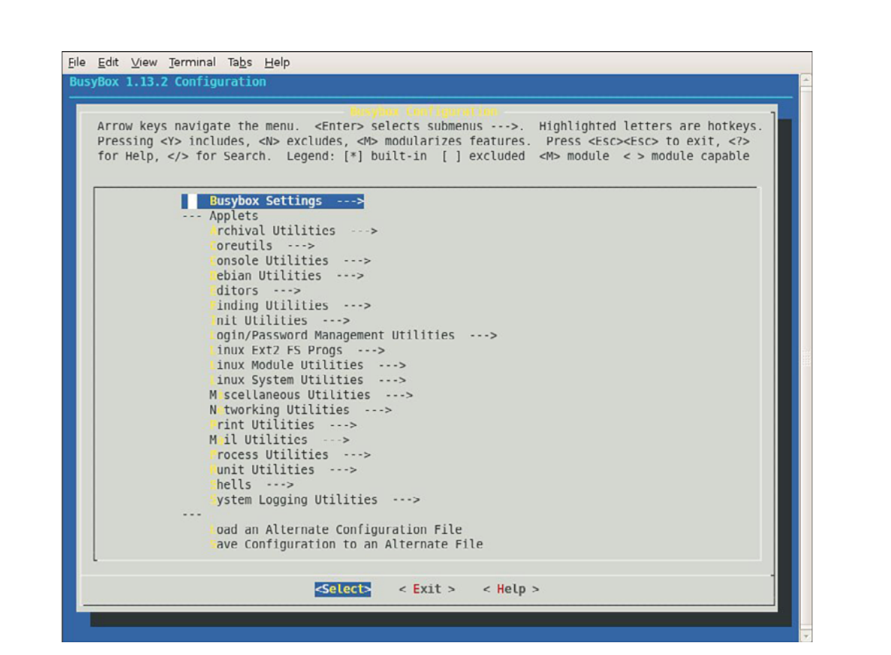

# Chương 11. BusyBox

## Trong chương này

- 11\.1 Giới thiệu BusyBox 290

- 11\.2 Cấu hình BusyBox 291

- 11\.3 Hoạt động BusyBox 293

- 11\.4 Tổng kết 303

Man page của BusyBox tuyên bố BusyBox là “Dao đa năng Thụy Sĩ

của Embedded Linux”. Mô tả này phù hợp vì BusyBox là phần thay thế nhỏ

và hiệu quả cho tập hợp lớn các tiện ích Linux command-line chuẩn.

Nó thường làm nền tảng cho embedded platform resource-limited.

Chương này giới thiệu BusyBox và cung cấp điểm khởi đầu tốt

để tùy chỉnh cài đặt BusyBox riêng.

Các chương trước đã đề cập BusyBox. Chương này trình bày chi tiết

package hữu ích này. Sau giới thiệu ngắn, chúng ta khám phá BusyBox

configuration utility, dùng điều chỉnh BusyBox theo yêu cầu

cụ thể. Sau đó thảo luận yêu cầu cross-compiling BusyBox

package.

Các vấn đề hoạt động BusyBox được xem xét, gồm cách dùng trong embedded

system. Chúng ta khảo sát initialization sequence và giải thích

khác biệt với System V initialization chuẩn. Chương này cũng trình

bày initialization script mẫu. Sau các bước cài BusyBox

trên target system, bạn sẽ tìm hiểu một số lệnh BusyBox và

giới hạn của chúng.

## 11.1 Giới thiệu BusyBox

BusyBox cực kỳ phổ biến trong cộng đồng embedded Linux. Nó rất dễ cấu hình, compile và dùng. Ngoài ra có tiềm năng giảm đáng kể tài nguyên hệ thống tổng thể cần hỗ trợ tập hợp lớn tiện ích Linux thông dụng. BusyBox cung cấp phần thay thế gọn cho nhiều tiện ích full-blown truyền thống trên phần lớn desktop và embedded Linux distribution. Ví dụ file utility `ls`, `cat`, `cp`, `dir`, `head`, `tail`; general utility `dmesg`, `kill`, `halt`, `fdisk`, `mount`, `umount`; và nhiều loại khác. BusyBox cũng hỗ trợ operation more-complex như `ifconfig`, `netstat`, `route` cùng network utility khác.

BusyBox có cấu trúc module, cho phép cấu hình rất linh hoạt và có thể được tùy chỉnh để đáp ứng các yêu cầu cụ thể của bạn. Package này bao gồm một configuration utility tương tự tiện ích dùng để cấu hình Linux kernel, nên bạn sẽ thấy khá quen thuộc.

Các lệnh trong BusyBox nhìn chung là những implementation đơn giản hơn so với các phiên bản full-blown tương ứng. Trong một số trường hợp, chỉ một tập con của các command-line option thông thường được hỗ trợ. Tuy nhiên, trên thực tế, bạn sẽ thấy tập con chức năng lệnh của BusyBox là quá đủ cho phần lớn yêu cầu embedded thông thường.

### 11.1.1 BusyBox dễ dùng

Nếu có thể cấu hình, build Linux kernel, bạn sẽ thấy cấu hình, build, cài BusyBox khá đơn giản. Các bước tương tự:

1\. Thực thi configuration utility và bật tính năng chọn.

2\. Chạy `make` build package.

3\. Cài binary cùng loạt symbolic link[^1] lên target system.

Có thể build, cài BusyBox trên development workstation hoặc target embedded system. Nó hoạt động tốt như nhau ở cả hai môi trường. Tuy nhiên khi cài trên development workstation, phải cẩn thận giữ riêng trong working directory để tránh ghi đè system startup file hoặc utility chính.

## 11.2 Cấu hình BusyBox

Để bắt đầu cấu hình BusyBox, bạn dùng cùng lệnh như với Linux kernel cho configuration utility library-based dựa trên `ncurses`. Lưu ý rằng, tương tự Linux kernel, `make help` cung cấp nhiều thông tin hữu ích về các make target có sẵn. Lệnh cấu hình là:

```
$ make menuconfig
```

Hình 11-1 cho cấu hình BusyBox top-level.

Dung lượng không cho phép trình bày từng configuration option. Tuy nhiên một số đáng đề cập. Các option quan trọng hơn nằm dưới Busybox Settings ---\> Build Options. Ở đây có option cần để cross-compile BusyBox application. Listing 11-1 trình bày option dưới Build Options trong BusyBox snapshot gần đây. Chọn Build Options từ configuration utility top-level của BusyBox để đến màn hình.



HÌNH 11-1 Menu cấu hình BusyBox Top-level

LISTING 11-1 BusyBox build option

```
[ ] Build BusyBox as a static binary (no shared libs)
[ ]   Build BusyBox as a position independent executable
[ ] Force NOMMU build
[ ] Build shared libbusybox
[*] Build with Large File Support (for accessing files > 2 GB)
()  Cross Compiler prefix
```

Option đầu tiên hữu ích khi xây dựng embedded system tối giản. Nó cho phép BusyBox được compile và static link để không cần dynamically loaded library (chẳng hạn `libc-*`) lúc runtime trên target system. Nếu không dùng option này, BusyBox cần nhiều library khác nhau để chạy. Chúng ta có thể dễ dàng xác định những library mà BusyBox (hoặc bất kỳ binary nào khác) cần trên target system bằng lệnh `ldd`. Listing 11-2 là output của `ldd` được cross-compiled cho ARM xscale.

LISTING 11-2 Library dependency của BusyBox

```
$ xscale_be-ldd busybox
    linux-gate.so.1 =>  (0xb8087000)
    libm.so.6 => /lib/tls/i686/cmov/libm.so.6 (0xb804d000)
    libc.so.6 => /lib/tls/i686/cmov/libc.so.6 (0xb7efe000)
    /lib/ld-linux.so.2 (0xb8088000)
```

Hãy chú ý rằng tiện ích BusyBox được compile theo cấu hình mặc định cần bốn shared library trong Listing 11-2. Nếu chọn build BusyBox dưới dạng static binary, `ldd` sẽ chỉ thông báo rằng BusyBox binary không phải dynamic executable. Nói cách khác, nó không cần shared library nào để giải quyết các dependency còn chưa được giải quyết trong executable. Static linking tạo ra tổng footprint nhỏ hơn trên root file system vì không cần shared library. Tuy nhiên, xây dựng embedded application mà không có shared library có nghĩa là các C library function quen thuộc không có sẵn cho ứng dụng của bạn. Để hình dung chênh lệch kích thước giữa BusyBox được static link và cùng cấu hình được compile với shared library, ở một phiên bản BusyBox gần đây, busybox được static link có kích thước khoảng 1,5MB, so với 778KB của image được dynamic link.

### 11.2.1 Cross-Compiling BusyBox

Như đã đề cập ở đầu chương, các tác giả BusyBox dự định sử dụng package này trong môi trường cross-development, nên build BusyBox trong môi trường đó khá dễ. Ở các phiên bản trước, yêu cầu duy nhất là chỉ định prefix cho cross-compiler bằng cách chọn option build BusyBox với cross-compiler. Cách này đã được thay bằng phương pháp chuẩn hơn: chỉ định một environment variable, tương tự khi build các package khác như Linux kernel. Để cross-compile bằng một cross-compiler cụ thể trên development workstation, chỉ cần định nghĩa `CROSS_COMPILE` trong environment. Một số giá trị ví dụ của `CROSS_COMPILE` là `arm5vt_le-`, `xscale_be-` và `ppc_linux-`. Lưu ý rằng bạn cũng có thể chỉ định cross-compiler prefix trong configuration utility vừa mô tả. Chúng ta sẽ trình bày chi tiết hơn các compiler prefix liên quan đến cross-compiling trong chương tiếp theo, khi khảo sát môi trường phát triển embedded.

## 11.3 Hoạt động BusyBox

Khi build BusyBox, bạn nhận được một binary có tên, đúng như bạn đoán, là `BusyBox`. Bạn có thể gọi BusyBox bằng chính binary name, nhưng thông thường nó được khởi chạy qua symlink. Khi được gọi không có command-line parameter, BusyBox tạo một danh sách các function đã được bật qua configuration. Listing 11-3 cho thấy output như vậy (đã được định dạng để vừa chiều rộng trang).

LISTING 11-3 Cách dùng BusyBox

```
root@coyote # busybox
BusyBox v1.13.2 (2010-02-24 16:04:14 EST) multi-call binary
Copyright (C) 1998-2008 Erik Andersen, Rob Landley, Denys Vlasenko and
others. Licensed under GPLv2.
See source distribution for full notice.

Usage: busybox [function] [arguments]...
   or: function [arguments]...

    BusyBox is a multi-call binary that combines many common Unix
    utilities into a single executable.  Most people will create a link
    to busybox for each function they wish to use and BusyBox will act
    like whatever it was invoked as!

Currently defined functions:
    [, [[, addgroup, adduser, ar, ash, awk, basename, blkid, bunzip2,
    bzcat, cat, chattr, chgrp, chmod, chown, chpasswd, chroot, chvt,
    clear, cmp, cp, cpio, cryptpw, cut, date, dc, dd, deallocvt,
    delgroup, deluser, df, dhcprelay, diff, dirname, dmesg, du,
    dumpkmap, dumpleases, echo, egrep, env, expr, false, fbset,
    fbsplash, fdisk, fgrep, find, free, freeramdisk, fsck, fsck.minix,
    fuser, getopt, getty, grep, gunzip, gzip, halt, head, hexdump,
    hostname, httpd, hwclock, id, ifconfig, ifdown, ifup, init, insmod,
    ip, kill, killall, klogd, last, less, linuxrc, ln, loadfont,
    loadkmap, logger, login, logname, logread, losetup, ls, lsmod,
    makedevs, md5sum, mdev, microcom, mkdir, mkfifo, mkfs.minix, mknod,
    mkswap, mktemp, modprobe, more, mount, mv, nc, netstat, nice,
    nohup, nslookup, od, openvt, passwd, patch, pidof, ping, ping6,
    pivot_root, poweroff, printf, ps, pwd, rdate, rdev, readahead,
    readlink, readprofile, realpath, reboot, renice, reset, rm, rmdir,
    rmmod, route, rtcwake, run-parts, sed, seq, setconsole, setfont,
    sh, showkey, sleep, sort, start-stop-daemon, strings, stty, su,
    sulogin, swapoff, swapon, switch_root, sync, sysctl, syslogd, tail,
    tar, tee, telnet, telnetd, test, tftp, time, top, touch, tr,
    traceroute, true, tty, udhcpc, udhcpd, umount, uname, uniq, unzip,
    uptime, usleep, vi, vlock, watch, wc, wget, which, who, whoami,
    xargs, yes, zcat
```

Từ Listing 11-3, bạn có thể thấy danh sách các function được bật trong bản build BusyBox này. Chúng được liệt kê theo thứ tự chữ cái (bỏ qua các shell scripting operator `[` và `[[`), từ `addgroup` đến `zcat`, một tiện ích dùng để giải nén nội dung compressed file. Danh sách này biểu thị tập hợp các tiện ích được bật trong bản build BusyBox cụ thể này.

Để gọi function cụ thể, thực thi `busybox` với function đã định nghĩa trên command line. Ví dụ hiển thị danh sách file trong root directory bằng lệnh:

```
[root@coyote]# busybox ls /
```

Một thông tin quan trọng khác từ BusyBox usage message trong Listing 11-3 là phần mô tả ngắn về chương trình. Nó mô tả BusyBox như một multicall binary, kết hợp nhiều tiện ích thông dụng thành một executable duy nhất. Đó chính là mục đích của các symlink đã đề cập trước đó. BusyBox được thiết kế để gọi thông qua symlink mang tên chức năng mà nó sẽ thực hiện. Cách này loại bỏ việc phải gõ lệnh two-word để gọi một chức năng cụ thể, đồng thời cung cấp cho người dùng một tập lệnh quen thuộc tương ứng với các tiện ích cùng tên. Listing 11-4 và 11-5 sẽ làm rõ điều này.

Listing 11-4 cho target directory structure do BusyBox package tạo qua lệnh `make install` trong source tree `busybox`.

LISTING 11-4 BusyBox symlink structure từ `make install`

```
[root@coyote]$ ls -l /
total 12
drwxrwxr-x  2 root   root 4096 Dec  3 13:38 bin
lrwxrwxrwx  1 root   root   11 Dec  3 13:38 linuxrc -> bin/busybox
drwxrwxr-x  2 root   root 4096 Dec  3 13:38 sbin
drwxrwxr-x  4 root   root 4096 Dec  3 13:38 usr
```

Executable file `busybox` nằm trong directory `/bin`, và các symlink được tạo khắp phần còn lại của cấu trúc để trỏ về `/bin/busybox`. Listing 11-5 mở rộng directory structure trong Listing 11-4.

LISTING 11-5 BusyBox symlink structure: Chi tiết tree

```
[root@coyote]$ tree
.
|-- bin
|   |-- addgroup -> busybox
|   |-- busybox
|   |-- cat -> busybox
|   |-- cp -> busybox
<...>
|   ‘-- zcat -> busybox
|-- linuxrc -> bin/busybox
|-- sbin
|   |-- halt -> ../bin/busybox
|   |-- ifconfig -> ../bin/busybox
|   |-- init -> ../bin/busybox
|   |-- klogd -> ../bin/busybox
<...>
|   ‘-- syslogd -> ../bin/busybox
‘-- usr
    |-- bin
    |   |-- [ -> ../../bin/busybox
    |   |-- basename -> ../../bin/busybox
<...>
    |   |-- xargs -> ../../bin/busybox
    |   ‘-- yes -> ../../bin/busybox
    ‘-- sbin
        ‘-- chroot -> ../../bin/busybox
```

Output trong Listing 11-5 đã được rút ngắn đáng kể để dễ đọc và tránh một listing dài three-page. Mỗi dòng chứa dấu ba chấm (`...`) cho biết vị trí listing được lược bớt để chỉ hiển thị vài entry đầu và vài entry cuối của directory tương ứng. Trên thực tế, có thể có hơn 100 symlink được tạo trong các directory này, tùy những chức năng bạn đã bật bằng BusyBox configuration utility.

Hãy chú ý chính BusyBox executable, entry thứ hai trong directory `/bin`. Trong directory `/bin` còn có các symlink trỏ về busybox cho `addgroup`, `cat`, `cp`, v.v., cho đến `zcat`. Một lần nữa, các entry giữa `cp` và `zcat` đã được lược khỏi listing để dễ đọc. Với cấu trúc symlink này, người dùng chỉ cần nhập tên thực của tiện ích để gọi chức năng tương ứng. Ví dụ, để cấu hình một network interface bằng tiện ích BusyBox `ifconfig`, người dùng có thể nhập một lệnh tương tự như sau:

```
$ ifconfig eth1 192.168.1.14
```

Điều này gọi BusyBox executable qua symlink `ifconfig`. BusyBox kiểm tra cách được gọi, tức đọc `argv[0]` để biết chức năng được yêu cầu.

### 11.3.1 BusyBox init

Hãy chú ý symlink có tên `init` trong Listing 11-5. Trong Chương 6, “Khởi tạo user space”, bạn đã tìm hiểu chương trình `init` và vai trò của nó trong quá trình khởi tạo hệ thống. Hãy nhớ rằng kernel cố thực thi một chương trình có tên `/sbin/init` như bước cuối của quá trình khởi tạo kernel. Không có lý do gì BusyBox không thể mô phỏng chức năng `init`, và đó chính là cách hệ thống trong Listing 11-5 được cấu hình. BusyBox đảm nhiệm chức năng `init`.

BusyBox xử lý việc khởi tạo hệ thống khác với System V `init` chuẩn. Một Linux system dùng cơ chế khởi tạo System V (SysV) như mô tả trong Chương 6 cần một file `inittab` có thể truy cập trong directory `/etc`. BusyBox cũng đọc file `inittab`, nhưng cú pháp file `inittab` của nó khác. Nhìn chung, bạn không cần dùng `inittab` nếu sử dụng BusyBox. Hãy cân nhắc lời khuyên trong BusyBox man page: nếu cần runlevel, hãy dùng cơ chế khởi tạo System V.[^2]

Hãy xem điều này trông như thế nào trên một embedded system. Chúng ta đã tạo một root file system nhỏ dựa trên BusyBox. Chúng ta cấu hình BusyBox để static linking, loại bỏ nhu cầu sử dụng bất kỳ shared library nào. Listing 11-6 là một listing `tree` của root file system này. Chúng ta tạo file system nhỏ này theo các bước được phác thảo trong Chương 9, “File system”, Mục 9.11, “Tạo một file system đơn giản”. Chúng ta không trình bày lại chi tiết quy trình ở đây. Các file trong file system đơn giản của chúng ta được thể hiện trong Listing 11-6.

LISTING 11-6 Root file system BusyBox tối thiểu

```
$ tree
.
|-- bin
|   |-- busybox
|   |-- cat -> busybox
|   |-- dmesg -> busybox
|   |-- echo -> busybox
|   |-- hostname -> busybox
|   |-- ls -> busybox
|   |-- ps -> busybox
|   |-- pwd -> busybox
|   ‘-- sh -> busybox
|-- dev
|   ‘-- console
|-- etc
‘-- proc
4 directories, 10 files
```

Root file system BusyBox-based này chỉ chiếm dung lượng lớn hơn một chút so với dung lượng cần cho chính `busybox`. Trong cấu hình này, với static linking và hỗ trợ gần 100 tiện ích, BusyBox executable có kích thước dưới 2MB:

```
# ls -l /bin/busybox
-rwxr-xr-x 1 chris chris 1531600 2010-01-28 15:49 /bin/busybox
```

Giờ xem hành vi hệ thống. Listing 11-7 ghi console output lúc power-up trên embedded system BusyBox-based.

LISTING 11-7 Khởi động mặc định BusyBox

```
...
Looking up port of RPC 100003/2 on 192.168.1.9
Looking up port of RPC 100005/1 on 192.168.1.9
VFS: Mounted root (nfs filesystem).
Freeing init memory: 96K
Bummer, could not run ‘/etc/init.d/rcS’: No such file or directory

Please press Enter to activate this console.


BusyBox v1.01 (2005.12.03-19:09+0000) Built-in shell (ash)
Enter ‘help’ for a list of built-in commands.

-sh: can’t access tty; job control turned off
/ #
```

Listing 11-7 được chạy trên một embedded board cấu hình NFS root mount. Chúng ta export một directory trên workstation chứa file system image đơn giản được mô tả chi tiết trong Listing 11-6. Trong một trong những bước cuối của boot process, Linux kernel trên target board mount root file system thông qua NFS. Khi kernel cố thực thi `/sbin/init`, thao tác này thất bại (đúng theo thiết kế) vì file system không có `/sbin/init`. Tuy nhiên, như đã thấy, kernel còn thử thực thi `/bin/sh`. Trên target BusyBox-configured của chúng ta, thao tác này thành công và `busybox` được khởi chạy thông qua symlink `/bin/sh` trên root file system.

Điều đầu tiên BusyBox làm là báo rằng nó không tìm thấy `/etc/init.d/rcS`. Đây là initialization script mặc định mà BusyBox tìm kiếm. Thay vì sử dụng `inittab`, đây là phương pháp được ưu tiên để khởi tạo một embedded system dựa trên BusyBox.

Khi hoàn tất khởi tạo, BusyBox hiển thị prompt yêu cầu người dùng nhấn Enter để kích hoạt console. Khi phát hiện phím Enter, BusyBox thực thi một shell session `ash` chờ input từ người dùng. Thông báo cuối về job control xuất phát từ việc trong ví dụ cụ thể này (và trên phần lớn embedded system điển hình), chúng ta tạo system console trên một serial terminal. Linux kernel có code để vô hiệu hóa job control nếu phát hiện console nằm trên serial terminal.

Ví dụ này tạo ra một hệ thống hoạt động được với gần 100 tiện ích Linux, bao gồm các core utility, file utility, hỗ trợ network và một shell có khả năng tương đối tốt. Bạn có thể thấy package đơn giản này cung cấp một nền tảng mạnh để xây dựng các system application của riêng mình. Tất nhiên, cần lưu ý rằng nếu không có hỗ trợ cho libc và các system library khác, bạn sẽ gặp một công việc rất khó khăn khi triển khai ứng dụng. Bạn sẽ phải cung cấp hỗ trợ cho tất cả các standard C library call thông thường và những library function khác mà một chương trình C điển hình dựa vào. Một lựa chọn khác là static link ứng dụng với các library mà chúng phụ thuộc. Tuy nhiên, nếu dùng cách này cho nhiều hơn một vài ứng dụng, tổng kích thước ứng dụng có thể vượt tổng kích thước khi dynamic link và đặt các shared library trên target.

### 11.3.2 Initialization script rcS mẫu

Trước khi BusyBox sinh interactive shell, nó cố thực thi lệnh từ script `/etc/init.d/rcS` như Listing 11-7. Đây là nơi ứng dụng vào hoạt động trong BusyBox system. Script khởi tạo `rcS` đơn giản có ở Listing 11-8.

LISTING 11-8 Startup script `rcS` đơn giản cho BusyBox

```
#!/bin/sh

echo “Mounting proc”
mount -t proc /proc /proc

echo “Starting system loggers”
syslogd
klogd

echo “Configuring loopback interface”
ifconfig lo 127.0.0.1

echo “Starting inetd”
xinetd

# start a shell
busybox sh
```

Script đơn giản này phần lớn là self-explanatory. Trước hết, cần mount file system `/proc` tại mount point dành riêng cho nó là `/proc`, vì nhiều tiện ích lấy thông tin từ file system `/proc`. Điều này được giải thích đầy đủ hơn trong Chương 9. Tiếp theo, chúng ta khởi chạy các system logger sớm nhất có thể để ghi nhận mọi vấn đề lúc startup. Sau các system log daemon, chúng ta cấu hình local loopback interface cho hệ thống. Một lần nữa, nhiều chức năng Linux truyền thống giả định có loopback interface; nếu hệ thống đã được cấu hình hỗ trợ socket, bạn nên bật interface này. Việc cuối cùng trước khi mở shell là khởi chạy Internet superserver `xinetd`. Chương trình này chạy nền, lắng nghe network request trên mọi network interface đã cấu hình. Ví dụ, để bắt đầu một telnet session tới board, `xinetd` tiếp nhận request kết nối telnet và tạo một telnet server để xử lý session đó.

Thay vì mở shell, có thể chạy ứng dụng riêng từ initialization script `rcS`. Listing 11-8 là ví dụ đơn giản target board telnet-enabled chạy dịch vụ cơ bản như system logger và kernel logger.

### 11.3.3 Cài BusyBox lên target

Chỉ có thể tiếp tục thảo luận việc cài đặt BusyBox khi bạn hiểu cách sử dụng và mục đích của symlink. BusyBox makefile chứa một target có tên install. Thực thi `make install` tạo ra directory structure chứa BusyBox executable và một symlink tree. Toàn bộ môi trường này, bao gồm symlink tree, cần được chuyển sang root directory của target embedded system. Như đã giải thích, symlink tree loại bỏ việc phải gõ `busybox` `command` cho mỗi lệnh. Thay vào đó, để xem danh sách file trong một directory, người dùng chỉ cần gõ `ls`. Symlink thực thi BusyBox theo cách đã mô tả và gọi chức năng `ls`. Hãy xem lại Listing 11-4 và 11-5 để thấy symlink tree. Lưu ý rằng BusyBox build system chỉ tạo link cho các chức năng bạn đã bật thông qua configuration utility.

Cách dễ nhất tạo symlink farm cần trong root file system là để BusyBox build system thực hiện. Chỉ mount root file system trên development workstation và truyền `CONFIG_PREFIX` cho BusyBox makefile. Listing 11-9 cho quy trình.

LISTING 11-9 Cài BusyBox trên root file system

```
$ mount -o loop bbrootfs.ext2 /mnt/remote
$ make CONFIG_PREFIX=/mnt/remote install
  /mnt/remote/bin/ash -> busybox
  /mnt/remote/bin/cat -> busybox
  /mnt/remote/bin/chgrp -> busybox
  /mnt/remote/bin/chmod -> busybox
  /mnt/remote/bin/chown -> busybox
...
  /mnt/remote/usr/bin/xargs -> ../../bin/busybox
  /mnt/remote/usr/bin/yes -> ../../bin/busybox
  /mnt/remote/usr/sbin/chroot -> ../../bin/busybox


--------------------------------------------------
You will probably need to make your busybox binary
setuid root to ensure all configured applets will
work properly.
--------------------------------------------------

$ chmod +s /mnt/remote/bin/busybox
$ ls -l /mnt/remote/bin/busybox
-rwsr-sr-x  1 root root 552132  ... /mnt/remote/bin/busybox
```

Trước hết, chúng ta mount root file system binary image tại mount point mong muốn, ở đây là `/mnt/remote`, một vị trí tôi thường dùng. Sau đó, chúng ta gọi lệnh BusyBox `make install`, truyền `CONFIG_PREFIX` để chỉ định nơi đặt symlink tree và BusyBox executable file. Dù không thể hiện rõ trong listing, makefile gọi script `applets/install.sh` để thực hiện phần lớn công việc. Script duyệt một file chứa tất cả BusyBox applet đã được bật và tạo symlink cho từng applet tại path đã chỉ định bằng `CONFIG_PREFIX`. Script xuất rất nhiều thông báo: một dòng cho mỗi symlink được tạo. Để ngắn gọn, Listing 11-9 chỉ hiển thị vài thông báo tạo symlink đầu tiên và cuối cùng. Dấu ba chấm trong listing biểu diễn các thông báo đã bị lược bỏ.

Thông báo về setuid cũng được install script hiển thị để nhắc bạn rằng có thể cần đặt BusyBox executable thành setuid root. Điều này cho phép các chức năng BusyBox cần root access hoạt động đúng ngay cả khi được một nonroot user gọi. Đây không phải yêu cầu tuyệt đối, đặc biệt trong môi trường embedded Linux, nơi hệ thống thường chỉ có một root account. Nếu điều này cần thiết cho bản cài đặt của bạn, lệnh tương ứng (`chmod +s`) được trình bày trong Listing 11-9.

Kết quả bước cài là BusyBox binary và symlink tree được cài trên target root file system. Kết quả cuối rất giống Listing 11-4.

Cũng cần biết rằng BusyBox có một option cho phép tạo symlink tree này trên target system lúc runtime. Option đó được bật trong BusyBox configuration và được gọi lúc runtime bằng cách thực thi BusyBox với option `-install`. Bạn phải mount file system `/proc` trên target system để chức năng hỗ trợ này hoạt động.

### 11.3.4 BusyBox applet

Trong một BusyBox snapshot gần đây, 282 lệnh (còn gọi là applet) được ghi trong man page. BusyBox có đủ hỗ trợ cho các shell script tương đối phức tạp, bao gồm hỗ trợ Bash shell scripting. BusyBox hỗ trợ `awk` và `sed`, thường xuất hiện trong Bash script. BusyBox hỗ trợ các network utility như `ping`, `ifconfig`, `traceroute` và `netstat`. Một số lệnh được đưa vào riêng để hỗ trợ scripting, bao gồm `true`, `false` và `yes`.

Hãy dành ít phút đọc Phụ lục C, “Các lệnh BusyBox”, nơi bạn có thể tìm thấy phần mô tả khái quát của từng lệnh BusyBox. Sau đó, bạn sẽ hiểu rõ hơn khả năng của BusyBox và cách áp dụng nó cho dự án embedded Linux của riêng mình.

Như đã đề cập ở đầu chương, nhiều lệnh BusyBox chỉ có một tập con giới hạn các tính năng và option so với các phiên bản full-featured tương ứng. Nhìn chung, bạn có thể xem trợ giúp của bất kỳ lệnh BusyBox nào lúc runtime bằng cách gọi lệnh với option `--help`. Thao tác này tạo ra usage message với mô tả ngắn về từng command option được hỗ trợ. Applet BusyBox `gzip` là một ví dụ hữu ích về lệnh BusyBox chỉ hỗ trợ một tập option giới hạn. Listing 11-10 hiển thị output của `gzip -help` trên một BusyBox target.

LISTING 11-10 Cách dùng applet BusyBox `gzip`

```
/ # gzip --help
BusyBox v1.13.2 (2010-02-24 16:04:14 EST) multi-call binary

Usage: gzip [OPTION]... [FILE]...

Compress FILEs (or standard input)

Options:
        -c      Write to standard output
        -d      Decompress
        -f      Force
```

Phiên bản BusyBox của `gzip` chỉ hỗ trợ ba option command-line. Phiên bản full-featured tương ứng hỗ trợ hơn 15 option command-line khác nhau. Ví dụ, tiện ích full-featured `gzip` hỗ trợ option `--list` để tạo thống kê nén cho từng file trên command line. BusyBox `gzip` không có hỗ trợ như vậy. Thông thường, đây không phải giới hạn đáng kể đối với embedded system. Chúng tôi trình bày thông tin này để bạn có cơ sở lựa chọn khi quyết định sử dụng BusyBox. Khi cần đầy đủ khả năng của một tiện ích, giải pháp rất đơn giản: bỏ hỗ trợ tiện ích cụ thể đó trong BusyBox configuration và thêm tiện ích Linux chuẩn vào target system. Nhờ vậy, bạn có thể kết hợp các tiện ích BusyBox và tiện ích Linux chuẩn trên cùng embedded system.

## 11.4 Tổng kết

Chương này mô tả BusyBox, một trong những tiện ích phổ biến nhất trong lĩnh vực embedded Linux. BusyBox cũng được dùng trong các desktop distribution và server distribution, như một phần của rescue image cũng như initial ramdisk thường có trong những distribution này. Chương đã trình bày cách cấu hình, build và cài đặt tiện ích quan trọng đó. Chúng ta cũng đã khảo sát những khác biệt trong quá trình khởi tạo hệ thống khi dùng hệ thống BusyBox-based.

- BusyBox là công cụ mạnh cho embedded system thay nhiều Linux utility thông dụng trong một multicall binary.

- BusyBox có thể giảm đáng kể kích thước root file system image.

- BusyBox dễ dùng, nhiều tính năng hữu ích.

- Cấu hình BusyBox đơn giản, dùng interface tương tự cấu hình Linux.

- BusyBox có thể cấu hình làm ứng dụng link tĩnh hoặc động tùy yêu cầu cụ thể.

- Khởi tạo hệ thống hơi khác với BusyBox; chương đã trình bày khác biệt.

- BusyBox hỗ trợ nhiều lệnh. Phụ lục C liệt kê mọi lệnh sẵn có từ release gần đây.

### 11.4.1 Gợi ý đọc thêm

Trang chủ dự án BusyBox www.busybox.net/

Man page BusyBox www.busybox.net/downloads/BusyBox.html

[^1]: Chúng ta sẽ trình bày chi tiết symbolic link ngay sau đây.

[^2]: Chúng ta đã trình bày chi tiết System V initialization trong Chương 6.
