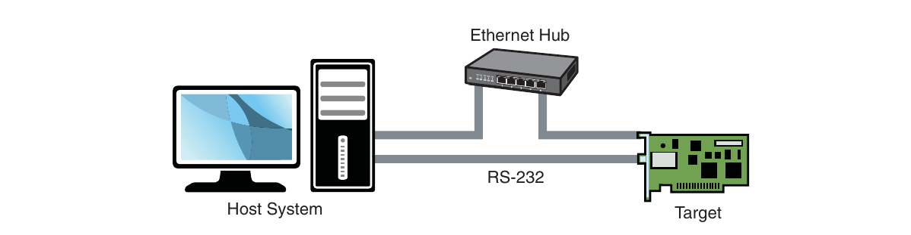
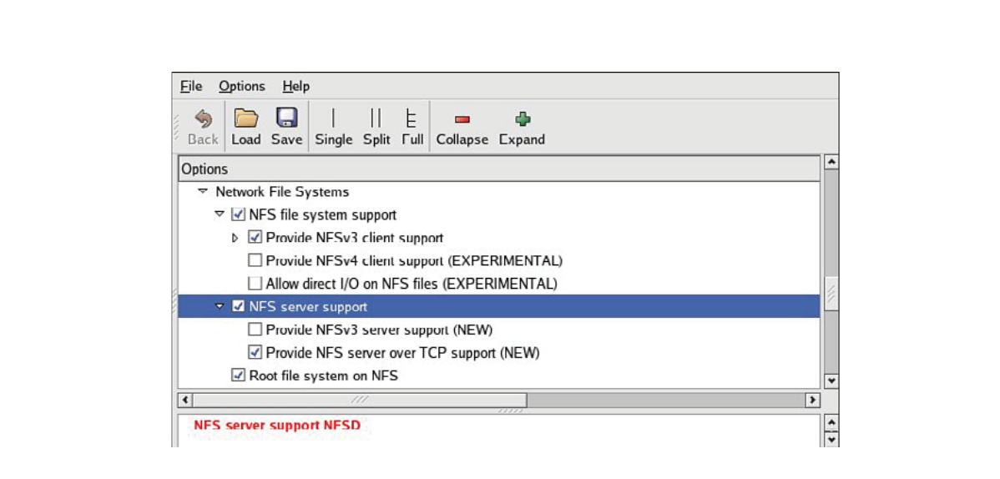
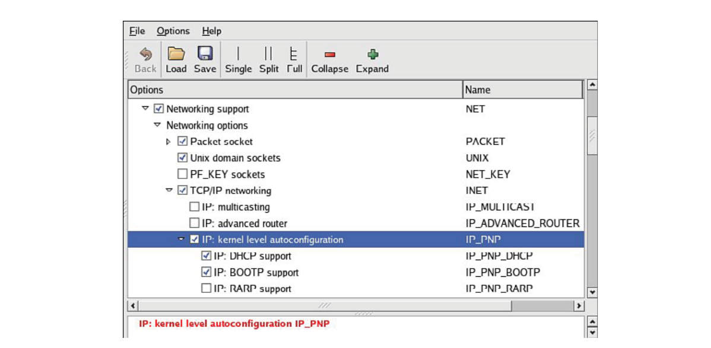

# Chương 12. Môi trường phát triển embedded

## Trong chương này

- 12\.1 Môi trường Cross-Development 306

- 12\.2 Yêu cầu host system 311

- 12\.3 Hosting target board 312

- 12\.4 Tổng kết 322

Cấu hình và dịch vụ sẵn có trên host development system

có thể ảnh hưởng rất lớn đến thành công của lập trình viên embedded. Chương này

khảo sát yêu cầu riêng của môi trường cross-development

và một số công cụ, kỹ thuật mà lập trình viên embedded cần

biết để làm việc hiệu quả.

Bắt đầu bằng môi trường cross-development điển hình. Dùng

ví dụ “Hello World” quen thuộc, chúng ta trình bày khác biệt quan trọng giữa

ứng dụng host-based và ứng dụng nhắm embedded system. Cũng xem

khác biệt toolchain phát triển ứng dụng native và embedded.

Sau đó trình bày yêu cầu host system, chi tiết cách dùng một số thành

phần quan trọng. Kết thúc chương bằng ví dụ

target board được phục vụ bởi host network-based.

## 12.1 Môi trường Cross-Development

Người mới phát triển embedded thường gặp khó với khái niệm và khác biệt giữa môi trường native và cross-development. Thực tế hệ thống thường có ba compiler và ba (hoặc nhiều hơn) phiên bản standard header file (như `stdlib.h`). Debug ứng dụng trên target embedded system có thể khó nếu thiếu công cụ và utility host-based phù hợp. Bạn phải quản lý, giữ riêng file và utility dành chạy trên host system với những thứ định dùng trên target.

Khi dùng thuật ngữ host trong context này, chúng ta chỉ development workstation trên bàn chạy Linux desktop distribution ưa thích.[^1] Ngược lại target chỉ embedded hardware platform. Vì thế native development là compile, build ứng dụng trên và cho host system. Cross-development là compile, build ứng dụng trên host để chạy trên embedded system. Nhớ các định nghĩa giúp bạn theo sát chương.

Hình 12-1 cho bố trí môi trường cross-development điển hình. Host PC nối target board qua một hoặc nhiều physical connection. Thuận tiện nhất nếu target có cả serial port và Ethernet port. Sau này khi thảo luận kernel debugging, bạn sẽ thấy serial port thứ hai có thể rất giá trị.



HÌNH 12-1 Thiết lập Cross-development

Trong tình huống phổ biến nhất, lập trình viên có serial terminal trên host nối RS-232 serial port, có thể một hoặc nhiều telnet/SSH terminal session tới target board và một hoặc nhiều debug session dùng Ethernet. Thiết lập cross-development này rất linh hoạt. Ý tưởng cơ bản là host cung cấp sức mạnh chạy compiler, debugger, editor và utility khác, target chỉ thực thi ứng dụng thiết kế cho nó. Tất nhiên có thể chạy compiler và debugger trên target, nhưng giả định host có nhiều tài nguyên hơn, gồm sức mạnh processor, RAM, disk storage và Internet connectivity. Thực tế target embedded board không có human-input device hay output display là điều không hiếm.

### 12.1.1 “Hello World” embedded

Hệ thống cross-development cấu hình đúng che giấu nhiều phức tạp khỏi lập trình viên ứng dụng thông thường. Xem ví dụ đơn giản giúp hé lộ và giải thích một số bí ẩn. Khi compile “Hello World”, toolchain (compiler, linker, utility liên quan) đưa nhiều giả định về host system đang build và chương trình compile. Thực ra không phải giả định mà là tập rule compiler tham chiếu để build binary đúng.

Listing 12-1 tái hiện chương trình “Hello World” đơn giản.

LISTING 12-1 Hello World một lần nữa

```
#include <stdio.h>

int main(int argc, char **argv)
{
    printf(“Hello World\n”);
    return 0;
}
```

Ngay cả người thỉnh thoảng lập trình ứng dụng cũng nhận ra vài điểm quan trọng của source file C này. Đầu tiên function `printf()` được tham chiếu nhưng không định nghĩa ở đây. Nếu bỏ directive `#include` chứa prototype function `printf()`, compiler phát thông báo quen thuộc:

```
hello.c:5: warning: implicit declaration of function ‘printf’
```

Điều này đặt ra vài câu hỏi thú vị:

- File `stdio.h` nằm đâu và được tìm thế nào?

- Function object code của `printf()` lưu đâu trên hệ thống, tham chiếu này được giải quyết thế nào trong binary executable?

Có vẻ compiler tự biết ghép binary file đúng để thực thi từ command line. Phức tạp hơn, executable cuối chứa startup, shutdown prologue code chúng ta không bao giờ thấy nhưng linker tự thêm. Prologue xử lý chi tiết như environment, argument truyền vào chương trình, startup/shutdown housekeeping, exit handling, v.v.

Để build “Hello World”, có thể gọi compiler đơn giản trên command-line như:

```
$ gcc -o hello hello.c
```

Điều này tạo binary executable file `hello`, có thể thực thi trực tiếp từ command line. Default mà compiler tham chiếu hướng dẫn nơi tìm include file. Tương tự, linker biết giải quyết tham chiếu function `printf()` bằng tham chiếu đến library định nghĩa nó. Tất nhiên là standard C library.

Có thể query toolchain xem một số default dùng. Listing 12-2 là một phần output `cpp` khi truyền flag `-v`. Có thể bạn biết `cpp` là C preprocessor component của GNU gcc toolchain. Chúng ta thêm format (chỉ white space) cho dễ đọc.

LISTING 12-2 Search directory mặc định của native `cpp`

```
$ cpp -v /dev/null
Reading specs from /usr/lib/gcc-lib/i386-redhat-linux/3.3.3/specs
Configured with: ../configure --prefix=/usr
--mandir=/usr/share/man --infodir=/usr/share/info
--enable-shared --enable-threads=posix --disable-checking
--disable-libunwind-exceptions --with-system-zlib
--enable-__cxa_atexit -host=i386-redhat-linux

Thread model: posix
gcc version 3.3.3 20040412 (Red Hat Linux 3.3.3-7)
 /usr/lib/gcc-lib/i386-redhat-linux/3.3.3/cc1 -E -quiet -v -
ignoring nonexistent directory “/usr/i386-redhat-linux/include”

#include “...” search starts here:
#include <...> search starts here:
 /usr/local/include
 /usr/lib/gcc-lib/i386-redhat-linux/3.3.3/include
 /usr/include
End of search list.
/usr/lib/
```

Query đơn giản tạo thông tin hữu ích. Đầu tiên thấy compiler được cấu hình thế nào qua tiện ích `./configure` quen thuộc. Default thread model `posix` quyết định thread library ứng dụng link nếu dùng threading function. Cuối cùng thấy default search directory cho directive `#include`.

Nhưng nếu muốn build `hello.c` cho architecture khác như Power Architecture? Khi compile ứng dụng cho Power Architecture target bằng cross-compiler trên host, phải bảo đảm compiler không dùng host include directory hay library path mặc định. Dùng cross-compiler cấu hình đúng là bước đầu, có môi trường cross-development well-designed là bước thứ hai.

Listing 12-3 là output toolchain cross-development open-source phổ biến tên Embedded Linux Development Kit (ELDK), do Denx Software Engineering tập hợp, duy trì. Cài đặt này cấu hình cho Power Architecture 82xx toolchain. Một lần nữa thêm white space cho dễ đọc.

LISTING 12-3 Search directory mặc định Cross-Search

```
$ ppc_82xx-cpp -v /dev/null
Reading specs from /opt/eldk/usr/bin/..
/lib/gcc-lib/ppc-linux/3.3.3/specs

Configured with: ../configure --prefix=/usr
--mandir=/usr/share/man --infodir=/usr/share/info
--enable-shared --enable-threads=posix --disable-checking
--with-system-zlib --enable-__cxa_atexit --with-newlib
--enable-languages=c,c++ --disable-libgcj
--host=i386-redhat-linux -target=ppc-linux

Thread model: posix

gcc version 3.3.3 (DENX ELDK 3.1.1 3.3.3-10)
 /opt/eldk/usr/bin/../lib/gcc-lib/ppc-linux/3.3.3/cc1
-E -quiet -v -iprefix /opt/eldk/usr/bin/..
/lib/gcc-lib/ppc-linux/3.3.3/ -D__unix__ -D__gnu_linux__
-D__linux__ -Dunix -D__unix -Dlinux -D__linux -Asystem=unix
-Asystem=posix - -mcpu=603

ignoring nonexistent directory “/opt/eldk/usr/ppc-linux/sys-include”
ignoring nonexistent directory “/opt/eldk/usr/ppc-linux/include”
#include “...” search starts here:

#include <...> search starts here:
 /opt/eldk/usr/lib/gcc-lib/ppc-linux/3.3.3/include
 /opt/eldk/ppc_82xx/usr/include

End of search list.
```

Ở đây thấy default search path cho include directory đã điều chỉnh tới cross version thay vì native include directory. Chi tiết tưởng khó hiểu này thiết yếu để phát triển ứng dụng và compile open source package cho embedded system. Đây là chủ đề khó hiểu nhất ngay cả với lập trình viên ứng dụng kinh nghiệm nhưng mới làm embedded.

## 12.2 Yêu cầu host system

Development workstation phải có một số thành phần, hệ thống quan trọng. Đầu tiên cần cross toolchain cấu hình đúng. Có thể tự download, compile hoặc lấy một trong nhiều commercial toolchain. Tự build ngoài phạm vi sách; tuy nhiên có nhiều tài liệu tốt, xem đề xuất cuối chương.

Thành phần lớn tiếp là Linux distribution nhắm embedded system architecture. Gồm hàng trăm tới hàng nghìn file tạo nội dung file system. Một lần nữa chọn tự build hoặc lấy bản thương mại. Một open source embedded system distribution phổ biến hơn là ELDK vừa nói. ELDK có cho nhiều Power Architecture, ARM và embedded target khác. Xây embedded Linux distribution từ đầu cần riêng cuốn sách cỡ này nên ngoài phạm vi thảo luận. Chúng ta giới thiệu open source build system trong Chương 16, “Open source build system”.

Tóm lại development host cần bốn khả năng riêng biệt:

- Cross toolchain và library

- Target system package, gồm chương trình, utility, library

- Host tool như editor, debugger, utility

- Server để hosting target board, như phần tiếp

Nếu cài môi trường phát triển embedded Linux ready-built trên workstation, thương mại hoặc miễn phí từ cộng đồng open source, toolchain và component đã cấu hình sẵn phối hợp. Ví dụ toolchain được cấu hình default directory search path khớp nơi target header file, system library trên development workstation. Tình huống phức tạp hơn nhiều nếu cần hỗ trợ nhiều architecture, processor trên workstation. Đây là lý do commercial embedded Linux distribution tồn tại.

### 12.2.1 Hardware debug probe

Ngoài thành phần vừa liệt kê, nên cân nhắc debugging hardware-assisted. Gồm hardware probe nối host (thường qua Ethernet) và target qua debug connector trên board. Có nhiều giải pháp. Chuẩn thực tế trong cộng đồng Linux vẫn là Abatron BDI-3000. Chủ đề trình bày chi tiết trong Chương 14, “Kỹ thuật debug kernel”.

## 12.3 Hosting target board

Tham khảo Hình 12-1, bạn thấy Ethernet connection từ board target-embedded tới hệ thống host-development. Không bắt buộc tuyệt đối; thực tế một số embedded device nhỏ không có Ethernet interface. Tuy nhiên đây là ngoại lệ hơn thông lệ. Có Ethernet connection trên target board đáng chi phí silicon! Nó cho phép NFS root mount, tiết kiệm nhiều ngày, tuần phát triển.

Trong phát triển embedded Linux kernel, bạn compile, download kernel và root file system tới embedded board nhiều lần. Nhiều embedded development system, bootloader hỗ trợ TFTP và giả định lập trình viên dùng. TFTP là giao thức nhẹ chuyển file giữa TFTP server, client qua Ethernet, tương tự FTP.

Dùng TFTP từ bootloader load kernel tiết kiệm vô số giờ đợi serial download ngay cả baud rate cao. Load root file system hoặc ramdisk image có thể lâu hơn nhiều vì image có thể hàng chục megabyte hoặc hơn tùy yêu cầu. Thời gian đầu tư cấu hình, dùng TFTP chắc chắn có lợi và rất được khuyến nghị. Rất ít thiết kế không đủ chỗ cho Ethernet port lúc phát triển, dù không lắp khi sản xuất.

### 12.3.1 TFTP server

Cấu hình TFTP trên Linux development host không khó. Tất nhiên chi tiết thay đổi tùy Linux distribution chọn. Hướng dẫn ở đây dựa trên desktop Linux distribution phổ biến.

TFTP là TCP/IP service phải bật trên workstation. Muốn bật phải yêu cầu workstation đáp ứng incoming TFTP packet. Dễ nhất chạy TFTP server daemon. Phần lớn desktop Linux distribution hiện đại có nhiều package cung cấp. TFTP server của HPA dùng làm cơ sở ví dụ. Lấy tại ftp://ftp.kernel.org/pub/software/network/tftp.

Trên Ubuntu hiện đại và hệ thống Debian-based khác, cài HPA TFTP server như sau:[^2]

```
$ sudo apt-get install tftpd-hpa
```

Cấu hình server này dễ. Có một configuration file trên Ubuntu và distribution khác là `/etc/default/tftpd-hpa`. File cần tùy chỉnh yêu cầu riêng. Listing 12-4 cho ví dụ điển hình.

LISTING 12-4 Cấu hình TFTP

```
#Defaults for tftpd-hpa
RUN_DAEMON=”yes”
OPTIONS=”-l -c -s /tftpboot”
```

Điều đầu là bật service. Khi mới cài package `tftpd-hpa`, `RUN_DAEMON` mặc định `“no”`. Muốn bật phải đổi mặc định `“no”` sang `“yes”` như Listing 12-4.

Dòng hai định nghĩa command-line option cho chính daemon, thường `/usr/sbin/in.tftpd`. Switch `-s` yêu cầu `in.tftpd` chuyển sang directory chỉ định (`/tftpboot`) khi startup, khiến directory là root của TFTP server. Flag `-c` cho phép tạo file mới, hữu ích ghi file từ target lên server. BDI-3000 (trình bày sau) có khả năng này và không hoạt động nếu thiếu `-c`. Argument `-l` yêu cầu TFTP daemon chạy nền, nghe incoming TFTP packet trên TFTP port.

Sau khi sửa configuration file phải restart TFTP server để có hiệu lực:

```
$ sudo /etc/init.d/tftpd-hpa restart
```

Dù cách nào, tham khảo tài liệu distribution để biết tùy chọn bật TFTP server phù hợp.

### 12.3.2 BOOTP/DHCP server

Có DHCP server trên development host đơn giản hóa quản lý cấu hình embedded target. Chúng ta đã xác lập lý do Ethernet interface trên target hardware là ý hay. Khi Linux boot trên target board, cần cấu hình Ethernet interface trước khi dùng được. Hơn nữa nếu dùng NFS root mount, Linux cần cấu hình Ethernet interface target trước khi boot process hoàn tất. Chương 9, “File system”, đã trình bày NFS chi tiết.

Nhìn chung Linux dùng hai phương pháp khởi tạo Ethernet/IP interface lúc boot:

- Hard-code Ethernet interface parameter trên Linux kernel command line hoặc default configuration, như cấu hình IP tĩnh.

- Cấu hình kernel tự phát hiện network setting lúc boot.

Vì lý do rõ ràng, lựa chọn hai linh hoạt hơn. DHCP hoặc BOOTP là giao thức target, server dùng tự phát hiện network setting. Xem phần cuối chương để biết giao thức chi tiết.

DHCP server điều khiển gán IP address cho IP subnet được cấu hình và DHCP/BOOTP client được cấu hình tham gia. Server nghe request từ DHCP client (như target board), gán địa chỉ và thông tin liên quan trong boot process. Có thể khảo sát DHCP exchange điển hình (Listing 12-5) bằng khởi động server với debug switch `-d` và quan sát output khi target machine request configuration.

LISTING 12-5 Trao đổi DHCP điển hình

```
tgt> DHCPDISCOVER from 00:09:5b:65:1d:d5 via eth0
svr> DHCPOFFER on 192.168.0.9 to 00:09:5b:65:1d:d5 via eth0
tgt> DHCPREQUEST for 192.168.0.9 (192.168.0.1) from \
       00:09:5b:65:1d:d5 via eth0
svr> DHCPACK on 192.168.0.9 to 00:09:5b:65:1d:d5 via eth0
```

Chuỗi bắt đầu khi client (target) phát broadcast frame tìm DHCP server, thể hiện bởi DHCPDISCOVER. Server phản hồi (nếu cấu hình, bật) bằng đề xuất IP address cho client, thể hiện qua DHCPOFFER. Client sau đó đáp ứng bằng kiểm tra IP address cục bộ, gồm gửi DHCPREQUEST packet đến server như minh họa. Cuối cùng server xác nhận gán IP address cho client, hoàn tất automatic target configuration.

Thú vị là client cấu hình đúng nhớ địa chỉ cuối DHCP server gán. Lần boot tiếp bỏ DHCPDISCOVER và tới thẳng DHCPREQUEST, giả định dùng lại IP address trước. Linux kernel đang boot không có khả năng này và phát cùng chuỗi mỗi boot.

Cấu hình DHCP server host không khó. Như thường lệ hãy tham khảo tài liệu desktop Linux distribution. Trên Red Hat/Fedora, configuration entry cho một target có thể như Listing 12-6.

LISTING 12-6 Cấu hình DHCP server mẫu

```
# Example DHCP Server configuration
allow bootp;

subnet 192.168.1.0 netmask 255.255.255.0 {
 default-lease-time 1209600;     # two weeks
  option routers 192.168.1.1;
  option domain-name-servers 1.2.3.4;
  group {
    host pdna1 {
      hardware ethernet 00:30:bd:2a:26:1f;
      fixed-address 192.168.1.68;
      filename “uImage-pdna”;
      option root-path “/home/chris/sandbox/pdna-target”;
    }
  }
}
```

Đây là ví dụ đơn giản chỉ nhằm cho thấy loại thông tin có thể truyền target system. Host definition định nghĩa mapping one-to-one từ target MAC address tới IP address gán. Ngoài fixed IP address có thể truyền thông tin khác. Ví dụ truyền default router, DNS server address, tên file tùy chọn và root path để kernel mount NFS root file system. Bootloader có thể dùng filename load kernel image từ TFTP server. Cũng có thể cấu hình server cấp IP từ dải định sẵn, nhưng fixed address như Listing 12-6 rất tiện.

Đầu tiên phải bật DHCP server trên Linux development workstation. Thường qua main menu hoặc command line. Tham khảo tài liệu distribution để biết chi tiết phù hợp. Ví dụ bật trên Fedora Core Linux bằng lệnh sau từ root command prompt:

```
$ /etc/init.d/dhcpd start
```

hoặc

```
$ /etc/init.d/dhcpd restart
```

Phải làm mỗi lần khởi động development workstation trừ khi cấu hình tự chạy. Tham khảo tài liệu distribution để biết cách. Thường thấy tham chiếu bật service hay tương tự. Trong ví dụ dhcpd được coi system service.

Cài DHCP server có nhiều điểm tinh tế, nên trừ khi server nằm trong private network, hãy hỏi system administrator trước khi đưa server riêng vào hoạt động. Nếu cùng tồn tại corporate LAN, rất có thể bạn can thiệp DHCP service của nó.

### 12.3.3 NFS server

Dùng NFS root mount cho target board là công cụ phát triển rất mạnh. Một số ưu điểm cấu hình khi phát triển:

- Root file system không size-restricted bởi tài nguyên board giới hạn như Flash memory.

- Thay đổi application file lúc phát triển sẵn có ngay trên target.

- Có thể debug, boot kernel trước khi phát triển, debug root file system.

Các bước thiết lập NFS server khác nhau tùy desktop Linux distribution. Như dịch vụ khác trong chương, phải tham khảo tài liệu distribution cho cấu hình riêng. Phải khởi động NFS service từ startup script, graphical menu hoặc command line. Ví dụ lệnh từ root command prompt trên Fedora Core Linux desktop:

```
$ /etc/init.d/nfs start
```

hoặc

```
$ /etc/init.d/nfs restart
```

Chú ý Ubuntu mới hơn và distribution khác đổi lệnh này thành `/etc/init.d/nfs-kernel-server`.

Phải làm mỗi lần khởi động desktop Linux workstation. (Dịch vụ này và khác có thể tự chạy lúc boot, tham khảo tài liệu distribution.) Ngoài bật service, kernel phải compile hỗ trợ NFS. Dù DHCP và TFTP đều user space utility, NFS cần kernel support, trên cả development workstation và target board. Hình 12-2 cho configuration option NFS trong kernel. Chú ý option cho cả NFS server và client. Cũng chú ý “Root file system on NFS”. Target kernel phải cấu hình option cho NFS root mount.



HÌNH 12-2 Kernel configuration cho NFS

NFS server lấy chỉ dẫn từ exports file trên development workstation, thường `/etc/exports`. Listing 12-7 là exports entry đơn giản.

LISTING 12-7 File NFS `exports` đơn giản

```
$ cat /etc/exports
# /etc/exports
/home/chris/sandbox/coyote-target \ *(rw,sync,no_root_squash,no_all_squash,no_sub-
tree_check)
/home/chris/sandbox/pdna-target \ *(rw,sync,no_root_squash,no_all_squash,no_sub-
tree_check)
/home/chris/workspace \ *(rw,sync,no_root_squash,no_all_squash,no_subtree_check)
```

Các entry cho client mount từ xa bất kỳ directory nào trong ba directory. Attribute sau directory specification yêu cầu server cho kết nối mọi IP address (`*`), mount directory tương ứng với attribute cho (read/write với `no_root_squash`). Attribute sau cho client root privilege dùng privilege đó trên directory. Thường cần khi làm embedded system vì thường chỉ có root account.

Attribute `no_all_squash` bảo đảm uid, gid của incoming NFS request được tôn trọng thay vì map thành default anonymous account. Attribute `no_subtree_check` tắt subtree checking trên server, có thể tăng hiệu năng, độ tin cậy trong vài trường hợp. Tham khảo NFS server documentation và man page exports file để biết thêm.

Có thể test cấu hình NFS ngay trên workstation. Giả sử bật NFS service (cần cả server, client component), có thể mount local NFS export như file system khác:

```
# mount -t nfs localhost:/home/chris/workspace /mnt/remote
```

Nếu lệnh thành công và file trong `.../workspace` có sẵn tại `/mnt/remote`, NFS server configuration hoạt động.

### 12.3.4 NFS root mount cho target

Mount target qua NFS root mount không khó và như nói, rất hữu ích khi phát triển. Tuy nhiên một tập chi tiết phải đúng để hoạt động. Các bước cần:

1\. Cấu hình NFS server và export target file system đúng cho architecture.

2\. Cấu hình target kernel với NFS client service, root file system on NFS.

3\. Bật autoconfiguration kernel-level cho Ethernet interface target.

4\. Cung cấp target Ethernet IP configuration bằng kernel command line hoặc static kernel configuration option.

5\. Cung cấp kernel command line bật NFS.

Chúng ta trình bày kernel configuration ở Hình 12-2 khi giải thích NFS server configuration. Phải bảo đảm target kernel bật NFS client service, đặc biệt Root file system on NFS. Cụ thể có `CONFIG_NFS_FS=y` và `CONFIG_ROOT_NFS=y`. Rõ ràng không thể cấu hình NFS làm loadable module nếu định boot qua NFS root mount.

Autoconfiguration Kernel-level là TCP/IP configuration option dưới tab Networking trong kernel configuration utility. Bật `CONFIG_IP_PNP` trên target kernel. Khi chọn sẽ thấy nhiều option cấu hình tự động. Chọn BOOTP hoặc DHCP như mô tả. Hình 12-3 minh họa kernel configuration cho autoconfiguration kernel-level.



HÌNH 12-3 Autoconfiguration Kernel-level

Khi server và target kernel cấu hình xong, cần cung cấp target Ethernet configuration bằng phương pháp đã nói. Nếu bootloader hỗ trợ kernel command line, đó là dễ nhất. Kernel command line hỗ trợ NFS root mount có thể như sau:

```
console=ttyS0,115200 root=/dev/nfs rw ip=dhcp \
   nfsroot=192.168.1.9:/home/chris/sandbox/pdna-target
```

### 12.3.5 Ví dụ NFS root mount U-Boot

U-Boot là ví dụ bootloader hỗ trợ kernel command line có thể cấu hình. Dùng nonvolatile environment feature của U-Boot có thể lưu command line trong parameter đặt tên riêng cho mục đích. Để bật NFS command line trong U-Boot, làm như sau (toàn bộ một dòng trên serial terminal):

```
setenv bootargs console=ttyS0,115200 root=/dev/nfs rw \
   ip=dhcp nfsroot=192.168.1.9:/home/chris/sandbox/pdna-target
```

Sau đó load kernel bằng TFTP server. Listing 12-8 cho dạng có thể thấy trên Power Architecture embedded target.

LISTING 12-8 Load kernel bằng TFTP server

```
=> tftpboot 200000 uImage-pdna      <<< Entered at U-Boot prompt
Using FEC ETHERNET device
TFTP from server 192.168.1.9; our IP address is 192.168.1.68
Filename ‘uImage-pdna’.
Load address: 0x200000
Loading: ##################################################
         ##################################################
         #########################################
done
Bytes transferred = 911984 (dea70 hex)
=>
```

Khi boot kernel, thấy bằng chứng rõ cấu hình NFS root mount. Listing 12-9 tái hiện output chọn lọc từ kernel boot message để minh họa. Output format (bỏ nhiều dòng và thêm white space) cho dễ đọc.

LISTING 12-9 Boot với NFS root mount

```
Uncompressing Kernel Image ... OK
Linux version 2.6.14 (chris@pluto) (gcc version 3.3.3
(DENX ELDK 3.1.1 3.3.3-10)) #1 Mon Jan 2 11:58:48 EST 2006
.
.
Kernel command line: console=ttyS0,115200 root=/dev/nfs rw
nfsroot=192.168.1.9:/home/chris/sandbox/pdna-target ip=dhcp
.
.
Sending DHCP requests ... OK
IP-Config: Got DHCP answer from 192.168.1.9, my address is 192.168.1.68
IP-Config: Complete:
      device=eth0, addr=192.168.1.68, mask=255.255.255.0,
      gw=255.255.255.255, host=192.168.1.68, domain=,
      nis-domain=(none), bootserver=192.168.1.9,
      rootserver=192.168.1.9,
      rootpath=/home/chris/sandbox/pdna-target
.
.
Looking up port of RPC 100003/2 on 192.168.1.9
Looking up port of RPC 100005/1 on 192.168.1.9
VFS: Mounted root (nfs filesystem).
.
.


BusyBox v0.60.5 (2005.06.07-07:03+0000) Built-in shell (msh)
Enter ‘help’ for a list of built-in commands.

#
```

Trong Listing 12-9 đầu tiên thấy kernel banner, rồi kernel command line. Chúng ta chỉ định bốn mục:

- Console device (`/dev/console`)

- Root device (`/dev/nfs`)

- NFS root path (`/home/chris/sandbox/pdna-target`)

- Phương pháp IP autoconfiguration kernel-level (`dhcp`)

Ngay sau đó thấy kernel thử autoconfiguration kernel-level qua DHCP, bắt đầu bằng console message “Sending DHCP requests”. Khi server đáp ứng và trao đổi hoàn tất, kernel hiển thị cấu hình phát hiện trong các dòng sau. Từ listing thấy DHCP server gán target IP address 192.168.1.68. So setting lấy tự động với cấu hình DHCP server Listing 12-6. Có thể dùng cấu hình tương tự gán IP address, NFS root path cho target.

Khi kernel xong IP autoconfiguration, có thể mount root file system bằng parameter cung cấp. Thấy qua ba dòng kết thúc bằng thông báo VFS (virtual file subsystem) đã mount NFS root file system. Sau mount, initialization hoàn tất như Chương 5, “Khởi tạo kernel”.

Cũng có thể truyền target IP setting tĩnh cho kernel thay vì lấy từ DHCP hoặc BOOTP server. IP setting truyền trực tiếp bằng kernel command line. Khi đó command line có thể như sau:

```
console=console=ttyS0,115200 \
   ip=192.168.1.68:192.168.1.9::255.255.255.0:pdna:eth0:off \
   root=/dev/nfs rw nfsroot=192.168.1.9:/home/chris/pdna-target
```

## 12.4 Tổng kết

Chương cung cấp nền tảng build, cấu hình development workstation phù hợp embedded development. Một số server then chốt được giới thiệu cùng cách cài, cấu hình. Chương kết thúc với công cụ mạnh nhất cho lập trình viên embedded: NFS server.

- Nhiều tính năng môi trường phát triển giúp tăng hiệu quả embedded cross-development. Phần lớn thuộc tool và utility, trình bày chi tiết chương sau về công cụ phát triển.

- Development host cấu hình đúng là tài sản thiết yếu cho lập trình viên embedded.

- Toolchain dùng cross-development phải cấu hình đúng khớp target Linux environment của host system.

- Development host phải cài target component mà toolchain, binary utility tham chiếu, gồm target header file, library, target binary, configuration file liên quan. Tóm lại cần tập hợp hoặc lấy embedded Linux distribution.

- Cấu hình target server như TFTP, DHCP, NFS tăng mạnh năng suất lập trình viên embedded Linux. Chương giới thiệu ví dụ cấu hình cho từng loại.

### 12.4.1 Gợi ý đọc thêm

Tài liệu GCC trực tuyến http://gcc.gnu.org/onlinedocs/

Build và test gcc/glibc cross toolchain http://kegel.com/crosstool/

“The TFTP Protocol, Version 2” RFC 1350 www.ietf.org/rfc/rfc1350.txt?number=1350

“Bootstrap Protocol (BOOTP)” RFC 951 www.ietf.org/rfc/rfc0951.txt?number=951

“Dynamic Host Configuration Protocol” RFC 2131 www.ietf.org/rfc/rfc2131.txt?number=2131 Trang này được cố ý để trống

[^1]: Webster’s định nghĩa điều vô lý là “ý tưởng phi lý hoặc trái lẽ thường”. Theo tác giả, phát triển embedded Linux platform trên host non-Linux/UNIX là vô lý.

[^2]: Đừng nhầm với TFTP client package tên tftp-hpa.
