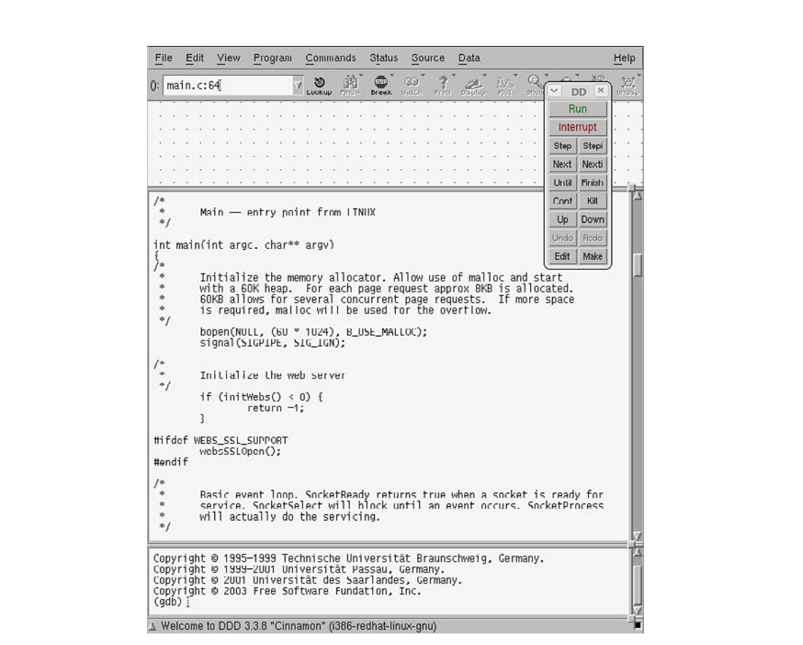
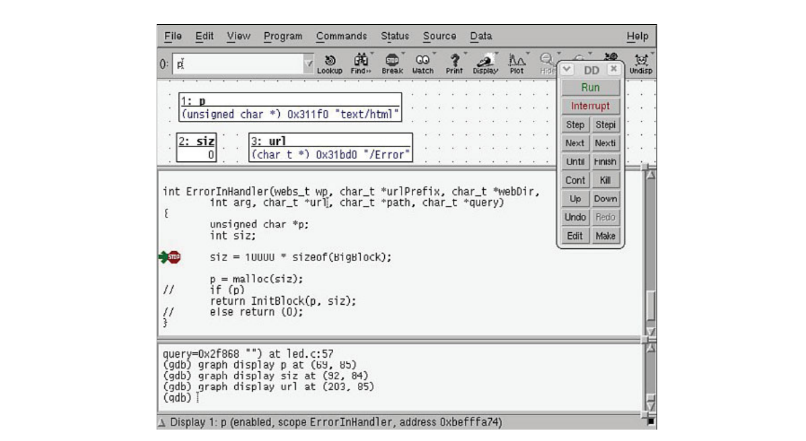
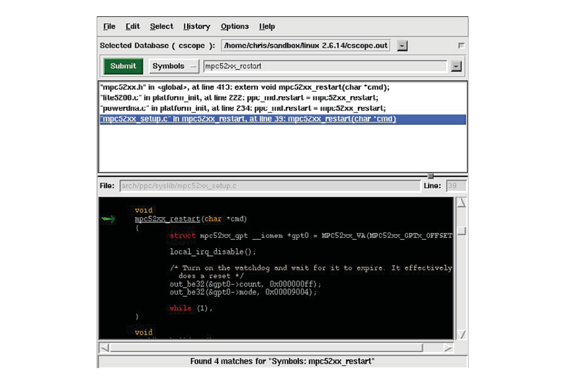
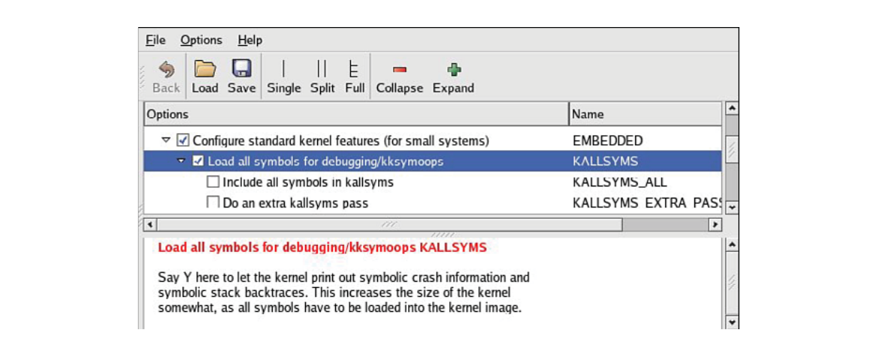

# Chương 13. Công cụ phát triển

## Trong chương này

- 13\.1 GNU Debugger (GDB) 326

- 13\.2 Data Display Debugger 333

- 13\.3 `cbrowser/cscope` 335

- 13\.4 Công cụ tracing và profiling 337

- 13\.5 Binary utility 355

- 13\.6 Các binary utility khác 361

- 13\.7 Tổng kết 364

Môi trường phát triển embedded Linux điển hình gồm nhiều công cụ hữu ích.

Một số phức tạp, cần thành thạo cao để làm chủ.

Số khác đơn giản và gần như bị lập trình viên embedded

bỏ qua. Một số có thể cần tùy chỉnh cho môi trường cụ thể.

Nhiều công cụ chạy được ngay và cung cấp thông tin hữu

ích mà không tốn nhiều công sức. Chương này trình bày cross-section của những công cụ

quan trọng nhất (và thường bị lãng quên) dành cho

kỹ sư embedded Linux.

Không thể cung cấp đầy đủ chi tiết công cụ, tiện ích trình bày

trong chương. Điều đó cần nguyên cuốn sách! Thay vì

tài liệu tham chiếu đầy đủ, mục tiêu là giới thiệu cách dùng cơ bản từng loại. Bạn

nên nghiên cứu thêm những công cụ này và công cụ phát triển

quan trọng khác. Man page (hoặc tài liệu khác) mỗi công cụ là nơi

khởi đầu rất tốt.

GNU Debugger (GDB) được giới thiệu đầu tiên, rồi xem ngắn gọn

Data Display Debugger, graphical front end cho GDB. Tiếp theo là loạt

tiện ích cho lập trình viên quan sát hành vi chương trình và

toàn hệ thống, gồm `strace`, `ltrace`, `top`, `ps`, thường bị

lập trình viên Linux ít kinh nghiệm bỏ qua. Sau đó trình bày một số công cụ crash dump

và memory-analysis. Chương kết thúc bằng giới thiệu một số

binary utility hữu ích hơn cả.

## 13.1 GNU Debugger (GDB)

Nếu dành nhiều thời gian phát triển Linux application, chắc chắn bạn dành nhiều giờ làm quen GNU Debugger. GDB có thể là công cụ quan trọng nhất trong bộ công cụ lập trình viên. Nó có lịch sử lâu dài và khả năng phát triển tới hỗ trợ debugging low-level hardware-specific cho nhiều architecture, microprocessor. Cần lưu ý GDB user manual gần lớn bằng sách này. Ở đây chỉ giới thiệu để bắt đầu. Bạn nên nghiên cứu user manual tham chiếu cuối chương.

Vì sách về embedded Linux development, chúng ta dùng GDB compile thành cross-debugger. Tức debugger chạy trên development host nhưng chỉ hiểu binary executable theo architecture được cấu hình lúc compile. Vài ví dụ sau dùng GDB compile cho Linux development host và target processor XScale (ARM). Dù dùng tên ngắn `gdb`, ví dụ dựa cross-gdb XScale-enabled từ Monta Vista embedded Linux distribution cho ARM XScale. Binary tên `xscale_be-gdb`. Vẫn là GDB nhưng cấu hình cho môi trường cross-development.

GDB debugger là chương trình phức tạp có nhiều configuration option khi build. Chúng ta không hướng dẫn build `gdb`, đã có tài liệu khác trình bày. Trong chương giả định bạn đã có GDB hoạt động, cấu hình đúng architecture và host development environment sẽ dùng.

### 13.1.1 Debug core dump

Lý do phổ biến nhất lấy GDB ra dùng là đánh giá core dump. Quá trình nhanh, dễ, thường xác định ngay code gây lỗi. Core dump là file kernel sinh khi application program gây fault, như truy cập memory location không sở hữu. Nhiều điều kiện kích hoạt core dump,[^1] nhưng SIGSEGV (segmentation fault) phổ biến nhất. SIGSEGV là Linux kernel signal sinh khi user process truy cập memory trái phép. Khi signal sinh, kernel kết thúc process rồi dump core image nếu được bật.

Để bật sinh core dump, process phải có quyền. Đạt bằng đặt resource limit qua C function call `setrlimit()` hoặc từ BASH/BusyBox shell command prompt bằng `ulimit`. Không hiếm gặp dòng sau trong initialization script embedded system để bật core dump khi process lỗi:

```
ulimit -c unlimited
```

Lệnh BASH built-in này đặt size limit core dump. Ở trên đặt `unlimited`. Có thể gọi lệnh sau từ shell để xem setting hiện tại:

```
$ ulimit
unlimited
```

Khi application program gây segmentation fault (ví dụ ghi memory address ngoài phạm vi cho phép), Linux kết thúc process và sinh core dump nếu bật. Core dump là snapshot process đang chạy tại thời điểm segmentation fault.

Bật debugging symbol trong binary sẽ hữu ích. GDB cho output hữu ích hơn nhiều nếu bật debugging symbol (`gcc -g`) khi build. Tuy nhiên vẫn có thể xác định chuỗi sự kiện dẫn tới segmentation fault ngay cả khi compile không debugging symbol. Có thể cần điều tra nhiều hơn nếu thiếu symbol. Khi đó phải tự liên hệ virtual address với vị trí trong chương trình.

Listing 13-1 cho kết quả phiên phân tích core dump bằng GDB. Output được format lại chút cho vừa trang. Dùng demonstration software cố ý gây segmentation fault. Đây là output process (tên webs) gây segmentation fault:

```
root@coyote:# ./webs
Segmentation fault (core dumped)
```

LISTING 13-1 Phân tích core dump bằng GDB

```
$ xscale_be-gdb webs core
GNU gdb 6.3 (MontaVista 6.3-20.0.22.0501131 2005-07-23)
Copyright 2004 Free Software Foundation, Inc.
GDB is free software, covered by the GNU General Public
License, and you are welcome to change it and/or distribute copies of it under
certain conditions.
Type “show copying” to see the conditions.
There is absolutely no warranty for GDB.  Type “show warranty” for details.
This GDB was configured as “--host=i686-pc-linux-gnu
-target=armv5teb-montavista-linuxeabi”...

Core was generated by ‘./webs’.
Program terminated with signal 11, Segmentation fault.
Reading symbols from /opt/montavista/pro/.../libc.so.6...done.
Loaded symbols for /opt/montavista/pro/.../libc.so.6
Reading symbols from /opt/montavista/pro/.../ld-linux.so.3...done.
Loaded symbols for /opt/montavista/pro/.../ld-linux.so.3
#0  0x00012ac4 in ClearBlock (RealBigBlockPtr=0x0, l=100000000) at led.c:43
43                      *ptr = 0;

(gdb) l
38
39    static int ClearBlock(char * BlockPtr, int l)
40    {
41        char * ptr;
42        for (ptr = BlockPtr; (ptr - BlockPtr) < l; ptr++)
43            *ptr = 0;
44        return 0;
45    }
46    static int InitBlock(char * ptr, int n)
47    {
(gdb) p ptr
$1 = 0x0
(gdb)
```

### 13.1.2 Gọi GDB

Dòng đầu Listing 13-1 cho cách gọi GDB từ command line. Vì cross-debugging, cần cross-version GDB compile cho host, target system. Gọi cross-gdb như thể hiện, truyền cho `xscale_be-gdb` tên binary rồi tên core dump file—ở đây chỉ `core`. Sau vài banner line mô tả cấu hình và thông tin khác, GDB hiển thị lý do kết thúc: signal 11, chỉ segmentation fault.[^2]

Một số dòng tiếp khi GDB load binary, library phụ thuộc và core file. Dòng cuối khi startup là vị trí chương trình lúc fault. Dòng bắt đầu string `#0` chỉ stack frame (stack frame zero trong function `ClearBlock()` tại virtual address `0x00012ac4`). Dòng tiếp bắt đầu `43` là số dòng source gây lỗi trong file `led.c`. Từ đó GDB hiện command prompt chờ input.

Để có context, nhập lệnh `gdb list` bằng dạng viết tắt `l`. GDB nhận dạng viết tắt không mơ hồ. Ở đây lỗi chương trình bắt đầu lộ ra. Đây là dòng gây lỗi theo phân tích core dump của GDB:

```
43            *ptr = 0;
```

Tiếp theo gọi `gdb print` cho variable `ptr`, viết tắt `p`. Như Listing 13-1, pointer `ptr` có giá trị `0`. Vì vậy kết luận segmentation fault do null pointer dereference điển hình, lỗi lập trình phổ biến nhiều ngôn ngữ. Từ đây có thể dùng backtrace xem call chain dẫn đến lỗi, có thể về nguồn lỗi. Listing 13-2 hiển thị kết quả.

LISTING 13-2 Lệnh backtrace

```
(gdb) bt
#0  0x00012ac4 in ClearBlock (RealBigBlockPtr=0x0, l=100000000) at led.c:43
#1  0x00012b08 in InitBlock (ptr=0x0, n=100000000) at led.c:48
#2  0x00012b50 in ErrorInHandler (wp=0x325c8, urlPrefix=0x2f648 “/Error”,
    webDir=0x2f660 “”, arg=0, url=0x34f30 “/Error”, path=0x34d68 “/Error”,
    query=0x321d8 “”) at led.c:61
#3  0x000126cc in websUrlHandlerRequest (wp=0x325c8) at handler.c:273
#4  0x0001f518 in websGetInput (wp=0x325c8, ptext=0xbefffc40,
    pnbytes=0xbefffc38) at webs.c:664
#5  0x0001ede0 in websReadEvent (wp=0x325c8) at webs.c:362
#6  0x0001ed34 in websSocketEvent (sid=1, mask=2, iwp=206280) at webs.c:319
#7  0x00019740 in socketDoEvent (sp=0x34fc8) at sockGen.c:903
#8  0x00019598 in socketProcess (sid=1) at sockGen.c:845
#9  0x00012be8 in main (argc=1, argv=0xbefffe14) at main.c:99
(gdb)
```

Backtrace hiển thị call chain ngược tới `main()`, đầu user program. Mỗi dòng bắt đầu stack frame number. Có thể chuyển stack frame bằng lệnh `gdb frame`. Listing 13-3 là ví dụ chuyển frame 2, hiển thị source code. Như ví dụ trước, dòng bắt đầu command prompt `(gdb)` là lệnh nhập, các dòng khác là output GDB.

LISTING 13-3 Di chuyển giữa stack frame trong GDB

```
(gdb) frame 2
#2  0x00012b50 in ErrorInHandler (wp=0x325c8, urlPrefix=0x2f648 “/Error”,
    webDir=0x2f660 “”, arg=0, url=0x34f30 “/Error”, path=0x34d68 “/Error”,
    query=0x321d8 “”) at led.c:61
61              return InitBlock(p, siz);
(gdb) l
56
57              siz = 10000 * sizeof(BigBlock);
58
59              p = malloc(siz);
60          /*  if (p) */
61                 return InitBlock(p, siz);
62          /*  else return (0);  */
63      }
64
65
(gdb)
```

Như thấy, với chút trợ giúp source code từ lệnh list, dễ trace ngược tới nguồn null pointer sai. Thực tế chú ý nguồn segmentation fault tạo trong ví dụ. Listing 13-3 thấy kiểm tra return value của `malloc()` đã comment bỏ. Trong ví dụ `malloc()` thất bại dẫn đến operation trên null pointer hai frame sau trong call chain. Dù ví dụ cố tình tạo, đơn giản, nhiều crash kiểu này dễ tìm bằng phương pháp tương tự với GDB, core dump. Cũng thấy null pointer qua parameter value trong function call. Điều này thường dẫn trực tiếp stack frame nơi null pointer xuất phát.

### 13.1.3 Debug session trong GDB

Kết thúc giới thiệu GDB bằng debug session điển hình. Với program crash trước, có thể chọn step qua code để khoanh vùng lỗi. Tất nhiên nếu có core dump, luôn bắt đầu ở đó. Nhưng tình huống khác có thể muốn breakpoint và step running code. Listing 13-4 chi tiết cách khởi động GDB chuẩn bị debug. Chú ý phải compile chương trình bật debug flag trên command line `gcc` để GDB hữu ích ở context này. Xem Hình 12-1 Chương 12, “Môi trường phát triển embedded”; đây là phiên cross-debug với GDB trên development host, debug chương trình trên target. Chi tiết đầy đủ remote application debugging ở Chương 15, “Debug ứng dụng embedded Linux”.

LISTING 13-4 Bắt đầu GDB debug session

```
$ xscale_be-gdb -silent webs

(gdb) target remote 192.168.1.21:2001
0x40000790 in ?? ()
(gdb) b main
Breakpoint 1 at 0x12b74: file main.c, line 78.
(gdb) c
Continuing.

Breakpoint 1, main (argc=1, argv=0xbefffe04) at main.c:78
78              bopen(NULL, (60 * 1024), B_USE_MALLOC);
(gdb) b ErrorInHandler
Breakpoint 2 at 0x12b30: file led.c, line 57.
(gdb) c
Continuing.

Breakpoint 2, ErrorInHandler (wp=0x311a0, urlPrefix=0x2f648 “/Error”,
    webDir=0x2f660 “”, arg=0, url=0x31e88 “/Error”, path=0x31918 “/Error”,
    query=0x318e8 “”) at led.c:57
57              siz = 10000 * sizeof(BigBlock);
(gdb) next
59              p = malloc(siz);
(gdb) next
61              return InitBlock(p, siz);
(gdb) p p
$1 =(unsigned char *) 0x0
(gdb) p siz
$2 =  100000000
(gdb)
```

Khảo sát session đơn giản, đầu tiên kết nối target board bằng lệnh `gdb target`. (Remote debugging chi tiết ở Chương 15.) Khi kết nối target hardware, đặt breakpoint tại `main()` bằng gdb break (viết tắt `b`). Sau đó gọi `gdb continue` (viết tắt `c`) để tiếp tục thực thi. Nếu có program argument, có thể đưa trên command line lúc gọi GDB.

Chạm breakpoint tại `main()`, rồi đặt breakpoint tại `ErrorInHandler()`, theo sau continue viết tắt. Khi chạm breakpoint mới, step code bằng lệnh `next`. Ở đó gặp `malloc()`. Sau lời gọi `malloc()`, kiểm tra return value thấy thất bại qua null return value. Cuối cùng in parameter của `malloc()` thấy request memory region rất lớn (100 triệu byte), khiến thất bại.

Dù đơn giản, ví dụ GDB phần này giúp người mới làm việc hiệu quả ngay. Ít người thực sự làm chủ GDB—nó phức tạp và nhiều khả năng. Phần 13.2, “Data Display Debugger”, giới thiệu graphical front end giúp chuyển tiếp dễ hơn nếu chưa quen GDB.

Một lưu ý cuối về GDB: chắc chắn bạn thấy nhiều banner line trên console lúc mới gọi, như Listing 13-1. Như nói trước, ví dụ dùng cross-gdb từ Monta Vista embedded Linux distribution. Banner chứa thông tin thiết yếu lập trình viên embedded phải biết: host specification và target specification của GDB. Listing 13-1 thấy output sau khi gọi GDB:

```
This GDB was configured as “--host=i686-pc-linux-gnu -
target=armv5teb-montavista-linuxeabi”
```

Ở đây gọi GDB compile chạy từ Linux PC—cụ thể i686 chạy GNU/Linux operating system. Quan trọng không kém, GDB này compile để debug ARM binary code sinh từ armv5teb big endian toolchain.

Lỗi phổ biến nhất của người mới embedded là dùng sai GDB khi debug target executable. Nếu có gì không đúng, kiểm tra ngay GDB configuration bảo đảm hợp môi trường. Không thể dùng native GDB để debug target code!

## 13.2 Data Display Debugger

Data Display Debugger (DDD), Hình 13-1, là graphical front end cho GDB và command-line debugger khác. DDD có nhiều tính năng nâng cao ngoài xem source code và step debug session.



HÌNH 13-1 Data Display Debugger

Gọi DDD như sau:

```
$ ddd --debugger xscale_be-gdb webs
```

Không có flag `--debugger`, DDD thử gọi native GDB trên development host. Đây không phải điều muốn nếu định debug ứng dụng target. Argument thứ hai trên DDD command line là chương trình debug. Xem man page DDD để thêm chi tiết.

Dùng command tool như Hình 13-1 để step chương trình. Có thể đặt breakpoint bằng đồ họa hoặc GDB console window dưới màn hình DDD. Để target debugging, đầu tiên phải nối debugger đến target system như Listing 13-4 bằng lệnh `target`. Lệnh gọi trong GDB window của DDD main screen.

Khi kết nối target, có thể thực thi lệnh tương tự chuỗi vừa thấy để cô lập program failure. Hình 13-2 cho DDD display giai đoạn sau của debug session này.



HÌNH 13-2 Debug session trong DDD

Chú ý Hình 13-2 đã bắt đầu hiển thị một số program variable quan trọng giúp khoanh vùng nguyên nhân segmentation fault. Có thể theo dõi variable khi step chương trình bằng command tool trong hình.

DDD là graphical front end mạnh cho GDB, tương đối dễ dùng, được hỗ trợ rộng trên nhiều development host. Tham khảo phần cuối để có link GNU DDD documentation.

Cần lưu ý theo thời gian Eclipse đã làm lu mờ (cố ý chơi chữ!) DDD để trở thành debugger được chọn. Không đủ chỗ trình bày Eclipse chi tiết. Tham chiếu cuối chương nếu muốn thêm thông tin.

## 13.3 cbrowser/cscope

Giới thiệu `cbrowser` vì hỗ trợ công cụ tiện này đã vào Linux kernel source tree. `cbrowser` là công cụ duyệt source-code đơn giản, giúp điều hướng source tree lớn theo symbol dễ dàng. Một số distribution như Ubuntu có `cbrowser` trong repository, nhưng số khác như Fedora gần đây thì không. Trên Ubuntu chỉ gõ:

```
$ sudo apt-get install cbrowser
```

Linux kernel makefile hỗ trợ build database mà `cbrowser` dùng. Đây là lời gọi mẫu từ Linux kernel snapshot gần đây:

```
$ make ARCH=powerpc CROSS_COMPILE=ppc_82xx- cscope
```

Điều này tạo symbol database `cscope` mà `cbrowser` dùng. `cscope` là engine; `cbrowser` là graphical user interface. Có thể dùng riêng `cscope`. Nó command-line-driven và mạnh nhưng không nhanh, dễ bằng để điều hướng source tree lớn trong thời point-and-click. Nếu `vi` vẫn là editor ưa thích, `cscope` có thể dành cho bạn!

Để gọi `cbrowser`, vào directory chứa database `cscope` rồi gõ lệnh `cbrowser` không argument. Hình 13-3 cho session mẫu. Đọc thêm hai công cụ trong tham chiếu cuối chương.



HÌNH 13-3 `cbrowser` hoạt động

## 13.4 Công cụ tracing và profiling

Nhiều công cụ hữu ích cho các góc nhìn hệ thống. Một số cho góc nhìn high-level, giúp biết process nào chạy, process nào dùng nhiều CPU bandwidth nhất. Số khác phân tích chi tiết như nơi cấp phát memory hoặc hữu ích hơn, nơi leak. Vài phần sau giới thiệu tool, utility quan trọng nhất nhóm này. Chỉ đủ chỗ giới thiệu sơ bộ, có tham chiếu khi thích hợp để biết thêm.

### 13.4.1 strace

`strace` là trace utility hữu ích trong gần như mọi Linux distribution. `strace` thu, hiển thị thông tin từng kernel system call mà Linux application program thực thi. `strace` đặc biệt tiện vì chạy trên chương trình không có source code. Không cần compile debug symbol như GDB. Hơn nữa `strace` là công cụ học rất sâu sắc. Như man page nói, “Sinh viên, hacker và người overly-curious sẽ học được nhiều về hệ thống và system call bằng trace ngay cả chương trình thông thường”.

Khi chuẩn bị sample software cho phần GDB trước, tôi chọn dự án lạ—bản GoAhead embedded web server cũ. Lần compile, link đầu dẫn tới ví dụ thú vị cho `strace`. Khởi chạy ứng dụng từ command line chỉ âm thầm trả quyền điều khiển console. Không error message, xem system log cũng không manh mối. Nó đơn giản không chạy.

`strace` nhanh chóng xác định vấn đề. Listing 13-5 cho output gọi `strace` trên ứng dụng. Nhiều dòng bị xóa vì dung lượng; output chưa sửa dài hơn trăm dòng.

LISTING 13-5 Output `strace`: GoAhead Web Demo

```
01 root@coyote:$ strace ./websdemo
02 execve(“./websdemo”, [“./websdemo”], [/* 14 vars */]) = 0
03 uname({sys=”Linux”, node=”coyote”, ...}) = 0
04 brk(0)                                  = 0x10031050
05 open(“/etc/ld.so.preload”, O_RDONLY)    = -1 ENOENT (No such file or
 directory)
06 open(“/etc/ld.so.cache”, O_RDONLY)      = -1 ENOENT (No such file or
 directory)
07 open(“/lib/libc.so.6”, O_RDONLY)        = 3
08 read(3, “\177ELF\1\2\1\0\0\0\0\0\0\0\0\0\0\3\0\24\0\0\0\1\0\1\322”..., 1024) =
1024
09 fstat64(0x3, 0x7fffefc8)                = 0
10 mmap(0xfe9f000, 1379388, PROT_READ|PROT_EXEC, MAP_PRIVATE, 3, 0) = 0xfe9f000
11 mprotect(0xffd8000, 97340, PROT_NONE)   = 0
12 mmap(0xffdf000, 61440, PROT_READ|PROT_WRITE|PROT_EXEC,MAP_PRIVATE|MAP_FIXED, 3,
0x130000) = 0xffdf000
13 mmap(0xffee000, 7228, PROT_READ|PROT_WRITE|PROT_EXEC,
MAP_PRIVATE|MAP_FIXED| MAP_ANONYMOUS, -1, 0) = 0xffee000
14 close(3)                                = 0
15 brk(0)                                  = 0x10031050
16 brk(0x10032050)                         = 0x10032050
17 brk(0x10033000)                         = 0x10033000
18 brk(0x10041000)                         = 0x10041000
19 rt_sigaction(SIGPIPE, {SIG_IGN}, {SIG_DFL}, 8) = 0
20 stat(“./umconfig.txt”, 0x7ffff9b8)      = -1 ENOENT (No such file or
directory)
21 uname({sys=”Linux”, node=”coyote”, ...}) = 0
22 gettimeofday({3301, 178955}, NULL)      = 0
23 getpid()                                = 156
24 open(“/etc/resolv.conf”, O_RDONLY)      = 3
25 fstat64(0x3, 0x7fffd7f8)                = 0
26 mmap(NULL, 4096, PROT_READ|PROT_WRITE, MAP_PRIVATE|MAP_ANONYMOUS, -1, 0) =
0x30017000
27 read(3, “#\n# resolv.conf  This file is th”..., 4096) = 83
28 read(3, “”, 4096)                       = 0
29 close(3)                                = 0
...   <<< Lines 30-81 removed for brevity
82 socket(PF_INET, SOCK_DGRAM, IPPROTO_IP) = 3
83 connect(3, {sa_family=AF_INET, sin_port=htons(53),
sin_addr=inet_addr(“0.0.0.0”)}, 28) = 0
84 send(3, “\267s\1\0\0\1\0\0\0\0\0\0\6coyotea\0\0\1\0\1”, 24, 0) = 24
85 gettimeofday({3301, 549664}, NULL)      = 0
86 poll([{fd=3, events=POLLIN, revents=POLLERR}], 1, 5000) = 1
87 ioctl(3, 0x4004667f, 0x7fffe6a8)        = 0
88 recvfrom(3, 0x7ffff1f0, 1024, 0, 0x7fffe668, 0x7fffe6ac) = -1
ECONNREFUSED (Connection refused)
89 close(3)                                = 0
90 socket(PF_INET, SOCK_DGRAM, IPPROTO_IP) = 3
91 connect(3, {sa_family=AF_INET, sin_port=htons(53),
sin_addr=inet_addr(“0.0.0.0”)}, 28) = 0
92 send(3, “\267s\1\0\0\1\0\0\0\0\0\0\6coyote\0\0\1\0\1”, 24, 0) = 24
93 gettimeofday({3301, 552839}, NULL)      = 0
494 poll([{fd=3, events=POLLIN, revents=POLLERR}], 1, 5000) = 1
95 ioctl(3, 0x4004667f, 0x7fffe6a8)        = 0
96 recvfrom(3, 0x7ffff1f0, 1024, 0, 0x7fffe668, 0x7fffe6ac) = -1
ECONNREFUSED (Connection refused)
97 close(3)                                = 0
98 exit(-1)                                = ?
99 root@coyote:/home/websdemo#
```

Số dòng được thêm vào output `strace` cho dễ đọc. Ứng dụng sinh dưới strace tại dòng 01. Dạng đơn giản nhất chỉ đặt lệnh `strace` ngay trước tên chương trình muốn khảo sát. Đó là cách tạo output Listing 13-5.

Mỗi dòng trace là kernel system call riêng mà ứng dụng `websdemo` gọi vào kernel. Không cần phân tích, hiểu từng dòng dù làm vậy rất bổ ích. Chúng ta tìm bất thường giúp xác định vì sao không chạy. Vài dòng đầu chuẩn bị environment. Thấy một số system call `open()` tới `/etc/ld.so.*`, chính Linux dynamic linker-loader (`ld.so`) làm việc. Thực tế dòng 06 gợi ý embedded board chưa cấu hình đúng. Nên tạo linker cache file bằng `ldconfig`. (Linker cache tăng mạnh tốc tìm shared library reference.) Sau đó giải quyết bằng chạy `ldconfig` trên target.[^3]

Đến dòng 19 là housekeeping cơ bản khác, chủ yếu loader và `libc` khởi tạo. Chú ý dòng 20 tìm configuration file nhưng không thấy. Có thể quan trọng khi phần mềm chạy. Từ dòng 24 chương trình thiết lập, cấu hình network resource cần. Dòng 24 tới 29 mở, đọc Linux system file chứa chỉ dẫn DNS service resolve hostname. Local network configuration tiếp tới dòng 81. Phần lớn là network setup, configuration cần tạo hạ tầng networking cho chương trình. Phần này bỏ cho ngắn, rõ.

Đặc biệt chú ý network activity từ dòng 82. Chương trình cố lập TCP/IP connection tới IP address toàn số 0. Dòng 82 tái hiện cho tiện:

```
socket(PF_INET, SOCK_DGRAM, IPPROTO_IP) = 3
```

Một số điểm Listing 13-5 đáng chú ý. Có thể không biết chi tiết mọi system call nhưng hình dung được tổng thể. System call `socket()` tương tự file system call `open()`. Return value sau dấu `=` ở đây biểu diễn Linux file descriptor. Nhờ đó liên kết hoạt động dòng 82 tới system call `close()` ở dòng 89 với file descriptor 3.

Quan tâm nhóm system call này vì thấy error message dòng 88: `Connection refused`. Lúc này chưa biết vì sao không chạy nhưng có vẻ bất thường. Hãy điều tra. Dòng 82 gọi `socket()` thiết lập endpoint cho IP communication. Dòng 83 lạ vì cố nối remote endpoint (socket) có IP address toàn 0. Không cần chuyên gia network để nghi gây vấn đề.[^4] Dòng 83 còn gợi ý quan trọng: port parameter 53. Tìm nhanh TCP/IP port number trên Internet cho biết port 53 là Domain Name Service (DNS).

Dòng 84 thêm manh mối. Board có hostname coyote, thấy trong command prompt dòng 01 Listing 13-5. Có vẻ đây là DNS lookup hostname board đang thất bại. Thử nghiệm thêm entry vào file `/etc/hosts`[^5] của target để liên kết hostname định nghĩa cục bộ với IP address gán cục bộ như sau:

```
coyote  192.168.1.21        #The IP address we assigned
```

Thế là chương trình hoạt động bình thường. Dù có thể không biết chính xác vì sao gây thất bại (chuyên gia TCP/IP networking có thể biết), output `strace` dẫn tới DNS lookup board name thất bại. Sửa xong chương trình khởi động vui vẻ, phục vụ web page. Nhắc lại đây là chương trình không có source code tham khảo, không symbol compile vào binary image. Dùng `strace` xác định được nguyên nhân và triển khai giải pháp.

### 13.4.2 Các biến thể strace

Tiện ích `strace` có nhiều command-line option. Hữu ích hơn cả là chọn tập con system call để trace. Ví dụ chỉ muốn network-related activity của process, gọi:

```
$ strace -e trace=network process_name
```

Điều này trace mọi system call network-related như `socket()`, `connect()`, `recvfrom()`, `send()`. Cách mạnh để xem network activity chương trình. Có nhiều tập con khác: chỉ file-related activity với `open()`, `close()`, `read()`, `write()`, v.v. Thêm các tập con system call process-related, signal-related, IPC-related.

Đáng lưu ý `strace` trace được chương trình sinh process khác. Gọi `strace` với option `-f` yêu cầu `strace` theo child process tạo bằng system call `fork()`. Lệnh `strace` có nhiều khả năng. Cách tốt nhất thành thạo là dùng. Hãy tìm, đọc open source documentation mới nhất cho công cụ này và các công cụ khác trình bày. Ở đây `man strace` trên phần lớn Linux host đủ tài liệu để thử cả buổi chiều!

Cách dùng `strace` rất hữu ích là option `-c`, tạo profiling high-level của ứng dụng. Dùng option `-c`, `strace` tích lũy statistic từng system call, số lần gặp, số lần trả lỗi, thời gian từng call. Listing 13-6 là ví dụ chạy `strace -c` trên webs demo trước.

LISTING 13-6 Profiling bằng `strace`

```
root@coyote$ strace -c ./webs
% time     seconds  usecs/call     calls    errors syscall
------ ----------- -----------  ---------  --------- --------
 29.80    0.034262         189       181           send
 18.46    0.021226        1011        21        10 open
 14.11    0.016221         130       125           read
 11.87    0.013651         506        27         8 stat64
  5.88    0.006762         193        35           select
  5.28    0.006072          76        80           fcntl64
  3.47    0.003994          65        61           time
  2.79    0.003205        3205         1           execve
  1.71    0.001970          90        22         3 recv
  1.62    0.001868          85        22           close
  1.61    0.001856         169        11           shutdown
  1.38    0.001586         144        11           accept
  0.41    0.000470          94         5           mmap2
  0.26    0.000301         100         3           mprotect
  0.24    0.000281          94         3           brk
  0.17    0.000194         194         1         1 access
  0.13    0.000150         150         1           lseek
  0.12    0.000141          47         3           uname
  0.11    0.000132         132         1           listen
  0.11    0.000128         128         1           socket
  0.09    0.000105          53         2           fstat64
  0.08    0.000097          97         1           munmap
  0.06    0.000064          64         1           getcwd
  0.05    0.000063          63         1           bind
  0.05    0.000054          54         1           setsockopt
  0.04    0.000048          48         1           rt_sigaction
  0.04    0.000046          46         1           gettimeofday
  0.03    0.000038          38         1           getpid
------ -----------  -----------  --------- --------- -----------
100.00    0.114985                   624        22 total
```

Đây là cách rất hữu ích có góc nhìn high-level nơi ứng dụng tiêu thời gian, nơi lỗi xảy ra. Một số lỗi có thể bình thường nhưng số khác tốn thời gian ngoài dự kiến. Từ Listing 13-6 thấy syscall lâu nhất là `execve()`, shell dùng sinh ứng dụng. Nó chỉ gọi một lần. Quan sát thú vị khác là system call `send()` được dùng thường xuyên nhất, hợp lý vì ứng dụng là web server nhỏ.

Nhớ như công cụ khác thảo luận, `strace` phải compile cho target architecture. `strace` thực thi trên target board, không phải development host. Phải dùng phiên bản tương thích architecture. Nếu mua commercial embedded Linux distribution, bảo đảm có tiện ích này cho architecture chọn.

### 13.4.3 ltrace

Tiện ích `ltrace`, `strace` liên quan chặt. `ltrace` làm cho library call điều `strace` làm cho system call. Gọi tương tự, đặt tracer utility trước chương trình cần trace:

```
$ ltrace ./example
```

Listing 13-7 tái hiện output `ltrace` trên chương trình mẫu nhỏ thực thi vài standard C library call.

LISTING 13-7 Output `ltrace` mẫu

```
$ ltrace ./example
__libc_start_main(0x8048594, 1, 0xbffff944, 0x80486b4, 0x80486fc <unfinished ...>
malloc(256)                                      = 0x804a008
getenv(“HOME”)                                   = “/home/chris”
strncpy(0x804a008, “/home”, 5)                   = 0x804a008
fopen(“foo.txt”, “w”)                            = 0x804a110
printf(“$HOME = %s\n”, “/home/chris”$HOME = /home/chris
)            = 20
fprintf(0x804a110, “$HOME = %s\n”, “/home/chris”) = 20
fclose(0x804a110)                                = 0
remove(“foo.txt”)                                = 0
free(0x804a008)                                  = <void>
+++ exited (status 0) +++
$
```

Với mỗi library call, hiển thị tên cùng những phần khác nhau của parameter. Tương tự `strace`, sau đó hiển thị return value. Như `strace`, có thể dùng khi không có source code.

Tương tự `strace`, nhiều switch ảnh hưởng hành vi `ltrace`. Có thể hiện program counter value mỗi library call, giúp hiểu program flow. Như `strace`, dùng `-c` tích lũy, báo count/error/time statistic, làm profiling tool đơn giản hữu ích. Listing 13-8 hiển thị kết quả chương trình mẫu với option `-c`.

LISTING 13-8 Profiling bằng `ltrace`

```
$ ltrace -c ./example
$HOME = /home/chris
% time     seconds  usecs/call     calls      function
------ -----------  ----------- --------- ----------------
 24.16    0.000231         231         1 printf
 16.53    0.000158         158         1 fclose
 16.00    0.000153         153         1 fopen
 13.70    0.000131         131         1 malloc
 10.67    0.000102         102         1 remove
  9.31    0.000089          89         1 fprintf
  3.35    0.000032          32         1 getenv
  3.14    0.000030          30         1 free
  3.14    0.000030          30         1 strncpy
------ ----------- ----------- --------- ----------------
 100.00    0.000956                     9 total
```

Công cụ `ltrace` chỉ dùng cho chương trình compile dùng dynamically linked shared library object. Đây thường mặc định nên trừ khi chỉ định `-static` lúc compile, có thể dùng `ltrace` trên binary kết quả. Tương tự `strace`, phải dùng binary `ltrace` compile cho target architecture. Các utility chạy trên target, không host development system.

### 13.4.4 ps

Có lẽ trừ `strace`, `ltrace`, không công cụ nào bị lập trình viên embedded bỏ quên thường hơn `top`, `ps`. Với vô số option từng loại, có thể dành nguyên chương cho công cụ system-profiling hữu ích này. Chúng gần như luôn có trên target ưa thích trong embedded Linux distribution.

Cả hai dùng file system `/proc` như Chương 9, “File system”. Nhiều thông tin chúng truyền có thể lấy từ file system `/proc` nếu biết tìm gì, parse kết quả thế nào. Công cụ trình bày theo dạng human-readable tiện lợi.

Tiện ích `ps` liệt kê mọi process đang chạy trên machine. Tuy nhiên rất linh hoạt, có thể điều chỉnh cung cấp nhiều dữ liệu hữu ích về trạng thái machine, process. Ví dụ `ps` hiển thị scheduling policy từng process, đặc biệt hữu ích hệ thống dùng real-time process.

Không option, `ps` hiển thị mọi process cùng user ID với user gọi lệnh và chỉ process gắn terminal gọi lệnh. Hữu ích khi user, terminal sinh nhiều job.

Truyền option cho `ps` có thể khó hiểu vì `ps` hỗ trợ nhiều chuẩn (POSIX so UNIX) và ba kiểu option: BSD, UNIX, GNU. Nhìn chung BSD dùng một hoặc nhiều chữ không dash, UNIX dùng tổ hợp dash-letter quen thuộc, GNU dùng long argument format có double dash trước. Tham khảo man page của implementation `ps`.

Ai dùng `ps` có lẽ có cách gọi ưa thích. Một cách general-purpose đặc biệt hữu ích là `ps aux`, hiển thị mọi process hệ thống. Listing 13-9 là ví dụ từ embedded target board đang chạy.

LISTING 13-9 Danh sách process

```
$ ps aux
USER      PID %CPU %MEM    VSZ   RSS TTY   STAT START   TIME COMMAND
root        1  0.0  0.8   1416   508 ?     S    00:00   0:00 init [3]
root        2  0.0  0.0      0     0 ?     S<   00:00   0:00 [ksoftirqd/0]
root        3  0.0  0.0      0     0 ?     S<   00:00   0:00 [desched/0]
root        4  0.0  0.0      0     0 ?     S<   00:00   0:00 [events/0]
root        5  0.0  0.0      0     0 ?     S<   00:00   0:00 [khelper]
root       10  0.0  0.0      0     0 ?     S<   00:00   0:00 [kthread]
root       21  0.0  0.0      0     0 ?     S<   00:00   0:00 [kblockd/0]
root       62  0.0  0.0      0     0 ?     S    00:00   0:00 [pdflush]
root       63  0.0  0.0      0     0 ?     S    00:00   0:00 [pdflush]
root       65  0.0  0.0      0     0 ?     S<   00:00   0:00 [aio/0]
root       36  0.0  0.0      0     0 ?     S    00:00   0:00 [kapmd]
root       64  0.0  0.0      0     0 ?     S    00:00   0:00 [kswapd0]
root      617  0.0  0.0      0     0 ?     S    00:00   0:00 [mtdblockd]
root      638  0.0  0.0      0     0 ?     S    00:00   0:00 [rpciod]
bin       834  0.0  0.7   1568   444 ?     Ss   00:00   0:00 /sbin/portmap
root      861  0.0  0.0      0     0 ?     S    00:00   0:00 [lockd]
root      868  0.0  0.9   1488   596 ?     Ss   00:00   0:00 /sbin/syslogd -r
root      876  0.0  0.7   1416   456 ?     Ss   00:00   0:00 /sbin/klogd -x
root      884  0.0  1.1   1660   700 ?     Ss   00:00   0:00 /usr/sbin/rpc.statd
root      896  0.0  0.9   1668   584 ?     Ss   00:00   0:00 /usr/sbin/inetd
root      909  0.0  2.2   2412  1372 ?     Ss+  00:00   0:00 -bash
telnetd   953  0.3  1.1   1736   732 ?     S    05:58   0:00 in.telnetd
root      954  0.2  2.1   2384  1348 pts/0 Ss   05:58   0:00 -bash
root      960  0.0  1.2   2312   772 pts/0 R+   05:59   0:00 ps aux
```

Đây chỉ một trong nhiều cách xem output bằng `ps`. Các cột như sau:

- Field USER và process ID (PID) là self-explanatory.

- Field %CPU biểu diễn phần trăm CPU utilization từ đầu vòng đời process; vì vậy tổng CPU usage gần như không bao giờ 100 phần trăm.

- Field %MEM chỉ tỷ lệ resident memory footprint của process so với tổng physical memory sẵn có.

- Field VSZ là virtual memory size process theo kilobyte.

- RSS là resident set size, chỉ nonswapped physical memory process dùng, cũng theo kilobyte.

- TTY là controlling terminal của process.

Phần lớn process ví dụ không gắn controlling terminal. Lệnh `ps` tạo Listing 13-9 gọi từ telnet session, như terminal device `pts/0` chỉ ra.

Field STAT mô tả trạng thái process lúc tạo snapshot. S nghĩa sleeping, đợi sự kiện thường là I/O. R nghĩa runnable (scheduler có thể giao CPU nếu không có thứ ưu tiên cao hơn đợi). Dấu ngoặc nhọn cạnh state letter chỉ process ưu tiên cao hơn.

Cột cuối là command name. Những tên trong ngoặc vuông là kernel thread. Có nhiều symbol, option hơn; tham khảo man page `ps` để đủ chi tiết.

### 13.4.5 top

Trong khi `ps` là snapshot one-time của hệ thống hiện tại, `top` chụp định kỳ trạng thái hệ thống, process. Tương tự `ps`, `top` có nhiều command-line option và configuration option. Nó tương tác, có thể cấu hình lại khi chạy để tùy chỉnh display theo nhu cầu.

Không option, `top` hiển thị mọi process tương tự lệnh `ps aux` ở Listing 13-9, cập nhật mỗi 3 giây. Tất nhiên điều này và nhiều khía cạnh khác của `top` đều user-configurable. Vài dòng đầu màn hình `top` hiển thị system information cũng cập nhật mỗi 3 giây, gồm uptime, số user, số process và trạng thái, nhiều hơn nữa.

Listing 13-10 cho `top` cấu hình mặc định, từ thực thi `top` trên command line không parameter.

LISTING 13-10 Display mặc định `top`

```
top - 06:23:14 up  6:23,  2 users,  load average: 0.00, 0.00, 0.00
Tasks:  24 total,   1 running,  23 sleeping,   0 stopped,   0 zombie
Cpu(s):  0.0% us,  0.3% sy,  0.0% ni, 99.7% id,  0.0% wa,  0.0% hi,  0.0% si
Mem:     62060k total,    17292k used,    44768k free,        0k buffers
Swap:        0k total,        0k used,        0k free,    11840k cached

  PID USER      PR  NI  VIRT  RES  SHR S %CPU %MEM    TIME+  COMMAND
  978 root      16   0  1924  952  780 R  0.3  1.5   0:01.22 top
    1 root      16   0  1416  508  452 S  0.0  0.8   0:00.47 init
    2 root       5 -10     0    0    0 S  0.0  0.0   0:00.00 ksoftirqd/0
    3 root       5 -10     0    0    0 S  0.0  0.0   0:00.00 desched/0
    4 root      -2  -5     0    0    0 S  0.0  0.0   0:00.00 events/0
    5 root      10  -5     0    0    0 S  0.0  0.0   0:00.09 khelper
   10 root      18  -5     0    0    0 S  0.0  0.0   0:00.00 kthread
   21 root      20  -5     0    0    0 S  0.0  0.0   0:00.00 kblockd/0
   62 root      20   0     0    0    0 S  0.0  0.0   0:00.00 pdflush
   63 root      15   0     0    0    0 S  0.0  0.0   0:00.00 pdflush
   65 root      19  -5     0    0    0 S  0.0  0.0   0:00.00 aio/0
   36 root      25   0     0    0    0 S  0.0  0.0   0:00.00 kapmd
   64 root      25   0     0    0    0 S  0.0  0.0   0:00.00 kswapd0
  617 root      25   0     0    0    0 S  0.0  0.0   0:00.00 mtdblockd
  638 root      15   0     0    0    0 S  0.0  0.0   0:00.34 rpciod
  834 bin       15   0  1568  444  364 S  0.0  0.7   0:00.00 portmap
  861 root      20   0     0    0    0 S  0.0  0.0   0:00.00 lockd
  868 root      16   0  1488  596  504 S  0.0  1.0   0:00.11 syslogd
  876 root      19   0  1416  456  396 S  0.0  0.7   0:00.00 klogd
  884 root      18   0  1660  700  612 S  0.0  1.1   0:00.02 rpc.statd
  896 root      16   0  1668  584  504 S  0.0  0.9   0:00.00 inetd
  909 root      15   0  2412 1372 1092 S  0.0  2.2   0:00.34 bash
  953 telnetd   16   0  1736  736  616 S  0.0  1.2   0:00.27 in.telnetd
  954 root      15   0  2384 1348 1096 S  0.0  2.2   0:00.16 bash
```

Cột mặc định Listing 13-10 là PID, user, process priority, process nice value, virtual memory process dùng, resident memory footprint, shared memory task dùng và field khác giống mô tả trong ví dụ `ps` trước.

Chỉ đủ chỗ giới thiệu sơ các utility. Bạn nên dành buổi chiều với man page `top`, `ps` để khám phá khả năng phong phú.

### 13.4.6 mtrace

`mtrace` là utility đơn giản phân tích, báo lời gọi `malloc()`, `realloc()`, `free()` trong ứng dụng. Dễ dùng, có thể giúp phát hiện vấn đề. Như userland tool khác trong chương, `mtrace` phải cấu hình, compile cho target architecture. `mtrace` là library thay thế `malloc` cài trên target. Ứng dụng bật bằng function call đặc biệt. Embedded Linux distribution nên có package `mtrace`.

Để minh họa, tạo chương trình đơn giản sinh dynamic data trên linked list đơn giản. Mỗi list item được sinh động, cũng như từng data item trên list. Listing 13-11 cho list structure đơn giản.

LISTING 13-11 Linear linked list đơn giản

```
struct blist_s {
  struct blist_s *next;
  char *data_item;
  int item_size;
  int index;
};
```

Mỗi list item được tạo động bằng `malloc()` như sau rồi đặt cuối linked list:

```
struct blist_s *p = malloc( sizeof(struct blist_s) );
```

Mỗi data item variable-sized trong list cũng được sinh động, thêm vào list item trước khi đặt cuối list. Như vậy mỗi list item tạo bằng hai lời gọi `malloc()`—một cho chính item biểu diễn bằng `struct` `blist_s` vừa nêu, một cho variable data item. Sau đó sinh 10.000 record trên list chứa variable string data, dẫn đến 20.000 lời gọi `malloc()`.

Để dùng `mtrace`, phải đáp ứng ba điều kiện:

- Source file phải include header file `mcheck.h`.

- Ứng dụng phải gọi `mtrace()` cài handler.

- Environment variable `MALLOC_TRACE` phải chỉ tên file ghi được để nhận trace data.

Đáp ứng xong, mỗi lời gọi function được trace sinh một dòng trong raw trace file do `MALLOC_TRACE` định nghĩa. Trace data như sau:

```
@ ./mt_ex:[0x80486ec] + 0x804a5f8 0x10
```

Dấu `@` báo trace line chứa address hoặc function name. Chương trình thực thi tại address trong ngoặc vuông `0x80486ec`. Dùng binary utility hoặc debugger dễ liên kết address với function. Dấu cộng (`+`) chỉ lời gọi cấp phát memory. Lời gọi `free()` dùng dấu trừ. Field tiếp chỉ virtual address memory location được cấp phát hoặc giải phóng. Field cuối là size, có trong mọi allocation call.

Data format này không user-friendly. Vì vậy tiện ích `mtrace` gồm utility phân tích raw trace data và báo bất nhất. Analysis utility là Perl script trong package `mtrace`. Đơn giản nhất Perl script in dòng `No memory leaks`. Listing 13-12 cho output khi phát hiện memory leak.

LISTING 13-12 Báo lỗi `mtrace`

```
$ mtrace ./mt_ex mtrace.log

Memory not freed:
-----------------
   Address     Size     Caller
0x0804aa70     0x0a  at /home/chris/temp/mt_ex.c:64
0x0804abc0     0x10  at /home/chris/temp/mt_ex.c:26
0x0804ac60     0x10  at /home/chris/temp/mt_ex.c:26
0x0804acc8     0x0a  at /home/chris/temp/mt_ex.c:64
```

Như thấy công cụ đơn giản giúp phát hiện vấn đề trước khi xảy ra và tìm khi xảy ra. Chú ý Perl script hiện filename, line number mỗi `malloc()` không có `free()` tương ứng cho memory location. Cần debugging information trong executable sinh bằng flag `-g` cho compiler. Nếu không thấy debug information, script chỉ báo address function gọi `malloc()`.

### 13.4.7 dmalloc

`dmalloc` tiếp tục nơi `mtrace` dừng. Package `mtrace` đơn giản, tương đối ít can thiệp, hữu ích nhất phát hiện mất cân bằng `malloc`/free. Package `dmalloc` cho phát hiện nhiều lỗi dynamic memory-management hơn. So `mtrace`, `dmalloc` can thiệp mạnh. Tùy configuration, `dmalloc` có thể khiến ứng dụng cực chậm. Chắc chắn không phù hợp nếu nghi memory error do race condition hay timing issue. `dmalloc` (và `mtrace` ở mức thấp hơn) chắc chắn đổi timing ứng dụng.

`dmalloc` là công cụ memory-analysis động rất mạnh, cấu hình cao nên hơi phức tạp. Cần thời gian học, làm chủ. Tuy nhiên từ QA testing tới sửa bug, có thể thành công cụ ưa thích.

`dmalloc` là debug library thay thế `malloc`. Để dùng `dmalloc`, phải đáp ứng:

- Application code phải include header file `dmalloc.h`.

- Ứng dụng phải link với library `dmalloc`.

- Library, utility `dmalloc` phải cài trên embedded target.

- Một số environment variable mà library `dmalloc` tham chiếu phải định nghĩa trước khi chạy ứng dụng trên target.

Dù không bắt buộc, nên include `dmalloc.h` trong application program để `dmalloc` đưa file, line number vào output.

Link ứng dụng với library `dmalloc` chọn. Package `dmalloc` có thể cấu hình sinh nhiều library tùy lựa chọn lúc configuration. Các ví dụ dùng shared library object `libdmalloc.` `so`. Đặt library (hoặc symlink) ở path compiler tìm được. Lệnh compile có thể như sau:

```
$ ppc_82xx-gcc -g -Wall -o mtest_ex -L../dmalloc-5.4.2/ -ldmalloc mtest_ex.c
```

Command line giả định đặt library `dmalloc` (`libdmalloc.` `so`) tại vị trí switch `-L` tìm—cụ thể `../dmalloc-5.4.2` ngay trên current directory.

Để cài library `dmalloc` lên target, đặt vị trí ưa thích (có thể `/usr/local/lib`). Có thể cần cấu hình hệ thống tìm. Trên Power Architecture system mẫu, thêm path `/usr/local/lib` vào file `/etc/ld.so.conf` và gọi utility `ldconfig` cập nhật library search cache.

Bước chuẩn bị cuối là đặt environment variable library `dmalloc` dùng xác định mức debugging bật. Variable chứa debug bit mask kết hợp nhiều tính năng vào một variable tiện. Có thể như sau:

```
DMALLOC_OPTIONS=debug=0x4f4ed03,inter=100,log=dmalloc.log
```

Ở đây `debug` là bit mask debug-level, `inter` đặt interval count để library `dmalloc` kiểm tra sâu chính nó, heap. Library `dmalloc` ghi log output vào file variable `log` chỉ.

Package `dmalloc` có utility sinh environment variable `DMALLOC_OPTIONS` dựa trên flag truyền. Documentation package `dmalloc` trình bày kỹ nên không lặp ở đây. Ví dụ trên sinh bằng lời gọi `dmalloc` sau:

```
$ dmalloc -p check-fence -l dmalloc.log -i 100 high
```

Xong các bước, có thể chạy ứng dụng với debug library `dmalloc`.

`dmalloc` tạo output log khá chi tiết. Listing 13-13 cho log output `dmalloc` mẫu của chương trình cố ý gây memory leak.

LISTING 13-13 Log output `dmalloc`

```
2592: 4002: Dmalloc version ‘5.4.2’ from ‘http://dmalloc.com/’
2592: 4002: flags = 0x4f4e503, logfile ‘dmalloc.log’
2592: 4002: interval = 100, addr = 0, seen # = 0, limit = 0
2592: 4002: starting time = 2592
2592: 4002: process pid = 442
2592: 4002: Dumping Chunk Statistics:
2592: 4002: basic-block 4096 bytes, alignment 8 bytes
2592: 4002: heap address range: 0x30015000 to 0x3004f000, 237568 bytes
2592: 4002:     user blocks: 18 blocks, 73652  bytes (38%)
2592: 4002:    admin blocks: 29 blocks, 118784 bytes (61%)
2592: 4002:    total blocks: 47 blocks, 192512 bytes
2592: 4002: heap checked 41
2592: 4002: alloc calls: malloc 2003, calloc 0, realloc 0, free 1999
2592: 4002: alloc calls: recalloc 0, memalign 0, valloc 0
2592: 4002: alloc calls: new 0, delete 0
2592: 4002:   current memory in use: 52 bytes (4 pnts)
2592: 4002:  total memory allocated: 27546 bytes (2003 pnts)
2592: 4002:  max in use at one time: 27546 bytes (2003 pnts)
2592: 4002: max alloced with 1 call: 376 bytes
2592: 4002: max unused memory space: 37542 bytes (57%)
2592: 4002: top 10 allocations:
2592: 4002:  total-size  count in-use-size  count  source
2592: 4002:       16000   1000          32      2  mtest_ex.c:36
2592: 4002:       10890   1000          20      2  mtest_ex.c:74
2592: 4002:         256      1           0      0  mtest_ex.c:154
2592: 4002:       27146   2001          52      4  Total of 3
2592: 4002: Dumping Not-Freed Pointers Changed Since Start:
2592: 4002:  not freed: ‘0x300204e8|s1’ (10 bytes) from ‘mtest_ex.c:74’
2592: 4002:  not freed: ‘0x30020588|s1’ (16 bytes) from ‘mtest_ex.c:36’
2592: 4002:  not freed: ‘0x30020688|s1’ (16 bytes) from ‘mtest_ex.c:36’
2592: 4002:  not freed: ‘0x300208a8|s1’ (10 bytes) from ‘mtest_ex.c:74’
2592: 4002:  total-size  count  source
2592: 4002:          32      2  mtest_ex.c:36
2592: 4002:          20      2  mtest_ex.c:74
2592: 4002:          52      4  Total of 2
2592: 4002: ending time = 2592, elapsed since start = 0:00:00
```

Quan trọng log này sinh khi chương trình exit. (`dmalloc` có nhiều option, mode; có thể cấu hình `dmalloc` in output line khi phát hiện lỗi.)

Nửa đầu log báo statistic high-level về heap, overall memory usage ứng dụng. Có tổng cho từng library call `malloc` như `malloc()`, `free()`, `realloc()`. Thú vị log mặc định báo mười allocation lớn nhất và source location xảy ra. Rất hữu ích cho profiling system-level tổng thể.

Gần cuối log thấy memory leak trong ứng dụng. Library `dmalloc` phát hiện bốn instance memory cấp phát nhưng có vẻ chưa giải phóng. Vì include `dmalloc.h` và compile debug symbol, dmalloc đưa source location cấp phát vào log.

Như công cụ khác trong chương, chỉ đủ chỗ giới thiệu ngắn công cụ debug mạnh này. `dmalloc` phát hiện nhiều điều kiện, giới hạn khác. Ví dụ `dmalloc` phát hiện ghi vào freed pointer. Cho biết pointer dùng truy cập ngoài boundary nhưng trong address range ứng dụng cho phép. Thực tế `dmalloc` có thể cấu hình log gần mọi memory transaction qua họ lời gọi `malloc`. `dmalloc` chắc chắn trả lại nhiều lần công sức học thành thạo.

### 13.4.8 Kernel oops

Dù không thực sự là công cụ, kernel oops chứa nhiều thông tin hữu ích khắc phục nguyên nhân. Kernel oops do nhiều kernel error, từ memory error đơn giản của process (đa số khôi phục hoàn toàn) tới hard kernel panic. Linux kernel gần đây hỗ trợ hiển thị symbolic information ngoài raw hexadecimal address. Listing 13-14 cho kernel oops từ Power Architecture target.

LISTING 13-14 Kernel oops display

```
$ modprobe loop
Oops: kernel access of bad area, sig: 11 [#1]
NIP: C000D058 LR: C0085650 SP: C7787E80 REGS: c7787dd0 TRAP: 0300  Not tainted
MSR: 00009032 EE: 1 PR: 0 FP: 0 ME: 1 IR/DR: 11
DAR: 00000000, DSISR: 22000000
TASK = c7d187b0[323] ‘modprobe’ THREAD: c7786000
Last syscall: 128
GPR00: 0000006C C7787E80 C7D187B0 00000000 C7CD25CC FFFFFFFF 00000000 80808081
GPR08: 00000001 C034AD80 C036D41C C034AD80 C0335AB0 1001E3C0 00000000 00000000
GPR16: 00000000 00000000 00000000 100170D8 100013E0 C9040000 C903DFD8 C9040000
GPR24: 00000000 C9040000 C9040000 00000940 C778A000 C7CD25C0 C7CD25C0 C7CD25CC
NIP [c000d058] strcpy+0x10/0x1c
LR [c0085650] register_disk+0xec/0xf0
Call trace:
 [c00e170c] add_disk+0x58/0x74
 [c90061e0] loop_init+0x1e0/0x430 [loop]
 [c002fc90] sys_init_module+0x1f4/0x2e0
 [c00040a0] ret_from_syscall+0x0/0x44
Segmentation fault
```

Chú ý register dump gồm symbolic information khi thích hợp. Kernel phải bật `KALLSYMS` để có. Hình 13-4 cho configuration option dưới main menu General Setup.



HÌNH 13-4 Hỗ trợ symbol cho oops

Nhiều thông tin kernel oops liên quan trực tiếp processor. Cần kiến thức architecture bên dưới để hiểu đầy đủ.

Phân tích oops Listing 13-14, thấy ngay do “kernel access of bad area, sig: 11”. Từ ví dụ trước biết signal 11 là segmentation fault.

Phần đầu tóm tắt lý do oops, vài pointer quan trọng, task gây lỗi. Trong Listing 13-14 NIP là next instruction pointer, được decode sau trong oops message. Nó trỏ code gây lỗi. LR là Power Architecture register, thường chỉ return address của subroutine đang thực thi. SP là stack pointer. REGS chỉ kernel address của data structure chứa register dump data. TRAP chỉ exception type mà oops liên quan. Tham khảo PowerPC architecture user manual cuối Chương 7, “Bootloader”, thấy TRAP 0300 là Data Storage Interrupt, kích hoạt bởi data memory access error.

Dòng thứ ba oops có thêm Power Architecture machine register như MSR (machine state register), decode một số bit. Dòng tiếp có DAR (data access register), thường chứa memory address gây lỗi. Nội dung DSISR register kết hợp PowerPC architecture reference giúp tìm nhiều chi tiết nguyên nhân exception.

Oops message còn chứa task pointer, decoded task name để nhanh biết task/thread chạy lúc oops. Cũng thấy processor register dump chi tiết, dùng thêm manh mối. Một lần nữa cần kiến thức architecture và compiler register usage để hiểu register value. Ví dụ PowerPC architecture dùng register r3 cho return value function C.

Phần cuối oops cung cấp stack backtrace có symbol decode nếu kernel bật symbol. Dùng thông tin này dựng chuỗi sự kiện dẫn tới điều kiện lỗi.

Trong ví dụ đơn giản học được nhiều từ oops. Biết đó là Power Architecture Data Storage Exception do lỗi data memory access (không phải instruction fetch memory access). DAR cho data address gây exception là `0x0000_0000`. Biết process `modprobe` gây lỗi. Từ backtrace, NIP (next instruction pointer), biết trong lời gọi `strcpy()` trace thẳng về function `loop_init()` trong module `loop.ko` mà `modprobe` cố insert khi exception xảy ra. Với thông tin này, tìm nguồn null pointer dereference sai hẳn dễ.

## 13.5 Binary utility

Binary utility, hay binutils, là thành phần thiết yếu mọi toolchain. Thực tế để build compiler phải build binutils thành công trước. Phần này giới thiệu ngắn công cụ hữu ích hơn mà lập trình viên embedded cần biết. Như phần lớn công cụ khác trong chương, đây là cross-utilities, phải build chạy trên development host nhưng xử lý binary file cho architecture chọn. Hoặc compile/lấy phiên bản chạy trên target, nhưng ví dụ giả định môi trường cross-development.

### 13.5.1 readelf

Tiện ích `readelf` khảo sát thành phần target ELF binary file. Đặc biệt hữu ích tạo image cho ROM/Flash memory cần kiểm soát image layout rõ ràng. Cũng rất tốt để học cách toolchain build image, hiểu ELF file format.

Ví dụ hiển thị symbol table trong ELF image bằng lệnh:

```
$ readelf -s <elf-image>
```

Để tìm, hiển thị mọi section trong ELF image, dùng:

```
$ readelf -e <elf-image>
```

Dùng flag `-S` liệt kê section header trong ELF image. Có thể ngạc nhiên ngay chương trình “Hello World” seven-line chứa 38 section riêng. Một số quen như `.text`, `.data`. Listing 13-15 liệt kê một phần section của ví dụ “Hello World”. Cho đơn giản chỉ liệt kê section có lẽ quen hoặc liên quan lập trình viên embedded.

LISTING 13-15 Section header từ `readelf`

```
$ ppc_82xx-readelf -S  hello-ex
There are 38 section headers, starting at offset 0x32f4:

Section Headers:
[ Nr] Name        Type        Addr     Off    Size   ES Flg Lk Inf Al
...
 [11] .text       PROGBITS    100002f0 0002f0 000568 00  AX  0   0  4
...
 [13] .rodata     PROGBITS    10000878 000878 000068 00   A  0   0  4
...
 [15] .data       PROGBITS    100108e0 0008e0 00000c 00  WA  0   0  4
...
 [22] .sdata      PROGBITS    100109e0 0009e0 00001c 00  WA  0   0  4
 [23] .sbss       NOBITS      100109fc 0009fc 000000 00  WA  0   0  1
...
 [25] .bss        NOBITS      10010a74 0009fc 00001c 00  WA  0   0  4
...
```

Section `.text` chứa executable program code. Section `.rodata` chứa constant data. Section `.data` thường chứa initialized global data dùng bởi C library prologue code, có thể chứa initialized data item lớn của ứng dụng. Section `.sdata` dùng cho initialized global data item nhỏ hơn, chỉ có ở một số architecture. Một số processor architecture dùng optimized data access khi biết memory area attribute. Section `.sdata`, `.sbss` cho phép tối ưu này. Section `.bss`, `.sbss` chứa uninitialized data. Chúng không chiếm chỗ trong program image. Memory space được cấp phát, khởi tạo 0 lúc startup bằng C library prologue code.

Có thể dump section bất kỳ, hiển thị nội dung. Với dòng sau trong chương trình C khai báo ngoài mọi function, có thể khảo sát cách đặt trong section `.rodata`:

```
char *hello_rodata = “This is a read-only data string\n”;
```

Gọi lệnh `readelf` chỉ định section number muốn dump từ Listing 13-15:

```
$ ppc_82xx-readelf -x 13 hello-ex
Hex dump of section ‘.rodata’:
  0x10000878 100189e0 10000488 1000050c 1000058c ................
  0x10000888 00020001 54686973 20697320 61207265 ....This is a read-
  0x10000898 61642d6f 6e6c7920 64617461 20737472 only data string
  0x100008a8 696e670a 00000000 54686973 20697320 .....This is
  0x100008b8 73746174 69632064 6174610a 00000000 static data.....
  0x100008c8 48656c6c 6f20456d 62656464 65640a00 Hello Embedded..
  0x100008d8 25730a00 25780a00                   %s..%x..
```

Thấy initialized global variable đã khai báo được biểu diễn trong section `.rodata`, cùng mọi constant string định nghĩa trong chương trình.

### 13.5.2 Khảo sát debug information bằng readelf

Một tính năng hữu ích hơn của `readelf` là hiện debug information trong ELF file. Khi đưa compiler flag `-g` lúc compile, compiler sinh debug information trong loạt section của ELF file kết quả. Có thể dùng `readelf` hiển thị ELF section header bên trong file:

```
$ ppc-linux-readelf -S ex_sync | grep debug
  [28] .debug_aranges    PROGBITS   00000000 000c38 0000b8 00   0   0  8
  [29] .debug_pubnames   PROGBITS   00000000 000cf0 00007a 00   0   0  1
  [30] .debug_info       PROGBITS   00000000 000d6a 00079b 00   0   0  1
  [31] .debug_abbrev     PROGBITS   00000000 001505 000207 00   0   0  1
  [32] .debug_line       PROGBITS   00000000 00170c 000354 00   0   0  1
  [33] .debug_frame      PROGBITS   00000000 001a60 000080 00   0   0  4
  [34] .debug_str        PROGBITS   00000000 001ae0 00014d 00   0   0  1
```

Dùng `readelf` với option `--debug-dump` hiển thị nội dung bất kỳ section `.debug_*`. Bạn sẽ thấy thông tin hữu ích thế nào trong Chương 14, “Kỹ thuật debug kernel”, khi thảo luận khó khăn debug optimized kernel code.

Debug information có thể rất lớn. Hiển thị toàn bộ debug information trong Linux kernel ELF file `vmlinux` tạo hơn sáu triệu dòng output. Dù có vẻ đáng ngại, ít nhất quen debug information giúp bạn thành kỹ sư embedded tốt hơn.

Listing 13-16 là phần nội dung section `.debug_info` từ ứng dụng mẫu nhỏ. Vì dung lượng, chỉ cho vài record.

LISTING 13-16 Một phần debug info dump

```
$ ppc-linux-readelf -debug-dump=info ex_sync
1 The section .debug_info contains:
2
3   Compilation Unit @ 0:
4    Length:        109
5    Version:       2
6    Abbrev Offset: 0
7    Pointer Size:  4
8  <0><b>: Abbrev Number: 1 (DW_TAG_compile_unit)
9      DW_AT_stmt_list   : 0
10      DW_AT_low_pc      : 0x10000368
11      DW_AT_high_pc     : 0x1000038c
12      DW_AT_name        :
../sysdeps/powerpc/powerpc32/elf/start.S
13      DW_AT_comp_dir    : /var/tmp/BUILD/glibc-2.3.3/csu
14      DW_AT_producer    : GNU AS 2.15.94
15      DW_AT_language    : 32769  (MIPS assembler)
...
394  <1><5a1>: Abbrev Number: 14 (DW_TAG_subprogram)
395      DW_AT_sibling     : <5fa>
396      DW_AT_external    : 1
397      DW_AT_name        : main
398      DW_AT_decl_file   : 1
399      DW_AT_decl_line   : 9
400      DW_AT_prototyped  : 1
401      DW_AT_type        : <248>
402      DW_AT_low_pc      : 0x100004b8
403      DW_AT_high_pc     : 0x10000570
404      DW_AT_frame_base  : 1 byte block: 6f       (DW_OP_reg31)
...
423  <2><5e9>: Abbrev Number: 16 (DW_TAG_variable)
424      DW_AT_name        : mybuf
425      DW_AT_decl_file   : 1
426      DW_AT_decl_line   : 11
427      DW_AT_type        : <600>
428      DW_AT_location    : 2 byte block: 91 20    (DW_OP_fbreg: 32)
...
```

Record đầu có tag Dwarf2[^6] `DW_TAG_compile_unit` nhận diện compilation unit đầu của Power Architecture executable. Là file `start.S`, cung cấp startup prologue cho chương trình C. Record tiếp có `DW_TAG_subprogram` chỉ đầu user program, function `main()` quen thuộc. Dwarf2 debug record chứa reference file, line number có `main()`. Record cuối Listing 13-16 nhận diện local variable trong routine `main()` tên `mybuf`. Một lần nữa có line number, file. Có thể suy ra `main()` tại dòng 9, `mybuf` dòng 11 source file. Debug record khác trong ELF file liên hệ filename qua Dwarf2 attribute `DW_AT_decl_file`.

Có thể tìm đầy đủ Dwarf2 debug information format qua tham chiếu cuối chương.

### 13.5.3 objdump

Tiện ích `objdump` chồng lấn đáng kể với `readelf`. Tuy nhiên tính năng hữu ích hơn của `objdump` là hiện disassembled object code. Listing 13-17 minh họa disassembly section `.text` của “Hello World” Power Architecture đơn giản. Chỉ đưa routine `main()` để tiết kiệm chỗ. Toàn dump gồm C library prologue, epilogue sẽ chiếm nhiều trang.

LISTING 13-17 Disassembly bằng `objdump`

```
$ ppc_82xx-objdump -S -m powerpc:common -j .text hello
...
10000488 <main>:
10000488:       94 21 ff e0     stwu    r1,-32(r1)
1000048c:       7c 08 02 a6     mflr    r0
10000490:       93 e1 00 1c     stw     r31,28(r1)
10000494:       90 01 00 24     stw     r0,36(r1)
10000498:       7c 3f 0b 78     mr      r31,r1
1000049c:       90 7f 00 08     stw     r3,8(r31)
100004a0:       90 9f 00 0c     stw     r4,12(r31)
100004a4:       3d 20 10 00     lis     r9,4096
100004a8:       38 69 08 54     addi    r3,r9,2132
100004ac:       4c c6 31 82     crclr   4*cr1+eq
100004b0:       48 01 05 11     bl      100109c0
<__bss_start+0x60>
100004b4:       38 00 00 00     li      r0,0
100004b8:       7c 03 03 78     mr      r3,r0
100004bc:       81 61 00 00     lwz     r11,0(r1)
100004c0:       80 0b 00 04     lwz     r0,4(r11)
100004c4:       7c 08 03 a6     mtlr    r0
100004c8:       83 eb ff fc     lwz     r31,-4(r11)
100004cc:       7d 61 5b 78     mr      r1,r11
100004d0:       4e 80 00 20     blr
...
```

Phần lớn code routine `main()` đơn giản là tạo, hủy stack frame. Lời gọi thực `printf()` biểu diễn bằng branch link instruction (`bl`) gần giữa listing tại address `0x100004b0`. Đây là Power Architecture function call. Vì compile chương trình làm dynamically linked object, chưa có address function `printf()` tới runtime, khi link với shared library routine `printf()`. Nếu compile tĩnh sẽ thấy symbol và address tương ứng cho lời gọi `printf()`.

### 13.5.4 objcopy

`objcopy` định dạng và tùy chọn chuyển format binary object file. Utility rất hữu ích sinh code cho image nằm ROM/Flash. Bootloader U-Boot Chương 7 dùng `objcopy` tạo output binary, s-record[^7] từ ELF file cuối. Cách dùng mẫu minh họa khả năng `objcopy` và dùng tạo Flash image:

```
$ ppc_82xx-objcopy --gap-fill=0xff -O binary u-boot u-boot.bin
```

Lời gọi `objcopy` này cho cách chuẩn bị image cho Flash memory. Input file—ở đây `u-boot`—là ELF U-Boot image đầy đủ gồm symbol, relocation information. Tiện ích `objcopy` chỉ lấy section liên quan chứa program code, data rồi đặt image trong output file, ở đây `u-boot.bin`.

Flash memory chứa toàn bit 1 khi đã xóa. Vì thế lấp gap binary image bằng toàn bit 1 tăng hiệu quả lập trình và kéo dài tuổi thọ Flash vốn giới hạn write cycle. Thực hiện bằng parameter `--gap-fill` cho `objcopy`.

Đây chỉ một ví dụ đơn giản dùng `objcopy`. Utility còn sinh s-records và chuyển format. Xem man page để đủ chi tiết.

## 13.6 Các binary utility khác

Toolchain chứa thêm một số utility hữu ích. Học dùng đơn giản. Bạn sẽ tìm nhiều công dụng cho chúng.

### 13.6.1 strip

Tiện ích `strip` loại symbol, debug information khỏi binary, thường dùng tiết kiệm chỗ trên embedded device. Trong model cross-development, tiện đặt stripped binary trên target, giữ unstripped version trên development host. Như vậy có symbol để cross-debugging trên host mà tiết kiệm target. `strip` có nhiều option mô tả trong man page.

### 13.6.2 addr2line

Khi nêu `mtrace` trong Listing 13-12, bạn thấy output analysis script `mtrace` chứa file, line number. Perl script `mtrace` dùng tiện ích `addr2line` đọc debug information trong executable ELF file, hiện line number tương ứng address. Dùng cùng sample executable `mtrace`, có thể tìm filename, line number cho virtual address:

```
$ addr2line -f -e mt_ex 0x80487c6
     put_data
     /home/chris/examples/mt_ex.c:64
```

Chú ý function `put_data()` cũng được liệt kê cùng file, line number. Nghĩa là address `0x80487c6` ở dòng 64 file `mt_ex.c`, trong function `put_data()`. Hữu ích hơn với binary lớn gồm nhiều filename như Linux kernel:

```
$ ppc_82xx-addr2line -f -e vmlinux c000d95c
     mpc52xx_restart
     arch/ppc/syslib/mpc52xx_setup.c:41
```

Ví dụ nhấn mạnh điểm lặp xuyên chương: đây là tool architecture-specific. Phải dùng tool cấu hình, compile khớp architecture target binary. Như cross-compiler, `addr2line` là cross tool thuộc binary utilities package.

### 13.6.3 strings

Tiện ích `strings` khảo sát ASCII string data trong binary file. Đặc biệt hữu ích xem memory dump khi không có source code hoặc debug symbol. Thường có thể khoanh vùng nguyên nhân crash bằng trace string về binary gây lỗi. Dù `strings` có vài command-line option, dễ học, dùng. Xem man page thêm chi tiết.

### 13.6.4 ldd

Dù không hoàn toàn binary utility, script `ldd` là công cụ hữu ích khác cho embedded developer. Thuộc C library package, có trên gần mọi Linux distribution. `ldd` liệt kê shared object library dependency cho object file hoặc nhiều file. Đã giới thiệu `ldd` trong Chương 11, “BusyBox”. Xem Listing 11-2 ví dụ. Script `ldd` đặc biệt hữu ích khi phát triển ramdisk image. Lỗi phổ biến nhất hỏi trên embedded Linux mailing list là kernel panic sau mount root:

```
VFS: Mounted root (nfs filesystem).
Freeing unused kernel memory: 96k init
Kernel panic - not syncing: No init found.  Try passing init=option to kernel.
```

Nguyên nhân phổ biến nhất là root file system image (ramdisk, Flash hay NFS) không có library hỗ trợ binary kernel cố thực thi. Dùng `ldd` xác định mỗi binary cần library nào và bảo đảm thêm vào ramdisk/root file system image. Trong panic mẫu trước, `init` có trên file system nhưng thiếu Linux dynamic loader `ld.so.1`. Dùng `ldd` khá đơn giản:

```
$ xscale_be-ldd init
    libc.so.6 => /opt/mvl/.../lib/libc.so.6 (0xdead1000)
    ld-linux.so.3 => /opt/mvl/.../lib/ld-linux.so.3 (0xdead2000)
```

Ví dụ cho binary `init` cần hai dynamic library object: libc và ld-linux. Cả hai phải trên target, init binary truy cập được—tức readable, executable.

### 13.6.5 nm

Tiện ích `nm` hiển thị symbol từ object file, hữu ích nhiều tác vụ. Ví dụ khi cross-compiling ứng dụng lớn gặp unresolved symbol, có thể dùng `nm` tìm object module chứa symbol, sửa build environment include nó.

Tiện ích `nm` cung cấp attribute từng symbol. Ví dụ biết symbol local/global, được defined hay chỉ referenced trong object module cụ thể. Listing 13-18 tái hiện vài dòng output `nm` chạy trên U-Boot ELF image `u-boot`.

LISTING 13-18 Hiển thị symbol bằng `nm`

```
$ ppc_85xx-nm u-boot
...
fff23140 b base_address
fff24c98 B BootFile
fff06d64 T BootpRequest
fff00118 t boot_warm
fff21010 d border
fff23000 A __bss_start
...
```

Chú ý link address của symbol U-Boot. Chúng link cho Flash device ở phần cao nhất memory map của board này. Listing chỉ vài symbol mẫu để thảo luận. Cột giữa là symbol type. Chữ hoa chỉ global symbol, chữ thường local symbol. B chỉ symbol trong section `.bss`. T trong section `.text`. D trong section `.data`. A chỉ address absolute, không bị sửa bởi link stage bổ sung. Absolute symbol này chỉ đầu section `.bss`, dùng bởi code xóa `.bss` lúc startup như C execution environment yêu cầu.

### 13.6.6 prelink

Tiện ích `prelink` thường dùng khi startup time quan trọng. Dynamically linked ELF executable phải link lúc runtime khi mới load. Với ứng dụng lớn có thể tốn thời gian đáng kể. `prelink` chuẩn bị shared library và object file phụ thuộc, cung cấp kiến thức trước về unresolved library reference. Thực chất có thể giảm startup time ứng dụng. Man page có đầy đủ chi tiết sử dụng.

## 13.7 Tổng kết

Chương khảo sát một số công cụ quan trọng hơn cho embedded Linux developer, cho thấy utility thông thường dùng mạnh để phân tích system behavior. Trình bày nhiều utility binutils gồm `readelf`, `objdump`, `objcopy`, một số khác.

- GNU Debugger (GDB) là debugger phức tạp, mạnh với nhiều khả năng. Chúng ta trình bày cơ bản để bắt đầu.

- DDD graphical front end cho GDB tích hợp source code, data display với sức mạnh giao diện GDB command-line.

- `cbrowser` hỗ trợ hữu ích hiểu dự án lớn. Dùng database `cscope` nhanh tìm, hiện symbol và thành phần C source code khác.

- Linux có nhiều profiling, trace tool. Đã trình bày `strace`, `ltrace`, `top`, `ps`, memory profiler `mtrace`, `dmalloc`.

- Embedded developer thường cần custom image như bootloader, firmware image. Với tác vụ đó kiến thức binutils không thể thiếu.

### 13.7.1 Gợi ý đọc thêm

GDB: The GNU Project Debugger www.gnu.org/software/gdb/gdb.html

GDB Pocket Reference Arnold Robbins O’Reilly Media, 2005

Data Display Debugger www.gnu.org/software/ddd/

Trang chủ `cbrowser` www.ziplink.net/\~felaco/cbrowser/

Trang chủ `cscope` http://cscope.sourceforge.net/index.html

`dmalloc`: Debug Malloc Library http://dmalloc.com/

Tool Interface Standard (TIS) Executable and Linking Format (ELF) Specification Version 1.2 TIS Committee, May 1995

Tool interface standards DWARF Debugging Information Format Specification Version 2.0 TIS Committee, May 1995

The Eclipse Project www.eclipse.org/Trang này được cố ý để trống

[^1]: Xem `SIG_KERNEL_COREDUMP_MASK` trong `.../include/linux/signal.h` để biết signal nào sinh core dump.

[^2]: Signal và số tương ứng định nghĩa trong `.../arch/<arch>/include/asm/signal.h` của Linux kernel source tree.

[^3]: Xem `man ldconfig` để biết tạo linker cache cho target system.

[^4]: Đôi khi address all-0s phù hợp context này. Nhưng đang điều tra vì sao chương trình kết thúc bất thường nên coi đáng ngờ.

[^5]: Xem `man hosts` về system administration file này.

[^6]: Tham chiếu Dwarf2 Debug Information Specification cuối chương.

[^7]: File S-record là biểu diễn ASCII của binary file, dùng bởi nhiều device programmer, software binary utility.
