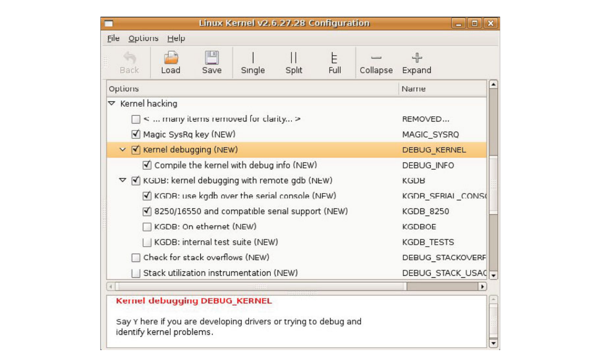
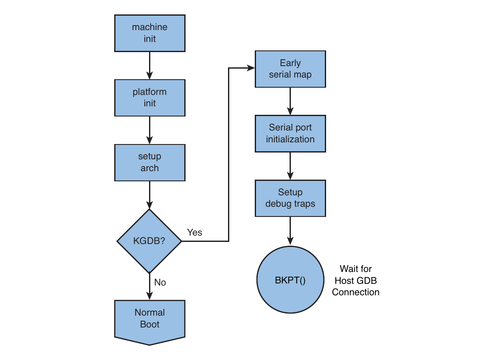
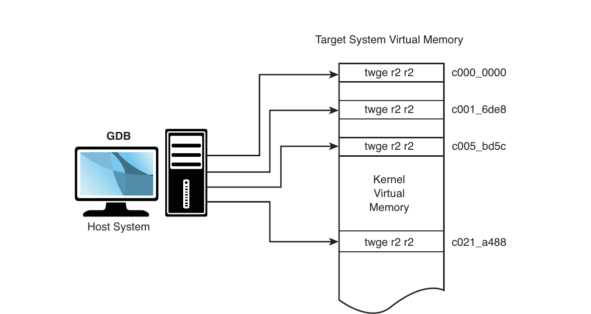
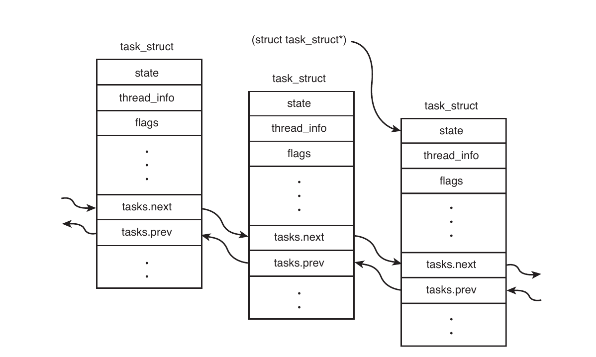
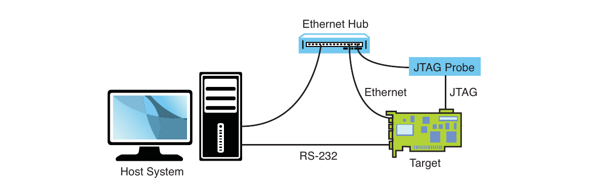

# Chương 14. Kỹ thuật debug kernel

## Trong chương này

- 14\.1 Thách thức khi debug kernel 368

- 14\.2 Dùng KGDB debug kernel 369

- 14\.3 Kỹ thuật debug kernel 381

- 14\.4 Debugging Hardware-Assisted 410

- 14\.5 Khi không boot được 417

- 14\.6 Tổng kết 421

Yếu tố quyết định đáp ứng lịch phát triển thường nằm

ở hiệu quả tìm, sửa bug. Debug bên trong Linux

kernel có thể rất khó. Dù tiếp cận thế nào, kernel debugging

luôn phức tạp. Chương này khảo sát một số phức tạp

và trình bày ý tưởng, phương pháp cải thiện kỹ năng debug trong

kernel và device driver.

## 14.1 Thách thức khi debug kernel

Debug một operating system hiện đại có nhiều thách thức. Operating system sử dụng virtual memory có những thách thức riêng. Đã qua thời chúng ta có thể thay processor bằng in-circuit emulator: processor đã trở nên quá nhanh và quá phức tạp. Hơn nữa, pipeline architecture che giấu những chi tiết code-execution quan trọng, vì thứ tự memory access trên bus có thể khác thứ tự thực thi code, đặc biệt do instruction stream được cache bên trong. Không phải lúc nào cũng có thể đối chiếu hoạt động external bus với việc processor thực thi instruction bên trong, ngoại trừ ở mức tương đối thô.

Một số thách thức khi debug Linux kernel code:

- Linux kernel code tối ưu cao cho tốc độ thực thi ở nhiều nơi.

- Compiler dùng kỹ thuật tối ưu làm phức tạp liên hệ C source với machine instruction flow thực. Inline function là ví dụ.

- Single-stepping qua compiler optimized code thường cho kết quả lạ, bất ngờ.

- Virtual memory cách ly user space memory với kernel memory, khiến nhiều tình huống debug đặc biệt khó.

- Một số code không thể step qua bằng debugger truyền thống.

- Startup code có thể đặc biệt khó vì gần phần cứng và ít tài nguyên (không console, memory mapping hạn chế, v.v.).

Linux kernel đã phát triển thành một operating system high-performance có thể cạnh tranh với những commercial operating system tốt nhất. Nhiều phần trong kernel không dễ phân tích chỉ bằng cách đọc source code. Để hiểu luồng thực thi code trong một phần cụ thể, bạn thường cần kiến thức về architecture và thiết kế chi tiết. Có một số cuốn sách tốt mô tả chi tiết thiết kế kernel. Xem phần cuối chương để biết các tài liệu được đề xuất.

GCC là một optimizing compiler. Theo mặc định, Linux kernel được biên dịch với compiler flag `-O2`. Flag này bật nhiều thuật toán tối ưu có thể thay đổi cấu trúc và thứ tự cơ bản của code.[^1] Ví dụ, Linux kernel sử dụng rất nhiều inline function. Đây là những function nhỏ được khai báo bằng keyword `inline`, khiến code của function được đưa trực tiếp vào execution thread thay vì tạo một function call với overhead đi kèm.[^2] Inline function yêu cầu optimization level tối thiểu là `-O1`. Vì vậy, bạn không thể tắt tối ưu, mặc dù việc đó có thể giúp debug dễ dàng hơn.

Trong nhiều phần của Linux kernel, việc single-stepping qua code rất khó hoặc không thể thực hiện. Những ví dụ rõ nhất là các code path thay đổi virtual memory setting. Khi ứng dụng thực hiện một system call khiến luồng thực thi đi vào kernel, address space mà process nhìn thấy sẽ thay đổi. Thực tế, bất kỳ sự chuyển đổi nào liên quan đến processor exception đều thay đổi operational context và có thể khiến việc single-step qua đó trở nên khó khăn hoặc bất khả thi.

## 14.2 Dùng KGDB debug kernel

Hai phương pháp phổ biến cho symbolic source-level debugging trong Linux kernel:

- Dùng KGDB làm remote GDB agent

- Dùng hardware JTAG probe điều khiển processor

JTAG debugging trình bày trong Phần 14.4, “Debugging Hardware-Assisted”.

KGDB (Kernel GDB) là một tập hợp Linux kernel patch cung cấp interface đến GDB qua remote serial protocol.[^3] KGDB triển khai một GDB stub giao tiếp với cross-gdb chạy trên host development workstation. Cho đến gần đây, KGDB trên target yêu cầu serial connection đến development host. Một số target hỗ trợ kết nối KGDB qua Ethernet và thậm chí USB. Hỗ trợ KGDB đầy đủ vẫn chưa có trong mainline kernel từ kernel.org. Bạn cần port KGDB đến target đã chọn hoặc lấy một embedded Linux distribution cho architecture và platform đã chọn có chứa hỗ trợ KGDB. Phần lớn commercial embedded Linux distribution hiện có đều hỗ trợ KGDB.

Cần lưu ý rằng khả năng hỗ trợ KGDB khác nhau giữa các architecture và platform. Trừ khi platform developer đã chủ động bật KGDB, công cụ này có thể không hoạt động trên platform cụ thể của bạn. Bạn sẽ thấy các kernel configuration option dành cho KGDB khác nhau giữa các architecture và platform. Cách duy nhất để bảo đảm platform của bạn được hỗ trợ KGDB là tự port hoặc lấy Linux kernel và distribution từ một commercial vendor hỗ trợ KGDB trên platform đó. Xem phần cuối chương để biết các tài liệu tham khảo.

Hình 14-1 trình bày cách thiết lập debug bằng KGDB. Có tối đa ba kết nối đến target board được sử dụng. Ethernet được dùng để hỗ trợ NFS root mount và các telnet session từ host. Nếu board có ramdisk image trong Flash và mount nó làm root file system, bạn có thể bỏ Ethernet connection.


HÌNH 14-1 KGDB debug setup

Một serial port được dành riêng cho kết nối giữa KGDB và GDB chạy trên development host system; serial port thứ hai, nếu có, được dùng làm console. Trên hệ thống chỉ có một serial port, việc sử dụng KGDB sẽ bất tiện hơn đôi chút.

Như trong Hình 14-1, debugger, tức cross-version của GDB, chạy trên development host system. KGDB là một phần của kernel chạy trên target system. KGDB triển khai các hook cần thiết để GDB giao tiếp với target board, cho phép thực hiện các tính năng như đặt breakpoint, khảo sát memory và thực thi chương trình theo kiểu single-step.

### 14.2.1 Kernel configuration cho KGDB

Như đã đề cập, hỗ trợ KGDB có sự khác biệt giữa các architecture và platform. Ví dụ sau dựa trên CPU MPC8548 thuộc Power Architecture trên CDS platform của Freescale Semiconductor, sử dụng commercial MontaVista Linux distribution đã bổ sung hỗ trợ KGDB này. Một số tính năng trong ví dụ không có trong mainline kernel source code, vì việc đưa hỗ trợ KGDB vào kernel đã không được khuyến khích trong một thời gian dài và chỉ gần đây, Linux 2.6.26, mới bắt đầu xuất hiện dưới dạng tổng quát.

KGDB là một kernel feature và phải được bật trong kernel. Bạn chọn KGDB từ menu Kernel hacking như trong Hình 14-2. (Nhiều mục đã được lược bỏ khỏi menu Kernel hacking để hình này vừa trang. Menu của bạn sẽ có nhiều entry hơn ở trước các option KGDB.) Trong quá trình cấu hình, bạn phải chọn I/O driver để KGDB sử dụng. Trong ví dụ này, chúng ta chọn serial port thông qua KGDB\_8250. Cũng chú ý trong Hình 14-2, chúng ta bật option biên dịch kernel với debug information. Option này thêm compiler flag `-g` vào quá trình build để bật symbolic debugging.



HÌNH 14-2 Kernel configuration cho KGDB

### 14.2.2 Boot target hỗ trợ KGDB

Sau khi kernel được build với hỗ trợ KGDB, bạn phải bật KGDB tại runtime. Nhìn chung, bạn bật KGDB bằng cách truyền một command-line switch đến kernel qua kernel command line. Nếu hỗ trợ KGDB đã được biên dịch vào kernel nhưng không được bật bằng command-line switch, nó sẽ không làm gì. Khi KGDB được bật, bạn có thể yêu cầu kernel dừng tại một breakpoint KGDB-enabled từ rất sớm trong boot cycle để kết nối đến target bằng GDB. Hình 14-3 minh họa logic tạo initial breakpoint khi KGDB được bật.



HÌNH 14-3 Logic KGDB

KGDB cần một serial port để kết nối đến host.[^4] Bước đầu tiên khi thiết lập KGDB là bật serial port từ rất sớm trong quá trình boot. Trên nhiều architecture, hardware UART phải được map vào kernel memory trước khi truy cập. Sau khi address range được map, serial port được khởi tạo. Tiếp đó, các debug trap handler được cài đặt để cho phép processor exception trap vào debugger.

Listing 14-1 hiển thị terminal output khi boot bật KGDB. Ví dụ dựa Freescale MPC8548CDS reference board kèm bootloader U-Boot.

LISTING 14-1 Boot bật KGDB bằng U-Boot

```
=> setenv bootargs console=ttyS1,115200 root=/dev/nfs rw ip=dhcp kgdbwait
kgdb8250=ttyS1,115200
=> tftp 600000 mpc8548.uImage
Speed: 1000, full duplex
Using eTSEC0 device
TFTP from server 192.168.0.9; our IP address is 192.168.0.18
Filename ‘8548/uImage’.
Load address: 0x600000
Loading: #################################################################
         ##############################################################
done
Bytes transferred = 1854347 (1c4b8b hex)
=> tftp c00000 mpc8548.dtb
Speed: 1000, full duplex
Using eTSEC0 device
TFTP from server 192.168.0.9; our IP address is 192.168.0.18
Filename ‘8548/dtb’.
Load address: 0xc00000
Loading: ##
done
Bytes transferred = 16384 (4000 hex)
=> bootm 600000 - c00000
## Booting kernel from Legacy Image at 00600000 ...
   Image Name:   MontaVista Linux 6/2.6.27/freesc
   Image Type:   PowerPC Linux Kernel Image (gzip compressed)
   Data Size:    1854283 Bytes =  1.8 MB
   Load Address: 00000000
   Entry Point:  00000000
   Verifying Checksum ... OK
## Flattened Device Tree blob at 00c00000
   Booting using the fdt blob at 0xc00000
   Uncompressing Kernel Image ... OK
   Loading Device Tree to 007f9000, end 007fffff ... OK
kgdb8250: ttyS1 init delayed, use io/mmio/mbase syntax for early init.
Using MPC85xx CDS machine description
Memory CAM mapping: CAM0=256Mb, CAM1=0Mb, CAM2=0Mb residual: 0Mb
Linux version 2.6.27.28.freescale-8548cds.0908010910 (chris@pluto) (gcc version
4.3.3 (MontaVista Linux Sourcery G++ 4.3-217) ) #1 PREEMPT Mon Mar 29 11:09:48 EDT
2010
console [udbg0] enabled
setup_arch: bootmem
mpc85xx_cds_setup_arch()
<... many messages deleted ...>
Serial: 8250/16550 driver4 ports, IRQ sharing enabled
serial8250.0: ttyS0 at MMIO 0xe0004500 (irq = 42) is a 16550A
serial8250.0: ttyS1 at MMIO 0xe0004600 (irq = 42) is a 16550A
console handover: boot [udbg0] -> real [ttyS1]
kgdb: Registered I/O driver kgdb8250.
kgdb: Waiting for connection from remote gdb...
```

Phần lớn boot sequence đã quen thuộc qua nội dung về U-Boot trong Chương 7, “Bootloader”. Nhớ lại rằng Chương 7 đã chỉ ra kernel command line được định nghĩa bằng environment variable `bootargs` của U-Boot. Chú ý rằng chúng ta đã thêm parameter `kgdbwait`, yêu cầu kernel tạo một early breakpoint và chờ host debugger, tức cross-gdb của bạn, kết nối.

Chú ý rằng boot sequence chưa hoàn tất. Vì chúng ta đặt `kgdbwait` trên command line, kernel thực hiện initialization cho đến khi các serial port driver được load, rồi chạm một breakpoint định sẵn. Tại thời điểm này, kernel chờ vô thời hạn để một external debugger kết nối.

Bạn cũng nên chú ý kernel command-line parameter mới thứ hai. Architecture cụ thể này, Power, và platform 8548CDS sử dụng 8250 serial driver cùng một KGDB driver 8250-based đặc biệt được triển khai trong `.../drivers/serial/8250_kgdb.c`. Bạn phải cho KGDB biết serial port nào được dùng để debug, với cú pháp tương tự cú pháp mô tả console device.

Giờ đây kernel đã được thiết lập và đang chờ host debugger, chúng ta có thể bắt đầu debugging session. Chúng ta gọi cross-gdb từ host development workstation và kết nối đến target qua remote protocol của GDB. Trong ví dụ này, serial port được dùng chung với console, nên chúng ta phải ngắt kết nối terminal emulator khỏi target trước khi thử kết nối bằng GDB. Listing 14-2 minh họa quá trình kết nối GDB. Ví dụ giả định rằng chúng ta đã thoát terminal emulator và giải phóng serial port để GDB sử dụng.

LISTING 14-2 Kết nối KGDB

```
$ ppc_85xx-gdb -q vmlinux
(gdb) target remote /dev/ttyS0
Remote debugging using /dev/ttyS0
0xc0058360 in kgdb_register_io_module (new_kgdb_io_ops=0x1)
    at kernel/kgdb.c:1802
1802        wmb(); /* Sync point before breakpoint */
(gdb) l
1797   * the debugger.
1798   */
1799  void kgdb_breakpoint(void)
1800  {
1801        atomic_set(&kgdb_setting_breakpoint, 1);
1802        wmb(); /* Sync point before breakpoint */
1803        arch_kgdb_breakpoint();
1804        wmb(); /* Sync point after breakpoint */
1805        atomic_set(&kgdb_setting_breakpoint, 0);
1806  }
(gdb)
```

Ở đây thực hiện ba hành động:

- Gọi cross-gdb, truyền kernel ELF file `vmlinux`

- Nối target bằng lệnh `target remote`

- Gọi lệnh `list`, viết tắt `l`, hiển thị vị trí source code

Dù điều này có vẻ hiển nhiên, image `vmlinux` mà chúng ta truyền cho GDB phải được tạo từ cùng lần build kernel đã sinh ra kernel binary đang chạy trên target board. Image cũng phải được biên dịch với compiler flag `-g` để chứa debug information. Nhớ lại Chương 13, “Công cụ phát triển”, Phần 13.5.2: bạn có thể dùng công cụ cross-readelf để xác minh image `vmlinux` được biên dịch với debug symbol. Dùng một lệnh tương tự sau để xác minh ELF file có các debug section:

```
$ ppc_85xx-readelf -S vmlinux | grep debug
```

Khi chúng ta chạy lệnh `target remote`, GDB phản hồi bằng cách hiển thị vị trí program counter (PC). Trong ví dụ này, kernel dừng trong function `kgdb_breakpoint()` tại dòng 1802 của file `.../kernel/kgdb.c`. Khi chúng ta chạy lệnh `continue` (`c`), quá trình thực thi tiếp tục từ vị trí này.

### 14.2.3 Kernel breakpoint hữu ích

Đến đây, chúng ta đã thiết lập debug connection với kernel trên target board. Khi chạy lệnh continue (`c`) của GDB, kernel tiếp tục boot; nếu không xảy ra vấn đề, quá trình boot sẽ hoàn tất. Ở giai đoạn này, bạn có thể muốn đặt một số breakpoint để thiết lập debugging session phù hợp với mục đích của mình. Hai breakpoint phổ biến nhất được trình bày trong Listing 14-3.

LISTING 14-3 Kernel breakpoint phổ biến

```
(gdb) b panic
Breakpoint 1 at 0xc02d1a84: file arch/powerpc/include/asm/thread_info.h, line 87.
(gdb) b sys_sync
Breakpoint 2 at 0xc00baae4: file fs/sync.c, line 41.
(gdb) c
Continuing.
```

Sử dụng lệnh `breakpoint` của GDB, một lần nữa ở dạng viết tắt, chúng ta đặt hai breakpoint. Một breakpoint nằm tại `panic()`, breakpoint còn lại tại entry của sync system call, `sys_sync()`. Breakpoint đầu cho phép gọi debugger nếu một sự kiện về sau gây panic, qua đó khảo sát system state tại thời điểm panic. Breakpoint thứ hai là một cách hữu ích để halt kernel và trap vào debugger từ user space bằng cách nhập lệnh `sync` tại terminal đang chạy trên target hardware.

Giờ chúng ta đã sẵn sàng tiếp tục debugging session. Một kernel KGDB-enabled đang chạy trên target, tạm dừng tại breakpoint KGDB-defined. Chúng ta đã thiết lập kết nối đến target bằng cross debugger host-based, trong trường hợp này được gọi là `ppc_85xx-gdb`, và đã đặt một cặp system breakpoint hữu ích. Từ đây, chúng ta có thể hướng hoạt động debug vào công việc cần giải quyết.

Một lưu ý: theo định nghĩa, chúng ta không thể dùng KGDB để đi qua từng bước code nằm trước `breakpoint()` dùng để thiết lập kết nối giữa kernel KGDB-enabled và cross-gdb trên host. Hình 14-3 mô tả gần đúng code thực thi trước khi KGDB giành quyền điều khiển. Debug early code này đòi hỏi sử dụng debug probe hardware-assisted. Chúng ta trình bày chủ đề này trong Phần 14.4, “Debugging Hardware-Assisted”.

Sau khi các initial breakpoint đã được thiết lập và bạn chạy lệnh `continue`, bạn có thể dừng quá trình thực thi bất cứ lúc nào chỉ bằng cách gửi Ctrl-C đến cross-gdb. Listing 14-4 minh họa kết quả có thể xuất hiện.

LISTING 14-4 Kernel debug session đang tiến hành

```
(gdb) c
Continuing.

<<<<<<< User types Ctl-C here >>>>>>>>>

Program received signal SIGTRAP, Trace/breakpoint trap.
0xc0058048 in kgdb_breakpoint () at kernel/kgdb.c:1802
1802        wmb(); /* Sync point before breakpoint */
(gdb) bt
#0  0xc0058048 in kgdb_breakpoint () at kernel/kgdb.c:1802
#1  0xc019bcdc in kgdb8250_interrupt (irq=<value optimized out>,
    dev_id=<value optimized out>) at drivers/serial/8250_kgdb.c:145
#2  0xc005a4f0 in handle_IRQ_event (irq=42, action=0xcf80af20)
    at kernel/irq/handle.c:140
#3  0xc005c19c in handle_fasteoi_irq (irq=42, desc=0xc039a950)
    at kernel/irq/chip.c:424
#4  0xc0004b04 in do_IRQ (regs=<value optimized out>)
    at include/linux/irq.h:289
#5  0xc000f310 in ret_from_except_full ()
#6  0xc0008144 in cpu_idle () at arch/powerpc/kernel/idle.c:59
#7  0xc02d022c in rest_init () at init/main.c:481
#8  0xc036e75c in start_kernel () at init/main.c:691
#9  0xc00003d0 in skpinv ()
(gdb)
```

Thấy ảnh hưởng compiler optimization ở Listing 14-4, thảo luận thêm Phần 14.3.2.

### 14.2.4 Dùng chung console serial port với KGDB

Mặc dù có thể sử dụng một serial port cho cả system console lẫn KGDB qua serial, cách này chắc chắn không lý tưởng. Mức độ hoàn thiện của KGDB khác nhau tùy architecture và platform. Khi ra ngoài các architecture x86, mọi thứ trở nên kém chắc chắn hơn. KGDB có nhiều connection option, bao gồm serial port, Ethernet port và thậm chí USB trên một số platform. Có thể chắc chắn rằng không phải tất cả tổ hợp này đều đã được kiểm thử trên từng platform cụ thể.

Như đã nói ở những phần khác trong sách, nếu bạn cho rằng sẽ cần debug kernel bằng KGDB, chi phí dành cho một serial port bổ sung rất dễ biện minh, đặc biệt khi có thể không lắp các linh kiện của port này trong sản xuất nếu cần để đạt mục tiêu chi phí. Những phiền toái tránh được, tức thời gian của lập trình viên tiết kiệm được, sẽ dư sức bù lại phần chi phí phát triển tăng thêm.

Để dùng chung serial port giữa console và KGDB, bạn cần hai command-line parameter. Sử dụng kernel command-line parameter `kgdboc` để chỉ định serial port cần dùng, và `kgdbcon` để chỉ định rằng port này sẽ được dùng chung với console. Chỉ định parameter `kgdboc` với một serial console theo cách tương tự như mô tả console device trên kernel command line:

```
kgdbcon kgdboc=ttyS1,115200
```

Khi bạn boot kernel và kết nối bằng KGDB, mọi console message được hiển thị bởi cross-gdb. Listing 14-5 minh họa kết quả. Trước hết, chúng ta boot target với các kernel command-line parameter bổ sung vừa đề cập. Target boot đến login prompt. Bây giờ, chúng ta phải bật KGDB bằng SysRequest function. Cách dễ nhất để thực hiện việc này từ serial port trên console là sử dụng interface `/proc`:

```
root@8548:~# echo g >/proc/sysrq-trigger
SysRq : GDB
Entering KGDB
```

Giờ ngắt serial terminal khỏi console, giải phóng cho KGDB. Sau đó chạy cross-gdb, session tiếp như Listing 14-5.

LISTING 14-5 Dùng chung serial console với KGDB

```
$ ppc_85xx-gdb -q vmlinux
(gdb) target remote /dev/ttyS0
Remote debugging using /dev/ttyS0
0xc0058098 in sysrq_handle_gdb (key=0x11, tty=0x8ddf) at kernel/kgdb.c:1802
1802        wmb(); /* Sync point before breakpoint */
(gdb) b sys_sync
Breakpoint 1 at 0xc00baae4: file fs/sync.c, line 41.
(gdb) b panic
Breakpoint 2 at 0xc02d1a84: file arch/powerpc/include/asm/thread_info.h, line 87.
(gdb) c
Continuing.
<<<<  After logging in via SSH on another terminal
<<<<  we execute ‘modprobe ipv6’ at this point in time
[New Thread 1665]
NET: Registered protocol family 10
lo: Disabled Privacy Extensions
ADDRCONF(NETDEV_UP): eth1: link is not ready
tunl0: Disabled Privacy Extensions
```

Như trong Listing 14-5, chúng ta đặt breakpoint rồi tiếp tục thực thi, cho phép kernel chạy lại với các breakpoint đã được đặt. Trong một terminal window riêng trên host, chúng ta ssh vào target và load một module, ở đây là `ipv6.ko`. Việc sử dụng module nào thực ra không quan trọng. Mục tiêu của chúng ta là tạo một số kernel message `printk` để xác minh rằng chúng thực sự đến GDB terminal window. Bạn có thể thấy các message này bắt đầu từ dòng `[New Thread 1665]`. Đây là các kernel message `printk` được chuyển đến system console, rồi được chuyển từ KGDB qua GDB remote protocol đến GDB console. Thật thú vị.

### 14.2.5 Debug kernel code rất sớm

Các kỹ thuật vừa mô tả không cho phép debug kernel code ở giai đoạn rất sớm của kernel initialization. Thực tế, bạn chỉ có thể debug initialization code sớm nhất sau khi serial driver đã được gọi và đăng ký. Trên một số architecture và platform, khả năng này được cung cấp qua hai kernel command-line parameter: `kgdbwait` và `kgdb8250`.[^5]

Hỗ trợ early kernel debug đòi hỏi một KGDB I/O driver cũng hỗ trợ early kernel debug. Phương thức I/O phổ biến nhất và ít can thiệp nhất để early kernel debug bằng KGDB là sử dụng serial driver. Driver `kgdb8250` đã đề cập trước đó là một ví dụ. Rõ ràng, driver này phải được biên dịch vào kernel để có sẵn cho early kernel debug.

Như đã thấy trong Listing 14-1, `kgdb8250` được dùng để cho KGDB biết cần sử dụng serial port nào. Tuy nhiên, với cú pháp khác, chúng ta có thể gọi một early serial initialization routine để debug kernel từ rất sớm. Sử dụng `kgdbwait`, chúng ta có thể yêu cầu kernel halt ở giai đoạn rất sớm trong initialization sequence để chờ lệnh từ người dùng. Thêm các variable sau vào kernel command line để bật early kernel debugging bằng KGDB:

```
kgdb8250=ttyS1,115200 kgdbwait
```

Bạn cần hiểu rằng thứ tự các kernel command-line parameter này rất quan trọng. Bạn phải chỉ định KGDB I/O driver trước, trong ví dụ là `kgdb8250`, để driver có thể được khởi tạo trước khi gặp `kgdbwait`. Vì về cơ bản `kgdbwait` tạo một debug breakpoint, hạ tầng giao tiếp với debugger phải sẵn sàng trước khi breakpoint được kích hoạt.

Một điểm khác cần nhớ là hỗ trợ này thường mang tính platform-specific. Nghĩa là kernel và platform của bạn phải hỗ trợ một loại early kernel debug I/O driver nào đó thì chức năng này mới có sẵn. Platform của bạn có thể cung cấp phần cứng khác cho mục đích này, nên bạn hoặc embedded Linux vendor phải cung cấp early kernel debug I/O driver.

Đối với I/O driver `kgdb8250`, bạn cũng có thể cung cấp một đặc tả đầy đủ để truyền thông tin chi tiết về board cụ thể của mình cho driver. Thông tin này có thể gồm loại I/O cần thiết để truy cập driver, base address và, nếu cần, register shift value cùng IRQ và baud rate. Khi đó, cú pháp như sau:

```
kgdb8250=<io|mmio|mbase>,<address>[/<regshift>],<baud rate>,<irq>
```

### 14.2.6 Hỗ trợ KGDB trong mainline kernel

Kể từ Linux 2.6.26, hỗ trợ KGDB tổng quát đã được tích hợp vào Linux kernel có sẵn trên kernel.org. Sau khi kernel được biên dịch với hỗ trợ KGDB như mô tả trước đó, hai kernel command-line parameter được dùng để cấu hình KGDB tại runtime. `kgdboc` chỉ định serial port cần dùng, còn `kgdbwait` khiến kernel thực hiện breakpoint khi boot để debugger (`gdb`) giành quyền điều khiển. Cú pháp `kgdboc` giống cú pháp `kgdb8250` vừa mô tả trong Phần 14.2.5, chỉ định serial port và baud rate. `kgdbwait` được dùng stand-alone, không có parameter. Tương tự ví dụ trong Phần 14.2.5, các kernel command-line parameter để bật KGDB trên Linux 2.6.26 trở lên như sau. Chú ý rằng thứ tự parameter rất quan trọng: serial port phải được chỉ định trước khi bạn yêu cầu kernel thực hiện breakpoint:

```
kgdboc=ttyS1,115200 kgdbwait
```

Khi boot, kernel thực hiện phần lớn khởi tạo rồi đợi debugger kết nối. Listing 14-6 minh họa.

LISTING 14-6 Boot với generic KGDB từ Kernel.org

```
<... boot kernel using kgdboc=ttyS0,115200 kgdbwait ...>
... (many boot messages)
Serial: 8250/16550 driver, 2 ports, IRQ sharing enabled
serial8250.0: ttyS0 at MMIO 0xffe04500 (irq = 42) is a 16550A
console handover: boot [udbg0] -> real [ttyS0]
serial8250.0: ttyS1 at MMIO 0xffe04600 (irq = 42) is a 16550A
kgdb: Registered I/O driver kgdboc.
kgdb: Waiting for connection from remote gdb...
```

Tại thời điểm này, kernel đang chờ kết nối từ một remote GDB session và bạn có thể bắt đầu debug. Chú ý rằng đây là giai đoạn tương đối muộn trong kernel boot sequence. Để debug một Linux kernel tổng quát ở giai đoạn sớm hơn, bạn phải dùng debugging hardware-assisted với JTAG probe. Nội dung này sẽ được mô tả ngay sau đây.

## 14.3 Kỹ thuật debug kernel

Một trong những lý do phổ biến khiến bạn cần đi qua từng bước kernel code là sửa đổi hoặc tùy chỉnh code platform-specific cho custom board. Hãy xem cách thực hiện trên AMCC Yosemite board. Chúng ta đặt breakpoint tại architecture setup functionv platform-specific, rồi cho chương trình tiếp tục đến khi chạm breakpoint đó. Listing 14-7 trình bày trình tự này.

LISTING 14-7 Debug architecture setup code

```
(gdb) b yosemite_setup_arch
    Breakpoint 3 at 0xc021a488:
        file arch/ppc/platforms/4xx/yosemite.c, line 308.
(gdb) c
Continuing.
Can’t send signals to this remote system.  SIGILL not sent.

Breakpoint 3, yosemite_setup_arch () at arch/ppc/platforms/4xx/yosemite.c:308
308             yosemite_set_emacdata();
(gdb) l
303     }
304
305     static void __init
306     yosemite_setup_arch(void)
307     {
308             yosemite_set_emacdata();
```

LISTING 14-7 Debug architecture setup code

```
309
310             ibm440gx_get_clocks(&clocks, YOSEMITE_SYSCLK, 6 * 1843200);
311             ocp_sys_info.opb_bus_freq = clocks.opb;
312
(gdb)
```

Khi gặp breakpoint tại `yosemite_setup_arch()`, quyền điều khiển được chuyển cho GDB ở dòng 308 của `yosemite.c`. Lệnh `list` (`l`) hiển thị source listing với breakpoint tại dòng 308 ở giữa. Bạn có thể bỏ qua an toàn warning message về SIGILL mà GDB hiển thị sau lệnh continue (`c`). Đây là một phần trong cách GDB kiểm tra các khả năng của remote system. Trước hết, GDB gửi remote command `continue_with_signal` đến target. Bản triển khai KGDB cho target board này không hỗ trợ lệnh đó, vì vậy target phản hồi NAK. GDB phản hồi bằng cách hiển thị message cung cấp thông tin này rồi gửi standard remote continue command thay thế.

### 14.3.1 GDB remote serial protocol

GDB có một debug switch cho phép chúng ta quan sát remote protocol được sử dụng giữa GDB trên development host và target. Điều này rất hữu ích để hiểu protocol bên dưới cũng như khắc phục sự cố trên các target có hành vi bất thường hoặc sai lệch. Để bật debug mode này, chạy lệnh sau:

```
(gdb) set debug remote 1
```

Khi remote debugging được bật, việc quan sát cách lệnh continue hoạt động và các bước GDB thực hiện rất bổ ích. Listing 14-8 minh họa cách dùng lệnh continue khi đã bật remote debugging.

LISTING 14-8 Ví dụ remote protocol: Lệnh continue

```
(gdb) c
Continuing.
Sending packet: $mc0000000,4#80...Ack
Packet received: c022d200
Sending packet: $Mc0000000,4:7d821008#68...Ack
Packet received: OK
Sending packet: $mc0016de8,4#f8...Ack
```

LISTING 14-8 Ví dụ remote protocol: Lệnh continue

```
Packet received: 38600001
Sending packet: $Mc0016de8,4:7d821008#e0...Ack
Packet received: OK
Sending packet: $mc005bd5c,4#23...Ack
Packet received: 38600001
Sending packet: $Mc005bd5c,4:7d821008#0b...Ack
Packet received: OK
Sending packet: $mc021a488,4#c8...Ack
Packet received: 4bfffbad
Sending packet: $Mc021a488,4:7d821008#b0...Ack
Packet received: OK
Sending packet: $c#63...Ack
    <<< program running, gdb waiting for event
```

Mặc dù thoạt nhìn có thể khá đáng ngại, những gì đang diễn ra ở đây rất dễ hiểu. Tóm lại, GDB đang khôi phục tất cả breakpoint của nó trên target. Nhớ lại Listing 14-3: chúng ta đã đặt hai breakpoint, một tại `panic()` và một tại `sys_sync()`. Sau đó, trong Listing 14-7, chúng ta thêm breakpoint thứ ba tại `yosemite_setup_arch()`. Như vậy, có ba breakpoint user-specified đang hoạt động. Bạn có thể hiển thị chúng bằng lệnh `info breakpoints` của GDB. Như thường lệ, chúng ta dùng dạng viết tắt:

```
(gdb) i b
Num Type           Disp Enb Address    What
1   breakpoint     keep y   0xc0016de8 in panic at kernel/panic.c:74
2   breakpoint     keep y   0xc005bd5c in sys_sync at fs/buffer.c:296
3   breakpoint     keep y   0xc021a488 in yosemite_setup_arch at
arch/ppc/platforms/4xx/yosemite.c:308
        breakpoint already hit 1 time
(gdb)
```

Bây giờ, hãy so sánh các breakpoint address trước đó với những địa chỉ trong GDB remote packet `$m` ở Listing 14-8. Packet `$m` là lệnh “đọc target memory”, còn packet `$M` là lệnh “ghi target memory”. Với mỗi breakpoint, nội dung tại địa chỉ breakpoint được đọc từ target memory, được GDB lưu cục bộ trên host để có thể khôi phục về sau, rồi được thay bằng Power Architecture trap instruction `twge r2, r2 (0x7d821008)`. Instruction này khiến quyền điều khiển chuyển trở lại debugger. Hình 14-4 minh họa thao tác này.



HÌNH 14-4 GDB chèn target memory breakpoint

Bạn có thể nhận thấy GDB đang cập nhật bốn breakpoint, trong khi chúng ta chỉ đặt ba. Breakpoint đầu tiên, tại target memory location `0xc000_0000`, được GDB tự động đặt khi khởi động. Vị trí này là base address của kernel image đã link từ ELF file, về bản chất là `_start`. Nó tương đương breakpoint tại `main()` khi debug user space và được GDB thực hiện tự động. Ba breakpoint còn lại là những breakpoint chúng ta đã đặt trước đó.

Điều tương tự đảo ngược khi sự kiện trả quyền GDB. Listing 14-9 chi tiết khi gặp breakpoint `yosemite_setup_arch()`.

LISTING 14-9 Remote protocol: Chạm breakpoint

```
Packet received: T0440:c021a488;01:c020ff90;
Sending packet: $mc0000000,4#80...Ack  <<< Read memory @c0000000
Packet received: 7d821008
Sending packet: $Mc0000000,4:c022d200#87...Ack  <<< Write memory
Packet received: OK
Sending packet: $mc0016de8,4#f8...Ack
Packet received: 7d821008
Sending packet: $Mc0016de8,4:38600001#a4...Ack
Packet received: OK
Sending packet: $mc005bd5c,4#23...Ack
Packet received: 7d821008
Sending packet: $Mc005bd5c,4:38600001#cf...Ack
Packet received: OK
Sending packet: $mc021a488,4#c8...Ack
Packet received: 7d821008
Sending packet: $Mc021a488,4:4bfffbad#d1...Ack
Packet received: OK

Sending packet: $mc021a484,c#f3...Ack
Packet received: 900100244bfffbad3fa0c022
Breakpoint 3, yosemite_setup_arch () at arch/ppc/platforms/4xx/yosemite.c:308
308             yosemite_set_emacdata();
(gdb)
```

Packet `$T` là một GDB Stop Reply packet, được target gửi đến GDB khi gặp breakpoint. Trong ví dụ của chúng ta, packet `$T` trả về giá trị program counter và register r1.[^6] Các hoạt động còn lại đảo ngược những gì thể hiện trong Listing 14-8. Các breakpoint instruction `trap` của Power Architecture được gỡ bỏ, và GDB khôi phục instruction gốc tại những memory location tương ứng.

### 14.3.2 Debug optimized kernel code

Ở đầu chương, chúng ta đã nói rằng một trong những thách thức khi debug kernel code xuất phát từ compiler optimization. Chúng ta cũng lưu ý rằng theo mặc định, Linux kernel được biên dịch với optimization level `-O2`. Ở đây, chúng ta minh họa một trong nhiều cách mà việc tối ưu có thể làm phức tạp quá trình debug.

Các Internet mail list liên quan có rất nhiều câu hỏi về những công cụ dường như bị lỗi. Đôi khi người đăng cho biết debugger của họ đang single-stepping lùi lại, hoặc line number không khớp với source code. Ở đây, chúng ta trình bày một ví dụ minh họa những phức tạp mà optimizing compiler gây ra cho debugging source-level. Trong ví dụ này, line number mà GDB báo cáo khi chạm breakpoint không khớp với line number trong source file do function inlining.

Để minh họa dùng cùng debug code snippet Listing 14-7. Listing 14-10 cho kết quả session.

LISTING 14-10 Code Architecture-Setup đã tối ưu

```
$ ppc_44x-gdb --silent vmlinux
(gdb) target remote /dev/ttyS0
Remote debugging using /dev/ttyS0
breakinst () at arch/ppc/kernel/ppc-stub.c:825
825     }
(gdb) b panic
Breakpoint 1 at 0xc0016b18: file kernel/panic.c, line 74.
(gdb) b sys_sync
Breakpoint 2 at 0xc005a8c8: file fs/buffer.c, line 296.
(gdb) b yosemite_setup_arch
Breakpoint 3 at 0xc020f438: file arch/ppc/platforms/4xx/yosemite.c, line 116.
(gdb) c
Continuing.

Breakpoint 3, yosemite_setup_arch ()
    at arch/ppc/platforms/4xx/yosemite.c:116
116             def = ocp_get_one_device(OCP_VENDOR_IBM, OCP_FUNC_EMAC, 0);
(gdb) l
111             struct ocp_def *def;
112             struct ocp_func_emac_data *emacdata;
113
114             /* Set mac_addr and phy mode for each EMAC */
115
116             def = ocp_get_one_device(OCP_VENDOR_IBM, OCP_FUNC_EMAC, 0);
117             emacdata = def->additions;
118             memcpy(emacdata->mac_addr, __res.bi_enetaddr, 6);
119             emacdata->phy_mode = PHY_MODE_RMII;
120
(gdb) p yosemite_setup_arch
$1 = {void (void)} 0xc020f41c <yosemite_setup_arch>
```

Xem lại Listing 14-7, bạn sẽ thấy function `yosemite_setup_arch()` thực sự nằm ở dòng 306 của file `yosemite.c`. Hãy so sánh với Listing 14-10. Chúng ta chạm breakpoint nhưng GDB báo breakpoint tại dòng 116 của file `yosemite.c`. Thoạt nhìn, có vẻ line number giữa debugger và source code tương ứng không khớp nhau. Đây có phải bug của GDB không? Trước hết, hãy xác nhận compiler đã tạo debug information như thế nào. Sử dụng công cụ `readelf`[^7] được mô tả trong Chương 13, chúng ta có thể khảo sát debug information mà compiler tạo cho function này:

```
$ ppc_44x-readelf --debug-dump=info vmlinux | grep -u6 \
  yosemite_setup_arch | tail -n 7
    DW_AT_name        : (indirect string, offset: 0x9c04): yosemite_setup_arch
    DW_AT_decl_file   : 1
    DW_AT_decl_line   : 307
    DW_AT_prototyped  : 1
    DW_AT_low_pc      : 0xc020f41c
    DW_AT_high_pc     : 0xc020f794
    DW_AT_frame_base  : 1 byte block: 51       (DW_OP_reg1)
```

Không cần là chuyên gia đọc DWARF2 debug record[^8], chúng ta cũng có thể nhận ra function đang xét được báo cáo tại dòng 307 trong source file. Chúng ta có thể xác nhận điều này bằng tiện ích `addr2line`, cũng đã được giới thiệu trong Chương 13. Chúng ta có thể sử dụng địa chỉ lấy từ GDB trong Listing 14-10:

```
$ ppc_44x-addr2line  -e vmlinux 0xc020f41c
    arch/ppc/platforms/4xx/yosemite.c:307
```

Tại thời điểm này, GDB đang báo breakpoint ở dòng 116 của file `yosemite.c`. Để hiểu điều gì đang xảy ra, chúng ta cần xem assembler output của function do GDB cung cấp. Listing 14-11 là output từ GDB sau khi chạy lệnh `disassemble` cho function `yosemite_setup_arch()`.

LISTING 14-11 Disassemble function `yosemite_setup_arch`

```
(gdb) disassemble yosemite_setup_arch
0xc020f41c <yosemite_setup_arch+0>:     mflr    r0
0xc020f420 <yosemite_setup_arch+4>:     stwu    r1,-48(r1)
0xc020f424 <yosemite_setup_arch+8>:     li      r4,512
0xc020f428 <yosemite_setup_arch+12>:    li      r5,0
0xc020f42c <yosemite_setup_arch+16>:    li      r3,4116
0xc020f430 <yosemite_setup_arch+20>:    stmw    r25,20(r1)
0xc020f434 <yosemite_setup_arch+24>:    stw     r0,52(r1)
0xc020f438 <yosemite_setup_arch+28>:    bl      0xc000d344 <ocp_get_one_device>
0xc020f43c <yosemite_setup_arch+32>:    lwz     r31,32(r3)
0xc020f440 <yosemite_setup_arch+36>:    lis     r4,-16350
0xc020f444 <yosemite_setup_arch+40>:    li      r28,2
0xc020f448 <yosemite_setup_arch+44>:    addi    r4,r4,21460
0xc020f44c <yosemite_setup_arch+48>:    li      r5,6
0xc020f450 <yosemite_setup_arch+52>:    lis     r29,-16350
0xc020f454 <yosemite_setup_arch+56>:    addi    r3,r31,48
0xc020f458 <yosemite_setup_arch+60>:    lis     r25,-16350
0xc020f45c <yosemite_setup_arch+64>:    bl      0xc000c708 <memcpy>
0xc020f460 <yosemite_setup_arch+68>:    stw     r28,44(r31)
0xc020f464 <yosemite_setup_arch+72>:    li      r4,512
0xc020f468 <yosemite_setup_arch+76>:    li      r5,1
0xc020f46c <yosemite_setup_arch+80>:    li      r3,4116
0xc020f470 <yosemite_setup_arch+84>:    addi    r26,r25,15104
0xc020f474 <yosemite_setup_arch+88>:    bl      0xc000d344 <ocp_get_one_device>
0xc020f478 <yosemite_setup_arch+92>:    lis     r4,-16350
0xc020f47c <yosemite_setup_arch+96>:    lwz     r31,32(r3)
0xc020f480 <yosemite_setup_arch+100>:   addi    r4,r4,21534
0xc020f484 <yosemite_setup_arch+104>:   li      r5,6
0xc020f488 <yosemite_setup_arch+108>:   addi    r3,r31,48
0xc020f48c <yosemite_setup_arch+112>:   bl      0xc000c708 <memcpy>
0xc020f490 <yosemite_setup_arch+116>:   lis     r4,1017
0xc020f494 <yosemite_setup_arch+120>:   lis     r5,168
0xc020f498 <yosemite_setup_arch+124>:   stw     r28,44(r31)
0xc020f49c <yosemite_setup_arch+128>:   ori     r4,r4,16554
0xc020f4a0 <yosemite_setup_arch+132>:   ori     r5,r5,49152
0xc020f4a4 <yosemite_setup_arch+136>:   addi    r3,r29,-15380
0xc020f4a8 <yosemite_setup_arch+140>:   addi    r29,r29,-15380
0xc020f4ac <yosemite_setup_arch+144>:   bl      0xc020e338 <ibm440gx_get_clocks>
0xc020f4b0 <yosemite_setup_arch+148>:   li      r0,0
0xc020f4b4 <yosemite_setup_arch+152>:   lis     r11,-16352
0xc020f4b8 <yosemite_setup_arch+156>:   ori     r0,r0,50000
0xc020f4bc <yosemite_setup_arch+160>:   lwz     r10,12(r29)
0xc020f4c0 <yosemite_setup_arch+164>:   lis     r9,-16352
0xc020f4c4 <yosemite_setup_arch+168>:   stw     r0,8068(r11)
0xc020f4c8 <yosemite_setup_arch+172>:   lwz     r0,84(r26)
0xc020f4cc <yosemite_setup_arch+176>:   stw     r10,8136(r9)
0xc020f4d0 <yosemite_setup_arch+180>:   mtctr   r0
0xc020f4d4 <yosemite_setup_arch+184>:   bctrl
0xc020f4d8 <yosemite_setup_arch+188>:   li      r5,64
0xc020f4dc <yosemite_setup_arch+192>:   mr      r31,r3
0xc020f4e0 <yosemite_setup_arch+196>:   lis     r4,-4288
0xc020f4e4 <yosemite_setup_arch+200>:   li      r3,0
0xc020f4e8 <yosemite_setup_arch+204>:   bl      0xc000c0f8 <ioremap64>
End of assembler dump.
(gdb)
```

Một lần nữa, chúng ta không cần là chuyên gia Power Architecture assembly language để hiểu những gì đang xảy ra. Chú ý các label gắn với instruction `bl` của Power Architecture. Đây là một function call theo hệ mnemonic của Power Architecture. Các symbolic function label là những thông tin quan trọng. Sau khi phân tích sơ bộ, chúng ta thấy một số function call gần đầu assembler listing này:

```
Address     Function
0xc020f438  ocp_get_one_device()
0xc020f45c  memcpy()
0xc020f474  ocp_get_one_device()
0xc020f48c  memcpy()
0xc020f4ac  ibm440gx_get_clocks()
```

Listing 14-12 trình bày lại một số phần của source file `yosemite.c`. Khi đối chiếu những function đã tìm thấy trong GDB disassemble output, chúng ta thấy các label đó xuất hiện trong function `yosemite_set_emacdata()`, gần những line number mà GDB báo cáo khi chạm breakpoint tại `yosemite_setup_arch()`. Chìa khóa để hiểu sự bất thường này là chú ý subroutine call ngay ở đầu `yosemite_setup_arch()`. Compiler đã inline lời gọi `yosemite_set_emacdata()` thay vì tạo function call như chúng ta mong đợi khi chỉ xem source code. Việc inlining này gây ra sự không khớp line number khi GDB chạm breakpoint. Mặc dù function `yosemite_set_emacdata()` không được khai báo với keyword `inline`, GCC vẫn inline function để tối ưu hiệu năng.

LISTING 14-12 Các phần source file `yosemite.c`

```
    109 static void __init yosemite_set_emacdata(void)
    110 {
    111         struct ocp_def *def;
    112         struct ocp_func_emac_data *emacdata;
    113
    114         /* Set mac_addr and phy mode for each EMAC */
    115
    116         def = ocp_get_one_device(OCP_VENDOR_IBM, OCP_FUNC_EMAC, 0);
    117         emacdata = def->additions;
    118         memcpy(emacdata->mac_addr, __res.bi_enetaddr, 6);
    119         emacdata->phy_mode = PHY_MODE_RMII;
    120
    121         def = ocp_get_one_device(OCP_VENDOR_IBM, OCP_FUNC_EMAC, 1);
    122         emacdata = def->additions;
    123         memcpy(emacdata->mac_addr, __res.bi_enet1addr, 6);
124         emacdata->phy_mode = PHY_MODE_RMII;
125 }
126
...
304
305 static void __init
306 yosemite_setup_arch(void)
307 {
308         yosemite_set_emacdata();
309
310         ibm440gx_get_clocks(&clocks, YOSEMITE_SYSCLK, 6 * 1843200);
311         ocp_sys_info.opb_bus_freq = clocks.opb;
312
313         /* init to some ~sane value until calibrate_delay() runs */
314         loops_per_jiffy = 50000000/HZ;
315
316         /* Setup PCI host bridge */
317         yosemite_setup_hose();
318
319 #ifdef CONFIG_BLK_DEV_INITRD
320        if (initrd_start)
321                ROOT_DEV = Root_RAM0;
322         else
323 #endif
324 #ifdef CONFIG_ROOT_NFS
325                 ROOT_DEV = Root_NFS;
326 #else
327                 ROOT_DEV = Root_HDA1;
328 #endif
329
330         yosemite_early_serial_map();
331
332         /* Identify the system */
333         printk( “AMCC PowerPC “ BOARDNAME “ Platform\n” );
334 }
335
```

Tóm tắt thảo luận trước:

- Nhập breakpoint GDB tại `yosemite_setup_arch()`.

- Khi chạm, thấy ở dòng 116 source file,

cách xa function định nghĩa breakpoint.

- Tạo disassembly listing code tại `yosemite_setup_arch()`, tìm label mà chuỗi code branch tới.

- Khi so sánh các label với source code, chúng ta phát hiện compiler đã đặt subroutine `yosemite_set_emacdata()` inline trong function nơi chúng ta đặt breakpoint, có thể gây nhầm lẫn.

Điều này giải thích line number GDB báo khi chạm breakpoint gốc ở `yosemite_setup_arch()`.

Nhớ lại rằng Listing 14-4 có một số ví dụ về kiểu tối ưu khác, trong đó debugger báo `value optimized out` đối với một số variable. Trong những trường hợp này, local variable đã được thay thế bằng processor register trong suốt thời gian thực thi function. Vì vậy, local variable đã được compiler tối ưu bỏ. Điều này có thể được minh họa dễ dàng bằng một đoạn code U-Boot trong file `cmd_bootm.c`. Listing 14-13 trình bày một vài dòng trong function `do_bootm()`.

LISTING 14-13 Ví dụ local variable bị tối ưu bỏ

```
584 int do_bootm (cmd_tbl_t *cmdtp, int flag, int argc, char *argv[])
 585 {
 586         ulong           iflag;
 587         ulong           load_end = 0;
 588         int             ret;

<...many lines omitted>

 652         ret = bootm_load_os(images.os, &load_end, 1);
 653
 654         if (ret < 0) {
 655                 if (ret == BOOTM_ERR_RESET)
 656                         do_reset (cmdtp, flag, argc, argv);
 ...
```

Step qua code bằng BDI-2000/3000 cùng cross-gdb như sau:

```
(gdb) l 654
649         dcache_disable();
650   #endif
651
652         ret = bootm_load_os(images.os, &load_end, 1);
653
654         if (ret < 0) {
655               if (ret == BOOTM_ERR_RESET)
656                     do_reset (cmdtp, flag, argc, argv);
657               if (ret == BOOTM_ERR_OVERLAP) {
658                     if (images.legacy_hdr_valid) {
(gdb) p ret
$2 = <value optimized out>
```

Chú ý rằng sau lời gọi `bootm_load_os()`, chúng ta đọc giá trị function trả về; theo source code ở dòng 652, giá trị này được lưu trong local variable tên `ret`. Thử hiển thị giá trị `ret` sẽ nhận được message now-familiar `<value optimized out>`. Vì biết Power Architecture trả kết quả function call trong register R3, chúng ta có thể hiển thị return code bằng cách hiển thị R3 ngay sau khi lời gọi này trả về:

```
(gdb) mon rd
GPR00: 0ff7c9ec 0ff4db40 0ff4df64 00000000
GPR04: 00000002 00000000 0ff50ac8 00002538
GPR08: 00001000 00000020 00003538 00000001
GPR12: 24044022 1001a5b8 00000000 00000000
GPR16: 0ff88af4 00000000 00000000 00000000
GPR20: 00000000 00000000 0fff10f4 00000000
GPR24: 00000001 00000000 0ffab9d0 00000004
GPR28: 0ff50a40 0fff0b34 0ffaf0f0 00000000
CR   : 42044048     MSR: 00021200
(gdb)
```

Lệnh này gọi trực tiếp lệnh `rd` của BDI-2000/3000 để hiển thị general-purpose register và trả về kết quả. GPR03 (R3) chứa giá trị 0, biểu thị function call đã thành công.

Compiler sử dụng nhiều loại thuật toán tối ưu khác nhau. Ví dụ này chỉ trình bày một loại: function inlining. Mỗi loại có thể gây nhầm lẫn cho debugger, cả con người lẫn máy móc, theo cách khác nhau. Thách thức là hiểu những gì đang diễn ra ở machine level rồi diễn giải chúng thành điều mà chúng ta, với tư cách lập trình viên, đã dự định. Đến đây, bạn có thể thấy lợi ích của việc dùng optimization level thấp nhất có thể khi debug.

### 14.3.3 Lệnh GDB User-Defined

Có thể bạn đã biết GDB tìm một initialization file tên `.gdbinit` khi khởi động. Khi được gọi lần đầu, GDB load initialization file này, thường nằm trong home directory của người dùng, và thực hiện các lệnh bên trong. Một trong những tổ hợp lệnh tôi yêu thích là kết nối đến target system và đặt các initial breakpoint. Trong trường hợp này, nội dung `.gdbinit` sẽ giống Listing 14-14.

LISTING 14-14 GDB initialization file đơn giản

```
$ cat ~/.gdbinit
set history save on
set history filename ~/.gdb_history
set output-radix 16

define connect
#   target remote bdi:2001
    target remote /dev/ttyS0
    b panic
    b sys_sync
end
```

File `.gdbinit` đơn giản này bật việc lưu command history vào một file user-specified và đặt output radix mặc định để in giá trị. Sau đó, nó định nghĩa một lệnh GDB user-defined tên `connect`. (Các lệnh User-defined cũng thường được gọi là macro.) Khi chạy lệnh này tại command prompt của GDB, GDB kết nối đến target system theo phương thức mong muốn, trong ví dụ là serial port, rồi đặt system breakpoint tại `panic()` và `sys_sync()`. Phương thức network (host:port) đã được vô hiệu hóa bằng comment; chúng ta sẽ thảo luận phương thức này trong Phần 14.4.

Có vô số cách sử dụng sáng tạo các lệnh GDB user-defined. Khi debug kernel, việc khảo sát global data structure như task list và memory map thường rất hữu ích. Ở đây, chúng ta trình bày một số lệnh GDB user-defined hữu ích để hiển thị các kernel data cụ thể mà bạn có thể cần truy cập trong quá trình debug kernel.

### 14.3.4 GDB macro hữu ích cho kernel

Khi debug kernel, việc xem các process đang chạy trên hệ thống cùng một số thuộc tính phổ biến của chúng thường rất hữu ích. Kernel duy trì một linked list các task được mô tả bằng `struct task_struct`. Địa chỉ của task đầu tiên trong list nằm trong kernel global variable `init_task`, biểu thị initial task mà kernel sinh ra khi khởi động. Mỗi task chứa một `struct list_head` để liên kết các task thành circular linked list. Hai kernel structure được dùng rộng rãi này được mô tả trong các header file sau:

```
struct task_struct            .../include/linux/sched.h
struct list_head              .../include/linux/list.h
```

Sử dụng GDB macro, chúng ta có thể duyệt task list và hiển thị thông tin hữu ích về các task. Bạn có thể dễ dàng sửa macro để trích xuất dữ liệu mình quan tâm. Đây cũng là một công cụ rất hữu ích để tìm hiểu chi tiết kernel internals.

Macro đầu tiên chúng ta khảo sát trong Listing 14-15, `find_task`, là một macro đơn giản tìm kiếm trong linked list các structure `task_struct` của kernel cho đến khi thấy task được chỉ định. Nếu tìm thấy task, macro hiển thị tên của nó.

LISTING 14-15 Macro GDB `find_task`

```
 1 # Helper function to find a task given a PID or the
 2 # address of a task_struct.
 3 # The result is set into $t
 4 define find_task
 5   # Addresses greater than _end: kernel data...
 6   # ...user passed in an address
 7   if ((unsigned)$arg0 > (unsigned)&_end)
 8     set $t=(struct task_struct *)$arg0
 9   else
10     # User entered a numeric PID
11     # Walk the task list to find it
12     set $t=&init_task
13     if (init_task.pid != (unsigned)$arg0)
14       find_next_task $t
15       while (&init_task!=$t && $t->pid != (unsigned)$arg0)
16         find_next_task $t
17       end
18       if ($t == &init_task)
19         printf “Couldn’t find task; using init_task\n”
20       end
21     end
22   end
23   printf “Task \”%s\”:\n”, $t->comm
24 end
```

Đặt nội dung này vào file `.gdbinit`, rồi khởi động lại GDB hoặc source file đó[^9] bằng lệnh `source` của GDB. (Macro `find_next_task` sẽ được giải thích sau, trong Listing 14-19.) Cách gọi như sau:

```
(gdb) find_task 910
   Task “syslogd”:
```

Chú ý cũng có thể truyền address cho macro `find_task`:

```
(gdb) find_task 0xCFFDE470
   Task “bash”:
```

Tất nhiên phải cung cấp parameter hợp lệ theo tình huống debug riêng.

Dòng 4 của Listing 14-15 định nghĩa tên macro. Dòng 7 xác định input argument là PID, một giá trị số bắt đầu từ 0 và giới hạn ở vài triệu, hay là địa chỉ `task_struct`, phải lớn hơn điểm cuối của chính Linux kernel image được symbol `_end` định nghĩa.[^10] Nếu là địa chỉ, thao tác duy nhất cần làm là cast nó sang đúng type để có thể dereference `task_struct` tương ứng. Việc này được thực hiện ở dòng 8. Như comment ở dòng 3 cho biết, macro này trả về một GDB convenience variable được typecast thành pointer đến `struct task_struct`.

Nếu input argument là PID dạng số, macro duyệt list để tìm `task_struct` phù hợp. Các dòng 12 và 13 khởi tạo loop variable; GDB không có câu lệnh `for` trong macro command language. Các dòng 15 đến 17 định nghĩa search loop. Macro `find_next_task` được dùng để lấy pointer đến `task_struct` kế tiếp trong linked list. Cuối cùng, nếu tìm kiếm thất bại, một return value hợp lý được đặt, là địa chỉ `init_task`, để có thể sử dụng an toàn trong các macro khác.

Dựa macro `find_task` Listing 14-15 dễ tạo lệnh `ps` đơn giản hiện thông tin hữu ích từng process chạy.

Listing 14-16 định nghĩa một GDB macro tên `ps` để hiển thị những thông tin đáng chú ý về một process đang chạy, trích xuất từ `struct task_struct` của process đó. Bạn gọi macro này như bất kỳ lệnh GDB nào khác: nhập tên rồi đến các input parameter cần thiết. Chú ý rằng lệnh user-defined này yêu cầu một argument duy nhất, là PID hoặc địa chỉ của một `task_struct`.

LISTING 14-16 Macro GDB in process information

```
 1 define ps
 2   # Print column headers
 3   task_struct_header
 4   set $t=&init_task
 5   task_struct_show $t
 6   find_next_task $t
 7   # Walk the list
 8   while &init_task!=$t
 9     # Display useful info about each task
10     task_struct_show $t
11     find_next_task $t
12   end
13 end
14
15 document ps
16 Print points of interest for all tasks
17 end
```

Macro `ps` này tương tự macro `find_task`, nhưng không yêu cầu input argument và bổ sung một macro `task_struct_show` để hiển thị thông tin hữu ích từ mỗi `task_struct`. Dòng 3 in banner line chứa các column heading. Các dòng 4 đến 6 thiết lập vòng lặp và hiển thị task đầu tiên. Các dòng 8 đến 11 duyệt từng task, gọi macro `task_struct_show` cho mỗi task.

Cũng chú ý lệnh GDB `document`, cho user nhận help bằng `help ps` từ prompt như sau:

```
(gdb) help ps
   Print points of interest for all tasks
```

Listing 14-17 hiện output macro trên target board chỉ chạy dịch vụ tối thiểu.

LISTING 14-17 Output macro GDB `ps`

```
(gdb) ps
Address      PID State      User_NIP  Kernel-SP  device comm
0xC01D3750     0 Running              0xC0205E90 (none) swapper
0xC04ACB10     1 Sleeping  0x0FF6E85C 0xC04FFCE0 (none) init
0xC04AC770     2 Sleeping             0xC0501E90 (none) ksoftirqd/0
0xC04AC3D0     3 Sleeping             0xC0531E30 (none) events/0
0xC04AC030     4 Sleeping             0xC0533E30 (none) khelper
0xC04CDB30     5 Sleeping             0xC0535E30 (none) kthread
0xC04CD790    23 Sleeping             0xC06FBE30 (none) kblockd/0
0xC04CD3F0    45 Sleeping             0xC06FDE50 (none) pdflush
0xC04CD050    46 Sleeping             0xC06FFE50 (none) pdflush
0xC054B7B0    48 Sleeping             0xC0703E30 (none) aio/0
0xC054BB50    47 Sleeping             0xC0701E20 (none) kswapd0
0xC054B410   629 Sleeping             0xC0781E60 (none) kseriod
0xC054B070   663 Sleeping             0xCFC59E30 (none) rpciod/0
0xCFFDE0D0   675 Sleeping  0x0FF6E85C 0xCF86DCE0 (none) udevd
0xCF95B110   879 Sleeping  0x0FF0BE58 0xCF517D80 (none) portmap
0xCFC24090   910 Sleeping  0x0FF6E85C 0xCF61BCE0 (none) syslogd
0xCF804490   918 Sleeping  0x0FF66C7C 0xCF65DD70 (none) klogd
0xCFE350B0   948 Sleeping  0x0FF0E85C 0xCF67DCE0 (none) rpc.statd
0xCFFDE810   960 Sleeping  0x0FF6E85C 0xCF5C7CE0 (none) inetd
0xCFC24B70   964 Sleeping  0x0FEEBEAC 0xCF64FD80 (none) mvltd
0xCFE35B90   973 Sleeping  0x0FF66C7C 0xCFEF7CE0 ttyS1  getty
0xCFE357F0   974 Sleeping  0x0FF4B85C 0xCF6EBCE0 (none) in.telnetd
0xCFFDE470   979 Sleeping  0x0FEB6950 0xCF675DB0 ttyp0  bash
0xCFFDEBB0   982<Running   0x0FF6EB6C 0xCF7C3870 ttyp0  sync
(gdb)
```

Phần lớn công việc của macro `ps` này được macro `task_struct_show` thực hiện. Như trình bày trong Listing 14-17, macro `task_struct_show` hiển thị các field sau từ mỗi `task_struct`:

- Address—Address của `task_struct` cho process

- PID—Process ID

- State—Trạng thái hiện tại process

- User\_NIP—User space next instruction pointer

- Kernel\_SP—Kernel stack pointer

- device—Device gắn process

- comm—Tên process (hoặc command)

Bạn có thể tương đối dễ dàng sửa macro để hiển thị những mục quan tâm cho công việc debug kernel cụ thể của mình. Điểm phức tạp duy nhất nằm ở sự đơn giản của macro language. Vì những function tương đương `strlen` không có trong ngôn ngữ lệnh GDB user-defined, việc định dạng màn hình phải được thực hiện thủ công. Listing 14-18 trình bày macro `task_struct_show` đã tạo ra

listing phía trên.

LISTING 14-18 Macro GDB `task_struct_show`

```
 1 define task_struct_show
 2   # task_struct addr and PID
 3   printf “0x%08X %5d”, $arg0, $arg0->pid
 4
 5   # Place a ‘<’ marker on the current task
 6   #  if ($arg0 == current)
 7   # For PowerPC, register r2 points to the “current” task
 8   if ($arg0 == $r2)
 9     printf “<”
10   else
11     printf “ “
12   end
13
14   # State
15   if ($arg0->state == 0)
16     printf “Running   “
17   else
18     if ($arg0->state == 1)
19       printf “Sleeping  “
20     else
21       if ($arg0->state == 2)
22         printf “Disksleep “
23       else
24         if ($arg0->state == 4)
25           printf “Zombie    “
26         else
27           if ($arg0->state == 8)
28             printf “sTopped   “
29           else
30             if ($arg0->state == 16)
31               printf “Wpaging   “
32             else
33               printf “%2d        “, $arg0->state
34             end
35           end
36         end
37       end
38     end
   39   end
   40
   41   # User NIP
   42   if ($arg0->thread.regs)
   43     printf “0x%08X “, $arg0->thread.regs->nip
   44   else
   45     printf “           “
   46   end
   47
   48   # Display the kernel stack pointer
   49   printf “0x%08X “, $arg0->thread.ksp
   50
   51   # device
   52   if ($arg0->signal->tty)
   53     printf “%s   “, $arg0->signal->tty->name
   54   else
   55     printf “(none) “
   56   end
   57
   58   # comm
   59   printf “%s\n”, $arg0->comm
   60 end
```

Dòng 3 hiển thị địa chỉ của `task_struct`. Các dòng 8 đến 12 hiển thị process ID. Nếu đây là current process, tức process đang chạy trên CPU này khi chạm breakpoint, nó được đánh dấu bằng ký tự `<`.

Các dòng 14 đến 39 giải mã và hiển thị trạng thái của process. Tiếp theo là next instruction pointer (NIP) của user process và kernel stack pointer (SP). Cuối cùng, device gắn với process được hiển thị, rồi đến tên process, được lưu trong phần tử `->comm` của `task_struct`.

Cần lưu ý rằng macro này mang tính architecture-dependent, như thể hiện ở các dòng 7 và 8. Nhìn chung, những macro như thế mang tính architecture- và version-dependent rất cao. Bất cứ khi nào structure bên dưới thay đổi, những macro này cũng phải được cập nhật. Tuy nhiên, nếu bạn dành nhiều thời gian debug kernel bằng GDB, lợi ích thu được thường xứng đáng với công sức bỏ ra.

Để trình bày đầy đủ, chúng ta giới thiệu macro `find_next_task`. Cách triển khai của macro này không thật sự hiển nhiên nên cần được giải thích. (Chúng tôi giả định bạn có thể dễ dàng suy ra `task_struct_header`, phần còn lại cần thiết để hoàn thiện bộ macro cho `ps` trong phần này. Nó chỉ là một dòng sắp xếp các column header với lượng khoảng trắng thích hợp.) Listing 14-19 trình bày macro `find_next_task` được dùng trong các macro `ps` và `find_task`.

LISTING 14-19 Macro GDB `find_next_task`

```
define find_next_task
  # Given a task address, find the next task in the linked list
  set $t = (struct task_struct *)$arg0
  set $offset=( (char *)&$t->tasks - (char *)$t)
  set $t=(struct task_struct *)( (char *)$t->tasks.next- (char *)$offset)
end
```

Chức năng của macro này đơn giản, nhưng cách triển khai lại không hoàn toàn trực tiếp. Mục tiêu là trả về pointer `->next`, trỏ đến `task_struct` kế tiếp trong linked list. Tuy nhiên, các structure `task_struct` được liên kết bằng địa chỉ của member `struct list_head` tên `tasks`, thay vì dùng địa chỉ bắt đầu của chính `task_struct` như cách thông thường. Vì pointer `->next` trỏ đến địa chỉ phần tử task structure trong `task_struct` tiếp theo của list, chúng ta phải thực hiện phép trừ để lấy địa chỉ đầu của chính `task_struct`. Giá trị được trừ khỏi pointer `->next` là offset từ địa chỉ pointer đó đến đầu `task_struct`. Trước hết, chúng ta tính offset, rồi dùng offset này để điều chỉnh pointer `->next` trỏ đến đầu `task_struct`. Hình 14-5 sẽ giúp làm rõ cách thực hiện.

Bây giờ, chúng ta trình bày macro cuối cùng tên `lsmod`, sẽ hữu ích trong phần tiếp theo khi thảo luận việc debug loadable module. Listing 14-20 là một macro đơn giản hiển thị danh sách các loadable module hiện được cài trong kernel.



HÌNH 14-5 Liên kết task structure list

LISTING 14-20 Macro GDB liệt kê module

```
 1 define lsmod
 2   printf “Address\t\tModule\n”
 3   set $m=(struct list_head *)&modules
 4   set $done=0
 5   while ( !$done )
 6     # list_head is 4-bytes into struct module
 7     set $mp=(struct module *)((char *)$m->next - (char *)4)
 8     printf “0x%08X\t%s\n”, $mp, $mp->name
 9     if ( $mp->list->next == &modules)
10       set $done=1
11     end
12     set $m=$m->next
13   end
14 end
15
16 document lsmod
17 List the loaded kernel modules and their start addresses
18 end
```

Vòng lặp đơn giản này bắt đầu từ global variable module của kernel. Variable này là một `struct list_head` đánh dấu điểm bắt đầu linked list các loadable module. Điểm phức tạp duy nhất giống với nội dung đã mô tả trong Listing 14-19: chúng ta phải trừ một offset khỏi pointer `struct list_head` để nó trỏ đến đầu `struct module`. Thao tác này được thực hiện ở dòng 7. Macro tạo một danh sách module đơn giản, gồm địa chỉ `struct module` và tên module. Sau đây là một ví dụ sử dụng:

```
(gdb) lsmod
Address         Module
0xD1012A80      ip_conntrack_tftp
0xD10105A0      ip_conntrack
0xD102F9A0      loop
(gdb) help lsmod
List the loaded kernel modules and their start addresses
(gdb)
```

Những macro được trình bày ở đây là công cụ hỗ trợ debug rất mạnh. Bạn có thể tạo macro theo cách tương tự để hiển thị bất cứ nội dung nào trong kernel có thể truy cập dễ dàng, đặc biệt là những data structure chính được duy trì dưới dạng linked list. Ví dụ bao gồm thông tin process memory map, thông tin module, thông tin file system, timer list, v.v. Nội dung được trình bày ở đây sẽ giúp bạn bắt đầu.

### 14.3.5 Debug loadable module

Một lý do điển hình để sử dụng KGDB là debug loadable kernel module, tức device driver. Một trong những tính năng thuận tiện của loadable module là trong phần lớn trường hợp, bạn không cần reboot kernel cho mỗi debugging session mới. Bạn có thể bắt đầu debugging session, thực hiện một số thay đổi, biên dịch lại và reload module mà không chịu sự bất tiện và thời gian chờ của việc reboot toàn bộ kernel.

Điểm phức tạp khi debug loadable module là truy cập symbolic debug information chứa trong object file của module. Vì loadable module được link động khi load vào kernel, symbolic information trong object file không sử dụng được cho đến khi symbol table được điều chỉnh.

Nhớ ví dụ trước gọi GDB cho kernel debugging session:

```
$ ppc_4xx-gdb vmlinux
```

Lệnh này khởi chạy một GDB debugging session trên host và đọc symbol information từ Linux kernel ELF file `vmlinux`. Tất nhiên, bạn sẽ không tìm thấy symbol của loadable module trong file này. Loadable module là các compilation unit riêng và được link thành những ELF object stand-alone riêng biệt. Vì vậy, nếu muốn thực hiện debugging source-level trên loadable module, chúng ta cần load debug symbol của nó từ ELF file. GDB cung cấp khả năng này qua lệnh `add-symbol-file`.

Lệnh `add-symbol-file` load symbol từ object file được chỉ định, với giả định rằng bản thân module đã được load. Tuy nhiên, chúng ta gặp tình huống chicken-and-egg. Chúng ta không có symbol information cho đến khi loadable module đã được load vào kernel và lệnh `add-symbol-file` được chạy để đọc symbol information của module. Nhưng sau khi module được load, đã quá muộn để đặt breakpoint và debug các function `*_init` cùng những function liên quan của module, vì chúng đã thực thi xong.

Giải pháp cho tình thế này là đặt breakpoint trong kernel code chịu trách nhiệm load module, sau khi module đã được link nhưng trước khi initialization function được gọi. Công việc này được thực hiện trong `.../kernel/module.c`. Listing 14-21 trình bày các phần liên quan của `module.c`.

LISTING 14-21 `module.c`: Khởi tạo module

```
...
2292         /* Drop lock so they can recurse */
2293         mutex_unlock(&module_mutex);
2294
2295         blocking_notifier_call_chain(&module_notify_list,
2296                         MODULE_STATE_COMING, mod);
2297
2298         /* Start the module */
2299         if (mod->init != NULL)
2300                 ret = do_one_initcall(mod->init);
2301         if (ret < 0) {
2302                 /* Init routine failed: abort.  Try to protect us from
2303                    buggy refcounters. */
2304                 mod->state = MODULE_STATE_GOING;
...
```

Load module bằng utility `modprobe` như Listing 8-5 Chương 8, “Kiến thức cơ bản về device driver”. Như sau:

```
$ modprobe loop
```

Lệnh này thực hiện một system call đặc biệt yêu cầu kernel load module. Quá trình load module bắt đầu tại `load_module()` trong `module.c`. Sau khi module được load vào kernel memory và link động, quyền điều khiển được chuyển đến function `*_init` của module. Điều này được thể hiện ở các dòng 2299 và 2300 của một bản `module.c` gần đây, như trong Listing 14-21. Chúng ta đặt breakpoint tại đây. Cách này cho phép thêm symbol file vào GDB rồi đặt các breakpoint trong module. Chúng ta minh họa quá trình bằng loopback driver của Linux kernel, tên `loop.ko`. Module này không phụ thuộc module khác nên tương đối dễ dùng để minh họa.

Listing 14-22 cho lệnh GDB bắt đầu session debug `loop.ko`.

LISTING 14-22 Bắt đầu module debug session: `loop.ko`

```
 1 $ ppc-linux-gdb --silent vmlinux
 2 (gdb) connect   <<< remember, this is a user-defined func
 3 breakinst () at arch/ppc/kernel/ppc-stub.c:825
 4 825     }
 5 Breakpoint 1 at 0xc0016b18: file kernel/panic.c, line 74.
 6 Breakpoint 2 at 0xc005a8c8: file fs/buffer.c, line 296.
 7 (gdb) b kernelmodule.c:2299
 8 Breakpoint 3 at 0xc0055b28: file kernel/module.c, line 2299.
 9 (gdb) c
10 Continuing.
11 >>>> Here we let the kernel finish booting
12      and then load the loop.ko module on the target
13
14 Breakpoint 3, sys_init_module (umod=0x48030000, len=<optimized out>,
15     uargs=<value optimized out>) at kernel/module.c:2299
16 2299                    ret = mod->init();
17 (gdb) lsmod
18 Address         Module
19 0xD1069A60     loop
20 (gdb) set $m=(struct module *)0xD1069a60
21 (gdb) p $m->module_core
22 $1 = (void *) 0xd1066000
23 (gdb) add-symbol-file ./drivers/block/loop.ko 0xd1066000
24 add symbol table from file “./drivers/block/loop.ko” at
25         .text_addr = 0xd1066000
26 (y or n) y
27 Reading symbols from /home/chris/sandbox/linux-2.6.27/
drivers/block        /loop.ko...done.
28 (gdb)
```

Bắt đầu từ dòng 2, chúng ta dùng GDB user-defined macro connect được tạo trong Listing 14-14 để kết nối đến target board và đặt initial breakpoint. Sau đó, chúng ta thêm breakpoint trong `module.c` như ở dòng 7 và chạy lệnh continue (`c`). Bây giờ kernel hoàn tất quá trình boot, và chúng ta thiết lập telnet session đến target rồi load module `loop.ko`, thao tác không được hiển thị ở đây. Khi loop module được load, chúng ta lập tức chạm breakpoint 3. Sau đó, GDB hiển thị thông tin ở các dòng 14 đến 16.

Tại thời điểm này, chúng ta cần tìm địa chỉ nơi Linux kernel đã link section `.text` của module. Linux lưu địa chỉ này trong module information structure `struct module`, ở phần tử `module_core`. Sử dụng macro `lsmod` đã định nghĩa trong Listing 14-20, chúng ta lấy địa chỉ `struct module` gắn với module `loop.ko`, như thể hiện ở các dòng 17 đến 19. Sau đó, chúng ta dùng địa chỉ structure này để lấy địa chỉ `.text` của module từ structure member `module_core`. Chúng ta truyền địa chỉ đó cho lệnh `add-symbol-file` của GDB; GDB sử dụng nó để điều chỉnh internal symbol table khớp với các địa chỉ thực tế nơi module được link vào kernel. Từ đây, chúng ta có thể tiếp tục theo cách thông thường: đặt breakpoint trong module, đi qua từng bước code, khảo sát dữ liệu, v.v.

Chúng ta kết thúc phần này bằng cách minh họa việc đặt breakpoint trong initialization function của loopback module để có thể đi qua từng bước initialization code. Điểm phức tạp ở đây là kernel load initialization code của module vào một vùng memory được cấp phát riêng, để có thể giải phóng sau khi sử dụng. Nhớ lại phần thảo luận về macro `__init` trong Chương 5, “Khởi tạo kernel”. Macro này mở rộng thành một compiler attribute yêu cầu linker đặt phần code được đánh dấu vào một ELF section có tên đặc biệt. Về bản chất, mọi function được định nghĩa với attribute này đều được đặt trong một ELF section riêng tên `.init.text`. Cách sử dụng tương tự như sau:

```
static int __init loop_init(void){...}
```

Lời gọi này đặt function `loop_init()` đã được biên dịch vào section `.init.` `text` của object module `loop.ko`. Khi module được load, kernel cấp phát một vùng memory cho phần chính của module, được member của `struct module` tên `module_core` trỏ đến. Sau đó, kernel cấp phát một vùng memory riêng để chứa section `.init.text`. Sau khi initialization function được gọi, kernel giải phóng memory từng chứa function đó. Vì object module được chia như vậy, chúng ta cần thông báo cho GDB về cách bố trí địa chỉ này để có thể sử dụng symbolic data khi debug initialization function. Listing 14-23 minh họa các bước thực hiện.

LISTING 14-23 Debug code `init` của module

```
$ ppc-linux-gdb -q vmlinux
(gdb) target remote /dev/ttyS0
Remote debugging using /dev/ttyS0
breakinst () at arch/ppc/kernel/ppc-stub.c:825
825     }

<< Place a breakpoint before calling module init >>
(gdb) b kernel/module.c:2299
Breakpoint 1 at 0xc0036418: file kernel/module.c, line 2299.
(gdb) c
Continuing.
[New Thread 1468]
[Switching to Thread 1468]

Breakpoint 3, sys_init_module (umod=0x48030000, len=<optimized out>,
    uargs=<value optimized out>) at kernel/module.c:2299
2299         if (mod->init != NULL)

<< Discover init addressing from struct module >>

(gdb) lsmod
Address         Module
0xD1069A60      loop
(gdb) set $m=(struct module *)0xD1069A60
(gdb) p $m->module_core
$1 = (void *) 0xd1066000
(gdb) p $m->module_init
$2 = (void *) 0xd101e000

<< Now load a symbol file using the core and init addrs >>

(gdb) add-symbol-file ./drivers/block/loop.ko 0xd1066000 -s .init.text 0xd101e000
add symbol table from file “./drivers/block/loop.ko” at
      .text_addr = 0xd1066000
      .init.text_addr = 0xd101e000
(y or n) y
Reading symbols from /home/chris/sandbox/linux-2.6.27/drivers/block/
loop.ko...done.
(gdb) b loop_init
Breakpoint 4 at 0xd101e008: file drivers/block/loop.c, line 1517.
(gdb) c
Continuing.

<< Breakpoint hit, proceed to debug module init function >>

Breakpoint 4, loop_init () at drivers/block/loop.c:1517
1517          part_shift = 0;
(gdb)l
1512           *     load, user can further extend loop device by create dev node
1513           *     themselves and have kernel automatically instantiate actual
1514           *     device on-demand.
1515           */
1516
1517          part_shift = 0;
1518          if (max_part > 0)
1519                part_shift = fls(max_part);
1520
1521          if (max_loop > 1UL << (MINORBITS - part_shift))
(gdb)
```

### 14.3.6 Debug bằng printk

Debug kernel code và device driver code bằng `printk()` là một kỹ thuật phổ biến, chủ yếu vì `printk` đã phát triển thành một phương pháp rất vững chắc. Bạn có thể gọi `printk` từ gần như mọi context, kể cả interrupt handler. `printk` là phiên bản kernel của function C library `printf()` quen thuộc. `printk` được định nghĩa trong `.../kernel/printk.c`.

Bạn cần hiểu các giới hạn khi sử dụng `printk` để debug. Trước hết, `printk` cần có một console device. Hơn nữa, mặc dù console device được cấu hình sớm nhất có thể trong kernel initialization, nhiều lời gọi `printk` vẫn xảy ra trước khi console device được khởi tạo. Chúng ta sẽ trình bày một phương pháp xử lý giới hạn này trong Phần 14.5, “Khi không boot được”.

Function `printk` cho thêm string marker nhận diện severity level thông báo. Header file `.../include/linux/kernel.h` định nghĩa tám level:

```
#define     KERN_EMERG    “<0>” /* system is unusable */
#define     KERN_ALERT    “<1>” /* action must be taken immediately */
#define     KERN_CRIT     “<2>” /* critical conditions */
#define     KERN_ERR      “<3>” /* error conditions */
#define     KERN_WARNING  “<4>” /* warning conditions */
#define     KERN_NOTICE   “<5>” /* normal but significant condition */
#define     KERN_INFO     “<6>” /* informational */
#define     KERN_DEBUG    “<7>” /* debug-level messages */
```

Message `printk` đơn giản có thể như:

```
printk(“foo() entered w/ %s\n”, arg);
```

Nếu severity string bị bỏ qua như trong ví dụ này, kernel gán một severity level mặc định, được định nghĩa trong `printk.c`. Trong những kernel gần đây, giá trị này được đặt ở severity level 4, `KERN_WARNING`. Cách chỉ định `printk` với một severity level, cũng là phương pháp được ưu tiên, có thể như sau:

```
printk(KERN_CRIT “vmalloc failed in foo()\n”);
```

Không, cú pháp C khác thường này không phải lỗi gõ. Bản thân `KERN_CRIT` là một text string, nên không cần dấu phẩy để phân tách parameter. Thực tế, nếu thêm dấu phẩy, function sẽ không tạo kết quả mong đợi. Compiler tự động nối các string thành một string duy nhất. Theo mặc định, mọi message `printk` có mức thấp hơn loglevel định sẵn đều được hiển thị trên system console device. Console loglevel mặc định được định nghĩa trong `printk.c`. Trong những Linux kernel gần đây, nó có giá trị 7. Điều này có nghĩa mọi message `printk` quan trọng hơn `KERN_DEBUG`, được định nghĩa trong `.../include/linux/kernel.h`, đều được hiển thị trên console.

Bạn có thể đặt kernel loglevel mặc định theo nhiều cách. Khi boot, bạn có thể chỉ định loglevel mặc định trên target board bằng cách truyền các kernel command-line parameter phù hợp đến kernel. Ba kernel command-line option được định nghĩa trong `main.c` ảnh hưởng đến loglevel mặc định:

- `debug` đặt console loglevel 10.

- `quiet` đặt console loglevel 4.

- `loglevel=` đặt console loglevel giá trị tùy chọn.

Dùng log level `debug` thực chất hiện mọi message `printk`. Dùng `quiet` hiện mọi message `printk` severity `KERN_ERR` trở lên.

Các message `printk` có thể được ghi log vào file trên target hoặc qua network. Sử dụng `klogd` (kernel log daemon) và `syslogd` (system log daemon) để điều khiển hành vi ghi log của message `printk`. Những tiện ích phổ biến này được mô tả trong man page và nhiều tài liệu tham khảo Linux, nên không được mô tả ở đây.

### 14.3.7 Magic SysReq key

Magic SysReq key là một công cụ hỗ trợ debug hữu ích, được gọi qua những chuỗi phím đặc biệt định sẵn để gửi message trực tiếp đến kernel. Với nhiều target architecture và board, bạn sử dụng một terminal emulator đơn giản trên serial port làm system console. Đối với các architecture này, Magic SysReq key được định nghĩa là một break character, theo sau bởi một command character. Tham khảo tài liệu terminal emulator bạn sử dụng để biết cách gửi break character. Nhiều lập trình viên Linux dùng terminal emulator minicom. Với minicom, bạn gửi break character bằng cách nhấn Ctrl-A F. Nếu dùng `screen`, nhấn Ctrl-A Ctrl-B để gửi break. Sau khi gửi break theo cách này, bạn có 5 giây để nhập command character trước khi chuỗi lệnh hết thời gian chờ.

Công cụ kernel này có thể hỗ trợ rất nhiều cho việc phát triển và debug, nhưng cũng có thể gây mất dữ liệu và làm hỏng hệ thống. Thực tế, lệnh `b` reboot hệ thống ngay lập tức mà không thông báo hay chuẩn bị gì. Các file đang mở không được đóng, disk không được sync và file system không được unmount. Khi chạy lệnh reboot (`b`), quyền điều khiển được chuyển ngay đến reset vector của architecture theo một cách hết sức đột ngột. Hãy tự chịu trách nhiệm về rủi ro khi dùng công cụ mạnh mẽ này!

Tính năng này được trình bày đầy đủ trong file `sysrq.txt` thuộc documentation subdirectory của Linux kernel. File chứa chi tiết cho nhiều architecture và mô tả các lệnh có sẵn.

Một cách khác để đặt kernel loglevel vừa thảo luận là sử dụng Magic SysReq key. Lệnh là một số từ 0 đến 9, khiến loglevel mặc định được đặt thành số đã truyền vào. Trong minicom, nhấn Ctrl-A F rồi nhập một số, chẳng hạn 9. Terminal sẽ hiển thị như sau sau khi bạn gửi break sequence:

```
$ SysRq : Changing Loglevel
   Loglevel set to 9
```

Bạn có thể dùng các lệnh để dump register, shutdown hệ thống, reboot hệ thống, dump danh sách process, dump thông tin memory hiện tại ra console, cùng nhiều thao tác khác. Xem documentation file trong bất kỳ Linux kernel gần đây nào để biết chi tiết.

Tính năng này hữu ích nhất khi một sự cố nào đó làm hệ thống lock up. Magic SysReq thường cho phép lấy thêm thông tin từ một hệ thống dường như đã ngừng hoạt động.

## 14.4 Debugging Hardware-Assisted

Đến đây, có lẽ bạn đã nhận ra rằng không thể dùng KGDB để debug kernel startup code ở giai đoạn rất sớm. Nguyên nhân là KGDB chỉ được khởi tạo sau khi phần lớn low-level hardware initialization code đã thực thi. Hơn nữa, nếu được giao nhiệm vụ bring up một thiết kế board brand-new và port bootloader cùng Linux kernel, thì hardware-debug probe chắc chắn là phương tiện hiệu quả nhất để debug những vấn đề trong các giai đoạn đầu của việc port board.

Bạn có thể lựa chọn trong rất nhiều loại hardware-debug probe. Các ví dụ trong phần này sử dụng một thiết bị do Abatron sản xuất tên BDI-2000(xem www. abatron.ch). Những thiết bị này thường được gọi là JTAG probe vì sử dụng một phương thức giao tiếp low-level ban đầu được áp dụng cho boundary scan testing của integrated circuit do Joint Test Action Group (JTAG) định nghĩa. Sau đó, Abatron đã phát hành BDI-3000 mới hơn, có Ethernet interface nhanh hơn (100MB).

JTAG probe có một connector nhỏ được thiết kế để nối với target board. Nó thường là một tổ hợp square-pin header và ribbon cable đơn giản. Phần lớn CPU high-performance hiện đại có JTAG interface được thiết kế để cung cấp khả năng software debugging này. JTAG probe kết nối đến CPU JTAG interface đó. Phía còn lại của JTAG probe nối với host development system, thường qua Ethernet, USB hoặc parallel port. Hình 14-6 trình bày chi tiết cách thiết lập thiết bị Abatron.



HÌNH 14-6 Debug bằng hardware JTAG probe

JTAG probe có thể phức tạp khi thiết lập. Điều này trực tiếp bắt nguồn từ sự phức tạp của CPU mà probe kết nối đến. Khi target board được cấp nguồn và CPU thoát reset, gần như chưa có gì được khởi tạo. Thực tế, nhiều processor cần ít nhất một lượng khởi tạo nhỏ trước khi có thể làm bất cứ việc gì. Có nhiều phương pháp đưa cấu hình ban đầu này vào CPU. Một số CPU đọc một word hardware-configuration hoặc giá trị ban đầu của những pin cụ thể để xác định power-on configuration. Những CPU khác dựa vào việc đọc một vị trí mặc định trong nonvolatile storage device đơn giản như Flash. Khi dùng JTAG probe, đặc biệt để bring up thiết kế board mới, bạn phải thực hiện mức khởi tạo tối thiểu cho CPU và board trước mọi công việc khác. Nhiều JTAG probe sử dụng configuration file để thực hiện initialization này.

Thiết bị Abatron dùng configuration file để khởi tạo target hardware mà nó kết nối đến, đồng thời định nghĩa các operational parameter khác của debugger. Configuration file này chứa những directive khởi tạo CPU, memory system và các phần cứng board-level cần thiết khác. Lập trình viên có trách nhiệm tùy chỉnh configuration file bằng các directive phù hợp với board của mình. Bạn có thể tìm chi tiết cú pháp configuration command trong tài liệu của JTAG probe. Tuy nhiên, chỉ lập trình viên embedded mới có thể tạo configuration file riêng cần cho một thiết kế board cụ thể. Điều này đòi hỏi kiến thức chi tiết về CPU và các tính năng thiết kế board-level. Cũng như tạo một Linux port riêng cho board mới, không có lối tắt hay cách thay thế cho công việc này.

Phụ lục F, “BDI-2000 configuration file mẫu”, chứa một Abatron configuration file mẫu cho custom board dựa trên embedded controller MPC5200 của Freescale Semiconductor. Trong phụ lục đó, bạn có thể xem các thiết lập cần thiết cho custom board. Chú ý việc sử dụng nhiều comment để mô tả các register và chi tiết initialization. Điều này giúp việc cập nhật và bảo trì về lâu dài dễ dàng hơn, đồng thời giúp bạn cấu hình đúng ngay từ lần đầu.

Hardware probe thường được sử dụng theo hai cách. Phần lớn có một dạng user interface nào đó để lập trình viên sử dụng các tính năng của probe, chẳng hạn lập trình Flash hoặc tải xuống binary image. Cách sử dụng thứ hai là làm front end cho GDB hoặc các debugger source-level khác. Chúng ta sẽ minh họa cả hai tình huống sử dụng.

### 14.4.1 Lập trình Flash bằng JTAG probe

Nhiều hardware probe có khả năng lập trình nhiều loại Flash memory chip. Abatron BDI-3000 cũng không ngoại lệ. Configuration file của BDI-3000 có một section \[FLASH\] để định nghĩa các đặc điểm của target Flash. Xem ví dụ trong Phụ lục F. Section \[FLASH\] định nghĩa các thuộc tính của Flash chip khi dùng trong một thiết kế cụ thể, chẳng hạn chip type, kích thước device và data bus width. Vị trí trong memory và mô tả cách tổ chức lưu trữ của chip cũng được định nghĩa tại đây.

Khi cập nhật một phần Flash, bạn thường muốn giữ nguyên nội dung các phần khác trong cùng Flash. Trong trường hợp này, hardware probe phải có cách giới hạn những sector sẽ bị xóa. Với thiết bị Abatron, bạn thực hiện việc đó bằng cách thêm một dòng bắt đầu bằng keyword ERASE cho từng sector cần xóa. Khi chạy lệnh `erase` trên thiết bị Abatron qua telnet user interface, mọi sector được định nghĩa bằng ERASE specification sẽ bị xóa. Listing 14-24 minh họa việc xóa một phần Flash trên target board, rồi lập trình một U-Boot bootloader image mới.

LISTING 14-24 Xóa và lập trình Flash

```
$ telnet bdi
Trying 192.168.1.129...
Connected to bdi (192.168.1.129).
Escape character is ‘^]’.
BDI Debugger for Embedded PowerPC
=================================
...  (large volume of help text)

uei> erase
Erasing flash at 0xfff00000
Erasing flash at 0xfff10000
Erasing flash at 0xfff20000
Erasing flash at 0xfff30000
Erasing flash at 0xfff40000
Erasing flash passed
uei> prog 0xfff00000 u-boot.bin BIN
Programming u-boot.bin , please wait ....
Programming flash passed
uei>
```

Trước hết, chúng ta thiết lập telnet session đến Abatron BDI-2000. Sau một số bước khởi tạo, command prompt xuất hiện. Khi chạy lệnh `erase`, Abatron hiển thị một dòng output cho từng section được định nghĩa trong configuration file. Với cấu hình trong Phụ lục F, chúng ta định nghĩa năm erase sector. Cấu hình này dành tối đa 256KB dung lượng cho U-Boot bootloader binary.

Lệnh `prog` được trình bày với đủ ba optional parameter. Các parameter này lần lượt chỉ định vị trí trong memory để load image mới, tên image file và format của file, trong trường hợp này là binary file. Bạn có thể chỉ định các parameter này trong configuration file của BDI-2000. Khi đó, lệnh được rút gọn thành `prog` mà không có parameter.

Ví dụ này chỉ giới thiệu sơ lược hai lệnh BDI-2000 nói trên. Thiết bị còn hỗ trợ nhiều tổ hợp cách sử dụng và khả năng khác. Mỗi hardware JTAG probe có cách riêng để chỉ định các khả năng xóa và lập trình Flash. Tham khảo tài liệu thiết bị cụ thể của bạn để biết chi tiết.

### 14.4.2 Debug với JTAG probe

Thay vì chỉ giao tiếp trực tiếp với JTAG probe qua user interface của nó, bạn có thể kết nối nhiều JTAG probe với source-level debugger. GDB là debugger phổ biến nhất được các hardware probe hỗ trợ cho Linux. Trong tình huống sử dụng này, GDB được yêu cầu bắt đầu debug session với target bằng external connection, thường là Ethernet connection. Thay cho việc người dùng giao tiếp trực tiếp với JTAG probe qua user interface, debugger trao đổi command qua lại với JTAG probe. Trong mô hình này, JTAG probe sử dụng GDB remote protocol để điều khiển phần cứng thay mặt debugger. Xem Hình 14-6 để biết chi tiết kết nối.

JTAG probe đặc biệt hữu ích cho debugging source-level của bootloader và early startup code. Trong ví dụ này, chúng ta minh họa việc sử dụng GDB và Abatron BDI-2000 để debug các phần của U-Boot bootloader trên Power Architecture target board.

Nhiều processor chứa debugging register có khả năng đặt address breakpoint truyền thống, dừng khi chương trình đến một địa chỉ cụ thể, cũng như data breakpoint, dừng khi truy cập có điều kiện vào memory address được chỉ định. Khi debug code nằm trong read-only memory như Flash, đây là cách duy nhất để đặt breakpoint. Tuy nhiên, số lượng register này thường có giới hạn. Nhiều processor chỉ có một hoặc hai register như thế. Bạn phải hiểu giới hạn này trước khi sử dụng hardware breakpoint. Ví dụ sau minh họa điều đó.

Sử dụng một cấu hình như trong Hình 14-6, giả sử target board của chúng ta lưu U-Boot trong Flash. Khi tìm hiểu bootloader ở Chương 7, bạn đã biết U-Boot và các bootloader khác thường sao chép chính mình vào RAM sớm nhất có thể sau khi khởi động. Nguyên nhân là hardware read cycle và write cycle của RAM nhanh hơn nhiều bậc độ lớn so với các read-only memory device điển hình như Flash. Điều này tạo ra hai thách thức debug cụ thể. Trước hết, chúng ta không thể sửa nội dung read-only memory để chèn software breakpoint, nên phải dựa vào breakpoint register processor-supported cho mục đích này.

Thách thức thứ hai xuất phát từ việc chỉ một trong hai execution context, Flash hoặc RAM, có thể được biểu diễn bằng ELF executable file mà GDB đọc symbolic debugging information từ đó. Trong trường hợp U-Boot, chương trình được link cho môi trường Flash nơi nó được lưu ban đầu. Early code tự relocate và thực hiện các điều chỉnh địa chỉ cần thiết. Điều này có nghĩa chúng ta cần làm việc với GDB trong cả hai execution context. Listing 14-25 trình bày một ví dụ về debug session như vậy.

LISTING 14-25 Debug U-Boot bằng JTAG probe

```
$ ppc-linux-gdb -q u-boot
(gdb) target remote bdi:2001
Remote debugging using bdi:2001
_start () at /home/chris/sandbox/u-boot-1.1.4/cpu/mpc5xxx/start.S:91
91        li      r21, BOOTFLAG_COLD   /* Normal Power-On */
Current language:  auto; currently asm

<< Debug a flash resident code snippet >>
(gdb) mon break hard
(gdb) b board_init_f
Breakpoint 1 at 0xfff0457c: file board.c, line 366.
(gdb) c
Continuing.

Breakpoint 1, board_init_f (bootflag=0x7fc3afc) at board.c:366
366             gd = (gd_t *) (CFG_INIT_RAM_ADDR + CFG_GBL_DATA_OFFSET);
Current language:  auto; currently c
(gdb) bt
#0  board_init_f (bootflag=0x1) at board.c:366
#1  0xfff0456c in board_init_f (bootflag=0x1) at board.c:353
(gdb) i frame
Stack level 0, frame at 0xf000bf50:
 pc = 0xfff0457c in board_init_f (board.c:366); saved pc 0xfff0456c
 called by frame at 0xf000bf78
 source language c.
 Arglist at 0xf000bf50, args: bootflag=0x1
 Locals at 0xf000bf50, Previous frame’s sp is 0x0
<< Now debug a memory resident code snippet after relocation >>
(gdb) del 1
(gdb) symbol-file
Discard symbol table from ‘/home/chris/sandbox/u-boot-1.1.4-powerdna/u-boot’?
(y or n) y
No symbol file now.
(gdb) add-symbol-file u-boot 0x7fa8000
add symbol table from file “u-boot” at
        .text_addr = 0x7fa8000
(y or n) y
Reading symbols from u-boot...done.
(gdb) b board_init_r
Breakpoint 2 at 0x7fac6c0: file board.c, line 608.
(gdb) c
Continuing.

Breakpoint 2, board_init_r (id=0x7f85f84, dest_addr=0x7f85f84) at board.c:608
608             gd = id;      /* initialize RAM version of global data */
(gdb) i frame
Stack level 0, frame at 0x7f85f38:
 pc = 0x7fac6c0 in board_init_r (board.c:608); saved pc 0x7fac6b0
 called by frame at 0x7f85f68
 source language c.
 Arglist at 0x7f85f38, args: id=0x7f85f84, dest_addr=0x7f85f84
 Locals at 0x7f85f38, Previous frame’s sp is 0x0
(gdb) mon break soft
(gdb)
```

Hãy nghiên cứu kỹ ví dụ này. Có một số điểm tinh tế rất đáng dành thời gian tìm hiểu. Trước hết, chúng ta kết nối đến Abatron BDI-2000 bằng lệnh `target remote`. IP address trong trường hợp này là địa chỉ của thiết bị Abatron, được biểu diễn bằng symbolic name bdi.[^11] Theo mặc định, Abatron BDI-2000 sử dụng port 2001 cho kết nối remote GDB protocol.

Tiếp theo, chúng ta gửi một lệnh đến BDI-2000 bằng lệnh `mon` của GDB. Lệnh `mon` yêu cầu GDB chuyển trực tiếp phần còn lại của lệnh đến remote hardware device. Vì vậy, `mon break hard` đặt BDI-2000 vào hardware breakpoint mode.

Sau đó, chúng ta đặt hardware breakpoint tại `board_init_f`. Routine này thực thi khi chương trình vẫn chạy từ Flash memory tại địa chỉ `0xfff0457c`. Sau khi định nghĩa breakpoint, chúng ta chạy lệnh continue (`c`) để tiếp tục thực thi. Chương trình lập tức chạm breakpoint tại `board_init_f`, và chúng ta có thể thực hiện các hoạt động debug thông thường, bao gồm đi qua từng bước code và khảo sát dữ liệu. Bạn có thể thấy chúng ta đã chạy lệnh `bt` để xem stack backtrace và lệnh `i frame` để xem chi tiết current stack frame.

Bây giờ chúng ta tiếp tục thực thi một lần nữa, nhưng lần này biết rằng U-Boot sao chép chính nó vào RAM và tiếp tục chạy từ bản sao trong RAM. Vì vậy, chúng ta cần thay đổi debugging context trong khi vẫn duy trì debugging session. Để thực hiện, chúng ta bỏ symbol table hiện tại bằng lệnh `symbol-file` không có argument, rồi load lại cùng symbol file bằng lệnh `add-symbol-file`. Lần này, chúng ta yêu cầu GDB điều chỉnh offset của symbol table để khớp với vị trí U-Boot đã tự relocate trong memory. Điều đó bảo đảm source code và symbolic debugging information khớp với image memory-resident thực tế.

Sau khi symbol table mới được load, chúng ta có thể thêm breakpoint vào một vị trí mà chúng ta biết sẽ nằm trong RAM khi thực thi. Đây là lúc một điểm phức tạp tinh tế xuất hiện. Vì biết U-Boot hiện vẫn chạy trong Flash nhưng sắp chuyển chính nó vào RAM và nhảy đến bản sao RAM-based, chúng ta vẫn phải sử dụng hardware breakpoint. Hãy xét điều xảy ra nếu dùng software breakpoint tại thời điểm này. GDB sẽ ghi breakpoint opcode vào memory location được chỉ định, nhưng U-Boot ghi đè lên nó khi sao chép chính mình vào RAM. Kết quả là chương trình không bao giờ chạm breakpoint, và chúng ta bắt đầu nghi ngờ công cụ bị lỗi. Sau khi U-Boot đã chạy từ bản sao trong RAM và symbol table được cập nhật để phản ánh các địa chỉ RAM-based, chúng ta có thể sử dụng breakpoint RAM-based. Điều này được thể hiện qua lệnh cuối trong Listing 14-25, đặt Abatron BDI-2000 trở lại soft breakpoint mode.

Vì sao chúng ta phải quan tâm đến việc dùng hardware hay software breakpoint? Nếu có số lượng hardware breakpoint register không giới hạn, chúng ta sẽ không cần quan tâm. Nhưng điều đó không bao giờ xảy ra. Đây là kết quả khi bạn dùng hết hardware breakpoint register processor-supported trong một debug session trên processor 4xx:

```
(gdb) b flash_init
Breakpoint 3 at 0x7fbebe0: file flash.c, line 70.
(gdb) c
Continuing.
warning: Cannot insert breakpoint 3:
Error accessing memory address 0x7fbebe0: Unknown error 4294967295.
```

Vì đang debug từ xa, chúng ta không được thông báo về giới hạn resource cho đến khi thử tiếp tục thực thi sau khi đặt thêm breakpoint. Điều này xuất phát từ cách GDB xử lý breakpoint. Khi chạm breakpoint, GDB khôi phục tất cả vị trí breakpoint bằng opcode gốc của memory location tương ứng. Khi tiếp tục thực thi, GDB đặt lại breakpoint opcode tại các vị trí được chỉ định. Bạn có thể quan sát hành vi này bằng cách bật remote debug mode của GDB như đã xem trước đó:

```
(gdb) set debug remote 1
```

## 14.5 Khi không boot được

Một câu hỏi thường gặp nhất trên mailing list embedded Linux có dạng:

```
I am trying to boot Linux on my board, and I get stuck after this message
prints to my console:
“Uncompressing Kernel Image . . . OK.”
```

Và thế là bắt đầu quá trình học embedded Linux dài và đôi khi gây bực bội! Nhiều vấn đề khác nhau có thể dẫn đến lỗi phổ biến này. Với một chút kiến thức và JTAG debugger, chúng ta có cách xác định vấn đề nằm ở đâu.

### 14.5.1 Early serial debug output

`CONFIG_SERIAL_TEXT_DEBUG`, được trình bày trong ấn bản đầu tiên của cuốn sách này, đã bị deprecated trong các Linux kernel gần đây. Tham chiếu đến configuration parameter này đã được loại bỏ khỏi kernel source.

Tuy nhiên, `CONFIG_EARLY_PRINTK` có sẵn trên phần lớn architecture. Tính năng này được bật mặc định trong phần lớn kernel configuration. Khi được bật, nó cho phép serial console output xuất hiện sớm hơn nhiều so với thời điểm đăng ký serial driver. Trên phần lớn Linux port, bạn không cần làm gì để bật tính năng này vì nó đã được bật mặc định.

### 14.5.2 Dump printk log buffer

Khi thảo luận việc debug bằng `printk` trong Phần 14.3.6, chúng ta đã chỉ ra một số giới hạn của phương pháp này. Bản thân `printk` có cách triển khai rất vững chắc. Một hạn chế là bạn không thể thấy bất kỳ message `printk` nào cho đến giai đoạn muộn hơn trong boot sequence, khi console device đã được khởi tạo. Rất thường xuyên, khi board treo trong lúc boot, khá nhiều message vẫn mắc lại trong buffer `printk`. Nếu biết tìm ở đâu, bạn thường có thể xác định chính xác vấn đề gây treo quá trình boot. Thực tế, nhiều lần bạn sẽ phát hiện kernel đã gặp lỗi dẫn đến lời gọi `panic()`. Output từ `panic()` có khả năng đã được ghi vào buffer `printk`, và bạn thường có thể xác định chính xác dòng code gây lỗi.

Cách tốt nhất để thực hiện việc này là dùng JTAG debugger, nhưng bạn vẫn có thể sử dụng bootloader cùng khả năng memory dump của nó để hiển thị nội dung buffer `printk` sau reset. Reset có thể làm hỏng một phần nội dung memory, nhưng văn bản trong log buffer thường vẫn rất dễ đọc.

Buffer thực nơi `printk` lưu text message khai báo trong source file `printk` `.../kernel/printk.c`:

```
static char __log_buf[__LOG_BUF_LEN];
```

Dễ xác định linked location buffer từ Linux kernel map file `System.map`:

```
$ grep __log_buf System.map
   c022e5a4 b __log_buf
```

Nếu hệ thống treo khi boot, ngay sau khi message `Uncompressing Kernel Image . . . OK` xuất hiện, hãy reboot rồi dùng bootloader khảo sát buffer. Vì quan hệ giữa kernel virtual memory và physical memory là cố định và không đổi trên một architecture cụ thể, chúng ta có thể thực hiện một phép chuyển đổi đơn giản. Địa chỉ `__log_buf` đã hiển thị trước đó là kernel virtual address; chúng ta phải đổi nó thành physical address. Trên Power Architecture processor cụ thể này, phép chuyển đổi chỉ là trừ địa chỉ hằng `KERNELBASE`, tức `0xc0000000`. Đây là vị trí chúng ta khảo sát trong memory để đọc nội dung log buffer `printk`, nếu có.

Listing 14-26 là ví dụ do U-Boot memory dump command hiển thị.

LISTING 14-26 Dump raw log buffer `printk`

```
=> md 22e5a4
0022e5a4: 3c353e4c 696e7578 20766572 73696f6e    <5>Linux version
0022e5b4: 20322e36 2e313320 28636872 6973406a     2.6.13 (chris@
0022e5c4: 756e696f 72292028 67636320 76657273    junior) (gcc
0022e5d4: 696f6e20 332e342e 3320284d 6f6e7461    version 3.4.3 (Monta
0022e5e4: 56697374 6120332e 342e332d 32352e30    Vista 3.4.3-25.0
0022e5f4: 2e37302e 30353031 39363120 32303035    .70.0501961 2005
0022e604: 2d31322d 31382929 20233131 20547565    -12-18)) #11 Tue
0022e614: 20466562 20313420 32313a30 353a3036     Feb 14 21:05:06
0022e624: 20455354 20323030 360a3c34 3e414d43     EST 2006.<4>AMC
0022e634: 4320506f 77657250 43203434 30455020    C PowerPC 440EP
0022e644: 596f7365 6d697465 20506c61 74666f72    Yosemite Platform.
0022e654: 6d0a3c37 3e4f6e20 6e6f6465 20302074    <7>On node 0
0022e664: 6f74616c 70616765 733a2036 35353336    totalpages: 65536
0022e674: 0a3c373e 2020444d 41207a6f 6e653a20    .<7>  DMA zone:
0022e684: 36353533 36207061 6765732c 204c4946    65536 pages, LIF
0022e694: 4f206261 7463683a 33310a3c 373e2020    O batch:31.<7>
=>
0022e6a4: 4e6f726d 616c207a 6f6e653a 20302070    Normal zone: 0
0022e6b4: 61676573 2c204c49 464f2062 61746368    pages, LIFO batch
0022e6c4: 3a310a3c 373e2020 48696768 4d656d20    :1.<7>  HighMemzone:
0022e6d4: 7a6f6e65 3a203020 70616765 732c204c    0 pages,
0022e6e4: 49464f20 62617463 683a310a 3c343e42    LIFO batch:1.<4>
0022e6f4: 75696c74 2031207a 6f6e656c 69737473    Built 1 zonelists
0022e704: 0a3c353e 4b65726e 656c2063 6f6d6d61    .<5>Kernel command
0022e714: 6e64206c 696e653a 20636f6e 736f6c65    line: console
0022e724: 3d747479 53302c31 31353230 3020726f    =ttyS0,115200
0022e734: 6f743d2f 6465762f 6e667320 72772069    root=/dev/nfs rw
0022e744: 703d6468 63700a3c 343e5049 44206861    ip=dhcp.<4>PID
0022e754: 73682074 61626c65 20656e74 72696573    hash table entries
0022e764: 3a203230 34382028 6f726465 723a2031    : 2048 (order:
0022e774: 312c2033 32373638 20627974 6573290a    11, 32768 bytes).
0022e784: 00000000 00000000 00000000 00000000    . ..............
0022e794: 00000000 00000000 00000000 00000000    . ..............
=>
```

Kết quả không thật sự dễ đọc, nhưng dữ liệu vẫn có ở đó. Trong ví dụ cụ thể này, chúng ta thấy kernel crash ở đâu đó sau khi khởi tạo các PID hash table entry. Bằng cách bổ sung thêm một số message `printk`, chúng ta có thể bắt đầu khoanh vùng nguồn gốc thực sự của crash.

Như ví dụ cho thấy, đây là kỹ thuật có thể sử dụng mà không cần công cụ bổ sung. Bạn có thể thấy tầm quan trọng của một dạng serial port output ở giai đoạn sớm khi boot nếu đang thực hiện port cho board mới.

Cần lưu ý rằng bootloader trên một số platform thực hiện khởi tạo nội dung memory trước khi hoàn tất initialization. Trên các platform này, nội dung kernel log buffer bị phá hủy, và bạn không thể sử dụng kỹ thuật này nếu không sửa bootloader code.

### 14.5.3 KGDB khi panic

Nếu KGDB được bật, kernel cố chuyển quyền điều khiển trở lại KGDB khi xảy ra error exception. Trong một số trường hợp, bản thân lỗi đã khá rõ ràng. Để sử dụng tính năng này, kết nối giữa KGDB và GDB phải được thiết lập sẵn. Khi xuất hiện tình trạng exception, KGDB gửi một Stop Reply packet đến GDB, cho biết nguyên nhân trap vào debug handler cũng như địa chỉ nơi tình trạng trap xảy ra. Listing 14-27 minh họa trình tự này.

LISTING 14-27 Bắt crash khi panic bằng KGDB

```
$ ppc-_4xx-gdb -q vmlinux
(gdb) target remote /dev/ttyS0
Remote debugging using /dev/ttyS0

(gdb) c
Continuing.

<< KGDB gains control from panic() on crash >>
Program received signal SIGSEGV, Segmentation fault.
0xc0215d6c in pcibios_init () at arch/ppc/kernel/pci.c:1263
1263            *(int *)-1 = 0;
(gdb) bt
#0  0xc0215d6c in pcibios_init () at arch/ppc/kernel/pci.c:1263
#1  0xc020e728 in do_initcalls () at init/main.c:563
#2  0xc020e7c4 in do_basic_setup () at init/main.c:605
#3  0xc0001374 in init (unused=0x20) at init/main.c:677
#4  0xc00049d0 in kernel_thread ()
Previous frame inner to this frame (corrupt stack?)
(gdb)
```

Crash trong ví dụ này được cố ý tạo ra bằng một thao tác ghi đơn giản vào memory location không hợp lệ, gồm toàn bit 1. Trước hết, chúng ta thiết lập kết nối từ GDB đến KGDB rồi cho kernel tiếp tục boot. Chú ý rằng chúng ta thậm chí không cần đặt breakpoint. Khi crash xảy ra, chúng ta thấy dòng code gây lỗi và nhận được một backtrace rõ ràng để hỗ trợ xác định nguyên nhân.

## 14.6 Tổng kết

- Debug Linux kernel có nhiều phức tạp, đặc biệt trong môi trường cross-

development. Hiểu cách xử lý những phức tạp

là chìa khóa debug kernel thành công.

- KGDB là GDB stub kernel-level rất hữu ích cho symbolic

debugging source-level trực tiếp trong Linux kernel, device driver. Nó dùng

GDB remote protocol giao tiếp cross-gdb host-based.

- Hiểu (và giảm thiểu) compiler optimization giúp hiểu

hành vi debugger có vẻ lạ khi step code compiler-

optimized.

- GDB hỗ trợ lệnh user-defined rất hữu ích tự động hóa

tác vụ debug tẻ nhạt như duyệt kernel linked list, truy cập

variable phức tạp.

- Module Kernel-loadable có thách thức riêng cho debugging source-level.

Có thể debug module initialization routine bằng đặt breakpoint

trong `module.c` tại lời gọi `mod->init()`.

- `printk` và Magic SysReq key cung cấp công cụ thêm để cô lập vấn

đề lúc phát triển, debug kernel.

- Debugging Hardware-assisted bằng JTAG probe cho debug code trong Flash hoặc

ROM, nơi phương pháp khác có thể cồng kềnh hoặc

không thể dùng.

- Bật `CONFIG_EARLY_PRINTK` trên architecture hỗ trợ tính năng

là công cụ mạnh debug kernel port mới.

- Xem `printk log_buf` thường chỉ nguyên nhân kernel crash âm thầm lúc

boot trên architecture hỗ trợ.

- KGDB chuyển quyền GDB khi kernel panic, cho xem

backtrace và cô lập nguyên nhân panic.

### 14.6.1 Gợi ý đọc thêm

Linux Kernel Development, 3rd Edition Robert Love Addison-Wesley, 2010

The Linux Kernel Primer Claudia Salzberg Rodriguez et al. Prentice Hall, 2005

“Using the GNU Compiler Collection” Richard M. Stallman and the GCC Developer Community GNU Press, a division of Free Software Foundation http://gcc.gnu.org/onlinedocs/

Debugging with GDB Richard Stallman, Roland Pesch, Stan Shebs, et al. Free Software Foundation www.gnu.org/software/gdb/documentation/

Dùng kgdb và kgdb internal www.kernel.org/doc/htmldocs/kgdb.html

Tool Interface Standards DWARF Debugging Information Format Specification Version 2.0 TIS Committee, May 1995

[^1]: Hãy xem GCC manual được dẫn ở cuối chương này để biết chi tiết về các optimization level.

[^2]: Inline function tương tự macro, nhưng có ưu điểm là hỗ trợ type checking tại compile-time.

[^3]: Một phiên bản KGDB được đơn giản hóa đã được tích hợp vào Linux 2.6.26 mainline, nhưng không hỗ trợ một số tính năng, bao gồm KGDB over Ethernet và các tính năng khác.

[^4]: Có thể cấu hình KGDB dùng Ethernet, thậm chí USB trên một số architecture, platform.

[^5]: Hỗ trợ early debug này được MontaVista cung cấp trong sản phẩm embedded Linux thương mại của hãng dành cho MPC8548 platform. Hiện tại, hỗ trợ này chưa có trong mainstream kernel source. Để có được chức năng tương tự, bạn cần patch kernel bằng các early serial driver này.

[^6]: Như đã chỉ ra trước đó, GDB remote protocol được mô tả chi tiết trong GDB manual được dẫn ở cuối chương này.

[^7]: Hãy nhớ sử dụng cross-version của readelf, chẳng hạn ppc\_44x-readelf cho PowerPC 44x architecture.

[^8]: Tài liệu tham khảo cho DWARF debug specification được cung cấp ở cuối chương này.

[^9]: Một cách thuận tiện để phát triển macro là sử dụng lệnh GDB `source`. Lệnh này mở và đọc một source file chứa các macro definition.

[^10]: Symbol `_end` được định nghĩa trong linker script file lúc final link.

[^11]: Entry trong file `/etc/hosts` của host system cho phép tham chiếu symbolic IP address.
