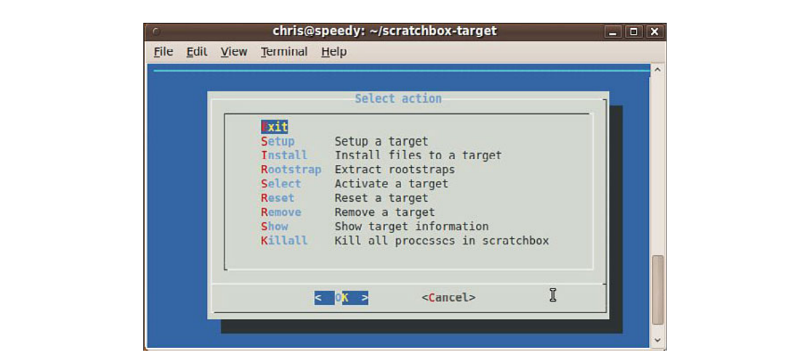
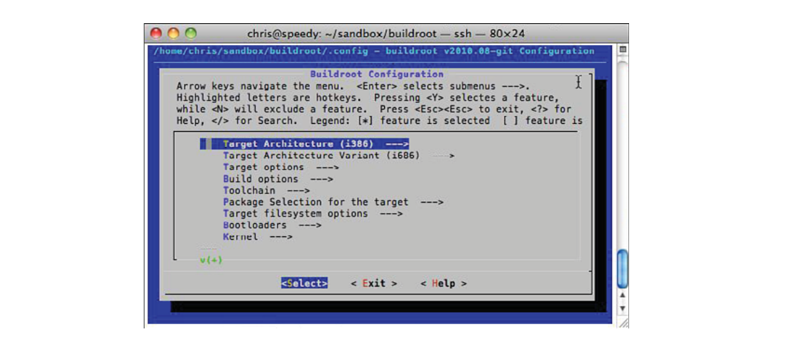
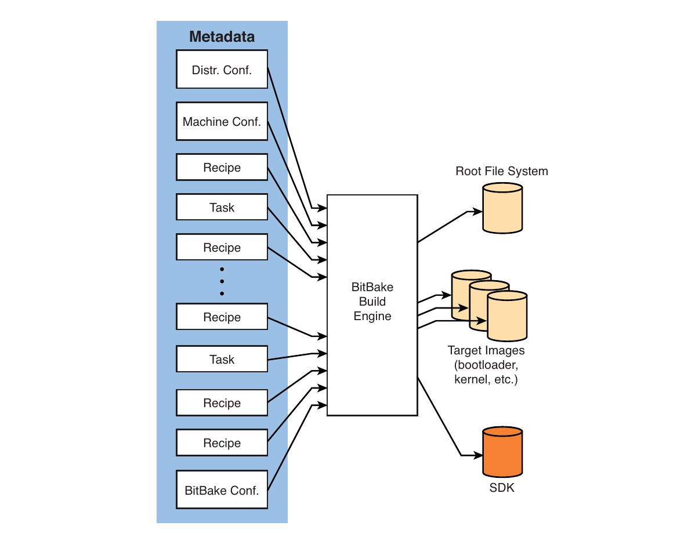

# Chương 16. Open source build system

## Trong chương này

- 16\.1 Vì sao dùng build system? 446

- 16\.2 Scratchbox 447

- 16\.3 Buildroot 451

- 16\.4 OpenEmbedded 454

- 16\.5 Tổng kết 464

Các software build system đã tồn tại từ lâu. Trong lịch sử, chúng

đã có nhiều hình thức, từ những hệ thống script-driven hoặc make-based đơn giản

đến các chương trình phần mềm phức tạp, thường mang tính độc quyền, được thiết kế để build một dự

án cụ thể. Một số open source build system đã xuất hiện rồi biến mất, trong khi một số khác

đã vượt qua thử thách của thời gian.

Chương này giới thiệu một số build system phổ biến hơn và xem xét chi

tiết một build system đã nổi lên như ứng viên hàng đầu để

build các embedded Linux system: OpenEmbedded.

## 16.1 Vì sao dùng build system?

Có nhiều nguồn cung cấp embedded Linux distribution hoàn chỉnh. Bạn có thể tìm các embedded Linux distribution trực tuyến, download miễn phí hoặc mua từ các nhà cung cấp embedded Linux thương mại. Các distribution này thường có chức năng cố định và khó thay đổi. Chúng thường đi kèm các giải pháp binary-only, chẳng hạn toolchain quan trọng và các package thiết yếu, nhưng không có hướng dẫn thực sự tạo các thành phần này từ source.

Một embedded Linux build system có đầy đủ khả năng sẽ giúp bạn tạo embedded Linux distribution phù hợp với những yêu cầu riêng của mình. Distribution này phải bao gồm một cross-toolchain và tất cả package cần thiết cho dự án. Build system phải có khả năng tạo root file system theo binary format bạn chọn, embedded Linux kernel image với cấu hình của bạn, bootloader image cùng mọi file và utility cần thiết khác để có thể triển khai chúng đúng cách.

Build một embedded Linux distribution, hay bất kỳ Linux distribution nào, từ đầu hoàn toàn không phải công việc đơn giản. Hãy thử hình dung việc tập hợp tất cả thành phần tạo nên desktop Linux distribution của bạn. Đừng quên tính cả toolchain, vì với ứng dụng embedded, trái với quan niệm phổ biến, việc có được toolchain commercial-quality cho kiến trúc non-x86 là rất khó nếu thiếu kiến thức và kinh nghiệm chuyên sâu về phát triển, kiểm thử cross-toolchain cho kiến trúc bạn chọn.

Lập danh sách các thành phần cần thiết có thể là thách thức đầu tiên của bạn. Bạn sẽ lấy toolchain từ đâu? Còn các system library và bootloader cần thiết thì sao? Bạn sẽ lấy chúng ở đâu? Bạn cần những package nào để hỗ trợ các hardware device và software application dự kiến sử dụng trong sản phẩm? Mỗi package bạn định sử dụng có những dependency nào? Bạn sẽ dùng file system nào và build chúng như thế nào? Bạn sẽ theo dõi phiên bản package và dependency của chúng ra sao? Làm thế nào để xác định phiên bản package và tool nào tương thích với nhau? Bạn sẽ quản lý việc cập nhật và nâng cấp embedded Linux distribution cùng sản phẩm embedded được tạo ra như thế nào? Các patch được tích hợp sau đó ra sao?

Đây cùng những câu hỏi khác là những vấn đề mà lập trình viên embedded system phải đối mặt khi kế hoạch dự án dần hình thành. Một embedded Linux build system well-designed và dễ hỗ trợ là công cụ lý tưởng để giúp trả lời những câu hỏi này, đồng thời giúp triển khai dự án nhanh chóng và dễ bảo trì.

Các phần tiếp theo giới thiệu một số build system phổ biến hơn. Chúng ta sẽ dành thời gian đáng kể mô tả OpenEmbedded, một trong những embedded Linux build system triển vọng và phổ biến nhất.

## 16.2 Scratchbox

Scratchbox là một toolkit cross-compilation trở nên phổ biến trong thời gian được sử dụng ở dự án Maemo dành cho máy tính cầm tay Nokia N770. Sau đó, dự án Maemo đã hợp nhất với Moblin để trở thành MeeGo (www.meego.com).

Theo website Scratchbox, các target ARM và X86 được hỗ trợ, còn PowerPC và MIPS được hỗ trợ ở mức thử nghiệm. Installation manual mới nhất tuyên bố hỗ trợ các target PowerPC.

### 16.2.1 Cài Scratchbox

Việc cài đặt khá đơn giản nếu làm theo hướng dẫn trên website Scratchbox. Với các hệ thống Debian-based như Ubuntu, hãy thêm dòng sau vào file `/etc/apt/sources.` `list`:

```
deb http://scratchbox.org/debian stable main
```

Sau đó, thực hiện cập nhật, cài các package cần thiết và thêm username[^1] của bạn vào Scratchbox. Listing 16-1 trình bày chuỗi thao tác này.

LISTING 16-1 Cài Scratchbox

```
$ sudo apt-get update
$ sudo apt-get install scratchbox-core
$ sudo sb-adduser <your username>
```

Lưu ý rằng chuỗi chỉ dẫn này yêu cầu quyền root. Điều đó không phải vấn đề lớn nếu bạn có quyền root trên build machine. Theo chính sách IT, nhiều lập trình viên trong các doanh nghiệp lớn không có quyền này. Bạn nên cân nhắc liệu đây có phải vấn đề đối với ứng dụng của mình hay không.

Cũng cần lưu ý rằng sau khi dùng `sb-adduser` để thêm username của mình vào hạ tầng Scratchbox, bạn phải đăng xuất rồi đăng nhập lại bằng một shell mới để cập nhật những thay đổi về tư cách thành viên của group. Tài liệu Scratchbox mô tả đầy đủ việc này.

### 16.2.2 Tạo target Cross-Compilation

Sau khi cài Scratchbox, bạn phải thực hiện một số bước trước khi bắt đầu build. Trước tiên, bạn phải cài toolchain và qemu (một processor emulator phổ biến) để mô phỏng target. Sau đó, bạn phải đăng nhập vào Scratchbox và thực hiện thiết lập ban đầu bằng một utility menu-driven của Scratchbox. Việc cài Scratchbox toolchain không khó nếu bạn dùng distribution Debian-based như Ubuntu. Scratchbox cung cấp một số toolchain. Hãy xem các phiên bản hiện có trong tab Download trên website của dự án. Trong ví dụ này, chúng ta chọn một ARM compiler:

```
$ sudo apt-get install scratchbox-toolchain-arm-linux-cs2010q1-202
$ sudo apt-get install scratchbox-devkit-qemu
```

Tiếp theo, đăng nhập với tư cách Scratchbox user và tạo một target cho cross-compilation. Sử dụng chương trình `login` của Scratchbox để đăng nhập:

```
$ /scratchbox/login
```

Sau khi đăng nhập với tư cách Scratchbox user, hãy gọi configuration utility. Bạn thực hiện việc này bằng một utility menu-based có tên `sb-menu`. Gọi configuration menu như sau:

```
$ [sbox-NO-TARGET: ~] > sb-menu
```

Hình 16-1 cho thấy màn hình cấu hình chính xuất hiện sau khi thực hiện lệnh này.



HÌNH 16-1 Scratchbox menuconfig

Sử dụng tài liệu cài đặt trên website Scratchbox (`installdoc.` `pdf`) làm hướng dẫn (www.scratchbox.org/documentation/docbook/installdoc.html), hãy thiết lập môi trường Scratchbox theo các bước sau:

1\. Tạo target mới dưới Setup tên `mytarget`.

2\. Chọn một cross-compiler khi được nhắc sau khi chọn target.

3\. Chọn devkits, rồi qemu.

4\. Chọn CPU transparency, rồi qemu-arm-sb.

Sau khi hoàn tất các bước này, thoát utility `sb-menu`. Bây giờ bạn đã sẵn sàng khám phá môi trường Scratchbox.

Trong phần minh họa ngắn này, chúng ta sẽ sử dụng một chương trình Hello World đơn giản. Dùng editor bạn ưa thích từ bên trong Scratchbox shell để tạo một chương trình Hello World đơn giản tương tự Listing 16-2.

LISTING 16-2 Ví dụ Hello World đơn giản

```
#include <stdio.h>

int main(int argc, char **argv)
{
    printf(“Hello world\n”);
        return 0;
}
```

Giờ compile trong Scratchbox environment:

```
[sbox-mytarget: ~] > gcc -o hello-arm hello.c
```

Lệnh này dùng Scratchbox ARM toolchain bạn vừa cài để compile file `hello.c`. Lệnh gọi ARM toolchain thông qua một Scratchbox wrapper. Bạn có thể xem các toolchain wrapper trong `/scratchbox/compilers/bin`. Wrapper xác định compiler cần gọi dựa trên các target specification bạn vừa tạo. Sau đó, bạn có thể kiểm tra rằng file kết quả là một ARM binary và chạy file đó trong Scratchbox shell bằng công nghệ mô phỏng qemu do môi trường Scratchbox cung cấp:

```
[sbox-mytarget: ~] > file hello-arm
hello-arm: ELF 32-bit LSB executable, ARM, version 1 (SYSV), for GNU/Linux 2.6.16,
dynamically linked (uses shared libs), not stripped
[sbox-mytarget: ~] > ./hello-arm
Hello
```

Mặc dù đây là một ví dụ đơn giản, nó minh họa môi trường và phương pháp của Scratchbox. Mô hình Scratchbox cung cấp cho lập trình viên một môi trường phát triển trông giống target. Ưu điểm của cách tiếp cận này là việc build nhiều open source package vốn khó cross-compile trở nên dễ dàng hơn nhờ mô phỏng target.

Tất nhiên, các trường hợp sử dụng Scratchbox trong thực tế phức tạp hơn ví dụ này rất nhiều, nhưng kiến trúc và cách tiếp cận đã thể hiện rõ. Trong thực tế, bạn sẽ có nhiều package và chương trình phần mềm khác được compile trong môi trường Scratchbox, có thể bằng một chuỗi makefile hoặc một build script tùy chỉnh do bạn tạo riêng theo yêu cầu của mình.

Scratchbox có tính năng remote shell cho phép lập trình viên thực hiện một số thao tác, cả tương tác lẫn không tương tác, trực tiếp trên phần cứng target thực. Tính năng này hoạt động tương tự remote shell (`rsh`) quen thuộc. Nó có tên `sbrsh` và được cung cấp như một phần của bản cài đặt Scratchbox. Bạn có thể tìm thêm chi tiết về `sbrsh` trong tài liệu Scratchbox.

Scratchbox có tài liệu tốt. Nếu muốn tìm hiểu thêm về Scratchbox, hãy cài nó trên hệ thống của bạn và làm theo tài liệu trên website dự án (www.scratchbox.org).

## 16.3 Buildroot

Buildroot là một tập hợp makefile và patch trong một hệ thống được thiết kế để build một embedded Linux distribution hoàn chỉnh. Theo website Buildroot, các tính năng chính của nó bao gồm:

- Nó có thể build tất cả thành phần cần thiết cho sản phẩm embedded Linux của bạn, bao gồm cross-compiler, root file system, kernel image và bootloader.

- Nó cho phép cấu hình đơn giản bằng Linux kernel menuconfig quen thuộc và các utility liên quan.

- Nó hỗ trợ vài trăm package cho user space application và library, bao gồm GTK2, Qt, GStreamer và nhiều network utility.

- Nó hỗ trợ uClibc hoặc glibc cùng một số target library khác.

- Nó có cấu trúc đơn giản dựa trên ngôn ngữ makefile vốn đã được hiểu rõ.

### 16.3.1 Cài Buildroot

Việc đầu tiên bạn cần làm là tìm và download một Buildroot snapshot. Cách dễ nhất là dùng git. Tất nhiên, dùng git mà không chỉ định tag nghĩa là bạn đang lấy phiên bản mới nhất ở đầu tree; trong bất kỳ dự án open source nào, cách này cũng có nguy cơ thiếu ổn định. Nếu không muốn mạo hiểm, bạn có thể download các stable snapshot. Chúng được liệt kê trên trang download của website Buildroot tại http://buildroot.uclibc.org/downloads/buildroot.html. Trong các ví dụ này, chúng ta sẽ dùng git:

```
$ git clone git://git.buildroot.net/buildroot
```

### 16.3.2 Cấu hình Buildroot

Sau khi cài snapshot hoặc git repository, bạn có thể bắt đầu cấu hình. Vào directory nơi bạn cài Buildroot và thực hiện lệnh cấu hình quen thuộc:

```
$ make menuconfig
```

Lệnh này mở một configuration utility mà đến đây hẳn bạn đã rất quen thuộc. Bạn đã thấy một configuration menu tương tự khi cấu hình Linux kernel cũng như Scratchbox. Hình 16-2 cho thấy giao diện của utility này.



HÌNH 16-2 Cấu hình Buildroot

Buildroot có hệ thống cấu hình rất phong phú. Bạn có nhiều option để lựa chọn khi cấu hình các thuộc tính của embedded Linux distribution mà Buildroot tạo ra. Dưới đây là một số thuộc tính quan trọng hơn mà bạn phải lựa chọn:

- Target architecture

- Architecture variant như PowerPC 603e hoặc ARM 920t

- Target option như board device, serial port

- Build option xác định các option build-related như vị trí của build directory và download directory, mức song song (số job đồng thời) và các thuộc tính build khác

- Toolchain option, bao gồm loại library (uClibc hoặc glibc) và phiên bản compiler.

- Lựa chọn package, chẳng hạn những software package nào sẽ có trên target của bạn

### 16.3.3 Build bằng Buildroot

Sau khi thực hiện cấu hình đơn giản, bạn bắt đầu build chỉ bằng cách gõ `make`. Nếu cấu hình của bạn đúng và bạn may mắn,[^2] kết quả sẽ là một embedded Linux distribution hoàn chỉnh. Quá trình build có thể mất khá nhiều thời gian vì phải download và build nhiều thành phần phần mềm, đồng thời thực hiện nhiều bước để đạt được mục tiêu đó. Rất nhiều output sẽ cuộn qua serial terminal trong lúc build. Buildroot thực hiện các bước tổng quát sau:

- Download source file cho tất cả package và toolchain đã được cấu hình

- Build cross-compilation toolchain

- Sử dụng cross-toolchain để cấu hình và compile tất cả package được yêu cầu

- Build một kernel image nếu được cấu hình để thực hiện việc đó

- Tạo một root file system theo định dạng bạn chọn

Khi quá trình build hoàn tất, bạn có thể xem kết quả trong directory `.../output`. Listing 16-3 trình bày nội dung này.

LISTING 16-3 Output directory structure của Buildroot

```
chris@speedy:~/sandbox/buildroot$ ls -l output
total 28
drwxr-xr-x  7 chris chris 4096 2010-07-31 16:45 build
drwxr-xr-x  3 chris chris 4096 2010-07-31 16:45 host
drwxr-xr-x  2 chris chris 4096 2010-07-31 16:45 images
drwxr-xr-x  5 chris chris 4096 2010-07-31 16:34 staging
drwxr-xr-x  2 chris chris 4096 2010-07-31 16:44 stamps
drwxr-xr-x 16 chris chris 4096 2010-07-31 16:45 target
drwxr-xr-x 18 chris chris 4096 2010-07-31 16:41 toolchain
```

Root file system thích hợp nằm trong `.../output/images`. Vì chúng ta đã chỉ định ext2 file system khi cấu hình build, trong images subdirectory sẽ có một image `rootfs.ext2`:

```
chris@speedy:~/sandbox/buildroot$ ls -l ./output/images/
total 3728
-rw-r--r-- 1 chris chris 3817472 2010-07-31 16:45 rootfs.ext2
-rwxr-xr-x 1 chris chris   65656 2010-07-31 17:31 u-boot.bin
```

Buildroot khá linh hoạt và có nhiều configuration option. Buildroot có thể build U-Boot cho một board cụ thể chỉ bằng cách chỉ định tên board lấy từ U-Boot makefile, bỏ hậu tố `_config`, trong lúc cấu hình Buildroot. Trong ví dụ này, tên ap920t được chỉ định và một U-Boot image (`u-boot.bin`) cũng được tạo ra. Tài liệu Buildroot cung cấp thêm chi tiết về việc này.

Các directory khác trong những output subdirectory của Buildroot, như trong Listing 16-3, bao gồm các directory chứa intermediate build target. Subdirectory `staging` được dùng để chứa build target của các package mà bản thân chúng là dependency của package khác. Directory `toolchain` chứa những thành phần cần thiết để compile cross-toolchain. Directory `host` chứa các tool host-specific được build để hỗ trợ hoạt động của Buildroot. Chúng bao gồm những chương trình như `fakeroot` (dùng để build root file system mà không cần quyền root) và các chương trình tạo image. Directory `target` là một near-replica của root file system image, nhưng không thể dùng trực tiếp làm root file system vì user, group, permission và device node chưa đúng. Fakeroot dùng directory target này để build image cuối cùng. Cuối cùng, directory `build` là nơi build mọi thành phần, ngoại trừ cross-toolchain.

Buildroot là một build system mạnh mẽ, có thể build một embedded Linux distribution hoàn chỉnh. Hãy tham khảo tài liệu Buildroot tại http://buildroot.uclibc.org/docs.html để biết đầy đủ chi tiết.

## 16.4 OpenEmbedded

Có nhiều tranh luận về sự tiến hóa, nhưng khi nói đến OpenEmbedded, có thể nhanh chóng nhận thấy rằng nó đã phát triển từ một số công nghệ ra đời trước đó. Một số khái niệm ban đầu của OpenEmbedded có chung nguồn gốc với Portage build system của Gentoo, nhưng OpenEmbedded cũng dựa trên các khái niệm từ những build system khác, bao gồm Buildroot.

Trang chủ OpenEmbedded (www.openembedded.org) tuyên bố rằng OpenEmbedded “...cung cấp một môi trường cross-compile best-in-class”. Xét những hạn chế của các open source build system khác và tính linh hoạt của OpenEmbedded, nhận định này có thể là chính xác. Website cũng liệt kê những ưu điểm sau của OpenEmbedded:

- Hỗ trợ nhiều hardware architecture.

- Hỗ trợ nhiều release cho architecture đó.

- Nó chứa các tool giúp tăng tốc quá trình re-creating nền tảng sau khi thực hiện thay đổi.

- Dễ tùy chỉnh.

- Chạy trên mọi Linux distribution.

- Nó cross-compiles hàng nghìn package, bao gồm GTK+, Qt, X Windows, Mono và Java.

OpenEmbedded đã được đón nhận đáng kể trong cả dự án thương mại lẫn dự án open source. Nhiều tổ chức phát triển phần mềm thương mại đã chọn OpenEmbedded làm build system ưu tiên của mình. Thực tế, một số nhà cung cấp Embedded Linux thương mại, bao gồm Mentor Graphics và MontaVista Software, đã dùng OpenEmbedded làm nền tảng cho các sản phẩm embedded Linux thương mại của họ.

### 16.4.1 Thành phần OpenEmbedded

OpenEmbedded gồm hai thành phần chính, như trong Hình 16-3. BitBake là build engine, một build tool mạnh mẽ và linh hoạt. Metadata là tập hợp chỉ dẫn cho BitBake biết cần build những gì.



HÌNH 16-3 BitBake và metadata

BitBake xử lý metadata, tức các chỉ dẫn mô tả cần build những gì. Khi quá trình build kết thúc, BitBake tạo tất cả image được yêu cầu, bao gồm root file system, kernel, bootloader và các intermediate image như device tree binary trong trường hợp Power Architecture. Một trong những tính năng mạnh mẽ hơn của OpenEmbedded là khả năng tạo software development kit (SDK). Các SDK này có thể chứa toolchain, library và header file để lập trình viên ứng dụng sử dụng trong một môi trường phát triển self-contained.

### 16.4.2 BitBake metadata

Metadata có thể được chia tương đối thành bốn nhóm, mỗi nhóm đảm nhiệm một vai trò cụ thể:

- Recipe

- Class

- Task

- Configuration

Loại metadata phổ biến nhất là recipe file. Recipe thường chứa những chỉ dẫn để BitBake build một package riêng lẻ. Recipe mô tả package, các dependency của nó và mọi thao tác đặc biệt khác có thể cần thiết để build package đó.

Class đảm nhiệm vai trò tương tự class trong một ngôn ngữ lập trình object-oriented như C++ hoặc Java. Chúng được dùng để đóng gói những chức năng chung được sử dụng trong nhiều recipe.

Task thường được dùng để nhóm các package phục vụ việc build root file system. Chúng thường là những file đơn giản, nội dung thường chỉ nhỉnh hơn vài dòng khai báo package dependency.

Configuration metadata đóng vai trò quan trọng trong việc xác định hành vi tổng thể của BitBake. Configuration data cung cấp các global build variable như build path, các lệnh mặc định để tạo image và những đặc điểm riêng của một machine cụ thể. Nó cũng xác định các đặc điểm của distribution đang được tạo, chẳng hạn toolchain và C library (uClibc, glibc, v.v.) sẽ sử dụng.

### 16.4.3 Recipe cơ bản

Đơn vị metadata phổ biến nhất của OpenEmbedded là recipe. Recipe thường là một file hoặc một tập hợp nhỏ các file dùng để build một package riêng lẻ. Xem xét một recipe đơn giản là cách tốt để bắt đầu tìm hiểu ngôn ngữ metadata của OpenEmbedded. Listing 16-4 là phiên bản Hello World của OpenEmbedded. Recipe này build một ứng dụng Hello World đơn giản và chuẩn bị để đưa ứng dụng đó vào root file system cuối cùng. Trên file system, recipe có tên `hello_1.0.0.bb`.

LISTING 16-4 OpenEmbedded recipe đơn giản: `hello_1.0.0.bb`

```
DESCRIPTION = “Hello demo project”
PR = “r0”
LICENSE = “GPL”

SRC_URI = “http://localhost/sources/hello-1.0.0.tar.gz”

SRC_URI[md5sum] = “90a8ffd73e4b467b6d4852fb95e493b9”
SRC_URI[sha256sum] = “fd626b829cf1df265abfceac37c2b5629f2ba8fbc3897add29f-
9661caa40fe12”

do_install() {
        install -m 0755 -d ${D}${bindir}
        install -m 0755 ${S}/hello ${D}${bindir}/hello
}
```

Vài field đầu chỉ mang tính quản lý:

- `DESCRIPTION`—Thông tin mô tả chính package

- `PR`—Package (recipe) version number

- `LICENSE`—License của package

`SRC_URI` phải có trong mọi recipe. Nó xác định phương thức (`http` trong ví dụ này) và vị trí (`localhost/sources/hello-1.1.0.tar.gz`) mà BitBake sẽ dùng để tìm và lấy các file tạo nên package. Source code có thể được fetch [^3] ở nhiều dạng bằng nhiều phương thức khác nhau. Chẳng hạn, source có thể được lấy từ một git, svn hoặc cvs repository ở local hay remote. Source cũng có thể được lấy từ một file hoặc tarball ở local hoặc trên Internet server.

`SRC_URI[md5sum]` là một phương thức chỉ định checksum dùng để xác thực rằng source archive đã được fetch đúng. Nếu có một file chữ ký md5 hoặc sha256 ở remote, nó được kiểm tra với các giá trị này để bảo đảm download chính xác.

Method `do_install` là một function override của install method mặc định trong BitBake. Trong recipe mẫu này, method `do_install` xác định hai bước bằng lệnh Linux `install`: tạo một output directory để chứa build artifact (binary `hello` của chúng ta), rồi đặt binary đó vào directory vừa tạo. Các directory được chỉ định bằng cú pháp thường gặp trong autotools configuration script và build file. `{bindir}` chỉ `/bin` trên target. `S` và `D` là các biến tiện ích của OpenEmbedded metadata, lần lượt chỉ source directory và destination directory. Bạn có thể đọc thêm về lệnh `install` trên Linux desktop mình ưa dùng trong man page `man install`.

Recipe trong OpenEmbedded có thể chứa directive viết bằng ngôn ngữ Python hoặc ngôn ngữ bash shell script. Ví dụ trong Listing 16-4 chỉ chứa bash shell script. Việc thảo luận về Python nằm ngoài phạm vi phần này.

Có thể bạn đang thắc mắc làm thế nào recipe đơn giản này có thể build ứng dụng Hello World. Chúng ta đã thấy một install step được định nghĩa trong recipe, nhưng ngoài ra hầu như không có build instruction nào khác. BitBake xử lý mỗi recipe bằng một tập hợp các bước mặc định được định nghĩa trong các OpenEmbedded class. BitBake class là các file có đuôi `.bbclass`. Phần lớn các bước xử lý mặc định đến từ một base class đặc biệt có tên `base.bbclass`. Đây là nơi định nghĩa các lệnh mặc định để fetch, unpack, configure, compile và install.

Listing 16-5 cho thấy BitBake output trong khi build hello package. BitBake có thể nhận bất kỳ recipe hoặc task[^4] nào làm target để build.

LISTING 16-5 BitBake xử lý Hello recipe

```
chris@speedy:~/sandbox/build01$ bitbake hello
<...>
NOTE: Executing runqueue
NOTE: Running task 10 of 38 (ID: 5, NOTE: Running task 10 of 38 (ID: 5,
/hello_1.0.0.bb, do_fetch)
NOTE: Running task 11 of 38 (ID: 0, /hello_1.0.0.bb, do_unpack)
NOTE: Running task 15 of 38 (ID: 1, /hello_1.0.0.bb, do_patch)
NOTE: Running task 16 of 38 (ID: 7, /hello_1.0.0.bb, do_configure)
NOTE: Running task 17 of 38 (ID: 8, /hello_1.0.0.bb, do_compile)
NOTE: Running task 18 of 38 (ID: 2, /hello_1.0.0.bb, do_install)
NOTE: Running task 19 of 38 (ID: 10, /hello_1.0.0.bb, do_package)
NOTE: Running task 25 of 38 (ID: 13, /hello_1.0.0.bb, do_package_write_ipk)
NOTE: Running task 26 of 38 (ID: 9, /hello_1.0.0.bb, do_package_write)
NOTE: Running task 29 of 38 (ID: 3, /hello_1.0.0.bb, do_populate_sysroot)
NOTE: Running task 30 of 38 (ID: 12, /hello_1.0.0.bb, do_package_stage)
NOTE: Running task 37 of 38 (ID: 11, /hello_1.0.0.bb, do_package_stage_all)
NOTE: Running task 38 of 38 (ID: 4, /hello_1.0.0.bb, do_build)
NOTE: Tasks Summary: Attempted 38 tasks of which 25 didn’t need to be rerun and 0
failed.
```

Lưu ý rằng listing này đã được định dạng lại để dễ đọc hơn. Mỗi dòng đã được rút gọn để bỏ full path đến recipe file `hello_1.0.0.bb`, và một số dòng không liên quan đến phần thảo luận đã được loại bỏ.

Từ Listing 16-5, chúng ta có thể thấy từng bước mà BitBake sử dụng để build package do recipe `hello_1.0.0.bb` định nghĩa. Bước đầu tiên, fetch, download hello tarball từ server. Bước unpack giải nén tarball vào một working directory được configuration metadata xác định. Trong Listing 16-4, chúng ta đã thấy có thể tham chiếu working directory này bằng metadata variable có tên `S`. Bước `do_patch` áp dụng mọi patch cần thiết có trong metadata.

Bước configure diễn ra sau patch. Trong recipe đơn giản này, configure là một null method: nó không làm gì vì không có gì cần cấu hình. Task tiếp theo là compile. Tại đây, một lệnh make tổng quát được thực thi trong working directory chứa hello source, với kỳ vọng package makefile sẽ thực hiện công việc build package. Sau đó là bước install. Từ Listing 16-5, hãy chú ý rằng chúng ta đã override install stage mặc định bằng định nghĩa install riêng. Phiên bản install của chúng ta được ưu tiên sử dụng. Nó cài binary `hello` như đã mô tả khi thảo luận Listing 16-4.

Một vài bước tiếp theo liên quan đến packaging sẽ tạo một binary package chứa các file mà chúng ta đã đưa vào bằng install method. Việc thảo luận chi tiết về packaging nằm ngoài phạm vi phần này, nhưng cần hiểu rằng mỗi recipe đều tạo một binary package theo định dạng do metadata chỉ định. Thông thường, đó là package format `.ipk`, một công nghệ packaging gọn nhẹ được thiết kế riêng cho các ứng dụng embedded Linux. Package kết quả được đặt trong một output directory đặc biệt mà BitBake tạo riêng cho mục đích này.

Các bước populate và staging chuyển mọi file cần thiết đến một staging location đặc biệt, để các package được build sau đó có thể sử dụng nếu chúng phụ thuộc vào artifact của lần build này. Ngoài ra, root file system cuối cùng được tập hợp từ nội dung của các directory recipe-specific đặc biệt, nơi thu thập build artifact. Đây là công việc của method `do_build`.

Sau khi BitBake xử lý thành công recipe này, package đã được build. Sau đó, các build artifact, thường là binary, library hoặc một tập hợp các thành phần này, được đặt trong một directory recipe-specific đặc biệt để các chương trình khác có thể tham chiếu đến chúng trong quá trình build. Các recipe image-building chạy sau đó có thể thu thập build artifact từ những directory recipe-specific này để đưa vào root file system cuối cùng.

Các phần tiếp theo thảo luận những nhóm metadata chính còn lại: task, class và configuration.

### 16.4.4 Metadata task

Task là một recipe được dùng để nhóm các package với nhau, thường nhằm mục đích build root file system. Task không tạo output package chứa artifact, vì những package đó sẽ rỗng. Tên của chúng có thể có hoặc không có từ “task”.

Lưu ý rằng thuật ngữ task trong OpenEmbedded được dùng với nhiều nghĩa. Khi nói đến BitBake task, chúng ta đang nói về các bước BitBake thực hiện, chẳng hạn `do_compile`; nhưng task cũng có thể chỉ các recipe đặc biệt này. Hãy chú ý cách sử dụng thuật ngữ!

Listing 16-6 cho thấy một task đơn giản từ một snapshot gần đây của OpenEmbedded. Task này chỉ định các package cần thiết để hỗ trợ Java nói chung. Khi root file system cuối cùng được tập hợp, nó sẽ chứa các package được chỉ định trong task-java.bb.

LISTING 16-6 `task-java.bb`

```
DESCRIPTION = “Base task package for Java”
PR = “r2”
LICENSE = “MIT”

inherit task

RDEPENDS_${PN} = “\
    cacao \
    classpath-awt \
    java2-runtime \
    librxtx-java \
 “
```

Một số task có thể phức tạp, nhưng task này tương đối đơn giản và minh họa ý tưởng cơ bản đằng sau task. Các header field bắt buộc đều có mặt, bao gồm `DESCRIPTION`, `PR` và `LICENSE`. Keyword `inherit` minh họa cách sử dụng loại metadata tiếp theo mà chúng ta sẽ thảo luận: class và vai trò của chúng trong inheritance. Bạn có thể xem directive này tương tự `#include` trong C. Nó chỉ định rằng các variable và method được định nghĩa trong `task.` `bbclass` phải được đưa vào recipe này khi BitBake xử lý recipe.

Variable `RDEPENDS_${PN}` trong Listing 16-6 là cú pháp dùng để định nghĩa runtime dependency. `PN` được đánh giá thành package name, về cơ bản là basename của recipe filename, trong ví dụ này là `task-java`. Khi recipe `task-java.bb` này được đưa vào một image build, các runtime dependency liệt kê trong RDEPENDS của nó khiến những package đó được build và đưa vào image cuối cùng. Nếu đã làm theo các ví dụ và download một OpenEmbedded snapshot, bạn có thể xem task này hoạt động trong image recipe `x11-gpe-java-image.bb`.

### 16.4.5 Metadata class

Class trong OpenEmbedded tương tự class trong các ngôn ngữ object-oriented như C++ và Java. Nó được dùng để đóng gói chức năng chung mà nhiều recipe khác có thể chia sẻ. OpenEmbedded sử dụng class cho nhiều chức năng thông dụng.

Chúng ta đã thấy một ví dụ sử dụng class trong recipe `task-java.bb` ở Listing 16-6. Có thể tìm task class này trong file `task.bbclass`, nằm trong subdirectory của repository `openembedded` có tên `classes`. Nó thực hiện một số công việc quản lý phụ trợ cho các chức năng mà mọi task đều cần. Trong số đó có những directive báo cho BitBake rằng bản thân recipe này không tạo build artifact nào cần packaging hoặc đưa vào root file system cuối cùng. Nó cũng chứa logic tạo các phiên bản `-dbg` và `-dev` của những package được chính task này đưa vào.

Một trong những class được dùng phổ biến hơn là `autotools.bbclass`. Class này cung cấp chức năng autotools quen thuộc mà nhiều Linux package thông dụng sử dụng làm nền tảng build. Có lẽ bạn đã quen với các package autotools-based. Nếu từng download source code, giải nén và compile trên Linux desktop bằng chuỗi lệnh quen thuộc `./configure`, `make` và `make install`, bạn đã build một dự án autotools-based.

Class `autotools.bbclass` cung cấp chức năng này. Nếu bạn có một source package sử dụng autotools, recipe có thể khá đơn giản, ngay cả khi bản thân package không đơn giản.

Listing 16-7 cho thấy một recipe autotools-based đơn giản. Nó đã được định dạng lại đôi chút để dễ đọc hơn mà không làm mất chức năng.

LISTING 16-7 Recipe Autotools-Based đơn giản: `rdesktop_1.5.0.bb`

```
DESCRIPTION = “Rdesktop rdp client for X”
HOMEPAGE = “http://www.rdesktop.org”
DEPENDS = “virtual/libx11 openssl”
SECTION = “x11/network”
LICENSE = “GPL”
PR = “r2”

inherit autotools

SRC_URI = “${SOURCEFORGE_MIRROR}/rdesktop/rdesktop-${PV}.tar.gz”

EXTRA_OECONF = “--with-openssl=${STAGING_EXECPREFIXDIR} “
```

Khó có thể đơn giản hơn được nữa. Recipe này cung cấp build instruction cho rdesktop, một rdp client dành cho X. Header tiêu chuẩn có đầy đủ các mục, bao gồm `DESCRIPTION`, `LICENSE`, `PR`, v.v. Tiếp theo là chức năng autotools từ `autotools.` `bbclass`, được đưa vào thông qua keyword `inherit`. SRC\_URI cho BitBake biết nơi lấy source code và cách lấy.

Mục cuối cùng minh họa một trong những tính năng chính của các dự án autotools-based. Nếu từng truyền lệnh cho `./configure` khi build một dự án autotools-based, bạn sẽ thấy điều này quen thuộc. Variable `EXTRA_OECONF` đơn giản được truyền cho `./configure` của rdesktop khi bước configure được thực hiện. Ví dụ cụ thể này truyền flag `--with-openssl` cho script `./configure` của rdesktop. Nhờ đó, rdesktop được cấu hình với chức năng openssl và được chỉ dẫn nơi tìm các openssl support file cần thiết để compile khi bật tính năng này.

Class được dùng trong OpenEmbedded cho rất nhiều mục đích. Bạn có thể xem tất cả class hiện được định nghĩa trong directory `.../openembedded/classes`.

### 16.4.6 Cấu hình OpenEmbedded

Một trong những khía cạnh khó khăn nhất khi sử dụng OpenEmbedded là có được một cấu hình hoạt động được. Để build một embedded Linux distribution, cần định nghĩa nhiều thứ. Dưới đây là một số thuộc tính rõ ràng hơn cần được định nghĩa:

- Target architecture

- Processor type

- Machine feature như serial port, baud rate, Flash organization

- Lựa chọn C library, chẳng hạn glibc hoặc một trong nhiều phương án thay thế embedded-optimized

- Toolchain, binutils version và source (external hoặc BitBake build)

- Root file system image type

- Kernel version

Tất nhiên, cấu hình còn bao gồm nhiều thứ hơn những mục được liệt kê ở đây. Configuration metadata có thể được chia thành bốn nhóm lớn: BitBake, machine, distribution và local. BitBake configuration (`bitbake.conf`) về nhiều mặt giống hệ thống hạ tầng bên trong của BitBake. Nó định nghĩa các variable system-wide như system path, target file system layout và nhiều build variable architecture-dependent. Trừ khi bạn đang làm điều gì đó khác thường, bạn không cần sửa file này.

Machine configuration được đặt trong một configuration file mang tên machine mà nó mô tả. Các OpenEmbedded snapshot gần đây chứa configuration file mô tả hơn 250 machine.[^5] Đây là nơi thích hợp để định nghĩa các tính năng machine-specific, chẳng hạn cấu hình serial port và những yêu cầu cụ thể về image format, kernel version và bootloader version. Target architecture thường được chỉ định trong machine file.

Distribution configuration xác định các khía cạnh của toàn bộ embedded Linux distribution mà bạn đang build. Các phiên bản OpenEmbedded hiện tại có distribution configuration file cho hơn 35 distribution có tên khác nhau. Angstrom và OpenMoko là hai ví dụ nhận được nhiều sự chú ý từ các lập trình viên OpenEmbedded.

Những thuộc tính của distribution được định nghĩa trong distribution configuration file bao gồm loại toolchain, loại C library và phiên bản distribution. Bạn thường đặt một đặc tả tối thiểu cho base root file system trong configuration file này. Hãy xem nhiều ví dụ trong OpenEmbedded metadata để biết thêm chi tiết.

Nhóm cấu hình cuối cùng là `local.conf`. Đây là nơi bạn tinh chỉnh và tùy biến distribution theo ý mình. `local.conf` của bạn có thể đơn giản hoặc phức tạp tùy nhu cầu. Tối thiểu, `local.conf` phải xác định machine type và distribution mà bạn chọn, qua đó kết hợp machine configuration với distribution configuration cho embedded Linux distribution tùy chỉnh của bạn. OpenEmbedded metadata chứa một mẫu `local.conf` có nhiều comment, phù hợp để làm điểm khởi đầu. Trực tuyến cũng có các ví dụ cụ thể về `local.conf`. Bạn có thể tìm hướng dẫn OpenEmbedded dành cho BeagleBoard trên BeagleBoard wiki tại http://elinux.org/BeagleBoard#OpenEmbedded.

### 16.4.7 Build image

Các recipe mạnh mẽ nhất trong OpenEmbedded là image recipe. Bạn có thể build toàn bộ embedded Linux distribution bằng một image recipe được xây dựng đúng cách. Bộ metadata của OpenEmbedded chứa gần một trăm image recipe. Bạn có thể sử dụng nguyên trạng hoặc sửa đổi chúng cho phù hợp với những yêu cầu riêng của mình.

Một số image recipe phổ biến hơn bao gồm `console-image` và `x11-image`. Recipe thứ nhất build một bootable image cơ bản, khởi động đến command prompt. Recipe thứ hai tạo một image được thiết kế để điều khiển màn hình đồ họa, bao gồm các graphics library cần thiết để hỗ trợ X11. Bạn có thể dễ dàng build các image này bằng BitBake:

```
$ bitbake console-image
```

Lệnh đơn giản này build một root file system chứa tập hợp package đủ để khởi động thiết bị embedded của bạn đến command prompt. Không có gì ngăn bạn bổ sung các output khác vào image recipe của mình. Chẳng hạn, bạn có thể xây dựng một recipe tạo root file system, kernel image, bootloader image và mọi file khác cần thiết cho target board.

Chúng ta có thể dành cả một cuốn sách để trình bày về OpenEmbedded. Hy vọng phần giới thiệu ngắn này giúp bạn bắt đầu sử dụng build system mạnh mẽ này. Không gì có thể thay thế việc trực tiếp tìm hiểu sâu và thực hành với công nghệ.

## 16.5 Tổng kết

Có nhiều open source build system để lựa chọn. Chúng ta đã giới thiệu ba trong số những hệ thống phổ biến nhất. OpenEmbedded là build system mới nhất được sử dụng rộng rãi và thu hút một lượng đáng kể lập trình viên tham gia dự án. Bất kỳ build system nào trong số này cũng có thể giúp bạn giải quyết thách thức lớn là build một embedded Linux system tùy chỉnh cho sản phẩm của mình:

- Scratchbox là một môi trường mô phỏng target architecture để đơn giản hóa quá trình cross-compilation.

- Buildroot đã được sử dụng phổ biến trong một số dự án và có một lượng đáng kể lập trình viên cùng người dùng ủng hộ trong cộng đồng phát triển.

- OpenEmbedded phát triển dựa trên những thành tựu tiên tiến nhất và đại diện cho công nghệ mới nhất trong các embedded Linux build system.

### 16.5.1 Gợi ý đọc thêm

Website, tài liệu Scratchbox www.scratchbox.org/

Trang chủ Buildroot www.buildroot.org

Trang chủ OpenEmbedded www.openembedded.org

[^1]: Đây phải là tên Linux home user account hiện tại của bạn.

[^2]: Có nhiều lý do khiến các lần build kiểu này thất bại; chúng ta sẽ mô tả ngay sau đây.

[^3]: Một trong những BitBake module được gọi là “fetcher”.

[^4]: Hãy nhớ rằng “task” là một loại OpenEmbedded metadata (recipe) đặc biệt, thường được dùng để nhóm các package nhằm đưa vào root file system.

[^5]: Thuật ngữ “machine” được dùng để chỉ một hardware platform cụ thể.
