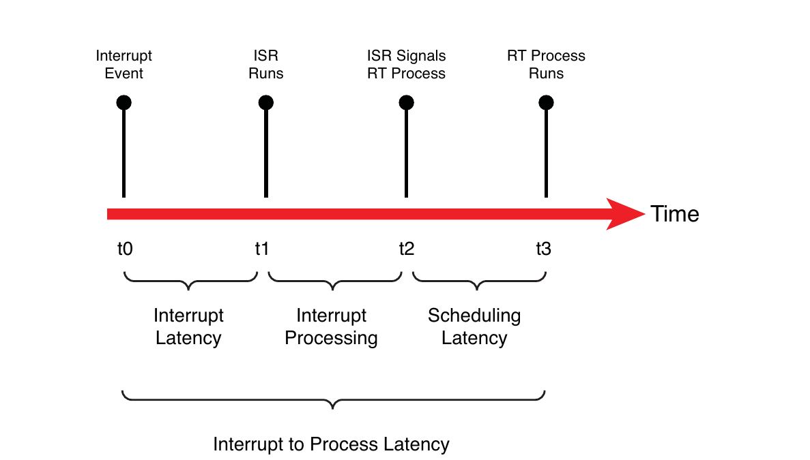
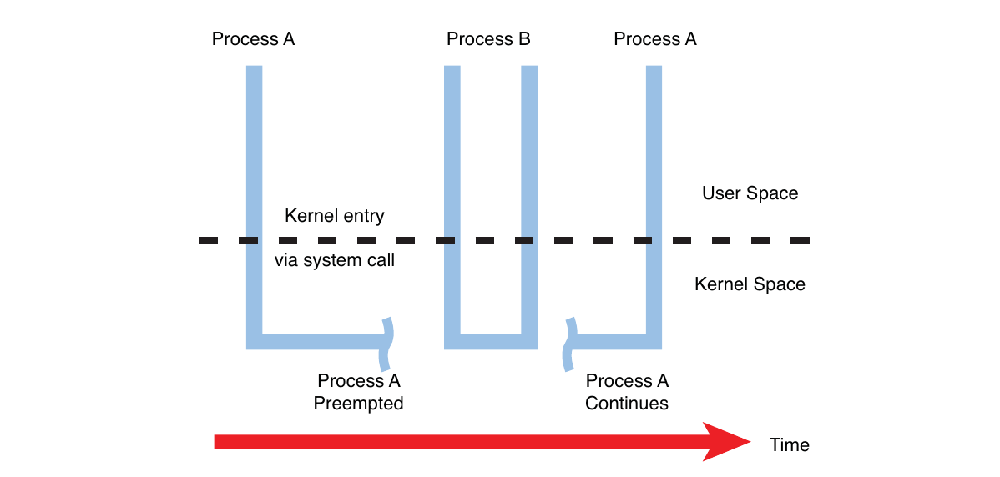
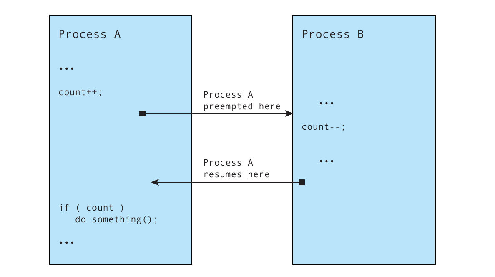
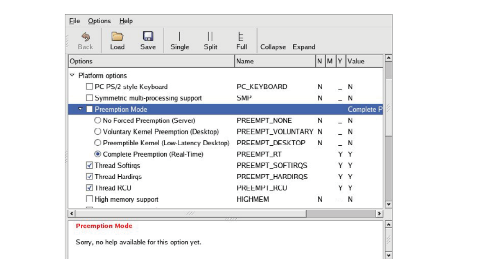
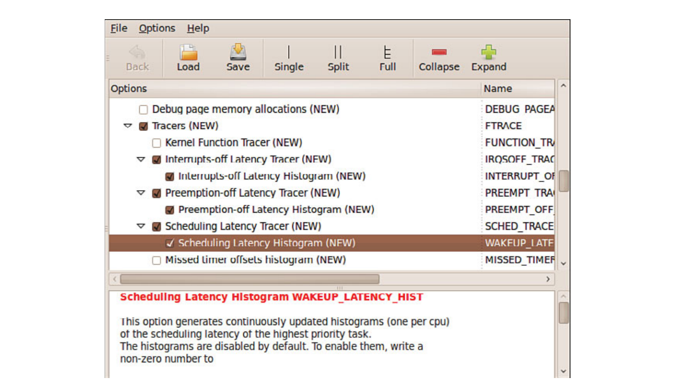

# Chương 17. Linux và real time

## Trong chương này

- 17\.1 Real time là gì? 466

- 17\.2 Kernel preemption 469

- 17\.3 Kernel patch Real-Time 473

- 17\.4 Phân tích hiệu năng kernel Real-Time 478

- 17\.5 Tổng kết 485

Khi Linux bắt đầu tồn tại trên Intel i386 processor, không ai ngờ đến

thành công mà Linux sẽ đạt được trong các server application. Thành công đó đã

dẫn đến việc Linux được port sang nhiều architecture khác nhau và được sử dụng bởi

các lập trình viên cho embedded system, từ thiết bị cầm tay di động đến các telecommunications

switch. Cách đây không lâu, nếu ứng dụng có yêu cầu real-time, bạn

có thể đã không đưa Linux vào danh sách lựa chọn operating system.

Mọi chuyện đã thay đổi nhờ những bước phát triển của Linux real-time, được thúc đẩy phần

lớn bởi các ứng dụng âm thanh và multimedia.

Chương này bắt đầu bằng phần xem xét ngắn gọn lịch sử phát triển các tính năng real-time

của Linux. Sau đó, chúng ta xem xét các tiện ích dành cho lập trình viên real-time

và cách sử dụng những tiện ích đó.

## 17.1 Real time là gì?

Nếu hỏi năm người “real time” nghĩa là gì, rất có thể bạn sẽ nhận được năm câu trả lời khác nhau. Một số người thậm chí có thể đưa ra những con số cụ thể. Để phục vụ phần thảo luận này, chúng ta sẽ xem xét nhiều tình huống rồi đề xuất một định nghĩa. Nhiều yêu cầu có thể được gọi là soft real time, trong khi những yêu cầu khác được gọi là hard real time.

### 17.1.1 Soft real time

Phần lớn mọi người đồng ý rằng soft real time nghĩa là một thao tác có deadline. Nếu không đáp ứng deadline, chất lượng trải nghiệm có thể giảm nhưng không gây hậu quả nghiêm trọng đến mức hệ thống thất bại. Desktop workstation của bạn là một ví dụ hoàn hảo về yêu cầu soft real-time. Khi chỉnh sửa tài liệu, bạn mong thấy ngay kết quả của các phím vừa gõ trên màn hình. Khi phát file mp3 yêu thích, bạn mong có âm thanh high-quality, không có tiếng lách tách, tiếng nổ lụp bụp hay những khoảng gián đoạn trong bản nhạc.

Nhìn chung, con người không thể nhìn hoặc nghe thấy độ trễ nhỏ hơn vài chục millisecond. Tất nhiên, các nhạc sĩ sẽ cho bạn biết rằng âm nhạc có thể bị ảnh hưởng bởi độ trễ còn nhỏ hơn thế. Nếu những sự kiện được gọi là soft real-time, hay so-called, này bỏ lỡ deadline, kết quả có thể không mong muốn và làm giảm “chất lượng” trải nghiệm, nhưng không gây hậu quả thảm khốc.

### 17.1.2 Hard real time

Hard real time được đặc trưng bởi hậu quả của việc bỏ lỡ deadline. Trong hệ thống hard real-time, nếu một deadline bị bỏ lỡ, hậu quả thường rất nghiêm trọng. Tất nhiên, mức độ nghiêm trọng là tương đối. Nếu thiết bị embedded của bạn đang điều khiển dòng nhiên liệu đến động cơ máy bay phản lực, việc không đáp ứng deadline để phản hồi thao tác của phi công hoặc thay đổi đặc tính vận hành có thể dẫn đến hậu quả tai hại.

Lưu ý rằng khoảng thời gian của deadline không quyết định đặc tính real-time. Việc phục vụ tick của atomic clock là một ví dụ như vậy. Miễn là tick được xử lý trong khoảng thời gian 1-second trước tick tiếp theo, dữ liệu vẫn còn hợp lệ. Bỏ lỡ việc xử lý một tick có thể khiến hệ thống định vị toàn cầu của chúng ta sai lệch vài foot, thậm chí vài mile!

Từ những điều trên, chúng ta sử dụng một tập hợp định nghĩa phổ biến cho soft real time và hard real time. Với hệ thống soft real-time, giá trị của một phép tính hoặc kết quả giảm đi nếu không đáp ứng deadline. Với hệ thống hard real-time, theo định nghĩa, chỉ cần bỏ lỡ một deadline thì hệ thống đã bị xem là thất bại, và điều này có thể gây hậu quả thảm khốc.

### 17.1.3 Linux scheduling

UNIX và Linux đều được thiết kế để bảo đảm tính công bằng trong process scheduling. Nghĩa là scheduler cố gắng hết sức phân phối tài nguyên sẵn có cho tất cả process cần CPU và bảo đảm mỗi process đều có thể tiếp tục thực hiện công việc. Chính mục tiêu thiết kế này lại trái với yêu cầu của một real-time process. Một real-time process phải được ưu tiên tuyệt đối để chạy ngay khi sẵn sàng. Real time nghĩa là có latency dự đoán được và lặp lại được.

### 17.1.4 Latency

Các Real-time process thường gắn với một sự kiện vật lý, chẳng hạn interrupt đến từ peripheral device. Hình 17-1 minh họa các thành phần latency trong một Linux system. Phép đo latency bắt đầu khi nhận được interrupt mà chúng ta muốn xử lý. Thời điểm này được biểu diễn bằng t0 trong Hình 17-1. Một khoảng thời gian sau, interrupt được thực hiện và quyền điều khiển được chuyển cho interrupt service routine (ISR), như thời điểm t1 biểu diễn. Interrupt latency này gần như hoàn toàn do maximum interrupt off time[^1] quyết định, tức thời gian dành cho một thread thực thi khi hardware interrupt bị vô hiệu hóa.



HÌNH 17-1 Các latency component

Giảm thiểu công việc xử lý trong ISR thực sự được xem là một thực hành thiết kế tốt. Thực tế, execution context này có khả năng hạn chế; chẳng hạn, ISR không thể gọi một blocking function, tức function có thể sleep. Vì vậy, nên chỉ phục vụ hardware device tại đây và dành việc xử lý dữ liệu cho Linux bottom half, còn được gọi là softirq. Có một số loại xử lý bottom-half; chúng được mô tả rõ nhất trong cuốn Linux Kernel Development của Robert Love. Hãy xem phần cuối chương này để tìm tài liệu tham khảo.

Khi ISR/bottom half hoàn tất xử lý, thông thường nó đánh thức một user space process đang chờ dữ liệu. Thời điểm này được biểu diễn bằng t2 trong Hình 17-1. Một khoảng thời gian sau, scheduler chọn real-time process để chạy và cấp CPU cho process đó. Thời điểm này được biểu diễn bằng t3 trong Hình 17-1. Scheduling latency chủ yếu chịu ảnh hưởng của số process đang chờ CPU và priority giữa chúng. Đặt thuộc tính Real Time cho một process (`SCHED_FIFO` hoặc `SCHED_RR`) cho nó priority cao hơn các Linux process thông thường và cho phép nó trở thành process tiếp theo được chọn để chạy, giả sử nó là real-time process có priority highest-priority đang chờ CPU. Process real-time highest-priority đang sẵn sàng chạy, không bị block vì I/O, sẽ luôn được chạy. Bạn sẽ sớm thấy cách đặt thuộc tính này.

## 17.2 Kernel preemption

Trong thời kỳ đầu Linux 1.x, kernel preemption chưa tồn tại. Điều này có nghĩa là khi một user space process yêu cầu kernel service, không task nào khác có thể được schedule để chạy cho đến khi process đó block, tức sleep để chờ một điều gì đó, thường là I/O, hoặc cho đến khi yêu cầu đối với kernel hoàn tất. Làm cho kernel trở thành preemptable[^2] nghĩa là trong khi một process đang chạy trong kernel, process khác có thể preempt process thứ nhất và được phép chạy dù process thứ nhất chưa hoàn tất xử lý in-kernel. Hình 17-2 minh họa chuỗi sự kiện này.



HÌNH 17-2 Kernel preemption

Trong hình này, Process A đã đi vào kernel thông qua một system call. Đó có thể là lời gọi `write()` đến một device như console hoặc đến một file. Trong khi kernel đang thực thi thay cho Process A, một interrupt đánh thức Process B có priority cao hơn. Kernel preempt Process A và giao CPU cho Process B, dù Process A chưa block cũng chưa hoàn tất công việc xử lý trong kernel.

### 17.2.1 Trở ngại preemption

Thách thức khi làm kernel hoàn toàn preemptable là xác định tất cả vị trí trong kernel cần được bảo vệ khỏi preemption. Đó là những critical section trong kernel mà preemption không được phép xảy ra. Chẳng hạn, giả sử Process A trong Hình 17-2 đang thực thi một file system operation trong kernel. Tại một thời điểm nào đó, code có thể cần ghi vào một in-kernel data structure biểu diễn một file trên file system. Để bảo vệ data structure đó khỏi hỏng dữ liệu, process phải ngăn mọi process khác truy cập shared data structure này. Listing 17-1 minh họa khái niệm đó bằng cú pháp C.

LISTING 17-1 Khóa critical section

```
...
  preempt_disable();
  ...
  /* Critical section */
  update_shared_data();
  ...
  preempt_enable();
...
```

Nếu không bảo vệ shared data theo cách này, process đang cập nhật shared data structure có thể bị preempt ngay giữa quá trình cập nhật. Nếu một process khác cố cập nhật cùng shared data, gần như chắc chắn dữ liệu sẽ bị hỏng. Ví dụ kinh điển là khi hai process thao tác trực tiếp trên các variable chung và đưa ra quyết định dựa trên giá trị của chúng. Hình 17-3 minh họa một trường hợp như vậy.



HÌNH 17-3 Shared data concurrency error

Trong Hình 17-3, Process A bị ngắt sau khi cập nhật shared data nhưng trước khi đưa ra quyết định dựa trên dữ liệu đó. Theo thiết kế, Process A không thể phát hiện mình đã bị preempt. Process B thay đổi giá trị shared data trước khi Process A được chạy lại. Như bạn có thể thấy, Process A sẽ đưa ra quyết định dựa trên giá trị do Process B xác định. Nếu đây không phải hành vi bạn muốn, bạn phải tắt preemption trong Process A ở phần thao tác với shared data; trong trường hợp này là thao tác và quyết định dựa trên variable count.

### 17.2.2 Preemption model

Giải pháp đầu tiên cho kernel preemption là đặt các phép kiểm tra tại những vị trí chiến lược trong kernel code, nơi biết chắc có thể preempt thread thực thi hiện tại một cách an toàn. Những vị trí này bao gồm lúc vào và ra khỏi system call, lúc giải phóng một số kernel lock và lúc trở về từ interrupt processing. Tại mỗi điểm này, code tương tự Listing 17-2 được dùng để thực hiện preemption.

LISTING 17-2 Kiểm tra preemption theo Linux 2.4+ preempt patch

```
...
  /*
   * This code is executed at strategic locations within
   * the Linux kernel where it is known to be safe to
   * preempt the current thread of execution
   */
  if (kernel_is_preemptable() && current->need_resched)
    preempt_schedule();
...

  /*
   * This code is in .../kernel/sched.c and is invoked from
   * those strategic locations as above
   */
  #ifdef CONFIG_PREEMPT
  asmlinkage void preempt_schedule(void)
  {
    while (current->need_resched) {
        ctx_sw_off();
        current->state |= TASK_PREEMPTED;
        schedule();
        current->state &= ~TASK_PREEMPTED;
        ctx_sw_on_no_preempt();
    }
  }
  #endif
...
```

Code snippet đầu tiên trong Listing 17-2, được đơn giản hóa từ code thực, được gọi tại những vị trí chiến lược đã mô tả ở trên, nơi biết chắc có thể preempt kernel an toàn. Code snippet thứ hai trong Listing 17-2 là code thực từ một Linux 2.4 kernel đời đầu đã áp dụng preempt patch. Vòng lặp `while` thú vị này tạo context switch thông qua lời gọi `schedule()` cho đến khi mọi yêu cầu preemption đều được đáp ứng.

Mặc dù cách tiếp cận này giúp giảm latency trong Linux system, nó chưa phải là lý tưởng. Các lập trình viên làm việc về latency thấp sớm nhận ra cần phải “đảo ngược logic”. Với các preemption model trước đây, chúng ta có cách tiếp cận sau:

- Về cơ bản, Linux kernel là nonpreemptable.

- Các phép kiểm tra preemption được bố trí rải rác trong kernel tại những vị trí chiến lược đã biết là an toàn cho preemption.

- Preemption chỉ được bật tại những điểm known-safe này.

Để tiếp tục giảm latency một cách đáng kể, chúng ta muốn có những đặc điểm sau trong một preemptable kernel:

- Linux kernel hoàn toàn preemptable ở mọi nơi.

- Chỉ tắt preemption quanh critical section.

Đây là hướng các kernel developer đã theo đuổi kể từ loạt patch preemptable kernel ban đầu. Tuy nhiên, đây không phải công việc dễ dàng. Nó đòi hỏi xem xét kỹ toàn bộ kernel source code base, phân tích chính xác dữ liệu nào cần được bảo vệ trước truy cập đồng thời và chỉ tắt preemption tại những vị trí đó. Phương pháp được sử dụng là bổ sung công cụ đo latency vào kernel, tìm các code path có latency dài nhất rồi sửa chúng. Các Linux 2.6 kernel mới hơn có thể được cấu hình cho những ứng dụng low-latency nhờ nỗ lực dành cho phương pháp “lock-breaking” này.

### 17.2.3 SMP kernel

Điều thú vị là phần lớn công việc để tạo một multiprocessor architecture hiệu quả cũng đem lại lợi ích cho real time. Symmetric multiprocessing (SMP) là một multiprocessing architecture trong đó nhiều CPU, thường nằm trên một board, dùng chung memory và các tài nguyên khác. Thách thức với SMP phức tạp hơn uniprocessor vì có thêm một yếu tố truy cập đồng thời cần bảo vệ. Trong uniprocessor model, mỗi thời điểm chỉ một task có thể thực thi trong kernel. Bảo vệ trước truy cập đồng thời chỉ đòi hỏi bảo vệ trước interrupt processing hoặc exception processing. Trong SMP model, ngoài nguy cơ từ interrupt processing và exception processing, còn có thể có nhiều thread thực thi đồng thời trong kernel.

SMP đã được hỗ trợ từ những Linux 2.x kernel đời đầu. Một big kernel lock (BKL) được dùng để bảo vệ trước truy cập đồng thời trong quá trình chuyển từ uniprocessor sang hoạt động SMP. BKL là một global spinlock ngăn mọi task khác thực thi trong kernel. Trong cuốn Linux Kernel Development xuất sắc của mình, Robert Love mô tả BKL là “đứa con ghẻ tóc đỏ của kernel”. Khi mô tả các đặc điểm của BKL, Robert còn đùa bằng cách thêm “xấu xa” vào danh sách thuộc tính của nó!

Các cách triển khai SMP kernel ban đầu dựa trên BKL gây ra sự kém hiệu quả đáng kể trong scheduling. Người ta nhận thấy một CPU có thể bị để idle trong thời gian dài. Phần lớn công việc tạo ra SMP kernel hiệu quả cũng trực tiếp đem lại lợi ích cho các ứng dụng real-time, chủ yếu là giảm latency. Thay BKL bằng locking smaller-grained chỉ bao quanh shared data thực sự cần bảo vệ đã giúp giảm đáng kể preemption latency.

### 17.2.4 Nguồn preemption latency

Một hệ thống real-time phải có khả năng phục vụ các task real-time trong giới hạn thời gian tối đa đã chỉ định. Đạt được preemption latency thấp một cách nhất quán là điều thiết yếu đối với hệ thống real-time. Hai yếu tố đóng góp lớn nhất vào preemption latency là interrupt-context processing và việc xử lý critical section khi interrupt bị tắt. Bạn đã biết rằng rất nhiều nỗ lực được dành để giảm kích thước, từ đó giảm thời lượng, của các critical section. Vì vậy, interrupt-context processing trở thành thách thức tiếp theo. Linux 2.6 real-time patch đã giải quyết thách thức này.

## 17.3 Kernel patch Real-Time

Hỗ trợ hard real time vẫn chưa có trong mainline source tree của kernel.org. Muốn bật hard real time, bạn phải áp dụng một patch. Kernel patch real-time là kết quả tích lũy của một số sáng kiến giảm Linux kernel latency. Nhiều người đã đóng góp cho patch này; hiện tại Ingo Molnar duy trì nó và bạn có thể tìm tại www.kernel.org/pub/linux/kernel/projects/rt/. Hiệu năng soft real-time của Linux 2.6 kernel đã cải thiện đáng kể so với các bản phát hành 2.6 đầu tiên. Khi 2.6 vừa ra mắt, Linux 2.4 kernel có hiệu năng soft real-time tốt hơn đáng kể. Kể từ khoảng Linux 2.6.12, có thể dễ dàng đạt hiệu năng soft real-time trong khoảng single-digit millisecond trên một x86 processor đủ nhanh. Để có latency lặp lại được ở mức microsecond, cần sử dụng real-time patch.

Patch real-time bổ sung một số tính năng quan trọng cho Linux kernel. Hình 17-4 cho thấy các configuration option của Preemption mode sau khi áp dụng real-time patch.



HÌNH 17-4 Preemption mode với real-time patch

Patch real-time bổ sung một preemption mode thứ tư có tên `PREEMPT_RT`, hay Preempt Real Time. Bốn preemption mode như sau:

- `PREEMPT_NONE`—Không có forced preemption. Overall latency trung bình là tốt, nhưng đôi khi có thể xuất hiện độ trễ dài. Phù hợp nhất với ứng dụng lấy overall throughput làm tiêu chí thiết kế hàng đầu.

- `PREEMPT_VOLUNTARY`—Giai đoạn đầu tiên trong việc giảm latency. Các explicit preemption point bổ sung được đặt tại những vị trí chiến lược trong kernel để giảm latency. Một phần overall throughput được đánh đổi để có latency thấp hơn.

- `PREEMPT_DESKTOP`—Chế độ này bật preemption ở mọi nơi trong kernel, ngoại trừ khi đang xử lý bên trong critical section. Chế độ này hữu ích cho các ứng dụng soft real-time như âm thanh và multimedia. Overall throughput được đánh đổi để giảm latency hơn nữa.

- `PREEMPT_RT`—Bổ sung các tính năng từ real-time patch, bao gồm thay spinlock bằng preemptable mutex. Điều này cho phép involuntary preemption ở mọi nơi trong kernel, ngoại trừ những vùng được bảo vệ bằng `preempt_disable()`. Chế độ này giảm đáng kể biến thiên latency (jitter), cho phép latency thấp và dự đoán được đối với các ứng dụng real-time time-critical.

Nếu kernel preemption được bật trong kernel configuration, bạn có thể tắt nó lúc boot bằng cách thêm kernel parameter sau vào kernel command line:

```
preempt=0
```

### 17.3.1 Tính năng Real-Time

Một số tính năng Linux kernel mới được bật bằng `CONFIG_PREEMPT_RT`. Hình 17-4 cho thấy một số configuration setting mới. Các tính năng này cùng những tính năng khác của real-time Linux kernel patch được mô tả dưới đây.

Patch real-time chuyển phần lớn spinlock trong hệ thống thành mutex priority-inheritance. Điều này giảm overall latency nhưng làm tăng overhead xử lý spinlock (mutex), dẫn đến giảm overall system throughput. Lợi ích của việc chuyển spinlock thành mutex là chúng có thể bị preempt. Nếu Process A đang giữ một lock và Process B có priority cao hơn cần cùng lock đó, Process A có thể preempt Process B trong trường hợp nó đang giữ mutex.

Khi chọn `CONFIG_PREEMPT_HARDIRQS`, các interrupt service routine (ISR) buộc phải chạy trong process context. Điều này cho lập trình viên quyền kiểm soát priority của ISR vì chúng trở thành những thực thể có thể được schedule. Vì thế, chúng cũng trở thành preemptable, cho phép hardware interrupt higher-priority được xử lý trước. Vì có thể được schedule, bạn có thể gán priority cho chúng tương tự các task khác dựa trên yêu cầu hệ thống.

Đây là một tính năng mạnh mẽ. Một số hardware architecture không thực thi interrupt priority. Những kiến trúc có thực thi cũng có thể không áp dụng priority phù hợp với mục tiêu thiết kế real-time mà bạn chỉ định. Khi sử dụng `CONFIG_PREEMPT_HARDIRQS`, bạn có thể tự do xác định priority mà mỗi IRQ sẽ chạy.

`CONFIG_PREEMPT_SOFTIRQS` giảm latency bằng cách chạy softirq trong context của softirq daemon thuộc kernel, ksoftirqd. Ksoftirqd là một Linux task (process) đúng nghĩa, nên có thể được gán priority và schedule cùng các task khác. Nếu kernel được cấu hình cho real time và bật `CONFIG_PREEMPT_SOFTIRQS`, kernel task ksoftirqd được nâng lên real-time priority để xử lý softirq.[^3] Listing 17-3 cho thấy code đảm nhiệm việc này trong một Linux kernel gần đây, nằm tại `.../kernel/softirq.c`.

LISTING 17-3 Nâng ksoftirqd lên trạng thái Real-Time

```
static int ksoftirqd(void * __data)
{
   /* Priority needs to be below hardirqs */
    struct sched_param param = { .sched_priority = MAX_USER_RT_PRIO/2 - 1};
    struct softirqdata *data = __data;
    u32 softirq_mask = (1 << data->nr);
    struct softirq_action *h;
    int cpu = data->cpu;

    sys_sched_setscheduler(current->pid, SCHED_FIFO, &param);
    current->flags |= PF_SOFTIRQ;
...
```

Ở đây, chúng ta thấy kernel task `ksoftirqd` được nâng thành real-time task (`SCHED_FIFO`) bằng kernel function `sys_sched_setscheduler()`.

### 17.3.2 O(1) scheduler

O(1) scheduler đã có từ thời Linux 2.5. Nó được đề cập ở đây vì là một thành phần thiết yếu của giải pháp real-time. O(1) scheduler là một cải tiến đáng kể so với Linux scheduler trước đó. Nó mở rộng tốt hơn cho hệ thống có nhiều process và giúp giảm overall latency.

Nếu bạn đang thắc mắc, O(1) là một ký hiệu toán học cho hệ bậc một. Trong ngữ cảnh này, nó có nghĩa là thời gian để đưa ra một scheduling decision không phụ thuộc vào số process trên một runqueue nhất định. Linux scheduler cũ không có đặc tính này và hiệu năng của nó suy giảm khi số process tăng lên.[^4]

### 17.3.3 Tạo process Real-Time

Bạn có thể chỉ định một process là real time bằng cách đặt một process attribute mà scheduler sử dụng trong scheduling algorithm. Listing 17-4 cho thấy phương pháp tổng quát.

LISTING 17-4 Tạo process Real-Time

```
#include <sched.h>

#define MY_RT_PRIORITY MAX_USER_RT_PRIO /* Highest possible */

int main(int argc, char **argv)
{
      ...
      int rc, old_scheduler_policy;
      struct sched_param my_params;
      ...

      /* Passing zero specifies caller’s (our) policy */
      old_scheduler_policy = sched_getscheduler(0);

      my_params.sched_priority = MY_RT_PRIORITY;
      /* Passing zero specifies callers (our) pid */
      rc = sched_setscheduler(0, SCHED_RR, &my_params);
      if ( rc == -1 )
            handle_error();
      ...
}
```

Code snippet này thực hiện hai việc trong lời gọi `sched_setscheduler()`: đổi scheduling policy thành `SCHED_RR` và nâng priority lên mức tối đa có thể trên hệ thống. Linux hỗ trợ ba scheduling policy:

- `SCHED_OTHER`—Normal Linux process, fairness scheduling.

- `SCHED_RR`—Process Real-time có một time slice. Nói cách khác, nếu không block, nó được phép chạy trong một khoảng thời gian nhất định do scheduler xác định.

- `SCHED_FIFO`—Process Real-time chạy cho đến khi block, chủ động nhường processor hoặc cho đến khi một process `SCHED_FIFO` higher-priority khác trở thành runnable.

Man page của `sched_setscheduler()` cung cấp thêm chi tiết về ba scheduling policy khác nhau.

## 17.4 Phân tích hiệu năng kernel Real-Time

Các công cụ để khảo sát hiệu năng real-time kernel từng mang tính tự phát phần nào. Thời kỳ đó đã qua. Ftrace đã thay thế những tracing mechanism cũ còn tồn tại khi ấn bản đầu của cuốn sách này được xuất bản. Ftrace là một tập hợp tracing tool mạnh mẽ, cho phép lập trình viên quan sát chi tiết những gì đang diễn ra bên trong kernel. Có thể tìm tài liệu đầy đủ về hệ thống Ftrace trong kernel source tree tại `.../Documentation/trace/ftrace.txt`.

### 17.4.1 Dùng Ftrace để tracing

Ftrace phải được bật trong kernel configuration trước khi có thể sử dụng. Hình 17-5 cho thấy các kernel configuration parameter liên quan từ một bản phát hành kernel gần đây.



HÌNH 17-5 Kernel configuration cho Ftrace

Ftrace có nhiều module để lựa chọn. Bạn nên chỉ chọn những module có thể cần cho một phiên kiểm thử cụ thể, vì mỗi module đều tạo thêm một mức overhead cho kernel.

Framework chung để bật tracing sử dụng interface được export ra debugfs file system. Giả sử bạn đã bật Ftrace đúng cách trong kernel configuration, bước tiếp theo là mount debugfs. Thực hiện việc này như sau:

```
# mount -t debugfs debug /sys/kernel/debug
```

Khi hoàn tất, bạn sẽ thấy một directory dưới `/sys/kernel/debug` có tên `tracing`. Directory `tracing` này chứa mọi control và output source cho dữ liệu Ftrace. Điều này sẽ rõ hơn khi chúng ta tương tác với hệ thống trong những phần sau. Theo gợi ý trong tài liệu kernel, chúng ta sẽ dùng một symlink có tên `/tracing` để đơn giản hóa việc báo cáo và tương tác với các Ftrace subsystem:

```
# ln -s /sys/kernel/debug/tracing /tracing
```

Từ đây trở đi, chúng ta sẽ tham chiếu `/tracing` thay cho path dài hơn `/sys/kernel/debug/tracing`.

### 17.4.2 Đo preemption off latency

Kernel sử dụng các lời gọi để tắt preemption trong khi xử lý các shared data structure thiết yếu. Khi preemption bị tắt, interrupt vẫn có thể xảy ra, nhưng process higher-priority không thể chạy. Bạn có thể khảo sát thời gian preemption bị tắt bằng chức năng preemptoff của Ftrace.

Để bật phép đo latency khi preemption bị tắt, hãy bật `PREEMPT_TRACER` và `PREEMPT_OFF_HIST` trong submenu Kernel hacking của kernel configuration. Trace mode này cho phép phát hiện những path có latency dài nhất khi preemption bị vô hiệu hóa.

Phương pháp tổng quát để chuẩn bị Ftrace cho một phép đo preemptoff như sau:

```
# echo preemptoff >/tracing/current_tracer
# echo latency-format > /tracing/trace_options
# echo 0 >/tracing/tracing_max_latency
# echo 1 > /tracing/tracing_enabled
 <do some processing>
# echo 0 > /tracing/tracing_enable
```

Listing 17-5 cho thấy trace output thu được từ chuỗi lệnh này. Hãy chú ý maximum latency 221 microsecond được hiển thị trong header.

LISTING 17-5 Preemptoff trace

```
# cat /tracing/trace
# tracer: preemptoff
#
# preemptoff latency trace v1.1.5 on 2.6.33.4-rt20
# --------------------------------------------------------------------
# latency: 221 us, #239/239, CPU#0 | (M:preempt VP:0, KP:0, SP:0 HP:0 #P:8)
#    -----------------
#    | task: -0 (uid:0 nice:0 policy:0 rt_prio:0)
#    -----------------
#  => started at: acpi_idle_enter_bm
#  => ended at:   rest_init
#
#
#                  _------=> CPU#
#                 / _-----=> irqs-off
#                | / _----=> need-resched
#                || / _---=> hardirq/softirq
#                ||| / _--=> preempt-depth
#                |||| /_--=> lock-depth
#                |||||/     delay
#  cmd     pid   |||||| time  |   caller
#     \   /      ||||||   \   |   /
  <idle>-0       0d..1.    0us : acpi_idle_do_entry <-acpi_idle_enter_bm
  <idle>-0       0d..1.    1us : ktime_get_real <-acpi_idle_enter_bm
  <idle>-0       0d..1.    1us : getnstimeofday <-ktime_get_real
  <idle>-0       0d..1.    1us : ns_to_timeval <-acpi_idle_enter_bm
  <idle>-0       0d..1.    1us : ns_to_timespec <-ns_to_timeval
<... many lines omitted for brievity...>
  <idle>-0       0d..3.  220us : native_apic_mem_write <-lapic_next_event
  <idle>-0       0d..3.  220us : _raw_spin_unlock_irqrestore
<-tick_broadcast_oneshot_control
  <idle>-0       0d..2.  220us : _raw_spin_unlock_irqrestore <-clockevents_notify
  <idle>-0       0d..1.  220us : enter_idle <-cpu_idle
  <idle>-0       0d..1.  221us : __rcu_read_lock <-__atomic_notifier_call_chain
  <idle>-0       0d..1.  221us : __rcu_read_unlock
<-__atomic_notifier_call_chain
  <idle>-0       0d..1.  221us : cpu_idle <-rest_init
  <idle>-0       0d..1.  221us : stop_critical_timings <-rest_init

# cat /tracing/tracing_max_latency
221
```

Hãy chú ý hai dòng cuối Listing 17-5. Tại đây, chúng ta hiển thị giá trị maximum latency mà Ftrace ghi nhận bằng cách hiển thị nội dung `tracing_max_latency`. Giá trị này luôn được cập nhật theo maximum latency đã ghi nhận, còn output của trace file, tức toàn bộ nội dung Listing 17-5, tương ứng với path qua hệ thống gắn với latency dài nhất này.

### 17.4.3 Đo wakeup latency

Một trong những phép đo quan trọng nhất mà lập trình viên real-time quan tâm là mất bao lâu để task high-priority bắt đầu chạy sau khi được báo cần chạy. Khi một real-time process, tức process có scheduling attribute `SCHED_FIFO` hoặc `SCHED_RR`, chạy trong hệ thống, theo định nghĩa nó chia sẻ processor với các task khác. Khi có sự kiện cần phục vụ, real-time task được đánh thức. Nói cách khác, scheduler được thông báo rằng task đó cần chạy. Wakeup timing là khoảng thời gian từ wakeup event đến khi task thực sự được cấp CPU và bắt đầu chạy.

Ftrace có các trace facility wakeup và wakeup\_rt. Khi tracer được bật, facility này ghi nhận và trace latency dài nhất từ lúc đánh thức đến lúc chạy.

Listing 17-6 được tạo từ một chương trình kiểm thử C đơn giản có chức năng tạo và ghi một file. Trước khi thực hiện file I/O, chương trình kiểm thử tự nâng mình lên `SCHED_RR` với priority 99 và thiết lập tracing system bằng các thao tác ghi vào stdio, tương tự việc thực hiện các lệnh sau từ shell:

```
# echo 0 > /tracing/tracing_enabled
# echo 0 > /tracing/tracing_max_latency (resets the max record back to zero)
# echo wakeup > /tracing/current_tracer
# echo 1 > /tracing/tracing_enabled
```

Sau khi chương trình kiểm thử thực hiện các lệnh này, tracing đã hoàn tất. Listing 17-6 cho thấy kết quả. Chú ý rằng trong trường hợp này, maximum wakeup latency được báo cáo là 7 microsecond.

LISTING 17-6 Wakeup timing trace

```
root@speedy:~# cat /tracing/trace
# tracer: wakeup
#
# wakeup latency trace v1.1.5 on 2.6.33.4-rt20
# --------------------------------------------------------------------
# latency: 7 us, #35/35, CPU#4 | (M:preempt VP:0, KP:0, SP:0 HP:0 #P:8)
#    -----------------
#    | task: -6006 (uid:0 nice:0 policy:2 rt_prio:99)
#    -----------------
#
#                  _------=> CPU#
#                 / _-----=> irqs-off
#                | / _----=> need-resched
#                || / _---=> hardirq/softirq
#                ||| / _--=> preempt-depth
#                |||| /_--=> lock-depth
#                |||||/     delay
#  cmd     pid   |||||| time  |   caller
#     \   /      ||||||   \   |   /
    sshd-1789    4d.h3.    0us :   1789:120:R   + [004]  6006:  0:S rt
    sshd-1789    4d.h3.    1us : wake_up_process <-hrtimer_wakeup
    sshd-1789    4d.h2.    1us : check_preempt_wakeup <-try_to_wake_up
    sshd-1789    4d.h2.    1us : resched_task <-check_preempt_wakeup
    sshd-1789    4dNh2.    2us : task_woken_rt <-try_to_wake_up
    sshd-1789    4dNh2.    2us : _raw_spin_unlock_irqrestore <-try_to_wake_up
    sshd-1789    4dNh1.    2us : preempt_schedule <-_raw_spin_unlock_irqrestore
    sshd-1789    4dNh..    2us : preempt_schedule <-try_to_wake_up
    sshd-1789    4dNh..    2us : _raw_spin_lock <-__run_hrtimer
    sshd-1789    4dNh1.    3us : _raw_spin_unlock <-hrtimer_interrupt
    sshd-1789    4dNh..    3us : preempt_schedule <-_raw_spin_unlock
    sshd-1789    4dNh..    3us : tick_program_event <-hrtimer_interrupt
    sshd-1789    4dNh..    3us : tick_dev_program_event <-tick_program_event
    sshd-1789    4dNh..    4us : ktime_get <-tick_dev_program_event
    sshd-1789    4dNh..    4us : clockevents_program_event
<-tick_dev_program_event
    sshd-1789    4dNh..    4us : lapic_next_event <-clockevents_program_event
    sshd-1789    4dNh..    4us : native_apic_mem_write <-lapic_next_event
    sshd-1789    4dNh..    4us : irq_exit <-smp_apic_timer_interrupt
    sshd-1789    4dN.1.    4us : rcu_irq_exit <-irq_exit
    sshd-1789    4dN.1.    5us : idle_cpu <-irq_exit
    sshd-1789    4dN...    5us : preempt_schedule_irq <-retint_kernel
    sshd-1789    4dN...    5us : __schedule <-preempt_schedule_irq
    sshd-1789    4dN...    5us : rcu_sched_qs <-__schedule
    sshd-1789    4dN.1.    6us : _raw_spin_lock_irq <-__schedule
    sshd-1789    4d..2.    6us : put_prev_task_fair <-__schedule
    sshd-1789    4d..2.    6us : update_curr <-put_prev_task_fair
    sshd-1789    4d..2.    6us : task_of <-update_curr
    sshd-1789    4d..2.    6us : cpuacct_charge <-update_curr
    sshd-1789    4d..2.    6us : __rcu_read_lock <-cpuacct_charge
    sshd-1789    4d..2.    7us : __rcu_read_unlock <-cpuacct_charge
    sshd-1789    4d..2.    7us : __enqueue_entity <-put_prev_task_fair
    sshd-1789    4d..2.    7us : pick_next_task_rt <-__schedule
    sshd-1789    4d..2.    7us : dequeue_pushable_task <-pick_next_task_rt
    sshd-1789    4d..3.    8us : __schedule <-preempt_schedule_irq
    sshd-1789    4d..3.    8us :   1789:120:R ==> [004]  6006:  0:R rt
```

Khi chạy, chương trình kiểm thử thực hiện file I/O rồi sleep. Điều này bảo đảm nó nhường processor ngay cả khi không block vì I/O. Trace trong Listing 17-6 khá thú vị. Từ header, bạn thấy chương trình kiểm thử chạy với PID 6006 và priority 99. Bạn cũng thấy maximum latency được báo cáo là 7 microsecond, chắc chắn là một giá trị rất chấp nhận được.

Dòng đầu tiên của trace output là wakeup event. Một process có PID 1789, ssh daemon, đang chạy tại thời điểm đó. Trace cuối cùng là context switch thực sự từ `sshd` sang chương trình kiểm thử chạy với PID 6006 và RT priority. Các dòng giữa wakeup và context switch thể hiện kernel path đã đi qua cùng các thời điểm tương đối.

Tham khảo subdirectory a`.../Documentation` của Linux kernel source tree để tìm `trace/ftrace.txt` và biết thêm chi tiết.

Maximum latency được cung cấp riêng trong một trace file khác. Để hiển thị maximum wakeup latency trong một lần tracing cụ thể, chỉ cần thực hiện lệnh sau:

```
root@speedy:~# cat /tracing/tracing_max_latency
7
```

### 17.4.4 Interrupt off timing

Để bật phép đo thời gian tối đa interrupt bị tắt, hãy bảo đảm đã bật `IRQSOFF_TRACER` trong kernel configuration. Option này đo thời gian dành cho các critical section khi IRQ bị tắt. Tính năng này hoạt động giống phép đo wakeup latency. Để bật phép đo, thực hiện các bước sau với quyền root:

```
# echo irqsoff >/tracing/current_tracer
# echo latency-format > /tracing/trace_options
# echo 0 > /tracing/tracing_max_latency
# echo 1 > /tracing/tracing_enabled
< ... some processing ...>
# echo 0 > /tracing/tracing_enabled
```

Để đọc giá trị maximum hiện tại, chỉ cần hiển thị nội dung của `/tracing/tracing_max_latency`:

```
# cat /tracing/tracing_max_latency
97
```

Bạn sẽ nhận thấy các phép đo wakeup latency và interrupt off latency đều được bật và hiển thị thông qua cùng một file. Tất nhiên, điều này có nghĩa là mỗi lần chỉ có thể cấu hình một phép đo, nếu không kết quả có thể không hợp lệ. Vì các phép đo này tạo thêm runtime overhead đáng kể, dù sao việc bật tất cả cùng lúc cũng không phải lựa chọn hợp lý.

### 17.4.5 Phát hiện soft lockup

Để bật tính năng phát hiện soft lockup, hãy bật `DETECT_SOFTLOCKUP` trong kernel configuration. Tính năng này cho phép phát hiện những khoảng thời gian dài chạy trong kernel mode mà không có context switch. Nó tồn tại trong các kernel non-real-time nhưng hữu ích để phát hiện path very-high-latency hoặc tình trạng soft deadlock. Để sử dụng tính năng phát hiện soft lockup, chỉ cần bật tính năng và theo dõi các báo cáo trên console hoặc system log. Những báo cáo tương tự sau sẽ được phát ra:

```
BUG: soft lockup detected on CPU0
```

Khi kernel phát thông báo này, thường sẽ kèm theo backtrace và các thông tin khác như process name và PID. Nó trông tương tự một kernel oops message, có đầy đủ processor register. Hãy xem `.../kernel/softlockup.c` để biết chi tiết. Thông tin này có thể được dùng để hỗ trợ tìm ra nguồn gốc tình trạng lockup.

## 17.5 Tổng kết

Linux ngày càng được sử dụng trong những hệ thống đòi hỏi hiệu năng real-time. Ví dụ bao gồm các ứng dụng multimedia và bộ điều khiển robot, công nghiệp, ô tô. Chương này trình bày các khái niệm nền tảng và kỹ thuật phân tích để giúp bạn phát triển và debug ứng dụng real-time.

- Hệ thống Real-time được đặc trưng bởi deadline. Khi bỏ lỡ deadline chỉ gây bất tiện hoặc làm giảm trải nghiệm khách hàng, đó được gọi là soft real time. Ngược lại, hệ thống hard real-time được xem là thất bại khi bỏ lỡ deadline.

- Kernel preemption là tính năng quan trọng đầu tiên trong Linux kernel giải quyết latency system-wide.

- Các Linux kernel gần đây hỗ trợ một số preemption mode, từ không có preemption đến preemption real-time đầy đủ.

- Patch real-time bổ sung một số tính năng then chốt cho Linux kernel, mang lại latency thấp và đáng tin cậy.

- Patch real-time bao gồm một số công cụ đo quan trọng để hỗ trợ debug và xác định đặc tính của một cách triển khai Linux real-time.

### 17.5.1 Gợi ý đọc thêm

Linux Kernel Development, 3rd Edition Robert Love Addison-Wesley, 2010 Trang này được cố ý để trống

[^1]: Chúng ta bỏ qua context switching time cho interrupt processing vì nó thường không đáng kể so với interrupt off time.

[^2]: Điều thú vị là có nhiều tranh luận về cách viết đúng của preemptable! Tôi chọn theo khảo sát do Rick Lehrbaum thực hiện tại www.linuxdevices.com/articles/AT5136316996.html.

[^3]: Hãy xem Linux Kernel Development, được dẫn ở cuối chương này, để tìm hiểu thêm về softirq.

[^4]: Một lần nữa, chúng tôi giới thiệu cuốn sách của Robert Love với phần thảo luận xuất sắc về O(1) scheduler và bài phê bình thú vị về algorithmic complexity, nguồn gốc của ký hiệu O(1).
