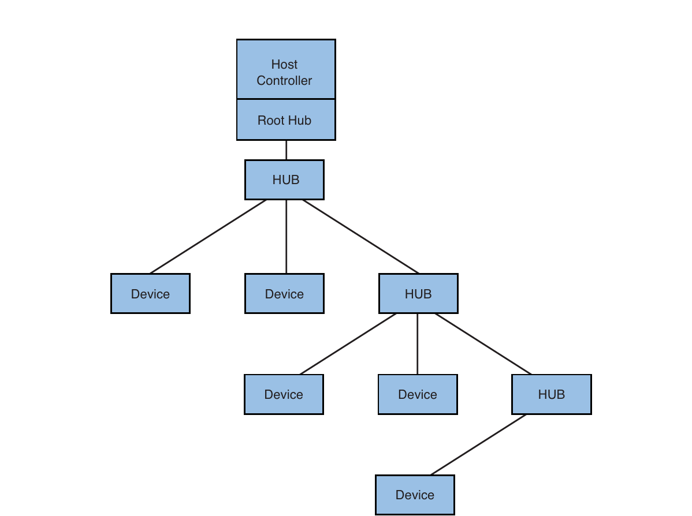
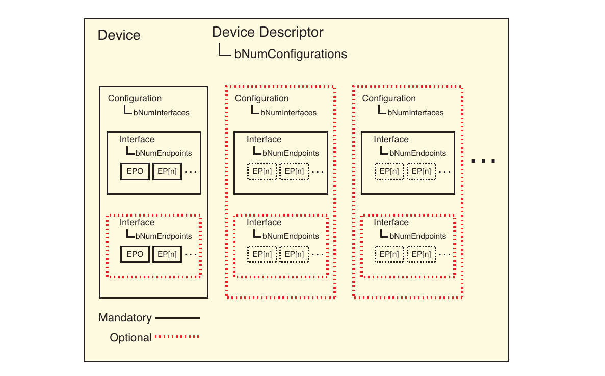
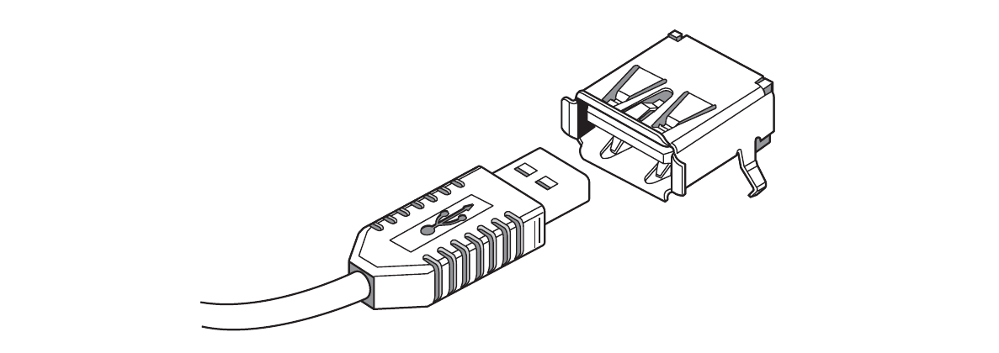
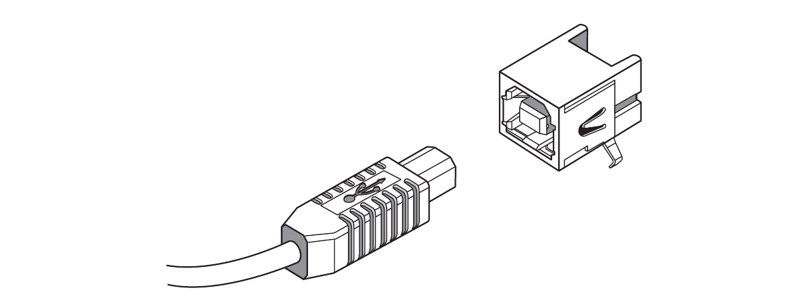
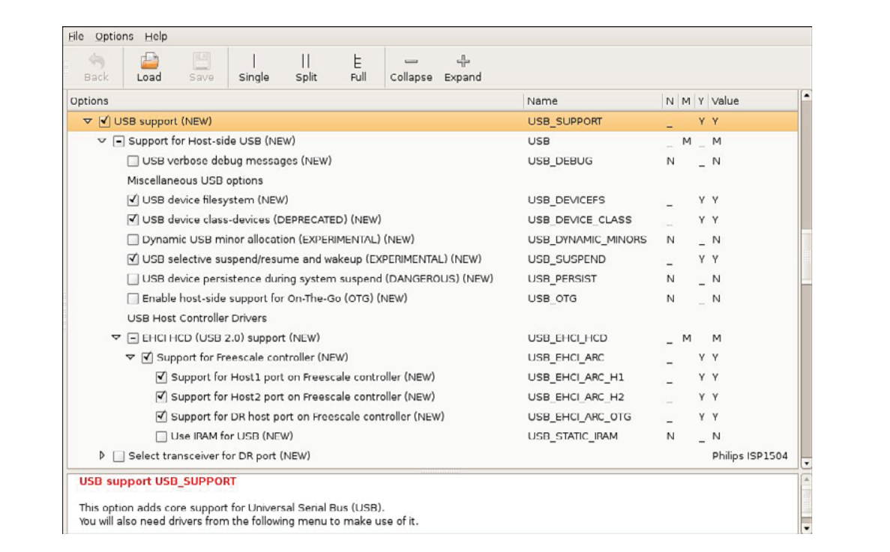

# Chương 18. Universal Serial Bus

## Trong chương này

- 18\.1 Tổng quan USB 488

- 18\.2 Cấu hình USB 495

- 18\.3 sysfs và đặt tên USB device 500

- 18\.4 Công cụ USB hữu ích 502

- 18\.5 USB subsystem phổ biến 508

- 18\.6 Debug USB 516

- 18\.7 Tổng kết 519

Theo bất kỳ thước đo nào, Universal Serial Bus (USB) cực kỳ thành công.

USB ban đầu thiết kế khắc phục hạn chế của các

I/O interface trên PC architecture. Ngày nay khó tìm electronic

device ở siêu thị điện tử không có USB port.

Digital camera, printer, cell phone, IP telephone và tất nhiên keyboard,

mouse là ví dụ điển hình có USB interface. Tuy nhiên

danh sách dài hơn nhiều người đọc trung bình đoán. Ngay cả một số guitar

pedal của tôi có USB interface!

Đã qua thời cần input/output hardware special-purpose cho

device thông dụng. Lời hứa USB thực sự thành hiện thực, khác nhiều

công nghệ đến rồi đi. Thực tế khi chuẩn bị bản thứ hai,

Linux driver thử nghiệm đầu cho USB 3.0 vừa

ra mắt. Đáng chú ý Linux là OS đầu hỗ trợ!

## 18.1 Tổng quan USB

USB ban đầu có vẻ phức tạp: nhiều device, nhiều embedded host controller. Có nhiều mode hoạt động, controller trên processor (hoặc ngoài) có thể nhiều mode. Nếu xem toàn USB configuration option trong kernel gần đây, nhanh thấy khó cấu hình. Hiểu khái niệm cơ bản giúp bỏ bớt bối rối.

### 18.1.1 USB physical topology

USB là master/slave bus topology. Mỗi USB bus chỉ một master gọi host controller. Hình 18-1 minh họa cơ bản.



HÌNH 18-1 USB topology đơn giản

Host controller luôn gắn root hub, cung cấp attachment point tới controller và hub function ở đỉnh USB hierarchy. Bố trí phổ biến nhất là tổ hợp controller/root hub đưa trực tiếp tới connector (qua transceiver chip) ở mép board. End user thấy connector này.

Device Hình 18-1 là endpoint—physical USB appliance cắm USB hub. Device có thể hỗ trợ nhiều function như audio interface có input/output. Quan trọng là mỗi USB device cắm vào đúng một hub upstream vị trí nó trong topology.

Device trên USB bus hoạt động theo polling do host controller điều khiển. Chỉ một device mỗi lúc giao tiếp bus theo host controller. Specification có cơ chế cấp phần bandwidth chỉ định cho function trong device.

Tính năng thành công nhất của USB là dynamic, thực sự hot-swappable. Có thể cắm device vào bus bất kỳ lúc nào. Software trên máy chứa controller (tất nhiên Linux) chịu trách nhiệm cấu hình device khi xuất hiện trong topology.

### 18.1.2 USB logical topology

Để hiểu software component, data flow trong USB system, nên hiểu logical topology. Hình 18-2 cho thành phần logic USB device giả định.



HÌNH 18-2 Functional block diagram của USB device

Mỗi USB device có descriptor[^1] cho software khám phá capability, cấu hình function. Mọi device phải có một device descriptor chứa thông tin như manufacturer (`idVendor`), product (`idProduct`), serial number (`iSerialNumber`), số configuration (`bNumConfigurations`). Identifier trong ngoặc là field name thực trong USB 2.0 specification.

Mỗi configuration trong device descriptor có configuration descriptor. Nó chứa số interface (`bNumInterfaces`) của từng configuration, chỉ maximum power khi chạy cấu hình (`bMaxPower`). Thường USB device chỉ một configuration. Nhưng device có thể high/low power mode hoặc function khác nhau. Loại này có nhiều configuration. Cắm iPod vào USB host sẽ thấy ví dụ nhiều configuration, interface, endpoint!

Mỗi interface trong configuration descriptor có interface descriptor. Chứa field chỉ số endpoint device (`bNumEndpoints`). Endpoint 0 luôn giả định tồn tại, không tính trong interface count. Descriptor cũng có interface class, subclass, protocol theo USB specification.

USB endpoint là phần tử logic thực mà software giao tiếp khi device hoạt động. Mỗi endpoint trong interface descriptor (trừ 0) có endpoint descriptor, định nghĩa communication parameter gồm endpoint address, attribute mô tả đặc tính data transfer từng endpoint.

Sau chương giới thiệu utility `lsusb` đọc descriptor này.

Chi tiết trong Universal Serial Bus specification đầy đủ cuối chương.

### 18.1.3 Các revision USB

USB 1.0 giới thiệu hơn thập kỷ trước. USB 2.0 specification hiện cho revision history từ tháng 11/1994, đã là revision 0.7. Spec đầu yêu cầu data transfer rate 12 megabit/giây (Mbps), rate low-speed 1,5 Mbps. Revision 2.0 hoàn tất tháng 4/2000.[^2] USB 2.0 định nghĩa high-speed 480 Mbps. Hiện có revision 3.0 chỉ data rate gigabit/giây, thêm speed definition SuperSpeed.

Có thể khó nhớ full speed khác high speed. Tổng quan:

USB 1.0 Low speed 1.5 Mbps

USB 1.0 Full speed 12 Mbps

USB 2.0 High speed 480 Mbps

USB 3.0 Super speed 5 Gbps

### 18.1.4 USB connector

Trừ khi là USB expert, nhiều connector/cable configuration gây khó hiểu. Type quen nhất từ original spec là USB A connector hình chữ nhật thường trên laptop/desktop PC. Theo định nghĩa plug end USB A luôn trỏ upstream về host controller/root hub. Hình 18-3 cho USB A plug chuẩn.



HÌNH 18-3 USB A plug

Peripheral (slave) như printer/scanner thường có USB B receptacle nhận USB B plug, cũng trong spec đầu. Cable phổ biến nối host (PC) với peripheral (printer) có A plug một đầu, B đầu kia. B hẹp hơn A, dạng D hơn chữ nhật. USB B connector luôn trỏ downstream, xa host controller/root hub. Hình 18-4 cho B plug.



HÌNH 18-4 USB B plug

Cũng có vài miniature plug configuration. Device form factor nhỏ như cell phone, PDA thúc đẩy yêu cầu plug/receptacle nhỏ hơn. USB Mini-A connector đã obsolete theo spec nhưng vẫn dùng. Mini-B phổ biến trên peripheral nhỏ.

Micro-USB specification định nghĩa ba connector thêm—Micro-B plug/receptacle, Micro-AB receptacle, Micro-A plug. Micro-AB chỉ dùng USB On-The-Go (OTG) appliance, nói sau.

Tóm lại standard A/B: A receptacle luôn host side (A plug upstream), B connector luôn peripheral side (B plug downstream.) Bảng 18-1 tóm tắt.

BẢNG 18-1 Tổng quan USB connector

| Connector | Plug | Receptacle |
|---|---|---|
| Dòng A | Trỏ về host (hoặc hub) | Output của host (hoặc hub) |
| Dòng B | Trỏ về peripheral | Input của peripheral (hoặc hub) |

### 18.1.5 USB cable assembly

USB specification mới nhất định nghĩa cable assembly Bảng 18-2 là cable tuân chuẩn duy nhất.

BẢNG 18-2 USB cable và ứng dụng điển hình

| Cable type | Ứng dụng điển hình |
|---|---|
| Plug Standard-A tới plug Standard-B | Host chuẩn (PC) tới peripheral như printer |
| Plug Standard-A tới plug Mini-B | Host chuẩn (PC) tới peripheral nhỏ như cell phone/camera |
| Cable gắn cố định với plug Standard-A | Dây USB mouse, keyboard |
| Plug Micro-A tới plug Micro-B | OTG peripheral tới peripheral như camera tới printer |
| Plug Micro-A tới receptacle Standard-A | Adapter sang Micro-A, ví dụ nối keyboard vào PDA |
| Plug Micro-B tới plug Standard-A | Host tới OTG device |
| Cable gắn cố định với plug Micro-A | Dây peripheral form factor nhỏ |

Có thể mua cable assembly khác không liệt kê. Thường để xử lý trường hợp đặc biệt như hardware obsolete (hoặc thiết kế sai). Ví dụ BeagleBoard cần adapter đặc biệt Mini-A plug một đầu, USB-A receptacle đầu kia. Mini-A nối tắt pin 4,5, có vẻ transceiver BeagleBoard cần để cấu hình host mode.

### 18.1.6 USB mode

Một khía cạnh khó hiểu hơn với người mới là các mode hoạt động. Nghe thuật ngữ USB On-The-Go (OTG), gadget, peripheral. Hy vọng đã làm rõ speed rating, connector type. Phần này trình bày ngắn mode USB controller/device.

USB controller/receptacle desktop PC chuẩn gọi USB host. Vì là bus master-slave, theo định nghĩa một node phải cung cấp master function, là host. Còn gọi host mode hay USB host. Host controller cùng root hub là phần cứng low-level thực hiện master/slave bus protocol. USB host luôn bus master.

Đầu kia USB network đơn giản là device end, đôi khi USB gadget.[^3] Gadget functionality trong Linux kernel chỉ khả năng hoạt động device slave mode. Khi vào embedded, không còn giả định processing device làm host. Ví dụ smart phone Linux-powered có connector, controller thiết kế làm device, tức slave end USB link.

Nhiều embedded system cần cả master (host), slave (device) trên cùng controller. PDA là ví dụ: có thể cần nối USB host như desktop PC để sync data với master database trên PC hoặc lấy software update. Ngược lại muốn nối USB keyboard vào PDA để gõ. Device phải hoạt động host/device mode. Gọi USB On-The-Go (OTG). Thêm lợi ích, OTG spec cho đổi vai trò on-the-fly không cần rút plug, cắm lại mode ngược.

## 18.2 Cấu hình USB

Như chức năng không liên quan trực tiếp core kernel, USB tùy chọn phải bật configuration. Như chức năng phụ trợ khác, có thể compile vào image hoặc loadable module để load động kernel đã boot. Ở đây dùng module để rõ component cần cho function cụ thể.

Rào cản cấu hình đúng đơn giản là số lượng option. Trên kernel rất mới cấu hình allmodconfig,[^4] gần 300 device driver module (file `*.ko`) liên quan USB. Tất nhiên nhiều driver cho device cụ thể nhưng xem option thấy chút know-how giúp rất nhiều!

Ví dụ sau xem Freescale Semiconductor i.MX31 Applications Processor trên i.MX31 PDK. Thú vị vì có ba host controller cấu hình nhiều operational mode.

Hình 18-5 cho phần USB option từ Linux kernel gần đây cấu hình ARM và Freescale i.MX31 PDK reference board.



HÌNH 18-5 Một phần cấu hình USB cho i.MX31

Còn nhiều option hơn ở đây, chỉ các option đầu. Phải chọn `USB_SUPPORT` để thấy thêm. Chú ý USB chọn M (module), nghĩa kernel build system compile driver làm loadable module.

Xem cấu hình tối thiểu cho USB hoạt động i.MX31. Mọi cấu hình cần module `usbcore.ko`, tự chọn mỗi khi chọn `CONFIG_USB`.[^5] Dễ thấy qua makefile core driver support Listing 18-1, ở `.../drivers/usb/core/Makefile`.[^6]

LISTING 18-1 Makefile cho USB core

```
#
# Makefile for USB Core files and filesystem
#

usbcore-objs    := usb.o hub.o hcd.o urb.o message.o driver.o \
                   config.o file.o buffer.o sysfs.o endpoint.o \
                   devio.o notify.o generic.o quirks.o

ifeq ($(CONFIG_PCI),y)
        usbcore-objs    += hcd-pci.o
endif

ifeq ($(CONFIG_USB_DEVICEFS),y)
        usbcore-objs    += inode.o devices.o
endif

obj-$(CONFIG_USB)       += usbcore.o

ifeq ($(CONFIG_USB_DEBUG),y)
EXTRA_CFLAGS += -DDEBUG
endif
```

Xem makefile điều khiển kernel build luôn là cách tốt tìm component cần hoặc ngược lại option cần cho function. Ví dụ Listing 18-1 cần bật `CONFIG_USB` để đưa `usbcore` vào build. Như Chương 4, “Linux kernel: Một góc nhìn khác”, nếu `CONFIG_USB` đặt `m`, driver compile thành loadable kernel module, cung cấp host support.

### 18.2.1 Khởi tạo USB

Boot i.MX31 cấu hình tối thiểu, load module `usbcore` như sau:

```
# modprobe usbcore
```

Load USB core module xử lý common function cho driver collection còn lại. Gồm housekeeping như register/deregister các phần tử, cung cấp interface điều khiển USB hardware. Bỏ phần lớn phức tạp viết driver. Xem public symbol bằng cross-nm. Đã học `nm` Chương 13, “Công cụ phát triển”. Ví dụ cross-nm hiện registration function:

```
$ arm_v6_vfp_le-nm usbcore.ko  | grep T.*_register
0000adc0 T usb_register_dev
000094b0 T usb_register_device_driver
00009560 T usb_register_driver
0000fcf8 T usb_register_notify
```

`usbcore` cũng chứa buffer handling function; hỗ trợ usbfs, hub class driver; nhiều function giao tiếp USB controller bên dưới.

Riêng `usbcore` không hữu ích lắm, không có low-level host controller driver. Đây là module riêng tùy hardware. Ví dụ BeagleBoard có TI OMAP3530 Applications Processor, controller built-in dual-role[^7] Inventra™ USB Hi-Speed Dual-Role Controller. Driver tên `musb_hdrc`.

Nhiều platform thiết kế host controller theo Enhanced Host Controller Interface (EHCI),[^8] mô tả interface register-level cho controller industry-standard. Khi compile module, driver tên `ehci-hcd.ko`. Xem load trên i.MX31 như Listing 18-2.

LISTING 18-2 Cài USB host controller driver trên i.MX31

```
root@imx31:~# modprobe ehci-hcd
usbcore: registered new interface driver usbfs
usbcore: registered new interface driver hub
usbcore: registered new device driver usb
fsl-ehci fsl-ehci.0: Freescale On-Chip EHCI Host Controller
fsl-ehci fsl-ehci.0: new USB bus registered, assigned bus number 1
fsl-ehci fsl-ehci.0: irq 35, io mem 0x43f88200
fsl-ehci fsl-ehci.0: USB 2.0 started, EHCI 1.00, driver 10 Dec 2004
usb usb1: configuration #1 chosen from 1 choice
hub 1-0:1.0: USB hub found
hub 1-0:1.0: 1 port detected
fsl-ehci fsl-ehci.1: Freescale On-Chip EHCI Host Controller
fsl-ehci fsl-ehci.1: new USB bus registered, assigned bus number 2
fsl-ehci fsl-ehci.1: irq 36, io mem 0x43f88400
fsl-ehci fsl-ehci.1: USB 2.0 started, EHCI 1.00, driver 10 Dec 2004
usb usb2: configuration #1 chosen from 1 choice
hub 2-0:1.0: USB hub found
hub 2-0:1.0: 1 port detected
fsl-ehci fsl-ehci.2: Freescale On-Chip EHCI Host Controller
fsl-ehci fsl-ehci.2: new USB bus registered, assigned bus number 3
fsl-ehci fsl-ehci.2: irq 37, io mem 0x43f88000
fsl-ehci fsl-ehci.2: USB 2.0 started, EHCI 1.00, driver 10 Dec 2004
usb usb3: configuration #1 chosen from 1 choice
hub 3-0:1.0: USB hub found
hub 3-0:1.0: 1 port detected
```

Có nhiều thông tin hữu ích. Console log level đặt để message hiện console. Đầu thấy registration function `usbcore` hoạt động: usbfs interface driver, hub interface driver, chính EHCI (usb host mode) driver. Sẽ học usbfs sau.

Tiếp thấy ba host controller khởi tạo. Nhớ i.MX31 có ba USB controller riêng, enumerate `fsl-ehci.0`, `fsl-ehci.1`, `fsl-ehci.2`. Thấy IRQ assignment, register file base address từng controller. Mỗi trường hợp root hub enumerate, là thành phần cơ bản architecture, luôn gắn controller, cần để nối peripheral (hub/device khác).

Cần lưu ý không cần cài riêng `usbcore` như đầu phần. `modprobe` biết xác định dependency cần. Chỉ gọi:

```
# modprobe ehci-hcd
```

Load dependency `usbcore` trước driver `ehci-hcd`. Cơ chế giải thích Chương 8, “Kiến thức cơ bản device driver”. Thực tế nhiều platform dùng udev tự động hóa, trình bày Chương 19.

## 18.3 sysfs và đặt tên USB device

Như Chương 9, “File system”, sysfs cơ bản là góc nhìn kernel object, hay kobject. Mỗi USB device biểu diễn trong sysfs. Xem `/sys/bus/usb/devices` trên mọi hệ USB-enabled. Listing 18-3 cho Freescale i.MX31 PDK, đã cắt format `ls -l` chỉ giữ filename để vừa trang.

LISTING 18-3 Output `/sys/bus/usb/devices` trên i.MX31

```
root@imx31:~# ls -l /sys/bus/usb/devices/
total 0
1-0:1.0 -> ../../../devices/platform/fsl-ehci.0/usb1/1-0:1.0
2-0:1.0 -> ../../../devices/platform/fsl-ehci.1/usb2/2-0:1.0
2-1 -> ../../../devices/platform/fsl-ehci.1/usb2/2-1
2-1.1 -> ../../../devices/platform/fsl-ehci.1/usb2/2-1/2-1.1
2-1.1:1.0 -> ../../../devices/platform/fsl-ehci.1/usb2/2-1/2-1.1/2-1.1:1.0
2-1:1.0 -> ../../../devices/platform/fsl-ehci.1/usb2/2-1/2-1:1.0
3-0:1.0 -> ../../../devices/platform/fsl-ehci.2/usb3/3-0:1.0
usb1 -> ../../../devices/platform/fsl-ehci.0/usb1
usb2 -> ../../../devices/platform/fsl-ehci.1/usb2
usb3 -> ../../../devices/platform/fsl-ehci.2/usb3
```

Mọi entry `/sys/bus/usb/devices` link tới phần khác sysfs hierarchy. Chú ý tên số như `1-0:1.0`. Số đầu là root hub, cấp cao nhất USB hierarchy của bus. Số hai là port device nối. Số ba (sau hai chấm) là configuration number, sau đó interface number. Configuration/interface là logical component mọi USB device như Phần 18.1.2.

Tóm lại:

```
1-0:1.0
| | | |----- interface number
| | |------- configuration number
| |--------- hub port
|----------- root_hub
```

Nếu thêm hub, thêm vào device name bằng dấu chấm (.) rồi hub port number, nối chuỗi upstream port. Ví dụ thêm hub vào topology trên có thể `1-0.2:1.0`, giả định downstream hub ít nhất hai port, device cắm port 2.

Xem nội dung từng linked directory xác định component. Ví dụ entry đầu Listing 18-3 là logical interface, biết bằng xem file (sysfs attribute) symlink `1-0:1.0.` trỏ. Có interface descriptor entry `bInterfaceNumber`, `bNumEndpoints`, đều phần tử USB 2.0 interface descriptor. Hai entry đầu trong Listing 18-3 biểu diễn single interface gắn hai controller/root hub nội bộ i.MX31.

Entry thứ ba Listing 18-3 (`2-1`) biểu diễn external hub nối bus thứ hai, cụ thể representation của `struct usb_device` cho hub.

Ba entry Listing 18-3 bắt đầu `usb` biểu diễn chính bus. Hệ thống có ba vì processor i.MX31 có ba controller. Bus number là chữ số cuối tên `usb`. USB bus đánh từ 1.

Tóm lại, một số ví dụ:

- `3-0:1.0` biểu diễn interface (`struct usb_interface`) nối bus 3, là root hub interface bus 3.

- `2-1` biểu diễn device (`struct usb_device`). Trong cấu hình ví dụ là external hub nối root hub bus 2.

- `2-1.3` biểu diễn downstream device (`struct usb_device`) từ device `2-1`, nối port 3.

- `usb2` biểu diễn USB bus số 2 (cũng `struct usb_device`).

- `2-1.3.4:1.0` biểu diễn interface (iPod tôi) chạy configuration 1, nối port 4 parent hub, hub nối port 3 parent của nó rồi root hub bus 2!

## 18.4 Công cụ USB hữu ích

Một số tool, utility giúp hiểu hệ thống, cấu hình driver, lấy thông tin chi tiết USB subsystem. Phần này giới thiệu.

### 18.4.1 USB file system

USB File System (USBFS) là virtual file system khác, chưa có trước mount. Một số Linux system tự mount, nhiều hệ không. Muốn dùng phải bật kernel, chọn CONFIG\_USB\_DEVICEFS dưới USB Support. Chú ý đã deprecated nhưng còn trong kernel gần đây, hữu ích hiểu USB configuration. Vì nhiều utility phụ thuộc, có lẽ còn tồn tại một thời gian.

Sau cấu hình USB\_DEVICEFS (phần lớn distribution bật mặc định), phải mount virtual file system:

```
# mount -t usbfs usbfs /proc/bus/usb
```

Sau bật có listing tương tự Listing 18-4.

LISTING 18-4 Directory listing: `/proc/bus/usb`

```
root@imx31:~# ls -l /proc/bus/usb
total 0
dr-xr-xr-x 2 root root 0 Jun  7 14:00 001
-r--r--r-- 1 root root 0 Jun  7 14:36 devices
```

Sau mount USBFS, lấy listing human-readable các device trong topology như Listing 18-5.

LISTING 18-5 Output `/proc/bus/usb/devices`

```
root@imx31:~# cat /proc/bus/usb/devices
T:  Bus=03 Lev=00 Prnt=00 Port=00 Cnt=00 Dev#=  1 Spd=480 MxCh= 1
B:  Alloc=  0/800 us ( 0%), #Int=  0, #Iso=  0
D:  Ver= 2.00 Cls=09(hub  ) Sub=00 Prot=01 MxPS=64 #Cfgs=  1
P:  Vendor=0000 ProdID=0000 Rev= 2.06
S:  Manufacturer=Linux 2.6.24-335-g47af517 ehci_hcd
S:  Product=Freescale On-Chip EHCI Host Controller
S:  SerialNumber=fsl-ehci.2
C:* #Ifs= 1 Cfg#= 1 Atr=e0 MxPwr=  0mA
I:* If#= 0 Alt= 0 #EPs= 1 Cls=09(hub  ) Sub=00 Prot=00 Driver=hub
E:  Ad=81(I) Atr=03(Int.) MxPS=   4 Ivl=256ms

T:  Bus=02 Lev=00 Prnt=00 Port=00 Cnt=00 Dev#=  1 Spd=480 MxCh= 1
B:  Alloc=  0/800 us ( 0%), #Int=  1, #Iso=  0
D:  Ver= 2.00 Cls=09(hub  ) Sub=00 Prot=01 MxPS=64 #Cfgs=  1
P:  Vendor=0000 ProdID=0000 Rev= 2.06
S:  Manufacturer=Linux 2.6.24-335-g47af517 ehci_hcd
S:  Product=Freescale On-Chip EHCI Host Controller
S:  SerialNumber=fsl-ehci.1
C:* #Ifs= 1 Cfg#= 1 Atr=e0 MxPwr=  0mA
I:* If#= 0 Alt= 0 #EPs= 1 Cls=09(hub  ) Sub=00 Prot=00 Driver=hub
E:  Ad=81(I) Atr=03(Int.) MxPS=   4 Ivl=256ms

T:  Bus=02 Lev=01 Prnt=01 Port=00 Cnt=01 Dev#=  2 Spd=480 MxCh= 4
D:  Ver= 2.00 Cls=09(hub  ) Sub=00 Prot=01 MxPS=64 #Cfgs=  1
P:  Vendor=05e3 ProdID=0608 Rev= 7.02
S:  Product=USB2.0 Hub
C:* #Ifs= 1 Cfg#= 1 Atr=e0 MxPwr=100mA
I:* If#= 0 Alt= 0 #EPs= 1 Cls=09(hub  ) Sub=00 Prot=00 Driver=hub
E:  Ad=81(I) Atr=03(Int.) MxPS=   1 Ivl=256ms

T:  Bus=01 Lev=00 Prnt=00 Port=00 Cnt=00 Dev#=  1 Spd=480 MxCh= 1
B:  Alloc=  0/800 us ( 0%), #Int=  0, #Iso=  0
D:  Ver= 2.00 Cls=09(hub  ) Sub=00 Prot=01 MxPS=64 #Cfgs=  1
P:  Vendor=0000 ProdID=0000 Rev= 2.06
S:  Manufacturer=Linux 2.6.24-335-g47af517 ehci_hcd
S:  Product=Freescale On-Chip EHCI Host Controller
S:  SerialNumber=fsl-ehci.0
C:* #Ifs= 1 Cfg#= 1 Atr=e0 MxPwr=  0mA
I:* If#= 0 Alt= 0 #EPs= 1 Cls=09(hub  ) Sub=00 Prot=00 Driver=hub
E:  Ad=81(I) Atr=03(Int.) MxPS=   4 Ivl=256ms
```

Format ghi trong `.../Documentation/usb/proc_usb_info.txt` của source tree. Tóm lại mỗi T line ghi USB device mới, T là topology. T line chứa thông tin dựng sơ đồ current bus. Theo thứ tự: bus number (Bus), hierarchy level (Lev), parent level (Prnt), port trên parent device (Port), số device level này (Cnt), device number (Dev#), speed (Spd), maximum children (MxCh).

Dòng bổ sung mô tả bandwidth requirement (`B:`), device descriptor (`D:`), product ID (`P`:), string descriptor gắn device (`S:`), configuration descriptor (`C:`), interface descriptor (`I:`), endpoint descriptor (`E:`).

### 18.4.2 Dùng usbview

Cách giá trị nhất là chương trình dựng bus topology chứa thông tin này. Greg Kroah-Hartman viết `usbview` vẫn có trên nhiều Linux distribution. Dùng GTK hiển thị topology đồ họa với dữ liệu usbfs. Tôi lấy chương trình bỏ GTK để chạy text mode embedded không graphics. Có trên companion website sách, tìm `usbview-text`.

Listing 18-6 cho output `usbview-text` trên i.MX31, cắt chỉ một device—iPod của tôi. Device có nhiều configuration, minh họa nhiều khái niệm đã thảo luận.

LISTING 18-6 Output `usbview-text`

```
root@imx31:~# /tmp/usbview-text
Bus 2 Device 3  ******** New Device *********
Device Name: iPod
Manufacturer: Apple Inc.
Serial Number: 00xxxxxxxxxx
Speed: 480Mb/s (high)
USB Version:  2.00
Device Class: 00(>ifc )
Device Subclass: 00
Device Protocol: 00
Maximum Default Endpoint Size: 64
Number of Configurations: 2
Vendor Id: 05ac
Product Id: 1261
Revision Number:  0.01

Config Number: 1
    Number of Interfaces: 1
    Attributes: c0
    MaxPower Needed: 500mA

    Interface Number: 0
        Name: usb-storage
        Alternate Number: 0
        Class: 08(stor.)
        Sub Class: 06
        Protocol: 50
        Number of Endpoints: 2

            Endpoint Address: 83
            Direction: in
            Attribute: 2
            Type: Bulk
            Max Packet Size: 512
            Interval: 0ms

            Endpoint Address: 02
            Direction: out
            Attribute: 2
            Type: Bulk
            Max Packet Size: 512
            Interval: 0ms

Config Number: 2
    Number of Interfaces: 3
    Attributes: c0
    MaxPower Needed: 500mA

    Interface Number: 0
        Name:
        Alternate Number: 0
        Class: 01(audio)
        Sub Class: 01
        Protocol: 00
        Number of Endpoints: 0

    Interface Number: 1
        Name:
        Alternate Number: 0
        Class: 01(audio)
        Sub Class: 02
        Protocol: 00
        Number of Endpoints: 0

    Interface Number: 1
        Name:
        Alternate Number: 1
        Class: 01(audio)
        Sub Class: 02
        Protocol: 00
        Number of Endpoints: 1

            Endpoint Address: 81
            Direction: in
            Attribute: 1
            Type: Isoc
            Max Packet Size: 192
            Interval: 1ms

    Interface Number: 2
        Name:
        Alternate Number: 0
        Class: 03(HID  )
        Sub Class: 00
        Protocol: 00
        Number of Endpoints: 1

            Endpoint Address: 83
            Direction: in
            Attribute: 3
            Type: Int.
            Max Packet Size: 64
            Interval: 125us
```

Output liệt kê thông tin các descriptor (device, configuration, interface, endpoint) của iPod. Đầu tiên chú ý hai configuration—mass storage device, audio recording/playback device.

Configuration 1 có single interface với hai endpoint bulk data transfer, mỗi hướng một. Endpoint đọc, lưu data trên internal Flash như USB storage device biểu diễn.

Configuration 2 có ba interface. Interface 0 không endpoint. Interface 1 có một endpoint isochronous, transfer type cho streaming real-time data như audio/video chiếm bandwidth định sẵn. Interface 2 có single endpoint Interrupt, thiết kế giao data kịp thời, tin cậy như mouse/keyboard.

### 18.4.3 USB Utils (lsusb)

Package usbutils cung cấp utility `lsusb`, chức năng tương tự `lspci`. `lsusb` dùng `libusb` phải có trước. Bảo đảm embedded distribution có cả hai package (phần lớn có).

`lsusb` enumerate mọi USB bus, hiện thông tin từng device. Listing 18-7 hiện physical bus topology bằng truyền flag `-t` cho `lsusb`.

LISTING 18-7 Physical topology USB bus

```
root@imx31:~# lsusb -t
/:  Bus 03.Port 1: Dev 1, Class=root_hub, Driver=fsl-ehci/1p, 480M
/:  Bus 02.Port 1: Dev 1, Class=root_hub, Driver=fsl-ehci/1p, 480M
    |__ Port 1: Dev 2, If 0, Class=hub, Driver=hub/4p, 480M
        |__ Port 1: Dev 3, If 0, Class=stor., Driver=usb-storage, 480M
/:  Bus 01.Port 1: Dev 1, Class=root_hub, Driver=fsl-ehci/1p, 480M
```

Thấy ba bus i.MX31, hub cắm bus hai, iPod cắm port 1 của hub. Cũng có thể hiện descriptor mọi device hoặc một:

```
root@imx31:~# lsusb -s 2:3
Bus 002 Device 003: ID 05ac:1261 Apple, Inc. iPod Classic
```

Dạng lệnh `lsusb` hiện device 3 bus 2. Thêm flag `-v` dump mọi descriptor, quá nhiều cho listing. Để bạn tự thử. Nếu có iPod sẽ thú vị vì hai configuration, nhiều interface/endpoint.

## 18.5 USB subsystem phổ biến

Giới thiệu subsystem phổ biến hơn có thể gặp. Phần lớn dễ setup, dùng. Cùng udev (Chương 19) tự cấu hình, sẵn dùng ngay sau cắm device ưa thích.

Các phần sau trình bày standard USB class theo USB Class Specification Documents. Mục tiêu class chuẩn là một common class driver hỗ trợ nhiều device vendor khác nhau. Khi manufacturer tuân spec, dùng device không cần driver vendor-specific, chỉ class driver.

### 18.5.1 USB mass storage class

Có lẽ class/subsystem phổ biến nhất trong embedded là mass storage, bật external USB Flash drive, peripheral có internal storage hoặc external disk high-speed như Western Digital My Book™. Phải cấu hình USB storage trong kernel. Điểm khó hiểu là cần SCSI subsystem. Thực tế kernel mới hơn tự chọn CONFIG\_SCSI, CONFIG\_BLK\_DEV\_HD khi chọn mass storage.

Như thường có thể compile tĩnh hoặc loadable module. Ví dụ dùng module để rõ component, configuration cần hoạt động. Giờ nên biết cần `usbcore`, `ehci-hcd` làm base driver. (Giả định tiếp tục i.MX31; board khác cần driver khác như BeagleBoard dùng `musb_hdrc`.)

Để nhận storage class cần driver `usb_storage`, phụ thuộc `scsi_mod` nên cũng cần. Cấu hình đúng, `modprobe` phát hiện, load `scsi_mod` khi load `usb_storage`. Dependency trong file `modules.dep` tại ``/lib/modules/`uname -r`/modules.dep``. Tìm `usb-storage` sẽ thấy dependency cùng dòng.

Xem hình dạng, Listing 18-8 cho kết quả insert module `usb-storage`.

LISTING 18-8 Module cho `usb-storage`

```
root@imx31:~# modprobe usb-storage
SCSI subsystem initialized
Initializing USB Mass Storage driver...
usbcore: registered new interface driver usb-storage
USB Mass Storage support registered.
root@imx31:~# lsmod
Module                  Size  Used by
usb_storage            35872  0
scsi_mod               97552  1 usb_storage
ehci_hcd               30836  0
usbcore               129752  3 usb_storage,ehci_hcd
```

Giờ cắm storage device vào hub port, nhận dạng `usb_storage` device bởi driver `usb-storage`:

```
usb 2-1.2: new high speed USB device using fsl-ehci and address 6
usb 2-1.2: configuration #1 chosen from 2 choices
scsi1 : SCSI emulation for USB Mass Storage devices
scsi 1:0:0:0: Direct-Access     Apple    iPod    1.62 PQ: 0 ANSI: 0
```

Nhưng cần driver thêm để truy cập partition. Đây SCSI emulation layer tham gia. Driver `sd-mod` xử lý SCSI disk. Sau load, disk trong USB storage enumerate cùng mọi partition. Listing 18-9 cho kết quả.

LISTING 18-9 Thêm driver `sd-mod`

```
root@imx31:~# modprobe sd_mod
sd 1:0:0:0: [sda] 19488471 4096-byte hardware sectors (79825 MB)
sd 1:0:0:0: [sda] Write Protect is off
sd 1:0:0:0: [sda] Assuming drive cache: write through
sd 1:0:0:0: [sda] 19488471 4096-byte hardware sectors (79825 MB)
sd 1:0:0:0: [sda] Write Protect is off
sd 1:0:0:0: [sda] Assuming drive cache: write through
 sda: sda1
sd 1:0:0:0: [sda] Attached SCSI removable disk
root@imx31:~# lsmod
Module                  Size  Used by
sd_mod                 20720  0
usb_storage            35872  0
scsi_mod               97552  2 sd_mod,usb_storage
ehci_hcd               30836  0
usbcore               129752  3 usb_storage,ehci_hcd
```

Giờ đủ để mount partition, truy cập nội dung. Listing 18-9 cho single partition enumerate sda1. Giả định có device node `/dev/sda1`, kernel hỗ trợ file system type, mount:

```
# mount /dev/sda1 /your/favorite/mount/point
```

Khi cài, cấu hình đúng udev, mọi device node tạo tự động. Chương sau nói chi tiết. Cho đầy đủ, tạo node khi không có udev như sau. Sysfs có entry sda1:

```
root@imx31:~# find /sys -name sda1
/sys/block/sda/sda1
```

Entry sysfs có attribute `dev` liệt kê major/minor kernel gán device `/dev/sda1`. Trên i.MX31 tôi là major=8, minor=1. Dùng thông tin tạo node rồi mount, truy cập partition. Listing 18-10 chứa kết quả cuối.

LISTING 18-10 Tạo device node, mount SD device

```
root@imx31~:# cat /sys/block/sda/sda1/dev
8:1
root@imx31:~# mknod /dev/sda1 b 8 1
root@imx31:~# mkdir /media/disk
root@imx31:~# mount /dev/sda1 /media/disk
root@imx31:~# dir /media/disk
total 80
drwxr-xr-x 2 root root 16384 Oct 13  2008 Calendars
drwxr-xr-x 2 root root 16384 Oct 13  2008 Contacts
drwxr-xr-x 2 root root 16384 Oct 13  2008 Notes
drwxr-xr-x 2 root root 16384 Oct 13  2008 Recordings
drwxr-xr-x 8 root root 16384 Oct 13  2008 iPod_Control
```

`mknod` đã trình bày chi tiết Chương 8.

### 18.5.2 USB HID class

USB HID (Human Input Devices) có lẽ phổ biến nhất trên desktop Linux, đôi khi embedded. HID tương đối dễ dùng. Option dưới Device Drivers --\> HID Devices. Cần `CONFIG_HID_SUPPORT`, `CONFIG_HID`, `CONFIG_USB_HID`. Generic HID driver triển khai class support USB-defined. Chỉ insert module `usbhid`, `modprobe` tự thêm dependency HID core driver (`hid`)`:`

```
root@imx31:~# modprobe usbhid
usbcore: registered new interface driver usbhid
usbhid: v2.6:USB HID core driver
root@imx31:~# lsmod
Module                  Size  Used by
usbhid                 18980  0
hid                    31428  1 usbhid
ehci_hcd               30836  0
usbcore               129752  3 usbhid,ehci_hcd
```

Có hạ tầng, phần lớn HID thông dụng như mouse, keyboard, joystick tuân HID Class Driver spec được nhận, bật. Khi cắm Kensington USB wireless travel mouse, thấy:

```
usb 2-1.4: new low speed USB device using fsl-ehci and address 4
usb 2-1.4: configuration #1 chosen from 1 choice
input: Kensington USB Mouse as /devices/platform/fsl-ehci.1/usb2/2-1/
2-1.4/2-1.4:1.0/input/input2
input: USB HID v1.10 Mouse [Kensington Kensington USB Mouse] on
usb-fsl-ehci.1-1.4
```

Như storage, tìm device number kernel gán mouse trong sysfs. Vì biết số trong attribute `dev`, tìm thứ hợp lý:

```
root@imx31:~# find /sys -name dev | grep input
/sys/devices/platform/fsl-ehci.1/usb2/2-1/2-1.4/2-1.4:1.0/input/input2/event2/dev
/sys/devices/virtual/input/input0/event0/dev
/sys/devices/virtual/input/input1/event1/dev
```

Vì cắm mouse port 4 external hub, chọn device physical address 2-1.4:1-0:

```
root@imx31:~# cat /sys/devices/platform/fsl-ehci.1/usb2/2-1/2-1.4/2-1.4:1.0/input
```

➥`/input2/event2/dev`

```
13:66
```

Cuối tạo device node bằng số:

```
root@imx31:~# mknod /dev/mouse c 13 66
```

Giờ sẵn dùng. Như storage nếu có cấu hình `udev` hoạt động (chương sau), không cần tạo node thủ công. Đây việc `udev`.

### 18.5.3 USB CDC class driver

USB Communications Device Class (CDC) driver thiết kế framework chung cho cả class common communication device. Có standard CDC class như ATM, Ethernet, ISDN PSTN (telephony thông thường), wireless mobile device, cable modem, tương tự.

Cách dùng tốt nhất là Ethernet CDC. Rất tiện có Ethernet trên embedded device khi phát triển có thể không Ethernet interface, như cell phone/PDA.

Hai cách: lập link point-to-point host–peripheral trực tiếp bằng standard USB cable, hoặc Ethernet “dongle”, cơ bản Ethernet interface có USB plug. Xem cả hai.[^9]

Lập USB link trực tiếp tương đối dễ, tất nhiên cần hardware đúng. Ví dụ không nối laptop PC, desktop PC chỉ bằng cable, vì mỗi link phải có đầu upstream (host/hub), đầu downstream (peripheral/“gadget”). Nhớ USB protocol master-slave.

Dùng BeagleBoard làm ví dụ direct networking USB-USB qua CDC class driver. Phải bật kernel. Cần host controller driver, BeagleBoard là `musb_hdrc.ko`, bật bằng `USB_MUSB_HDRC` trong beagle kernel config. Cũng chọn `TWL4030_USB`[^10] bật transceiver. Bật peripheral mode bằng `USB_GADGET_MUSB_HDRC` dưới USB Gadget support. Cuối chọn Ethernet Gadget (`USB_ETH`) dưới USB Gadget Drivers. Đây driver CDC Ethernet cho peripheral (slave) side.

Trên desktop/laptop host cần load `usbnet.ko`. Phần lớn distribution hiện đại udev tự làm sau cắm cable từ BeagleBoard, giả định đã bật g\_ether, cấu hình interface. Xem bước liên quan Listing 18-11.

LISTING 18-11 Cấu hình g\_ether Beagle

```
# modprobe twl4030_usb
twl4030_usb twl4030_usb: Initialized TWL4030 USB module
# modprobe g_ether
musb_hdrc: version 6.0, musb-dma, peripheral, debug=0
musb_hdrc: USB Peripheral mode controller at d80ab000 using DMA, IRQ 92
g_ether gadget: using random self ethernet address
g_ether gadget: using random host ethernet address
usb0: MAC ae:9e:55:32:0a:c9
usb0: HOST MAC c2:de:61:36:21:9c
g_ether gadget: Ethernet Gadget, version: Memorial Day 2008
g_ether gadget: g_ether ready
# lsmod
Module                  Size  Used by
g_ether                23664  0
musb_hdrc              35524  1 g_ether
twl4030_usb             5744  0
# ifconfig usb0 192.168.4.2
```

Sau load hai driver Listing 18-11, thấy interface `usb0` tạo, enumerate. `lsmod` cho module sau bước. Chú ý `modprobe` tự load module `musb_hdrc`.

Cuối cấu hình interface IP hợp lệ. Giờ Ethernet trên `usb0` sẵn hoạt động. Khi nối cable BeagleBoard vào Ubuntu 8.04 laptop, log entry:

```
usb 7-3: new high speed USB device using ehci_hcd and address 13
usb 7-3: configuration #1 chosen from 1 choice
usb0: register ‘cdc_ether’ at usb-0000:00:1d.7-3, CDC Ethernet Device,
32:89:fb:38:00:04
usbcore: registered new interface driver cdc_ether
ADDRCONF(NETDEV_CHANGE): usb0: link becomes ready
```

Chú ý host side tự cài `cdc_ether.ko`, dependency `usbnet.ko`. Trên laptop Ubuntu 8.04:

```
$ lsmod | head -n 3
Module                  Size  Used by
cdc_ether               7168  0
usbnet                 20232  1 cdc_ether
```

Giờ cấu hình interface host-side `usb0` IP hợp lệ (dễ nhất cùng subnet), xong. Có Ethernet từ BeagleBoard tới laptop USB host. Nếu distribution không chạy udev (vì lý do khó tưởng tượng) hoặc cấu hình sai, phải load usbnet, cdc\_ether thủ công host end. Nếu peripheral cấu hình đúng như BeagleBoard nối host port, load module sẽ tạo, enumerate `usb0`.

### 18.5.4 USB network support

Cách khác bật Ethernet trên device có USB là Ethernet “dongle” cắm host port. Dongle có ở cửa hàng điện tử/online. Ví dụ mua Radio Shack, unit bình thường sản xuất Trung Quốc chứa ASIX chipset. Cắm vào USB host port thành Ethernet port đầy đủ.

Phải bật kernel support. Dongle này cần USB\_USBNET, USB\_NET\_AX8817X dưới Device Drivers --\> Network Devices --\> USB Network Support. Sau load USB driver low-level cần, load ASIX, cắm dongle. Load như sau:

```
# modprobe asix
usbcore: registered new interface driver asix
# usb 1-1.3: new high speed USB device using musb_hdrc and address 3
usb 1-1.3: configuration #1 chosen from 1 choice
eth0 (asix): not using net_device_ops yet
eth0: register ‘asix’ at usb-musb_hdrc-1.3, ASIX AX88772 USB 2.0 Ethernet,
00:50:b6:03:c8:f8
```

Đầu thấy message low-level USB support enumerate device mới (1-1.3). Sau ASIX tiếp quản, tạo Ethernet interface `eth0`. Trừ khi override bằng parameter khi load module ASIX, nó tạo random Ethernet MAC address.

Tiếp chỉ cấu hình interface IP hợp lệ:

```
# ifconfig eth0 192.168.4.159
eth0: link up, 100Mbps, full-duplex, lpa 0xCDE1
eth0: link up, 100Mbps, full-duplex, lpa 0xCDE1
# ping 192.168.4.1
PING 192.168.4.1 (192.168.0.1) 56(84) bytes of data.
64 bytes from 192.168.4.1: icmp_seq=1 ttl=64 time=1002 ms
64 bytes from 192.168.4.1: icmp_seq=2 ttl=64 time=0.305 ms
64 bytes from 192.168.4.1: icmp_seq=3 ttl=64 time=0.336 ms
```

Chỉ có vậy!

## 18.6 Debug USB

Nhiều debug option khi bật USB. Verbose debug message là cách tốt xem hệ thống. Bật USB\_DEBUG trong config xem message từ `usbcore`, hub driver (thuộc `usbcore`.) Bật USB\_ANNOUNCE\_NEW\_DEVICES tạo report từng device cắm, liệt kê vendor/product/manufacturer/serial string từ descriptor. Cả hai output syslog, dưới USB Support --\> Support for Host-side USB.

Listing 18-12 cho syslog entry sau cắm Ethernet dongle ví dụ trước với debug option vừa nêu compile kernel.

LISTING 18-12 Debug output khi cắm Ethernet dongle

```
user.info  kernel: usb 1-1.3: new high speed USB device using musb_hdrc
and address 3
user.debug kernel: usb 1-1.3: default language 0x0409
user.info  kernel: usb 1-1.3: New USB device found, idVendor=0b95, idProduct=7720
Jan  1 00:02:38 (none) user.info kernel: usb 1-1.3: New USB device strings:
Mfr=1, Product=2, SerialNumber=3
user.info  kernel: usb 1-1.3: Product: AX88772
user.info  kernel: usb 1-1.3: Manufacturer: ASIX Elec. Corp.
user.info  kernel: usb 1-1.3: SerialNumber: 000001
user.debug kernel: usb 1-1.3: uevent
user.debug kernel: usb 1-1.3: usb_probe_device
user.info  kernel: usb 1-1.3: configuration #1 chosen from 1 choice
user.debug kernel: usb 1-1.3: adding 1-1.3:1.0 (config #1, interface 0)
user.debug kernel: usb 1-1.3:1.0: uevent
user.debug kernel: drivers/usb/core/inode.c: creating file ‘003’
```

Phần lớn log entry self-explanatory. Có thể thắc mắc entry cuối báo tạo file `‘003’`, đặc biệt khi không tìm thấy trên target. Nó thuộc usb device file system, usbfs, chưa thấy trước mount như đã nói:

```
# mount -t usbfs usbfs /proc/bus/usb
```

Sau mount usbfs, thấy file dưới `/proc/bus/usb/001`, biểu diễn interface vừa tạo. 001 là bus number, 003 là device. File không human-readable, chứa descriptor data USB interface.

Một số platform/driver có debug option platform-specific. Ví dụ kernel BeagleBoard dùng `musb_hdrc` có thể compile debug. Bật `USB_MUSB_DEBUG`. Để dùng phải truyền debug level vào driver `musb_hdrc` khi load. Option có thể tạo verbose debug information gồm mỗi USB message giữa device. Nhớ truyền module parameter trên command line `modprobe` hoặc configuration file distribution-specific. Ví dụ đặt level 3 driver `musb_hdrc`:

```
# modprobe musb_hdrc debug=3
```

### 18.6.1 usbmon

Nếu hard-core, thử `usbmon`, USB packet sniffer giống `tcpdump`. Từ “packet” không thực dùng USB nhưng ý niệm giống. `usbmon` thu raw trace transfer giữa device bus. Ví dụ phát triển device từ đầu có thể hữu ích.

Muốn dùng `usbmon`, trước bật DEBUG\_FS trong Kernel Hacking. Cũng bật USB\_MON dưới Device Drivers --\> USB Support --\> Support for host side USB.

Sau bật mount debugfs:

```
# mount -t debugfs debugfs /sys/kernel/debug
```

Rồi load driver `usbmon.ko`:

```
# modprobe usbmon
```

Xong bật tracing. Thấy debug socket driver `usbmon` tạo ở `/sys/kernel/debug/usbmon`. Kernel dump packet vào socket, giống `tcpdump` theo text format nên phần nào human-readable. Chỉ chạy `cat` trên một socket. Listing 18-13 cho vài dòng khi cắm Flash drive vào BeagleBoard bật `usbmon`.

LISTING 18-13 Trace `usbmon`

```
# cat /sys/kernel/debug/usbmon/0u
c717ee40 1830790883 C Ii:1:002:1 0:2048 1 D
c717ee40 1830790944 S Ii:1:002:1 -115:2048 1 <
c717e140 1830791005 S Ci:1:002:0 s a3 00 0000 0003 0004 4 <
c717e140 1830791249 C Ci:1:002:0 0 4 = 01010100
c717e140 1830791279 S Co:1:002:0 s 23 01 0010 0003 0000 0
c717e140 1830791524 C Co:1:002:0 0 0
c717e140 1830791554 S Co:1:002:0 s 23 03 0016 0003 0000 0
```

Process `cat` chạy trước cắm USB Flash drive. Sinh Fifty-three dòng, chỉ 53 USB packet[^11] truyền. Format, chi tiết trace ngoài phạm vi. Xem write-up trong source tree `.../Documentation/usb/usbmon.txt`. Tuy nhiên cần hiểu internal USB architecture chi tiết hơn để hiểu đủ. Có tham chiếu cuối chương nếu muốn bước tiếp.

### 18.6.2 Các thông tin USB hữu ích khác

Thường cắm USB device vào host không xảy ra nhiều. Có nhiều nguyên nhân nhưng khả năng nhất chưa có driver. Nếu khi cắm thấy message syslog như sau, nghĩa device nhận, descriptor đọc, configuration chọn, nhưng Linux không thấy driver thích hợp:

```
usb 1-1.1: new high speed USB device using ehci_hcd and address 5
usb 1-1.1: configuration #1 chosen from 1 choice
```

Cách sửa là tìm, bật đúng driver cho USB device. Tất nhiên lập trình viên embedded có thể phải tự viết.

Dù có vẻ hiển nhiên, hệ thống phụ thuộc USB keyboard/mouse nên cấu hình driver link tĩnh vào kernel (`=y`). Tránh mất console khi remove dependent module.

## 18.7 Tổng kết

Chương cung cấp nền hiểu USB subsystem khá phức tạp. Mô tả topology, khái niệm, khảo sát cấu hình, sử dụng. Thảo luận các subsystem dùng thường nhất.

- Hiểu USB rõ hơn qua physical/logical topology.

- Đã trình bày các USB cable/connector type.

- Đã trình bày ví dụ cấu hình USB.

- Sysfs giới thiệu Chương 9, cách dùng với USB ở đây.

- Trình bày chi tiết công cụ hiểu, khắc phục USB.

- Giới thiệu class driver mass storage, HID, CDC.

- Kết thúc với debug tool, gợi ý hữu ích.

### 18.7.1 Gợi ý đọc thêm

Universal Serial Bus System Architecture, 2nd Edition Don Anderson Mindshare, Inc., 2001

Enhanced Host Controller Interface Specification for Universal Serial Bus Version 1.0 Intel Corporation www.intel.com/technology/usb/download/ehci-r10.pdf

Essential Linux Device Drivers Chapter 11, “Universal Serial Bus” Sreekrishnan Venkateswaran Prentice Hall, 2008

Linux Device Drivers, 3rd Edition Chapter 13, “USB” Jonathan Corbet, Alessandro Rubini, Greg Kroah-Hartman O’Reilly, 2005 Universal Serial Bus Specification Revision 2.0, April 27, 2000 www.usb.org/developers/docs/usb\_20\_052709.zip

USB Approved Class Specification Documents www.usb.org/developers/devclass\_docs

[^1]: Descriptor mô tả trong Chương 9, “File Systems”, của USB 2.0 spec, tham chiếu cuối chương.

[^2]: Theo revision history USB 2.0 spec hiện tại.

[^3]: Linux USB developer đặt “gadget” tránh nhầm thuật ngữ “device” dùng quá nhiều như device driver.

[^4]: Linux kernel make target chủ yếu test build, tạo cấu hình mọi module khi có thể.

[^5]: Nhớ từ chương trước actual configuration variable luôn bắt đầu `CONFIG_` nhưng GUI bỏ. Ví dụ `USB_SUPPORT` Hình 18-3 thực chuyển `CONFIG_USB_SUPPORT` trong kernel configuration file `.config`.

[^6]: Nhớ ký hiệu mô tả vị trí file từ kernel directory top-level.

[^7]: Controller Dual-role có thể làm host/peripheral, đổi hai function khi hoạt động. Sẽ nhanh biết gọi USB On-The-Go (OTG).

[^8]: Tham chiếu EHCI spec cuối chương.

[^9]: Dù có thể dùng yếu tố CDC chung, Ethernet dongle ví dụ sau không hoàn toàn qua CDC class driver.

[^10]: Tiện compile `TWL4030_USB` trực tiếp kernel (`=y`) vì ít lý do remove. Cần cho mọi mode USB, chiếm rất ít chỗ.

[^11]: “Packet” không thuộc từ vựng USB. Chi tiết ngoài phạm vi sách. Xem tham chiếu cuối chương nếu muốn đi sâu.
