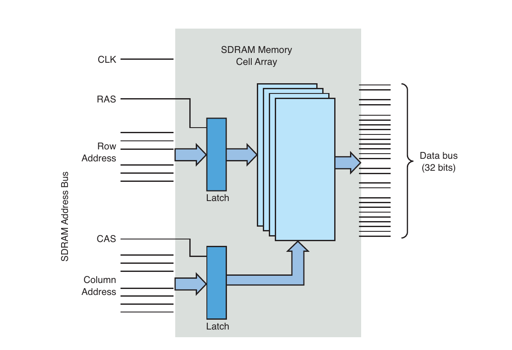

# Phụ lục D. Các cân nhắc về SDRAM interface

## Trong phụ lục này

- D.1 SDRAM cơ bản 572

- D.2 Clocking 574

- D.3 Thiết lập SDRAM 575

- D.4 Tổng kết 580

Thoạt nhìn, lập trình SDRAM controller có thể là tác vụ

rất khó. Thực tế có nhiều công nghệ Synchronous Dynamic Random

Access Memory (DRAM). Trong hành trình never-ending tìm hiệu

năng, mật độ, nhiều architecture và mode hoạt động

đã phát triển.

Chúng ta khảo sát AMCC PowerPC 405GP processor cho thảo luận

SDRAM interface. Bạn có thể muốn có User’s Manual

để tham khảo khi khám phá vấn đề SDRAM interfacing.

Tài liệu tham chiếu phần cuối phụ lục.

## D.1 SDRAM cơ bản

Để hiểu setup, phải hiểu cơ bản hoạt động SDRAM device. Không đi sâu hardware design, device tổ chức thành cell matrix, một số address bit dành row addressing, số khác column addressing như Hình D-1.

Trong memory matrix, mạch khá phức tạp. Ví dụ read đơn giản hóa: tham chiếu memory location bằng đặt row address trên row address line rồi column address trên column address line. Sau một thời gian, data tại vị trí row/column input được cung cấp processor trên data bus.

Processor xuất row address trên SDRAM address bus, assert Row Address Select (RAS). Sau preprogrammed delay ngắn cho mạch ghi row address, xuất column address, assert Column Address Select (CAS). SDRAM controller chuyển physical memory address thực thành row/column address. Nhiều controller cấu hình được row/column width, PPC405GP là ví dụ. Sau sẽ thấy phải cấu hình trong controller setup.



HÌNH D-1 SDRAM block diagram đơn giản hóa

Ví dụ giản lược nhiều nhưng cùng khái niệm. Burst read chẳng hạn đọc bốn memory location một lúc, xuất single RAS/CAS cycle. Mạch nội bộ tự tăng column address cho ba location sau, không cần processor phát bốn CAS cycle riêng. Đây chỉ một tối ưu hiệu năng. Cách tốt hiểu là tiếp thu chi tiết memory chip thực. Phần cuối đề cập data sheet well-written mẫu.

### D.1.1 SDRAM refresh

SDRAM cấu thành từ một transistor và capacitor. Transistor cấp điện tích, capacitor giữ (lưu) value từng cell. Vì lý do ngoài phạm vi, capacitor chỉ giữ ngắn. Khái niệm nền dynamic memory là capacitor biểu diễn cell phải nạp định kỳ giữ value. Gọi SDRAM refresh.

Refresh cycle là special memory cycle không read/write data, chỉ thực hiện refresh cần. Trách nhiệm chính controller là bảo đảm cycle phát kịp yêu cầu chip.

Nhà sản xuất chỉ minimum refresh interval, designer bảo đảm. Thường cấu hình controller trực tiếp chọn interval. PowerPC 405GP có register riêng, sẽ đọc ngay sau.

## D.2 Clocking

Synchronous nghĩa read/write cycle device trùng clock signal CPU. SDR SDRAM đọc, ghi mỗi SDRAM clock cycle. DDR SDRAM đọc, ghi hai lần mỗi cycle—rising edge và falling edge.

Processor hiện đại có clocking subsystem phức tạp, nhiều clock rate cho phần khác nhau. Điển hình dùng clock source crystal-generated low-frequency cho primary signal. Loop phase-locked (PLL) nội bộ sinh primary CPU clock (rate so tốc processor). Vì CPU thường nhanh hơn memory subsystem, processor sinh submultiple main clock cấp SDRAM. Phải cấu hình ratio cho tổ hợp CPU/SDRAM.

Clock processor, memory subsystem phải cấu hình đúng để SDRAM hoạt động. Processor manual có phần clock setup/management, nên xem cho board design riêng.

AMCC 405GP điển hình vì feature set: nhận một clock input crystal-generated, sinh nhiều internal/external clock cho subsystem. Sinh clock CPU, PCI interface, Onboard Peripheral Bus (OPB), Processor Local Bus (PLB), Memory Clock (MemClk), clock nội bộ cho timer/UART block. Bảng D-1 cho cấu hình điển hình.

BẢNG D-1 Clock configuration mẫu

| Clock | Rate | Giải thích |
|---|---|---|
| Crystal reference | 33MHz | Reference nền tảng cấp processor. |
| CPU clock | 133MHz | Từ internal PLL, điều khiển bằng hardware pin strapping và register setting. |
| PLB clock | 66MHz | Từ CPU clock, cấu hình pin strapping/register. Dùng trao đổi data trên internal processor local bus giữa module high-speed. |
| OPB clock | 66MHz | Từ PLB clock, cấu hình register. Nối peripheral nội bộ không cần high-speed. |
| PCI clock | 33MHz | Từ PLB clock, cấu hình register. |
| MemClk | 100MHz | Trực tiếp điều khiển SDRAM chip. Từ CPU clock, cấu hình register. |

Quyết định clock setup thường lúc hardware design. Pin strapping option xác định initial configuration khi cấp nguồn. Thường điều khiển phần nào derived clock bằng divider bit qua internal register riêng clock/subsystem control. Ví dụ 405GP, cấu hình cuối do pin strapping, firmware. Bootloader chịu trách nhiệm đặt divider ban đầu, clock option qua register bit rất sớm sau cấp nguồn.

## D.3 Thiết lập SDRAM

Sau cấu hình clock, tiếp SDRAM controller. Controller khác nhiều theo processor nhưng kết quả luôn giống: cung cấp clocking/timing value đúng để bật, tối ưu hiệu năng subsystem.

Như nội dung khác, không gì thay hiểu hardware chi tiết, đặc biệt SDRAM. Thiết kế SDRAM ngoài phạm vi nhưng cần cơ bản. Nhiều manufacturer data sheet có technical description hữu ích, nên làm quen. Không cần bằng hardware engineering để hiểu việc cấu hình đúng, nhưng cần mức hiểu nhất định.

Khảo sát cách controller 405GP được bootloader U-Boot Chương 7 cấu hình. Nhớ từ Chương 7, U-Boot cung cấp hook khởi tạo từ startup assembly code `start.S` trong CPU directory 4xx-specific. Xem Phần 7.4.5, “Khởi tạo Board-Specific”, Chương 7. Listing D-1 cho function `sdram_init()` từ file `.../cpu/ppc4xx/sdram.c` của U-Boot.

LISTING D-1 `ppc4xx sdram_init()` từ U-Boot

```
01 void sdr7am_init(void)
02 {
03         ulong sdtr1;
04         ulong rtr;
05         int i;
06
07         /*
08          * Support for 100MHz and 133MHz SDRAM
09          */
10         if (get_bus_freq(0) > 100000000) {
11                 /*
12                  * 133 MHz SDRAM
13                  */
14                 sdtr1 = 0x01074015;
15                 rtr = 0x07f00000;
16         } else {
17                 /*
18                  * default: 100 MHz SDRAM
19                  */
20                 sdtr1 = 0x0086400d;
21                 rtr = 0x05f00000;
22         }
23
24         for (i=0; i<N_MB0CF; i++) {
25                 /*
26                  * Disable memory controller.
27                  */
28                 mtsdram0(mem_mcopt1, 0x00000000);
29
30                 /*
31                  * Set MB0CF for bank 0.
32                  */
33                 mtsdram0(mem_mb0cf, mb0cf[i].reg);
34                 mtsdram0(mem_sdtr1, sdtr1);
35                 mtsdram0(mem_rtr, rtr);
36
37                 udelay(200);
38
39                 /*
40                  * Set memory controller options reg, MCOPT1.
41                  * Set DC_EN to ‘1’ and BRD_PRF to ‘01’ for 16 byte PLB Burst
42                  * read/prefetch.
43                  */
44                 mtsdram0(mem_mcopt1, 0x80800000);
45
46                 udelay(10000);
47
48                 if (get_ram_size(0, mb0cf[i].size) == mb0cf[i].size) {
49                         /*
50                          * OK, size detected -> all done
51                          */
52                         return;
53                 }
54         }
55 }
```

Hành động đầu đọc pin strapping 405GP xác định design value clock. Thấy hỗ trợ hai value 100MHz/133MHz. Dựa chọn constant dùng sau trong function đặt register bit thích hợp controller.

Từ dòng 24, loop đặt parameter cho mỗi trong tối đa năm memory size định trước. Hiện U-Boot hỗ trợ single bank 4MB,16MB,32MB,64MB,128MB. Size định nghĩa table `mb0cf` trong `.../cpu/ppc4xx/sdram.c`. Table gắn constant từng size theo value cần trong memory bank configuration register 405GP. Loop làm:

```
for (i = each possible memory bank size, largest first) {
    select timing constant based on SDRAM clock speed;
    disable SDRAM memory controller;
    configure bank 0 with size[i], timing constants[i]
    re-enable SDRAM memory controller;

    run simple memory test to dynamically determine size;
      /* This is done using get_ram_size() */
    if ( tested size == configured size )
        done;
}
```

Logic đơn giản đưa timing constant đúng vào controller dựa clock speed, memory bank size từ table hard-coded U-Boot. Theo giải thích dễ liên hệ bank configuration value với reference manual. Với DRAM 64MB đặt memory bank control register:

```
Memory Bank 0 Control Register = 0x000a4001
```

PowerPC 405GP User’s Manual mô tả field Bảng D-2 cho memory bank 0 control register.

BẢNG D-2 Các field Memory Bank 0-3 Configuration Register của 405GP

| Field | Value | Giải thích |
|---|---|---|
| Bank Address (BA) | 0x00 | Starting memory address bank này. |
| Size (SZ) | 0x4 | Kích thước memory bank—ở đây 64MB. |
| Addressing Mode (AM) | 0x2 | Xác định memory organization gồm số row/column bit. Mode 2 là 12 row address bit, 9 hoặc 10 column address bit, tối đa bốn internal SDRAM bank. Dữ liệu có trong table 405GP User’s Manual. |
| Bank Enable (BE) | 0x1 | Enable bit cho bank register cấu hình. 405GP có bốn memory bank configuration register. |

Designer phải xác định value trong bảng dựa memory module dùng

trên board.

Xem timing example chi tiết yêu cầu controller điển hình. Giả định clock SDRAM 100MHz, memory 64MB, function `sdram_init()` Listing D-1 chọn timing constant:

```
SDRAM Timing Register          = 0x0086400d
Refresh Timing Register        = 0x05f00000
```

PowerPC 405GP User’s Manual mô tả field Bảng D-3 cho SDRAM Timing Register.

BẢNG D-3 Các field SDRAM Timing Register của 405GP

| Field | Value | Giải thích |
|---|---|---|
| CAS Latency (CASL) | 0x1 | SDRAM CAS latency. Value trực tiếp từ chip spec, delay theo clock cycle chip cần từ lệnh `read` (CAS signal) tới data trên bus. Ở đây 0x1 là hai cycle theo 405GP User’s Manual. |
| Precharge Command to Next Activate (PTA) | 0x1 | Lệnh SDRAM Precharge deactivate row. Ngược lại Activate enable row cho truy cập tiếp như burst cycle. Parameter bảo đảm minimum time từ Precharge tới Activate cycle sau, do chip quyết định. Lấy value đúng từ SDRAM chip spec. Ở đây 0x1 là hai clock cycle theo 405GP User’s Manual. |
| Read/Write to Precharge Command Minimum (CTP) | 0x2 | Bảo đảm minimum delay giữa SDRAM read/write command tới Precharge command sau. Lấy value đúng từ chip spec. Ở đây 0x2 là ba clock cycle theo 405GP User’s Manual. |
| SDRAM Command Leadoff (LDF) | 0x1 | Bảo đảm minimum delay từ assertion address/command cycle tới bank select cycle. Lấy value đúng từ chip spec. Ở đây 0x1 là hai clock cycle theo 405GP User’s Manual. |

Timing parameter cuối ví dụ U-Boot Listing D-1 là refresh timing register value. Register cần một field xác định refresh interval controller áp. Field coi như counter đơn giản chạy theo SDRAM clock frequency. Ví dụ giả định 100MHz, value lập trình `0x05f0_0000`. Từ manual xác định sinh refresh request mỗi 15,2 microsecond. Như parameter khác, value do chip spec quyết định.

SDRAM chip điển hình cần một refresh cycle mỗi row. Mỗi row phải refresh trong minimum time nhà sản xuất chỉ. Chip tham chiếu cuối phụ lục chỉ 8.192 row phải refresh mỗi 64 millisecond. Cần refresh cycle mỗi 7,8 microsecond để đáp ứng device này.

## D.4 Tổng kết

SDRAM device phức tạp. Phụ lục cho ví dụ đơn giản giúp xử lý setup controller. Controller thực hiện chức năng thiết yếu, phải setup đúng. Không gì thay đi sâu spec, hiểu thông tin. Hai tài liệu mẫu là điểm đầu xuất sắc.

### D.4.1 Gợi ý đọc thêm

AMCC 405GP Embedded Processor User’s Manual AMCC Corporation www.amcc.com/Embedded/

Micron Technology, Inc. Synchronous DRAM MT48LC64M4A2 Data Sheet http://download.micron.com/pdf/datasheets/dram/sdram/256MSDRAM.pdf
