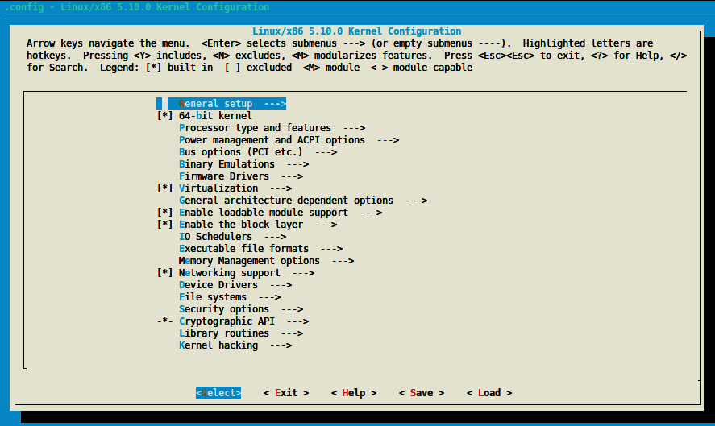

# Chương 1: Giới thiệu phát triển kernel

Linux bắt đầu là project sở thích năm 1991 của sinh viên Phần Lan Linus Torvalds. Project dần phát triển và tiếp tục, với khoảng một nghìn người đóng góp khắp thế giới. Ngày nay Linux là điều không thể thiếu trong embedded system cũng như server. Kernel là phần trung tâm của hệ điều hành, phát triển không đơn giản. Linux có nhiều lợi thế so với hệ điều hành khác: miễn phí, tài liệu tốt với cộng đồng lớn, khả chuyển giữa platform, cho truy cập source code và có nhiều free open source software.

Sách cố tổng quát nhất có thể. Có chủ đề đặc biệt, device tree, chưa hoàn toàn là tính năng x86. Chủ đề này dành cho bộ xử lý ARM, đặc biệt loại hỗ trợ đầy đủ device tree. Vì sao những kiến trúc đó? Vì được dùng chủ yếu trên desktop/server (x86) và embedded system (ARM).

Trong chương này, chúng ta trình bày:

- Thiết lập môi trường phát triển

- Tìm hiểu quy trình kernel configuration

- Build kernel

## Thiết lập môi trường phát triển

Khi làm lĩnh vực embedded system, có thuật ngữ phải quen trước cả thiết lập môi trường. Như sau:

- Target: Máy mà các binary từ build process được tạo cho. Đây là máy sẽ chạy binary.

- Host: Máy diễn ra build process.

- Compilation: Còn gọi native compilation hay native build. Xảy ra khi target và host giống nhau; tức build trên máy A (host) binary sẽ thực thi cùng máy (A, target) hay máy cùng loại. Native compilation cần native compiler. Vì vậy native compiler là compiler có target và host giống nhau.

- Cross-compilation: Ở đây, target và host khác nhau. Bạn build một binary trên máy A, tức host, để chạy trên máy B, tức target. Trong trường hợp này, host phải cài cross-compiler hỗ trợ target architecture. Vì vậy, cross-compiler là compiler có target khác host.

Vì embedded computer có tài nguyên hạn chế hay ít (CPU, RAM, disk, v.v.), host thường là máy x86 mạnh hơn nhiều, tài nguyên nhiều hơn để tăng tốc phát triển. Tuy nhiên vài năm qua embedded computer mạnh hơn, có xu hướng dùng native compilation (do đó làm host). Ví dụ điển hình Raspberry Pi 4 với quad-core CPU mạnh và RAM tới 8 GB.

Chương này dùng máy x86 làm host, cho native build hoặc cross-compilation. Mọi thuật ngữ “native build” chỉ “x86 native build”. Vì thế tôi chạy Ubuntu 18.04.

Kiểm tra nhanh thông tin bằng lệnh:

```
lsb_release -a
Distributor ID: Ubuntu
Description:    Ubuntu 18.04.5 LTS
Release:    18.04
Codename:   bionic
```

Máy tôi ASUS RoG, CPU AMD Ryzen 16 core (dùng lệnh `lscpu` lấy thông tin), RAM 16 GB, SSD 256 GB, magnetic hard drive 1 TB (lấy qua `df -h`). Dù vậy quad-core CPU và RAM 4 hoặc 8 GB có thể đủ, nhưng build lâu hơn. Editor yêu thích Vim, nhưng bạn tự do dùng loại thoải mái nhất. Nếu desktop có thể dùng Visual Studio Code (VS Code), đang phổ biến.

Giờ quen keyword compilation-related sẽ dùng, có thể chuẩn bị host machine.

## Thiết lập host machine

Trước bắt đầu phát triển, cần thiết lập môi trường. Môi trường dành phát triển Linux khá đơn giản — ít nhất trên Debian-based system (trường hợp chúng ta).

Trên host machine cần cài vài package:

```
$ sudo apt update
$ sudo apt install gawk wget git diffstat unzip \
       texinfo gcc-multilib build-essential chrpath socat \
       libsdl1.2-dev xterm ncurses-dev lzop libelf-dev make
```

Trong code trên đã cài vài development tool và library bắt buộc để có user interface đẹp khi configure Linux kernel.

Giờ cần cài compiler và tool (linker, assembler, v.v.) để build process hoạt động đúng, tạo executable cho target. Tập công cụ gọi Binutils, tổ hợp compiler + Binutils (+ dependency library build-time khác nếu có) gọi toolchain. Vì vậy cần hiểu “Tôi cần toolchain cho kiến trúc \<này\>” hay câu tương tự.

### Tìm hiểu và cài toolchain

Trước compile, cần cài package/tool cần cho native hoặc ARM cross-compiling, tức toolchain. GCC là compiler Linux kernel hỗ trợ. Nhiều macro trong kernel liên quan GCC. Vì vậy dùng GCC làm (cross-)compiler.

Với native compilation, dùng lệnh cài toolchain:

```
sudo apt install gcc binutils
```

Khi cần cross-compile, bạn phải xác định và cài đúng toolchain. So với native compiler, tên executable của cross-compiler có prefix là tên hệ điều hành đích, architecture và đôi khi cả library. Vì vậy, để nhận diện các toolchain architecture-specific, một quy ước đặt tên đã được định nghĩa: `arch[-vendor][-os]-abi`. Chúng ta hãy xem ý nghĩa các field trong mẫu này:

- `arch` xác định kiến trúc, tức `arm`, `mips`, `x86`, `i686`, v.v.

- `vendor` là nhà cung cấp toolchain (công ty), tức `Bootlin`, `Linaro`, `none` (không nhà cung cấp), hoặc chỉ bỏ field, v.v.

- `os` là target operating system, tức `linux` hay `none` (bare metal). Nếu bỏ, giả định bare metal.

- `abi` viết tắt application binary interface. Chỉ hình dạng binary bên dưới, function call convention, cách truyền tham số, v.v. Convention có thể gồm `eabi`, `gnueabi`, `gnueabihf`. Xem chi tiết:

- `eabi` nghĩa code được compile chạy trên bare metal ARM core.

- `gnueabi` nghĩa code cho Linux sẽ được compile.

- `gnueabihf` giống `gnueabi`, nhưng `hf` cuối nghĩa `hard float`, chỉ compiler và library bên dưới dùng hardware floating-point instruction thay triển khai software của floating-point instruction, như fixed-point software implementation. Nếu không có floating-point hardware, instruction được trap và thực hiện bằng floating-point emulation module. Khi software emulation, khác biệt chức năng thực sự duy nhất là thực thi chậm hơn.

Một số tên toolchain minh họa pattern:

- `arm-none-eabi`: Đây là toolchain nhắm đến architecture ARM. Nó không chỉ định vendor, nhắm đến một hệ thống bare-metal, tức không nhắm đến hệ điều hành, và tuân theo ARM EABI.

- `arm-none-linux-gnueabi` hoặc `arm-linux-gnueabi`: Toolchain tạo object cho ARM chạy Linux với configuration (ABI) mặc định do toolchain cung cấp. Lưu ý `arm-none-linux-gnueabi` giống `arm-linux-gnueabi` vì như đã thấy không chỉ vendor thì giả định không có. Biến thể hỗ trợ hardware floating point là `arm-linux-gnueabihf` hoặc `arm-none-linux-`

```
gnueabihf.
```

Giờ quen quy ước tên toolchain, có thể xác định toolchain cross-compile cho target architecture.

Để cross-compile máy ARM 32-bit, cài toolchain bằng lệnh:

```
$ sudo apt install gcc-arm-linux-gnueabihf binutils-arm-linux-gnueabihf
```

Lưu ý ARM backend/support 64-bit trong Linux tree và GCC gọi aarch64. Vì vậy cross-compiler phải tên dạng `gcc-aarch64-linux-gnu*`, Binutils dạng `binutils-aarch64-linux-gnu*`. Với ARM toolchain 64-bit dùng:

```
$ sudo apt install make gcc-aarch64-linux-gnu binutils-aarch64-linux-gnu
```

LƯU Ý

Aarch64 chỉ hỗ trợ/cung cấp hardware float aarch64 toolchain. Do đó không cần `hf` cuối.

Không phải mọi compiler version compile được một Linux kernel version. Quan trọng chú ý cả Linux kernel version và compiler (GCC) version. Các lệnh trước cài phiên bản mới nhất distribution hỗ trợ, nhưng có thể nhắm phiên bản cụ thể. Dùng `gcc-<version>-<arch>-linux-gnu*`.

Ví dụ cài GCC version 8 cho aarch64 bằng lệnh:

```
sudo apt install gcc-8-aarch64-linux-gnu
```

Bây giờ toolchain đã được cài, chúng ta có thể xem phiên bản mà package manager của distribution đã chọn. Ví dụ, để kiểm tra phiên bản aarch64 cross-compiler được cài, chúng ta có thể sử dụng lệnh sau:

```
$ aarch64-linux-gnu-gcc --version
aarch64-linux-gnu-gcc (Ubuntu/Linaro 7.5.0-3ubuntu1~18.04) 7.5.0
Copyright (C) 2017 Free Software Foundation, Inc.
[...]
```

Với biến thể ARM 32-bit dùng:

```
$ arm-linux-gnueabihf-gcc --version
arm-linux-gnueabihf-gcc (Ubuntu/Linaro 7.5.0-3ubuntu1~18.04) 7.5.0
Copyright (C) 2017 Free Software Foundation, Inc.
[...]
```

Cuối cùng với native version dùng:

```
$ gcc --version
gcc (Ubuntu 7.5.0-3ubuntu1~18.04) 7.5.0
Copyright (C) 2017 Free Software Foundation, Inc.
```

Giờ môi trường đã thiết lập, bảo đảm tool version đúng, có thể tải Linux kernel source và tìm hiểu.

## Lấy source

Trong thời kỳ đầu của kernel, đến năm 2003, kiểu đánh phiên bản odd-even được sử dụng, trong đó số lẻ là stable và số chẵn là unstable. Khi phiên bản 2.6 được phát hành, cơ chế đánh phiên bản chuyển sang X.Y.Z. Chúng ta hãy xem chi tiết hơn:

- X: Version thực tế kernel, còn gọi major. Tăng khi có API change backward-incompatible.

- Y: Minor revision. Tăng khi thêm chức năng backward-compatible.

- Z: Còn gọi PATCH, biểu diễn version liên quan bug fix.

Gọi semantic versioning, dùng đến 2.6.39 khi Linus Torvalds quyết định nâng lên 3.0, đồng nghĩa kết thúc semantic versioning năm 2011. Khi đó dùng X.Y.

Khi đến phiên bản 3.20, Linus cho rằng không thể tiếp tục tăng Y nữa. Vì vậy, ông quyết định chuyển sang một cơ chế đánh phiên bản tùy ý: tăng X mỗi khi Y lớn đến mức không còn đủ ngón tay và ngón chân để đếm. Đây là lý do phiên bản chuyển thẳng từ 3.20 lên 4.0.

Giờ kernel dùng versioning X.Y tùy ý, không liên quan semantic versioning.

Theo Linux kernel release model, luôn có hai release mới nhất: stable và long-term support (LTS). Mọi bug fix và tính năng mới được subsystem maintainer tập hợp/chuẩn bị, gửi Linus Torvalds đưa vào Linux tree của ông, gọi mainline Linux tree, còn gọi master Git repository. Mọi stable release bắt nguồn đây.

Trước mỗi kernel version mới phát hành, gửi cộng đồng qua release candidate tag để nhà phát triển kiểm thử/hoàn thiện tính năng mới. Dựa phản hồi trong chu kỳ, Linus quyết định final version sẵn sàng chưa. Khi Linus tin kernel mới sẵn sàng, ông tạo final release. Gọi “stable” để chỉ không phải “release candidate”: các release này version vX.Y. Không timeline nghiêm ngặt, nhưng mainline kernel mới thường mỗi 2-3 tháng. Stable kernel release dựa release của Linus, tức mainline tree release.

Khi Linus phát hành stable kernel, cũng xuất hiện linux-stable tree (tại https://git.kernel.org/pub/scm/linux/kernel/git/stable/linux.git/), thành branch. Ở đây nhận bug fix. Tree gọi stable tree vì theo dõi stable kernel đã phát hành. Greg Kroah-Hartman duy trì/chọn lọc. Tuy nhiên mọi fix phải vào tree Linus trước, mainline repository. Khi bug được sửa trong mainline repository, có thể áp dụng cho kernel đã phát hành vẫn được cộng đồng phát triển duy trì. Mọi fix backport đến stable release phải đáp ứng tiêu chí quan trọng trước xem xét — một là “đã tồn tại trong tree Linus”.

LƯU Ý

Bugfix kernel release được xem stable.

Ví dụ Linus phát hành kernel 4.9, stable kernel được phát hành theo numbering scheme, tức 4.9.1, 4.9.2, 4.9.3, v.v. Gọi bugfix kernel release, thường rút gọn chuỗi thành “4.9.y” khi nói branch trong stable kernel release tree. Mỗi stable kernel release tree do một kernel developer duy trì, chịu chọn patch cần và thực hiện review/release. Thường chỉ vài bugfix kernel release cho đến mainline kernel tiếp có — trừ khi chỉ định long-term maintenance kernel.

Mọi subsystem và kernel maintainer repository lưu tại https://git.kernel.org/pub/scm/linux/kernel/git/. Cũng thấy Linus hoặc stable tree. Trong Linus tree (https://git.kernel.org/pub/scm/linux/kernel/git/torvalds/linux.git/), chỉ một branch, master. Tag là stable release hoặc release candidate. Trong stable tree (https://git.kernel.org/pub/scm/linux/kernel/git/stable/linux.git/), mỗi stable kernel release một branch (tên \<A.B\>.y, \<A.B\> là release version trong Linus tree), mỗi branch chứa bugfix kernel release của nó.

### Tải và tổ chức source

Sách dùng tree Linus, tải qua lệnh:

```
git clone https://git.kernel.org/pub/scm/linux/kernel/git/torvalds/linux.git --depth 1
git checkout v5.10
ls
```

Các lệnh trên dùng `--depth 1` tránh tải history (hay chỉ lấy last commit history), có thể giảm download size đáng kể, tiết kiệm thời gian. Vì Git hỗ trợ branching/tagging, lệnh `checkout` cho chuyển tag/branch cụ thể. Ví dụ chuyển tag `v5.10`.

LƯU Ý Trong sách làm việc với Linux kernel v5.10.

Xem nội dung main source directory:

- `arch/`: Để tổng quát nhất có thể, code architecture-specific tách khỏi phần còn lại. Directory chứa processor-specific code trong subdirectory mỗi kiến trúc, như `alpha/`, `arm/`, `mips/`, `arm64/`, v.v.

- `block/`: Directory chứa code cho block storage device.

- `crypto/`: Directory chứa cryptographic API và code encryption algorithm.

- `certs/`: Directory chứa certificate và sign file để enable module signature, khiến kernel nạp signed module.

- `documentation/`: Directory chứa mô tả API dùng cho kernel framework/subsystem khác nhau. Nên xem trước hỏi trên public forum.

- `drivers/`: Directory nặng nhất vì liên tục tăng khi device driver được merge. Chứa mọi device driver, tổ chức trong nhiều subdirectory.

- `fs/`: Directory chứa triển khai filesystem kernel hỗ trợ, như NTFS, FAT, ETX{2,3,4}, sysfs, procfs, NFS, v.v.

- `include/`: Directory chứa kernel header file.

- `init/`: Directory chứa initialization/startup code.

- `ipc/`: Directory chứa triển khai inter-process communication (IPC) mechanism, như message queue, semaphore, shared memory.

- `kernel/`: Directory chứa phần architecture-independent của base kernel.

- `lib/`: Library routine và helper function nằm đây. Gồm generic kernel object (kobject) handler và hàm tính cyclic redundancy code (CRC).

- `mm/`: Directory chứa memory management code.

- `net/`: Directory chứa network protocol code (bất kỳ network type).

- `samples/`: Directory chứa device driver sample cho nhiều subsystem.

- `scripts/`: Directory chứa script/tool dùng cùng kernel. Có công cụ hữu ích khác ở đây.

- `security/`: Directory chứa security framework code.

- `sound/`: Đoán gì đây: audio subsystem code.

- `tools/`: Directory chứa công cụ phát triển/kiểm thử Linux kernel cho nhiều subsystem như USB, vhost test module, GPIO, IIO, SPI và khác.

- `usr/`: Directory hiện chứa triển khai initramfs.

- `virt/`: Virtualization directory chứa kernel virtual machine (KVM) module cho hypervisor.

Để bảo đảm portability, mọi code architecture-specific nên ở directory `arch`. Hơn nữa kernel code liên quan user space API không đổi (system call, `/proc`, `/sys`, v.v.) vì sẽ phá chương trình hiện có.

Trong phần này, chúng ta đã làm quen với nội dung source của Linux kernel. Sau khi xem toàn bộ source, bước tự nhiên tiếp theo là configure để có thể biên dịch kernel. Trong phần tiếp theo, chúng ta sẽ học cách kernel configuration hoạt động.

## Configure và build Linux kernel

Có rất nhiều driver/tính năng và build option trong Linux kernel source. Configuration process gồm chọn tính năng/driver tham gia compilation process. Tùy native compilation hay cross-compilation, có environment variable phải định nghĩa trước cả configuration process.

## Chỉ định compilation option

Compiler được `Makefile` kernel gọi là `$(CROSS_COMPILE)gcc`. `CROSS_COMPILE` là prefix cross-compiling tool (`gcc`, `as`, `ld`, `objcopy`, v.v.), phải chỉ định khi gọi `make` hoặc export trước mọi lệnh `make`. Chỉ `gcc` và Binutils executable liên quan có prefix `$(CROSS_COMPILE)`.

Lưu ý Linux kernel build infrastructure đưa ra giả định, enable option/feature/flag dựa target architecture. Vì vậy ngoài prefix cross-compiler, phải chỉ định target architecture, qua environment variable `ARCH`.

Lệnh configure/build Linux điển hình như:

```
ARCH=<XXXX> CROSS_COMPILE=<YYYY> make menuconfig
```

Cũng có thể như:

```
ARCH=<XXXX> CROSS_COMPILE=<YYYY> make <make-target>
```

Nếu không muốn chỉ định environment variable khi chạy lệnh, có thể export vào shell hiện tại. Ví dụ:

```
export CROSS_COMPILE=aarch64-linux-gnu-
export ARCH=aarch64
```

Nhớ nếu không chỉ định biến, nhắm native host machine; tức bỏ/không đặt `CROSS_COMPILE`, `$(CROSS_COMPILE)gcc` thành `gcc`, tương tự công cụ khác được gọi (ví dụ `$(CROSS_COMPILE)ld` thành `ld`).

Tương tự bỏ/không đặt `ARCH` (target architecture), mặc định host nơi chạy `make`, tức `$(uname -m)`.

Vì vậy để `CROSS_COMPILE` và `ARCH` không định nghĩa để kernel được native compile cho host architecture bằng `gcc`.

## Tìm hiểu quy trình kernel configuration

Linux kernel là Makefile-based project hàng nghìn option/driver. Mỗi option enable có thể làm option khác sẵn có hay đưa code cụ thể vào build. Configure kernel bằng `make menuconfig` cho ncurses-based interface hoặc `make xconfig` cho X-based interface. ncurses-based interface như sau:



Hình 1.1 – Màn hình kernel configuration

Phần lớn option có ba lựa chọn. Tuy nhiên có thể liệt kê năm loại option khi configure Linux kernel:

- Boolean option có hai lựa chọn:

- `(blank)`, bỏ tính năng này. Khi option được chọn nổi bật trong configuration menu, nhấn `<n>` để bỏ. Tương đương false. Khi disable, configuration option kết quả bị comment trong configuration file.

- `(*)`, compile tĩnh vào kernel. Nghĩa là luôn có khi kernel nạp lần đầu. Tương đương true. Enable tính năng trong configuration menu bằng chọn và nhấn `<y>`. Option kết quả là `CONFIG_<OPTION>=y` trong configuration file; ví dụ,

```
CONFIG_INPUT_EVDEV=y.
```

- Tristate option, ngoài Boolean state, có state thứ ba đánh dấu `(M)` trong configuration window. Thành `CONFIG_<OPTION>=m` trong configuration file; ví dụ `CONFIG_INPUT_EVDEV=m`. Để tạo loadable module (nếu option cho phép), chọn tính năng, nhấn phím `M`.

- String option nhận string value; ví dụ `CONFIG_CMDLINE="noinitrd console=ttymxc0,115200"`.

- Hex option nhận hexadecimal value; ví dụ `CONFIG_PAGE_OFFSET=0x80000000`.

- Int option nhận integer value; ví dụ `CONFIG_CONSOLE_LOGLEVEL_DEFAULT=7`.

Option chọn lưu trong file `.config` tại root source tree.

Rất khó biết configuration nào hoạt động trên platform. Phần lớn không cần bắt đầu từ đầu. Có configuration file mặc định hoạt động trong mỗi arch directory làm điểm khởi đầu (quan trọng bắt đầu từ configuration đã hoạt động):

```
ls arch/<your_arch>/configs/
```

Với CPU ARM-based 32-bit, config file trong `arch/arm/configs/`. Kiến trúc này thường mỗi CPU family một default configuration. Ví dụ processor i.MX6-7, default config file `arch/arm/configs/imx_v6_v7_defconfig`. Tuy nhiên CPU ARM 64-bit chỉ một default configuration lớn để tùy chỉnh, trong `arch/arm64/configs/`, tên `defconfig`. Tương tự x86, file ở `arch/x86/configs/`. Có hai default configuration file — `i386_defconfig`, `x86_64_defconfig` — lần lượt cho x86 32-bit và 64-bit.

Lệnh kernel configuration với default configuration file như sau:

```
make <foo_defconfig>
```

Thao tác này tạo một file `.config` mới trong directory chính, tức root directory, còn `.config` cũ được đổi tên thành `.config.old`. Điều này hữu ích để hoàn tác những thay đổi configuration trước đó. Sau đó, để tùy chỉnh configuration, bạn có thể sử dụng lệnh sau:

```
make menuconfig
```

Lưu thay đổi cập nhật `.config`. Có thể chia sẻ config với đồng đội, nhưng tốt hơn tạo default configuration file cùng minimal format như file kèm Linux kernel source. Dùng lệnh:

```
make savedefconfig
```

Lệnh tạo minimal configuration file (vì không lưu non-default setting). Default configuration file tạo ra tên `defconfig`, lưu root source tree. Có thể lưu nơi khác bằng lệnh:

```
mv defconfig arch/<arch>/configs/myown_defconfig
```

Như vậy chia sẻ reference configuration trong kernel source, nhà phát triển khác lấy cùng file `.config` bằng chạy:

```
make myown_defconfig
```

LƯU Ý

Với cross-compilation, `ARCH` và `CROSS_COMPILE` phải đặt trước mọi lệnh `make`, ngay kernel configuration. Nếu không có thay đổi bất ngờ trong configuration.

Sau đây các configuration command có thể dùng tùy target system:

- Với native compilation x86 64-bit, khá đơn giản (có thể bỏ compilation option):

```
make x86_64_defconfig
make menuconfig
```

- Với board ARM i.MX6-based 32-bit, thực thi lệnh:

```
ARCH=arm CROSS_COMPILE=arm-linux-gnueabihf- make imx_v6_v7_defconfig
ARCH=arm CROSS_COMPILE=arm-linux-gnueabihf- make menuconfig
```

Lệnh đầu lưu default option trong `.config`, lệnh sau cập nhật (thêm/bỏ) option tùy nhu cầu.

- Với ARM board 64-bit, thực thi:

```
ARCH=aarch64 CROSS_COMPILE=aarch64-linux-gnu- make defconfig
ARCH=aarch64 CROSS_COMPILE=aarch64-linux-gnu- make menuconfig
```

Có thể gặp lỗi Qt4 với `xconfig`. Khi đó dùng lệnh sau cài package thiếu:

```
sudo apt install qt4-dev-tools qt4-qmake
```

LƯU Ý

Có thể chuyển kernel cũ sang mới. Với file `.config` cũ, copy vào kernel source tree mới rồi `make oldconfig`. Nếu kernel mới có option mới, hỏi có thêm không. Tuy nhiên có thể muốn default value. Khi đó chạy `make` `olddefconfig`. Cuối cùng để nói không mọi option mới, chạy `make oldnoconfig`.

Có thể có lựa chọn tốt hơn tìm configuration file ban đầu, đặc biệt máy đã chạy. Debian và Ubuntu Linux distribution lưu `.config` trong directory `/boot`, nên dùng lệnh sao chép:

```
cp /boot/config-`uname -r` .config
```

Distribution khác có thể không làm. Vì vậy khuyến nghị luôn enable kernel configuration option `IKCONFIG` và `IKCONFIG_PROC`, cho truy cập `.config` qua `/proc/configs.gz`. Đây là phương pháp chuẩn cũng hoạt động với embedded distribution.

### Một số tính năng kernel configuration hữu ích

Giờ có thể configure kernel, liệt kê tính năng hữu ích đáng enable:

- `IKCONFIG` và `IKCONFIG_PROC`: Quan trọng nhất với tôi. Cho kernel configuration sẵn lúc runtime tại `/proc/config.gz`. Hữu ích tái dùng config trên hệ thống khác hay chỉ xem trạng thái enable tính năng cụ thể; ví dụ:

```
# zcat /proc/config.gz | grep CONFIG_SOUND
CONFIG_SOUND=y
CONFIG_SOUND_OSS_CORE=y
CONFIG_SOUND_OSS_CORE_PRECLAIM=y
# CONFIG_SOUNDWIRE is not set
#
```

- `CMDLINE_EXTEND` và `CMDLINE`: Option đầu Boolean cho mở rộng kernel command line từ configuration, option sau string chứa giá trị command-line extension thực tế; ví dụ,

```
CMDLINE="noinitrd usbcore.authorized_default=0".
```

- `CONFIG_KALLSYMS`: Boolean option cung cấp kernel symbol table (mapping giữa symbol và địa chỉ) tại `/proc/kallsyms`. Rất hữu ích tracer và công cụ cần map kernel symbol sang địa chỉ. Dùng khi in oops message. Thiếu nó, oops listing tạo hexadecimal output khó diễn giải.

- `CONFIG_PRINTK_TIME`: Hiện timing information khi in message từ kernel. Có thể hữu ích timestamp event xảy ra runtime.

- `CONFIG_INPUT_EVBUG`: Cho debug input device.

- `CONFIG_MAGIC_SYSRQ`: Cho một mức kiểm soát (reboot, dump status information, v.v.) hệ thống, ngay sau crash, chỉ dùng tổ hợp phím.

- `DEBUG_FS`: Enable hỗ trợ debug filesystem, nơi debug `GPIO`, `CLOCK`, `DMA`, `REGMAP`, `IRQs` và nhiều subsystem khác.

- `FTRACE` và `DYNAMIC_FTRACE`: Enable tracer mạnh `ftrace`, trace toàn hệ thống. Khi enable `ftrace`, một số enumeration option cũng enable được:

- `FUNCTION_TRACER`: Cho trace mọi non-inline function trong kernel.

- `FUNCTION_GRAPH_TRACER`: Giống lệnh trước nhưng hiện call graph (caller/callee function).

- `IRQSOFF_TRACER`: Cho theo dõi khoảng IRQ tắt trong kernel.

- `PREEMPT_TRACER`: Cho đo preemption off latency.

- `SCHED_TRACER`: Cho thực hiện scheduling latency tracing.

Kernel đã configure, phải build để tạo runnable kernel. Mục tiếp mô tả kernel building process và build artifact dự kiến.

## Build Linux kernel

Bước này cần cùng shell như configuration step; nếu không phải định nghĩa lại environment variable `ARCH` và `CROSS_COMPILE`.

Linux là Makefile-based project. Build cần công cụ `make`, thực thi lệnh `make`. Với Linux kernel, chạy từ main kernel source directory dưới normal user.

Mặc định nếu không chỉ định, make target là `all`. Trong Linux kernel source, với x86, target trỏ đến (hay phụ thuộc) target `vmlinux bzImage modules`; ARM/aarch64 tương ứng target `vmlinux zImage modules dtbs`.

Trong các target, `bzImage` là make target x86-specific tạo binary cùng tên `bzImage`. `vmlinux` tạo Linux image tên `vmlinux`. `zImage` và `dtbs` là make target ARM- và aarch64-specific. Đầu tạo Linux image cùng tên, sau build device tree source cho target CPU variant. `modules` build mọi module chọn (đánh dấu `m` trong configuration).

Khi build, tận dụng host CPU performance bằng nhiều job song song qua make option `-j`. Ví dụ:

```
make -j16
```

Phần lớn người đặt số `-j` bằng 1,5 lần core. Tôi luôn dùng `ncpus * 2`.

Có thể build Linux kernel như:

- Với native compilation, dùng lệnh:

```
make -j16
```

- Với ARM cross-compilation 32-bit, dùng:

```
ARCH=arm CROSS_COMPILE=arm-linux-gnueabihf- make -j16
```

Mỗi make target gọi riêng được:

```
ARCH=arm CROSS_COMPILE=arm-linux-gnueabihf- make dtbs
```

Cũng có thể:

```
ARCH=arm CROSS_COMPILE=arm-linux-gnueabihf- make zImage -j16
```

Cuối cùng, cũng có thể:

```
make bzImage -j16
```

LƯU Ý

Tôi dùng `-j16` vì host có CPU 8-core. Phải điều chỉnh số job theo host configuration.

Kết thúc ARM cross-compilation job 32-bit, thấy dạng:

```
[…]
  LZO     arch/arm/boot/compressed/piggy_data
  CC      arch/arm/boot/compressed/misc.o
  CC      arch/arm/boot/compressed/decompress.o
  CC      arch/arm/boot/compressed/string.o
  SHIPPED arch/arm/boot/compressed/hyp-stub.S
  SHIPPED arch/arm/boot/compressed/lib1funcs.S
  SHIPPED arch/arm/boot/compressed/ashldi3.S
  SHIPPED arch/arm/boot/compressed/bswapsdi2.S
  AS      arch/arm/boot/compressed/hyp-stub.o
  AS      arch/arm/boot/compressed/lib1funcs.o
  AS      arch/arm/boot/compressed/ashldi3.o
  AS      arch/arm/boot/compressed/bswapsdi2.o
  AS      arch/arm/boot/compressed/piggy.o
  LD      arch/arm/boot/compressed/vmlinux
  OBJCOPY arch/arm/boot/zImage
  Kernel: arch/arm/boot/zImage is ready
```

Dùng default target, build process tạo nhiều binary tùy architecture, như sau:

- `arch/<arch>/boot/Image`: Uncompressed kernel image có thể boot

- `arch/<arch>/boot/*Image*`: Compressed kernel image cũng có thể boot:

Là `bzImage` (nghĩa “big zImage”) cho x86, `zImage` cho ARM/aarch64, `vary` cho architecture khác.

- `arch/<arch>/boot/dts/*.dtb`: Cung cấp compiled device tree blob cho CPU variant chọn.

- `vmlinux`: Raw, uncompressed, unstripped kernel image ở ELF format. Hữu ích debugging nhưng thường không dùng boot.

Giờ biết (cross-)compile Linux kernel, học cài đặt.

### Cài Linux kernel

Quy trình cài Linux kernel khác giữa native compilation và cross-compilation:

- Trong native installation, tức cài trên host, bạn có thể chỉ cần chạy `sudo make install`. Phải sử dụng `sudo` vì việc cài đặt diễn ra trong directory `/boot`. Nếu thực hiện native installation trên x86, các file sau được cung cấp:

- `/boot/vmlinuz-<version>`: Biến thể compressed, stripped của `vmlinux`. Cùng kernel image như trong `arch/<arch>/boot`.

- `/boot/System.map-<version>`: Lưu kernel symbol table (mapping kernel symbol/địa chỉ), không chỉ debugging, còn cho vài kernel module resolve symbol và nạp đúng. File chỉ chứa static kernel symbol table, còn `/proc/kallsyms` (nếu enable `CONFIG_KALLSYMS` trong config) trên running kernel chứa `System.map` cùng loaded kernel module symbol.

- `/boot/config-<version>`: Tương ứng kernel configuration của version đã build.

- Embedded installation thường dùng single file kernel. Hơn nữa target không truy cập được nên ưu tiên cài thủ công. Vì vậy embedded Linux build system (Yocto/Buildroot) dùng internal script đưa kernel image vào target root filesystem. Embedded installation có thể đơn giản nhờ build system, nhưng native installation (đặc biệt x86) có thể cần lệnh bootloader-related bổ sung (như `update-grub2`) để hệ thống thấy kernel mới.

Bây giờ đã quen với kernel configuration, bao gồm các quy trình build và cài đặt, chúng ta hãy xem kernel module, cho phép mở rộng kernel ở runtime.

## Build và cài module

Có thể build module riêng bằng target `modules`, cài bằng `modules_install`. Module build cùng directory với source tương ứng. Vì vậy kernel object kết quả rải khắp kernel source tree:

- Native build và installation dùng:

```
make modules
sudo make modules_install
```

Module kết quả cài tại `/lib/modules/$(uname -r)/kernel/`, cùng directory structure với source tương ứng. Chỉ định custom install path bằng environment variable `INSTALL_MOD_PATH`.

- Khi cross-compiling embedded system, như mọi lệnh `make`, phải chỉ định `ARCH` và `CROSS_COMPILE`. Vì không thể cài directory trực tiếp vào target device filesystem, embedded Linux build system (Yocto/Buildroot) đặt `INSTALL_MOD_PATH` thành path tương ứng target root filesystem để final root filesystem image chứa module đã build; nếu không module cài trên host. Ví dụ ARM architecture 32-bit:

```
ARCH=arm CROSS_COMPILE=arm-linux-gnueabihf- make modules
ARCH=arm CROSS_COMPILE=arm-linux-gnueabihf- INSTALL_MOD_PATH=<dir> make modules_install
```

Ngoài directory `kernel` kèm module, còn cài các file trong `/lib/modules/<version>`:

- `modules.builtin`: Liệt kê mọi kernel object (`.ko`) build vào kernel. Module loading utility (như `modprobe`) dùng để không thất bại khi cố nạp thứ đã built-in. `modules.builtin.bin` là binary counterpart.

- `modules.alias`: Chứa alias cho module loading utility, dùng match driver/device. Khái niệm module alias giải thích Chương 6, Giới thiệu Device, Driver và Platform Abstraction. `modules.alias.bin` là binary equivalent.

- `modules.dep`: Liệt kê module và dependency. `modules.dep.bin` là binary counterpart.

- `modules.symbols`: Cho biết symbol thuộc module nào. Dạng `alias symbol:` `<symbol> <modulename>`. Ví dụ `alias symbol:v4l2_async_notifier_register videodev`. `modules.symbols.bin` là binary counterpart của file.

Đến đây đã cài module cần thiết. Hoàn tất học build/cài Linux kernel và module, cũng hoàn tất configure Linux kernel và thêm tính năng cần.

## Tổng kết

Chương này học tải Linux source và thực hiện build đầu. Cũng trình bày thao tác phổ biến như configure hay chọn toolchain thích hợp. Chương khá ngắn, chỉ giới thiệu. Vì vậy chương tiếp trình bày kernel building process, cách compile driver (bên ngoài hay trong kernel), vài nền tảng nên học trước hành trình dài phát triển kernel. Hãy xem!
