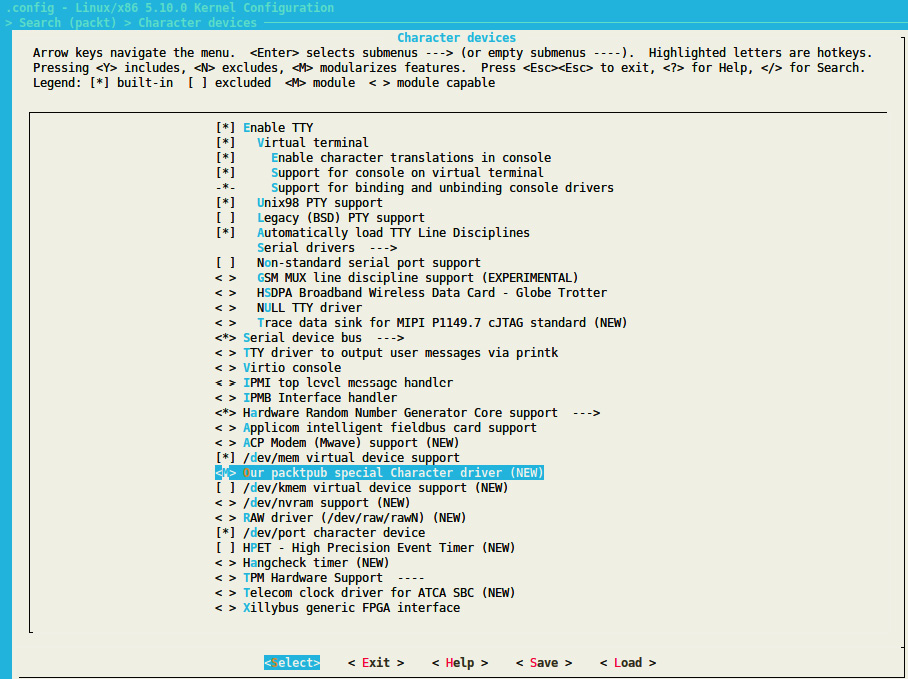
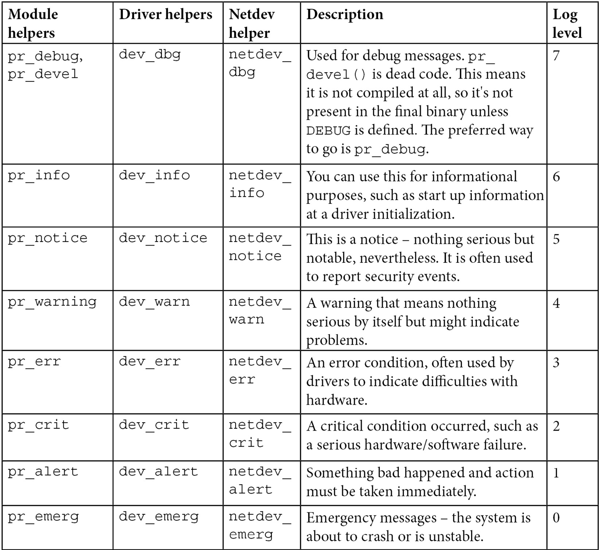

# Chương 2: Tìm hiểu các khái niệm cơ bản về Linux kernel module

Kernel module là phần mềm nhằm mở rộng Linux kernel bằng một tính năng mới. Kernel module có thể là device driver; khi đó nó điều khiển và quản lý một hardware device cụ thể, vì thế có tên device driver. Module cũng có thể bổ sung hỗ trợ framework (ví dụ IIO, Industrial Input Output framework), mở rộng framework hiện có, hoặc thậm chí bổ sung filesystem mới hay phần mở rộng của nó. Cần nhớ kernel module không phải lúc nào cũng là device driver, còn device driver luôn là kernel module.

Khác với kernel module, có thể có module đơn giản hay user space module, chạy trong user space với đặc quyền thấp. Tuy nhiên, sách này chỉ bàn kernel space module, đặc biệt Linux kernel module.

Vì vậy, chương này sẽ thảo luận các chủ đề sau:

- Giới thiệu khái niệm module

- Build Linux kernel module

- Xử lý symbol export và module dependency

- Học một số mẹo lập trình Linux kernel

## Giới thiệu khái niệm module

Khi build Linux kernel, image thu được là một file duy nhất, tạo bằng cách liên kết tất cả các object file tương ứng với những tính năng được bật trong configuration. Vì vậy, mọi tính năng được đưa vào đều có sẵn ngay khi kernel khởi động, ngay cả khi filesystem chưa sẵn sàng hoặc chưa tồn tại. Những tính năng này là built-in, và module tương ứng được gọi là static module. Module như vậy luôn có sẵn trong kernel image nên không thể unload, đổi lại kích thước kernel image cuối cùng tăng lên. Static module cũng được gọi là built-in module vì nó là một phần của kernel image cuối cùng. Bất kỳ thay đổi nào trong code của nó đều đòi hỏi build lại toàn bộ kernel.

Tuy nhiên, một số tính năng (như device driver, filesystem, framework) có thể compile thành loadable module. Chúng tách khỏi final kernel image và được load theo nhu cầu. Có thể xem là plugin load/unload động để thêm/bỏ tính năng kernel lúc runtime. Vì mỗi module được lưu thành file riêng trên filesystem, dùng loadable module đòi hỏi truy cập filesystem.

Tóm lại, module đối với Linux kernel giống plugin (add-on) đối với user software (ví dụ Firefox). Khi liên kết tĩnh vào kernel image kết quả, gọi built-in. Khi build thành file riêng (có thể load/unload), gọi loadable. Nó mở rộng tính năng kernel động mà không cần khởi động lại máy.

Để hỗ trợ module loading, kernel phải được build với option sau được enable:

```
CONFIG_MODULES=y
```

Module unloading là kernel feature có thể enable hoặc disable theo kernel configuration option `CONFIG_MODULE_UNLOAD`. Không có option này, không thể unload module nào. Vì vậy để unload module, phải enable tính năng sau:

```
CONFIG_MODULE_UNLOAD=y
```

Dù vậy, kernel đủ thông minh để ngăn unload module có thể làm hỏng thứ gì đó (ví dụ đang dùng), dù được yêu cầu. Vì kernel giữ reference count về module usage nên biết module hiện có đang dùng không. Nếu cho rằng remove module không an toàn, kernel sẽ không làm. Tuy nhiên có thể đổi hành vi qua configuration feature sau:

```
MODULE_FORCE_UNLOAD=y
```

Option trên cho phép buộc module unload.

Giờ đã xong các khái niệm chính về module, hãy thực hành, trước hết giới thiệu module skeleton làm nền cho chương.

## Nghiên cứu tình huống – module skeleton

Xét module `hello-world` sau. Nó làm nền cho công việc xuyên suốt chương. Gọi compilation unit là `helloworld.c`, có nội dung:

```
#include <linux/module.h>
#include <linux/init.h>
static int __init helloworld_init(void) {
    pr_info("Hello world initialization!\n");
    return 0;
}
static void __exit helloworld_exit(void) {
    pr_info("Hello world exit\n");
}
module_init(helloworld_init);
module_exit(helloworld_exit);
MODULE_LICENSE("GPL");
MODULE_AUTHOR("John Madieu <john.madieu@gmail.com>");
MODULE_DESCRIPTION("Linux kernel module skeleton");
```

Trong skeleton trên, header riêng cho Linux kernel, vì thế dùng `linux/xxx.h`. Header file `module.h` bắt buộc với mọi kernel module, còn `init.h` cần cho macro `__init` và `__exit`. Các thành phần khác mô tả trong mục tiếp. Để build skeleton module, cần viết makefile đặc biệt, sẽ trình bày sau trong chương.

### Module entry point và exit point

Yêu cầu tối thiểu của kernel module là initialization method. Đây là bắt buộc. Nếu module có thể build dạng loadable, cũng phải cung cấp method `exit`. Method đầu là entry point, tương ứng hàm được gọi khi module load (`modprobe` hay `insmod`); method sau là cleanup và exit point, tương ứng hàm thực thi khi module unload (`rmmod` hay `modprobe -r`).

Chỉ cần báo kernel hàm nào thực thi làm entry/exit point. Các hàm `helloworld_init` và `helloworld_exit` có thể đặt tên bất kỳ. Điều thực sự bắt buộc là xác định chúng làm hàm initialization/exit tương ứng bằng truyền tham số cho macro `module_init()` và `module_exit()`.

Tóm lại, `module_init()` khai báo hàm cần gọi khi module load (bằng `insmod` hay `modprobe` khi build dạng loadable kernel module) hoặc khi kernel đạt run level tương ứng module (khi built-in). Những gì thực hiện trong initialization function xác định hành vi module. `module_exit()` chỉ dùng khi module có thể build dạng loadable kernel module, khai báo hàm cần gọi khi unload (bằng `rmmod`).

Method `init` hay `exit` chỉ gọi một lần, bất kể số device module hiện xử lý, nếu module là device driver. Module là platform (hoặc tương tự) device driver thường đăng ký platform driver cùng callback `probe`/`remove` liên quan trong hàm `init`; callback lần này được gọi mỗi khi device module xử lý được thêm/bỏ khỏi hệ thống. Khi đó chúng chỉ unregister platform driver trong method `exit`.

Thuộc tính \_\_init và \_\_exit

`__init` và `__exit` là kernel macro định nghĩa trong `include/linux/init.h`, như sau:

```
#define __init      __section(.init.text)
#define __exit      __section(.exit.text)
```

Keyword `__init` báo linker đặt symbol (biến/hàm) có prefix này vào section riêng trong kernel object file kết quả. Kernel biết trước section và giải phóng khi module load xong, initialization function hoàn tất. Chỉ áp dụng built-in module, không loadable. Kernel chạy initialization function của driver lần đầu trong boot sequence. Vì driver không thể unload, initialization function không được gọi lại cho đến reboot sau. Không cần giữ reference đến hàm nữa. Tương tự keyword `__exit` và method `exit`: code tương ứng bị bỏ khi module compile tĩnh vào kernel hoặc không enable module unloading, vì cả hai trường hợp exit function không bao giờ được gọi. `__exit` không ảnh hưởng loadable module.

Kết luận, `__init` và `__exit` là Linux directive (macro) bọc GNU C compiler attribute dùng đặt symbol. Chúng chỉ dẫn compiler đặt code có prefix này lần lượt vào section `.init.text` và `.exit.text`, dù kernel có thể truy cập các object section khác nhau.

### Thông tin và metadata của module

Cần có thể thu thập thông tin (như tác giả, mô tả module parameter, license) về module mà không đọc code. Kernel module dùng section `.modinfo` lưu thông tin về mình. Mọi macro `MODULE_*` cập nhật nội dung section bằng giá trị truyền làm tham số. Một số macro là `MODULE_DESCRIPTION()`, `MODULE_AUTHOR()`, `MODULE_LICENSE()`. Tuy nhiên macro thực tế bên dưới kernel cung cấp để thêm entry vào module information section là `MODULE_INFO(tag, info)`, thêm thông tin generic dạng `tag = "info"`. Nghĩa là người viết driver có thể thêm thông tin tự do bất kỳ như sau:

```
MODULE_INFO(my_field_name, "What easy value");
```

Ngoài thông tin tùy chỉnh, có thông tin chuẩn nên cung cấp mà kernel có macro:

- `MODULE_LICENSE`: License xác định source code nên chia sẻ (hay không) với nhà phát triển khác thế nào. `MODULE_LICENSE()` báo kernel module theo license nào. Ảnh hưởng hành vi module, vì license không tương thích GPL (General Public License) khiến module không thấy/dùng được symbol kernel export qua macro `EXPORT_SYMBOL_GPL()`, chỉ hiển thị symbol cho GPL-compatible module. Ngược với `EXPORT_SYMBOL()` export hàm cho module mọi license. Load module non-GPL-compatible còn khiến kernel tainted; nghĩa là đã load code non-open source hoặc không đáng tin, có lẽ không được cộng đồng hỗ trợ. Nhớ module không có `MODULE_LICENSE()` không được xem open source, cũng taint kernel. Có thể tìm license hiện có trong `include/linux/module.h`, mô tả license kernel hỗ trợ.

- `MODULE_AUTHOR()` khai báo tác giả module: `MODULE_AUTHOR("John Madieu` `<john.madieu@foobar.com>");`. Có thể nhiều tác giả. Khi đó mỗi người phải khai báo bằng `MODULE_AUTHOR()`:

```
MODULE_AUTHOR("John Madieu <john.madieu@foobar.com>");
MODULE_AUTHOR("Lorem Ipsum <l.ipsum@foobar.com>");
```

- `MODULE_DESCRIPTION()` mô tả ngắn module làm gì: `MODULE_DESCRIPTION("Hello, world!`

```
Module").
```

Có thể dump nội dung section `.modeinfo` của kernel module bằng lệnh `objdump -d -j` `.modinfo` trên module đó. Với module cross-compiled, nên dùng `$(CORSS_COMPILE)objdump` thay thế.

Giờ đã cung cấp thông tin/metadata module, yêu cầu cuối khi viết Linux kernel module, hãy học build.

## Build Linux kernel module

Có hai giải pháp compile kernel module:

- Đầu tiên là code nằm ngoài kernel source tree, còn gọi out-of-tree building. Module source code ở directory khác. Build kiểu này không cho tích hợp vào kernel configuration/compilation process, module phải build riêng. Cần lưu ý không thể liên kết tĩnh module vào final kernel image — tức không thể built-in. Out-of-tree compilation chỉ tạo loadable kernel module.

- Thứ hai là trong kernel tree, cho upstream code vì tích hợp tốt vào kernel configuration/compilation process. Cho tạo module liên kết tĩnh (built-in) hoặc loadable kernel module.

Bây giờ đã liệt kê và trình bày đặc điểm của hai giải pháp build kernel module, trước khi nghiên cứu từng giải pháp, chúng ta hãy tìm hiểu sâu quy trình build Linux kernel. Điều này giúp hiểu các điều kiện tiên quyết để biên dịch đối với từng giải pháp.

## Tìm hiểu Linux kernel build system

Linux kernel duy trì build system riêng, gọi kbuild (chú ý k thường). Cho configure Linux kernel rồi compile dựa configuration. Chủ yếu dựa ba file: `Kconfig` cho chọn tính năng, chủ yếu dùng in-kernel tree building, và `Kbuild` (lần này K hoa) hoặc `Makefile` cho compilation rule.

### File Kbuild hoặc Makefile

Trong build system, makefile có thể tên `Makefile` hay `Kbuild`. Nếu cùng tồn tại, chỉ dùng `Kbuild`. Makefile là file đặc biệt để thực hiện tập hành động, phổ biến nhất compile chương trình. Có công cụ riêng parse makefile tên `make`. Dùng công cụ, mẫu lệnh build kernel module giống:

```
make -C $KERNEL_SRC M=$(shell pwd) [target]
```

Trong mẫu trên, `$KERNEL_SRC` là path prebuilt kernel directory, `-C` `$KERNEL_SRC` chỉ `make` chuyển directory khi thực thi rồi trở lại khi xong; `M=$(shell pwd)` chỉ kernel build system quay lại directory này tìm module đang build. Giá trị `M` là absolute path directory chứa module source (hay file `Kbuild` liên quan). `[target]` tương ứng tập con `make` target có khi build external module. Gồm:

- `modules`: Default target cho external module. Chức năng giống không chỉ target.

- `modules_install`: Cài external module. Mặc định `/lib/modules/<kernel_release>/extra/`. Có thể override path.

- `clean`: Xóa mọi file tạo ra (chỉ trong module directory).

Tuy nhiên chưa báo build system object file nào build hay link với nhau. Phải chỉ tên module cần build cùng danh sách source file cần. Có thể chỉ một dòng:

```
obj-<X> := <module_name>.o
```

Kernel build system sẽ build `<module_name>.o` từ `<module_name>.c` hay `<module_name>.S`, sau linking tạo loadable kernel module `<module_name>.ko` hoặc thành phần single-file kernel image. `<X>` có thể `y`, `m`, hoặc trống.

Cách build/link `mymodule.o` và có build không phụ thuộc `<X>`:

- Nếu `<X>` là `m`, dùng biến `obj-m`, build `mymodule.o` dạng loadable kernel module.

- Nếu `<X>` là `y`, dùng `obj-y`, build `mymodule.o` thành phần kernel. Khi đó nói “`foo` là built-in kernel module”.

- Nếu không đặt `<X>`, dùng `obj-`, hoàn toàn không build `mymodule.o`.

Tuy nhiên thường dùng mẫu `obj-$(CONFIG_XXX)`, `CONFIG_XXX` là kernel configuration option được đặt hoặc không trong kernel configuration process. Ví dụ:

```
obj-$(CONFIG_MYMODULE) += mymodule.o
```

`$(CONFIG_MYMODULE)` cho `y`, `m` hay không gì (trống), theo giá trị trong kernel configuration (hiển thị `menuconfig`). Nếu `CONFIG_MYMODULE` không `y` cũng không `m`, file không compile/link. `y` nghĩa built-in (viết tắt `yes` trong kernel configuration), `m` là loadable module. `$(CONFIG_MYMODULE)` lấy đáp án đúng từ config process thông thường.

Đến đây, chúng ta giả định module được build từ một source file `.c` duy nhất. Khi module được build từ nhiều source file, cần thêm một dòng liệt kê các source file đó, như sau:

```
<module_name>-y := <file1>.o <file2>.o
```

Trên nói `<module_name>.ko` build từ hai file `file1.c` và `file2.c`. Tuy nhiên nếu muốn hai module, giả sử `foo.ko` và `bar.ko`, dòng `Makefile` như:

```
obj-m := foo.o bar.o
```

Nếu `foo.o` và `bar.o` tạo từ source file khác `foo.c` và `bar.c`, có thể chỉ source thích hợp mỗi object file:

```
obj-m := foo.o bar.o
foo-y := foo1.o foo2.o . . .
bar-y := bar1.o bar2.o bar3.o . . .
```

Ví dụ khác liệt kê source cần build module:

```
obj-m := 8123.o
8123-y := 8123_if.o 8123_pci.o 8123_bin.o
```

Ví dụ trên nói `8123` nên build dạng loadable kernel module bằng build/link `8123_if.c`, `8123_pci.c`, `8123_bin.c` với nhau.

Ngoài file thuộc build artifact kết quả, file `Makefile` có thể chứa compiler/linker flag, như:

```
ccflags-y := -I$(src)/include
ccflags-y += -I$(src)/src/hal/include
ldflags-y := -T$(src)foo_sections.lds
```

Điều quan trọng là có thể chỉ định flag như vậy, không phải giá trị đặt trong ví dụ.

Có use case khác của `obj-<X>`, mô tả sau:

```
obj-<X> += somedir/
```

Nghĩa là kernel build system đi vào directory `somedir`, tìm file `Makefile` hoặc `Kbuild` bên trong, xử lý để quyết định build object nào.

Có thể tóm tắt bằng Makefile:

```
# kbuild part of makefile
obj-m := helloworld.o
#the following is just an example
#ldflags-y := -T foo_sections.lds
# normal makefile
KERNEL_SRC ?= /lib/modules/$(shell uname -r)/build
all default: modules
install: modules_install
modules modules_install help clean:
    $(MAKE) -C $(KERNEL_SRC) M=$(shell pwd) $@
```

Sau mô tả skeleton `Makefile` tối giản:

- `obj-m := helloworld.o`: `obj-m` liệt kê module muốn build. Với mỗi `<filename>.o`, build system tìm `<filename>.c` hoặc `<filename>.S` để build. `obj-m` tạo loadable kernel module, `obj-y` cho built-in kernel module.

- `KERNEL_SRC= /lib/modules/$(shell uname -r)/build`: `KERNEL_SRC` là vị trí prebuilt kernel source. Như đã nói cần prebuilt kernel để build module bất kỳ. Nếu đã build kernel từ source, đặt biến này bằng absolute path của source directory đã build. `–C` chỉ tiện ích `make` chuyển vào directory chỉ định, đọc makefile.

- `M=$(shell pwd)`: Liên quan kernel build system. Kernel `Makefile` dùng biến xác định directory external module cần build. File `.c` nên đặt trong đó.

- `all default`: `modules`: Chỉ tiện ích `make` thực thi target `modules` làm dependency của target `all` hay `default`. Nói cách khác lệnh `make default`, `make all` hay chỉ `make` khiến `make modules` thực thi trước mọi lệnh tiếp theo nếu có.

- `modules modules_install help clean`: Dòng này biểu diễn danh sách target hợp lệ trong makefile.

- `$(MAKE) -C $(KERNELDIR) M=$(shell pwd) $@`: Rule thực thi cho mỗi target liệt kê. `$@` thay bằng tham số cho `make`, gồm target. Dùng từ ma thuật này tránh viết nhiều dòng (giống nhau) bằng số target. Nếu chạy `make modules`, `$@` thành `modules`, rule thành `$(MAKE) -C $(KERNELDIR) M=$(shell pwd) modules`.

Giờ quen yêu cầu kernel build system, xem thực tế build module.

## Out-of-tree building

Trước build external module, cần kernel source tree hoàn chỉnh đã precompile. Prebuilt kernel version phải giống kernel sẽ load/dùng module. Có hai cách lấy prebuilt kernel version:

- Tự build (đã thảo luận): Dùng cho native và cross-compilation. Build system như Yocto/Buildroot có thể giúp.

- Cài package `linux-headers-*` từ distribution package feed: Chỉ cho x86 native compilation trừ khi embedded target chạy Linux distribution có package feed (như Raspbian).

Cần lưu ý không thể build built-in kernel module bằng out-of-tree building. Lý do build Linux kernel module ngoài tree cần prebuilt hoặc prepared kernel.

### Native và out-of-tree module compiling

Với native kernel module build, dễ nhất cài prebuilt kernel header, dùng directory path làm kernel directory trong makefile. Trước bắt đầu, cài header bằng:

```
sudo apt update
sudo apt install linux-headers-$(uname -r)
```

Cài preconfigured/prebuilt kernel header (không toàn source tree) trong `/usr/src/linux-headers-$(uname -r)`. Có symbolic link `/lib/modules/$(uname -r)/build` trỏ header vừa cài. Đó là path nên chỉ làm kernel directory trong `Makefile`. Nhớ `$(uname -r)` tương ứng kernel version đang dùng.

Xong makefile, vẫn ở module source directory, chạy `make` hoặc `make modules`:

```
$ make
make -C /lib/modules/ 5.11.0-37-generic/build \
    M=/home/john/driver/helloworld modules
make[1]: Entering directory '/usr/src/linux-headers- 5.11.0-37-generic'
  CC [M]  /media/jma/DATA/work/tutos/sources/helloworld/helloworld.o
  Building modules, stage 2.
  MODPOST 1 modules
  CC      /media/jma/DATA/work/tutos/sources/helloworld/helloworld.mod.o
  LD [M]  /media/jma/DATA/work/tutos/sources/helloworld/helloworld.ko
make[1]: Leaving directory '/usr/src/linux-headers- 5.11.0-37-generic'
```

Kết thúc build có:

```
$ ls
helloworld.c  helloworld.ko  helloworld.mod.c  helloworld.mod.o  helloworld.o  Makefile  m
odules.order  Module.symvers
```

Để kiểm thử, làm:

```
$ sudo insmod  helloworld.ko
$ sudo rmmod helloworld
$ dmesg
[...]
[308342.285157] Hello world initialization!
[308372.084288] Hello world exit
```

Ví dụ trên chỉ native build, compile trên máy chạy distribution chuẩn, tận dụng package repository để cài prebuilt kernel header. Mục tiếp thảo luận out-of-tree module cross-compilation.

### Out-of-tree module cross-compiling

Khi cross-compiling out-of-tree kernel module, chủ yếu hai biến lệnh kernel `make` cần biết: `ARCH` và `CROSS_COMPILE`, lần lượt target architecture và cross-compiler prefix. Hơn nữa vị trí prebuilt kernel cho target architecture phải chỉ trong makefile. Trong skeleton gọi `KERNEL_SRC`.

Khi dùng build system như Yocto, Linux kernel được cross-compiled trước làm dependency, rồi mới cross-compiling module. Tôi chủ ý dùng tên biến `KERNEL_SRC` cho prebuilt kernel directory vì Yocto tự export cho kernel module recipe. Đặt thành giá trị `STAGING_KERNEL_DIR` trong class `module.bbclass`, được mọi kernel module recipe kế thừa.

Vì vậy, điểm thay đổi giữa native compilation và cross-compilation của một out-of-tree kernel module là lệnh `make` cuối cùng. Với architecture Arm 32-bit, lệnh có dạng như sau:

```
make ARCH=arm CROSS_COMPILE=arm-linux-gnueabihf-
```

Với biến thể 64-bit:

```
make ARCH=aarch64 CROSS_COMPILE=aarch64-linux-gnu-
```

Các lệnh trước giả định đã chỉ path cross-compiled kernel source trong makefile.

## In-tree building

In-tree module building cần file thêm `Kconfig`, cho hiển thị tính năng module trong configuration menu. Trước build module trong kernel tree, cần xác định directory chứa source file. Với file `mychardev.c` chứa source code special character driver, nên chuyển vào directory `drivers/char` trong kernel source. Mỗi subdirectory trong drivers có cả `Makefile` lẫn `Kconfig`.

Thêm nội dung sau vào `Kconfig` của directory:

```
config PACKT_MYCDEV
    tristate "Our packtpub special Character driver"
    default m
    help
      Say Y here to support /dev/mycdev char device.
      The /dev/mycdev is used to access packtpub.
```

Trong `Makefile` cùng directory, thêm dòng:

```
obj-$(CONFIG_PACKT_MYCDEV)   += mychardev.o
```

Cẩn thận khi cập nhật `Makefile` — tên file `.o` phải khớp chính xác `.c`. Source file `foobar.c` thì dùng `foobar.o` trong `Makefile`. Để build module dạng loadable kernel module, thêm dòng vào board `defconfig` trong directory `arch/arm/configs`:

```
CONFIG_PACKT_MYCDEV=m
```

Cũng có thể chạy `menuconfig` chọn từ UI, chạy `make` build kernel, rồi `make` `modules` build module (gồm của bạn). Để driver built-in, thay `m` bằng `y`:

```
CONFIG_PACKT_MYCDEV=y
```

Mọi điều mô tả là việc nhà sản xuất embedded board làm để cung cấp Board Support Package (BSP) cùng board, kernel đã chứa custom driver:



Hình 2.1 – Module Packt\_dev trong kernel tree

Configure xong, build kernel bằng `make`, module bằng `make modules`.

Module trong kernel source tree cài ở `/lib/modules/$(unale -r)/kernel/`. Trên hệ thống Linux của bạn là `/lib/modules/$(uname -r)/kernel/`.

Giờ quen out-of-tree/in-tree kernel module compilation, xem cách thích nghi hành vi module bằng cho truyền tham số.

## Xử lý module parameter

Tương tự user program, kernel module có thể nhận argument từ command line. Cho thay đổi hành vi module động theo tham số, giúp nhà phát triển không phải liên tục sửa/compile trong test/debug session. Để thiết lập, trước khai báo biến giữ giá trị command-line argument, dùng macro `module_param()` trên từng biến. Định nghĩa trong `include/linux/moduleparam.h` (cũng cần include trong code — `#include` `<linux/moduleparam.h>`) như sau:

```
module_param(name, type, perm);
```

Macro gồm các phần:

- `name`: Tên biến dùng làm parameter.

- `type`: Kiểu parameter (`bool`, `charp`, `byte`, `short`, `ushort`, `int`, `uint`, `long`, `ulong`), `charp` viết tắt character pointer.

- `perm`: File permission của `/sys/module/<module>/parameters/<param>`. Một số là `S_IWUSR`, `S_IRUSR`, `S_IXUSR`, `S_IRGRP`, `S_WGRP`, `S_IRUGO`, với:

- `S_I` chỉ prefix.

- `R` = read, `W` = write, `X` = execute.

- `USR` = user, `GRP` = group, `UGO` = user, group, others.

Có thể dùng `|` (phép `OR`) đặt nhiều permission. Nếu `perm` bằng `0`, không tạo parameter file trong Sysfs. Chỉ nên dùng read-only parameter `S_IRUGO`, tôi rất khuyến nghị; OR với property khác cho property fine-grained hơn.

Khi dùng module parameter, `MODULE_PARM_DESC` có thể mô tả per-parameter. Macro điền module information section bằng mô tả mỗi parameter. Ví dụ từ source file `helloworld-params.c` kèm code repository sách:

```
#include <linux/moduleparam.h>
[...]
static char *mystr = "hello";
static int myint = 1;
static int myarr[3] = {0, 1, 2};
module_param(myint, int, S_IRUGO);
module_param(mystr, charp, S_IRUGO);
module_param_array(myarr, int,NULL, S_IWUSR|S_IRUSR);
MODULE_PARM_DESC(myint,"this is my int variable");
MODULE_PARM_DESC(mystr,"this is my char pointer variable");
MODULE_PARM_DESC(myarr,"this is my array of int");
static int foo()
{
    pr_info("mystring is a string: %s\n",
             mystr);
    pr_info("Array elements: %d\t%d\t%d",
             myarr[0], myarr[1], myarr[2]);
    return myint;
}
```

Để load module, truyền parameter, làm:

```
# insmod hellomodule-params.ko mystring="packtpub" myint=15 myArray=1,2,3
```

Có thể dùng `modinfo` trước load module để hiển thị mô tả parameter module hỗ trợ:

```
$ modinfo ./helloworld-params.ko
filename:       /home/jma/work/tutos/sources/helloworld/./helloworld-params.ko
license:      GPL
author:       John Madieu <john.madieu@gmail.com>
srcversion:   BBF43E098EAB5D2E2DD78C0
depends:
vermagic:     4.4.0-93-generic SMP mod_unload modversions
parm:         myint:this is my int variable (int)
parm:         mystr:this is my char pointer variable (charp)
parm:         myarr:this is my array of int (array of int)
```

Cũng có thể tìm/sửa giá trị hiện tại parameter của loaded module từ Sysfs tại `/sys/module/<name>/parameters`. Mỗi parameter một file chứa giá trị. Có thể đổi nếu file liên quan có write permission (tùy module code).

Ví dụ:

```
echo 0 > /sys/module/usbcore/parameters/authorized_default
```

Không chỉ loadable kernel module nhận parameter. Nếu module built-in kernel, có thể chỉ parameter từ Linux kernel command line (bootloader truyền hoặc configuration option `CONFIG_CMDLINE` cung cấp).

Có dạng:

```
[initial command line ...] my_module.param=value
```

Ví dụ `my_module` là tên module, `value` là giá trị gán parameter.

Bây giờ đã có thể xử lý module parameter, chúng ta hãy đi sâu hơn vào một tình huống not-so-obvious, nơi sẽ học cách bản thân Linux kernel và hệ thống build của nó xử lý module dependency.

## Xử lý symbol export và module dependency

Chỉ số hạn chế kernel function gọi được từ kernel module. Để hiển thị cho kernel module, function/variable phải được kernel export tường minh. Linux kernel cung cấp hai macro export function/variable:

- `EXPORT_SYMBOL(symbolname)`: Export function/variable cho mọi module.

- `EXPORT_SYMBOL_GPL(symbolname)`: Chỉ export function/variable cho GPL module.

`EXPORT_SYMBOL()` hay phiên bản GPL là Linux kernel macro làm symbol sẵn cho loadable kernel module hay dynamically loaded module (nếu module thêm khai báo `extern` — tức include header tương ứng compilation unit export symbol). `EXPORT_SYMBOL()` chỉ Kbuild mechanism thêm symbol argument vào global list kernel symbol. Vì vậy kernel module truy cập được. Code built-in chính kernel (khác loadable kernel module) tất nhiên truy cập mọi non-static symbol qua extern declaration như C code thông thường.

Macro cũng cho export symbol từ loadable kernel module để loadable kernel module khác truy cập. Thú vị symbol một module export thành truy cập được cho module khác có thể phụ thuộc! Driver thông thường không nên cần non-exported function.

## Giới thiệu khái niệm module dependency

Module B phụ thuộc module A nghĩa B dùng một hay nhiều symbol A export. Mục tiếp xem xử lý dependency trong Linux kernel infrastructure.

### Tiện ích depmod

`depmod` là công cụ chạy trong kernel build process tạo module dependency file. Đọc mỗi module trong `/lib/modules/<kernel_release>/` xác định symbol nên export và symbol cần. Kết quả ghi `modules.dep` và binary version `modules.dep.bin`. Một kiểu module indexing.

### Module loading và unloading

Để module hoạt động, load vào Linux kernel bằng `insmod`, truyền module path làm argument, cách ưu tiên khi phát triển; hoặc `modprobe`, lệnh thông minh nhưng nên ưu tiên production system.

Manual loading

Manual loading cần người dùng can thiệp, nên có quyền `root`. Hai cách truyền thống là `modprobe` và `insmod`, mô tả sau.

Khi phát triển thường dùng `insmod` để load module. Cần truyền cho `insmod` path module:

```
insmod /path/to/mydrv.ko
```

Đây là dạng low-level của module loading, làm nền tảng cho phương pháp module-loading khác và là cách chúng ta sử dụng trong cuốn sách này. Ngược lại, `modprobe` chủ yếu được system admin hoặc production system sử dụng. `modprobe` là lệnh thông minh phân tích file `modules.dep` đã đề cập để load các dependency trước khi load module được chỉ định. Nó tự động xử lý module dependency, tương tự package manager. Lệnh được gọi như sau:

```
modprobe mydrv
```

Dùng được `modprobe` hay không phụ thuộc `depmod` biết module installation.

Auto-loading Tiện ích `depmod` không chỉ build file `modules.dep` và `modules.dep.bin`; còn hơn nữa. Khi kernel developer viết driver, biết chính xác hardware hỗ trợ. Chịu trách nhiệm cung cấp driver product/vendor ID của mọi device hỗ trợ. `depmod` xử lý module file để trích/tập hợp thông tin, tạo `modules.alias` ở `/lib/modules/<kernel_release>/modules.alias`, map device sang driver:

Trích đoạn `modules.alias`:

```
alias usb:v0403pFF1Cd*dc*dsc*dp*ic*isc*ip*in* ftdi_sio
alias usb:v0403pFF18d*dc*dsc*dp*ic*isc*ip*in* ftdi_sio
alias usb:v0403pDAFFd*dc*dsc*dp*ic*isc*ip*in* ftdi_sio
alias usb:v0403pDAFEd*dc*dsc*dp*ic*isc*ip*in* ftdi_sio
alias usb:v0403pDAFDd*dc*dsc*dp*ic*isc*ip*in* ftdi_sio
alias usb:v0403pDAFCd*dc*dsc*dp*ic*isc*ip*in* ftdi_sio
[...]
```

Bước này cần user space hotplug agent (hay device manager), thường `udev` (hay `mdev`), đăng ký kernel để nhận thông báo device mới.

Kernel thông báo bằng gửi mô tả device (product ID, vendor ID, class, device class, device subclass, interface, mọi thông tin nhận diện khác) cho hotplug daemon, rồi daemon gọi `modprobe` bằng thông tin. `modprobe` parse `modules.alias` tìm driver phù hợp device. Trước load module, `modprobe` tìm dependency trong `module.dep`. Nếu có, load trước associated module; nếu không load module trực tiếp.

Còn cách tự load module, lần này lúc boot. Qua `/etc/modules-load.d/<filename>.conf`. Muốn vài module load lúc boot, tạo file `/etc/modules-load.d/<filename>.conf`, thêm tên module cần load, mỗi dòng một tên. `<filename>` nên có ý nghĩa với bạn; thường dùng `module`: `/etc/modules-load.d/modules.conf`. Tạo bao nhiêu file `.conf` cũng được theo nhu cầu.

Ví dụ `/etc/modules-load.d/mymodules.conf`:

```
#This line is a comment
uio
iwlwifi
```

File configuration này được `systemd-modules-load.service` xử lý nếu `systemd` là initialization manager. Trên `SysVinit`, script `/etc/init.d/kmod` xử lý. Module unloading

Lệnh unload module thông thường `rmmod`. Nên dùng để unload module đã load bằng `insmod`. Truyền tên module cần unload làm tham số:

```
rmmod -f mymodule
```

Mặt khác lệnh higher-level unload module thông minh là `modeprobe –r`, tự unload dependency không dùng:

```
modeprobe -r mymodule
```

Như có thể đoán, option hữu ích cho nhà phát triển. Cuối cùng kiểm tra module đã load bằng lệnh `lsmod`:

```
$ lsmod
Module                  Size  Used by
btrfs                1327104  0
blake2b_generic        20480  0
xor                    24576  1 btrfs
raid6_pq              114688  1 btrfs
ufs                    81920  0
[...]
```

Output gồm tên module, memory dùng, số module khác dùng nó, cuối cùng tên chúng. Output `lsmod` thực ra là cách định dạng đẹp nội dung dưới `/proc /modules`, file liệt kê loaded module:

```
$ cat /proc/modules
btrfs 1327104 0 - Live 0x0000000000000000
blake2b_generic 20480 0 - Live 0x0000000000000000
xor 24576 1 btrfs, Live 0x0000000000000000
raid6_pq 114688 1 btrfs, Live 0x0000000000000000
ufs 81920 0 - Live 0x0000000000000000
qnx4 16384 0 - Live 0x0000000000000000
```

Output trên thô, định dạng kém. Vì vậy nên dùng `lsmod`.

Giờ quen kernel module management, mở rộng kỹ năng phát triển kernel bằng vài mẹo kernel developer đã áp dụng.

## Học một số mẹo lập trình Linux kernel

Phát triển Linux kernel là học từ người khác, không phát minh lại bánh xe. Có tập quy tắc cần theo. Cả chương cũng không đủ bao quát, nên tôi chọn hai quy tắc liên quan nhất với mình, những điều có khả năng thay đổi khi lập trình user space: xử lý lỗi và in message.

Trong user space, thoát khỏi method `main()` là đủ để phục hồi sau mọi lỗi có thể đã xảy ra. Trong kernel thì không như vậy, đặc biệt vì kernel làm việc trực tiếp với hardware. Việc in message cũng khác, và chúng ta sẽ xem điều đó trong phần này.

## Xử lý lỗi

Trả error code sai cho lỗi có thể khiến kernel hoặc user space application hiểu sai, quyết định sai, gây hành vi không cần. Để rõ, kernel tree có predefined error bao quát gần mọi trường hợp. Một số error (kèm ý nghĩa) định nghĩa trong `include/uapi/asm-generic/errno-base.h`, phần còn lại trong `include/uapi/asm-generic/errno.h`. Trích danh sách từ `include/uapi/asm-generic/errno-base.h`:

```
#define  EPERM    1    /* Operation not permitted */
#define  ENOENT   2    /* No such file or directory */
#define  ESRCH    3    /* No such process */
#define  EINTR    4    /* Interrupted system call */
#define  EIO      5    /* I/O error */
#define  ENXIO    6    /* No such device or address */
#define  E2BIG    7    /* Argument list too long */
#define  ENOEXEC  8    /* Exec format error */
#define  EBADF    9    /* Bad file number */
#define  ECHILD   10   /* No child processes */
#define  EAGAIN   11   /* Try again */
#define  ENOMEM   12   /* Out of memory */
#define  EACCES   13   /* Permission denied */
#define  EFAULT   14   /* Bad address */
#define  ENOTBLK  15   /* Block device required */
#define  EBUSY    16   /* Device or resource busy */
#define  EEXIST   17   /* File exists */
#define  EXDEV    18   /* Cross-device link */
#define  ENODEV   19   /* No such device */
[...]
```

Trong phần lớn trường hợp, cách chuẩn để trả về lỗi là sử dụng `return –ERROR`, đặc biệt khi đáp ứng system call. Ví dụ, với lỗi I/O, error code là `EIO` và bạn nên trả về `-EIO`, như sau:

```
dev = init(&ptr);
if(!dev)
    return –EIO
```

Lỗi đôi khi vượt kernel space, lan tới user space. Nếu error trả lời system call (`open`, `read`, `ioctl`, `mmap`), giá trị tự gán cho user space global variable `errno`, có thể dùng `strerror(errno)` chuyển thành chuỗi đọc được:

```
#include <errno.h>  /* to access errno global variable */
#include <string.h>
[...]
if(wite(fd, buf, 1) < 0) {
    printf("something gone wrong! %s\n", strerror(errno));
}
[...]
```

Gặp error, phải undo mọi thứ đã thiết lập cho đến lúc lỗi. Cách thường dùng statement `goto`:

```
ret = 0;
ptr = kmalloc(sizeof (device_t));
if(!ptr) {
        ret = -ENOMEM
        goto err_alloc;
}
dev = init(&ptr);
if(!dev) {
        ret = -EIO
        goto err_init;
}
return 0;
err_init:
        free(ptr);
err_alloc:
        return ret;
```

Lý do sử dụng câu lệnh `goto` khá đơn giản. Khi xử lý lỗi, giả sử ở bước 5 bạn cần cleanup các thao tác trước đó theo thứ tự bước 4, 3, 2 và 1, thay vì thực hiện nhiều phép kiểm tra lồng nhau như sau:

```
if (ops1() != ERR) {
    if (ops2() != ERR) {
        if (ops3() != ERR) {
            if (ops4() != ERR) {
```

Cách này khó đọc, error-prone, gây nhầm (readability còn tùy indentation). Dùng statement `goto` cho control flow thẳng:

```
if (ops1() == ERR) // ||
    goto error1;   // ||
if (ops2() == ERR) // ||
    goto error2;   // ||
if (ops3() == ERR) // ||
    goto error3;   // ||
if (ops4() == ERR) // VV
    goto error4;
error5:
[...]
error4:
[...]
error3:
[...]
error2:
[...]
error1:
[...]
```

Tuy nhiên chỉ nên dùng `goto` đi về trước trong hàm, không về sau, không triển khai loop (như assembler).

### Xử lý null pointer error

Khi trả về lỗi từ các function vốn phải trả về pointer, chúng thường trả pointer `NULL`. Cách này hoạt động nhưng không mang nhiều ý nghĩa vì chúng ta không biết chính xác vì sao pointer `NULL` được trả về. Với mục đích đó, kernel cung cấp ba function `ERR_PTR`, `IS_ERR` và `PTR_ERR`, được định nghĩa như sau:

```
void *ERR_PTR(long error);
long IS_ERR(const void *ptr);
long PTR_ERR(const void *ptr);
```

Macro đầu trả error value dạng pointer. Có thể xem error value-to-pointer macro. Hàm có thể trả `-ENOMEM` sau memory allocation thất bại thì làm như `return ERR_PTR(-ENOMEM);`. Macro thứ hai kiểm tra giá trị trả về là pointer error bằng `if(IS_ERR(foo))`. Cuối cùng trả error code thực, `return PTR_ERR(foo)`. Có thể xem pointer-to-error-value macro.

Ví dụ dùng `ERR_PTR`, `IS_ERR`, `PTR_ERR`:

```
static struct iio_dev *indiodev_setup(){
    [...]
    struct iio_dev *indio_dev;
    indio_dev = devm_iio_device_alloc(&data->client->dev,
                                      sizeof(data));
    if (!indio_dev)
        return ERR_PTR(-ENOMEM);
    [...]
    return indio_dev;
}
static int foo_probe([...]){
    [...]
    struct iio_dev *my_indio_dev = indiodev_setup();
    if (IS_ERR(my_indio_dev))
        return PTR_ERR(data->acc_indio_dev);
    [...]
}
```

Đây là một điểm bổ sung về error handling, cũng được trích từ kernel coding style: nếu tên function là một hành động hoặc một mệnh lệnh, function nên trả về integer error code. Tuy nhiên, nếu tên function là một predicate, function nên trả về Boolean để biểu thị trạng thái thành công của thao tác.

Ví dụ `Add work` là command, nên `add_work()` trả `0` thành công, `-EBUSY` thất bại. `PCI device present` là predicate, vì vậy `pci_dev_present()` trả `1` nếu tìm device khớp, `0` nếu không.

## In message – tạm biệt printk, chào các API dev\_\*, pr\_\* và net\_\*

Ngoài báo người dùng chuyện đang diễn ra, in là kỹ thuật debugging đầu tiên. `printk()` đối với kernel như `printf()` đối với user space. Từ lâu `printk()` chi phối in kernel message theo level. Xem message bằng lệnh `dmesg`. Tùy độ quan trọng, `printk()` cho chọn tám log-level message định nghĩa trong `include/linux/kern_levels.h`, cùng ý nghĩa.

Ngày nay `printk()` vẫn là low-level message printing API, nhưng cặp printk/log-level đã encode thành helper tên rõ, khuyến nghị dùng driver mới. Như sau:

- `pr_<level>(...)`: Dùng regular module không phải device driver.

- `dev_<level>(struct device *dev, ...)`: Dùng trong device driver không phải network device (còn gọi driver `netdev`).

- `netdev_<level>(struct net_device *dev, ...)`: Chỉ dùng driver `netdev`.

Trong mọi helper, `<level>` là log level encode thành tên khá có nghĩa, như bảng:



Bảng 2.1 – Linux kernel printing API

Log level hoạt động như sau: mỗi khi in một message, kernel so sánh log level của message với console log level hiện tại. Nếu mức thứ nhất cao hơn, tức có giá trị số thấp hơn mức thứ hai, message được in ngay lên console. Bạn có thể kiểm tra các parameter log-level bằng cách sau:

```
cat /proc/sys/kernel/printk
4        4         1        7
```

Trong output, giá trị đầu là current log level (`4`). Theo đó mọi message quan trọng hơn (log level thấp hơn) cũng hiển thị console. Giá trị thứ hai default log level theo option `CONFIG_DEFAULT_MESSAGE_LOGLEVEL`. Giá trị khác không liên quan mục đích chương, bỏ qua. Current log level đổi bằng:

```
echo <level> > /proc/sys/kernel/printk
```

Ngoài ra, bạn có thể thêm một custom string làm prefix cho các output message của module. Để thực hiện, cần định nghĩa macro `pr_fmt`. Thông thường, prefix của message được đặt theo tên module, như sau:

```
#define pr_fmt(fmt) KBUILD_MODNAME ": " fmt
```

Để log output gọn hơn, một số override dùng current function name làm prefix:

```
#define pr_fmt(fmt) "%s: " fmt, __func__
```

Xét file `net/bluetooth/lib.c` trong kernel source tree, thấy dòng đầu:

```
#define pr_fmt(fmt) "Bluetooth: " fmt
```

Với dòng đó, mọi logging call `pr_<level>` (đang trong regular module, không device driver) tạo log prefix `Bluetooth:`, tương tự:

```
$ dmesg | grep Bluetooth
[ 3.294445] Bluetooth: Core ver 2.22
[ 3.294458] Bluetooth: HCI device and connection manager initialized
[ 3.294460] Bluetooth: HCI socket layer initialized
[ 3.294462] Bluetooth: L2CAP socket layer initialized
[ 3.294465] Bluetooth: SCO socket layer initialized
[...]
```

Đó là nội dung in message. Đã học chọn/dùng printing API thích hợp tình huống.

Giờ hoàn tất chuỗi giới thiệu kernel module. Đến đây bạn có thể tải, configure và (cross-)compile Linux kernel, cũng như viết/build kernel module cho kernel đó.

LƯU Ý

`printk()` (hay encoded helper) không bao giờ block, đủ an toàn gọi ngay từ atomic context. Cố lock console và in message. Nếu lock thất bại, ghi output vào buffer rồi hàm trả về, không bao giờ blocking. Console holder hiện tại được báo message mới và in trước release console.

## Tổng kết

Chương trình bày nền tảng driver development, giải thích built-in và loadable kernel module cùng loading/unloading. Dù chưa tương tác được user space, bạn sẵn sàng viết module hoạt động, in formatted message và hiểu `init`/`exit`.

Chương tiếp bàn Linux kernel core function, cùng chương này tạo bộ dao đa năng cho Linux kernel development. Chương tiếp bạn có thể nhắm tính năng nâng cao, thực hiện thao tác thú vị tác động hệ thống và tương tác core Linux kernel.
