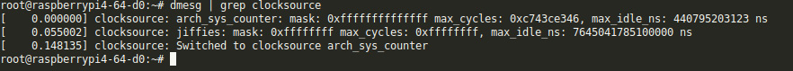
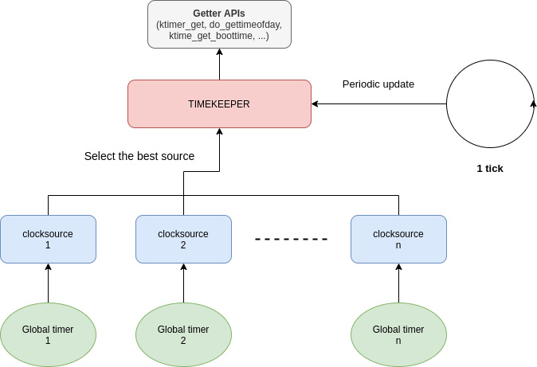
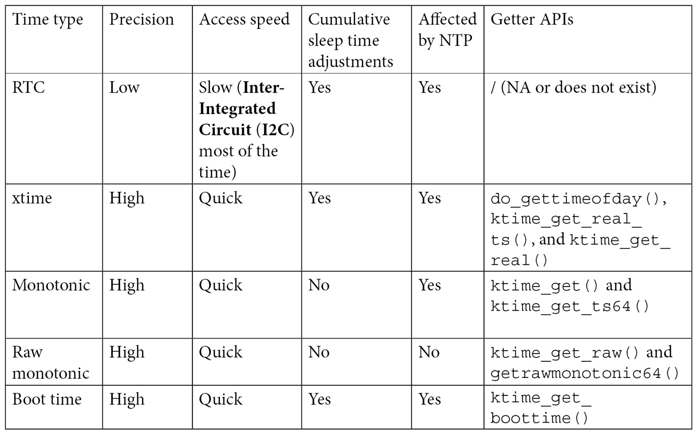
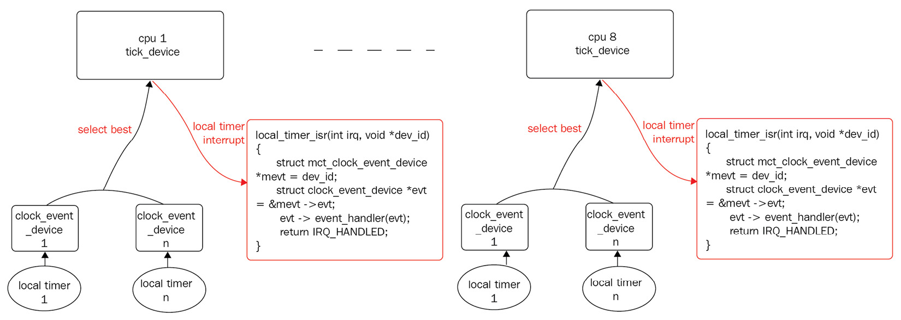

# Chương 3: Làm việc với Kernel Core Helper

Linux kernel là phần mềm độc lập — như sẽ thấy trong chương — không phụ thuộc external library vì tự triển khai mọi chức năng cần dùng (từ list management đến compression algorithm, mọi thứ từ đầu). Nó triển khai mọi cơ chế có thể gặp trong library hiện đại và hơn nữa, như compression, string function, v.v. Chúng ta từng bước tìm hiểu các khía cạnh quan trọng nhất của khả năng này.

Trong chương này, chúng ta trình bày:

- Linux kernel locking mechanism và shared resource

- Làm việc với cơ chế waiting, sleeping và delay trong kernel

- Tìm hiểu Linux kernel time management

- Triển khai work-deferring mechanism

- Kernel interrupt handling

## Linux kernel locking mechanism và shared resource

Resource được gọi shared khi nhiều bên cạnh tranh truy cập được, dù exclusive hay không. Khi exclusive, truy cập phải synchronize để chỉ bên được phép sở hữu resource. Resource có thể là memory location hay peripheral device; bên cạnh tranh có thể processor, process hay thread. OS thực hiện mutual exclusion bằng sửa atomically biến giữ state resource hiện tại, làm hiển thị cho mọi bên có thể truy cập đồng thời. Atomicity bảo đảm sửa hoàn toàn thành công hoặc hoàn toàn không. OS hiện đại dựa hardware (phải cho atomic operation) triển khai synchronization, dù hệ thống đơn giản có thể bảo đảm atomicity bằng disable interrupt (và tránh scheduling) quanh critical code section.

Có thể liệt kê hai synchronization mechanism:

- Lock: Dùng cho mutual exclusion. Một bên giữ lock thì không bên khác giữ được (bị loại trừ). Lock quen thuộc nhất trong kernel là spinlock và mutex.

- Conditional variable: Chờ thay đổi. Triển khai khác trong kernel, như sẽ thấy.

Về locking, hardware phải cho synchronization qua atomic operation, kernel dùng triển khai locking facility. Synchronization primitive là data structure phối hợp truy cập shared resource. Vì chỉ một bên giữ lock (và truy cập shared resource), có thể thực hiện thao tác bất kỳ trên resource gắn lock, có vẻ atomic với bên khác.

Ngoài exclusive ownership của shared resource, có lúc tốt hơn chờ state resource đổi — ví dụ list có ít nhất một object (state từ empty thành not empty) hay task hoàn tất (ví dụ direct memory access (DMA) transaction). Linux kernel không triển khai conditional variable. Từ user space có thể nghĩ conditional variable cho cả hai, nhưng để đạt tương tự hay tốt hơn, kernel cung cấp:

- Wait queue: Chờ thay đổi — thiết kế phối hợp lock

- Completion queue: Chờ computation hoàn tất, chủ yếu dùng DMA

Mọi cơ chế trên được Linux kernel hỗ trợ, cung cấp cho driver qua tập application programming interface (API) rút gọn (giúp nhà phát triển dùng dễ hơn đáng kể), sẽ thảo luận sau.

## Spinlock

Spinlock là hardware-based locking primitive dựa khả năng hardware cung cấp atomic operation (như `test_and_set`, nếu triển khai non-atomic thành read, modify, write). Là locking primitive đơn giản nhất và nền tảng, hoạt động theo tình huống sau.

Khi CPUB chạy và task B muốn acquire spinlock bằng cách gọi locking function của nó, nhưng spinlock đã được một central processing unit (CPU) khác giữ, giả sử CPUA đang chạy task A đã gọi locking function, CPUB chỉ spin trong vòng lặp `while`, block task B, cho đến khi CPU kia release lock qua lời gọi release function của task A. Việc spin này chỉ xảy ra trên máy multi-core, vì vậy ví dụ trước có nhiều CPU. Trên máy single-core, nó không thể xảy ra: task hoặc giữ spinlock và tiếp tục, hoặc không chạy cho đến khi lock được release. Spinlock được gọi là lock do CPU giữ, trái với mutex, được thảo luận trong phần tiếp theo, là lock do task giữ.

Spinlock hoạt động bằng disable scheduler trên local CPU (CPU chạy task gọi spinlock locking API). Nghĩa là task đang chạy không thể preempt trừ interrupt request (IRQ) nếu chưa disable trên local CPU (nói thêm sau). Nói cách khác, spinlock bảo vệ resource chỉ một CPU lấy/truy cập tại mỗi thời điểm. Phù hợp an toàn symmetrical multiprocessing (SMP), thực thi atomic task. LƯU Ý

Không chỉ spinlock tận dụng hardware atomic function. Ví dụ Linux kernel, preemption status phụ thuộc per-CPU variable: bằng `0` là enable, lớn hơn 0 là disable (`schedule()` vô hiệu). Vì vậy disable preemption (`preempt_disable()`) là cộng 1 vào per-CPU variable hiện tại (thực chất `preempt_count`), còn `preempt_enable()` trừ `1`, kiểm tra mới bằng `0` không, gọi `schedule()`. Các phép cộng/trừ atomic nên dựa CPU cung cấp atomic addition/subtraction function.

Tạo spinlock tĩnh bằng macro `DEFINE_SPINLOCK` như minh họa, hoặc động bằng gọi `spin_lock_init()` trên spinlock chưa khởi tạo:

```
static DEFINE_SPINLOCK(my_spinlock);
```

Để hiểu, xem định nghĩa macro trong `include/linux/spinlock_types.h`:

```
#define DEFINE_SPINLOCK(x) spinlock_t x = \
                                 __SPIN_LOCK_UNLOCKED(x)
```

Có thể dùng:

```
static DEFINE_SPINLOCK(foo_lock);
```

Sau đó truy cập spinlock bằng tên `foo_lock`, địa chỉ là

```
&foo_lock.
```

Tuy nhiên cấp phát động (runtime), tốt hơn nhúng spinlock trong structure lớn, cấp phát memory cho structure rồi gọi `spin_lock_init()` trên spinlock element, như snippet:

```
struct bigger_struct {
    spinlock_t lock;
    unsigned int foo;
    [...]
};
static struct bigger_struct *fake_init_function()
{
    struct bigger_struct *bs;
    bs = kmalloc(sizeof(struct bigger_struct), GFP_KERNEL);
    if (!bs)
        return -ENOMEM;
    spin_lock_init(&bs->lock);
    return bs;
}
```

Tốt hơn dùng `DEFINE_SPINLOCK` khi có thể. Khởi tạo compile-time, ít code, không nhược điểm thực sự. Bước này lock/unlock bằng inline function `spin_lock()` và `spin_unlock()`, cả hai định nghĩa trong `include/linux/spinlock.h`:

```
static __always_inline void spin_unlock(spinlock_t *lock)
static __always_inline void spin_lock(spinlock_t *lock)
```

Tuy nhiên, có một số hạn chế đã biết khi sử dụng spinlock theo cách này. Mặc dù spinlock ngăn preemption trên local CPU, nó không ngăn interrupt chiếm CPU để thực thi interrupt handler. Hãy hình dung CPU đang giữ spinlock thay cho task A để bảo vệ một resource và interrupt xảy ra. CPU dừng current task rồi chuyển đến interrupt handler. Đến đây vẫn ổn. Nhưng nếu IRQ handler cần acquire chính spinlock đó thì sao? Bạn có thể đã đoán resource được chia sẻ với interrupt handler. Nó sẽ spin vô hạn tại chỗ, cố acquire lock đang được giữ bởi task mà chính nó đã preempt. Tình huống này chắc chắn dẫn đến deadlock.

Để giải quyết, Linux kernel cung cấp `_irq` variant cho spinlock, ngoài disable/enable preemption còn disable/enable interrupt local CPU. Hàm là `spin_lock_irq()` và `spin_unlock_irq()`, định nghĩa:

```
static void spin_unlock_irq(spinlock_t *lock)
static void spin_lock_irq(spinlock_t *lock)
```

Có thể nghĩ đủ, nhưng chưa. Variant `_irq` chỉ giải quyết một phần. Nếu interrupt đã disable trên processor trước code lock, khi gọi `spin_unlock_irq()` không chỉ release lock mà enable interrupt, có thể sai vì `spin_unlock_irq()` không biết trước lock interrupt nào enable hay không.

Xét ví dụ:

- Giả sử interrupt `x` và `y` disable trước acquire spinlock, `z` thì không.

- `spin_lock_irq()` disable interrupt (`x`, `y`, `z` giờ disable), lấy lock.

- `spin_unlock_irq()` enable interrupt. `x`, `y`, `z` đều enable, khác trước acquire lock. Vấn đề ở đây.

Điều này khiến `spin_lock_irq()` không an toàn từ IRQs off-context vì `spin_unlock_irq()` tương ứng mù quáng enable IRQ, có nguy cơ bật cả IRQ chưa enable khi gọi `spin_lock_irq()`. Chỉ hợp lý dùng `spin_lock_irq()` khi biết interrupt enable — chắc không gì khác đã disable trên local CPU.

Bây giờ, hãy hình dung bạn lưu trạng thái interrupt vào một biến trước khi acquire lock và khôi phục chính xác trạng thái đó khi release; khi đó sẽ không còn vấn đề. Để thực hiện, kernel cung cấp các function thuộc biến thể `_irqsave`, hoạt động giống các function `_irq` nhưng có thêm khả năng lưu và khôi phục trạng thái interrupt. Đó là `spin_lock_irqsave()` và `spin_lock_irqrestore()`, được định nghĩa như sau:

```
spin_lock_irqsave(spinlock_t *lock, unsigned long flags)
spin_unlock_irqrestore(spinlock_t *lock, unsigned long flags)
```

LƯU Ý

`spin_lock()` và mọi variant tự gọi `preempt_disable()`, disable preemption local CPU; `spin_unlock()` và variant gọi `preempt_enable()`, cố enable (Đúng — cố!!! Phụ thuộc spinlock khác còn locked, ảnh hưởng preemption counter), nội bộ gọi `schedule()` nếu enable (tùy counter hiện tại, nên bằng `0`). `spin_unlock()` là preemption point, có thể re-enable preemption.

### Disable preemption so với disable interrupt

Dù disable interrupt có thể ngăn kernel preemption (disable scheduler tick), không gì ngăn protected section gọi scheduler (hàm `schedule()`). Nhiều kernel function gián tiếp gọi scheduler, như xử lý spinlock. Vì vậy ngay `printk()` đơn giản có thể gọi scheduler vì dùng spinlock bảo vệ kernel message buffer. Kernel disable/enable scheduler (và preemption) bằng tăng/giảm biến kernel global và per-CPU tên `preempt_count` (mặc định `0`, enable). Khi lớn hơn `0` (hàm `schedule()` kiểm tra), scheduler chỉ trả về không làm gì. Tăng mỗi lần gọi hàm họ `spin_lock*`. Ngược lại release spinlock (hàm họ `spin_unlock*`) giảm đi `1`, khi về `0`, scheduler được gọi, nghĩa là critical section không còn atomic như vậy.

Vì vậy chỉ disable interrupt bảo vệ khỏi kernel preemption nếu protected code không tự kích hoạt preemption. Tuy nhiên code đã lock spinlock không được sleep vì không thể wake up (nhớ timer interrupt và/hoặc scheduler đã disable trên local CPU).

## Mutex

Mutex là locking primitive thứ hai và cuối cùng được thảo luận trong chương này. Nó hoạt động giống spinlock, với khác biệt duy nhất là code của bạn có thể sleep. Nếu cố lock một mutex đang được task khác giữ, task của bạn bị tạm ngừng và chỉ được đánh thức khi mutex được release. Lần này không có spinning, nghĩa là CPU có thể làm việc khác trong lúc task của bạn ngủ chờ. Như đã đề cập, spinlock là lock được CPU giữ; ngược lại, mutex là lock được task giữ.

Mutex là data structure đơn giản nhúng wait queue (đưa bên cạnh tranh sleep), spinlock bảo vệ truy cập queue, như snippet:

```
struct mutex {
    atomic_long_t owner;
    spinlock_t wait_lock;
#ifdef CONFIG_MUTEX_SPIN_ON_OWNER
    struct optimistic_spin_queue osq; /* Spinner MCS lock */
#endif
    struct list_head wait_list;
[...]
};
```

Trong code snippet trước, các thành phần chỉ dùng ở debug mode được bỏ đi để dễ đọc. Tuy nhiên, có thể thấy mutex được xây dựng trên spinlock. `owner` biểu diễn process sở hữu, tức giữ, lock. `wait_list` là list nơi các task cạnh tranh mutex được đưa vào trạng thái ngủ. `wait_lock` là spinlock bảo vệ việc thao tác trên `wait_list`, gồm loại bỏ hoặc chèn những task ngủ chờ trong đó. Nó giúp giữ `wait_list` nhất quán trên các SMP system.

Các mutex API nằm trong header file `include/linux/mutex.h`. Trước khi acquire và release mutex, phải khởi tạo nó. Giống các kernel core data structure khác, có cách khởi tạo tĩnh như sau:

```
static DEFINE_MUTEX(my_mutex);
```

Định nghĩa macro `DEFINE_MUTEX()`:

```
#define DEFINE_MUTEX(mutexname) \
struct mutex mutexname = __MUTEX_INITIALIZER(mutexname)
```

Cách thứ hai mà kernel cung cấp là dynamic initialization, thực hiện qua lời gọi low-level function `__mutex_init()`. Function này thực tế được bọc bởi macro user-friendly hơn nhiều là `mutex_init()`. Bạn có thể xem cách sử dụng trong code snippet sau:

```
struct fake_data {
    struct i2c_client *client;
    u16 reg_conf;
    struct mutex mutex;
};
static int fake_probe(struct i2c_client *client)
{
[...]
    mutex_init(&data->mutex);
[...]
}
```

Acquire (lock) mutex đơn giản gọi một trong ba hàm:

```
void mutex_lock(struct mutex *lock);
int mutex_lock_interruptible(struct mutex *lock);
int mutex_lock_killable(struct mutex *lock);
```

Nếu mutex free (unlocked), task acquire ngay không sleep. Nếu không, sleep theo hàm dùng. `mutex_lock()` đưa task vào uninterruptible sleep state (`TASK_UNINTERRUPTIBLE`) chờ release mutex (nếu task khác giữ). `mutex_lock_interruptible()` đưa task vào interruptible sleep state, có thể bị bất kỳ signal interrupt. `mutex_lock_killable()` chỉ cho signal thực sự kill task interrupt task đang sleep. Mỗi hàm trả `0` nếu acquire thành công. Hơn nữa interruptible variant trả `-EINTR` khi signal interrupt lần thử lock.

Dù hàm locking nào, mutex owner (chỉ owner) phải release bằng `mutex_unlock()`, định nghĩa:

```
void mutex_unlock(struct mutex *lock);
```

Nếu cần kiểm tra mutex status, dùng `mutex_is_locked()`:

```
static bool mutex_is_locked(struct mutex *lock)
```

Hàm chỉ kiểm tra mutex owner bằng `NULL` không, trả `true` nếu có, `false` nếu không.

LƯU Ý

Khuyến nghị chỉ dùng `mutex_lock()` khi bảo đảm mutex không giữ lâu. Nếu không dùng interruptible variant.

Có quy tắc cụ thể với mutex. Quan trọng nhất trong kernel mutex API header `include/linux/mutex.h`, vài quy tắc như:

- Mỗi lúc chỉ đúng một task giữ mutex.

- Khi giữ, chỉ owner (task lock nó) được unlock.

- Không cho multiple, recursive hay nested lock/unlock.

- Mutex object phải khởi tạo qua API. Không khởi tạo bằng copy hay `memset`, cũng không khởi tạo lại mutex đang giữ.

- Task giữ mutex không được exit, cũng như không giải phóng memory area có held lock.

- Không dùng mutex trong hardware/software interrupt context như tasklet và timer.

Tất cả khiến mutex phù hợp:

- Chỉ locking trong user context

- Nếu protected resource không được IRQ handler truy cập, operation không cần atomic

Tuy nhiên, sử dụng spinlock cho các critical section rất nhỏ có thể ít tốn kém hơn xét theo CPU cycle. Spinlock chỉ tạm ngừng scheduler rồi bắt đầu spin, trong khi mutex phải tạm ngừng current task và chèn nó vào wait queue của mutex. Điều này đòi hỏi scheduler chuyển sang task khác rồi schedule lại task đang ngủ sau khi mutex được release.

## Trylock method

Có những trường hợp chúng ta chỉ cần acquire lock nếu nó chưa được bên cạnh tranh khác giữ. Các method như vậy thử acquire lock rồi trả về ngay một giá trị trạng thái cho biết đã lock thành công hay chưa, không spin nếu sử dụng spinlock và không sleep nếu sử dụng mutex.

Cả spinlock và mutex API có trylock method, lần lượt `spin_trylock()` và `mutex_trylock()`, thấy loại sau ở đây. Cả hai trả 0 thất bại (lock đã locked) hoặc 1 thành công (acquire). Vì vậy hợp lý dùng với statement `if`:

```
int mutex_trylock(struct mutex *lock)
```

`spin_trylock()` được sử dụng cho spinlock. Nó lock spinlock nếu spinlock chưa bị lock, giống method `spin_lock()`. Tuy nhiên, nếu spinlock đã bị lock, nó trả về `0` ngay mà không spin. Bạn có thể xem cách hoạt động ở đây:

```
static DEFINE_SPINLOCK(foo_lock);
[...]
static void foo(void)
{
    [...]
    if (!spin_trylock(&foo_lock)) {
        /* Failure! the spinlock is already locked */
        [...]
        return;
    }
    /*
    * reaching this part of the code means that the
    * spinlock has been successfully locked
    */
    [...]
    spin_unlock(&foo_lock);
    [...]
}
```

Ngược lại, `mutex_trylock()` được sử dụng cho mutex. Nó lock mutex nếu mutex chưa bị lock, giống method `mutex_lock()`. Tuy nhiên, nếu mutex đã bị lock, nó trả về `0` ngay mà không sleep. Bạn có thể xem ví dụ trong code snippet sau:

```
static DEFINE_MUTEX(bar_mutex);
[...]
static void bar (void)
{
    [...]
    if (!mutex_trylock(&bar_mutex)){
        /* Failure! the mutex is already locked */
        [...]
        return;
    }
    /*
     * reaching this part of the code means that the
     * mutex has been successfully acquired
     */
    [...]
    mutex_unlock(&bar_mutex);
    [...]
}
```

Trong đoạn trích trước, `mutex_trylock()` được sử dụng cùng câu lệnh `if` để driver có thể điều chỉnh hành vi. Bây giờ đã hoàn tất biến thể trylock, chúng ta hãy chuyển sang một khái niệm hoàn toàn khác: học cách trì hoãn việc thực thi một cách tường minh.

## Làm việc với cơ chế waiting, sleeping và delay trong kernel

Thuật ngữ sleeping trong phần này chỉ cơ chế mà một task, thay mặt kernel code đang chạy, tự nguyện nhường processor để task khác có thể được schedule. Simple sleeping là việc task ngủ rồi được đánh thức sau một khoảng thời gian cho trước, chẳng hạn để trì hoãn thụ động một thao tác. Ngoài ra, có những cơ chế ngủ dựa trên external event như data trở nên có sẵn. Simple sleep được triển khai bằng các API riêng; việc đánh thức được kernel tự xử lý một cách ngầm định sau khi hết thời gian. Cơ chế còn lại phụ thuộc vào event và việc đánh thức, tức waking-up, là tường minh: task khác phải chủ động đánh thức chúng ta theo một điều kiện, nếu không sẽ ngủ mãi, trừ khi có chỉ định sleeping timeout. Cơ chế này được triển khai trong kernel bằng khái niệm wait queue. Cả sleep API lẫn wait queue đều thực hiện điều có thể gọi là passive waiting. Khác biệt giữa chúng là cách quá trình waking-up diễn ra.

## Wait queue

Kernel scheduler quản lý list task cần chạy (state `TASK_RUNNING`), gọi runqueue. Sleeping task, interruptible hay không (state `TASK_INTERRUPTIBLE` hoặc `TASK_UNINTERRUPTIBLE`), có queue riêng, gọi wait queue.

Wait queue là higher-level mechanism chủ yếu xử lý blocking input/output (I/O), chờ condition `true`, chờ event cụ thể, hay nhận biết data/resource availability. Để hiểu, xem structure sau trong

```
include/linux/wait.h:
struct wait_queue_head {
    spinlock_t lock;
    struct list_head head;
};
```

Wait queue chỉ gồm một list chứa các process đang ngủ chờ được đánh thức và một spinlock bảo vệ truy cập list đó. Chúng ta có thể dùng wait queue khi nhiều process muốn ngủ để chờ một hoặc nhiều event xảy ra rồi được đánh thức. Member head thực chất là list các process chờ event. Mỗi process muốn ngủ chờ event tự đưa mình vào list trước khi ngủ. Khi nằm trong list, process được gọi là wait queue entry. Khi event xảy ra, một hoặc nhiều process trong list được đánh thức và đưa ra khỏi list.

Khai báo/khởi tạo wait queue hai cách. Đầu dùng tĩnh `DECLARE_WAIT_QUEUE_HEAD`:

```
DECLARE_WAIT_QUEUE_HEAD(my_event);
```

Hoặc dùng động `init_waitqueue_head()`:

```
wait_queue_head_t my_event;
init_waitqueue_head(&my_event);
```

Bất kỳ process nào muốn ngủ để chờ `my_event` xảy ra đều có thể gọi `wait_event_interruptible()` hoặc `wait_event()`. Phần lớn trường hợp, event chỉ là việc một resource trở nên có sẵn, nên hợp lý là process chỉ ngủ sau khi kiểm tra availability của resource đó lần đầu. Để đơn giản hóa, cả hai function nhận một biểu thức ở argument thứ hai, để process chỉ được đưa vào trạng thái ngủ nếu biểu thức cho giá trị `false`, như minh họa trong code snippet sau:

```
wait_event(&my_event, (event_occured == 1));
/* or */
wait_event_interruptible(&my_event, (event_occured == 1));
```

`wait_event()` hoặc `wait_event_interruptible()` chỉ đánh giá condition khi gọi. Nếu `false`, process vào state `TASK_UNINTERRUPTIBLE` hoặc `TASK_INTERRUPTIBLE` (variant `_interruptible`), bỏ khỏi runqueue.

LƯU Ý

`wait_event()` đưa process vào exclusive wait, tức uninterruptible sleep, không bị signal interrupt. Chỉ dùng critical task. Phần lớn khuyến nghị interruptible function.

Có những trường hợp bạn không chỉ cần điều kiện trở thành `true` mà còn cần timeout sau một khoảng chờ nhất định. Bạn có thể xử lý bằng `wait_event_timeout()`, có prototype như sau:

```
wait_event_timeout(wq_head, condition, timeout)
```

Hàm có hai hành vi tùy hết timeout chưa:

- Timeout đã hết: Trả `0` nếu condition `false`, `1` nếu `true`.

- Timeout chưa hết: Trả thời gian còn (jiffies — ít nhất 1) nếu condition `true`.

Đơn vị timeout là jiffy. Có API tiện chuyển đơn vị như millisecond/microsecond thành jiffies, định nghĩa:

```
unsigned long msecs_to_jiffies(const unsigned int m)
unsigned long usecs_to_jiffies(const unsigned int u)
```

Sau khi bất kỳ biến nào có thể ảnh hưởng đến kết quả của wait condition thay đổi, bạn phải gọi function thích hợp trong họ `wake_up*`. Để đánh thức process đang ngủ trên wait queue, nên gọi `wake_up()`, `wake_up_all()`, `wake_up_interruptible()` hoặc `wake_up_interruptible_all()`. Mỗi khi gọi một trong các function này, điều kiện được đánh giá lại (re-evaluated). Nếu điều kiện là `true` tại thời điểm đó, một process hoặc tất cả process với biến thể `_all()` trong wait queue sẽ được đánh thức và state được đặt thành `TASK_RUNNING`; nếu điều kiện là `false`, không có gì xảy ra. Code snippet sau minh họa khái niệm này:

```
wake_up(&my_event);
wake_up_all(&my_event);
wake_up_interruptible(&my_event);
wake_up_interruptible_all(&my_event);
```

Trong code snippet trước, `wake_up()` chỉ đánh thức một process từ wait queue, còn `wake_up_all()` đánh thức tất cả process trong wait queue. Ngược lại, `wake_up_interruptible()` chỉ đánh thức một process trong wait queue đang ở interruptible sleep, còn `wake_up_interruptible_all()` đánh thức tất cả process trong wait queue đang ở interruptible sleep.

Vì có thể bị signal ngắt, bạn nên kiểm tra return value của các biến thể `_interruptible`. Giá trị khác 0 nghĩa là quá trình ngủ đã bị một signal ngắt, và driver nên trả về `ERESTARTSYS`, như minh họa trong code snippet sau:

```
#include <linux/module.h>
#include <linux/init.h>
#include <linux/sched.h>
#include <linux/time.h>
#include <linux/delay.h>
#include<linux/workqueue.h>
static DECLARE_WAIT_QUEUE_HEAD(my_wq);
static int condition = 0;
/* declare a work queue*/
static struct work_struct wrk;
static void work_handler(struct work_struct *work)
{
    pr_info("Waitqueue module handler %s\n", __FUNCTION__);
    msleep(5000);
    pr_info("Wake up the sleeping module\n");
    condition = 1;
    wake_up_interruptible(&my_wq);
}
static int __init my_init(void)
{
    pr_info("Wait queue example\n");
    INIT_WORK(&wrk, work_handler);
    schedule_work(&wrk);
    pr_info("Going to sleep %s\n", __FUNCTION__);
    if (wait_event_interruptible(my_wq, condition != 0)) {
        pr_info("Our sleep has been interrupted\n");
        return -ERESTARTSYS;
    }
    pr_info("woken up by the work job\n");
    return 0;
}
void my_exit(void)
{
    pr_info("waitqueue example cleanup\n");
}
module_init(my_init)
module_exit(my_exit);
MODULE_AUTHOR("John Madieu <john.madieu@gmail.com>");
MODULE_LICENSE("GPL");
```

Trong ví dụ trước, chúng ta sử dụng API `msleep()`, sẽ được giải thích ngay sau đây. Trở lại hành vi của code, current process, thực tế là `insmod`, được đưa vào trạng thái ngủ trong wait queue trong 5 giây và được work handler đánh thức. Output của `dmesg` như sau:

```
[342081.385491] Wait queue example
[342081.385505] Going to sleep my_init
[342081.385515] Waitqueue module handler work_handler
[342086.387017] Wake up the sleeping module
[342086.387096] woken up by the work job
[342092.912033] waitqueue example cleanup
```

Bây giờ đã hiểu khái niệm wait queue, cho phép đưa các process vào trạng thái ngủ và chờ chúng được đánh thức, chúng ta hãy học một cơ chế ngủ đơn giản khác: trì hoãn execution flow một cách vô điều kiện.

## Simple sleeping trong kernel

Cơ chế ngủ đơn giản này cũng được gọi là passive delay vì task ngủ trong lúc chờ, cho phép CPU schedule task khác. Ngược lại, active delay là busy wait: task chờ bằng cách lãng phí CPU clock và do đó tiêu thụ resource. Trước khi sử dụng sleeping API, driver phải include `#include <linux/delay>` để có function sau:

```
usleep_range(unsigned long min, unsigned long max)
msleep(unsigned long msecs)
msleep(unsigned long msecs)
msleep_interruptible(unsigned long msecs)
```

Trong API, `msecs` số millisecond sleep; `min` và `max` là cận dưới/trên sleep theo microsecond.

API `usleep_range()` dựa high-resolution timer (hrtimer), khuyến nghị sleep vài \~`µsecs` hay `msecs` nhỏ (giữa 10 microsecond và 20 millisecond), tránh busy-wait loop `udelay()`.

API `msleep*()` dựa `jiffies`/legacy timer. Dùng cho số millisecond lớn hơn (10 trở lên). Đặt current task thành `TASK_UNINTERRUPTIBLE`, còn `msleep_interruptible()` đặt `TASK_INTERRUPTIBLE` trước schedule sleep. Khác là sleep có kết thúc sớm bởi signal không. Khuyến nghị `msleep()` trừ khi cần interruptible variant.

API mục này chỉ dùng chèn delay trong non-atomic context.

## Kernel delay hay busy waiting

“Delay” mục này có thể xem busy waiting vì task chủ động chờ (tương ứng loop `for()` hoặc `while()`), tiêu thụ CPU resource, khác sleep là passive delay vì task sleep khi chờ.

Ngay busy loop waiting, driver include `#include <linux/delay>`, cũng cung cấp API:

```
ndelay(unsigned long nsecs)
udelay(unsigned long usecs)
mdelay(unsigned long msecs)
```

Ưu điểm là dùng được cả atomic và non-atomic context.

Độ chính xác `ndelay` phụ thuộc timer chính xác thế nào (không phải luôn vậy trên embedded system on a chip, SoC). Độ chính xác mức `ndelay` có thể không có trên nhiều non-PC device. Thay vào đó dễ gặp:

- `udelay`: API này dựa trên một busy-wait loop. Nó busy wait đủ số lượt lặp để đạt delay mong muốn. Bạn nên dùng function này nếu cần ngủ vài `µsecs`, tức \< \~10 microsecond. API này được khuyến nghị ngay cả khi ngủ dưới 10 us vì trên các hệ thống chậm hơn, như một số embedded SoC, overhead thiết lập hrtimer cho `usleep` có thể không đáng. Đánh giá này dĩ nhiên phụ thuộc tình huống cụ thể, nhưng đó là điều cần lưu ý.

- `mdelay`: Đây là macro wrapper quanh `udelay` để tính đến khả năng overflow khi truyền argument lớn cho `udelay`. Nói chung, không khuyến khích dùng `mdelay`, và nên refactor code để cho phép dùng `msleep`.

Đến đây, chúng ta đã hoàn tất các cơ chế sleeping hoặc delay của Linux kernel. Chúng ta đã có thể thiết kế và triển khai execution flow time-slice-managed. Bây giờ có thể tìm hiểu sâu hơn cách Linux kernel quản lý thời gian.

## Tìm hiểu Linux kernel time management

Time là resource dùng nhiều nhất trong máy tính, chỉ sau memory. Dùng gần mọi việc: timer, sleep, scheduling và nhiều task.

Linux kernel có software timer concept để gọi kernel function ở thời điểm sau.

## Khái niệm clocksource, clockevent và tick device

Trong Linux timer implementation gốc, main hardware timer chủ yếu timekeeping. Cũng được lập trình phát interrupt định kỳ tần số HZ, period tương ứng gọi jiffy (cả hai giải thích phần Jiffies và HZ sau). Mỗi interrupt sinh mỗi 1/HZ giây từng (và vẫn) gọi tick. Xuyên suốt mục tick chỉ interrupt period 1/HZ.

Toàn system time management (kernel/user space) gắn jiffies, cũng là global variable kernel tăng mỗi tick. Ngoài tăng `jiffies` (nền cho timer wheel), tick handler còn process scheduling, cập nhật statistic, profiling. Từ kernel 2.6.21, cải tiến đầu là merge hrtimer implementation (nay qua `CONFIG_HIGH_RES_TIMERS`). Tính năng từng (vẫn) transparent, đi cùng timer `hrtimer` như chức năng riêng, kiểu dữ liệu mới `ktime_t` giữ time value theo nanosecond. Triển khai legacy timer cũ (tick-based, low-res) vẫn còn. Cải tiến chuyển `nanosleep()`, interval timer (itimer), Portable Operating System Interface (POSIX) timer sang high-resolution timer, granularity/accuracy tốt hơn jiffy resolution hiện tại. Hợp nhất `nanosleep()` và `clock_nanosleep()` nhờ chuyển `nanosleep()` và POSIX timer. Không cải tiến, accuracy tốt nhất cho timer event là 1 jiffy, duration tùy `HZ` kernel.

LƯU Ý Tuy nhiên high-resolution timer implementation là tính năng độc lập. Timer hrtimer có thể enable mọi platform, nhưng chạy high-resolution mode hay không tùy hardware timer bên dưới. Nếu không, hệ thống ở low-resolution (low-res) mode.

Cải tiến theo kernel evolution đến generic clockevent interface cùng khái niệm clock source, clock event, tick device. Hoàn toàn đổi time management kernel, ảnh hưởng CPU power management.

### Clocksource framework và clock source device

Clock source là monotonic, atomic, free-running counter. Có thể xem timer làm free-running counter cung cấp timestamp và read access time value tăng đơn điệu. Operation phổ biến trên clock source device là đọc counter value.

Trong kernel có global list `clocksource_list` theo dõi các clock source device đã đăng ký với hệ thống, được enqueue theo thứ tự rating. Điều này cho phép Linux kernel biết mọi clock source device đã đăng ký và chuyển sang clock source có rating và tính năng tốt hơn. Chẳng hạn, function `__clocksource_select()` được gọi sau mỗi lần đăng ký clock source mới, bảo đảm luôn chọn clock source tốt nhất. Clock source được đăng ký bằng `clocksource_mmio_init()` hoặc `clocksource_register_hz()` (bạn có thể `grep` những từ này). Tuy nhiên, các clock source device driver nằm trong `drivers/clocksource/` trong kernel source.

Trên running Linux system, cách trực quan nhất liệt kê clock source đã đăng ký là tìm từ `clocksource` trong kernel log message buffer:



Hình 3.1 – System clocksource list

LƯU Ý Log trên (Pi 4), clock source `jiffies` có jiffy granularity-based, luôn có, kernel đăng ký là `clocksource_jiffies` trong `kernel/time/jiffies.c`, rating hợp lệ thấp nhất (phương án cuối). Trên x86 được tinh chỉnh đổi tên `refined-jiffies` — xem lời gọi `register_refined_jiffies()` trong `arch/x86/kernel/setup.c`.

Tuy nhiên cách ưu tiên (đặc biệt buffer `dmesg` đã rotate hay xóa) liệt kê clock source sẵn trên running Linux system là đọc file `available_clocksource` trong `/sys/devices/system/clocksource/clocksource0/`, như snippet (Pi 4):

```
root@raspberrypi4-64-d0:~#
cat  /sys/devices/system/clocksource/clocksource0/available_clocksource
arch_sys_counter
root@raspberrypi4-64-d0:~#
```

Trên board i.MX6:

```
root@udoo-labcsmart:~#
cat  /sys/devices/system/clocksource/clocksource0/available_clocksource
mxc_timer1
root@udoo-labcsmart:~#
```

Kiểm tra clock source hiện dùng bằng:

```
root@raspberrypi4-64-d0:~#
cat  /sys/devices/system/clocksource/clocksource0/current_clocksource
arch_sys_counter
root@raspberrypi4-64-d0:~#
```

Trên máy x86 của tôi, clock source sẵn và đang dùng:

```
jma@labcsmart:~$ cat /sys/devices/system/clocksource/clocksource0/available_clocksource
tsc hpet acpi_pm
jma@labcsmart:~$ cat /sys/devices/system/clocksource/clocksource0/current_clocksource
tsc
jma@labcsmart:~$
```

Đổi clock source hiện tại bằng echo tên một loại sẵn vào file `current_clocksource`:

```
jma@labcsmart:~$ echo acpi_pm
>  /sys/devices/system/clocksource/clocksource0/current_clocksource
jma@labcsmart:~$
```

Phải cẩn thận đổi clock source vì kernel chọn lúc boot luôn tốt nhất.

Linux kernel timekeeping

Mục tiêu chính clock source device là cấp timekeeper. Hệ thống có thể nhiều clock source nhưng timekeeper chọn độ chính xác cao nhất. Timekeeper cần lấy clock source value định kỳ để cập nhật system time, thường trong tick processing, như sơ đồ:



Hình 3.2 – Linux kernel timekeeper implementation

Timekeeper cung cấp xtime, monotonic time, raw monotonic time, boot time, chi tiết:

- xtime: Wall (real) time, thời gian hiện tại theo chip Real-Time Clock (RTC).

- Monotonic time: Thời gian tích lũy từ bật hệ thống, không tính system sleep.

- Raw monotonic time: Cùng nghĩa monotonic time nhưng thuần hơn, không ảnh hưởng Network Time Protocol (NTP) time adjustment.

- Boot time: Cộng thời gian system sleep vào monotonic time, cho tổng từ bật nguồn.

Bảng sau các loại time và kernel getter function:



Bảng 3.1 – Linux kernel timekeeping function

Giờ quen Linux kernel timekeeping mechanism/API, học khái niệm khác trong time management — clockevent framework.

### Clockevent framework và clock event device

Trước clockevent, locality hardware timer không được xét. Clock source/event hardware lập trình sinh định kỳ `HZ` tick (interrupt) mỗi giây, giữa tick là jiffy. Với clockevent/source, clock interrupt được trừu tượng thành event. Chức năng chính framework là phân phối clock interrupt (event), đặt trigger condition tiếp. Generic framework cho next-event interrupt programming.

Clock event device phát interrupt, cho lập trình lúc interrupt tiếp (event) xảy ra tương lai. Mỗi driver phải cung cấp hàm `set_next_event` (hay `set_next_ktime` nếu device hrtimer-backed), framework dùng khi lập trình interrupt tiếp qua device bên dưới. Clock event device trực giao clock source device. Có lẽ vì vậy driver cùng chỗ (đôi khi cùng compilation unit) với clock source driver — `drivers/clocksource`. Phần lớn platform có thể dùng cùng hardware/register range cho clock event và clock source, nhưng bản chất khác. Ví dụ BCM2835 System Timer, memory-mapped peripheral trên BCM2835 trong Raspberry Pi. Có free-running counter 64-bit chạy 1 megahertz (MHz), bốn “output compare register” riêng để schedule interrupt. Khi vậy driver thường đăng ký clock source và clock event device cùng compilation unit.

Trên running Linux system, liệt kê clock event device từ directory `/sys/devices/system/clockevents/`. Ví dụ Pi 4:

```
root@raspberrypi4-64-d0:~# ls /sys/devices/system/clockevents/
broadcast    clockevent1  clockevent3  uevent
clockevent0  clockevent2  power
root@raspberrypi4-64-d0:~#
```

Trên running system i.MX6 dual-core:

```
root@udoo-labcsmart:~# ls /sys/devices/system/clockevents/
broadcast    clockevent0  clockevent1  consumers    power        suppliers    uevent
root@empair-labcsmart:~#
```

Cuối cùng trên máy tám core của tôi:

```
jma@labcsmart:~$ ls /sys/devices/system/clockevents/
broadcast  clockevent0  clockevent1  clockevent2  clockevent3  clockevent4  clockevent5  c
lockevent6  clockevent7  power  uevent
jma@labcsmart:~$
```

Từ danh sách clock event device trên, nói được:

- Số clock event device bằng CPU hệ thống (cho per-CPU clock device, do đó liên quan timer locality).

- Luôn có directory lạ `broadcast`. Thảo luận timer đặc biệt này mục sau.

Để biết timer bên dưới một clock event device cụ thể, bạn có thể đọc nội dung `current_device` trong clock event directory. Bây giờ, chúng ta sẽ xem ví dụ trên ba máy khác nhau.

Trên platform i.MX 6:

```
root@udoo-labcsmart:~# cat /sys/devices/system/clockevents/clockevent0/current_device
local_timer
root@udoo-labcsmart:~# cat /sys/devices/system/clockevents/clockevent1/current_device
local_timer
```

Trên Pi 4:

```
root@raspberrypi4-64-d0:~# cat /sys/devices/system/clockevents/clockevent2/current_device
arch_sys_timer
root@raspberrypi4-64-d0:~# cat /sys/devices/system/clockevents/clockevent3/current_device
arch_sys_timer
```

Trên máy x86 đang chạy của tôi:

```
jma@labcsmart:~$ cat /sys/devices/system/clockevents/clockevent0/current_device
lapic-deadline
jma@labcsmart:~$ cat /sys/devices/system/clockevents/clockevent1/current_device
lapic-deadline
```

Để dễ đọc chỉ đọc hai entry, từ đó kết luận:

- Clock event device dựa cùng hardware timer, khác timer của clock source device.

- Cần ít nhất hai hardware timer hỗ trợ high-resolution timer interface: một clock source, một (lý tưởng per-CPU) cho clock event device.

Clock event device có thể configure one-shot mode hoặc periodic mode:

- Periodic mode: sinh tick mỗi 1/HZ giây, làm mọi việc legacy low-resolution timer-based tick đã làm, như cập nhật jiffies, accounting CPU time, v.v. Tức dùng như legacy low-resolution timer, nhưng chạy từ infrastructure mới.

- One-shot mode: hardware sinh tick sau số cycle cụ thể từ hiện tại. Chủ yếu lập trình interrupt tiếp để wake CPU trước khi idle.

Để theo dõi operating mode clock event device, đưa vào tick device. Giải thích mục tiếp.

### Tick device

Tick device là phần mở rộng software của clock event device, cung cấp một luồng tick event liên tục xảy ra theo các khoảng thời gian đều nhau. Kernel tự động tạo tick device khi clock event device mới được đăng ký và luôn chọn clock event device tốt nhất. Vì vậy, rõ ràng tick device được gắn với và được hỗ trợ bởi một clock event device.

Định nghĩa data structure tick-device trong snippet:

```
struct tick_device {
    struct clock_event_device *evtdev;
    enum tick_device_mode mode;
};
```

Trong data structure này, `evtdev` là clock event device được tick device trừu tượng hóa. `mode` được sử dụng để theo dõi working mode của clock event bên dưới. Vì vậy, khi nói tick device ở periodic mode, điều đó cũng có nghĩa clock event device bên dưới được configure hoạt động ở chế độ này. Sơ đồ sau minh họa điều đó:



Hình 3.3 – Tương quan clockevent và tick-device

Tick device có thể là global cho toàn hệ thống hoặc local, tức per-CPU tick device. Framework quyết định tick device có cần là global hay không bằng cách chọn một local tick device dựa trên các tính năng của clock event device bên dưới nó. Mỗi loại tick device được mô tả như sau:

- Per-CPU tick device cung cấp chức năng local CPU như process accounting, profiling, hiển nhiên CPU local periodic tick (periodic mode), CPU local next event interrupt (non-periodic) cho CPU local hrtimer management (xem `update_process_times()` để biết xử lý). Timer core code có per-CPU variable `tick_cpu_device` biểu diễn instance tick device per-CPU.

- Global tick device cung cấp periodic tick chủ yếu chạy `do_timer()` và `update_wall_time()`. Hàm đầu cập nhật global `jiffies`, system load average, hàm sau wall time (lưu `xtime`, ghi khoảng từ 1/1/1970 đến nay), chạy dynamic timer đã hết hạn (ví dụ local process timer). Timer core code có global variable `tick_do_timer_cpu` giữ CPU number có tick device làm global — thực thi `do_timer()`. Global variable khác `tick_next_period` theo dõi thời gian global tick device phát tiếp.

LƯU Ý

Nghĩa là biến `jiffies` luôn quản lý từ một core mỗi lần, nhưng function management affinity có thể nhảy core khi `tick_do_timer_cpu` đổi.

Từ interrupt routine, driver clock event device phải gọi `evtdev->event_handler()`, default handler framework cài. Transparent với device driver, framework đặt handler theo hai kernel configuration option (`CONFIG_HIGH_RES_TIMERS`, `CONFIG_NO_HZ`), hardware timer resolution, tick device chạy dynamic hay one-shot mode.

`NO_HZ` là kernel option enable dynamic tick, `HIGH_RES_TIMERS` cho hrtimer API. Enable hrtimer, base code vẫn tick-driven nhưng periodic tick interrupt thay bởi timer dưới hrtimer (`softirq` gọi trong timer softirq context). Tuy nhiên hrtimer high-resolution tùy hardware timer có high-resolution không. Nếu không, hrtimer được old low-resolution tick-based timer cấp.

Tick device có thể one-shot hoặc periodic. Periodic, framework dùng per-CPU hrtimer qua control structure mô phỏng tick, nên base code vẫn tick-driven nhưng periodic tick interrupt thay bởi timer dưới hrtimer nhúng control structure. Structure là struct `tick_sched`, định nghĩa:

```
struct tick_sched {
    struct hrtimer               sched_timer;
    enum tick_nohz_mode          nohz_mode;
[...]
};
```

Rồi khai báo per-CPU instance:

```
static DEFINE_PER_CPU(struct tick_sched, tick_cpu_sched);
```

Instance per-CPU cho per-CPU tick emulation, điều khiển low-res timer processing qua element `sched_timer`, lập trình lại định kỳ đến interval next-low-res-timer-expires. Khá hiển nhiên vì mỗi CPU có runqueue và ready process list riêng cần quản lý.

Framework có thể configure `tick_sched` ba mode:

- `NOHZ_MODE_INACTIVE`: Không dynamic tick, không hỗ trợ hrtimer. State hệ thống lúc khởi tạo. Local per-CPU tick-device event handler là `tick_handle_periodic()`, vào `idle` bị tick timer interrupt ngắt.

- `NOHZ_MODE_LOWRES`: Còn mode `lowres`, dynamic tick enable low-resolution. Không tìm thấy high-resolution hardware timer để hrtimer high-resolution, nên chạy low-precision, cùng precision low-precision timer (software (SW) local timer) dựa tick. Local per-CPU tick-device event handler là `tick_nohz_handler()`, vào `idle` không bị tick timer interrupt ngắt.

- `NOHZ_MODE_HIGHRES`: Còn `highres`. Cả dynamic tick và hrtimer “high-resolution” enable. Local per-CPU tick-device event handler là `hrtimer_interrupt()`. Hrtimer high-precision, cùng accuracy hardware timer (hardware (HW) local timer), lớn hơn nhiều tick accuracy low-precision timer. Để hỗ trợ high-precision mode của hrtimer, hrtimer trực tiếp dùng one-shot mode của `tick_device`, conventional tick timer chuyển thành sub-timer hrtimer.

Tick core-related source code ở directory `kernel/time/`, trong file `tick-*.c`: `tick-broadcast.c`, `tick-common.c`, `tick-broadcast-hrtimer.c`, `tick-legacy.c`, `tick-oneshot.c`, `tick-sched.c`.

### Broadcast tick device

Platform CPU power management, phần lớn (nếu không tất cả) hardware timer của clock event device tắt trong một số state `CPUidle`. Để software timer hoạt động, kernel cần always-on clock event device (dựa always-on timer) trong platform để chuyển tiếp interrupt signaling khi hết hạn. Timer always-on gọi broadcast clock device. Ngắn gọn tick broadcast dùng wake idle CPU. Biểu diễn bởi directory `broadcast` trong `/sys/devices/system/clockevents/`.

LƯU Ý

Broadcast tick device wake bất kỳ CPU bằng inter-processor interrupt (IPI) (Chương 13, Làm rõ Kernel IRQ Framework) đến CPU đó. Xem `wake_up_nohz_cpu()` dùng cho mục đích.

Xem timer dưới broadcast device bằng đọc biến `current_device` trong directory.

Trên x86 có output:

```
jma@labcsmart:~$ cat /sys/devices/system/clockevents/broadcast/current_device
hpet
```

Output Pi 4:

```
root@raspberrypi4-64-d0:~# cat /sys/devices/system/clockevents/broadcast/current_device
bc_hrtimer
```

Cuối cùng broadcast device i.MX 6 dựa timer:

```
root@udoo-labcsmart:~# cat /sys/devices/system/clockevents/broadcast/current_device
mxc_timer1
```

Từ output kết luận clock source, clock event, broadcast device timer đều khác. Core function `tick_install_broadcast_device()` quyết định tick device có làm broadcast không, gọi mỗi tick-device registration. Loại trừ device đặt flag `CLOCK_EVT_FEAT_C3STOP` (timer clock event device dừng trong idle state `C3`), dựa tiêu chí khác (như one-shot mode — đặt `CLOCK_EVT_FEAT_ONESHOT`). Cuối cùng global variable `tick_broadcast_device` định nghĩa trong `kernel/time/tick-broadcast.c` chứa tick device làm broadcast. Khi chọn, next event handler đặt `tick_handle_periodic_broadcast()` thay `tick_handle_periodic()`.

Tuy nhiên có platform CPU core gating không always-on hardware timer. Kernel cung cấp kernel hrtimer-based clock event device đăng ký vô điều kiện lúc boot (có thể chọn tick broadcast) với rating thấp nhất để mọi broadcast-capable hardware clock event device hiện diện được ưu tiên hơn tick broadcast device.

Clock event device hrtimer-backed này cần CPU chọn động (nếu CPU sắp deep sleep, wake-up time sớm hơn hrtimer expiration, CPU đó thành broadcast CPU mới) luôn bật. CPU chuyển timer interrupt đến CPU deep-idle qua hardware local timer device. Triển khai `kernel/time/tick-broadcast-hrtimer.c`, đăng ký `ce_broadcast_hrtimer`, field `name` là `bc_hrtimer`. Ví dụ đây là broadcast tick device platform Pi 4 dùng.

LƯU Ý CPU always-on ảnh hưởng power management capability platform, làm `CPUidle` không tối ưu vì kernel giữ ít nhất một CPU luôn shallow idle để chuyển timer interrupt. trade-off CPU power management/high-resolution timer interface, ít nhất cho kernel functional system có power management hoạt động phần nào.

### Tìm hiểu hàm sched\_clock

`sched_clock()` là kernel timekeeping/timestamping function trả số nanosecond từ system start. Weakly defined (cho architecture/platform code override) trong `kernel/sched/clock.c`:

```
unsigned long long __weak sched_clock(void)
```

Ví dụ hàm cung cấp timestamp `printk()`, hoặc gọi khi dùng `ktime_get_boottime()` hay kernel API liên quan. Mặc định triển khai jiffy-backed (có thể ảnh hưởng scheduling accuracy). Nếu override, phải trả monotonic timestamp 64-bit nanosecond biểu diễn số nanosecond từ reboot gần nhất. Phần lớn platform đọc trực tiếp timer register. Platform thiếu timer dùng cùng timer main clock source device. Ví dụ Raspberry Pi. Khi vậy register đọc main clock source và register lấy `sched_clock()` giống nhau: xem `drivers/clocksource/bcm2835_timer.c`.

Timer điều khiển `sched_clock()` phải rất nhanh so với các clock source timer. Như tên gọi, nó chủ yếu được scheduler sử dụng, nghĩa là được gọi thường xuyên hơn nhiều. Nếu phải thực hiện các trade-offs về độ chính xác so với clock source, bạn có thể hy sinh độ chính xác để đổi lấy tốc độ trong `sched_clock()`.

Nếu không override trực tiếp `sched_clock()`, kernel time core có helper `sched_clock_register()` cung cấp platform-dependent timer reading function và rating. Dù sao function vào kernel time framework variable `cd`, kiểu `struct clock_data` (giả sử rate timer mới lớn hơn timer đang điều khiển hàm hiện tại).

### Dynamic tick/tickless kernel

Dynamic tick là hệ quả logic của việc chuyển sang high-resolution timer interface. Trước khi chúng được đưa vào, periodic tick định kỳ phát interrupt, `HZ` lần mỗi giây, để điều khiển hệ điều hành. Điều này giữ hệ thống luôn thức ngay cả khi không có task hoặc timer handler cần chạy. Với cách tiếp cận đó, CPU không thể nghỉ lâu vì phải thức dậy mà không có mục đích thực sự.

Dynamic tick giải quyết bằng cho dừng periodic tick trong khoảng thời gian nhất định để tiết kiệm điện. Chỉ enable lại khi có task cần thực hiện; nếu không disable.

Cơ chế này hoạt động như thế nào? Khi CPU không còn task để chạy, tức idle task được schedule trên CPU đó, chỉ hai event có thể tạo ra công việc mới sau khi CPU nghỉ: một internal kernel timer hết hạn, điều có thể dự đoán, hoặc một thao tác I/O hoàn tất. Khi CPU đi vào idle state, timer framework xem xét timer event tiếp theo đã được schedule. Nếu event đó muộn hơn periodic tick tiếp theo, framework lập trình lại per-CPU clock event device đến event muộn hơn. Điều này cho phép idle CPU ngủ lâu hơn mà không bị periodic tick ngắt không cần thiết.

Tuy nhiên có low power state ngay per-CPU clock event device dừng. Khi đó broadcast tick device được lập trình next future event.

Ngay trước CPU vào idle như vậy (hàm `do_idle()`), gọi tick broadcast framework (`tick_nohz_idle_enter()`), disable periodic tick biến `tick_device` (xem `tick_nohz_idle_stop_tick()`). CPU được thêm list cần wake bằng đặt bit tương ứng trong “broadcast map” `tick_broadcast_mask`, bitmap biểu diễn processor sleep. Framework tính thời gian cần wake (next event time); nếu sớm hơn thời gian `tick_broadcast_device` đang lập trình, cập nhật thời gian interrupt `tick_broadcast_device` theo giá trị mới, lập trình vào clock event device dưới broadcast tick device. Biến `tick_cpu_device` của CPU sắp deep idle giờ shutdown, không còn functional.

Các thủ tục trước được lặp lại mỗi khi một CPU đi vào deep idle state, và biến `tick_broadcast_device` được lập trình phát tại thời điểm wake-up sớm nhất trong số những CPU đang ở deep idle state.

Khi next event broadcast tick device phát, xem bitmask CPU sleep, tìm CPU sở hữu timer có thể đã hết hạn, gửi IPI đến mọi remote CPU trong bitmask có thể chứa expired timer.

Tuy nhiên nếu CPU rời idle bởi interrupt (architecture code gọi `handle_IRQ()`, gián tiếp `tick_irq_enter()`), tick device CPU enable (đầu one-shot), trước làm task gọi `tick_nohz_irq_enter()` để cập nhật `jiffies`, interrupt handler không gặp stale jiffy; rồi resume periodic tick, giữ active đến lần gọi `tick_nohz_idle_stop_tick()` tiếp (chủ yếu từ `do_idle()`).

## Dùng standard kernel low-precision (low-res) timer

Standard timer, nay là legacy và cũng được gọi là low-resolution timer, là các kernel timer hoạt động với granularity của `jiffies`. Resolution của chúng gắn với resolution của system tick thông thường, phụ thuộc architecture và configuration, tức `CONFIG_HZ` hoặc đơn giản là `HZ`, mà kernel sử dụng để điều khiển việc schedule và thực thi function tại một thời điểm trong tương lai dựa trên jiffies.

### Jiffies và HZ

Jiffy là đơn vị thời gian của kernel có độ dài phụ thuộc vào giá trị `HZ`, biểu diễn tần số tăng biến `jiffies` trong kernel. Mỗi sự kiện tăng được gọi là tick. Clock source dựa trên `jiffies` là clock source chung tối thiểu, có thể hoạt động trên mọi hệ thống.

Vì `jiffies` tăng `HZ` lần/giây, nếu `HZ = 1,000`, tăng 1.000 lần/giây (một tick mỗi 1/1.000 giây hay 1 millisecond). Phần lớn Advanced RISC Machines (ARM) kernel configuration, `HZ` mặc định `100`, còn x86 `250`, cho resolution 10 hoặc 4 millisecond. Các giá trị `HZ` trên hai running system:

```
jma@labcsmart:~$ grep ‘CONFIG_HZ=' /boot/config-$(uname -r)
CONFIG_HZ=250
jma@labcsmart:~$
```

Code trên chạy máy x86. Trên máy ARM đang chạy:

```
root@udoo-labcsmart:~# zcat /proc/config.gz |grep CONFIG_HZ
CONFIG_HZ_100=y
root@udoo-labcsmart:~#
```

Code cho biết `HZ` hiện `100`.

### Kernel timer API

Timer biểu diễn trong kernel bằng instance `struct timer_list`, định nghĩa:

```
struct timer_list {
    struct hlist_node entry;
    unsigned long expires;
    void (*function)(struct timer_list *);
    u32 flags;
);
```

Data structure trên, `expires` là absolute value theo jiffies xác định lúc hết hạn tương lai. `entry` kernel dùng nội bộ theo dõi timer trong per-CPU global list timer. `flags` là bitmask OR biểu diễn timer flag, như cách quản lý/CPU callback schedule; `function` là callback chạy khi hết hạn.

Định nghĩa timer động bằng `timer_setup()` hoặc tĩnh bằng

```
DEFINE_TIMER().
```

LƯU Ý Trước Linux kernel 4.15 dùng `setup_timer()` làm dynamic variant.

Định nghĩa hai macro:

```
void timer_setup( struct timer_list *timer,        \
           void (*function)( struct timer_list *), \
           unsigned int flags);
#define DEFINE_TIMER(_name, _function) [...]
```

Khởi tạo rồi, phải đặt expiration delay trước bắt đầu qua API:

```
int mod_timer(struct timer_list *timer,
               unsigned long expires);
void add_timer(struct timer_list *timer)
```

Function `mod_timer()` được sử dụng để đặt expiration delay ban đầu hoặc cập nhật giá trị này trên một active timer. Điều đó có nghĩa gọi function này trên một inactive timer sẽ activate timer đó.

LƯU Ý Activate timer ở đây nghĩa là arm và queue timer. Khi timer vừa được arm, được queue và đang đếm ngược chờ hết hạn trước khi chạy callback function, nó được gọi là pending.

Bạn nên ưu tiên function này hơn `add_timer()`, một function khác chỉ dùng để khởi động inactive timer. Trước khi gọi `add_timer()`, bạn phải đặt expiration delay và callback của timer như sau:

```
my_timer.expires = jiffies + ((12 * HZ) / 10); /* 1.2s */
add_timer(&my_timer);
```

Giá trị mà `mod_timer()` return phụ thuộc trạng thái của timer trước khi gọi. Gọi `mod_timer()` trên inactive timer return `0` khi thành công, còn return `1` khi được gọi thành công trên pending timer hoặc timer có callback function đang được thực thi. Điều này nghĩa là hoàn toàn an toàn khi thực thi `mod_timer()` từ timer callback. Khi gọi trên active timer, nó tương đương với

```
del_timer(timer); timer->expires = expires; add_timer(timer);.
```

Khi xong, release/cancel timer qua một hàm:

```
int del_timer(struct timer_list *timer);
int del_timer_sync(struct timer_list *timer);
```

`del_timer()` loại bỏ, tức dequeue, object `timer` khỏi timer management queue. Khi thành công, nó trả về giá trị khác nhau tùy được gọi trên inactive timer hay active timer. Trong trường hợp đầu, nó trả về `0`; trong trường hợp sau, nó trả về `1`, ngay cả khi callback function của timer đang được thực thi.

Xét execution flow xóa timer trên một CPU khi callback chạy CPU khác:

```
mainline (CPUx)                  handler(CPUy)
==============                   =============
                                 enter xxx_timer()
del_timer()
kfree(some_resource)
                                 access(some_resource)
```

Snippet dùng `del_timer()` không bảo đảm callback đã ngừng. Ví dụ khác:

```
mainline (CPUx)            handler(CPUy)
==============             =============
                           enter xxx_timer()
del_timer()
kfree(timer)
                           mod_timer(timer)
```

`del_timer()` trả chỉ bảo đảm timer deactivate/unqueued, không thực thi tương lai. Nhưng multiprocessing machine, timer function có thể đang chạy processor khác. Khi vậy dùng `del_timer_sync()`, deactivate rồi chờ handler đang chạy thoát mới trả. Kiểm tra mỗi processor bảo đảm timer không đang chạy. Dùng `del_timer_sync()` trong ví dụ race trên cho gọi `kfree()` không lo resource còn dùng trong callback. Gần như luôn nên dùng `del_timer_sync()` thay `del_timer()`. Driver không được giữ lock ngăn handler hoàn tất, nếu không deadlock. Vì asynchronous nên `del_timer()` context agnostic; còn `del_timer_sync()` chỉ non-atomic context.

Hơn nữa để kiểm tra đúng đắn, có thể kiểm tra độc lập timer pending bằng API:

```
int timer_pending(const struct timer_list *timer);
```

Hàm kiểm tra timer đã arm và pending chưa.

Snippet sau là cách dùng cơ bản standard kernel timer:

```
#include <linux/init.h>
#include <linux/kernel.h>
#include <linux/module.h>
#include <linux/timer.h>
static struct timer_list my_timer;
void my_timer_callback(struct timer_list *t)
{
    pr_info("Timer callback&; called\n");
}
static int __init my_init(void)
{
    int retval;
    pr_info("Timer module loaded\n");
    timer_setup(&my_timer, my_timer_callback, 0);
    pr_info("Setup timer to fire in 500ms (%ld)\n",
              jiffies);
    retval = mod_timer(&my_timer,
                        jiffies + msecs_to_jiffies(500));
    if (retval)
        pr_info("Timer firing failed\n");
    return 0;
}
static void my_exit(void)
{
    int retval;
    retval = del_timer(&my_timer);
    /* Is timer still active (1) or no (0) */
    if (retval)
        pr_info("The timer is still in use...\n");
    pr_info("Timer module unloaded\n");
}
module_init(my_init);
module_exit(my_exit);
MODULE_AUTHOR("John Madieu <john.madieu@gmail.com>");
MODULE_DESCRIPTION("Standard timer example");
MODULE_LICENSE("GPL");
```

Trong ví dụ trước, chúng ta minh họa cách sử dụng cơ bản của standard timer và yêu cầu timeout 500 millisecond. Tuy nhiên, đơn vị thời gian của loại timer này là jiffy. Vì vậy, để truyền giá trị timeout theo đơn vị dễ hiểu như giây hoặc millisecond, bạn phải sử dụng các conversion helper. Một số helper được trình bày ở đây:

```
unsigned long msecs_to_jiffies(const unsigned int m)
unsigned long usecs_to_jiffies(const unsigned int u)
unsigned long timespec64_to_jiffies(
                  const struct timespec64 *value);
```

Với các helper function trước, bạn không nên kỳ vọng độ chính xác tốt hơn một jiffy. Ví dụ, sử dụng `usecs_to_jiffies(100)` sẽ trả về một jiffy. Giá trị được trả về được làm tròn lên giá trị jiffy gần nhất.

Để truyền argument thêm vào timer callback, ưu tiên nhúng làm element trong structure cùng timer, dùng macro `from_timer()` trên element lấy structure lớn, từ đó truy cập mọi element. Định nghĩa macro:

```
#define from_timer(var, callback_timer, timer_fieldname) \
    container_of(callback_timer, typeof(*var), timer_fieldname)
```

Ví dụ, giả sử chúng ta cần truyền hai thành phần cho timer callback: thành phần thứ nhất có kiểu `struct sometype`, còn thành phần thứ hai là một số nguyên. Để truyền các argument, chúng ta định nghĩa thêm một structure như sau:

```
struct fake_data {
    struct timer_list timer;
    struct sometype foo;
    int bar;
};
```

Sau truyền embedded timer cho setup function:

```
struct fake_data *fd = alloc_init_fake_data();
timer_setup(&fd->timer, timer_callback, 0);
```

Trong callback dùng biến `from_timer` lấy structure lớn để truy cập argument. Ví dụ:

```
void timer_callback(struct timer_list *t)
{
    struct fake_data *fd = from_timer(fd, t, timer);
    sometype data = fd->data;
    int var = fd->bar;
[...]
}
```

Trong code snippet trước, chúng ta mô tả cách truyền data cho timer callback và lấy data này bằng container structure. Mặc định, pointer đến `timer_list` được truyền vào callback function, thay vì kiểu data `unsigned long` như trong các phiên bản trước 4.15.

## High-resolution timer (hrtimer)

Legacy timer gắn tick, high-precision timer cung cấp accuracy nanosecond-level, tick-agnostic, đáp ứng nhu cầu application/kernel driver thời gian chính xác. Đưa vào kernel v2.6.16, enable build qua option `CONFIG_HIGH_RES_TIMERS` trong kernel configuration.

Standard timer interface giữ/biểu diễn time value bằng `jiffies`, high-resolution interface có kiểu mới `ktime_t`, scalar 64-bit đơn giản.

LƯU Ý

Trước kernel 3.17, kiểu `ktime_t` biểu diễn khác trên máy 32/64-bit. CPU 64-bit là nanosecond value 64-bit thuần như hiện nay toàn kernel, CPU 32-bit là data structure two-32-bit-fields (cặp \[`seconds – nanoseconds`\]).

Hrtimer API cần header `#include <linux/hrtimer.h>`. Structure mô tả high-resolution timer định nghĩa trong header:

```
struct hrtimer {
    ktime_t                 _softexpires;
    enum hrtimer_restart    (*function)(struct hrtimer *);
    struct hrtimer_clock_base    *base;
    u8                     state;
[...]
};
```

Element data structure đã rút tối thiểu đủ nhu cầu sách. Giờ xem ý nghĩa phần còn lại.

Trước dùng phải khởi tạo hrtimer bằng `hrtimer_init()`, định nghĩa:

```
void hrtimer_init(struct hrtimer *timer,
                  clockid_t which_clock,
                  enum hrtimer_mode mode);
```

Trong function trước, `timer` là pointer đến hrtimer cần khởi tạo. `clock_id` cho biết phải sử dụng loại clock nào để cấp cho hrtimer này. Các lựa chọn phổ biến như sau:

- `CLOCK_REALTIME`: Chọn real-time time — wall time. Đổi system time có thể ảnh hưởng timer.

- `CLOCK_MONOTONIC`: Thời gian tăng, không ảnh hưởng system change. Tuy nhiên ngừng tăng khi system sleep/suspend.

- `CLOCK_BOOTTIME`: System running time. Giống `CLOCK_MONOTONIC`, khác có sleep time. Khi suspend vẫn tăng.

Tham số `mode` trong snippet chỉ hrtimer hoạt động thế nào. Option:

- `HRTIMER_MODE_ABS`: Hết hạn sau absolute specified time.

- `HRTIMER_MODE_REL`: Hết hạn sau thời gian chỉ định tương đối từ bây giờ.

- `HRTIMER_MODE_PINNED`: Hrtimer này được gắn với một CPU. Điều này chỉ được xét khi khởi động hrtimer, để nó phát và thực thi callback trên cùng CPU mà nó được queue.

- `HRTIMER_MODE_ABS_PINNED`: Kết hợp flag đầu và thứ ba.

- `HRTIMER_MODE_REL_PINNED`: Kết hợp flag hai và ba.

Sau khi hrtimer được khởi tạo, phải gán cho nó một callback function sẽ được thực thi khi timer hết hạn. Code snippet sau trình bày prototype cần sử dụng:

```
enum hrtimer_restart callback(struct hrtimer *h);
```

`hrtimer_restart` là kiểu giá trị mà callback phải trả về. Nó phải là `HRTIMER_NORESTART` để chỉ timer không được restart, dùng cho one-shot operation, hoặc `HRTIMER_RESTART` để chỉ timer phải restart nhằm mô phỏng chế độ định kỳ. Trong trường hợp đầu, khi trả về `HRTIMER_NORESTART`, driver phải restart timer một cách tường minh nếu cần, chẳng hạn bằng `hrtimer_start()`. Khi trả về `HRTIMER_RESTART`, timer được restart ngầm định vì kernel xử lý việc này. Tuy nhiên, driver cần reset timeout trước khi return từ callback. Để làm vậy, driver có thể sử dụng `hrtimer_forward()`, được định nghĩa như sau:

```
u64 hrtimer_forward(struct hrtimer *timer,
                    ktime_t now, ktime_t interval)
```

Trong code snippet trước, `timer` là hrtimer cần forward, `now` là thời điểm bắt đầu tính việc forward và `interval` là khoảng thời gian về tương lai mà timer cần được forward. Tuy nhiên, lưu ý rằng thao tác này chỉ cập nhật timer expiry value và không requeue timer.

Có thể lấy parameter `now` theo nhiều cách: sử dụng `ktime_get()` để nhận thời gian monotonic clock hiện tại, hoặc `hrtimer_get_expires()` để nhận thời điểm timer dự kiến hết hạn trước khi forward. Điều này được minh họa trong code snippet sau:

```
hrtimer_forward(hrtimer, ktime_get(), ms_to_ktime(500));
/* or */
hrtimer_forward(handle, hrtimer_get_expires(handle),
                 ns_to_ktime(450));
```

Trong dòng đầu của ví dụ trước, hrtimer được forward thêm 500 millisecond tính từ thời điểm hiện tại; trong dòng thứ hai, nó được forward thêm 450 nanosecond tính từ thời điểm dự kiến hết hạn. Dòng đầu tương đương với `hrtimer_forward_now()`, forward hrtimer một khoảng thời gian xác định kể từ hiện tại. Function được khai báo như sau:

```
u64 hrtimer_forward_now(struct hrtimer *timer,
                          ktime_t interval)
```

Timer thiết lập, callback định nghĩa xong, arm (start) qua `hrtimer_start()`, prototype:

```
int hrtimer_start(struct hrtimer *timer, ktime_t time,
                    const enum hrtimer_mode mode);
```

Trong code snippet trước, `mode` biểu diễn timer expiry mode và phải là `HRTIMER_MODE_ABS` cho giá trị thời gian tuyệt đối hoặc `HRTIMER_MODE_REL` cho giá trị tương đối so với hiện tại. Parameter này phải nhất quán với initialization mode parameter. Parameter `timer` là pointer đến hrtimer đã khởi tạo. Cuối cùng, `time` là expiry time của hrtimer. Vì có kiểu `ktime_t`, nhiều helper function cho phép tạo một phần tử `ktime_t` từ các đơn vị thời gian input khác nhau, như sau:

```
ktime_t ktime_set(const s64 secs,
                  const unsigned long nsecs);
ktime_t ns_to_ktime(u64 ns);
ktime_t ms_to_ktime(u64 ms);
```

Ở trên `ktime_set()` tạo `ktime_t` từ số giây/nanosecond cho trước. `ns_to_ktime()` hoặc `ms_to_ktime()` tạo `ktime_t` từ nanosecond hoặc millisecond tương ứng.

Cũng có thể muốn trả số nano-/microsecond từ input element `ktime_t` bằng:

```
s64 ktime_to_ns(const ktime_t kt)
s64 ktime_to_us(const ktime_t kt)
```

Hơn nữa với một/hai element `ktime_t`, thực hiện arithmetic operation qua helper:

```
ktime_t ktime_sub(const ktime_t lhs, const ktime_t rhs);
ktime_t ktime_sub(const ktime_t lhs, const ktime_t rhs);
ktime_t ktime_add(const ktime_t add1, const ktime_t add2);
ktime_t ktime_add_ns(const ktime_t kt, u64 nsec);
```

Trừ/cộng object `ktime` dùng `ktime_sub()` và `ktime_add()` tương ứng. `ktime_add_ns()` tăng element `ktime_t` theo số nanosecond. `ktime_add_us()` cho microsecond. Trừ dùng `ktime_sub_ns()` và `ktime_sub_us()`.

Sau `hrtimer_start()`, hrtimer arm (activate), enqueue vào per-CPU bucket (time-ordered), chờ hết hạn. Bucket local CPU gọi `hrtimer_start()`, nhưng không bảo đảm callback chạy CPU này (có migration). Muốn CPU-bound hrtimer, dùng mode variant `*_PINNED` khi khởi tạo.

Hrtimer enqueued luôn started. Hết hạn gọi callback, tùy return value có requeue hay không. Driver cancel bằng `hrtimer_cancel()` hay `hrtimer_try_to_cancel()`, khai báo:

```
int hrtimer_cancel(struct hrtimer *timer);
int hrtimer_try_to_cancel(struct hrtimer *timer);
```

Cả hai trả `0` nếu timer không active lúc gọi. `hrtimer_try_to_cancel()` trả `1` nếu active (chạy nhưng không thực thi callback) và cancel thành công, hoặc thất bại trả `-1` nếu callback đang chạy. `hrtimer_cancel()` cancel nếu callback chưa chạy, hoặc chờ xong nếu đang chạy. Khi `hrtimer_cancel()` trả, caller bảo đảm timer không active, expiration function không chạy.

Driver có thể kiểm tra riêng callback hrtimer còn chạy không:

```
int hrtimer_callback_running(struct hrtimer *timer);
```

Ví dụ `hrtimer_try_to_cancel()` nội bộ gọi `hrtimer_callback_running()`, trả `-1` nếu callback chạy.

Viết module ví dụ thực hành hrtimer. Trước viết callback function:

```
#include <linux/module.h>
#include <linux/kernel.h>
#include <linux/hrtimer.h>
#include <linux/ktime.h>
static struct hrtimer hr_timer;
static enum hrtimer_restart timer_callback(struct hrtimer *timer)
{
    pr_info("Hello from timer!\n");
#ifdef PERIODIC_MS_500
    hrtimer_forward_now(timer, ms_to_ktime(500));
    return HRTIMER_RESTART;
#else
    return HRTIMER_NORESTART;
#endif
}
```

Trong callback trên, chọn one-shot hay periodic. Periodic cần người dùng định nghĩa `PERIODIC_MS_500`; timer forward 500 millisecond tương lai từ current hrtimer clock base time trước requeue.

Phần module còn lại:

```
static int __init hrtimer_module_init(void)
{;
    ktime_t init_time;
    init_time = ktime_set(1, 1000);
    hrtimer_init(&hr_timer, CLOCK_MONOTONIC,
                   HRTIMER_MODE_REL);
    hr_timer.function = &timer_callback;
    hrtimer_start(&hr_timer, init_time, HRTIMER_MODE_REL);
    return 0;
}
static void __exit hrtimer_module_exit(void) {
    int ret;
    ret = hrtimer_cancel(&hr_timer);
    if (ret)
        pr_info("Our timer is still in use...\n");
     pr_info("Uninstalling hrtimer module\n");
}
module_init(hrtimer_module_init);
module_exit(hrtimer_module_exit);
```

Triển khai trên tạo initial element `ktime_t` 1 giây và 1.000 nanosecond — tức 1 giây và 1 millisecond — làm initial expiration duration. Hrtimer hết hạn đầu gọi callback. Nếu định nghĩa `PERIODIC_MS_500`, forward 500 millisecond, callback gọi định kỳ mỗi 500 millisecond sau lần đầu; nếu không one-shot.

## Triển khai work-deferring mechanism

Deferring là phương pháp schedule một công việc để thực thi trong tương lai, tức dời hành động đến thời điểm sau. Dĩ nhiên, kernel cung cấp các phương tiện triển khai cơ chế này, cho phép bạn hoãn việc gọi và thực thi function bất kể loại của chúng. Có ba cơ chế như vậy trong kernel, được trình bày dưới đây:

- Softirq: Thực thi atomic context

- Tasklet: Thực thi atomic context

- Workqueue: Thực thi process context

Ba mục tiếp học chi tiết triển khai từng loại.

## Softirq

Như tên, softirq là software interrupt. Handler có thể preempt mọi task trừ hardware IRQ handler vì chạy IRQ enable. Dành high-frequency threaded job scheduling. Network và block device là hai subsystem duy nhất trực tiếp dùng softirq. Dù handler interrupt enable, không được sleep, mọi shared data cần locking đúng. API trong `kernel/softirq.c` của kernel source tree; driver muốn dùng include `<linux/interrupt.h>`.

Softirq biểu diễn bằng structure `struct softirq_action`, định nghĩa:

```
struct softirq_action {
    void (*action)(struct softirq_action *);
};
```

Structure nhúng pointer tới hàm chạy khi raise softirq. Prototype handler:

```
void softirq_handler(struct softirq_action *h)
```

Chạy softirq handler dẫn đến thực thi action function này, chỉ có một parameter là pointer đến structure `softirq_action` tương ứng. Bạn có thể đăng ký softirq handler ở runtime bằng function `open_softirq()`, như minh họa ở đây:

```
void open_softirq(int nr,
                  void (*action)(struct softirq_action *))
```

`nr` biểu diễn softirq index, cũng được xem là softirq priority, trong đó 0 là cao nhất. `action` là pointer đến softirq handler. Các index có thể có được liệt kê trong code snippet sau:

```
enum
{
    HI_SOFTIRQ=0,   /* High-priority tasklets */
    TIMER_SOFTIRQ,  /* Timers */
    NET_TX_SOFTIRQ, /* Send network packets */
    NET_RX_SOFTIRQ, /* Receive network packets */
    BLOCK_SOFTIRQ,  /* Block devices */
    BLOCK_IOPOLL_SOFTIRQ, /* Block devices with I/O polling
                           * blocked on other CPUs */
    TASKLET_SOFTIRQ,/* Normal Priority tasklets */
    SCHED_SOFTIRQ,  /* Scheduler */
    HRTIMER_SOFTIRQ,/* High-resolution timers */
    RCU_SOFTIRQ,    /* RCU locking */
    NR_SOFTIRQS     /* This only represent the number
                     * of softirqs type, 10 actually */
};
```

Softirq có index thấp hơn, tức priority cao hơn, chạy trước softirq có index cao hơn, tức priority thấp hơn. Tên tất cả các softirq có sẵn trong kernel được liệt kê trong array sau:

```
const char * const softirq_to_name[NR_SOFTIRQS] = {
    "HI", "TIMER", "NET_TX", "NET_RX", "BLOCK", "BLOCK_IOPOLL",
    "TASKLET", "SCHED", "HRTIMER", "RCU"
};
```

Dễ kiểm tra trong output virtual file `/proc/softirqs`:

```
root@udoo-labcsmart:~# cat /proc/softirqs
                    CPU0       CPU1
          HI:       3535          1
       TIMER:    4211589    4748893
      NET_TX:    1277827         39
      NET_RX:    1665450          0
       BLOCK:       1978        201
    IRQ_POLL:          0          0
     TASKLET:     455761         33
       SCHED:    4212802    4750408
     HRTIMER:          3          0
         RCU:     438826     286874
root@udoo-labcsmart:~#
```

Array `struct softirq_action` có `NR_SOFTIRQS` entry khai báo trong `kernel/softirq.c`:

```
static struct softirq_action softirq_vec[NR_SOFTIRQS] ;
```

Mỗi entry trong array này có thể chứa một và chỉ một softirq. Vì vậy, có thể đăng ký tối đa `NR_SOFTIRQS` softirq, thực tế là 10 trong v5.10, phiên bản stable mới nhất tại thời điểm viết. Code snippet sau từ `kernel/softirq.c` minh họa điều này:

```
void open_softirq(int nr,
                  void (*action)(struct softirq_action *))
{
    softirq_vec[nr].action = action;
}
```

Ví dụ cụ thể network subsystem đăng ký softirq cần (trong `net/core/dev.c`):

```
open_softirq(NET_TX_SOFTIRQ, net_tx_action);
open_softirq(NET_RX_SOFTIRQ, net_rx_action);
```

Trước khi một softirq đã đăng ký có thể thực thi, nó cần được activate hoặc schedule. Để làm vậy, bạn phải gọi `raise_softirq()` hoặc `raise_softirq_irqoff()` nếu interrupt đã bị tắt, như minh họa trong code snippet sau:

```
void __raise_softirq_irqoff(unsigned int nr)
void raise_softirq_irqoff(unsigned int nr)
void raise_softirq(unsigned int nr)
```

Hàm đầu chỉ đặt bit thích hợp trong per-CPU softirq bitmap (field `__softirq_pending` trong data structure `struct irq_cpustat_t` cấp phát mỗi CPU tại `kernel/softirq.c`):

```
irq_cpustat_t irq_stat[NR_CPUS] ____cacheline_aligned;
EXPORT_SYMBOL(irq_stat);
```

Khi kiểm tra flag, cho nó chạy. Hàm mô tả để nghiên cứu, không nên dùng trực tiếp.

`raise_softirq_irqoff` cần gọi interrupt disable. Đầu nội bộ gọi `__raise_softirq_irqoff()` đã mô tả để activate. Sau kiểm tra có gọi từ interrupt (hardirq/softirq) context không bằng macro `in_interrupt()` (chỉ trả `current_thread_info( )->preempt_count`, 0 là preemption-enabled, không interrupt context, \> 0 là trong). Nếu `in_interrupt() > 0`, không làm gì vì softirq flag kiểm tra ở exit path mọi I/O IRQ handler (xem `asm_do_IRQ()` ARM hoặc `do_IRQ()` x86, gọi `irq_exit()`). Softirq ở đây interrupt context. Nếu `in_interrupt() == 0`, gọi `wakeup_softirqd()` wake local CPU thread `ksoftirqd` (thực ra schedule) bảo đảm softirq chạy sớm nhưng lần này process context.

Ngược lại, `raise_softirq` trước tiên gọi `local_irq_save()`, disable interrupt trên local processor sau khi lưu các interrupt flag hiện tại. Sau đó, nó gọi `raise_softirq_irqoff()` đã mô tả trước để schedule softirq trên local CPU. Hãy nhớ function này phải được gọi với IRQ bị disable trên local CPU. Cuối cùng, nó gọi `local_irq_restore()` để khôi phục các interrupt flag đã lưu.

Vài điều cần nhớ softirq:

- Softirq không preempt softirq khác. Chỉ hardware interrupt có thể. Chạy priority cao, scheduler preemption disable, IRQ enable. Phù hợp deferred processing quan trọng, time-critical nhất.

- Trong khi một handler chạy trên CPU, những softirq khác trên CPU đó bị disable. Tuy nhiên, các softirq vẫn có thể chạy đồng thời. Khi một softirq đang chạy, softirq khác, thậm chí cùng loại, có thể chạy trên processor khác. Đây là một trong những ưu điểm chính của softirq so với hardirq và là lý do chúng được sử dụng trong networking subsystem, nơi có thể cần nhiều năng lực CPU.

- Softirq chủ yếu schedule ở return path hardware interrupt handler. Nếu schedule ngoài interrupt context, chạy process context nếu vẫn pending khi local thread `ksoftirqd` nhận CPU. Có thể kích hoạt thực thi:

- Local per-CPU timer interrupt (chỉ SMP system, bật `CONFIG_SMP`). Xem `timer_tick()`, `update_process_times()`, `run_local_timers()`.

- Gọi hàm `local_bh_enable()` (chủ yếu network subsystem cho softirq nhận/truyền packet).

- Exit path mọi I/O IRQ handler (xem `do_IRQ`, gọi `irq_exit()`, rồi gọi

```
invoke_softirq().
```

- Khi local thread `ksoftirqd` nhận CPU (wake).

Kernel function thực sự chịu trách nhiệm duyệt pending bitmap của softirq và chạy chúng là `__do_softirq()`, được định nghĩa trong `kernel/softirq.c`. Function này luôn được gọi với interrupt bị disable trên local CPU. Nó thực hiện các công việc sau:

- Đầu lưu current per-CPU pending softirq bitmap vào biến `pending`, disable softirq local qua `__local_bh_disable_ip`.

- Reset per-CPU pending bitmask hiện tại (đã lưu), re-enables interrupt (softirq chạy interrupt enable).

- Vào loop `while`, kiểm tra pending softirq trong bitmap đã lưu. Nếu không softirq pending, thực thi handler mỗi pending softirq, tăng execution statistic cẩn thận.

- Sau mọi pending IRQ handler thực thi (ngoài loop `while`), `__do_softirq()` đọc lại per-CPU pending bitmask kiểm tra softirq có schedule lại trong loop `while` không. Nếu có, toàn process khởi động lại (loop `goto`) từ Bước 2. Giúp xử lý softirq tự reschedule, ví dụ.

Tuy nhiên `__do_softirq()` không lặp nếu:

- Đã lặp tới `MAX_SOFTIRQ_RESTART` lần, đặt 10 trong `kernel/softirq.c`. Giới hạn softirq processing loop, không cận trên loop `while` trước.

- Chiếm CPU hơn `MAX_SOFTIRQ_TIME`, đặt 2 millisecond (`msecs_to_jiffies(2)`) trong `kernel/softirq.c`, vì ngăn scheduler enable.

Nếu một trong hai, `__do_softirq()` thoát loop, gọi `wakeup_softirqd()` wake local thread `ksoftirqd`, sau thực thi pending softirq trong process context. Vì `do_softirq` gọi nhiều điểm kernel, có thể lần gọi khác của `__do_softirqs` xử lý pending softirq trước khi thread `ksoftirqd` có cơ hội chạy.

### Vài điều về ksoftirqd

`ksoftirqd` là per-CPU kernel thread được đánh thức xử lý software interrupt chưa phục vụ. Spawn sớm trong kernel boot process, như trong `kernel/softirq.c`:

```
static __init int spawn_ksoftirqd(void)
{
    cpuhp_setup_state_nocalls(CPUHP_SOFTIRQ_DEAD, "softirq:dead",
                          NULL, takeover_tasklets);
    BUG_ON(smpboot_register_percpu_thread(&softirq_threads));
    return 0;
}
early_initcall(spawn_ksoftirqd);
```

Sau chạy lệnh top snippet trên, thấy entry `ksoftirqd/<n>`, `<n>` là logical CPU index của CPU chạy thread `ksoftirqd`. Vì thread `ksoftirqd` chạy process context, ngang process/thread thường, cạnh tranh CPU. Thread `ksoftirqd` chiếm CPU lâu có thể chỉ hệ thống tải nặng.

## Tasklet

Trước khi bắt đầu thảo luận về tasklet, bạn cần lưu ý rằng chúng dự kiến bị loại bỏ khỏi Linux kernel. Vì vậy, phần này chỉ phục vụ mục đích giảng dạy, giúp bạn hiểu cách sử dụng chúng trong các kernel module cũ. Do đó, bạn không nên dùng chúng trong quá trình phát triển của mình.

Tasklet là bottom half xây trên softirq `HI_SOFTIRQ` và `TASKLET_SOFTIRQ`, loại dựa `HI_SOFTIRQ` chạy trước loại `TASKLET_SOFTIRQ`. Đơn giản tasklet là softirq, cùng quy tắc. Nhưng khác softirq, hai instance cùng tasklet không chạy concurrent. API khá cơ bản, trực quan.

Tasklet được biểu diễn bằng structure `struct tasklet_struct`, được định nghĩa trong `<linux/interrupt.h>`. Mỗi instance của structure này biểu diễn một tasklet duy nhất, như minh họa trong code snippet sau:

```
struct tasklet_struct
{
struct tasklet_struct *next;
unsigned long state;
atomic_t count;
bool use_callback;
union {
void (*func)(unsigned long data);
void (*callback)(struct tasklet_struct *t);
};
unsigned long data;
};
```

Mặc dù API này dự kiến bị loại bỏ, nó đã được hiện đại hóa đôi chút so với cách triển khai legacy. Callback function được lưu trong field `callback()` thay vì `func()`, vốn được giữ để tương thích với cách triển khai cũ. Callback mới chỉ nhận một argument là pointer đến structure `tasklet_struct`. Handler sẽ được thực thi bởi softirq bên dưới. Nó tương đương `action` đối với softirq, với cùng prototype và cùng ý nghĩa của argument. `data` được truyền làm argument duy nhất. Việc handler `callback()` hay `func()` được thực thi phụ thuộc vào cách tasklet được khởi tạo. Tasklet có thể được khởi tạo tĩnh bằng macro `DECLARE_TASKLET()` hoặc `DECLARE_TASKLET_OLD()`. Các macro này được định nghĩa như sau:

```
#define DECLARE_TASKLET_OLD(name, _func)       \
    struct tasklet_struct name = {             \
    .count = ATOMIC_INIT(0),                \
    .func = _func,                             \
}
#define DECLARE_TASKLET(name, _callback)       \
     struct tasklet_struct name = {            \
     .count = ATOMIC_INIT(0),                  \
     .callback = _callback,                    \
     .use_callback = true,                     \
}
```

Từ những gì có thể thấy, sử dụng `DECLARE_TASKLET_OLD()` giữ cách triển khai legacy và dùng `func()` làm callback. Vì vậy, prototype của handler được cung cấp phải như sau:

```
void foo(unsigned long data);
```

Khi sử dụng `DECLARE_TASKLET()`, field `callback` được dùng làm handler và field `use_callback` được đặt thành `true`, vì tasklet core kiểm tra giá trị này để xác định handler cần gọi. Trong trường hợp này, prototype của callback như sau:

```
void foo(struct tasklet_struct *t)
```

Trong snippet trước, pointer `t` được tasklet core truyền khi gọi handler và trỏ đến tasklet của bạn. Vì pointer đến tasklet được truyền làm argument cho callback, người ta thường nhúng tasklet object vào một structure user-specific lớn hơn, có pointer lấy được qua macro `container_of()`. Để làm vậy, bạn nên sử dụng dynamic initialization qua function `tasklet_setup()`, được định nghĩa như sau:

```
void tasklet_setup(struct tasklet_struct *t,
     void (*callback)(struct tasklet_struct *));
```

Từ prototype trước, chúng ta có thể suy ra rằng nếu sử dụng dynamic initialization, không có lựa chọn nào khác ngoài cách triển khai mới, trong đó field `callback` được dùng làm tasklet handler.

Sử dụng phương pháp tĩnh hay động phụ thuộc vào mục tiêu, chẳng hạn muốn tasklet là duy nhất cho toàn module hay riêng cho mỗi device được probe, hoặc cần tham chiếu trực tiếp hay gián tiếp đến tasklet. Mặc định, tasklet đã khởi tạo có thể chạy khi được schedule, tức được enable. `DECLARE_TASKLET_DISABLED` là lựa chọn khởi tạo tĩnh các tasklet default-disabled. Không có lựa chọn tương đương cho tasklet được khởi tạo động, trừ khi gọi `tasklet_disable()` trên nó sau khi khởi tạo. Tasklet bị disable cần lời gọi `tasklet_enable()` để có thể chạy. Tasklet được schedule, tương tự raise softirq, qua các function `tasklet_schedule()` và `tasklet_hi_schedule()`. Có thể sử dụng API `tasklet_disable()` để disable tasklet đã schedule hoặc đang chạy. Function này disable tasklet và chỉ trả về sau khi tasklet kết thúc thực thi, giả sử nó đang chạy. Sau đó, tasklet vẫn có thể được schedule nhưng không chạy trên CPU cho đến khi được enable lại. Cũng có thể sử dụng biến thể bất đồng bộ `tasklet_disable_nosync()`, trả về ngay cả khi việc kết thúc chưa diễn ra. Hơn nữa, một tasklet bị disable bao nhiêu lần phải được enable lại bấy nhiêu lần; kernel thực thi và kiểm tra điều này qua field `count` trong object `struct tasklet`. Định nghĩa các API tasklet được đề cập được minh họa trong snippet sau:

```
DECLARE_TASKLET(name, _callback)
DECLARE_TASKLET_DISABLED(name, _callback);
DECLARE_TASKLET_OLD(name, func);
void tasklet_setup(struct tasklet_struct *t,
     void (*callback)(struct tasklet_struct *));
void tasklet_enable(struct tasklet_struct *t);
void tasklet_disable(struct tasklet_struct *t);
void tasklet_schedule(struct tasklet_struct *t);
void tasklet_hi_schedule(struct tasklet_struct *t);
```

Kernel giữ tasklet normal-priority và high-priority trong hai per-CPU queue (mỗi CPU có cặp low- và high-priority). `tasklet_schedule()` thêm tasklet vào normal priority list CPU gọi, schedule softirq với flag `TASKLET_SOFTIRQ`. `tasklet_hi_schedule()` thêm high-priority list (vẫn nơi gọi), schedule softirq flag `HI_SOFTIRQ`. Khi schedule, đặt `TASKLET_STATE_SCHED`, queue thực thi. Lúc chạy đặt `TASKLET_STATE_RUN`, bỏ state `TASKLET_STATE_SCHED`, khiến tasklet re-schedulable trong thực thi bởi chính tasklet hay interrupt handler.

High priority tasklet được dùng cho soft interrupt handler có yêu cầu latency thấp. Gọi `tasklet_schedule()` trên một tasklet đã được schedule nhưng chưa bắt đầu thực thi sẽ không làm gì, nên tasklet chỉ được thực thi một lần. Tasklet có thể tự reschedule, và bạn có thể gọi `tasklet_schedule()` an toàn từ bên trong tasklet. High priority tasklet luôn chạy trước tasklet thông thường, nên phải được sử dụng cẩn thận để tránh làm tăng system latency. Dừng tasklet đơn giản là gọi `tasklet_kill()`, như trong code snippet sau. Function này ngăn tasklet chạy lại, hoặc đợi nó hoàn tất trước khi kill nếu tasklet hiện được schedule chạy. Nếu tasklet tự schedule lại, tức re-schedules, trước tiên phải ngăn việc tự re-scheduling rồi mới gọi function này:

```
void tasklet_kill(struct tasklet_struct *t);
```

### Viết tasklet handler

Xem use case:

```
# #include <linux/init.h>
#include <linux/module.h>
#include <linux/kernel.h>
#include <linux/interrupt.h>    /* for tasklets api */
/* Tasklet handler, that just prints the handler name */
void tasklet_function(struct tasklet_struct *t)
{
    pr_info("running %s\n", __func__);
}
DECLARE_TASKLET(my_tasklet, tasklet_function);
static int __init my_init(void)
{
    /* Schedule the handler */
    tasklet_schedule(&my_tasklet);
    pr_info("tasklet example\n");
    return 0;
}
void my_exit( void )
{
    /* Stop the tasklet before we exit */
    tasklet_kill(&my_tasklet);
    pr_info("tasklet example cleanup\n");
    return;
}
module_init(my_init);
module_exit(my_exit);
MODULE_AUTHOR("John Madieu <john.madieu@gmail.com>");
MODULE_LICENSE("GPL");
```

Trong code snippet trước, chúng ta khai báo tĩnh tasklet `my_tasklet` và function cần được gọi khi tasklet này được schedule. Vì không sử dụng biến thể `_OLD`, chúng ta định nghĩa prototype của handler giống field `callback` trong tasklet object.

LƯU Ý

Tasklet API deprecated, nên cân nhắc threaded IRQ thay thế.

## Workqueue

Thêm từ Linux kernel 2.6, deferring mechanism dùng nhiều và đơn giản nhất là workqueue. Cách ngược cơ chế đã thấy, chỉ chạy preemptible context. Lựa chọn duy nhất khi cần sleeping trừ tự tạo kernel thread ngầm hoặc dùng threaded interrupt. Workqueue xây trên kernel thread, vì lý do đơn giản đó không trình bày ngầm kernel thread trong sách.

Ở lõi workqueue subsystem có hai data structure giải thích rõ khái niệm:

- Công việc cần defer, được gọi là work item, được biểu diễn trong kernel bằng các instance của `struct work_struct`, chỉ ra handler function cần chạy. Nếu cần một khoảng delay trước khi work chạy sau khi được submit vào workqueue, kernel cung cấp instance `struct delayed_work` thay thế. Work item là một structure đơn giản chỉ chứa pointer đến function cần được schedule để thực thi bất đồng bộ. Tóm lại, có thể liệt kê hai loại work item structure như sau:

- Structure `work_struct`, schedule task chạy sớm nhất hệ thống cho phép

- Structure `delayed_work`, schedule task sau ít nhất interval cho trước

- Chính workqueue, instance `struct workqueue_struct`, structure đặt work. Là queue work item.

Ngoài data structure, cần quen hai thuật ngữ:

- Worker thread: Dedicated thread thực thi, lấy hàm khỏi queue từng cái tuần tự.

- Worker pool: Tập worker thread (thread pool) giúp quản lý tốt hơn.

Bước đầu dùng workqueue là tạo work item, biểu diễn `struct` `work_struct` hay `struct delayed_work` cho delayed variant, định nghĩa trong `linux/workqueue.h`. Kernel có macro `DECLARE_WORK` khai báo/khởi tạo tĩnh, hoặc động dùng `INIT_WORK`. Nếu delayed, dùng `INIT_DELAYED_WORK` cấp phát/khởi tạo động, `DECLARE_DELAYED_WORK` tĩnh. Macro trong snippet:

```
DECLARE_WORK(name, function)
DECLARE_DELAYED_WORK(name, function)
INIT_WORK(work, func );
INIT_DELAYED_WORK( work, func);
```

Work item structure như:

```
struct work_struct {
    atomic_long_t data;
    struct list_head entry;
    work_func_t func;
};
struct delayed_work {
    struct work_struct work;
    struct timer_list timer;
    struct workqueue_struct *wq;
    int cpu;
};
```

Field `func`, kiểu `work_func_t`, cho biết header hàm `work`, như:

```
typedef void (*work_func_t)(struct work_struct *work);
```

`work` là input parameter tương ứng với work structure cần schedule. Nếu bạn submit delayed work, nó tương ứng với field `delayed_work.work`. Khi đó, cần sử dụng function `to_delayed_work()` để lấy delayed work structure bên dưới, như minh họa trong code snippet sau:

```
struct delayed_work *to_delayed_work(
                struct work_struct *work)
```

Workqueue infrastructure cho driver tạo dedicated kernel thread (workqueue), gọi worker thread, chạy work function. Tạo workqueue mới bằng:

```
struct workqueue_struct *create_workqueue(const char *name)
struct workqueue_struct *create_singlethread_workqueue(
                                          const char *name)
```

`create_workqueue()` tạo một thread chuyên dụng, hay worker thread, cho mỗi CPU trên hệ thống. Ví dụ, trên hệ thống 8-core, nó tạo 8 kernel thread để chạy các work được submit vào workqueue của bạn. Trừ khi có lý do thuyết phục để tạo một thread trên mỗi CPU, bạn nên ưu tiên biến thể một thread, tức single-thread. Trong phần lớn trường hợp, một system kernel thread là đủ. Khi đó, nên dùng `create_singlethread_workqueue()`, như tên gọi, tạo một single-threaded workqueue. Cả normal work lẫn delayed work đều có thể được enqueue vào cùng queue. Để schedule work trên workqueue đã tạo, bạn có thể sử dụng `queue_work()` hoặc `queue_delayed_work()` tùy bản chất work. Các function được định nghĩa như sau:

```
bool queue_work(struct workqueue_struct *wq,
                 struct work_struct *work)
bool queue_delayed_work(struct workqueue_struct *wq,
                        struct delayed_work *dwork,
                        unsigned long delay)
```

Các function này trả về `false` nếu work đã nằm trong queue và `true` trong trường hợp ngược lại. `queue_dalayed_work()` được sử dụng để schedule một delayed work item thực thi sau một khoảng delay cho trước. Đơn vị thời gian của delay là jiffy. Tuy nhiên, có các API chuyển millisecond và microsecond sang jiffies, được định nghĩa như sau:

```
unsigned long msecs_to_jiffies(const unsigned int m)
unsigned long usecs_to_jiffies(const unsigned int u)
```

Ví dụ dùng delay 200 millisecond:

```
queue_delayed_work(my_wq, &drvdata->tx_work,
                  usecs_to_jiffies(200));
```

Không nên mong delay chính xác vì làm tròn lên jiffy gần nhất. Ngay yêu cầu 200 us vẫn mong một jiffy. Cancel submitted work item bằng `cancel_delayed_work()`, `cancel_delayed_work_sync()` hay `cancel_work_sync()`, định nghĩa:

```
bool cancel_work_sync(struct work_struct *work)
bool cancel_delayed_work(struct delayed_work *dwork)
bool cancel_delayed_work_sync(struct delayed_work *dwork)
```

`cancel_work_sync()` cancel work đồng bộ — cancel rồi chờ thực thi kết thúc. Kernel bảo đảm `work` không pending/chạy CPU nào khi trả, ngay migrate sang workqueue khác hay tự requeue. Trả `true` nếu `work` pending, `false` nếu không. `cancel_delayed_work()` cancel delayed entry asynchronous. Trả `true` (nonzero) nếu `dwork` pending và canceled, `false` nếu không pending, có lẽ đang chạy, vẫn có thể chạy sau `cancel_delayed_work()` trả. Muốn bảo đảm chạy xong dùng `flush_workqueue()` flush mọi item trong queue cho trước hoặc `cancel_delayed_work_sync()`, synchronous version của

```
cancel_delayed_work().
```

Xong workqueue, destroy bằng `destroy_workqueue()`:

```
void flush_workqueue(struct worksqueue_struct * queue);
void destroy_workqueue(structure workqueque_struct *queue);
```

Khi chờ pending work chạy, variant `_sync` sleep nên chỉ gọi từ process context.

### Kernel-global workqueue – shared queue

Phần lớn code không nhất thiết cần hiệu năng dedicated thread riêng; `create_workqueue()` tạo một worker mỗi CPU nên có thể tệ trên multi-CPU system rất lớn. Có thể dùng kernel shared queue đã pre-allocated kernel thread (sớm boot qua `workqueue_init_early()`) chạy work.

kernel-global workqueue là so-called `system_wq`, định nghĩa trong `kernel/workqueue.c`. Thực tế mỗi CPU một instance, dedicated thread `events/n`, `n` processor number/index thread gắn.

Queue work item vào default system workqueue bằng:

```
int schedule_work(struct work_struct *work);
int schedule_delayed_work(struct delayed_work *dwork,
                          unsigned long delay);
int schedule_work_on(int cpu,
               struct work_struct *work);
int schedule_delayed_work_on(int cpu,
                struct delayed_work *dwork,
                unsigned long delay);
```

`schedule_work()` schedule ngay work chạy sớm nhất sau worker thread current processor wake. `schedule_delayed_work()` đặt work vào queue tương lai sau delay timer tick. Variant `_on` schedule CPU cụ thể (không nhất thiết current). Mỗi hàm queue trên system shared workqueue `system_wq`, định nghĩa trong `kernel/workqueue.c`:

```
struct workqueue_struct *system_wq __read_mostly;
EXPORT_SYMBOL(system_wq);
```

Bạn cũng cần lưu ý rằng vì system workqueue này được chia sẻ, không nên queue các work có thể chạy quá lâu. Nếu không, chúng có thể làm chậm những work cạnh tranh khác, khiến các work đó phải chờ lâu hơn mức cần thiết trước khi được thực thi.

Flush kernel-global workqueue — bảo đảm batch work hoàn tất — dùng `flush_scheduled_work()`:

```
void flush_scheduled_work(void);
```

`flush_scheduled_work()` wrapper gọi `flush_workqueue()` trên `system_wq`. Có thể work trong `system_wq` không do bạn submit, không kiểm soát. Flush toàn bộ quá mức, khuyến nghị `cancel_delayed_work_sync()` hay `cancel_work_sync()`.

LƯU Ý Trừ lý do mạnh cần dedicated thread, ưu tiên default (kernel-global) thread.

## Thế hệ workqueue mới

Cách triển khai workqueue ban đầu, nay là legacy, sử dụng hai loại workqueue: một loại có một thread cho toàn hệ thống, tức system-wide, và một loại có một thread trên mỗi CPU. Tuy nhiên, khi số CPU tăng lên, cách này dẫn đến một số hạn chế sau:

- Hệ thống rất lớn, kernel có thể hết process identifier (PID) (mặc định 32.000) ngay boot, trước process `init` bắt đầu.

- Multithreaded workqueue quản lý concurrency kém vì thread cạnh tranh CPU với mọi thread hệ thống. Nhiều bên cạnh tranh thêm overhead — context switch nhiều hơn cần.

- Tiêu thụ resource nhiều hơn thực sự cần.

Hơn nữa subsystem cần concurrency động/fine-grained phải tự thread pool. Vì vậy thiết kế workqueue API mới, legacy API (`create_workqueue()`, `create_singlethread_workqueue()`, `create_freezable_workqueue()`) dự kiến bỏ, dù thực ra wrapper quanh loại mới, so-called Concurrency Managed Workqueue (cmwq), dùng per-CPU worker pool shared mọi workqueue để tự cung cấp concurrency động/linh hoạt, che chi tiết khỏi API user.

### cmwq

cmwq là bản nâng cấp của workqueue API. Sử dụng API mới này nghĩa là bạn chọn giữa function `alloc_workqueue()` và macro `alloc_ordered_workqueue()` để tạo workqueue. Cả hai cấp phát một workqueue, trả về pointer đến nó khi thành công và `NULL` khi thất bại. Workqueue được trả về có thể được giải phóng bằng function `destroy_workqueue()`. Bạn có thể xem minh họa code trong snippet sau:

```
struct workqueue_struct *alloc_workqueue(const char *fmt,
                             unsigned int flags,
                             int max_active, ...);
#define alloc_ordered_workqueue(fmt, flags, args...) [...]
void destroy_workqueue(struct workqueue_struct *wq)
```

`fmt` là `printf` format tên workqueue, `args...` là argument `fmt`.

Sau khi dùng xong workqueue, cần gọi `destroy_workqueue()` trên nó. Tất cả các work đang pending sẽ được hoàn thành trước khi kernel thực sự hủy workqueue. `alloc_workqueue()` tạo workqueue dựa trên `max_active`, xác định mức concurrency bằng cách giới hạn số work, thực chất là task, có thể thực thi đồng thời từ workqueue này trên một CPU bất kỳ, với các worker ở runnable state. Ví dụ, `max_active` bằng 5 nghĩa là tối đa 5 work item của workqueue có thể thực thi cùng lúc trên mỗi CPU. Ngược lại, `alloc_ordered_workqueue()` tạo workqueue xử lý từng work item theo thứ tự được queue, tức first-in, first-out (FIFO).

`flags` điều khiển cách thức và thời điểm các work item được queue, được gán execution resource, được schedule và thực thi. API mới này có nhiều flag mà chúng ta nên dành thời gian tìm hiểu, như sau:

- `WQ_UNBOUND`: Legacy workqueue có một worker thread trên mỗi CPU và được thiết kế để chạy task trên CPU nơi task được submit. Kernel scheduler không có lựa chọn nào khác ngoài việc luôn schedule worker trên CPU mà nó được định nghĩa. Với cách này, ngay cả một workqueue cũng có thể ngăn CPU nghỉ và được tắt, dẫn đến tiêu thụ điện cao hơn hoặc scheduling policy kém. `WQ_UNBOUND` tắt hành vi previously-described này. Work item không còn gắn với CPU, nên có tên unbound workqueue. Không còn locality và scheduler có thể reschedule worker trên bất kỳ CPU nào mà nó thấy phù hợp. Lúc này, scheduler có quyền quyết định cuối cùng và có thể cân bằng CPU load, đặc biệt với các work dài và đôi khi CPU-intensive.

- `WQ_MEM_RECLAIM`: Đặt cho workqueue cần bảo đảm forward progress trong memory reclaim path (free memory thấp nguy hiểm; memory pressure). Khi đó allocation `GFP_KERNEL` có thể block/deadlock toàn queue. Queue bảo đảm ít nhất worker ready-to-use — so-called rescuer thread — dành riêng bất kể memory pressure, để tiến triển. Mỗi workqueue có flag một rescuer thread.

Xét workqueue `W` có ba item `w1`, `w2`, `w3`. `w1` làm việc rồi chờ `w3` (giả sử phụ thuộc computation result của `w3`). Sau đó `w2` (độc lập loại khác) allocation `kmalloc()` (`GFP_KERNEL`), không đủ memory. `w2` block vẫn chiếm workqueue `W`. Khiến `w3` không chạy dù không dependency `w2`/`w3`. Không memory để cấp phát thread mới chạy `w3`. pre-allocated thread giải quyết, không phải cấp memory kỳ diệu cho `w2`, mà chạy `w3` để `w1` tiếp tục, v.v. `w2` tiến tiếp sớm nhất khi đủ memory. pre-allocated thread là so-called rescuer thread. Phải đặt flag `WQ_MEM_RECLAIM` nếu queue có thể dùng memory reclaim path. Thay flag legacy `WQ_RESCUER` từ commit: https://git.kernel.org/pub/scm/linux/kernel/git/torvalds/linux.git/commit/?id=493008a8e475771a2126e0ce95a73e35b371d277.

LƯU Ý Memory reclaim là cơ chế Linux trên memory allocation path, chỉ cấp phát memory sau đưa nội dung hiện tại đi nơi khác.

- `WQ_FREEZABLE`: Cho power-management. Workqueue có flag frozen khi system suspend/hibernate. Trên freezing path, mọi work item hiện tại của worker được xử lý. Freeze xong, không item mới chạy đến unfreeze. Filesystem-related workqueue có thể dùng (bảo đảm sửa file đẩy disk hoặc tạo hibernation image trên freezing path, không có thay đổi on-disk sau image tạo. Item non-freezable hay làm khác có thể filesystem corruption. Ví dụ mọi internal workqueue Extents File System (XFS) đặt flag (xem `fs/xfs/xfs_super.c`) để không có thay đổi on-disk sau freezer infrastructure freeze kernel thread/tạo image. Tuyệt đối không đặt nếu workqueue chạy task thuộc hibernation/suspend/resume process. Thêm ở `Documentation/power/freezing-of-tasks.txt`, xem internal function `freeze_workqueues_begin()` và `thaw_workqueues()`.

- `WQ_HIGHPRI`: Các task được đặt flag này chạy ngay và không chờ CPU trở nên có sẵn. Flag này được sử dụng cho các workqueue chứa work item cần priority cao khi thực thi. Những workqueue đó có worker thread priority cao, tức high-priority, với nice value thấp hơn. Trong giai đoạn đầu của cmwq, các work item high-priority chỉ được queue ở đầu một global worklist normal-priority để có thể chạy ngay. Ngày nay, không có tương tác giữa workqueue normal-priority và high-priority vì mỗi loại có worklist và worker pool riêng. Work item của high-priority workqueue được queue vào high-priority worker pool của target CPU. Các task trong workqueue này không nên block nhiều. Hãy sử dụng flag này nếu không muốn work item của bạn cạnh tranh CPU với task normal- hoặc lower-priority. Ví dụ, các subsystem crypto và block device sử dụng nó.

- `WQ_CPU_INTENSIVE`: Item CPU-intensive có thể đốt nhiều CPU cycle, không tham gia workqueue concurrency management. Như task khác, system scheduler điều tiết, hữu ích bound item tiêu nhiều CPU time. Dù scheduler kiểm soát execution, concurrency management kiểm soát khởi đầu, runnable non-CPU-intensive item có thể khiến CPU-intensive item bị trễ. Subsystem `crypto` và `dm-crypt` dùng. Để không chậm non-CPU-intensive item khác, chúng không được xét khi workqueue code xác định CPU available.

Để compliant/feature-compatible API cũ, mapping sau giữ tương thích:

- `create_workqueue(name)` map thành `alloc_workqueue(name,WQ_MEM_RECLAIM, 1)`

- `create_singlethread_workqueue(name)` map thành `alloc_ordered_workqueue(name,`

```
WQ_MEM_RECLAIM)
```

- `create_freezable_workqueue(name)` map thành `alloc_workqueue(name,WQ_FREEZABLE |`

```
WQ_UNBOUND|WQ_MEM_RECLAIM, 1)
```

Tóm lại `alloc_ordered_workqueue()` thực tế thay `create_freezable_workqueue()` và `create_singlethread_workqueue()` (commit https://git.kernel.org/pub/scm/linux/kernel/git/next/linux-next.git/commit/?id=81dcaf6516d8). Workqueue cấp phát bằng `alloc_ordered_workqueue()` unbound, `max_active` đặt `1`.

Schedule item trong workqueue: work queue đến CPU cụ thể bằng `queue_work_on()` chạy CPU đó. Qua `queue_work()` ưu tiên queueing CPU, không bảo đảm locality.

LƯU Ý `schedule_work()` wrapper gọi `queue_work()` trên system workqueue (`system_wq`), `schedule_work_on()` wrapper quanh `queue_work_on()`. Nhớ `system_wq =` `alloc_workqueue("events", 0, 0);`. Xem `workqueue_init_early()` trong `kernel/workqueue.c` để biết tạo system-wide queue khác.

Chúng ta đã hoàn tất phần triển khai quản lý workqueue mới của Linux kernel — tức cmwq. Vì workqueue có thể dùng để hoãn công việc từ interrupt handler, chúng ta có thể chuyển sang phần tiếp theo và tìm hiểu cách xử lý interrupt từ Linux kernel.

## Kernel interrupt handling

Ngoài phục vụ process và các yêu cầu của người dùng, một nhiệm vụ khác của Linux kernel là quản lý và giao tiếp với hardware. Giao tiếp này diễn ra từ CPU đến device hoặc từ device đến CPU, thông qua interrupt. Interrupt là signal do một hardware device bên ngoài gửi đến processor để yêu cầu được chú ý ngay lập tức. Trước khi CPU có thể nhìn thấy interrupt, nó phải được enable bởi interrupt controller, vốn là một device riêng có nhiệm vụ chính định tuyến interrupt đến các CPU.

Linux kernel cho cung cấp handler cho interrupt quan tâm để khi kích hoạt, handler chạy.

Interrupt là cách device làm gián đoạn kernel để thông báo rằng một điều đáng chú ý hoặc quan trọng đã xảy ra. Trên Linux, chúng được gọi là IRQ. Ưu điểm chính của interrupt là tránh phải polling device. Device có trách nhiệm thông báo khi state của nó thay đổi; chúng ta không phải poll nó.

Để được thông báo khi interrupt xảy ra, bạn cần đăng ký với IRQ đó, cung cấp một function gọi là interrupt handler, sẽ được gọi mỗi khi interrupt được phát.

## Thiết kế và đăng ký interrupt handler

Khi interrupt handler được thực thi, nó chạy với interrupt bị disable trên local CPU. Vì vậy, khi thiết kế interrupt service routine (ISR), cần tuân theo một số ràng buộc được trình bày dưới đây:

- Execution time: Vì IRQ handler interrupt disable local CPU, code ngắn/nhỏ nhất, đủ nhanh để re-enabling CPU-local interrupt nhanh, không bỏ IRQ tiếp. Handler Time-consuming có thể thay đổi mạnh real-time property, làm hệ thống chậm.

- Execution context: Vì interrupt handler được thực thi trong atomic context, sleeping và các cơ chế có thể sleep đều bị cấm, chẳng hạn mutex, copy data từ kernel sang user space hoặc ngược lại. Mọi phần code cần hoặc liên quan đến sleeping phải được defer sang context khác an toàn hơn, tức process context.

IRQ handler cần hai argument: interrupt line cài handler và unique device ID (UDI) ngoại vi (chủ yếu context data structure — pointer per-device/private structure hardware liên quan), như:

```
typedef irqreturn_t (*irq_handler_t)(int, void *);
```

Device driver đăng ký handler IRQ cho trước gọi `devm_request_irq()`, trong `<linux/interrupt.h>`:

```
devm_request_irq(struct device *dev, unsigned int irq,
                  irq_handler_t handler,
                  unsigned long irqflags,
                  onst char *devname, void *dev_id)
```

Trong danh sách argument của function trên, `dev` là device chịu trách nhiệm cho IRQ line, còn `irq` biểu diễn interrupt line (tức interrupt number của device phát interrupt) cần đăng ký `handler`. Trước khi xác nhận yêu cầu, kernel sẽ bảo đảm interrupt được yêu cầu hợp lệ và chưa được gán cho device khác, trừ khi cả hai device đều yêu cầu chia sẻ `irq` line này (nhờ `flags`). `handler` là function pointer tới interrupt handler, còn `flags` biểu diễn các interrupt flag. `name` là string American Standard Code for Information Interchange (ASCII) dùng để mô tả interrupt, và `dev` phải duy nhất đối với mỗi handler đã đăng ký, đồng thời không được là `NULL` với shared IRQ vì kernel IRQ core dùng nó để nhận diện device. Cách dùng phổ biến là cung cấp pointer tới device structure hoặc pointer tới một data structure riêng cho per-device (và có thể hữu ích cho handler), vì khi interrupt xảy ra, cả interrupt line (`irq`) lẫn parameter này đều được truyền cho handler đã đăng ký; handler có thể dùng data này làm context data để xử lý tiếp.

`flags` thay đổi trạng thái hoặc hành vi của IRQ line hay handler của nó thông qua các mask sau; có thể OR chúng để tạo bitmask cuối cùng theo nhu cầu:

```
#define IRQF_SHARED 0x00000080
#define IRQF_PROBE_SHARED 0x00000100
#define IRQF_NOBALANCING 0x00000800
#define IRQF_IRQPOLL 0x00001000
#define IRQF_ONESHOT 0x00002000
#define IRQF_NO_SUSPEND 0x00004000
#define IRQF_FORCE_RESUME 0x00008000
#define IRQF_NO_THREAD 0x00010000
#define IRQF_EARLY_RESUME 0x000200002
#define IRQF_COND_SUSPEND 0x00040000
```

Lưu ý rằng `flags` cũng có thể là `0`. Bây giờ hãy giải thích một số flag quan trọng — những flag còn lại bạn có thể tự tìm hiểu trong `include/linux/interrupt.h`, còn đây là các flag chúng ta sẽ xem kỹ hơn:

- `IRQF_NOBALANCING` loại interrupt khỏi IRQ balancing, cơ chế phân phối/di chuyển interrupt giữa các CPU nhằm tăng hiệu năng. Nó giống như ngăn CPU affinity của IRQ đó bị thay đổi. Flag này có thể hữu ích khi cung cấp thiết lập linh hoạt cho clock source hoặc clock event device, nhằm tránh gán nhầm event cho core khác. Flag này chỉ có ý nghĩa trên hệ thống multi-core.

- `IRQF_IRQPOLL`: Flag này cho phép triển khai cơ chế `irqpoll`, nhằm khắc phục vấn đề interrupt, nghĩa là handler này cần được thêm vào danh sách interrupt handler đã biết để có thể tìm đến khi một interrupt không được xử lý.

- `IRQF_ONESHOT`: Thông thường, interrupt line đang được phục vụ sẽ được re-enabled sau khi hardirq handler hoàn tất, bất kể nó có đánh thức threaded handler hay không. Flag này giữ interrupt line ở trạng thái disable sau khi hardirq handler kết thúc. Phải đặt flag này với threaded interrupt (chúng ta sẽ bàn sau) mà interrupt line phải tiếp tục disable cho đến khi threaded handler hoàn tất, sau đó line mới được enable lại.

- `IRQF_NO_SUSPEND` không disable IRQ trong lúc hệ thống hibernation/suspension. Điều này có nghĩa interrupt có thể đánh thức hệ thống từ trạng thái suspended. Những IRQ này có thể là timer interrupt có thể phát sinh và cần được xử lý ngay cả khi hệ thống suspension. Toàn bộ IRQ line chịu ảnh hưởng của flag này, nên nếu IRQ được chia sẻ, mọi handler đã đăng ký cho shared line này đều được thực thi, chứ không chỉ handler đã đặt flag này. Bạn nên tránh tối đa việc dùng đồng thời `IRQF_NO_SUSPEND` và `IRQF_SHARED`.

- `IRQF_FORCE_RESUME` enable IRQ trong system resume path ngay cả khi đã đặt `IRQF_NO_SUSPEND`.

- `IRQF_NO_THREAD` ngăn interrupt handler trở thành threaded handler. Flag này ghi đè command-line option `threadirqs` của kernel, vốn buộc mọi interrupt phải được threaded. Flag này được đưa vào để giải quyết tính non-threadability của một số interrupt (ví dụ timer, vốn không thể threaded ngay cả khi mọi interrupt handler bị buộc phải threaded).

- `IRQF_TIMER` đánh dấu handler này dành riêng cho system timer interrupt. Nó giúp không disable timer IRQ trong lúc hệ thống suspension nhằm bảo đảm resume bình thường, và không threaded chúng khi full preemption (tức `PREEMPT_RT`) được enable. Nó chỉ là alias cho `IRQF_NO_SUSPEND | IRQF_NO_THREAD`.

- `IRQF_EARLY_RESUME` resume IRQ sớm ở thời điểm resume các thao tác system core (syscore), thay vì thời điểm device resume. Liên kết sau trỏ tới thông điệp của commit bổ sung hỗ trợ này: https://lkml.org/lkml/2013/11/20/89.

- `IRQF_SHARED` cho phép nhiều device chia sẻ interrupt line. Tuy nhiên, mỗi device driver cần chia sẻ interrupt line đó đều phải đặt flag này; nếu không, việc đăng ký handler sẽ thất bại.

Chúng ta cũng phải xem xét return type `irqreturn_t` của interrupt handler vì nó có thể dẫn tới các hành động tiếp theo sau khi handler return. Các return value có thể có được liệt kê ở đây:

- `IRQ_NONE`: Trên shared interrupt line, khi interrupt xảy ra, kernel IRQ core lần lượt duyệt các handler đã đăng ký cho line này và thực thi chúng theo thứ tự đăng ký. Driver sau đó có trách nhiệm kiểm tra xem device của mình có phát interrupt hay không. Nếu interrupt không đến từ device của nó, driver phải return `IRQ_NONE` để yêu cầu kernel gọi interrupt handler đã đăng ký tiếp theo. Return value này chủ yếu dùng trên shared interrupt line vì nó báo cho kernel rằng interrupt không đến từ device của chúng ta. Tuy nhiên, nếu 99.900 trong 100.000 interrupt trước đó của một IRQ line không được xử lý, kernel sẽ cho rằng IRQ này bị kẹt theo cách nào đó, xuất thông báo chẩn đoán và thử tắt IRQ. Để biết thêm, bạn có thể xem function `__report_bad_irq()` trong kernel source tree.

- `IRQ_HANDLED`: Cần return giá trị này nếu interrupt đã được xử lý thành công. Với threaded IRQ, giá trị này acknowledge interrupt (ở cấp controller) mà không đánh thức thread handler.

- `IRQ_WAKE_THREAD`: Với thread IRQ handler, hard-IRQ handler phải return giá trị này để đánh thức handler thread. Trong trường hợp này, `IRQ_HANDLED` chỉ được return bởi threaded handler đó, vốn đã được đăng ký trước bằng `devm_request_threaded_irq()`. Chúng ta sẽ bàn về điều này ở phần sau của chương.

LƯU Ý

Bạn không bao giờ được re-enable IRQ từ bên trong IRQ handler vì điều này sẽ cho phép "interrupt reentrancy".

`devm_request_irq()` là phiên bản managed của `request_irq()`, được định nghĩa như sau:

```
int request_irq(unsigned int irq, irq_handler_t handler,
                unsigned long flags, const char *name,
                void *dev)
```

Cả hai có cùng ý nghĩa các biến. Nếu driver dùng phiên bản managed, IRQ core sẽ lo giải phóng resource. Trong các trường hợp khác, chẳng hạn ở unloading path hoặc khi device rời đi, driver phải giải phóng IRQ resource bằng cách hủy đăng ký interrupt handler thông qua `free_irq()`, được khai báo như sau:

```
void free_irq(unsigned int irq, void *dev_id)
```

`free_irq()` xóa handler (được nhận diện bằng `dev_id` đối với shared interrupt) và disable line. Nếu interrupt line được chia sẻ, handler chỉ bị xóa khỏi danh sách handler cho `irq` này, và interrupt line sẽ được disable về sau khi handler cuối cùng bị xóa. Ngoài ra, nếu có thể, code của bạn phải bảo đảm interrupt thực sự đã được disable trên card mà nó điều khiển trước khi gọi function này, vì bỏ qua việc này có thể dẫn tới spurious IRQ. Có một số điều về interrupt bạn không bao giờ được quên, như sau:

- Trên hệ thống Linux, khi một CPU thực thi handler của IRQ, mọi interrupt trên CPU đó đều bị disable và interrupt đang được phục vụ bị mask trên mọi core khác. Điều này có nghĩa interrupt handler không cần reentrant vì cùng interrupt đó sẽ không bao giờ được nhận cho đến khi handler hiện tại hoàn tất. Tuy nhiên, mọi interrupt khác ngoài interrupt đang được phục vụ vẫn được enable (hay có thể nói là không thay đổi) trên các core khác, nên các interrupt khác tiếp tục được phục vụ, dù line hiện tại luôn bị disable, cũng như các interrupt tiếp theo trên CPU cục bộ. Kết quả là cùng một interrupt handler không bao giờ được gọi đồng thời để phục vụ nested interrupt. Điều này giúp việc viết interrupt handler dễ hơn nhiều.

- Cần giới hạn tối đa critical region phải chạy khi interrupt bị disable. Để ghi nhớ điều này, hãy tự nhủ rằng interrupt handler của bạn đã ngắt code khác và cần trả lại CPU.

- Interrupt context có stack size riêng (cố định và khá nhỏ). Vì thế việc disable IRQ khi chạy ISR hoàn toàn hợp lý, bởi reentrancy có thể gây stack overflow nếu xảy ra quá nhiều preemption.

- Interrupt handler không thể block; chúng không chạy trong process context. Vì thế, bạn không được thực hiện các thao tác sau từ bên trong interrupt handler:

- Bạn không thể truyền data tới/từ user space vì việc này có thể block.

- Bạn không thể sleep hoặc phụ thuộc vào code có thể dẫn tới sleep, chẳng hạn gọi `wait_event()`, cấp phát memory với bất kỳ flag nào ngoài `GFP_ATOMIC`, hoặc dùng mutex/semaphore. Threaded handler có thể xử lý việc này.

- Bạn không thể kích hoạt hoặc gọi `schedule()`.

LƯU Ý

Nếu device phát IRQ trong lúc IRQ này bị disable (hoặc mask) ở cấp controller, nó hoàn toàn không được xử lý (bị mask trong flow handler), nhưng interrupt sẽ xảy ra tức thì nếu nó vẫn pending (ở cấp device) khi IRQ được enable (hoặc unmask). Khái niệm non-reentrancy của interrupt nghĩa là nếu interrupt đã ở trạng thái active, nó không thể vào lại trạng thái đó cho đến khi trạng thái active được clear.

### Tìm hiểu khái niệm top half và bottom half

Device bên ngoài gửi interrupt request tới CPU để báo một event cụ thể hoặc yêu cầu một dịch vụ. Như đã nêu trong phần trước, quản lý interrupt kém có thể làm tăng đáng kể latency của hệ thống và giảm đặc tính real-time. Chúng ta cũng đã nói rằng xử lý interrupt — ít nhất là hard-IRQ handler — phải rất nhanh để vừa giữ hệ thống đáp ứng tốt vừa không bỏ lỡ các interrupt event khác.

Ý tưởng ở đây là chia interrupt handler thành hai phần. Phần đầu (thực ra là một function) chạy trong so-called hard-IRQ context với interrupt bị disable, và thực hiện công việc tối thiểu cần thiết (chẳng hạn vài sanity check nhanh — chủ yếu là tác vụ time-sensitive, đọc/ghi hardware register, xử lý nhanh data này và acknowledge interrupt với device đã phát nó). Phần đầu này so-called top half trên hệ thống Linux. Sau đó top-half sẽ schedule một thread handler chạy function so-called bottom-half, với interrupt được re-enabled; đây là phần thứ hai của interrupt. Bottom half sau đó có thể thực hiện thao tác time-consuming (chẳng hạn xử lý buffer) và tác vụ có thể sleep vì nó chạy trong thread.

Cách chia này làm tăng đáng kể khả năng đáp ứng của hệ thống vì thời gian IRQ bị disable được giảm xuống tối thiểu, và do bottom half chạy trong kernel thread, chúng cạnh tranh CPU với các process khác trên runqueue. Ngoài ra, chúng có thể được thiết lập các đặc tính real-time. Top half thực ra là handler được đăng ký bằng `devm_request_irq()`. Khi dùng `devm_request_threaded_irq()`, như sẽ thấy ở phần tiếp theo, top half là handler đầu tiên được truyền cho function.

Như đã mô tả trong phần Triển khai các cơ chế work-deferring, ngày nay bottom half biểu diễn bất kỳ task (hay work) nào được schedule từ bên trong interrupt handler. Bottom half được thiết kế bằng các cơ chế work-deferring mà chúng ta đã xem trước đó.

Tùy cơ chế bạn chọn, nó có thể chạy trong (software) interrupt context hoặc process context. Những cơ chế này là softirq, tasklet, workqueue và threaded IRQ.

LƯU Ý

Tasklet và softirq không liên quan đến cơ chế "thread interrupt" vì chúng chạy trong context (atomic) đặc biệt riêng.

Vì softirq handler chạy ở priority cao với scheduler preemption bị disable, không nhường CPU cho process/thread cho đến khi hoàn tất, cần thận trọng khi dùng chúng để giao việc cho bottom-half. Do ngày nay quantum cấp cho một process cụ thể có thể thay đổi, không có quy tắc nghiêm ngặt về thời gian softirq handler nên hoàn tất để không làm hệ thống chậm đi vì kernel không thể cấp CPU time cho các process khác. Theo tôi, không nên lâu hơn nửa jiffy.

Hard IRQ (thực ra là top half) phải nhanh nhất có thể, và phần lớn chỉ đọc và ghi I/O memory. Mọi tính toán khác nên được hoãn sang bottom half, có mục tiêu chính là thực hiện công việc time-consuming và không interrupt-related mà top half chưa làm. Không có hướng dẫn rõ ràng về phân chia công việc giữa top half và bottom half. Sau đây là một số lời khuyên:

- Công việc Hardware-related hoặc time-sensitive có thể thực hiện trong top half.

- Nếu công việc thực sự không được phép bị ngắt, có thể thực hiện nó trong top half.

- Theo quan điểm của tôi, mọi việc khác đều có thể hoãn và do đó thực hiện trong bottom half, vốn chạy khi interrupt được enable và hệ thống ít bận hơn.

- Nếu hard IRQ đủ nhanh để xử lý và acknowledge interrupt một cách nhất quán trong vài microsecond, thì hoàn toàn không cần giao việc cho bottom-half.

### Làm việc với threaded IRQ handler

Threaded interrupt handler được đưa vào nhằm giảm thời gian ở trong interrupt handler và hoãn phần công việc còn lại (tức phần xử lý) sang kernel thread. Vì thế, top half (hard IRQ) sẽ gồm các sanity check nhanh, chẳng hạn xác định interrupt có đến từ device của mình hay không và đánh thức bottom half tương ứng. Threaded interrupt handler chạy trong thread riêng, hoặc trong thread của parent (nếu có) hoặc trong một kernel thread riêng biệt. Ngoài ra, có thể thiết lập real-time priority cho kernel thread chuyên dụng, dù nó chạy ở real-time priority thông thường (tức `MAX_USER_RT_PRIO/2`, như bạn có thể thấy trong function `setup_irq_thread()` ở `kernel/irq/manage.c`).

Quy tắc chung của threaded interrupt rất đơn giản: giữ hard-IRQ handler tối thiểu hết mức và hoãn càng nhiều công việc sang kernel thread càng tốt (tốt nhất là toàn bộ công việc). Bạn nên dùng `devm_request_threaded_irq()` nếu muốn yêu cầu xử lý threaded interrupt. Đây là prototype của nó:

```
devm_request_threaded_irq(struct device *dev, unsigned int irq,
                  irq_handler_t handler, irq_handler_t thread_fn,
                  unsigned long irqflags, const char *devname,
                  void *dev_id);
```

Function này nhận hai parameter đặc biệt mà chúng ta nên dành thời gian tìm hiểu, `handler` và `thread_fn`. Chúng được trình bày chi tiết hơn ở đây:

- `handler` chạy ngay khi interrupt xảy ra, trong interrupt context, và đóng vai trò hard-IRQ handler. Công việc của nó thường là đọc nguyên nhân interrupt (trong status register của device) để xác định có xử lý interrupt hay không hoặc xử lý thế nào (điều này thường gặp ở device memory-mapped I/O (MMIO)). Nếu interrupt không đến từ device của chúng ta, function này nên return `IRQ_NONE`. Return value này thường chỉ có ý nghĩa trên shared interrupt line.

Nếu hard-IRQ handler này có thể hoàn tất xử lý interrupt đủ nhanh (đây không phải quy tắc phổ quát, nhưng hãy coi là không lâu hơn nửa jiffy — tức không quá 500 µs nếu `CONFIG_HZ`, vốn định nghĩa giá trị của jiffy, được đặt là `1000`) đối với một tập nguyên nhân interrupt, nó nên return `IRQ_HANDLED` sau khi xử lý để acknowledge interrupt. Phần xử lý interrupt không nằm trong khoảng thời gian này nên được hoãn sang thread IRQ handler. Trong trường hợp này, hard-IRQ handler nên return `IRQ_WAKE_THREAD` để đánh thức threaded handler. Return `IRQ_WAKE_THREAD` chỉ có ý nghĩa khi handler `thread_fn` cũng được cung cấp.

- `thread_fn` là threaded handler được thêm vào scheduler runqueue khi function hard-IRQ handler return `IRQ_WAKE_THREAD`. Nếu `thread_fn` là `NULL` trong khi handler được thiết lập và return `IRQ_WAKE_THREAD`, không có gì xảy ra ở return path của hard-IRQ handler ngoài một thông báo cảnh báo đơn giản (có thể thấy điều này trong function `__irq_wake_thread()` trong kernel source). Vì `thread_fn` cạnh tranh CPU với các process khác trên runqueue, nó có thể được thực thi ngay hoặc về sau khi hệ thống ít tải hơn. Function này nên return `IRQ_HANDLED` khi hoàn tất xử lý interrupt. Sau đó, kernel thread tương ứng sẽ được lấy khỏi runqueue và đưa vào trạng thái blocked cho đến khi được hard-IRQ function đánh thức lần nữa.

Kernel sẽ cài hard-IRQ handler mặc định nếu `handler` là `NULL` và `thread_fn != NULL`. Đây là default primary handler. Nó không làm gì ngoài return `IRQ_WAKE_THREAD` để đánh thức kernel thread tương ứng, vốn sẽ thực thi handler `thread_fn`.

Nó được triển khai như sau:

```
/* Default primary interrupt handler for threaded
* interrupts. Assigned as primary handler when
* request_threaded_irq is called with handler == NULL.
* Useful for oneshot interrupts.
*/
static irqreturn_t irq_default_primary_handler(int irq,
                                         void *dev_id)
{
    return IRQ_WAKE_THREAD;
}
int request_threaded_irq(unsigned int irq,
          irq_handler_t handler, irq_handler_t thread_fn,
          unsigned long irqflags, const char *devname,
          void *dev_id)
{
[...]
    if (!handler) {
        if (!thread_fn)
            return -EINVAL;
        handler = irq_default_primary_handler;
    }
[...]
}
EXPORT_SYMBOL(request_threaded_irq);
```

Điều này cho phép chuyển hoàn toàn việc thực thi interrupt handler sang process context, nhờ đó ngăn driver có lỗi (thực ra là IRQ handler có lỗi) làm hỏng toàn bộ hệ thống và giảm interrupt latency.

Trong các phiên bản kernel mới, `request_irq()` chỉ wrap `request_threaded_irq()` với parameter `thread_fn` đặt là `NULL` (tương tự với biến thể `devm_`). Lưu ý rằng interrupt được acknowledge ở cấp interrupt controller khi bạn return từ hard-IRQ handler (bất kể return value), do đó cho phép bạn xử lý các interrupt khác. Trong tình huống như vậy, nếu interrupt chưa được acknowledge ở cấp device, interrupt sẽ phát lặp đi lặp lại, dẫn tới stack overflow (hoặc kẹt mãi trong hard-IRQ handler) đối với level-triggered interrupt vì device phát interrupt vẫn giữ interrupt line ở trạng thái asserted.

Đối với triển khai threaded interrupt, khi driver cần chạy bottom half trong thread, chúng phải mask interrupt ở cấp device từ hard-interrupt handler. Điều này yêu cầu truy cập device phát interrupt, nhưng không phải lúc nào cũng thực hiện được đối với device trên bus chậm (chẳng hạn bus I2C hoặc Serial Peripheral Interface (SPI)), vì các bus này yêu cầu thread context. Với sự xuất hiện của `IRQF_ONESHOT`, thao tác này không còn bắt buộc vì flag giúp giữ IRQ bị disable ở cấp controller ngay cả khi threaded handler chạy. Tuy nhiên, driver phải clear device interrupt trong threaded handler trước khi nó hoàn tất.

Dùng `devm_request_threaded()` (hoặc biến thể non-managed), có thể yêu cầu IRQ hoàn toàn threaded bằng cách bỏ hard-interrupt handler. Trong trường hợp này, bắt buộc đặt flag `IRQF_ONESHOT`; nếu không, kernel sẽ phàn nàn vì threaded handler sẽ chạy khi interrupt được unmask ở cả cấp device và controller.

Sau đây là một ví dụ:

```
static irqreturn_t data_event_handler(int irq,
                                      void *dev_id)
{
    struct big_structure *bs = dev_id;
    clear_device_interupt(bs);
    process_data(bs->buffer);
    return IRQ_HANDLED;
}
static int my_probe(struct i2c_client *client)
{
[...]
    if (client->irq > 0) {
        ret = request_threaded_irq(client->irq, NULL,
                &data_event_handler,
                IRQF_TRIGGER_LOW | IRQF_ONESHOT,
                id->name, private);
        if (ret)
            goto error_irq;
    }
...
    return 0;
error_irq:
    do_cleanup();
    return ret;
}
```

Trong ví dụ trên, device của chúng ta nằm trên I2C bus, nên truy cập device có thể đưa task bên dưới vào sleep. Thao tác như vậy tuyệt đối không được thực hiện trong hard-interrupt handler.

Đây là một đoạn trích từ thông điệp trong liên kết giới thiệu flag `IRQF_ONESHOT` và giải thích tác dụng của nó (toàn bộ thông điệp có tại liên kết này: http://lkml.iu.edu/hypermail/linux/kernel/0908.1/02114.html):

"Nó cho phép driver yêu cầu interrupt không được unmask (ở cấp controller) sau khi hard interrupt context handler đã được thực thi và thread đã được đánh thức. Interrupt line được unmask sau khi function thread handler đã được thực thi."

Nếu một driver đã đặt flag `IRQF_SHARED` hoặc `IRQF_ONESHOT` trên một IRQ cụ thể, driver khác chia sẻ IRQ đó phải đặt cùng các flag. File `/proc/interrupts` liệt kê IRQ cùng số lần xử lý trên mỗi CPU, IRQ name đã cung cấp ở bước yêu cầu, và danh sách driver đã đăng ký handler cho interrupt đó, comma-separated.

Threaded IRQ là lựa chọn tốt nhất cho việc xử lý interrupt có thể chiếm quá nhiều CPU cycle (chẳng hạn vượt quá một jiffy), như xử lý data khối lượng lớn. Threaded IRQ cho phép quản lý riêng priority và CPU affinity của các thread tương ứng. Vì khái niệm này bắt nguồn từ real-time kernel tree, nó đáp ứng nhiều yêu cầu của hệ thống real-time, như cho phép mô hình priority fine-grained và giảm interrupt latency trong kernel. Bạn có thể xem `/proc/irq/<IRQ>/smp_affinity`, dùng để lấy hoặc đặt affinity của `<IRQ>` tương ứng. File này trả về và chấp nhận bitmask biểu diễn các processor có thể xử lý ISR đã đăng ký cho IRQ này. Bằng cách này, chẳng hạn, bạn có thể quyết định đặt affinity của hard-interrupt handler vào một CPU, còn affinity của threaded handler vào CPU khác.

### Yêu cầu IRQ context-agnostic

Driver yêu cầu IRQ phải biết trước bản chất của interrupt và quyết định handler của nó có thể chạy trong hard-IRQ context hay không; điều này có thể ảnh hưởng tới lựa chọn giữa `devm_request_irq()` và `devm_request_threaded_irq()`. Vấn đề của các cách này là đôi khi driver yêu cầu IRQ không biết bản chất interrupt controller cung cấp IRQ line đó, nhất là khi interrupt controller là chip rời (thường là general-purpose I/O (GPIO) expander kết nối qua bus SPI hoặc I2C). Khi đó có function `request_any_context_irq()`, nhờ nó driver yêu cầu IRQ sẽ biết handler có chạy trong thread context hay không và gọi `request_threaded_irq()` hoặc `request_irq()` tương ứng. Điều này có nghĩa dù IRQ gắn với device của chúng ta đến từ interrupt controller không được sleep (loại memory-mapped) hay loại có thể sleep (sau I2C/SPI bus), cũng không cần thay đổi code. Prototype của nó như sau:

```
int request_any_context_irq(unsigned int irq,
                irq_handler_t handler, unsigned long flags,
                const char *name, void *dev_id)
```

`devm_request_any_context_irq()` và `devm_request_irq()` có cùng interface nhưng khác semantics. Tùy context bên dưới (hardware platform), `devm_request_any_context_irq()` chọn xử lý hard-interrupt bằng `request_irq()` hoặc phương thức xử lý threaded bằng `request_threaded_irq()`. Nó return error value âm khi thất bại; khi thành công, nó return `IRQC_IS_HARDIRQ` (nghĩa là dùng phương thức xử lý hard-interrupt) hoặc `IRQC_IS_NESTED` (nghĩa là dùng phương thức threaded). Với function này, hành vi của interrupt handler được quyết định ở runtime. Để biết thêm, bạn có thể xem commit đưa nó vào kernel qua liên kết sau: https://git.kernel.org/pub/scm/linux/kernel/git/next/linux-next.git/commit/?id=ae731f8d0785.

Ưu điểm của `devm_request_any_context_irq()` là driver không cần quan tâm có thể làm gì trong IRQ handler, vì context mà handler chạy phụ thuộc interrupt controller cung cấp IRQ line. Ví dụ, với device driver dựa trên GPIO-IRQ, nếu GPIO thuộc controller nằm trên bus I2C hoặc SPI (truy cập GPIO có thể sleep), handler sẽ được threaded. Ngược lại (tức truy cập GPIO không sleep và là memory-mapped vì nó thuộc SoC), handler sẽ chạy trong hard-IRQ handler.

Trong ví dụ sau, device cần một IRQ line được map tới GPIO. Driver không thể giả định GPIO line đó là memory-mapped và đến từ SoC. Nó cũng có thể đến từ I2C hoặc SPI GPIO controller rời. Cách làm tốt ở đây là dùng `request_any_context_irq()`:

```
static irqreturn_t packt_btn_interrupt(int irq,
                                       void *dev_id)
{
    struct btn_data *priv = dev_id;
    input_report_key(priv->i_dev, BTN_0,
        gpiod_get_value(priv->btn_gpiod) & 1);
    input_sync(priv->i_dev);
    return IRQ_HANDLED;
}
static int btn_probe(struct platform_device *pdev)
{
    struct gpio_desc *gpiod;
    int ret, irq;
    gpiod = gpiod_get(&pdev->dev, "button", GPIOD_IN);
    if (IS_ERR(gpiod))
        return -ENODEV;
    priv->irq = gpiod_to_irq(priv->btn_gpiod);
    priv->btn_gpiod = gpiod;
[...]
    ret = request_any_context_irq(priv->irq,
              packt_btn_interrupt,
             (IRQF_TRIGGER_FALLING | IRQF_TRIGGER_RISING),
             "packt-input-button", priv);
    if (ret < 0)
        goto err_btn;
    return 0;
err_btn:
    do_cleanup();
    return ret;
}
```

Code trên đủ đơn giản nhưng khá an toàn vì `devm_request_any_context_irq()` đảm nhiệm công việc, giúp tránh nhầm loại GPIO bên dưới. Ưu điểm của cách này là bạn không cần quan tâm bản chất interrupt controller cung cấp IRQ line. Trong ví dụ của chúng ta, nếu GPIO thuộc controller nằm trên bus I2C hoặc SPI, handler sẽ được threaded. Ngược lại (memory-mapped), handler sẽ chạy trong hard-IRQ context.

### Dùng workqueue để hoãn bottom half

Vì chúng ta đã bàn về workqueue API trong một phần riêng, bây giờ nên đưa ra ví dụ ở đây. Ví dụ này không hoàn toàn error-free và chưa được kiểm thử. Nó chỉ minh họa nhằm làm rõ khái niệm hoãn bottom-half bằng workqueue.

Hãy bắt đầu bằng việc định nghĩa data structure chứa những thành phần cần cho việc phát triển tiếp theo, như sau:

```
struct private_struct {
    int counter;
    struct work_struct my_work;
    void __iomem *reg_base;
    spinlock_t lock;
    int irq;
    /* Other fields */
    [...]
};
```

Trong data structure trên, work structure được biểu diễn bằng thành phần `my_work`. Chúng ta không dùng pointer ở đây vì cần dùng macro `container_of()` để lấy lại pointer tới data structure ban đầu. Tiếp theo, có thể định nghĩa method sẽ được gọi trong worker thread, như sau:

```
static void work_handler(struct work_struct *work)
{
    int i;
    unsigned long flags;
    struct private_data *my_data =
          container_of(work, struct private_data, my_work);
    /*
     * Processing at least half of MIN_REQUIRED_FIFO_SIZE
     * prior to re-enabling the irq at device level,
     * so that buffer can receive further data
     */
    for (i = 0, i < MIN_REQUIRED_FIFO_SIZE, i++) {
        device_pop_and_process_data_buffer();
        if (i == MIN_REQUIRED_FIFO_SIZE / 2)
            enable_irq_at_device_level(my_data);
    }
    spin_lock_irqsave(&my_data->lock, flags);
    my_data->buf_counter -= MIN_REQUIRED_FIFO_SIZE;
    spin_unlock_irqrestore(&my_data->lock, flags);
}
```

Trong work structure trên, chúng ta bắt đầu xử lý data khi đã buffer đủ data. Bây giờ có thể cung cấp IRQ handler chịu trách nhiệm schedule work của chúng ta, như sau:

```
/* This is our hard-IRQ handler. */
static irqreturn_t my_interrupt_handler(int irq,
                                        void *dev_id)
{
    u32 status;
    unsigned long flags;
    struct private_struct *my_data = dev_id;
    /* we read the status register to know what to do */
    status = readl(my_data->reg_base + REG_STATUS_OFFSET);
    /*
     * Ack irq at device level. We are safe if another
     * irq pokes since it is disabled at controller
     * level while we are in this handler
     */
    writel(my_data->reg_base + REG_STATUS_OFFSET,
            status | MASK_IRQ_ACK);
    /*
     * Protecting the shared resource, since the worker
     * also accesses this counter
     */
    spin_lock_irqsave(&my_data->lock, flags);
    my_data->buf_counter++;
    spin_unlock_irqrestore(&my_data->lock, flags);
    /*
     * Our device raised an interrupt to inform it has
     * new data in its fifo. But is it enough for us
     * to be processed ?
     */
    if (my_data->buf_counter != MIN_REQUIRED_FIFO_SIZE)) {
       /* ack and re-enable this irq at controller level */
       return IRQ_HANDLED;
    } else {
        /* Right. prior to scheduling the worker and
         * returning from this handler, we need to
         * disable the irq at device level
         */
        writel(my_data->reg_base + REG_STATUS_OFFSET,
                MASK_IRQ_DISABLE);
        schedule_work(&my_work);
    }
    /* This will re-enable the irq at controller level */
    return IRQ_HANDLED;
};
```

Các comment trong code IRQ handler đã đủ rõ. `schedule_work()` là function schedule work của chúng ta. Cuối cùng, có thể viết probe method để yêu cầu IRQ và đăng ký handler trước đó, như sau:

```
static int foo_probe(struct platform_device *pdev)
{
    struct resource *mem;
    struct private_struct *my_data;
    my_data = alloc_some_memory(
                        sizeof(struct private_struct));
    mem = platform_get_resource(pdev, IORESOURCE_MEM, 0);
    my_data->reg_base = ioremap(ioremap(mem->start,
                                resource_size(mem)););
    if (IS_ERR(my_data->reg_base))
        return PTR_ERR(my_data->reg_base);
    /*
     * workqueue initialization. "work_handler" is
     * the callback that will be executed when our work
     * is scheduled.
     */
    INIT_WORK(&my_data->my_work, work_handler);
    spin_lock_init(&my_data->lock);
    my_data->irq = platform_get_irq(pdev, 0);
    if (devm_request_irq(&pdev->dev, my_data->irq,
                        my_interrupt_handler, 0,
                        pdev->name, my_data))
        handler_this_error()
    return 0;
}
```

Cấu trúc của probe method trên cho thấy rõ ràng chúng ta đang làm việc với platform device driver. Generic IRQ API và workqueue API được dùng ở đây để khởi tạo workqueue và đăng ký handler.

### Locking từ bên trong interrupt handler

Việc dùng spinlock trên hệ thống SMP rất phổ biến vì nó bảo đảm mutual exclusion ở cấp CPU. Vì vậy, nếu resource chỉ được chia sẻ với threaded bottom half (tức không bao giờ được truy cập từ hard IRQ), nên dùng mutex, như trong ví dụ sau:

```
static int my_probe(struct platform_device *pdev)
{
    int irq;
    int ret;
    irq = platform_get_irq(pdev, i);
    ret = devm_request_threaded_irq(&pdev->dev, irq, NULL,
                my_threaded_irq, IRQF_ONESHOT,
                dev_name(dev), my_data);
[...]
    return 0;
}
static irqreturn_t my_threaded_irq(int irq, void *dev_id)
{
    struct priv_struct *my_data = dev_id;
    /* Save FIFO Underrun & Transfer Error status */
    mutex_lock(&my_data->fifo_lock);
    /*
     * Accessing the device's buffer through i2c
     */
    device_get_i2c_buffer_and_push_to_fifo();
    mutex_unlock(&ldev->fifo_lock);
    return IRQ_HANDLED;
}
```

Tuy nhiên, nếu shared resource được truy cập từ bên trong hard-interrupt handler, bạn phải dùng biến thể `_irqsave` của spinlock, như trong ví dụ sau, bắt đầu với probe method:

```
static int my_probe(struct platform_device *pdev)
{
    int irq;
    int ret;
    [...]
    irq = platform_get_irq(pdev, 0);
    if (irq < 0)
        goto handle_get_irq_error;
    ret = devm_request_threaded_irq(&pdev->dev, irq,
                    hard_handler, threaded_handler,
                    IRQF_ONESHOT, dev_name(dev), my_data);
    if (ret < 0)
        goto err_cleanup_irq;
     [...]
    return 0;
}
```

Bây giờ probe method đã được triển khai, hãy triển khai top half — tức hard-IRQ handler — như sau:

```
static irqreturn_t hard_handler(int irq, void *dev_id)
{
    struct priv_struct *my_data = dev_id;
    u32 status;
    unsigned long flags;
    /* Protecting the shared resource */
    spin_lock_irqsave(&my_data->lock, flags);
    my_data->status = __raw_readl(
            my_data->mmio_base + my_data->foo.reg_offset);
    spin_unlock_irqrestore(&my_data->lock, flags);
    /* Let us schedule the bottom-half */
    return IRQ_WAKE_THREAD;
}
```

Return value của top half sẽ đánh thức threaded bottom half, được triển khai như sau:

```
static irqreturn_t threaded_handler(int irq, void *dev_id)
{
    struct priv_struct *my_data = dev_id;
    spin_lock_irqsave(&my_data->lock, flags);
    /* doing sanity depending on the status */
    process_status(my_data->status);
    spin_unlock_irqrestore(&my_data->lock, flags);
    /*
     * content of status not needed anymore, let's do
     * some other work
     */
     [...]
    return IRQ_HANDLED;
}
```

Có trường hợp không cần bảo vệ giữa hard IRQ và threaded counterpart của nó khi flag `IRQF_ONESHOT` được đặt lúc yêu cầu IRQ line. Flag này giữ interrupt bị disable sau khi hard-interrupt handler kết thúc. Khi đặt flag này, IRQ line bị disable cho đến khi threaded handler đã chạy. Theo cách này, hard handler và threaded counterpart không bao giờ cạnh tranh, nên có thể không cần lock cho resource được chia sẻ giữa hai bên.

## Tổng kết

Trong chương này, chúng ta đã bàn về các thành phần nền tảng để bắt đầu phát triển driver, trình bày mọi cơ chế thường dùng trong driver như work scheduling và quản lý thời gian, interrupt handling và locking primitive. Chương này rất quan trọng vì bàn về những chủ đề mà các chương khác trong sách dựa vào.

Chẳng hạn, chương tiếp theo về character device sẽ dùng một số thành phần đã bàn trong chương này.
