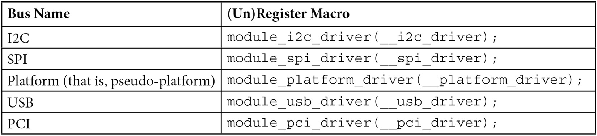
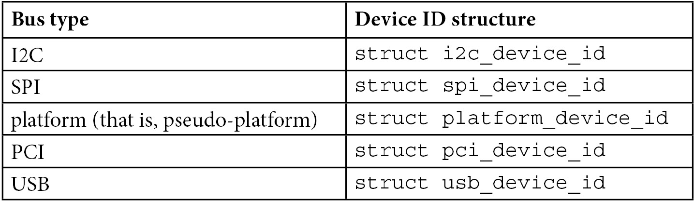
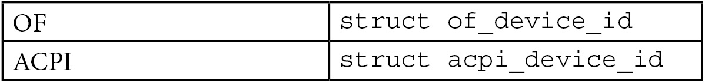

# Chương 6: Giới thiệu Device, Driver và Platform Abstraction

Linux Device Model (LDM) là khái niệm được đưa vào Linux kernel để mô tả và quản lý kernel object (chẳng hạn những object cần reference counting như file, device, bus và cả driver), cũng như hệ phân cấp và cách chúng được gắn với object khác. LDM đưa vào kernel việc quản lý object life cycle, reference counting, phong cách lập trình object-oriented (OO) và những lợi ích khác (như tái sử dụng và refactor code, tự động giải phóng resource, v.v.) mà chúng ta sẽ không bàn ở đây.

Vì reference counting và quản lý life cycle nằm ở cấp thấp nhất của LDM, chúng ta sẽ bàn về những biểu diễn cấp cao hơn, chẳng hạn xử lý các kernel data object và structure thông dụng, bao gồm device, driver và bus.

Trong chương này, chúng ta sẽ đề cập các chủ đề sau:

- Linux kernel platform abstraction và data structure

- Giải thích cơ chế matching giữa device và driver

## Linux kernel platform abstraction và data structure

Linux device model được xây dựng trên một số data structure nền tảng, bao gồm `struct` `device`, `struct device_driver` và `struct bus_type`. Data structure đầu tiên biểu diễn device cần điều khiển, thứ hai là data structure của mỗi thực thể software nhằm điều khiển device, còn structure cuối biểu diễn kênh giữa device và CPU.

## Base structure của device

Device giúp trừu tượng hóa device vật lý hoặc device ảo. Chúng được xây dựng trên structure `struct device`, cần được giới thiệu trước, như mô tả trong `include/linux/device.h`:

```
struct device {
    struct device         *parent;
    struct kobject        kobj;
    struct bus_type       *bus;
    struct device_driver  *driver;
    void *platform_data;
    void *driver_data;
    struct dev_pm_domain  *pm_domain;
    struct device_node    *of_node;
    struct fwnode_handle  *fwnode;
    dev_t       devt;
    u32         id;
    [...]
};
```

Hãy xem từng thành phần trong structure này:

- `parent`: Đây là "parent" device của device, tức device mà device này gắn vào. Trong phần lớn trường hợp, parent device là một loại bus controller hoặc host controller. Nếu `parent` là `NULL`, device là top-level device. Ví dụ, bus controller device thuộc trường hợp này.

- `kobj`: Đây là data structure ở lowest-level, dùng để theo dõi kernel object (bus, driver, device, v.v.). Đây là thành phần trung tâm của LDM. Chúng ta sẽ bàn về nó trong Chương 14, Giới thiệu Linux Device Model.

- `bus`: Chỉ định loại bus mà device nằm trên đó. Đây là kênh giữa device và CPU.

- `driver`: Chỉ định driver nào đã cấp phát device này.

- `platform_data`: Cung cấp platform data đặc thù cho device. Field này được đặt tự động khi device được khai báo trong board file. Nói cách khác, nó trỏ tới những structure board-specific trong board setup file, mô tả device và cách đấu nối của nó. Nó giúp giảm thiểu việc dùng `#ifdefs` trong code device driver. Nó chứa resource như chip variant, vai trò GPIO pin và interrupt line.

- `driver_data`: Đây là private pointer dành cho thông tin driver-specific. Bus controller driver có trách nhiệm cung cấp helper function, là những accessor dùng để lấy/đặt field này.

- `pm_domain`: Chỉ định các callback power management-specific, được thực thi khi system power state thay đổi: suspend, hibernation, system resume và trong các chuyển đổi runtime PM, cùng với callback subsystem-level và driver-level.

- `of_node`: Đây là device tree node gắn với device này. Field này được Open Firmware (OF) core điền tự động khi device được khai báo trong device tree. Bạn có thể kiểm tra `platform_data` hoặc `of_node` được đặt để xác định chính xác device được khai báo ở đâu.

- `id`: Đây là device instance.

Device hiếm khi được biểu diễn bằng device structure đơn thuần vì phần lớn subsystem theo dõi thêm thông tin về device mà chúng chứa; thay vào đó, structure thường được nhúng trong biểu diễn device ở higher-level. Đây là trường hợp của các structure `struct i2c_client`, `struct` `spi_device`, `struct usb_device` và `struct platform_device`, tất cả đều nhúng thành phần `struct` `device` trong member của chúng (`spi_device->dev`, `i2c_client->dev`, `usb_device->dev` và `platform_device->dev`).

## Base structure của device driver

Structure tiếp theo cần giới thiệu là `struct device_driver`. Structure này là thành phần cơ sở của mọi device driver. Trong ngôn ngữ object-oriented, structure này sẽ là base class được mỗi device driver kế thừa.

Data structure này được định nghĩa trong `include/linux/device/driver.h` như sau:

```
struct device_driver {
    const char        *name;
    struct bus_type   *bus;
     struct module    *owner;
     const struct of_device_id   *of_match_table;
     const struct acpi_device_id *acpi_match_table;
     int (*probe) (struct device *dev);
     int (*remove) (struct device *dev);
    void (*shutdown) (struct device *dev);
    int (*suspend) (struct device *dev,
                      pm_message_t state);
    int (*resume) (struct device *dev);
    const struct dev_pm_ops *pm;
};
```

Hãy xem từng thành phần trong structure này:

- `name`: Đây là tên device driver. Nó được dùng làm fallback (tức đối chiếu tên này với device name) khi không phương thức matching nào thành công.

- `bus`: Field này bắt buộc. Nó biểu diễn bus mà các device của driver này thuộc về. Đăng ký driver sẽ thất bại nếu không đặt field này, vì probe method của nó chịu trách nhiệm matching driver với device.

- `owner`: Field này chỉ định module owner.

- `of_match_table`: Đây là open firmware table. Nó biểu diễn array các phần tử `struct of_device_id` dùng cho device tree matching.

- `acpi_match_table`: Đây là ACPI match table. Nó giống `of_match_table` nhưng dành cho ACPI matching, điều sẽ không được bàn trong hướng dẫn này.

- `probe`: Function này được gọi để kiểm tra sự tồn tại của một device cụ thể, xem driver này có thể làm việc với nó hay không, rồi bind driver với device cụ thể đó. Bus driver chịu trách nhiệm gọi function này vào những thời điểm nhất định. Chúng ta sẽ bàn về điều đó ngay sau đây.

- `remove`: Khi device bị xóa khỏi hệ thống, method này được gọi để unbind nó khỏi driver này.

- `shutdown`: Command này được phát khi device sắp bị tắt.

- `suspend`: Đây là callback cho phép đưa device vào sleep mode, chủ yếu là low-power state.

- `resume`: Được driver core gọi để đánh thức device đang ở sleep mode.

- `pm`: Biểu diễn tập power management callback cho những device match với driver này.

Trong data structure trên, các thành phần `shutdown`, `suspend`, `resume` và `pm` là tùy chọn vì được dùng cho power management. Việc cung cấp chúng phụ thuộc khả năng của device bên dưới (có thể shutdown, suspend hoặc thực hiện những khả năng power management-related khác hay không).

### Đăng ký driver

Trước tiên, cần nhớ rằng đăng ký device là chèn device đó vào danh sách device do bus driver của nó duy trì. Tương tự, đăng ký device driver là đưa driver này vào danh sách driver do driver của bus mà nó nằm trên duy trì. Ví dụ, đăng ký USB device driver sẽ chèn driver đó vào danh sách driver do USB controller driver duy trì. Tương tự với đăng ký SPI device driver, đưa driver vào danh sách driver do SPI controller driver duy trì. `driver_register()` là low-level function dùng để đăng ký device driver với bus. Nó thêm driver vào danh sách driver của bus. Khi device driver được đăng ký với bus, core duyệt danh sách device của bus và gọi callback `match()` của bus cho mỗi device chưa có driver gắn với nó để tìm xem có device nào driver có thể xử lý hay không. Khi match xảy ra, device và device driver được bind với nhau. Quá trình gắn device với device driver được gọi là binding.

Có lẽ bạn sẽ không bao giờ muốn dùng as-is `driver_register()`; bus driver có trách nhiệm cung cấp registration function bus-specific, là wrapper dựa trên `driver_register()`. Đến nay, các registration function bus-specific luôn theo mẫu `{bus_name}_register_driver()`. Ví dụ, registration function cho USB, SPI, I2C và PCI driver lần lượt là `usb_register_driver()`, `spi_register_driver()`, `i2c_register_driver()` và `pci_register_driver()`.

Nơi được khuyến nghị để đăng ký/hủy đăng ký driver là bên trong function `init`/`exit` của module, lần lượt được thực thi ở giai đoạn load/unload module. Trong nhiều trường hợp, đăng ký/hủy đăng ký driver là hành động duy nhất bạn muốn thực thi trong các function `init`/`exit` đó. Khi ấy, mỗi bus core cung cấp helper macro riêng, được mở rộng thành các function `init`/`exit` của module và gọi nội bộ function đăng ký/hủy đăng ký bus-specific. Các bus macro đó theo mẫu `module_{bus_name}_driver(__{bus_name}_driver);`, trong đó `__{bus_name}_driver` là driver structure của bus tương ứng. Bảng sau đưa ra danh sách non-exhaustive các bus được Linux hỗ trợ cùng macro của chúng:



Bảng 6.1 – Một số bus cùng macro đăng ký/hủy đăng ký của chúng

Bus controller code chịu trách nhiệm cung cấp macro như vậy, nhưng không phải lúc nào cũng có. Ví dụ, MDIO bus driver (serial bus 2-wire dùng để điều khiển network device) không cung cấp macro `module_mdio_driver()`. Trước khi sử dụng, bạn nên kiểm tra macro này có tồn tại cho bus mà device nằm trên đó để viết driver hay không. Các khối code sau đưa ra hai ví dụ về bus khác nhau — một dùng macro đăng ký/hủy đăng ký bus-provided và một không dùng. Hãy xem code khi không dùng macro:

```
static struct platform_driver mypdrv = {
    .probe = my_pdrv_probe,
    .remove = my_pdrv_remove,
    .driver = {
        .name = KBUILD_MODNAME,
        .owner = THIS_MODULE,
    },
};
static int __init my_drv_init(void)
{
    /* Registering with Kernel */
    platform_driver_register(&mypdrv);
    return 0;
}
static void __exit my_pdrv_remove (void)
{
    /* Unregistering from Kernel */
    platform_driver_unregister(&my_driver);
}
module_init(my_drv_init);
module_exit(my_pdrv_remove);
```

Ví dụ trên hoàn toàn không dùng macro. Bây giờ hãy xem ví dụ dùng macro:

```
static struct platform_driver mypdrv = {
    .probe = my_pdrv_probe,
    .remove = my_pdrv_remove,
    .driver = {
        .name = KBUILD_MODNAME,
        .owner = THIS_MODULE,
    },
};
module_platform_driver(my_driver);
```

Ở đây có thể thấy cách code được gom phần chung, một lợi ích lớn khi viết driver.

### Khai báo các device được hỗ trợ trong driver

Kernel phải biết device nào được một driver hỗ trợ và chúng có hiện diện trên hệ thống hay không, để mỗi khi một device xuất hiện trên hệ thống (bus), kernel biết driver nào phụ trách và chạy probe function của nó. Tuy nhiên, function `probe()` của driver chỉ chạy nếu driver này được load (một thao tác userspace); nếu không, sẽ không có gì xảy ra. Phần tiếp theo giải thích cách quản lý auto-loading driver để khi device xuất hiện, driver của nó được load tự động và probe function được gọi.

Nếu xem từng device driver structure bus-specific (`struct platform_driver`, `struct` `i2c_driver`, `struct spi_driver`, `struct pci_driver` và `struct usb_driver`), chúng ta sẽ thấy field `id_table` có type phụ thuộc bus type. Field này nên được gán array device ID tương ứng với các device mà driver hỗ trợ. Bảng sau trình bày những bus thông dụng cùng device ID structure của chúng:



Bảng 6.2 – Một số bus cùng data structure nhận diện device của chúng

Tôi cố ý bỏ qua hai trường hợp đặc biệt: device tree và ACPI. Chúng có thể khai báo device để device được khai báo từ trong device tree hoặc ACPI bằng các field `driver.of_match_table` hoặc `driver.acpi_match_table`, vốn không phải thành phần trực tiếp của driver structure bus-specific:



Bảng 6.3 – Pseudo bus cùng data structure nhận diện device của chúng

Tất cả structure này được định nghĩa trong `include/linux/mod_devicetable.h` trong kernel source, và tên chúng theo mẫu `{bus_name}_device_id`. Chúng ta đã bàn về từng structure trong các chương thích hợp. Vì vậy, hãy xem ví dụ khai báo SPI device bằng cả `struct` `spi_device_id` và `struct of_device_id` để khai báo device tree (cách mới và được khuyến nghị) của driver này (http://elixir.free-electrons.com/linux/v4.10/source/drivers/gpio/gpio-mcp23s08.c):

```
static const struct spi_device_id mcp23s08_ids[] = {
    { "mcp23s08", MCP_TYPE_S08 },
    { "mcp23s17", MCP_TYPE_S17 },
    { "mcp23s18", MCP_TYPE_S18 },
    { },
};
static const struct of_device_id mcp23s08_spi_of_match[] = {
    {
        .compatible = "microchip,mcp23s08",
        .data = (void *) MCP_TYPE_S08,
    },
    {
        .compatible = "microchip,mcp23s17",
        .data = (void *) MCP_TYPE_S17,
    },
    {
        .compatible = "microchip,mcp23s18",
        .data = (void *) MCP_TYPE_S18,
    },
    { },
};
static struct spi_driver mcp23s08_driver = {
    .probe  = mcp23s08_probe, /* don't care about this */
    .remove = mcp23s08_remove, /* don't care about this */
    .id_table = mcp23s08_ids,
    .driver = {
        .name    = "mcp23s08",
        .of_match_table =
                of_match_ptr(mcp23s08_spi_of_match),
    },
};
```

Đoạn trích trên cho thấy driver có thể khai báo các device nó hỗ trợ như thế nào. Vì ví dụ là SPI driver, data structure liên quan là `struct spi_device_id`, ngoài `struct` `of_device_id,` được dùng trong mọi driver cần match device theo string `compatible` của chúng trong driver.

Bây giờ đã tìm hiểu xong cách driver khai báo device nó hỗ trợ, hãy đi sâu vào cơ chế binding giữa device và driver để hiểu điều gì xảy ra bên trong khi device match với driver.

## Device/driver matching và load module (tự động)

Hãy chú ý phần này, dù chúng ta sẽ lặp lại một phần nội dung đã bàn. Bus là thành phần nền tảng mà device driver và device dựa vào. Từ góc độ hardware, bus là liên kết giữa device và CPU; từ góc độ software, bus driver là liên kết giữa device và driver của chúng. Mỗi khi device hoặc driver được thêm/đăng ký với hệ thống, nó tự động được thêm vào danh sách do driver của bus mà nó nằm trên duy trì. Ví dụ, đăng ký danh sách I2C device mà một driver có thể quản lý (dĩ nhiên là i2c) sẽ đưa các device đó vào global list duy trì I2C adapter driver, cũng như cung cấp USB device table sẽ chèn các device đó vào danh sách device do USB controller driver duy trì. Ví dụ khác là đăng ký SPI driver mới, chèn driver này vào danh sách driver do SPI controller driver duy trì. Nếu không có điều này, kernel sẽ không có cách biết driver nào nên xử lý device nào.

Mỗi device driver nên khai báo danh sách device nó hỗ trợ và làm danh sách đó truy cập được từ driver core (đặc biệt là bus driver). Danh sách device này gọi là `id_table`, được khai báo và điền trong driver code. Bảng này là array device ID, trong đó type của mỗi ID phụ thuộc type của device (I2C, SPI, USB, v.v.). Theo cách này, mỗi khi device xuất hiện trên bus, bus driver duyệt danh sách device driver của nó và xem từng ID table để tìm entry tương ứng với device mới. Mỗi driver chứa device ID đó trong bảng sẽ được chạy function `probe()`, với device mới làm parameter. Quá trình này gọi là matching loop. Nó hoạt động tương tự với driver. Mỗi khi driver mới được đăng ký với bus, bus driver duyệt danh sách device của nó và tìm device ID xuất hiện trong `id_table` của driver đã đăng ký. Với mỗi kết quả khớp, device tương ứng được truyền làm parameter cho function `probe()` của driver, được chạy số lần bằng số kết quả khớp.

Vấn đề của matching loop là chỉ module đã load mới được gọi probe function. Nói cách khác, matching loop vô ích nếu module tương ứng chưa được load (`insmod`, `modprobe`) hoặc built-in. Bạn phải load module thủ công trước khi device xuất hiện trên bus. Giải pháp cho vấn đề này là tự động load module. Vì phần lớn trường hợp load module là thao tác userspace (khi kernel không tự yêu cầu module bằng function `request_module()`), kernel phải tìm cách cung cấp driver cùng device table của chúng cho userspace. Vì thế xuất hiện macro `MODULE_DEVICE_TABLE()`:

```
MODULE_DEVICE_TABLE(<bus_type_name>,  <array_of_ids>)
```

Macro này dùng để hỗ trợ hot-plugging, mô tả mỗi driver cụ thể có thể hỗ trợ device nào. Tại compilation time, build process trích xuất thông tin này từ driver và xây dựng bảng human-readable tên `modules.alias`, nằm trong thư mục `/lib/modules/kernel_version/`.

Parameter `<bus_type_name>` nên là tên chung của bus mà bạn cần thêm hỗ trợ auto-loading module. Nó nên là `spi` với SPI bus, `of` với device tree, `i2c` với I2C, v.v. Nói cách khác, nó nên là một phần tử ở cột đầu tiên (bus type) của bảng trước (biết rằng không phải mọi bus đều được liệt kê). Hãy thêm hỗ trợ auto-loading module vào cùng driver đã dùng trước đó (gpio-mcp23s08):

```
MODULE_DEVICE_TABLE(spi, mcp23s08_ids);
MODULE_DEVICE_TABLE(of, mcp23s08_spi_of_match);
```

Bây giờ hãy xem hai dòng này làm gì khi được thêm vào file `modules.alias` trên board i.MX6-based chạy image Yocto-based:

```
root:/lib/modules/5.10.10+fslc+g8dc0fcb# cat modules.alias
# Aliases extracted from modules themselves.
alias fs-msdos msdos
alias fs-binfmt_misc binfmt_misc
alias fs-configfs configfs
alias iso9660 isofs
alias fs-iso9660 isofs
alias fs-udf udf
alias of:N*T*Cmicrochip,mcp23s17* gpio_mcp23s08
alias of:N*T*Cmicrochip,mcp23s18* gpio_mcp23s08
alias of:N*T*Cmicrochip,mcp23s08* gpio_mcp23s08
alias spi:mcp23s17 gpio_mcp23s08
alias spi:mcp23s18 gpio_mcp23s08
alias spi:mcp23s08 gpio_mcp23s08
alias usb:v0C72p0011d*dc*dsc*dp*ic*isc*ip*in* peak_usb
alias usb:v0C72p0012d*dc*dsc*dp*ic*isc*ip*in* peak_usb
alias usb:v0C72p000Dd*dc*dsc*dp*ic*isc*ip*in* peak_usb
alias usb:v0C72p000Cd*dc*dsc*dp*ic*isc*ip*in* peak_usb
alias pci:v00008086d000015B8sv*sd*bc*sc*i* e1000e
alias pci:v00008086d000015B7sv*sd*bc*sc*i* e1000e
[...]
alias usb:v0416pA91Ad*dc*dsc*dp*ic0Eisc01ip00in* uvcvideo
alias of:N*T*Ciio-hwmon* iio_hwmon
alias i2c:lm73 lm73
alias spi:ad7606-4 ad7606_spi
alias spi:ad7606-6 ad7606_spi
alias spi:ad7606-8 ad7606_spi
```

Phần thứ hai của giải pháp là kernel thông báo cho userspace về một số event (gọi là uevent) qua netlink socket. Ngay sau khi device xuất hiện trên bus, bus code tạo và phát event chứa module alias tương ứng (ví dụ `pci:v00008086d000015B8sv*sd*bc*sc*i*`). Event này được system hotplug manager (udev trên phần lớn máy) nhận, rồi parse file `module.alias` để tìm entry có cùng alias và load module tương ứng (ví dụ e1000). Ngay khi module được load, device được probe. Đó là cách macro đơn giản `MODULE_DEVICE_TABLE()` có thể thay đổi cuộc sống của bạn.

## Khai báo device – điền các device

Khai báo device không phải một phần của LDM. Nó gồm khai báo các device hiện diện (hoặc không) trên hệ thống, trong khi module device table cung cấp cho driver các device mà chúng hỗ trợ. Có ba nơi bạn có thể khai báo/điền device:

- Từ board file hoặc trong module riêng (cách cũ và hiện đã deprecated)

- Từ device tree (phương thức mới và được khuyến nghị)

- Từ Advanced Configuration and Power Interface (ACPI), không được bàn ở đây

Để được driver xử lý, bất kỳ device nào được khai báo cũng nên tồn tại trong ít nhất một module device table; nếu không, device đơn giản bị bỏ qua, trừ khi driver có device ID này trong module device table được load hoặc đã được load.

## Bus structure

Cuối cùng là structure `struct bus_type`, structure mà kernel dùng để biểu diễn nội bộ bus (vật lý hoặc ảo). Bus controller là thành phần gốc của mọi hệ phân cấp. Về mặt vật lý, bus là kênh giữa processor và một hoặc nhiều device. Từ góc độ software, bus (`struct bus_type`) là liên kết giữa device (`struct` `device`) và driver (`struct device_driver`). Nếu không có nó, không có gì được thêm vào hệ thống vì bus (`bus_type`) chịu trách nhiệm matching device và driver:

```
struct bus_type {
    const char    *name;
    struct device    *dev_root;
    int (*match)(struct device *dev,
                   struct device_driver *drv);
    int (*probe)(struct device *dev);
    int (*remove)(struct device *dev);
    /* [...] */
};
```

Hãy xem các thành phần trong structure này:

- `name`: Đây là tên bus như sẽ xuất hiện trong `/sys/bus/`.

- `match`: Đây là callback được gọi mỗi khi device hoặc driver mới được thêm vào bus. Callback phải đủ thông minh và nên return giá trị khác không khi device match với driver. Cả hai được truyền làm parameter. Mục đích chính của match callback là cho phép bus xác định device cụ thể có thể được driver xử lý hay không, hoặc theo chiều ngược lại, driver có hỗ trợ device đã cho hay không. Phần lớn trường hợp, kiểm tra được thực hiện bằng so sánh string đơn giản (tên device và driver, hoặc table và property compatible của device tree (DT)). Với enumerated device (như PCI và USB), kiểm tra được thực hiện bằng cách so sánh device ID mà driver hỗ trợ với device ID của device đã cho, mà không làm mất chức năng bus-specific.

- `probe`: Đây là callback được gọi khi device hoặc driver mới được thêm vào bus và sau khi match xảy ra. Function này chịu trách nhiệm cấp phát bus device structure cụ thể và gọi probe function của driver đã cho, vốn được dự kiến quản lý device (được chúng ta cấp phát trước đó).

- `remove`: Được gọi khi device bị xóa khỏi bus.

Khi device mà bạn viết driver cho nó nằm trên physical bus gọi là bus controller, nó phải dựa vào driver của bus đó, gọi là controller driver, chịu trách nhiệm chia sẻ truy cập bus giữa các device. Controller driver cung cấp abstraction layer giữa device và bus. Mỗi khi bạn thực hiện transaction (đọc hoặc ghi) trên I2C bus hoặc USB bus chẳng hạn, I2C/USB bus controller xử lý trong suốt ở phía sau (quản lý clock, dịch data, v.v.). Mỗi bus controller driver export tập function để giúp phát triển driver cho device trên bus đó dễ hơn. Điều này áp dụng cho mọi bus (I2C, SPI, USB, PCI, SDIO, v.v.).

Bây giờ đã xem bus driver và cách module được load, chúng ta sẽ bàn về matching mechanism, cơ chế thử bind một device cụ thể với các driver của nó.

## Giải thích cơ chế matching giữa device và driver

Device driver và device luôn được đăng ký với bus. Khi export các device được driver hỗ trợ, bạn có thể dùng `driver.of_match_table`, `driver.of_match_table` hoặc `<bus>_driver.id_table` (đặc thù theo device type; ví dụ `i2c_device.id_table` hoặc `platform_device.id_table`).

Mỗi bus driver có trách nhiệm cung cấp match function, được kernel chạy mỗi khi device hoặc device driver mới được đăng ký với bus đó. Có ba matching mechanism cho platform device, tất cả đều gồm so sánh string. Những matching mechanism đó dựa trên DT table, ACPI table, tên device và driver. Hãy xem pseudo-platform bus và i2c bus triển khai matching function bằng những cơ chế đó như thế nào:

```
static int platform_match(struct device *dev,
                           struct device_driver *drv)
{
    struct platform_device *pdev =
                         to_platform_device(dev);
    struct platform_driver *pdrv =
                         to_platform_driver(drv);
     /* Only bind to the matching driver when
     * driver_override is set
     */
    if (pdev->driver_override)
        return !strcmp(pdev->driver_override, drv->name);
    /* Attempt an OF style match first */
    if (of_driver_match_device(dev, drv))
        return 1;
    /* Then try ACPI style match */
    if (acpi_driver_match_device(dev, drv))
    return 1;
    /* Then try to match against the id table */
    if (pdrv->id_table)
        return platform_match_id(pdrv->id_table,
                                       pdev) != NULL;
    /* fall-back to driver name match */
    return (strcmp(pdev->name, drv->name) == 0);
}
```

Code trên thể hiện pseudo-platform bus matching function, được định nghĩa trong `drivers/base/platform.c`. Code sau thể hiện I2C bus matching function, được định nghĩa trong `drivers/i2c/i2c-core.c`:

```
static const struct i2c_device_id *i2c_match_id(
            const struct i2c_device_id *id,
            const struct i2c_client *client)
{
    while (id->name[0]) {
        if (strcmp(client->name, id->name) == 0)
            return id;
        id++;
    }
    return NULL;
}
static int i2c_device_match(struct device *dev, struct
          device_driver *drv)
{
    struct i2c_client *client = i2c_verify_client(dev);
    struct i2c_driver *driver;
    if (!client)
        return 0;
    /* Attempt an OF style match */
    if (of_driver_match_device(dev, drv))
        return 1;
    /* Then ACPI style match */
    if (acpi_driver_match_device(dev, drv))
        return 1;
    driver = to_i2c_driver(drv);
    /* match on an id table if there is one */
    if (driver->id_table)
        return i2c_match_id(driver->id_table,
                               client) != NULL;
    return 0;
}
```

## Nghiên cứu trường hợp – OF matching mechanism

Trong device tree, mỗi device được biểu diễn bằng node và được khai báo là child của bus node của nó. Tại boot time, kernel (OF core) parse mọi bus node (cũng như sub-nodes của chúng, là những device nằm trên bus) trong device tree. Với mỗi device node, kernel thực hiện như sau:

- Nhận diện bus mà node này thuộc về.

- Cấp phát platform device và khởi tạo nó theo các property chứa trong node bằng function `of_device_alloc()`. `built_pdev->dev.of_node` được đặt bằng device tree node hiện tại.

- Duyệt danh sách device driver gắn với (được duy trì bởi) bus đã nhận diện trước đó bằng function `bus_for_each_drv()`.

- Với mỗi driver trong danh sách, core thực hiện như sau:

1\. Gọi bus match function, với parameter là driver tìm được và device structure đã xây dựng trước đó; tức

là, `bus_found->match(cur_drv, cur_dev);`.

2\. Nếu bus driver này hỗ trợ DT matching mechanism, bus match function sẽ gọi

`of_driver_match_device()`, với cùng các parameter đã đề cập trước đó; tức là,

```
of_driver_match_device(ur_drv, cur_dev).
```

3\. `of_driver_match_device` sẽ duyệt bảng `of_match_table` (là array các phần tử struct

`of_device_id`) gắn với driver hiện tại. Với mỗi `of_device_id` trong array, kernel so sánh compatible property của cả phần tử `of_device_id` hiện tại và `built_pdev->dev.of_node`. Nếu giống nhau (tức có match), probe function của driver hiện tại được chạy.

- Nếu không tìm thấy driver hỗ trợ device này, device vẫn được đăng ký với bus. Sau đó, probing mechanism được hoãn tới về sau để mỗi khi driver mới được đăng ký với bus này, core duyệt danh sách device do bus duy trì; mọi device chưa có driver gắn với chúng sẽ được probe lại. Với mỗi device, compatible property của `of_node` tương ứng được so sánh với compatible property của từng `of_device_id` trong array `of_match_table` gắn với driver vừa đăng ký.

Đó là cách driver được match với device khai báo trong device tree. Điều này hoạt động tương tự với từng loại khai báo device (board file, ACPI, v.v.).

## Tổng kết

Trong chương này, bạn đã học cách xử lý device và driver cũng như cách chúng gắn với nhau. Chúng ta cũng làm rõ matching mechanism. Hãy bảo đảm hiểu điều này trước khi chuyển sang Chương 7, Tìm hiểu khái niệm Platform Device và Driver, Chương 8, Viết I2C Device Driver, và Chương 9, Viết SPI Device Driver, những chương đề cập việc phát triển device driver. Việc này sẽ liên quan đến làm việc với device, driver và bus structure.

Trong chương tiếp theo, chúng ta sẽ tìm hiểu chi tiết việc phát triển platform driver.
