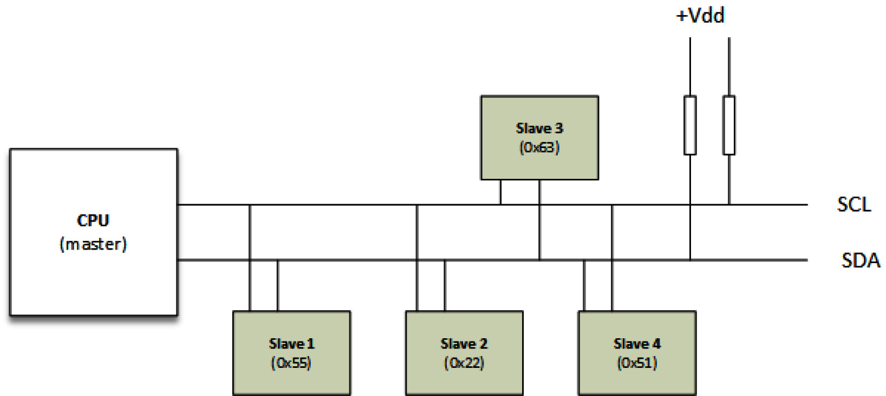

# Chương 8: Viết I2C Device Driver

I2C là viết tắt của Inter-Integrated Circuit. Đây là serial bus, multi-master và asynchronous do Philips (nay là NXP) phát minh, dù multi-master mode không được dùng rộng rãi. I2C là bus two-wire, lần lượt có tên Serial Data (SDA) và Serial Clock (SCL hoặc SCK). I2C device là chip tương tác với device khác qua I2C bus. Trên bus này, cả SDA và SCL đều là open-drain/open collector, nghĩa là mỗi dây có thể kéo output xuống mức thấp nhưng không dây nào có thể đưa output lên mức cao nếu không có pull-up resistor. SCL được master tạo để đồng bộ truyền data (do SDA mang) trên bus. Cả slave lẫn master đều có thể gửi data (dĩ nhiên không cùng lúc), khiến SDA trở thành bidirectional line. Tuy nhiên, tín hiệu SCL cũng bidirectional vì slave có thể thực hiện clock stretching bằng cách giữ SCL line ở mức thấp. Bus được master điều khiển, trong trường hợp của chúng ta là một phần của System on Chip (SoC). Bus này thường được dùng trong embedded system để kết nối serial EEPROM, RTC chip, GPIO expander, temperature sensor, v.v.

Sơ đồ sau cho thấy các device khác nhau (còn gọi là slave) được kết nối với I2C bus:



Hình 8.1 – Biểu diễn I2C bus và device

Từ sơ đồ trên, có thể biểu diễn Linux kernel I2C framework như sau:

```
CPU <--platform bus-->i2c adapter<---i2c bus---> i2c slave
```

CPU là master chứa I2C controller, còn gọi là I2C adapter, triển khai I2C protocol và quản lý bus segment chứa I2C device. Trong kernel I2C framework, adapter được platform driver quản lý, còn slave được I2C driver điều khiển. Tuy nhiên, cả hai driver đều dùng API do I2C core cung cấp. Trong chương này, chúng ta tập trung vào I2C (slave) device driver, dù sẽ đề cập adapter nếu cần. Trở lại hardware, I2C clock speed thay đổi từ 10 kHz đến 100 kHz và từ 400 kHz đến 2 MHz. Không có yêu cầu nghiêm ngặt về tốc độ truyền data cho I2C, và mọi slave trên một bus đều dùng cùng clock speed đã cấu hình cho bus. Điều này khác với Serial Peripheral Interface (SPI), nơi clock speed được áp dụng riêng cho per-device. Ví dụ về I2C controller driver (chẳng hạn chip i.MX6) nằm tại `drivers/i2c/busses/i2c-imx.c` trong kernel source, còn đặc tả I2C có tại https://www.nxp.com/docs/en/user-guide/UM10204.pdf.

Bây giờ đã biết sẽ làm việc với I2C device driver, trong chương này chúng ta sẽ đề cập các chủ đề sau:

- I2c framework abstraction trong Linux kernel

- I2C driver abstraction và architecture

- Cách tránh viết I2C device driver

## I2C framework abstraction trong Linux kernel

Linux kernel I2C framework gồm một số data structure, quan trọng nhất là:

- `i2c_adapter`: Dùng để trừu tượng hóa I2C master device. Nó được dùng để nhận diện physical I2C bus.

- `i2c_algorithm`: Trừu tượng hóa I2C bus transaction interface. Ở đây, transaction nghĩa là truyền, như operation đọc hoặc ghi.

- `i2c_client`: Dùng để trừu tượng hóa slave device trên I2C bus.

- `i2c_driver`: Driver của slave device. Nó chứa tập function điều khiển cụ thể để xử lý device.

- `i2c_msg`: Đây là biểu diễn low-level của một segment trong I2C transaction. Data structure này định nghĩa device address, transaction flag (ví dụ transmit hay receive), pointer tới data cần gửi/nhận và size của data.

Vì phạm vi chương này giới hạn ở slave device driver, chúng ta sẽ tập trung vào ba data structure cuối. Tuy nhiên, để giúp bạn hiểu, cần giới thiệu cả adapter data structure và algorithm data structure.

## Giới thiệu ngắn gọn struct i2c\_adapter

Kernel dùng `struct i2c_adapter` để biểu diễn physical I2C bus cùng algorithm cần thiết để truy cập nó. Nó được định nghĩa như sau:

```
struct i2c_adapter {
    struct module *owner;
    const struct i2c_algorithm *algo;
    [...]
};
```

Trong data structure trên, chúng ta có:

- `owner`: Phần lớn trường hợp được đặt bằng `THIS_MODULE`. Đây là owner, được dùng cho reference counting.

- `algo`: Đây là tập callback được controller (master) driver dùng để điều khiển I2C line. Các callback này cho phép tạo tín hiệu cần thiết cho I2C access cycle.

Algorithm data structure có định nghĩa sau:

```
struct i2c_algorithm {
    int (*master_xfer)(struct i2c_adapter *adap,
                       struct i2c_msg *msgs, int num);
    int (*smbus_xfer)(struct i2c_adapter *adap, u16 addr,
              unsigned short flags, char read_write,
              u8 command, int size,
              union i2c_smbus_data *data);
    /* To determine what the adapter supports */
    u32 (*functionality)(struct i2c_adapter *adap);
[...]
};
```

Trong data structure trên, những field không quan trọng đã được lược bỏ. Hãy xem từng thành phần trong đoạn trích:

- `master_xfer`: Đây là core transfer function. Phải cung cấp nó để algorithm driver này có khả năng plain I2C access. Nó được gọi khi I2C device driver cần giao tiếp với I2C device bên dưới. Tuy nhiên, nếu không được triển khai (nếu là `NULL`), function `smbus_xfer` được gọi thay thế.

- `smbus_xfer`: Đây là function pointer được I2C controller driver đặt nếu algorithm driver của nó có thể thực hiện SMBus access. Nó được dùng mỗi khi I2C chip driver muốn giao tiếp với chip device bằng SMBus protocol. Nếu nó là `NULL`, function `master_xfer` được dùng thay thế và SMBus được emulated.

- `functionality`: Đây là function pointer được I2C core gọi để xác định khả năng của adapter. Nó cho biết I2C adapter driver có thể thực hiện những loại đọc và ghi nào.

Trong code trên, `functionality` là sanity callback. Core hoặc device driver đều có thể gọi nó (qua `i2c_check_functionality()`) để kiểm tra adapter có thể cung cấp I2C access cần thiết hay không trước khi bắt đầu truy cập. Ví dụ, không phải adapter nào cũng hỗ trợ 10-bit addressing mode. Vì vậy, nên gọi `i2c_check_functionality(client->adapter,` `I2C_FUNC_10BIT_ADDR)` trong chip driver để kiểm tra adapter có hỗ trợ hay không. Mọi flag đều có dạng `I2C_FUNC_XXX`. Dù có thể kiểm tra từng flag riêng, I2C core đã chia chúng thành những nhóm chức năng logic như sau:

```
#define I2C_FUNC_I2C              0x00000001
#define I2C_FUNC_10BIT_ADDR       0x00000002
#define I2C_FUNC_SMBUS_BYTE   (I2C_FUNC_SMBUS_READ_BYTE | \
                         I2C_FUNC_SMBUS_WRITE_BYTE)
#define I2C_FUNC_SMBUS_BYTE_DATA \
                      (I2C_FUNC_SMBUS_READ_BYTE_DATA | \
                       I2C_FUNC_SMBUS_WRITE_BYTE_DATA)
#define I2C_FUNC_SMBUS_WORD_DATA \
                     (I2C_FUNC_SMBUS_READ_WORD_DATA | \
                      I2C_FUNC_SMBUS_WRITE_WORD_DATA)
#define I2C_FUNC_SMBUS_BLOCK_DATA \
                     (I2C_FUNC_SMBUS_READ_BLOCK_DATA | \
                      I2C_FUNC_SMBUS_WRITE_BLOCK_DATA)
#define I2C_FUNC_SMBUS_I2C_BLOCK \
                     (I2C_FUNC_SMBUS_READ_I2C_BLOCK | \
                      I2C_FUNC_SMBUS_WRITE_I2C_BLOCK)
```

Với code trên, có thể kiểm tra flag `I2C_FUNC_SMBUS_BYTE` để bảo đảm adapter hỗ trợ SMBus byte-oriented command.

Phần giới thiệu I2C controller này sẽ được tham chiếu trong các phần khác khi cần. Hiểu phần này trước có thể hữu ích, dù mục đích chính của chương là bàn về I2C client driver, điều chúng ta sẽ làm trong phần tiếp theo.

## I2C client data structure và driver data structure

Data structure đầu tiên và rõ ràng nhất là structure `struct i2c_client`, được khai báo như sau:

```
struct i2c_client {
    unsigned short flags;
    unsigned short addr;
    char name[I2C_NAME_SIZE];
    struct i2c_adapter *adapter;
    struct device dev;
    int irq;
};
```

Trong data structure trên, chứa các property của I2C device, `flags` biểu diễn device flag, quan trọng nhất là flag cho biết chip có địa chỉ 10-bit hay không. `addr` chứa chip address. Với chip có địa chỉ 7-bit, nó được lưu trong 7 bit thấp. `name` chứa device name, giới hạn ở `I2C_NAME_SIZE` (được đặt là `20` trong `include/linux/mod_devicetable.h`) character. `adapter` là adapter (nhớ rằng đó là I2C bus) mà device nằm trên. `dev` là device structure bên dưới cho device model, còn `irq` là interrupt line được gán cho device.

Bây giờ đã quen với I2C device data structure, hãy tập trung vào driver của nó, được trừu tượng hóa bằng `struct i2c_driver`. Có thể khai báo như sau:

```
struct i2c_driver {
    unsigned int class;
    /* Standard driver model interfaces */
    int (*probe)(struct i2c_client *client,
                  const struct i2c_device_id *id);
    int (*remove)(struct i2c_client *client);
    int (*probe_new)(struct i2c_client *client);
    void (*shutdown)(struct i2c_client *client);
    struct device_driver driver;
    const struct i2c_device_id *id_table;
};
```

Hãy xem từng thành phần trong data structure:

- `probe`: Callback cho device binding, nên return 0 khi thành công hoặc error code thích hợp khi thất bại.

- `remove`: Callback cho device unbinding. Nó phải hoàn tác những gì đã thực hiện trong `probe`.

- `shutdown`: Callback cho device shutdown.

- `probe_new`: Driver model interface mới. Nó sẽ thay thế method `probe` cũ để loại bỏ parameter thứ hai thường không được dùng (tức parameter `struct i2c_device_id`).

- `driver`: Driver structure của device driver model bên dưới.

- `id_table`: Danh sách I2C device mà driver này hỗ trợ.

Data structure thứ ba và cuối cùng trong loạt này là `struct i2c_msg`, biểu diễn một operation của I2C transaction. Nó được khai báo như sau:

```
struct i2c_msg {
    __u16 addr;
    __u16 flags;
#define I2C_M_TEN 0x0010
#define I2C_M_RD 0x0001
    __u16 len;
    __u8 * buf;
};
```

Mỗi thành phần trong data structure này đều có ý nghĩa khá rõ. Hãy xem chi tiết hơn:

- `addr`: Luôn là slave address.

- `flags`: Vì transaction có thể gồm nhiều operation, thành phần này biểu diễn flag của operation này. Nên đặt là `0` trong trường hợp write operation (master gửi tới slave). Tuy nhiên, có thể OR với `I2C_M_RD` nếu là read operation (master đọc từ slave) hoặc `I2C_M_TEN` nếu device là chip có địa chỉ 10-bit.

- `length`: Đây là size của data trong buffer. Trong read operation, nó tương ứng số byte cần đọc từ device và được lưu trong `buf`. Với write operation, nó biểu diễn số byte trong `buf` cần ghi tới device.

- `buf`: Đây là read/write buffer, phải được cấp phát theo `length`.

  LƯU Ý Vì `i2c_msg.len` là `u16`, phải bảo đảm read/write buffer luôn nhỏ hơn 2<sup>16</sup> (64k).

Bây giờ đã bàn về những I2C data structure quan trọng nhất, hãy xem các API (phần lớn có I2C adapter tham gia bên trong) mà I2C core cung cấp để tận dụng tối đa device.

## I2C communication API

Sau khi driver và data structure được khởi tạo, giao tiếp giữa slave và master có thể diễn ra. Serial bus transaction đơn giản là truy cập register để lấy hoặc đặt nội dung. I2C device tuân theo nguyên tắc này.

### Giao tiếp plain I2C

Chúng ta bắt đầu từ cấp thấp nhất — `i2c_transfer()` là core function dùng để truyền I2C message. Các API khác wrap function này, được hỗ trợ bởi `algo->master_xfer` của adapter. Sau đây là prototype của nó:

```
int i2c_transfer(struct i2c_adapter *adap,
              struct i2c_msg *msg, int num);
```

Với `i2c_transfer()`, không có stop bit được gửi giữa các byte trong cùng read/write operation của cùng transaction. Điều này hữu ích chẳng hạn với device yêu cầu không có stop bit giữa address write và data read. Code sau cho thấy cách dùng:

```
static int i2c_read_bytes(struct i2c_client *client,
                          u8 cmd, u8 *data, u8 data_len)
{
    struct i2c_msg msgs[2];
    int ret;
    u8 *buffer;
    buffer = kzalloc(data_len, GFP_KERNEL);
    if (!buffer)
        return -ENOMEM;;
    msgs[0].addr = client->addr;
    msgs[0].flags = client->flags;
    msgs[0].len = 1;
    msgs[0].buf = &cmd;
    msgs[1].addr = client->addr;
    msgs[1].flags = client->flags | I2C_M_RD;
    msgs[1].len = data_len;
    msgs[1].buf = buffer;
    ret = i2c_transfer(client->adapter, msgs, 2);
    if (ret < 0)
        dev_err(&client->adapter->dev,
                 "i2c read failed\n");
    else
        memcpy(data, buffer, data_len);
    kfree(buffer);
    return ret;
}
```

Nếu device yêu cầu stop bit ở giữa read sequence, nên chia transaction thành hai phần (hai operation) — `i2c_transfer` cho address write (transaction có một write operation) và `i2c_transfer` khác cho data read (transaction có một read operation), như sau:

```
static int i2c_read_bytes(struct i2c_client *client,
                          u8 cmd, u8 *data, u8 data_len)
{
    struct i2c_msg msgs[2];
    int ret;
    u8 *buffer;
    buffer = kzalloc(data_len, GFP_KERNEL);
    if (!buffer)
        return -ENOMEM;;
    msgs[0].addr = client->addr;
    msgs[0].flags = client->flags;
    msgs[0].len = 1;
    msgs[0].buf = &cmd;
    ret = i2c_transfer(client->adapter, msgs, 1);
    if (ret < 0) {
        dev_err(&client->adapter->dev,
                "i2c read failed\n");
        kfree(buffer);
        return ret;
    }
    msgs[1].addr = client->addr;
    msgs[1].flags = client->flags | I2C_M_RD;
    msgs[1].len = data_len;
    msgs[1].buf = buffer;
    ret = i2c_transfer(client->adapter, &msgs[1], 1);
    if (ret < 0)
        dev_err(&client->adapter->dev,
                "i2c read failed\n");
    else
        memcpy(data, buffer, data_len);
    kfree(buffer);
    return ret;
}
```

Nếu không, có thể dùng các API thay thế, lần lượt là `i2c_master_send` và `i2c_master_recv`:

```
int i2c_master_send(struct i2c_client *client,
             const char *buf, int count);
int i2c_master_recv(struct i2c_client *client,
             char *buf, int count);
```

Cả hai API đều được triển khai trên `i2c_transfer()`. `i2c_master_send()` thực sự triển khai I2C transaction có một write operation, còn `i2c_master_recv()` làm tương tự với một read operation.

Argument đầu tiên là I2C device cần truy cập. Parameter thứ hai là read/write buffer, còn thứ ba biểu diễn số byte cần đọc hoặc ghi. Return value là số byte đang được đọc/ghi. Code sau là phiên bản đơn giản hóa của đoạn trích trước:

```
static int i2c_read_bytes(struct i2c_client *client,
                          u8 cmd, u8 *data, u8 data_len)
{
    struct i2c_msg msgs[2];
    int ret;
    u8 *buffer;
    buffer = kzalloc(data_len, GFP_KERNEL);
    if (!buffer)
        return -ENOMEM;;
    ret = i2c_master_send(client, &cmd, 1);
    if (ret < 0) {
        dev_err(&client->adapter->dev,
                "i2c read failed\n");
        kfree(buffer);
        return ret;
    }
    ret = i2c_master_recv(client, buffer, data_len);
    if (ret < 0)
        dev_err(&client->adapter->dev,
                "i2c read failed\n");
    else
        memcpy(data, buffer, data_len);
    kfree(buffer);
    return ret;
}
```

Như vậy, chúng ta đã quen với cách plain I2C API được triển khai trong kernel. Tuy nhiên, có một nhóm device cần đề cập — SMBus-compatible device — không nên nhầm với I2C device, dù chúng nằm trên cùng physical bus.

### Các function tương thích System Management Bus (SMBus)

SMBus là bus two-wire do Intel phát triển và rất giống I2C. Ngoài ra, nó là tập con của I2C, nghĩa là I2C device SMBus-compatible nhưng chiều ngược lại thì không. SMBus là tập con của I2C, nghĩa là I2C controller hỗ trợ phần lớn SMBus operation. Tuy nhiên, điều này không đúng với SMBus controller vì chúng có thể không hỗ trợ mọi protocol option mà I2C controller hỗ trợ. Vì vậy, nên dùng SMBus method nếu bạn không chắc về chip đang viết driver cho nó.

Sau đây là một số ví dụ về SMBus API:

```
s32 i2c_smbus_read_byte_data(struct i2c_client *client,
                             u8 command);
s32 i2c_smbus_write_byte_data(struct i2c_client *client,
                               u8 command, u8 value);
s32 i2c_smbus_read_word_data(struct i2c_client *client,
                             u8 command);
s32 i2c_smbus_write_word_data(struct i2c_client *client,
                              u8 command, u16 value);
s32 i2c_smbus_read_block_data(struct i2c_client *client,
                              u8 command, u8 *values);
s32 i2c_smbus_write_block_data(struct i2c_client *client,
                               u8 command, u8 length,
                               const u8 *values);
```

Danh sách đầy đủ SMBus API có trong `include/linux/i2c.h` trong kernel source. Mỗi function có ý nghĩa khá rõ. Ví dụ sau cho thấy read/write operation đơn giản dùng SMBus-compatible API để truy cập I2C GPIO expander:

```
struct mcp23016 {
    struct i2c_client   *client;
    struct gpio_chip    chip;
    struct mutex        lock;
};
[...]
static int mcp23016_set(struct mcp23016 *mcp,
             unsigned offset, intval)
{
    s32 value;
    unsigned bank = offset / 8;
    u8 reg_gpio = (bank == 0) ? GP0 : GP1;
    unsigned bit = offset % 8;
    value = i2c_smbus_read_byte_data(mcp->client,
                                     reg_gpio);
    if (value >= 0) {
        if (val)
            value |= 1 << bit;
        else
            value &= ~(1 << bit);
        return i2c_smbus_write_byte_data(mcp->client,
                                         reg_gpio, value);
    } else
        return value;
}
```

Phần SMBus cũng đơn giản như danh sách API sẵn có. Bây giờ đã có thể truy cập device bằng plain I2C function hoặc SMBus function, chúng ta có thể bắt đầu triển khai phần thân I2C driver.

## I2C driver abstraction và architecture

Structure `struct i2c_driver`, như đã thấy ở phần trước, chứa các method điều khiển cần thiết để xử lý I2C device mà nó phụ trách. Sau khi được thêm vào bus, device cần được probe, khiến method `i2c_driver.probe_new` trở thành entry point của driver.

## Probe I2C device

Callback `probe()` trong structure `struct i2c_driver` được gọi mỗi khi I2C device được tạo instance trên bus và yêu cầu driver này. Nó chịu trách nhiệm cho các tác vụ sau:

- Kiểm tra I2C bus controller (I2C adapter) có hỗ trợ chức năng device cần hay không bằng function `i2c_check_functionality()`

- Kiểm tra device có phải device mong đợi hay không

- Khởi tạo device

- Thiết lập device-specific data nếu cần

- Đăng ký với kernel framework thích hợp

Trước đây, probing callback được gán cho thành phần `probe` của `struct i2c_driver` và có prototype sau:

```
int foo_probe(struct i2c_client *client,
            const struct i2c_device_id *id)
```

Vì argument thứ hai hiếm khi được dùng, callback này đã deprecated để ưu tiên `probe_new`, có prototype sau:

```
int probe(struct i2c_client *client)
```

Trong prototype trên, pointer `struct i2c_client` biểu diễn chính I2C device. Parameter này được core tạo và khởi tạo sẵn theo mô tả device, được thực hiện trong device tree hoặc board file.

Không nên truy cập device sớm trong method `probe`. Vì mỗi I2C adapter có khả năng khác nhau, tốt hơn nên hỏi adapter hỗ trợ những khả năng gì rồi điều chỉnh hành vi driver tương ứng:

```
#define CHIP_ID 0x13
#define DA311_REG_CHIP_ID  0x000f
static int fake_i2c_probe(struct i2c_client *client)
{
    int err;
    int ret;
    if (!i2c_check_functionality(client->adapter,
            I2C_FUNC_SMBUS_BYTE_DATA))
        return -EIO;
    /* read family id */
    ret = i2c_smbus_read_byte_data(client, REG_CHIP_ID);
    if (ret != CHIP_ID)
        return (ret < 0) ? ret : -ENODEV;
    /* register with other frameworks */
    [...]
    return 0;
}
```

Trong ví dụ trên, chúng ta kiểm tra adapter bên dưới có hỗ trợ type/command device cần hay không. Chỉ sau khi sanity check thành công mới có thể truy cập device an toàn, rồi tiếp tục cấp phát mọi loại resource và đăng ký với framework khác nếu cần.

## Triển khai method i2c\_driver.remove

Callback `i2c_driver.remove` phải hoàn tác những gì đã thực hiện trong function `probe`. Nó phải hủy đăng ký khỏi từng framework đã đăng ký bằng `probe` và giải phóng từng resource đã yêu cầu. Callback này có prototype sau:

```
static int remove(struct i2c_device *client)
```

Trong dòng code trên, `client` là cùng I2C device data structure mà core đã truyền cho method `probe`. Nghĩa là mọi data đã lưu tại probing time có thể được lấy ở đây. Ví dụ, có thể cần thực hiện dọn dẹp hoặc công việc khác dựa trên private data đã thiết lập trong function `probe`:

```
static int mc9s08dz60_remove(struct i2c_client *client)
{
    struct mc9s08dz60 *mc9s;
    /* We retrieve our private data */
    mc9s = i2c_get_clientdata(client);
   /* Which hold gpiochip we want to work on */
    return gpiochip_remove(&mc9s->chip);
}
```

Ví dụ trên đơn giản và có thể đại diện cho phần lớn trường hợp bạn gặp trong driver. Vì callback này được dự kiến return 0 khi thành công, nguyên nhân thất bại có thể gồm device không thể power down, vẫn đang được dùng, v.v. Nghĩa là có tình huống bạn muốn kiểm tra device và thực hiện operation bổ sung trong callback function này.

Ở giai đoạn phát triển này, mọi callback đã được chuẩn bị. Bây giờ đã đến lúc driver đăng ký với I2C core, như sẽ thấy trong phần tiếp theo.

## Khởi tạo và đăng ký driver

I2C driver tự đăng ký và hủy đăng ký với core lần lượt bằng API `i2c_add_driver()` và `i2c_del_driver()`. API đầu là macro dựa trên function `i2c_register_driver()`. Code sau cho thấy prototype tương ứng:

```
int i2c_add_driver(struct i2c_driver *drv);
void i2c_del_driver(struct i2c_driver *drv);
```

Trong cả hai function, `drv` là I2C driver structure đã thiết lập trước đó. Registration API return 0 khi thành công hoặc error code âm khi thất bại. Đăng ký driver chủ yếu diễn ra khi khởi tạo module, còn hủy đăng ký driver thường được làm trong module exit method. Sau đây là minh họa điển hình về đăng ký I2C driver:

```
static int __init foo_init(void)
{
    [...] /*My init code */
      return i2c_add_driver(&foo_driver);
}
module_init(foo_init);
static void __exit foo_cleanup(void)
{
    [...] /* My clean up code */
      i2c_del_driver(&foo_driver);
}
module_exit(foo_cleanup);
```

Nếu driver không cần làm gì ngoài đăng ký/hủy đăng ký driver trong module initialization/cleanup, có thể dùng macro `module_i2c_driver()` để rút gọn code trên như sau:

```
module_i2c_driver(foo_driver);
```

Macro này được mở rộng tại build time thành initialization/exit method thích hợp trong module, đảm nhận đăng ký/hủy đăng ký I2C driver.

## Khai báo device trong driver

Để matching loop được gọi với I2C driver của chúng ta, field `i2c_driver.id_table` phải được đặt bằng danh sách I2C device ID, mỗi ID được mô tả bằng instance của data structure `struct i2c_device_id`, có định nghĩa sau:

```
struct i2c_device_id {
   char name[I2C_NAME_SIZE];
   kernel_ulong_t driver_data;
};
```

Trong data structure trên, `name` là tên mô tả device, còn `driver_data` là driver state data, riêng cho driver. Ví dụ, có thể đặt nó bằng pointer tới data structure riêng cho per-device. Ngoài ra, để device matching và load module (tự động), phải truyền cùng device ID array này cho macro `MODULE_DEVICE_TABLE`.

Tuy nhiên, điều này không liên quan device tree matching. Để device node trong device tree match driver của chúng ta, thành phần `i2c_driver.device.of_match_table` của driver phải được đặt bằng danh sách phần tử có type `struct of_device_id`. Mỗi entry trong danh sách mô tả một I2C device có thể được match từ device tree. Sau đây là định nghĩa data structure này:

```
struct of_device_id {
[...]
    char  compatible[128];
    const void *data;
};
```

Trong data structure trên, `compatible` là string mô tả khá rõ, có thể dùng trong device tree để match driver này, còn `data` có thể trỏ tới bất kỳ thứ gì, như resource riêng cho per-device. Tương tự, để load module (tự động) do device tree match, danh sách này phải được truyền cho macro `MODULE_DEVICE_TABLE`.

Sau đây là ví dụ:

```
#define ID_FOR_FOO_DEVICE  0
#define ID_FOR_BAR_DEVICE  1
static struct i2c_device_id foo_idtable[] = {
   { "foo", ID_FOR_FOO_DEVICE },
   { "bar", ID_FOR_BAR_DEVICE },
   { },
};
MODULE_DEVICE_TABLE(i2c, foo_idtable);
```

Bây giờ, để load module sau device tree match, cần làm như sau:

```
static const struct of_device_id foobar_of_match[] = {
        { .compatible = "packtpub,foobar-device" },
        { .compatible = "packtpub,barfoo-device" },
        {},
};
MODULE_DEVICE_TABLE(of, foobar_of_match);
```

Đoạn trích thể hiện nội dung cuối cùng của `i2c_driver`, với các device table pointer tương ứng đã được đặt:

```
static struct i2c_driver foo_driver = {
    .driver         = {
        .name   = "foo",
        /* The below line adds Device Tree support */
        .of_match_table = of_match_ptr(foobar_of_match),
    },
    .probe          = fake_i2c_probe,
    .remove         = fake_i2c_remove,
    .id_table       = foo_idtable,
};
```

Trong code trên, có thể thấy I2C driver structure sau khi thiết lập có dạng như thế nào.

## Tạo instance I2C device

Chúng ta sẽ dùng khai báo device tree vì board file, dù được dùng trong driver cũ đến nay, thuộc về thời kỳ đã qua từ lâu. I2C device phải được khai báo là child (sub-nodes) của bus node mà chúng nằm trên. Sau đây là các property cần cho binding:

- `reg`: Biểu diễn địa chỉ device trên bus.

- `compatible`: Đây là string dùng để match device với driver. Nó phải khớp với entry trong driver. `of_match_table`.

Sau đây là ví dụ khai báo hai I2C device trên cùng adapter:

```
&i2c2 { /* Phandle of the bus node */
    pcf8523: rtc@68 {
        compatible = "nxp,pcf8523";
        reg = <0x68>;
    };
    eeprom: ee24lc512@55 { /* eeprom device */
        compatible = "labcsmart,ee24lc512";
        reg = <0x55>;
    };
};
```

Mẫu trên khai báo RTC chip tại địa chỉ `0x68` và EEPROM tại địa chỉ `0x55` trên cùng bus, là I2C bus số 2 của SoC. I2C core dựa vào string property `compatible` và bảng `i2c_device_id` để bind device với driver. Lần thử đầu tiên match device bằng compatible string (kiểu `OF`, tức device tree); nếu thất bại, I2C core thử match device bằng bảng `id`.

## Cách tránh viết I2C device driver

Quyết định không viết device driver nghĩa là viết user code thích hợp để xử lý hardware bên dưới. Dù là user code, kernel luôn tham gia để giúp quá trình phát triển dễ hơn. I2C adapter được kernel cung cấp trong user space dưới dạng character device có dạng `/dev/i2c-<X>`, trong đó `<X>` là bus number. Sau khi mở character device file tương ứng với adapter mà device nằm trên đó, bạn có thể thực thi một loạt command.

Trước tiên, các header cần thiết để xử lý I2C device từ user space như sau:

```
#include <linux/i2c-dev.h>
#include <i2c/smbus.h>
#include <linux/i2c.h>
```

Các command có thể dùng như sau:

- `ioctl(file, I2C_FUNCS, unsigned long *funcs)`: Đây có lẽ là command đầu tiên nên phát. Nó tương đương `i2c_check_functionality()` trong kernel, return adapter functionality cần thiết (trong argument `*funcs`). Các flag được return cũng có dạng `I2C_FUNC_*`:

```
unsigned long funcs;
if (ioctl(file, I2C_FUNCS, &funcs) < 0)
        return -errno;
if (!(funcs & I2C_FUNC_SMBUS_QUICK)) {
    /* Oops, SMBus write_quick) not available! */
    exit(1);
}
/* Now it is safe to use SMBus write_quick command */
```

- `ioctl(file, I2C_TENBIT, long select)`: Ở đây, có thể chọn slave cần giao tiếp là chip có địa chỉ 10-bit (`select = 1`) hay không (`select = 0`).

- `ioctl(file, I2C_SLAVE, long addr)`: Dùng để đặt địa chỉ chip cần giao tiếp trên adapter này. Địa chỉ được lưu trong 7 bit thấp của `addr` (trừ địa chỉ 10-bit, được truyền trong 10 bit thấp). Chip này có thể đang được sử dụng; trong trường hợp đó, có thể dùng `I2C_SLAVE_FORCE` để buộc sử dụng.

- `ioctl(file, I2C_RDWR, struct i2c_rdwr_ioctl_data *msgset)`: Có thể dùng để thực hiện plain I2C read/write transaction kết hợp không có stop bit ở giữa. Structure cần quan tâm là `struct i2c_rdwr_ioctl_data`, có định nghĩa sau:

```
struct i2c_rdwr_ioctl_data {
  struct i2c_msg *msgs; /* ptr to array of messages */
  int nmsgs; /* number of messages to exchange */
}
```

Sau đây là ví dụ dùng IOCTL này:

```
    int ret;
    uint8_t buf [5] = {regaddr, '0x55', '0x65',
                       '0x88', '0x14'};
    struct i2c_msg messages[] = {
        {
            .addr = dev,
            .buf = buf,
            .len = 5, /* buf size is 5 */
        },
    };
    struct i2c_rdwr_ioctl_data payload = {
        .msgs = messages,
        .nmsgs = sizeof(messages)
                 /sizeof(messages[0]),
    };
    ret = ioctl(file, I2C_RDWR, &payload);
```

Cũng có thể dùng các lời gọi `read()` và `write()` để thực hiện plain I2C transaction (sau khi đặt địa chỉ bằng `I2C_SLAVE`).

- `ioctl(file, I2C_SMBUS, struct i2c_smbus_ioctl_data *args)`: Command này dùng để phát SMBus transfer. Structure argument chính có prototype sau:

```
struct i2c_smbus_ioctl_data {
    __u8 read_write;
    __u8 command;
    __u32 size;
    union i2c_smbus_data __user *data;
};
```

Trong data structure trên, `read_write` xác định chiều truyền — `I2C_SMBUS_READ` để đọc và `I2C_SMBUS_WRITE` để ghi. `command` là command mà chip có thể diễn giải. Ví dụ, nó có thể là register address. `size` là độ dài message, còn `buf` là message buffer. Lưu ý các size tiêu chuẩn đã được I2C core cung cấp. Đó là `I2C_SMBUS_BYTE`, `I2C_SMBUS_BYTE_DATA`, `I2C_SMBUS_WORD_DATA`, `I2C_SMBUS_BLOCK_DATA` và `I2C_SMBUS_I2C_BLOCK_DATA`, lần lượt cho 1, 2, 3, 5 và 8 byte. Danh sách đầy đủ có tại `include/uapi/linux/i2c.h`. Sau đây là ví dụ thực hiện SMBus transfer trong user space:

```
    uint8_t buf [5] = {'0x55', '0x65', '0x88'};
    struct i2c_smbus_ioctl_data payload = {
        .read_write = I2C_SMBUS_WRITE,
        .size = I2C_SMBUS_WORD_DATA,
        .command = regaddr,
        .data = (void *) buf,
    };
    ret = ioctl (fd, I2C_SLAVE_FORCE, dev);
    if (ret < 0)
        /* handle errors */
    ret = ioctl (fd, I2C_SMBUS, &payload);
    if (ret < 0)
        /* handle errors */
```

Vì bạn có thể dùng system call `read()`/`write()` đơn giản để thực hiện plain I2C transfer (dù stop bit được gửi sau mỗi lần truyền), I2C core cung cấp các API sau để thực hiện SMBus transfer:

```
__s32 i2c_smbus_write_quick(int file, __u8 value);
__s32 i2c_smbus_read_byte(int file);
__s32 i2c_smbus_write_byte(int file, __u8 value);
__s32 i2c_smbus_read_byte_data(int file, __u8 command);
__s32 i2c_smbus_write_byte_data(int file, __u8 command,
                                 __u8 value);
__s32 i2c_smbus_read_word_data(int file, __u8 command);
__s32 i2c_smbus_write_word_data(int file, __u8 command,
                                 __u16 value);
__s32 i2c_smbus_read_block_data(int file, __u8 command,
                                 __u8 *values);
__s32 i2c_smbus_write_block_data(int file, __u8 command,
                              __u8 length, __u8 *values);
```

Bạn được khuyến khích dùng các function này thay IOCTL. Nếu thất bại, mọi transaction này return `-1`; có thể kiểm tra `errno` để hiểu rõ hơn vấn đề. Khi thành công, transaction `*_write_*` return 0, còn transaction `*_read_*` return giá trị đã đọc, trừ `*_read_block_*`, return số giá trị đã đọc. Trong block-oriented operation, buffer không cần dài hơn 32 byte.

Ngoài API, vốn yêu cầu viết một ít code, bạn có thể dùng CLI package `i2ctools`, đi kèm các công cụ sau:

- `i2cdetect`: Command enumerate I2C device nằm trên adapter đã cho.

- `i2cget`: Dùng để dump nội dung device register.

- `i2cset`: Dùng để đặt nội dung device register.

Trong phần này, chúng ta đã học cách dùng user space API và command hoặc command-line tool để giao tiếp với I2C device. Dù tất cả có thể hữu ích cho prototyping, việc xử lý device hỗ trợ interrupt hoặc kernel-based resource khác, như clock, có thể khó khăn.

## Tổng kết

Trong chương này, chúng ta đã xem I2C device driver. Bây giờ đã đến lúc bạn chọn bất kỳ I2C device nào trên thị trường và viết driver tương ứng cùng hỗ trợ device tree cần thiết. Chương này bàn về kernel I2C core và API liên quan, bao gồm hỗ trợ device tree, để cung cấp kỹ năng cần thiết giao tiếp với I2C device. Giờ bạn đã có thể viết probe function hiệu quả và đăng ký chúng với kernel I2C core.

Trong chương tiếp theo, chúng ta sẽ dùng kỹ năng đã học trong chương này để phát triển SPI device driver.
