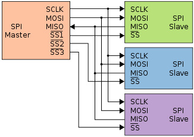
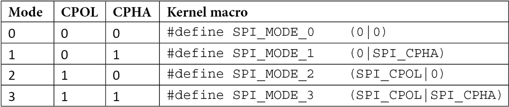
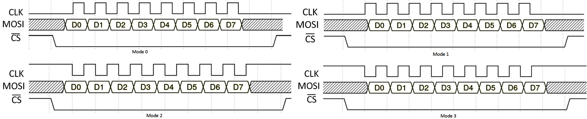
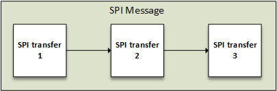

# Chương 9: Viết SPI Device Driver

Serial Peripheral Interface (SPI) là bus có (ít nhất) 4-wire — Master Input Slave Output (MISO), Master Output Slave Input (MOSI), Serial Clock (SCK) và Chip Select (CS) — dùng để kết nối serial flash và bộ chuyển đổi analog-to-digital/digital-to-analog. Master luôn tạo clock. Tốc độ có thể đạt 80 MHz, dù thực tế không có giới hạn tốc độ (đồng thời nhanh hơn I2C nhiều). Điều tương tự áp dụng cho CS line, luôn do master quản lý.

Mỗi tên tín hiệu này đều có tên đồng nghĩa:

- Khi thấy Slave Input Master Output (SIMO), Slave Data Input (SDI) hoặc Data Input (DI), chúng đều chỉ MOSI.

- Slave Output Master Input (SOMI), Slave Data Output (SDO) và Data Output (DO) đều chỉ MISO.

- Serial Clock (SCK), Clock (CLK) và Serial Clock (SCL) đều chỉ SCK.

- S̅ S̅ là Slave Select line, còn gọi là CS. Có thể dùng CSx (trong đó x là index, như CS0, CS1), cũng như EN và ENB, nghĩa là enable. CS thường là tín hiệu active low.

Sơ đồ sau cho thấy cách SPI device kết nối với controller qua bus mà nó cung cấp:



Hình 9.1 – Kết nối giữa SPI slave device và master

Từ sơ đồ trên, có thể biểu diễn Linux kernel SPI framework như sau:

```
CPU <--platform bus--> SPI master <---SPI bus---> SPI slave
```

CPU là master chứa SPI controller, còn gọi là SPI master, quản lý bus segment chứa các SPI slave device. Trong kernel SPI framework, bus được platform driver quản lý, còn slave được SPI device driver điều khiển. Tuy nhiên, cả hai driver đều dùng API do SPI core cung cấp. Trong chương này, chúng ta tập trung vào SPI (slave) device driver, dù sẽ đề cập controller nếu cần. Chương này trình bày các khái niệm SPI driver như sau:

- Tìm hiểu SPI framework abstraction trong Linux kernel

- Làm việc với SPI driver abstraction và architecture

- Học cách tránh viết SPI device driver

## Tìm hiểu SPI framework abstraction trong Linux kernel

Linux kernel SPI framework gồm một số data structure, quan trọng nhất là:

- `spi_controller`, dùng để trừu tượng hóa SPI master device.

- `spi_device`, dùng để trừu tượng hóa slave device nằm trên SPI bus.

- `spi_driver`, driver của slave device.

- `spi_transfer`, biểu diễn low-level của một segment trong protocol. Nó biểu diễn một operation giữa master và slave. Nó cần Tx buffer và/hoặc Rx buffer, cùng độ dài data cần trao đổi và hành vi CS tùy chọn.

- `spi_message`, một chuỗi transfer atomic.

Bây giờ hãy lần lượt giới thiệu từng data structure, bắt đầu với structure phức tạp nhất, biểu diễn data structure của SPI controller.

## Giới thiệu ngắn gọn struct spi\_controller

Xuyên suốt chương này, chúng ta sẽ tham chiếu controller vì nó gắn chặt với slave và các data structure khác tạo nên SPI framework. Vì thế, cần giới thiệu data structure của nó, được biểu diễn bằng `struct spi_controller` và định nghĩa như sau:

```
struct spi_controller {
    struct device     dev;
    u16               num_chipselect;
    u32               min_speed_hz;
    u32               max_speed_hz;
    int               (*setup)(struct spi_device *spi);
    int (*set_cs_timing)(struct spi_device *spi,
                          struct spi_delay *setup,
                          struct spi_delay *hold,
                          struct spi_delay *inactive);
    int    (*transfer)(struct spi_device *spi,
                         struct spi_message *mesg);
    bool    (*can_dma)(struct spi_controller *ctlr,
                        struct spi_device *spi,
                        struct spi_transfer *xfer);
    struct kthread_worker  *kworker;
    struct kthread_work    pump_messages;
    spinlock_t             queue_lock;
    struct list_head       queue;
    struct spi_message     *cur_msg;
    bool                   busy;
    bool                   running;
    bool                   rt;
    int (*transfer_one_message)(
                      struct spi_controller *ctlr,
                      struct spi_message *mesg);
[...]
    int (*transfer_one_message)(
            struct spi_controller *ctlr,
            struct spi_message *mesg);
    void (*set_cs)(struct spi_device *spi, bool enable);
    int (*transfer_one)(struct spi_controller *ctlr,
                    struct spi_device *spi,
                    struct spi_transfer *transfer);
[...]
    /* DMA channels for use with core dmaengine helpers */
    struct dma_chan    *dma_tx;
    struct dma_chan    *dma_rx;
    /* dummy data for full duplex devices */
    Void              *dummy_rx;
    Void              *dummy_tx;
};
```

Code trên chỉ liệt kê những thành phần quan trọng cần để hiểu rõ hơn data structure dùng trong chương này. Danh sách sau giải thích cách dùng:

- `num_chipselect` chỉ số lượng CS gán cho controller này. CS dùng để phân biệt từng SPI slave và được đánh số từ 0.

- `min_speed_hz` và `max_speed_hz` lần lượt là tốc độ truyền thấp nhất và cao nhất mà controller này hỗ trợ.

- `set_cs_timing` là method được cung cấp nếu SPI controller hỗ trợ cấu hình CS timing; khi đó client driver sẽ gọi `spi_set_cs_timing()` với timing được yêu cầu. Nó đã deprecated trong các phiên bản kernel gần đây bởi patch này: https://lore.kernel.org/lkml/20210609071918.2852069-1-gregkh@linuxfoundation.org/).

- `transfer` thêm message vào transfer queue của controller. Trên controller registration path (nhờ `spi_register_controller()`), SPI core kiểm tra field này có là `NULL` hay không:

  - Nếu là `NULL`, SPI core kiểm tra `transfer_one` hoặc `transfer_one_message` có được đặt hay không; nếu có, nó giả định controller hỗ trợ message queuing và gọi `spi_controller_initialize_queue()`, đặt field này bằng `spi_queued_transfer` (SPI core helper để đưa SPI message vào queue của controller và schedule message pump `kworker` nếu nó chưa chạy hoặc chưa bận).

    - Ngoài ra, `spi_controller_initialize_queue()` tạo cả kthread worker chuyên dụng (thành phần `kworker`) và work struct (thành phần `pump_messages`) cho controller này. Worker được schedule khá thường xuyên để xử lý message queue theo thứ tự FIFO.

    - Tiếp theo, thành phần `queued` của controller được SPI core đặt thành true.

    - Cuối cùng, nếu thành phần `rt` của controller được driver đặt thành true trước khi gọi registration API, SPI core đặt scheduling policy của worker thread thành real-time FIFO policy với priority 50.

  - Nếu là `NULL`, đồng thời cả `transfer_one` lẫn `transfer_one_message` cũng là `NULL`, đây là lỗi và controller không được đăng ký.

  - Nếu không phải `NULL`, SPI core giả định controller không hỗ trợ queuing và không gọi `spi_controller_initialize_queue()`.

- `transfer_one` và `transfer_one_message` loại trừ lẫn nhau. Nếu cả hai được đặt, SPI core không gọi method đầu. `transfer_one` thực hiện một SPI transfer và không có khái niệm `spi_message`. Nếu driver cung cấp `transfer_one_message`, nó phải làm việc trên cơ sở `spi_message` và chịu trách nhiệm cho mọi transfer trong message. Controller driver không muốn bận tâm đến message-handling algorithm chỉ cần đặt callback `transfer_one`; khi đó SPI core đặt `transfer_one_message` thành `spi_transfer_one_message`. `spi_transfer_one_message` đảm nhận toàn bộ message logic, timing, CS và property khác hardware-related trước khi gọi callback `transfer_one` do driver cung cấp cho mỗi transfer trong message. CS giữ trạng thái active trong suốt các message transfer, trừ khi bị thay đổi bởi transfer có `spi_transfer.cs_change = 1`. Message transfer được thực hiện bằng clock và SPI mode parameter mà `setup()` đã áp dụng trước đó cho device này.

- `kworker`: Kernel thread chuyên dụng để xử lý message pump.

- `pump_messages`: Abstraction của work struct data structure để schedule function xử lý SPI message queue. Nó được schedule trong `kworker`. Work struct này dựa trên method `spi_pump_messages()`, kiểm tra có SPI message nào trong queue cần xử lý hay không; nếu có, nó gọi driver để khởi tạo hardware và truyền từng message.

- `queue_lock`: Spinlock đồng bộ truy cập message queue.

- `queue`: Message queue của controller này.

- `idling`: Chỉ ra controller device có đang chuyển vào idle state hay không.

- `cur_msg`: SPI message in-flight hiện tại.

- `busy`: Chỉ mức độ bận của message pump.

- `running`: Chỉ ra message pump đang chạy.

- `Rt`: Chỉ ra `kworker` có chạy message pump với real-time priority hay không.

- `dma_tx`: DMA transmit channel (khi controller hỗ trợ).

- `dma_rx`: DMA receiving channel (khi controller hỗ trợ).

SPI transfer luôn đọc và ghi cùng số byte, nghĩa là ngay cả khi client driver phát half-duplex transfer, SPI core vẫn emulate full duplex bằng `dummy_rx` và `dummy_tx` cho mục đích này:

- `dummy_rx`: Dummy receive buffer dùng cho full-duplex device; nếu receive buffer của transfer là `NULL`, data nhận được sẽ được dịch vào dummy receive buffer này trước khi bị loại bỏ.

- `dummy_tx`: Dummy transmit buffer dùng cho full-duplex device; nếu transmit buffer của transfer là `NULL`, dummy transmit buffer này được zero-filled và dùng làm transmit buffer cho transfer.

Lưu ý SPI core đặt tên SPI message pump worker task bằng controller device name (dev-\>name), được đặt trong `spi_register_controller()` như sau:

```
dev_set_name(&ctlr->dev, "spi%u", ctlr->bus_num);
```

Sau đó, khi worker được tạo trong quá trình khởi tạo queue (nhớ lại `spi_controller_initialize_queue()`), nó được gán tên này, như sau:

```
ctlr->kworker = kthread_create_worker(0, dev_name(&ctlr->dev));
```

Để nhận ra SPI message pump worker trên hệ thống, có thể chạy lệnh sau:

```
root@yocto-imx6:~# ps | grep spi
65 root         0 SW   [spi1]
```

Trong đoạn code trên, có thể thấy worker name được tạo từ bus name cùng bus number.

Trong phần này, chúng ta phân tích các khái niệm phía controller để giúp hiểu toàn bộ triển khai SPI slave trong Linux kernel. Data structure này quan trọng đến mức tôi khuyên bạn đọc lại phần này mỗi khi cảm thấy chưa hiểu cơ chế nào trong các phần tiếp theo. Bây giờ có thể thực sự chuyển sang SPI device data structure.

## Structure struct spi\_device

Data structure đầu tiên và rõ ràng nhất, `struct spi_device`, biểu diễn SPI device và được định nghĩa trong `include/linux/spi/spi.h`:

```
struct spi_device {
    struct device dev;
    struct spi_controller  *controller;
    struct spi_master *master;
    u32         max_speed_hz;
    u8          chip_select;
    u8          bits_per_word;
    bool        rt;
    u16         mode;
    int          irq;
    [...]
    int cs_gpio; /* LEGACY: chip select gpio */
    struct gpio_desc *cs_gpiod; /* chip select gpio desc */
    struct spi_delay word_delay; /* inter-word delay */
    /* the statistics */
    struct spi_statistics statistics;
};
```

Để dễ đọc, số field được liệt kê được giảm xuống mức tối thiểu cần cho mục đích của sách. Danh sách sau trình bày chi tiết ý nghĩa từng thành phần trong structure này:

- `controller` biểu diễn SPI controller mà slave device này thuộc về. Nói cách khác, nó biểu diễn SPI controller (bus) mà device kết nối vào.

- Thành phần `master` vẫn còn vì lý do tương thích và sẽ sớm deprecated. Đây là tên cũ của controller.

- `max_speed_hz` là clock rate tối đa dùng với slave này; parameter có thể được thay đổi từ trong driver. Có thể ghi đè parameter đó bằng `spi_transfer.speed_hz` cho từng transfer. Chúng ta sẽ bàn SPI transfer sau.

- `chip_select` là CS line gán cho device này. Mặc định active low. Có thể thay đổi hành vi này trong `mode` bằng cách thêm flag `SPI_CS_HIGH`.

- `rt`, nếu là `true`, khiến message pump worker của `controller` chạy như real-time task

- `mode` định nghĩa cách data được clock. Device driver có thể thay đổi nó. Mặc định data clocking là MSB cho mỗi word trong transfer. Có thể ghi đè hành vi bằng cách chỉ định `SPI_LSB_FIRST`.

- `irq` biểu diễn interrupt number (được đăng ký là device resource trong board initialization file hoặc qua device tree) mà bạn nên truyền cho `request_irq()` để nhận interrupt từ device này.

- Cả `cs_gpio` lẫn `cs_gpiod` đều tùy chọn. Field đầu là GPIO number integer-based kiểu cũ của CS line, còn field sau là interface mới và được khuyến nghị, dựa trên GPIO descriptor.

Một vài lời về SPI mode — chúng được tạo từ hai đặc tính:

- CPOL, initial clock polarity:

  - `0`: Clock state ban đầu là low và cạnh đầu tiên là rising.

  - `1`: Clock state ban đầu là high và trạng thái đầu tiên là falling.

- CPHA là clock phase, xác định data được sample ở cạnh nào:

  - `0`: Data được latch tại falling edge (chuyển từ high sang low), còn output thay đổi tại rising edge.

  - `1`: Data được latch tại rising edge (chuyển từ low sang high), còn output thay đổi tại falling edge.

Điều này cho phép phân biệt bốn SPI mode, là những macro dẫn xuất kết hợp hai macro chính, định nghĩa trong `include/linux/spi/spi.h` như sau:

```
#define    SPI_CPHA    0x01
#define    SPI_CPOL    0x02
```

Các tổ hợp macro này tạo thành những SPI mode sau:



Bảng 9.1 – Định nghĩa SPI mode trong kernel

Sơ đồ sau biểu diễn từng SPI mode, theo cùng thứ tự đã định nghĩa trong array trên. Tuy nhiên, chỉ MOSI line được biểu diễn, nhưng nguyên tắc cũng giống với MISO.



Hình 9.2 – Các SPI operating mode

Bây giờ đã quen với SPI device data structure và các mode mà device có thể hoạt động, có thể chuyển sang structure second-most important, biểu diễn SPI device driver.

## Structure spi\_driver

Còn gọi là protocol driver, SPI device driver chịu trách nhiệm điều khiển device trên SPI bus. Nó được trừu tượng hóa trong kernel bằng `struct spi_driver`, khai báo như sau:

```
struct spi_driver {
   const struct spi_device_id *id_table;
   int         (*probe)(struct spi_device *spi);
   int         (*remove)(struct spi_device *spi);
   void        (*shutdown)(struct spi_device *spi);
   struct device_driver    driver;
};
```

Danh sách sau trình bày ý nghĩa các thành phần trong data structure này:

- `id_table`: Danh sách SPI device mà driver này hỗ trợ.

- `probe`: Method này bind driver với SPI device. Function được gọi trên mọi device yêu cầu driver này và quyết định driver có phụ trách device đó hay không. Nếu có, binding diễn ra.

- `remove`: Unbind driver này khỏi SPI device.

- `shutdown`: Được gọi trong các thay đổi system state như power down và halt.

- `driver`: low-level driver structure cho device model và driver model.

Đó là tất cả những gì có thể nói lúc này về data structure này, ngoại trừ việc mỗi SPI device driver phải điền và cung cấp một instance của type này.

## Message transfer data structure

SPI I/O model gồm tập message được đưa vào queue, mỗi message có thể gồm một hoặc nhiều SPI transfer. Trong khi một message gồm một hoặc nhiều object `struct spi_transfer`, mỗi transfer biểu diễn full-duplex SPI transaction. Message được submit và xử lý synchronously hoặc asynchronously. Sau đây là sơ đồ giải thích khái niệm message và transfer:



Hình 9.3 – Ví dụ SPI message structure

Bây giờ đã quen với khía cạnh lý thuyết, chúng ta có thể giới thiệu SPI transfer data structure, khai báo như sau:

```
struct spi_transfer {
    const void    *tx_buf;
    void          *rx_buf;
    unsigned    len;
    dma_addr_t    tx_dma;
    dma_addr_t    rx_dma;
    struct sg_table tx_sg;
    struct sg_table rx_sg;
    unsigned    cs_change:1;
    unsigned    tx_nbits:3;
    unsigned    rx_nbits:3;
#define    SPI_NBITS_SINGLE 0x01 /* 1bit transfer */
#define    SPI_NBITS_DUAL        0x02 /* 2bits transfer */
#define    SPI_NBITS_QUAD        0x04 /* 4bits transfer */
    u8        bits_per_word;
    u16       delay_usecs;
    struct    spi_delay    delay;
    struct spi_delay  cs_change_delay;
    struct spi_delay  word_delay;
    u32        speed_hz;
    u32        effective_speed_hz;
[...]
    struct list_head transfer_list;
#define SPI_TRANS_FAIL_NO_START  BIT(0)
    u16        error;
};
```

Sau đây là ý nghĩa từng thành phần trong data structure:

- `tx_buf` là pointer tới buffer chứa data cần ghi. Nếu đặt là `NULL`, transfer này được xem là half duplex, như read-only transaction. Nó nên DMA-safe khi cần thực hiện SPI transaction qua DMA.

- `rx_buf` là buffer cho data cần đọc (cùng property như `tx_buf`), hoặc `NULL` trong write-only transaction.

- `tx_dma` là địa chỉ Direct Memory Access (DMA) của `tx_buf`, trong trường hợp `spi_message.is_dma_mapped` được đặt là `1`.

- `rx_dma` giống `tx_dma` nhưng dành cho `rx_buf`.

- `len` biểu diễn size của buffer `rx` và `tx` theo byte. Chỉ `len` byte được dịch ra (hoặc vào); cố dịch ra một phần word sẽ gây lỗi.

- `speed_hz` thay thế tốc độ mặc định trong `spi_device.max_speed_hz`, nhưng chỉ cho transfer hiện tại. Nếu là `0`, giá trị mặc định (từ `spi_device`) được dùng.

- `bits_per_word`: Truyền data gồm một hoặc nhiều word. Word là đơn vị data có size theo bit thay đổi theo nhu cầu. Ở đây, `bits_per_word` biểu diễn size theo bit của word cho SPI transfer này. Nó ghi đè giá trị mặc định trong `spi_device.bits_per_word`. Nếu là `0`, giá trị mặc định (từ `spi_device`) được dùng.

- `cs_change` xác định CS có trở thành inactive sau khi transfer này hoàn tất hay không. Mọi SPI transfer bắt đầu với tín hiệu CS thích hợp ở trạng thái active. Thông thường, nó giữ trạng thái được chọn cho tới khi transfer cuối cùng trong message hoàn tất. Dùng `cs_change`, driver có thể thay đổi tín hiệu CS.

Flag này dùng để tạm đưa CS thành inactive ở giữa message (tức trước khi xử lý `spi_transfer` mà flag được chỉ định trên đó) nếu transfer không phải cuối cùng trong message. Toggle CS như vậy có thể cần để hoàn tất chip command, cho phép một SPI message xử lý toàn bộ tập chip transaction.

- `delay_usecs` biểu diễn delay (theo microsecond) sau transfer này trước khi (tùy chọn) thay đổi trạng thái `chip_select`, rồi bắt đầu transfer tiếp theo hoặc hoàn tất `spi_message` này.

  LƯU Ý

  SPI transfer luôn ghi cùng số byte như đọc, ngay cả trong half-duplex transaction. SPI core làm điều này nhờ thành phần `dummy_rx` và `dummy_tx` của controller. Khi transmit buffer là null, `spi_transfer->tx_buf` được đặt bằng `dummy_tx` của controller. Sau đó số 0 được dịch ra trong khi điền `rx_buf` bằng data từ slave. Nếu receive buffer là null, `spi_transfer->rx_buf` được đặt bằng `dummy_rx` của controller và data dịch vào bị loại bỏ.

### struct spi\_message

`spi_message` dùng để phát chuỗi transfer một cách atomic, mỗi transfer được biểu diễn bằng instance `struct` `spi_transfer`. Chúng ta nói atomic vì không `spi_message` nào khác có thể dùng SPI bus đó cho tới khi chuỗi đang chạy hoàn tất. Tuy nhiên, lưu ý có platform có thể xử lý nhiều chuỗi như vậy bằng một programmed DMA transfer. SPI message structure có khai báo sau:

```
struct spi_message {
       struct list_head     transfers;
       struct spi_device    *spi;
       unsigned       is_dma_mapped:1;
       /* completion is reported through a callback */
       void                 (*complete)(void *context);
       void                 *context;
       unsigned       frame_length;
       unsigned       actual_length;
       int                  status;
    };
```

Danh sách sau trình bày ý nghĩa các thành phần trong data structure này:

- `transfers` là danh sách transfer tạo nên message. Chúng ta sẽ xem cách thêm transfer vào danh sách này sau. Dùng flag `spi_transfer.cs_change` trên transfer cuối cùng trong nhóm atomic đó có thể tiết kiệm chi phí cho operation deselect và select chip.

- `is_dma_mapped` cho controller biết có dùng DMA để thực hiện transaction hay không. Khi đó code của bạn chịu trách nhiệm cung cấp DMA address và CPU virtual address cho từng transfer buffer.

- `complete` là callback được gọi khi transaction xong, còn `context` là parameter truyền cho callback.

- `frame_length` được đặt tự động bằng tổng số byte trong message.

- `actual_length` là số byte đã truyền trong mọi segment thành công.

- `status` báo trạng thái transfer. Đây là `0` khi thành công; nếu không là `-errno`.

Các phần tử `spi_transfer` trong message được xử lý theo thứ tự FIFO. Cho tới khi message hoàn tất (tức completion callback được thực thi), phải bảo đảm không dùng transfer buffer để tránh data corruption. Code submit `spi_message` (và `spi_transfers` của nó) xuống lower layer chịu trách nhiệm quản lý memory của nó. Driver phải bỏ qua message (và transfer của nó) sau khi submit, ít nhất cho tới khi completion callback được gọi.

## Truy cập SPI device

SPI controller có thể giao tiếp với một hoặc nhiều slave, tức một hoặc nhiều `struct` `spi_device`. Chúng tạo thành bus nhỏ chia sẻ tín hiệu MOSI, MISO và SCK nhưng không chia sẻ CS. Vì các tín hiệu chung bị bỏ qua trừ khi chip được chọn, có thể lập trình mỗi device dùng clock rate khác nhau. SPI controller driver quản lý giao tiếp với những device đó qua queue chứa transaction `spi_message`, di chuyển data giữa CPU memory và SPI slave device. Với mỗi message instance đưa vào queue, nó gọi completion callback của message khi transaction hoàn tất.

Trước khi message có thể được submit lên bus, phải khởi tạo bằng `spi_message_init()`, có prototype sau:

```
void spi_message_init(struct spi_message *message)
```

Function này đặt mọi thành phần trong structure thành 0 và khởi tạo transfers list. Với mỗi transfer cần thêm vào message, nên gọi `spi_message_add_tail()` trên transfer đó, đưa transfer vào transfers list của message. Nó có khai báo sau:

```
spi_message_add_tail(struct spi_transfer *t, struct spi_message *m)
```

Sau khi làm xong, có hai lựa chọn để bắt đầu transaction:

- Synchronously, dùng `int spi_sync(struct spi_device *spi, struct spi_message *message)`, return `0` khi thành công, nếu không return error code âm. Function này có thể sleep và không được dùng trong interrupt context. Tuy nhiên, lưu ý nó có thể sleep theo cách non-interruptible và không cho phép chỉ định timeout. Driver của controller DMA-capable có thể dùng tính năng DMA này để đẩy/kéo data trực tiếp vào/từ message buffer.

CS của SPI device được core kích hoạt trong toàn bộ message (từ transfer đầu tới cuối), rồi thông thường bị disable giữa các message. Có driver, nhằm giảm thiểu ảnh hưởng của việc select chip (ví dụ tiết kiệm điện), giữ chip được chọn với dự đoán message tiếp theo sẽ đến cùng chip.

- Asynchronously, dùng function `spi_async()`, có thể dùng trong mọi context (atomic hoặc không), với prototype `int spi_async(struct spi_device *spi, struct spi_message *message)`. Function này không phụ thuộc context vì chỉ thực hiện submit và việc xử lý là asynchronous. Tuy nhiên, completion callback được gọi trong context không thể sleep. Trước khi callback được gọi, giá trị `message->status` chưa được xác định. Tại thời điểm được gọi, `message->status` chứa completion status, là `0` (báo thành công hoàn toàn) hoặc error code âm.

Sau khi callback đó return, driver khởi tạo transfer request có thể giải phóng memory tương ứng vì không còn SPI core code hoặc controller driver code nào dùng nó. Cho tới khi completion callback của message đang được xử lý return, không `spi_message` tiếp theo nào đã đưa vào queue cho device đó được xử lý. Quy tắc này cũng áp dụng cho synchronous transfer call vì chúng wrap asynchronous primitive cốt lõi này. Function return `0` khi thành công, nếu không return error code âm.

Sau đây là đoạn trích từ driver minh họa khởi tạo và submit SPI message cùng transfer:

```
Static int regmap_spi_gather_write(
                    void *context, const void *reg,
                    size_t reg_len, const void *val,
                    size_t val_len)
{
    struct device *dev = context;
    struct spi_device *spi = to_spi_device(dev);
    struct spi_message m;
    u32 addr;
    struct spi_transfer t[2] = {
      { .tx_buf = &addr, .len = reg_len, .cs_change = 0,},
      { .tx_buf = val, .len = val_len, },
    };
    addr = TCAN4X5X_WRITE_CMD  |
             (*((u16 *)reg) << 8) | val_len >> 2;
    spi_message_init(&m);
    spi_message_add_tail(&t[0], &m);
    spi_message_add_tail(&t[1], &m);
    return spi_sync(spi, &m);
}
```

Tuy nhiên, đoạn trích trên thể hiện khởi tạo tĩnh ngay tại thời điểm cần, trong đó cả message lẫn transfer bị loại bỏ trên return path của function. Có trường hợp driver muốn pre-allocate message cùng transfer cho lifetime của driver để tránh overhead khởi tạo thường xuyên. Khi đó có thể cấp phát động nhờ `spi_message_alloc()` và giải phóng bằng `spi_message_free()`. Chúng có prototype sau:

```
struct spi_message *spi_message_alloc(unsigned ntrans,
                                      gfp_t flags)
void spi_message_free(struct spi_message *m)
```

Trong đoạn code trên, `ntrans` là số transfer cần cấp phát cho `spi_message` mới này, còn `flags` biểu diễn flag cho memory vừa cấp phát, trong đó dùng `GFP_KERNEL` là đủ. Khi thành công, function return message structure vừa cấp phát cùng transfer của nó. Có thể truy cập transfer element bằng kernel list-related macro như `list_first_entry`, `list_next_entry` hoặc thậm chí `list_for_each_entry`. Sau đây là ví dụ cách dùng các macro này:

```
/* Completion handler for async SPI transfers */
static void my_complete(void *context)
{
    struct spi_message *msg = context;
    /* doing some other stuffs */
    […]
    spi_message_free(m);
}
static int example_spi_async(struct spi_device *spi,
              struct my_fake_spi_reg *cmds, unsigned len)
{
    struct spi_transfer *xfer;
    struct spi_message *msg;
    msg = spi_message_alloc(len, GFP_KERNEL);
    if (!msg)
         return -ENOMEM;
    msg->complete = my_complete;
    msg->context = msg;
    list_for_each_entry(xfer, &msg->transfers,
               transfer_list) {
        xfer->tx_buf = (u8 *)cmds;
        /* feel free to handle .rx_buf, and so on */
        [...]
        xfer->len = 2;
        xfer->cs_change = true;
         cmds++;
    }
    return spi_async(spi, msg);
}
```

Trong đoạn trích trên, chúng ta không chỉ cho thấy cách dùng cấp phát động message và transfer mà còn thấy cách dùng `spi_async()`. Ví dụ này khá vô ích vì message và transfer được cấp phát bị giải phóng ngay khi hoàn tất. Cách làm tốt với cấp phát động là cấp phát động cả Tx buffer và Rx buffer, rồi giữ chúng sẵn để dùng trong lifetime của driver.

Tuy nhiên, lưu ý device driver chịu trách nhiệm tổ chức message và transfer theo cách thích hợp nhất cho device, như sau:

- Thời điểm bắt đầu bidirectional read và write, cũng như cách sắp xếp chuỗi request `spi_transfer`

- Chuẩn bị I/O buffer, biết rằng mỗi `spi_transfer` chứa buffer cho từng chiều truyền, hỗ trợ full-duplex transfer (ngay cả khi một pointer là `NULL`, khi đó controller dùng một dummy buffer của nó)

- Tùy chọn dùng `spi_transfer.delay_usecs` để định nghĩa delay ngắn sau transfer

- CS có cần thay đổi (thành inactive) sau transfer và mọi delay hay không, bằng flag `spi_transfer.cs_change`

Với `spi_async`, device driver đưa message vào queue, đăng ký completion callback, đánh thức message pump và return ngay. Completion callback được gọi khi transfer hoàn tất. Vì cả message queuing lẫn message pump scheduling đều không thể block, function `spi_async` được xem là không phụ thuộc context. Tuy nhiên, nó yêu cầu chờ completion callback trước khi có thể truy cập buffer trong các pointer `spi_transfer` đã submit. Mặt khác, `spi_sync` đưa message vào queue và block cho tới khi hoàn tất. Nó không yêu cầu completion callback. Khi `spi_sync` return, có thể truy cập data buffer an toàn. Nếu xem triển khai trong `drivers/spi/spi.c`, bạn sẽ thấy nó dùng `spi_async` để đưa calling thread vào sleep cho tới khi completion callback được gọi. Từ kernel 4.0, `spi_sync` có cải tiến: khi queue trống, message pump được thực thi trong context của caller thay vì message pump thread, tránh chi phí context switch.

Sau khi giới thiệu những data structure và API quan trọng nhất của SPI framework, chúng ta có thể bàn về triển khai driver thực tế.

## Làm việc với SPI driver abstraction và architecture

Đây là nơi driver logic diễn ra. Nó gồm điền `struct spi_driver` bằng tập function điều khiển cho phép probe và điều khiển device bên dưới.

## Probe device

SPI device được probe bởi callback `spi_driver.probe`. Probe callback chịu trách nhiệm bảo đảm driver nhận diện device đã cho trước khi chúng có thể được bind với nhau. Callback này có prototype sau:

```
int probe(struct spi_device *spi)
```

Method này phải return `0` khi thành công, nếu không return error number âm. Argument duy nhất là SPI device cần probe, có structure đã được core pre-initialized theo mô tả trong device tree.

Tuy nhiên, phần lớn (nếu không phải tất cả) property của SPI device có thể được ghi đè, như đã thấy khi mô tả data structure của nó. SPI protocol driver có thể cần cập nhật transfer mode nếu device không hoạt động với mode mặc định. Tương tự, có thể cần cập nhật clock rate hoặc word size từ giá trị ban đầu. Điều này khả thi nhờ helper `spi_setup()`, có prototype sau:

```
int spi_setup(struct spi_device * spi)
```

Function này chỉ được gọi từ context có thể sleep. Nó nhận parameter là SPI device structure có các property cần ghi đè đã được đặt trong field tương ứng. Thay đổi có hiệu lực ở lần truy cập device tiếp theo (read operation hoặc write operation sau khi nó được select), trừ `SPI_CS_HIGH`, có hiệu lực ngay. SPI device được deselect trên return path của function. Function return `0` khi thành công hoặc lỗi âm khi thất bại. Cần chú ý return value vì lời gọi này không thành công nếu driver cung cấp option mà controller bên dưới hoặc driver của nó không hỗ trợ. Ví dụ, một số hardware xử lý wire transfer bằng word nine-bit, wire encoding least significant bit (LSB)-first hoặc active-high CS, còn một số khác thì không.

Bạn có thể muốn gọi `spi_setup()` từ `probe()` trước khi submit bất kỳ I/O request nào cho device. Tuy nhiên, có thể gọi ở mọi nơi trong code miễn không có message pending cho device đó.

Sau đây là ví dụ probing thiết lập SPI device, kiểm tra family ID của nó và return `0` (device được nhận diện) khi thành công:

```
#define FAMILY_ID 0x57
static int fake_probe(struct spi_device *spi)
{
    int err;
    u8 id;
    spi->max_speed_hz =
               min(spi->max_speed_hz, DEFAULT_FREQ);
    spi->bits_per_word = 8;
    spi->mode = SPI_MODE_0;
    spi->rt = true;
    err = spi_setup(spi);
    if (err)
        return err;
    /* read family id */
    err = get_chip_version(spi, &id);
    if (err)
         return -EIO;
    /* verify family id */
    if (id != FAMILY_ID) {
        dev_err(&spi->dev"
    "chip family: expected 0x%02x but 0x%02x rea"\n",
               FAMILY_ID, id);
          return -ENODEV;
    }
    /* register with other frameworks */
    [...]
    return 0;
}
```

Probing method thực tế có thể cũng xử lý một số driver state data structure hoặc data structure riêng cho per-device khác. Với function `get_chip_version()`, phần thân có thể như sau:

```
#define REG_FAMILY_ID 0x2445
#define DEFAULT_FREQ 10000000
static int get_chip_version(spi_device *spi, u8 *id)
{
    struct spi_transfer t[2];
    struct spi_message m;
    u16 cmd;
    int err;
    cmd = REG_FAMILY_ID;
    spi_message_init(&m);
    memset(&t, 0, sizeof(t));
    t[0].tx_buf = &cmd;
    t[0].len = sizeof(cmd);
    spi_message_add_tail(&t[0], &m);
    t[1].rx_buf = id;
    t[1].len = 1;
    spi_message_add_tail(&t[1], &m);
    return spi_sync(spi, &m);
}
```

Bây giờ đã thấy cách probe SPI device, sẽ hữu ích nếu bàn về cách cho SPI core biết driver có thể hỗ trợ device nào.

LƯU Ý

SPI core cho phép lấy/đặt driver state data bằng `spi_get_drvdata()` và `spi_set_drvdata()` giống cách đã làm khi bàn về I2C device driver trong Chương 8, Viết I2C Device Driver.

## Khai báo device trong driver

Giống như cần danh sách i`2c_device_id` để cho I2C core biết I2C driver có thể hỗ trợ device nào, chúng ta phải cung cấp array `spi_device_id` để thông báo SPI core những device mà SPI driver hỗ trợ. Sau khi điền array, phải gán cho field `spi_driver.id_table`. Ngoài ra, để device matching và load module, phải truyền cùng array cho macro `MODULE_DEVICE_TABLE`. `struct spi_device_id` có khai báo sau trong `include/linux/mod_devicetable.h`:

```
struct spi_device_id {
   char name[SPI_NAME_SIZE];
   kernel_ulong_t driver_data;
};
```

Trong data structure trên, `name` là tên mô tả device, còn `driver_data` là driver state value. Nó có thể được đặt bằng pointer tới data structure riêng cho per-device. Sau đây là ví dụ:

```
#define ID_FOR_FOO_DEVICE   0
#define ID_FOR_BAR_DEVICE   1
static struct spi_device_id foo_idtable[] = {
  "{ ""oo", ID_FOR_FOO_DEVICE },
  "{ ""ar", ID_FOR_BAR_DEVICE },
   { },
};
MODULE_DEVICE_TABLE(spi, foo_idtable);
```

Để match device khai báo trong device tree, cần định nghĩa array phần tử `struct` `of_device_id`, vừa gán cho `spi_driver.of_match_table` vừa gọi macro `MODULE_DEVICE_TABLE` trên đó. Sau đây là ví dụ, cũng cho thấy structure `spi_driver` cuối cùng có dạng thế nào sau khi thiết lập:

```
static const struct of_device_id foobar_of_match[] = {
        { .compatible"= "packtpub,foobar-dev"ce" },
        { .compatible"= "packtpub,barfoo-dev"ce" },
        {},
};
MODULE_DEVICE_TABLE(of, foobar_of_match);
```

Đoạn trích sau thể hiện nội dung cuối cùng của `spi_driver`:

```
static struct spi_driver foo_driver = {
    .driver         = {
        .name  "= ""oo",
        /* The below line adds Device Tree support */
        .of_match_table = of_match_ptr(foobar_of_match),
    },
    .probe          = my_spi_probe,
    .id_table       = foo_idtable,
};
```

Ở trên có thể thấy SPI driver structure sau khi thiết lập. Tuy nhiên, còn thiếu thành phần callback `spi_driver.remove`, dùng để hoàn tác những gì đã làm trong probing function.

## Triển khai method spi\_driver.remove

Callback `remove` phải được dùng để giải phóng mọi resource đã lấy và hoàn tác những gì đã làm khi probing. Callback này có prototype sau:

```
static int remove(struct spi_device *spi)
```

Trong đoạn code trên, `spi` là SPI device data structure, cùng structure đã truyền cho callback `probe`, giúp đơn giản hóa theo dõi device state data structure giữa probing và xóa device. Method return `0` khi thành công hoặc error code âm khi thất bại. Đồng thời phải bảo đảm device được để lại ở trạng thái nhất quán và ổn định. Sau đây là ví dụ triển khai:

```
static int mc33880_remove(struct spi_device *spi)
{
    struct mc33880 *mc;
    mc = spi_get_drvdata(spi); /* Get our data back */
    if (!mc)
        return -ENODEV;
    /*
     * unregister from frameworks with which we
     * registered in the probe function
     */
    gpiochip_remove(&mc->chip);
    [...]
    /* releasing any resource */
    mutex_destroy(&mc->lock);
    return 0;
}
```

Trong ví dụ trên, code xử lý hủy đăng ký khỏi các framework và giải phóng resource. Đây là trường hợp điển hình gặp trong 90% tình huống.

## Khởi tạo và đăng ký driver

Ở bước triển khai này, code gần như sẵn sàng và bạn muốn thông báo SPI core về SPI driver. Đó là đăng ký driver. Với SPI device driver, SPI core cung cấp `spi_register_driver()` và `spi_unregister_driver()` để đăng ký và hủy đăng ký SPI device driver với SPI core. Những method đó có prototype sau:

```
int spi_register_driver(struct spi_driver *sdrv);
void spi_unregister_driver(struct spi_driver *sdrv);
```

Trong cả hai function, `sdrv` là SPI driver structure đã thiết lập trước đó. Registration API return 0 khi thành công hoặc error code âm khi thất bại.

Đăng ký và hủy đăng ký driver thường diễn ra trong module initialization và module exit method. Sau đây là minh họa điển hình về đăng ký SPI driver:

```
static int __init foo_init(void)
{
   [...] /*My init code */
   return spi_register_driver(&foo_driver);
}
module_init(foo_init);
static void __exit foo_cleanup(void)
{
   [...] /* My clean up code */
   spi_unregister_driver(&foo_driver);
}
module_exit(foo_cleanup);
```

Nếu không làm gì khi khởi tạo module ngoài đăng ký/hủy đăng ký driver, có thể dùng `module_spi_driver()` để gom code như sau:

```
module_spi_driver(foo_driver);
```

Macro này tạo module initialization function và cleanup function, rồi gọi `spi_register_driver` và `spi_unregister_driver` bên trong.

## Tạo instance SPI device

SPI slave node phải là child của SPI controller node. Trong master mode, có thể có một hoặc nhiều slave node (tối đa bằng số lượng CS).

Các property bắt buộc như sau:

- `compatible`: Compatible string được định nghĩa trong driver để matching

- `reg`: CS index của device tương đối so với controller

- `spi-max-frequency`: SPI clocking speed tối đa của device theo Hz

Mọi slave node có thể chứa các property tùy chọn sau:

- `spi-cpol`: Boolean property, nếu hiện diện, chỉ ra device yêu cầu inverse clock polarity (CPOL) mode.

- `spi-cpha`: Boolean property chỉ ra device yêu cầu shifted clock phase (CPHA) mode.

- `spi-cs-hi–h`: Property rỗng chỉ ra device yêu cầu CS active high.

- `spi-3wire`: Boolean property chỉ ra device yêu cầu 3-wire mode để hoạt động đúng.

- `spi-lsb-first`: Boolean property chỉ ra device yêu cầu LSB first mode.

- `spi-tx-bus-width`: Property chỉ bus width dùng cho MOSI. Nếu không hiện diện, mặc định là `1`.

- `spi-rx-bus-width`: Property chỉ bus width dùng cho MISO. Nếu không hiện diện, mặc định là `1`.

- `spi-rx-delay-–s`: Dùng để chỉ định delay theo microsecond sau read transfer.

- `spi-tx-delay-us`: Dùng để chỉ định delay theo microsecond sau write transfer.

Sau đây là device tree listing thực tế cho SPI device:

```
ecspi1 {
    fsl,spi-num-CSs = <3>;
    cs-gpios = <&gpio5 17 0>, <&gpio5 17 0>, <&gpio5 17 0>;
    pinctrl-0 = <&pinctrl_ecspi1 &pinctrl_ecspi1_cs>;
    #address-cells = <1>;
    #size-cells = <0>;
    compatible"= "fsl,imx6q-ec"pi", "fsl,imx51-ec"pi";
    reg = <0x02008000 0x4000>;
    status"= "o"ay";
    ad7606r8_0: ad7606r8@0 {
        compatible"= "ad760"-8";
        reg = <0>;
        spi-max-frequency = <1000000>;
        interrupt-parent = <&gpio4>;
        interrupts = <30 0x0>;
   };
   label: fake_spi_device@1 {
        compatible"= "packtpub,foobar-dev"ce";
        reg = <1>;
        a-string-param"= "stringva"ue";
        spi-cs-high;
   };
   mcp2515can: can@2 {
        compatible"= "microchip,mcp2"15";
        reg = <2>;
        spi-max-frequency = <1000000>;
        clocks = <&clk8m>;
        interrupt-parent = <&gpio4>;
        interrupts = <29 IRQ_TYPE_LEVEL_LOW>;
    };
};
```

Trong đoạn trích device tree trên, `ecspi1` biểu diễn master SPI controller. `fake_spi_device` và `mcp2515can` biểu diễn SPI slave device, còn property `reg` của chúng biểu diễn CS index tương ứng, tương đối so với master.

Bây giờ đã quen với mọi khía cạnh kernel của framework SPI slave-oriented, hãy xem cách tránh làm việc với kernel và thử triển khai mọi thứ trong user space.

## Học cách tránh viết SPI device driver

Cách thông thường để làm việc với SPI device là viết kernel code điều khiển device đó. Ngày nay, interface `spidev` cho phép xử lý những device như vậy mà không cần viết một dòng kernel code. Tuy nhiên, nên giới hạn interface này cho use case đơn giản như giao tiếp với slave microcontroller hoặc prototyping. Dùng interface này, bạn không thể xử lý các interrupt (IRQ) mà device có thể hỗ trợ, cũng không thể dùng kernel framework khác.

Interface `spidev` cung cấp character device node theo dạng `/dev/spidevX.Y`, trong đó `X` biểu diễn bus mà device nằm trên, còn `Y` biểu diễn CS index (tương đối so với controller) gán cho device node trong device tree. Ví dụ, `/dev/spidev1.0` nghĩa là device `0` trên SPI bus `1`. Tương tự với sysfs directory entry, có dạng `/sys/class/spidev/spidevX.Y`.

Trước khi character device xuất hiện trong user space, device node phải được khai báo trong device tree là child của SPI controller node. Sau đây là ví dụ:

```
&ecspi2 {
    pinctrl-names"= "defa"lt";
    pinctrl-0 = <&pinctrl_teoulora_ecspi2>;
    cs-gpios = <&gpio2 26 1
                &gpio2 27 1>;
    num-cs = <2>;
    status"= "o"ay";
    spidev@0 {
        reg = <0>;
        compatib"e="semtech,sx1"01";
        spi-max-frequency = <20000000>;
    };
};
```

Trong đoạn code trên, `spidev@0` tương ứng SPI device node của chúng ta. `reg = <0>` cho controller biết device này dùng CS line đầu tiên (index bắt đầu từ 0). Property `compatible="semtech,sx1301"` dùng để match entry trong driver `spidev`. Không còn khuyến nghị dùng `"spidev"` làm compatible string — bạn sẽ nhận cảnh báo nếu thử. Cuối cùng, `spi-max-frequency = <20000000>` đặt clock speed mặc định (20 MHz trong trường hợp này) mà device sẽ hoạt động, trừ khi được thay đổi bằng API thích hợp.

Từ user space, các header file cần để làm việc với interface `spidev` như sau:

```
#include <fcntl.h>
#include <unistd.h>
#include <sys/ioctl.h>
#include <linux/types.h>
#include <linux/spi/spidev.h>
```

Vì là character device, có thể (thực ra đây là lựa chọn duy nhất) dùng system call cơ bản như `open()`, `read()`, `write()`, `ioctl()` và `close()`. Ví dụ sau cho thấy cách dùng cơ bản, chỉ với operation `read()` và `write()`:

```
#include <stdio.h>
#include <stdlib.h>
int main(int argc, char **argv)
{
   int i,fd;
   char *device = "/dev/spidev0.0";
   char wr_buf[]={0xff,0x00,0x1f,0x0f};
   char rd_buf[10];

   fd = open(device, O_RDWR);
   if (fd <= 0) {
         printf("Failed to open SPI device %s\n", device);
         exit(1);
   }

   if (write(fd, wr_buf, sizeof(wr_buf)) != sizeof(wr_buf))
         perror("Write Error");
   if (read(fd, rd_buf, sizeof(rd_buf)) != sizeof(rd_buf))
         perror("Read Error");
   else
         for (i = 0; i < sizeof(rd_buf); i++)
             printf("0x%02X ", rd_buf[i]);
   close(fd);
   return 0;
}
```

Trong code trên, cần lưu ý operation `read()` và `write()` tiêu chuẩn chỉ là half-duplex, và CS bị deactivate giữa mỗi operation. Để làm việc full duplex, không có lựa chọn nào khác ngoài interface `ioctl()`, nơi có thể truyền cả input buffer và output buffer theo nhu cầu. Ngoài ra, với interface `ioctl()`, có thể dùng tập command `SPI_IOC_RD_*` và `SPI_IOC_WR_*` để lấy `RD` và đặt `WR` nhằm ghi đè thiết lập hiện tại của device. Danh sách và tài liệu đầy đủ có trong `Documentation/spi/spidev` trong kernel source.

Interface `ioctl()` cho phép composite operation không deactivate CS và được cung cấp qua request `SPI_IOC_MESSAGE(N)`. Data structure mới được dùng là `struct spi_ioc_transfer`, tương đương `struct spi_transfer` trong user space. Sau đây là ví dụ về ioctl command:

```
#include <stdint.h>
#include <stdio.h>
#include <stdlib.h>
#include <string.h>
/* include required headers, listed early in the section */
[...]
static int pabort(const char *s)
{
    perror(s);
    return -1;
}
static int spi_device_setup(int fd)
{
    int mode, speed, a, b, i;
    int bits = 8;
    /* spi mode: mode 0 */
    mode = SPI_MODE_0;
    a = ioctl(fd, SPI_IOC_WR_MODE, &mode); /* set mode */
    b = ioctl(fd, SPI_IOC_RD_MODE, &mode); /* get mode */
    if ((a < 0) || (b < 0)) {
        return pabort("can't set spi mode");
    }
    /* Clock max speed in Hz */
    speed = 8000000; /* 8 MHz */
    a = ioctl(fd, SPI_IOC_WR_MAX_SPEED_HZ, &speed); /* set */
    b = ioctl(fd, SPI_IOC_RD_MAX_SPEED_HZ, &speed); /* get */
    if ((a < 0) || (b < 0))
        return pabort("fail to set max speed hz");
    /*
     * Set SPI to MSB first.
     * Here, 0 means "not to use LSB first".
     * To use LSB first, argument should be > 0
     */
    i = 0;
    a = ioctl(dev, SPI_IOC_WR_LSB_FIRST, &i);
    b = ioctl(dev, SPI_IOC_RD_LSB_FIRST, &i);
    if ((a < 0) || (b < 0))
        pabort("Fail to set MSB first\n");
    /* setting SPI to 8 bits per word */
    bits = 8;
    a = ioctl(dev, SPI_IOC_WR_BITS_PER_WORD, &bits); /* set */
    b = ioctl(dev, SPI_IOC_RD_BITS_PER_WORD, &bits); /* get */
    if ((a < 0) || (b < 0))
        pabort("Fail to set bits per word\n");

    return 0;
}
```

Trong ví dụ trên, getter chỉ dùng để minh họa. Không bắt buộc phát command `SPI_IOC_RD_*` sau khi thực thi command `SPI_IOC_WR_*` tương ứng. Bây giờ đã xem phần lớn ioctl command, hãy xem cách bắt đầu transfer:

```
static void do_transfer(int fd)
{
    int ret;
    char txbuf[] = {0x0B, 0x02, 0xB5};
    char rxbuf[3] = {0, };
    char cmd_buff = 0x9f;
    struct spi_ioc_transfer tr[2] = {
        0 = {
          .tx_buf = (unsigned long)&cmd_buff,
          .len = 1,
          .cs_change = 1;    /* We need CS to change */
          .delay_usecs = 50, /* wait after this transfer */
          .bits_per_word = 8,
        },
        [1] = {
          .tx_buf = (unsigned long)tx,
          .rx_buf = (unsigned long)rx,
          .len = txbuf(tx),
          .bits_per_word = 8,
        },
    };
    ret = ioctl(fd, SPI_IOC_MESSAGE(2), &tr);
    if (ret == 1){
        perror("can't send spi message");
        exit(1);
    }
    for (ret = 0; ret < sizeof(tx); ret++)
        printf("%.2X ", rx[ret]);
    printf("\n");
}
```

Phần trên cho thấy khái niệm message transaction và transfer transaction trong user space. Bây giờ helper đã được định nghĩa, có thể viết main code dùng chúng như sau:

```
int main(int argc, char **argv)
{
    char *device = "/dev/spidev0.0";
    int fd;
    int error;
    fd = open(device, O_RDWR);
    if (fd < 0)
        return pabort("Can't open device ");
    error = spi_device_setup(fd);
    if (error)
        exit (1);
    do_transfer(fd);
    close(fd);
    return 0;
}
```

Chúng ta đã hoàn tất main function. Phần này hướng dẫn dùng user space SPI API và command để tương tác với device. Tuy nhiên, có hạn chế là không thể dùng device interrupt line hoặc kernel framework khác.

## Tổng kết

Trong chương này, chúng ta đã tìm hiểu SPI driver và giờ có thể dùng serial bus (đồng thời full duplex) này, nhanh hơn I2C nhiều. Chúng ta đã đi qua mọi data structure trong framework và bàn về truyền qua SPI, phần quan trọng nhất đã đề cập. Tuy nhiên, memory truy cập qua những bus đó nằm off-chip — có thể cần thêm abstraction để tránh dùng SPI API và I2C API. Đây là nội dung chương tiếp theo, bàn về regmap API, cung cấp abstraction level cao hơn và thống nhất hơn để SPI command (và I2C command) trở nên trong suốt với bạn.
