# Chương 10: Tìm hiểu cấp phát memory trong Linux kernel

Hệ thống Linux dùng một ảo giác gọi là "virtual memory". Cơ chế này khiến mọi memory address trở thành virtual, nghĩa là chúng không trỏ trực tiếp tới địa chỉ nào trong RAM. Theo cách này, mỗi khi truy cập một memory location, cơ chế translation được thực hiện để khớp với physical memory tương ứng.

Trong chương này, chúng ta sẽ làm việc với toàn bộ hệ thống cấp phát và quản lý memory của Linux, bao gồm các chủ đề sau:

- Giới thiệu các thuật ngữ memory-related trong Linux kernel

- Làm rõ address translation và MMU

- Làm việc với các cơ chế cấp phát memory

- Làm việc với I/O memory để giao tiếp hardware

- Memory remapping

## Giới thiệu các thuật ngữ memory-related trong Linux kernel

Dù system memory (còn gọi là RAM) có thể được mở rộng trên một số máy tính cho phép điều đó, physical memory là resource hữu hạn trong hệ thống máy tính.

Virtual memory là khái niệm, một ảo giác dành cho mỗi process để nó nghĩ rằng có memory lớn và gần như vô hạn, đôi khi nhiều hơn mức hệ thống thực sự có. Để đặt nền tảng, chúng ta sẽ giới thiệu các thuật ngữ address space, virtual address hoặc logical address, physical address và bus address:

- Physical address nhận diện một vị trí vật lý (RAM). Do cơ chế virtual memory, người dùng hoặc kernel không bao giờ trực tiếp làm việc với physical address nhưng có thể truy cập nó bằng logical address tương ứng.

- Virtual address không nhất thiết tồn tại về mặt vật lý. Địa chỉ này được CPU dùng làm reference để truy cập physical memory location thông qua Memory Management Unit (MMU). MMU nằm giữa CPU core và memory, và thường là một phần của chính physical CPU. Tuy nhiên, trên ARM architecture, nó là một phần của core được cấp phép. Nó chịu trách nhiệm chuyển virtual address thành physical address mỗi khi memory location được truy cập. Cơ chế này gọi là address translation.

- Logical address là địa chỉ sinh ra từ linear mapping. Nó có được từ mapping phía trên `PAGE_OFFSET`. Những địa chỉ này là virtual address có offset cố định so với physical address tương ứng. Vì vậy, logical address luôn là virtual address, nhưng chiều ngược lại không đúng.

- Trong hệ thống máy tính, address space là lượng memory được cấp phát cho mọi địa chỉ có thể có của một thực thể tính toán (trong trường hợp này là CPU). Address space có thể virtual hoặc physical. Trong khi physical address space có thể đạt lượng RAM cài trên hệ thống (về lý thuyết bị giới hạn bởi độ rộng CPU address bus và register), virtual address range có thể mở rộng tới địa chỉ cao nhất mà RAM hoặc operating system architecture cho phép (chẳng hạn định địa chỉ tới 4 GB virtual memory trên hệ thống RAM 1 GB).

Vì MMU là thành phần trung tâm của memory management, nó tổ chức memory thành đơn vị logic có size cố định gọi là page. Size của page là lũy thừa của 2 theo byte và khác nhau giữa các hệ thống. Page có page frame bên dưới, và size của page khớp với page frame. Trước khi tiếp tục tìm hiểu memory management, hãy giới thiệu các thuật ngữ khác:

- Memory page, virtual page hoặc đơn giản page là những thuật ngữ chỉ block virtual memory có fixed-length (`PAGE_SIZE`). Cùng thuật ngữ page cũng được dùng làm kernel data structure biểu diễn memory page.

- Mặt khác, frame (hoặc page frame) chỉ block physical memory (RAM) có fixed-length mà operating system map page lên đó. Size của page khớp với page frame. Mỗi page frame được gán number gọi là Page Frame Number (PFN).

- Tiếp theo là page table, kernel data structure và architecture data structure dùng để lưu mapping giữa virtual address và physical address. Cặp key page/frame mô tả một entry trong page table và biểu diễn một mapping.

Cuối cùng, thuật ngữ "page-aligned" mô tả địa chỉ bắt đầu chính xác tại đầu page. Dĩ nhiên, memory có địa chỉ là bội số của system page size được gọi là page-aligned. Ví dụ, trên hệ thống page size 4 KB, `4.096`, `20.480` và `409.600` là các memory address page-aligned.

LƯU Ý

Page size do MMU ấn định và operating system không thể sửa đổi. Một số processor cho phép nhiều page size (ví dụ ARMv8-A hỗ trợ ba granule size: 4 KB, 16 KB và 64 KB), và OS có thể quyết định dùng loại nào. Tuy nhiên, 4 KB là page granularity rất phổ biến.

Bây giờ đã giới thiệu các thuật ngữ thường dùng khi làm việc với memory, hãy tập trung vào cách kernel quản lý và tổ chức memory.

Linux là virtual memory operating system. Trên hệ thống chạy Linux, mỗi process và ngay cả chính kernel (cùng một số device) được cấp phát address space, là một phần virtual address space của processor (lưu ý cả kernel lẫn process đều không làm việc với physical address — chỉ MMU làm điều đó). Virtual address space được chia giữa kernel và user space, với phần trên dùng cho kernel và phần dưới dùng cho user space.

Cách chia khác nhau theo architecture và được lưu trong kernel configuration option `CONFIG_PAGE_OFFSET`. Với hệ thống 32-bit, mặc định chia tại `0xC0000000`. Đây gọi là cách chia 3 GB/1 GB, trong đó user space được cấp 3 GB phía dưới của virtual address space. Tuy nhiên, có thể cấp lượng address space khác cho kernel theo mong muốn bằng cách điều chỉnh kernel configuration option `CONFIG_VMSPLIT_1G`, `CONFIG_VMSPLIT_2G` và `CONFIG_VMSPLIT_3G_OPT` (xem `arch/x86/Kconfig` và `arch/arm/Kconfig`). Với 64-bit, điểm chia tùy architecture nhưng đủ cao: `0x8000000000000000` cho ARM 64-bit và `0xffff880000000000` cho x86\_64.

Virtual address space layout điển hình của process trên hệ thống 32-bit với cách chia mặc định như sau:

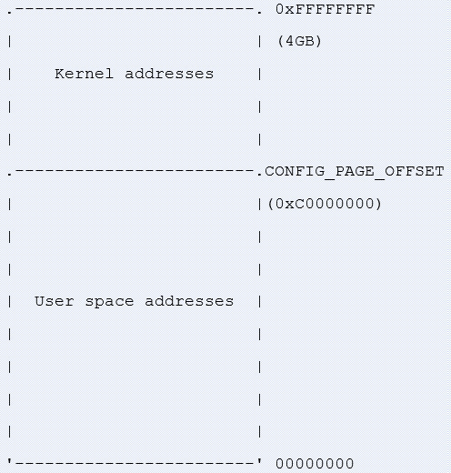

Hình 10.1 – Phân chia memory trên hệ thống 32-bit

Dù layout này trong suốt trên hệ thống 64-bit, máy 32-bit có những đặc điểm riêng cần giới thiệu. Trong các phần tiếp theo, chúng ta nghiên cứu chi tiết lý do phân chia memory như vậy, cách dùng và nơi áp dụng.

## Kernel address space layout trên hệ thống 32-bit – khái niệm low memory và high memory

Trong thế giới lý tưởng, toàn bộ memory có thể được map thường trực. Tuy nhiên, hệ thống 32-bit có một số hạn chế, khiến chỉ một phần RAM được map thường trực. Kernel có thể truy cập trực tiếp phần memory này (bằng dereference đơn giản), gọi là low memory; phần (physical) memory không được permanent mapping bao phủ gọi là high memory. Có nhiều ràng buộc architecture-dependent về chính xác vị trí ranh giới đó. Ví dụ, Intel core chỉ có thể map thường trực tối đa 1 GB RAM đầu tiên. Thực tế ít hơn một chút, 896 MiB RAM, vì một phần low memory này dùng để map high memory động:

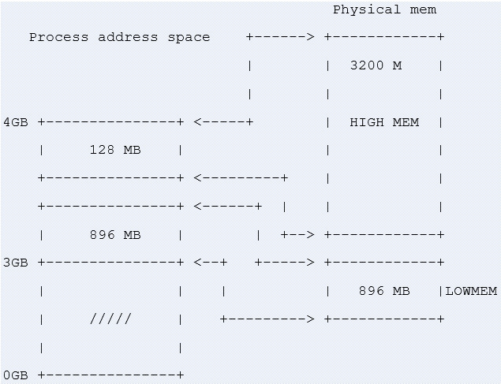

Hình 10.2 – Phân chia high memory và low memory

Trong sơ đồ trên, có thể thấy 128 MB kernel address space dùng để map high memory của RAM ngay khi cần. Mặt khác, 896 MB kernel address space được map thường trực và tuyến tính tới 896 MB phía thấp của RAM.

Cơ chế high-memory cũng có thể dùng trên hệ thống RAM 1 GB để map user memory động mỗi khi kernel cần truy cập. Việc kernel có thể map toàn bộ RAM vào address space của nó không có nghĩa user space không thể truy cập RAM đó. Có thể tồn tại nhiều mapping tới một RAM page frame; nó vừa có thể được map thường trực vào kernel memory space vừa được map tới địa chỉ nào đó trong user space khi process được chọn thực thi.

LƯU Ý

Với virtual address, bạn có thể phân biệt đó là địa chỉ kernel space hay user space bằng process layout đã trình bày. Mọi địa chỉ dưới `PAGE_OFFSET` đến từ user space; nếu không, nó thuộc kernel.

### Chi tiết low memory

896 MB đầu tiên của kernel address space tạo thành low memory region. Ngay đầu boot process, kernel map thường trực 896 MB đó lên physical RAM. Địa chỉ sinh ra từ mapping đó gọi là logical address. Chúng là virtual address nhưng có thể được chuyển thành physical address bằng cách trừ offset cố định, vì mapping thường trực và đã biết trước. Low memory khớp với phần địa chỉ physical thấp. Có thể định nghĩa low memory là memory có logical address tồn tại trong kernel space. Phần lõi kernel nằm trong low memory. Vì thế, phần lớn kernel memory function return low memory. Thực tế, để phục vụ mục đích khác nhau, kernel memory được chia thành zone. 16 MB đầu tiên của `LOWMEM` được dành cho Direct Memory Access (DMA). Do các giới hạn, hardware không phải lúc nào cũng cho phép xử lý mọi page như nhau. Khi đó, có thể nhận diện ba memory zone trong kernel space:

- `ZONE_DMA`: Chứa memory page frame dưới 16 MB, dành cho DMA.

- `ZONE_NORMAL`: Chứa memory page frame trên 16 MB và dưới 896 MB, dùng thông thường.

- `ZONE_HIGHMEM`: Chứa memory page frame tại và trên 896 MB.

Tuy nhiên, trên hệ thống 512 MB sẽ không có `ZONE_HIGHMEM`, có 16 MB cho `ZONE_DMA` và 496 MB cho

```
ZONE_NORMAL.
```

Từ những nội dung trên, có thể hoàn thiện định nghĩa logical address: đó là địa chỉ trong kernel-space được map tuyến tính lên physical address, và physical address tương ứng có thể lấy bằng offset. Kernel virtual address giống logical address ở chỗ là mapping từ địa chỉ kernel space sang physical address. Tuy nhiên, khác biệt là kernel virtual address không phải lúc nào cũng có cùng linear mapping one-to-one tới physical location như logical address.

LƯU Ý Có thể chuyển physical address thành logical address bằng macro `__pa(address)` và chuyển ngược bằng macro `__va(address)`.

### Tìm hiểu high memory

128 MB trên cùng của kernel address space được gọi là high-memory region. Kernel dùng nó để tạm map physical memory trên 1 GB (thực tế trên 896 MB). Khi cần truy cập physical memory trên 1 GB (chính xác hơn là 896 MB), kernel dùng 128 MB đó để tạo temporary mapping vào virtual address space, nhờ vậy đạt mục tiêu truy cập mọi physical page. Có thể định nghĩa high memory là memory không có logical address và không được map thường trực vào kernel address space. Physical memory trên 896 MB được map theo yêu cầu tới 128 MB của region `HIGHMEM`.

Mapping để truy cập high memory được kernel tạo khi cần và hủy khi xong. Điều này làm truy cập high memory chậm hơn. Tuy nhiên, khái niệm high memory không tồn tại trên hệ thống 64-bit do address range khổng lồ (264 TB), nơi cách chia 3 GB/1 GB (hoặc tương tự) không còn ý nghĩa.

## Tổng quan process address space từ kernel

Trên hệ thống Linux, mỗi process được biểu diễn trong kernel bằng instance `struct task_struct` (xem `include/linux/sched.h`), đặc trưng và mô tả process đó. Trước khi process bắt đầu chạy, nó được cấp phát memory mapping table, lưu trong biến có type `struct mm_struct` (xem `include/linux/mm_types.h`). Có thể kiểm chứng bằng đoạn trích định nghĩa `struct task_struct` sau, nhúng các pointer tới phần tử có type `struct mm_struct`:

```
struct task_struct{
    […]
    struct mm_struct *mm, *active_mm;
    […]
}
```

Trong kernel có global variable luôn trỏ tới process hiện tại, `current`, và field `current->mm` trỏ tới memory-mapping table của process hiện tại. Trước khi giải thích tiếp, hãy xem đoạn trích data structure `struct mm_struct` sau:

```
struct mm_struct {
    struct vm_area_struct *mmap;
    unsigned long mmap_base;
    unsigned long task_size;
    unsigned long highest_vm_end;
    pgd_t * pgd;
    atomic_t mm_users;
    atomic_t mm_count;
    atomic_long_t nr_ptes;
#if CONFIG_PGTABLE_LEVELS > 2
    atomic_long_t nr_pmds;
#endif
    int map_count;
    spinlock_t page_table_lock;
    unsigned long total_vm;
    unsigned long locked_vm;
    unsigned long pinned_vm;
    unsigned long data_vm;
    unsigned long exec_vm;
    unsigned long stack_vm;
    unsigned long start_code, end_code, start_data, end_data;
    unsigned long start_brk, brk, start_stack;
    unsigned long arg_start, arg_end, env_start, env_end;
    /* ref to file /proc/<pid>/exe symlink points to */
    struct file __rcu *exe_file;
};
```

Tôi cố ý xóa một số field không quan tâm. Có một số field sẽ bàn sau: ví dụ `pgd`, pointer tới base (entry đầu tiên) của level-one table (Page Global Directory, viết tắt PGD) của process, được ghi vào translation table base address của CPU khi context switching. Để hiểu rõ hơn data structure này, có thể dùng sơ đồ sau:

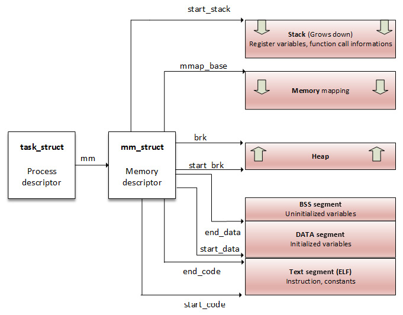

Hình 10.3 – Process address space

Từ góc nhìn process, memory mapping có thể đơn giản được xem là tập page table entry dành cho một consecutive virtual address range. "Consecutive virtual address range" đó gọi là memory area hoặc Virtual Memory Area (VMA). Mỗi memory mapping được mô tả bằng start address và length, permission (như chương trình có thể đọc, ghi hay thực thi từ memory đó không) và resource tương ứng (như physical page, swap page và file content).

`mm_struct` có hai cách lưu process region (VMA):

- Trong red-black tree (self-balancing binary search tree), có root element được field `mm_struct->mm_rb` trỏ tới

- Trong linked list, có phần tử đầu tiên được field `mm_struct->mmap` trỏ tới

Bây giờ đã có tổng quan process address space và thấy nó gồm tập virtual memory region, hãy đi vào chi tiết và nghiên cứu cơ chế phía sau những memory region này.

## Tìm hiểu khái niệm VMA

Trong kernel, process memory mapping được tổ chức thành area, mỗi area gọi là VMA. Trong mỗi process đang chạy trên hệ thống Linux, code section, từng mapped file region (ví dụ library), hoặc từng memory mapping riêng biệt (nếu có) được hiện thực bằng VMA. VMA là structure architecture-independent, có permission và access control flag, được định nghĩa bằng start address và length. Size của chúng luôn là bội số page size (`PAGE_SIZE`). VMA gồm một số page, mỗi page có entry trong page table (Page Table Entry (PTE)).

VMA được biểu diễn trong kernel bằng instance `struct vma_area`, định nghĩa như sau:

```
struct vm_area_struct {
    unsigned long vm_start;
    unsigned long vm_end;
    struct vm_area_struct *vm_next, *vm_prev;
    struct mm_struct *vm_mm;
    pgprot_t vm_page_prot;
    unsigned long vm_flags;
    unsigned long vm_pgoff;
    struct file * vm_file;
    [...]
}
```

Để phần này dễ đọc và dễ hiểu, chỉ các thành phần liên quan được liệt kê. Sau đây là ý nghĩa những thành phần còn lại:

- `vm_start` là VMA start address trong address space (`vm_mm`). Đây là địa chỉ đầu tiên trong VMA này.

- `vm_end` là byte đầu tiên sau end address trong `vm_mm`. Đây là địa chỉ đầu tiên ngoài VMA này.

- `vm_next` và `vm_prev` dùng để triển khai linked list các VM area cho từng task, sắp theo địa chỉ.

- `vm_mm` là process address space mà VMA này thuộc về.

- `vm_page_prot` và `vm_flags` biểu diễn access permission của VMA. Field đầu là data type architecture-level, có cập nhật được áp dụng trực tiếp vào PTE của architecture bên dưới. Nó là dạng chuyển đổi được cache từ `vm_flags`, lưu protection bit thích hợp và mapping type theo cách architecture-independent.

- `vm_file` là file bên dưới mapping này. Có thể là `NULL` (ví dụ anonymous mapping như heap hoặc stack của process).

- `vm_pgoff` là offset (trong `vm_file`) theo đơn vị page size. Offset này đo bằng số page.

Sơ đồ sau tổng quan process memory mapping, làm nổi bật từng VMA và mô tả một số thành phần structure:

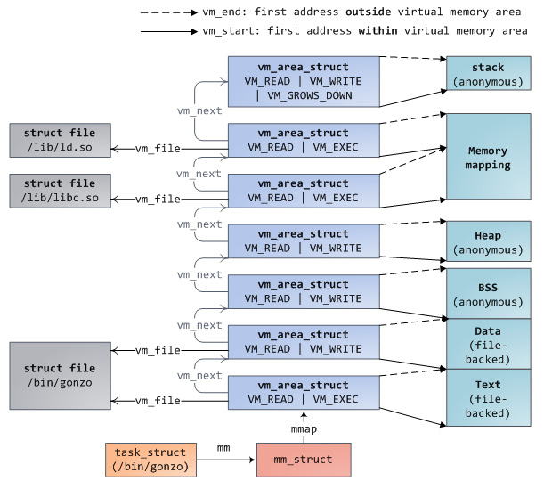

Hình 10.4 – Process memory mapping

Hình trên (từ http://duartes.org/gustavo/blog/post/how-the-kernel-manages-your-memory/) mô tả memory mapping (VMA) của process (khởi chạy từ `/bin/gonzo`). Có thể thấy tương tác giữa `struct task_struct` và thành phần address space (`mm`), sau đó liệt kê và mô tả từng VMA (đầu, cuối và file bên dưới).

Có thể dùng function `find_vma()` để tìm VMA tương ứng virtual address. `find_vma()` được khai báo trong `linux/mm.h` như sau:

```
extern struct vm_area_struct * find_vma(
           struct mm_struct * mm, unsigned long addr);
```

Function này tìm và return VMA đầu tiên thỏa `vm_start <= addr < vm_end`, hoặc return `NULL` nếu không tìm thấy. `mm` là process address space cần tìm trong đó. Với process hiện tại, có thể là `current->mm`. Sau đây là ví dụ:

```
struct vm_area_struct *vma =
                     find_vma(task->mm, 0x603000);
if (vma == NULL) /* Not found ? */
    return -EFAULT;
/* Beyond the end of returned VMA ? */
if (0x13000 >= vma->vm_end)
    return -EFAULT;
```

Đoạn code trên tìm VMA có memory bound chứa `0x603000`.

Với process có identifier `<PID>`, có thể lấy toàn bộ memory mapping của process bằng cách đọc file `/proc/<PID>/maps`, `/proc/<PID>/smaps` và `/proc/<PID>/pagemap`. Sau đây liệt kê mapping của process đang chạy có Process Identifier (PID) là `1073`:

```
# cat /proc/1073/maps
00400000-00403000 r-xp 00000000 b3:04 6438             /usr/sbin/net-listener
00602000-00603000 rw-p 00002000 b3:04 6438             /usr/sbin/net-listener
00603000-00624000 rw-p 00000000 00:00 0                [heap]
7f0eebe4d000-7f0eebe54000 r-xp 00000000 b3:04 11717    /usr/lib/libffi.so.6.0.4
7f0eebe54000-7f0eec054000 ---p 00007000 b3:04 11717    /usr/lib/libffi.so.6.0.4
7f0eec054000-7f0eec055000 rw-p 00007000 b3:04 11717    /usr/lib/libffi.so.6.0.4
7f0eec055000-7f0eec069000 r-xp 00000000 b3:04 21629    /lib/libresolv-2.22.so
7f0eec069000-7f0eec268000 ---p 00014000 b3:04 21629    /lib/libresolv-2.22.so
[...]
7f0eee1e7000-7f0eee1e8000 rw-s 00000000 00:12 12532    /dev/shm/sem.thk-mcp-231016-sema
[...]
```

Mỗi dòng trong đoạn trích trên biểu diễn VMA và các field tương ứng với mẫu `{address`

```
(start-end)} {permissions} {offset} {device (major:minor)} {inode} {pathname (image)}
```

:

- `address`: Biểu diễn start address và end address của VMA.

- `permissions`: Mô tả quyền truy cập region: `r` (đọc), `w` (ghi) và `x` (thực thi). `p` nếu mapping là private, `s` cho shared mapping.

- `offset`: Nếu file mapping (system call `mmap`), đây là offset trong file nơi mapping diễn ra. Nếu không, là `0`.

- `major:minor`: Nếu file mapping, biểu diễn major number và minor number của device lưu file (device chứa file).

- `inode`: Nếu mapping từ file, đây là `inode` number của mapped file.

- `pathname`: Đây là tên mapped file, nếu không thì để trống. Có region name khác như `[heap]`, `[stack]` hoặc `[vdso]` (viết tắt virtual dynamic shared object, shared library được kernel map vào address space của mọi process để giảm tổn thất hiệu năng khi system call chuyển sang kernel mode).

Mỗi page cấp phát cho process thuộc một area; vì vậy page không nằm trong VMA không tồn tại và process không thể tham chiếu nó.

High memory rất thích hợp cho user space vì address space của nó phải được map tường minh. Vì vậy, phần lớn high memory được user application sử dụng. `__GFP_HIGHMEM` và `GFP_HIGHUSER` là flag yêu cầu cấp phát memory (có thể) thuộc high memory. Không có những flag này, mọi kernel allocation chỉ return low memory. Không có cách cấp phát contiguous physical memory từ user space trong Linux.

Bây giờ VMA không còn bí mật nào với chúng ta, hãy mô tả khái niệm hardware liên quan đến chuyển đổi sang physical address tương ứng, nếu có, hoặc tạo và cấp phát chúng nếu chưa có.

## Làm rõ address translation và MMU

MMU không chỉ chuyển virtual address thành physical address mà còn bảo vệ memory khỏi truy cập trái phép. Với một process, mọi page cần được truy cập từ process đó phải tồn tại trong một VMA của nó, và vì thế nằm trong page table của process (mỗi process có page table riêng).

Nhắc lại, memory được tổ chức thành các khối fixed-size gọi là page đối với virtual memory và frame đối với physical memory. Size trong trường hợp này là 4 KB. Tuy nhiên, nó được định nghĩa và có thể truy cập qua macro `PAGE_SIZE` trong kernel. Hãy nhớ page size do hardware quy định. Với hệ thống page-sized 4 KB, byte 0 đến 4095 thuộc page 0, byte 4096 đến 8191 thuộc page 1, v.v.

Khái niệm page table được đưa vào để quản lý mapping giữa page và frame. Page được phân bố trên các table để mỗi PTE tương ứng mapping giữa page và frame. Mỗi process được cấp tập page table mô tả toàn bộ memory region của nó.

Để duyệt page, mỗi page được gán index gọi là page number. Với frame, đó là Page Frame Number (PFN). Theo cách này, VMA (chính xác hơn là logical address) gồm hai phần: page number và offset. Trên hệ thống 32-bit, offset là 12 bit thấp của địa chỉ, còn trên hệ thống page-size 8 KB là 13 bit thấp. Sơ đồ sau làm rõ khái niệm chia địa chỉ thành page number và offset:

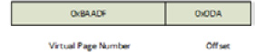

Hình 10.5 – Biểu diễn logical address

OS hoặc CPU biết physical address nào tương ứng logical address bằng cách nào? Chúng dùng page table làm translation table và biết index của mỗi entry là virtual page number, còn value tại index đó là PFN. Để truy cập physical memory từ virtual memory đã cho, trước tiên OS trích xuất offset, virtual page number, rồi duyệt page table của process để khớp virtual page number với physical page. Khi match xảy ra, có thể truy cập data trong page frame đó:

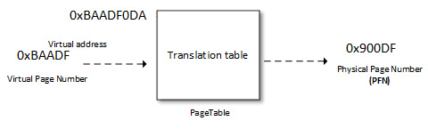

Hình 10.6 – Address translation

Offset dùng để trỏ tới đúng vị trí trong frame. Page table không chỉ chứa mapping giữa physical page number và virtual page number mà còn chứa access control information (quyền đọc/ghi, privilege, v.v.).

Sơ đồ sau mô tả address decoding và page table lookup để trỏ tới đúng vị trí trong đúng frame:

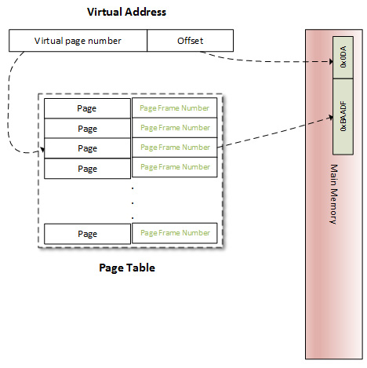

Hình 10.7 – Chuyển virtual address thành physical address

Số bit dùng biểu diễn offset được macro kernel `PAGE_SHIFT` định nghĩa. `PAGE_SHIFT` là số lần cần left-shift bit 1 để thu được giá trị `PAGE_SIZE`. Nó cũng là số lần cần right-shift logical address của page để lấy page number, tương tự với physical address để lấy page frame number. Macro này architecture-dependent và page granularity. Có thể xem giá trị như sau:

```
#ifdef CONFIG_ARM64_64K_PAGES
#define PAGE_SHIFT        16
#elif defined(CONFIG_ARM64_16K_PAGES)
#define PAGE_SHIFT       14
#else
#define PAGE_SHIFT        12
#endif
#define PAGE_SIZE        (_AC(1, UL) << PAGE_SHIFT)
```

Phần trên cho biết mặc định (trên ARM hoặc ARM64), `PAGE_SHIFT` là `12`, nghĩa là page size 4 KB. Trên ARM64, nó là `14` hoặc `16` khi lần lượt chọn page size 16 KB hoặc 64 KB.

Theo hiểu biết về address translation, page table là giải pháp chưa đầy đủ. Hãy xem vì sao. Phần lớn architecture 32-bit cần 32 bit (4 byte) để biểu diễn page table entry. Trên hệ thống như vậy (32-bit), mỗi process có user address space riêng 3 GB, nên cần 786.432 entry để mô tả và bao phủ address space của process. Điều đó tiêu tốn quá nhiều physical memory cho mỗi process chỉ để lưu memory mapping. Thực tế process thường chỉ dùng phần nhỏ nhưng rải rác trong virtual address space. Để giải quyết, khái niệm "level" được đưa vào. Page table được phân cấp theo level (page level). Không gian cần để lưu multi-level page table chỉ phụ thuộc virtual address space thực sự đang dùng thay vì tỷ lệ với size tối đa của virtual address space. Nhờ vậy, memory không dùng không còn được biểu diễn và thời gian walk-through page table giảm. Ngoài ra, mỗi table entry ở level `N` trỏ tới entry trong table level `N+1`, level 1 là level cao hơn.

Linux có thể hỗ trợ tối đa bốn paging level. Tuy nhiên, số level cần dùng phụ thuộc architecture. Sau đây mô tả từng level:

- Page Global Directory (PGD): Đây là page table cấp đầu tiên (level 1). Mỗi entry có type `pgd_t` trong kernel (thường là `unsigned long`) và trỏ tới entry trong table cấp thứ hai. Trong Linux kernel, `struct` `tastk_struct` biểu diễn mô tả process, có member (`mm`) với type `struct mm_struct`, đặc trưng và biểu diễn memory space của process. Trong `struct mm_struct` có field processor-specific, `pgd`, là pointer tới entry đầu tiên (entry 0) của page table level-1 (PGD) của process. Mỗi process có một và chỉ một PGD, có thể chứa tối đa 1.024 entry.

- Page Upper Directory (PUD): Biểu diễn cấp gián tiếp thứ hai.

- Page Middle Directory (PMD): Đây là cấp gián tiếp thứ ba.

- Page Table Entry (PTE): Đây là các leaf của tree. Nó là array `pte_t`, trong đó mỗi entry trỏ tới physical page.

LƯU Ý Không phải lúc nào cũng dùng mọi level. MMU của i.MX6 chỉ hỗ trợ page table two-level (PGD và PTE), cũng là trường hợp của gần như mọi CPU 32-bit. Khi đó, PUD và PMD đơn giản bị bỏ qua.

Cần biết MMU không lưu mapping nào. Mapping là data structure nằm trong RAM. Thay vào đó, CPU có special register gọi là Page Table Base Register (PTBR) hoặc Translation Table Base Register 0 (TTBR0), trỏ tới base (entry 0) của page table level-1 (top-level) (PGD) của process. Đó chính là nơi field `pdg` của `struct mm_struct` trỏ tới: `current->mm.pgd == TTBR0`.

Khi context switch (process mới được schedule và cấp CPU), kernel lập tức cấu hình MMU và cập nhật PTBR bằng `pgd` của process mới. Giờ khi virtual address được truyền cho MMU, nó dùng nội dung PTBR để định vị page table level-1 (PGD) của process, rồi dùng level-1 index trích từ Most-Significant Bit (MSB) của virtual address để tìm table entry thích hợp, chứa pointer tới base address của page table level-2 tương ứng. Từ base address đó, nó dùng level-2 index để tìm entry thích hợp, cứ thế cho tới PTE. ARM architecture (trường hợp này là i.MX6) có page table two-level. Khi đó, level-2 entry là PTE và trỏ tới physical page (PFN). Tại bước này chỉ tìm được physical page. Để truy cập chính xác memory location trong page, MMU trích memory offset, cũng là một phần virtual address, và trỏ tới cùng offset trong physical page.

Để dễ hiểu, mô tả trên giới hạn ở two-level paging scheme nhưng có thể dễ dàng mở rộng. Sơ đồ sau biểu diễn two-level paging scheme này:

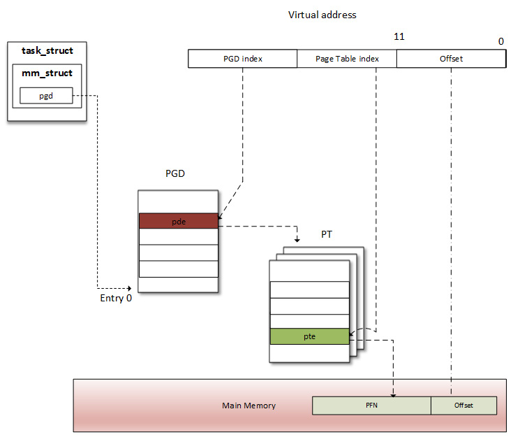

Hình 10.8 – two-level address translation scheme

Khi process cần đọc từ hoặc ghi vào memory location (dĩ nhiên đang nói virtual memory), MMU thực hiện translation trong page table của process đó để tìm entry (PTE) đúng. Virtual page number được trích (từ virtual address) và processor dùng làm index vào page table của process để lấy page table entry. Nếu có page table entry hợp lệ tại offset đó, processor lấy page frame number từ entry này. Nếu không, nghĩa là process truy cập area chưa được map trong virtual memory. Page fault khi đó phát sinh và OS cần xử lý.

Trong thực tế, address translation cần page-table walk và không phải lúc nào cũng là thao tác one-shot. Có ít nhất số memory access bằng số table level. Page table four-level cần bốn memory access. Nói cách khác, mỗi virtual access dẫn tới năm physical memory access. Khái niệm virtual memory sẽ vô ích nếu truy cập chậm hơn physical access bốn lần. May mắn là các nhà sản xuất System-on-Chip (SoC) đã nỗ lực tìm mẹo thông minh giải quyết vấn đề hiệu năng này: CPU hiện đại dùng memory nhỏ, associative và rất nhanh gọi là Translation Lookaside Buffer (TLB) để cache PTE của virtual page vừa được truy cập.

## Page lookup và TLB

Trước khi MMU tiến hành address translation, còn một bước khác. Cũng như có cache cho data vừa truy cập, có cache cho địa chỉ vừa được translate. Giống data cache tăng tốc truy cập data, TLB tăng tốc virtual address translation (đúng vậy, address translation time-consuming). Đây là Content-Addressable Memory (CAM), có key là virtual address và value là physical address. Nói cách khác, TLB là cache cho MMU. Mỗi lần memory access, trước tiên MMU kiểm tra page vừa dùng trong TLB, chứa một số virtual address range hiện đã được gán physical page.

### TLB hoạt động thế nào?

Khi memory access, CPU duyệt TLB để tìm virtual page number của page đang được truy cập. Bước này gọi là TLB lookup. Khi tìm thấy TLB entry (có match), gọi là TLB hit, CPU tiếp tục chạy và dùng PFN tìm trong TLB entry để tính target physical address. Không có page fault khi TLB hit xảy ra. Nếu tìm được translation trong TLB, virtual memory access nhanh như physical access. Nếu không có TLB hit, gọi là TLB miss.

Khi TLB miss có hai khả năng. Tùy processor type, TLB miss event có thể được software, hardware hoặc MMU xử lý:

- Software handling: CPU phát TLB miss interrupt, được OS nhận. OS duyệt page table của process để tìm PTE đúng. Nếu có entry khớp và hợp lệ, CPU cài translation mới vào TLB. Nếu không, page fault handler được thực thi.

- Hardware handling: CPU (thực ra MMU) chịu trách nhiệm duyệt page table của process bằng hardware. Nếu match, CPU thêm translation mới vào TLB. Nếu không, CPU phát page fault interrupt, được OS xử lý.

Trong cả hai trường hợp, page fault handler giống nhau, `do_page_fault()`. Function architecture-dependent; với ARM, nó được định nghĩa trong `arch/arm/mm/fault.c`.

Sau đây là sơ đồ mô tả TLB lookup, TLB hit hoặc TLB miss event:

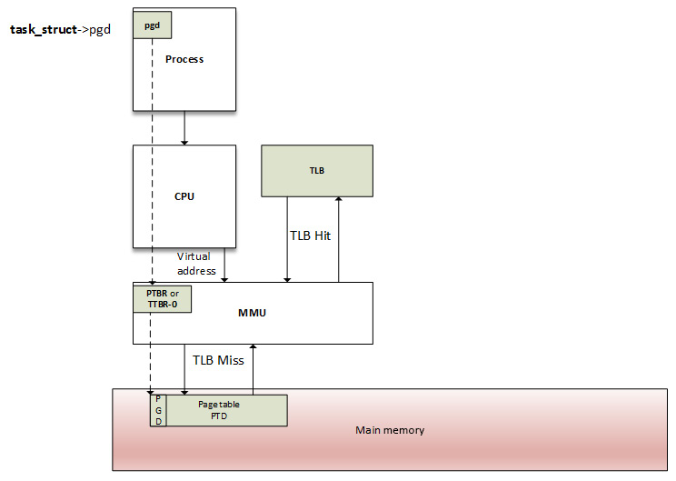

Hình 10.9 – walk-through MMU và TLB

Page table entry và page directory entry phụ thuộc architecture. OS phải bảo đảm table structure tương ứng structure mà MMU nhận biết. Trên ARM processor, vị trí translation table phải được ghi vào register `c2` của `control` coprocessor 15 (CP15), rồi enable cache và MMU bằng cách ghi vào register CP15 `c1`. Xem cả http://infocenter.arm.com/help/index.jsp?topic=/com.arm.doc.dui0056d/BABHJIBH.htm và http://infocenter.arm.com/help/index.jsp?topic=/com.arm.doc.ddi0433c/CIHFDBEJ.html để biết chi tiết.

Bây giờ đã quen với address translation scheme và cách TLB hỗ trợ chúng, có thể bàn về cấp phát memory, liên quan đến thao tác page entry bên trong.

Làm việc với cơ chế cấp phát memory và API của chúng

Trước khi vào danh sách API, hãy bắt đầu bằng hình sau, thể hiện các memory allocator tồn tại trên hệ thống Linux-based mà chúng ta sẽ bàn sau:

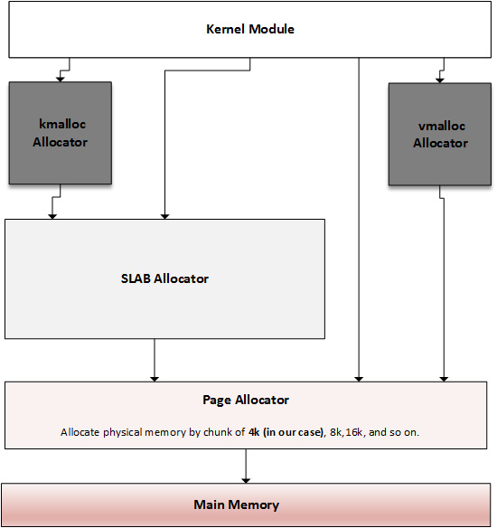

Hình 10.10 – Tổng quan kernel memory allocator

Sơ đồ trên lấy cảm hứng từ https://bootlin.com/doc/training/linux-kernel/linux-kernel-slides.pdf. Nó cho thấy có cơ chế cấp phát đáp ứng mọi loại memory request. Tùy mục đích cần memory, có thể chọn cơ chế gần mục tiêu nhất. Allocator chính và ở cấp thấp nhất là page allocator, cấp phát memory theo đơn vị page (page là đơn vị memory nhỏ nhất nó cung cấp). Tiếp đến là slab allocator, được xây trên page allocator, lấy page từ đó và chia thành thực thể memory nhỏ hơn (thông qua slab và cache). Đây là allocator mà API `kmalloc` dựa vào. Dù có thể dùng `kmalloc` để yêu cầu memory từ slab allocator, chúng ta có thể trực tiếp làm việc với slab để yêu cầu memory từ cache của nó, hoặc thậm chí xây cache riêng. Hãy bắt đầu hành trình cấp phát memory bằng allocator chính và thấp nhất, page allocator, từ đó những allocator khác phát sinh.

## Page allocator

Page allocator là low-level allocator trên hệ thống Linux, làm nền tảng cho allocator khác. Allocator này mang theo khái niệm page (virtual) và page frame (physical). Physical memory của hệ thống được chia thành block fixed-size (gọi là page frame), còn virtual memory được tổ chức thành block fixed-size gọi là page. Page size luôn bằng page frame size. Vì đây là allocator lowest-level, page là đơn vị memory nhỏ nhất OS cung cấp cho mọi memory request ở cấp thấp. Trong Linux kernel, page được biểu diễn bằng instance của structure `struct page`, được thao tác qua API chuyên dụng giới thiệu trong phần tiếp theo.

### Page allocation API

Đây là allocator lowest-level. Nó cấp phát và giải phóng block page bằng buddy algorithm. Page được cấp phát thành block có size là lũy thừa của 2 (để tận dụng tốt nhất buddy algorithm). Nghĩa là có thể cấp phát block 1 page, 2 page, 4 page, 8, 16, v.v. Page được return từ cấp phát này là physically contiguous. `alloc_pages()` là API chính, định nghĩa như sau:

```
struct page *alloc_pages(gfp_t mask, unsigned int order)
```

Function trên return `NULL` khi không thể cấp phát page. Nếu không, nó cấp phát 2<sup>order</sup> page và return pointer tới instance `struct page`, trỏ tới page đầu tiên của block được dành trước. Tuy nhiên, có helper macro `alloc_page()` dùng để cấp phát một page. Sau đây là định nghĩa:

```
#define alloc_page(gfp_mask) alloc_pages(gfp_mask, 0)
```

Macro này wrap `alloc_pages()` với order parameter đặt là `0`.

Phải dùng `__free_pages()` để giải phóng memory page được cấp phát bằng function `alloc_pages()`. Nó nhận pointer tới page đầu tiên của block đã cấp phát cùng order, giống order đã dùng khi cấp phát. Định nghĩa như sau:

```
void __free_pages(struct page *page, unsigned int order);
```

Có function khác hoạt động tương tự nhưng thay vì instance `struct page`, chúng return địa chỉ (logical) của block được dành trước. Đó là `__get_free_pages()` và `__get_free_page()`, định nghĩa như sau:

```
unsigned long __get_free_pages(gfp_t mask,
                               unsigned int order);
unsigned long get_zeroed_page(gfp_t mask);
```

`free_pages()` dùng để giải phóng page được cấp phát bằng `__get_free_pages()`. Nó nhận kernel address biểu diễn đầu region của các page đã cấp phát, cùng order phải giống order đã dùng khi cấp phát:

```
free_pages(unsigned long addr, unsigned int order);
```

Bất kể allocation type, `mask` chỉ định memory zone mà page nên được cấp phát từ đó và hành vi allocator. Các giá trị có thể có như sau:

- `GFP_USER`: Cho user memory allocation.

- `GFP_KERNEL`: Flag thường dùng cho kernel allocation.

- `GFP_HIGHMEM`: Yêu cầu memory từ zone `HIGH_MEM`.

- `GFP_ATOMIC`: Cấp phát memory theo cách atomic, không thể sleep. Dùng khi cần cấp phát memory từ interrupt context.

Tuy nhiên, cần lưu ý dù có chỉ định flag `GFP_HIGHMEM` với `__get_free_pages()` (hoặc `__get_free_page()`) hay không, flag cũng không được xét. Flag này bị mask bỏ trong các function để bảo đảm địa chỉ return không bao giờ biểu diễn high-memory page (vì mapping của chúng không tuyến tính/thường trực). Nếu cần high memory, dùng `alloc_pages()` rồi `kmap()` để truy cập.

Có thể dùng kết hợp `__free_pages()` và `free_pages()`. Khác biệt chính là `free_page()` nhận logical address làm parameter, còn `__free_page()` nhận structure `struct page`.

LƯU Ý Order tối đa có thể dùng khác nhau giữa architecture. Nó phụ thuộc kernel configuration option `FORCE_MAX_ZONEORDER`, mặc định là `11`. Khi đó số page có thể cấp phát là 1.024. Nghĩa là trên hệ thống 4 KB-sized, có thể cấp phát tối đa 1.024 x 4 KB = 4 MB. Trên ARM64, order tối đa thay đổi theo page size đã chọn. Nếu page size 16 KB, order tối đa là `12`; nếu page size 64 KB, order tối đa là `14`. Giới hạn size cho mỗi lần cấp phát này cũng đúng với `kmalloc()`.

Function chuyển đổi page và address

Kernel cung cấp các function thuận tiện để chuyển qua lại giữa instance `struct` `page` và logical address tương ứng, hữu ích ở những thời điểm khác nhau khi làm việc với memory. Function `page_to_virt()` dùng để chuyển struct page (ví dụ được `alloc_pages()` return) thành kernel logical address. Ngược lại, `virt_to_page()` nhận kernel logical address và return instance `struct page` tương ứng (như thể được cấp phát bằng function `alloc_pages()`). Cả `virt_to_page()` và `page_to_virt()` được khai báo trong `<asm/page.h>` như sau:

```
struct page *virt_to_page(void *kaddr);
void *page_to_virt(struct page *pg)
```

Có macro khác, `page_address()`, chỉ wrap `page_to_virt()` và được khai báo như sau:

```
void *page_address(const struct page *page)
```

Nó return logical address của page truyền trong parameter.

## Slab allocator

Slab allocator là allocator mà `kmalloc()` dựa vào. Mục đích chính là loại bỏ fragmentation do cấp phát/giải phóng memory mà buddy system gây ra khi cấp phát memory small-size, và tăng tốc cấp phát memory cho object thường dùng.

### Tìm hiểu buddy algorithm

Để cấp phát memory, size yêu cầu được làm tròn lên lũy thừa của hai, và buddy allocator tìm trong danh sách thích hợp. Nếu danh sách yêu cầu không có entry, entry từ danh sách cao hơn kế tiếp (có block size gấp đôi danh sách trước) được chia thành hai nửa (gọi là buddy). Allocator dùng nửa đầu, nửa còn lại được thêm vào danh sách thấp hơn kế tiếp. Đây là cách đệ quy, dừng khi buddy allocator tìm thành công block có thể chia hoặc đạt block size lớn nhất mà không còn free block.

Nghiên cứu trường hợp sau lấy cảm hứng chủ yếu từ http://dysphoria.net/OperatingSystems1/4\_allocation\_buddy\_system.html. Ví dụ, nếu allocation size tối thiểu là 1K byte và memory size là 1 MB, buddy allocator tạo danh sách rỗng cho khoảng trống 1K byte, danh sách rỗng cho khoảng trống 2K byte, một cho 4K byte, 8K, 16K, 32K, 64K, 128K, 256K, 512K và một danh sách cho khoảng trống 1 MB. Ban đầu tất cả rỗng, trừ danh sách 1 MB chỉ có một khoảng trống.

Giờ hãy tưởng tượng cần cấp phát block 70K. Buddy allocator làm tròn lên 128K, rồi chia 1 MB thành hai block 512K, sau đó 256K, cuối cùng 128K, và cấp một block 128K cho người dùng. Sau đây là sơ đồ tổng hợp tình huống này:

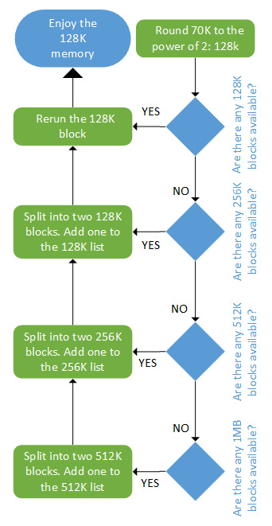

Hình 10.11 – Cấp phát bằng buddy algorithm

Giải phóng nhanh như cấp phát. Sau đây là hình tổng hợp deallocation algorithm:

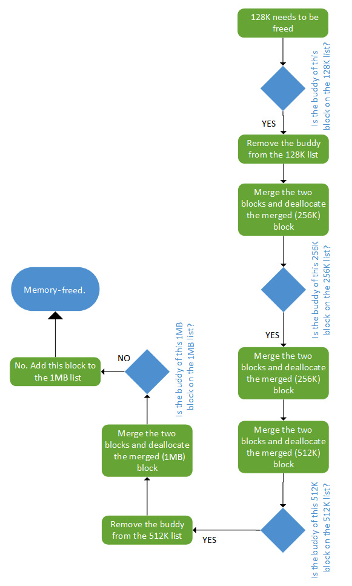

Hình 10.12 – Giải phóng bằng buddy algorithm

Trong sơ đồ trên, có thể thấy cách giải phóng memory bằng buddy algorithm hoạt động. Trong phần tiếp theo, chúng ta nghiên cứu slab allocator, được xây trên algorithm này.

### Hành trình tìm hiểu slab allocator

Trước khi giới thiệu slab allocator, hãy định nghĩa một số thuật ngữ nó dùng:

- Slab: Vùng physical memory liên tục gồm nhiều page frame. Mỗi slab được chia thành những khối bằng nhau cùng size, dùng để lưu type kernel object cụ thể như object `inode` và `mutexe`. Có thể xem slab là array các block cùng size.

- Cache: Gồm một hoặc nhiều slab trong linked list. Cache chỉ lưu object cùng type (ví dụ chỉ object `inode`).

Slab có thể ở một trong các trạng thái sau:

- Empty: Mọi object (khối) trên slab được đánh dấu free.

- Partial: Trong slab có cả object đang dùng và free.

- Full: Mọi object trên slab được đánh dấu đang dùng.

Memory allocator chịu trách nhiệm xây cache. Ban đầu mỗi slab rỗng và được đánh dấu như vậy. Khi cấp phát memory cho kernel object, allocator tìm vị trí free cho object trên partial/free slab trong cache dành cho object type đó. Nếu không tìm được, allocator cấp phát slab mới và thêm vào cache. Object mới được cấp phát từ slab này, và slab được đánh dấu partial. Khi code dùng xong memory (memory-freed), object đơn giản được trả về slab cache trong trạng thái đã khởi tạo. Đó là lý do kernel cũng cung cấp helper function để lấy memory được khởi tạo bằng 0, cho phép loại bỏ nội dung trước đó. Slab giữ reference count về số object đang dùng để khi mọi slab trong cache đều full và có yêu cầu object khác, slab allocator chịu trách nhiệm thêm slab mới.

Sơ đồ sau minh họa khái niệm slab, cache và các trạng thái khác nhau:

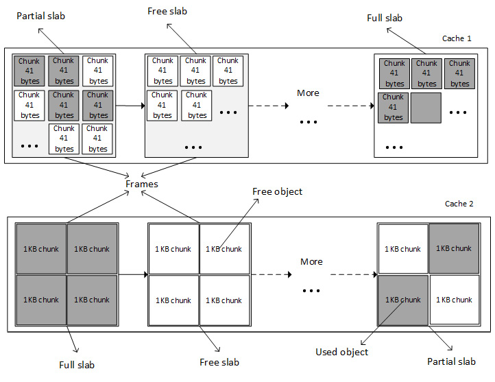

Hình 10.13 – Slab và cache

Điều này hơi giống tạo allocator riêng cho per-object. Kernel cấp phát một cache cho mỗi object type và chỉ object cùng type được lưu trong cache (ví dụ chỉ structure `task_struct`).

Có nhiều loại slab allocator trong kernel, tùy nhu cầu gọn nhẹ, cache-friendliness hoặc tốc độ thuần túy. Chúng gồm:

- SLAB (slab allocator), cache-friendly nhất có thể. Đây là memory allocator ban đầu.

- SLOB (simple list of blocks), gọn nhất có thể, thích hợp cho hệ thống có rất ít memory, chủ yếu embedded system với vài megabyte hoặc vài chục megabyte.

- SLUB (unqueued allocator), khá đơn giản và cần ít instruction hơn. Đây là memory allocator thay thế next-generation, cải tiến và thay thế SLAB. Nó dựa trên mô hình SLAB nhưng sửa một số thiếu sót của SLAB, đặc biệt trên hệ thống có nhiều processor. Đây đã và vẫn là memory allocator mặc định trong Linux kernel từ kernel 2.6.23 (`CONFIG_SLUB=y`). Xem patch này: https://git.kernel.org/pub/scm/linux/kernel/git/torvalds/linux.git/commit/?id=a0acd820807680d2ccc4ef3448387fcdbf152c73.

LƯU Ý Thuật ngữ slab đã trở thành tên chung chỉ chiến lược cấp phát memory dùng object cache, cho phép cấp phát và giải phóng kernel object hiệu quả. Không nên nhầm với allocator cùng tên SLAB, ngày nay đã được SLUB thay thế.

## Cấp phát bằng họ kmalloc

`kmalloc()` là kernel memory allocation function. Nó cấp phát physically contiguous memory (nhưng không nhất thiết page-aligned). Hình sau mô tả cách memory được cấp phát và return cho caller:

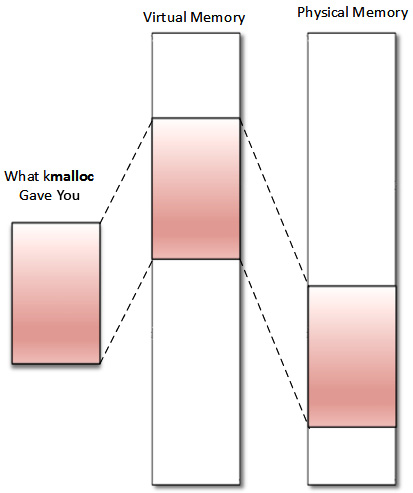

Hình 10.14 – Tổ chức memory của kmalloc

Allocation API này là memory allocation API tổng quát và ở highest-level trong kernel, dựa trên SLAB allocator. Memory được `kmalloc()` return có kernel logical address vì được cấp phát từ region `LOW_MEM` trừ khi chỉ định `HIGH_MEM`. Nó được khai báo trong `<linux/slab.h>`, header cần include trước khi dùng API. Định nghĩa như sau:

```
void *kmalloc(size_t size, int flags);
```

Trong code trên, `size` chỉ size memory cần cấp phát (theo byte). `flags` xác định cách và nơi cấp phát memory. Flag sẵn có giống page allocator (`GFP_KERNEL`, `GFP_ATOMIC`, `GFP_DMA`, v.v.), có định nghĩa sau:

- `GFP_KERNEL`: Đây là flag tiêu chuẩn. Không thể dùng trong interrupt handler vì code có thể sleep. Nó luôn return memory từ zone `LOM_MEM` (vì thế là logical address).

- `GFP_ATOMIC`: Bảo đảm tính atomic của allocation. Dùng khi cần cấp phát từ interrupt context. Vì memory được cấp phát từ emergency pool hoặc memory dự phòng, không nên lạm dụng.

- `GFP_USER`: Cấp phát memory cho user space process. Memory khi đó khác biệt và tách khỏi memory cấp phát cho kernel.

- `GFP_NOWAIT`: Dùng nếu allocation được thực hiện trong atomic context, ví dụ interrupt handler. Flag này ngăn direct reclaim và I/O operation cũng như filesystem operation khi cấp phát. Khác `GFP_ATOMIC`, nó không dùng memory reserve. Vì vậy, dưới memory pressure, allocation `GFP_NOWAIT` có khả năng thất bại.

- `GFP_NOIO`: Giống `GFP_USER`, có thể block, nhưng khác `GFP_USER`, nó không bắt đầu disk I/O. Nói cách khác, ngăn mọi I/O operation khi cấp phát. Flag này chủ yếu được dùng trong block/disk layer.

- `GFP_NOFS`: Dùng direct reclaim nhưng không dùng filesystem interface nào.

- `__GFP_NOFAIL`: Triển khai virtual memory phải thử lại vô hạn vì caller không thể xử lý allocation failure. Allocation có thể đình trệ vô hạn nhưng không bao giờ thất bại. Vì vậy, kiểm tra thất bại là vô ích.

- `GFP_HIGHUSER`: Yêu cầu cấp phát memory từ zone `HIGH_MEMORY`.

- `GFP_DMA`: Cấp phát memory từ `DMA_ZONE`.

Khi cấp phát memory thành công, `kmalloc()` return địa chỉ virtual (logical, trừ khi chỉ định high memory) của khối được cấp phát, bảo đảm physically contiguous. Khi lỗi, return `NULL`.

Tuy nhiên, với device driver, nên dùng managed version `devm_kmalloc()`, không nhất thiết cần giải phóng memory vì memory core xử lý nội bộ. Sau đây là prototype:

```
void *devm_kmalloc(struct device *dev, size_t size,
                   gfp_t gfp);
```

Trong prototype trên, `dev` là device được cấp phát memory cho nó.

Lưu ý `kmalloc()` dựa vào SLAB cache khi cấp phát memory size nhỏ. Vì lý do này, nội bộ nó có thể làm tròn size vùng cấp phát lên size SLAB cache nhỏ nhất chứa được memory đó. Điều này có thể return nhiều memory hơn yêu cầu. Tuy nhiên, có thể dùng `ksize()` để xác định lượng memory thực tế đã cấp phát (size theo byte). Thậm chí có thể dùng memory bổ sung này dù ban đầu chỉ định lượng memory nhỏ hơn trong lời gọi `kmalloc()`.

Sau đây là prototype `ksize`:

```
size_t ksize(const void *objp);
```

Ở trên, `objp` là object có size thực theo byte sẽ được return.

`kmalloc()` có cùng giới hạn size với page-related allocation API. Ví dụ, với `FORCE_MAX_ZONEORDER` mặc định là `11`, size tối đa cho mỗi lần cấp phát bằng `kmalloc()` là `4 MB`.

Function `kfree` dùng để giải phóng memory được `kmalloc()` cấp phát. Định nghĩa như sau:

```
void kfree(const void *ptr)
```

Sau đây là ví dụ cấp phát và giải phóng memory lần lượt bằng `kmalloc()` và `kfree()`:

```
#include <linux/init.h>
#include <linux/module.h>
#include <linux/slab.h>
#include <linux/mm.h>
static void *ptr;
static int alloc_init(void)
{
    size_t size = 1024; /* allocate 1024 bytes */
    ptr = kmalloc(size,GFP_KERNEL);
    if(!ptr) {
        /* handle error */
        pr_err("memory allocation failed\n");
        return -ENOMEM;
    } else {
        pr_info("Memory allocated successfully\n");
    }
    return 0;
}
static void alloc_exit(void)
{
    kfree(ptr);
    pr_info("Memory freed\n");
}
module_init(alloc_init);
module_exit(alloc_exit);
MODULE_LICENSE("GPL");
MODULE_AUTHOR("John Madieu");
```

Kernel cung cấp các helper khác dựa trên `kmalloc()` như sau:

```
void kzalloc(size_t size, gfp_t flags);
void kzfree(const void *p);
void *kcalloc(size_t n, size_t size, gfp_t flags);
void *krealloc(const void *p, size_t new_size,
                gfp_t flags);
```

`krealloc()` trong kernel tương đương function `realloc()` của user space. Vì memory do `kmalloc()` return giữ nội dung từ lần dùng trước, có thể yêu cầu memory được `kmalloc` cấp phát và điền 0 bằng `kzalloc()`. `kzfree()` là freeing function cho `kzalloc()`, còn `kcalloc()` cấp phát memory cho array; parameter `n` và `size` lần lượt biểu diễn số phần tử trong array và size mỗi phần tử.

Vì `kmalloc()` return memory area trong permanent mapping của kernel, logical address có thể được chuyển thành physical address bằng `virt_to_phys()` hoặc I/O bus address bằng `virt_to_bus()`. Nội bộ các macro này gọi `__pa()` hoặc `__va()` nếu cần. Physical address (`virt_to_phys(kmalloc'ed address)`), right-shift `PAGE_SHIFT` lần, tạo PFN (`pfn`) của page đầu tiên mà khối được cấp phát từ đó.

## Cấp phát bằng họ vmalloc

`vmalloc()` là kernel allocator cuối cùng bàn trong sách. Nó return memory chỉ liên tục trong virtual address space. Frame bên dưới rải rác như sơ đồ sau:

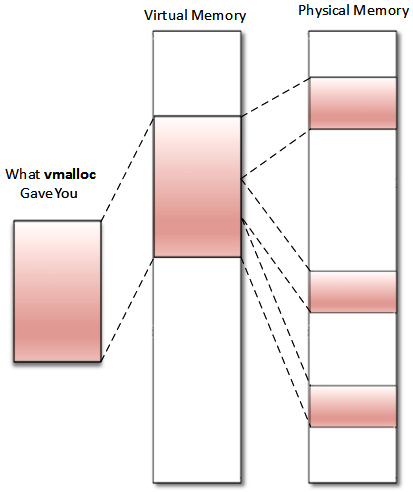

Hình 10.15 – Tổ chức memory của vmalloc

Trong sơ đồ trên, có thể thấy memory không physically contiguous. Ngoài ra, memory do `vmalloc()` return luôn đến từ zone `HIGH_MEM`. Địa chỉ return thuần virtual (không logical) và không thể chuyển thành physical address hoặc bus address vì không bảo đảm memory bên dưới physically contiguous. Nghĩa là memory do `vmalloc()` return không thể dùng ngoài microprocessor (không dễ dùng cho DMA). Dùng `vmalloc()` để cấp phát memory cho chuỗi page lớn chỉ tồn tại trong software, như network buffer, là phù hợp (ví dụ dùng để cấp phát một page không hợp lý). Cần lưu ý `vmalloc()` chậm hơn `kmalloc()` và page allocator function vì phải vừa lấy memory vừa xây page table, hoặc thậm chí remap vào virtually contiguous range, trong khi `kmalloc()` không bao giờ làm điều đó.

Trước khi dùng API `vmalloc()`, nên include header này:

```
#include <linux/vmalloc.h>
```

Sau đây là prototype của họ `vmalloc`:

```
void *vmalloc(unsigned long size);
void *vzalloc(unsigned long size);
void vfree(void *addr);
```

Trong các prototype trên, argument size là size memory cần cấp phát. Khi cấp phát thành công, nó return địa chỉ byte đầu tiên của memory block được cấp phát. Khi thất bại, return `NULL`. `vfree()` làm ngược lại và giải phóng memory do `vmalloc()` cấp phát. Biến thể `vzalloc` return memory được khởi tạo bằng 0.

Sau đây là ví dụ dùng `vmalloc`:

```
#include<linux/init.h>
#include<linux/module.h>
#include <linux/vmalloc.h>
Static void *ptr;
static int alloc_init(void)
{
    unsigned long size = 8192; /* 2 x 4KB */
    ptr = vmalloc(size);
    if(!ptr)
    {
        /* handle error */
        pr_err("memory allocation failed\n");
        return -ENOMEM;
    } else {
        pr_info("Memory allocated successfully\n");
    }
    return 0;
}
static void my_vmalloc_exit(void)
{
    vfree(ptr);
    pr_info("Memory freed\n");
}
module_init(my_vmalloc_init);
module_exit(my_vmalloc_exit);
MODULE_LICENSE("GPL");
MODULE_AUTHOR("john Madieu, john.madieu@gmail.com");
```

`vmalloc()` cấp phát physical page non-contiguous và map chúng vào contiguous virtual address region. Những virtual address `vmalloc` này bị giới hạn trong vùng kernel space, có ranh giới `VMALLOC_START` và `VMALLOC_END`, phụ thuộc architecture. Kernel cung cấp `/proc/vmallocinfo` để hiển thị mọi memory được `vmalloc` cấp phát trên hệ thống.

## Câu chuyện ngắn về cấp phát process memory bên trong

`vmalloc()` ưu tiên zone `HIGH_MEM` nếu có, thích hợp với process vì chúng cần mapping ngầm định và động. Tuy nhiên, vì memory là resource hữu hạn, kernel hoãn cấp phát frame page (physical page) cho tới khi cần (khi truy cập, đọc hoặc ghi). Cấp phát on-demand này gọi là lazy allocation, loại bỏ nguy cơ cấp phát page không bao giờ dùng.

Mỗi khi page được yêu cầu, chỉ page table được cập nhật; phần lớn trường hợp tạo entry mới, nghĩa là chỉ virtual memory được cấp phát. Interrupt gọi là `page fault` chỉ phát sinh khi người dùng truy cập page. Interrupt này có handler chuyên dụng gọi là `page fault handler`, được MMU gọi để đáp ứng nỗ lực truy cập virtual memory không thành công ngay lập tức.

Thực tế, page fault interrupt phát sinh bất kể access type (đọc, ghi hay thực thi) tới page có page table entry chưa được đặt permission bit thích hợp cho access type đó. Phản hồi interrupt rơi vào một trong ba cách sau:

- Hard fault: Khi page không nằm ở đâu (không trong physical memory cũng không trong memory-mapped file), nghĩa là handler không thể giải quyết fault ngay. Handler thực hiện I/O operation để chuẩn bị physical page cần giải quyết fault và có thể suspend process bị ngắt, chuyển sang process khác trong khi hệ thống xử lý vấn đề.

- Soft fault: Khi page nằm ở nơi khác trong memory (trong working set của process khác). Nghĩa là fault handler có thể giải quyết bằng cách lập tức gắn physical memory page vào page table entry thích hợp, điều chỉnh entry và tiếp tục instruction bị ngắt.

- Fault không thể giải quyết: Dẫn tới bus error hoặc segmentation violation (segv). Segmentation Violation Signal (SIGSEGV) được gửi tới process có lỗi, kết thúc nó (hành vi mặc định), trừ khi đã cài signal handler cho SIGSEV để thay đổi hành vi mặc định.

Tóm lại, memory mapping thường bắt đầu không gắn physical page nào, chỉ định nghĩa virtual address range không có physical memory tương ứng. Physical memory thực tế được cấp phát sau để đáp ứng page fault exception khi memory được truy cập, vì kernel cung cấp flag xác định nỗ lực truy cập có hợp lệ hay không và chỉ định hành vi page fault handler. Vì vậy, `brk()` trong user space, `mmap()` và tương tự cấp phát (virtual) space, nhưng physical memory được gắn sau.

LƯU Ý Page fault trong interrupt context gây double fault interrupt, thường khiến kernel panic (gọi function `panic()`). Đó là lý do memory cấp phát trong interrupt context được lấy từ memory pool, không phát sinh page fault interrupt. Nếu interrupt xảy ra trong khi double fault đang được xử lý, triple fault exception được tạo, khiến CPU shutdown và OS reboot ngay. Hành vi này phụ thuộc architecture.

### Trường hợp Copy on Write

Xét memory region hoặc data cần chia sẻ giữa hai hoặc nhiều task. Copy on Write (CoW) (được dùng nhiều với system call `fork()`) là cơ chế cho phép operating system không cấp phát memory ngay và không copy nó cho từng task chia sẻ data, cho tới khi một task sửa đổi (ghi vào) nó — khi đó memory được cấp phát cho private copy (vì thế có tên CoW). Xét shared memory page để mô tả bên dưới cách `page fault handler` quản lý CoW:

1\. Khi page cần được chia sẻ, page table entry (có target đánh dấu un-writable) trỏ tới shared page này được thêm

vào process page table của từng process truy cập shared page. Đây là initial mapping.

2\. Mapping dẫn tới tạo VMA cho mỗi process, được thêm vào VMA list của từng process. Shared page được

gắn với các VMA này (tức VMA đã tạo cho mỗi process), lần này được đánh dấu có thể ghi. Không có gì khác xảy ra chừng nào chưa process nào thử sửa nội dung shared page.

3\. Khi một process thử ghi vào shared page (ở lần ghi đầu tiên), `fault handler` nhận thấy khác biệt

giữa PTE flag (đã đánh dấu un-writable) và VMA flag (đánh dấu có thể ghi), nghĩa là "Này, đây là CoW." Sau đó nó cấp phát physical page, gán cho PTE đã thêm trước đó (thay shared page đã gán), cập nhật PTE flag (một flag tương ứng đánh dấu PTE có thể ghi), flush TLB entry, rồi thực thi function `do_wp_page()`, copy nội dung từ shared address tới vị trí mới, riêng cho process đã phát lệnh ghi. Những lần ghi sau của process này được thực hiện trên private copy, không phải shared page.

Giờ có thể khép lại phần mở rộng về cấp phát process memory mà chúng ta đã quen thuộc. Chúng ta cũng đã học lazy allocation và CoW là gì, đồng thời có thể kết thúc tìm hiểu cấp phát memory in-kernel. Tại đây, có thể chuyển sang I/O memory operation để giao tiếp hardware device.

## Làm việc với I/O memory để giao tiếp hardware

Đến đây, chúng ta làm việc với main memory và thường nghĩ memory theo nghĩa RAM. Tuy nhiên, RAM là một peripheral trong nhiều peripheral, có memory range tương ứng size của nó. RAM đặc biệt ở chỗ được kernel quản lý hoàn toàn, trong suốt với người dùng. RAM controller kết nối tới CPU data/control/address bus, chia sẻ với device khác. Những device đó gọi là memory-mapped device do vị trí liên quan tới các bus, và giao tiếp (input/output operation) với chúng gọi là memory-mapped I/O. Chúng gồm controller của nhiều bus do CPU cung cấp (USB, UART, SPI, I2C, PCI và SATA), cũng như IP như VPU, GPU, Image Processing Unit (IPU) và Secure Non-Volatile Store (SNVS, tính năng trong i.MX chip của NXP).

Trên hệ thống 32-bit, CPU có tối đa 2<sup>32</sup> lựa chọn memory location (từ `0` tới `0xFFFFFFFF`). Vấn đề là không phải mọi địa chỉ đó đều định địa chỉ RAM. Một số dành cho peripheral access và gọi là I/O memory. I/O memory được chia thành range size khác nhau và gán cho peripheral để mỗi khi CPU nhận physical memory access request từ kernel, nó có thể chuyển tới device có address range chứa physical address đã chỉ định. Address range gán cho mỗi device (kể cả RAM controller) được mô tả trong SoC data sheet, thường trong phần gọi là memory map.

Vì kernel chỉ làm việc với virtual address (qua page table), truy cập địa chỉ cụ thể của device đòi hỏi địa chỉ được map trước (đặc biệt đúng nếu có IOMMU, tương đương MMU cho I/O device). Mapping địa chỉ memory ngoài RAM module này gây khoảng trống kinh điển trong system address space (vì memory và I/O chia sẻ address space).

Sơ đồ sau mô tả cách CPU nhìn thấy I/O memory và main memory:

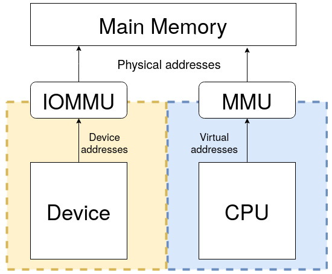

Hình 10.16 – Tổng quan (IO)MMU và main memory

LƯU Ý

Luôn nhớ CPU nhìn main memory (RAM) qua MMU và device qua IOMMU.

Ưu điểm chính là cùng instruction được dùng để truyền data tới memory và I/O, giảm software coding logic. Tuy nhiên, có nhược điểm. Đầu tiên là toàn bộ address bus phải được decode đầy đủ cho mỗi device, tăng chi phí thêm hardware vào máy, dẫn tới architecture phức tạp.

Bất tiện khác là trên hệ thống 32-bit, dù cài RAM 4 GB, OS không bao giờ dùng toàn bộ vì khoảng trống do memory-mapped device chiếm một phần address space. x86 architecture áp dụng cách khác gọi là Port Input Output (PIO), trong đó register được truy cập qua bus chuyên dụng bằng instruction đặc biệt (thường là `in` và `out` trong assembler). Khi đó, device register không memory-mapped và hệ thống có thể định địa chỉ toàn bộ address range cho RAM.

## Truy cập PIO device

Trên hệ thống dùng PIO, I/O device được map vào address space riêng. Thường thực hiện bằng tập signal line khác để phân biệt memory access với device access. Hệ thống như vậy có hai address space: một cho system memory đã bàn, một cho I/O port, đôi khi gọi là port address space và giới hạn 65.536 port. Đây là phương thức cũ, hiện rất ít gặp.

Kernel export một số function (symbol) để xử lý I/O port. Trước khi truy cập port region, phải báo kernel rằng đang dùng port range bằng function `request_region()`, return `NULL` khi lỗi. Sau khi dùng xong region, phải gọi `release_region()`. Cả hai được khai báo trong `linux/ioport.h` như sau:

```
struct ressource *request_region(unsigned long start,
                         unsigned long len, char *name);
void release_region(unsigned long start,
                         unsigned long len);
```

Đây là các function mang tính thông báo lịch sự, báo kernel ý định sử dụng/giải phóng region gồm `len` port bắt đầu từ `start`. Parameter `name` nên được đặt bằng device name hoặc tên có ý nghĩa. Tuy nhiên, dùng chúng không bắt buộc. Nó ngăn hai hoặc nhiều driver tham chiếu cùng port range. Có thể xem port hiện đang dùng trên hệ thống bằng cách đọc nội dung file `/proc/ioports`.

Sau khi dành trước region thành công, có thể dùng API sau để truy cập port:

```
u8 inb(unsigned long addr)
u16 inw(unsigned long addr)
u32 inl(unsigned long addr)
```

Các function trên lần lượt đọc data size (độ rộng) 8, 16 hoặc 32-bit-sized từ port `addr`. Write variant được định nghĩa như sau:

```
void outb(u8 b, unsigned long addr)
void outw(u16 b, unsigned long addr)
void outl(u32 b, unsigned long addr)
```

Các function trên ghi data `b`, có thể size 8, 16 hoặc 32-bit-sized, vào port `addr`.

Việc PIO dùng tập instruction khác để truy cập I/O port hoặc MMIO là nhược điểm, vì cần nhiều instruction hơn normal memory để làm cùng tác vụ. Ví dụ, kiểm tra 1-bit chỉ cần một instruction trong MMIO, trong khi PIO cần đọc data vào register trước khi kiểm tra bit, tức nhiều hơn một instruction. Một ưu điểm PIO là cần ít logic hơn để decode address, giảm chi phí thêm hardware device.

## Truy cập MMIO device

Main memory address nằm trong cùng address space với MMIO address. Kernel map device register tới phần address space thường được RAM sử dụng để việc đăng ký I/O device diễn ra thay cho system memory (tức RAM). Vì vậy, giao tiếp I/O device tương tự đọc và ghi memory address dành cho device đó.

Nếu cần truy cập, chẳng hạn 4 MB I/O memory gán cho IPU-2 (từ `0x02400000` tới `0x027fffff`), CPU (qua IOMMU) có thể gán địa chỉ `0x10000000` tới `0x103FFFFF`, dĩ nhiên là virtual. Điều này không tiêu thụ physical RAM (trừ xây và lưu page table entry), chỉ address space (giờ bạn thấy vì sao hệ thống 32-bit gặp vấn đề với expansion card như GPU high-end có hàng GB RAM chưa?), nghĩa là kernel không còn dùng virtual memory range đó để map RAM. Bây giờ, memory write/read tới chẳng hạn `0x10000004` được chuyển tới IPU-2 device. Đây là tiền đề cơ bản của memory-mapped I/O.

Giống PIO, có MMIO function để báo kernel ý định dùng memory region. Nhớ rằng thông tin này chỉ mang tính dành trước. Đó là `request_mem_region()` và `release_mem_region()`, định nghĩa như sau:

```
struct ressource* request_mem_region(unsigned long start,
                           unsigned long len, char *name)
void release_mem_region(unsigned long start,
                        unsigned long len)
```

Đây chỉ là những function mang tính thông báo lịch sự, dù function đầu xây và return structure `resource` thích hợp tương ứng đầu và độ dài memory region, còn function sau giải phóng nó.

Tuy nhiên, với device driver, nên dùng managed variant vì giúp đơn giản code và đảm nhận giải phóng resource. Managed version định nghĩa như sau:

```
struct ressource* devm_request_region(
               struct device *dev, resource_size_t start,
               resource_size_t n, const char *name);
```

Ở trên, `dev` là device sở hữu memory region, còn parameter khác giống non-managed version. Khi yêu cầu thành công, memory region hiển thị trong `/proc/iomem`, file chứa memory region đang dùng trên hệ thống.

Trước khi truy cập memory region (và sau khi yêu cầu thành công), region phải được map vào kernel address space bằng các function đặc biệt architecture-dependent (dùng IOMMU để xây page table, vì thế không thể gọi từ interrupt handler). Đó là `ioremap()` và `iounmap()`, cũng xử lý cache coherency. Định nghĩa như sau:

```
void __iomem *ioremap(unsigned long phys_addr,
                      unsigned long size);
void iounmap(void __iomem *addr);
```

Trong các function trên, `phys_addr` tương ứng physical address của device được chỉ định trong device tree hoặc board file. `size` tương ứng size region cần map. `ioremap()` return pointer `__iomem void` tới đầu mapped region. Một lần nữa, nên dùng managed version, có định nghĩa sau:

```
void __iomem *devm_ioremap(struct device *dev,
                           resource_size_t offset,
                           resource_size_t size);
```

LƯU Ý

`ioremap()` xây page table mới giống `vmalloc()`. Tuy nhiên, nó không thực sự cấp phát memory mà return special virtual address có thể dùng để truy cập I/O address đã chỉ định. Trên hệ thống 32-bit, việc MMIO chiếm physical memory address space để tạo mapping cho memory-mapped I/O device là nhược điểm vì ngăn hệ thống dùng memory bị chiếm cho mục đích RAM thông thường.

Vì mapping API architecture-dependent, không nên dereference (tức lấy/đặt giá trị bằng cách đọc/ghi qua pointer) những pointer đó, dù trên một số architecture có thể làm vậy. Kernel cung cấp portable function để truy cập memory-mapped region. Đó là:

```
unsigned int ioread8(void __iomem *addr);
unsigned int ioread16(void __iomem *addr);
unsigned int ioread32(void __iomem *addr);
void iowrite8(u8 value, void __iomem *addr);
void iowrite16(u16 value, void __iomem *addr);
void iowrite32(u32 value, void __iomem *addr);
```

Các function trên lần lượt đọc và ghi giá trị 8-, 16- và 32-bit.

LƯU Ý

`__iomem` là kernel cookie được Sparse sử dụng, semantic checker mà kernel dùng để tìm lỗi code có thể xảy ra. Nó ngăn trộn cách dùng normal pointer (như dereference) với I/O memory pointer.

Trong phần này, chúng ta đã học cách map memory của memory-mapped device vào kernel address space để truy cập register bằng API chuyên dụng. Điều này phục vụ điều khiển in-chip device.

## Memory (re)mapping

Đôi khi cần remap kernel memory, từ kernel sang user space hoặc từ high memory sang low memory region (từ kernel sang kernel space). Trường hợp phổ biến là remap kernel memory sang user space, nhưng cũng có trường hợp khác như khi cần truy cập high memory.

## Tìm hiểu cách dùng kmap

Linux kernel map thường trực 896 MB address space của nó tới 896 MB thấp của physical memory (low memory). Trên hệ thống 4 GB, kernel chỉ còn 128 MB để map 3,2 GB physical memory còn lại (high memory). Tuy nhiên, kernel có thể định địa chỉ trực tiếp low memory nhờ permanent mapping one-to-one. Với high memory (memory trước 896 MB), kernel phải map region high memory được yêu cầu vào address space của nó, và 128 MB đã nêu được dành riêng cho việc này. Function dùng thực hiện thủ thuật đó là `kmap()`. Function `kmap()` dùng để map page đã cho vào kernel address space.

```
void *kmap(struct page *page);
```

`page` là pointer tới structure struct page cần map. Khi high memory page được cấp phát, không thể định địa chỉ trực tiếp nó. `kmap()` là function được gọi để tạm map high memory vào kernel address space. Mapping tồn tại tới khi `kunmap()` được gọi:

```
void kunmap(struct page *page);
```

Tạm thời nghĩa là nên hoàn tác mapping ngay khi không còn cần. Cách lập trình tốt là unmap high memory mapping khi không còn yêu cầu.

Function này hoạt động với cả high memory và low memory. Tuy nhiên, nếu page structure nằm trong low memory, chỉ virtual address của page được return (vì low-memory page đã có permanent mapping). Nếu page thuộc high memory, permanent mapping được tạo trong kernel page table và địa chỉ được return:

```
void *kmap(struct page *page)
{
    BUG_ON(in_interrupt());
    if (!PageHighMem(page))
        return page_address(page);
    return kmap_high(page);
}
```

`kmap_high()` và `kunmap_high()`, định nghĩa trong `mm/highmem.c`, là cốt lõi các triển khai này. Tuy nhiên, `kmap()` map page vào kernel space bằng tập page table physically contiguous được cấp phát trong boot. Vì các page table đều kết nối, dễ di chuyển mà không phải tham khảo page directory liên tục. Cần lưu ý page table `kmap` tương ứng kernel virtual address bắt đầu từ `PKMAP BASE`, khác nhau theo architecture, và reference count cho page table entry được giữ trong array riêng gọi là

```
pkmap_count.
```

Page frame của page cần map vào kernel space được truyền cho `kmap()` làm argument `struct *page`, có thể là normal page hoặc `HIGHMEM` page; trong trường hợp đầu, `kmap()` đơn giản return direct-mapped address. Với page `HIGHMEM`, `kmap()` tìm trong page table `kmap` (đã cấp phát lúc boot) entry chưa dùng — tức entry có giá trị `pkmap_count` bằng 0. Nếu không có, nó sleep và chờ process khác `kunmap` một page. Khi tìm được entry chưa dùng, nó chèn physical page address của page muốn map, đồng thời tăng reference count `pkmap_count` tương ứng page table entry, và return virtual address cho caller. `page->virtual` của page struct cũng được cập nhật phản ánh mapped address.

`kunmap()` nhận `struct page*` biểu diễn page cần unmap. Nó tìm entry `pkmap_count` cho virtual address của page và giảm giá trị đó.

## Map kernel memory sang user space

Map physical address là một trong những operation phổ biến nhất, đặc biệt trong embedded system. Đôi khi bạn muốn chia sẻ một phần kernel memory với user space. Như đã nói, CPU chạy trong unprivileged mode khi chạy ở user space. Để process truy cập kernel memory region, cần remap region đó vào process address space.

### Dùng remap\_pfn\_range

`remap_pfn_range()` map physically contiguous memory vào process address space thông qua VMA. Nó đặc biệt hữu ích để triển khai file operation `mmap`, backend của system call `mmap()`.

Sau khi gọi system call `mmap()` trên file descriptor (file device-backed hoặc không), với region start và length, CPU chuyển sang privileged mode. Kernel code ban đầu tạo VMA gần như rỗng lớn bằng mapping region yêu cầu và chạy callback `file_operations.mmap` tương ứng, truyền VMA làm parameter. Đến lượt callback này nên gọi `remap_pfn_range()`. Function cập nhật VMA và tạo bản PTE dẫn xuất của kernel cho mapped region trước khi thêm vào page table của process, dĩ nhiên với protection flag khác. VMA list của process được cập nhật bằng việc chèn VMA entry (với attribute thích hợp), dùng PTE dẫn xuất để truy cập cùng memory. Nhờ vậy, kernel và user space cùng trỏ tới một physical memory region, mỗi bên qua page table riêng nhưng protection flag khác. Vì thế, thay vì lãng phí memory và CPU cycle để copy, kernel chỉ nhân bản PTE, mỗi bản có attribute riêng. `remap_pfn_range()` được định nghĩa như sau:

```
int remap_pfn_range(struct vm_area_struct *vma,
                    unsigned long addr,
                    unsigned long pfn,
                    unsigned long size, pgprot_t flags);
```

Lời gọi thành công return `0`, còn khi thất bại return error code âm. Phần lớn argument của function được cung cấp khi system call `mmap()` được gọi. Sau đây là mô tả:

- `vma`: Đây là virtual memory area do kernel cung cấp trong trường hợp gọi `file_operations.mmap`. Nó tương ứng VMA của user process, nơi mapping cần được thực hiện.

- `addr`: Đây là user (virtual) address nơi VMA nên bắt đầu (phần lớn là `vma->vm_start`). Nó dẫn tới mapping từ `addr` tới `addr + size`.

- `pfn`: Biểu diễn page frame number của physical memory region cần map. Để lấy page frame number này, phải xét cách memory được cấp phát:

- Với memory cấp phát bằng `kmalloc()` hoặc allocation API khác return kernel logical address (ví dụ `__get_free_pages()` với flag `GFP_KERNEL`), có thể lấy `pfn` như sau (lấy physical address và right-shifting địa chỉ này `PAGE_SHIFT` lần):

```
    unsigned long pfn =
      virt_to_phys((void *)kmalloc_area)>>PAGE_SHIFT;
```

- Với memory cấp phát bằng `alloc_pages()`, có thể dùng như sau (trong đó `page` là pointer được return khi cấp phát):

```
    unsigned long pfn = page_to_pfn(page)
```

- Cuối cùng, với memory cấp phát bằng `vmalloc()`, có thể dùng như sau:

```
    unsigned long pfn = vmalloc_to_pfn(vmalloc_area);
```

- `size`: Kích thước theo byte của area đang được remap. Nếu không page-aligned, kernel đảm nhận align tới page boundary (tiếp theo).

- `flags`: Biểu diễn protection được yêu cầu cho VMA mới. Driver có thể thay đổi giá trị cuối nhưng nên dùng giá trị mặc định ban đầu (trong `vma->vm_page_prot`) làm nền bằng OR operator (`|` trong ngôn ngữ C). Giá trị mặc định này do user space đặt. Một số flag như sau:

- `VM_IO`, chỉ định memory-mapped I/O của device.

- `VM_PFNMAP`, chỉ định page range được quản lý không có `struct page` bên dưới, chỉ PFN thuần túy. Chủ yếu dùng cho I/O memory mapping. Nói cách khác, base page chỉ là raw PFN mapping và không có struct page tương ứng.

- `VM_DONTCOPY`, báo kernel không copy VMA này khi fork.

- `VM_DONTEXPAND`, ngăn VMA mở rộng bằng `mremap()`.

- `VM_DONTDUMP`, ngăn VMA được đưa vào core dump, ngay cả khi `VM_IO` tắt.

Memory mapping làm việc với memory region là bội số `PAGE_SIZE`; vì vậy, ví dụ nên cấp phát toàn bộ page thay vì dùng buffer do `kmalloc` cấp phát. `kmalloc()` có thể return (nếu yêu cầu size non-multiple `PAGE_SIZE`) pointer không page-aligned; khi đó dùng địa chỉ không align như vậy với `remap_pfn_range()` là ý tưởng rất tệ. Không gì bảo đảm địa chỉ do `kmalloc()` return là page-aligned, nên có thể làm hỏng slab internal data structure. Thay vào đó, nên dùng `kmalloc(PAGE_SIZE * npages` hoặc tốt hơn là page allocation API (hay tương tự vì những function này luôn return pointer page-aligned).

Nếu backing object (file hoặc device) hỗ trợ offset, phải xét VMA offset (offset trong object nơi mapping phải bắt đầu) để tạo PFN nơi bắt đầu mapping. `vma->vm_pgoff` chứa giá trị offset này (nếu user space chỉ định trong `mmap()`) theo đơn vị số page. Tính PFN cuối cùng (hoặc vị trí mapping phải bắt đầu) như sau:

```
unsigned long pos
unsigned long off = vma->vm_pgoff;
/*compute the initial PFN according to the memory area */
[...]
/* Then compute the final position */
pos = pfn + off
[...]
return remap_pfn_range(vma, vma->vm_start,
        pos, vma->vm_end - vma->vm_start,
         vma->vm_page_prot);
```

Trong đoạn trích trên, offset (chỉ định theo số page) được đưa vào tính vị trí cuối. Tuy nhiên, có thể bỏ qua offset nếu triển khai driver cần hỗ trợ nó.

LƯU Ý Có thể dùng offset theo cách khác: left-shifting `PAGE_SIZE` để lấy offset theo số byte (`offset =` `vma->vm_pgoff << PAGE_SHIFT`), rồi thêm offset vào memory start address trước khi tính PFN cuối (`pfn = virt_to_phys(kmalloc_area + offset) >> PAGE_SHIFT`).

Remap page vmalloc-allocated

Lưu ý memory cấp phát bằng `vmalloc()` không physically contiguous; vì vậy, nếu cần map memory region do `vmalloc()` cấp phát, phải map từng page riêng và tính physical address cho từng page. Có thể thực hiện bằng cách lặp qua mọi page trong memory region được `vmalloc` cấp phát và gọi `remap_pfn_range()` như sau:

```
while (length > 0) {
    pfn = vmalloc_to_pfn(vmalloc_area_ptr);
    if ((ret = remap_pfn_range(vma, start, pfn,
      PAGE_SIZE, PAGE_SHARED)) < 0) {
        return ret;
    }
    start += PAGE_SIZE;
    vmalloc_area_ptr += PAGE_SIZE;
    length -= PAGE_SIZE;
}
```

Trong đoạn trích trên, `length` tương ứng VMA size (`length = vma->vm_end - vma->vm_start`). `pfn` được tính cho mỗi page, và start address cho mapping tiếp theo được tăng `PAGE_SIZE` để map page tiếp theo trong region. Giá trị ban đầu của `start` là `start =`

```
vma->vm_start.
```

Tuy nhiên, từ trong kernel, memory do `vmalloc` cấp phát có thể được dùng bình thường. Dùng theo page chỉ cần cho mục đích remapping.

### Remap I/O memory

Remap I/O memory cần physical address của device như chỉ định trong device tree hoặc board file. Khi đó, vì tính portable, function thích hợp là `io_remap_pfn_range()`, có parameter giống `remap_pfn_range()`. Điều duy nhất thay đổi là PFN đến từ đâu. Prototype như sau:

```
int io_remap_page_range(struct vm_area_struct *vma,
                     unsigned long start,
                     unsigned long phys_pfn,
                     unsigned long size, pgprot_t flags);
```

Trong function trên, `vma` và `start` có cùng ý nghĩa như `remap_pfn_range()`. Tuy nhiên, `phys_pfn` khác ở cách lấy: nó phải tương ứng physical I/O memory address như được truyền cho `ioremap()`, right-shifted `PAGE_SHIFT` lần.

Tuy nhiên, có phiên bản đơn giản hóa của `io_remap_pfn_range()` cho driver thông thường: `vm_iomap_memory()`. Biến thể nhẹ này được định nghĩa như sau:

```
int vm_iomap_memory(struct vm_area_struct *vma,
                    phys_addr_t start, unsigned long len)
```

Trong function trên, `vma` là user VMA cần map tới. `start` là đầu I/O memory region cần map (như được truyền cho `ioremap()`), còn `len` là size area. Với `vm_iomap_memory()`, driver chỉ cần cung cấp physical memory range cần map; function tự xác định phần còn lại từ thông tin `vma`. Giống `io_remap_pfn_range()`, nó return `0` khi thành công hoặc error code âm nếu không.

### Memory remapping và vấn đề caching

Dù caching nhìn chung là ý tưởng tốt, nó có thể gây tác dụng phụ, đặc biệt nếu với memory-mapped device (hoặc cả RAM), giá trị ghi vào register đã mmap phải hiển thị tức thì với device.

Cần lưu ý mặc định kernel remap memory sang user space với caching và buffering được enable. Để thay đổi hành vi mặc định, driver phải disable cache trên VMA trước khi gọi remapping API. Để làm vậy, kernel cung cấp `pgprot_noncached()`. Ngoài caching, function cũng disable bufferability của region được chỉ định. Helper này nhận initial VMA access protection và return phiên bản cập nhật có cache bị disable.

Cách dùng như sau:

```
vma->vm_page_prot = pgprot_noncached(vma->vm_page_prot);
```

Khi kiểm thử driver tôi phát triển cho memory-mapped device, tôi gặp vấn đề có khoảng 20 ms latency (thời gian từ khi cập nhật device register trong user space qua area đã mmap tới khi device nhìn thấy) khi dùng caching.

Sau khi disable cache, latency gần như biến mất vì giảm xuống dưới 200 µs. Thật tuyệt!

### Triển khai file operation mmap

Từ user space, system call `mmap()` dùng để map physical memory vào address space của calling process. Để hỗ trợ system call này trong driver, driver phải triển khai hook `file_operations.mmap`. Sau khi mapping hoàn tất, user process có thể ghi trực tiếp vào device memory qua địa chỉ được return. Kernel chuyển mọi truy cập mapped memory region đó qua pointer dereference thông thường thành file operation.

System call `mmap()` được khai báo như sau:

```
int mmap (void *addr, size_t len, int prot,
           int flags, int fd, ff_t offset);
```

Phía kernel, field `mmap` trong file operation structure của driver (structure `struct file_operations`) có prototype sau:

```
int (*mmap)(struct file *filp,
             struct vm_area_struct *vma);
```

Trong file operation function trên, `filp` là pointer tới open device file cho driver, có được từ việc chuyển đổi parameter `fd` (truyền trong system call). `vma` được kernel cấp phát và truyền làm parameter. Nó trỏ tới VMA của user process nơi mapping cần diễn ra. Để hiểu cách kernel tạo VMA mới, nó dùng parameter truyền cho system call `mmap()`, tác động tới một số field VMA như sau:

- `addr` là virtual address của user space nơi mapping nên bắt đầu. Nó ảnh hưởng `vma>vm_start`. Nếu là `NULL` (cách portable), kernel tự chọn địa chỉ free.

- `len` chỉ độ dài mapping và gián tiếp ảnh hưởng `vma->vm_end`. Nhớ rằng size VMA luôn là bội số `PAGE_SIZE`. Điều này có nghĩa `PAGE_SIZE` là size nhỏ nhất VMA có thể có. Nếu argument `len` không là bội số page size, nó được làm tròn lên bội số page size lớn hơn kế tiếp.

- `prot` ảnh hưởng permission của VMA, driver có thể tìm trong `vma->vm_page_prot`.

- `flags` xác định mapping type mà driver có thể tìm trong `vma->vm_flags`. Mapping có thể private hoặc shared.

- `offset` chỉ offset trong mapped region. Nó được kernel tính để lưu trong `vma->vm_pgoff` theo đơn vị `PAGE_SIZE`.

Với tất cả parameter đã định nghĩa, có thể chia triển khai file operation `mmap` thành những bước sau:

1\. Lấy mapping offset và kiểm tra nó có vượt buffer size hay không:

```
unsigned long offset = vma->vm_pgoff << PAGE_SHIFT;
if (offset >= buffer_size)
        return -EINVAL;
```

2\. Kiểm tra mapping length có lớn hơn buffer size hay không:

```
unsigned long size = vma->vm_end - vma->vm_start;
if (buffer_size < (size + offset))
    return -EINVAL;
```

3\. Tính PFN tương ứng page chứa `offset` trong buffer. Lưu ý cách lấy PFN

phụ thuộc cách buffer được cấp phát:

```
unsigned long pfn;
pfn = virt_to_phys(buffer + offset) >> PAGE_SHIFT;
```

4\. Đặt flag thích hợp, disable caching nếu cần:

- Disable caching bằng `vma->vm_page_prot = pgprot_noncached(vma->vm_page_prot);`.

- Đặt flag `VM_IO` nếu cần: `vma->vm_flags |= VM_IO;`. Nó cũng ngăn VMA được đưa vào core dump của process.

- Ngăn VMA bị swap out: `vma->vm_flags |= VM_DONTEXPAND | VM_DONTDUMP`. Trong kernel trước phiên bản 3.7, dùng `VM_RESERVED`.

5\. Gọi `remap_pfn_range()` với PFN đã tính, `size` và protection flag. Chúng ta dùng

`vm_iomap_memory()` trong trường hợp I/O memory mapping:

```
if (remap_pfn_range(vma, vma->vm_start, pfn,
                   size, vma->vm_page_prot)) {
    return -EAGAIN;
}
return 0;
```

6\. Cuối cùng, truyền function cho structure `struct file_operations`:

```
static const struct file_operations my_fops = {
    .owner = THIS_MODULE,
    [...]
    .mmap = my_mmap,
    [...]
};
```

Triển khai file operation này khép lại loạt nội dung về memory mapping. Trong phần này, chúng ta đã học cách mapping hoạt động bên trong và mọi cơ chế liên quan, bao gồm cân nhắc về caching.

## Tổng kết

Đây là một trong những chương quan trọng nhất. Nó làm rõ memory management và allocation (cách thức và vị trí) trong Linux kernel. Chương giải thích chi tiết cách mapping và address translation hoạt động. Một số khía cạnh khác như giao tiếp hardware device và remap memory cho user space (thay mặt system call `mmap()`) cũng được bàn chi tiết.

Điều này tạo nền tảng vững chắc để giới thiệu và hiểu chương tiếp theo, về Direct Memory Access (DMA).
