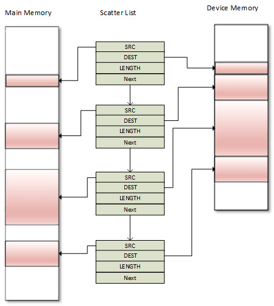
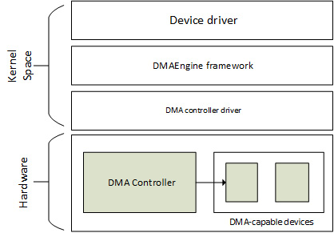
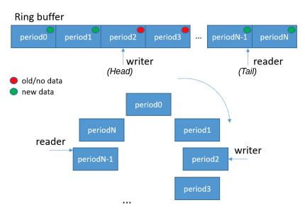

# Chương 11: Triển khai hỗ trợ Direct Memory Access (DMA)

Direct Memory Access (DMA) là tính năng của hệ thống máy tính cho phép device truy cập main system memory mà không cần CPU can thiệp, để CPU tập trung vào tác vụ khác. Ví dụ sử dụng gồm tăng tốc network traffic, audio data hoặc thu video frame, và không giới hạn trong lĩnh vực cụ thể nào. Peripheral chịu trách nhiệm quản lý DMA transaction là DMA controller, có trong phần lớn processor và microcontroller hiện đại.

Tính năng hoạt động như sau: Khi driver cần truyền block data, nó thiết lập DMA controller với source address, destination address và tổng số byte cần copy. DMA controller sau đó tự động truyền data từ source tới destination mà không chiếm CPU cycle. Khi số byte còn lại về 0, block transfer kết thúc và driver được thông báo.

LƯU Ý DMA không phải lúc nào cũng có nghĩa copy nhanh hơn. Nó không trực tiếp đem lại cải thiện tốc độ mà trước hết cung cấp operation thực sự chạy nền, để CPU rảnh làm việc khác; sau đó là cải thiện hiệu năng do duy trì CPU cache/prefetcher state trong DMA operation (trạng thái có thể bị xáo trộn khi dùng memcpy thông thường, thực thi trên chính CPU).

Chương này đề cập coherent và non-coherent DMA mapping, các vấn đề coherency, DMA engine API và DMA/DT binding. Cụ thể hơn, chúng ta sẽ bàn về:

- Thiết lập DMA mapping

- Giới thiệu khái niệm completion

- Làm việc với DMA engine API

- Kết hợp mọi thứ – Single-buffer DMA mapping

- Đôi lời về cyclic DMA

- Tìm hiểu DMA và DT binding

## Thiết lập DMA mapping

Với mọi loại DMA transfer, cần cung cấp source address và destination address cùng số word cần truyền. Với peripheral DMA, FIFO của peripheral đóng vai trò source hoặc destination tùy chiều truyền. Khi peripheral là source, destination address là memory location (nội bộ hoặc bên ngoài). Khi peripheral là destination, source address là memory location (nội bộ hoặc bên ngoài). Nói cách khác, DMA transfer cần memory mapping thích hợp. Đây là điều chúng ta bàn trong những phần sau.

## Khái niệm cache coherency và DMA

Trên CPU có cache, bản copy của memory area vừa truy cập được cache, kể cả memory area được map cho DMA. Thực tế, memory chia sẻ giữa hai device độc lập thường là nguồn gây cache coherency issue. Cache incoherency xuất phát từ việc device khác có thể không biết cập nhật do device khác ghi. Mặt khác, cache coherency bảo đảm mỗi write operation có vẻ diễn ra tức thì, nghĩa là mọi device chia sẻ cùng memory region đều thấy chính xác cùng chuỗi thay đổi.

Tình huống well-explained vấn đề coherency được trình bày trong đoạn trích sau từ ấn bản thứ ba của Linux Device Drivers (LDD3):

"Hãy tưởng tượng CPU có cache và external memory mà device có thể truy cập trực tiếp bằng DMA. Khi CPU truy cập vị trí X trong memory, giá trị hiện tại được lưu trong cache. Các operation tiếp theo trên X cập nhật cached copy của X nhưng không cập nhật phiên bản X trong external memory, giả sử dùng write-back cache. Nếu cache không được flush ra memory trước lần device tiếp theo thử truy cập X, device nhận giá trị X cũ. Tương tự, nếu cached copy của X không được invalidate khi device ghi giá trị mới vào memory, CPU sẽ làm việc trên giá trị X cũ."

Có hai cách giải quyết vấn đề này:

- Giải pháp hardware-based. Những hệ thống đó là coherent system.

- Giải pháp software-based, trong đó OS chịu trách nhiệm bảo đảm cache coherency. Những hệ thống đó là non-coherent system.

Bây giờ đã biết khía cạnh caching của DMA, hãy tiến thêm một bước và học cách thực hiện memory mapping cho DMA.

## Memory mapping cho DMA

Memory buffer được cấp phát cho DMA phải được map tương ứng. DMA mapping gồm cấp phát memory buffer phù hợp DMA và tạo bus address cho buffer này.

Chúng ta phân biệt hai loại DMA mapping — coherent DMA mapping và streaming DMA mapping. Loại đầu tự động xử lý cache coherency issue, thích hợp để tái sử dụng qua nhiều transfer mà không unmap giữa các transfer. Điều này có thể gây overhead đáng kể trên một số platform và dù sao duy trì memory đồng bộ cũng có chi phí. Streaming mapping có nhiều ràng buộc về code và không tự xử lý coherency issue, dù có giải pháp gồm một số function call giữa mỗi transfer. Coherent mapping thường tồn tại suốt lifetime của driver, trong khi streaming mapping thường được unmap khi DMA transfer hoàn tất.

LƯU Ý

Nên dùng streaming mapping khi có thể và coherent mapping khi bắt buộc. Nên cân nhắc coherent mapping nếu CPU hoặc DMA controller truy cập buffer không dự đoán được, vì memory luôn đồng bộ. Nếu không, nên dùng streaming mapping vì biết chính xác khi nào cần truy cập buffer; khi đó, trước tiên flush cache (qua đó đồng bộ buffer) trước khi truy cập buffer.

Header chính cần include để xử lý DMA mapping như sau:

```
#include <linux/dma-mapping.h>
```

Tuy nhiên, tùy mapping có thể dùng API khác nhau. Trước khi đi sâu API, cần hiểu các operation diễn ra trong DMA mapping:

1\. Giả sử device hỗ trợ DMA, nếu driver thiết lập buffer bằng `kmalloc()`, nó nhận virtual address (hãy gọi là

X), hiện chưa trỏ tới đâu.

2\. Virtual memory system (với sự hỗ trợ của MMU, Memory Management Unit) map X tới physical address (hãy gọi

là Y) trong RAM hệ thống, giả sử vẫn còn free memory.

Vì DMA không đi qua CPU virtual memory system, tại đây driver có thể dùng virtual address X để truy cập buffer nhưng bản thân device thì không.

3\. Trong một số hệ thống đơn giản (không có I/O MMU), device có thể DMA trực tiếp tới physical address Y. Nhưng trong nhiều hệ thống khác,

device nhìn main memory qua I/O MMU; vì vậy có I/O MMU hardware chuyển DMA address thành physical address, ví dụ chuyển Z thành Y.

4\. Đây là nơi DMA API tham gia:

- Driver có thể truyền virtual address X cho function như `dma_map_single()` (sẽ xem sau trong chương, phần Single-buffer mapping), thiết lập I/O MMU mapping thích hợp và return DMA address Z.

- Sau đó driver yêu cầu device thực hiện DMA vào Z.

- Cuối cùng I/O MMU map nó tới buffer tại địa chỉ Y trong RAM hệ thống.

Bây giờ đã giới thiệu khái niệm memory mapping cho DMA, có thể bắt đầu tạo mapping, trước hết với loại dễ nhất — coherent DMA mapping.

### Tạo coherent DMA mapping

Mapping như vậy thường dùng cho bi-directional I/O buffer tồn tại long-lasting. Function sau thiết lập coherent mapping:

```
void *dma_alloc_coherent(struct device *dev, size_t size,
                      dma_addr_t *dma_handle, gfp_t flag)
```

Function này chịu trách nhiệm cả cấp phát lẫn map buffer. Nó return kernel virtual address cho buffer rộng `size` byte và CPU truy cập được. Parameter `size` có thể gây hiểu nhầm vì trước hết được truyền cho API `get_order()` để lấy page order tương ứng size này. Vì vậy, mapping tối thiểu là page-sized và số page là lũy thừa của 2. `dev` là device structure của bạn. Argument thứ ba là output parameter trỏ tới bus address tương ứng. Memory cấp phát cho mapping được bảo đảm physically contiguous; flag quyết định cách cấp phát memory, thường là `GFP_KERNEL` hoặc `GFP_ATOMIC` trong atomic context.

Lưu ý mapping này được gọi là:

- Consistent (coherent) vì nội dung buffer luôn giống nhau trên mọi subsystem (device hoặc CPU)

- Synchronous vì giá trị ghi bởi device hoặc CPU có thể được đọc ngay mà không lo cache coherency

Để giải phóng mapping, có thể dùng API sau:

```
void dma_free_coherent(struct device *dev, size_t size,
                 void *cpu_addr, dma_addr_t dma_handle);
```

Trong prototype trên, `cpu_addr` và `dma_handle` tương ứng kernel virtual address và bus address do `dma_alloc_coherent()` return. Hai parameter này được MMU (đã return virtual address) và I/O MMU (đã return bus address) yêu cầu để giải phóng mapping.

### Tạo streaming DMA mapping

Memory buffer của streaming DMA mapping thường được map ngay trước khi truyền và unmap sau đó. Mapping này có nhiều ràng buộc hơn và khác coherent mapping vì các lý do sau:

- Mapping cần hoạt động với buffer đã được cấp phát động trước đó.

- Mapping có thể nhận nhiều buffer non-contiguous và rải rác.

- Với read transaction (device tới CPU), buffer thuộc device, không phải CPU. Trước khi CPU có thể dùng buffer, phải unmap chúng trước (sau `dma_unmap_{single,sg}()`), hoặc gọi `dma_sync_{single,sg}_for_cpu()` trên buffer đó. Nguyên nhân chính là caching.

- Với write transaction (CPU tới device), driver nên đặt data vào buffer trước khi thiết lập mapping.

- Phải chỉ định transfer direction, và data chỉ được di chuyển, sử dụng theo direction đó.

Có hai dạng streaming mapping:

- Single-buffer mapping, cho phép map một physically contiguous buffer

- Scatter/gather mapping, cho phép truyền nhiều buffer (rải rác trong memory)

Với cả hai mapping, phải chỉ định transfer direction bằng symbol có type `enum` `dma_data_direction`, định nghĩa trong `include/linux/dma-direction.h` như sau:

```
enum dma_data_direction {
     DMA_BIDIRECTIONAL = 0,
     DMA_TO_DEVICE = 1,
     DMA_FROM_DEVICE = 2,
     DMA_NONE = 3,
};
```

Trong đoạn trích trên, mỗi thành phần có ý nghĩa khá rõ.

LƯU Ý

Coherent mapping ngầm có direction attribute đặt là `DMA_BIDIRECTIONAL`.

Bây giờ đã biết hai phương thức streaming DMA mapping, có thể tìm hiểu chi tiết triển khai, bắt đầu với single-buffer mapping. Single-buffer mapping

Single-buffer mapping là streaming mapping dành cho transfer không thường xuyên. Có thể thiết lập mapping như vậy bằng function `dma_map_single()`, có định nghĩa sau:

```
dma_addr_t dma_map_single(struct device *dev, void *ptr,
        size_t size, enum dma_data_direction direction);
```

Direction nên là `DMA_TO_DEVICE`, `DMA_FROM_DEVICE` hoặc `DMA_BIDIRECTIONAL`, lần lượt khi CPU là source (ghi tới device), CPU là destination (đọc từ device), hoặc truy cập bi-directional cho mapping này (ngầm dùng trong coherent mapping). `dev` là structure `device` bên dưới cho hardware device, `ptr` là output parameter và là kernel virtual address của buffer. Function return phần tử type `dma_addr_t`, là bus address do I/O MMU (nếu có) return cho device để device có thể DMA vào đó. Nên dùng `dma_mapping_error()` (phải return `0` nếu không lỗi) để kiểm tra mapping return địa chỉ hợp lệ và không tiếp tục nếu có lỗi.

Mapping như vậy có thể được giải phóng bằng function sau:

```
void dma_unmap_single(struct device *dev,
                      dma_addr_t dma_addr, size_t size,
                      enum dma_data_direction direction);
int dma_mapping_error(struct device *dev,
                      dma_addr_t dma_addr);
```

Loại mapping còn lại là scatter/gather mapping, vì memory buffer được phân bố (rải rác) trên hệ thống khi cấp phát và được driver tập hợp lại.

Scatter/gather mapping

Scatter/gather mapping là loại streaming DMA mapping đặc biệt cho phép truyền nhiều memory buffer trong một lần, thay vì map từng buffer riêng rồi truyền lần lượt. Giả sử có nhiều buffer có thể không physically contiguous, tất cả cần được truyền cùng lúc tới hoặc từ device. Tình huống này có thể xuất hiện do:

- System call `readv` hoặc `writev`

- Disk I/O request

- Hoặc đơn giản danh sách page hay region được vmalloc cấp phát

Trước khi tạo mapping như vậy, phải thiết lập array scatter element, mỗi element mô tả mapping của một buffer. Scatter element được trừu tượng hóa trong kernel bằng instance `struct scatterlist`, định nghĩa như sau:

```
struct scatterlist {
     unsigned long page_link;
     unsigned int     offset;
     unsigned int     length;
     dma_addr_t       dma_address;
     unsigned int     dma_length;
};
```

Để thiết lập scatter list mapping, nên làm như sau:

- Cấp phát các buffer rải rác.

- Tạo array scatter element, khởi tạo array bằng `sg_init_table()` và điền array bằng memory đã cấp phát qua `sg_set_buf()`. Lưu ý mỗi scatter element entry phải có page size, trừ entry cuối có thể không tuân theo quy tắc này.

- Gọi `dma_map_sg()` trên scatter list.

- Sau khi dùng DMA xong, gọi `dma_unmap_sg()` để unmap scatter list.

Sau đây là sơ đồ mô tả phần lớn khái niệm scatter list:



Hình 11.1 – Tổ chức scatter/gather memory

Dù có thể DMA nội dung nhiều buffer riêng lẻ, scatter/gather cho phép DMA toàn bộ danh sách một lần bằng cách gửi pointer tới scatter list array cho device cùng độ dài, là số entry trong array.

Prototype của `sg_init_table()`, `sg_set_buf()` và `dma_map_sg()` như sau:

```
void sg_init_table(struct scatterlist *sgl,
                   unsigned int nents)
void sg_set_buf(struct scatterlist *sg, const void *buf,
                unsigned int buflen)
int dma_map_sg(struct device *dev,
               struct scatterlist *sglist, int nents,
               enum dma_data_direction dir);
```

Trong API trên, `sgl` là array `scatterlist` cần khởi tạo, `nents` là số entry trong array. `sg_set_buf()` đặt entry `scattlerlist` trỏ tới data đã cho. Trong parameter, `sg` là entry `scatterlist`, `data` là buffer tương ứng entry, còn `buflen` là size buffer. `dma_map_sg()` return số phần tử trong danh sách đã map thành công, nghĩa là không bao giờ được nhỏ hơn 0. Khi lỗi, function return 0.

Sau đây là code mẫu minh họa nguyên tắc scatter/gather mapping:

```
u32 *wbuf, *wbuf2, *wbuf3;
wbuf = kzalloc(SDMA_BUF_SIZE, GFP_DMA);
wbuf2 = kzalloc(SDMA_BUF_SIZE, GFP_DMA);
wbuf3 = kzalloc(SDMA_BUF_SIZE/2, GFP_DMA);
struct scatterlist sg[3];
sg_init_table(sg, 3);
sg_set_buf(&sg[0], wbuf, SDMA_BUF_SIZE);
sg_set_buf(&sg[1], wbuf2, SDMA_BUF_SIZE);
sg_set_buf(&sg[2], wbuf3, SDMA_BUF_SIZE/2);
ret = dma_map_sg(dev, sg, 3, DMA_TO_DEVICE);
if (ret != 3) {
     /*handle this error*/
}
/* As of now you can use 'ret' or 'sg_dma_len(sgl)' to retrieve the
* length of the scatterlist array.
*/
```

Những quy tắc đã mô tả trong phần single-buffer mapping cũng áp dụng cho scatter/gather.

Để unmap danh sách, phải dùng `dma_unmap_sg()`, có định nghĩa sau:

```
void dma_unmap_sg_attrs(struct device *dev, struct scatterlist *sg,
                          enum dma_data_direction dir, int nents)
```

`dev` là pointer tới cùng device đã dùng để map, `sg` là scatter list (thực ra là pointer tới phần tử đầu tiên) cần unmap, `dir` là DMA direction, nên khớp mapping direction, và `nents` là số phần tử trong danh sách.

Sau đây là ví dụ unmap triển khai trước:

```
dma_unmap_sg(dev, sg, 3, DMA_TO_DEVICE);
```

Trong ví dụ trên, chúng ta dùng cùng parameter đã dùng khi mapping. Cache coherency ngầm định và tường minh cho streaming mapping

Trong cả hai streaming mapping, cặp `dma_map_single()`/`dma_unmap_single()` và `dma_map_sg()`/`dma_unmap_sg()` đảm nhận cache coherency khi được gọi. Với outgoing DMA transfer (CPU tới device, đặt direction flag `DMA_TO_DEVICE`), vì data phải nằm trong buffer trước khi thiết lập mapping, `dma_map_sg()`/`dma_map_single()` xử lý cache coherency. Với device tới CPU (đặt direction flag `DMA_FROM_DEVICE`), phải giải phóng mapping trước khi CPU truy cập buffer. Đó là vì `dma_unmap_single()`/`dma_unmap_sg()` cũng ngầm đảm nhận cache coherency.

Tuy nhiên, nếu cần dùng cùng streaming DMA region nhiều lần và thao tác data giữa các DMA transfer, phải đồng bộ buffer đúng để device và CPU thấy bản copy DMA buffer up-to-date, chính xác nhất. Để tránh cache coherency issue, driver phải gọi `dma_sync_{single,sg}_for_device()` ngay trước khi bắt đầu DMA transfer từ RAM tới device (sau khi đặt data vào buffer và trước khi thực sự giao buffer cho hardware). Function call này flush cache line tương ứng DMA buffer nếu cần. Tương tự, driver không nên truy cập memory buffer ngay sau khi hoàn tất DMA transfer từ device tới RAM; thay vào đó, trước khi đọc buffer, nên gọi `dma_sync_{single,sg}_for_cpu()`, invalidate hardware cache line tương ứng nếu cần. Nói cách khác, khi source buffer là device memory, cache nên được invalidate (cache data không dirty vì CPU chưa ghi gì vào buffer); còn nếu source là RAM (destination là device memory), nghĩa là CPU có thể đã ghi data vào source buffer và data có thể nằm trong cache line, nên cache cần được flush.

Sau đây là prototype của các syncing API:

```
void dma_sync_sg_for_cpu(struct device *dev,
                     struct scatterlist *sg,
                     int nents,
                     enum dma_data_direction direction);
void dma_sync_sg_for_device(struct device *dev,
                     struct scatterlist *sg, int nents,
                     enum dma_data_direction direction);
void dma_sync_single_for_cpu(struct device *dev,
                     dma_addr_t addr, size_t size,
                     enum dma_data_direction dir)
void dma_sync_single_for_device(struct device *dev,
                     dma_addr_t addr, size_t size,
                     enum dma_data_direction dir)
```

Trong mọi API trên, direction parameter phải giữ nguyên direction đã chỉ định khi map buffer tương ứng.

Trong phần này, chúng ta đã học thiết lập streaming DMA mapping. Bây giờ đã xong mapping, hãy giới thiệu khái niệm completion, dùng để thông báo DMA transfer hoàn tất.

## Giới thiệu khái niệm completion

Phần này mô tả ngắn gọn completion và phần API cần thiết mà DMA transfer dùng. Để có mô tả đầy đủ, có thể xem kernel documentation tại `Documentation/scheduler/completion.txt`. Trong kernel programming, cách làm điển hình là bắt đầu hoạt động bên ngoài current thread rồi chờ hoàn tất. Completion là lựa chọn tốt thay waitqueue hoặc sleeping API khi chờ một quá trình rất thường gặp hoàn tất. Completion variable được triển khai bằng wait queue, khác biệt duy nhất là giúp developer dễ làm việc hơn vì không cần duy trì wait queue, khiến ý định code rất dễ nhận ra.

Làm việc với completion cần header này:

```
#include <linux/completion.h>
```

Completion variable được biểu diễn trong kernel bằng instance của structure struct completion, có thể được khởi tạo tĩnh như sau:

```
DECLARE_COMPLETION(my_comp);
```

Cấp phát động và khởi tạo được thực hiện như sau:

```
struct completion my_comp;
init_completion(&my_comp);
```

Khi driver bắt đầu công việc cần chờ hoàn tất (DMA transaction trong trường hợp này), chỉ cần truyền completion event cho function `wait_for_completion()`, có prototype sau:

```
void wait_for_completion(struct completion *comp);
```

Khi completion xảy ra, driver có thể đánh thức bên chờ bằng một trong những API sau:

```
void complete(struct completion *comp);
void complete_all(struct completion *comp);
```

`complete()` chỉ đánh thức một task đang chờ, còn `complete_all()` đánh thức mọi task chờ event đó. Completion được triển khai để hoạt động đúng ngay cả khi `complete()` được gọi trước `wait_for_completion()`. Trong phần này, chúng ta đã học triển khai completion callback để thông báo trạng thái hoàn tất DMA transfer. Bây giờ đã quen mọi khái niệm DMA thông dụng, có thể áp dụng chúng bằng DMA engine API, cũng giúp hiểu rõ hơn cách mọi thứ hoạt động khi kết hợp lại.

## Làm việc với DMA engine API

DMA engine là generic kernel framework dùng để phát triển DMA controller driver và sử dụng controller này từ phía consumer. Qua framework này, DMA controller driver cung cấp tập channel mà client device có thể dùng. Framework cho phép client driver (còn gọi là slave) yêu cầu và dùng DMA channel từ controller để phát DMA transfer.

Sơ đồ sau thể hiện phân lớp, cho thấy framework tích hợp với Linux kernel thế nào:



Hình 11.2 – DMA engine framework

Ở đây chỉ trình bày API (slave) đó, chỉ áp dụng cho slave DMA usage. Header bắt buộc như sau:

```
#include <linux/dmaengine.h>
```

Cách dùng slave DMA đơn giản, gồm các bước sau:

1\. Thông báo kernel về DMA addressing capability của device. 2. Yêu cầu DMA channel. 3. Nếu thành công, cấu hình DMA channel này. 4. Chuẩn bị hoặc cấu hình DMA transfer. Tại bước này, transfer descriptor biểu diễn transfer được return.

5\. Submit DMA transfer bằng descriptor. Transfer sau đó được thêm vào pending queue của controller tương ứng với

channel đã chỉ định. Bước này return cookie đặc biệt có thể dùng để kiểm tra tiến độ hoạt động DMA.

6\. Bắt đầu DMA transfer trên channel đã chỉ định để nếu channel idle, transfer đầu tiên trong queue được bắt đầu.

Bây giờ đã biết các bước cần để triển khai DMA transfer, hãy tìm hiểu data structure liên quan trong DMA engine framework trước khi dùng API tương ứng.

## Giới thiệu ngắn gọn DMA controller interface

Cách dùng DMA trong Linux gồm hai phần: controller thực hiện memory transfer (không có CPU can thiệp), và channel là đường client driver (driver DMA-capable) submit công việc cho controller. Dĩ nhiên, controller và channel gắn chặt với nhau vì controller cung cấp channel cho client.

Dù chương này hướng tới DMA client driver, để dễ hiểu, chúng ta giới thiệu một số controller data structure và API.

### DMA controller data structure

DMA controller được trừu tượng hóa trong Linux kernel bằng instance `struct dma_device`. Bản thân controller vô ích nếu không có client dùng channel nó cung cấp. Ngoài ra, controller driver phải cung cấp callback cấu hình channel, như chỉ định trong data structure có định nghĩa sau:

```
struct dma_device {
    unsigned int chancnt;
    unsigned int privatecnt;
    struct list_head channels;
    struct list_head global_node;
    struct dma_filter filter;
    dma_cap_mask_t  cap_mask;
    u32 src_addr_widths;
    u32 dst_addr_widths;
    u32 directions;
    int (*device_alloc_chan_resources)(
                                  struct dma_chan *chan);
    void (*device_free_chan_resources)(
                                  struct dma_chan *chan);
    struct dma_async_tx_descriptor
     *(*device_prep_dma_memcpy)(
        struct dma_chan *chan, dma_addr_t dst,
        dma_addr_t src, size_t len, unsigned long flags);
    struct dma_async_tx_descriptor
      *(*device_prep_dma_memset)(
       struct dma_chan *chan, dma_addr_t dest, int value,
       size_t len, unsigned long flags);
    struct dma_async_tx_descriptor
      *(*device_prep_dma_memset_sg)(
         struct dma_chan *chan, struct scatterlist *sg,
         unsigned int nents, int value,
         unsigned long flags);
    struct dma_async_tx_descriptor
      *(*device_prep_dma_interrupt)(
         struct dma_chan *chan, unsigned long flags);
    struct dma_async_tx_descriptor
      *(*device_prep_slave_sg)(
         struct dma_chan *chan, struct scatterlist *sgl,
           unsigned int sg_len,
           enum dma_transfer_direction direction,
           unsigned long flags, void *context);
    struct dma_async_tx_descriptor
      *(*device_prep_dma_cyclic)(
           struct dma_chan *chan, dma_addr_t buf_addr,
           size_t buf_len, size_t period_len,
           enum dma_transfer_direction direction,
           unsigned long flags);
     void (*device_caps)(struct dma_chan *chan,
                     struct dma_slave_caps *caps);
     int (*device_config)(struct dma_chan *chan,
                     struct dma_slave_config *config);
     void (*device_synchronize)(struct dma_chan *chan);
     enum dma_status (*device_tx_status)(
              struct dma_chan *chan, dma_cookie_t cookie,
              struct dma_tx_state *txstate);
     void (*device_issue_pending)(struct dma_chan *chan);
     void (*device_release)(struct dma_device *dev);
};
```

Định nghĩa đầy đủ data structure có trong `include/linux/dmaengine.h`. Với chương này, chỉ field quan tâm được liệt kê. Ý nghĩa như sau:

- `chancnt`: Chỉ số DMA channel mà controller hỗ trợ

- `channels`: Danh sách structure `struct dma_chan`, tương ứng DMA channel mà controller cung cấp

- `privatecnt`: Số DMA channel được yêu cầu bằng `dma_request_channel()`, DMA engine API để yêu cầu DMA channel

- `cap_mask`: Một hoặc nhiều flag `dma_capability`, biểu diễn khả năng controller

Các giá trị có thể có như sau:

```
enum dma_transaction_type {
    DMA_MEMCPY,     /* Memory to memory copy */
    DMA_XOR,  /* Memory to memory XOR*/
    DMA_PQ,   /* Memory to memory P+Q computation */
    DMA_XOR_VAL, /* Memory buffer parity check using
                  * XOR */
    DMA_PQ_VAL,  /* Memory buffer parity check using
                  * P+Q */
    DMA_INTERRUPT,  /* The device can generate dummy
                     * transfer that will generate
                     * interrupts */
    DMA_MEMSET_SG,  /* Prepares a memset operation over a
                     * scatter list */
    DMA_SLAVE,      /* Slave DMA operation, either to or
                     * from a device */
    DMA_PRIVATE,    /* channels are not to be used
                     * for global memcpy. Usually
                     *used with DMA_SLAVE */
    DMA_SLAVE,      /* Memory to device transfers */
    DMA_CYCLIC,     /* can handle cyclic tranfers */
    DMA_INTERLEAVE, /* Memory to memory interleaved
                     * transfer */
}
```

Ví dụ, thành phần này được đặt trong i.MX DMA controller driver như sau:

```
dma_cap_set(DMA_SLAVE, sdma->dma_device.cap_mask);
dma_cap_set(DMA_CYCLIC, sdma->dma_device.cap_mask);
dma_cap_set(DMA_MEMCPY, sdma->dma_device.cap_mask);
```

- `src_addr_widths`: Bit mask của source address width mà device hỗ trợ. Width phải được cung cấp theo byte; ví dụ nếu device hỗ trợ width `4`, mask nên được đặt là `BIT(4)`.

- `dst_addr_widths`: Bit mask của destination address width mà device hỗ trợ.

- `directions`: Bit mask của slave direction mà device hỗ trợ. Vì `enum dma_transfer_direction` không chứa bit flag cho từng type, DMA controller nên đặt `BIT(<TYPE>)` và controller cũng nên kiểm tra cùng giá trị đó.

Nó được đặt trong i.MX SDMA controller driver như sau:

```
#define SDMA_DMA_DIRECTIONS (BIT(DMA_DEV_TO_MEM) | \
                     BIT(DMA_MEM_TO_DEV) | \
                       BIT(DMA_DEV_TO_DEV))
[...]
sdma->dma_device.directions = SDMA_DMA_DIRECTIONS;
```

- `device_alloc_chan_resources`: Cấp phát resource và return số descriptor đã cấp phát. Được DMA engine core gọi khi yêu cầu channel trên controller này.

- `device_free_chan_resources`: Callback cho phép giải phóng resource của DMA channel.

Trong khi phần trên là generic callback, phần sau là controller callback phụ thuộc khả năng controller và phải được cung cấp nếu capability bit mask tương ứng được đặt trong

```
cap_mask.
```

- `device_prep_dma_memcpy` chuẩn bị memcpy operation. Nếu `DMA_MEMCPY` được đặt trong `cap_mask`, phải đặt thành phần này. Với mỗi flag được đặt, phải cung cấp callback tương ứng, nếu không đăng ký controller thất bại. Điều này đúng cho mọi callback `device_prep_*`.

- `device_prep_dma_xor`: Chuẩn bị XOR operation.

- `device_prep_dma_xor_val`: Chuẩn bị xor validation operation.

- `device_prep_dma_memset`: Chuẩn bị memset operation.

- `device_prep_dma_memset_sg`: Chuẩn bị memset operation trên scatter list.

- `device_prep_dma_interrupt`: Chuẩn bị end-of-chain interrupt operation.

- `device_prep_slave_sg`: Chuẩn bị slave DMA operation.

- `device_prep_dma_cyclic`: Chuẩn bị cyclic DMA operation. DMA operation như vậy thường dùng trong audio driver hoặc UART driver. Function cần buffer size `buf_len`. Callback function được gọi sau khi `period_len` byte được truyền. Chúng ta bàn về DMA như vậy trong phần Đôi lời về cyclic DMA.

- `device_prep_interleaved_dma`: Biểu diễn transfer theo cách tổng quát.

- `device_config`: Đẩy cấu hình mới tới channel, return `0` khi thành công hoặc error code nếu không.

- `device_pause`: Pause transfer hiện tại trên channel và return `0` nếu pause có hiệu lực, hoặc error code nếu không.

- `device_resume`: Resume transfer đã pause trước đó trên channel. Return `0` hoặc error code nếu không.

- `device_terminate_all`: Callback dùng để hủy mọi transfer trên channel, return `0` khi thành công hoặc error code nếu không.

- `device_synchronize`: Callback cho phép đồng bộ việc kết thúc transfer với current context.

- `device_tx_status`: Poll để kiểm tra transaction hoàn tất. Parameter tùy chọn `txstate` có thể dùng để lấy struct chứa thông tin phụ về transfer status; nếu không, lời gọi chỉ return status code đơn giản.

- `device_issue_pending`: Callback bắt buộc đẩy pending transaction xuống hardware. Đây là backend của API `dma_async_issue_pending()`.

Dù phần lớn driver gọi trực tiếp callback này (qua `dma_chan->dma_dev->device_prep_dma_*`), bạn nên dùng DMA engine API `dmaengine_prep_*`, bổ sung sanity check trước khi gọi callback thích hợp. Ví dụ, với memory-to-memory, driver nên dùng wrapper `device_prep_dma_memcpy()`.

### DMA channel data structure

DMA channel là cách client driver submit DMA transaction (I/O data transfer) tới DMA controller. Cách hoạt động là driver DMA-capable (client driver) yêu cầu một hoặc nhiều channel, cấu hình lại channel rồi yêu cầu controller dùng channel đó thực hiện DMA transfer đã submit. Channel được định nghĩa như sau:

```
struct dma_chan {
     struct dma_device *device;
     struct device *slave;
     dma_cookie_t cookie;
     dma_cookie_t completed_cookie;
[...]
};
```

Có thể xem DMA channel là đường cao tốc cho I/O data transfer. Sau đây là ý nghĩa từng thành phần trong data structure:

- `device`: Pointer tới DMA device (controller) cung cấp channel này. Field không bao giờ có thể là `NULL` nếu channel được yêu cầu thành công vì channel luôn thuộc controller.

- `slave`: Pointer tới structure `struct device` bên dưới cho device dùng channel này (driver của nó là client driver).

- `cookie`: Biểu diễn cookie value cuối cùng channel return cho client.

- `Completed_cookie`: Cookie hoàn tất cuối cùng của channel này.

Định nghĩa đầy đủ data structure có trong `include/linux/dmaengine.h`.

LƯU Ý Trong DMA engine framework, cookie đơn giản là DMA transaction identifier cho phép kiểm tra status và tiến độ transaction mà nó nhận diện.

### DMA transaction descriptor data structure

Transaction descriptor chỉ đặc trưng và mô tả DMA transaction (hoặc gọi không chặt chẽ là DMA transfer). Descriptor được biểu diễn trong kernel bằng data structure `struct` `dma_async_tx_descriptor`, có định nghĩa sau:

```
struct dma_async_tx_descriptor {
     dma_cookie_t cookie;
     struct dma_chan *chan;
     dma_async_tx_callback callback;
     void *callback_param;
[...]
};
```

Ý nghĩa từng thành phần được giữ lại trong data structure được trình bày ở đây:

- `cookie`: Tracking cookie cho transaction này. Cho phép kiểm tra tiến độ transaction.

- `chan`: Target channel cho operation này.

- `callback`: Function cần được gọi khi operation hoàn tất.

- `callback_param`: Được truyền làm parameter của callback function.

Có thể tìm mô tả đầy đủ data structure trong `include/linux/dmaengine.h`.

## Xử lý DMA addressing capability của device

Mặc định kernel coi device có thể xử lý DMA addressing 32-bit. Tuy nhiên, DMA memory address range mà device truy cập được có thể bị giới hạn do nhà sản xuất hoặc lý do lịch sử. Ví dụ, một số device chỉ hỗ trợ 24-bits thấp để định địa chỉ. Giới hạn bắt nguồn từ ISA bus rộng 24-bits, nơi DMA buffer chỉ có thể nằm trong 16 MB thấp nhất của system memory. Tuy vậy, có thể dùng DMA mask để báo kernel về giới hạn này, nhằm thông báo DMA addressing capability của device.

Có thể thực hiện bằng `dma_set_mask_and_coherent()`, có prototype sau:

```
int dma_set_mask_and_coherent(struct device *dev,
                              u64 mask);
```

Function trên đặt cùng mask cho cả streaming mapping và coherent mapping vì DMA API bảo đảm coherent DMA mask có thể bằng hoặc nhỏ hơn streaming DMA mask.

Tuy nhiên, với yêu cầu đặc biệt, có thể dùng `dma_set_mask()` hoặc `dma_set_coherent_mask()` để đặt mask tương ứng. Các API có prototype sau:

```
int dma_set_mask(struct device *dev, u64 mask);
int dma_set_coherent_mask(struct device *dev, u64 mask);
```

Trong các function này, `dev` là device structure bên dưới, còn `mask` là bit mask mô tả bit địa chỉ mà device hỗ trợ, có thể chỉ định bằng macro `DMA_BIT_MASK` cùng bit order thực tế.

Cả `dma_set_mask()` lẫn `dma_set_coherent_mask()` return 0 để chỉ device có thể thực hiện DMA đúng trên máy với address mask đã chỉ định. Mọi return value khác là lỗi, nghĩa là mask quá nhỏ để được hỗ trợ trên hệ thống đó. Khi thất bại, có thể fallback sang non-DMA mode để truyền data trong driver, hoặc nếu DMA bắt buộc, disable tính năng device cần DMA, thậm chí không probe device.

Nên cho driver in kernel warning message (`dev_warn()` hoặc `pr_warn()`) khi đặt DMA mask thất bại. Sau đây là ví dụ pseudo-code cho sound card:

```
#define PLAYBACK_ADDRESS_BITS DMA_BIT_MASK(32)
#define RECORD_ADDRESS_BITS DMA_BIT_MASK(24)
struct my_sound_card *card;
struct device *dev;
...
if (!dma_set_mask(dev, PLAYBACK_ADDRESS_BITS)) {
     card->playback_enabled = 1;
} else {
    card->playback_enabled = 0;
    dev_warn(dev,
     "%s: Playback disabled due to DMA limitations\n",
     card->name);
}
if (!dma_set_mask(dev, RECORD_ADDRESS_BITS)) {
    card->record_enabled = 1;
} else {
    card->record_enabled = 0;
    dev_warn(dev,
          "%s: Record disabled due to DMA limitations\n",
          card->name);
}
```

Trong ví dụ trên, chúng ta dùng macro `DMA_BIT_MASK` để định nghĩa DMA mask. Sau đó disable các tính năng bắt buộc hỗ trợ DMA khi DMA mask yêu cầu không được hỗ trợ. Trong mọi trường hợp, warning được in.

## Yêu cầu DMA channel

Channel được yêu cầu bằng `dma_request_channel()`. Prototype như sau:

```
struct dma_chan *dma_request_channel(
                      const dma_cap_mask_t *mask,
                      dma_filter_fn fn, void *fn_param);
```

Ở trên, mask phải là bit mask biểu diễn capability mà channel cần thỏa mãn. Chủ yếu dùng để chỉ định transfer type mà driver cần thực hiện, phải được hỗ trợ trong `dma_device.cap_mask`.

Function `dma_cap_zero()` và `dma_cap_set()` dùng để clear mask và đặt capability cần thiết; ví dụ:

```
dma_cap_mask my_dma_cap_mask;
struct dma_chan *chan;
dma_cap_zero(my_dma_cap_mask);
/* Memory 2 memory copy */
dma_cap_set(DMA_MEMCPY, my_dma_cap_mask);
chan = dma_request_channel(my_dma_cap_mask, NULL, NULL);
```

`fn` là callback pointer có type được định nghĩa như sau:

```
typedef bool (*dma_filter_fn)(struct dma_chan *chan,
                void *filter_param);
```

Thực tế, `dma_requaest_channel()` duyệt các DMA controller sẵn có trong hệ thống (`dma_device_list`, định nghĩa trong `drivers/dma/dmaengine.c`), và với mỗi controller, tìm channel tương ứng yêu cầu. Nếu parameter `filter_fn` (tùy chọn) là `NULL`, `dma_request_channel()` chỉ return channel đầu tiên thỏa capability mask. Nếu không, khi mask parameter chưa đủ để chỉ định channel cần thiết, có thể dùng routine `filter_fn` làm filter, để mỗi channel sẵn có trong hệ thống được truyền cho callback để chấp nhận hoặc không. Kernel gọi routine `filter_fn` một lần cho mỗi free channel trong hệ thống. Khi thấy channel phù hợp, `filter_fn` nên return `DMA_ACK`, đánh dấu channel đó là return value của `dma_request_channel()`.

Channel cấp phát qua interface này dành riêng cho caller tới khi `dma_release_channel()` được gọi. Function có định nghĩa sau:

```
void dma_release_channel(struct dma_chan *chan)
```

API này giải phóng DMA channel và cho phép client khác yêu cầu nó.

Thông tin bổ sung: có thể liệt kê DMA channel sẵn có trên hệ thống trong user space bằng lệnh `ls /sys/class/dma/` như sau:

```
root@raspberrypi4-64:~# ls /sys/class/dma/
dma0chan0  dma0chan1  dma0chan2  dma0chan3  dma0chan4  dma0chan5  dma0chan6  dma0chan7  dm
a1chan0  dma1chan1
```

Trong đoạn code trên, channel name `chan<chan-index>` được nối với DMA controller `dma<dma-index>` mà nó thuộc về. Có thể xem channel đang dùng hay không bằng cách in giá trị file `in_use` trong channel directory tương ứng như sau:

```
root@raspberrypi4-64:~# cat /sys/class/dma/dma0chan0/in_use
1
root@raspberrypi4-64:~# cat /sys/class/dma/dma0chan1/in_use
1
root@raspberrypi4-64:~# cat /sys/class/dma/dma0chan2/in_use
1
root@raspberrypi4-64:~# cat /sys/class/dma/dma0chan3/in_use
0
root@raspberrypi4-64:~# cat /sys/class/dma/dma0chan4/in_use
0
root@raspberrypi4-64:~# cat /sys/class/dma/dma0chan5/in_use
0
root@raspberrypi4-64:~# cat /sys/class/dma/dma0chan6/in_use
0
root@raspberrypi4-64:~#
```

Ở trên, ví dụ có thể thấy `dma0chan1` đang dùng còn `dma0chan6` thì không.

## Cấu hình DMA channel

Để DMA transfer hoạt động bình thường trên channel, phải áp dụng client-specific configuration cho channel. DMA engine framework cho phép cấu hình bằng data structure `struct dma_slave_config`, biểu diễn runtime configuration của DMA channel. Nó cho phép client chỉ định parameter như DMA direction, DMA address (source và destination), bus width và DMA burst length cho peripheral. Cấu hình sau đó được áp dụng xuống hardware bên dưới bằng function `dmaengine_slave_config()`, định nghĩa như sau:

```
int dmaengine_slave_config(struct dma_chan *chan,
                         struct dma_slave_config *config)
```

Parameter `chan` biểu diễn DMA channel cần cấu hình, còn `config` là cấu hình cần áp dụng.

Để fine-tune cấu hình tốt hơn, phải xem structure `struct dma_slave_config`, định nghĩa như sau:

```
struct dma_slave_config {
     enum dma_transfer_direction direction;
     phys_addr_t src_addr;
     phys_addr_t dst_addr;
     enum dma_slave_buswidth src_addr_width;
     enum dma_slave_buswidth dst_addr_width;
     u32 src_maxburst;
     u32 dst_maxburst;
     [...]
};
```

Đây là ý nghĩa từng thành phần trong structure:

- `direction` chỉ data cần đi vào hay ra trên slave channel này ngay lúc này. Giá trị có thể có như sau:

```
/* dma transfer mode and direction indicator */
enum dma_transfer_direction {
    DMA_MEM_TO_MEM, /* Async/Memcpy mode */
    DMA_MEM_TO_DEV, /* From Memory to Device */
    DMA_DEV_TO_MEM, /* From Device to Memory */
    DMA_DEV_TO_DEV, /* From Device to Device */
    DMA_TRANS_NONE,
};
```

- `src_addr`: Physical address (thực ra bus address) của buffer nơi DMA slave data cần được đọc (RX). Thành phần này bị bỏ qua nếu source là memory. `dst_addr` là physical address (bus address) của buffer nơi DMA slave data cần được ghi (TX), bị bỏ qua nếu source là memory. `src_addr_width` là width theo byte của source (RX) register nơi cần đọc DMA data. Nếu source là memory, có thể bỏ qua tùy architecture. Tương tự, `dst_addr_width` giống `src_addr_width` nhưng cho destination target (TX).

Mọi bus width phải thuộc một trong các enumeration sau:

```
enum dma_slave_buswidth {
    DMA_SLAVE_BUSWIDTH_UNDEFINED = 0,
    DMA_SLAVE_BUSWIDTH_1_BYTE = 1,
    DMA_SLAVE_BUSWIDTH_2_BYTES = 2,
    DMA_SLAVE_BUSWIDTH_3_BYTES = 3,
    DMA_SLAVE_BUSWIDTH_4_BYTES = 4,
    DMA_SLAVE_BUSWIDTH_8_BYTES = 8,
    DMA_SLAVE_BUSWIDTH_16_BYTES = 16,
    DMA_SLAVE_BUSWIDTH_32_BYTES = 32,
    DMA_SLAVE_BUSWIDTH_64_BYTES = 64,
};
```

- `src_maxburs`: Số word tối đa có thể gửi tới device trong một burst (coi word là đơn vị của member `src_addr_width`, không phải byte). Với I/O peripheral, thường dùng nửa FIFO depth để không overflow. Với memory source, có thể áp dụng hoặc không. `dst_maxburst` tương tự `src_maxburst` nhưng dùng cho destination target.

Sau đây là ví dụ cấu hình DMA channel:

```
struct dma_chan *my_dma_chan;
dma_addr_t dma_src_addr, dma_dst_addr;
struct dma_slave_config channel_cfg = {0};
/* No filter callback, neither filter param */
my_dma_chan = dma_request_channel(my_dma_cap_mask,
                                   NULL, NULL);
/* scr_addr and dst_addr are ignored for mem to mem copy */
channel_cfg.direction = DMA_MEM_TO_MEM;
channel_cfg.dst_addr_width = DMA_SLAVE_BUSWIDTH_32_BYTES;
dmaengine_slave_config(my_dma_chan, &channel_cfg);
```

Trong đoạn trích trên, `dma_request_channel()` dùng để yêu cầu DMA channel, sau đó channel được cấu hình bằng `dmaengine_slave_config()`.

## Cấu hình DMA transfer

Bước này cho phép định nghĩa transfer type. DMA transfer được cấu hình (hay đúng hơn là chuẩn bị) nhờ một callback `device_prep_dma_*` của controller gắn với DMA channel mà transfer được submit vào. Mỗi API này return transfer descriptor, biểu diễn bằng data structure `struct dma_async_tx_descriptor`, có thể dùng sau để tùy chỉnh trước khi submit transfer.

Ví dụ, với memory-to-memory transfer, nên dùng callback `device_prep_dma_memcpy`, như code sau:

```
struct dma_device *dma_dev = my_dma_chan->device;
struct dma_async_tx_descriptor *tx_desc = NULL;
tx_desc = dma_dev->device_prep_dma_memcpy(
                          my_dma_chan, dma_dst_addr,
                          dma_src_addr, BUFFER_SIZE, 0);
if (!tx_desc) {
    /* dma_unmap_* the buffer */
    handle_error();
}
```

Trong code mẫu trên, chúng ta dereference controller callback để gọi trong khi có thể kiểm tra sự tồn tại trước. Tuy nhiên, vì tính hợp lệ và portable, nên dùng DMA engine API `dmaengine_prep_*` thay vì gọi controller callback trực tiếp. Phép gán `tx_desc` khi đó có dạng sau:

```
tx_desc = dmaengine_prep_dma_memcpy(my_dma_chan,
             dma_dst_addr, dma_src_addr, BUFFER_SIZE, 0);
```

Cách cuối này an toàn và portable hơn đối với controller data structure có thể thay đổi.

Ngoài ra, client driver có thể dùng thành phần `callback` của structure `dma_async_tx_descriptor` (do function `dmaengine_prep_*` return) để cung cấp completion callback.

## Submit DMA transfer

Để đưa transaction vào driver pending queue, dùng `dmaengine_submit()`, có prototype sau:

```
dma_cookie_t dmaengine_submit(
                  struct dma_async_tx_descriptor *desc)
```

API này là frontend của callback `device_issue_pending` của controller. Function return cookie có thể dùng để kiểm tra tiến độ hoạt động DMA qua DMA engine khác. Để kiểm tra cookie return có hợp lệ, có thể dùng helper `dma_submit_error()`, như sẽ thấy trong ví dụ. Giả sử chưa cung cấp completion callback, có thể thiết lập trước khi submit transfer như đoạn trích sau:

```
struct completion transfer_ok;
init_completion(&transfer_ok);
/*
* you can also set the parameter to be given to this
* callback in tx->callback_param
*/
Tx_desc->callback = my_dma_callback;
/* Submitting our DMA transfer */
dma_cookie_t cookie = dmaengine_submit(tx);
if (dma_submit_error(cookie)) {
    /* handle error */
    [...]
}
```

Đoạn trích trên khá ngắn và có ý nghĩa rõ ràng. Để truyền parameter cho callback, phải đặt nó trong field `callback_param` của descriptor. Ví dụ có thể là device state structure.

LƯU Ý

Interrupt (từ DMA controller) phát sinh sau mỗi DMA transfer hoàn tất, sau đó transfer tiếp theo trong queue được bắt đầu và tasklet được kích hoạt. Nếu client driver cung cấp completion callback, tasklet gọi callback khi được schedule. Vì vậy, completion callback chạy trong interrupt context.

## Phát pending DMA request và chờ callback notification

Bắt đầu transaction là bước cuối thiết lập DMA transfer. Transaction trong pending queue của channel được kích hoạt bằng cách gọi `dma_async_issue_pending()` trên channel đó. Nếu channel idle, transaction đầu tiên trong queue bắt đầu và những transaction sau được xếp hàng. Khi DMA operation hoàn tất, operation tiếp theo trong queue bắt đầu và tasklet được kích hoạt. Tasklet phụ trách gọi completion callback routine của client driver để thông báo, nếu được đặt:

```
void dma_async_issue_pending(struct dma_chan *chan);
```

Function này wrap callback `device_issue_pending` của controller. Ví dụ cách dùng như sau:

```
dma_async_issue_pending(my_dma_chan);
wait_for_completion(&transfer_ok);
/* may be unmap buffer if necessary and if it is not
* done in the completion callback yet
*/
[...]
/* Process buffer through rx_data and tx_data virtual addresses. */
[...]
```

Function `wait_for_completion()` block, đưa current task vào sleep cho tới khi DMA callback được gọi để cập nhật (complete) completion variable nhằm tiếp tục code bị block. Đây là lựa chọn tốt thay `while (!done) msleep(SOME_TIME);`. Sau đây là ví dụ:

```
static void my_dma_complete_callback (void *param)
{
    complete(transfer_ok);
[...]
}
```

Đó là tất cả trong triển khai DMA transfer. Khi completion callback return, main code tiếp tục workflow bình thường.

Bây giờ đã đi qua DMA engine API, có thể tổng hợp kiến thức trong ví dụ đầy đủ, như phần tiếp theo.

## Kết hợp mọi thứ – Single-buffer DMA mapping

Xét trường hợp muốn map một buffer (streaming mapping) và DMA data từ source `src` tới destination `dst`. Chúng ta dùng character device để mọi write operation trên device kích hoạt DMA và mọi read operation so sánh source với destination để kiểm tra có khớp hay không. Trước tiên, hãy liệt kê header file cần để dùng các API cần thiết:

```
#define pr_fmt(fmt) "DMA-TEST: " fmt
#include <linux/module.h>
#include <linux/slab.h>
#include <linux/init.h>
#include <linux/dma-mapping.h>
#include <linux/fs.h>
#include <linux/dmaengine.h>
#include <linux/device.h>
#include <linux/io.h>
#include <linux/delay.h>
```

Bây giờ hãy định nghĩa một số global variable cho driver:

```
/* we need page aligned buffers */
#define DMA_BUF_SIZE  2 * PAGE_SIZE
static u32 *wbuf;
static u32 *rbuf;
static int dma_result;
static int gMajor; /* major number of device */
static struct class *dma_test_class;
static struct completion dma_m2m_ok;
static struct dma_chan *dma_m2m_chan;
```

Ở trên, `wbuf` biểu diễn source buffer, còn `rbuf` biểu diễn destination buffer. Vì triển khai dựa trên character device, `gMajor` và `dma_test_class` dùng để biểu diễn major number và class của character device.

Vì DMA mapping cần nhận device structure làm parameter đầu tiên, hãy tạo dummy device:

```
static void dev_release(struct device *dev)
{
    pr_info( "releasing dma capable device\n");
}
static struct device dev = {
    .release = dev_release,
    .coherent_dma_mask = ~0, // allow any address
    .dma_mask = &dev.coherent_dma_mask,// use the same mask
};
```

Vì dùng static device, chúng ta đặt DMA mask của device trong device structure. Trong platform driver, chúng ta sẽ dùng `dma_set_mask_and_coherent()` để làm điều đó.

Đã đến lúc triển khai file operation đầu tiên, method `open`, trong trường hợp này chỉ cấp phát buffer:

```
int dma_open(struct inode * inode, struct file * filp)
{
     init_completion(&dma_m2m_ok);
     wbuf = kzalloc(DMA_BUF_SIZE, GFP_KERNEL | GFP_DMA);
     if(!wbuf) {
           pr_err("Failed to allocate wbuf!\n");
           return -ENOMEM;
     }
     rbuf = kzalloc(DMA_BUF_SIZE, GFP_KERNEL | GFP_DMA);
     if(!rbuf) {
           kfree(wbuf);
           pr_err("Failed to allocate rbuf!\n");
           return -ENOMEM;
     }
     return 0;
}
```

Open operation của character device trên không làm gì ngoài cấp phát buffer dùng cho transfer. Buffer được giải phóng khi device file đóng, dẫn tới gọi release function của device, triển khai như sau:

```
int dma_release(struct inode * inode, struct file * filp)
{
     kfree(wbuf);
     kfree(rbuf);
     return 0;
}
```

Chúng ta đến phần triển khai method `read`. Method này chỉ thêm entry vào kernel message buffer, báo kết quả DMA operation. Nó được triển khai như sau:

```
ssize_t dma_read (struct file *filp, char __user * buf,
                   size_t count, loff_t * offset)
{
     pr_info("DMA result: %d!\n", dma_result);
     return 0;
}
```

Bây giờ đến phần DMA-related. Trước tiên triển khai completion callback, chỉ gọi `complete()` trên completion structure và thêm trace trong kernel log buffer. Triển khai như sau:

```
static void dma_m2m_callback(void *data)
{
    pr_info("in %s\n",__func__);
    complete(&dma_m2m_ok);
}
```

Chúng ta chọn triển khai toàn bộ DMA logic trong write method. Không có lý do kỹ thuật phía sau lựa chọn này. Người dùng có thể tùy ý điều chỉnh code architecture dựa trên triển khai sau:

```
ssize_t dma_write(struct file * filp,
                  const char __user * buf,
                  size_t count, loff_t * offset)
{
    u32 *index, i;
    size_t err = count;
    dma_cookie_t cookie;
    dma_cap_mask_t dma_m2m_mask;
    dma_addr_t dma_src, dma_dst;
    struct dma_slave_config dma_m2m_config = {0};
    struct dma_async_tx_descriptor *dma_m2m_desc;
```

Ở trên là những biến cần để thực hiện memory-to-memory DMA transfer.

Bây giờ đã định nghĩa các biến, chúng ta khởi tạo source buffer bằng nội dung sẽ được copy sang destination bằng DMA operation sau đó:

```
    pr_info("Initializing buffer\n");
    index = wbuf;
    for (i = 0; i < DMA_BUF_SIZE/4; i++) {
        *(index + i) = 0x56565656;
    }
    data_dump("WBUF initialized buffer", (u8*)wbuf,
               DMA_BUF_SIZE);
    pr_info("Buffer initialized\n");
```

Source buffer đã sẵn sàng và có thể bắt đầu code DMA-related. Ở bước đầu tiên, khởi tạo capability và yêu cầu DMA channel:

```
     dma_cap_zero(dma_m2m_mask);
     dma_cap_set(DMA_MEMCPY, dma_m2m_mask);
     dma_m2m_chan = dma_request_channel(dma_m2m_mask,
                                         NULL, NULL);
     if (!dma_m2m_chan) {
           pr_err("Error requesting the DMA channel\n");
           return -EINVAL;
     } else {
           pr_info("Got DMA channel %d\n",
                    dma_m2m_chan->chan_id);
     }
```

Ở trên, channel cũng có thể được đăng ký bằng `dma_m2m_chan =` `dma_request_chan_by_mask(&dma_m2m_mask);`. Ưu điểm phương thức này là chỉ cần chỉ định mask trong parameter, driver không phải bận tâm argument khác.

Ở bước thứ hai, đặt parameter slave- và controller-specific, rồi tạo mapping cho cả source buffer lẫn destination buffer:

```
     dma_m2m_config.direction = DMA_MEM_TO_MEM;
     dma_m2m_config.dst_addr_width =
                     DMA_SLAVE_BUSWIDTH_4_BYTES;
     dmaengine_slave_config(dma_m2m_chan,
                            &dma_m2m_config);
     pr_info("DMA channel configured\n");
     /* Grab bus addresses to prepare the DMA transfer */
     dma_src = dma_map_single(&dev, wbuf, DMA_BUF_SIZE,
                               DMA_TO_DEVICE);
     if (dma_mapping_error(&dev, dma_src)) {
           pr_err("Could not map src buffer\n");
           err = -ENOMEM;
           goto channel_release;
     }
     dma_dst = dma_map_single(&dev, rbuf, DMA_BUF_SIZE,
                               DMA_FROM_DEVICE);
     if (dma_mapping_error(&dev, dma_dst)) {
           dma_unmap_single(&dev, dma_src,
                            DMA_BUF_SIZE, DMA_TO_DEVICE);
           err = -ENOMEM;
           goto channel_release;
     }
     pr_info("DMA mappings created\n");
```

Ở bước thứ ba, lấy descriptor cho transaction:

```
    dma_m2m_desc =
        dmaengine_prep_dma_memcpy(dma_m2m_chan,
                      dma_dst, dma_src, DMA_BUF_SIZE,0);
     if (!dma_m2m_desc) {
           pr_err("error in prep_dma_sg\n");
           err = -EINVAL;
           goto dma_unmap;
     }
     dma_m2m_desc->callback = dma_m2m_callback;
```

Gọi `dmaengine_prep_dma_memcpy()` dẫn tới gọi `dma_m2m_chan->device->device_prep_dma_memcpy()`. Tuy nhiên, nên dùng DMA engine method vì portable hơn.

Ở bước thứ tư, submit DMA transaction:

```
     cookie = dmaengine_submit(dma_m2m_desc);
     if (dma_submit_error(cookie)) {
           pr_err("Unable to submit the DMA coockie\n");
           err = -EINVAL;
           goto dma_unmap;
     }
     pr_info("Got this cookie: %d\n", cookie);
```

Bây giờ transaction đã được submit, có thể sang bước thứ năm và cuối cùng, phát pending DMA request và chờ callback notification:

```
     dma_async_issue_pending(dma_m2m_chan);
     pr_info("waiting for DMA transaction...\n");
     /* you also can use wait_for_completion_timeout() */
     wait_for_completion(&dma_m2m_ok);
```

Tại điểm này trong code, DMA transaction đã chạy tới khi hoàn tất và có thể kiểm tra source buffer và destination buffer có cùng nội dung không. Tuy nhiên, trước khi truy cập buffer, phải đồng bộ chúng; may mắn là unmapping method ngầm thực hiện buffer sync:

```
dma_unmap:
    /* we do not care about the source anymore */
    dma_unmap_single(&dev, dma_src, DMA_BUF_SIZE,
                       DMA_TO_DEVICE);
    /* unmap the DMA memory destination for CPU access.
     * This will sync the buffer */
    dma_unmap_single(&dev, dma_dst, DMA_BUF_SIZE,
                       DMA_FROM_DEVICE);
    /*
     * if no error occured, then we are safe to access
     * the buffer. The buffer must be synced first, and
     * thanks to dma_unmap_single(), it is.
     */
    if (err >= 0) {
        pr_info("Checking if DMA succeed ...\n");
        for (i = 0; i < DMA_BUF_SIZE/4; i++) {
            if (*(rbuf+i) != *(wbuf+i)) {
                pr_err("Single DMA buffer copy falled!,
                        r=%x,w=%x,%d\n",
                        *(rbuf+i), *(wbuf+i), i);
                return err;
            }
        }
        pr_info("buffer copy passed!\n");
        dma_result = 1;
        data_dump("RBUF DMA buffer", (u8*)rbuf,
                  DMA_BUF_SIZE);
    }
channel_release:
     dma_release_channel(dma_m2m_chan);
     dma_m2m_chan = NULL;
     return err;
}
```

Trong write operation trên, chúng ta đã đi qua năm bước cần để thực hiện DMA transfer: yêu cầu DMA channel; cấu hình channel; chuẩn bị DMA transfer; submit transfer; rồi kích hoạt transfer, đồng thời cung cấp completion callback.

Sau khi định nghĩa xong operation, có thể thiết lập file operation data structure như sau:

```
struct file_operations dma_fops = {
     .open = dma_open,
     .read = dma_read,
     .write = dma_write,
     .release = dma_release,
};
```

Bây giờ file operation đã được thiết lập, có thể triển khai function `init` của module, nơi tạo và đăng ký character device như sau:

```
int __init dma_init_module(void)
{
    int error;
    struct device *dma_test_dev;
    /* register a character device */
    error = register_chrdev(0, "dma_test", &dma_fops);
    if (error < 0) {
      pr_err("DMA test driver can't get major number\n");
        return error;
    }
    gMajor = error;
    pr_info("DMA test major number = %d\n",gMajor);
    dma_test_class = class_create(THIS_MODULE,
                                  "dma_test");
    if (IS_ERR(dma_test_class)) {
       pr_err("Error creating dma test module class.\n");
       unregister_chrdev(gMajor, "dma_test");
       return PTR_ERR(dma_test_class);
    }
    dma_test_dev = device_create(dma_test_class, NULL,
                     MKDEV(gMajor, 0), NULL, "dma_test");
    if (IS_ERR(dma_test_dev)) {
       pr_err("Error creating dma test class device.\n");
       class_destroy(dma_test_class);
       unregister_chrdev(gMajor, "dma_test");
       return PTR_ERR(dma_test_dev);
    }
     dev_set_name(&dev, "dmda-test-dev");
     device_register(&dev);
     pr_info("DMA test Driver Module loaded\n");
     return 0;
}
```

Module initialization tạo và đăng ký character device. Operation này phải được hoàn tác khi module unload, tức trong method `exit` của module, triển khai như sau:

```
static void dma_cleanup_module(void)
{
    unregister_chrdev(gMajor, "dma_test");
    device_destroy(dma_test_class, MKDEV(gMajor, 0));
    class_destroy(dma_test_class);
    device_unregister(&dev);
    pr_info("DMA test Driver Module Unloaded\n");
}
```

Tại đây, có thể đăng ký init method và exit method của module với driver core, đồng thời cung cấp module metadata. Thực hiện như sau:

```
module_init(dma_init_module);
module_exit(dma_cleanup_module);
MODULE_AUTHOR("John Madieu, <john.madieu@laabcsmart.com>");
MODULE_DESCRIPTION("DMA test driver");
MODULE_LICENSE("GPL");
```

Code đầy đủ có trong repository của sách, tại thư mục `chapter-12/`.

Bây giờ đã quen DMA engine API và tổng hợp kỹ năng trong ví dụ cụ thể, có thể bàn về DMA transfer đặc biệt, Cyclic DMA, chủ yếu dùng trong UART driver.

## Đôi lời về cyclic DMA

Cyclic mode là DMA transfer mode đặc biệt, trong đó I/O peripheral điều khiển data transaction, kích hoạt transfer lặp lại định kỳ. Khi làm việc với callback mà DMA controller có thể cung cấp, chúng ta đã thấy `dma_device.device_prep_dma_cyclic`, backend của `dmaengine_prep_dma_cyclic()`, có prototype sau:

```
struct dma_async_tx_descriptor
     *dmaengine_prep_dma_cyclic(
             struct dma_chan *chan, dma_addr_t buf_addr,
             size_t buf_len, size_t period_len,
             enum dma_transfer_direction dir,
             unsigned long flags)
```

API trên nhận năm parameter: `chan`, DMA channel structure đã cấp phát; `buf_addr`, handle tới mapped DMA buffer; `buf_len`, size DMA buffer; `period_len`, size của một cyclic period; `dir`, chiều DMA transfer; và `flags`, control flag cho transfer. Khi thành công, function return DMA channel descriptor structure, có thể dùng để gán completion function cho DMA transfer. Phần lớn trường hợp, `flags` tương ứng `DMA_PREP_INTERRUPT`, nghĩa là DMA transfer callback nên được gọi khi mỗi cycle hoàn tất.

Cyclic mode chủ yếu được dùng trong TTY driver, nơi data được đưa vào First In First Out (FIFO) ring buffer. Trong mode này, DMA buffer đã cấp phát được chia thành các period bằng size (thường gọi là cyclic period), để mỗi khi một transfer hoàn tất, callback function được gọi. Callback function đã triển khai dùng để theo dõi ring buffer state và quản lý buffer được thực hiện bằng kernel ring buffer API (vì vậy cần include `<linux/circ_buf.h>`):



Hình 11.3 – Cyclic DMA ring buffer

Sau đây là ví dụ từ Atmel serial driver trong `drivers/tty/serial/atmel_serial.c`, minh họa khá rõ nguyên tắc cyclic DMA này.

Trước tiên driver chuẩn bị DMA resource như sau:

```
static int atmel_prepare_rx_dma(struct uart_port *port)
{
    struct atmel_uart_port *atmel_port =
                       to_atmel_uart_port(port);
     struct device *mfd_dev = port->dev->parent;
     struct dma_async_tx_descriptor *desc;
     dma_cap_mask_t        mask;
     struct dma_slave_config config;
     struct circ_buf       *ring;
     int ret, nent;
     ring = &atmel_port->rx_ring;
     dma_cap_zero(mask);
     dma_cap_set(DMA_CYCLIC, mask);
    atmel_port->chan_rx =
              dma_request_slave_channel(mfd_dev, "rx");
    sg_init_one(&atmel_port->sg_rx, ring->buf,
                  sizeof(struct atmel_uart_char) *
                    ATMEL_SERIAL_RINGSIZE);
    nent = dma_map_sg(port->dev, &atmel_port->sg_rx, 1,
                       DMA_FROM_DEVICE);
    /* Configure the slave DMA */
    [...]
    ret = dmaengine_slave_config(atmel_port->chan_rx,
                           &config);
    /* Prepare a cyclic dma transfer, assign 2
     * descriptors, each one is half ring buffer size */
     desc =
       dmaengine_prep_dma_cyclic(atmel_port->chan_rx,
           sg_dma_address(&atmel_port->sg_rx),
           sg_dma_len(&atmel_port->sg_rx),
           sg_dma_len(&atmel_port->sg_rx)/2,
           DMA_DEV_TO_MEM, DMA_PREP_INTERRUPT);
    desc->callback = atmel_complete_rx_dma;
    desc->callback_param = port;
    atmel_port->desc_rx = desc;
    atmel_port->cookie_rx = dmaengine_submit(desc);
    dma_async_issue_pending(chan);
    return 0;
chan_err:
[...]
}
```

Để dễ đọc, kiểm tra lỗi đã được lược bỏ. Function bắt đầu bằng đặt DMA capability mask thích hợp (dùng `dma_set_cap()`) trước khi yêu cầu DMA channel. Sau khi channel được yêu cầu, mapping (streaming) được tạo và channel được cấu hình bằng `dmaengine_slave_config()`. Sau đó lấy cyclic DMA transfer descriptor nhờ `dmaengine_prep_dma_cyclic()`; `DMA_PREP_INTERRUPT` yêu cầu DMA engine core gọi callback ở cuối mỗi cycle transfer. Descriptor lấy được được cấu hình callback cùng parameter trước khi submit tới DMA controller bằng `dmaengine_submit()` và kích hoạt bằng `dma_async_issue_pending()`.

Callback `atmel_complete_rx_dma()` schedule tasklet có handler `atmel_tasklet_rx_func()`, gọi DMA completion callback thực sự `atmel_rx_from_dma()`, triển khai như sau:

```
static void atmel_rx_from_dma(struct uart_port *port)
{
    struct atmel_uart_port *atmel_port =
                               to_atmel_uart_port(port);
    struct tty_port *tport = &port->state->port;
    struct circ_buf *ring = &atmel_port->rx_ring;
    struct dma_chan *chan = atmel_port->chan_rx;
    struct dma_tx_state state;
    enum dma_status dmastat;
    size_t count;
    dmastat = dmaengine_tx_status(chan,
                  atmel_port->cookie_rx, &state);
    /* CPU claims ownership of RX DMA buffer */
    dma_sync_sg_for_cpu(port->dev, &atmel_port->sg_rx, 1,
                        DMA_FROM_DEVICE);
    /* The current transfer size should not be larger
     * than the dma buffer length.
     */
    ring->head =
         sg_dma_len(&atmel_port->sg_rx) - state.residue;
    /* we first read from tail to the end of the buffer
     * then reset tail */
    if (ring->head < ring->tail) {
        count =
            sg_dma_len(&atmel_port->sg_rx) - ring->tail;
        tty_insert_flip_string(tport,
                          ring->buf + ring->tail, count);
           ring->tail = 0;
           port->icount.rx += count;
     }
     /* Finally we read data from tail to head */
     if (ring->tail < ring->head) {
           count = ring->head - ring->tail;
        tty_insert_flip_string(tport,
                         ring->buf + ring->tail, count);
        /* Wrap ring->head if needed */
        if (ring->head >= sg_dma_len(&atmel_port->sg_rx))
            ring->head = 0;
        ring->tail = ring->head;
        port->icount.rx += count;
     }
    /* USART retrieves ownership of RX DMA buffer */
    dma_sync_sg_for_device(port->dev, &atmel_port->sg_rx,
                            1, DMA_FROM_DEVICE);
     [...]
     tty_flip_buffer_push(tport);
[...]
}
```

Trong DMA completion callback, có thể thấy trước khi CPU truy cập buffer, `dma_sync_sg_for_cpu()` được gọi để invalidate hardware cache line tương ứng. Sau đó thực hiện một số operation liên quan ring buffer và operation TTY-related (lần lượt đọc data đã nhận và chuyển tiếp tới TTY layer). Cuối cùng, buffer được giao lại cho device sau khi `dma_sync_sg_for_device()` được gọi.

Tóm lại, ví dụ trên không chỉ cho thấy cyclic DMA hoạt động thế nào mà còn cách xử lý coherency issue khi buffer được CPU hoặc device dùng và tái sử dụng giữa các transfer.

Bây giờ đã quen cyclic DMA, chúng ta kết thúc loạt nội dung DMA transfer và DMA engine API. Chúng ta đã học cách thiết lập transfer, bắt đầu và chờ hoàn tất.

Trong phần tiếp theo, chúng ta học cách chỉ định và lấy DMA channel từ device tree và code.

## Tìm hiểu DMA và DT binding

DT binding cho DMA channel phụ thuộc DMA controller node, vốn SoC-dependent, và một số parameter (như DMA cell) có thể khác giữa các SoC. Ví dụ này chỉ tập trung i.MX SDMA controller, có trong kernel source tại

```
Documentation/devicetree/bindings/dma/fsl-imx-sdma.txt.
```

## Consumer binding

Theo SDMA event-mapping table, code sau thể hiện DMA request signal cho peripheral trong i.MX 6Dual/6Quad:

```
uart1: serial@02020000 {
    compatible = "fsl,imx6sx-uart", "fsl,imx21-uart";
    reg = <0x02020000 0x4000>;
    interrupts = <GIC_SPI 26 IRQ_TYPE_LEVEL_HIGH>;
    clocks = <&clks IMX6SX_CLK_UART_IPG>,
                <&clks IMX6SX_CLK_UART_SERIAL>;
    clock-names = "ipg", "per";
    dmas = <&sdma 25 4 0>, <&sdma 26 4 0>;
    dma-names = "rx", "tx";
    status = "disabled";
};
```

Cell thứ hai (25 và 26) trong property `dma` tương ứng DMA request/event ID. Giá trị đến từ SoC manual (i.MX53 trong trường hợp này). Có thể xem https://community.nxp.com/servlet/JiveServlet/download/614186-1-373516/iMX6\_Firmware\_Guide.pdf và Linux reference manual tại https://community.nxp.com/servlet/JiveServlet/download/614186-1-373515/i.MX\_Linux\_Reference\_Manual.pdf.

Cell thứ ba chỉ priority sử dụng. Driver code để yêu cầu parameter chỉ định được định nghĩa tiếp theo. Có thể tìm code đầy đủ trong `drivers/tty/serial/imx.c` trong kernel source tree. Sau đây là đoạn trích code lấy thành phần từ device tree:

```
static int imx_uart_dma_init(struct imx_port *sport)
{
    struct dma_slave_config slave_config = {};
    struct device *dev = sport->port.dev;
    int ret;
    /* Prepare for RX : */
    sport->dma_chan_rx =
               dma_request_slave_channel(dev, "rx");
    if (!sport->dma_chan_rx)
        /* cannot get the DMA channel. handle error */
        [...]
    [...] /* configure the slave channel */
    ret = dmaengine_slave_config(sport->dma_chan_rx,
                                 &slave_config);
[...]
    /* Prepare for TX */
    sport->dma_chan_tx =
                 dma_request_slave_channel(dev, "tx");
    if (!sport->dma_chan_tx) {
        /* cannot get the DMA channel. handle error */
        [...]
    [...] /* configure the slave channel */
    ret = dmaengine_slave_config(sport->dma_chan_tx,
                                 &slave_config);
    if (ret) {
        [...] /* handle error */
    }
    [...]
}
```

Lời gọi đặc biệt ở đây là `dma_request_slave_channel()`, parse device node (trong DT) bằng `of_dma_request_slave_channel()` để thu thập channel setting theo DMA channel name (tham khảo named resource trong Chương 6, Tìm hiểu và sử dụng Device Tree).

## Tổng kết

DMA là tính năng có trong nhiều CPU hiện đại. Chương này cung cấp các bước cần thiết để tận dụng tối đa device này bằng kernel DMA mapping API và DMA engine API. Sau chương này, tôi không nghi ngờ rằng bạn có thể thiết lập ít nhất memory-to-memory DMA transfer. Thông tin thêm có tại `Documentation/dmaengine/` trong kernel source tree.

Tuy nhiên, chương tiếp theo bàn về regmap, giới thiệu memory-oriented abstraction và thống nhất truy cập memory-oriented device (I2C, SPI hoặc memory-mapped).
