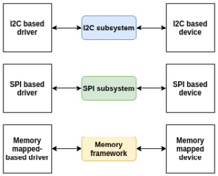
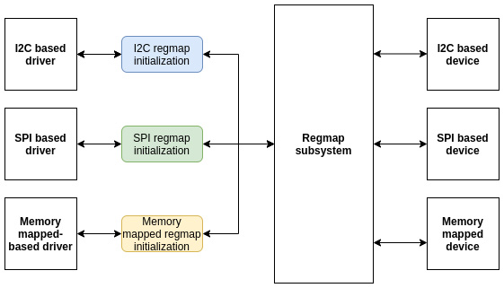

# Chương 12: Trừu tượng hóa memory access – Giới thiệu Regmap API: Register Map Abstraction

Trước khi Regmap API được phát triển, có code dư thừa trong các device driver làm việc với SPI device, I2C device hoặc memory-mapped device. Nhiều driver chứa code rất giống nhau để truy cập hardware device register.

Hình sau cho thấy các API liên quan SPI, I2C và memory-mapped được dùng riêng lẻ thế nào trước khi Regmap xuất hiện:



Hình 12.1 – Truy cập I2C, SPI và memory-mapped trước Regmap

Regmap API được đưa vào Linux kernel phiên bản v3.1, đề xuất giải pháp tách phần chung và thống nhất code truy cập register tương tự nhau, tiết kiệm code và giúp chia sẻ infrastructure dễ hơn nhiều. Khi đó, chỉ cần khởi tạo và cấu hình structure `regmap`, rồi xử lý trôi chảy mọi operation đọc/ghi/sửa, dù là SPI, I2C hay memory-mapped.

Sơ đồ sau mô tả việc thống nhất API này:



Hình 12.2 - Truy cập I2C, SPI và memory-mapped sau Regmap

Hình trước cho thấy Regmap thống nhất transaction giữa device và bus framework tương ứng thế nào. Trong chương này, chúng ta sẽ đề cập nhiều nhất có thể mọi khía cạnh API mà framework cung cấp, từ khởi tạo tới use case phức tạp.

Chương này trình bày Regmap framework qua các chủ đề sau:

- Giới thiệu Regmap data structure

- Xử lý khởi tạo Regmap

- Dùng Regmap register access function

- Ví dụ SPI driver Regmap-based – kết hợp mọi thứ

- Sử dụng Regmap từ userspace

## Giới thiệu Regmap data structure

Regmap framework, được enable qua kernel configuration option `CONFIG_REGMAP`, gồm một số data structure, quan trọng nhất là `struct regmap_config`, biểu diễn cấu hình Regmap, và `struct regmap`, chính Regmap instance. Mọi Regmap data structure được định nghĩa trong `include/linux/regmap.h`. Vì thế, dĩ nhiên header này phải được include trong mọi driver Regmap-based:

```
#include <linux/regmap.h>
```

Include header trên là đủ để tận dụng tối đa Regmap framework. Với header này, nhiều data structure trở nên sẵn có, trong đó `struct regmap_config` quan trọng nhất, được mô tả trong phần tiếp theo.

## Tìm hiểu structure struct regmap\_config

`struct regmap_config` lưu cấu hình register map trong lifetime của driver. Những gì đặt ở đó ảnh hưởng memory read/write operation. Đây là structure quan trọng nhất, định nghĩa như sau:

```
struct regmap_config {
    const char *name;
    int reg_bits;
    int reg_stride;
    int pad_bits;
    int val_bits;
    bool (*writeable_reg)(struct device *dev,
                          unsigned int reg);
    bool (*readable_reg)(struct device *dev,
                         unsigned int reg);
    bool (*volatile_reg)(struct device *dev,
                         unsigned int reg);
    bool (*precious_reg)(struct device *dev,
                         unsigned int reg);
    bool disable_locking;
    regmap_lock lock;
    regmap_unlock unlock;
    void *lock_arg;
    int (*reg_read)(void *context, unsigned int reg,
                    unsigned int *val);
    int (*reg_write)(void *context, unsigned int reg,
                    unsigned int val);
    bool fast_io;
    unsigned int max_register;
    const struct regmap_access_table *wr_table;
    const struct regmap_access_table *rd_table;
    const struct regmap_access_table *volatile_table;
    const struct regmap_access_table *precious_table;
[...]
    const struct reg_default *reg_defaults;
    unsigned int num_reg_defaults;
    enum regcache_type cache_type;
    const void *reg_defaults_raw;
    unsigned int num_reg_defaults_raw;
    unsigned long read_flag_mask;
    unsigned long write_flag_mask;
    bool use_single_rw;
    bool can_multi_write;
    enum regmap_endian reg_format_endian;
    enum regmap_endian val_format_endian;
    const struct regmap_range_cfg *ranges;
    unsigned int num_ranges;
}
```

Đừng lo structure lớn đến vậy. Mọi thành phần đều có ý nghĩa khá rõ. Tuy nhiên, để rõ hơn, hãy trình bày chi tiết ý nghĩa ở đây:

- `reg_bits` là field bắt buộc, là số bit hợp lệ trong register address. Đây là size theo bit của register address.

- `reg_stride` biểu diễn giá trị mà register address hợp lệ phải là bội số của nó. Nếu đặt là `0`, dùng giá trị `1`. Ví dụ, nếu đặt là `4`, địa chỉ chỉ được xem là hợp lệ nếu là bội số `4`.

- `pad_bits` là số padding bit giữa register và value. Đây là số bit cần (left) shift register value khi định dạng.

- `val_bits` biểu diễn số bit dùng để lưu register value. Đây là field bắt buộc.

- `writeable_reg` là callback function tùy chọn. Nếu được cung cấp, Regmap subsystem dùng khi cần ghi register. Trước khi ghi register, function này tự động được gọi để kiểm tra register có thể ghi hay không. Sau đây là ví dụ dùng function như vậy:

```
static bool foo_writeable_register(struct device *dev,
                                    unsigned int reg)
{
    switch (reg) {
    case 0x30 ... 0x38:
    case 0x40 ... 0x45:
    case 0x50 ... 0x57:
    case 0x60 ... 0x6e:
    case 0x70 ... 0x75:
    case 0x80 ... 0x85:
    case 0x90 ... 0x95:
    case 0xa0 ... 0xa5:
    case 0xb0 ... 0xb2:
        return true;
    default:
        return false;
    }
}
```

- `readable_reg` giống `writeable_reg` nhưng cho mọi register read operation.

- `volatile_reg` là callback function tùy chọn được gọi mỗi khi register cần đọc hoặc ghi qua Regmap cache. Nếu register là volatile, function nên return true. Khi đó thực hiện đọc/ghi trực tiếp register. Nếu return false, nghĩa là register cacheable. Trong trường hợp này, cache được dùng cho read operation và được ghi trong write operation:

```
static bool foo_volatile_register(struct device *dev,
                                    unsigned int reg)
{
    switch (reg) {
    case 0x24 ... 0x29:
    case 0xb6 ... 0xb8:
        return true;
    default:
        return false;
    }
}
```

- `precious_reg`: Một số device nhạy cảm với việc đọc một số register, đặc biệt như interrupt status register clear-on-read. Khi đặt callback tùy chọn này, nó phải return true nếu register chỉ định thuộc trường hợp đó, ngăn core (ví dụ `debugfs`) tự tạo lần đọc nội bộ. Nhờ vậy, chỉ lần đọc tường minh từ driver được cho phép.

- `disable_locking` cho biết có nên dùng lock/unlock callback sau hay không. Nếu false, nghĩa là không dùng locking mechanism nào. Điều này nghĩa là object `regmap` được bảo vệ bằng cơ chế bên ngoài hoặc được bảo đảm không bị truy cập từ nhiều thread.

- `lock`/`unlock` là lock/unlock callback tùy chọn, ghi đè lock/unlock function mặc định của `regmap`, dựa trên spinlock hoặc mutex tùy việc truy cập device bên dưới có thể đưa caller vào sleep hay không.

- `lock_arg` được dùng làm argument duy nhất của lock/unlock function (bị bỏ qua nếu không ghi đè lock/unlock function thông thường).

- `reg_read`: Device có thể không hỗ trợ I2C/SPI read operation đơn giản. Khi đó không có lựa chọn nào ngoài viết read function tùy chỉnh riêng. `reg_read` nên trỏ tới function đó. Tuy nhiên, phần lớn device không cần điều này.

- `reg_write` giống `reg_read` nhưng cho write operation.

- `fast_io` chỉ ra register IO nhanh. Nếu đặt, `regmap` dùng spinlock thay mutex để locking. Field này bị bỏ qua nếu dùng lock/unlock function tùy chỉnh (không bàn ở đây) (xem field `lock`/`unlock` của `struct` `regmap_config` trong kernel source). Chỉ nên dùng cho trường hợp "nobus" (MMIO device), vì truy cập I2C, SPI hoặc bus tương tự có thể đưa caller vào sleep.

- `max_register`: Thành phần tùy chọn chỉ định register address hợp lệ tối đa, trên đó không operation nào được phép.

- `wr_table`: Thay vì cung cấp callback `writeable_reg`, có thể cung cấp object `regmap_access_table`, structure chứa field `yes_ranges` và `no_range`, cả hai là pointer tới `struct regmap_range`. Register thuộc entry `yes_range` được xem là có thể ghi, còn thuộc `no_range` được xem là không thể ghi.

- `rd_table` giống `wr_table` nhưng cho mọi read operation.

- `volatile_table`: Thay `volatile_reg`, có thể cung cấp `volatile_table`. Nguyên tắc giống `wr_table` hoặc `rd_table` nhưng dành cho caching mechanism.

- `precious_table`: Như trên, cho precious register.

- `reg_defaults` là array phần tử type `reg_default`, mỗi phần tử `reg_default` là structure `{reg, value}` biểu diễn power-on reset value của register. Nó được dùng với cache để đọc địa chỉ có trong array và chưa được ghi từ power-on reset sẽ return default register value trong array mà không thực hiện read transaction nào trên device. Ví dụ là IIO device driver tại liên kết sau: https://elixir.bootlin.com/linux/v5.10/source/drivers/iio/light/apds9960.c.

- `num_reg_defaults` là số phần tử trong `reg_defaults`.

- `cache_type`: Cache type thực tế, có thể là `REGCACHE_NONE`, `REGCACHE_RBTREE`, `REGCACHE_COMPRESSED` hoặc `REGCACHE_FLAT`.

- `read_flag_mask`: Mask áp dụng trong byte cao của register khi đọc. Thông thường, bit cao nhất trong byte cao của write operation hoặc read operation trên SPI hoặc I2C được đặt để phân biệt ghi và đọc.

- `write_flag_mask`: Mask cần đặt trong byte cao của register khi ghi.

- `use_single_rw` là Boolean, nếu đặt, yêu cầu register map chuyển mọi bulk write operation hoặc bulk read operation trên device thành chuỗi single write operation hoặc single read operation. Hữu ích cho device không hỗ trợ bulk read, bulk write hoặc cả hai.

- `can_multi_write` chỉ dành cho write operation. Nếu đặt, chỉ ra device hỗ trợ multi-write mode của bulk write operation. Nếu clear, multi-write request được chia thành từng write operation riêng.

Nên xem `include/linux/regmap.h` để biết chi tiết từng thành phần. Sau đây là ví dụ khởi tạo `regmap_config`:

```
static const struct regmap_config regmap_config = {
    .reg_bits       = 8,
    .val_bits       = 8,
    .max_register   = LM3533_REG_MAX,
    .readable_reg   = lm3533_readable_register,
    .volatile_reg   = lm3533_volatile_register,
    .precious_reg   = lm3533_precious_register,
};
```

Ví dụ trên cho thấy cách xây cấu hình register map cơ bản. Dù chỉ một số thành phần được đặt trong configuration data structure, có thể thiết lập cấu hình nâng cao bằng cách tìm hiểu từng thành phần đã mô tả.

Bây giờ đã tìm hiểu cấu hình Regmap, hãy xem cách dùng cấu hình với initialization API tương ứng nhu cầu.

## Xử lý khởi tạo Regmap

Như đã nói, Regmap API hỗ trợ truy cập register qua SPI, I2C và memory-mapped. Hỗ trợ tương ứng được enable trong kernel nhờ kernel configuration option `CONFIG_REGMAP_SPI`, `CONFIG_REGMAP_I2C` và `CONFIG_REGMAP_MMIO`. Nó có thể đi xa hơn và quản lý cả IRQ, nhưng ngoài phạm vi sách. Tùy memory access method cần hỗ trợ trong driver, phải gọi `devm_regmap_init_i2c()`, `devm_regmap_init_spi()` hoặc `devm_ regmap_init_mmio()` trong probe function. Để viết generic driver, Regmap là lựa chọn tốt nhất có thể đưa ra.

Regmap API tổng quát và đồng nhất, chỉ khởi tạo thay đổi giữa bus type. Function khác giống nhau. Nên luôn khởi tạo register map trong probe function, và luôn phải điền thành phần `regmap_config` trước khi khởi tạo register map bằng một trong các API sau:

```
struct regmap *devm_regmap_init_spi(struct spi_device *spi,
                            const struct regmap_config);
struct regmap *devm_regmap_init_i2c(struct i2c_client *i2c,
                            const struct regmap_config);
struct regmap * devm_regmap_init_mmio(
                        struct device *dev,
                        void __iomem *regs,
                        const struct regmap_config *config)
```

Đây là resource-managed API có resource được cấp phát tự động giải phóng khi device rời hệ thống hoặc driver unload. Trong prototype trên, return value là pointer tới object `struct regmap` hợp lệ hoặc lỗi `ERR_PTR()` khi thất bại. `regs` là pointer tới memory-mapped IO region (do `devm_ioremap_resource()` hoặc function thuộc họ `ioremap*` return). `dev` là device (`struct device`) cần tương tác trong trường hợp memory-mapped `regmap`, còn `spi` và `i2c` lần lượt là SPI device hoặc I2C device cần tương tác trong trường hợp `regmap` SPI- hoặc I2C-based.

Gọi một function này là đủ để bắt đầu tương tác device bên dưới. Dù Regmap là I2C, SPI hay memory-mapped register map, nếu chưa được khởi tạo bằng resource-managed API variant, phải giải phóng bằng function `regmap_exit()`:

```
void regmap_exit(struct regmap *map)
```

Function này chỉ giải phóng register map đã cấp phát trước đó.

Bây giờ đã định nghĩa register access method, có thể chuyển sang device access function cho phép đọc từ hoặc ghi vào device register.

## Dùng Regmap register access function

Remap register access method xử lý data parsing, formatting và transmission. Phần lớn trường hợp, device access được thực hiện bằng `regmap_read()`, `regmap_write()` và `regmap_update_bits()`, ba API quan trọng khi ghi/đọc data vào/từ device. Prototype tương ứng như sau:

```
int regmap_read(struct regmap *map, unsigned int reg,
                 unsigned int *val);
int regmap_write(struct regmap *map, unsigned int reg,
                 unsigned int val);
int regmap_update_bits(struct regmap *map,
                 unsigned int reg, unsigned int mask,
                 unsigned int val);
```

`regmap_write()` ghi data tới device. Nếu được đặt trong `regmap_config`, `max_register` được dùng để kiểm tra register address cần truy cập lớn hơn hay nhỏ hơn. Nếu register address truyền vào nhỏ hơn hoặc bằng `max_register`, operation tiếp theo được thực hiện; nếu không, Regmap core return lỗi I/O không hợp lệ (`-EIO`). Ngay sau đó, callback `writeable_reg` được gọi. Callback phải return true trước khi sang bước tiếp theo. Nếu return false, `-EIO` được return và write operation dừng. Nếu đặt `wr_table` thay `writeable_reg`, diễn ra như sau:

- Nếu register address nằm trong `no_ranges`, return `-EIO`.

- Nếu register address nằm trong `yes_ranges`, thực hiện bước tiếp theo.

- Nếu register address không nằm trong `yes_range` hoặc `no_range`, return `-EIO` và kết thúc operation.

Nếu `cache_type != REGCACHE_NONE`, caching được enable. Khi đó, cache entry được cập nhật bằng giá trị mới trước, rồi thực hiện ghi hardware. Nếu không, không thực hiện caching action. Nếu callback `reg_write` được cung cấp, nó được dùng để thực hiện write operation. Nếu không, generic write function của Regmap được thực thi để ghi data vào register address chỉ định.

`regmap_read()` đọc data từ device. Nó hoạt động giống hệt `regmap_write()` với data structure thích hợp (`readable_reg` và `rd_table`). Vì vậy, nếu cung cấp, `reg_read` được dùng để thực hiện read operation; nếu không, generic register map read function được thực thi.

`regmap_update_bits()` là function three-in-one. Nó thực hiện chu kỳ read/modify/write trên register address chỉ định. Đây là wrapper của `_regmap_update_bits`, có dạng sau:

```
static int _regmap_update_bits(struct regmap *map,
             unsigned int reg, unsigned int mask,
             unsigned int val, bool *change,
             bool force_write)
{
    int ret;
    unsigned int tmp, orig;
    if (change)
        *change = false;
    if (regmap_volatile(map, reg) &&
                   map->reg_update_bits) {
        ret = map->reg_update_bits(map->bus_context,
                                   reg, mask, val);
        if (ret == 0 && change)
            *change = true;
    } else {
        ret = _regmap_read(map, reg, &orig);
        if (ret != 0)
            return ret;
        tmp = orig & ~mask;
        tmp |= val & mask;
        if (force_write || (tmp != orig)) {
            ret = _regmap_write(map, reg, tmp);
            if (ret == 0 && change)
                *change = true;
        }
    }
    return ret;
}
```

Theo cách này, bit cần cập nhật phải được đặt là `1` trong `mask`, và bit tương ứng nên được đặt thành giá trị mong muốn trong `val`.

Ví dụ, để đặt bit thứ nhất và thứ ba thành `1`, `mask` nên là `0b00000101` và value nên là `0bxxxxx1x1`. Để clear bit thứ bảy, `mask` phải là `0b01000000` và value nên là `0bx0xxxxxx`, v.v.

## API đọc/ghi bulk và nhiều register

`regmap_multi_reg_write()` là một API cho phép ghi nhiều register tới device. Prototype như sau:

```
int regmap_multi_reg_write(struct regmap *map,
                    const struct reg_sequence *regs,
                    int num_regs)
```

Trong prototype này, `regs` là array phần tử type `reg_sequence`, biểu diễn cặp register/value cho chuỗi write với delay tùy chọn theo microsecond áp dụng sau mỗi lần ghi. Sau đây là định nghĩa data structure:

```
struct reg_sequence {
    unsigned int reg;
    unsigned int def;
    unsigned int delay_us;
};
```

Trong data structure trên, `reg` là register address, `def` là register value, còn `delay_us` là delay theo microsecond cần áp dụng sau khi ghi register.

Sau đây là cách dùng chuỗi như vậy:

```
static const struct reg_sequence foo_default_regs[] = {
    { FOO_REG1,       0xB8 },
    { BAR_REG1,       0x00 },
    { FOO_BAR_REG1,   0x10 },
    { REG_INIT,       0x00 },
    { REG_POWER,      0x00 },
    { REG_BLABLA,     0x00 },
};
static int probe ( ...)
{
    [...]
    ret = regmap_multi_reg_write(my_regmap,
                          foo_default_regs,
                          ARRAY_SIZE(foo_default_regs));
    [...]
}
```

Ở trên, chúng ta học cách dùng multi-register write API đầu tiên, nhận tập register cùng giá trị.

Ngoài ra có `regmap_bulk_read()` và `regmap_bulk_write()`, có thể dùng để đọc/ghi nhiều register từ/tới device. Cách dùng phù hợp với block data lớn, và chúng được định nghĩa như sau:

```
int regmap_bulk_read(struct regmap *map,
                     unsigned int reg, void *val,
                     size_tval_count);
int regmap_bulk_write(struct regmap *map,
                      unsigned int reg,
                      const void *val, size_t val_count);
```

Trong parameter của các function trên, `map` là register map cần thao tác và `reg` là register address nơi read/write operation phải bắt đầu. Với đọc, `val` chứa giá trị đã đọc; nó phải được cấp phát để lưu ít nhất `count` giá trị theo native register size của device. Với write operation, `val` phải trỏ tới data array cần ghi tới device. Cuối cùng, `count` là số phần tử trong `val`.

## Tìm hiểu Regmap caching system

Dĩ nhiên, Regmap hỗ trợ data caching. Việc dùng cache system hay không phụ thuộc giá trị field `cache_type` trong `regmap_config`. Xem `include/linux/regmap.h`, các giá trị được chấp nhận như sau:

```
/* An enum of all the supported cache types */
enum regcache_type {
   REGCACHE_NONE,
   REGCACHE_RBTREE,
   REGCACHE_COMPRESSED,
   REGCACHE_FLAT,
};
```

Cache type mặc định là `REGCACHE_NONE`, nghĩa là cache bị disable. Giá trị khác chỉ định cách lưu cache.

Device có thể có power-on reset value định sẵn trong một số register. Có thể lưu giá trị đó trong array để mọi read operation return value trong array. Tuy nhiên, write operation tác động register thực tế trong device và cập nhật nội dung array. Đây là dạng cache có thể dùng để tăng tốc device access. Array đó là `reg_defaults`. Xem source, structure có dạng sau:

```
struct reg_default {
    unsigned int reg;
    unsigned int def;
};
```

Trong data structure trên, `reg` là register address và `def` là register default value. `reg_defaults` bị bỏ qua nếu `cache_type` được đặt thành none. Nếu không đặt thành phần `default_reg` nhưng vẫn enable cache, cache structure tương ứng được tạo cho bạn.

Cách dùng khá đơn giản. Chỉ cần khai báo và truyền làm parameter cho structure `regmap_config`. Hãy xem LTC3589 regulator driver trong `drivers/regulator/ltc3589.c`:

```
static const struct reg_default ltc3589_reg_defaults[] = {
{ LTC3589_SCR1,   0x00 },
{ LTC3589_OVEN,   0x00 },
{ LTC3589_SCR2,   0x00 },
{ LTC3589_VCCR,   0x00 },
{ LTC3589_B1DTV1, 0x19 },
{ LTC3589_B1DTV2, 0x19 },
{ LTC3589_VRRCR,  0xff },
{ LTC3589_B2DTV1, 0x19 },
{ LTC3589_B2DTV2, 0x19 },
{ LTC3589_B3DTV1, 0x19 },
{ LTC3589_B3DTV2, 0x19 },
{ LTC3589_L2DTV1, 0x19 },
{ LTC3589_L2DTV2, 0x19 },
};
static const struct regmap_config ltc3589_regmap_config = {
        .reg_bits = 8,
        .val_bits = 8,
        .writeable_reg = ltc3589_writeable_reg,
        .readable_reg = ltc3589_readable_reg,
        .volatile_reg = ltc3589_volatile_reg,
        .max_register = LTC3589_L2DTV2,
        .reg_defaults = ltc3589_reg_defaults,
        .num_reg_defaults = ARRAY_SIZE(ltc3589_reg_defaults),
        .use_single_rw = true,
        .cache_type = REGCACHE_RBTREE,
};
```

Mọi read operation trên register có trong array lập tức return value trong array. Tuy nhiên, write operation được thực hiện trên chính device và cập nhật register bị tác động trong array. Theo cách này, đọc register `LTC3589_VRRCR` return `0xff`, còn ghi bất kỳ giá trị nào vào register đó sẽ cập nhật entry của nó trong array để mọi read operation mới return giá trị được ghi cuối cùng trực tiếp từ cache.

Bây giờ đã có thể dùng Regmap API truy cập device register bất kể bus bên dưới mà device nằm trên, đã đến lúc tổng hợp kiến thức đã học trong ví dụ thực tế.

## Ví dụ SPI driver Regmap-based – kết hợp mọi thứ

Có thể liệt kê mọi bước thiết lập Regmap, từ cấu hình tới truy cập device register, như sau:

- Thiết lập object `struct regmap_config` theo đặc điểm device. Định nghĩa register range nếu cần, default value nếu có, `cache_type` nếu cần, v.v. Nếu cần read/write function tùy chỉnh, truyền chúng cho field `reg_read`/`reg_write`.

- Trong function `probe`, cấp phát register map bằng `devm_regmap_init_i2c()`, `devm_regmap_init_spi()` hoặc `devm_regmap_init_mmio()` tùy kết nối với device bên dưới — I2C, SPI hoặc memory-mapped.

- Mỗi khi cần đọc/ghi từ/vào register, gọi function `remap_[read|write]`.

- Khi dùng xong register map, giả sử dùng resource-managed API, không cần làm gì khác vì devres core đảm nhận giải phóng Regmap resource; nếu không, phải gọi `regmap_exit()` để giải phóng register map cấp phát trong probe.

Bây giờ hãy hiện thực các bước trong ví dụ driver thực tế dùng Regmap framework.

## Ví dụ Regmap

Để đạt mục tiêu, trước tiên hãy mô tả SPI device giả lập để viết driver bằng Regmap framework. Để dễ hiểu, dùng những đặc điểm sau:

- Device hỗ trợ register addressing 8-bit và register value 8-bit.

- Địa chỉ tối đa có thể truy cập trong device này là `0x80` (không nhất thiết nghĩa là device có `0x80` register).

- Write mask là `0x80`, và address range hợp lệ như sau:

- `0x20` tới `0x4F`

- `0x60` tới `0x7F`

- Vì device hỗ trợ SPI read/write operation đơn giản, không cần cung cấp read/write function tùy chỉnh.

Bây giờ đã hoàn tất đặc tả device và Regmap, có thể bắt đầu viết code.

Phần sau include header cần để làm việc với Regmap:

```
#include <linux/regmap.h>
```

Tùy API cần trong driver, có thể include header khác.

Sau đó, định nghĩa private data structure như sau:

```
struct private_struct
{
    /* Feel free to add whatever you want here */
    struct regmap *map;
    int foo;
};
```

Tiếp theo, định nghĩa read/write register range, tức những register được phép truy cập:

```
static const struct regmap_range wr_rd_range[] =
{
    {
            .range_min = 0x20,
            .range_max = 0x4F,
    },{
            .range_min = 0x60,
            .range_max = 0x7F
    },
};
struct regmap_access_table drv_wr_table =
{
    .yes_ranges =   wr_rd_range,
    .n_yes_ranges = ARRAY_SIZE(wr_rd_range),
};
struct regmap_access_table drv_rd_table =
{
    .yes_ranges =   wr_rd_range,
    .n_yes_ranges = ARRAY_SIZE(wr_rd_range),
};
```

Tuy nhiên, cần lưu ý nếu đặt `writeable_reg` và/hoặc `readable_reg`, không cần cung cấp `wr_table` và/hoặc `rd_table`.

Sau đó, định nghĩa callback được gọi mỗi khi register được truy cập cho write operation hoặc read operation. Mỗi callback phải return true nếu được phép thực hiện operation chỉ định trên register:

```
static bool writeable_reg(struct device *dev,
                          unsigned int reg)
{
    if (reg>= 0x20 &&reg<= 0x4F)
        return true;
    if (reg>= 0x60 &&reg<= 0x7F)
        return true;
    return false;
}
static bool readable_reg(struct device *dev,
                         unsigned int reg)
{
    if (reg>= 0x20 &&reg<= 0x4F)
        return true;
    if (reg>= 0x60 &&reg<= 0x7F)
        return true;
    return false;
}
```

Bây giờ đã định nghĩa mọi operation Regmap-related, có thể triển khai method `probe` của driver như sau:

```
static int my_spi_drv_probe(struct spi_device *dev)
{
    struct regmap_config config;
    struct private_struct *priv;
    unsigned char data;
    /* setup the regmap configuration */
    memset(&config, 0, sizeof(config));
    config.reg_bits = 8;
    config.val_bits = 8;
    config.write_flag_mask = 0x80;
    config.max_register = 0x80;
    config.fast_io = true;
    config.writeable_reg = drv_writeable_reg;
    config.readable_reg = drv_readable_reg;
    /*
     * If writeable_reg and readable_reg are set,
     * there is no need to provide wr_table nor rd_table.
     * Uncomment below code only if you do not want to use
     * writeable_reg nor readable_reg.
     */
    //config.wr_table = drv_wr_table;
    //config.rd_table = drv_rd_table;
    /* allocate the private data structures */
    /* priv = kzalloc */
    /* Init the regmap spi configuration */
    priv->map = devm_regmap_init_spi(dev, &config);
    /* Use devm_regmap_init_i2c in case of i2c bus */
    /*
     * Let us write into some register
     * Keep in mind that, below operation will remain same
     * whether you use SPI, I2C, or memory mapped Regmap.
     * It is and advantage when you use regmap.
     */
    regmap_read(priv->map, 0x30, &data);
    [...] /* Process data */
    data = 0x24;
    regmap_write(priv->map, 0x23, data); /* write new value */
    /* set bit 2 (starting from 0) and bit 6
     * of register 0x44 */
    regmap_update_bits(priv->map, 0x44,
                       0b00100010, 0xFF);
    [...] /* Lot of stuff */
    return 0;
}
```

Trong method `probe` trên, thậm chí có nhiều command hơn code. Chúng ta chỉ cần minh họa cách chuyển đặc tả device thành register map configuration và dùng làm access function chính tới device register.

Bây giờ đã hoàn tất Regmap trong kernel, hãy xem user space có thể tận dụng framework thế nào trong phần tiếp theo.

## Sử dụng Regmap từ user space

Có thể theo dõi register map từ user space qua debugfs filesystem. Trước tiên, cần enable debugfs qua kernel configuration option `CONFIG_DEBUG_FS`. Sau đó có thể mount debugfs bằng lệnh sau:

```
mount -t debugfs none /sys/kernel/debug
```

Sau đó, có thể tìm triển khai register map debugfs trong `/sys/kernel/debug/regmap/`. Debugfs view do `drivers/base/regmap/regmap-debugfs.c` trong kernel source triển khai chứa register cache (mirror) cho driver/peripheral dựa trên Regmap API.

Từ main debugfs directory của Regmap, có thể lấy danh sách device có driver dựa trên Regmap API bằng lệnh sau:

```
root@jetson-nano-devkit:~# ls -l /sys/kernel/debug/regmap/
drwxr-xr-x   2 root  root   0 Jan  1  1970 4-003c-power-slave
drwxr-xr-x   2 root  root   0 Jan  1  1970 4-0068
drwxr-xr-x   2 root  root   0 Jan  1  1970 700e3000.mipical
drwxr-xr-x   2 root  root   0 Jan  1  1970 702d3000.amx
drwxr-xr-x   2 root  root   0 Jan  1  1970 702d3100.amx
drwxr-xr-x   2 root  root   0 Jan  1  1970 hdaudioC0D3-hdaudio
drwxr-xr-x   2 root  root   0 Jan  1  1970 tegra210-admaif
drwxr-xr-x   2 root  root   0 Jan  1  1970 tegra210-adx.0
[...]
root@jetson-nano-devkit:~#
```

Trong mỗi directory có thể có một hoặc nhiều file sau:

- `access`: Biểu diễn mã hóa các access permission khác nhau cho mỗi register theo mẫu `readable writable`

```
volatile precious:
root@jetson-nano-devkit:~# cat /sys/kernel/debug/regmap/4-003c-power-slave/access
00: y y y n
01: y y y n
02: y y y n
03: y y y n
04: y y y n
05: y y y n
06: y y y n
07: y y y n
08: y y y n
[...]
5c: y y y n
5d: y y y n
5e: y y y n
```

Ví dụ, dòng `5e: y y y n` nghĩa là register tại địa chỉ `5e` có thể đọc, ghi, là volatile nhưng không precious.

- `name`: Driver name gắn với register map. Kiểm tra driver tương ứng. Ví dụ, register map entry `702d3000.amx`:

```
root@jetson-nano-devkit:~# cat /sys/kernel/debug/regmap/702d3000.amx/name
tegra210-amx
```

Tuy nhiên, có Regmap entry bắt đầu bằng `dummy-` như sau:

```
root@raspberrypi4-64:~# ls -l /sys/kernel/debug/regmap/
drwxr-xr-x  2 root root 0 Jan 1 1970 dummy-avs-monitor@fd5d2000
root@raspberrypi4-64:~#
```

Loại entry này được đặt khi không có entry `/dev` tương ứng (`devtmpfs`). Có thể kiểm tra bằng cách in device name bên dưới, sẽ là `nodev`, như sau:

```
root@raspberrypi4-64:~# cat /sys/kernel/debug/regmap/dummy-avs-monitor\@fd5d2000/name
nodev
root@raspberrypi4-64:~#
```

Có thể tìm suffix name sau `dummy-` để tìm node liên quan trong device tree, ví dụ `dummy-avs-monitor@fd5d2000`:

```
avs_monitor: avs-monitor@7d5d2000 {
    compatible = "brcm,bcm2711-avs-monitor",
                 "syscon", "simple-mfd";
    reg = <0x7d5d2000 0xf00>;
[...]
};
```

- `cache_bypass`: Đưa register map vào cache-only mode. Nếu enable, ghi vào register map chỉ cập nhật hardware, không cập nhật cache trực tiếp:

```
root@jetson-nano-devkit:~# cat /sys/kernel/debug/regmap/702d3000.amx/cache_bypass
N
```

Để enable cache bypassing, nên echo `Y` vào file này như sau:

```
root@jetson-nano-devkit:~# echo Y > /sys/kernel/debug/regmap/702d30[579449.571475]
tegra210-amx tegra210-amx.0: debugfs cache_bypass=Y forced
00.amx/cache_bypass
root@jetson-nano-devkit:~#
```

Điều này còn in message trong kernel log buffer.

- `cache_dirty`: Chỉ ra HW register đã được reset về default value và hardware register không khớp cache state. Giá trị đọc có thể là `Y` hoặc `N`.

- `cache_only`: Echo `N` vào file này disable caching cho register map, đồng thời kích hoạt cache syncing; ghi `Y` buộc register trong register map này chỉ được cache. Đọc file return `Y` hoặc `N` theo trạng thái enable caching hiện tại. Mọi lần ghi khi giá trị này true đều được cache (chỉ register cache được cập nhật, không có hardware change).

- `range`: Register range hợp lệ của register map:

```
root@jetson-nano-devkit:~# cat /sys/kernel/debug/regmap/4-003c-power-slave/range
0-5e
```

- `rbtree`: Cho biết memory overhead mà cache `rbtree` thêm vào:

```
root@jetson-nano-devkit:~# cat /sys/kernel/debug/regmap/4-003c-power-slave/rbtree
0-5e (95)
1 nodes, 95 registers, average 95 registers, used 175 bytes
```

- `registers`: File dùng để đọc và ghi register thực tế gắn với register map:

```
root@jetson-nano-devkit:~# cat /sys/kernel/debug/regmap/4-003c-power-slave/registers
00: d2
01: 1f
02: 00
03: dc
04: 0f
05: 00
06: 00
07: 00
08: 02
[...]
5c: 35
5d: 81
5e: 00
#
```

Trong output trên, register address hiển thị trước, rồi tới nội dung.

Phần này khá ngắn nhưng mô tả cô đọng việc theo dõi Regmap từ user space. Nó cho phép đọc và ghi register content và trong một số tình huống, thay đổi hành vi Regmap bên dưới.

## Tổng kết

Chương này hoàn toàn về Regmap API liên quan register access. Sự đơn giản cho bạn hình dung nó hữu ích và được dùng rộng rãi thế nào. Chương đã trình bày mọi điều cần biết về Regmap API. Giờ bạn có thể chuyển mọi SPI/I2C/memory-mapped driver tiêu chuẩn sang Regmap. Chương tiếp theo đề cập IRQ management trong Linux; tuy nhiên, hai chương sau chúng ta sẽ đề cập IIO device, framework cho analog-to-digital converter. Loại device này luôn nằm trên SPI/I2C bus. Cuối chương đó, viết IIO driver bằng Regmap API có thể là thử thách cho chúng ta.
