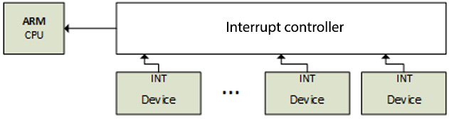
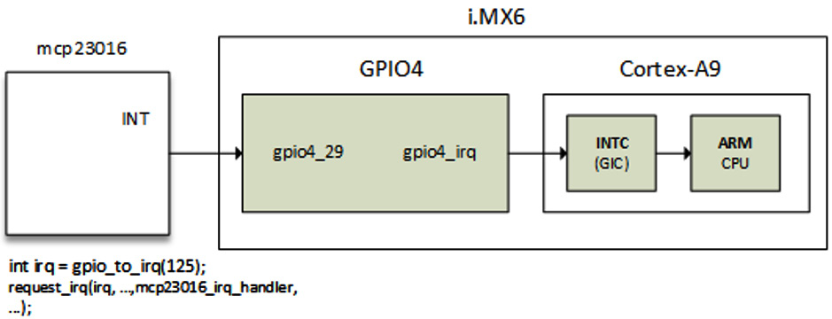

# Chương 13: Làm rõ Kernel IRQ Framework

Linux là hệ thống mà device thông báo event cho kernel qua interrupt request (IRQ), dù một số device được poll. CPU cung cấp IRQ line, có thể chia sẻ hoặc không, cho các device kết nối sử dụng để khi cần CPU, device gửi request tới CPU. Khi nhận request, CPU dừng công việc hiện tại và lưu context để phục vụ request do device phát. Sau khi phục vụ device, trạng thái CPU được khôi phục chính xác về nơi đã dừng khi interrupt xảy ra.

Trong chương này, chúng ta làm việc với API mà kernel cung cấp để quản lý IRQ và các cách thực hiện multiplexing. Ngoài ra, chúng ta phân tích và xem kỹ hơn việc viết interrupt controller driver.

Tóm lại, chương này đề cập các chủ đề sau:

- Giới thiệu ngắn gọn interrupt

- Tìm hiểu interrupt controller và interrupt multiplexing

- Đi sâu vào quản lý peripheral IRQ nâng cao

- Làm rõ per-CPU interrupt

## Giới thiệu ngắn gọn interrupt

Trên nhiều platform, một device đặc biệt chịu trách nhiệm quản lý IRQ line. Device đó là interrupt controller, nằm giữa CPU và các interrupt line nó quản lý. Sau đây là sơ đồ thể hiện các tương tác:



Hình 13.1 – Interrupt controller và IRQ line

Không chỉ device có thể phát interrupt, một số processor operation cũng có thể làm vậy. Vì thế có hai loại interrupt:

- Synchronous interrupt, gọi là exception, do CPU tạo trong khi xử lý instruction. Đây là non-maskable interrupt (NMI), xuất phát từ trục trặc nghiêm trọng như hardware failure. CPU luôn xử lý chúng.

- Asynchronous interrupt, gọi là interrupt, được hardware device khác phát. Đây là interrupt thông thường và maskable. Chúng là nội dung sẽ bàn trong các phần tiếp theo của chương.

Trước khi đi sâu vào interrupt management trong Linux kernel, hãy nói thêm một chút về exception.

Exception là hệ quả của lỗi lập trình, được kernel xử lý bằng cách gửi signal tới chương trình và cố gắng khôi phục từ lỗi. Chúng được chia thành hai loại như sau:

- Processor-detected exception: CPU tạo để đáp ứng điều kiện bất thường, được chia thành ba nhóm:

- Fault, thường có thể sửa được (instruction sai).

- Trap, xảy ra trong user process (memory access không hợp lệ, chia cho 0), cũng là cơ chế chuyển sang kernel mode để đáp ứng system call. Nếu kernel code gây trap, kernel lập tức panic.

- Abort – lỗi nghiêm trọng.

- Programmed exception: Được programmer yêu cầu và xử lý như trap.

Bây giờ đã giới thiệu các họ interrupt, hãy học cách chúng được triển khai trong interrupt controller.

## Tìm hiểu interrupt controller và interrupt multiplexing

Có một interrupt duy nhất từ CPU thường không đủ. Phần lớn hệ thống có hàng chục hoặc hàng trăm interrupt. Khi đó interrupt controller cho phép multiplex chúng. Rất thường xuyên, triển khai riêng của architecture hoặc platform-specific cung cấp khả năng riêng như sau:

- Mask/unmask từng interrupt

- Đặt priority

- SMP affinity

- Tính năng đặc biệt như wake-up interrupt

Cả IRQ management và interrupt controller driver đều dựa trên khái niệm IRQ domain, được xây trên các structure sau:

- `struct irq_chip`: Đây là interrupt controller data structure. Structure này cũng triển khai tập method cho phép điều khiển interrupt controller và được core IRQ code gọi trực tiếp.

- `struct irqdomain`: Cung cấp những khả năng sau:

- Pointer tới firmware node (`fwnode`) của interrupt controller

- Function chuyển firmware description của IRQ thành ID cục bộ của interrupt controller này (`hwirq`, còn gọi là hardware IRQ number)

- Cách lấy cách nhìn của Linux (`virq`, còn gọi là virtual IRQ number) về IRQ từ `hwirq`

- `struct irq_desc`: Structure này là cách Linux nhìn nhận interrupt. Nó chứa mọi thông tin về interrupt cùng mapping one-to-one tới Linux interrupt number.

- `struct irq_action`: Structure dùng để mô tả IRQ handler.

- `struct irq_data`: Structure này được nhúng trong structure `struct irq_desc` và cung cấp thông tin sau:

- Data liên quan IRQ chip quản lý interrupt này.

- Cả `virq` lẫn `hwirq`.

- Pointer tới `struct irq_chip` (IRQ chip data structure). Lưu ý phần lớn function call IRQ chip-related nhận `irq_data` làm parameter, từ đó có thể lấy `struct irq_desc` tương ứng.

Mọi data structure trên thuộc IRQ domain API. Interrupt controller được biểu diễn trong kernel bằng instance của structure `struct irq_chip`, mô tả hardware device thực tế và một số method do IRQ core dùng. Khối code sau thể hiện định nghĩa:

```
struct irq_chip {
    struct device    *parent_device;
    const char       *name;
    void   (*irq_enable)(struct irq_data *data);
    void   (*irq_disable)(struct irq_data *data);
    void   (*irq_ack)(struct irq_data *data);
    void   (*irq_mask)(struct irq_data *data);
    void   (*irq_unmask)(struct irq_data *data);
    void   (*irq_eoi)(struct irq_data *data);
    int    (*irq_set_affinity)(struct irq_data *data,
                const struct cpumask *dest, bool force);
    int    (*irq_retrigger)(struct irq_data *data);
    int    (*irq_set_type)(struct irq_data *data,
                           unsigned int flow_type);
    int    (*irq_set_wake)(struct irq_data *data,
                           unsigned int on);
    void   (*irq_bus_lock)(struct irq_data *data);
    void   (*irq_bus_sync_unlock)(struct irq_data *data);
    int   (*irq_get_irqchip_state)(struct irq_data *data,
               enum irqchip_irq_state which, bool *state);
    int   (*irq_set_irqchip_state)(struct irq_data *data,
               enum irqchip_irq_state which, bool state);
    void  (*ipi_send_single)(struct irq_data *data,
                              unsigned int cpu);
   void   (*ipi_send_mask)(struct irq_data *data,
                           const struct cpumask *dest);
    unsigned long    flags;
};
```

Danh sách sau giải thích ý nghĩa các thành phần trong structure:

- `parent_device`: Pointer tới parent của IRQ chip này.

- `name`: Tên dùng cho file `/proc/interrupts`.

- `irq_enable`: Hook này enable interrupt. Nếu không đặt (nếu là `NULL`), mặc định là `chip->unmask`.

- `irq_disable`: Disable interrupt.

- `irq_ack`: Callback acknowledge interrupt. Nó được `handle_edge_irq()` gọi vô điều kiện, vì vậy phải được định nghĩa (kể cả phần thân rỗng) cho IRQ controller driver dùng `handle_edge_irq()` để xử lý interrupt. Với controller như vậy, callback được gọi ở đầu interrupt. Một số controller không cần. Linux gọi function ngay khi interrupt phát sinh, từ lâu trước khi được phục vụ. Trong một số triển khai, function được map tới `chip->disable()` để nếu interrupt request khác xuất hiện trên line, nó không gây interrupt khác cho tới sau khi interrupt request hiện tại được xử lý.

- `irq_mask`: Hook mask interrupt source trong hardware để không thể phát interrupt nữa.

- `irq_unmask`: Hook unmask interrupt source.

- `irq_eoi`: Linux gọi hook end of interrupt (EOI) ngay sau khi phục vụ IRQ hoàn tất. Chúng ta dùng function này để cấu hình lại controller khi cần nhằm nhận interrupt request khác trên line đó. Một số triển khai map function này tới `chip->enable()` để đảo ngược operation đã làm trong `chip->ack()`.

- `irq_set_affinity`: Chỉ đặt CPU affinity trên máy SMP. Trên máy như vậy, function dùng để chỉ định CPU xử lý interrupt. Function không được dùng trong môi trường single-processor vì interrupt luôn được phục vụ trên cùng CPU duy nhất.

- `irq_retrigger`: Kích hoạt lại interrupt trong hardware, gửi lại IRQ tới CPU.

- `irq_set_type`: Đặt flow type của IRQ, như `IRQ_TYPE_LEVEL`.

- `irq_set_wake`: Enable/disable power management wake-on của IRQ.

- `irq_bus_lock`: Function lock truy cập chip trên slow bus (I2C). Lock mutex ở đây là đủ.

- `irq_bus_sync_unlock`: Function sync và unlock chip trên slow bus (I2C), đồng thời unlock mutex đã lock trước đó.

- `irq_get_irqchip_state` và `irq_set_irqchip_state`: Lần lượt return hoặc đặt internal state của interrupt.

- `ipi_send_single` và `ipi_send_mask`: Lần lượt dùng để gửi inter-processor interrupt (IPI) tới một CPU hoặc tập CPU được mask định nghĩa. IPI dùng trên hệ thống SMP để tạo remote CPU interrupt từ local CPU. Chúng ta sẽ bàn sau trong chương, phần Làm rõ per-CPU interrupt.

Mỗi interrupt controller được cấp domain, có vai trò với controller tương tự address space với process (xem Chương 10, Tìm hiểu cấp phát memory trong Linux kernel). Interrupt controller domain được mô tả trong kernel bằng structure `struct irq_domain`. Nó quản lý mapping giữa hardware IRQ number và Linux IRQ number (tức virtual IRQ). Đây là hardware interrupt number translation object. Khối code sau thể hiện định nghĩa:

```
struct irq_domain {
    const char *name;
    const struct irq_domain_ops *ops;
    void *host_data;
    unsigned int flags;
    unsigned int mapcount;
    /* Optional data */
    struct fwnode_handle *fwnode;
    [...]
};
```

Để dễ đọc, chỉ thành phần liên quan được liệt kê. Danh sách sau cho biết ý nghĩa:

- `name`: Tên interrupt domain.

- `ops`: Pointer tới IRQ domain method.

- `host_data`: Private data pointer để owner dùng. IRQ domain core code không đụng tới.

- `flags`: Chứa per-IRQ domain flag.

- `mapcount`: Số interrupt đã map trong IRQ domain này.

- Giống mọi thành phần còn lại, `fwnode` là tùy chọn. Đây là pointer tới device tree (DT) node gắn với IRQ domain. Dùng khi decode DT interrupt specifier.

Interrupt controller driver tạo và đăng ký IRQ domain bằng cách gọi một function `irq_domain_add_<mapping_method>()`, trong đó `<mapping_method>` là phương thức map `hwirq` thành Linux `virq`. Những function này được mô tả trong danh sách sau:

- `irq_domain_add_linear()`: Dùng table fixed-size được index bằng number `hwirq`. Khi number `hwirq` được map, object `irq_desc` được cấp phát cho `hwirq` này và IRQ number được lưu trong table. Linear mapping thích hợp với controller hoặc domain có số lượng `hwirq` cố định và nhỏ (\~ \< 256). Bất tiện là table size lớn bằng number `hwirq` lớn nhất có thể có. Vì vậy, thời gian lookup IRQ number cố định và IRQ descriptor chỉ được cấp phát cho IRQ in-use. Phần lớn driver nên dùng linear mapping. Function có prototype sau:

```
struct irq_domain *irq_domain_add_linear(
                   struct device_node *of_node,
                   unsigned int size,
                   const struct irq_domain_ops *ops,
                   void *host_data)
```

- `irq_domain_add_tree()`: Với mapping này, IRQ domain duy trì mapping giữa `virqs` (Linux IRQ number) và `hwirsq` (hardware interrupt number) trong radix tree. Object `irq_desc` được cấp phát khi `hwirq` được map, và hardware IRQ number này được dùng làm lookup key của radix tree. Nếu number `hwirq` có thể rất lớn, treemap là giải pháp khả thi vì không cần cấp phát table lớn bằng number `hwirq` lớn nhất. Nhược điểm là lookup từ `hwirq` tới IRQ number chịu ảnh hưởng của số entry trong table. Rất ít driver cần mapping này. Có ít hơn 10 nơi dùng API trong kernel. Prototype được thể hiện trong khối code sau:

```
struct irq_domain *irq_domain_add_tree(
                  struct device_node *of_node,
                  const struct irq_domain_ops *ops,
                  void *host_data)
```

- `irq_domain_add_nomap()`: Có lẽ bạn không bao giờ dùng phương thức này. Tuy vậy, mô tả đầy đủ có trong `Documentation/IRQ-domain.txt` trong kernel source tree. Prototype được thể hiện trong khối code sau:

```
struct irq_domain *irq_domain_add_nomap(
                   struct device_node *of_node,
                   unsigned int max_irq,
                   const struct irq_domain_ops *ops,
                   void *host_data)
```

Trong các function này, `of_node` là pointer tới DT node của interrupt controller. `size` tương ứng số interrupt trong domain. `ops` biểu diễn map/unmap domain callback, còn `host_data` là private data pointer của controller.

Khi mới tạo, IRQ domain rỗng (không có mapping). Mapping được tạo và thêm khi IRQ chip driver gọi `irq_create_mapping()`, có prototype sau:

```
unsigned int irq_create_mapping(struct irq_domain
              *domain, irq_hw_number_t hwirq)
```

Trong function trên, `domain` là domain mà hardware interrupt thuộc về, hoặc `NULL` cho default domain; `hwirq` biểu diễn hardware interrupt number trong domain space đó.

Nếu mapping cho number `hwirq` chưa tồn tại trong IRQ domain, function cấp phát Linux IRQ descriptor structure (`struct irq_desc`) mới, đồng thời return virtual interrupt number. Sau đó gắn nó với number `hwirq` (qua function `irq_domain_associate()`, đến lượt nó gọi callback `irq_domain_ops.map` để driver thực hiện hardware setup cần thiết). Để hiểu đoạn này, cần mô tả IRQ domain operation data structure (`struct irq_domain_ops`), định nghĩa trong khối code sau:

```
struct irq_domain_ops {
    int (*map)(struct irq_domain *d, unsigned int virq,
          irq_hw_number_t hw);
    void (*unmap)(struct irq_domain *d,
                   unsigned int virq);
    int (*xlate)(struct irq_domain *d,
                   struct device_node *node,
                   const u32 *intspec,
                   unsigned int intsize,
                   unsigned long *out_hwirq,
                   unsigned int *out_type);
[...]
};
```

Các thành phần trong data structure được giới hạn theo phạm vi chương. Tuy nhiên, có thể tìm data structure đầy đủ trong `include/linux/irqdomain.h` trong kernel source. Danh sách sau cho biết ý nghĩa các thành phần đã liệt kê:

- `map`: Tạo hoặc cập nhật mapping giữa number `virq` và number `hwirq`. Callback chỉ được gọi một lần cho một mapping. Nó thường map number `virq` với handler đã cho bằng `irq_set_chip_and_handler()`, để gọi `generic_handle_irq()` hoặc `handle_nested_irq()` sẽ kích hoạt handler này. Function `irq_set_chip_and_handler()` được định nghĩa trong khối code sau:

```
void irq_set_chip_and_handler(unsigned int irq,
                          struct irq_chip *chip,
                          irq_flow_handler_t handle)
```

Trong function này, `irq` là Linux IRQ truyền làm parameter cho function `map()`, còn `chip` là IRQ chip của bạn. Tuy nhiên, có dummy controller gần như không cần gì trong structure `irq_chip`. Khi đó, driver truyền `dummy_irq_chip`, định nghĩa trong `kernel/irq/dummychip.c`, là structure `irq_chip` được kernel-predefined cho controller như vậy. `handle` xác định interrupt flow handler, gọi handler thực sự được đăng ký bằng `request_irq()`. Giá trị phụ thuộc IRQ là edge-triggered hay level-triggered. Trong từng trường hợp, nên đặt `handle` là `handle_edge_irq` hoặc `handle_level_irq`. Cả hai là kernel helper function thực hiện operation trước và sau khi gọi IRQ handler thực sự. Ví dụ được thể hiện trong khối code này:

```
static int ativic32_irq_domain_map(
                struct irq_domain *id,
                unsigned int virq,
                irq_hw_number_t hw)
{
[...]
    if (int_trigger_type & (BIT(hw))) {
        irq_set_chip_and_handler(virq,
                     &ativic32_chip,
                     handle_edge_irq);
        type = IRQ_TYPE_EDGE_RISING;
    } else {
        irq_set_chip_and_handler(virq,
                     &ativic32_chip,
                     handle_level_irq);
        type = IRQ_TYPE_LEVEL_HIGH;
    }
    irqd_set_trigger_type(irq_data, type);
    return 0;
}
```

- `xlate`: Với DT node có interrupt specifier, hook này decode hardware interrupt number trong specifier cùng Linux interrupt type value. Tùy giá trị `#interrupt-cells` chỉ định trong DT controller node, kernel cung cấp generic translation function:

- `irq_domain_xlate_twocell()`: Generic translation function dùng cho direct two-cell binding. Nó làm việc với device tree IRQ specifier có two-cell binding, trong đó cell value map trực tiếp tới number `hwirq` và Linux IRQ flag.

- `irq_domain_xlate_onecell()`: Generic `xlate` cho direct one-cell binding.

- `Irq_domain_xlate_onetwocell()`: Generic `xlate` cho one-cell hoặc two-cell binding.

Ví dụ domain operation được đưa ra trong khối code sau:

```
static struct irq_domain_ops mcp23016_irq_domain_ops = {
    .map    = mcp23016_irq_domain_map,
    .xlate  = irq_domain_xlate_twocell,
};
```

Khi nhận interrupt, function `irq_find_mapping()` dùng để tìm Linux IRQ number từ number `hwirq`. Dĩ nhiên mapping phải tồn tại trước khi được return. Linux IRQ number luôn gắn với structure `struct irq_desc`, structure Linux dùng mô tả IRQ, có định nghĩa sau:

```
struct irq_desc {
    struct irq_data        irq_data;
    unsigned int __percpu  *kstat_irqs;
    irq_flow_handler_t     handle_irq;
    struct irqaction       *action;
    unsigned int           irqs_unhandled;
    raw_spinlock_t         lock;
    struct cpumask         *percpu_enabled;
    atomic_t               threads_active;
    wait_queue_head_t      wait_for_threads;
#ifdef CONFIG_PM_SLEEP
    unsigned int           nr_actions;
    unsigned int           no_suspend_depth;
    unsigned int           force_resume_depth;
#endif
#ifdef CONFIG_PROC_FS
    struct proc_dir_entry   *dir;
#endif
    Int               parent_irq;
    struct module     *owner;
    const char        *name;
};
```

Một số field trong data structure cố ý không được đưa vào. Với phần còn lại, danh sách sau trình bày định nghĩa:

- `kstat_irqs`: per-CPU IRQ statistics từ khi boot.

- `handle_irq`: high-level IRQ event handler.

- `action`: Biểu diễn danh sách IRQ action cho descriptor này.

- `irqs_unhandled`: Field thống kê spurious unhandled interrupt.

- `lock`: Biểu diễn locking cho SMP.

- `threads_active`: Số IRQ action thread hiện đang chạy cho descriptor này.

- `wait_for_threads`: Biểu diễn wait queue để `sync_irq` chờ threaded handler.

- `nr_actions`: Số action được cài trên descriptor này.

- `no_suspend_depth` và `force_resume_depth`: Biểu diễn số instance `irqaction` trên IRQ descriptor có đặt flag `IRQF_NO_SUSPEND` hoặc `IRQF_FORCE_RESUME`.

- `dir`: Biểu diễn procfs entry `/proc/irq/`.

- `name`: Đặt tên flow handler, hiển thị trong output `/proc/interrupts`.

Khi đăng ký interrupt handler, handler được thêm vào cuối danh sách `irq_desc.action` gắn với interrupt line đó. Ví dụ, mỗi lời gọi `request_irq()` (hoặc threaded version `request_threaded_irq()`) tạo và thêm một structure `struct irqaction` vào cuối danh sách `irq_desc.action` (biết rằng `irq_desc` là descriptor của interrupt này). Với shared interrupt, field này chứa số object `irqaction` bằng số handler đã đăng ký. IRQ action data structure có định nghĩa sau:

```
struct irqaction {
    irq_handler_t     handler;
    void              *dev_id;
    void __percpu     *percpu_dev_id;
    struct irqaction  *next;
    irq_handler_t     thread_fn;
    struct task_struct     *thread;
    unsigned int      irq;
    unsigned int      flags;
    unsigned long     thread_flags;
    unsigned long     thread_mask;
    const char        *name;
    struct proc_dir_entry   *dir;
};
```

Ý nghĩa từng thành phần trong data structure như sau:

- `handler`: non-threaded (hard) interrupt handler function.

- `name`: Device name.

- `dev_id`: Cookie nhận diện device.

- `percpu_dev_id`: per-CPU cookie nhận diện device.

- `next`: Pointer tới IRQ action tiếp theo cho shared interrupt.

- `irq`: Linux interrupt number (`virq`).

- `flags`: Biểu diễn IRQ flag (xem `IRQF_*`).

- `thread_fn`: Threaded interrupt handler function cho threaded interrupt.

- `thread`: Pointer tới thread structure trong trường hợp threaded interrupt.

- `thread_flags`: Biểu diễn flag liên quan thread.

- `thread_mask`: Bitmask theo dõi thread activity.

- `dir`: Trỏ tới entry `/proc/irq/NN/<name>/`.

Sau đây là định nghĩa field quan trọng trong structure `struct irq_data`, là per-IRQ chip data truyền xuống chip function:

```
struct irq_data {
    [...]
    unsigned int     irq;
    unsigned long           hwirq;
    struct irq_chip         *chip;
    struct irq_domain *domain;
    void              *chip_data;
};
```

Danh sách sau trình bày ý nghĩa thành phần trong data structure:

- `irq`: Interrupt number (Linux IRQ number).

- `hwirq`: Hardware interrupt number, cục bộ trong interrupt domain `irq_data.domain`.

- `chip`: Biểu diễn truy cập low-level interrupt controller hardware.

- `domain`: Biểu diễn interrupt translation domain, chịu trách nhiệm mapping giữa number `hwirq` và Linux IRQ number.

- `chip_data`: Private data platform-specific, per-chip dành cho chip method, cho phép chia sẻ chip implementation.

Bây giờ đã quen data structure của IRQ framework, có thể đi xa hơn và nghiên cứu cách interrupt được yêu cầu, lan truyền suốt processing chain.

## Đi sâu vào quản lý peripheral IRQ nâng cao

Trong Chương 3, Làm việc với Kernel Core Helper, chúng ta giới thiệu peripheral IRQ bằng `request_irq()` và `request_threaded_irq()`. Với function đầu, bạn đăng ký handler (top half) được thực thi trong atomic context, từ đó có thể schedule bottom half bằng một cơ chế đã bàn trong cùng chương. Mặt khác, với biến thể `_threaded`, có thể cung cấp top half và bottom half cho function để top half chạy như hard IRQ handler, có thể quyết định kích hoạt handler thứ hai, threaded handler, hay không; handler đó chạy trong kernel thread. Vấn đề là đôi khi driver yêu cầu IRQ không biết bản chất interrupt controller cung cấp IRQ line này, đặc biệt khi interrupt controller là chip rời (thường là GPIO expander kết nối qua SPI bus hoặc I2C bus). Khi đó có function `request_any_context_irq()`, nhờ nó driver yêu cầu IRQ biết handler có chạy trong thread context hay không và gọi `request_threaded_irq()` hoặc `request_irq()` tương ứng. Nghĩa là dù IRQ gắn với device đến từ interrupt controller không được sleep (loại memory-mapped) hay loại có thể sleep (sau I2C/SPI bus), không cần thay đổi code. Prototype được thể hiện trong khối code sau:

```
int request_any_context_irq(unsigned int irq,
                            irq_handler_t handler,
                            unsigned long flags,
                            const char * name,
                            void * dev_id);
```

Đây là ý nghĩa từng parameter trong function:

- `irq`: Biểu diễn interrupt line cần cấp phát.

- `handler`: Function cần gọi khi IRQ xảy ra. Tùy context, function có thể chạy như hard IRQ hoặc được threaded.

- `flags`: Biểu diễn interrupt type flag. Giống các flag trong `request_irq()`.

- `name`: Dùng cho debugging để đặt tên interrupt trong `/proc/interrupts`.

- `dev_id`: Cookie được truyền lại cho handler function.

`request_any_context_irq()` nghĩa là có thể nhận hard IRQ hoặc threaded IRQ. Nó hoạt động như `request_irq()` thông thường, ngoại trừ kiểm tra IRQ có được cấu hình nested hay không và gọi backend đúng. Nói cách khác, nó chọn hard IRQ handling method hoặc threaded handling method tùy context. Function return giá trị âm khi thất bại. Khi thành công, return `IRQC_IS_HARDIRQ` hoặc `IRQC_IS_NESTED`. Use case được thể hiện trong khối code sau:

```
static irqreturn_t packt_btn_interrupt(int irq,
                                        void *dev_id)
{
    struct btn_data *priv = dev_id;
    input_report_key(priv->i_dev, BTN_0,
                   gpiod_get_value(priv->btn_gpiod) & 1);
    input_sync(priv->i_dev);
    return IRQ_HANDLED;
}
static int btn_probe(struct platform_device *pdev)
{
    struct gpio_desc *gpiod;
    int ret, irq;
    [...]
    gpiod = gpiod_get(&pdev->dev, "button", GPIOD_IN);
    if (IS_ERR(gpiod))
        return -ENODEV;
    priv->irq = gpiod_to_irq(priv->btn_gpiod);
    priv->btn_gpiod = gpiod;
    [...]
    ret = request_any_context_irq(
            priv->irq,
            packt_btn_interrupt,
            (IRQF_TRIGGER_FALLING | IRQF_TRIGGER_RISING),
            "packt-input-button", priv);
    if (ret < 0) {
        dev_err(&pdev->dev,
           "Unable to request GPIO interrupt line\n");
        goto err_btn;
    }
    return ret;
}
```

Code trên là đoạn trích từ driver mẫu của input device driver. Ưu điểm dùng `request_any_context_irq()` là không cần quan tâm có thể làm gì trong IRQ handler, vì context mà handler chạy phụ thuộc interrupt controller cung cấp IRQ line. Trong ví dụ này, nếu GPIO thuộc controller nằm trên I2C bus hoặc SPI bus, handler được threaded. Nếu không (memory-mapped), handler chạy trong hard IRQ context.

## Tìm hiểu IRQ và propagation

Xét sơ đồ sau với GPIO controller có interrupt line kết nối tới native GPIO trên SoC:



Hình 13.2 – Interrupt propagation

IRQ luôn được xử lý dựa trên Linux IRQ number (không phải `hwirq`). Function tổng quát để yêu cầu IRQ trên hệ thống Linux là `request_threaded_irq()`. `request_irq()` là wrapper của `request_threaded_irq()`, chỉ không cung cấp bottom half. Khối code sau thể hiện prototype:

```
int request_threaded_irq(unsigned int irq,
                  irq_handler_t handler,
                  irq_handler_t thread_fn,
                  unsigned long irqflags,
                  const char *devname, void *dev_id)
```

Khi được gọi, function trích xuất `struct irq_desc` gắn với IRQ bằng macro `irq_to_desc()`. Sau đó cấp phát structure `struct irqaction` mới và thiết lập bằng cách điền parameter như handler và flag. Khối code sau là đoạn trích:

```
action->handler = handler;
action->thread_fn = thread_fn;
action->flags = irqflags;
action->name = devname;
action->dev_id = dev_id;
```

Cuối cùng, cùng function đó chèn/đăng ký descriptor vào IRQ list thích hợp bằng cách gọi function `__setup_irq()` (qua `setup_irq()`), định nghĩa trong `kernel/irq/manage.c`.

Giờ khi IRQ phát sinh, kernel thực thi assembler code để lưu current state rồi nhảy tới handler arch-specific, `handle_arch_irq`. Với ARM architecture, handler được đặt bằng giá trị field `handle_irq` trong `struct machine_desc` của platform tại function `setup_arch()`, triển khai trong `arch/arm/kernel/setup.c`. Phép gán được thực hiện như sau:

```
handle_arch_irq = mdesc->handle_irq
```

Với SoC dùng ARM Generic Interrupt Controller (GIC), callback `handle_irq` được đặt bằng `gic_handle_irq`, trong `drivers/irqchip/irq-gic.c` hoặc `drivers/irqchip/irq-gic-v3.c`:

```
set_handle_irq(gic_handle_irq);
```

`gic_handle_irq()` gọi `handle_domain_irq()`, thực thi `generic_handle_irq()`, đến lượt nó gọi `generic_handle_irq_desc()`, kết thúc bằng gọi `desc->handle_irq()`. Có thể xem toàn bộ chuỗi trong `arch/arm/kernel/irq.c`. Giờ `handle_irq` là lời gọi thực sự tới flow handler, đã đăng ký là `mcp23016_irq_handler` trong sơ đồ.

`gic_hande_irq()` là GIC interrupt handler. `generic_handle_irq()` thực thi handler của GPIO4 IRQ trên SoC, tìm GPIO pin đã phát interrupt và gọi

```
generic_handle_irq_desc().
```

## Chaining IRQ

Phần này mô tả cách interrupt handler của parent gọi interrupt handler của child, đến lượt chúng gọi interrupt handler của child của mình, v.v. Kernel cung cấp hai cách gọi interrupt handler cho child device trong IRQ handler của parent device (interrupt controller). Đó là phương thức chained và nested.

### Chained interrupt

Cách này dùng cho GPIO controller nội bộ SoC, là memory-mapped và không đưa caller vào sleep khi truy cập. Chained nghĩa là interrupt chỉ là chuỗi function call (ví dụ interrupt handler của GPIO module trên SoC được gọi từ GIC interrupt handler, giống function call). `generic_handle_irq()` dùng cho interrupt chaining. Child IRQ handler được gọi từ bên trong hard IRQ handler của parent. Nghĩa là ngay cả trong child interrupt handler, chúng ta vẫn ở atomic context (HW interrupt), và driver không được gọi function có thể sleep.

### Nested interrupt

Với flow này, function call được lồng nhau, nghĩa là interrupt handler không được gọi trong parent handler. `handle_nested_irq()` dùng để tạo nested interrupt child IRQ. Handler được gọi trong thread mới tạo cho mục đích này. Phương thức được controller trên slow bus như SPI hoặc I2C (ví dụ GPIO expander) dùng, có thao tác truy cập có thể sleep (I2C access routine và SPI access routine có thể sleep). Nested interrupt handler chạy trong process context có thể gọi mọi sleeping function.

## Làm rõ per-CPU interrupt

Interrupt controller ARM phổ biến nhất, GIC trong ARM multi-core processor, hỗ trợ ba loại interrupt:

- CPU private interrupt: Những interrupt này là private cho từng CPU. Nếu được kích hoạt, per-CPU interrupt chỉ được phục vụ trên target CPU hoặc CPU mà nó được bind vào. Private interrupt có thể chia thành hai họ:

- Private peripheral interrupt (PPI): Là private và chỉ có thể được hardware gắn với CPU tạo.

- Software-generated interrupt (SGI): Khác PPI, được software tạo. Nhờ vậy, SGI thường dùng làm interrupt IPI cho inter-core communication trên multi-core system, nghĩa là một CPU có thể tạo interrupt (bằng cách ghi message thích hợp gồm interrupt ID và target CPU vào GIC controller) tới một hoặc nhiều CPU khác. Đây là điều chúng ta bàn trong phần này.

- Shared peripheral interrupt (SPI) (không nhầm với SPI bus): Đây là interrupt thông thường đã bàn đến đây. Chúng có thể được route tới bất kỳ CPU nào.

Trong hệ thống có interrupt controller hỗ trợ private interrupt cho từng core, một số IRQ controller register được banked để chỉ một core truy cập được (ví dụ core chỉ có thể đọc/ghi interrupt configuration của chính nó). Thông thường, để làm vậy, một số interrupt controller register được banked per CPU; CPU có thể enable local interrupt bằng cách ghi vào banked register của nó.

Distributor block và CPU interface block được phân chia logic trong GIC. Khi tương tác với interrupt source, distributor block ưu tiên interrupt và chuyển tới CPU interface block. CPU interface block liên kết với processor của hệ thống và quản lý priority masking cùng preemption cho processor được liên kết.

GIC có thể hỗ trợ tối đa 8 CPU interface, mỗi interface xử lý tối đa 1.020 interrupt. Interrupt ID number 0–1019 được GIC gán như sau:

- Interrupt number 0–31 là interrupt private cho CPU interface. Những private interrupt này được banked trong distributor block và chia như sau:

- SGI dùng banked interrupt number 0–15.

- PPI dùng banked interrupt number 16–31. Ví dụ, trong hệ thống SMP, per-CPU timer do clock event device cung cấp có thể tạo interrupt như vậy.

- SPI dùng interrupt number 32–1.019.

- Interrupt còn lại được dành riêng, tức interrupt number 1020–1023.

Bây giờ đã quen các họ ARM GIC interrupt, có thể tập trung vào họ quan tâm, tức SGI.

## SGI và IPI

Trong ARM processor có 16 SGI, đánh số 0 đến 15, nhưng Linux kernel chỉ đăng ký một số: chính xác là tám (0 đến 7). SGI8 tới SGI15 hiện còn trống. SGI được đăng ký là những SGI định nghĩa trong `enum ipi_msg_type`, được định nghĩa như sau:

```
enum ipi_msg_type {
    IPI_WAKEUP,
    IPI_TIMER,
    IPI_RESCHEDULE,
    IPI_CALL_FUNC,
    IPI_CPU_STOP,
    IPI_IRQ_WORK,
    IPI_COMPLETION,
    NR_IPI,
[...]
    MAX_IPI
};
```

Mô tả tương ứng có trong array string, tức `ipi_types`, định nghĩa trong khối code sau:

```
static const char *ipi_types[NR_IPI] = {
    [IPI_WAKEUP] = "CPU wakeup interrupts",
    [IPI_TIMER] = "Timer broadcast interrupts",
    [IPI_RESCHEDULE] = "Rescheduling interrupts",
    [IPI_CALL_FUNC]  = "Function call interrupts",
    [IPI_CPU_STOP]   = "CPU stop interrupts",
    [IPI_IRQ_WORK]   = "IRQ work interrupts",
    [IPI_COMPLETION] = "completion interrupts",
};
```

IPI được đăng ký trong function `set_smp_ipi_range()`, định nghĩa trong khối code sau:

```
void __init set_smp_ipi_range(int ipi_base, int n)
{
    int i;
    WARN_ON(n < MAX_IPI);
    nr_ipi = min(n, MAX_IPI);
    for (i = 0; i < nr_ipi; i++) {
        int err;
        err = request_percpu_irq(ipi_base + i,
                 ipi_handler, "IPI", &irq_stat);
        WARN_ON(err);
        ipi_desc[i] = irq_to_desc(ipi_base + i);
        irq_set_status_flags(ipi_base + i, IRQ_HIDDEN);
    }
    ipi_irq_base = ipi_base;
    /* Setup the boot CPU immediately */
    ipi_setup(smp_processor_id());
}
```

Trong khối code trên, mỗi IPI được đăng ký bằng `request_percpu_irq()` trên cơ sở per-CPU. Có thể thấy IPI có cùng handler `ipi_handler()`, định nghĩa như sau:

```
static irqreturn_t ipi_handler(int irq, void *data)
{
    do_handle_IPI(irq - ipi_irq_base);
    return IRQ_HANDLED;
}
```

Function bên dưới được thực thi trong handler là `do_handle_IPI()`, định nghĩa như sau:

```
static void do_handle_IPI(int ipinr)
{
    unsigned int cpu = smp_processor_id();
    if ((unsigned)ipinr < NR_IPI)
        trace_ipi_entry_rcuidle(ipi_types[ipinr]);
    switch (ipinr) {
    case IPI_WAKEUP:
        break;
#ifdef CONFIG_GENERIC_CLOCKEVENTS_BROADCAST
    case IPI_TIMER:
        tick_receive_broadcast();
        break;
#endif
    case IPI_RESCHEDULE:
        scheduler_ipi();
        break;
    case IPI_CPU_STOP:
        ipi_cpu_stop(cpu);
        break;
[...]
    default:
        pr_crit("CPU%u: Unknown IPI message 0x%x\n",
                cpu, ipinr);
        break;
    }
    if ((unsigned)ipinr < NR_IPI)
         trace_ipi_exit_rcuidle(ipi_types[ipinr]);
}
```

Từ function trên,

- `IPI_WAKEUP`: Dùng để đánh thức và boot secondary CPU. Chủ yếu được boot CPU phát.

- `IPI_RESCHEDULE`: Linux kernel dùng rescheduling interrupt để yêu cầu CPU core khác schedule thread. Scheduler trên hệ thống SMP làm vậy để phân bố tải qua nhiều CPU core. Theo quy tắc chung, lý tưởng là có càng nhiều process chạy trên mọi core ở mức năng lượng thấp (clock frequency thấp) thay vì một core bận chạy hết tốc độ trong khi core khác sleep. Khi scheduler cần offload công việc từ core này sang core khác đang sleep, nó gửi kernel IPI message tới core đang sleep, khiến core thức dậy từ low-power sleep và bắt đầu chạy process. Những IPI event này được `powertop` báo là `Rescheduling Interrupts`.

- `IPI_TIMER`: Timer broadcast interrupt. IPI này emulate timer interrupt trên idle CPU. Nó được broadcast clock event/tick device gửi tới CPU được biểu diễn trong `tick_broadcast_mask`, bitmap biểu diễn danh sách processor ở sleeping mode. Tick device và broadcast mask được bàn trong Chương 3, Làm việc với Kernel Core Helper.

- `IPI_CPU_STOP`: Khi kernel panic xảy ra trên CPU, CPU khác được yêu cầu dump stack và dừng thực thi qua IPI message `IPI_CPU_STOP`. Target CPU không shutdown hay bị đưa offline; thay vào đó dừng thực thi và được đưa vào low-power loop, ở trạng thái wait for event (WFE).

- `IPI_CALL_FUNC`: Dùng để chạy function trong context của processor khác.

- `IPI_IRQ_WORK`: Dùng để chạy work trong hardware IRQ context. Kernel cung cấp nhiều cơ chế hoãn work tới lúc sau, đặc biệt ra khỏi hardware interrupt context. Tuy nhiên, đôi khi cần chạy work trong hardware interrupt context mà lúc đó không có hardware thích hợp phát interrupt. Để làm vậy, IPI được dùng để chạy work trong hardware interrupt context. Chủ yếu dùng trong code chạy từ non-maskable interrupt, cần có thể tương tác với phần còn lại của hệ thống.

Trên hệ thống đang chạy, có thể tìm IPI sẵn có từ file `/proc/interrupt`, như thể hiện trong khối code sau:

```
root@udoo-labcsmart:~# cat /proc/interrupts | grep IPI
IPI0:          0          0  CPU wakeup interrupts
IPI1:         29         22  Timer broadcast interrupts
IPI2:      84306     322774  Rescheduling interrupts
IPI3:        970       1264  Function call interruptsIPI4:          0          0  CPU stop
interrupts
IPI5:    2505436    4064821  IRQ work interrupts
IPI6:          0          0  completion interrupts
root@udoo-labcsmart:~#
```

Trong command output ở đây, cột đầu là IPI identifier và cột cuối mô tả IPI. Các cột giữa là số lần thực thi tương ứng trên từng CPU.

## Tổng kết

Giờ IRQ multiplexing không còn bí mật nào với bạn. Chúng ta đã bàn thành phần quan trọng nhất của IRQ management trên hệ thống Linux: IRQ domain API. Bạn có nền tảng để hiểu interrupt controller driver hiện có cũng như binding của chúng trong DT. IRQ propagation được bàn để tìm hiểu điều xảy ra giữa request và handler invocation.

Trong chương tiếp theo, chúng ta làm việc với chủ đề hoàn toàn khác: Linux device model.
