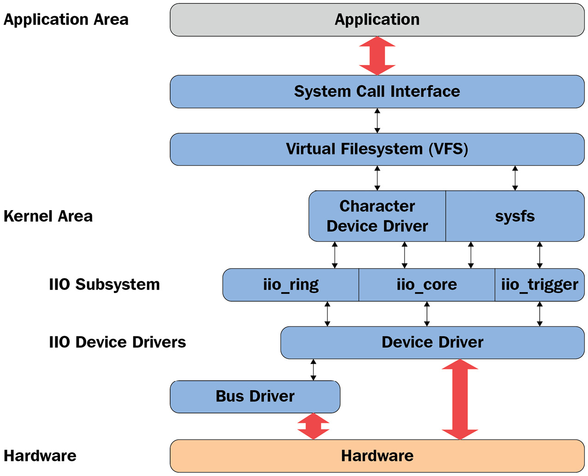
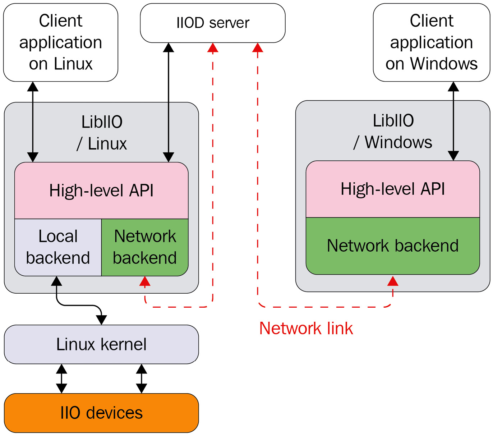

# Chương 15: Đi sâu vào IIO Framework

Industrial input/output (IIO) là kernel subsystem dành cho analog-to-digital converter (ADC) và digital-to-analog converter (DAC). Khi số sensor (device đo có khả năng analog-to-digital hoặc digital-to-analog) với code implementation khác nhau nằm rải rác trong kernel source tăng lên, việc tập hợp chúng trở nên cần thiết. Đó là điều IIO framework thực hiện theo cách tổng quát. Jonathan Cameron và cộng đồng Linux IIO đã phát triển nó từ năm 2009. Accelerometer, gyroscope, chip đo current/voltage, light sensor và pressure sensor đều thuộc họ IIO device.

IIO model dựa trên architecture device và channel:

- Device biểu diễn chính chip, cấp cao nhất của hierarchy.

- Channel biểu diễn một acquisition line của device. Device có thể có một hoặc nhiều channel. Ví dụ, accelerometer là device có ba channel, mỗi channel cho một axis (x, y và z).

IIO chip là sensor/converter hardware vật lý. Nó được cung cấp cho user space dưới dạng character device (khi hỗ trợ triggered buffer) và sysfs directory entry chứa tập file, một số biểu diễn channel.

Đây là hai cách tương tác IIO device từ user space:

- `/sys/bus/iio/iio:deviceX/`, sysfs directory biểu diễn device cùng channel

- `/dev/iio:deviceX`, character device export event và data buffer của device

Vì một hình ảnh đáng giá ngàn lời, hình sau cho thấy tổng quan IIO framework:



Hình 15.1 – Tổng quan IIO framework

Hình trên cho thấy IIO framework được tổ chức giữa kernel và user space thế nào. Driver quản lý hardware và báo việc xử lý cho IIO core bằng tập tiện ích và API do IIO core cung cấp. Sau đó IIO subsystem trừu tượng hóa toàn bộ cơ chế bên dưới cho user space qua sysfs interface và character device, trên đó người dùng có thể thực thi system call.

IIO API nằm trong một số header file như sau:

```
/* mandatory, the core */
#include <linux/iio/iio.h>
/* mandatory since sysfs is used */
#include <linux/iio/sysfs.h>
/* Optional. Advanced feature, to manage iio events */
#include <linux/iio/events.h>
/* mandatory for triggered buffers */
#include <linux/iio/buffer.h>
/* rarely used. Only if the driver implements a trigger */
#include <linux/iio/trigger.h>
```

Trong chương này, chúng ta mô tả và xử lý mọi khái niệm IIO framework, như đi qua data structure (device, channel, v.v.), làm việc với triggered buffer support và continuous capture cùng sysfs interface, khám phá IIO trigger hiện có, học capture data trong one-shot mode hoặc continuous mode, và liệt kê công cụ giúp developer kiểm thử device.

Nói cách khác, chương này đề cập các chủ đề sau:

- Giới thiệu IIO data structure

- Tích hợp IIO triggered buffer support

- Truy cập IIO data

- Làm việc với in-kernel IIO consumer interface

- Tìm hiểu user-space IIO tool

## Giới thiệu IIO data structure

IIO framework gồm một số data structure: một biểu diễn IIO device, một mô tả device này, và cuối cùng liệt kê channel device cung cấp. IIO device được biểu diễn trong kernel bằng instance `struct iio_dev` và được mô tả bằng structure `struct iio_info`. Mọi IIO structure quan trọng được định nghĩa trong `include/linux/iio/iio.h`.

## Tìm hiểu structure struct iio\_dev

Structure `struct iio_dev` biểu diễn IIO device, mô tả device và driver của nó. Nó cho biết device có bao nhiêu channel và có thể hoạt động ở mode nào (ví dụ one-shot hoặc triggered buffer). Ngoài ra, data structure cung cấp một số hook mà driver phải triển khai.

Data structure có định nghĩa sau:

```
struct iio_dev {
    [...]
    int             modes;
    int             currentmode;
    struct device   dev;
    struct iio_buffer           *buffer;
    int                         scan_bytes;
    const unsigned long         *available_scan_masks;
    const unsigned long         *active_scan_mask;
    bool                        scan_timestamp;
    struct iio_trigger          *trig;
    struct iio_poll_func        *pollfunc;
    struct iio_chan_spec const  *channels;
    int                         num_channels;
    const char                  *name;
    const struct iio_info       *info;
    const struct iio_buffer_setup_ops   *setup_ops;
    struct cdev                 chrdev;
};
```

Để dễ đọc, đoạn trích trên chỉ liệt kê thành phần liên quan. Định nghĩa đầy đủ nằm trong `include/linux/iio/iio.h`. Sau đây là ý nghĩa thành phần trong data structure:

- `modes` biểu diễn mode mà device hỗ trợ. Mode có thể có như sau:

  - `INDIO_DIRECT_MODE`: Cho biết device cung cấp sysfs-type interface.

  - `INDIO_BUFFER_TRIGGERED`: Cho biết device hỗ trợ hardware trigger gắn với buffer. Mode flag này tự động được đặt khi thiết lập triggered buffer bằng function `iio_triggered_buffer_setup()`.

  - `INDIO_BUFFER_SOFTWARE`: Trong continuous conversion, buffering được chính kernel triển khai bằng software. Kernel đẩy data vào internal FIFO với interrupt có thể xảy ra tại watermark chỉ định.

  - `INDIO_BUFFER_HARDWARE`: Nghĩa là device có hardware buffer. Trong continuous conversion, device có thể xử lý buffering. Nghĩa là có thể lấy data stream trực tiếp từ hardware backend.

  - `INDIO_ALL_BUFFER_MODES`: Hợp của ba mode trên.

  - `INDIO_EVENT_TRIGGERED`: Conversion có thể được trigger bởi event nào đó, như ADC đạt threshold voltage, nhưng không phải interrupt hoặc timer trigger. Flag dành cho chip comparator-equipped mà không có cách khác để trigger conversion.

  - `INDIO_HARDWARE_TRIGGERED`: Có thể được trigger bằng hardware event như IRQ hoặc clock event.

  - `INDIO_ALL_TRIGGERED_MODES` là hợp của `INDIO_BUFFER_TRIGGERED`, `INDIO_EVENT_TRIGGERED` và `INDIO_HARDWARE_TRIGGERED`.

- `currentmode`: Biểu diễn mode device đang dùng.

- `dev`: Biểu diễn struct device (theo Linux Device Model) mà IIO device gắn vào.

- `buffer`: Data buffer được đẩy tới user space khi dùng triggered buffer mode. Nó tự động được cấp phát và gắn với device khi enable triggered buffer support bằng function `iio_triggered_buffer_setup`.

- `scan_bytes`: Số byte capture để đưa vào buffer. Khi dùng trigger buffer từ user space, buffer phải lớn ít nhất `indio->scan_bytes` byte.

- `available_scan_masks`: Array bitmask được phép, tùy chọn. Khi dùng triggered buffer, có thể enable channel để capture và đưa vào IIO buffer. Nếu không muốn cho phép một số channel được enable, chỉ nên điền channel được phép vào array này. Ví dụ accelerometer (với channel X, Y và Z) như sau:

```
/*
* Bitmasks 0x7 (0b111) and 0 (0b000) are allowed.
* It means one can enable none or all of them.
* You can't for example enable only channel X and Y
*/
static const unsigned long my_scan_masks[] = {0x7, 0};
indio_dev->available_scan_masks = my_scan_masks;
```

- `active_scan_mask`: Bitmask của channel đã enable. Chỉ data từ channel đó nên được đẩy vào buffer. Ví dụ, với ADC converter eight-channel, nếu chỉ enable channel đầu (index 0), thứ ba (index 2) và cuối (index 7), bitmask là `0b10000101` (`0x85`). `active_scan_mask` được đặt thành `0x85`. Driver sau đó có thể dùng macro `for_each_set_bit` duyệt từng bit được đặt, lấy data từ channel tương ứng và điền buffer.

- `scan_timestamp`: Cho biết có đẩy capture timestamp vào buffer hay không. Nếu `true`, timestamp được đẩy làm phần tử cuối buffer. Timestamp lớn 8 byte (64 bit).

- `trig`: Device trigger hiện tại (khi hỗ trợ buffer mode).

- `pollfunc`: Function chạy khi nhận trigger.

- `channels`: Biểu diễn table channel specification structure để mô tả mọi channel device có.

- `num_channels`: Biểu diễn số channel chỉ định trong `channels`.

- `name`: Biểu diễn device name.

- `info`: Callback và constant information từ driver.

- `setup_ops`: Tập callback function cần gọi trước và sau khi buffer được enable/disable. Structure được định nghĩa trong `include/linux/iio/iio.h` như sau:

```
struct iio_buffer_setup_ops {
    int (* preenable) (struct iio_dev *);
    int (* postenable) (struct iio_dev *);
    int (* predisable) (struct iio_dev *);
    int (* postdisable) (struct iio_dev *);
    bool (* validate_scan_mask) (
                     struct iio_dev *indio_dev,
                     const unsigned long *scan_mask);
};
```

Lưu ý mỗi callback trong data structure là tùy chọn.

- `chrdev`: Character device tương ứng do IIO core tạo, với `iio_buffer_fileops` làm file operation table.

Bây giờ đã quen IIO device structure, bước tiếp theo là cấp phát memory cho nó. Function thích hợp là `devm_iio_device_alloc()`, managed version của `iio_device_alloc()`, có định nghĩa sau:

```
struct iio_dev *devm_iio_device_alloc(struct device *dev,
                                       int sizeof_priv)
```

Nên dùng managed version trong driver mới vì `devres` core đảm nhận giải phóng memory khi không còn cần. Trong prototype trên, `dev` là device cần cấp phát `iio_dev` cho nó và `sizeof_priv` là extra memory space cần cấp phát cho private data structure bất kỳ. Function return `NULL` nếu cấp phát thất bại.

Sau khi cấp phát IIO device memory, bước tiếp theo là khởi tạo các field. Khi xong, phải đăng ký device với IIO subsystem bằng function `devm_iio_device_register()`, có prototype sau:

```
int devm_iio_device_register(struct device *dev,
                             struct iio_dev *indio_dev);
```

Function này là managed version của `iio_device_register()`, đảm nhận hủy đăng ký IIO device khi driver detach. Trong parameter, `dev` là cùng device đã được cấp phát IIO device, còn `indio_dev` là IIO device đã khởi tạo. Device sẵn sàng nhận request từ user space sau khi function thành công (return `0`). Sau đây là ví dụ đăng ký IIO device:

```
static int ad7476_probe(struct spi_device *spi)
{
    struct ad7476_state *st;
    struct iio_dev *indio_dev;
    int ret;
    indio_dev = devm_iio_device_alloc(&spi->dev,
                                        sizeof(*st));
    if (!indio_dev)
         return -ENOMEM;
    /* st is given the address of reserved memory for
    * private data
    */
    st = iio_priv(indio_dev);
    [...]
    /* iio device setup */
    indio_dev->name = spi_get_device_id(spi)->name;
    indio_dev->modes = INDIO_DIRECT_MODE;
    indio_dev->num_channels = 2;
    [...]
    return devm_iio_device_register(&spi->dev, indio_dev);
}
```

Nếu có lỗi, `devm_iio_device_register()` return error code âm. Operation ngược cho non-managed variant (thường làm trong release function) là `iio_device_unregister()`, có khai báo sau:

```
void iio_device_unregister(struct iio_dev *indio_dev)
```

Tuy nhiên, managed registration đảm nhận hủy đăng ký device khi driver detach hoặc device rời hệ thống. Ngoài ra, vì dùng managed allocation variant, không cần giải phóng memory vì core xử lý nội bộ.

Bạn có thể cũng nhận thấy function mới trong đoạn trích, `iio_priv()`. Accessor return địa chỉ private data được cấp phát cùng IIO device. Nên dùng function này thay dereference trực tiếp. Ví dụ, với IIO device, có thể lấy private data tương ứng như sau:

```
struct my_private_data *the_data = iio_priv(indio_dev);
```

Bản thân IIO device không hữu ích. Bây giờ đã hoàn tất IIO device data structure chính, phải thêm tập hook cho phép tương tác với device.

## Tìm hiểu structure struct iio\_info

Structure `struct iio_info` dùng khai báo hook mà IIO core dùng đọc/ghi channel/attribute value. Sau đây là một phần khai báo:

```
struct iio_info {
    const struct attribute_group  *attrs;
    int (*read_raw)(struct iio_dev *indio_dev,
            struct iio_chan_spec const *chan,
            int *val, int *val2, long mask);
    int (*write_raw)(struct iio_dev *indio_dev,
             struct iio_chan_spec const *chan,
             int val, int val2, long mask);
    [...]
};
```

Một lần nữa, định nghĩa đầy đủ data structure nằm trong `/include/linux/iio/iio.h`. Với thành phần liệt kê trong đoạn trích structure trên, ý nghĩa như sau:

- `attrs` biểu diễn device attribute cung cấp cho user space.

- `read_raw` là callback được gọi khi người dùng đọc device sysfs file attribute. Parameter `mask` là bitmask cho biết loại value được yêu cầu. Parameter `chan` cho biết channel liên quan. `*val` và `*val2` là output parameter phải chứa thành phần tạo nên return value. Phải đặt chúng bằng raw value đọc từ device.

Return value của callback này được chuẩn hóa ở mức nhất định, chỉ cách IIO core xử lý `*val` và `*val2` để tính real value. Return value có thể có như sau:

- `IIO_VAL_INT`: Output value là integer. Khi đó driver chỉ phải đặt `*val`.

- `IIO_VAL_INT_PLUS_MICRO`: Output value gồm integer part và micro part. Driver phải đặt `*val` bằng integer value, còn `*val2` bằng micro value.

- `IIO_VAL_INT_PLUS_NANO`: Giống micro, nhưng `*val2` phải được đặt bằng nano value.

- `IIO_VAL_INT_PLUS_MICRO_DB`: Output value theo dB. Phải đặt `*val` bằng integer part và `*val2` bằng micro part nếu có.

- `IIO_VAL_INT_MULTIPLE`: `val` được xem là array integer và `*val2` là số entry trong array. Phải đặt chúng tương ứng. Size tối đa của `val` là `INDIO_MAX_RAW_ELEMENTS`, định nghĩa là `4`.

- `IIO_VAL_FRACTIONAL`: Giá trị cuối là phân số. Driver phải đặt `*val` bằng tử số và `*val2` bằng mẫu số.

- `IIO_VAL_FRACTIONAL_LOG2`: Giá trị cuối là logarithmic fractional. IIO core yêu cầu mẫu số (`*val2`) được chỉ định bằng log2 của mẫu số thực. Ví dụ, với ADC và DAC, thường là số significant bit. `*val` là mẫu số integer thông thường.

- `IIO_VAL_CHAR`: IIO core yêu cầu `*val` là character. Phần lớn dùng với mask `IIO_CHAN_INFO_THERMOCOUPLE_TYPE`, khi đó driver phải return thermocouple type.

Tất cả điều trên không thay đổi việc khi có lỗi, callback phải return error code âm, ví dụ `-EINVAL`. Tôi khuyên xem cách giá trị cuối được xử lý trong `iio_convert_raw_to_processed_unlocked()` ở source file `drivers/iio/inkern.c`.

- `write_raw` là callback dùng ghi value tới device. Ví dụ có thể dùng đặt sampling frequency hoặc đổi scale.

Ví dụ thiết lập structure `struct iio_info` như sau:

```
static const struct iio_info iio_dummy_info = {
    .read_raw = &iio_dummy_read_raw,
    .write_raw = &iio_dummy_write_raw,
    [...]
};
/*
* Provide device type specific interface functions and
* constant data.
*/
indio_dev->info = &iio_dummy_info;
```

Không được nhầm `struct iio_info` này với user-space tool `iio_info`, thuộc package `libiio`.

## Khái niệm IIO channel

Theo thuật ngữ IIO, channel biểu diễn một acquisition line của sensor. Nghĩa là mỗi thực thể đo data mà sensor có thể cung cấp/cảm nhận gọi là channel. Ví dụ, accelerometer có ba channel (X, Y và Z), vì mỗi axis biểu diễn một acquisition line. `struct` `iio_chan_spec` là structure biểu diễn và mô tả một channel trong kernel, như sau:

```
struct iio_chan_spec {
    enum iio_chan_type    type;
    int               channel;
    int               channel2;
    unsigned long     address;
    int               scan_index;
    struct {
        char sign;
        u8   realbits;
        u8   storagebits;
        u8   shift;
        u8   repeat;
        enum iio_endian endianness;
    } scan_type;
    long              info_mask_separate;
    long              info_mask_shared_by_type;
    long              info_mask_shared_by_dir;
    long              info_mask_shared_by_all;
    const struct iio_event_spec *event_spec;
    unsigned int      num_event_specs;
    const struct iio_chan_spec_ext_info *ext_info;
    const char        *extend_name;
    const char        *datasheet_name;
    unsigned          modified:1;
    unsigned          indexed:1;
    unsigned          output:1;
    unsigned          differential:1;
};
```

Sau đây là ý nghĩa thành phần trong data structure:

- `type` chỉ loại phép đo channel thực hiện. Với đo voltage, nên là `IIO_VOLTAGE`. Với light sensor, là `IIO_LIGHT`. Với accelerometer, dùng `IIO_ACCEL`. Mọi type sẵn có được định nghĩa trong `include/uapi/linux/iio/types.h` dưới dạng `enum iio_chan_type`. Để viết driver cho converter, phải xem file đó để biết từng converter channel thuộc type nào.

- `channel` chỉ channel index khi `.indexed` đặt là `1`.

- `channel2` chỉ channel modifier khi `.modified` đặt là `1`.

- Field `scan_index` và `scan_type` dùng nhận diện phần tử từ buffer khi dùng buffer trigger. `scan_index` đặt vị trí channel được capture trong buffer. Channel được xếp trong buffer theo `scan_index`, từ index thấp nhất (đặt trước) tới cao nhất. Đặt `.scan_index` là `-1` ngăn channel tham gia buffered capture (không có entry trong directory `scan_elements`). Thành phần trong substructure có ý nghĩa sau:

  - `sign`: `s` hoặc `u` chỉ signed (bù 2) hoặc unsigned.

  - `realbits`: Số data bit hợp lệ.

  - `storagebits`: Số chữ số channel chiếm trong buffer. Nghĩa là value có thể thực sự mã hóa bằng 12 bit nhưng chiếm 16 bit (storage bit) trong buffer. Vì vậy phải dịch data sang phải bốn lần để lấy actual value. Parameter phụ thuộc device và nên tham khảo datasheet.

  - `shift`: Biểu diễn số lần data value cần right-shifted trước khi mask bỏ unused bit. Parameter không phải luôn cần. Nếu số valid bit bằng số storage bit, shift là `0`. Có thể tìm parameter trong device datasheet.

  - `repeat`: Số lần real/storage bit lặp lại.

  - `endianness`: Biểu diễn data endianness. Có type `enum iio_endian`, nên đặt một trong `IIO_CPU`, `IIO_LE` hoặc `IIO_BE`, lần lượt nghĩa là native CPU endianness, little endian hoặc big endian.

- Field `modified` chỉ có áp dụng modifier vào channel attribute name hay không. Khi đó modifier được đặt trong `.channel2`. (Ví dụ, `IIO_MOD_X`, `IIO_MOD_Y` và `IIO_MOD_Z` là modifier cho axial-sensors theo axis `X`, `Y` và `Z`.) Danh sách modifier sẵn có được định nghĩa trong kernel IIO header là `enum iio_modifier`. Modifier chỉ thay đổi channel attribute name trong sysfs, không thay value.

- `indexed` chỉ channel attribute name có index hay không. Nếu có, index chỉ định trong field `.channel`.

- `info_mask_separate` đánh dấu attribute đặc thù channel này.

- `info_mask_shared_by_type` đánh dấu attribute được mọi channel cùng type chia sẻ. Thông tin export được mọi channel cùng type chia sẻ.

- `info_mask_shared_by_dir` đánh dấu attribute được mọi channel cùng direction chia sẻ. Thông tin export được mọi channel cùng direction chia sẻ.

- `info_mask_shared_by_all` đánh dấu attribute được mọi channel chia sẻ bất kể type hay direction. Thông tin export được mọi channel chia sẻ.

Thành phần `iio_chan_spec.info_mask_*` là mask dùng chỉ định channel sysfs attribute cung cấp cho user space tùy thông tin chia sẻ. Vì vậy phải đặt mask bằng OR một hoặc nhiều bitmask, tất cả định nghĩa trong `include/linux/iio/types.h` như sau:

```
enum iio_chan_info_enum {
    IIO_CHAN_INFO_RAW = 0,
    IIO_CHAN_INFO_PROCESSED,
    IIO_CHAN_INFO_SCALE,
    IIO_CHAN_INFO_OFFSET,
    IIO_CHAN_INFO_CALIBSCALE,
    [...]
    IIO_CHAN_INFO_SAMP_FREQ,
    IIO_CHAN_INFO_FREQUENCY,
    IIO_CHAN_INFO_PHASE,
    IIO_CHAN_INFO_HARDWAREGAIN,
    IIO_CHAN_INFO_HYSTERESIS,
    [...]
};
```

Sau đây là ví dụ chỉ định mask cho channel:

```
iio_chan->info_mask_separate = BIT(IIO_CHAN_INFO_RAW) |
                    BIT(IIO_CHAN_INFO_PROCESSED);
```

Nghĩa là raw attribute và processed attribute đặc thù channel.

LƯU Ý Dù không chỉ rõ trong mô tả structure `struct iio_chan_spec` trên, thuật ngữ attribute chỉ sysfs attribute. Điều này áp dụng toàn chương.

Sau khi mô tả channel data structure, hãy giải mã bí ẩn đặt tên channel attribute, tuân thủ quy ước cụ thể.

### Quy ước đặt tên channel attribute

Attribute name được IIO core tự tạo theo mẫu định sẵn `{direction}_{type}{index}_{modifier}_{info_mask}`. Sau đây mô tả từng field trong mẫu:

- `{direction}` tương ứng attribute direction, theo structure `struct iio_direction` trong `drivers/iio/industrialio-core.c`:

```
static const char * const iio_direction[] = {
    [0] = "in",
    [1] = "out",
};
```

Lưu ý input channel là channel có thể tạo sample (được xử lý trong read method, ví dụ ADC channel). Ngược lại, output channel là channel có thể nhận sample (được xử lý trong write method, ví dụ DAC channel).

- `{type}` tương ứng channel type string, theo constant char array `iio_chan_type_name_spec` (được index bằng channel type thuộc type `enum iio_chan_type`) định nghĩa trong `drivers/iio/industrialio-core.c` như sau:

```
static const char * const iio_chan_type_name_spec[] = {
    [IIO_VOLTAGE] = "voltage",
    [IIO_CURRENT] = "current",
    [IIO_POWER] = "power",
    [IIO_ACCEL] = "accel",
    [...]
    [IIO_UVINDEX] = "uvindex",
    [IIO_ELECTRICALCONDUCTIVITY] =
                  "electricalconductivity",
    [IIO_COUNT] = "count",
    [IIO_INDEX] = "index",
    [IIO_GRAVITY] = "gravity",
};
```

- `{index}` phụ thuộc field `.indexed` của channel có đặt hay không. Nếu có, index lấy từ field `.channel` để thay mẫu `{index}`.

- Mẫu `{modifier}` phụ thuộc field `.modified` của channel có đặt hay không. Nếu có, modifier lấy từ field `.channel2`, và field `{modifier}` trong mẫu được thay theo `char` array structure `struct` `iio_modifier_names`:

```
static const char * const iio_modifier_names[] = {
    [IIO_MOD_X] = "x",
    [IIO_MOD_Y] = "y",
    [IIO_MOD_Z] = "z",
    [IIO_MOD_X_AND_Y] = "x&y",
    [IIO_MOD_X_AND_Z] = "x&z",
    [IIO_MOD_Y_AND_Z] = "y&z",
    [...]
    [IIO_MOD_CO2] = "co2",
    [IIO_MOD_VOC] = "voc",
};
```

- `{info_mask}` phụ thuộc channel info mask, private hoặc shared, index value trong char array `iio_chan_info_postfix`, định nghĩa như sau:

```
/* relies on pairs of these shared then separate */
static const char * const iio_chan_info_postfix[] = {
     [IIO_CHAN_INFO_RAW] = "raw",
     [IIO_CHAN_INFO_PROCESSED] = "input",
     [IIO_CHAN_INFO_SCALE] = "scale",
     [IIO_CHAN_INFO_CALIBBIAS] = "calibbias",
     [...]
     [IIO_CHAN_INFO_SAMP_FREQ] = "sampling_frequency",
     [IIO_CHAN_INFO_FREQUENCY] = "frequency",
     [...]
};
```

Giờ quy ước đặt tên channel không còn bí mật. Bây giờ đã quen đặt tên, hãy học cách nhận diện channel chính xác.

LƯU Ý

Trong mẫu này, nếu thành phần không hiện diện, dấu gạch dưới ngay trước nó được bỏ. Ví dụ nếu không chỉ định modifier, mẫu thành `{direction}_{type}{index}_{info_mask}` thay vì `{direction}_{type}{index}__{info_mask}`.

## Phân biệt channel

Có thể gặp khó khi có nhiều data channel cùng type. Vấn đề là làm sao nhận diện chính xác từng channel. Có hai giải pháp: index và modifier.

### Nhận diện channel bằng index

Với ADC device có một channel line, không cần indexing. Định nghĩa channel như sau:

```
static const struct iio_chan_spec adc_channels[] = {
        {
             .type = IIO_VOLTAGE,
             .info_mask_separate = BIT(IIO_CHAN_INFO_RAW),
        },
}
```

Với đoạn trích trên, attribute name là `in_voltage_raw`, còn absolute sysfs path là `/sys/bus/iio/iio:deviceX/in_voltage_raw`.

Giờ giả sử ADC có bốn hoặc tám channel. Làm sao nhận diện từng channel? Giải pháp là dùng index. Đặt field `.indexed` thành `1` sửa channel attribute name bằng giá trị `.channel`, thay `{index}` trong mẫu:

```
static const struct iio_chan_spec adc_channels[] = {
    {
        .type = IIO_VOLTAGE,
        .indexed = 1,
        .channel = 0,
        .info_mask_separate = BIT(IIO_CHAN_INFO_RAW),
    },
    {
        .type = IIO_VOLTAGE,
        .indexed = 1,
        .channel = 1,
        .info_mask_separate = BIT(IIO_CHAN_INFO_RAW),
    },
    {
        .type = IIO_VOLTAGE,
        .indexed = 1,
        .channel = 2,
        .info_mask_separate = BIT(IIO_CHAN_INFO_RAW),
    },
    {
        .type = IIO_VOLTAGE,
        .indexed = 1,
        .channel = 3,
        .info_mask_separate = BIT(IIO_CHAN_INFO_RAW),
    },
}
```

Sau đây là full sysfs path của channel attribute tạo ra:

```
/sys/bus/iio/iio:deviceX/in_voltage0_raw
/sys/bus/iio/iio:deviceX/in_voltage1_raw
/sys/bus/iio/iio:deviceX/in_voltage2_raw
/sys/bus/iio/iio:deviceX/in_voltage3_raw
```

Như thấy, dù cùng type, chúng được phân biệt bằng index.

### Nhận diện channel bằng modifier

Để làm rõ modifier, xét light sensor có hai channel — một cho infrared light, một cho cả infrared và visible light. Không có index hoặc modifier, attribute name là `in_intensity_raw`. Dùng index ở đây có thể error-prone vì `in_intensity0_ir_raw` và `in_intensity1_ir_raw` không có nghĩa phù hợp, vì sẽ hàm ý channel cùng type. Dùng modifier giúp có attribute name có ý nghĩa. Định nghĩa channel có thể như sau:

```
static const struct iio_chan_spec mylight_channels[] = {
    {
        .type = IIO_INTENSITY,
        .modified = 1,
        .channel2 = IIO_MOD_LIGHT_IR,
        .info_mask_separate = BIT(IIO_CHAN_INFO_RAW),
        .info_mask_shared = BIT(IIO_CHAN_INFO_SAMP_FREQ),
    },
    {
        .type = IIO_INTENSITY,
        .modified = 1,
        .channel2 = IIO_MOD_LIGHT_BOTH,
        .info_mask_separate = BIT(IIO_CHAN_INFO_RAW),
        .info_mask_shared = BIT(IIO_CHAN_INFO_SAMP_FREQ),
    },
    {
        .type = IIO_LIGHT,
        .info_mask_separate = BIT(IIO_CHAN_INFO_PROCESSED),
        .info_mask_shared = BIT(IIO_CHAN_INFO_SAMP_FREQ),
    },
}
```

Attribute tạo ra như sau:

- `/sys/bus/iio/iio:deviceX/in_intensity_ir_raw` cho channel đo IR intensity

- `/sys/bus/iio/iio:deviceX/in_intensity_both_raw` cho channel đo cả hai

- `/sys/bus/iio/iio:deviceX/in_illuminance_input` cho processed data

- `/sys/bus/iio/iio:deviceX/sampling_frequency` cho sampling frequency, được tất cả chia sẻ

Điều này cũng đúng với accelerometer, như sẽ thấy trong nghiên cứu trường hợp sau. Hiện tại, hãy tổng hợp nội dung đã bàn bằng cách triển khai dummy IIO driver.

## Kết hợp mọi thứ – viết dummy IIO driver

Hãy tổng hợp nội dung đã thấy bằng dummy driver đơn giản cung cấp bốn voltage channel. Hiện chưa quan tâm function `read()` hoặc `write()`.

Trước tiên, định nghĩa header cần cho phát triển:

```
#include <linux/init.h>
#include <linux/module.h>
#include <linux/kernel.h>
#include <linux/platform_device.h>
#include <linux/interrupt.h>
#include <linux/of.h>
#include <linux/iio/iio.h>
```

Sau đó, vì mô tả channel là operation tổng quát và lặp lại, hãy định nghĩa macro điền channel description như sau:

```
#define FAKE_VOLTAGE_CHANNEL(num)                \
  {                                              \
     .type = IIO_VOLTAGE,                        \
     .indexed = 1,                               \
     .channel = (num),                           \
     .address = (num),                           \
     .info_mask_separate = BIT(IIO_CHAN_INFO_RAW),        \
     .info_mask_shared_by_type = BIT(IIO_CHAN_INFO_SCALE) \
  }
```

Sau khi định nghĩa channel population macro, hãy định nghĩa driver state data structure như sau:

```
struct my_private_data {
    int foo;
    int bar;
    struct mutex lock;
};
```

Data structure trên không hữu ích, chỉ để thể hiện khái niệm. Vì không cần read operation hoặc write operation trong ví dụ dummy driver, hãy tạo read function và write function rỗng, chỉ return `0` (nghĩa là mọi thứ thành công):

```
static int fake_read_raw(struct iio_dev *indio_dev,
    struct iio_chan_spec const *channel, int *val,
    int *val2, long mask)
{
    return 0;
}
static int fake_write_raw(struct iio_dev *indio_dev,
                     struct iio_chan_spec const *chan,
                     int val, int val2, long mask)
{
    return 0;
}
```

Giờ có thể khai báo IIO channel bằng macro đã định nghĩa. Ngoài ra, có thể thiết lập data structure `iio_info` như sau, đồng thời gán fake read operation và write operation:

```
static const struct iio_chan_spec fake_channels[] = {
     FAKE_VOLTAGE_CHANNEL(0),
     FAKE_VOLTAGE_CHANNEL(1),
     FAKE_VOLTAGE_CHANNEL(2),
     FAKE_VOLTAGE_CHANNEL(3),
};
static const struct iio_info fake_iio_info = {
     .read_raw  = fake_read_raw,
     .write_raw = fake_write_raw,
     .driver_module = THIS_MODULE,
};
```

Bây giờ mọi IIO data structure cần thiết đã thiết lập, có thể chuyển sang data structure platform driver-related và triển khai method như sau:

```
static const struct of_device_id iio_dummy_ids[] = {
    { .compatible = "packt,iio-dummy-random", },
    { /* sentinel */ }
};
static int my_pdrv_probe (struct platform_device *pdev)
{
     struct iio_dev *indio_dev;
     struct my_private_data *data;
     indio_dev = devm_iio_device_alloc(&pdev->dev,
                                      sizeof(*data));
     if (!indio_dev) {
        dev_err(&pdev->dev, "iio allocation failed!\n");
        return -ENOMEM;
     }
    data = iio_priv(indio_dev);
    mutex_init(&data->lock);
    indio_dev->dev.parent = &pdev->dev;
    indio_dev->info = &fake_iio_info;
    indio_dev->name = KBUILD_MODNAME;
    indio_dev->modes = INDIO_DIRECT_MODE;
    indio_dev->channels = fake_channels;
    indio_dev->num_channels = ARRAY_SIZE(fake_channels);
    indio_dev->available_scan_masks = 0xF;
    devm_iio_device_register(&pdev->dev, indio_dev);
    platform_set_drvdata(pdev, indio_dev);
    return 0;
}
```

Trong probing method trên, chỉ dùng resource-managed API để cấp phát và đăng ký. Điều này đơn giản code đáng kể và bỏ method `remove` của driver. Driver declaration và registration khi đó như sau:

```
static struct platform_driver my_iio_pdrv = {
    .probe      = my_pdrv_probe,
    .driver     = {
        .name     = "iio-dummy-random",
        .of_match_table = of_match_ptr(iio_dummy_ids),
        .owner    = THIS_MODULE,
    },
};
module_platform_driver(my_iio_pdrv);
MODULE_AUTHOR("John Madieu <john.madieu@labcsmart.com>");
MODULE_LICENSE("GPL");
```

Sau khi load module trên, sẽ có output sau khi liệt kê IIO device sẵn có trên hệ thống:

```
~# ls -l /sys/bus/iio/devices/
lrwxrwxrwx    1 root     root             0 Jul 31 20:26 iio:device0 ->
../../../devices/platform/iio-dummy-random.0/iio:device0
lrwxrwxrwx    1 root     root             0 Jul 31 20:23 iio_sysfs_trigger ->
../../../devices/iio_sysfs_trigger
~# ls /sys/bus/iio/devices/iio\:device0/
dev                              in_voltage2_raw        name                uevent
in_voltage0_raw        in_voltage3_raw        power
in_voltage1_raw        in_voltage_scale        subsystem
~# cat /sys/bus/iio/devices/iio:device0/name
iio_dummy_random
```

LƯU Ý IIO driver rất đầy đủ dùng để học hoặc làm mẫu phát triển là IIO simple dummy driver trong `drivers/iio/dummy/iio_simple_dummy.c`. Có thể cung cấp trên target bằng cách enable kernel config option `IIO_SIMPLE_DUMMY`.

Bây giờ đã đề cập khái niệm IIO cơ bản, có thể tiến thêm bằng triển khai buffer support và khái niệm trigger.

## Tích hợp IIO triggered buffer support

Trong ứng dụng data acquisition, capture data dựa trên tín hiệu hoặc event bên ngoài (trigger) có thể hữu ích. Trigger có thể là:

- Data ready signal

- IRQ line nối với hệ thống bên ngoài (GPIO hoặc loại khác)

- Periodic interrupt trên processor (ví dụ timer)

- User space đọc/ghi file cụ thể trong sysfs

IIO device driver hoàn toàn độc lập với trigger, có driver được triển khai trong `drivers/iio/trigger/`. Trigger có thể khởi tạo data capture trên một hoặc nhiều device. Những trigger dùng để điền buffer, được cung cấp cho user space qua character device tạo khi đăng ký IIO device.

Có thể phát triển trigger driver riêng, nhưng ngoài phạm vi sách. Chúng ta chỉ tập trung loại hiện có, như sau:

- `iio-trig-interrupt`: Cho phép dùng IRQ làm IIO trigger. Trong kernel cũ (trước v3.11), từng là `iio-trig-gpio`. Để hỗ trợ trigger mode này, nên enable `CONFIG_IIO_INTERRUPT_TRIGGER` trong kernel config. Nếu build làm module, module tên `iio-trig-interrupt`.

- `iio-trig-hrtimer`: Cung cấp frequency-based IIO trigger dùng high-resolution timer làm interrupt source (từ kernel v4.5). Trong kernel cũ, từng là `iio-trig-rtc`. Để hỗ trợ trigger mode trong kernel, phải enable config option `IIO_HRTIMER_TRIGGER`. Nếu build làm module, module tên `iio-trig-hrtimer`.

- `iio-trig-sysfs`: Cho phép dùng entry `SYSFS` để trigger data capture. `CONFIG_IIO_SYSFS_TRIGGER` là kernel option thêm hỗ trợ trigger mode này.

- `iio-trig-bfin-timer`: Cho phép dùng Blackfin timer làm IIO trigger (vẫn trong staging).

IIO cung cấp API để có thể làm như sau:

- Khai báo số trigger tùy ý.

- Chọn channel có data được đẩy vào buffer.

Nếu IIO device hỗ trợ trigger buffer, phải đặt `iio_dev.pollfunc`, được thực thi khi trigger phát. Handler chịu trách nhiệm tìm enabled channel qua `indio_dev->active_scan_mask`, lấy data và đưa vào `indio_dev->buffer` bằng function `iio_push_to_buffers_with_timestamp`. Vì vậy buffer và trigger gắn chặt trong IIO subsystem.

IIO core cung cấp tập helper function thiết lập triggered buffer, có trong `drivers/iio/industrialio-triggered-buffer.c`. Sau đây là các bước hỗ trợ triggered buffer trong driver:

1\. Điền structure `iio_buffer_setup_ops` nếu cần:

```
const struct iio_buffer_setup_ops sensor_buffer_setup_ops = {
  .preenable    = my_sensor_buffer_preenable,
  .postenable   = my_sensor_buffer_postenable,
  .postdisable  = my_sensor_buffer_postdisable,
  .predisable   = my_sensor_buffer_predisable,
};
```

2\. Viết top half gắn với trigger. Trong 99% trường hợp, chỉ phải đưa timestamp gắn với capture vào:

```
irqreturn_t sensor_iio_pollfunc(int irq, void *p)
{
    pf->timestamp = iio_get_time_ns(
                       (struct indio_dev *)p);
    return IRQ_WAKE_THREAD;
}
```

Sau đó return giá trị đặc biệt để kernel biết phải schedule bottom half, chạy trong threaded context.

3\. Viết trigger bottom half lấy data từ từng enabled channel và đưa vào buffer:

```
irqreturn_t sensor_trigger_handler(int irq, void *p)
{
    u16 buf[8];
    int bit, i = 0;
    struct iio_poll_func *pf = p;
    struct iio_dev *indio_dev = pf->indio_dev;
    /* one can use lock here to protect the buffer */
    /* mutex_lock(&my_mutex); */
    /* read data for each active channel */
    for_each_set_bit(bit, indio_dev->active_scan_mask,
                     indio_dev->masklength)
        buf[i++] = sensor_get_data(bit);
    /*
     * If iio_dev.scan_timestamp = true, the capture
     * timestamp will be pushed and stored too,
     * as the last element in the sample data buffer
     * before pushing it to the device buffers.
     */
    iio_push_to_buffers_with_timestamp(indio_dev, buf,
                                        timestamp);
    /* Please unlock any lock */
    /* mutex_unlock(&my_mutex); */
    /* Notify trigger */
    iio_trigger_notify_done(indio_dev->trig);
    return IRQ_HANDLED;
}
```

4\. Cuối cùng, trong probe function, phải thiết lập chính buffer trước khi đăng ký device:

```
iio_triggered_buffer_setup(
    indio_dev, sensor_iio_pollfunc,
    sensor_trigger_handler,
    sensor_buffer_setup_ops);
```

Function quan trọng ở đây là `iio_triggered_buffer_setup()`. Nó cũng cấp capability `INDIO_BUFFER_TRIGGERED` cho device, nghĩa là có thể dùng polled ring buffer.

Khi trigger được gán (từ user space) cho device, driver không biết khi nào capture sẽ được kích hoạt. Vì vậy, trong khi continuous buffered capture active, nên ngăn driver (bằng cách return lỗi) xử lý sysfs per-channel data capture (qua hook `read_raw()`) để tránh hành vi không xác định, vì cả trigger handler và hook `read_raw()` cùng thử truy cập device. Function kiểm tra buffered mode hiện enable hay không là `iio_buffer_enabled()`. Hook như sau:

```
static int my_read_raw(struct iio_dev *indio_dev,
               const struct iio_chan_spec *chan,
               int *val, int *val2, long mask)
{
    [...]
    switch (mask) {
    case IIO_CHAN_INFO_RAW:
        if (iio_buffer_enabled(indio_dev))
            return -EBUSY;
    [...]
}
```

Function `iio_buffer_enabled()` chỉ kiểm tra current mode của device có tương ứng một IIO buffered mode hay không. Function định nghĩa trong `include/linux/iio/iio.h` như sau:

```
static bool iio_buffer_enabled(struct iio_dev *indio_dev)
{
   return indio_dev->currentmode
       & (INDIO_BUFFER_TRIGGERED | INDIO_BUFFER_HARDWARE |
           INDIO_BUFFER_SOFTWARE);
}
```

Giờ hãy mô tả một số điều quan trọng dùng trong code trên:

- `iio_buffer_setup_ops` cung cấp buffer setup function được gọi tại bước cố định của buffer configuration sequence (trước/sau enable/disable). Nếu không chỉ định, IIO core cấp `iio_triggered_buffer_setup_ops` mặc định cho device.

- `sensor_iio_pollfunc` là top half của trigger. Như mọi top half, nó chạy trong interrupt context và phải xử lý ít nhất có thể. Trong 99% trường hợp, ghi lại timestamp gắn với capture là đủ. Một lần nữa, có thể dùng IIO function mặc định `iio_pollfunc_store_time()`.

- `sensor_trigger_handler` là bottom half, chạy trong kernel thread, cho phép mọi xử lý, kể cả lấy mutex hoặc sleep. Xử lý nặng nên diễn ra ở đây. Phần lớn công việc gồm đọc data từ device, lưu vào internal buffer cùng timestamp đã ghi trong top half và đẩy chúng tới IIO device buffer.

  LƯU Ý Triggered buffer có trigger đi kèm. Nó báo driver khi nào đọc sample từ device và đưa vào buffer. Triggered buffer không bắt buộc khi viết IIO device driver. Cũng có thể dùng single-shot capture qua sysfs bằng cách đọc raw attribute của channel, chỉ thực hiện một conversion (cho channel attribute đang đọc). Buffer mode cho phép continuous conversion, qua đó capture nhiều channel trong một lần.

Bây giờ đã quen mọi khía cạnh triggered buffer in-kernel, hãy giới thiệu thiết lập trong user space qua sysfs interface.

## IIO trigger và sysfs (user space)

Ở runtime, có hai sysfs directory để quản lý trigger:

- `/sys/bus/iio/devices/trigger<Y>/`: Directory được tạo khi IIO trigger đăng ký với IIO core. Trong path, `<Y>` tương ứng trigger có index. Có ít nhất attribute `name`, là trigger name có thể dùng sau để gắn với device.

- `/sys/bus/iio/devices/iio:deviceX/trigger/*`: Directory tự động tạo nếu device hỗ trợ triggered buffer. Có thể gắn trigger với device bằng cách ghi trigger name vào file `current_trigger` trong directory này.

Sau khi liệt kê sysfs directory trigger-related, hãy bắt đầu bằng mô tả cách sysfs trigger interface hoạt động.

### Sysfs trigger interface

Sysfs trigger được enable trong kernel bằng config option `CONFIG_IIO_SYSFS_TRIGGER=y`, dẫn tới tự tạo folder `/sys/bus/iio/devices/iio_sysfs_trigger/`, dùng quản lý sysfs trigger. Có hai file trong directory, `add_trigger` và `remove_trigger`. Driver là `drivers/iio/trigger/iio-trig-sysfs.c`. Sau đây mô tả từng attribute:

- `add_trigger`: Dùng tạo sysfs trigger mới. Có thể tạo bằng cách ghi giá trị dương (dùng làm trigger ID) vào file. Nó tạo sysfs trigger mới, truy cập tại `/sys/bus/iio/devices/triggerX`, với `X` là trigger number. Ví dụ, `echo 2 > add_trigger` tạo sysfs trigger mới truy cập tại `/sys/bus/iio/devices/trigger2`. Thông báo invalid argument được return nếu trigger với ID cung cấp đã tồn tại trong hệ thống. Mẫu sysfs trigger name là `sysfstrig{ID}`. Lệnh `echo 2 > add_trigger` tạo trigger `/sys/bus/iio/devices/trigger2`, có tên `sysfstrig2`, có thể kiểm tra bằng `cat` `/sys/bus/iio/devices/trigger2/name`. Mỗi sysfs trigger chứa ít nhất một file: `trigger_now`. Ghi `1` vào đó yêu cầu mọi device có trigger name tương ứng trong `current_trigger` bắt đầu capture và đẩy data vào buffer tương ứng. Mỗi device buffer phải được đặt size và enable (`echo 1 >` `/sys/bus/iio/devices/iio:deviceX/buffer/enable`).

- `remove_trigger`: Dùng xóa trigger. Lệnh sau đủ để xóa trigger vừa tạo:

```
echo 2 > remove_trigger
```

Như thấy, giá trị dùng trong `add_trigger` khi tạo phải giống giá trị dùng khi xóa trigger.

LƯU Ý Driver chỉ capture data khi trigger tương ứng được kích hoạt. Vì vậy, khi dùng sysfs trigger, data chỉ được capture lúc `1` được ghi vào attribute `trigger_now`. Để triển khai continuous data capture, nên chạy `echo 1 > trigger_now` số lần bằng sample count cần có, ví dụ trong loop. Vì một lời gọi `echo 1 > trigger_now` tương đương một lần trigger, nên chỉ thực hiện một capture được đẩy vào buffer. Với interrupt-based trigger, data được capture và đẩy vào buffer mỗi khi interrupt xảy ra. Bây giờ đã hoàn tất thiết lập trigger, phải gán nó cho device để trigger data capture trên device này, như phần tiếp theo.

### Gắn device với trigger

Gắn một device với trigger cụ thể nghĩa là ghi tên trigger vào file `current_trigger` có trong trigger directory của device. Ví dụ, giả sử chúng ta cần gắn device với trigger có index `2`:

```
# set trigger2 as current trigger for device0
echo sysfstrig2 > /sys/bus/iio/devices/iio:device0/trigger/current_trigger
```

Để detach trigger khỏi device, nên ghi empty string vào file `current_trigger` trong device trigger directory như sau:

```
echo "" > iio:device0/trigger/current_trigger
```

Ở phần sau của chương (Capture data bằng sysfs trigger), chúng ta sẽ thấy ví dụ thực tế làm việc với sysfs trigger để data capture.

### Interrupt trigger interface

Giả sử có mẫu sau:

```
static struct resource iio_irq_trigger_resources[] = {
    [0] = {
        .start = IRQ_NR_FOR_YOUR_IRQ,
        .flags = IORESOURCE_IRQ | IORESOURCE_IRQ_LOWEDGE,
    },
};
static struct platform_device iio_irq_trigger = {
    .name = "iio_interrupt_trigger",
    .num_resources = ARRAY_SIZE(iio_irq_trigger_resources),
    .resource = iio_irq_trigger_resources,
};
platform_device_register(&iio_irq_trigger);
```

Trong mẫu này, khai báo trigger dựa trên IRQ (được IIO interrupt trigger đăng ký bằng `request_irq()`) là platform device. Điều này khiến IRQ trigger standalone module (source file là `drivers/iio/trigger/iio-trig-interrupt.c`) được load. Sau khi probing thành công, có directory tương ứng trigger. IRQ trigger name dạng `irqtrigX`, với `X` tương ứng IRQ vừa truyền. Đây là tên sẽ thấy trong `/proc/interrupt`:

```
$ cd /sys/bus/iio/devices/trigger0/
$ cat name
    irqtrig85
```

Như đã làm với trigger khác, chỉ cần gán trigger cho device bằng cách ghi tên vào file `current_trigger` của device:

```
echo "irqtrig85" > /sys/bus/iio/devices/iio:device0/trigger/current_trigger
```

Giờ mỗi khi interrupt phát, device data được capture.

IRQ trigger driver được triển khai trong `drivers/iio/trigger/iio-trig-interrupt.c`. Vì driver cần resource, có thể dùng device tree không đổi code, với điều kiện duy nhất là tuân thủ property `compatible`, như sau:

```
mylabel: my_trigger@0{
    compatible = "iio_interrupt_trigger";
    interrupt-parent = <&gpio4>;
    interrupts = <30 0x0>;
};
```

Ví dụ giả định IRQ line là `GPIO#30`, thuộc GPIO controller node `gpio4`. Đây là dùng GPIO làm interrupt source để mỗi khi GPIO chuyển sang trạng thái đã định, interrupt phát sinh, kích hoạt capture.

### Hrtimer trigger interface

`hrtimer trigger` được triển khai trong `drivers/iio/trigger/iio-trig-hrtimer.c`, dựa trên filesystem `configfs` (xem `Documentation/iio/iio_configfs.txt` trong kernel source), có thể enable qua config option `CONFIG_IIO_CONFIGFS` và mount trên hệ thống (thường dưới directory `/config`):

```
$ mkdir /config
$ mount -t configfs none /config
```

Giờ load module `iio-trig-hrtimer` tạo IIO group truy cập dưới `/config/iio`, cho phép người dùng tạo trigger `hrtimer` dưới `/config/iio/triggers/hrtimer`. Sau đây là ví dụ:

```
# create a hrtimer trigger
$ mkdir /config/iio/triggers/hrtimer/my_trigger_name
# remove the trigger
$ rmdir /config/iio/triggers/hrtimer/my_trigger_name
```

Mỗi trigger `hrtimer` chứa attribute duy nhất `sampling_frequency` trong trigger directory. Ví dụ đầy đủ hoạt động được có ở phần sau của chương, Capture data bằng hrtimer trigger.

## IIO buffer

IIO buffer cung cấp continuous data capture, cho phép đọc nhiều data channel cùng lúc. Buffer truy cập từ user space qua character device node `/dev/iio:device`. Trong trigger handler, function điền buffer là `iio_push_to_buffers_with_timestamp()`. Để cấp phát và thiết lập trigger buffer cho device, driver phải dùng `iio_triggered_buffer_setup()`.

### IIO buffer sysfs interface

IIO buffer có attribute directory tương ứng dưới `/sys/bus/iio/iio:deviceX/buffer/*`. Sau đây là một số attribute hiện có:

- `length`: Dung lượng buffer. Biểu diễn tổng số data sample buffer lưu được. Đây là số scan chứa trong buffer.

- `enable`: Kích hoạt buffer capture và bắt đầu buffer capture.

- `watermark`: Attribute có từ kernel v4.2. Là số dương chỉ số scan element mà blocking read nên chờ. Ví dụ nếu dùng system call `poll()`, nó block tới khi đạt watermark. Chỉ có ý nghĩa nếu watermark lớn hơn lượng đọc yêu cầu. Không ảnh hưởng non-blocking read. Có thể bảo đảm delay tối đa bằng cách block trên `poll()` có timeout rồi đọc sample sẵn có sau khi timeout hết.

Bây giờ đã liệt kê và mô tả attribute trong IIO buffer directory, hãy bàn cách thiết lập IIO buffer.

### Thiết lập IIO buffer

Channel có data cần đọc và đẩy vào buffer gọi là scan element. Cấu hình truy cập từ user space qua directory `/sys/bus/iio/iio:deviceX/scan_elements/*`, chứa attribute sau:

- `*_en`: Hậu tố attribute name, dùng enable channel. Khi và chỉ khi attribute value non-zero, triggered capture chứa data sample cho channel này. Ví dụ, `in_voltage0_en` và `in_voltage1_en` là attribute enable `in_voltage0` và `in_voltage1`. Vì vậy nếu giá trị `in_voltage1_en` non-zero, output triggered capture trên IIO device bên dưới chứa value của channel `in_voltage1`.

- `type`: Mô tả cách lưu scan element data trong buffer, qua đó là dạng đọc từ user space. Ví dụ, `in_voltage0_type` là một channel type. Định dạng tuân theo mẫu `[be|le]:` `[s|u]bits/storagebitsXrepeat[>>shift]`. Sau đây là ý nghĩa từng field trong định dạng:

  - `be` hoặc `le` chỉ endianness (big hoặc little).

  - `s` hoặc `u` chỉ sign, signed (bù hai) hoặc unsigned.

  - `bits` là số data bit hợp lệ.

  - `storagebits` là số bit channel chiếm trong buffer. Value có thể thực sự mã hóa bằng 12 bit (`bits`) nhưng chiếm 16 bit (`storagebits`) trong buffer. Vì vậy phải shift data sang phải bốn lần để có actual value. Parameter phụ thuộc device, nên tham khảo datasheet.

  - `shift` biểu diễn số lần phải shift data value trước khi mask bỏ unused bit. Parameter không phải luôn cần. Nếu số valid bit bằng số storage bit, shift là `0`. Cũng có thể tìm parameter trong device datasheet.

  - Thành phần `repeat` chỉ số lần `bits`/`storagebits` lặp lại. Repeat value được bỏ khi repeat element là `0` hoặc `1`.

Cách tốt nhất giải thích phần này là đưa đoạn trích kernel docs tại https://www.kernel.org/doc/html/latest/driver-api/iio/buffers.html. Xét driver cho accelerometer 3-axis độ phân giải 12-bit, data lưu trong hai register 8-bit (tức 16 bit), như sau:

```
   7   6   5   4   3   2   1   0
+---+---+---+---+---+---+---+---+
|D3 |D2 |D1 |D0 | X | X | X | X | (LOW byte, address 0x06)
+---+---+---+---+---+---+---+---+
   7   6   5   4   3   2   1   0
+---+---+---+---+---+---+---+---+
|D11|D10|D9 |D8 |D7 |D6 |D5 |D4 |(HIGH byte, address 0x07)
+---+---+---+---+---+---+---+---+
```

Theo mô tả trên, mỗi axis có scan element sau:

```
$ cat  /sys/bus/iio/devices/iio:device0/scan_elements/in_accel_y_type
le:s12/16>>4
```

Nên hiểu đây là little-endian signed data, size 16 bit, cần shift phải 4 bit trước khi mask bỏ để lấy 12 data bit hợp lệ.

Thành phần `struct iio_chan_spec` chịu trách nhiệm xác định cách lưu channel value trong buffer là `scant_type`:

```
struct iio_chan_spec {
    [...]
    struct {
        char sign; /* either u or s as explained above */
        u8 realbits;
        u8 storagebits;
        u8 shift;
        u8 repeat;
        enum iio_endian endianness;
    } scan_type;
    [...]
};
```

Structure hoàn toàn khớp `[be|le]:[s|u]bits/storagebitsXrepeat[>>shift]`, mẫu đã mô tả. Hãy xem từng phần:

- `sign` biểu diễn data sign và khớp `[s|u]` trong mẫu.

- `realbits` tương ứng `bits` trong mẫu.

- `storagebits` khớp `storagebits` trong mẫu.

- `shift` tương ứng `shift` trong mẫu, tương tự với `repeat`.

- `iio_indian` biểu diễn endianness và khớp `[be|le]` trong mẫu.

Tại đây, đã có thể triển khai IIO channel structure tương ứng type đã giải thích:

```
struct struct iio_chan_spec accel_channels[] = {
    {
        .type = IIO_ACCEL,
        .modified = 1,
        .channel2 = IIO_MOD_X,
        /* other stuff here */
        .scan_index = 0,
        .scan_type = {
            .sign = 's',
            .realbits = 12,
            .storagebits = 16,
            .shift = 4,
            .endianness = IIO_LE,
            },
    }
    /* similar for Y (with channel2 = IIO_MOD_Y,
     * scan_index = 1) and Z (with channel2
     * = IIO_MOD_Z, scan_index = 2) axis
     */
}
```

Buffer support và trigger support là khái niệm cuối trong quá trình học IIO framework. Bây giờ đã quen, có thể kết hợp mọi thứ và tổng hợp kiến thức bằng ví dụ cụ thể, gọn nhẹ.

## Kết hợp mọi thứ

Hãy xem kỹ BMA220 digital triaxial acceleration sensor của Bosch. Đây là SPI/I2C-compatible device có register 8-bit-sized, cùng on-chip motion-triggered interrupt controller cảm nhận tilt, motion và shock vibration. Datasheet có tại http://www.mouser.fr/pdfdocs/BSTBMA220DS00308.PDF. Driver sẵn có nhờ kernel config option `CONFIG_BMA200`. Hãy đi qua driver.

Trước tiên khai báo channel bằng `struct iio_chan_spec`. Nếu dùng triggered buffer, cần điền field `scan_index` và `scan_type`. Đoạn code sau thể hiện khai báo channel:

```
#define BMA220_DATA_SHIFT        2
#define BMA220_DEVICE_NAME       "bma220"
#define BMA220_SCALE_AVAILABLE   "0.623 1.248 2.491 4.983"
#define BMA220_ACCEL_CHANNEL(index, reg, axis) {    \
    .type = IIO_ACCEL,                            \
    .address = reg,                               \
    .modified = 1,                                \
    .channel2 = IIO_MOD_##axis,                   \
    .info_mask_separate = BIT(IIO_CHAN_INFO_RAW), \
    .info_mask_shared_by_type = BIT(IIO_CHAN_INFO_SCALE),\
    .scan_index = index,                          \
    .scan_type = {                                \
         .sign = 's',                             \
         .realbits = 6,                           \
         .storagebits = 8,                        \
         .shift = BMA220_DATA_SHIFT,              \
         .endianness = IIO_CPU,                   \
    },                                            \
}
static const struct iio_chan_spec bma220_channels[] = {
    BMA220_ACCEL_CHANNEL(0, BMA220_REG_ACCEL_X, X),
    BMA220_ACCEL_CHANNEL(1, BMA220_REG_ACCEL_Y, Y),
    BMA220_ACCEL_CHANNEL(2, BMA220_REG_ACCEL_Z, Z),
};
```

`.info_mask_separate = BIT(IIO_CHAN_INFO_RAW)` nghĩa là có sysfs entry (attribute) `*_raw` cho từng channel; `.info_mask_shared_by_type = BIT(IIO_CHAN_INFO_SCALE)` cho biết chỉ có một sysfs entry `*_scale` cho mọi channel cùng type:

```
jma@jma:~$ ls -l /sys/bus/iio/devices/iio:device0/
(...)
# without modifier, a channel name would have in_accel_raw (bad)
-rw-r--r-- 1 root root 4096 jul 20 14:13 in_accel_scale
-rw-r--r-- 1 root root 4096 jul 20 14:13 in_accel_x_raw
-rw-r--r-- 1 root root 4096 jul 20 14:13 in_accel_y_raw
-rw-r--r-- 1 root root 4096 jul 20 14:13 in_accel_z_raw
(...)
```

Đọc `in_accel_scale` gọi hook `read_raw()` với mask là `IIO_CHAN_INFO_SCALE`. Đọc `in_accel_x_raw` gọi hook `read_raw()` với mask là `IIO_CHAN_INFO_RAW`. Real value khi đó là `raw_value x scale`.

`.scan_type` cho biết return value của mỗi channel là signed, size 8 bit (chiếm 8 bit trong buffer), nhưng useful payload chỉ chiếm 6 bit và phải right-shifted data hai lần trước khi mask bỏ unused bit. Mọi scan element type như sau:

```
$ cat /sys/bus/iio/devices/iio:device0/scan_elements/in_accel_x_type
le:s6/8>>2
```

Sau đây là `pullfunc` (thực ra bottom half), đọc sample từ device và đẩy value đã đọc vào buffer (`iio_push_to_buffers_with_timestamp()`). Sau khi xong, thông báo core (`iio_trigger_notify_done()`):

```
static irqreturn_t bma220_trigger_handler(int irq, void *p)
{
    int ret;
    struct iio_poll_func *pf = p;
    struct iio_dev *indio_dev = pf->indio_dev;
    struct bma220_data *data = iio_priv(indio_dev);
    struct spi_device *spi = data->spi_device;
    mutex_lock(&data->lock);
    data->tx_buf[0] =
                BMA220_REG_ACCEL_X | BMA220_READ_MASK;
    ret = spi_write_then_read(spi, data->tx_buf,
                       1, data->buffer,
             ARRAY_SIZE(bma220_channels) - 1);
    if (ret < 0)
         goto err;
    iio_push_to_buffers_with_timestamp(indio_dev,
                           data->buffer, pf->timestamp);
err:
    mutex_unlock(&data->lock);
    iio_trigger_notify_done(indio_dev->trig);
    return IRQ_HANDLED;
}
```

Sau đây là read function. Đây là hook được gọi mỗi khi đọc sysfs entry của device:

```
static int bma220_read_raw(struct iio_dev *indio_dev,
            struct iio_chan_spec const *chan,
            int *val, int *val2, long mask)
{
    int ret;
    u8 range_idx;
    struct bma220_data *data = iio_priv(indio_dev);
    switch (mask) {
     case IIO_CHAN_INFO_RAW:
           /* do not process single-channel read
            * if buffer mode is enabled
            */
           if (iio_buffer_enabled(indio_dev))
                  return -EBUSY;
           /* Else we read the channel */
            ret = bma220_read_reg(data->spi_device,
                                    chan->address);
            if (ret < 0)
                     return -EINVAL;
             *val = sign_extend32(ret >> BMA220_DATA_SHIFT,
                                   5);
             return IIO_VAL_INT;
     case IIO_CHAN_INFO_SCALE:
             ret = bma220_read_reg(data->spi_device,
                                    BMA220_REG_RANGE);
            if (ret < 0)
                     return ret;
             range_idx = ret & BMA220_RANGE_MASK;
             *val = bma220_scale_table[range_idx][0];
             *val2 = bma220_scale_table[range_idx][1];
             return IIO_VAL_INT_PLUS_MICRO;
    }
    return -EINVAL;
}
```

Khi đọc sysfs file `*raw`, hook được gọi với `IIO_CHAN_INFO_RAW` trong parameter `mask` và channel tương ứng trong parameter `*chan`. `*val` và `*val2` thực ra là output parameter phải được đặt bằng raw value (đọc từ device). Mọi lần đọc sysfs file `*scale` gọi hook với `IIO_CHAN_INFO_SCALE` trong parameter `mask`, tương tự với từng attribute mask.

Nguyên tắc giống với write function, dùng ghi value tới device. Có 80% khả năng driver không cần operation `write`. Trong ví dụ sau, hook `write` cho người dùng đổi scale của device, dù có thể đổi parameter khác như sampling frequency hoặc digital-to-analog raw value:

```
static int bma220_write_raw(struct iio_dev *indio_dev,
                  struct iio_chan_spec const *chan,
                  int val, int val2, long mask)
{
     int i;
     int ret;
     int index = -1;
     struct bma220_data *data = iio_priv(indio_dev);
     switch (mask) {
     case IIO_CHAN_INFO_SCALE:
      for (i = 0; i < ARRAY_SIZE(bma220_scale_table); i++)
      if (val == bma220_scale_table[i][0] &&
             val2 == bma220_scale_table[i][1]) {
                 index = i;
                 break;
             }
      if (index < 0)
        return -EINVAL;
      mutex_lock(&data->lock);
      data->tx_buf[0] = BMA220_REG_RANGE;
      data->tx_buf[1] = index;
      ret = spi_write(data->spi_device, data->tx_buf,
            sizeof(data->tx_buf));
      if (ret < 0)
           dev_err(&data->spi_device->dev,
               "failed to set measurement range\n");
       mutex_unlock(&data->lock);
      return 0;
    }
    return -EINVAL;
}
```

Function này được gọi mỗi khi ghi value tới device và chỉ hỗ trợ đổi scaling value. Ví dụ dùng trong user space có thể là `echo $desired_scale >` `/sys/bus/iio/devices/iio:devices0/in_accel_scale`.

Giờ đến lúc điền structure `struct iio_info` để truyền cho `iio_device`:

```
static const struct iio_info bma220_info = {
    .driver_module    = THIS_MODULE,
    .read_raw         = bma220_read_raw,
    .write_raw      = bma220_write_raw,
      /* Only if your needed */
};
```

Trong function `probe`, cấp phát và thiết lập device `struct iio_dev iio`. Memory cho private data cũng được dành trước:

```
/*
* We only provide two mask possibilities,
* allowing to select none or all channels.
*/
static const unsigned long bma220_accel_scan_masks[] = {
    BIT(AXIS_X) | BIT(AXIS_Y) | BIT(AXIS_Z),
    0
};
static int bma220_probe(struct spi_device *spi)
{
    int ret;
    struct iio_dev *indio_dev;
    struct bma220_data *data;
    indio_dev = devm_iio_device_alloc(&spi->dev,
                                        sizeof(*data));
    if (!indio_dev) {
        dev_err(&spi->dev, "iio allocation failed!\n");
         return -ENOMEM;
    }
    data = iio_priv(indio_dev);
    data->spi_device = spi;
    spi_set_drvdata(spi, indio_dev);
    mutex_init(&data->lock);
     indio_dev->dev.parent = &spi->dev;
     indio_dev->info = &bma220_info;
     indio_dev->name = BMA220_DEVICE_NAME;
     indio_dev->modes = INDIO_DIRECT_MODE;
     indio_dev->channels = bma220_channels;
     indio_dev->num_channels = ARRAY_SIZE(bma220_channels);
     indio_dev->available_scan_masks =
                                 bma220_accel_scan_masks;
    ret = bma220_init(data->spi_device);
    if (ret < 0)
        return ret;
    /* this will enable trigger buffer
     * support for the device */
    ret = iio_triggered_buffer_setup(indio_dev,
                            iio_pollfunc_store_time,
                            bma220_trigger_handler, NULL);
    if (ret < 0) {
        dev_err(&spi->dev,
                    "iio triggered buffer setup failed\n");
        goto err_suspend;
    }
    ret = devm_iio_device_register(&spi->dev, indio_dev);
    if (ret < 0) {
        dev_err(&spi->dev, "iio_device_register
                              failed\n");
        iio_triggered_buffer_cleanup(indio_dev);
        goto err_suspend;
    }
     return 0;
err_suspend:
    return bma220_deinit(spi);
}
```

Có thể enable driver bằng kernel option `CONFIG_BMA220`. Tuy nhiên, chỉ sẵn có từ kernel v4.8. Device gần nhất dùng được trên kernel cũ là BMA180, có thể enable bằng option `CONFIG_BMA180`.

LƯU Ý

Để enable buffered capture trong IIO simple dummy driver, phải enable kernel config option `IIO_SIMPLE_DUMMY_BUFFER`.

Bây giờ đã quen IIO buffer, chúng ta học cách truy cập data từ IIO device và kết quả channel acquisition.

## Truy cập IIO data

Có lẽ bạn đã đoán, chỉ có hai cách truy cập data với IIO framework: one-shot capture qua sysfs channel hoặc continuous mode (triggered buffer) qua IIO character device.

## Single-shot capture

Single-shot data capture thực hiện qua sysfs interface. Đọc sysfs entry tương ứng channel chỉ capture data đặc thù channel đó. Giả sử có temperature sensor với hai channel: một cho ambient temperature và một cho thermocouple temperature:

```
# cd /sys/bus/iio/devices/iio:device0
# cat in_voltage3_raw
6646
# cat in_voltage_scale
0.305175781
```

Processed value được lấy bằng cách nhân scale với raw value:

Voltage value: 6646 \* 0.305175781 = 2028.19824053

Device datasheet cho biết processed value theo mV. Trong trường hợp này tương ứng 2.02819 V.

## Truy cập data buffer

Để triggered acquisition hoạt động, driver phải triển khai trigger support. Sau đó, để thu data trong user space, phải tạo trigger, gán nó, enable ADC channel, đặt buffer dimension và enable buffer. Code được đưa trong phần sau.

### Capture data bằng sysfs trigger

Data capture bằng sysfs trigger gồm gửi tập command và một số sysfs file. Hãy đi qua việc cần làm:

1\. Tạo trigger: Trước khi có thể gán trigger cho device, nên tạo nó:

```
echo 0 > /sys/devices/iio_sysfs_trigger/add_trigger
```

Trong lệnh trên, `0` tương ứng index cần gán cho trigger. Sau lệnh này, trigger directory sẵn có dưới `/sys/bus/iio/devices/` với tên `trigger0`. Full path của trigger là `/sys/bus/iio/devices/trigger0`.

2\. Gán trigger cho device: Trigger được nhận diện duy nhất bằng tên, có thể dùng để gắn device với trigger. Vì dùng `0` làm index, trigger tên `sysfstrig0`:

```
echo sysfstrig0 >
/sys/bus/iio/devices/iio:device0/trigger/current_trigger
```

Cũng có thể dùng lệnh này:

```
cat /sys/bus/iio/devices/trigger0/name >
/sys/bus/iio/devices/iio:device0/trigger/current_trigger.
```

Tuy nhiên, nếu value ghi không tương ứng trigger name hiện có, không có gì xảy ra. Để bảo đảm trigger được định nghĩa thành công, có thể dùng lệnh sau:

```
cat /sys/bus/iio/devices/iio:device0/trigger/current_trigger
```

3\. Enable một số scan element: Bước này chọn channel có data value cần đẩy vào buffer. Nên chú ý `available_scan_masks` trong driver:

```
echo 1 > /sys/bus/iio/devices/iio:device0/scan_elements/in_voltage4_en
echo 1 > /sys/bus/iio/devices/iio:device0/scan_elements/in_voltage5_en
echo 1 > /sys/bus/iio/devices/iio:device0/scan_elements/in_voltage6_en
echo 1 > /sys/bus/iio/devices/iio:device0/scan_elements/in_voltage7_en
```

4\. Thiết lập buffer size: Ở đây đặt số sample set buffer có thể chứa:

```
echo 100 > /sys/bus/iio/devices/iio:device0/buffer/length
```

5\. Enable buffer: Bước này đánh dấu buffer sẵn sàng nhận data được đẩy vào:

```
echo 1 > /sys/bus/iio/devices/iio:device0/buffer/enable
```

Để dừng capture, phải ghi `0` vào cùng file.

6\. Kích hoạt trigger: Bắt đầu acquisition. Phải thực hiện số lần bằng data sample count cần trong buffer, ví dụ trong loop:

```
echo 1 > /sys/bus/iio/devices/trigger0/trigger_now
```

Bây giờ acquisition xong, có thể làm như sau.

7\. Disable buffer:

```
echo 0 > /sys/bus/iio/devices/iio:device0/buffer/enable
```

8\. Detach trigger:

```
echo "" > /sys/bus/iio/devices/iio:device0/trigger/current_trigger
```

9\. Dump nội dung IIO character device:

```
cat /dev/iio\:device0 | xxd –
```

Bây giờ đã học dùng sysfs trigger, sẽ dễ làm việc với hrtimer-based trigger vì chúng dùng cùng nguyên tắc lý thuyết ở mức nhất định.

### Capture data bằng hrtimer trigger

Hrtimer là high-resolution kernel timer có granularity tới nanosecond khi hardware cho phép. Giống sysfs-based trigger, data capture bằng hrtimer trigger cần một số command để thiết lập. Có thể chia thành các bước sau:

1\. Tạo hrtimer-based trigger:

```
mkdir /sys/kernel/config/iio/triggers/hrtimer/trigger0
```

Lệnh trên tạo trigger tên `trigger0`. Tên này dùng để gán trigger cho device.

2\. Định nghĩa sampling frequency:

```
echo 50 > /sys/bus/iio/devices/trigger0/sampling_frequency
```

Không có configurable attribute trong directory `config` cho trigger type `hrtimer`. Nó đưa attribute `sampling_frequency` vào trigger directory. Attribute đặt polling frequency theo Hz, với độ chính xác mHz. Trong ví dụ trên, đã định nghĩa polling 50 Hz (mỗi 20 ms).

3\. Liên kết trigger với IIO device:

```
echo trigger0 > /sys/bus/iio/devices/iio:device0/trigger/current_trigger
```

4\. Chọn channel cần capture data và đẩy vào buffer:

```
# echo 1 > /sys/bus/iio/devices/iio:device0/scan_elements/in_voltage4_en
# echo 1 > /sys/bus/iio/devices/iio:device0/scan_elements/in_voltage5_en
# echo 1 > /sys/bus/iio/devices/iio:device0/scan_elements/in_voltage6_en
# echo 1 > /sys/bus/iio/devices/iio:device0/scan_elements/in_voltage7_en
```

5\. Bắt đầu hrtimer capture, thực hiện periodic data capture ở frequency đã định nghĩa và trên channel đã enable trước đó:

```
echo 1 > /sys/bus/iio/devices/iio:device0/buffer/enable
```

6\. Cuối cùng, có thể dump data bằng `cat /dev/iio\:device0 | xxd –`. Vì trigger là hrtimer, data được capture và đẩy vào mỗi khoảng hrtimer period.

7\. Để disable periodic capture này, dùng lệnh sau:

echo 0 \> /sys/bus/iio/devices/iio:device0/buffer/enable

8\. Sau đó, để xóa hrtimer trigger này, phải dùng lệnh sau:

rmdir /sys/kernel/config/iio/triggers/hrtimer/trigger0

Có thể thấy thiết lập sysfs trigger đơn giản hoặc hrtimer-based trigger dễ thế nào. Cả hai chỉ gồm một số command thiết lập và bắt đầu capture. Tuy nhiên, data capture sẽ vô nghĩa hoặc thậm chí gây hiểu nhầm nguy hiểm nếu không được diễn giải đúng, điều sẽ bàn trong phần tiếp theo.

### Diễn giải data

Bây giờ mọi thứ đã thiết lập, có thể dump data bằng lệnh sau:

```
# cat /dev/iio:device0 | xxd -
0000000: 0188 1a30 0000 0000 8312 68a8 c24f 5a14  ...0......h..OZ.
0000010: 0188 1a30 0000 0000 192d 98a9 c24f 5a14  ...0.....-...OZ.
[...]
```

Lệnh trước dump raw data cần được xử lý thêm để thu được data thực tế. Để hiểu output data và xử lý nó, chúng ta cần xem channel type như sau:

```
$ cat /sys/bus/iio/devices/iio:device0/scan_elements/in_voltage_type
be:s14/16>>2
```

Ở trên, `be:s14/16>>2` nghĩa là big-endian (`be:`) signed data (`s`) lưu trên 16 bit nhưng số bit thực là 14. Ngoài ra, data phải shift phải hai lần (`>>2`) để lấy real value. Ví dụ, để lấy voltage value trong sample đầu (`0x188`), phải right-shifted value hai lần nhằm mask unused bit: 0 x 188 \>\> 2 = 0 x 62 = 98. Giờ real value là 98 \* 250 = 24500 = 24.5 V. Nếu có offset attribute, real value là `(raw + offset) * scale`.

Giờ đã quen IIO data access (từ user space) và hoàn tất IIO producer interface trong kernel. Không chỉ user space có thể consume data từ IIO channel. Còn có in-kernel interface, sẽ bàn trong phần tiếp theo.

## Làm việc với in-kernel IIO consumer interface

Đến đây, chúng ta làm việc với user-space consumer interface vì data được consume trong user space. Có tình huống driver cần IIO channel riêng. Ví dụ battery charger cần đo cả battery voltage. Có thể thực hiện phép đo bằng IIO channel chuyên dụng.

Gán IIO channel được thực hiện trong device tree. Từ phía producer, chỉ phải làm một việc: chỉ định property `#io-channel-cells` theo số channel của IIO device. Thường là `0` cho node có một IIO output và `1` cho node nhiều IIO output. Sau đây là ví dụ:

```
adc: max1139@35 {
    compatible = "maxim,max1139";
    reg = <0x35>;
    #io-channel-cells = <1>;
};
```

Ở phía consumer, cần cung cấp một số property như sau:

- `io-channels`: Property bắt buộc duy nhất. Biểu diễn danh sách cặp phandle (reference hoặc pointer tới device tree node) và IIO specifier, một cặp cho mỗi IIO input của device. Lưu ý nếu property `#io-channel-cells` của IIO provider là `0`, chỉ cần chỉ định phần phandle khi tham chiếu trong consumer node. Đây là trường hợp IIO device single-channel, ví dụ temperature sensor. Nếu không, phải chỉ định cả phandle lẫn channel index.

- `io-channel-names`: Property tùy chọn nhưng được khuyến nghị, là danh sách IIO channel name string. Tên phải sắp cùng thứ tự channel tương ứng, được liệt kê trong property `io-channels`. Consumer driver nên dùng tên này để match IIO input name với IIO specifier, giúp dễ nhận diện channel trong driver.

Xét ví dụ sau:

```
device {
    io-channels = <&adc 1>, <&ref 0>;
    io-channel-names = "vcc", "vdd";
};
```

Node trên mô tả device có hai IIO resource lần lượt tên `vcc` và `vdd`. Channel `vcc` xuất phát từ output `1` của device `&adc`, còn channel `vdd` từ output `0` của device `&ref`.

Ví dụ khác consume nhiều channel của cùng ADC như sau:

```
some_consumer {
    compatible = "some-consumer";
    io-channels = <&adc 10>, <&adc 11>;
    io-channel-names = "adc1", "adc2";
};
```

Bây giờ đã quen IIO binding và channel hogging, có thể xem cách làm việc với channel bằng kernel IIO consumer API.

## Consumer kernel API

Kernel IIO consumer interface dựa trên một số function và data structure. Sau đây là API chính:

```
struct iio_channel *devm_iio_channel_get(
       struct device *dev, const char *consumer_channel);
struct iio_channel * devm_iio_channel_get_all(
                                      struct device *dev);
int iio_get_channel_type(struct iio_channel *channel,
                     enum iio_chan_type *type);
int iio_read_channel_processed(struct iio_channel *chan,
                               int *val);
int iio_read_channel_raw(struct iio_channel *chan,
                         int *val);
```

Sau đây mô tả từng API:

- `devm_iio_channel_get()`: Dùng lấy một channel. `dev` là pointer tới consumer device, `consumer_channel` là channel name như chỉ định trong property `io-channel-names`. Khi thành công, return pointer tới IIO channel hợp lệ, hoặc pointer tới error number âm nếu không lấy được IIO channel.

- `devm_iio_channel_get_all()`: Dùng lookup IIO channel. Return pointer tới error number âm nếu không lấy được IIO channel; nếu không, return array structure `iio_channel` kết thúc bằng pointer `iio_dev` null 0. Giả sử có consumer node sau:

```
iio-hwmon {
    compatible = "iio-hwmon";
    io-channels = <&adc 0>, <&adc 1>, <&adc 2>,
    <&adc 3>, <&adc 4>, <&adc 5>,
    <&adc 6>, <&adc 7>, <&adc 8>,
    <&adc 9>;
};
```

Code sau là ví dụ dùng `devm_iio_channel_get_all()` lấy IIO channel. Code cũng cho thấy cách kiểm tra channel hợp lệ cuối (channel có pointer `iio_dev` null):

```
    struct iio_channel *channels;
    struct device *dev = &pdev->dev;
    int num_adc_channels;
    channels = devm_iio_channel_get_all(dev);
    if (IS_ERR(channels)) {
        if (PTR_ERR(channels) == -ENODEV)
            return -EPROBE_DEFER;
            return PTR_ERR(channels);
    }
    num_adc_channels = 0;
    /* count how many attributes we have */
    while (channels[num_adc_channels].indio_dev)
            num_adc_channels++;
    if (num_adc_channels !=
        EXPECTED_ADC_CHAN_COUNT) {
            dev_err(dev,
               "Inadequate ADC channels specified\n");
           return -EINVAL;
    }
```

- `iio_get_channel_type()`: Return channel type, như `IIO_VOLTAGE` hoặc `IIO_TEMP`. Function điền `enum` `iio_chan_type` của channel vào output parameter `type`. Khi lỗi, return error number âm; nếu không, return `0`.

- `iio_read_channel_processed()`: Đọc channel processed value theo đúng đơn vị, ví dụ micro-volts cho voltage và milli-degrees cho temperature. `val` là processed value đọc lại. Function return `0` khi thành công hoặc giá trị âm nếu không.

- `iio_read_channel_raw()`: Dùng đọc raw value từ channel. Khi đó, consumer có thể cần scale (`iio_read_channel_scale()`) và offset (`iio_read_channel_offset()`) để tính processed value. `val` là raw value đọc lại.

Trong API trên, `struct iio_channel` biểu diễn IIO channel từ góc nhìn consumer. Khai báo như sau:

```
struct iio_channel {
    struct iio_dev *indio_dev;
    const struct iio_chan_spec *channel;
    void *data;
};
```

Trong code trên, `iio_dev` là IIO device mà channel thuộc về, còn `channel` là channel spec bên dưới theo cách nhìn provider.

## Viết user-space IIO application

Sau hành trình dài qua triển khai kernel-side, sẽ thú vị khi xem phía còn lại, user space. Hỗ trợ IIO trong user space có thể xử lý qua sysfs hoặc libiio, library được phát triển riêng cho mục đích này và theo sát thay đổi kernel-side. Library trừu tượng hóa chi tiết low-level hardware và cung cấp programming interface dễ dùng, toàn diện, cũng dùng được cho dự án phức tạp.

Trong phần này, dùng library phiên bản 0.21, có documentation tại https://analogdevicesinc.github.io/libiio/v0.21/libiio/index.html.

`libiio` có thể chạy trên:

- Target, tức embedded system chạy Linux có IIO driver cho device kết nối vật lý với hệ thống như ADC và DAC.

- Remote computer kết nối embedded system qua network, USB hoặc serial. Remote computer có thể là PC chạy Linux distribution, Windows, macOS hoặc OpenBSD/NetBSD. Remote PC giao tiếp embedded system qua server `iiod`, daemon chạy trên target.

Sơ đồ sau tổng hợp architecture:



Hình 15.2 – Tổng quan libiio

`libiio` được xây quanh năm khái niệm, mỗi khái niệm tương ứng data structure, cùng nhau tạo gần như toàn bộ API. Khái niệm như sau:

- Backend: Biểu diễn connectivity (hoặc communication channel) giữa ứng dụng và target nơi kết nối IIO device cần tương tác. Backend (tức connectivity) có thể qua USB, network, serial hoặc local. Độc lập hardware connectivity hiện có, backend được hỗ trợ được định nghĩa tại library compile-time.

- Context: Context là library instance biểu diễn tập IIO device, thường tương ứng global view IIO device trên target đang chạy. Theo cách này, context tập hợp mọi IIO device target chứa cùng channel và attribute. Ví dụ, khi tìm IIO device, code phải tạo context rồi yêu cầu IIO device mục tiêu từ context này.

Vì ứng dụng có thể chạy từ xa so với target board, context cần communication channel với target. Đây là nơi backend tham gia. Vì vậy, context phải có backend, biểu diễn connectivity giữa target và máy chạy ứng dụng. Tuy nhiên, ứng dụng chạy từ xa không phải luôn biết target environment; library cho phép lookup backend sẵn có, giúp có hành vi động cùng khả năng khác. Lookup này gọi là IIO context scanning. Tuy nhiên, ứng dụng có thể không cần scanning nếu chạy local trên target.

Context được biểu diễn bằng instance `struct iio_context`. Context object có thể chứa 0 hoặc nhiều device. Tuy nhiên, device object chỉ gắn với một context.

- Device: Đây là IIO device. Biểu diễn bằng `struct iio_device`, bên tương ứng trong user-space (thực ra `libiio`) của `struct iio_dev` in-kernel. Device object có thể chứa 0 hoặc nhiều channel, còn channel chỉ gắn với một device.

- Buffer: Cho phép continuous data capture và đọc theo chunk (hoặc slot, thay vì channel). Object biểu diễn bằng instance `struct iio_buffer`. Device có thể gắn với một buffer object, và buffer chỉ gắn với một device.

- Channel: Acquisition line, biểu diễn bằng instance `struct iio_channel`. Device có thể chứa 0 hoặc nhiều channel, còn channel chỉ gắn với một device.

Sau khi quen các khái niệm, có thể chia phát triển IIO application thành bước sau:

1\. Tạo context sau khi (tùy chọn) scan backend sẵn có để tạo context.

2\. Lặp qua mọi device hoặc tìm và chọn device quan tâm. Cuối cùng lấy/đặt device parameter qua attribute.

3\. Duyệt device channel và enable channel quan tâm (hoặc disable channel không quan tâm). Cuối cùng lấy/đặt channel parameter qua attribute.

4\. Nếu device cần trigger, gắn trigger với device đã cho. Trigger phải được tạo trước khi tạo context.

5\. Tạo buffer và gắn với device, rồi bắt đầu streaming.

6\. Bắt đầu capture và đọc data.

## Scan và tạo IIO context

Khi tạo context, library nhận diện IIO device (kể cả trigger) có thể dùng và channel cho từng device; sau đó nhận diện mọi device-specific attribute và channel-specific attribute cũng như attribute mọi channel chia sẻ; cuối cùng tạo context chứa mọi thực thể đó.

Có thể tạo context bằng một trong API sau:

```
iio_create_local_context()
iio_create_network_context()
iio_create_context_from_uri()
iio_context_clone(const struct iio_context *ctx)
```

Mỗi function return context object hợp lệ khi thành công và `NULL` nếu không, với `errno` đặt thích hợp. Dù return cùng giá trị, argument có thể khác như mô tả sau:

- `iio_create_local_context()`: Dùng tạo local context:

```
struct iio_context * local_ctx;
local_ctx = iio_create_local_context();
```

Lưu ý local backend giao tiếp Linux kernel qua sysfs virtual filesystem.

- `iio_create_network_context()`: Tạo network context. Nhận parameter là string biểu diễn IPv4 hoặc IPv6 network address của remote target:

```
struct iio_context * network_ctx;
network_ctx =
      iio_create_network_context("192.168.100.15");
```

- USB context có thể tạo bằng URI-based API `iio_create_context_from_uri()`. Argument là string nhận diện USB device theo mẫu `usb:[device:port:instance]`:

```
struct iio_context * usb_ctx;
usb_ctx = iio_create_context_from_uri("usb:3.80.5");
```

- Serial context, giống USB context, dùng URI-based API. Tuy nhiên URI phải khớp mẫu `serial:` `[port][,baud][,config]`:

```
struct iio_context * serial_ctx;
serial_ctx = iio_create_context_from_uri(
                   "serial:/dev/ttyUSB0,115200,8n1");
```

- `iio_create_context_from_uri()` là URI-based API, nhận parameter là URI hợp lệ (bắt đầu bằng backend cần dùng). Với local context, URI phải là `"local:"`. Với URI-based network context, URI pattern phải khớp `"ip:` `<ipaddr>"`, với `<ipaddr>` là IPv4 hoặc IPv6 của remote target. Thông tin thêm về URI-based context có tại https://analogdevicesinc.github.io/libiio/v0.21/libiio/group\_\_Context.html#gafdcee40508700fa395370b6c636e16fe.

- `iio_context_clone()` nhân bản context truyền làm parameter và return clone mới. Function không hỗ trợ trên context `usb:` vì `libusb` chỉ có thể claim interface một lần.

Trước khi tạo context, người dùng có thể muốn scan context sẵn có (tức tìm backend sẵn có). Để tìm IIO context có sẵn, user code phải làm như sau:

- Gọi `iio_create_scan_context()` tạo instance `iio_scan_context object`. Argument đầu là string dùng làm filter (`usb:`, `ip:`, `local:`, `serial:` hoặc kết hợp như `usb:ip`, với mặc định (`NULL`) nghĩa là mọi backend đã compile vào).

- Gọi `iio_scan_context_get_info_list()` với object `iio_scan_context` trước làm parameter. Return array object `iio_context_info` từ object `iio_scan_context`. Có thể xem từng object `iio_context_info` bằng `iio_context_info_get_description()` và `iio_context_info_get_uri()` để quyết định URI muốn gắn vào.

- Khi xong, phải giải phóng object array `info` và object `scan` lần lượt bằng `iio_context_info_list_free()` và `iio_scan_context_destroy()`.

Sau đây minh họa scan context sẵn có và tạo một context:

```
int i;
ssize_t nb_ctx;
const char *uri;
struct iio_context *ctx = NULL;
#ifdef CHECK_REMOTE
struct iio_context_info **info;
struct iio_scan_context *scan_ctx =
                  iio_create_scan_context("usb:ip:", 0);
if (!scan_ctx) {
    printf("Unable to create scan context!\n");
    return NULL;
}
nb_ctx = iio_scan_context_get_info_list(scan_ctx, &info);
if (nb_ctx < 0) {
    printf("Unable to scan!\n");
    iio_scan_context_destroy(scan_ctx);
    return NULL;
}
for (i = 0; i < nb_ctx; i++) {
    uri = iio_context_info_get_uri(info[0]);
    if (strcmp ("usb:", uri) == 0) {
        ctx = iio_create_context_from_uri(uri);
        break;
    }
    if (strcmp ("ip:", uri) == 0) {
        ctx =
            iio_create_context_from_uri("ip:192.168.3.18");
        break;
    }
}
iio_context_info_list_free(info);
iio_scan_context_destroy(scan_ctx);
#endif
if (!ctx) {
    printf("creating local context\n");
    ctx = iio_create_local_context();
    if (!ctx) {
       printf("unable to create local context\n");
       goto err_free_info_list;
    }
}
return ctx;
```

Trong code trên, nếu macro `CHECK_REMOTE` được định nghĩa, code trước tiên scan context sẵn có (tức backend) bằng cách lọc USB và network. Code tìm USB context trước network context. Nếu không có, fallback sang local context.

Ngoài ra, có thể lấy thông tin context-related bằng API sau:

```
int iio_context_get_version (
       const struct iio_context * ctx,
       unsigned int *major, unsigned int *minor,
       char git_tag[8])
const char * iio_context_get_name(
                      const struct iio_context *ctx)
const char * iio_context_get_description(
                      const struct iio_context *ctx)
```

Trong API trên, `iio_context_get_version()` return phiên bản backend đang dùng vào output argument `major`, `minor` và `git_tag`; `iio_context_get_name()` return pointer tới static string kết thúc bằng `NULL` tương ứng backend name, có thể là `local`, `xml` hoặc `network` khi context được tạo lần lượt bằng local backend, XML backend và network backend.

Sau đây là minh họa:

```
unsigned int major, minor;
char git_tag[8];
struct iio_context *ctx;
[...] /* the context must be created */
iio_context_get_version(ctx, &major, &minor, git_tag);
printf("Backend version: %u.%u (git tag: %s)\n",
           major, minor, git_tag);
printf("Backend description string: %s\n",
           iio_context_get_description(ctx));
```

Bây giờ context đã được tạo và chúng ta có thể đọc thông tin của nó, người dùng có thể muốn duyệt context, tức điều hướng qua các thành phần tạo nên nó. Ví dụ, có thể lấy số lượng IIO device hoặc lấy một instance của device cụ thể.

LƯU Ý Context là góc nhìn tại một thời điểm và cố định về IIO entity trên target. Ví dụ nếu tạo IIO trigger device sau khi tạo context, trigger device không thể truy cập từ context này. Vì không có context synchronization API, cách đúng là hủy và re-create hoặc tạo dynamic IIO element cần thiết ở đầu chương trình trước khi tạo context.

## Duyệt và quản lý IIO device

Sau đây là API điều hướng device trong IIO context:

```
unsigned int iio_context_get_devices_count(
                            const struct iio_context *ctx)
struct iio_device * iio_context_get_device(
         const struct iio_context *ctx, unsigned int index)
struct iio_device * iio_context_find_device(
         const struct iio_context *ctx, const char *name)
```

Từ context, `iio_context_get_devices_count()` return số IIO device trong context.

`iio_context_get_device()` return handle cho IIO device chỉ định bằng index (hoặc ID). ID tương ứng `<X>` trong `/sys/bus/iio/devices/iio:device<X>/`. Ví dụ, ID device `/sys/bus/iio/devices/iio:device1` là `1`. Nếu index không hợp lệ, return `NULL`. Ngược lại, với device object, có thể lấy ID bằng `iio_device_get_id()`.

`iio_context_find_device()` tìm IIO device bằng tên. Tên phải tương ứng tên chỉ định trong `iio_indev->name` trong driver. Có thể lấy bằng API chuyên dụng `iio_device_get_name()` hoặc đọc attribute `name` trong sysfs directory của device:

```
root:/sys/bus/iio/devices/iio:device1> cat name
ad9361-phy
```

Sau đây là ví dụ duyệt mọi device và in name, ID:

```
struct iio_context * local_ctx;
local_ctx = iio_create_local_context();
int i;
for (i = 0; i < iio_context_get_devices_count(local_ctx);
     ++i) {
    struct iio_device *dev =
           iio_context_get_device(local_ctx, i);
    const char *name = iio_device_get_name(dev);
    printf("\t%s: %s\r\n", iio_device_get_id(dev), name );
}
iio_context_destroy(ctx);
```

Code mẫu trên lặp qua IIO device có trong context (local context), in name và ID.

## Duyệt và quản lý IIO channel

Channel management API chính như sau:

```
unsigned int iio_device_get_channels_count(
                              const struct iio_device *dev)
struct iio_channel* iio_device_get_channel(
         const struct iio_device *dev, unsigned int index)
struct iio_channel* iio_device_find_channel(
                            const struct iio_device *dev,
                            const char *name, bool output)
```

Có thể lấy số channel sẵn có từ object `iio_device` nhờ `iio_device_get_channels_count()`. Sau đó truy cập từng object `iio_channel` bằng `iio_device_get_channel()`, chỉ định index channel. Ví dụ, trên accelerometer three-axis (x, y, z), `iio_device_get_channel(iio_device, 0)` tương ứng lấy channel 0, tức `accel_x`. Trên ADC converter eight-channel, `iio_device_get_channel(iio_device, 0)` tương ứng lấy channel 0, tức `voltage0`.

Một cách khác là tìm channel theo tên bằng `iio_device_find_channel()`, nhận các argument là tên channel và một Boolean cho biết channel có phải output hay không. Nếu còn nhớ, trong phần Quy ước đặt tên channel attribute, chúng ta đã thấy các attribute name tuân theo mẫu `{direction}_{type}{index}_{modifier}_{info_mask}`. Phần của mẫu cần dùng với `iio_device_find_channel()` là `{type}` `{index}_{modifier}`. Sau đó, tùy giá trị Boolean parameter, tên cuối cùng được tạo bằng cách thêm prefix `in_` hoặc `out_`. Ví dụ, để lấy channel `X` của accelerometer, chúng ta dùng `iio_device_find_channel(iio_device, "accel_x", 0)`. Với channel đầu tiên của analog-to-digital converter, chúng ta dùng `iio_device_find_channel(iio_device, "voltage0", 0)`.

Sau đây là ví dụ duyệt mọi device và mọi channel của từng device:

```
struct iio_context * local_ctx;
struct iio_channel *chan;
local_ctx = iio_create_local_context();
int i, j;
for (i = 0; i < iio_context_get_devices_count(local_ctx);
       ++i) {
    struct iio_device *dev =
           iio_context_get_device(local_ctx, i);
    printf("Device %d\n", i);
    for (j = 0; j < iio_device_get_channels_count(dev);
            ++j) {
        chan = iio_device_get_channel(dev, j);
        const char *name = iio_channel_get_name(ch) ? :
                              iio_channel_get_id(ch);
        printf("\tchannel %d: %s\n", j, name);
    }
}
```

Code trên tạo local context và duyệt mọi device trong context. Sau đó, với từng device, lặp qua channel và in tên.

Ngoài ra, có API khác cho phép lấy channel property như sau:

```
bool iio_channel_is_output(const struct iio_channel *chn);
const char* iio_channel_get_id(
                            const struct iio_channel *chn);
enum iio_modifier iio_channel_get_modifier(
                            const struct iio_channel *chn);
enum iio_chan_type iio_channel_get_type(
                            const struct iio_channel *chn);
const char* iio_channel_get_name(
                            const struct iio_channel *chn);
```

Trong API trên, function đầu kiểm tra IIO channel là output hay không, còn các function khác chủ yếu return từng thành phần tạo nên name pattern.

## Làm việc với trigger

Trong `libiio`, trigger được xem như device vì cả hai biểu diễn bằng `struct iio_device`. Phải tạo trigger trước context, nếu không trigger không xuất hiện/sẵn có từ context đó.

Để làm vậy, phải tự tạo trigger như trong phần IIO trigger và sysfs (user space). Sau đó để tìm trigger từ context, vì được xem như device, có thể dùng một device-related lookup API đã mô tả trong phần Duyệt và quản lý IIO device. Trong phần này, dùng `iio_context_find_device()`, như nhớ lại được định nghĩa như sau:

```
struct iio_device* iio_context_find_device(
          const struct iio_context *ctx, const char *name)
```

Function tìm device bằng tên trong context đã cho. Đó là lý do phải tạo trigger trước context. Trong parameter, `ctx` là context cần tìm trigger trong đó và `name` là trigger name như sẽ ghi vào sysfs file `current_trigger`.

Khi tìm được trigger, phải gán cho device bằng `iio_device_set_trigger()`, định nghĩa như sau:

```
int iio_device_set_trigger(const struct iio_device *dev,
                          const struct iio_device *trig)
```

Function gắn trigger `trig` với device `dev`, return `0` khi thành công hoặc code `errno` âm khi thất bại. Nếu parameter `trig` là `NULL`, mọi trigger gắn với device đó bị tách ra. Nói cách khác, để tách trigger khỏi device, nên gọi `iio_device_set_trigger(dev, NULL)`.

Hãy xem trigger lookup và association hoạt động qua ví dụ nhỏ:

```
struct iio_context *ctx;
struct iio_device *trigger, *dev;
[...]
ctx = iio_create_local_context();
/* at least 2 iio_device must exist:
* a trigger and a device */
if (!(iio_context_get_devices_count(ctx) > 1))
    return -1;
trigger = iio_context_find_device(ctx, "hrtimer-1");
if (!trigger) {
    printf("no trigger found\n");
    return -1;
}
dev = iio_context_find_device(ctx, "iio-device-dummy");
if (!dev) {
    printf("unable to find the IIO device\n");
    return -1;
}
printf("Enabling IIO buffer trigger\n");
iio_device_set_trigger(dev, trigger);
[...]
/* When done with the trigger */
iio_device_set_trigger(dev, NULL);
```

Trong ví dụ trên, trước tiên tạo local context, bảo đảm chứa ít nhất hai device. Sau đó, từ context, tìm trigger tên `hrtimer-1` và device tên `iio-device-dummy`. Khi tìm được cả hai, gắn trigger với device. Cuối cùng, khi dùng xong, tách trigger khỏi device.

## Tạo buffer và đọc data sample

Lưu ý phải enable channel quan tâm trước khi tạo buffer. Có thể dùng API sau:

```
void iio_channel_enable(struct iio_channel * chn)
bool iio_channel_is_enabled(struct iio_channel * chn)
```

Function đầu enable channel để data được capture và đẩy vào buffer. Function thứ hai là helper kiểm tra channel đã enable hay chưa.

Để disable channel, có thể dùng `iio_channel_disable()`, định nghĩa như sau:

```
void iio_channel_disable(struct iio_channel * chn)
```

Bây giờ có thể enable channel, cần capture data của chúng. Có thể tạo buffer bằng `iio_device_create_buffer()`, định nghĩa như sau:

```
struct iio_buffer * iio_device_create_buffer(
        const struct iio_device *dev,
        size_t samples_count, bool cyclic)
```

Function cấu hình và enable buffer. Trong function trên, `samples_count` là tổng số data sample buffer lưu được, bất kể số channel đã enable. Tương ứng attribute `length` đã mô tả trong phần IIO buffer sysfs interface. `cyclic`, nếu `true`, enable cyclic mode. Mode chỉ có ý nghĩa cho output device (như DAC). Tuy nhiên phần này chỉ làm việc input device (tức ADC).

Khi dùng xong buffer, có thể gọi `iio_buffer_destroy()` trên buffer, disable nó (dừng capture) và giải phóng data structure. API định nghĩa như sau:

```
void  iio_buffer_destroy(struct iio_buffer *buf)
```

Lưu ý capture bắt đầu ngay khi buffer được tạo, tức sau khi `iio_device_create_buffer()` thành công. Tuy nhiên sample chỉ được đẩy vào kernel buffer. Để lấy sample từ kernel buffer tới user-space buffer, cần dùng `iio_buffer_refill()`. Trong khi chỉ phải gọi `iio_device_create_buffer()` một lần để tạo buffer và bắt đầu in-kernel continuous capture, phải gọi `iio_buffer_refill()` mỗi khi cần lấy sample từ kernel buffer. Ví dụ có thể dùng trong processing loop. Định nghĩa như sau:

```
ssize_t iio_buffer_refill (struct iio_buffer *buf)
```

Với `iio_device_create_buffer()`, qua low-speed interface, kernel cấp phát một underlying buffer block (size bằng `samples_count * nb_buffers * sample_size`) để xử lý capture và lập tức bắt đầu đưa sample vào. Block count mặc định là `4`, có thể đổi bằng `iio_device_set_kernel_buffers_count()`, định nghĩa như sau:

```
int iio_device_set_kernel_buffers_count(
                const struct iio_device *dev,
                unsigned int nb_buffers)
```

Trong high-speed mode, kernel cấp phát `nb_buffers` buffer block, quản lý bằng khái niệm FIFO với input queue (empty buffer) và output queue (buffer chứa sample), theo cách khi tạo, mọi buffer được điền sample và đưa vào outgoing queue. Khi gọi `iio_buffer_refill()`, data buffer đầu trong output queue được đẩy (hoặc map) tới user space và buffer được trả về input queue chờ điền lại. Lời gọi `iio_buffer_refill()` tiếp theo dùng buffer thứ hai, cứ thế lặp lại. Lưu ý buffer nhỏ ít latency nhưng nhiều overhead, còn buffer lớn ít overhead nhưng nhiều latency. Ứng dụng phải đánh đổi latency và management overhead. Khi cyclic mode là `true`, chỉ một buffer được tạo bất kể số block chỉ định.

Để đọc data sample, có thể dùng API sau:

```
void iio_buffer_destroy(struct iio_buffer *buf)
void* iio_buffer_end(const struct iio_buffer *cbuf)
void* iio_buffer_start(const struct iio_buffer *buf)
ptrdiff_t iio_buffer_step(const struct iio_buffer *buf)
void* iio_buffer_first(const struct iio_buffer *buf,
                         const struct iio_channel *chn)
ssize_t iio_buffer_foreach_sample(struct iio_buffer *buf,
          ssize_t(*callback)(const struct iio_channel *chn,
                         void *src, size_t bytes, void *d),
          void *data)
```

Sau đây là ý nghĩa và cách dùng từng API liệt kê:

- `iio_buffer_end()` return pointer tương ứng user-space address ngay sau sample cuối trong buffer.

- `iio_buffer_start()` return địa chỉ user-space buffer. Tuy nhiên lưu ý địa chỉ có thể đổi sau `iio_buffer_refill()` (đặc biệt với high-speed interface dùng nhiều buffer block).

- `iio_buffer_step()` return khoảng cách giữa sample set trong buffer. Tức return hiệu địa chỉ hai sample liên tiếp của cùng channel.

- `iio_buffer_first()` return địa chỉ sample đầu cho channel hoặc địa chỉ cuối buffer nếu không có sample channel đó trong buffer.

- `iio_buffer_foreach_sample()` lặp qua mỗi sample trong buffer và gọi callback được cung cấp cho mỗi sample tìm thấy.

Danh sách API trên có thể chia thành ba họ tùy cách đọc data sample.

### Đọc bằng buffer pointer

Trong read method này, `iio_buffer_first()` kết hợp `iio_buffer_step()` và `iio_buffer_end()` để lặp qua mọi sample của channel đã cho trong buffer. Có thể làm như sau:

```
for (void *ptr = iio_buffer_first(buffer, chan);
           ptr < iio_buffer_end(buffer);
           ptr += iio_buffer_step(buffer)) {
[...]
}
```

Trong ví dụ trên, bên trong loop, `ptr` trỏ tới một sample của channel quan tâm, tức `chan`.

Sau đây là ví dụ:

```
const struct iio_data_format *fmt;
unsigned int i, repeat;
struct iio_channel *channels[8] = {0};
ptrdiff_t p_inc;
char *p_dat;
[...]
IIOC_DBG("Enter buffer refill loop.\n");
while (true) {
    nbytes = iio_buffer_refill(buf);
    p_inc = iio_buffer_step(buf);
    p_end = iio_buffer_end(buf);
    for (i = 0; i < channel_count; ++i) {
        fmt = iio_channel_get_data_format(channels[i]);
        repeat = fmt->repeat ? : 1;
        for (p_dat = iio_buffer_first(rxbuf, channels[i]);
                     p_dat < p_end; p_dat += p_inc) {
            for (j = 0; j < repeat; ++j) {
                if (fmt->length/8 == sizeof(int16_t))
                    printf("Read 16bit value: " "%" PRIi16,
                            ((int16_t *)p_dat)[j]);
                else if (fmt->length/8 == sizeof(int64_t))
                    printf("Read 64bit value: " "%" PRIi64,
                           ((int64_t *)p_dat)[j]);
            }
        }
    }
    printf("\n");
}
```

Code trên đọc channel data format để kiểm tra value có lặp lại hay không. Repeat này tương ứng `iio_chan_spec.scan_type.repeat`. Sau đó, giả sử code có thể làm việc với hai converter variant (một mã hóa data trên 16 bit, một trên 64 bit), kiểm tra data length để in đúng format. Length tương ứng `iio_chan_spec.scan_type.storagebits`. Lưu ý `PRIi16` và `PRIi64` lần lượt là integer `printf` format cho `int16_t` và `int64_t`.

### Đọc sample Callback-based

Khi đọc sample callback-based, `iio_buffer_foreach_sample()` là cốt lõi reading logic. Định nghĩa như sau:

```
ssize_t iio_buffer_foreach_sample(struct iio_buffer *buf,
            ssize_t(*)(const struct iio_channel *chn,
                void *src, size_t bytes, void *d) callback,
            void *data)
```

Function gọi callback cung cấp cho mỗi sample tìm thấy trong buffer. `data` là user data, nếu đặt, được truyền cho callback ở argument cuối. Function lặp qua sample, mỗi sample được đọc và truyền cho callback cùng channel nơi sample xuất phát. Callback có định nghĩa sau:

```
ssize_t sample_cb(const struct iio_channel *chn,
              void *src, size_t bytes, __notused void *d)
```

Callback nhận bốn argument như sau:

- Pointer tới structure `iio_channel` đã tạo sample

- Pointer tới chính sample

- Độ dài sample theo byte, tức storage bit chia 8, `iio_chan_spec.scan_type.storagebits/8`

- Pointer user-specified, được truyền tùy chọn cho `iio_buffer_foreach_sample()`

Phương thức có thể dùng đọc từ buffer (với input device) hoặc ghi vào buffer (với output device). Khác biệt chính với phương thức trước là callback function được gọi cho từng sample trong buffer, không theo thứ tự channel mà theo thứ tự xuất hiện trong buffer.

Sau đây là ví dụ triển khai callback loại này:

```
static ssize_t sample_cb(const struct iio_channel *chn,
              void *src, size_t bytes, __notused void *d)
{
    const struct iio_data_format *fmt =
                         iio_channel_get_data_format(chn);
    unsigned int j, repeat = fmt->repeat ? : 1;
    printf("%s ", iio_channel_get_id(chn));
    for (j = 0; j < repeat; ++j) {
        if (bytes == sizeof(int16_t))
            printf("Read 16bit value: " "%" PRIi16,
                   ((int16_t *)src)[j]);
        else if (bytes == sizeof(int64_t))
            printf("Read 64bit value: " "%" PRIi64,
                   ((int64_t *)src)[j]);
    }
    return bytes * repeat;
}
```

Sau đó trong main code, chạy loop và lặp qua sample trong buffer như sau:

```
int ret;
[...]
IIOC_DBG("Enter buffer refill loop.\n");
while (true) {
    nbytes = iio_buffer_refill(buf);
    ret = iio_buffer_foreach_sample(buf, sample_cb, NULL);
    if (ret < 0) {
        char text[256];
        iio_strerror(-ret, buf, sizeof(text));
        printf("%s (%d) while processing buffer\n",
                text, ret);
    }
    printf("\n");
}
```

Code trên thay vì thao tác trực tiếp sample thì giao việc cho callback.

### Đọc channel (raw) ở High-level

Phương thức cuối trong loạt đọc này là dùng một higher-level function do class `iio_channel` cung cấp. Đó là `iio_channel_read_raw()`, `iio_channel_write_raw()`, `iio_channel_read()` và `iio_channel_write()`, tất cả định nghĩa như sau:

```
size_t iio_channel_read_raw(const struct iio_channel *chn,
        struct iio_buffer *buffer, void *dst, size_t len)
size_t iio_channel_read(onst struct iio_channel *chn,
        struct iio_buffer *buffer, void *dst, size_t len)
size_t iio_channel_write_raw(const struct iio_channel *chn,
        struct iio_buffer * buffer, const void *src,
        size_t len)
size_t iio_channel_write(const struct iio_channel *chn,
        struct iio_buffer *buffer, const void *src,
        size_t len)
```

Hai function đầu về cơ bản copy `N` sample đầu của channel (`chan`) tới buffer user-specified (`dst`), phải cấp phát trước (`N` phụ thuộc size buffer và sample storage size, tức `iio_chan_spec.scan_type.storagebits / 8`). Khác biệt là biến thể `_raw` không convert sample, user buffer chứa raw data, còn biến thể kia convert từng sample để user buffer chứa processed value. Những function này demultiplex ở mức nhất định (vì nhắm sample của một channel trong nhiều channel) sample thuộc channel đã cho.

Mặt khác, `iio_channel_write_raw()` và `iio_channel_write()` copy sample data từ user-specified buffer tới device bằng cách nhắm channel đã cho. Function multiplex sample khi tập hợp sample hướng tới một channel trong nhiều channel. Khác biệt là biến thể `_raw` copy data nguyên dạng, còn biến thể kia convert data sang hardware format trước khi gửi tới device.

Hãy thử dùng API trên để đọc data từ device:

```
#define CBUF_LENGTH 2048 /* the number of sample we need */
[...]
const struct iio_data_format *fmt;
unsigned int i, repeat;
struct iio_channel *chan[8] = {0};
[...]
IIOC_DBG("Enter buffer refill loop.\n");
while (true) {
    nbytes = iio_buffer_refill(buf);
    for (i = 0; i < channel_count; ++i) {
        uint8_t *c_buf;
        size_t sample, bytes;
        fmt = iio_channel_get_data_format(chan[i]);
        repeat = fmt->repeat ? : 1;
        size_t sample_size = fmt->length / 8 * repeat;
        c_buf = malloc(sample_size * CBUF_LENGTH);
        if (!c_buf) {
            printf("No memory space for c_buf\n");
            return -1;
        }
        if (buffer_read_method == CHANNEL_READ_RAW)
            bytes = iio_channel_read_raw(chan[i], buf,
                     c_buf, sample_size * CBUF_LENGTH);
        else
            bytes = iio_channel_read(chan[i], buf, c_buf,
                     sample_size * CBUF_LENGTH);
        printf("%s ", iio_channel_get_id(chan[i]));
        for (sample = 0; sample < bytes / sample_size;
               ++sample) {
            for (j = 0; j < repeat; ++j) {
               if (fmt->length / 8 == sizeof(int16_t))
                   printf("%" PRIi16 " ",
                           ((int16_t *)buf)[sample+j]);
               else if (fmt->length / 8 == sizeof(int64_t))
                   printf("%" PRId64 " ",
                          ((int64_t *)buf)[sample+j]);
            }
        }
        free(c_buf);
    }
    printf("\n");
}
```

Trong ví dụ trên, trước tiên lấy data sample từ kernel bằng `iio_buffer_refill()`. Sau đó, với mỗi channel, lấy data format bằng `iio_channel_get_data_format()`, từ đó lấy sample size cho channel. Tiếp theo dùng sample size tính user buffer size cần cấp phát để nhận sample của channel. Lấy channel sample size cho phép xác định chính xác user buffer size cần cấp phát.

## Tìm hiểu user-space IIO tool

Dù đã đi qua các bước cần để capture IIO data, có thể tẻ nhạt và khó hiểu vì phải thực hiện thủ công từng bước. Có công cụ hữu ích giúp đơn giản và tăng tốc phát triển ứng dụng làm việc với IIO device. Tất cả thuộc package `libiio`, do Analog Devices, Inc. phát triển để giao tiếp IIO device, có tại https://github.com/analogdevicesinc/libiio.

User-space application có thể dễ dùng library `libiio`, bên trong là wrapper dựa trên interface sau:

- `/sys/bus/iio/devices`, IIO sysfs interface, chủ yếu dùng cho configuration/setting

- Character device `/dev/iio/deviceX`, cho data/acquisition

Đây chính xác là những gì đã xử lý thủ công đến giờ. Tool source code nằm dưới directory `tests` của library: https://github.com/analogdevicesinc/libiio/tree/master/tests cung cấp công cụ như sau:

- Server daemon `iiod`, làm network backend phục vụ mọi ứng dụng qua network link

- `iio_info` để dump attribute

- `iio_readdev` để đọc hoặc scan từ device

Chúng ta kết thúc chương bằng liệt kê công cụ giúp dễ prototyping hoặc kiểm thử device/driver. Đã đề cập liên kết tới source, documentation hoặc ví dụ cách dùng những công cụ này.

## Tổng kết

Sau khi đọc chương này, bạn đã quen IIO framework và thuật ngữ. Bạn biết channel, device và trigger là gì. Thậm chí có thể làm việc với IIO device từ user space qua sysfs hoặc character device. Đã đến lúc viết IIO driver riêng. Có nhiều driver hiện có chưa hỗ trợ trigger buffer. Bạn có thể thử thêm tính năng cho một driver. Trong chương tiếp theo, chúng ta làm việc với GPIO subsystem, khái niệm cơ bản cũng đã giới thiệu trong chương này.
