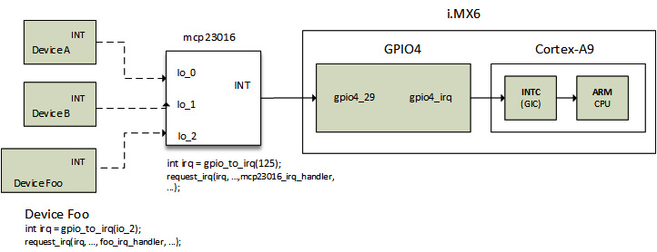

# Chương 16: Tận dụng tối đa Pin Controller và GPIO Subsystem

System-on-chips (SoC) ngày càng phức tạp và giàu tính năng. Những tính năng chủ yếu được cung cấp qua electrical line xuất phát từ SoC, gọi là pin. Phần lớn pin được route tới hoặc multiplex với nhiều functional block (ví dụ UART, SPI, RGMI, General-Purpose Input Output (GPIO), v.v.); device bên dưới chịu trách nhiệm cấu hình pin và chuyển operating mode (chuyển functional block) gọi là pin controller.

Một mode có thể cấu hình cho pin là GPIO. Linux GPIO subsystem cho phép driver đọc tín hiệu trên pin cấu hình GPIO là high hoặc low, và điều khiển tín hiệu high/low trên pin cấu hình GPIO. Mặt khác, pin control subsystem (viết tắt pinctrl) cho phép multiplex pin/pin group cho các function khác nhau và cấu hình electrical property của pin như slew rate, pull-up/down resistor, hysteresis, v.v.

Tóm lại, pin controller chủ yếu làm hai việc: pin multiplexing, tức tái sử dụng cùng pin cho nhiều mục đích, và pin configuration, tức cấu hình electronic property của pin. Sau đó GPIO subsystem cho phép điều khiển pin, với điều kiện pin controller cấu hình chúng hoạt động trong GPIO mode.

Trong chương này, pin controller và GPIO subsystem được giới thiệu qua chủ đề sau:

- Giới thiệu một số thuật ngữ hardware

- Giới thiệu pin control subsystem

- Làm việc với GPIO controller interface

- Tận dụng tối đa GPIO consumer interface

- Học cách tránh viết GPIO client driver

## Giới thiệu một số thuật ngữ hardware

Linux kernel GPIO subsystem không chỉ là GPIO toggling. Nó gắn chặt pin controller subsystem; chúng chia sẻ một số thuật ngữ và khái niệm cần giới thiệu:

- Pin và pad: Pin là dây/line input hoặc output vật lý truyền electrical signal từ hoặc tới component. Trong schematic, thuật ngữ "pin" được dùng rộng rãi. Contact pad là vùng bề mặt tiếp xúc của printed circuit board hoặc integrated circuit. Vì vậy, pin xuất phát từ pad và mặc định pin là pad.

- GPIO: Phần lớn MCU và CPU có thể chia sẻ một pad giữa nhiều functional block. Thực hiện bằng multiplex input signal và output signal của pad. Mode khác nhau mà pin/pad hoạt động gọi là ALT mode (hoặc alternate mode), và CPU thường hỗ trợ tới tám setting (hoặc mode) cho mỗi pad. GPIO là một mode đó. Nó cho phép đổi pin direction, đọc value khi cấu hình input hoặc đặt value khi cấu hình output. Mode khác gồm ADC, UART Tx, UART Rx, SPI MOSI, SPI MISO, PWM, v.v.

- Pin controller: Device hoặc controller bên dưới (đúng hơn là nhóm register) cho phép pin multiplexing (còn gọi pinmux hoặc pinmuxing) để tái sử dụng cùng pin cho mục đích khác nhau. Ngoài pinmuxing, nó cho phép pin configuration, tức cấu hình electronic property của pin. Sau đây là một số property:

- Biasing, tức đặt operating condition ban đầu, ví dụ nối pin xuống ground hoặc tới Vdd. Không nhầm với pull up và pull down, là property khác.

- Pin debounce, khoảng thời gian sau đó state được xem là hợp lệ. Ví dụ ngăn nhận nhiều lần nhấn phím trên keypad gắn với GPIO line.

- Slew rate, xác định pin toggle giữa hai logic state nhanh thế nào. Cho phép kiểm soát rise time và fall time của output signal. Cần trade-off vì thay đổi state nhanh tiêu thụ nhiều điện và tạo spike, nên ưu tiên slew rate thấp, ngoại trừ quick control signal như parallel interface: EIM, EB\&, SPI hoặc SDRAM cần toggle nhanh.

- Pull Up/Down resistor

- GPIO controller: Device cho phép điều khiển pin khi đặt trong GPIO mode. Cho phép đổi GPIO direction và value.

Theo các định nghĩa trên, một số quy tắc chung được đặt ra khi viết pin controller driver hoặc GPIO controller driver như sau:

- Nếu GPIO/pin controller chỉ làm simple GPIO, chỉ triển khai `struct gpio_chip` trong `drivers/gpio/gpio-foo.c` và để ở đó. Không dùng generic hoặc old-style number-based GPIO.

- Giữ GPIO/pin controller trong `drivers/gpio` nếu có thể tạo interrupt ngoài GPIO capability; chỉ cần điền `struct irq_chip` và đăng ký với IRQ subsystem.

- Triển khai composite pin controller driver trong `drivers/pinctrl/pinctrl-foo.c` nếu controller hỗ trợ pinmuxing, advanced pin driver strength, biasing phức tạp, v.v.

- Duy trì interface `struct gpio_chip`, `struct irq_chip` và `struct pinctrl_desc`.

Bây giờ đã quen thuật ngữ liên quan hardware device bên dưới, hãy giới thiệu triển khai Linux, bắt đầu với pin control subsystem.

## Giới thiệu pin control subsystem

Pin controller cho phép tập hợp pin, mode chúng nên hoạt động và cấu hình. Driver chịu trách nhiệm cung cấp tập callback thích hợp theo tính năng cần triển khai, nếu hardware bên dưới hỗ trợ.

Pin controller descriptor data structure định nghĩa như sau:

```
struct pinctrl_desc {
     const char *name;
     const struct pinctrl_pin_desc *pins;
     unsigned int npins;
     const struct pinctrl_ops *pctlops;
     const struct pinmux_ops *pmxops;
     const struct pinconf_ops *confops;
     struct module *owner;
[...]
};
```

Trong pin controller data structure đó, chỉ thành phần liên quan được liệt kê, có ý nghĩa sau:

- `name` là tên pin controller.

- `pins`: Array pin descriptor mô tả mọi pin controller xử lý được. Lưu ý phía controller biểu diễn mỗi pin/pad bằng instance `struct pinctrl_pin_desc`, định nghĩa như sau:

```
struct pinctrl_pin_desc {
     unsigned number;
     const char *name;
[...]
};
```

Trong data structure trên, `number` biểu diễn pin number duy nhất trong global pin number space của pin controller, còn `name` là pin name.

- `npins`: Số descriptor trong array `pins`, thường lấy bằng `ARRAY_SIZE()` trên field `pins`.

- `pctlops` lưu pin control operation table, hỗ trợ khái niệm toàn cục như nhóm pin. Đây là tùy chọn.

- `pmxops` biểu diễn pinmux operation table nếu driver hỗ trợ pinmuxing.

- `confops`: Pin configuration operation table nếu driver hỗ trợ pin configuration.

Khi callback thích hợp được định nghĩa và data structure khởi tạo, có thể truyền cho `devm_pinctrl_register()`, định nghĩa như sau:

```
struct pinctrl_dev *devm_pinctrl_register(
                      struct device *dev,
                      struct pinctrl_desc *pctldesc,
                      void *driver_data);
```

Function trên đăng ký pin controller với hệ thống, đồng thời return pointer tới instance `struct pinctrl_dev`, biểu diễn pin controller device, được truyền làm parameter cho phần lớn (nếu không phải mọi) callback operation mà pin controller driver cung cấp. Khi lỗi, return error pointer, có thể xử lý bằng `PTR_ERR`. Control operation table, multiplexing operation table và configuration operation table phải thiết lập theo tính năng hardware bên dưới hỗ trợ. Data structure tương ứng được định nghĩa trong header file cũng phải include trong driver như sau:

```
#include <linux/pinctrl/pinconf.h>
#include <linux/pinctrl/pinconf-generic.h>
#include <linux/pinctrl/pinctrl.h>
#include <linux/pinctrl/pinmux.h>
```

Với pin control consumer interface, phải dùng header sau thay thế:

```
#include <linux/pinctrl/consumer.h>
```

Trước khi consumer driver truy cập, pin phải được gán cho device cần điều khiển chúng. Cách được khuyến nghị là từ device tree (DT). Cách gán pin group trong DT phụ thuộc chặt platform, tức pin controller driver và binding.

Mỗi pin control state được gán integer ID liên tiếp bắt đầu từ 0. Có thể dùng property list `name` để map string lên các ID, bảo đảm cùng tên luôn trỏ cùng ID. Dĩ nhiên, tập state phải định nghĩa trong DT node của từng device do binding của device quyết định. Binding cũng xác định có định nghĩa tập state ID phải cung cấp hay tập state name phải cung cấp. Trong mọi trường hợp, có thể dùng hai property gán pin configuration node cho device:

- `pinctrl-<ID>`: Cho phép cung cấp danh sách pin configuration cần cho device state cụ thể. Là danh sách `phandles` được nhận diện bằng `<ID>`, mỗi phần tử trỏ tới pin configuration node. Node được tham chiếu phải là child node của (hoặc lồng trong) pin controller node mà chúng thuộc về. Property nhận nhiều entry để cấu hình và dùng nhiều pin group cho device state cụ thể, đồng thời cho phép chỉ định pin từ pin controller khác nhau.

- `pinctrl-names`: Cho phép đặt tên property `pinctrl-<ID>` theo state của device sở hữu pin group. List entry 0 định nghĩa tên state ID 0, entry 1 cho state ID 1, v.v. State ID 0 thường có tên `default`. Danh sách state chuẩn hóa có trong `include/linux/pinctrl/pinctrl-state.h`. Tuy nhiên client hoặc consumer driver được tự do triển khai state cần, nếu được ghi rõ trong device binding description.

Sau đây là đoạn DT, thể hiện một số device node cùng pin control node. Hãy đặt tên đoạn trích `pinctrl-excerpt`:

```
&usdhc4 {
[...]
     pinctrl-0 = <&pinctrl_usdhc4_1>;
     pinctrl-names = "default";
};
gpio-keys {
    compatible = "gpio-keys";
    pinctrl-names = "default";
    pinctrl-0 = <&pinctrl_io_foo &pinctrl_io_bar>;
};
iomuxc@020e0000 { /* Pin controller node */
    compatible = "fsl,imx6q-iomuxc";
    reg = <0x020e0000 0x4000>;
    /* shared pinctrl settings */
    usdhc4 { /* first node describing the function */
        pinctrl_usdhc4_1: usdhc4grp-1 { /* second node */
            fsl,pins = <
                MX6QDL_PAD_SD4_CMD__SD4_CMD    0x17059
                MX6QDL_PAD_SD4_CLK__SD4_CLK    0x10059
                MX6QDL_PAD_SD4_DAT0__SD4_DATA0 0x17059
                MX6QDL_PAD_SD4_DAT1__SD4_DATA1 0x17059
                MX6QDL_PAD_SD4_DAT2__SD4_DATA2 0x17059
                MX6QDL_PAD_SD4_DAT3__SD4_DATA3 0x17059
                [...]
            >;
        };
    };
    [...]
    uart3 {
        pinctrl_uart3_1: uart3grp-1 {
            fsl,pins = <
                MX6QDL_PAD_EIM_D24__UART3_TX_DATA 0x1b0b1
                MX6QDL_PAD_EIM_D25__UART3_RX_DATA 0x1b0b1
            >;
        };
    };
    // GPIOs (Inputs)
   gpios {
        pinctrl_io_foo: pinctrl_io_foo {
           fsl,pins = <
              MX6QDL_PAD_DISP0_DAT15__GPIO5_IO09  0x1f059
              MX6QDL_PAD_DISP0_DAT13__GPIO5_IO07  0x1f059
           >;
        };
        pinctrl_io_bar: pinctrl_io_bar {
           fsl,pins = <
              MX6QDL_PAD_DISP0_DAT11__GPIO5_IO05  0x1f059
              MX6QDL_PAD_DISP0_DAT9__GPIO4_IO30   0x1f059
              MX6QDL_PAD_DISP0_DAT7__GPIO4_IO28   0x1f059
           >;
        };
    };
};
```

Trong ví dụ trên, pin configuration có dạng `<PIN_FUNCTION> <PIN_SETTING>`, trong đó `<PIN_FUNCTION>` có thể xem là pin function hoặc pin mode, còn `<PIN_SETTING>` biểu diễn electrical property của pin:

```
MX6QDL_PAD_DISP0_DAT15__GPIO5_IO09 0x80000000
```

Trong đoạn trích, `MX6QDL_PAD_DISP0_DAT15__GPIO5_IO09` biểu diễn pin function/mode, trường hợp này là GPIO, còn `0x80000000` biểu diễn pin setting hoặc electrical property.

Xét ví dụ khác như sau:

```
MX6QDL_PAD_EIM_D25__UART3_RX_DATA 0x1b0b1
```

Trong đoạn trích đó, `MX6QDL_PAD_EIM_D25__UART3_RX_DATA` biểu diễn pin function, là RX line của UART3, còn `0x1b0b1` biểu diễn electrical setting.

Pin function là macro có giá trị chỉ mang ý nghĩa với pin controller driver. Thường định nghĩa trong header file tại `arch/<arch>/boot/dts/`. Ví dụ nếu dùng UDOO quad có i.MX6 quad core (ARM 32-bit), pin function header là `arch/arm/boot/dts/imx6q-pinfunc.h`. Sau đây là macro tương ứng line thứ năm của GPIO5 controller:

```
#define MX6QDL_PAD_DISP0_DAT11__GPIO5_IO05 0x19c 0x4b0 0x000 0x5 0x0
```

`<PIN_SETTING>` có thể dùng thiết lập pull-ups, pull-downs, keeper, drive strength, v.v. Cách chỉ định phụ thuộc pin controller binding, ý nghĩa value phụ thuộc SoC datasheet, thường ở phần IOMUX. Trên i.MX6 IOMUXC, chỉ 17 bit thấp được dùng cho mục đích này. Trở lại `pinctrl-excerpt`, trước khi chọn pin group và áp dụng cấu hình, driver phải lấy handle tới group bằng function `devm_inctrl_get()`, rồi chọn state thích hợp bằng `pinctrl_lookup_state()`, cuối cùng áp dụng configuration state tương ứng xuống hardware nhờ `pinctrl_select_state()`.

Sau đây là ví dụ lấy pin control group và áp dụng default configuration:

```
#include <linux/pinctrl/consumer.h>
int ret;
struct pinctrl_state *s;
struct pinctrl *p;
foo_probe()
{
    p = devm_pinctrl_get(dev);
    if (IS_ERR(p))
        return PTR_ERR(p);
    s = pinctrl_lookup_state(p, name);
    if (IS_ERR(s))
        return PTR_ERR(s);
    ret = pinctrl_select_state(p, s);
    if (ret < 0) // on error
        return ret;
[...]
}
```

Giống resource khác (memory region, clock, v.v.), nên lấy pin và áp dụng cấu hình trong function `probe()`. Tuy nhiên operation phổ biến đến mức được tích hợp vào Linux device core làm một bước probing device. Vì vậy, khi device được probe, device core làm như sau:

- Lấy pin gán cho device sắp probe bằng `devm_pinctrl_get()`.

- Tìm default pin state (`PINCTRL_STATE_DEFAULT`) bằng `pinctrl_lookup_state()`.

- Đồng thời tìm init pin state (trong lúc device initialization) (`PINCTRL_STATE_INIT`) bằng cùng API.

- Áp dụng init pin state nếu có, nếu không áp dụng default pin state.

- Nếu power management enable, tìm sleep pin state (`PINCTRL_STATE_SLEEP`) và idle pin state (`PINCTRL_STATE_IDLE`) tùy chọn để dùng sau trong operation liên quan power management.

Xem function `pinctrl_bind_pins()` (định nghĩa trong `drivers/base/pinctrl.c`) và function `really_probe()` (định nghĩa trong `drivers/base/dd.c`), gọi function đầu. Chúng giúp hiểu cách pin được bind với device trên probing path.

LƯU Ý

Nội bộ `pinctrl_select_state()` gọi `pinmux_enable_setting()`, đến lượt nó gọi `pin_request()` trên từng pin trong pin control node (group pin).

Function `pinctrl_put()` có thể giải phóng pin control đã yêu cầu bằng non-managed API, tức `pinctrl_get()`. Tuy nhiên, có thể dùng `devm_pinctrl_get_select()`, truyền tên state cần chọn, để cấu hình pinmux một lần. Function được định nghĩa trong `include/linux/pinctrl/consumer.h` như sau:

```
static struct pinctrl *devm_pinctrl_get_select(
                  struct device *dev, const char *name)
```

Trong prototype trước, `name` là state name như ghi trong property `pinctrl-name`. Nếu state name là `default`, có thể dùng helper `devm_pinctr_get_select_default()`, wrapper của `devm_pinctl_get_select()` như sau:

```
static struct pinctrl * pinctrl_get_select_default(
                                      struct device *dev)
{
   return pinctrl_get_select(dev, PINCTRL_STATE_DEFAULT);
}
```

Bây giờ đã quen pin control subsystem (cả controller interface và consumer interface), có thể học cách làm việc với GPIO controller, biết rằng GPIO là operating mode mà pin có thể hoạt động.

## Làm việc với GPIO controller interface

GPIO controller interface được thiết kế quanh một data structure, `struct gpio_chip`. Data structure cung cấp tập function, gồm method thiết lập GPIO direction (input và output), method truy cập GPIO value (get và set), method map GPIO sang IRQ và return Linux interrupt number tương ứng, cùng dump method `debugfs` (hiển thị extra state như pull-up config). Ngoài function đó, data structure cung cấp flag xác định bản chất controller, cho phép kiểm tra accessor của controller có thể sleep hay không. Cũng trong data structure, driver có thể đặt GPIO base number, nơi bắt đầu đánh số GPIO. Trở lại code, GPIO controller biểu diễn bằng instance `struct gpio_chip`, định nghĩa trong `<linux/gpio/driver.h>` như sau:

```
struct gpio_chip {
     const char       *label;
     struct gpio_device    *gpiodev;
     struct device         *parent;
     struct module         *owner;
     int        (*request)(struct gpio_chip *gc,
                           unsigned int offset);
     void       (*free)(struct gpio_chip *gc,
                           unsigned int offset);
     int       (*get_direction)(struct gpio_chip *gc,
                           unsigned int offset);
     int       (*direction_input)(struct gpio_chip *gc,
                           unsigned int offset);
     int       (*direction_output)(struct gpio_chip *gc,
                      unsigned int offset, int value);
     int       (*get)(struct gpio_chip *gc,
                           unsigned int offset);
     int       (*get_multiple)(struct gpio_chip *gc,
                           unsigned long *mask,
                           unsigned long *bits);
     void       (*set)(struct gpio_chip *gc,
                      unsigned int offset, int value);
     void       (*set_multiple)(struct gpio_chip *gc,
                           unsigned long *mask,
                           unsigned long *bits);
     int        (*set_config)(struct gpio_chip *gc,
                            unsigned int offset,
                            unsigned long config);
     int        (*to_irq)(struct gpio_chip *gc,
                           unsigned int offset);
     int       (*init_valid_mask)(struct gpio_chip *gc,
                              unsigned long *valid_mask,
                              unsigned int ngpios);
     int       (*add_pin_ranges)(struct gpio_chip *gc);
     int        base;
     u16        ngpio;
     const char *const *names;
     bool       can_sleep;
#if IS_ENABLED(CONFIG_GPIO_GENERIC)
     unsigned long (*read_reg)(void __iomem *reg);
     void (*write_reg)(void __iomem *reg, unsigned long data);
     bool be_bits;
     void __iomem *reg_dat;
     void __iomem *reg_set;
     void __iomem *reg_clr;
     void __iomem *reg_dir_out;
     void __iomem *reg_dir_in;
     bool bgpio_dir_unreadable;
     int bgpio_bits;
     spinlock_t bgpio_lock;
     unsigned long bgpio_data;
     unsigned long bgpio_dir;
#endif /* CONFIG_GPIO_GENERIC */
#ifdef CONFIG_GPIOLIB_IRQCHIP
     struct gpio_irq_chip irq;
#endif /* CONFIG_GPIOLIB_IRQCHIP */
     unsigned long *valid_mask;
#if defined(CONFIG_OF_GPIO)
     struct device_node *of_node;
     unsigned int of_gpio_n_cells;
     int (*of_xlate)(struct gpio_chip *gc,
                const struct of_phandle_args *gpiospec,
                u32 *flags);
#endif /* CONFIG_OF_GPIO */
};
```

Sau đây là ý nghĩa từng thành phần trong structure:

- `label`: Functional name của GPIO controller. Có thể là part number hoặc tên SoC IP block triển khai nó.

- `gpiodev`: Internal state container của GPIO controller. Cũng là structure qua đó character device gắn với GPIO controller được cung cấp.

- `request` là hook tùy chọn cho chip-specific activation. Nếu cung cấp, được thực thi trước khi cấp phát GPIO mỗi khi gọi `gpio_request()` hoặc `gpiod_get()`.

- `free` là hook tùy chọn cho chip-specific deactivation. Nếu cung cấp, thực thi trước khi GPIO được giải phóng mỗi khi gọi `gpiod_put()` hoặc `gpio_free()`.

- `get_direction` thực thi mỗi khi cần biết direction của GPIO offset. Return value nên là `0` nghĩa out, `1` nghĩa in (giống `GPIOF_DIR_XXX`) hoặc lỗi âm.

- `direction_input` cấu hình signal offset thành input hoặc return lỗi.

- `get` return value của GPIO offset; với output signal, return value thực tế cảm nhận hoặc 0.

- `set` gán output value cho GPIO offset.

- `set_multiple` được gọi khi cần gán output value cho nhiều signal do `mask` định nghĩa. Nếu không cung cấp, kernel cài generic hook duyệt mask bit và thực thi `chip->set(i)` trên mỗi bit được đặt. Xem cách triển khai function ở đây:

```
static void gpio_chip_set_multiple(
                    struct gpio_chip *chip,
                    unsigned long *mask,
                    unsigned long *bits)
{
    if (chip->set_multiple) {
        chip->set_multiple(chip, mask, bits);
    } else {
        unsigned int i;
        /*
         * set outputs if the corresponding
         * mask bit is set
         */
        for_each_set_bit(i, mask, chip->ngpio)
            chip->set(chip, i, test_bit(i, bits));
        }
}
```

- `set_debounce`, nếu controller hỗ trợ, là callback tùy chọn để đặt debounce time cho GPIO chỉ định.

- `to_irq` là hook tùy chọn cung cấp GPIO-to-IRQ mapping. Được gọi mỗi khi muốn thực thi function `gpio_to_irq()` hoặc `gpiod_to_irq()`. Triển khai này không được sleep.

- `base` chỉ GPIO number đầu tiên chip xử lý; hoặc nếu âm khi đăng ký, kernel tự động gán động.

- `ngpio` là số GPIO controller cung cấp, bắt đầu từ base tới (`base` + `ngpio - 1`).

- `names`, nếu không là `NULL`, phải là danh sách (array) string dùng làm alternative name cho GPIO trong chip. Array phải có size `ngpio`, GPIO không cần alias có thể đặt entry thành `NULL` trong array.

- `can_sleep` là Boolean flag cần đặt nếu method `get()`/`set()` có thể sleep. Đây là trường hợp GPIO controller (còn gọi GPIO expander) trên bus như I2C hoặc SPI có truy cập có thể sleep. Nghĩa là nếu chip hỗ trợ IRQ, chúng phải threaded vì truy cập chip có thể sleep, ví dụ khi đọc IRQ status register. Với memory-mapped GPIO controller (thuộc SoC), có thể đặt `false`.

- Thành phần phụ thuộc enable `CONFIG_GPIO_GENERIC` liên quan generic memory-mapped GPIO controller với standard register set.

- `irq`: IRQ chip của GPIO controller nếu controller có thể map GPIO sang IRQ. Khi đó phải thiết lập field trước khi đăng ký GPIO chip.

- `valid_mask`: Nếu không là `NULL`, chứa bitmask GPIO hợp lệ để dùng từ chip.

- `of_node` là pointer tới device tree node biểu diễn GPIO controller.

- `of_gpio_n_cells` là số cell dùng tạo GPIO specifier.

- `of_xlate` là callback chuyển device tree GPIO specifier thành chip-relative GPIO number và flag. Hook gọi khi GPIO line từ controller được chỉ định trong device tree và cần parse. Nếu không cung cấp, GPIO core mặc định đặt thành `of_gpio_simple_xlate()`, generic GPIO core helper hỗ trợ two-cell specifier. Cell đầu nhận diện GPIO number, cell thứ hai là GPIO flag. Ngoài ra, khi đặt default callback, `of_gpio_n_cells` được đặt thành `2`. Nếu GPIO controller cần specifier một hoặc hơn hai cell, phải triển khai translation callback tương ứng.

Mỗi GPIO controller cung cấp số signal được nhận diện trong function call bằng offset value từ `0` tới (`ngpio - 1`). Khi GPIO line được tham chiếu qua lời gọi như `gpio_get_value(gpio)`, offset xác định bằng GPIO number trừ `base`, rồi truyền cho driver function bên dưới (ví dụ `gpio_chip->get()`). Controller driver khi đó nên có logic map offset tới control/status register gắn với GPIO.

## Viết GPIO controller driver

GPIO controller chỉ cần tập callback tương ứng tính năng hỗ trợ. Sau khi định nghĩa mọi callback quan tâm và đặt field khác, driver nên gọi `devm_gpiochip_add_data()` trên structure `struct gpio_chip` đã cấu hình để đăng ký controller với kernel. Có lẽ bạn đoán nên dùng managed API (prefix `devm_`) vì đảm nhận chip removal khi cần và giải phóng resource. Nếu dùng phương thức cổ điển, phải dùng `gpiochip_remove()` để xóa chip khi cần:

```
int gpiochip_add_data(struct gpio_chip *gc, void *data)
int devm_gpiochip_add_data(struct device *dev,
                        struct gpio_chip *gc, void *data)
```

Trong prototype trên, `gc` là chip cần đăng ký và `data` là private data của driver gắn với chip. Cả hai return error code âm nếu chip không đăng ký được, như vì `gc->base` không hợp lệ hoặc đã gắn với chip khác. Nếu không, return 0 báo thành công.

Tuy nhiên, có pin controller gắn chặt GPIO chip, cả hai triển khai trong cùng driver, phần lớn tại `drivers/pinctrl/pinctrl-*.c`. Trong driver như vậy, khi `gpiochip_add_data()` được gọi, với hệ thống device-tree-supported, GPIO core kiểm tra property `gpio-ranges` trong pin control device node. Nếu có, đảm nhận thêm pin range cho driver.

Tuy nhiên, driver phải gọi `gpiochip_add_pin_range()` để tương thích device tree file cũ không đặt attribute `gpio-ranges` hoặc hệ thống dùng ACPI. Sau đây là ví dụ:

```
if (!of_find_property(np, "gpio-ranges", NULL)) {
     ret = gpiochip_add_pin_range(chip,
                   dev_name(hw->dev), 0, 0, chip->ngpio);
     if (ret < 0) {
           gpiochip_remove(chip);
           return ret;
     }
}
```

Một lần nữa, cần lưu ý phần trên chỉ để backward compatibility với node `pinctrl` cũ không có property `gpio-ranges`. Nếu không, gọi trực tiếp `gpiochip_add_pin_range()` từ pin controller driver device tree-supported là deprecated. Xem Phần 2.1 của `Documentation/devicetree/bindings/gpio/gpio.txt` về cách bind pin controller driver và GPIO driver qua property `gpio-ranges`.

Có thể thấy viết GPIO controller driver dễ thế nào. Trong book source repository, có GPIO controller driver hoạt động cho MCP23016 I2C I/O expander của microchip, có datasheet tại http://ww1.microchip.com/downloads/en/DeviceDoc/20090C.pdf.

Để viết driver như vậy, nên include header sau:

```
#include <linux/gpio.h>
```

Sau đây là đoạn trích driver đã viết cho controller:

```
#define GPIO_NUM 16
struct mcp23016 {
    struct i2c_client *client;
    struct gpio_chip gpiochip;
    struct mutex lock;
};
static int mcp23016_probe(struct i2c_client *client)
{
  struct mcp23016 *mcp;

  if (!i2c_check_functionality(client->adapter,
      I2C_FUNC_SMBUS_BYTE_DATA))
    return -EIO;
  mcp = devm_kzalloc(&client->dev, sizeof(*mcp),
                      GFP_KERNEL);
  if (!mcp)
    return -ENOMEM;
  mcp->gpiochip.label = client->name;
  mcp->gpiochip.base = -1;
  mcp->gpiochip.dev = &client->dev;
  mcp->gpiochip.owner = THIS_MODULE;
  mcp->gpiochip.ngpio = GPIO_NUM; /* 16 */
  /* may not be accessed from atomic context */
  mcp->gpiochip.can_sleep = 1;
  mcp->gpiochip.get = mcp23016_get_value;
  mcp->gpiochip.set = mcp23016_set_value;
  mcp->gpiochip.direction_output =
                          mcp23016_direction_output;
  mcp->gpiochip.direction_input =
                          mcp23016_direction_input;
  mcp->client = client;
  i2c_set_clientdata(client, mcp);
  return devm_gpiochip_add_data(&client->dev,
                                &mcp->gpiochip, mcp);
}
```

Trong đoạn trích trên, GPIO chip data structure được thiết lập trước khi truyền cho `devm_gpiochip_get_data()`, được gọi để đăng ký GPIO controller với hệ thống. Kết quả là GPIO character device node xuất hiện dưới `/dev`.

### GPIO controller có IRQ chip enable

Có thể enable IRQ chip support trong GPIO controller bằng thiết lập structure `struct gpio_irq_chip` nhúng trong GPIO controller data structure. Structure `struct gpio_irq_chip` dùng nhóm mọi field liên quan interrupt handling trong GPIO chip, định nghĩa như sau:

```
struct gpio_irq_chip {
     struct irq_chip *chip;
     struct irq_domain *domain;
     const struct irq_domain_ops *domain_ops;
     irq_flow_handler_t handler;
     unsigned int default_type;
     irq_flow_handler_t parent_handler;
     union {
          void *parent_handler_data;
          void **parent_handler_data_array;
     };
     unsigned int num_parents;
     unsigned int *parents;
     unsigned int *map;
     bool threaded;
     bool per_parent_data;
     int (*init_hw)(struct gpio_chip *gc);
     void (*init_valid_mask)(struct gpio_chip *gc,
                      unsigned long *valid_mask,
                      unsigned int ngpios);
     unsigned long *valid_mask;
     unsigned int first;
     void       (*irq_enable)(struct irq_data *data);
     void       (*irq_disable)(struct irq_data *data);
     void       (*irq_unmask)(struct irq_data *data);
     void       (*irq_mask)(struct irq_data *data);
};
```

Có architecture mà nhiều interrupt controller tham gia chuyển interrupt từ device tới target CPU. Tính năng được enable trong kernel bằng config option `CONFIG_IRQ_DOMAIN_HIERARCHY`.

Trong data structure trước, một số thành phần bị lược bỏ. Đó là thành phần phụ thuộc `CONFIG_IRQ_DOMAIN_HIERARCHY`, tức field liên quan IRQ domain hierarchy, không bàn trong chương này. Với thành phần còn lại, định nghĩa như sau:

- `chip` là IRQ chip implementation.

- `domain` là IRQ interrupt translation domain gắn với `chip`, chịu trách nhiệm mapping giữa GPIO hardware IRQ number và Linux IRQ number.

- `domain_ops` biểu diễn tập interrupt domain operation gắn với IRQ domain.

- `handler` là high-level interrupt flow handler (thường là IRQ core function định sẵn) cho GPIO IRQ. Có lưu ý về field ở phần sau.

- `default_type` là default IRQ triggering type áp dụng khi khởi tạo GPIO driver.

- `parent_handler` là interrupt handler cho parent interrupt của GPIO chip. Có thể là `NULL` nếu parent interrupt nested thay vì chained. Ngoài ra, đặt thành phần thành `NULL` cho phép xử lý parent IRQ trong driver. `gpio_chip.can_sleep` không được đặt `true` nếu cung cấp handler vì không thể có chained interrupt trên chip có thể sleep.

- `parent_handler_data` và `parent_handler_data_array` là data gắn với và truyền cho handler của parent interrupt. Có thể là một pointer nếu `per_parent_data` là `false`, hoặc array `num_parents` pointer nếu không. Nếu `per_parent_data` là `true`, `parent_handler_data_array` không được là `NULL`.

- `num_parents` là số interrupt parent của GPIO chip.

- `parents` là danh sách interrupt parent của GPIO chip. Vì driver sở hữu danh sách, core chỉ tham chiếu, không sửa.

- `map` là danh sách interrupt parent cho từng line của GPIO chip.

- `threaded` cho biết interrupt handling có threaded (dùng nested thread) hay không.

- `per_parent_data` cho biết `parent_handler_data_array` có mô tả array size `num_parents` dùng làm parent data hay không.

- `init_hw` là routine tùy chọn khởi tạo hardware trước khi thêm IRQ chip. Cực kỳ hữu ích khi driver phải clear IRQ-related register để tránh event không mong muốn.

- `init_valid_mask` là callback tùy chọn dùng khởi tạo `valid_mask`, dùng khi không phải mọi GPIO line đều là interrupt hợp lệ. Có thể có line không phát interrupt được; callback khi được định nghĩa nhận bitmap trong `valid_mask`, có `ngpios` bit từ `0..(ngpios-1)` đặt `1` là hợp lệ. Callback có thể trực tiếp đặt một số bit thành `0` nếu không dùng cho interrupt được.

- `valid_mask`, nếu không là `NULL`, chứa bitmask GPIO hợp lệ để đưa vào IRQ domain của chip.

- `first` cần cho static IRQ allocation. Nếu đặt, `irq_domain_add_simple()` cấp phát (bắt đầu từ giá trị này) và map mọi IRQ trong initialization.

- `irq_enable`, `irq_disable`, `irq_unmask` và `irq_mask` lần lượt lưu callback cũ `irq_chip.irq_enable`, `irq_chip.irq_disable`, `irq_chip.irq_unmask` và `irq_chip.irq_mask`. Xem Chương 13, Làm rõ Kernel IRQ Framework, để có giải thích chi tiết.

Với giả định interrupt map 1-to-1 tới GPIO line index, `gpiolib` xử lý phần đáng kể overhead code. Trong mapping 1-to-1, GPIO line offset 0 map hardware IRQ 0, GPIO line offset `1` map hardware IRQ `1`, v.v. tới GPIO line offset `ngpio-1`, map hardware IRQ `ngpio-1`. Bitmask `valid_mask` và flag `need_valid_mask` trong `gpio_irq_chip` có thể dùng mask một số line là không hợp lệ để gắn IRQ, nếu một số GPIO line không có IRQ tương ứng.

Có thể chia GPIO IRQ chip thành hai nhóm lớn:

- Cascaded interrupt chip: GPIO chip có một interrupt output line chung được kích hoạt bởi bất kỳ enabled GPIO line trên chip. Interrupt output line sau đó được route tới parent interrupt controller cao hơn một cấp, trường hợp đơn giản nhất là primary interrupt controller của hệ thống. IRQ chip triển khai bằng kiểm tra bit trong GPIO controller để xác định line đã phát. Để xác định, phần IRQ chip trong driver cần kiểm tra register, gần như chắc chắn phải acknowledge đang xử lý interrupt bằng clear bit (đôi khi ngầm qua đọc status register), cũng như thiết lập cấu hình như edge sensitivity (ví dụ rising/falling edge hoặc high/low level interrupt).

- Hierarchical interrupt chip: Mỗi GPIO line nối tới parent interrupt controller cao hơn một cấp bằng IRQ line chuyên dụng. Không cần truy vấn GPIO hardware để xác định line phát, nhưng có thể cần acknowledge interrupt và cấu hình edge sensitivity.

Cascaded GPIO IRQ chip thường thuộc một trong ba loại:

- Chained cascaded GPIO IRQ chip: Thường gặp trên SoC. GPIO có fast IRQ flow handler được gọi theo chuỗi từ parent IRQ handler, thường là system interrupt controller. Nghĩa là parent IRQ chip lập tức gọi GPIO IRQ chip handler trong khi giữ IRQ disable. Trong interrupt handler, GPIO IRQ chip gọi tương tự như sau:

```
  static irqreturn_t foo_gpio_irq(int irq, void *data)
      chained_irq_enter(...);
      generic_handle_irq(...);
      chained_irq_exit(...);
```

Vì mọi thứ diễn ra trực tiếp trong callback, chained GPIO IRQ chip không thể đặt flag `.can_sleep` trong `struct gpio_chip` thành `true`. Khi đó không thể dùng slow bus traffic như I2C.

- Generic chained GPIO IRQ chip: Giống `CHAINED GPIO IRQCHIPS`, nhưng không dùng chained IRQ handler. Thay vào đó GPIO IRQ được dispatch qua generic IRQ handler chỉ định bằng `request_irq()`. Trong IRQ handler, GPIO IRQ chip cuối cùng gọi chuỗi tương tự sau:

```
static irqreturn_t gpio_rcar_irq_handler(int irq,
                                    void *dev_id)
    /* go through the entire GPIOs and handle
     * all interrupts
     */
    for each detected GPIO IRQ
        generic_handle_irq(...);
```

- Nested thread GPIO IRQ chip: Off-chip GPIO expander và GPIO IRQ chip khác trên sleeping bus như I2C hoặc SPI thuộc loại này.

Dĩ nhiên, driver cần slow bus traffic để đọc IRQ status và thông tin khác, có thể dẫn tới IRQ bổ sung, không thể đặt trong fast IRQ handler với IRQ disable. Thay vào đó phải tạo thread rồi mask parent IRQ line tới khi driver xử lý interrupt. Đặc điểm phân biệt driver là gọi tương tự như sau trong interrupt handler:

```
static irqreturn_t pcf857x_irq(int irq,
                               void *data)
{
     struct pcf857x *gpio = data;
     unsigned long change, i, status;
     status = gpio->read(gpio->client);
     mutex_lock(&gpio->lock);
     change = (gpio->status ^ status) &
              gpio->irq_enabled;
     gpio->status = status;
     mutex_unlock(&gpio->lock);
     for_each_set_bit(i, &change, gpio->chip.ngpio)
      child_irq = irq_find_mapping(
                     gpio->chip.irq.domain, i);
        handle_nested_irq(child_irq);
     return IRQ_HANDLED;
}
```

Threaded GPIO IRQ chip được phân biệt bằng việc đặt flag `.can_sleep` trên `struct` `gpio_chip` thành `true`, chỉ chip có thể sleep khi truy cập GPIO.

LƯU Ý Nhắc lại `gpio_irq_chip.handler` là interrupt flow handler. Đây là high-level IRQ-events handler, gọi handler bên dưới do client driver đăng ký bằng `request_irq()` hoặc `request_threaded_irq()`. Giá trị phụ thuộc IRQ là edge-triggered hay level-triggered. Thường là IRQ core function định sẵn, một trong `handle_simple_irq`, `handle_edge_irq` và `handle_level_irq`. Tất cả là kernel helper function làm một số operation trước và sau khi gọi IRQ handler thực. Khi parent IRQ handler gọi `generic_handle_irq()` hoặc `handle_nested_irq()`, IRQ core tìm IRQ descriptor structure (cách Linux nhìn interrupt) tương ứng Linux IRQ number truyền làm argument (`struct irq_desc *desc = irq_to_desc(irq)`) và gọi `generic_handle_irq_desc()` trên descriptor, dẫn tới `desc->handle_irq(desc)`. Lưu ý `desc->handle_irq` tương ứng high-level IRQ handler cung cấp trước đó, đã gán cho IRQ descriptor bằng `irq_set_chip_and_handler()` trong mapping IRQ. Mapping các GPIO IRQ được làm trong `gpiochip_irq_map`, callback `.map` của default IRQ domain operation table (`gpiochip_domain_ops`) mà GPIO core gán cho GPIO IRQ chip nếu driver không cung cấp. Tóm lại, `desc->handle_irq = gpio_irq_chip.handler`, có thể là `handle_level_irq`, `handle_simple_irq`, `handle_edge_irq` hoặc (hiếm) function driver-provided.

Ví dụ thêm IRQ chip support vào GPIO chip

Trong phần này, minh họa thêm IRQ chip support vào GPIO controller driver. Để làm vậy, cập nhật driver ban đầu, chính xác là probe method, cũng như triển khai interrupt handler chứa IRQ handling logic.

Xét hình sau:



Hình 16.1 – Multiplex IRQ

Trong hình trước, giả sử đã cấu hình `io_0` và `io_1` là interrupt line (đó là cách `DeviceA` và `deviceB` nhìn thấy).

Dù interrupt xảy ra trên `io_0` hay `io_1`, cùng parent interrupt line được phát trên GPIO chip. Tại đây, GPIO chip driver phải xác định bằng cách đọc GPIO status register của GPIO controller, GPIO line nào (`io_0` hoặc `io_1`) thực sự phát interrupt. Đó là cách với chip MCP23016, một interrupt line (thực ra parent) có thể multiplex cho 16 GPIO interrupt.

Giờ cập nhật GPIO controller driver ban đầu. Lưu ý vì device trên slow bus, không có lựa chọn ngoài triển khai nested (threaded) interrupt flow handling.

Bắt đầu định nghĩa IRQ chip data structure với tập callback mà IRQ core dùng. Sau đây là đoạn trích:

```
static struct irq_chip mcp23016_irq_chip = {
     .name = "gpio-mcp23016",
     .irq_mask = mcp23016_irq_mask,
     .irq_unmask = mcp23016_irq_unmask,
     .irq_set_type = mcp23016_irq_set_type,
};
```

Ở trên, callback định nghĩa phụ thuộc nhu cầu. Trường hợp này chỉ triển khai callback liên quan interrupt (un)masking và callback cho phép đặt IRQ type. Để xem mô tả đầy đủ structure `struct irq_chip`, tham khảo Chương 13, Làm rõ Kernel IRQ Framework.

Bây giờ IRQ chip data structure đã thiết lập, có thể sửa probe method như sau:

```
static int mcp23016_probe(struct i2c_client *client)
{
    struct gpio_irq_chip *girq;
    struct irq_chip *irqc;
[...]
    girq = &mcp->gpiochip.irq;
    girq->chip = &mcp23016_irq_chip;
    /* This will let us handling the parent IRQ in the driver */
    girq->parent_handler = NULL;
    girq->num_parents = 0;
    girq->parents = NULL;
    girq->default_type = IRQ_TYPE_NONE;
    girq->handler = handle_level_irq;
    girq->threaded = true;
[...]
    /*
     * Directly request the irq here instead of passing
     * a flow-handler.
     */
    err = devm_request_threaded_irq(
                      &client->dev,
                      client->irq,
                      NULL, mcp23016_irq,
                      IRQF_TRIGGER_RISING | IRQF_ONESHOT,
                      dev_name(&i2c->dev), mcp);
[...]

    return devm_gpiochip_add_data(&client->dev,
                                &mcp->gpiochip, mcp);
}
```

Trong cập nhật probe method trước, đầu tiên khởi tạo data structure `struct gpio_irq_chip` nhúng trong `struct gpio_chip`, rồi đăng ký IRQ handler làm parent IRQ handler, chịu trách nhiệm truy vấn GPIO chip bên dưới về GPIO đã IRQ-enabled có thay đổi, rồi chạy IRQ handler nếu có.

Cuối cùng, sau đây là IRQ handler, phải triển khai trước function `probe`:

```
static irqreturn_t mcp23016_irq(int irq, void *data)
{
    struct mcp23016 *mcp = data;
    unsigned long status, changes, child_irq, i;
    status = read_gpio_status(mcp);
    mutex_lock(&mcp->lock);
    change = mcp->status ^ status;
    mcp->status = status;
    mutex_unlock(&mcp->lock);
    /* Do some stuff, may be adapting "change" according to level */
    [...]
    for_each_set_bit(i, &change, mcp->gpiochip.ngpio) {
        child_irq =
           irq_find_mapping(mcp->gpiochip.irq.domain, i);
        handle_nested_irq(child_irq);
    }
    return IRQ_HANDLED;
}
```

Trong interrupt handler, chỉ đọc GPIO hiện tại và so sánh old status để xác định GPIO thay đổi. Mọi thủ thuật được `handle_nested_irq()` xử lý, cũng được giải thích trong Chương 13, Làm rõ Kernel IRQ Framework.

Bây giờ đã hoàn tất và quen triển khai IRQ chip trong GPIO controller driver, có thể học binding của GPIO controller, cho phép khai báo GPIO chip hardware trong device tree theo cách driver hiểu.

## GPIO controller binding

Device tree là tiêu chuẩn thực tế để khai báo và mô tả device trên embedded platform, đặc biệt ARM architecture. Vì vậy nên cung cấp device binding tương ứng cho driver mới.

Trở lại GPIO controller, có property bắt buộc cần cung cấp:

- `compatible`: Danh sách string để match driver xử lý device này.

- `gpio-controller`: Property báo device tree core rằng node biểu diễn GPIO controller.

- `gpio-cells`: Cho biết số cell dùng mô tả GPIO specifier. Nên tương ứng `gpio_chip.of_gpio_n_cells` hoặc giá trị `gpio_chip.of_xlate` xử lý được. Thường là `<2>` với controller đơn giản, cell đầu nhận diện GPIO number, cell thứ hai định nghĩa flag.

Có thêm property bắt buộc nếu GPIO controller hỗ trợ IRQ chip, tức cho phép map GPIO line sang IRQ. Với controller như vậy, phải cung cấp property bắt buộc sau:

- `interrupt-controller`: Một số controller cung cấp IRQ map tới GPIO. Khi đó cũng nên đặt property `#interrupt-cells`, thường dùng `2` nhưng tùy nhu cầu. Cell đầu là pin number, cell thứ hai biểu diễn interrupt flag.

- `#interrupt-cells`: Phải định nghĩa bằng giá trị hook `xlate` của IRQ domain hỗ trợ, tức `irq_domain_ops.xlate`. Hook thường được đặt bằng `irq_domain_xlate_twocell`, generic kernel IRQ core helper xử lý two-cell specifier.

Từ property đã liệt kê, có thể khai báo GPIO controller dưới bus node như sau:

```
&i2c1
    expander: mcp23016@20 {
        compatible = "microchip,mcp23016";
        reg = <0x20>;
        gpio-controller;
        #gpio-cells = <2>;
        interrupt-controller;
        #interrupt-cells = <2>;
        interrupt-parent = <&gpio4>;
        interrupts = <29 IRQ_TYPE_EDGE_FALLING>;
    };
};
```

Đó là tất cả phía controller. Để minh họa client consume resource do MCP23016 cung cấp, xét tình huống có hai device: device A tên `foo` và device B tên `bar`. Device `bar` consume hai GPIO line từ controller (dùng output mode), còn device `foo` muốn map GPIO sang IRQ. Có thể khai báo cấu hình trong device tree như sau:

```
parent_node {
    compatible = "simple-bus";
    foo_device: foo_device@1c {
        [...]
        reg = <0x1c>;
        interrupt-parent = <&expander>;
        interrupts = <2 IRQ_TYPE_EDGE_RISING>;
    };
    bar_device {
        [...]
        reset-gpios = <&expander 8 GPIO_ACTIVE_HIGH>;
        power-gpios = <&expander 12 GPIO_ACTIVE_HIGH>;
        [...]
    };
};
```

Trong đoạn trích trên, `parent_node` được gán `simple-bus` làm string `compatible` để yêu cầu device tree core và platform core tạo hai platform device tương ứng node. Đoạn trích cũng minh họa cách chỉ định GPIO và IRQ từ controller. Số cell dùng cho mỗi property khớp khai báo trong controller binding.

### Tương tác GPIO controller và pin-controller

Hai subsystem liên quan chặt chẽ. Pin controller có thể route một số hoặc mọi GPIO do GPIO controller cung cấp tới pin trên package. Điều này cho phép mux pin (còn gọi pinmuxing) giữa GPIO và function khác.

Vì vậy có thể hữu ích khi biết GPIO tương ứng pin nào trên pin controller nào. Property `gpio-ranges`, mô tả bên dưới, biểu diễn quan hệ bằng tập range rời rạc map pin từ local number space của pin controller tới pin trong local number space của GPIO controller.

Định dạng `gpio-ranges` như sau:

```
<[pin controller phandle], [GPIO controller offset], [pin controller offset], [number of
pins]>;
```

GPIO controller offset chỉ GPIO controller node chứa range definition. Pin controller node được `phandle` tham chiếu phải tuân theo các binding được định nghĩa trong `Documentation/pinctrl/pinctrl-bindings.txt`.

Mỗi offset là số từ 0 tới N. Có thể xếp số range tùy ý với chỉ một pin-to-GPIO line mapping nếu tổ chức range phù hợp, nhưng thực tế thường tập hợp thành các tập rời rạc.

Sau đây là ví dụ:

```
gpio-ranges = <&foo 0 20 10>, <&bar 10 50 20>;
```

Điều này có nghĩa:

- Mười pin (`20..29`) trên pin controller `foo` được map tới GPIO line `0..9`.

- Hai mươi pin ( `50..69` ) trên pin controller `bar` được map tới GPIO line `10..29`.

Lưu ý GPIO có global number space còn pin controller có local number space, nên cần định nghĩa cách cross-reference.

Muốn map PIN `GPIO_5_29` với PIN number `89` trong pin controller number space. Sau đây là device tree property định nghĩa mapping giữa GPIO subsystem và pin control subsystem:

```
&gpio5 {
    gpio-ranges = <&pinctrl 29 89 1> ;
}
```

Trong đoạn trích trước, 1 GPIO line từ GPIO line thứ 29 của GPIO bank5 được map tới pin range từ 89 trên pin controller `pinctrl`.

Để minh họa trên platform thực, xét SoC i.MX6 có 32 GPIO mỗi bank. Sau đây là đoạn pin controller node của i.MX6 SoC, khai báo trong `arch/arm/boot/dts/imx6qdl.dtsi`, có driver `drivers/pinctrl/freescale/pinctrl-`

```
imx6dl.c:
iomuxc: pinctrl@20e0000 {
    compatible = "fsl,imx6dl-iomuxc", "fsl,imx6q-iomuxc";
    reg = <0x20e0000 0x4000>;
};
```

Bây giờ pin controller đã khai báo, GPIO controller (bank3) được khai báo trong cùng base device tree `arch/arm/boot/dts/imx6qdl.dtsi` như sau:

```
gpio3: gpio@20a4000 {
    compatible = "fsl,imx6q-gpio", "fsl,imx35-gpio";
    reg = <0x020a4000 0x4000>;
    interrupts = <0 70 IRQ_TYPE_LEVEL_HIGH>,
                 <0 71 IRQ_TYPE_LEVEL_HIGH>;
    gpio-controller;
    #gpio-cells = <2>;
    interrupt-controller;
    #interrupt-cells = <2>;
};
```

Để biết thêm, driver GPIO controller này là `drivers/gpio/gpio-mxc.c`. Sau khi GPIO controller node được khai báo trong base device tree, cùng node đó bị ghi đè trong SoC-specific base device tree `arch/arm/boot/dts/imx6q.dtsi` như sau:

```
&gpio3 {
     gpio-ranges = <&iomuxc 0 69 16>, <&iomuxc 16 36 8>,
                  <&iomuxc 24 45 8>;
};
```

Ghi đè GPIO controller node trên có nghĩa:

- `<&iomuxc 0 69 16>` nghĩa là 16 pin, từ pin 69 (tới 84) trên pin controller `iomuxc`, được map tới GPIO line bắt đầu từ index 0 (tới 15).

- `<&iomuxc 16 36 8>` nghĩa là 8 pin, từ pin 36 (tới 43) trên pin controller `iomuxc`, được map tới GPIO line bắt đầu từ index 16 (tới 23).

- `<&iomuxc 24 45 8>` nghĩa là 8 pin, từ pin 45 (tới 52) trên pin controller `iomuxc`, được map tới GPIO line bắt đầu từ index 24 (tới 31).

Đúng như dự kiến, có GPIO bank 32-line, `16 + 8 + 8`.

Đến đây, có thể hiểu controller hiện có và tạo instance GPIO controller mới từ device tree tương tác một hoặc nhiều pin controller. Là bước cuối tìm hiểu GPIO controller binding, hãy học hog GPIO để tránh viết driver riêng (hoặc ngăn driver hiện có) điều khiển chúng.

### Pin hogging

GPIO chip có thể chứa GPIO hog definition. GPIO hogging là cơ chế tự động yêu cầu và cấu hình GPIO như một phần probe function của GPIO controller driver. Nghĩa là ngay khi pin control device đăng ký, GPIO core thử gọi `devm_pinctrl_get()`, `lookup_state()` và `select_state()` trên nó.

Sau đây là property cần cho mỗi GPIO hog definition, được biểu diễn bằng child node của GPIO controller:

- `gpio-hog`: Property chỉ child node có biểu diễn GPIO hog hay không.

- `gpios`: Chứa GPIO information (ID, flag, ...) cho mỗi GPIO cần tác động. Chứa bội số nguyên của số cell chỉ định trong parent node (GPIO controller node).

- Chỉ một property sau có thể được chỉ định, scan theo thứ tự liệt kê. Nghĩa là khi nhiều property hiện diện, chúng được tìm theo thứ tự ở đây, kết quả khớp đầu tiên được coi là intended configuration:

- `input`: Property chỉ GPIO direction nên đặt thành input.

- `output-low`: Property chỉ GPIO nên cấu hình output với initial state value low.

- `output-high`: Property chỉ GPIO direction nên đặt output với initial value high.

Property tùy chọn là `line-name`: GPIO label name. Nếu không có, dùng node name.

Sau đây là đoạn trích, trước tiên khai báo (là GPIO) pin quan tâm trong pin controller node:

```
&iomuxc {
[...]
    pinctrl_gpio3_hog: gpio3hoggrp {
        fsl,pins = <
            MX6QDL_PAD_EIM_D19__GPIO3_IO19      0x1b0b0
            MX6QDL_PAD_EIM_D20__GPIO3_IO20      0x1b0b0
            MX6QDL_PAD_EIM_D22__GPIO3_IO22      0x1b0b0
            MX6QDL_PAD_EIM_D23__GPIO3_IO23      0x1b0b0
        >;
    };
[...]
}
```

Sau khi khai báo pin quan tâm, có thể hog mỗi GPIO dưới node của GPIO controller mà nó thuộc về như sau:

```
&gpio3 {
    pinctrl-names = "default";
    pinctrl-0 = <&pinctrl_gpio3_hog>;
    usb-emulation-hog {
        gpio-hog;
        gpios = <19 GPIO_ACTIVE_HIGH>;
        output-low;
        line-name = "usb-emulation";
    };
    usb-mode1-hog {
        gpio-hog;
        gpios = <20 GPIO_ACTIVE_HIGH>;
        output-high;
        line-name = "usb-mode1";
    };
    usb-pwr-hog {
        gpio-hog;
        gpios = <22 GPIO_ACTIVE_LOW>;
        output-high;
       line-name = "usb-pwr-ctrl-en-n";
    };
    usb-mode2-hog {
        gpio-hog;
        gpios = <23 GPIO_ACTIVE_HIGH>;
        output-high;
        line-name = "usb-mode2";
    };
};
```

Lưu ý chỉ nên hog pin không do driver cụ thể nào điều khiển.

GPIO hogging là phần cuối phía GPIO controller. Bây giờ controller không còn bí mật, hãy chuyển sang consumer interface.

## Tận dụng tối đa GPIO consumer interface

Về hardware, GPIO là tính năng hoặc mode mà pin hoạt động. Chỉ là digital line có thể dùng input hoặc output, có hai value (hoặc state): 1 là high hoặc 0 là low. Kernel GPIO subsystem chứa mọi function cần để thiết lập và quản lý GPIO line từ driver.

Trước khi dùng GPIO trong driver, trước hết kernel phải claim nó. Đây là cách giành quyền điều khiển GPIO, cấm driver khác dùng, đồng thời ngăn controller driver unload.

Sau khi claim quyền điều khiển GPIO, có thể:

- Đặt direction và GPIO configuration nếu cần.

- Nếu dùng output, bắt đầu toggle output state (điều khiển line high hoặc low).

- Nếu dùng input, đặt debounce-interval nếu cần và đọc state. Với GPIO line map sang IRQ, cấu hình edge/level kích hoạt interrupt và đăng ký handler chạy khi interrupt xảy ra.

Trong Linux kernel có hai cách khác nhau làm việc với GPIO:

- Legacy integer-based interface đã deprecated, dùng integer biểu diễn GPIO.

- descriptor-based interface mới, GPIO được biểu diễn và mô tả bằng opaque structure với API riêng. Đây là cách được khuyến nghị.

Dù sẽ bàn cả hai trong chương, hãy bắt đầu legacy interface.

## Integer-based GPIO interface – hiện đã deprecated

integer-based interface là cách dùng GPIO quen thuộc nhất trên hệ thống Linux, trong kernel hoặc user space. Trong mode này, GPIO được nhận diện bằng integer, dùng cho mọi operation cần làm trên GPIO. Sau đây là header chứa legacy GPIO access function:

```
#include <linux/gpio.h>
```

integer-based interface dựa trên tập function định nghĩa như sau:

```
bool gpio_is_valid(int number);
int  gpio_request(unsigned gpio, const char *label);
int  gpio_get_value_cansleep(unsigned gpio);
int  gpio_direction_input(unsigned gpio);
int  gpio_direction_output(unsigned gpio, int value);
void gpio_set_value(unsigned int gpio, int value);
int  gpio_get_value(unsigned gpio);
void gpio_set_value_cansleep(unsigned gpio, int value);
int gpio_get_value_cansleep(unsigned gpio);
void gpio_free(unsigned int gpio);
```

Mọi function trên được map tới tập callback do GPIO controller cung cấp qua structure `struct gpio_chip`, nhờ đó cung cấp generic callback function set.

Trong mọi function, `gpio` biểu diễn GPIO number quan tâm. Trước khi dùng, client driver phải gọi `gpio_request()` để sở hữu line và, rất quan trọng, ngăn GPIO controller driver unload. Trong cùng function, `label` là label kernel dùng ghi nhãn/mô tả GPIO trong sysfs như thấy tại `/sys/kernel/debug/gpio`. `gpio_request()` return `0` khi thành công hoặc error code âm khi lỗi. Nếu nghi ngờ, trước khi yêu cầu GPIO có thể dùng `gpio_is_valid()` kiểm tra GPIO number chỉ định có hợp lệ trên hệ thống hay không.

Khi driver sở hữu GPIO, có thể đổi direction theo nhu cầu input hoặc output bằng function `gpio_direction_input()` hoặc `gpio_direction_output()`. Trong các function, `gpio` là GPIO number driver cần đặt direction, đã phải yêu cầu trước đó. Khi cấu hình output có parameter thứ hai `value`, là initial state của GPIO khi output direction có hiệu lực. Một lần nữa, cả hai function return `0` khi thành công hoặc error code âm khi thất bại. Nội bộ, chúng map tới lower-level callback function do driver của GPIO chip cung cấp line `gpio` export.

Một số GPIO controller cho điều chỉnh GPIO debounce-interval (chỉ hữu ích khi GPIO line cấu hình input). Có thể đặt bằng `gpio_set_debounce()`. Trong function, argument `debounce` là debounce time theo millisecond.

Vì cách thực hành tốt là lấy và cấu hình các resource trong probing method của driver, các GPIO line cũng phải tuân theo quy tắc này.

Lưu ý GPIO management (cấu hình hoặc lấy/đặt value) không độc lập context; có memory-mapped GPIO controller truy cập được từ mọi context (process và atomic). Mặt khác, có GPIO do chip rời trên slow bus (I2C hoặc SPI) cung cấp có thể sleep (vì gửi/nhận command trên bus cần chờ lên đầu queue để truyền command và nhận response). GPIO như vậy chỉ được thao tác từ process context. Controller driver well-designed phải báo client lời gọi GPIO driving method có thể sleep hay không. Có thể kiểm tra bằng function `gpio_cansleep()`, return `true` cho GPIO line có controller trên slow bus, `false` cho GPIO thuộc memory-mapped controller.

Bây giờ GPIO đã yêu cầu và cấu hình, có thể đặt/lấy value bằng API thích hợp. Một lần nữa, API cần dùng phụ thuộc context. Với memory-mapped GPIO controller, có thể truy cập GPIO line bằng `gpio_get_value()` hoặc `gpio_set_value()`. Function đầu return value biểu diễn GPIO state, function thứ hai đặt GPIO value, GPIO nên đã cấu hình output bằng `gpio_direction_output()`. Với cả hai, có thể coi `value` là Boolean, 0 chỉ low level, non-zero chỉ high level.

Nếu không chắc loại GPIO controller cung cấp GPIO, driver nên dùng context-agnostic API `gpio_get_value_cansleep()` và `gpio_set_value_cansleep()`. API an toàn trong threaded context nhưng cũng hoạt động trong atomic context.

LƯU Ý Legacy interface (integer-based) hỗ trợ chỉ định GPIO từ device tree, khi đó API lấy GPIO là `of_get_gpio()`, `of_get_named_gpio()` hoặc tương tự. Chỉ đề cập để nghiên cứu, không bàn trong chương.

### GPIO map sang IRQ

Có GPIO controller cho map GPIO line sang IRQ. IRQ có thể edge-triggered hoặc level-triggered. Cấu hình tùy nhu cầu. GPIO controller chịu trách nhiệm cung cấp mapping giữa GPIO và IRQ.

Nếu IRQ đã chỉ định trong device tree và device bên dưới là I2C hoặc SPI device, consumer driver chỉ cần yêu cầu IRQ bình thường, vì khi parse device tree, GPIO map sang IRQ chỉ định trong đó được device tree core translate và gán cho device structure, tức `i2c_client.irq` hoặc `spi_device.irq`. Đây là trường hợp `foo_device` trong ví dụ phần GPIO controller binding. Với device type khác, phải gọi `irq_of_parse_and_map()` hoặc API tương tự.

Nếu driver nhận GPIO (ví dụ từ module parameter) hoặc được chỉ định trong device tree mà chưa map sang IRQ ở đó, driver phải dùng `gpio_to_irq()` map GPIO number sang IRQ number:

```
int gpio_to_irq(unsigned gpio)
```

Function return Linux IRQ number tương ứng, có thể truyền cho `request_irq()` (hoặc threaded counterpart `request_threaded_irq()`) để đăng ký handler cho IRQ:

```
int request_threaded_irq (unsigned int irq,
                   irq_handler_t handler,
                   irq_handler_t thread_fn,
                   unsigned long irqflags,
                   const char *devname,
                   void *dev_id);
int request_any_context_irq (unsigned int irq,
                       irq_handler_t handler,
                       unsigned long flags,
                       const char * name,
                       void * dev_id);
```

`request_any_context_irq()` đủ thông minh để nhận diện context bên dưới mà IRQ chip tích hợp trong GPIO controller hỗ trợ. Nếu accessor của controller có thể sleep, `request_any_context_irq()` yêu cầu threaded IRQ; nếu không, yêu cầu atomic-context IRQ.

Sau đây là ví dụ ngắn minh họa nội dung đã bàn:

```
static irqreturn_t my_interrupt_handler(int irq,
                                        void *dev_id)
{
    [...]
    return IRQ_HANDLED;
}
static int foo_probe(struct i2c_client *client)
{
    [...]
    struct device_node *np = client->dev.of_node;
    int gpio_int = of_get_gpio(np, 0);
    int irq_num = gpio_to_irq(gpio_int);
    int error =
        devm_request_threaded_irq(&client->dev, irq_num,
               NULL, my_interrupt_handler,
               IRQF_TRIGGER_RISING | IRQF_ONESHOT,
               input_dev->name, my_data_struct);
    if (error) {
        dev_err(&client->dev, "irq %d requested failed,
                 %d\n", client->irq, error);
        return error;
    }
    [...]
    return 0;
}
```

Trong đoạn trích trước, minh họa cách dùng legacy integer-based interface lấy GPIO chỉ định trong device tree, cùng API cũ để translate GPIO thành Linux IRQ number hợp lệ. Đó là điểm chính cần làm rõ.

Dù deprecated, đã giới thiệu ngắn legacy GPIO API. Theo khuyến nghị, phần tiếp theo làm việc với descriptor-based GPIO interface mới.

## Descriptor-based GPIO interface: cách mới và được khuyến nghị

Với descriptor-based GPIO interface mới, subsystem được định hướng producer/consumer. Header cần cho descriptor-based GPIO interface như sau:

```
#include <linux/gpio/consumer.h>
```

Với descriptor-based interface, GPIO được mô tả và đặc trưng bằng data structure nhất quán `struct gpio_desc`, định nghĩa như sau:

```
struct gpio_desc {
     struct gpio_chip *chip;
     unsigned long    flags;
     const char       *label;
};
```

Trong data structure trên, `chip` là controller cung cấp GPIO line; `flags` là flag đặc trưng GPIO và `label` là tên mô tả GPIO.

Trước khi yêu cầu và sở hữu GPIO bằng descriptor-based interface, GPIO phải được chỉ định hoặc map ở đâu đó. Nghĩa là nên được phân cho driver, trong khi với legacy integer-based interface, driver có thể lấy number từ bất kỳ đâu và yêu cầu như GPIO. Vì descriptor-based GPIO được biểu diễn bằng opaque structure, cách đó không còn khả thi.

Với interface mới, GPIO chỉ được map tới name hoặc index, đồng thời chỉ định GPIO chip cung cấp GPIO quan tâm. Có ba cách chỉ định và gán GPIO cho driver:

- Platform data mapping: Ví dụ mapping trong board file.

- Device tree: Mapping trong device tree. Đây là mapping bàn trong sách.

- Advanced Configuration and Power Interface mapping (ACPI): ACPI-style mapping. Trên hệ thống x86-based, đây là cấu hình phổ biến nhất.

Bây giờ đã giới thiệu GPIO descriptor interface, hãy học cách map và gán cho device.

### GPIO descriptor mapping trong device tree và API

GPIO descriptor mapping định nghĩa trong device tree node của consumer device. Mapping property phải tên `<name>-gpios` hoặc `<name>-gpio`, với `<name>` đủ ý nghĩa mô tả function mà GPIO sẽ dùng. Đây là bắt buộc.

Lý do là descriptor-based GPIO lookup dựa trên biến `gpio_suffixes[]`, biến `gpiolib` định nghĩa trong `drivers/gpio/gpiolib.h` như sau:

```
static const char * const gpio_suffixes[] =
                          { "gpios", "gpio" };
```

Biến dùng cho cả device tree lookup và ACPI-based lookup. Để thấy cách hoạt động, xem cách dùng trong `of_find_gpio()`, low-level GPIO lookup function của device tree, định nghĩa như sau:

```
static struct gpio_desc *of_find_gpio(
                           struct device *dev,
                           const char *con_id,
                           unsigned int idx,
                           enum gpio_lookup_flags *flags)
{
    /* 32 is max size of property name */
    char prop_name[32];
    enum of_gpio_flags of_flags;
    struct gpio_desc *desc;
    unsigned int i;
    /* Try GPIO property "foo-gpios" and "foo-gpio" */
    for (i = 0; i < ARRAY_SIZE(gpio_suffixes); i++) {
        if (con_id)
            snprintf(prop_name, sizeof(prop_name),
                      "%s-%s", con_id,
                      gpio_suffixes[i]);
        else
            snprintf(prop_name, sizeof(prop_name), "%s",
                       gpio_suffixes[i]);
        desc = of_get_named_gpiod_flags(dev->of_node,
                                      prop_name, idx,
                                      &of_flags);
        if (!IS_ERR(desc) || PTR_ERR(desc) != -ENOENT)
            break;
[...]
}
```

Giờ xét node sau, trích từ `Documentation/gpio/board.txt`:

```
foo_device {
    compatible = "acme,foo";
    [...]
    led-gpios = <&gpio 15 GPIO_ACTIVE_HIGH>, /* red */
                <&gpio 16 GPIO_ACTIVE_HIGH>, /* green */
                <&gpio 17 GPIO_ACTIVE_HIGH>; /* blue */
    power-gpio = <&gpio 1 GPIO_ACTIVE_LOW>;
    reset-gpio = <&gpio 1 GPIO_ACTIVE_LOW>;
};
```

Đây là hình thức mapping nên có, với tên có ý nghĩa tương ứng function gán cho GPIO. Đoạn trích dùng làm cơ sở cho phần còn lại để minh họa descriptor-based GPIO interface.

Bây giờ GPIO đã chỉ định trong device tree, việc đầu tiên là cấp phát GPIO descriptor và sở hữu GPIO. Có thể dùng `gpiod_get()`, `gpiod_getindex()` hoặc `gpiod_get_optional()`, định nghĩa như sau:

```
struct gpio_desc *gpiod_get_index(struct device *dev,
                                 const char *con_id,
                                 unsigned int idx,
                                 enum gpiod_flags flags)
struct gpio_desc *gpiod_get(struct device *dev,
                            const char *con_id,
                            enum gpiod_flags flags)
struct gpio_desc *gpiod_get_optional(struct device *dev,
                                     const char *con_id,
                                     enum gpiod_flags flags);
```

Lưu ý cũng có thể dùng device-managed variant của API, định nghĩa như sau:

```
struct gpio_desc *devm_gpiod_get_index(
                                struct device *dev,
                                const char *con_id,
                                unsigned int idx,
                                enum gpiod_flags flags);
struct gpio_desc *devm_gpiod_get(struct device *dev,
                               const char *con_id,
                               enum gpiod_flags flags);
struct gpio_desc *devm_gpiod_get_optional(
                                struct device *dev,
                                const char *con_id,
                                enum gpiod_flags flags);
```

Cả hai function không có `_optional` return `-ENOENT` nếu không GPIO nào với function đã cho được gán, hoặc lỗi âm nếu có lỗi khác. Khi thành công, GPIO descriptor tương ứng được return. Method đầu return GPIO descriptor structure cho GPIO tại index cụ thể (hữu ích khi specifier là danh sách GPIO), function thứ hai luôn return GPIO tại index `0` (single GPIO mapping). Biến thể `_optional` hữu ích cho driver xử lý optional GPIO; giống `gpiod_get()` ngoại trừ return `NULL` khi không GPIO nào được gán cho device (tức chỉ định trong device tree).

Trong parameter, `dev` là device sở hữu GPIO descriptor. Đây là structure `device` bên dưới mà driver phụ trách; ví dụ `i2c_client.dev`, `spi_device.dev` hoặc `platform_device.dev`. `con_id` là function của GPIO trong consumer interface. Tương ứng prefix `<name>` của GPIO specifier property name trong device tree. `idx` là index (từ `0`) của GPIO khi specifier chứa danh sách GPIO. `flags` là parameter tùy chọn xác định GPIO initialization flag để cấu hình direction và/hoặc initial output value. Đây là instance `enum gpiod_flags`, định nghĩa trong `include/linux/gpio/consumer.h` như sau:

```
enum gpiod_flags {
    GPIOD_ASIS  = 0,
    GPIOD_IN = GPIOD_FLAGS_BIT_DIR_SET,
    GPIOD_OUT_LOW = GPIOD_FLAGS_BIT_DIR_SET |
                    GPIOD_FLAGS_BIT_DIR_OUT,
    GPIOD_OUT_HIGH = GPIOD_FLAGS_BIT_DIR_SET |
                     GPIOD_FLAGS_BIT_DIR_OUT |
                     GPIOD_FLAGS_BIT_DIR_VAL,
};
```

Hãy minh họa cách dùng API trong driver:

```
struct gpio_desc *red, *green, *blue, *power;
red = gpiod_get_index(dev, "led", 0, GPIOD_OUT_HIGH);
green = gpiod_get_index(dev, "led", 1, GPIOD_OUT_HIGH);
blue = gpiod_get_index(dev, "led", 2, GPIOD_OUT_HIGH);
power = gpiod_get(dev, "power", GPIOD_OUT_HIGH);
```

Để dễ đọc, code trên không kiểm tra lỗi. LED GPIO là active-high, còn power GPIO là active-low (tức `gpiod_is_active_low(power)` return `true` trong trường hợp này).

Vì argument `flags` tùy chọn, có tình huống initial flag không chỉ định hoặc initial function của GPIO cần đổi. Để xử lý, driver có thể dùng `gpiod_direction_input()` hoặc `gpiod_direction_output()` đổi GPIO direction. API định nghĩa như sau:

```
int gpiod_direction_input(struct gpio_desc *desc);
int gpiod_direction_output(struct gpio_desc *desc,
                           int value);
```

Trong API trên, `desc` là GPIO descriptor của GPIO quan tâm, `value` là initial value áp dụng khi GPIO cấu hình output.

Lưu ý phải chú ý tương tự integer-based interface. Nói cách khác, driver phải xét GPIO chip bên dưới là memory-mapped (truy cập mọi context) hay trên slow bus (chỉ được truy cập trong process hoặc threaded context). Có thể dùng function `gpiod_cansleep()`, định nghĩa như sau:

```
int gpiod_cansleep(const struct gpio_desc *desc);
```

Function return `true` nếu hardware bên dưới có thể đưa caller vào sleep khi truy cập. Khi đó driver nên dùng API chuyên dụng. Sau đây là API lấy hoặc đặt GPIO value trên controller nằm trên slow bus, tức GPIO descriptor mà `gpiod_cansleep()` return `true`:

```
int gpiod_get_value_cansleep(const struct gpio_desc *desc);
void gpiod_set_value_cansleep(struct gpio_desc *desc,
                              int value);
```

Nếu chip bên dưới memory-mapped, có thể dùng API sau thay thế:

```
int gpiod_get_value(const struct gpio_desc *desc);
void gpiod_set_value(struct gpio_desc *desc, int value);
```

Chỉ cần xét context nếu driver dự định truy cập GPIO trong interrupt handler hoặc atomic context khác. Nếu không, chỉ cần dùng normal API, tức không suffix `_cansleep`.

Có thể dùng `gpiod_to_irq()` lấy IRQ number tương ứng GPIO descriptor map sang IRQ:

```
int gpiod_to_irq(const struct gpio_desc *desc);
```

IRQ number kết quả có thể dùng với function `request_irq()` (hoặc threaded variant `request_threaded_irq()`). Nếu driver không cần bận tâm context hardware chip bên dưới hỗ trợ, có thể dùng `request_any_context_irq()` thay thế. Tuy nhiên, driver có thể dùng device-managed variant, tức `devm_request_irq()`, `devm_request_threaded_irq()` hoặc `devm_request_any_context_irq()`.

Nếu vì lý do nào module cần chuyển qua lại descriptor-based interface và legacy integer-based interface, có thể dùng API `desc_to_gpio()` và `gpio_to_desc()` để chuyển đổi. Định nghĩa như sau:

```
/* Convert between the old gpio_ and new gpiod_ interfaces */
struct gpio_desc *gpio_to_desc(unsigned gpio);
int desc_to_gpio(const struct gpio_desc *desc);
```

Ở trên, `gpio_to_desc()` nhận legacy GPIO number trong parameter và return GPIO descriptor tương ứng, còn `desc_to_gpio()` làm ngược.

Ưu điểm device-managed API là driver không cần quan tâm giải phóng GPIO vì GPIO core xử lý. Nếu dùng non-managed API yêu cầu GPIO descriptor, phải giải phóng tường minh bằng `gpiod_put()`, định nghĩa như sau:

```
void gpiod_put(struct gpio_desc *desc);
```

Bây giờ đã hoàn tất descriptor-based API phía consumer, hãy tổng hợp bằng ví dụ cụ thể, từ mapping trong device tree tới consumer code dựa trên consumer API.

### Kết hợp mọi thứ

Driver sau tổng hợp khái niệm descriptor-based interface. Trong ví dụ, cần bốn GPIO: hai cho LED (đỏ và xanh, cấu hình output), hai cho button (cấu hình input). Logic cần triển khai là nhấn button 1 toggle cả hai LED chỉ khi button 2 cũng được nhấn.

Để làm vậy, xét mapping trong device tree sau:

```
foo_device {
    compatible = "packt,gpio-descriptor-sample";
    led-gpios = <&gpio2 15 GPIO_ACTIVE_HIGH>, // red
                <&gpio2 16 GPIO_ACTIVE_HIGH>, // green
    btn1-gpios = <&gpio2 1 GPIO_ACTIVE_LOW>;
    btn2-gpios = <&gpio2 31 GPIO_ACTIVE_LOW>;
};
```

Bây giờ GPIO đã map trong device tree, hãy viết platform driver dùng chúng:

```
#include <linux/init.h>
#include <linux/module.h>
#include <linux/kernel.h>
#include <linux/platform_device.h> /* platform devices */
#include <linux/gpio/consumer.h>   /* GPIO Descriptor */
#include <linux/interrupt.h>       /* IRQ */
#include <linux/of.h>              /* Device Tree */
static struct gpio_desc *red, *green, *btn1, *btn2;
static unsigned int irq, led_state = 0;
static irq_handler_t btn1_irq_handler(unsigned int irq,
                                      void *dev_id)
{
    unsigned int btn2_state;
    btn2_state = gpiod_get_value(btn2);
    if (btn2_state) {
        led_state = 1 – led_state;
        gpiod_set_value(red, led_state);
        gpiod_set_value(green, led_state);
    }
    pr_info("btn1 interrupt: Interrupt! btn2 state is %d)\n",
            led_state);
    return IRQ_HANDLED;
}
```

Ở trên, bắt đầu IRQ handler. Toggling logic triển khai bằng `led_state = 1 – led_state`. Tiếp theo triển khai method `probe` của driver như sau:

```
static int my_pdrv_probe (struct platform_device *pdev)
{
    int retval;
    struct device *dev = &pdev->dev;
    red = devm_gpiod_get_index(dev, "led", 0,
                               GPIOD_OUT_LOW);
    green = devm_gpiod_get_index(dev, "led", 1,
                                 GPIOD_OUT_LOW);
    /* Configure GPIO Buttons as input */
    btn1 = devm_gpiod_get(dev, "led", 0, GPIOD_IN);
    btn2 = devm_gpiod_get(dev, "led", 1, GPIOD_IN);
    irq = gpiod_to_irq(btn1);
    retval = devm_request_threaded_irq(dev, irq, NULL,
                         btn1_pushed_irq_handler,
                         IRQF_TRIGGER_LOW | IRQF_ONESHOT,
                         "gpio-descriptor-sample", NULL);
    pr_info("Hello! device probed!\n");
    return 0;
}
```

Probe method trên khá đơn giản. Đầu tiên yêu cầu GPIO, rồi translate GPIO line của button 1 thành IRQ number hợp lệ, sau đó đăng ký handler cho IRQ. Nên chú ý chỉ dùng device-managed API trong method.

Cuối cùng, thiết lập device ID table trước khi điền và đăng ký platform device driver như sau:

```
static const struct of_device_id gpiod_dt_ids[] = {
    { .compatible = "packt,gpio-descriptor-sample", },
    { /* sentinel */ }
};
static struct platform_driver mypdrv = {
    .probe      = my_pdrv_probe,
    .driver     = {
        .name     = "gpio_descriptor_sample",
        .of_match_table = of_match_ptr(gpiod_dt_ids),
        .owner    = THIS_MODULE,
    },
};
module_platform_driver(mypdrv);
MODULE_AUTHOR("John Madieu <john.madieu@labcsmart.com>");
MODULE_LICENSE("GPL");
```

Có thể thắc mắc sao không giải phóng GPIO descriptor và interrupt. Vì chỉ dùng device-managed API trong function `probe`. Nhờ đó không cần giải phóng gì tường minh, có thể bỏ method `remove` của platform driver.

Nếu dùng non-managed API, method `remove` có thể như sau:

```
static void my_pdrv_remove(struct platform_device *pdev)
{
    free_irq(irq, NULL);
    gpiod_put(red);
    gpiod_put(green);
    gpiod_put(btn1);
    gpiod_put(btn2);
    pr_info("good bye reader!\n");
}
static struct platform_driver mypdrv = {
    [...]
    .remove     = my_pdrv_remove,
    [...]
};
```

Ở trên, có thể thấy dùng API thông thường `gpiod_put()` và `free_irq()` để giải phóng GPIO descriptor và IRQ line.

Trong phần này, đã hoàn tất GPIO management phía kernel, cả controller lẫn client. Như đã học xuyên suốt sách, có tình huống muốn tránh viết kernel code riêng. Với GPIO, phần tiếp theo hướng dẫn cách tránh viết GPIO client driver để điều khiển GPIO.

## Học cách tránh viết GPIO client driver

Có tình huống viết user space code đạt cùng mục tiêu như kernel driver. Ngoài ra, GPIO framework là một framework được dùng nhiều nhất trong user space. Dĩ nhiên có nhiều khả năng làm việc với nó trong user space, một số được giới thiệu trong chương.

## Tạm biệt legacy GPIO sysfs interface

Sysfs đã thống trị GPIO management từ user space khá lâu. Dù dự kiến loại bỏ, sysfs GPIO interface vẫn còn tồn tại một thời gian. `CONFIG_GPIO_SYSFS` vẫn enable được, nhưng không khuyến khích dùng và sẽ bị xóa khỏi mainline Linux. Interface cho phép quản lý, điều khiển GPIO qua tập file. Nằm tại `/sys/class/gpio/`, có directory path và attribute thông dụng sau:

- `/sys/class/gpio/`: Nơi mọi thứ bắt đầu. Có hai special file `export` và `unexport`, cùng số directory bằng số GPIO controller đăng ký với hệ thống:

- `export`: Ghi GPIO number vào file để yêu cầu kernel export quyền điều khiển GPIO tới user space. Ví dụ gõ `echo 21 > export` tạo node `gpio21` (dẫn tới subdirectory cùng tên) cho GPIO `#21`, nếu GPIO chưa được kernel code yêu cầu.

- `unexport`: Đảo ngược tác dụng export tới user space bằng ghi cùng GPIO number vào file. Ví dụ node `gpio21` export bằng file `export` bị xóa khi gõ `echo 21 > unexport`.

Khi đăng ký `gpio_chip` thành công, directory entry với path như `/sys/class/gpio/gpiochipX/` được tạo, với `X` là GPIO controller base (controller cung cấp GPIO bắt đầu tại `#X`), có attribute sau:

- `base`, có value giống `X`, tương ứng `gpio_chip.base` (nếu gán tĩnh), là GPIO đầu chip quản lý.

- `label`, được cung cấp để chẩn đoán (không luôn duy nhất).

- `ngpio`, cho biết controller cung cấp bao nhiêu GPIO (`N` tới `N + ngpio - 1`). Giống định nghĩa trong

```
gpio_chip.ngpios.
```

- `/sys/class/gpio/gpioN/`: Directory tương ứng GPIO line `N`, được export bằng file `export` hoặc trực tiếp từ kernel. `/sys/class/gpio/gpio42/` (cho GPIO `#42`) là ví dụ. Directory chứa read/write attribute sau:

- `direction`: Dùng file lấy/đặt GPIO direction. Giá trị chấp nhận là string `in` hoặc `out`. Attribute thường được ghi và ghi value `out` mặc định khởi tạo GPIO value là `low`. Để bảo đảm glitch-free, có thể ghi value low và high để cấu hình GPIO output với initial value đó. Tuy nhiên, nếu GPIO export từ kernel (xem function `gpiod_export()` hoặc `gpio_export()`), attribute không có, đồng thời không cho đổi direction.

- `value`: Có thể dùng lấy hoặc đặt GPIO line state tùy direction input/output. Nếu GPIO cấu hình output, ghi value non-zero đặt output high, còn ghi `0` đặt output low. Nếu pin có thể thiết lập là interrupt-generating line và đã thiết lập, có thể dùng system function `poll()` trên file, return khi interrupt xảy ra. Phải đặt event `POLLPRI` và `POLLERR` khi dùng `poll()`. Nếu thay bằng `select()`, file descriptor nên đặt trong `exceptfds`. Sau khi `poll()` return, user code nên `lseek()` tới đầu sysfs file rồi đọc value mới hoặc đóng file, re-open để đọc. Cùng nguyên tắc đã bàn với pollable sysfs attribute.

- `edge` xác định signal edge cho function `poll()` hoặc `select()` return. Giá trị chấp nhận là `none`, `rising`, `failing` hoặc `both`. File đọc/ghi này chỉ tồn tại nếu GPIO cấu hình được thành interrupt-generating input pin.

- `active_low`: Khi đọc, return `0` (cho `false`) hoặc `1` (nghĩa `true`). Ghi value khác 0 đảo attribute `value` cho cả đọc và ghi. Cấu hình hỗ trợ `poll()`/`select()` hiện có và sau đó qua attribute `edge` cho rising/falling edge sẽ theo thiết lập này.

Sau đây là chuỗi command ngắn minh họa sysfs interface điều khiển GPIO từ user space:

```
# echo 24 > /sys/class/gpio/export
# echo out > /sys/class/gpio/gpio24/direction
# echo 1 > /sys/class/gpio/gpio24/value
# echo 0 > /sys/class/gpio/gpio24/value
# echo high > /sys/class/gpio/gpio24/direction # shorthand for out/1
# echo low > /sys/class/gpio/gpio24/direction # shorthand for out/0
```

Không dành thêm thời gian cho legacy interface. Hãy chuyển ngay sang GPIO management interface mới từ user space do kernel developer cung cấp, library `Libgpiod`.

## Chào mừng đến Libgpiod GPIO library

Kernel Linux GPIO user space sysfs đã deprecated và ngừng phát triển. Nó có nhiều vấn đề, gồm:

- State không gắn với process.

- Thiếu concurrent access management tới sysfs attribute.

- Thiếu hỗ trợ bulk GPIO operation, tức thực hiện operation trên tập GPIO bằng một command (một lần).

- Cần rất nhiều thao tác chỉ để đặt một GPIO value: mở và ghi vào file export, mở và ghi vào file direction, rồi mở và ghi vào file value.

- Polling không đáng tin cậy — user code phải poll value `/sys/class/gpio/gpioX/`, và với mỗi event cần `close/re-open` hoặc `lseek` trong file trước khi re-reading value mới. Có thể dẫn tới mất event.

- Không thể đặt GPIO electrical property.

- Nếu process crash, GPIO vẫn export; không có context concept.

Để giải quyết giới hạn sysfs interface, GPIO interface mới được phát triển: descriptor-based GPIO interface. Đi kèm GPIO character device — user API mới, merge vào Linux v4.8. Interface mới đưa vào cải tiến sau:

- Một device file mỗi GPIO chip: `/dev/gpiochip0`, `/dev/gpiochip1`, `/dev/gpiochipX` ….

- Tương tự kernel interface khác: `open()` + `ioctl()` + `poll()` + `read()` + `close()`.

- Có thể yêu cầu nhiều line cùng lúc (để đọc/đặt value) bằng bulk-related API.

- Có thể tìm GPIO line và chip bằng tên, đáng tin cậy hơn nhiều.

- Open source flag và open-drain flag, user/consumer string và uevent.

- Polling đáng tin cậy, ngăn mất event.

`Libgpiod` cung cấp C API cho phép tận dụng tối đa mọi GPIO chip đăng ký trên hệ thống. Ngoài ra cũng hỗ trợ C++ và Python. API được ghi tài liệu rõ, quá rộng để trình bày toàn bộ ở đây. Use case cơ bản thường theo bước:

1\. Mở GPIO chip character device mong muốn bằng một function `gpiod_chip_open*`, như

`gpiod_chip_open_by_name()` hoặc `gpiod_chip_open_lookup()`. Return pointer tới `struct gpiod_chip`, dùng trong API call tiếp theo.

2\. Lấy handle tới GPIO line mong muốn bằng gọi `gpiod_chip_get_line()`, return pointer tới instance

`struct gpiod_line`. Trong khi API trước return handle tới một GPIO line, có thể dùng `gpiod_chip_get_lines()` nếu cần nhiều line một lần. `gpiod_chip_get_lines()` return pointer tới instance `struct gpiod_line_bulk`, dùng sau cho bulk operation. API khác có thể return tập GPIO handle là `gpiod_chip_get_all_lines()`, return mọi line của GPIO chip trong `struct gpiod_line_bulk`. Khi có tập GPIO object như vậy, có thể yêu cầu GPIO line tại index cụ thể cục bộ trong bulk object bằng API `gpiod_line_bulk_get_line()`.

3\. Yêu cầu dùng line làm input hoặc output bằng `gpiod_line_request_input()` hoặc

`gpiod_line_request_output()`. Với bulk operation trên tập GPIO line, có thể dùng `gpiod_line_request_bulk_input()` hoặc `gpiod_line_request_bulk_output()` thay thế.

4\. Đọc value input GPIO line bằng gọi `gpiod_line_get_value()` cho một GPIO hoặc

`gpiod_line_get_value_bulk()` cho tập GPIO. Với output GPIO line, đặt level bằng `gpiod_line_set_value()` cho một line hoặc `gpiod_line_set_value_bulk()` cho tập output GPIO.

5\. Khi xong, giải phóng line bằng `gpiod_line_release()` hoặc `gpiod_line_release_bulk()`. 6. Khi mọi GPIO line đã giải phóng, có thể giải phóng chip tương ứng bằng `gpiod_chip_close()` trên từng chip.

Gọi `gpiod_line_release()` khi dùng xong GPIO line. Line cần giải phóng truyền làm parameter. Nếu cần giải phóng tập GPIO, nên dùng `gpiod_line_release_bulk()` thay thế. Lưu ý nếu line chưa được yêu cầu cùng nhau (không qua `gpiod_line_request_bulk()`), hành vi `gpiod_line_release_bulk()` không xác định.

Có sanity API đáng đề cập, định nghĩa như sau:

```
bool gpiod_line_is_free(struct gpiod_line *line);
bool gpiod_line_is_requested(struct gpiod_line *line);
```

Trong API trên, `gpiod_line_is_requested()` kiểm tra calling user có sở hữu GPIO line này không. Function return `true` nếu `line` đã được yêu cầu, `false` nếu không. Khác `gpiod_line_is_free()`, dùng kiểm tra calling user chưa yêu cầu sở hữu `line` và chưa thiết lập event notification nào trên đó. Return `true` nếu `line` free, `false` nếu không.

Có API khác cho chức năng nâng cao như cấu hình pin mode cho pullup/pulldown resistor hoặc đăng ký callback function được gọi khi event xảy ra, như input pin level đổi, như phần tiếp theo.

### GPIO điều khiển bằng event (interrupt)

Interrupt-driven GPIO handling gồm lấy một (`struct gpiod_line`) hoặc nhiều (`struct` `gpiod_line_bulk`) GPIO handle và lắng nghe event trên GPIO line, vô hạn hoặc có thời hạn.

GPIO line event được trừu tượng hóa bằng object `struct gpiod_line_event`, định nghĩa như sau:

```
struct gpiod_line_event {
    struct timespec ts;
    int event_type;
};
```

Trong data structure trên, `ts` là time specifier data structure biểu diễn wait event timeout, `event_type` là event type, có thể `GPIOD_LINE_EVENT_RISING_EDGE` hoặc `GPIOD_LINE_EVENT_FALLING_EDGE`, lần lượt cho rising edge event hoặc falling edge event.

Sau khi lấy GPIO handle bằng `gpiod_chip_get_line()`, `gpiod_chip_get_lines()` hoặc `gpiod_chip_get_all_lines()`, user code nên yêu cầu event quan tâm trên handle bằng một API sau:

```
int gpiod_line_request_rising_edge_events(
                          struct gpiod_line *line,
                          const char *consumer);
int gpiod_line_request_bulk_rising_edge_events(
                          struct gpiod_line_bulk *bulk,
                          const char *consumer);
int gpiod_line_request_falling_edge_events(
                          struct gpiod_line *line,
                          const char *consumer);
int gpiod_line_request_bulk_falling_edge_events(
                          struct gpiod_line_bulk *bulk,
                          const char *consumer);
int gpiod_line_request_both_edges_events(
                          struct gpiod_line *line,
                          const char *consumer);
int gpiod_line_request_bulk_both_edges_events(
                          struct gpiod_line_bulk *bulk,
                          const char *consumer);
```

API trên yêu cầu rising edge event, falling edge event hoặc cả hai, lần lượt trên một GPIO line hoặc tập GPIO (bulk-related API).

Sau khi yêu cầu event, user code có thể chờ trên GPIO line quan tâm, chờ event yêu cầu xảy ra bằng API sau:

```
int gpiod_line_event_wait(struct gpiod_line *line,
                  const struct timespec *timeout);
int gpiod_line_event_wait_bulk(
                  struct gpiod_line_bulk *bulk,
                  const struct timespec *timeout,
                  struct gpiod_line_bulk *event_bulk);
```

Ở trên, `gpiod_line_event_wait()` chờ event trên một GPIO line, còn `gpiod_line_event_wait_bulk()` chờ tập GPIO. Trong parameter, `line` là GPIO line cần chờ event khi single GPIO monitoring, còn `bulk` là tập GPIO line khi bulk monitoring. Cuối cùng, `event_bulk` là output parameter chứa tập GPIO line nơi event quan tâm xảy ra. Tất cả là blocking API, chỉ tiếp tục execution flow sau khi event quan tâm xảy ra hoặc timeout. Khi blocking function return, phải dùng `gpiod_line_event_read()` đọc event xảy ra trên GPIO line do monitoring function trước return. API có prototype sau:

```
int gpiod_line_event_read(struct gpiod_line *line,
                         struct gpiod_line_event *event);
```

Khi lỗi, API return `-1`, nếu không return `0`. Trong parameter, `line` là GPIO line cần đọc event, còn `event` là output parameter, event buffer mà event data được copy vào.

Sau đây là ví dụ yêu cầu event rồi đọc, xử lý event:

```
char *chipname = "gpiochip0";
int ret;
struct gpiod_chip *chip;
struct gpiod_line *input_line;
struct gpiod_line_event event;
unsigned int line_num = 25;  /* GPIO Pin #25 */
chip = gpiod_chip_open_by_name(chipname);
if (!chip) {
     perror("Open chip failed\n");
     return -1;
}
input_line = gpiod_chip_get_line(chip, line_num);
if (!input_line) {
     perror("Get line failed\n");
     ret = -1;
     goto close_chip;
}
ret = gpiod_line_request_rising_edge_events(input_line,
                                            "gpio-test");
if (ret < 0) {
     perror("Request event notification failed\n");
     ret = -1;
     goto release_line;
}
while (1) {
  gpiod_line_event_wait(input_line, NULL); /* blocking */
  if (gpiod_line_event_read(input_line, &event) != 0)
        continue;
    /* should always be a rising event in our example */
    if (event.event_type != GPIOD_LINE_EVENT_RISING_EDGE)
        continue;
    [...]
}
release_line:
     gpiod_line_release(input_line);
close_chip:
     gpiod_chip_close(chip);
     return ret;
```

Trong đoạn code trên, trước tiên lookup GPIO chip bằng tên và dùng GPIO chip handle được return lấy handle trên GPIO line #25. Tiếp theo yêu cầu rising event notification (interrupt-driven) trên line. Sau đó loop chờ event, đọc event nào xảy ra và xác nhận rising event.

Ngoài code mẫu trước, hãy hình dung ví dụ phức tạp hơn, theo dõi năm GPIO line; bắt đầu bằng cung cấp header cần:

```
// file event-bulk.c
#include <gpiod.h>
#include <error.h>
#include <stdlib.h>
#include <stdio.h>
#include <string.h>
#include <unistd.h>
#include <sys/time.h>
```

Sau đó cung cấp static variable dùng trong chương trình:

```
static struct gpiod_chip *chip;
static struct gpiod_line_bulk gpio_lines;
static struct gpiod_line_bulk gpio_events;
/* use GPIOs #4, #7, #9, #15, and #31 as input */
static unsigned int gpio_offsets[] = {4, 7, 9, 15, 31};
```

Trong đoạn trước, `chip` giữ handle tới GPIO chip quan tâm. `gpio_lines` giữ handle của event-driven GPIO line, tức line cần theo dõi. Cuối cùng, `gpio_events` được truyền cho library để khi monitoring, được điền handle của line nơi event xảy ra.

Cuối cùng, bắt đầu triển khai method `main`:

```
int main(int argc, char *argv[])
{
    int err;
    int values[5] = {-1};
    struct timespec timeout;
    chip = gpiod_chip_open("/dev/gpiochip0");
    if (!chip) {
        perror("gpiod_chip_open");
        goto cleanup;
    }
```

Trong đoạn trước, chỉ mở GPIO chip device và giữ pointer tới nó. Tiếp theo phải lấy handle của GPIO line quan tâm và lưu trong `gpio_lines`:

```
    err = gpiod_chip_get_lines(chip, gpio_offsets, 5,
                               &gpio_lines);
    if (err) {
        perror("gpiod_chip_get_lines");
        goto cleanup;
    }
```

Sau đó dùng handle này yêu cầu event monitoring trên GPIO line bên dưới. Vì quan tâm nhiều hơn một GPIO, dùng biến thể API `bulk` như sau:

```
    err = gpiod_line_request_bulk_rising_edge_events(
                    &gpio_lines, "rising edge example");
    if(err) {
        perror(
           "gpiod_line_request_bulk_rising_edge_events");
        goto cleanup;
    }
```

Trong đoạn trước, `gpiod_line_request_bulk_rising_edge_events()` yêu cầu rising edge event notification. Bây giờ đã yêu cầu event-driven monitoring cho GPIO, có thể gọi blocking monitoring API trên GPIO line như sau:

```
    /* Timeout of 60 seconds, pass in NULL to wait forever */
    timeout.tv_sec = 60;
    timeout.tv_nsec = 0;
    printf("waiting for rising edge event \n");
marker1:
    err = gpiod_line_event_wait_bulk(&gpio_lines,
                                     &timeout, &gpio_events);
    if (err == -1) {
        perror("gpiod_line_event_wait_bulk");
        goto cleanup;
    } else if (err == 0) {
        fprintf(stderr, "wait timed out\n");
        goto cleanup;
    }
```

Trong đoạn trước, vì cần time-bounded event polling, thiết lập data structure `struct timespec` với timeout mong muốn và truyền cho `gpiod_line_event_wait_bulk()`.

Đến bước này (qua polling function) nghĩa là blocking monitoring API đã timeout hoặc event xảy ra trên ít nhất một GPIO line được theo dõi. GPIO handle có event được lưu trong `gpio_events`, output argument, còn danh sách line theo dõi truyền trong `gpio_lines`. Lưu ý cả `gpio_lines` và `gpio_events` đều là bulk GPIO data structure.

Nếu quan tâm đọc value GPIO line nơi event xảy ra, có thể làm như sau:

```
    err = gpiod_line_get_value_bulk(&gpio_events, values);
    if(err) {
        perror("gpiod_line_get_value_bulk");
        goto cleanup;
    }
```

Nếu thay vì đọc value line có event, cần đọc value mọi GPIO line đang theo dõi, thay `gpio_events` bằng `gpio_lines` trong code trước. Tiếp theo, nếu quan tâm event type xảy ra trên mỗi GPIO line trong `gpio_events`, có thể làm như sau:

```
    for (int i = 0;
         i < gpiod_line_bulk_num_lines(&gpio_events);
         i++) {
        struct gpiod_line* line;
        struct gpiod_line_event event;
        line = gpiod_line_bulk_get_line(&gpio_events, i);
        if(!line) {
           fprintf(stderr, "unable to get line %d\n", i);
           continue;
        }
        if (gpiod_line_event_read(line, &event) != 0)
            continue;
        printf("line %s, %d\n", gpiod_line_name(line),
           gpiod_line_offset(line));
    }
marker2:
```

Trong code trên, lặp qua mỗi GPIO line trong `gpio_events`, biểu diễn danh sách line có event xảy ra. `gpiod_line_bulk_num_lines()` lấy số GPIO line mà line bulk object giữ, còn `gpiod_line_bulk_get_line()` lấy line handle từ line bulk object tại offset đã cho, cục bộ trong object này. Tuy nhiên, lưu ý để đạt cùng mục tiêu có thể dùng macro `gpiod_line_bulk_foreach_line()`.

Sau đó, trên mỗi GPIO line trong line bulk object, gọi `gpiod_line_event_read()`, `gpiod_line_name()` và `gpiod_line_offset()`. Function đầu lấy event data structure tương ứng event xảy ra trên line. Sau đó có thể kiểm tra event type (đặc biệt khi theo dõi cả hai event type) có như mong đợi không, ví dụ bằng `if (event.event_type != GPIOD_LINE_EVENT_RISING_EDGE)`. Function thứ hai là helper lấy GPIO line name, còn function thứ ba `gpiod_line_offset()` lấy GPIO line offset, toàn cục trên hệ thống đang chạy.

Nếu muốn theo dõi GPIO line vô hạn hoặc số vòng nhất định, có thể bao code giữa label `marker1` và `marker2` trong loop `while()` hoặc `for()`.

Cuối execution flow, thực hiện dọn dẹp như sau:

```
cleanup:
    gpiod_line_release_bulk(&gpio_lines);
    gpiod_chip_close(chip);
    return EXIT_SUCCESS;
}
```

Code dọn dẹp trước giải phóng mọi GPIO line đã yêu cầu, rồi đóng GPIO chip tương ứng.

LƯU Ý Bulk GPIO monitoring phải thực hiện riêng cho từng GPIO chip. Nghĩa là không khuyến nghị nhúng GPIO line từ nhiều GPIO chip trong cùng line bulk object.

Bây giờ đã hoàn tất dùng API và minh họa bằng ví dụ thực tế, có thể chuyển sang command-line tool đi kèm library `libgpiod`.

### Command-line tool

Nếu chỉ cần simple GPIO operation, library `Gpiod` gồm tập command-line tool rất tiện để khám phá GPIO function tương tác, có thể dùng trong shell script để tránh viết code C hoặc C++. Có command sau:

- `gpiodetect`: Hiển thị danh sách mọi GPIO chip trên hệ thống cùng name, label và số GPIO line.

- `gpioinfo`: Hiển thị name, consumer, direction, active status và flag khác cho mọi line của GPIO chip đã chọn. `gpioinfo gpiochip6` là ví dụ. Nếu không cung cấp GPIO chip, command duyệt mọi GPIO chip trên hệ thống và liệt kê line tương ứng.

- `gpioget`: Lấy value GPIO line chỉ định.

- `gpioset`: Đặt value GPIO line chỉ định, có thể giữ chúng export tới khi timeout, user input hoặc signal xảy ra.

- `gpiofind`: Với line name, command tìm GPIO chip name và line offset tương ứng.

- `gpiomon`: Theo dõi GPIO bằng chờ event trên line. Cho phép chỉ định event cần theo dõi, số event xử lý trước khi thoát hoặc có báo event ra console hay không.

Bây giờ đã liệt kê các command-line tool có sẵn, chúng ta có thể tiếp tục tìm hiểu một cơ chế khác do GPIO subsystem cung cấp, có thể sử dụng từ user space và là cơ sở để dùng những công cụ vừa nêu.

## GPIO aggregator

GPIO access control hiện dùng permission trên `/dev/gpiochip*` với interface mới. Unix filesystem permission thông thường cho phép access control kiểu all-or-nothing với character device này. So với interface `/sys/class/gpio` trước, interface mới có nhiều ưu điểm đã liệt kê ở đầu phần Chào mừng đến Libgpiod GPIO library. Tuy nhiên, nhược điểm là tạo một device file mỗi GPIO chip, nghĩa là access privilege định nghĩa theo GPIO chip thay vì GPIO line.

Vì vậy, tính năng GPIO aggregator được đưa vào và merge Linux kernel 5.8. Cho phép kết hợp nhiều GPIO thành virtual GPIO chip, xuất hiện như device `/dev/gpiochip*` bổ sung.

Tính năng tiện cho gán tập GPIO tới người dùng cụ thể và triển khai access control. Ngoài ra, export GPIO tới virtual machine đơn giản và vững chắc hơn vì virtual machine chỉ cần lấy toàn bộ GPIO controller, không phải lo GPIO nào cần lấy, GPIO nào không, giảm attack surface. Documentation nằm tại `Documentation/admin-guide/gpio/gpio-aggregator.rst`.

Để hỗ trợ GPIO aggregator, kernel configuration phải có `CONFIG_GPIO_AGGREGATOR=y`. Có thể cấu hình qua sysfs hoặc device tree, như phần tiếp theo.

### Aggregate GPIO bằng sysfs

Aggregated GPIO controller được tạo instance và hủy bằng ghi vào write-only attribute file trong sysfs, chủ yếu từ directory `/sys/bus/platform/drivers/gpio-aggregator/`.

Directory chứa attribute sau:

- `new_device`: Dùng yêu cầu kernel tạo instance aggregated GPIO controller bằng ghi string mô tả GPIO cần aggregate. File `new_device` hiểu định dạng `[<gpioA>] [<gpiochipB> <offsets>] ...`:

- `<gpioA>` là GPIO line name.

- `<gpiochipB>` là GPIO chip label.

- `<offsets>` là danh sách GPIO offset và/hoặc GPIO offset range comma-separated, range biểu thị bằng dấu gạch ngang.

- `delete_device`: Dùng yêu cầu kernel hủy aggregated GPIO controller sau khi dùng.

Sau đây là ví dụ tạo GPIO aggregator mới bằng aggregate GPIO line 19 của `e6052000.gpio` và GPIO line 20-21 của `e6050000.gpio` thành `gpio_chip` mới:

```
# echo 'e6052000.gpio 19 e6050000.gpio 20-21' > /sys/bus/platform/drivers/gpio-
aggregator/new_device
# gpioinfo gpio-aggregator.0
     gpiochip12 - 3 lines:
     line 0: unnamed unused input active-high
     line 1: unnamed unused input active-high
     line 2: unnamed unused input active-high
# chown geert /dev/gpiochip12
```

Sau khi dùng, có thể hủy aggregated GPIO controller vừa tạo bằng lệnh sau, giả sử tên `gpio-aggregator.0`:

```
$ echo gpio-aggregator.0 > delete_device
```

Từ ví dụ trước, GPIO chip sinh ra sau aggregation là `gpiochip12`, có ba GPIO line. Thay `gpioinfo gpio-aggregator.0`, có thể dùng `gpioinfo`

```
gpiochip12.
```

### Aggregate GPIO từ device tree

Cũng có thể dùng device tree để aggregate GPIO. Chỉ cần định nghĩa node có compatible string `gpio-aggregator`, đặt property `gpios` bằng danh sách GPIO muốn đưa vào GPIO chip mới. Đặc điểm riêng của kỹ thuật là giống GPIO controller khác, có thể đặt tên GPIO line, rồi user-space application truy vấn bằng library `libgpiod`.

Sau đây minh họa dùng GPIO aggregator với nhiều GPIO line từ device tree. Đầu tiên liệt kê pin cần dùng làm GPIO trong GPIO chip mới. Thực hiện dưới pin controller node như sau:

```
&iomuxc {
[...]
   aggregator {
      pinctrl_aggregator_pins: aggretatorgrp {
         fsl,pins = <
           MX6QDL_PAD_EIM_D30__GPIO3_IO30      0x80000000
           MX6QDL_PAD_EIM_D23__GPIO3_IO23      0x80000000
           MX6QDL_PAD_ENET_TXD1__GPIO1_IO29    0x80000000
           MX6QDL_PAD_ENET_RX_ER__GPIO1_IO24   0x80000000
           MX6QDL_PAD_EIM_D25__GPIO3_IO25      0x80000000
           MX6QDL_PAD_EIM_LBA__GPIO2_IO27      0x80000000
           MX6QDL_PAD_EIM_EB2__GPIO2_IO30      0x80000000
           MX6QDL_PAD_SD3_DAT4__GPIO7_IO01     0x80000000
         >;
      };
   };
}
```

Bây giờ pin đã cấu hình, có thể khai báo GPIO aggregator như sau:

```
gpio-aggregator {
    pinctrl-names = "default";
    pinctrl-0 = <&pinctrl_aggregator_pins>;
    compatible = "gpio-aggregator";
    gpios = <&gpio3 30 GPIO_ACTIVE_HIGH>,
            <&gpio3 23 GPIO_ACTIVE_HIGH>,
            <&gpio1 29 GPIO_ACTIVE_HIGH>,
            <&gpio1 25 GPIO_ACTIVE_HIGH>,
            <&gpio3 25 GPIO_ACTIVE_HIGH>,
            <&gpio2 27 GPIO_ACTIVE_HIGH>,
            <&gpio2 30 GPIO_ACTIVE_HIGH>,
            <&gpio7 1 GPIO_ACTIVE_HIGH>;
    gpio-line-names = "line_a", "line_b", "line_c",
            "line_d", "line_e", "line_f", "line_g",
            "line_h";
};
```

Trong ví dụ, `pinctrl_aggregator_pins` là GPIO pin node, phải được tạo instance dưới pin controller node. `gpios` chứa danh sách GPIO line tạo nên GPIO chip mới. Cuối cùng, ý nghĩa `gpio-line-names` là line 30 của GPIO controller `gpio3` được dùng và tên `line_a`, line 23 của GPIO controller `gpio3` được dùng và tên `line_b`, line 29 của GPIO controller `gpio1` được dùng và tên `line_c`, v.v. tới line 1 của GPIO controller `gpio7`, tên `line_h`.

Từ user space, có thể thấy GPIO chip và aggregated line:

```
# gpioinfo
[...]
gpiochip9 - 8 lines:
    line 0: "line_a" unused input active-high
    line 1: "line_b" unused input active-high
[...]
    line 7: "line_g" unused input active-high
[...]
```

Có thể tìm GPIO chip và line number bằng line name:

```
# gpiofind 'line_b'
gpiochip9 1
```

Có thể truy cập GPIO line bằng tên:

```
# gpioget $(gpiofind 'line_b')
1
#
# gpioset $(gpiofind 'line_h')=1
# gpioset $(gpiofind 'line_h')=0
```

Có thể đổi GPIO chip device file ownership để cho user hoặc group truy cập line gắn vào:

```
# chown $user:$group /dev/gpiochip9
# chmod 660 /dev/gpiochip9
```

GPIO chip do aggregator tạo có thể được lấy từ sysfs tại

```
/sys/bus/platform/devices/gpio-aggregator/.
```

### Aggregate GPIO bằng generic GPIO driver

Không cần in-kernel driver riêng, GPIO aggregator có thể làm generic driver cho device đơn giản GPIO-operated, mô tả trong device tree. Sửa driver `gpio-aggregator` hoặc ghi file `driver_override` trong sysfs đều là lựa chọn để bind device với GPIO aggregator.

Trước khi đi tiếp, hãy nói về file `driver_override`; chính xác nằm tại `/sys/bus/platform/devices/.../driver_override`. File chỉ định driver cho device, ghi đè standard device tree matching, ACPI matching, ID table matching và name matching như Chương 6, Giới thiệu Device, Driver và Platform Abstraction. Lưu ý chỉ driver có tên khớp value ghi vào `driver_override` mới bind được với device. Override được đặt bằng ghi string vào file `driver_override` (`echo vfio-platform >` `driver_override`), có thể clear bằng ghi empty string (`echo >` `driver_override`). Đưa device về default binding theo matching rule. Tuy nhiên, ghi driver override không unbind device khỏi driver hiện tại hoặc tự thử load driver cung cấp. Device không bind driver nào nếu hiện không có driver có tên khớp được load trong kernel. Device cũng có thể dùng name `driver_override` như `none` để không tham gia driver binding. Không hỗ trợ parse delimiter và chỉ có thể cung cấp một driver trong override.

Ví dụ, với device `door`, GPIO-operated và mô tả trong device tree, dùng compatible value riêng như sau:

```
door {
     compatible = "myvendor,mydoor";
     gpios = <&gpio2 19 GPIO_ACTIVE_HIGH>,
           <&gpio2 20 GPIO_ACTIVE_LOW>;
     gpio-line-names = "open", "lock";
};
```

Có thể bind với GPIO aggregator bằng một trong hai cách:

- Thêm compatible value vào `gpio_aggregator_dt_ids[]` trong `drivers/gpio/gpio-aggregator.c`

- Bind thủ công bằng `driver_override`

Phương thức đầu khá đơn giản:

```
$ echo gpio-aggregator > /sys/bus/platform/devices/door/driver_override
$ echo door > /sys/bus/platform/drivers/gpio-aggregator/bind
```

Trong command trước, đã ghi driver name (`gpio-aggregator` ở đây) vào file `driver_override` trong device directory `/sys/bus/platform/devices/<device-name>/`. Sau đó bind device với driver bằng ghi device name vào file `bind` trong driver directory `/sys/bus/<bus-name>/drivers/<driver-name>/`. Lưu ý `<bus-name>` tương ứng bus framework driver thuộc về. Có thể là `i2c`, `spi`, `platform`, `pci`, `isa`, `usb`, v.v.

Sau binding, GPIO chip mới `door` được tạo. Có thể lấy thông tin như sau:

```
$ gpioinfo door
gpiochip12 - 2 lines:
     line   0:       "open"       unused   input  active-high
     line   1:       "lock"       unused   input  active-high
```

Tiếp theo có thể dùng library API trên GPIO chip này như mọi normal GPIO chip (non-virtual).

Giờ đã hoàn tất GPIO aggregation từ user space nói riêng và GPIO management từ user space nói chung. Chúng ta học tạo virtual GPIO chip để cô lập tập GPIO và dùng GPIO library điều khiển GPIO đó.

## Tổng kết

Trong chương này, giới thiệu pin control framework và mô tả tương tác với GPIO subsystem. Đã học cách làm việc GPIO ở phía controller hoặc consumer, từ kernel và user space. Dù legacy integer-based interface đã deprecated, vẫn được giới thiệu vì còn dùng rộng rãi. Ngoài ra, giới thiệu chủ đề nâng cao như IRQ chip support trong GPIO chip và mapping GPIO sang IRQ. Kết thúc chương bằng học cách làm việc GPIO từ user space, viết code C hoặc dùng command-line tool chuyên dụng do standard Linux GPIO library `libgpiod` cung cấp.

Trong chương tiếp theo, làm việc input device, có thể triển khai bằng GPIO.
