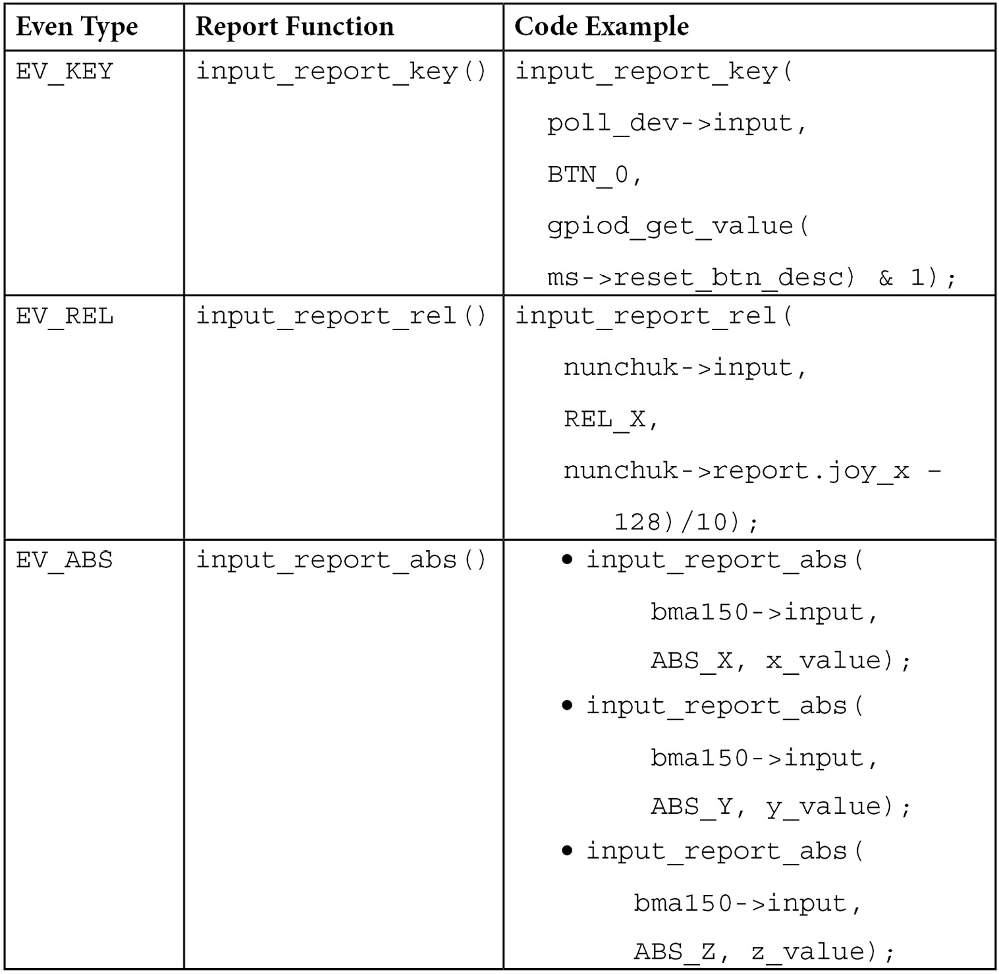

# Chương 17: Sử dụng Linux Kernel Input Subsystem

Input device là device có thể dùng để tương tác với hệ thống. Chúng gồm button, keyboard, touchscreen, mouse và nhiều loại khác. Chúng hoạt động bằng cách gửi event được input core tiếp nhận và broadcast trên hệ thống. Chương này giải thích từng structure mà input core dùng để xử lý input device, cũng như cách quản lý event từ user space.

Trong chương này, chúng ta đề cập các chủ đề sau:

- Giới thiệu Linux kernel input subsystem – data structure và API

- Cấp phát và đăng ký input device

- Dùng polled input device

- Tạo và báo cáo input event

- Xử lý input device từ user space

## Giới thiệu Linux kernel input subsystem – data structure và API

Data structure và API chính của subsystem nằm trong file `include`/`linux`/`input.h`. Dòng sau bắt buộc trong mọi input device driver:

```
#include <linux/input.h>
```

Bất kể input device type hay event type nó gửi, input device được biểu diễn trong kernel bằng instance của struct `input_dev`:

```
struct input_dev {
  const char *name;
  const char *phys;
  unsigned long evbit[BITS_TO_LONGS(EV_CNT)];
  unsigned long keybit[BITS_TO_LONGS(KEY_CNT)];
  unsigned long relbit[BITS_TO_LONGS(REL_CNT)];
  unsigned long absbit[BITS_TO_LONGS(ABS_CNT)];
  unsigned long mscbit[BITS_TO_LONGS(MSC_CNT)];
  unsigned int repeat_key;
  int rep[REP_CNT];
  struct input_absinfo *absinfo;
  unsigned long key[BITS_TO_LONGS(KEY_CNT)];
  int (*open)(struct input_dev *dev);
  void (*close)(struct input_dev *dev);
  unsigned int users;
  struct device dev;
  unsigned int num_vals;
  unsigned int max_vals;
  struct input_value *vals;
  bool devres_managed;
};
```

Để dễ đọc, một số thành phần structure đã được lược bỏ. Hãy xem chi tiết các field:

- `name` biểu diễn device name.

- `phys` là physical path tới device trong system hierarchy.

- `evbit` là bitmap event type mà device hỗ trợ. Sau đây là một số event:

- `EV_KEY` cho device hỗ trợ gửi key event (ví dụ keyboard, button, v.v.)

- `EV_REL` cho device hỗ trợ gửi relative position (ví dụ mouse, digitizer, v.v.)

- `EV_ABS` cho device hỗ trợ gửi absolute position (ví dụ joystick). Danh sách event nằm trong kernel source tại file `include/linux/input-event-codes.h`. Có thể dùng macro `set_bit()` đặt bit thích hợp tùy khả năng input device. Dĩ nhiên, device có thể hỗ trợ nhiều event type. Ví dụ mouse driver đặt cả `EV_KEY` và `EV_REL` như sau:

```
    set_bit(EV_KEY, my_input_dev->evbit);
    set_bit(EV_REL, my_input_dev->evbit);
```

- `keybit` dành cho device enable `EV_KEY`, gồm bitmap key/button mà device cung cấp; ví dụ `BTN_0`, `KEY_A`, `KEY_B`, v.v. Danh sách key/button đầy đủ có trong file `include/linux/input-event-codes.h`.

- `relbit` dành cho device enable `EV_REL`, gồm bitmap relative axis của device; ví dụ `REL_X`, `REL_Y`, `REL_Z`, v.v. Xem `include/linux/input-event-codes.h` để có danh sách đầy đủ.

- `absbit` dành cho device enable `EV_ABS`, gồm bitmap absolute axis của device; ví dụ `ABS_Y`, `ABS_X`, v.v. Xem cùng file trên để có danh sách đầy đủ.

- `mscbit` dành cho device enable `EV_MSC`, gồm bitmap miscellaneous event mà device hỗ trợ.

- `repeat_key` lưu key code của key được nhấn cuối cùng; dùng khi software triển khai autorepeat.

- `rep` lưu giá trị hiện tại của auto repeat parameter, thường là delay và rate.

- `absinfo` là array phần tử `&struct input_absinfo`, chứa thông tin absolute axis (current value, `min`, `max`, `flat`, `fuzz` và resolution). Nên dùng function `input_set_abs_params()` để đặt giá trị:

```
void input_set_abs_params(struct input_dev *dev,
                       unsigned int axis, int min,
                       int max, int fuzz, int flat)
```

- `min` và `max` lần lượt chỉ lower bound value và upper bound value. `fuzz` chỉ expected noise trên channel chỉ định của input device chỉ định. Trong ví dụ sau, chúng ta đặt bound cho từng channel:

```
#define ABSMAX_ACC_VAL      0x01FF
#define ABSMIN_ACC_VAL      -(ABSMAX_ACC_VAL)
[...]
set_bit(EV_ABS, idev->evbit);
input_set_abs_params(idev, ABS_X, ABSMIN_ACC_VAL,
                     ABSMAX_ACC_VAL, 0, 0);
input_set_abs_params(idev, ABS_Y, ABSMIN_ACC_VAL,
                     ABSMAX_ACC_VAL, 0, 0);
input_set_abs_params(idev, ABS_Z, ABSMIN_ACC_VAL,
                     ABSMAX_ACC_VAL, 0, 0);
```

- `key` phản ánh current state của key/button trên device.

- `open` là method được gọi khi người dùng đầu tiên gọi `input_open_device()`. Dùng method chuẩn bị device, như yêu cầu interrupt, bắt đầu polling thread, v.v.

- `close` được gọi khi người dùng cuối cùng gọi `input_close_device()`. Ở đây có thể dừng polling (tiêu tốn nhiều resource).

- `users` lưu số người dùng (input handler) đã mở device. Được `input_open_device()` và `input_close_device()` dùng để bảo đảm `dev->open()` chỉ được gọi khi người dùng đầu mở device, còn `dev->close()` chỉ khi người dùng cuối cùng đóng device.

- `dev` là struct device gắn với device này (cho device model).

- `num_vals` là số value được queue trong current frame.

- `max_vals` là số value tối đa được queue trong frame.

- `Vals` là array value được queue trong current frame.

- `devres_managed` chỉ device được devres framework quản lý, không cần hủy đăng ký hay giải phóng tường minh.

Bây giờ đã quen input device data structure chính, có thể bắt đầu đăng ký device như vậy trong hệ thống.

## Cấp phát và đăng ký input device

Trước khi hệ thống nhìn thấy event mà input device hỗ trợ, phải cấp phát memory cho device bằng API `devm_input_allocate_device()`. Sau đó đăng ký với hệ thống bằng `input_device_register()`. API đầu đảm nhận giải phóng memory và hủy đăng ký device khi rời hệ thống. Tuy nhiên, non-managed allocation vẫn có nhưng không được khuyến nghị, `input_allocate_device()`. Khi dùng non-managed allocation, driver chịu trách nhiệm bảo đảm lần lượt gọi `input_unregister_device()` và `input_free_device()` để hủy đăng ký device và giải phóng memory trên unloading path của driver. Sau đây là prototype tương ứng:

```
struct input_dev *input_allocate_device(void)
struct input_dev *devm_input_allocate_device(
                                       struct device *dev)
void input_free_device(struct input_dev *dev)
int input_register_device(struct input_dev *dev)
void input_unregister_device(struct input_dev *dev)
```

Device allocation có thể sleep, nên không được gọi trong atomic context hoặc khi đang giữ spinlock. Sau đây là đoạn function `probe` của input device trên I2C bus:

```
struct input_dev *idev;
int error;
/*
* such allocation will take care of memory freeing and
* device unregistering
*/
idev = devm_input_allocate_device(&client->dev);
if (!idev)
    return -ENOMEM;
idev->name = BMA150_DRIVER;
idev->phys = BMA150_DRIVER "/input0";
idev->id.bustype = BUS_I2C;
idev->dev.parent = &client->dev;
set_bit(EV_ABS, idev->evbit);
input_set_abs_params(idev, ABS_X, ABSMIN_ACC_VAL,
                     ABSMAX_ACC_VAL, 0, 0);
input_set_abs_params(idev, ABS_Y, ABSMIN_ACC_VAL,
                     ABSMAX_ACC_VAL, 0, 0);
input_set_abs_params(idev, ABS_Z, ABSMIN_ACC_VAL,
                     ABSMAX_ACC_VAL, 0, 0);
error = input_register_device(idev);
if (error)
    return error;
error = devm_request_threaded_irq(&client->dev,
            client->irq,
            NULL, my_irq_thread,
            IRQF_TRIGGER_RISING | IRQF_ONESHOT,
            BMA150_DRIVER, NULL);
if (error) {
    dev_err(&client->dev, "irq request failed %d,
           error %d\n", client->irq, error);
    return error;
}
return 0;
```

Như có thể nhận thấy, code trên không giải phóng memory hay hủy đăng ký device khi lỗi vì dùng managed allocation cho cả input device và IRQ. Input device có IRQ line để thông báo state change trên device bên dưới. Không phải luôn vậy vì hệ thống có thể thiếu IRQ line sẵn có, khi đó input core phải poll device thường xuyên để không bỏ event. Phần tiếp theo bàn về điều này.

## Dùng polled input device

Polled input device là input device đặc biệt dựa vào polling để phát hiện device state change; generic input device type dựa vào IRQ để phát hiện thay đổi và gửi event tới input core.

Polled input device được mô tả trong kernel bằng instance của structure `struct input_polled_dev`, wrapper quanh generic structure `struct input_dev`. Sau đây là khai báo:

```
struct input_polled_dev {
    void *private;
    void (*open)(struct input_polled_dev *dev);
    void (*close)(struct input_polled_dev *dev);
    void (*poll)(struct input_polled_dev *dev);
    unsigned int poll_interval; /* msec */
    unsigned int poll_interval_max; /* msec */
    unsigned int poll_interval_min; /* msec */
    struct input_dev *input;
    bool devres_managed;
};
```

Hãy xem thành phần structure:

- `private` là private data của driver.

- `open` là method tùy chọn chuẩn bị device cho polling (enable device và đôi khi flush device state).

- `close` là method tùy chọn được gọi khi device không còn được poll. Dùng đưa device vào low power mode.

- `poll` là method bắt buộc được gọi mỗi khi cần poll device. Được gọi ở frequency của

```
poll_inteval.
```

- `poll_interval` là frequency gọi method `poll()`. Mặc định 500 millisecond trừ khi ghi đè lúc đăng ký device.

- `poll_interval_max` chỉ upper bound cho poll interval. Mặc định bằng initial value của `poll_interval`.

- `poll_interval_min` chỉ lower bound cho poll interval. Mặc định là 0.

- `input` là input device mà polled device được xây quanh. Driver phải khởi tạo (ID, name và bit). Polled input device chỉ cung cấp interface dùng polling thay IRQ để phát hiện device state change.

Có thể cấp phát memory cho polled input device bằng `devm_input_allocate_polled_device()`. Đây là managed allocation API đảm nhận giải phóng memory và hủy đăng ký device khi thích hợp. Tương tự, có thể dùng non-managed API `input_allocate_polled_device()` để cấp phát, khi đó phải tự gọi `input_free_polled_device()`. Code sau thể hiện prototype các API:

```
struct input_polled_dev
     *devm_input_allocate_polled_device(
                                  struct device *dev)
struct input_polled_dev *input_allocate_polled_device(void)
void input_free_polled_device(struct
                               input_polled_dev *dev)
```

Với resource-managed device, field `input_dev->devres_managed` được input core đặt `true`. Sau đó phải khởi tạo mandatory field của `struct` `input_dev` bên dưới như phần trước. Cũng phải đặt polling interval; nếu không mặc định 500 ms. Khi field đã cấp phát và khởi tạo, có thể đăng ký polled input device bằng `input_register_polled_device()`, return `0` khi thành công. Với managed allocation, hệ thống xử lý hủy đăng ký; phải tự gọi `input_unregister_polled_device()` để làm operation ngược. Sau đây là prototype:

```
int input_register_polled_device(
                        struct input_polled_dev *dev)
void  input_unregister_polled_device(
                        struct input_polled_dev *dev)
```

Ví dụ điển hình function `probe()` cho device như vậy có thể như sau. Trước tiên định nghĩa driver data structure tập hợp mọi resource cần:

```
struct my_struct {
    struct input_pulled_dev *polldev;
    struct gpio_desc *gpio_btn;
    [...]
}
```

Sau khi định nghĩa driver data structure, có thể triển khai function `probe()`. Sau đây là phần thân:

```
static int button_probe(struct platform_device *pdev)
{
    struct my_struct *ms;
    struct input_dev *input_dev;
    int error;
    struct device *dev = &pdev->dev;
    ms = devm_kzalloc(dev, sizeof(*ms), GFP_KERNEL);
    if (!ms)
        return -ENOMEM;
    ms->polldev = devm_input_allocate_polled_device(dev);
    if (!ms->polldev)
        return -ENOMEM;
    /* This gpio is not mapped to IRQ */
    ms->gpio_btn = devm_gpiod_get(dev, "my-btn", GPIOD_IN);
    ms->polldev->private = ms;
    ms->polldev->poll = my_btn_poll;
    ms->polldev->poll_interval = 200;/* Poll every 200ms */
    ms->polldev->open = my_btn_open;
     /* Initializing the underlying input_dev fields */
    input_dev = ms->poll_dev->input;
    input_dev->name = "System Reset Btn";
    /* The gpio belongs to an expander sitting on I2C */
    input_dev->id.bustype = BUS_I2C;
    input_dev->dev.parent = dev;
    /* Declare the events generated by this driver */
    set_bit(EV_KEY, input_dev->evbit);
    set_bit(BTN_0, input_dev->keybit); /* buttons */
    retval = input_register_polled_device(ms->poll_dev);
    if (retval) {
        dev_err(dev, "Failed to register input device\n");
        return retval;
    }
    return 0;
}
```

Một lần nữa, không tự xử lý hủy đăng ký hay giải phóng khi lỗi vì dùng managed allocation.

Sau đây là hình thức có thể có của callback `open`:

```
static void my_btn_open(struct input_polled_dev *poll_dev)
{
    struct my_strut *ms = poll_dev->private;
    dev_dbg(&ms->poll_dev->input->dev, "reset open()\n");
}
```

Trong ví dụ, nó không làm gì. Tuy nhiên method `open` dùng chuẩn bị resource device cần.

Quyết định có triển khai polled input device hay không rất đơn giản. Thông thường dùng classic input device nếu có IRQ line; nếu không có thể fallback sang polled device:

```
if(client->irq > 0){
    /* Use generic input device */
} else {
    /* Use polled device */
}
```

Có thể cần xét yếu tố khác khi chọn triển khai polled input device hoặc IRQ-based device; code trên chỉ là gợi ý.

Bây giờ đã quen nhóm input device này, có thể xem xét đăng ký và hủy đăng ký input device. Tuy nhiên, dù input device đã đăng ký, chưa thể tương tác. Phần tiếp theo học cách input device báo cáo event tới kernel.

## Tạo và báo cáo input event

Device allocation và registration thiết yếu, nhưng vô ích nếu device không thể báo cáo event tới input core, điều input device được thiết kế để làm. Tùy event type device hỗ trợ, kernel cung cấp API thích hợp báo cáo tới core.

Với device hỗ trợ `EV_XXX`, report function tương ứng là `input_report_xxx()`. Bảng sau cho thấy mapping giữa event type quan trọng nhất và report function:



Bảng 17.1 – Mapping giữa khả năng input device và report API

Prototype report API như sau:

```
void input_report_abs(struct input_dev *dev,
                      unsigned int code, int value)
void input_report_key(struct input_dev *dev,
                      unsigned int code, int value)
void input_report_rel(struct input_dev *dev,
                      unsigned int code, int value)
```

Danh sách report function sẵn có nằm trong kernel source file `include/linux/input.h`. Tất cả cùng khuôn dạng:

- `dev` là input device chịu trách nhiệm event.

- `code` biểu diễn event code; ví dụ `REL_X` hoặc `KEY_BACKSPACE`. Danh sách đầy đủ có trong

```
include/linux/input-event-codes.h.
```

- `value` là giá trị event mang. Với event type `EV_REL`, mang relative change. Với event type `EV_ABS` (joystick, v.v.), chứa absolute value mới. Với event type `EV_KEY`, nên đặt `0` cho key release, `1` cho keypress và `2` cho auto-repeat.

Khi mọi thay đổi đã báo cáo, driver nên gọi `input_sync()` trên input device để chỉ event hoàn tất. Input subsystem tập hợp event thành một packet, gửi qua `/dev/input/event<X>`, character device biểu diễn `struct` `input_dev` trên hệ thống. Ở đây `<X>` là interface number mà input core gán cho driver:

```
void input_sync(struct input_dev *dev)
```

Hãy xem ví dụ. Sau đây là đoạn từ driver bma150 digital acceleration sensor trong `drivers/input/misc/bma150.c`:

```
static void threaded_report_xyz(struct bma150_data *bma150)
{
  u8 data[BMA150_XYZ_DATA_SIZE];
  s16 x, y, z;
  s32 ret;
  ret = i2c_smbus_read_i2c_block_data(bma150->client,
                       BMA150_ACC_X_LSB_REG,
                       BMA150_XYZ_DATA_SIZE, data);
  if (ret != BMA150_XYZ_DATA_SIZE)
    return;
  x = ((0xc0 & data[0]) >> 6) | (data[1] << 2);
  y = ((0xc0 & data[2]) >> 6) | (data[3] << 2);
  z = ((0xc0 & data[4]) >> 6) | (data[5] << 2);
  /* sign extension */
  x = (s16) (x << 6) >> 6;
  y = (s16) (y << 6) >> 6;
  z = (s16) (z << 6) >> 6;
  input_report_abs(bma150->input, ABS_X, x);
  input_report_abs(bma150->input, ABS_Y, y);
  input_report_abs(bma150->input, ABS_Z, z);
  /* Indicate this event is complete */
  input_sync(bma150->input);
}
```

Trong đoạn trích trên, `input_sync()` báo core xem ba report là cùng event. Hợp lý vì position có ba axis (X, Y và Z), không muốn X, Y hoặc Z được report riêng.

Nơi tốt nhất báo cáo event là trong poll function với polled device hoặc IRQ routine (threaded part hoặc không) với IRQ-enabled device. Nếu làm operation có thể sleep, nên xử lý report trong threaded part của IRQ handler. Code sau cho thấy cách ví dụ ban đầu có thể triển khai method `poll`:

```
static void my_btn_poll(struct input_polled_dev *poll_dev)
{
    struct my_struct *ms = polldev->private;
    struct i2c_client *client = mcp->client;
    input_report_key(polldev->input, BTN_0,
                     gpiod_get_value(ms->rgpio_btn) & 1);
    input_sync(poll_dev->input);
}
```

Trong code trên, input device báo cáo key code `0`. Phần tiếp theo bàn cách user space xử lý report event và code đó.

## Xử lý input device từ user space

Node được tạo trong directory `/dev/input/` cho mỗi input device (polled hoặc không) đăng ký thành công với hệ thống. Trong trường hợp tôi, node tương ứng `event0` vì là input device đầu tiên và duy nhất trên target board. Có thể dùng tool `udevadm` hiển thị thông tin device:

```
# udevadm info /dev/input/event0
P: /devices/platform/input-button.0/input/input0/event0
N: input/event0
S: input/by-path/platform-input-button.0-event
E: DEVLINKS=/dev/input/by-path/platform-input-button.0-event
E: DEVNAME=/dev/input/event0
E: DEVPATH=/devices/platform/input-button.0/input/input0/event0
E: ID_INPUT=1
E: ID_PATH=platform-input-button.0
E: ID_PATH_TAG=platform-input-button_0
E: MAJOR=13
E: MINOR=64
E: SUBSYSTEM=input
E: USEC_INITIALIZED=74842430
```

Một công cụ khác bạn có thể sử dụng để in các key mà device hỗ trợ là `evetest`. Nó cũng có thể bắt và in các event khi device báo cáo chúng. Code sau minh họa cách sử dụng trên input device của chúng ta:

```
# evtest /dev/input/event0
input device opened()
Input driver version is 1.0.1
Input device ID: bus 0x0 vendor 0x0 product 0x0 version 0x0
Input device name: "Packt Btn"
Supported events:
   Event type 0 (EV_SYN)
   Event type 1 (EV_KEY)
      Event code 256 (BTN_0)
```

Không chỉ input device đã viết driver mới quản lý được bằng `evetest`. Trong ví dụ sau, tôi dùng USB-C headset nối với máy tính. Nó có input device capability vì cung cấp key volume-related:

```
jma@labcsmart-sqy:~$ sudo evtest /dev/input/event4
Input driver version is 1.0.1
Input device ID: bus 0x3 vendor 0x12d1 product 0x3a07 version 0x111
Input device name: "Synaptics HUAWEI USB-C HEADSET"
Supported events:
  Event type 0 (EV_SYN)
  Event type 1 (EV_KEY)
    Event code 114 (KEY_VOLUMEDOWN)
    Event code 115 (KEY_VOLUMEUP)
    Event code 164 (KEY_PLAYPAUSE)
    Event code 582 (KEY_VOICECOMMAND)
  Event type 4 (EV_MSC)
    Event code 4 (MSC_SCAN)
Properties:
Testing ... (interrupt to exit)
Event: time 1640231369.347093, type 4 (EV_MSC), code 4 (MSC_SCAN), value c00e9
Event: time 1640231369.347093, type 1 (EV_KEY), code 115 (KEY_VOLUMEUP), value 1
Event: time 1640231369.347093, -------------- SYN_REPORT ------------
Event: time 1640231369.487017, type 4 (EV_MSC), code 4 (MSC_SCAN), value c00e9
Event: time 1640231369.487017, type 1 (EV_KEY), code 115 (KEY_VOLUMEUP), value 0
Event: time 1640231369.487017, -------------- SYN_REPORT ------------
```

Trong code trên, tôi nhấn volume up key để xem cách report. `evtest` thậm chí dùng được với keyboard, điều kiện duy nhất là nhận diện input device node tương ứng trong `/dev/input/`.

Như đã thấy, mỗi input device đăng ký được biểu diễn bằng character device `/dev/input/event<X>`, có thể dùng đọc event từ user space. Ứng dụng đọc file nhận event packet dạng `struct input_event`, có khai báo sau:

```
struct input_event {
  struct timeval time;
  __u16 type;
  __u16 code;
  __s32 value;
}
```

Hãy xem ý nghĩa từng thành phần trong structure:

- `time` là timestamp tương ứng thời điểm event xảy ra.

- `type` là event type; ví dụ `EV_KEY` cho keypress hoặc release, `EV_REL` cho relative movement hoặc `EV_ABS` cho absolute movement. Thêm type được định nghĩa trong `include/linux/input-event-codes.h`.

- `code` là event code; ví dụ `REL_X` hoặc `KEY_BACKSPACE`. Một lần nữa, danh sách đầy đủ có trong

```
include/linux/input-event-codes.h.
```

- `value` là giá trị event mang. Với event type `EV_REL`, mang relative change. Với event type `EV_ABS` (joystick, v.v.), chứa absolute value mới. Với event type `EV_KEY`, đặt `0` cho key release, `1` cho keypress và `2` cho auto-repeat.

User space application có thể dùng blocking read và non-blocking read, cũng như system call `poll()` hoặc `select()`, để nhận thông báo event sau khi mở device. Sau đây là ví dụ system call `select()`. Hãy bắt đầu liệt kê header cần để triển khai ví dụ:

```
#include <unistd.h>
#include <fcntl.h>
#include <stdio.h>
#include <stdlib.h>
#include <linux/input.h>
#include <sys/select.h>
```

Sau đó, phải định nghĩa input device path làm macro vì dùng thường xuyên:

```
#define INPUT_DEVICE "/dev/input/event0"
int main(int argc, char **argv)
{
    int fd, ret;
    struct input_event event;
    ssize_t bytesRead;
    fd_set readfds;
```

Tiếp theo phải mở input device và giữ file descriptor để dùng sau. Không mở được input device được xem là lỗi, nên phải thoát chương trình:

```
    fd = open(INPUT_DEVICE, O_RDONLY);
    if(fd < 0){
        fprintf(stderr,
             "Error opening %s for reading", INPUT_DEVICE);
        exit(EXIT_FAILURE);
    }
```

Bây giờ có file descriptor biểu diễn input device đã mở. Có thể dùng system call `select()` phát hiện key press hoặc release:

```
    while(1){
        FD_ZERO(&readfds);
        FD_SET(fd, &readfds);
        ret = select(fd + 1, &readfds, NULL, NULL, NULL);
        if (ret == -1) {
            fprintf(stderr,
                   "select call on %s: an error ocurred",
                    INPUT_DEVICE);
            break;
        }
        else if (!ret) { /* If we used timeout */
            fprintf(stderr,
                    "select on %s: TIMEOUT", INPUT_DEVICE);
            break;
        }
```

Tại đây đã làm sanity check cần trên return path của `select()`. Lưu ý `select()` return 0 nếu timeout trước khi file descriptor nào sẵn sàng, vì thế có `else if` trong code trên.

Thay đổi hiện có hiệu lực, hãy đọc data để xem tương ứng điều gì:

```
        /* File descriptor is now ready */
        if (FD_ISSET(fd, &readfds)) {
            bytesRead = read(fd, &event,
                             sizeof(struct input_event));
            if(bytesRead == -1)
                /* Process read input error*/
                [...]
            if(bytesRead != sizeof(struct input_event))
                /* Read value is not an input event */
                [...] /* handle this error */
```

Nếu execution flow đến được điểm này, điều đó có nghĩa mọi thứ đã diễn ra tốt. Bây giờ, chúng ta có thể duyệt các event mà input device hỗ trợ và so sánh chúng với event do input core báo cáo trước khi đưa ra quyết định:

```
            /* We could have done a switch/case if we had
             * many codes to look for */
            if (event.code == BTN_0) {
                /* it concerns our button */
                if (event.value == 0) {
                    /* Process keyRelease if need be */
                    [...]
                }
                else if(event.value == 1){
                    /* Process KeyPress */
                    [...]
                }
            }
        }
    }
    close(fd);
    return EXIT_SUCCESS;
}
```

Để debug thêm, nếu input device dựa trên GPIO, có thể lần lượt nhấn/thả button và kiểm tra GPIO state có đổi không:

```
# cat /sys/kernel/debug/gpio  | grep button
gpio-195 (gpio-btn         ) in  hi
# cat /sys/kernel/debug/gpio  | grep button
gpio-195 (gpio-btn         ) in  lo
```

Ngoài ra, nếu input device có IRQ line, nên kiểm tra statistics của IRQ line để bảo đảm nhất quán. Ví dụ ở đây phải kiểm tra request thành công không và đã được kích hoạt bao nhiêu lần:

```
# cat /proc/interrupts | grep packt
160:      0      0      0      0  gpio-mxc   0  packt-input-button
```

Trong phần này, đã học làm việc input device từ user space và cung cấp mẹo debug khi có vấn đề. Dùng system call `select()` phát hiện input event, dù cũng có thể dùng `poll()`.

## Tổng kết

Chương này mô tả input framework và làm rõ khác biệt giữa polled input device và interrupt-driven input device. Tại đây, bạn có kiến thức cần để viết driver cho mọi input driver, bất kể type hay input event hỗ trợ. User space interface cũng được bàn và có ví dụ minh họa.
