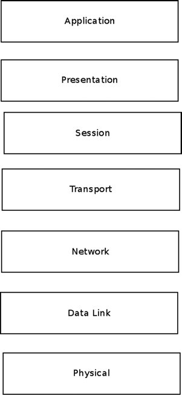
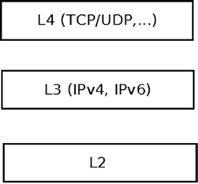
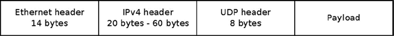

# Chương 1. Giới thiệu

Sách này trình bày triển khai Linux Kernel Networking stack và lý thuyết phía sau. Trong những trang tiếp theo, bạn sẽ thấy phân tích in-depth và chi tiết về networking subsystem cùng architecture của nó. Tôi không làm bạn nặng đầu với chủ đề không liên quan trực tiếp networking mà có thể gặp khi đọc kernel networking code (ví dụ locking và synchronization, SMP, atomic operation, v.v.). Có rất nhiều tài liệu về những chủ đề đó. Ngược lại, rất ít tài liệu up-to-date tập trung vào chính kernel networking. Ý tôi chủ yếu là mô tả đường đi packet trong Linux Kernel Networking stack, tương tác với các networking layer và subsystem, cùng cách triển khai các networking protocol.

Sách cũng không phải phần diễn giải code line-by-line cồng kềnh. Tôi tập trung bản chất triển khai mỗi network layer cùng định hướng và nguyên tắc lý thuyết dẫn tới triển khai đó. Những năm gần đây Linux đã chứng tỏ là operating system thành công, đáng tin cậy, ổn định và phổ biến. Dường như mức phổ biến tăng đều trong nhiều dạng, từ mainframe, data center, core router và web server tới embedded device như wireless router, set-top box, thiết bị y tế, thiết bị dẫn đường (như GPS) và thiết bị điện tử tiêu dùng. Nhiều semiconductor vendor dùng Linux làm nền cho Board Support Package (BSP). Linux bắt đầu năm 1991 như dự án của sinh viên Phần Lan Linus Torvalds, dựa trên UNIX, đã chứng tỏ là operating system nghiêm túc, đáng tin và đối thủ của proprietary operating system lâu đời.

Linux khởi đầu là operating system Intel x86-based nhưng được port sang rất nhiều processor, gồm ARM, PowerPC, MIPS, SPARC, v.v. Android, dựa trên Linux kernel, hiện phổ biến trong tablet và smartphone, và có vẻ sẽ phổ biến trong smart TV tương lai. Ngoài Android, Google còn đóng góp một số kernel networking feature đã merge vào mainline kernel.

Linux là open source project, nên có lợi thế so với proprietary operating system khác: source code sẵn có tự do theo General Public License (GPL). Open source operating system khác, như các loại BSD, ít phổ biến hơn nhiều. Cũng cần nhắc OpenSolaris dựa trên Common Development and Distribution License (CDDL). Dự án do Sun Microsystems khởi xướng chưa đạt mức phổ biến của Linux. Trong cộng đồng Linux developer tích cực rộng lớn, một số đóng góp code thay mặt công ty, số khác tự nguyện. Toàn bộ kernel development process có thể truy cập qua kernel mailing list. Có mailing list trung tâm Linux Kernel Mailing List (LKML), và nhiều subsystem có mailing list riêng. Đóng góp code bằng cách gửi patch tới kernel mailing list thích hợp và maintainer, rồi patch được thảo luận trên mailing list.

Linux Kernel Networking stack là subsystem rất quan trọng của Linux kernel. Khó tìm hệ thống Linux-based, dù desktop, server, mobile device hay embedded device khác, không dùng networking dưới dạng nào. Ngay cả trường hợp hiếm khi máy không có hardware network device, bạn vẫn dùng networking (có thể vô thức) khi dùng X-Windows, vì chính X-Windows dựa trên networking client-server. Nhiều dự án liên quan Linux Networking stack, từ core router tới embedded device nhỏ. Một số thêm feature vendor-specific. Chẳng hạn hardware vendor triển khai Generic Segmentation Offload (GSO) trong một số network device. GSO là networking feature của kernel network stack chia packet lớn thành packet nhỏ hơn trên Tx path. Nhiều hardware vendor triển khai checksumming bằng hardware trong network device. Checksum là cơ chế kiểm tra packet không bị

hỏng khi di chuyển bằng cách tính hash từ packet rồi gắn vào packet. Nhiều dự án cung cấp security enhancement cho Linux. Đôi khi enhancement cần thay đổi networking subsystem, như bạn sẽ thấy trong Chương 3 khi thảo luận dự án Openwall GNU/\*/Linux. Trong embedded device có nhiều wireless router dựa trên Linux; ví dụ router WRT54GL Linksys chạy Linux. Cũng có open source operating system Linux-based chạy trên device này (và một số device khác), tên OpenWrt, với cộng đồng developer lớn và tích cực (xem `https://openwrt.org/`). Học cách Linux Kernel Networking stack triển khai protocol, làm quen data structure chính và đường đi packet chính là thiết yếu để hiểu rõ hơn.

## Linux network stack

Theo mô hình Open Systems Interconnection (OSI), có bảy logical networking layer. Thấp nhất là physical layer, tức hardware; cao nhất là application layer, nơi software process userspace chạy. Hãy mô tả bảy layer:

1\. Physical layer: xử lý electrical signal và chi tiết mức thấp.

2\. Data link layer: xử lý chuyển data giữa endpoint. Data link

layer phổ biến nhất là Ethernet. Linux Ethernet network device driver nằm trong layer này.

3\. Network layer: xử lý packet forwarding và host addressing. Trong sách, tôi thảo luận

các network layer phổ biến nhất của Linux Kernel Networking subsystem: IPv4 hoặc IPv6. Linux còn triển khai network layer ít phổ biến như DECnet, nhưng không thảo luận ở đây.

4\. Protocol layer/transport layer: xử lý gửi data giữa node. TCP và

UDP là những protocol best-known.

5\. Session layer: xử lý session giữa endpoint.

6\. Presentation layer: xử lý delivery và formatting.

7\. Application layer: cung cấp network service cho application end-user.

Hình 1-1 cho thấy bảy layer theo mô hình OSI.



Hình 1-1. Mô hình OSI seven-layer

Hình 1-2 cho thấy ba layer Linux Kernel Networking stack xử lý. L2, L3 và L4 trong hình lần lượt tương ứng data link layer, network layer và transport layer trong mô hình seven-layer. Bản chất Linux kernel stack là chuyển incoming packet từ L2 (network device driver) tới L3 (network layer, thường IPv4 hoặc IPv6), rồi tới L4 (transport layer, ví dụ có TCP hoặc UDP listening socket) nếu local delivery, hoặc trở về L2 để truyền khi cần forward. Outgoing packet tạo cục bộ được chuyển từ L4 tới L3 rồi L2 để network device driver thực sự truyền. Trên đường có nhiều giai đoạn và nhiều điều có thể xảy ra. Ví dụ:

- Packet có thể đổi do protocol rule (ví dụ IPsec rule hoặc NAT rule).

- Packet có thể bị loại.

- Packet có thể khiến error message được gửi.

- Packet có thể bị fragment.

- Packet có thể được defragment.

- Cần tính checksum cho packet.



Hình 1-2. Linux Kernel Networking layer

Kernel không xử lý layer trên L4; session layer, presentation layer và application layer chỉ do userspace application xử lý. Physical layer (L1) cũng không do Linux kernel xử lý.

Nếu cảm thấy quá tải, đừng lo. Bạn sẽ học sâu hơn nhiều về mọi thứ mô tả ở đây trong các chương sau.

## Network device

Layer thấp, Layer 2 (L2), như Hình 1-2, là link layer. Network device driver nằm ở đây. Sách không nói về phát triển network device driver vì tập trung Linux kernel networking stack. Tôi sẽ mô tả ngắn structure `net_device` biểu diễn network device và khái niệm liên quan. Bạn nên có kiến thức cơ bản về network device structure để hiểu network stack tốt hơn. Device parameter như MTU size, thường 1.500 byte với Ethernet device, quyết định có fragment packet không. `net_device` là structure rất lớn, gồm device parameter như:

- IRQ number của device.

- MTU của device.

- MAC address của device.

- Tên device (như `eth0` hoặc `eth1`).

- Flag của device (ví dụ up hay down).

- List multicast address gắn với device.

- Counter `promiscuity` (thảo luận sau trong mục).

- Feature device hỗ trợ (như GSO hoặc GRO offloading).

- Object chứa network device callback (object `net_device_ops`), gồm function pointer như mở và dừng device, bắt đầu truyền, đổi MTU network device, v.v.

- Object chứa callback `ethtool`, hỗ trợ lấy thông tin device bằng command-line utility `ethtool`.

- Số Tx queue và Rx queue khi device hỗ trợ multiqueue.

- Timestamp lần truyền packet cuối trên device này.

- Timestamp lần nhận packet cuối trên device này. Sau đây là định nghĩa một số member structure `net_device` để tạo ấn tượng ban đầu:

```
struct net_device {
    unsigned int            irq;            /* device IRQ number    */
    . . .
    const struct net_device_ops *netdev_ops;
    . . .
    unsigned int            mtu;
    . . .
    unsigned int            promiscuity;
    . . .
    unsigned char           *dev_addr;
    . . .
};
(include/linux/netdevice.h)
```

Phụ lục A mô tả rất chi tiết structure `net_device` và phần lớn các member của nó. Trong số đó, bạn có thể thấy `irq`, `mtu` và các member khác đã được đề cập trước đó trong chương này.

Khi counter `promiscuity` lớn hơn 0, network stack không loại packet không gửi tới local host. Điều này được packet analyzer (“sniffer”) như `tcpdump` và `wireshark` dùng: chúng mở raw socket trong userspace và muốn nhận cả loại traffic này. Đây là counter thay vì Boolean để cho phép mở nhiều sniffer đồng thời: mỗi sniffer mở tăng counter 1. Khi sniffer đóng, counter `promiscuity` giảm 1; nếu về 0, không còn sniffer chạy và device thoát promiscuous mode.

Khi duyệt kernel networking core source code, có lẽ bạn sẽ gặp NAPI (New API) ở nhiều nơi, là feature phần lớn network device driver hiện triển khai. Bạn cần biết nó là gì và vì sao driver dùng.

### New API (NAPI) trong network device

Network device driver cũ hoạt động ở mode interrupt-driven, nghĩa là mỗi packet nhận có một interrupt. Điều này chứng tỏ không hiệu quả về performance khi traffic load cao. Kỹ thuật software mới tên New API (NAPI) được phát triển, hiện được gần như mọi Linux network device driver hỗ trợ. NAPI xuất hiện đầu tiên trong kernel 2.5/2.6 và được backport tới kernel 2.4.20. Với NAPI, khi tải cao, network device driver hoạt động ở polling mode thay vì interrupt-driven mode. Nghĩa là mỗi packet nhận không kích hoạt interrupt. Thay vào đó packet được buffer trong driver, kernel định kỳ poll driver để lấy packet. NAPI cải thiện performance khi tải cao. Với socket application cần latency thấp nhất và chấp nhận CPU utilization cao hơn, Linux thêm khả năng Busy Polling on Sockets từ kernel 3.11 trở đi. Công nghệ được thảo luận trong Chương 14, mục “Busy Poll Sockets”.

Với kiến thức mới về network device, đã đến lúc tìm hiểu đường đi packet trong Linux Kernel Networking stack.

### Nhận và truyền packet

Tác vụ chính của network device driver là:

- Nhận packet gửi tới local host và chuyển tới network layer (L3), rồi transport layer (L4)

- Truyền outgoing packet tạo trên local host ra ngoài, hoặc forward packet đã nhận trên local host

Với mỗi incoming packet hoặc outgoing packet, lookup trong routing subsystem được thực hiện. Quyết định forward packet hay không và gửi trên interface nào dựa vào kết quả lookup trong routing subsystem, được mô tả sâu trong Chương 5 và 6. Lookup không phải yếu tố duy nhất quyết định đường packet trong network stack. Chẳng hạn, có năm điểm trong network stack để đăng ký callback netfilter subsystem (thường gọi netfilter hook). Netfilter hook point đầu của received packet là NF\_INET\_PRE\_ROUTING, trước routing lookup. Khi callback như vậy xử lý packet, được macro NF\_HOOK() gọi, packet tiếp tục đi trong networking stack theo kết quả callback (còn gọi `verdict`). Ví dụ nếu `verdict` là NF\_DROP, packet bị loại; nếu `verdict` là NF\_ACCEPT, packet tiếp tục như thường. Netfilter hook callback được đăng ký bằng method `nf_register_hook()` hoặc `nf_register_hooks()`, và bạn sẽ gặp lời gọi trong nhiều netfilter kernel module. Kernel netfilter subsystem là infrastructure cho userspace package `iptables` well-known. Chương 9 mô tả netfilter subsystem, netfilter hook và connection tracking layer của netfilter.

Ngoài netfilter hook, IPsec subsystem có thể ảnh hưởng đường đi packet, chẳng hạn khi khớp IPsec policy cấu hình. IPsec cung cấp network layer security solution và dùng protocol ESP cùng AH. IPsec bắt buộc theo đặc tả IPv6 và tùy chọn trong IPv4, dù phần lớn operating system, gồm Linux, cũng triển khai IPsec trong IPv4. IPsec có hai mode: transport mode và tunnel mode. Nó là nền cho nhiều virtual private network (VPN) solution, dù cũng có VPN solution non-IPsec. Bạn tìm hiểu IPsec subsystem và IPsec policy ở Chương 10, cũng thảo luận vấn đề khi dùng IPsec qua NAT và giải pháp IPsec NAT traversal.

Vẫn còn những yếu tố khác có thể ảnh hưởng đến đường đi của packet, chẳng hạn giá trị field `ttl` trong IPv4 header của packet đang được forward. `ttl` được giảm đi 1 tại mỗi forwarding device. Khi giá trị này đạt 0, packet bị loại bỏ và một ICMPv4 message “Time Exceeded” với code “TTL Count Exceeded” được gửi trả lại. Việc này nhằm tránh một forwarded packet di chuyển vô tận do lỗi nào đó. Ngoài ra, mỗi khi packet được forward thành công và `ttl` giảm đi 1, checksum của IPv4 header phải được tính lại vì giá trị này phụ thuộc vào IPv4 header và `ttl` là một member của header. Chương 4 về IPv4 subsystem trình bày thêm về điều này. IPv6 có cơ chế tương tự, nhưng hop counter trong IPv6 header có tên là `hop_limit`, thay vì `ttl`. Bạn sẽ tìm hiểu điều này trong Chương 8 về IPv6 subsystem. Bạn cũng sẽ tìm hiểu ICMP trong IPv4 và IPv6 ở Chương 3 về ICMP.

Phần lớn sách thảo luận đường packet trong networking stack, cả receive path (Rx path, còn gọi ingress traffic) lẫn transmit path (Tx path, còn gọi egress traffic). Đường đi phức tạp và có nhiều biến thể: packet lớn có thể fragment trước khi gửi; ngược lại, fragmented packet cần ráp lại (Chương 4). Packet type khác nhau được xử lý khác. Ví dụ multicast packet có thể được nhóm host xử lý (khác unicast packet gửi tới host xác định). Multicast có thể dùng trong streaming media application để tốn ít network resource hơn. Xử lý IPv4 multicast traffic ở Chương 4. Bạn cũng học host join/leave multicast group; trong IPv4, Internet Group Management Protocol (IGMP) xử lý multicast membership. Nhưng có trường hợp host được cấu hình multicast router, cần forward multicast traffic thay vì chuyển tới local host. Phức tạp hơn vì phải xử lý phối hợp userspace multicast routing daemon, như daemon `pimd` hoặc `mrouted`. Những trường hợp gọi là multicast routing được thảo luận trong Chương 6.

Để hiểu đường packet tốt hơn, cần học cách biểu diễn packet trong Linux kernel. Structure `sk_buff` biểu diễn incoming packet hoặc outgoing packet, gồm header (`include/linux/skbuff.h`). Tôi gọi object `sk_buff` là SKB ở nhiều nơi vì đó là cách phổ biến chỉ object `sk_buff` (SKB viết tắt socket buffer). Structure socket buffer (`sk_buff)` là structure lớn; tôi chỉ thảo luận vài member trong chương này.

### Socket buffer

Structure `sk_buff` được mô tả chi tiết trong Phụ lục A. Tôi khuyên bạn tham khảo phụ lục này khi cần biết thêm về một member của SKB hoặc cách sử dụng SKB API. Lưu ý rằng khi làm việc với SKB, bạn phải tuân theo SKB API. Ví dụ, khi muốn dịch chuyển pointer `skb->data` về phía trước, bạn không thực hiện trực tiếp mà sử dụng method `skb_pull_inline()` hoặc `skb_pull()` (bạn sẽ thấy ví dụ ở phần sau của mục này). Nếu muốn lấy L4 header (transport header) từ một SKB, bạn gọi method `skb_transport_header()`. Tương tự, để lấy L3 header (network header), bạn gọi method `skb_network_header()`; để lấy L2 header (MAC header), bạn gọi method `skb_mac_header()`. Cả ba method này đều nhận một SKB làm parameter duy nhất.

Đây là định nghĩa (một phần) structure `sk_buff`:

```
struct sk_buff {
    . . .
    struct sock             *sk;
    struct net_device       *dev;
    . . .
    __u8                    pkt_type:3,
    . . .
    __be16                  protocol;
    . . .
    sk_buff_data_t          tail;
    sk_buff_data_t          end;
    unsigned char           *head,
                            *data;

    sk_buff_data_t          transport_header;
    sk_buff_data_t          network_header;
    sk_buff_data_t          mac_header;
    . . .

};
(include/linux/skbuff.h)
```

Khi nhận packet trên đường truyền, network device driver cấp phát SKB, thường bằng method `netdev_alloc_skb()` (hoặc method `dev_alloc_skb()`, legacy method gọi `netdev_alloc_skb()` với parameter đầu NULL). Trên đường đi, packet có thể bị loại bằng `kfree_skb()` hoặc `dev_kfree_skb()`, cả hai nhận pointer tới SKB làm parameter duy nhất. Một số SKB member được xác định ở link layer (L2). Ví dụ `pkt_type` do method `eth_type_trans()` xác định theo destination Ethernet address. Nếu multicast address, `pkt_type` được đặt PACKET\_MULTICAST; nếu broadcast address, `pkt_type` đặt PACKET\_BROADCAST; nếu address của local host, `pkt_type` đặt PACKET\_HOST. Phần lớn Ethernet network driver gọi method `eth_type_trans()` trong Rx path. Method `eth_type_trans()` cũng đặt field `protocol` của SKB theo `ethertype` của Ethernet header. Method `eth_type_trans()` cũng tiến pointer `data` của SKB thêm 14 (ETH\_HLEN), kích thước Ethernet header, bằng method `skb_pull_inline()`. Lý do là `skb->data` phải trỏ tới header của layer hiện tại. Khi packet ở L2, trong network device driver Rx path, `skb->data` trỏ tới L2 (Ethernet) header; giờ packet sắp chuyển tới Layer 3, ngay sau lời gọi method `eth_type_trans()`, `skb->data` phải trỏ tới network (L3) header, bắt đầu ngay sau Ethernet header (xem Hình 1-3).



Hình 1-3. IPv4 packet

SKB chứa packet header (L2, L3 và L4 header) cùng packet payload. Khi packet đi qua network stack, header có thể được thêm hoặc loại. Ví dụ với IPv4 packet do socket tạo cục bộ và truyền ra ngoài, network layer (IPv4) thêm IPv4 header vào SKB. IPv4 header tối thiểu 20 byte. Khi thêm IP option, có thể tới 60 byte. IP option mô tả trong Chương 4 về IPv4 protocol implementation. Hình 1-3 cho ví dụ IPv4 packet có L2, L3 và L4 header. Ví dụ trong Hình 1-3 là UDPv4 packet. Đầu tiên Ethernet header (L2) 14 byte. Sau đó IPv4 header (L3) từ tối thiểu 20 tới 60 byte, rồi UDPv4 header (L4) 8 byte. Cuối là packet payload.

Mỗi SKB có một member `dev`, là một instance của structure `net_device`. Với incoming packet, đây là network device nhận packet; với outgoing packet, đây là network device gửi packet. Đôi khi cần sử dụng network device gắn với SKB để lấy thông tin có thể ảnh hưởng đến đường đi của SKB trong Linux Kernel Networking stack. Ví dụ, MTU của network device có thể đòi hỏi phải phân mảnh packet, như đã đề cập trước đó. Mỗi SKB được truyền đi đều có một object `sock` gắn với nó (`sk`). Nếu packet là một forwarded packet thì `sk` bằng NULL, vì packet không được tạo trên local host.

Mỗi packet nhận được phải được xử lý bởi network layer protocol handler phù hợp. Ví dụ, IPv4 packet được xử lý bởi method `ip_rcv()`, còn IPv6 packet được xử lý bởi method `ipv6_rcv()`. Bạn sẽ tìm hiểu việc đăng ký IPv4 protocol handler bằng method `dev_add_pack()` trong Chương 4 và việc đăng ký IPv6 protocol handler cũng bằng method `dev_add_pack()` trong Chương 8. Ngoài ra, tôi sẽ lần theo đường đi của incoming packet và outgoing packet trong cả IPv4 lẫn IPv6. Ví dụ, trong method `ip_rcv()`, phần lớn công việc là thực hiện các sanity check. Nếu mọi thứ hợp lệ, packet được chuyển đến callback của hook NF\_INET\_PRE\_ROUTING nếu callback đó đã được đăng ký. Nếu packet không bị hook này loại bỏ, bước tiếp theo là method `ip_rcv_finish()`, nơi thực hiện tra cứu trong routing subsystem. Việc tra cứu này tạo một destination cache entry (object `dst_entry`). Bạn sẽ tìm hiểu `dst_entry` và các callback method `input`, `output` gắn với nó trong Chương 5 và 6, hai chương mô tả IPv4 routing subsystem.

IPv4 gặp vấn đề về không gian địa chỉ hạn chế vì địa chỉ IPv4 chỉ dài 32 bit. Các tổ chức sử dụng NAT (được thảo luận trong Chương 9) để cung cấp địa chỉ cục bộ cho host của họ, nhưng không gian địa chỉ IPv4 vẫn dần cạn kiệt qua các năm. Một trong những lý do chính để phát triển IPv6 protocol là không gian địa chỉ của nó rất lớn so với IPv4, vì địa chỉ IPv6 dài 128 bit. Tuy nhiên, IPv6 protocol không chỉ cung cấp không gian địa chỉ lớn hơn. Nó còn bao gồm nhiều thay đổi và phần bổ sung từ kinh nghiệm tích lũy qua nhiều năm sử dụng IPv4 protocol. Ví dụ, IPv6 header có độ dài cố định 40 byte, trong khi IPv4 header có độ dài thay đổi từ tối thiểu 20 byte đến 60 byte do IP option có thể mở rộng header. Việc xử lý IP option trong IPv4 phức tạp và khá tốn kém về hiệu năng. Ngược lại, bạn hoàn toàn không thể mở rộng IPv6 header vì độ dài của nó cố định như đã đề cập. Thay vào đó, IPv6 có cơ chế extension header hiệu quả hơn nhiều về hiệu năng so với IP option trong IPv4. Một thay đổi đáng chú ý khác liên quan đến ICMP protocol: trong IPv4, nó chỉ được sử dụng để báo lỗi và gửi information message. Trong IPv6, ICMP protocol được sử dụng cho nhiều mục đích khác như Neighbour Discovery (ND), Multicast Listener Discovery (MLD) và các mục đích khác. Chương 3 dành riêng cho ICMP trong cả IPv4 và IPv6. IPv6 Neighbour Discovery protocol được mô tả trong Chương 7, còn MLD protocol được thảo luận trong Chương 8 về IPv6 subsystem.

Như đã đề cập trước đó, các packet nhận được được network device driver chuyển đến network layer, là IPv4 hoặc IPv6. Nếu packet dành cho local delivery, chúng được chuyển đến transport layer (L4) để các listening socket xử lý. Các transport protocol phổ biến nhất là UDP và TCP, được thảo luận trong Chương 11 về Layer 4, transport layer. Chương đó cũng trình bày hai transport protocol mới hơn là Stream Control Transmission Protocol (SCTP) và Datagram Congestion Control Protocol (DCCP). Cả SCTP và DCCP đều tiếp nhận một số tính năng của TCP và UDP, như bạn sẽ tìm hiểu. SCTP protocol được biết đến với việc sử dụng cùng Long Term Evolution (LTE) protocol; DCCP đến nay chưa được kiểm thử trong các Internet setup larger-scale.

Packet local host tạo do Layer 4 socket tạo, ví dụ TCP socket hoặc UDP socket. Userspace application tạo chúng bằng Sockets API. Có hai socket type chính: datagram socket và stream socket. Hai type và socket API POSIX-based cũng thảo luận trong Chương 11, nơi bạn học kernel implementation của socket (`struct socket` cung cấp interface tới userspace, `struct sock` cung cấp interface tới Layer 3). Packet tạo cục bộ chuyển tới network layer L3 (Chương 4, mục “Gửi IPv4 packet”), rồi tới network device driver L2 để truyền. Có trường hợp fragmentation diễn ra trong Layer 3, network layer, cũng thảo luận ở Chương 4.

Mỗi Layer 2 network interface có L2 address nhận diện nó. Với Ethernet là address 48-bit, MAC address gán cho từng Ethernet network interface, do nhà sản xuất cung cấp và được cho là duy nhất (dù cần nhớ phần lớn network interface có thể đổi MAC address bằng userspace command như `ifconfig` hoặc `ip`). Mỗi Ethernet packet bắt đầu bằng Ethernet header dài 14 byte, gồm Ethernet type (2 byte), source MAC address (6 byte), destination MAC address (6 byte). Ethernet type value ví dụ 0x0800 với IPv4, 0x86DD với IPv6. Mỗi outgoing packet cần tạo Ethernet header. Khi userspace socket gửi packet, chỉ định destination address (IPv4 hoặc IPv6). Chưa đủ tạo packet vì cần biết destination MAC address. Tìm MAC address host từ IP address là nhiệm vụ neighbouring subsystem, Chương 7. Neighbor Discovery do ARP protocol xử lý trong IPv4 và NDISC protocol trong IPv6. Khác biệt là ARP gửi broadcast request, NDISC gửi ICMPv6 request, thực tế multicast packet. Cả ARP protocol và NDSIC protocol cũng thảo luận ở Chương 7.

Network stack cần giao tiếp userspace để thêm/xóa route, cấu hình neighboring table, đặt IPsec policy và state, v.v. Giao tiếp giữa userspace và kernel bằng netlink socket, mô tả trong Chương 2. Userspace package `iproute2` dựa trên netlink socket cũng được trình bày trong Chương 2, cùng generic netlink socket và ưu điểm.

Wireless subsystem thảo luận trong Chương 12. Subsystem được duy trì riêng như đã nói; có `git` tree và mailing list riêng. Wireless stack có feature độc đáo không có trong network stack thường, như power save mode (khi station hoặc access point vào sleep state). Linux wireless subsystem cũng hỗ trợ topology đặc biệt như Mesh network, ad-hoc network, v.v. Đôi khi cần feature đặc biệt. Ví dụ Mesh networking dùng routing protocol Hybrid Wireless Mesh Protocol (HWMP), Chương 12. Protocol hoạt động ở Layer 2, làm việc với MAC address, khác IPV4 routing protocol. Chương 12 cũng thảo luận mac80211 framework mà wireless device driver dùng. Feature thú vị khác là block acknowledgment mechanism trong IEEE 802.11n, cũng ở Chương 12.

Những năm gần đây InfiniBand phổ biến hơn trong enterprise datacenter. InfiniBand dựa trên công nghệ Remote Direct Memory Access (RDMA). RDMA API đưa vào Linux kernel version 2.6.11. Chương 13 giải thích rõ Linux Infiniband implementation, RDMA API và data structure cơ bản.

Virtualization solution cũng phổ biến hơn, đặc biệt nhờ Xen hoặc KVM. Hardware improvement như VT-x cho Intel processor hoặc AMD-V cho AMD processor giúp virtualization hiệu quả hơn. Có dạng virtualization khác có thể ít được biết nhưng có ưu điểm riêng. Dựa trên cách khác: process virtualization. Linux triển khai bằng namespace. Hiện Linux hỗ trợ sáu namespace, có thể thêm tương lai. Feature đã được dự án như Linux Containers (`http://lxc.sourceforge.net/`) và Checkpoint/Restore In Userspace (CRIU) dùng. Để hỗ trợ namespace, hai system call được thêm: `unshare()` và `setns()`; sáu flag mới thêm vào CLONE\_\* flag, mỗi loại namespace một flag. Tôi thảo luận namespace, đặc biệt network namespace, trong Chương 14. Chương cũng nói Bluetooth subsystem và tổng quan ngắn PCI subsystem vì nhiều network device driver là PCI device. Tôi không đi sâu PCI subsystem internals vì ngoài phạm vi sách. Subsystem thú vị khác trong Chương 14 là IEEE 8012.15.4, dành cho device low-power và low-cost. Device đôi khi được nhắc cùng Internet of Things (IoT), liên quan kết nối embedded device IP-enabled

với IP network. Hóa ra dùng IPv6 cho những device này có thể là ý hay. Giải pháp tên IPv6 over Low Power Wireless Personal Area Networks (6LoWPAN). Có thách thức riêng như mở rộng IPv6 Neighbour Discovery cho phù hợp device đôi khi vào sleep mode (khác IPv6 network thường). Thay đổi IPv6 Neighbour Discovery này chưa được triển khai, nhưng xem lý thuyết phía sau rất thú vị. Ngoài ra Chương 14 có mục về chủ đề nâng cao khác như NFC, cgroups, Android, v.v.

Để hiểu Linux Kernel Network stack tốt hơn hoặc tham gia phát triển, bạn phải quen cách tổ chức phát triển.

## Linux Kernel Networking Development Model

Kernel networking subsystem rất phức tạp và phát triển khá năng động. Như mọi Linux kernel subsystem, phát triển bằng patch `git` gửi qua mailing list (đôi khi nhiều list), cuối cùng maintainer chấp nhận hoặc từ chối. Hiểu Kernel Networking Development Model quan trọng vì nhiều lý do. Để hiểu code, debug và giải quyết vấn đề trong dự án dựa trên Linux Kernel Networking, triển khai patch cải thiện performance và tối ưu, hoặc feature mới, nhiều trường hợp cần học những việc như:

- Cách apply patch

- Cách đọc và diễn giải patch

- Cách tìm patch có thể gây vấn đề cụ thể

- Cách revert patch

- Cách tìm patch liên quan feature

- Cách điều chỉnh dự án cho kernel version cũ hơn (backporting)

- Cách điều chỉnh dự án cho kernel version mới hơn (upgrading)

- Cách clone `git` tree

- Cách rebase `git` tree

- Cách tìm kernel version đã apply patch `git` cụ thể

Có những trường hợp bạn cần làm việc với một feature vừa được bổ sung, vì vậy phải biết cách sử dụng tree bleeding-edge mới nhất. Cũng có những trường hợp bạn gặp bug hoặc muốn bổ sung feature vào network stack và cần chuẩn bị rồi gửi patch. Linux Kernel Networking subsystem, giống như các phần khác của kernel, được quản lý bằng `git`, một source code management (SCM) system do Linus Torvalds phát triển. Nếu định gửi patch vào mainline kernel hoặc một dự án do `git` quản lý, bạn phải học cách sử dụng công cụ `git`.

Đôi khi bạn thậm chí cần cài đặt một `git` server để phát triển các dự án cục bộ. Ngay cả khi không có ý định gửi patch, bạn vẫn có thể sử dụng công cụ `git` để lấy nhiều thông tin về code và lịch sử phát triển của code. Có nhiều tài liệu về `git` trên web; tôi khuyên bạn đọc cuốn sách trực tuyến miễn phí Pro Git của Scott Chacon, có tại `http://git-scm.com/book`. Nếu định gửi patch vào mainline, bạn phải tuân theo một số quy tắc nghiêm ngặt khi viết, kiểm tra và gửi patch để patch được áp dụng. Patch phải tuân theo kernel coding style và phải được kiểm thử. Bạn cũng cần kiên nhẫn vì đôi khi ngay cả một patch đơn giản cũng chỉ được áp dụng sau vài ngày. Tôi khuyên bạn học cách cấu hình host để sử dụng lệnh `git send-email` gửi patch (mặc dù cũng có thể gửi patch bằng các mail client khác, kể cả Gmail webmail client phổ biến). Có nhiều hướng dẫn trên web về cách sử dụng `git` để chuẩn bị và gửi kernel patch. Tôi cũng khuyên bạn đọc `Documentation/SubmittingPatches` và `Documentation/CodingStyle` trong kernel tree trước khi gửi patch đầu tiên.

Và tôi khuyên dùng PERL script sau:

- `scripts/checkpatch.pl` để kiểm tra tính đúng đắn patch

- `scripts/get_maintainer.pl` để biết nên gửi patch tới maintainer nào

Một trong những nguồn thông tin quan trọng nhất là Kernel Networking Development mailing list, `netdev`: `netdev@vger.kernel.org`, được lưu trữ tại `www.spinics.net/lists/netdev`. Đây là một mailing list có lưu lượng lớn. Phần lớn bài đăng là patch và Request for Comments (RFC) cho code mới, cùng các nhận xét và thảo luận về patch. Mailing list này phụ trách Linux Kernel Networking stack và network device driver, ngoại trừ trường hợp subsystem có mailing list và `git` repository riêng (chẳng hạn wireless subsystem, được thảo luận trong Chương 12). Việc phát triển các userspace package `iproute2` và `ethtool` cũng được thực hiện trên mailing list `netdev`. Cần đề cập rằng không phải mọi networking subsystem đều có mailing list riêng; ví dụ, IPsec subsystem (Chương 10) và IEEE 802.15.4 subsystem (Chương 14) không có mailing list riêng. Một số networking subsystem có `git` tree, maintainer và mailing list riêng, chẳng hạn wireless và Bluetooth. Thỉnh thoảng, maintainer của những subsystem này gửi pull request cho các `git` tree của họ qua mailing list `netdev`. Một nguồn thông tin khác là `Documentation/networking` trong kernel tree. Thư mục này chứa nhiều thông tin trong các file về nhiều chủ đề networking, nhưng hãy nhớ rằng file bạn tìm thấy ở đó không phải lúc nào cũng được cập nhật.

Linux Kernel Networking subsystem được duy trì trong hai `git` repository. Patch và RFC cho cả hai gửi tới mailing list `netdev`. Đây là hai `git` tree:

- net: `http://git.kernel.org/?p=linux/kernel/git/davem/net.git`: bản sửa cho code đã có trong mainline tree

- net-next: `http://git.kernel.org/?p=linux/kernel/git/davem/net-next.git`: code mới cho kernel release tương lai

Thỉnh thoảng maintainer networking subsystem David Miller gửi pull request mainline cho các `git` tree tới Linus qua LKML. Cần biết có khoảng thời gian trong khi merge với mainline mà `git` tree net-next đóng, không nên gửi patch. Thông báo bắt đầu và kết thúc khoảng thời gian được gửi qua mailing list `netdev`.

Lưu ý Sách dựa trên kernel 3.9. Mọi code snippet từ version này trừ khi nói khác. Kernel tree có tại `www.kernel.org` dưới dạng file `tar`. Hoặc có thể tải kernel `git` tree bằng `git` `clone` (ví dụ URL `git net` tree hoặc `git net-next` tree đã nhắc, hoặc kernel repository `git` khác). Có nhiều hướng dẫn Internet cấu hình, build và boot Linux kernel. Cũng có thể duyệt các kernel version online tại `http://lxr.free-electrons.com/`. Website cho theo dõi nơi tham chiếu mỗi method và variable; hơn nữa dễ click chuột tới Linux kernel version trước. Nếu làm việc với Linux kernel tree riêng có thay đổi cục bộ, có thể cài/cấu hình Linux Cross-Referencer server (LXR) trên máy Linux cục bộ. Xem `http://lxr.sourceforge.net/en/index.shtml`.

## Tóm tắt

Chương này giới thiệu ngắn Linux Kernel Networking subsystem. Tôi mô tả lợi ích dùng Linux, open source project phổ biến, và Kernel Networking Development Model. Cũng mô tả network device structure (`net_device`) và socket buffer structure (`sk_buff`), hai structure cơ bản nhất của networking subsystem. Nên tham khảo Phụ lục A để xem chi tiết gần như mọi member và cách dùng. Chương trình bày chủ đề quan trọng khác liên quan đường packet trong kernel networking stack như routing lookup, fragmentation và defragmentation, đăng ký protocol handler, v.v. Một số protocol thảo luận sau, gồm IPv4, IPv6, ICMP4 và ICMP6, ARP, Neighbour Discovery. Nhiều subsystem quan trọng như wireless, Bluetooth và IEEE 812.5.4 cũng được trình bày ở chương sau. Chương 2 bắt đầu hành trình kernel network stack với netlink socket, cung cấp giao tiếp hai chiều giữa userspace và kernel, cũng được nhắc trong nhiều chương khác.
