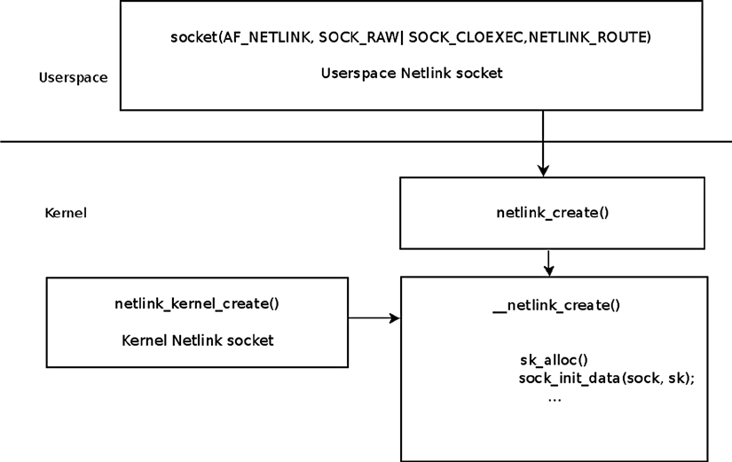
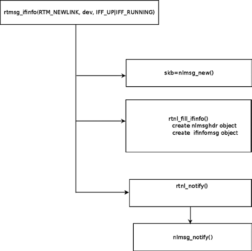
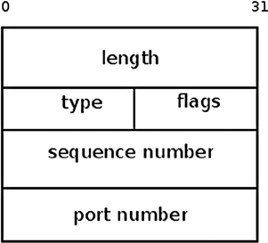
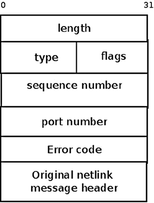
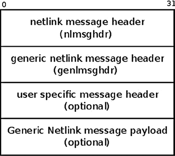

# Chương 2. Netlink socket

Chương 1 thảo luận vai trò Linux kernel networking subsystem và ba layer nó hoạt động. Netlink socket interface xuất hiện đầu tiên trong Linux kernel 2.2 dưới dạng socket AF\_NETLINK. Nó được tạo làm lựa chọn linh hoạt hơn thay phương thức IOCTL bất tiện để giao tiếp giữa userspace process và kernel. IOCTL handler không gửi được asynchronous message từ kernel tới userspace, còn netlink socket thì có. Dùng IOCTL còn phức tạp thêm vì phải định nghĩa IOCTL number. Mô hình netlink khá đơn giản: mở và đăng ký netlink socket trong userspace bằng socket API; socket này xử lý giao tiếp hai chiều với kernel netlink socket, thường gửi message cấu hình các system setting và nhận response từ kernel.

Chương này mô tả netlink protocol implementation và API, thảo luận ưu nhược điểm. Tôi cũng nói về generic netlink protocol mới, cách triển khai và ưu điểm, cùng ví dụ minh họa bằng thư viện `libnl`. Cuối cùng là socket monitoring interface.

## Netlink family

Netlink protocol là cơ chế Inter Process Communication (IPC) socket-based, dựa trên RFC 3549, “Linux Netlink as an IP Services Protocol”. Nó cung cấp kênh giao tiếp hai chiều giữa userspace và kernel hoặc giữa các phần của kernel. Netlink mở rộng standard socket implementation. Phần lớn triển khai ở `net/netlink`, nơi có bốn file:

- `af_netlink.c`

- `af_netlink.h`

- `genetlink.c`

- `diag.c`

Ngoài ra còn vài header file. Thực tế module `af_netlink` được dùng phổ biến nhất; cung cấp netlink kernel socket API, còn module `genetlink` cung cấp generic netlink API mới giúp tạo netlink message dễ hơn. Module monitoring interface `diag` (`diag.c`) cung cấp API dump và lấy thông tin netlink socket. Tôi thảo luận module `diag` phía sau trong mục “Socket monitoring interface”.

Cần nhắc về lý thuyết netlink socket có thể giao tiếp giữa hai hoặc nhiều userspace process (kể cả multicast message), dù thường không dùng và không phải mục tiêu gốc. UNIX domain socket cung cấp IPC API, được dùng rộng rãi giao tiếp hai userspace process.

Netlink có ưu điểm so với cách giao tiếp userspace/kernel khác. Ví dụ không cần polling. Userspace application mở socket rồi gọi `recvmsg()`, vào blocking state nếu kernel không gửi message; ví dụ xem method `rtnl_listen()` của package `iproute2` (`lib/libnetlink.c`). Ưu điểm khác là kernel có thể chủ động

gửi asynchronous message tới userspace, không cần userspace kích hoạt action nào (ví dụ gọi IOCTL hoặc ghi entry `sysfs`). Ưu điểm nữa là netlink socket hỗ trợ multicast transmission.

Tạo netlink socket từ userspace bằng system call `socket()`. Netlink socket có thể là SOCK\_RAW hoặc SOCK\_DGRAM.

Netlink socket có thể tạo trong kernel hoặc userspace; kernel netlink socket bằng method `netlink_kernel_create()`, userspace netlink socket bằng system call `socket()`. Tạo từ đâu cũng tạo object `netlink_sock`. Từ userspace do method `netlink_create()` xử lý. Trong kernel do `__netlink_kernel_create()` xử lý; method set flag NETLINK\_KERNEL\_SOCKET. Cuối cùng cả hai gọi `__netlink_create()` để cấp phát socket theo cách chung (gọi `sk_alloc()`) và khởi tạo. Hình 2-1 cho thấy tạo netlink socket trong kernel và userspace.



Hình 2-1. Tạo netlink socket trong kernel và userspace

Có thể tạo netlink socket từ userspace rất giống socket BSD-style thường, ví dụ `socket(AF_NETLINK, SOCK_RAW, NETLINK_ROUTE)`. Sau đó tạo object `sockaddr_nl` (instance netlink socket address structure), khởi tạo và dùng standard BSD sockets API (như `bind()`, `sendmsg()`, `recvmsg()`, v.v.). Structure `sockaddr_nl` biểu diễn netlink socket address trong userspace hoặc kernel.

Thư viện netlink socket cung cấp API tiện lợi. Tôi thảo luận ở mục tiếp theo.

### Thư viện netlink socket

Tôi khuyên dùng API `libnl` để phát triển userspace application gửi/nhận data qua netlink socket. Package `libnl` là tập thư viện cung cấp API cho Linux kernel interface protocol-based netlink. Package `iproute2` dùng thư viện `libnl` như đã nhắc. Ngoài core library (`libnl`), còn hỗ trợ generic netlink family (`libnl-genl`), routing family (`libnl-route`), netfilter family (`libnl-nf`). Package

chủ yếu do Thomas Graf phát triển (`www.infradead.org/~tgr/libnl/`). Cũng cần nhắc thư viện `libmnl`, userspace library tối giản hướng tới netlink developer. `libmnl` chủ yếu do Pablo Neira Ayuso viết, với đóng góp của Jozsef Kadlecsik và Jan Engelhardt. (`http://netfilter.org/projects/libmnl/`).

### Structure sockaddr\_nl

Hãy xem structure `sockaddr_nl` biểu diễn netlink socket address:

```
struct sockaddr_nl {
    __kernel_sa_family_t    nl_family;    /* AF_NETLINK                */
    unsigned short          nl_pad;       /* zero                      */
    __u32                   nl_pid;       /* port ID                   */
    __u32                   nl_groups;    /* multicast groups mask     */
};
```

(`include/uapi/linux/netlink.h`)

- `nl_family`: Luôn phải là AF\_NETLINK.

- `nl_pad`: Luôn phải là 0.

- `nl_pid`: Unicast address của netlink socket. Với kernel netlink socket phải là 0. Userspace application đôi khi đặt `nl_pid` bằng process id (`pid`). Trong userspace application, khi đặt tường minh `nl_pid` bằng 0 hoặc không đặt, rồi gọi `bind()`, kernel method `netlink_autobind()` gán value cho `nl_pid`. Nó thử gán process id của current thread. Nếu tạo hai socket trong userspace mà không gọi bind, bạn chịu trách nhiệm bảo đảm `nl_pid` duy nhất. Netlink socket không chỉ dùng networking; subsystem khác như SELinux, audit, uevent cũng dùng. Rtnelink socket là netlink socket chuyên networking; dùng cho routing message, neighbouring message, link message và networking subsystem message khác.

- `nl_groups`: Multicast group (hoặc multicast group mask).

Mục tiếp theo thảo luận package `iproute2` và package cũ `net-tools`. `iproute2` dựa trên netlink socket; bạn sẽ thấy ví dụ dùng netlink socket trong `iproute2` ở mục “Thêm và xóa routing entry trong routing table” phía sau. Tôi nhắc `net-tools`, cũ hơn và có thể bị deprecated tương lai, để nhấn mạnh nó ít mạnh và ít khả năng hơn khi thay cho `iproute2`.

### Userspace package điều khiển TCP/IP networking

Có hai userspace package điều khiển TCP/IP networking và xử lý network device: `net-tools` và `iproute2`. `iproute2` có command như:

- `ip`: Quản lý network table và network interface

- `tc`: Quản lý traffic control

- `ss`: Dump socket statistics

- `lnstat`: Dump linux network statistics

- `bridge`: Quản lý bridge address và device Package `iproute2` chủ yếu dựa trên gửi request từ userspace tới kernel và nhận reply

qua netlink socket. Có vài ngoại lệ dùng IOCTL trong `iproute2`. Ví dụ command `ip tuntap` dùng IOCTL thêm/xóa TUN/TAP device. Xem TUN/TAP software driver code sẽ thấy định nghĩa IOCTL handler nhưng không dùng rtnetlink socket. Package `net-tools` dựa trên IOCTL và có command quen thuộc:

- `ifconifg`

- `arp`

- `route`

- `netstat`

- `hostname`

- `rarp`

Một số chức năng nâng cao của `iproute2` không có trong `net-tools`. Mục tiếp theo nói kernel netlink socket, core engine xử lý giao tiếp giữa

userspace và kernel bằng trao đổi netlink message nhiều type. Hiểu kernel netlink socket là thiết yếu để hiểu interface netlink layer cung cấp cho userspace.

### Kernel netlink socket

Bạn tạo một số netlink socket trong kernel networking stack. Mỗi kernel socket xử lý message type khác nhau; ví dụ socket xử lý message NETLINK\_ROUTE được tạo trong `rtnetlink_net_init()`:

```
static int __net_init rtnetlink_net_init(struct net *net) {
    ...
    struct netlink_kernel_cfg cfg = {
        .groups    = RTNLGRP_MAX,
        .input        = rtnetlink_rcv,
        .cb_mutex    = &rtnl_mutex,
        .flags        = NL_CFG_F_NONROOT_RECV,
    };

    sk = netlink_kernel_create(net, NETLINK_ROUTE, &cfg);
    ...
}
```

Lưu ý rtnetlink socket nhận biết network namespace; object network namespace (`struct net`) chứa member `rtnl` (socket `rtnetlink`). Trong method `rtnetlink_net_init()`, sau khi tạo rtnetlink socket bằng `netlink_kernel_create()`, nó được gán pointer `rtnl` của object network namespace tương ứng.

Hãy xem prototype `netlink_kernel_create()`:

```
struct sock *netlink_kernel_create(struct net *net, int unit, struct netlink_kernel_cfg *cfg)
```

- Parameter đầu (`net`) là network namespace.

- Parameter thứ hai là netlink protocol (ví dụ NETLINK\_ROUTE cho rtnetlink message, NETLINK\_XFRM cho IPsec hoặc NETLINK\_AUDIT cho audit subsystem). Có hơn 20 netlink protocol nhưng giới hạn 32 (MAX\_LINKS). Đây là lý do tạo generic netlink protocol, như sẽ thấy. Danh sách đầy đủ ở `include/uapi/linux/netlink.h`.

- Parameter thứ ba là reference tới `netlink_kernel_cfg`, gồm parameter tùy chọn cho tạo netlink socket:

```
struct netlink_kernel_cfg {
    unsigned int    groups;
    unsigned int    flags;
    void        (*input)(struct sk_buff *skb);
    struct mutex    *cb_mutex;
    void        (*bind)(int group);
};
(include/uapi/linux/netlink.h)
```

Member `groups` chỉ định multicast group (hoặc multicast group mask). Có thể join multicast group bằng cách đặt `nl_groups` của object `sockaddr_nl` (cũng bằng method `nl_join_groups()` của `libnl`). Tuy nhiên cách này giới hạn chỉ 32 group. Từ kernel 2.6.14, có thể dùng socket option NETLINK\_ADD\_MEMBERSHIP/ NETLINK\_DROP\_MEMBERSHIP lần lượt join/leave multicast group. Socket option cho phép join nhiều group hơn. Method `nl_socket_add_memberships()/nl_socket_drop_membership()` của `libnl` dùng option này.

Member `flags` có thể là NL\_CFG\_F\_NONROOT\_RECV hoặc NL\_CFG\_F\_NONROOT\_SEND. Khi CFG\_F\_NONROOT\_RECV set, non-superuser có thể bind multicast group; trong `netlink_bind()` có

code sau:

```
static int netlink_bind(struct socket *sock, struct sockaddr *addr,
                         int addr_len)
 {
  ...
  if (nladdr->nl_groups) {
         if (!netlink_capable(sock, NL_CFG_F_NONROOT_RECV))
                         return -EPERM;
    }
```

Với non-superuser, nếu NL\_CFG\_F\_NONROOT\_RECV không set, khi bind multicast group method `netlink_capable()` return 0 và nhận lỗi –EPRM.

Khi flag NL\_CFG\_F\_NONROOT\_SEND set, non-superuser được phép gửi multicast. Member `input` là callback; khi member `input` trong `netlink_kernel_cfg` NULL, kernel socket

không thể nhận data từ userspace (dù vẫn gửi từ kernel tới userspace được). Với rtnetlink kernel socket, method `rtnetlink_rcv()` được khai báo là callback `input`; vì vậy data userspace gửi qua rtnelink socket được callback `rtnetlink_rcv()` xử lý. Với kernel event `uevent`, chỉ cần gửi kernel tới userspace; nên trong `lib/kobject_uevent.c`,

có ví dụ netlink socket không định nghĩa callback `input`:

```
static int uevent_net_init(struct net *net)
{
    struct uevent_sock *ue_sk;
    struct netlink_kernel_cfg cfg = {
        .groups    = 1,
        .flags    = NL_CFG_F_NONROOT_RECV,
    };

    ...
    ue_sk->sk = netlink_kernel_create(net, NETLINK_KOBJECT_UEVENT, &cfg);
    ...
}
(lib/kobject_uevent.c)
```

Mutex (`cb_mutex`) trong object `netlink_kernel_cfg` là tùy chọn; nếu không định nghĩa, dùng mặc định `cb_def_mutex` (instance mutex structure; xem `net/netlink/af_netlink.c`). Thực tế phần lớn netlink kernel socket tạo không định nghĩa mutex trong object `netlink_kernel_cfg`. Ví dụ uevent kernel netlink socket (NETLINK\_KOBJECT\_UEVENT) đã nhắc. Audit kernel netlink socket (NETLINK\_AUDIT) và socket khác cũng không định nghĩa. Rtnetlink socket là ngoại lệ, dùng `rtnl_mutex`. Generic netlink socket, thảo luận mục tiếp theo, cũng định nghĩa mutex riêng: `genl_mutex`.

Method `netlink_kernel_create()` tạo entry trong table `nl_table` bằng method `netlink_insert()`. Truy cập `nl_table` được read write lock `nl_table_lock` bảo vệ; lookup bằng `netlink_lookup()` với protocol và port id. Đăng ký callback cho message type cụ thể bằng `rtnl_register()`; có nhiều nơi trong networking kernel code đăng ký. Ví dụ trong `rtnetlink_init()` đăng ký callback cho message như RTM\_NEWLINK (tạo link), RTM\_DELLINK (xóa link), RTM\_GETROUTE (dump route table), v.v. Trong `net/core/neighbour.c`, đăng ký callback cho RTM\_NEWNEIGH (tạo neighbour), RTM\_DELNEIGH (xóa neighbour), RTM\_GETNEIGHTBL (dump neighbour table), v.v. Tôi thảo luận sâu trong Chương 5 và 7. Cũng đăng ký callback message type khác trong FIB code (`ip_fib_init()`), multicast code (`ip_mr_init()`), IPv6 code và nơi khác.

Bước đầu làm việc với netlink kernel socket là đăng ký. Hãy xem prototype method `rtnl_register()`:

```
extern void rtnl_register(int protocol, int msgtype,
                  rtnl_doit_func,
                  rtnl_dumpit_func,
                  rtnl_calcit_func);
```

Parameter đầu là family `protocol` (không nhắm protocol cụ thể thì PF\_UNSPEC); danh sách protocol family ở `include/linux/socket.h`.

Parameter thứ hai là netlink message type như RTM\_NEWLINK hoặc RTM\_NEWNEIGH. Đây là private netlink message type rtnelink protocol thêm. Danh sách đầy đủ ở `include/uapi/linux/rtnetlink.h`.

Ba parameter cuối là callback `doit`, `dumpit`, `calcit`. Callback là action muốn thực hiện để xử lý message, thường chỉ chỉ định một callback.

Callback `doit` cho action thêm/xóa/sửa; callback `dumpit` lấy thông tin, callback `calcit` tính buffer size. Rtnetlink module có table `rtnl_msg_handlers`, index theo protocol number. Mỗi entry tự là table index theo message type. Mỗi phần tử là instance `rtnl_link`, structure gồm pointer tới ba callback. Khi đăng ký callback bằng `rtnl_register()`, thêm callback vào table này.

Ví dụ đăng ký như sau: `rtnl_register(PF_UNSPEC, RTM_NEWLINK, rtnl_newlink, NULL, NULL) in net/core/rtnetlink.c`. Thêm `rtnl_newlink` làm callback `doit` cho message RTM\_NEWLINK trong entry `rtnl_msg_handlers` tương ứng.

Gửi rtnelink message bằng `rtmsg_ifinfo()`. Ví dụ trong `dev_open()` tạo link mới nên gọi `rtmsg_ifinfo(RTM_NEWLINK, dev, IFF_UP|IFF_RUNNING);` trong method `rtmsg_ifinfo()`, trước hết gọi `nlmsg_new()` cấp phát `sk_buff` đúng kích thước. Sau đó tạo hai object: netlink message header (`nlmsghdr`) và object `ifinfomsg` ngay sau header. Hai object được method `rtnl_fill_ifinfo()` khởi tạo. Rồi gọi `rtnl_notify()` gửi packet; thực sự gửi bằng generic netlink method `nlmsg_notify()` (trong `net/netlink/af_netlink.c`). Hình 2-2 cho các giai đoạn gửi rtnelink message bằng method `rtmsg_ifinfo()`.



Hình 2-2. Gửi rtnelink message bằng method `rtmsg_ifinfo()`

Mục tiếp theo về netlink message trao đổi giữa userspace và kernel. Message luôn bắt đầu bằng netlink message header, nên bước đầu tìm hiểu message là nghiên cứu header format.

### Netlink message header

Netlink message phải tuân format xác định trong RFC 3549, “Linux Netlink as an IP Services Protocol”, mục 2.2 “Message Format”. Bắt đầu bằng netlink header kích thước cố định, sau đó payload. Mục này mô tả Linux implementation của netlink message header.

Netlink message header được định nghĩa bằng `struct nlmsghdr` trong `include/uapi/linux/netlink.h`:

```
    struct nlmsghdr
    {
      __u32 nlmsg_len;
      __u16 nlmsg_type;
  __u16 nlmsg_flags;
  __u32 nlmsg_seq;
  __u32 nlmsg_pid;
};
(include/uapi/linux/netlink.h)
```

Mỗi netlink packet bắt đầu bằng netlink message header, biểu diễn bởi `struct nlmsghdr`. `nlmsghdr` dài 16 byte, chứa năm field:

- `nlmsg_len` là message length gồm header.

- `nlmsg_type` là message type; có bốn netlink message header type cơ bản:

- NLMSG\_NOOP: Không operation, phải loại message.

- NLMSG\_ERROR: Có lỗi.

- NLMSG\_DONE: Multipart message kết thúc.

- NLMSG\_OVERRUN: Overrun notification: lỗi, mất data.

(`include/uapi/linux/netlink.h`)

Tuy nhiên family có thể thêm netlink message header type riêng. Ví dụ rtnetlink protocol family thêm RTM\_NEWLINK, RTM\_DELLINK, RTM\_NEWROUTE và nhiều type khác (xem `include/uapi/linux/rtnetlink.h`). Danh sách đầy đủ kèm giải thích từng loại ở `man 7 rtnetlink`. Lưu ý message type nhỏ hơn NLMSG\_MIN\_TYPE (0x10) dành control message và không được dùng.

- Field `nlmsg_flags` có thể như sau:

- NLM\_F\_REQUEST: Khi là request message.

- NLM\_F\_MULTI: Khi là multipart message. Multipart message dùng dump table. Thường message size giới hạn một page (PAGE\_SIZE). Vì vậy message lớn chia nhỏ, mỗi message trừ cuối có flag NLM\_F\_MULTI set. Message cuối có flag NLMSG\_DONE set.

- NLM\_F\_ACK: Khi muốn bên nhận trả ACK. Netlink ACK message gửi bằng method `netlink_ack()` (`net/netlink/af_netlink.c`).

- NLM\_F\_DUMP: Lấy thông tin table/entry.

- NLM\_F\_ROOT: Chỉ định tree root.

- NLM\_F\_MATCH: Trả mọi matching entry.

- NLM\_F\_ATOMIC: Flag đã deprecated.

Flag sau là modifier cho tạo entry:

- NLM\_F\_REPLACE: Ghi đè entry có sẵn.

- NLM\_F\_EXCL: Không đụng entry nếu đã có.

- NLM\_F\_CREATE: Tạo entry nếu chưa có.

- NLM\_F\_APPEND: Thêm entry cuối list.

- NLM\_F\_ECHO: Echo request này.

Tôi đã cho thấy flag thường dùng nhất. Danh sách đầy đủ xem `include/uapi/linux/netlink.h`.

- `nlmsg_seq` là sequence number (cho message sequence). Khác một số Layer 4 transport protocol, không thực thi sequence number chặt chẽ.

- `nlmsg_pid` là sending port id. Khi message gửi từ kernel, `nlmsg_pid` là 0. Khi gửi từ userspace, `nlmsg_pid` có thể đặt bằng process id của userspace application gửi message.

Hình 2-3 cho thấy netlink message header.



Hình 2-3. nlmsg header

Sau header là payload. Netlink message payload gồm tập attribute biểu diễn theo format Type-Length-Value (TLV). Với TLV, type và length có kích thước cố định (thường 1–4 byte), value field biến đổi. TLV cũng dùng nơi khác trong networking code, ví dụ IPv6 (xem RFC 2460). TLV linh hoạt, giúp triển khai mở rộng tương lai dễ hơn. Attribute có thể nested, cho phép tree structure phức tạp.

Mỗi netlink attribute header định nghĩa bằng `struct nlattr`:

```
struct nlattr {
   __u16   nla_len;
   __u16   nla_type;
};
(include/uapi/linux/netlink.h)
```

- `nla_len`: Attribute size bằng byte.

- `nla_type`: Attribute type. Value `nla_type` có thể là NLA\_U32 (unsigned integer 32-bit), NLA\_STRING cho string biến độ dài, NLA\_NESTED cho nested attribute, NLA\_UNSPEC cho type và length tùy ý, v.v. Danh sách ở `include/net/netlink.h`.

Mọi netlink attribute phải align theo boundary 4-byte (`NLA_ALIGNTO`). Mỗi family có thể định nghĩa attribute validation policy, biểu thị kỳ vọng về

attribute nhận được. Policy biểu diễn bằng object `nla_policy`. Thực tế `nla_policy struct` có nội dung giống hệt `struct nlattr`:

```
 struct nla_policy {
   u16  type;
   u16  len;
};
(include/uapi/linux/netlink.h)
```

Attribute validation policy là array object `nla_policy`, index bằng attribute number. Với mỗi attribute (trừ fixed-length attribute), nếu value `len` trong object `nla_policy` bằng 0, không validation. Nếu thuộc string type (như `NLA_STRING`), `len` là độ dài tối đa không gồm terminating NULL byte. Nếu type là NLA\_UNSPEC hoặc không biết, `len` phải bằng độ dài chính xác attribute payload. Nếu NLA\_FLAG, không dùng `len`. (Vì sự hiện diện attribute ngụ ý `true`, không hiện diện ngụ ý `false`).

Nhận generic netlink message trong kernel do `genl_rcv_msg()` xử lý. Nếu dump request (flag `NLM_F_DUMP` set), dump table bằng `netlink_dump_start()`. Nếu không, parse payload bằng `nlmsg_parse()`. Method `nlmsg_parse()` validation attribute bằng `validate_nla()` (`lib/nlattr.c`). Attribute type vượt maxtype bị bỏ qua âm thầm để backwards compatibility. Nếu validation thất bại, không tiếp tục bước sau trong `genl_rcv_msg()` (chạy callback `doit()`), và `genl_rcv_msg()` return error code.

Mục tiếp theo mô tả NETLINK\_ROUTE message, loại thường dùng nhất trong networking subsystem.

### Message NETLINK\_ROUTE

Rtnetlink message (NETLINK\_ROUTE) không giới hạn routing subsystem: còn neighbouring subsystem message, interface setup message, firewalling message, netlink queuing message, policy routing message và nhiều type khác như sẽ thấy ở chương sau.

NETLINK\_ROUTE message chia thành family:

- LINK (network interface)

- ADDR (network address)

- ROUTE (routing message)

- NEIGH (neighbouring subsystem message)

- RULE (policy routing rule)

- QDISC (queueing discipline)

- TCLASS (traffic class)

- ACTION (packet action API, xem `net/sched/act_api.c`)

- NEIGHTBL (neighbouring table)

- ADDRLABEL (address labeling) Mỗi family có ba message type: tạo, xóa và lấy thông tin. Vì vậy với

routing message, có RTM\_NEWROUTE tạo route, RTM\_DELROUTE xóa route, RTM\_GETROUTE lấy route. Với LINK message, ngoài ba phương thức tạo/xóa/lấy thông tin, còn message sửa link: RTM\_SETLINK.

Có trường hợp lỗi và gửi error message trả lời. Netlink error message biểu diễn bằng `nlmsgerr struct`:

```
struct nlmsgerr {
    int        error;
    struct nlmsghdr msg;
};
(include/uapi/linux/netlink.h)
```

Thực tế như Hình 2-4, netlink error message gồm netlink message header và error code. Khi error code khác 0, netlink message header của request gốc gây lỗi được nối sau error code field.



Hình 2-4. Netlink error message

Nếu gửi message tạo sai (ví dụ `nlmsg_type` không hợp lệ), netlink error message được gửi về, error code đặt theo lỗi. Ví dụ `nlmsg_type` không hợp lệ (âm hoặc vượt tối đa), error code là –EOPNOTSUPP. Xem `rtnetlink_rcv_msg()` trong `net/core/rtnetlink.c`. Sequence number trong error message bằng sequence number của request gây lỗi.

Bên gửi có thể yêu cầu ACK cho netlink message bằng cách đặt netlink message header type (`nlmsg_type`) thành NLM\_F\_ACK. Khi kernel gửi ACK, dùng error message (header type là NLMSG\_ERROR) với error code 0. Khi đó không nối original netlink header của request vào error message. Chi tiết xem method `netlink_ack()` trong `net/netlink/af_netlink.c`.

Sau khi học NETLINK\_ROUTE message, bạn sẵn sàng xem ví dụ thêm/xóa routing entry trong routing table bằng NETLINK\_ROUTE message.

### Thêm và xóa routing entry trong routing table

Hãy xem bên trong kernel trong ngữ cảnh netlink protocol khi thêm/xóa routing entry. Ví dụ thêm bằng:

```
ip route add 192.168.2.11 via 192.168.2.20
```

Command gửi netlink message từ userspace (RTM\_NEWROUTE) qua rtnetlink socket để thêm routing entry. Rtnetlink kernel socket nhận, method `rtnetlink_rcv()` xử lý. Cuối cùng thêm entry bằng `inet_rtm_newroute()` trong `net/ipv4/fib_frontend.c`. Sau đó chèn vào Forwarding Information Base (FIB), routing database, bằng `fib_table_insert()`; nhưng chèn vào routing table không phải tác vụ duy nhất của `fib_table_insert()`. Phải báo mọi listener đã đăng ký RTM\_NEWROUTE message. Bằng cách nào? Khi chèn entry mới, gọi `rtmsg_fib()` với RTM\_NEWROUTE. Method `rtmsg_fib()` tạo netlink message và gửi bằng `rtnl_notify()` để báo listener đăng ký group RTNLGRP\_IPV4\_ROUTE. Listener RTNLGRP\_IPV4\_ROUTE có thể đăng ký cả kernel lẫn userspace (như `iproute2` hoặc userspace routing daemon như `xorp`). Sắp tới bạn sẽ thấy userspace daemon của `iproute2` subscribe rtnelink multicast group thế nào.

Khi xóa routing entry, diễn ra tương tự. Xóa entry trước bằng:

```
ip route del 192.168.2.11
```

Command gửi netlink message từ userspace (RTM\_DELROUTE) qua rtnetlink socket để xóa routing entry. Rtnetlink kernel socket lại nhận, callback `rtnetlink_rcv()` xử lý. Cuối cùng xóa bằng callback `inet_rtm_delroute()` trong `net/ipv4/fib_frontend.c`. Sau đó xóa FIB bằng `fib_table_delete()`, gọi `rtmsg_fib()`, lần này với RTM\_DELROUTE message.

Có thể monitor networking event bằng command `iproute2 ip` như sau:

```
ip monitor route
```

Ví dụ mở một terminal chạy `ip monitor route`, rồi terminal khác chạy `ip route add 192.168.1.10 via 192.168.2.200`, terminal đầu hiện `192.168.1.10 via 192.168.2.200 dev em1`. Khi chạy `ip route del 192.168.1.10` trên terminal thứ hai, terminal đầu hiện `Deleted 192.168.1.10 via 192.168.2.200 dev em1`.

Chạy `ip monitor route` khởi chạy daemon mở netlink socket và subscribe multicast group RTNLGRP\_IPV4\_ROUTE. Giờ thêm/xóa route như ví dụ khiến message gửi bằng `rtnl_notify()` được daemon nhận và hiện trên terminal.

Có thể subscribe multicast group khác theo cách này. Ví dụ subscribe RTNLGRP\_LINK bằng `ip monitor link`. Daemon nhận netlink message từ kernel, chẳng hạn khi thêm/xóa link. Nếu mở terminal chạy `ip monitor link`, rồi terminal khác thêm VLAN interface bằng `vconfig add eth1 200,`, terminal đầu hiện dòng như:

```
4: eth1.200@eth1: <BROADCAST,MULTICAST> mtu 1500 qdisc noop state DOWN
    link/ether 00:e0:4c:53:44:58 brd ff:ff:ff:ff:ff:ff
```

Nếu thêm bridge trên terminal thứ hai bằng `brctl addbr mybr`, terminal đầu hiện dòng như:

```
5: mybr: <BROADCAST,MULTICAST> mtu 1500 qdisc noop state DOWN
    link/ether a2:7c:be:62:b5:b6 brd ff:ff:ff:ff:ff:ff
```

Bạn đã thấy netlink message là gì, cách tạo và xử lý, cùng cách xử lý netlink socket. Tiếp theo học vì sao generic netlink family (kernel 2.6.15) được tạo và Linux implementation.

## Generic netlink protocol

Một nhược điểm netlink protocol là số protocol family giới hạn 32 (MAX\_LINKS). Đây là lý do chính tạo generic netlink family để hỗ trợ thêm nhiều family. Nó làm netlink multiplexer, dùng một netlink family (`NETLINK_GENERIC`). Generic netlink protocol dựa trên netlink protocol và dùng API của nó.

Để thêm netlink protocol family, phải thêm định nghĩa trong `include/linux/netlink.h`. Generic netlink protocol không cần vậy. Nó cũng hướng tới subsystem ngoài networking vì cung cấp general purpose communication channel. Ví dụ acpi subsystem dùng (xem định nghĩa `acpi_event_genl_family` trong `drivers/acpi/event.c`), task stats code (`kernel/taskstats.c`), thermal events code, v.v.

Generic netlink kernel socket được method `netlink_kernel_create()` tạo như sau:

```
static int __net_init genl_pernet_init(struct net *net) {
    ..
           struct netlink_kernel_cfg cfg = {
                 .input          = genl_rcv,
                 .cb_mutex       = &genl_mutex,
                 .flags          = NL_CFG_F_NONROOT_RECV,
         };
         net->genl_sock = netlink_kernel_create(net, NETLINK_GENERIC, &cfg);
 ...
 }
(net/netlink/genetlink.c)
```

Lưu ý giống netlink socket trước, generic netlink socket nhận biết network namespace; object network namespace (`struct net`) có member `genl_sock` (generic netlink socket). Như thấy, pointer `genl_sock` của network namespace được gán trong `genl_pernet_init()`.

Method `genl_rcv()` được định nghĩa làm callback `input` của object `genl_sock`, tạo trước bởi `genl_pernet_init()`. Do đó data userspace gửi qua generic netlink socket được callback `genl_rcv()` xử lý trong kernel.

Có thể tạo generic netlink userspace socket bằng system call `socket()`, dù dùng API `libnl-genl` tốt hơn (thảo luận sau).

Ngay sau tạo generic netlink kernel socket, đăng ký controller family (`genl_ctrl`):

```
    static struct genl_family genl_ctrl = {
             .id = GENL_ID_CTRL,
             .name = "nlctrl",
         .version = 0x2,
         .maxattr = CTRL_ATTR_MAX,
         .netnsok = true,
};

static int __net_init genl_pernet_init(struct net *net) {
...
err = genl_register_family_with_ops(&genl_ctrl, &genl_ctrl_ops, 1)
...
```

`genl_ctrl` có `id` cố định 0x10 (`GENL_ID_CTRL`); thực ra là instance `genl_family` duy nhất khởi tạo id cố định; mọi instance khác khởi tạo id `GENL_ID_GENERATE`, sau đó thay bằng value gán động.

Hỗ trợ đăng ký multicast group trong generic netlink socket bằng định nghĩa object `genl_multicast_group` và gọi `genl_register_mc_group()`; ví dụ trong Near Field Communication (NFC) subsystem:

```
static struct genl_multicast_group nfc_genl_event_mcgrp = {
         .name = NFC_GENL_MCAST_EVENT_NAME,
 };

int __init nfc_genl_init(void)
{
...
 rc = genl_register_mc_group(&nfc_genl_family, &nfc_genl_event_mcgrp);
...
}
(net/nfc/netlink.c)
```

Tên multicast group phải duy nhất vì là primary key cho lookup. Trong multicast group, `id` cũng tạo động khi đăng ký bằng lời gọi

method `find_first_zero_bit()` trong `genl_register_mc_group()`. Chỉ một multicast group `notify_grp` có id cố định GENL\_ID\_CTRL.

Để làm việc với generic netlink socket trong kernel, cần:

- Tạo object `genl_family` và đăng ký bằng `genl_register_family()`.

- Tạo object `genl_ops` và đăng ký bằng `genl_register_ops()`.

Hoặc gọi `genl_register_family_with_ops()`, truyền object `genl_family`, array `genl_ops` và kích thước. Method gọi `genl_register_family()` trước, nếu thành công gọi `genl_register_ops()` cho mỗi phần tử `genl_ops` của array `genl_ops` chỉ định.

`genl_register_family()` và `genl_register_ops()` cùng `genl_family` và `genl_ops` định nghĩa ở `include/net/genetlink.h`.

Wireless subsystem dùng generic netlink socket:

```
int nl80211_init(void)
{
    int err;

        err = genl_register_family_with_ops(&nl80211_fam,
            nl80211_ops, ARRAY_SIZE(nl80211_ops));
    ...
    }
    (net/wireless/nl80211.c)
```

Generic netlink protocol được userspace package như `hostapd` và `iw` dùng. Package `hostapd` (`http://hostap.epitest.fi`) cung cấp userspace daemon cho wireless access point và authentication server. Package `iw` thao tác wireless device và cấu hình (xem `http://wireless.kernel.org/en/users/Documentation/iw`).

Package `iw` dựa trên `nl80211` và thư viện `libnl`. Chương 12 thảo luận `nl80211` sâu hơn. Userspace wireless package cũ tên `wireless-tools`, dựa trên gửi IOCTL.

Đây là định nghĩa `genl_family` và `genl_ops` trong `nl80211`:

```
static struct genl_family nl80211_fam = {
    .id        = GENL_ID_GENERATE, /* don't bother with a hardcoded ID */
    .name      = "nl80211",    /* have users key off the name instead */
    .hdrsize   = 0,        /* no private header */
    .version   = 1,        /* no particular meaning now */
    .maxattr   = NL80211_ATTR_MAX,
    .netnsok   = true,
    .pre_doit  = nl80211_pre_doit,
    .post_doit = nl80211_post_doit,
};
```

- `name`: Phải duy nhất.

- `id`: `id` là GENL\_ID\_GENERATE trong trường hợp này, thực tế bằng 0. GENL\_ID\_GENERATE báo generic netlink controller gán channel number duy nhất khi đăng ký family bằng `genl_register_family()`. `genl_register_family()` gán id từ 16 (GENL\_MIN\_ID, tức 0x10) tới 1023 (GENL\_MAX\_ID).

- `hdrsize`: Private header size.

- `maxattr`: NL80211\_ATTR\_MAX, số attribute tối đa hỗ trợ.

Validation policy array `nl80211_policy` có NL80211\_ATTR\_MAX phần tử (mỗi attribute có một entry):

- `netnsok`: `true`, nghĩa là family xử lý được network namespace.

- `pre_doit`: Hook gọi trước callback `doit()`.

- `post_doit`: Hook có thể chẳng hạn undo locking hoặc private task cần thiết sau callback `doit()`.

Có thể thêm một hoặc nhiều command bằng structure `genl_ops`. Hãy xem định nghĩa `genl_ops struct`, rồi cách dùng trong `nl80211`:

```
    struct genl_ops {
       u8                      cmd;
       u8                      internal_flags;
       unsigned int            flags;
       const struct nla_policy *policy;
       int                    (*doit)(struct sk_buff *skb,
                                  struct genl_info *info);
   int                    (*dumpit)(struct sk_buff *skb,
                                    struct netlink_callback *cb);
   int                    (*done)(struct netlink_callback *cb);
   struct list_head        ops_list;
};
```

- `cmd`: Command identifier (`genl_ops struct` định nghĩa một command và handler `doit`/`dumpit`).

- `internal_flags`: Private flag do family định nghĩa/sử dụng. Ví dụ trong `nl80211`, nhiều operation định nghĩa internal flag (như NL80211\_FLAG\_NEED\_NETDEV\_UP, NL80211\_FLAG\_NEED\_RTNL, v.v.). Callback `nl80211 pre_doit()` và `post_doit()` thực hiện action theo flag. Xem `net/wireless/nl80211`.

- `flags`: Operation flag. Value có thể:

- GENL\_ADMIN\_PERM: Khi set, operation đòi privilege CAP\_NET\_ADMIN; xem `genl_rcv_msg()` trong `net/netlink/genetlink.c`.

- GENL\_CMD\_CAP\_DO: Set nếu `genl_ops struct` triển khai callback `doit()`.

- GENL\_CMD\_CAP\_DUMP: Set nếu `genl_ops struct` triển khai callback `dumpit()`.

- GENL\_CMD\_CAP\_HASPOL: Set nếu `genl_ops struct` định nghĩa attribute validation policy (array `nla_policy`).

- `policy` : Attribute validation policy thảo luận sau trong mục khi mô tả payload.

- `doit`: Standard command callback.

- `dumpit`: Callback để dump.

- `done`: Completion callback cho dump.

- `ops_list`: Operations list.

```
static struct genl_ops nl80211_ops[] = {
    {

    ...
      {
        .cmd = NL80211_CMD_GET_SCAN,
        .policy = nl80211_policy,
        .dumpit = nl80211_dump_scan,
      },
    ...
}
```

Lưu ý phải chỉ định callback `doit` hoặc `dumpit` cho mỗi phần tử `genl_ops` (`nl80211_ops` ở đây), nếu không function thất bại với -EINVAL.

Entry này trong `genl_ops` thêm callback `nl80211_dump_scan()` làm handler cho command NL80211\_CMD\_GET\_SCAN. `nl80211_policy` là array object `nla_policy`, định nghĩa datatype kỳ vọng của attribute và length.

Khi chạy scan command từ userspace, ví dụ `iw dev wlan0 scan`, gửi generic netlink message command NL80211\_CMD\_GET\_SCAN qua generic netlink socket. Message gửi bằng `nl_send_auto_complete()` hoặc `nl_send_auto()` trong version `libnl` mới. `nl_send_auto()` điền phần thiếu trong netlink message header. Nếu không cần automatic message completion, có thể dùng `nl_send()` trực tiếp.

Message được method `nl80211_dump_scan()` xử lý, là callback `dumpit` của command (`net/wireless/nl80211.c`). Có hơn 50 entry trong object `nl80211_ops` xử lý command, gồm NL80211\_CMD\_GET\_INTERFACE, NL80211\_CMD\_SET\_INTERFACE, NL80211\_CMD\_START\_AP, v.v.

Để gửi command tới kernel, userspace application cần biết family id. Family name được biết trong userspace, nhưng family id không biết vì chỉ xác định tại runtime trong kernel. Để lấy, application gửi request generic netlink CTRL\_CMD\_GETFAMILY tới kernel. Method `ctrl_getfamily()` xử lý, trả family id cùng thông tin khác như operation family hỗ trợ. Rồi userspace gửi command chỉ định family id nhận trong reply. Tôi thảo luận thêm ở mục sau.

### Tạo và gửi generic netlink message

Generic netlink message bắt đầu bằng netlink header, tiếp generic netlink message header, rồi optional user specific header. Sau tất cả mới có optional payload như Hình 2-5.



Hình 2-5. Generic netlink message.

Đây là generic netlink message header:

```
struct genlmsghdr {
   __u8    cmd;
   __u8    version;
  __u16    reserved;
};
(include/uapi/linux/genetlink.h)
```

- `cmd` là generic netlink message type; mỗi generic family đăng ký thêm command riêng. Ví dụ family `nl80211_fam` trước đó thêm command (như NL80211\_CMD\_GET\_INTERFACE) biểu diễn bởi `nl80211_commands enum`. Có hơn 60 command (xem `include/linux/nl80211.h`).

- `version` có thể hỗ trợ versioning. Với `nl80211` bằng 1, không ý nghĩa đặc biệt. Version member cho phép đổi message format không phá backward compatibility.

- `reserved` để dùng tương lai.

Cấp phát buffer cho generic netlink message bằng method sau:

```
sk_buff *genlmsg_new(size_t payload, gfp_t flags)
```

Thực tế là wrapper quanh `nlmsg_new()`. Sau cấp phát buffer bằng `genlmsg_new()`, gọi `genlmsg_put()` để tạo generic netlink header,

là instance `genlmsghdr`. Gửi unicast generic netlink message bằng `genlmsg_unicast()`, thực tế wrapper quanh `nlmsg_unicast()`. Có thể gửi multicast generic netlink message theo hai cách:

- `genlmsg_multicast()`: Gửi message tới default network namespace `net_init`.

- `genlmsg_multicast_allns()`: Gửi message tới mọi network namespace.

(Mọi method prototype nhắc trong mục ở `include/net/genetlink.h`.) Có thể tạo generic netlink socket từ userspace như sau: `socket(AF_NETLINK, SOCK_RAW, NETLINK_GENERIC)`;

lời gọi được kernel xử lý bằng `netlink_create()`, như netlink socket non-generic thường, như mục trước. Có thể dùng socket API gọi tiếp `bind()` và `sendmsg()` hoặc `recvmsg()`; tuy nhiên nên dùng thư viện `libnl`.

`libnl-genl` cung cấp generic netlink API quản lý controller, family và command registration. Với `libnl-genl`, gọi `genl_connect()` để tạo local socket file descriptor và bind socket vào netlink protocol NETLINK\_GENERIC.

Hãy xem ngắn điều xảy ra trong userspace-kernel session điển hình khi gửi command tới kernel qua generic netlink socket bằng thư viện `libnl` và `libnl-genl`.

Package `iw` dùng thư viện `libnl-genl`. Khi chạy command như `iw dev wlan0 list`, sequence sau diễn ra (lược chi tiết không quan trọng):

```
state->nl_sock = nl_socket_alloc()
```

Cấp phát socket (lưu ý dùng core API `libnl` chứ chưa dùng generic netlink family (`libnl-genl`).

```
genl_connect(state->nl_sock)
```

Gọi `socket()` với NETLINK\_GENERIC và `bind()` trên socket; `genl_connect()` là method của thư viện `libnl-genl`.

```
genl_ctrl_resolve(state->nl_sock, "nl80211");
```

Method phân giải generic netlink family name (`"nl80211"`) thành numeric family identifier tương ứng. Userspace application phải chỉ định id này khi gửi message tiếp theo tới kernel.

Method `genl_ctrl_resolve()` gọi `genl_ctrl_probe_by_name()`, thực tế gửi generic netlink message tới kernel với command CTRL\_CMD\_GETFAMILY.

Trong kernel, generic netlink controller (`"nlctrl"`) xử lý command CTRL\_CMD\_GETFAMILY bằng `ctrl_getfamily()`, trả family id về userspace. Id được tạo khi socket tạo.

Lưu ý Có thể lấy parameter (như generated id, header size, max attribute, v.v.) của mọi generic netlink family đã đăng ký bằng userspace tool `genl` (thuộc `iproute2`) khi chạy `genl ctrl list`.

Giờ bạn sẵn sàng học socket monitoring interface để lấy thông tin socket. Interface được dùng trong userspace tool như `ss`, hiển thị thông tin và thống kê nhiều socket type, cùng dự án khác như mục sau.

### Socket monitoring interface

Netlink socket `sock_diag` cung cấp subsystem netlink-based để lấy thông tin socket. Feature thêm vào kernel để hỗ trợ checkpoint/restore cho Linux trong userspace (CRIU). Cần thêm socket data để hỗ trợ. Ví dụ `/procfs` không cho biết peer của UNIX domain socket (AF\_UNIX), nhưng checkpoint/restore cần. Data bổ sung không export qua `/proc`, và đổi entry `procfs` không phải lúc nào mong muốn vì có thể phá userspace application. Netlink socket `sock_diag` cung cấp API truy cập data này. API dùng trong CRIU và utility `ss`. Không có `sock_diag`, sau checkpoint process (lưu process state vào filesystem), không thể dựng lại UNIX domain socket vì không biết peer.

Để hỗ trợ monitoring interface của tool `ss`, tạo kernel socket netlink-based (NETLINK\_SOCK\_DIAG). Tool `ss`, thuộc package `iproute2`, cho lấy socket statistics tương tự `netstat`. Có thể hiện nhiều TCP information và state information hơn tool khác.

Tạo netlink kernel socket cho `sock_diag` như sau:

```
static int __net_init diag_net_init(struct net *net)
{
    struct netlink_kernel_cfg cfg = {
        .input    = sock_diag_rcv,
    };

    net->diag_nlsk = netlink_kernel_create(net, NETLINK_SOCK_DIAG, &cfg);
    return net->diag_nlsk == NULL ? -ENOMEM : 0;
}
(net/core/sock_diag.c)
```

Module `sock_diag` có table object `sock_diag_handler` tên `sock_diag_handlers`. Index bằng protocol number (danh sách xem `include/linux/socket.h`).

`sock_diag_handler struct` rất đơn giản:

```
struct sock_diag_handler {
__u8 family;
int (*dump)(struct sk_buff *skb, struct nlmsghdr *nlh);
};
(net/core/sock_diag.c)
```

Mỗi protocol muốn thêm socket monitoring interface entry vào table trước hết định nghĩa handler, rồi gọi `sock_diag_register()` chỉ định handler. Ví dụ UNIX socket có phần sau trong `net/unix/diag.c`:

Bước đầu định nghĩa handler:

```
static const struct sock_diag_handler unix_diag_handler = {
    .family = AF_UNIX,
    .dump = unix_diag_handler_dump,
};
```

Bước thứ hai đăng ký handler:

```
static int __init unix_diag_init(void)
{
    return sock_diag_register(&unix_diag_handler);
}
```

Giờ với `with ss –x` hoặc `ss --unix`, có thể dump thống kê module UNIX `diag` thu thập. Tương tự có module `diag` cho protocol khác, như UDP (`net/ipv4/udp_diag.c`), TCP (`net/ipv4/tcp_diag.c`), DCCP (`/net/dccp/diag.c`), AF\_PACKET (`net/packet/diag.c`).

Cũng có module `diag` cho chính netlink socket. Entry `/proc/net/netlink` cung cấp thông tin netlink socket (object `netlink_sock`) như `portid`, `groups`, socket inode number, v.v. Nếu cần chi tiết, dump `/proc/net/netlink` do `netlink_seq_show()` trong `net/netlink/af_netlink.c` xử lý. Một số field `netlink_sock` không có qua `/proc/net/netlink`, ví dụ `dst_group`, `dst_portid` hoặc group trên 32. Vì vậy socket monitoring interface netlink được thêm (`net/netlink/diag.c`). Bạn có thể dùng tool `ss` của `iproute2` đọc thông tin netlink socket. Code netlink `diag` cũng build thành kernel module được.

## Tóm tắt

Chương trình bày netlink socket, cơ chế giao tiếp hai chiều userspace/kernel được networking subsystem dùng rộng rãi. Bạn đã xem ví dụ sử dụng, netlink message cùng cách tạo và xử lý. Chủ đề quan trọng khác là generic netlink socket, ưu điểm và cách dùng. Chương tiếp theo trình bày ICMP protocol, cách dùng và triển khai trong IPv4 và IPv6.

### Tham khảo nhanh

Tôi kết thúc chương bằng danh sách ngắn method quan trọng của netlink subsystem và generic netlink subsystem. Một số đã được nhắc trong chương:

### int netlink\_rcv\_skb(struct sk\_buff \*skb, int (\*cb)(struct sk\_buff \*, struct nlmsghdr \*))

Method xử lý nhận netlink message. Được gọi từ input callback của netlink family (ví dụ `rtnetlink_rcv()` cho rtnetlink family hoặc `sock_diag_rcv()` cho family `sock_diag`. Method thực hiện sanity check như bảo đảm netlink message header length không vượt max length cho phép (NLMSG\_HDRLEN). Cũng tránh gọi callback chỉ định nếu control message. Nếu ACK flag (NLM\_F\_ACK) set, gửi error message bằng method `netlink_ack()`.

### struct sk\_buff \*netlink\_alloc\_skb(struct sock \*ssk, unsigned int size, u32 dst\_portid, gfp\_t gfp\_mask)

Method cấp phát SKB với size và `gfp_mask` chỉ định; parameter khác (`ssk`, `dst_portid`) dùng khi memory mapped netlink IO (NETLINK\_MMAP). Feature không thảo luận trong chương, ở `net/netlink/af_netlink.c`.

### struct netlink\_sock \*nlk\_sk(struct sock \*sk)

Method trả object `netlink_sock` có member `sk`, nằm ở `net/netlink/af_netlink.h`.

### struct sock \*netlink\_kernel\_create(struct net \*net, int unit, struct netlink\_kernel\_cfg \*cfg)

Method tạo kernel netlink socket.

### struct nlmsghdr \*nlmsg\_hdr(const struct sk\_buff \*skb)

Method trả netlink message header mà `skb->data` trỏ tới.

### struct nlmsghdr \*\_\_nlmsg\_put(struct sk\_buff \*skb, u32 portid, u32 seq, int type, int len, int flags)

Method dựng netlink message header theo parameter chỉ định, đặt vào `skb`, nằm ở `include/linux/netlink.h`.

### struct sk\_buff \*nlmsg\_new(size\_t payload, gfp\_t flags)

Method cấp phát netlink message mới với payload chỉ định bằng `alloc_skb()`. Nếu payload bằng 0, gọi `alloc_skb()` với `NLMSG_HDRLEN` (sau alignment bằng macro NLMSG\_ALIGN).

### int nlmsg\_msg\_size(int payload)

Method trả netlink message length (header length và payload), không gồm padding.

### void rtnl\_register(int protocol, int msgtype, rtnl\_doit\_func doit, rtnl\_dumpit\_func dumpit, rtnl\_calcit\_func calcit)

Method đăng ký rtnetlink message type chỉ định với ba callback chỉ định.

### static int rtnetlink\_rcv\_msg(struct sk\_buff \*skb, struct nlmsghdr \*nlh)

Method xử lý rtnetlink message.

### static int rtnl\_fill\_ifinfo(struct sk\_buff \*skb, struct net\_device \*dev, int type, u32 pid, u32 seq, u32 change, unsigned int flags, u32 ext\_filter\_mask)

Method tạo hai object: netlink message header (`nlmsghdr`) và object `ifinfomsg` ngay sau header.

### void rtnl\_notify(struct sk\_buff \*skb, struct net \*net, u32 pid, u32 group, struct nlmsghdr \*nlh, gfp\_t flags)

Method gửi rtnetlink message.

### int genl\_register\_mc\_group(struct genl\_family \*family, struct genl\_multicast\_group \*grp)

Method đăng ký multicast group chỉ định, báo userspace và return 0 nếu thành công hoặc negative error code. Group phải có tên. Multicast group id tạo động bằng `find_first_zero_bit()` cho mọi group trừ `notify_grp`, có id cố định 0x10 (GENL\_ID\_CTRL).

### void genl\_unregister\_mc\_group(struct genl\_family \*family, struct genl\_multicast\_group \*grp)

Method hủy đăng ký multicast group và báo userspace. Mọi listener hiện tại trên group bị loại. Không cần hủy đăng ký mọi group trước family; hủy family tự động hủy mọi multicast group gán cho nó.

### int genl\_register\_ops(struct genl\_family \*family, struct genl\_ops \*ops)

Method đăng ký operation chỉ định và gán cho family chỉ định. Phải có callback `doit()` hoặc `dumpit()`, nếu không thất bại -EINVAL. Chỉ một operation structure cho mỗi command identifier được đăng ký. Return 0 thành công hoặc negative error code.

### int genl\_unregister\_ops(struct genl\_family \*family, struct genl\_ops \*ops)

Method hủy đăng ký operation và bỏ gán khỏi family. Operation block tới khi xử lý message hiện tại xong, không bắt đầu lại tới khi unregister process hoàn tất. Không cần hủy mọi operation trước family; hủy family tự động hủy mọi operation được gán. Return 0 thành công hoặc negative error code.

### int genl\_register\_family(struct genl\_family \*family)

Method đăng ký family sau validation. Chỉ một family cùng family name hoặc identifier được đăng ký. Family id có thể bằng GENL\_ID\_GENERATE, khiến unique id tự động được tạo và gán.

### int genl\_register\_family\_with\_ops(struct genl\_family \*family, struct genl\_ops \*ops, size\_t n\_ops)

Method đăng ký family và operation chỉ định. Chỉ một family cùng name hoặc identifier được đăng ký. Family id có thể bằng GENL\_ID\_GENERATE, tự động tạo/gán unique id. Phải có callback `doit` hoặc `dumpit` cho mỗi operation đăng ký, nếu không function thất bại. Chỉ một operation structure mỗi command identifier được đăng ký. Tương đương gọi `genl_register_family()` rồi `genl_register_ops()` cho mỗi operation entry trong table, chú ý hủy family trên error path. Method return 0 thành công hoặc negative error code.

### int genl\_unregister\_family(struct genl\_family \*family)

Method hủy đăng ký family, return 0 thành công hoặc negative error code.

### void \*genlmsg\_put(struct sk\_buff \*skb, u32 portid, u32 seq, struct genl\_family \*family, int flags, u8 cmd)

Method thêm generic netlink header vào netlink message.

### int genl\_register\_family(struct genl\_family \*family) int genl\_unregister\_ family(struct genl\_family \*family)

Method đăng ký/hủy đăng ký generic netlink family.

### int genl\_register\_ops(struct genl\_family \*family, struct genl\_ops \*ops) int genl\_ unregister\_ops(struct genl\_family \*family, struct genl\_ops \*ops)

Method đăng ký/hủy đăng ký generic netlink operation.

### void genl\_lock(void) void genl\_unlock(void)

Method lock/unlock generic netlink mutex (`genl_mutex`). Ví dụ dùng trong `net/l2tp/l2tp_netlink.c`.
