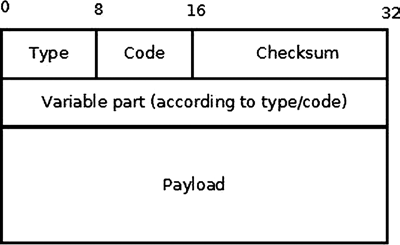
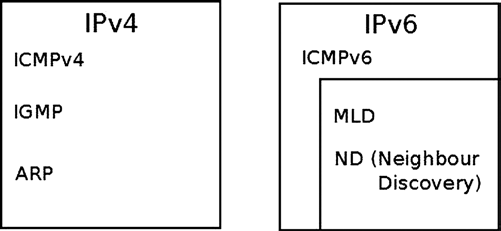
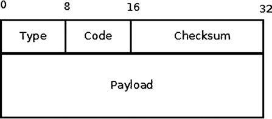
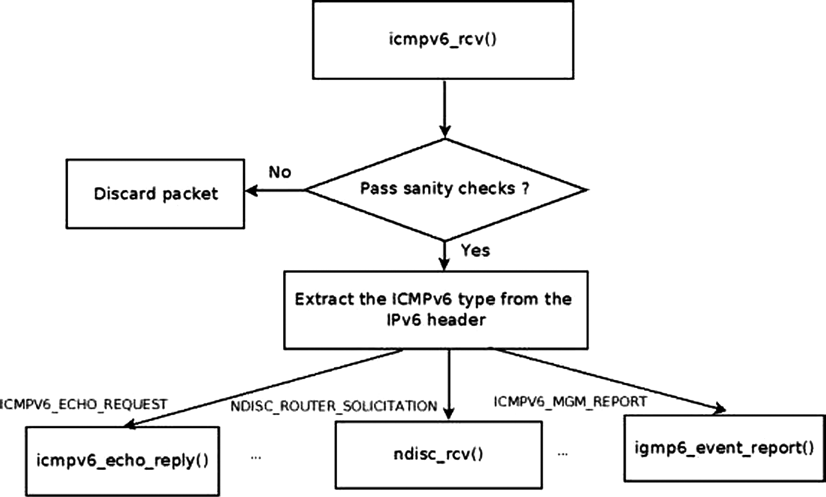

# Chương 3. Internet Control Message Protocol (ICMP)

Chương 2 thảo luận về cách triển khai netlink socket và cách sử dụng chúng làm kênh giao tiếp giữa kernel và userspace. Chương này trình bày ICMP protocol, một Layer 4 protocol. Userspace application có thể sử dụng ICMP protocol để gửi và nhận ICMP packet thông qua sockets API (ví dụ best-known có lẽ là tiện ích `ping`). Chương này thảo luận cách xử lý các ICMP packet đó trong kernel và đưa ra một số ví dụ.

ICMP protocol chủ yếu được sử dụng như một cơ chế bắt buộc để gửi error message và control message về network layer (L3). Protocol này cho phép nhận phản hồi về các vấn đề trong môi trường giao tiếp bằng cách gửi ICMP message. Các message này cung cấp khả năng error handling và diagnostics. ICMP protocol tương đối đơn giản nhưng rất quan trọng để bảo đảm hệ thống hoạt động đúng. Định nghĩa cơ bản của ICMPv4 nằm trong RFC 792, “Internet Control Message Protocol”. RFC này định nghĩa mục tiêu của ICMPv4 protocol và định dạng của các ICMPv4 message khác nhau. Trong chương này, tôi cũng đề cập RFC 1122 (“Requirements for Internet Hosts—Communication Layers”), quy định một số yêu cầu đối với các ICMP message; RFC 4443, định nghĩa ICMPv6 protocol; và RFC 1812, định nghĩa các yêu cầu đối với router. Tôi cũng mô tả các loại ICMPv4 và ICMPv6 message hiện có, cách gửi và xử lý chúng. Tôi trình bày ICMP socket, bao gồm lý do chúng được bổ sung và cách sử dụng. Hãy nhớ rằng ICMP protocol cũng được sử dụng trong nhiều cuộc tấn công bảo mật; ví dụ, Smurf Attack là một denial-of-service attack trong đó số lượng lớn ICMP packet có source IP giả mạo của nạn nhân được gửi dưới dạng broadcast đến một mạng máy tính bằng IP broadcast address.

## ICMPv4

ICMPv4 message có thể được chia thành hai loại: error message và information message (được gọi là “query message” trong RFC 1812). ICMPv4 protocol được sử dụng trong các công cụ chẩn đoán như `ping` và `traceroute`. Tiện ích `ping` nổi tiếng thực tế là một userspace application thuộc package `iputils`, mở raw socket và gửi ICMP\_ECHO message, rồi chờ nhận ICMP\_REPLY message làm phản hồi. `Traceroute` là tiện ích tìm path giữa một host và một destination IP address cụ thể. Tiện ích `traceroute` hoạt động bằng cách đặt các giá trị khác nhau cho Time To Live (TTL), một field trong IP header biểu diễn hop count. Tiện ích `traceroute` tận dụng việc forwarding machine gửi trả ICMP\_TIME\_EXCEED message khi TTL của packet đạt 0. Tiện ích `traceroute` bắt đầu bằng cách gửi các message có TTL bằng 1; với mỗi ICMP\_DEST\_UNREACH có code ICMP\_TIME\_EXCEED nhận được làm phản hồi, nó tăng TTL thêm 1 rồi gửi lại đến cùng đích. Nó sử dụng các ICMP message “Time Exceeded” được trả về để tạo danh sách router mà packet đi qua, cho đến khi đến đích và đích trả về ICMP message “Echo Reply”. Traceroute mặc định sử dụng UDP protocol. ICMPv4 module là `net/ipv4/icmp.c`. Lưu ý rằng ICMPv4 không thể được build thành kernel module.

### Khởi tạo ICMPv4

Việc khởi tạo ICMPv4 được thực hiện trong method `inet_init()`, được gọi ở boot phase. Method `inet_init()` gọi method `icmp_init()`, method này lại gọi method `icmp_sk_init()` để tạo một kernel ICMP socket dùng gửi ICMP message và khởi tạo một số ICMP variable `procfs` về giá trị mặc định. (Bạn sẽ gặp một số variable `procfs` này ở phần sau của chương.)

Đăng ký ICMPv4 như IPv4 protocol khác trong `inet_init()`:

```
static const struct net_protocol icmp_protocol = {
    .handler        =  icmp_rcv,
    .err_handler    =  icmp_err,
    .no_policy      =  1,
    .netns_ok       =  1,
};
```

(`net/ipv4/af_inet.c`)

- `icmp_rcv`: Callback `handler`. Nghĩa là incoming packet có protocol field trong IP header bằng IPPROTO\_ICMP (0x1) sẽ gọi `icmp_rcv()`.

- `no_policy:` Flag này được đặt bằng 1, nghĩa là không cần kiểm tra IPsec policy; ví dụ, `xfrm4_policy_check()` không được gọi trong `ip_local_deliver_finish()` vì flag `no_policy` đã được thiết lập.

- `netns_ok:` Flag set 1, chỉ báo protocol nhận biết network namespace. Namespace được mô tả ở Phụ lục A, mục `net_device`. Method `inet_add_protocol()` thất bại với protocol có field `netns_ok` 0, lỗi `-EINVAL`.

```
static int __init inet_init(void) {
. . .
    if (inet_add_protocol(&icmp_protocol, IPPROTO_ICMP) < 0)
        pr_crit("%s: Cannot add ICMP protocol\n", __func__);
. . .

int __net_init icmp_sk_init(struct net *net)
{
    . . .
    for_each_possible_cpu(i) {
        struct sock *sk;

        err = inet_ctl_sock_create(&sk, PF_INET,
                       SOCK_RAW, IPPROTO_ICMP, net);
        if (err < 0)
            goto fail;

                net->ipv4.icmp_sk[i] = sk;
             . . .
                sock_set_flag(sk, SOCK_USE_WRITE_QUEUE);
        inet_sk(sk)->pmtudisc = IP_PMTUDISC_DONT;
    }
    . . .

}
```

Trong method `icmp_sk_init()`, một raw ICMPv4 socket được tạo cho mỗi CPU và được lưu trong một array. Có thể truy cập `sk` hiện tại bằng method `icmp_sk(struct net *net)`. Các socket này được sử dụng trong method `icmp_push_reply()`. Các entry `procfs` của ICMPv4 được khởi tạo trong method `icmp_sk_init()`; tôi đề cập đến chúng trong chương này và tổng hợp trong mục “Tham khảo nhanh” ở cuối chương. Mỗi ICMP packet bắt đầu bằng một ICMPv4 header. Trước khi thảo luận cách nhận và truyền ICMPv4 message, mục tiếp theo mô tả ICMPv4 header để bạn hiểu rõ hơn cách tạo các ICMPv4 message.

### ICMPv4 header

ICMPv4 header gồm type (8 bit), code (8 bit), checksum (16 bit) và một member có nội dung biến đổi dài 32 bit (nội dung thay đổi theo ICMPv4 type và code), như bạn thấy trong Hình 3-1. Theo sau ICMPv4 header là payload, cần chứa IPv4 header của packet gốc và một phần payload của packet đó. Theo RFC 1812, phần này cần chứa nhiều nhất có thể nội dung của datagram gốc mà không khiến độ dài ICMPv4 datagram vượt quá 576 byte. Kích thước này phù hợp với RFC 791, quy định rằng “Mọi host phải sẵn sàng chấp nhận datagram có độ dài lên đến 576 octet”.



Hình 3-1. ICMPv4 header

ICMPv4 header biểu diễn bằng `struct icmphdr`:

```
struct icmphdr {
  __u8        type;
  __u8        code;
  __sum16    checksum;
  union {
    struct {
        __be16    id;
        __be16    sequence;
    } echo;
    __be32    gateway;
    struct {
        __be16    __unused;
        __be16    mtu;
    } frag;
  } un;
};
```

(`include/uapi/linux/icmp.h`) Danh sách đầy đủ hiện tại ICMPv4 message type number và code được gán ở

`www.iana.org/assignments/icmp-parameters/icmp-parameters.xml`.

ICMPv4 module định nghĩa array object `icmp_control` tên `icmp_pointers`, index bằng ICMPv4 message type. Hãy xem định nghĩa structure `icmp_control` và array `icmp_pointers`:

```
struct icmp_control {
    void (*handler)(struct sk_buff *skb);
    short error;        /* This ICMP is classed as an error message */
};

static const struct icmp_control icmp_pointers[NR_ICMP_TYPES+1];
```

NR\_ICMP\_TYPES là ICMPv4 type cao nhất, bằng 18.

```
(include/uapi/linux/icmp.h)
```

Error field của object `icmp_control` trong array chỉ bằng 1 với error message type như “Destination Unreachable” (ICMP\_DEST\_UNREACH), và ngầm bằng 0 với information message như echo (ICMP\_ECHO). Một số handler gán cho nhiều type. Tiếp theo tôi thảo luận handler và type chúng quản lý.

`ping_rcv()` xử lý việc nhận ping reply (ICMP\_ECHOREPLY). Method `ping_rcv()` được triển khai trong ICMP sockets code, `net/ipv4/ping.c`. Trong các kernel trước phiên bản 3.0, để gửi ping, bạn phải tạo một raw socket trong userspace. Khi nhận được phản hồi cho ping (ICMP\_ECHOREPLY message), raw socket đã gửi ping sẽ xử lý phản hồi đó. Để hiểu cách triển khai, hãy xem `ip_local_deliver_finish()`, method xử lý incoming IPv4 packet và chuyển chúng đến những socket cần xử lý chúng:

```
static int ip_local_deliver_finish(struct sk_buff *skb)
{
    . . .
        int protocol = ip_hdr(skb)->protocol;
        const struct net_protocol *ipprot;
        int raw;

    resubmit:
        raw = raw_local_deliver(skb, protocol);
        ipprot = rcu_dereference(inet_protos[protocol]);
            if (ipprot != NULL) {
                    int ret;
                    . . .
                    ret = ipprot->handler(skb);
                    . . .
```

(`net/ipv4/ip_input.c`)

Khi method `ip_local_deliver_finish()` nhận một packet ICMP\_ECHOREPLY, trước tiên nó thử chuyển packet đến một raw socket đang lắng nghe để socket đó xử lý. Vì một raw socket được mở trong userspace xử lý ICMP\_ECHOREPLY message nên không cần thực hiện thêm thao tác nào với message đó. Do vậy, khi method `ip_local_deliver_finish()` nhận ICMP\_ECHOREPLY, method `raw_local_deliver()` được gọi trước để xử lý message bằng raw socket, sau đó `ipprot->handler(skb)` được gọi (đây là callback `icmp_rcv()` trong trường hợp ICMPv4 packet). Vì packet đã được raw socket xử lý nên không còn việc gì cần thực hiện. Packet vì thế bị loại bỏ mà không phản hồi bằng cách gọi method `icmp_discard()`, handler của các ICMP\_ECHOREPLY message.

Khi ICMP socket (“ping socket”) tích hợp vào Linux kernel 3.0, điều này thay đổi. Ping socket thảo luận trong mục “ICMP socket (“Ping socket”)” sau. Trong ngữ cảnh này cần

lưu ý với ICMP socket, bên gửi `ping` có thể không phải raw socket. Ví dụ tạo `socket (PF_INET, SOCK_DGRAM, PROT_ICMP)` rồi gửi packet `ping`. Không phải raw socket nên echo reply không được chuyển tới raw socket nào vì không có socket tương ứng lắng nghe. Để tránh, ICMPv4 module xử lý nhận ICMP\_ECHOREPLY bằng callback `ping_rcv()`. Module `ping` nằm ở IPv4 layer (`net/ipv4/ping.c`). Tuy nhiên phần lớn code trong `net/ipv4/ping.c` là dual-stack (IPv4 và IPv6). Do đó `ping_rcv()` cũng xử lý ICMPV6\_ECHO\_REPLY cho IPv6 (xem `icmpv6_rcv()` trong `net/ipv6/icmp.c)`. Tôi nói thêm ICMP socket sau.

`icmp_discard()` là một handler rỗng, được sử dụng cho các message type không tồn tại (các số message type không có khai báo tương ứng trong header file) và một số message không cần xử lý, chẳng hạn ICMP\_TIMESTAMPREPLY. Các message ICMP\_TIMESTAMP và ICMP\_TIMESTAMPREPLY được sử dụng để đồng bộ thời gian: bên gửi gửi `originate timestamp` trong một ICMP\_TIMESTAMP request; bên nhận gửi ICMP\_TIMESTAMPREPLY với ba timestamp, gồm originating timestamp do bên gửi timestamp request cung cấp, receive timestamp và transmit timestamp. Có các protocol đồng bộ thời gian được sử dụng phổ biến hơn ICMPv4 timestamp message, chẳng hạn Network Time Protocol (NTP). Tôi cũng cần đề cập Address Mask request (ICMP\_ADDRESS), thường được host gửi đến router để lấy subnet mask phù hợp. Bên nhận cần phản hồi message này bằng address mask reply message. Các message ICMP\_ADDRESS và ICMP\_ADDRESSREPLY trước đây được xử lý bởi method `icmp_address()` và method `icmp_address_reply()`, nhưng hiện cũng được xử lý bởi `icmp_discard()`. Lý do là có những cách khác để lấy subnet mask, chẳng hạn DHCP.

`icmp_unreach()` xử lý type ICMP\_DEST\_UNREACH, ICMP\_TIME\_EXCEED, ICMP\_PARAMETERPROB và ICMP\_QUENCH.

Message `ICMP_DEST_UNREACH` có thể gửi dưới nhiều điều kiện. Một số mô tả trong mục “Gửi ICMPv4 message: Destination Unreachable” trong chương.

Message `ICMP_TIME_EXCEEDED` gửi trong hai trường hợp: trong `ip_forward()`, mỗi packet giảm TTL. Theo RFC 1700, TTL khuyến nghị cho IPv4

protocol là 64. Nếu TTL đạt 0, điều đó cho biết packet cần bị loại bỏ vì có thể đã xảy ra vòng lặp. Vì vậy, nếu TTL đạt 0 trong `ip_forward()`, method `icmp_send()` được gọi:

```
icmp_send(skb, ICMP_TIME_EXCEEDED, ICMP_EXC_TTL, 0);
```

(`net/ipv4/ip_forward.c`)

Khi đó gửi ICMP\_TIME\_EXCEEDED code ICMP\_EXC\_TTL, giải phóng SKB, tăng SNMP counter `InHdrErrors` (IPSTATS\_MIB\_INHDRERRORS), method return NET\_RX\_DROP.

Trong `ip_expire()`, khi fragment timeout:

```
icmp_send(head, ICMP_TIME_EXCEEDED, ICMP_EXC_FRAGTIME, 0);
```

(`net/ipv4/ip_fragment.c`)

Message ICMP\_PARAMETERPROB gửi khi parse IPv4 header option thất bại trong `ip_options_compile()` hoặc `ip_options_rcv_srr()` (`net/ipv4/ip_options.c`). Option là field tùy chọn độ dài biến đổi tới 40 byte trong IPv4 header. IP option thảo luận Chương 4.

Message type ICMP\_QUENCH thực tế đã bị deprecated. Theo mục 4.3.3.3 (Source Quench) của RFC 1812, “Router không nên tạo ICMP Source Quench message” và “Router có thể bỏ qua bất kỳ ICMP Source Quench message nào mà nó nhận được”. ICMP\_QUENCH message được thiết kế để giảm congestion, nhưng hóa ra đây là một giải pháp không hiệu quả.

`icmp_redirect()` xử lý ICMP\_REDIRECT; theo RFC 1122 mục 3.2.2.2, host không nên gửi ICMP redirect; chỉ gateway gửi. `icmp_redirect()` xử lý ICMP\_REDIRECT. Trước đây `icmp_redirect()` gọi `ip_rt_redirect()`, nhưng lời gọi `ip_rt_redirect()`

không còn cần thiết vì các protocol handler hiện đều chuyển redirect đúng cách trở lại routing code. Thực tế, method `ip_rt_redirect()` đã bị loại bỏ trong kernel 3.6. Vì vậy, method `icmp_redirect()` trước tiên thực hiện các sanity check rồi gọi `icmp_socket_deliver()`, method chuyển packet đến các raw socket và gọi protocol error handler nếu handler đó tồn tại. Chương 6 thảo luận sâu hơn về ICMP\_REDIRECT message.

`icmp_echo()` xử lý echo (“ping”) request (ICMP\_ECHO) bằng gửi reply (ICMP\_ECHOREPLY) với `icmp_reply()`. Nếu `net->ipv4.sysctl_icmp_echo_ignore_all` set thì không reply. Cấu hình ICMPv4 `procfs` xem “Tham khảo nhanh” cuối chương và `Documentation/networking/ip-sysctl.txt`.

`icmp_timestamp()` xử lý ICMP Timestamp request (ICMP\_TIMESTAMP) bằng gửi ICMP\_TIMESTAMPREPLY với `icmp_reply()`.

Trước khi nói gửi ICMP message bằng `icmp_reply()` và `icmp_send()`, cần mô tả structure `icmp_bxm` (“ICMP build xmit message”) dùng trong cả hai:

```
struct icmp_bxm {
    struct sk_buff *skb;
    int offset;
    int data_len;

    struct {
        struct icmphdr icmph;
        __be32           times[3];
    } data;
    int head_len;
    struct ip_options_data replyopts;
};
```

- `skb`: Với method `icmp_reply()`, `skb` này là request packet; object `icmp_param` (instance của `icmp_bxm`) được tạo từ packet đó (trong method `icmp_echo()` và method `icmp_timestamp()`). Với method `icmp_send()`, `skb` này là packet đã kích hoạt việc gửi ICMPv4 message do một số điều kiện; bạn sẽ thấy một số ví dụ về các message như vậy trong mục này.

- `offset`: Chênh lệch (offset) giữa `skb_network_header(skb)` và `skb->data`.

- `data_len`: ICMPv4 packet payload size.

- `icmph`: ICMP v4 header.

- `times[3]`: Array ba timestamp, điền trong `icmp_timestamp()`.

- `head_len:` ICMPv4 header size (với `icmp_timestamp()`, thêm 12 byte timestamp).

- `replyopts:` Data object `ip_options`. IP option là field tùy chọn sau IP header, tối đa 40 byte. Cho phép feature nâng cao như strict routing/loose routing, record routing, time stamping, v.v. Khởi tạo bằng `ip_options_echo()`. Chương 4 thảo luận IP option.

### Nhận ICMPv4 message

Method `ip_local_deliver_finish()` xử lý các packet dành cho máy cục bộ. Khi nhận một ICMP packet, method chuyển packet đến các raw socket đã đăng ký ICMPv4 protocol. Trong method `icmp_rcv()`, trước tiên SNMP counter `InMsgs` (ICMP\_MIB\_INMSGS) được tăng lên. Sau đó,

tính đúng đắn của checksum được kiểm tra. Nếu checksum không đúng, hai SNMP counter `InCsumErrors` và `InErrors` được tăng lên (tương ứng là ICMP\_MIB\_CSUMERRORS và ICMP\_MIB\_INERRORS), SKB được giải phóng và method trả về 0. Method `icmp_rcv()` không trả về lỗi trong trường hợp này. Thực tế, method `icmp_rcv()` luôn trả về 0. Lý do trả về 0 khi có lỗi checksum là khi nhận một ICMP message lỗi, không cần làm gì đặc biệt ngoài việc loại bỏ message đó; khi một protocol handler trả về giá trị lỗi âm, hệ thống sẽ thử xử lý packet một lần nữa, điều không cần thiết trong trường hợp này. Để biết thêm chi tiết, hãy tham khảo cách triển khai method `ip_local_deliver_finish()`. Sau đó, ICMP header được xem xét để xác định type; message type counter `procfs` tương ứng được tăng lên (mỗi ICMP message type có một counter `procfs`), và một sanity check được thực hiện để xác minh type không lớn hơn giá trị tối đa cho phép (NR\_ICMP\_TYPES). Theo mục 3.2.2 của RFC 1122, nếu nhận được một ICMP message có type không xác định thì phải loại bỏ nó mà không phản hồi. Vì vậy, nếu message type nằm ngoài phạm vi, SNMP counter `InErrors` (ICMP\_MIB\_INERRORS) được tăng lên và SKB được giải phóng.

Nếu packet là broadcast hoặc multicast và là ICMP\_ECHO message hoặc ICMP\_TIMESTAMP message, việc kiểm tra xem broadcast/multicast echo request có được cho phép hay không được thực hiện bằng cách đọc variable `net->ipv4.sysctl_icmp_echo_ignore_broadcasts`. Variable này có thể được cấu hình qua `procfs` bằng cách ghi vào `/proc/sys/net/ipv4/icmp_echo_ignore_broadcasts`; giá trị mặc định là 1. Nếu variable được thiết lập, packet bị loại bỏ mà không phản hồi. Việc này tuân theo mục 3.2.2.6 của RFC 1122: “ICMP Echo Request gửi đến IP broadcast address hoặc IP multicast address có thể bị loại bỏ mà không phản hồi”. Mục 3.2.2.8 của RFC này cũng quy định: “ICMP Timestamp Request message gửi đến IP broadcast address hoặc IP multicast address có thể bị loại bỏ mà không phản hồi”. Sau đó, việc kiểm tra được thực hiện để xác định type có được phép dùng cho broadcast/multicast hay không (ICMP\_ECHO, ICMP\_TIMESTAMP, ICMP\_ADDRESS và ICMP\_ADDRESSREPLY). Nếu không thuộc một trong các message type này, packet bị loại bỏ và giá trị 0 được trả về. Tiếp theo, entry tương ứng với type được lấy từ array `icmp_pointers` và handler phù hợp được gọi. Hãy xem entry ICMP\_ECHO trong dispatch table `icmp_control`:

```
static const struct icmp_control icmp_pointers[NR_ICMP_TYPES + 1] = {
...
  [ICMP_ECHO] = {
        .handler = icmp_echo,
    },
...
}
```

Vì vậy, khi nhận một ping (message type là “Echo Request”, ICMP\_ECHO), nó được xử lý bởi method `icmp_echo()`. Method `icmp_echo()` đổi type trong ICMP header thành ICMP\_ECHOREPLY và gửi phản hồi bằng cách gọi method `icmp_reply()`. Ngoài `ping`, ICMP message duy nhất khác yêu cầu phản hồi là timestamp message (ICMP\_TIMESTAMP); message này được xử lý bởi method `icmp_timestamp()`, tương tự trường hợp ICMP\_ECHO, đổi type thành ICMP\_TIMESTAMPREPLY và gửi phản hồi bằng cách gọi method `icmp_reply()`. Việc gửi được thực hiện bằng `ip_append_data()` và `ip_push_pending_frames()`. Việc nhận ping reply (ICMP\_ECHOREPLY) được xử lý bởi method `ping_rcv()``.`

Có thể disable reply ping bằng:

```
echo 1 >  /proc/sys/net/ipv4/icmp_echo_ignore_all
```

Một số callback xử lý nhiều hơn một ICMP type. Ví dụ, callback `icmp_discard()` xử lý các ICMPv4 packet có type không được cách triển khai ICMPv4 của Linux hỗ trợ, cũng như các message như ICMP\_TIMESTAMPREPLY, ICMP\_INFO\_REQUEST, ICMP\_ADDRESSREPLY và các message khác.

### Gửi ICMPv4 message: “Destination Unreachable”

Có hai method để gửi ICMPv4 message. Method thứ nhất là `icmp_reply()`, được dùng để gửi phản hồi cho hai loại ICMP request là ICMP\_ECHO và ICMP\_TIMESTAMP. Method thứ hai là `icmp_send()`, trong đó máy cục bộ chủ động gửi ICMPv4 message trong những điều kiện nhất định (được mô tả trong mục này). Cuối cùng, cả hai method đều gọi `icmp_push_reply()` để thực sự gửi packet. Method `icmp_reply()` được gọi từ method `icmp_echo()` để phản hồi ICMP\_ECHO message, và từ method `icmp_timestamp()` để phản hồi ICMP\_TIMESTAMP message. Method `icmp_send()` được gọi từ nhiều vị trí trong IPv4 network stack, chẳng hạn netfilter, forwarding code (`ip_forward.c`), các tunnel như `ipip`, `ip_gre` và những vị trí khác.

Mục này xem một số trường hợp gửi “Destination Unreachable” (type ICMP\_DEST\_UNREACH).

### Code 2: ICMP\_PROT\_UNREACH (Protocol Unreachable)

Khi protocol trong IP header (là một field 8-bit) là một protocol không tồn tại, một message ICMP\_DEST\_UNREACH/ICMP\_PROT\_UNREACH được gửi trả cho bên gửi vì không có protocol handler cho protocol đó (protocol handler array được đánh index bằng protocol number, nên protocol không tồn tại sẽ không có handler). “Protocol không tồn tại” ở đây có nghĩa là do một lỗi nào đó, protocol number trong IPv4 header thực sự không xuất hiện trong danh sách protocol number (bạn có thể tìm danh sách dành cho IPv4 trong `include/uapi/linux/in.h`), hoặc kernel được build mà không hỗ trợ protocol đó; do đó, protocol không được đăng ký và không có entry trong protocol handler array. Vì packet như vậy không thể được xử lý, cần gửi trả cho bên gửi một ICMPv4 message “Destination Unreachable”; code ICMP\_PROT\_UNREACH trong ICMPv4 reply cho biết nguyên nhân lỗi là “protocol is unreachable”. Xem đoạn code sau:

```
static int ip_local_deliver_finish(struct sk_buff *skb)
  {
    ...
    int protocol = ip_hdr(skb)->protocol;
    const struct net_protocol *ipprot;
    int raw;

resubmit:
    raw = raw_local_deliver(skb, protocol);

    ipprot = rcu_dereference(inet_protos[protocol]);
    if (ipprot != NULL) {
        ...
    } else {
    if (!raw) {
    if (xfrm4_policy_check(NULL, XFRM_POLICY_IN, skb)) {
            IP_INC_STATS_BH(net, IPSTATS_MIB_INUNKNOWNPROTOS);
            icmp_send(skb, ICMP_DEST_UNREACH,ICMP_PROT_UNREACH, 0);
              }
        ...
  }
```

(`net/ipv4/ip_input.c`)

Ví dụ này lookup array `inet_protos` theo protocol; không tìm thấy entry nghĩa là protocol chưa đăng ký trong kernel.

### Code 3: ICMP\_PORT\_UNREACH (“Port Unreachable”)

Khi nhận UDPv4 packet, hệ thống tìm một UDP socket phù hợp. Nếu không tìm thấy socket phù hợp, tính đúng đắn của checksum được kiểm tra. Nếu checksum sai, packet bị loại bỏ mà không phản hồi. Nếu checksum đúng, các số liệu thống kê được cập nhật và một ICMP message “Destination Unreachable”/“Port Unreachable” được gửi trả lại:

```
int __udp4_lib_rcv(struct sk_buff *skb, struct udp_table *udptable, int proto)
{
        struct sock *sk;
        ...
        sk = __udp4_lib_lookup_skb(skb, uh->source, uh->dest, udptable)
        ...
        if (sk != NULL) {
        ...
        }

        /* No socket. Drop packet silently, if checksum is wrong */
    if (udp_lib_checksum_complete(skb))
        goto csum_error;

        UDP_INC_STATS_BH(net, UDP_MIB_NOPORTS, proto == IPPROTO_UDPLITE);
        icmp_send(skb, ICMP_DEST_UNREACH, ICMP_PORT_UNREACH, 0);
        ...
        }
...

}
```

(`net/ipv4/udp.c`)

Việc tra cứu được thực hiện bằng method `__udp4_lib_lookup_skb()`. Nếu không có socket, các số liệu thống kê được cập nhật và một message ICMP\_DEST\_UNREACH với code ICMP\_PORT\_UNREACH được gửi trả lại.

### Code 4: ICMP\_FRAG\_NEEDED

Khi forward một packet có độ dài lớn hơn MTU của outgoing link, nếu bit don’t fragment (DF) trong IPv4 header (IP\_DF) được thiết lập, packet sẽ bị loại bỏ và một message ICMP\_DEST\_UNREACH với code ICMP\_FRAG\_NEEDED được gửi trả cho bên gửi:

```
    int ip_forward(struct sk_buff *skb)
    {
            ...
            struct rtable *rt;      /* Route we use */
            ...
            if (unlikely(skb->len > dst_mtu(&rt->dst) && !skb_is_gso(skb) &&
                         (ip_hdr(skb)->frag_off & htons(IP_DF))) && !skb->local_df) {
                    IP_INC_STATS(dev_net(rt->dst.dev), IPSTATS_MIB_FRAGFAILS);
                icmp_send(skb, ICMP_DEST_UNREACH, ICMP_FRAG_NEEDED,
                          htonl(dst_mtu(&rt->dst)));
                goto drop;
        }
        ...
}
```

(`net/ipv4/ip_forward.c`)

### Code 5: ICMP\_SR\_FAILED

Khi forward packet có strict routing option và gatewaying set, gửi “Destination Unreachable” code ICMP\_SR\_FAILED về và drop packet:

```
int ip_forward(struct sk_buff *skb)
 {
         struct ip_options *opt  = &(IPCB(skb)->opt);
         ...
         if (opt->is_strictroute && rt->rt_uses_gateway)
                 goto sr_failed;
         ...
sr_failed:
          icmp_send(skb, ICMP_DEST_UNREACH, ICMP_SR_FAILED, 0);
          goto drop;
}
```

(`net/ipv4/ip_forward.c`)

Để xem danh sách đầy đủ các code “Destination Unreachable” của IPv4, hãy xem Bảng 3-1 trong mục “Tham khảo nhanh” ở cuối chương này. Lưu ý rằng người dùng có thể cấu hình các rule với target REJECT của `iptables` và qualifier `--reject-with` để gửi “Destination Unreachable” message theo lựa chọn; xem thêm trong mục “Tham khảo nhanh” ở cuối chương.

Cả method `icmp_reply()` và `icmp_send()` đều hỗ trợ rate limiting. Chúng gọi `icmpv4_xrlim_allow()` và gửi packet nếu việc kiểm tra rate limiting cho phép gửi packet (tức là `icmpv4_xrlim_allow()` trả về `true`). Cần lưu ý rằng rate limiting không được thực hiện tự động đối với mọi loại traffic. Sau đây là các điều kiện mà trong đó việc kiểm tra rate limiting sẽ không được thực hiện:

- Không biết message type.

- Packet thuộc PMTU discovery.

- Device là loopback device.

- ICMP type không enable trong rate mask.

Nếu không điều kiện nào trong số các điều kiện trên được đáp ứng, rate limiting được thực hiện bằng cách gọi method `inet_peer_xrlim_allow()`. Bạn sẽ tìm thấy thêm thông tin về rate mask trong mục “Tham khảo nhanh” ở cuối chương này.

Hãy xem bên trong method `icmp_send()`. Trước hết prototype:

```
void icmp_send(struct sk_buff *skb_in, int type, int code, __be32 info)
```

skb`_in` là SKB đã khiến method `icmp_send()` được gọi; `type` và `code` lần lượt là `type` và `code` của ICMPv4 message. Parameter cuối cùng, `info`, được sử dụng trong các trường hợp sau:

- Type ICMP\_PARAMETERPROB: offset trong IPv4 header nơi parse lỗi.

- Type ICMP\_DEST\_UNREACH code ICMP\_FRAG\_NEEDED: MTU.

- Type ICMP\_REDIRECT code ICMP\_REDIR\_HOST: IP address của destination address trong IPv4 header của provoking SKB.

Khi xem xét kỹ hơn method `icmp_send()`, trước tiên ta thấy một số sanity check được thực hiện. Sau đó, các multicast/broadcast packet bị từ chối. Việc kiểm tra packet có phải là fragment hay không được thực hiện bằng cách xem xét field `frag_off` của IPv4 header. Nếu packet bị phân mảnh, ICMPv4 message được gửi, nhưng chỉ dành cho fragment đầu tiên. Theo mục 4.3.2.7 của RFC 1812, không được gửi ICMP error message do nhận được một ICMP error message. Vì vậy, trước tiên cần kiểm tra xem ICMPv4 message sắp gửi có phải là error message hay không. Nếu đúng, tiếp tục kiểm tra xem SKB gây ra việc gửi message có chứa ICMPv4 error message hay không; nếu có, method trả về mà không gửi ICMPv4 message. Nếu type là một ICMPv4 type không xác định (lớn hơn NR\_ICMP\_TYPES), method cũng trả về mà không gửi ICMPv4 message, mặc dù RFC không quy định điều này một cách tường minh. Tiếp theo, source address được xác định theo giá trị của `net->ipv4.sysctl_icmp_errors_use_inbound_ifaddr` (xem thêm chi tiết trong mục “Tham khảo nhanh” ở cuối chương này). Sau đó, method `ip_options_echo()` được gọi để sao chép các IP option trong IPv4 header của SKB gây ra việc gửi message. Một object `icmp_bxm` `(icmp_param)` được cấp phát và khởi tạo, đồng thời việc tra cứu trong routing subsystem được thực hiện bằng method `icmp_route_lookup()`. Sau đó, method `icmp_push_reply()` được gọi.

Hãy xem `icmp_push_reply()`, thực sự gửi packet. Trước hết `icmp_push_reply()` tìm socket gửi bằng:

```
sk = icmp_sk(dev_net((*rt)->dst.dev));
```

Method `dev_net()` trả về network namespace của outgoing network device. (Method `dev_net()` và network namespace được thảo luận trong Chương 14 và Phụ lục A.) Sau đó, method `icmp_sk()` lấy socket, vì trong SMP có một socket cho mỗi CPU. Tiếp theo, method `ip_append_data()` được gọi để chuyển packet đến IP layer. Nếu method `ip_append_data()` thất bại, các số liệu thống kê được cập nhật bằng cách tăng counter ICMP\_MIB\_OUTERRORS, và method `ip_flush_pending_frames()` được gọi để giải phóng SKB. Tôi thảo luận về method `ip_append_data()` và method `ip_flush_pending_frames()` trong Chương 4.

Giờ đã biết ICMPv4, tới lúc chuyển ICMPv6.

## ICMPv6

ICMPv6 có nhiều điểm tương đồng với ICMPv4 trong việc báo lỗi ở network layer (L3). ICMPv6 còn có những tác vụ bổ sung không được thực hiện trong ICMPv4. Mục này thảo luận về ICMPv6 protocol, các tính năng mới của nó (không được triển khai trong ICMPv4) và các tính năng tương đồng. ICMPv6 được định nghĩa trong RFC 4443. Nếu tìm hiểu kỹ code ICMPv6, sớm hay muộn bạn có thể gặp các comment nhắc đến RFC 1885. Thực tế, RFC 1885, “Internet Control Message Protocol (ICMPv6) for the Internet Protocol Version 6 (IPv6)”, là RFC nền tảng của ICMPv6. RFC này được thay thế bởi RFC 2463, rồi RFC 2463 lại được thay thế bởi RFC 4443. Cách triển khai ICMPv6 dựa trên IPv4 nhưng phức tạp hơn; các thay đổi và phần bổ sung được thảo luận trong mục này.

ICMPv6 protocol có next header value bằng 58 theo mục 1 của RFC 4443 (Chương 8 thảo luận về IPv6 next header). ICMPv6 là một phần không thể tách rời của IPv6 và phải được triển khai đầy đủ bởi mọi IPv6 node. Ngoài error handling và diagnostics, ICMPv6 được sử dụng cho Neighbour Discovery (ND) protocol trong IPv6, thay thế và mở rộng các chức năng của ARP trong IPv4; đồng thời, nó được dùng cho Multicast Listener Discovery (MLD) protocol, tương ứng với IGMP protocol trong IPv4, như trong Hình 3-2.



Hình 3-2. ICMP trong IPv4 và IPv6. MLD tương ứng IGMP, ND tương ứng ARP trong IPv6

Mục này trình bày cách triển khai ICMPv6. Như bạn sẽ thấy, nó có nhiều điểm chung với cách triển khai ICMPv4 trong việc xử lý và gửi message. Thậm chí có những trường hợp ICMPv4 và ICMPv6 gọi cùng các method (ví dụ, `ping_rcv()` và `inet_peer_xrlim_allow()`). Tuy nhiên, vẫn có một số khác biệt và những nội dung riêng của ICMPv6. Các tiện ích `ping6` và `traceroute6` dựa trên ICMPv6, tương ứng với các tiện ích `ping` và `traceroute` của IPv4 (được đề cập trong mục ICMPv4 ở đầu chương này). ICMPv6 được triển khai trong `net/ipv6/icmp.c` và `net/ipv6/ip6_icmp.c`. Giống ICMPv4, ICMPv6 không thể được build thành kernel module.

### Khởi tạo ICMPv6

Việc khởi tạo ICMPv6 được thực hiện bằng method `icmpv6_init()` và method `icmpv6_sk_init()`. Việc đăng ký ICMPv6 protocol được thực hiện bởi `icmpv6_init()` (`net/ipv6/icmp.c`):

```
static const struct inet6_protocol icmpv6_protocol = {
         .handler        =       icmpv6_rcv,
         .err_handler    =       icmpv6_err,
         .flags          =       INET6_PROTO_NOPOLICY|INET6_PROTO_FINAL,
 };
```

Callback `handler` là `icmpv6_rcv()`; incoming packet có protocol field bằng IPPROTO\_ICMPV6 (58) sẽ gọi `icmpv6_rcv()`.

Flag INET6\_PROTO\_NOPOLICY set nghĩa là không IPsec policy check; ví dụ không gọi `xfrm6_policy_check()` trong `ip6_input_finish()` vì flag INET6\_PROTO\_NOPOLICY set:

```
int __init icmpv6_init(void)
 {
         int err;
         ...
         if (inet6_add_protocol(&icmpv6_protocol, IPPROTO_ICMPV6) < 0)
                 goto fail;
         return 0;
 }

    static int __net_init icmpv6_sk_init(struct net *net)
    {
        struct sock *sk;
            ...
        for_each_possible_cpu(i) {
            err = inet_ctl_sock_create(&sk, PF_INET6,
                           SOCK_RAW, IPPROTO_ICMPV6, net);
            ...
            net->ipv6.icmp_sk[i] = sk;
            ...

    }
```

Như ICMPv4, tạo raw ICMPv6 socket mỗi CPU và giữ trong array. Current `sk` truy cập bằng `icmpv6_sk()`.

### ICMPv6 header

ICMPv6 header gồm `type` (8 bit), `code` (8 bit), `checksum` (16 bit), như Hình 3-3.



Hình 3-3. ICMPv6 header

ICMPv6 header biểu diễn bằng `struct icmp6hdr`:

```
struct icmp6hdr {
    __u8        icmp6_type;
    __u8        icmp6_code;
    __sum16    icmp6_cksum;
    ...
}
```

Không có đủ chỗ để hiển thị tất cả field của `struct icmp6hdr` vì structure này quá lớn (được định nghĩa trong `include/uapi/linux/icmpv6.h`). Khi bit high-order của type field bằng 0 (giá trị từ 0 đến 127), đó là error message; khi bit high-order bằng 1 (giá trị từ 128 đến 255), đó là information message. Bảng 3-1 trình bày các ICMPv6 message type theo số và kernel symbol tương ứng.

Bảng 3-1. ICMPv6 message

| Type | Kernel symbol | Error/Info | Mô tả |
|---|---|---|---|
| 1 | ICMPV6\_DEST\_UNREACH | Error | Không tới được destination |
| 2 | ICMPV6\_PKT\_TOOBIG | Error | Packet quá lớn |
| 3 | ICMPV6\_TIME\_EXCEED | Error | Vượt thời gian |
| 4 | ICMPV6\_PARAMPROB | Error | Lỗi parameter |
| 128 | ICMPV6\_ECHO\_REQUEST | Info | Echo Request |
| 129 | ICMPV6\_ECHO\_REPLY | Info | Echo Reply |
| 130 | ICMPV6\_MGM\_QUERY | Info | Truy vấn quản lý multicast group membership |
| 131 | ICMPV6\_MGM\_REPORT | Info | Báo cáo quản lý multicast group membership |
| 132 | ICMPV6\_MGM\_REDUCTION | Info | Giảm multicast group membership |
| 133 | NDISC\_ROUTER\_SOLICITATION | Info | Router solicitation |
| 134 | NDISC\_ROUTER\_ADVERTISEMENT | Info | Router advertisement |
| 135 | NDISC\_NEIGHBOUR\_SOLICITATION | Info | Neighbour solicitation |
| 136 | NDISC\_NEIGHBOUR\_ADVERTISEMENT | Info | Neighbour advertisement |
| 137 | NDISC\_REDIRECT | Info | Neighbour redirect |

Danh sách đầy đủ hiện tại ICMPv6 type và code được gán ở `www.iana.org/assignments/icmpv6-parameters/icmpv6-parameters.xml`.

ICMPv6 thực hiện một số tác vụ không được ICMPv4 thực hiện. Ví dụ, Neighbour Discovery được thực hiện bởi ICMPv6, còn trong IPv4, tác vụ này do các protocol ARP/RARP thực hiện. Multicast group membership được ICMPv6 xử lý cùng với MLD (Multicast Listener Discovery) protocol, còn trong IPv4, việc này được thực hiện bởi IGMP (Internet Group Management Protocol). Một số ICMPv6 message có ý nghĩa tương tự ICMPv4 message; ví dụ, ICMPv6 có các message “Destination Unreachable” (ICMPV6\_DEST\_UNREACH), “Time Exceeded” (ICMPV6\_TIME\_EXCEED), “Parameter Problem” (ICMPV6\_PARAMPROB), “Echo Request” (ICMPV6\_ECHO\_REQUEST) và các message khác. Mặt khác, một số ICMPv6 message chỉ có trong IPv6, chẳng hạn NDISC\_NEIGHBOUR\_SOLICITATION message.

### Nhận ICMPv6 message

Khi nhận ICMPv6 packet, chuyển tới `icmpv6_rcv()`, chỉ nhận SKB làm parameter. Hình 3-4 cho `Rx` path của message nhận.



Hình 3-4. Receive path của ICMPv6 message

Trong method `icmpv6_rcv()`, sau một số sanity check, SNMP counter `InMsgs` (ICMP6\_MIB\_INMSGS) được tăng lên. Tiếp theo, tính đúng đắn của checksum được kiểm tra. Nếu checksum không đúng, SNMP counter `InErrors` (ICMP6\_MIB\_INERRORS) được tăng lên và SKB được giải phóng. Method `icmpv6_rcv()` không trả về lỗi trong trường hợp này (thực tế, nó luôn trả về 0, giống như method tương ứng của IPv4 là `icmp_rcv()`). Sau đó, ICMPv6 header được đọc để xác định type; message type counter `procfs` tương ứng được tăng bằng macro ICMP6MSGIN\_INC\_STATS\_BH (mỗi ICMPv6 message type có một counter `procfs`). Ví dụ, khi nhận ICMPv6 ECHO request (“ping”), counter `/proc/net/snmp6/Icmp6InEchos` được tăng lên; khi nhận ICMPv6 Neighbour Solicitation request, counter `/proc/net/snmp6/Icmp6InNeighborSolicits` được tăng lên.

ICMPv6 không có dispatch table như `icmp_pointers` IPv4. Handler gọi theo message type trong command `switch(type)` dài:

- “Echo Request” (ICMPV6\_ECHO\_REQUEST) do `icmpv6_echo_reply()` xử lý.

- “Echo Reply” (ICMPV6\_ECHO\_REPLY) do `ping_rcv()` xử lý. `ping_rcv()` trong module IPv4 `ping` (`net/ipv4/ping.c`); đây là method dual-stack (xử lý cả IPv4/IPv6, đã nói đầu chương).

- Packet too big (ICMPV6\_PKT\_TOOBIG).

- Trước tiên, việc kiểm tra được thực hiện để xác minh rằng vùng data block (được trỏ đến bởi `skb->data`) chứa một khối dữ liệu có kích thước ít nhất bằng một ICMP header. Việc này được thực hiện bằng method `pskb_may_pull()`. Nếu điều kiện này không được đáp ứng, packet sẽ bị loại bỏ.

- Rồi gọi `icmpv6_notify()`, cuối cùng gọi `raw6_icmp_error()` để raw socket đăng ký xử lý ICMP message.

- “Destination Unreachable”, “Time Exceeded”, “Parameter Problem” (ICMPV6\_DEST\_UNREACH, ICMPV6\_TIME\_EXCEED, ICMPV6\_PARAMPROB tương ứng) cũng do `icmpv6_notify()` xử lý.

- Neighbour Discovery (ND) message:

- NDISC\_ROUTER\_SOLICITATION: Thường gửi tới multicast address `all-routers` FF02::2, được trả bằng router advertisement. (IPv6 multicast address đặc biệt ở Chương 8).

- NDISC\_ROUTER\_ADVERTISEMENT: Các message được router gửi định kỳ hoặc gửi ngay để phản hồi router solicitation request. Router advertisement chứa các prefix dùng cho on-link determination và/hoặc cấu hình địa chỉ, một giá trị hop limit được đề xuất, v.v.

- NDISC\_NEIGHBOUR\_SOLICITATION: Tương ứng ARP request IPv4.

- NDISC\_NEIGHBOUR\_ADVERTISEMENT: Tương ứng ARP reply IPv4.

- NDISC\_REDIRECT: Router báo host first hop tốt hơn cho destination.

- Mọi ND message do neighbour discovery method `ndisc_rcv()` (`net/ipv6/ndisc.c`) xử lý. `ndisc_rcv()` thảo luận Chương 7.

- ICMPV6\_MGM\_QUERY (Multicast Listener Report) do `igmp6_event_query()` xử lý.

- ICMPV6\_MGM\_REPORT (Multicast Listener Report) do `igmp6_event_report()` xử lý. Lưu ý cả ICMPV6\_MGM\_QUERY và ICMPV6\_MGM\_REPORT nói sâu Chương 8.

- Message type không biết và message sau đều do `icmpv6_notify()` xử lý:

- ICMPV6\_MGM\_REDUCTION: Khi host leave multicast group, gửi MLDv2 ICMPV6\_MGM\_REDUCTION; xem `igmp6_leave_group()` trong `net/ipv6/mcast.c`.

- ICMPV6\_MLD2\_REPORT: MLDv2 Multicast Listener Report packet; thường gửi destination address all MLDv2-capable routers Multicast Group Address (FF02::16).

- ICMPV6\_NI\_QUERY- ICMP: Node Information Query.

- ICMPV6\_NI\_REPLY: ICMP Node Information Response.

- ICMPV6\_DHAAD\_REQUEST: ICMP Home Agent Address Discovery Request Message; xem mục 6.5 RFC 6275, “Mobility Support in IPv6”.

- ICMPV6\_DHAAD\_REPLY: ICMP Home Agent Address Discovery Reply Message; xem mục 6.6 RFC 6275.

- ICMPV6\_MOBILE\_PREFIX\_SOL: ICMP Mobile Prefix Solicitation Message Format; xem mục 6.7 RFC 6275.

- ICMPV6\_MOBILE\_PREFIX\_ADV: ICMP Mobile Prefix Advertisement Message Format; xem mục 6.8 RFC 6275.

Lưu ý command `switch(type)` kết thúc như sau:

```
    default:
        LIMIT_NETDEBUG(KERN_DEBUG "icmpv6: msg of unknown type\n");

        /* informational */
        if (type & ICMPV6_INFOMSG_MASK)
            break;

        /*
         * error of unknown type.
         * must pass to upper level
         */

        icmpv6_notify(skb, type, hdr->icmp6_code, hdr->icmp6_mtu);
    }
```

Các information message thỏa mãn điều kiện `(type & ICMPV6_INFOMSG_MASK)` nên bị loại bỏ, còn các message khác không thỏa mãn điều kiện này (và do đó phải là error message) được chuyển lên upper layer. Việc này tuân theo mục 2.4, “Message Processing Rules”, của RFC 4443.

### Gửi ICMPv6 message

Method chính để gửi ICMPv6 message là `icmpv6_send()`. Method này được gọi khi máy cục bộ chủ động gửi một ICMPv6 message trong các điều kiện được mô tả ở mục này. Ngoài ra còn có method `icmpv6_echo_reply()`, chỉ được gọi để phản hồi một ICMPV6\_ECHO\_REQUEST (“ping”) message. Method `icmp6_send()` được gọi từ nhiều vị trí trong IPv6 network stack. Mục này xem xét một số ví dụ.

### Ví dụ: gửi ICMPv6 message “Hop Limit Time Exceeded”

Khi forward packet, mỗi máy giảm Hop Limit Counter đi 1. Hop Limit Counter là member của IPv6 header, tương ứng Time To Live trong IPv4. Khi value Hop Limit Counter header về 0, gửi message ICMPV6\_TIME\_EXCEED với code ICMPV6\_EXC\_HOPLIMIT bằng method `icmpv6_send()`, rồi cập nhật statistics và drop packet:

```
int ip6_forward(struct sk_buff *skb)
{
    ...
        if (hdr->hop_limit <= 1) {
                 /* Force OUTPUT device used as source address */
                 skb->dev = dst->dev;
                 icmpv6_send(skb, ICMPV6_TIME_EXCEED, ICMPV6_EXC_HOPLIMIT, 0);
                 IP6_INC_STATS_BH(net,
                                  ip6_dst_idev(dst), IPSTATS_MIB_INHDRERRORS);

                 kfree_skb(skb);
                 return -ETIMEDOUT;
         }
    ...
}
```

(`net/ipv6/ip6_output.c`)

### Ví dụ: gửi ICMPv6 message “Fragment Reassembly Time Exceeded”

Khi fragment timeout, ICMPV6\_TIME\_EXCEED code ICMPV6\_EXC\_FRAGTIME gửi về bằng `icmpv6_send()`:

```
void ip6_expire_frag_queue(struct net *net, struct frag_queue *fq,
                            struct inet_frags *frags)
 {
        . . .
        icmpv6_send(fq->q.fragments, ICMPV6_TIME_EXCEED, ICMPV6_EXC_FRAGTIME, 0);
        . . .
 }
```

(`net/ipv6/reassembly.c`)

### Ví dụ: gửi ICMPv6 message “Destination Unreachable”/“Port Unreachable”

Khi nhận UDPv6 packet, hệ thống tìm một UDPv6 socket phù hợp. Nếu không tìm thấy socket phù hợp, tính đúng đắn của checksum được kiểm tra. Nếu checksum sai, packet bị loại bỏ mà không phản hồi. Nếu checksum đúng, số liệu thống kê được cập nhật (MIB counter UDP\_MIB\_NOPORTS, được export tới `procfs` qua `/proc/net/snmp6/Udp6NoPorts`), và một ICMPv6 message “Destination Unreachable”/“Port Unreachable” được gửi trả lại bằng `icmpv6_send()`:

```
int __udp6_lib_rcv(struct sk_buff *skb, struct udp_table *udptable, int proto)
{
        ...
       sk = __udp6_lib_lookup_skb(skb, uh->source, uh->dest, udptable);
        if (sk != NULL) {
        ...
        }
        ...
        if (udp_lib_checksum_complete(skb))
                goto discard;

        UDP6_INC_STATS_BH(net, UDP_MIB_NOPORTS, proto == IPPROTO_UDPLITE);
        icmpv6_send(skb, ICMPV6_DEST_UNREACH, ICMPV6_PORT_UNREACH, 0);
        ...

}
```

Trường hợp rất giống ví dụ UDPv4 trước trong chương.

### Ví dụ: gửi ICMPv6 message “Fragmentation Needed”

Khi forward một packet, nếu kích thước của nó lớn hơn MTU của outgoing link và bit `local_df` trong SKB chưa được thiết lập, packet sẽ bị loại bỏ và một message ICMPV6\_PKT\_TOOBIG được gửi trả cho bên gửi. Thông tin trong message này được sử dụng trong quá trình Path MTU (PMTU) discovery.

Lưu ý rằng, khác với trường hợp tương ứng trong IPv4, nơi một message ICMP\_DEST\_UNREACH với code ICMP\_FRAG\_NEEDED được gửi đi, ở đây message được gửi trả là ICMPV6\_PKT\_TOOBIG, thay vì “Destination Unreachable” (ICMPV6\_DEST\_UNREACH). Message ICMPV6\_PKT\_TOOBIG có message type number riêng trong ICMPv6:

```
int ip6_forward(struct sk_buff *skb)
{
...
         if ((!skb->local_df && skb->len > mtu && !skb_is_gso(skb)) ||
             (IP6CB(skb)->frag_max_size && IP6CB(skb)->frag_max_size > mtu)) {
                 /* Again, force OUTPUT device used as source address */
                 skb->dev = dst->dev;
                 icmpv6_send(skb, ICMPV6_PKT_TOOBIG, 0, mtu);
                 IP6_INC_STATS_BH(net,
                                  ip6_dst_idev(dst), IPSTATS_MIB_INTOOBIGERRORS);
                 IP6_INC_STATS_BH(net,
                                  ip6_dst_idev(dst), IPSTATS_MIB_FRAGFAILS);
                 kfree_skb(skb);
                 return -EMSGSIZE;
         }
...
}
```

(`net/ipv6/ip6_output.c`)

### Ví dụ: gửi ICMPv6 message “Parameter Problem”

Khi gặp lỗi parse extension header, gửi ICMPV6\_PARAMPROB code ICMPV6\_UNK\_OPTION về:

```
static bool ip6_tlvopt_unknown(struct sk_buff *skb, int optoff) {
        switch ((skb_network_header(skb)[optoff] & 0xC0) >> 6) {
        ...
        case 2: /* send ICMP PARM PROB regardless and drop packet */
                 icmpv6_param_prob(skb, ICMPV6_UNK_OPTION, optoff);
                 return false;
         }
```

(`net/ipv6/exthdrs.c`)

Method `icmpv6_send()` hỗ trợ rate limiting bằng cách gọi `icmpv6_xrlim_allow()`. Cần lưu ý rằng, giống như trong ICMPv4, rate limiting trong ICMPv6 không được thực hiện tự động đối với mọi loại traffic. Sau đây là các điều kiện mà trong đó việc kiểm tra rate limiting sẽ không được thực hiện:

- Informational message

- PMTU discovery

- Loopback device

Nếu không điều kiện nào trong số các điều kiện trên được đáp ứng, rate limiting được thực hiện bằng cách gọi method `inet_peer_xrlim_allow()`, được dùng chung cho ICMPv4 và ICMPv6. Lưu ý rằng, khác với IPv4, bạn không thể thiết lập rate mask trong IPv6. Đặc tả ICMPv6, RFC 4443, không cấm điều này, nhưng tính năng đó chưa từng được triển khai. Hãy xem bên trong method `icmp6_send()`. Trước tiên, đây là prototype của method:

```
static void icmp6_send(struct sk_buff *skb, u8 type, u8 code, __u32 info)
```

Các parameter tương tự những parameter của method `icmp_send()` trong IPv4, vì vậy tôi không lặp lại phần giải thích ở đây. Khi xem xét kỹ hơn code `icmp6_send()`, bạn sẽ thấy một số sanity check. Việc kiểm tra message gây ra phản hồi có phải là ICMPv6 error message hay không được thực hiện bằng method `is_ineligible()`; nếu đúng, method `icmp6_send()` kết thúc. Độ dài message không được vượt quá 1280, là MTU tối thiểu của IPv6 (IPV6\_MIN\_MTU, được định nghĩa trong `include/linux/ipv6.h`). Việc này tuân theo mục 2.4(c) của RFC 4443, quy định mỗi ICMPv6 error message phải chứa nhiều nhất có thể phần nội dung của IPv6 packet gây lỗi (offending hoặc invoking packet), nhưng không được khiến error message packet vượt quá MTU tối thiểu của IPv6. Sau đó, message được chuyển đến IPv6 layer bằng method `ip6_append_data()` và method `icmpv6_push_pending_frame()` để giải phóng SKB.

Bây giờ tôi chuyển sang method `icmpv6_echo_reply()`; xin nhắc lại rằng method này được gọi để phản hồi ICMPV6\_ECHO message. Method `icmpv6_echo_reply()` chỉ nhận một parameter là SKB. Nó tạo một object `icmpv6_msg` và đặt type thành ICMPV6\_ECHO\_REPLY. Sau đó, nó chuyển message đến IPv6 layer bằng method `ip6_append_data()` và method `icmpv6_push_pending_frame()`. Nếu method `ip6_append_data()` thất bại, một SNMP counter (ICMP6\_MIB\_OUTERRORS) được tăng lên và `ip6_flush_pending_frames()` được gọi để giải phóng SKB.

Chương 7 và 8 cũng nói ICMPv6. Mục sau giới thiệu ICMP socket và mục đích.

## ICMP socket (“Ping socket”)

Socket type mới (IPPROTO\_ICMP) thêm bằng patch từ bản phân phối Openwall GNU/\*/Linux (Owl), cung cấp security enhancement so với bản khác. ICMP socket cho `setuid-less` “ping”. Với Openwall GNU/\*/Linux, đây là bước cuối tới bản phân phối `setuid-less`. Patch tạo ICMPv4 ping socket mới (không phải raw socket) bằng:

```
socket(PF_INET, SOCK_DGRAM, IPPROTO_ICMP);
```

thay vì:

```
socket(PF_INET, SOCK_RAW, IPPROTO_ICMP);
```

Cũng hỗ trợ socket IPPROTO\_ICMPV6 thêm sau, trong `net/ipv6/icmp.c`. Tạo ICMPv6 ping socket mới bằng:

```
socket(PF_INET6, SOCK_DGRAM, IPPROTO_ICMPV6);
```

thay vì:

```
socket(PF_INET6, SOCK_RAW, IPPROTO_ICMP6);
```

Chức năng tương tự (ICMP non-privileged) có trong Mac OS X; xem `www.manpagez.com/man/4/icmp/`. Phần lớn ICMP sockets code ở `net/ipv4/ping.c`; thực tế phần lớn code trong `net/ipv4/ping.c`

là dual-stack (IPv4 và IPv6). Trong `net/ipv6/ping.c` chỉ có một số ít phần IPv6-specific. Việc sử dụng ICMP socket bị vô hiệu hóa theo mặc định. Bạn có thể bật ICMP socket bằng cách thiết lập entry `procfs` sau: `/proc/sys/net/ipv4/ping_group_range`. Giá trị mặc định là “1 0”, nghĩa là không ai (kể cả root) có thể tạo ping socket. Vì vậy, nếu muốn cho phép một user có `uid` và `gid` bằng 1000 sử dụng ICMP socket, bạn nên chạy lệnh sau từ dòng lệnh với quyền root: `echo 1000 1000 > /proc/sys/net/ipv4/ping_group_range`, sau đó bạn có thể chạy `ping` từ user này

account này bằng ICMP socket. Nếu muốn đặt privilege cho user trong hệ thống, chạy `echo 0 2147483647 > /proc/sys/net/ipv4/ping_group_range`. (2147483647 là GID\_T\_MAX; xem `include/net/ping.h`.) Không có security setting riêng IPv4/IPv6; tất cả do `/` `proc/sys/net/ipv4/ping_group_range` điều khiển. ICMP socket chỉ hỗ trợ ICMP\_ECHO IPv4 hoặc ICMPV6\_ECHO\_REQUEST IPv6, code phải bằng 0 trong cả hai.

Helper `ping_supported()` kiểm tra parameter dựng ICMP message (IPv4/IPv6) hợp lệ không. Gọi từ `ping_sendmsg()`:

```
static inline int ping_supported(int family, int type, int code)
{
    return (family == AF_INET && type == ICMP_ECHO && code == 0) ||
           (family == AF_INET6 && type == ICMPV6_ECHO_REQUEST && code == 0);
}
```

(`net/ipv4/ping.c`)

ICMP socket export entry procfs: `/proc/net/icmp` cho IPv4, `/proc/net/icmp6` cho IPv6. Thêm thông tin xem `http://openwall.info/wiki/people/segoon/ping` và

`http://lwn.net/Articles/420799/`.

## Tóm tắt

Chương này đã trình bày cách triển khai ICMPv4 và ICMPv6. Bạn đã tìm hiểu định dạng ICMP header của cả hai protocol cũng như cách nhận và gửi message bằng hai protocol này. Các tính năng mới của ICMPv6 mà bạn sẽ gặp trong những chương tiếp theo cũng đã được thảo luận. Neighbouring Discovery protocol, sử dụng ICMPv6 message, được thảo luận trong Chương 7; MLD protocol, cũng sử dụng ICMPv6 message, được trình bày trong Chương 8. Chương tiếp theo, Chương 4, trình bày cách triển khai IPv4 network layer.

Trong mục “Tham khảo nhanh” tiếp theo, tôi trình bày các method chính liên quan đến những chủ đề đã thảo luận trong chương này, được sắp xếp theo ngữ cảnh sử dụng. Sau đó, tôi trình bày hai bảng đã được đề cập trong chương, một số entry `procfs` quan trọng có liên quan và một mục ngắn về cách sử dụng ICMP message trong các rule `iptables reject`.

## Tham khảo nhanh

Tôi kết thúc chương bằng list ngắn method quan trọng ICMPv4/ICMPv6, 6 bảng, mục entry `procfs` và mục ngắn dùng reject target trong `iptables`, `ip6tables` tạo ICMP “Destination Unreachable”.

### Method

Method sau được trình bày trong chương.

### int icmp\_rcv(struct sk\_buff \*skb);

Method là handler chính xử lý incoming ICMPv4 packet.

### extern void icmp\_send(struct sk\_buff \*skb\_in, int type, int code, \_\_be32 info);

Method gửi ICMPv4 message. Parameter gồm provoking SKB, message type, message code và `info` (phụ thuộc type).

### struct icmp6hdr \*icmp6\_hdr(const struct sk\_buff \*skb);

Method trả ICMPv6 header mà `skb` chỉ định chứa.

### void icmpv6\_send(struct sk\_buff \*skb, u8 type, u8 code, \_\_u32 info);

Method gửi ICMPv6 message. Parameter gồm provoking SKB, message type, message code và `info` (phụ thuộc type).

### void icmpv6\_param\_prob(struct sk\_buff \*skb, u8 code, int pos);

Method này là một phiên bản tiện dụng của method `icmp6_send()`. Nó chỉ gọi `icmp6_send()` với type là ICMPV6\_PARAMPROB và các parameter khác được chỉ định là `skb`, `code` và `pos`, sau đó giải phóng SKB.

### Bảng

Các bảng sau được trình bày trong chương.

Bảng 3-2. Code ICMPv4 “Destination Unreachable” (ICMP\_DEST\_UNREACH)

| Code | Kernel symbol | Mô tả |
|---|---|---|
| 0 | ICMP\_NET\_UNREACH | Không tới được network |
| 1 | ICMP\_HOST\_UNREACH | Không tới được host |
| 2 | ICMP\_PROT\_UNREACH | Không tới được protocol |
| 3 | ICMP\_PORT\_UNREACH | Không tới được port |
| 4 | ICMP\_FRAG\_NEEDED | Cần fragmentation nhưng DF flag được set. |
| 5 | ICMP\_SR\_FAILED | Source route thất bại |
| 6 | ICMP\_NET\_UNKNOWN | Không biết destination network |
| 7 | ICMP\_HOST\_UNKNOWN | Không biết destination host |
| 8 | ICMP\_HOST\_ISOLATED | Source host bị cô lập |
| 9 | ICMP\_NET\_ANO | Destination network bị cấm do quản trị. |
| 10 | ICMP\_HOST\_ANO | Destination host bị cấm do quản trị. |
| 11 | ICMP\_NET\_UNR\_TOS | Không tới được network cho Type Of Service. |
| 12 | ICMP\_HOST\_UNR\_TOS | Không tới được host cho Type Of Service. |
| 13 | ICMP\_PKT\_FILTERED | Packet bị lọc |
| 14 | ICMP\_PREC\_VIOLATION | Vi phạm precedence |
| 15 | ICMP\_PREC\_CUTOFF | Precedence bị cắt |
| 16 | NR\_ICMP\_UNREACH | Số unreachable code |

Bảng 3-3. Code ICMPv4 Redirect (ICMP\_REDIRECT)

| Code | Kernel symbol | Mô tả |
|---|---|---|
| 0 | ICMP\_REDIR\_NET | Redirect network |
| 1 | ICMP\_REDIR\_HOST | Redirect host |
| 2 | ICMP\_REDIR\_NETTOS | Redirect network cho TOS |
| 3 | ICMP\_REDIR\_HOSTTOS | Redirect host cho TOS |

Bảng 3-4. Code ICMPv4 Time Exceeded (ICMP\_TIME\_EXCEEDED)

| Code | Kernel symbol | Mô tả |
|---|---|---|
| 0 | ICMP\_EXC\_TTL | Vượt TTL count |
| 1 | ICMP\_EXC\_FRAGTIME | Vượt fragment reassembly time |

Bảng 3-5. Code ICMPv6 “Destination Unreachable” (ICMPV6\_DEST\_UNREACH)

| Code | Kernel symbol | Mô tả |
|---|---|---|
| 0 | ICMPV6\_NOROUTE | Không có route tới destination |
| 1 | ICMPV6\_ADM\_PROHIBITED | Giao tiếp với destination bị cấm do quản trị |
| 2 | ICMPV6\_NOT\_NEIGHBOUR | Ngoài scope của source address |
| 3 | ICMPV6\_ADDR\_UNREACH | Không tới được address |
| 4 | ICMPV6\_PORT\_UNREACH | Không tới được port |

Lưu ý ICMPV6\_PKT\_TOOBIG tương ứng IPv4 ICMP\_DEST\_UNREACH /ICMP\_FRAG\_NEEDED không phải code của ICMPV6\_DEST\_UNREACH mà tự là ICMPv6 type.

Bảng 3-6. Code ICMPv6 Time Exceeded (ICMPV6\_TIME\_EXCEED)

| Code | Kernel symbol | Mô tả |
|---|---|---|
| 0 | ICMPV6\_EXC\_HOPLIMIT | Vượt hop limit khi di chuyển |
| 1 | ICMPV6\_EXC\_FRAGTIME | Vượt fragment reassembly time |

Bảng 3-7. Code ICMPv6 Parameter Problem (ICMPV6\_PARAMPROB)

| Code | Kernel symbol | Mô tả |
|---|---|---|
| 0 | ICMPV6\_HDR\_FIELD | Gặp header field lỗi |
| 1 | ICMPV6\_UNK\_NEXTHDR | Gặp Next Header type không biết |
| 2 | ICMPV6\_UNK\_OPTION | Gặp IPv6 option không biết |

### Entry procfs

Kernel cung cấp cách cấu hình nhiều thiết lập của các subsystem từ userspace bằng cách ghi giá trị vào các entry bên dưới `/proc`. Các entry này được gọi là entry `procfs`. Tất cả entry `procfs` của ICMPv4 được biểu diễn bằng các variable trong structure `netns_ipv4` (`include/net/netns/ipv4.h`), là một object trong network namespace (`struct net`). Network namespace và cách triển khai chúng được thảo luận trong Chương 14. Sau đây là tên các variable `sysctl` tương ứng với những phần tử ICMPv4 trong `netns_ipv4`, phần giải thích cách sử dụng, giá trị mặc định được khởi tạo và method thực hiện việc khởi tạo.

### sysctl\_icmp\_echo\_ignore\_all

Khi `icmp_echo_ignore_all` set, không trả echo request (ICMP\_ECHO).

Entry `procfs`: `/proc/sys/net/ipv4/icmp_echo_ignore_all` Khởi tạo 0 trong `icmp_sk_init()`

### sysctl\_icmp\_echo\_ignore\_broadcasts

Khi nhận một broadcast hoặc multicast echo message (ICMP\_ECHO) hoặc timestamp message (ICMP\_TIMESTAMP), việc kiểm tra xem broadcast/multicast request có được cho phép hay không được thực hiện bằng cách đọc `sysctl_icmp_echo_ignore_broadcasts`. Nếu variable này được thiết lập, packet bị loại bỏ và giá trị 0 được trả về.

Entry `procfs`: `/proc/sys/net/ipv4/icmp_echo_ignore_broadcasts` Khởi tạo 1 trong `icmp_sk_init()`

### sysctl\_icmp\_ignore\_bogus\_error\_responses

Một số router vi phạm RFC1122 bằng bogus response cho broadcast frame. Trong `icmp_unreach()` kiểm tra flag. Nếu TRUE, kernel không log cảnh báo (“\<IPv4Addr\>sent an invalid ICMP type. . .”).

Entry `procfs`: `/proc/sys/net/ipv4/icmp_ignore_bogus_error_responses` Khởi tạo 1 trong `icmp_sk_init()`

### sysctl\_icmp\_ratelimit

Giới hạn tốc độ tối đa gửi ICMP packet có type khớp icmp ratemask (`icmp_ratemask`, xem sau) tới target cụ thể.

Value 0 disable giới hạn; nếu khác là khoảng cách tối thiểu giữa response bằng millisecond. Entry `procfs`: `/proc/sys/net/ipv4/icmp_ratelimit` Khởi tạo 1 \* HZ trong `icmp_sk_init()`

### sysctl\_icmp\_ratemask

Mask gồm ICMP type có rate limit. Mỗi bit là một ICMPv4 type.

Entry `procfs`: `/proc/sys/net/ipv4/icmp_ratemask` Khởi tạo 0x1818 trong `icmp_sk_init()`

### sysctl\_icmp\_errors\_use\_inbound\_ifaddr

Giá trị của variable này được kiểm tra trong `icmp_send()`. Khi variable chưa được thiết lập, các ICMP error message được gửi với primary address của interface sẽ gửi packet. Khi variable được thiết lập, ICMP message được gửi với primary address của interface đã nhận packet gây ra ICMP error.

Entry `procfs`: `/proc/sys/net/ipv4/icmp_errors_use_inbound_ifaddr` Khởi tạo 0 trong `icmp_sk_init()`

Lưu ý Xem thêm ICMP variable `sysctl`, type và default value trong

`Documentation/networking/ip-sysctl.txt`.

### Tạo “Destination Unreachable” message bằng iptables

Userspace tool `iptables` cho phép chúng ta thiết lập các rule quy định kernel cần làm gì với traffic theo các filter do những rule đó đặt ra. Việc xử lý các rule `iptables` được thực hiện trong netfilter subsystem và được thảo luận trong Chương 9. Một trong các rule của `iptables` là `reject`, loại bỏ packet mà không xử lý thêm. Khi thiết lập target `iptables reject`, người dùng có thể đặt rule gửi ICMPv4 message “Destination Unreachable” với các code khác nhau bằng các qualifier `-j REJECT` và `--reject-with`. Ví dụ, rule `iptables` sau sẽ loại bỏ mọi packet từ mọi source và gửi trả một ICMP message “ICMP Host Prohibited”:

```
iptables -A INPUT -j REJECT --reject-with icmp-host-prohibited
```

Đây là value cho qualifier `--reject-with` để đặt ICMPV4 message gửi trả sending host:

```
icmp-net-unreachable   - ICMP_NET_UNREACH
icmp-host-unreachable  - ICMP_HOST_UNREACH
icmp-port-unreachable  - ICMP_PORT_UNREACH
icmp-proto-unreachable - ICMP_PROT_UNREACH
icmp-net-prohibited    - ICMP_NET_ANO
icmp-host-prohibited   - ICMP_HOST_ANO
icmp-admin-prohibited  - ICMP_PKT_FILTERED
```

Cũng có thể dùng `--reject-with tcp-reset` để gửi TCP RST packet trả sending host.

(`net/ipv4/netfilter/ipt_REJECT.c`)

Với `ip6tables` IPv6 cũng có REJECT target. Ví dụ:

```
ip6tables -A INPUT -s 2001::/64 -p ICMPv6  -j REJECT --reject-with icmp6-adm-prohibited
```

Đây là value cho qualifier `--reject-with` để đặt ICMPv6 message gửi trả sending host:

```
no-route, icmp6-no-route              - ICMPV6_NOROUTE.
adm-prohibited, icmp6-adm-prohibited  - ICMPV6_ADM_PROHIBITED.
port-unreach, icmp6-port-unreachable  - ICMPV6_NOT_NEIGHBOUR.
addr-unreach, icmp6-addr-unreachable  - ICMPV6_ADDR_UNREACH.
```

(`net/ipv6/netfilter/ip6t_REJECT.c`)
