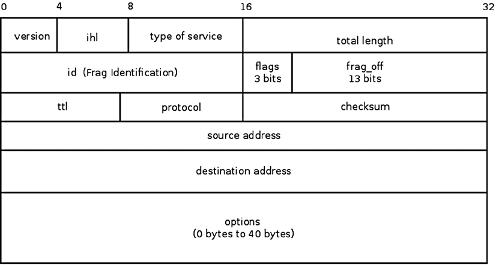
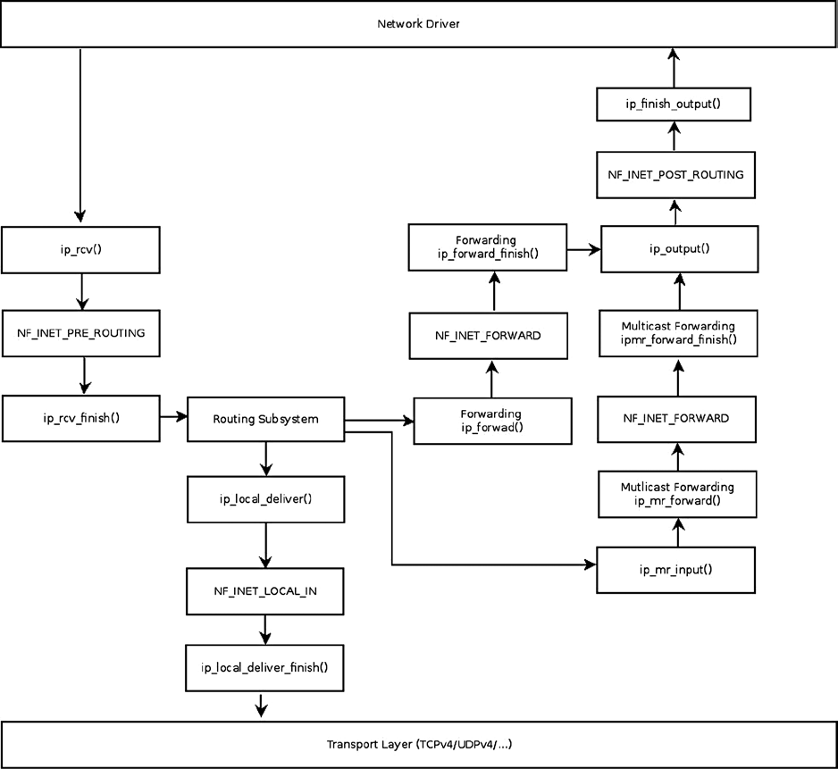
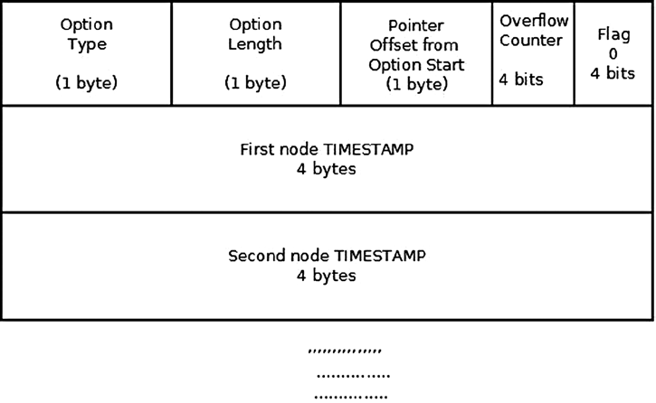
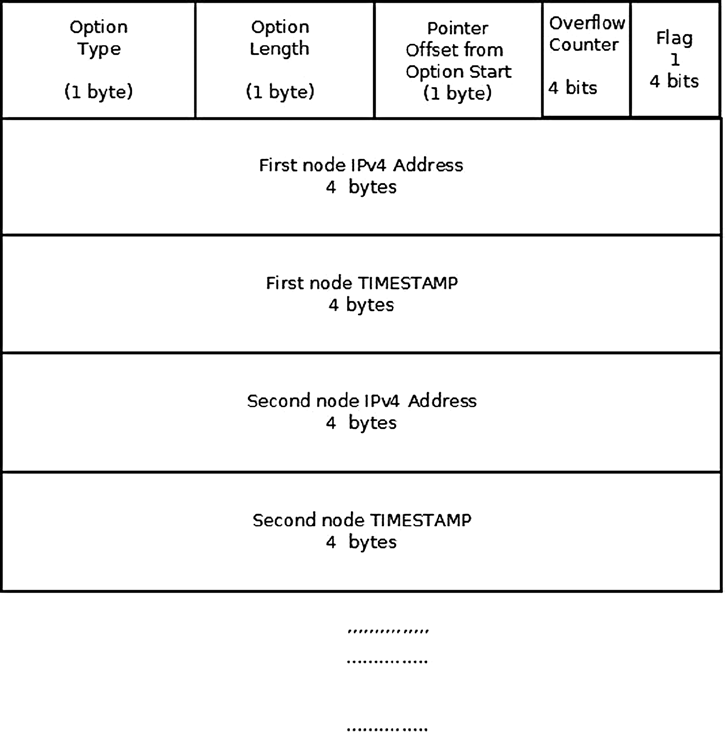
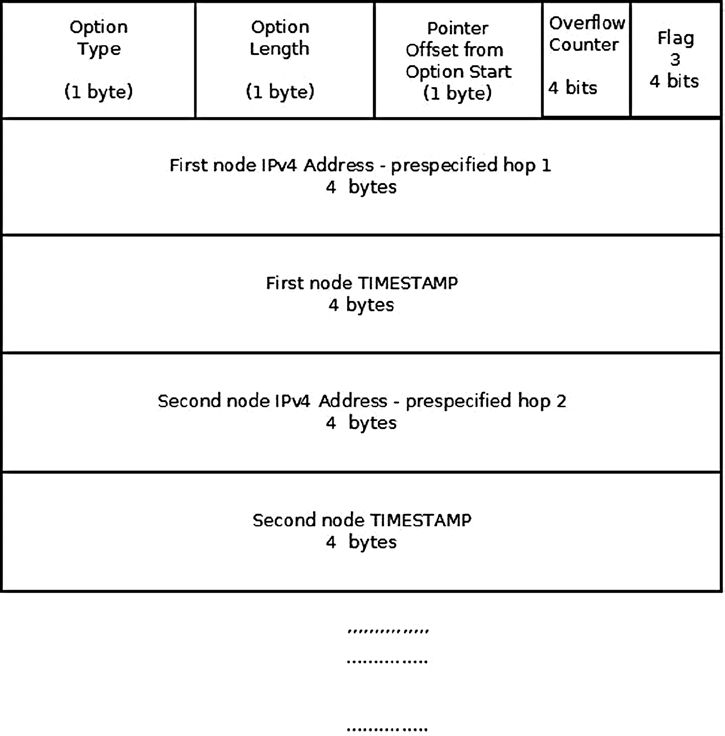
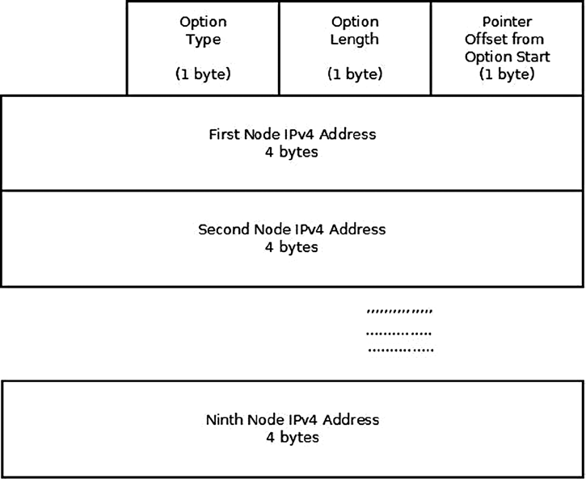
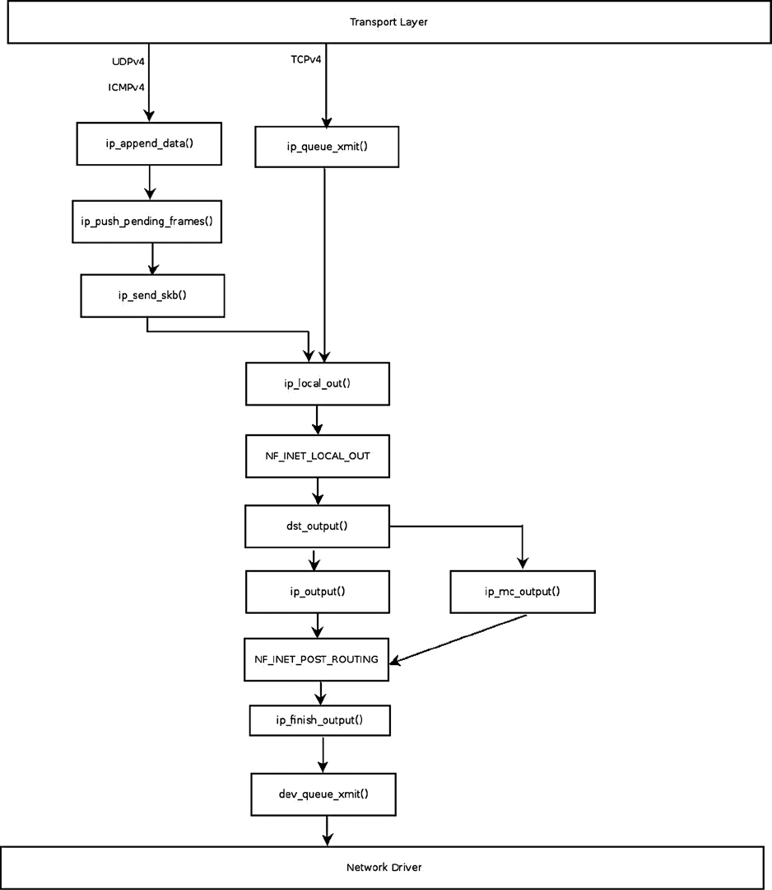

# Chương 4. IPv4

Chương 3 trình bày cách triển khai protocol ICMP trong IPv4 và IPv6. Chương này trình bày protocol IPv4, đồng thời cho thấy cách các message ICMP được dùng để báo lỗi Internet protocol trong những trường hợp nhất định. Protocol IPv4 (Internet Protocol version 4) là một trong những protocol cốt lõi của Internet standards-based hiện nay và định tuyến phần lớn lưu lượng trên Internet. Định nghĩa cơ bản nằm trong RFC 791, “Internet Protocol”, từ năm 1981. Protocol IPv4 cung cấp kết nối end-to-end giữa hai host bất kỳ. Một chức năng quan trọng khác của IP layer là forwarding packet (còn gọi là routing) và quản lý các bảng lưu thông tin routing. Chương 5 và 6 trình bày IPv4 routing. Chương này mô tả cách triển khai IPv4 trong Linux: nhận và gửi IPv4 packet, bao gồm multicast packet, IPv4 forwarding và xử lý IPv4 options. Có những trường hợp packet cần gửi lớn hơn MTU của outgoing interface; khi đó packet phải được phân mảnh thành các fragment nhỏ hơn. Khi nhận được các packet đã phân mảnh, chúng phải được ghép thành một packet lớn, giống hệt packet đã gửi trước khi phân mảnh. Đây cũng là những nhiệm vụ quan trọng của protocol IPv4 được trình bày trong chương này.

Mỗi IPv4 packet bắt đầu bằng một IP header dài ít nhất 20 byte. Nếu sử dụng IP options, IPv4 header có thể dài đến 60 byte. Sau IP header là transport header (chẳng hạn TCP header hoặc UDP header), rồi đến dữ liệu payload. Để hiểu protocol IPv4, trước tiên bạn phải biết IPv4 header được tạo như thế nào. Trong Hình 4-1, bạn có thể thấy IPv4 header gồm hai phần: phần đầu dài 20 byte (đến đầu trường options trong IPv4 header) là IPv4 header cơ bản, tiếp theo là phần IP options, có thể dài từ 0 đến 40 byte.



Hình 4-1. IPv4 header

## IPv4 Header

IPv4 header chứa thông tin xác định cách kernel network stack xử lý packet: protocol được sử dụng, địa chỉ nguồn và đích, checksum, identification (`id`) của packet cần cho fragmentation, `ttl` giúp tránh forwarding packet vô tận do lỗi nào đó, và nhiều thông tin khác. Thông tin này được lưu trong 13 member của IPv4 header (member thứ 14, IP Options, là phần mở rộng tùy chọn của IPv4 header). Các member của IPv4 và các IP options được mô tả tiếp theo. IPv4 header được biểu diễn bằng structure `iphdr`. Các member của nó, xuất hiện trong Hình 4-1, được mô tả trong phần tiếp theo. IP options và cách sử dụng chúng được mô tả trong phần “IP Options” ở phía sau chương này.

Hình 4-1 minh họa IPv4 header. Tất cả member luôn tồn tại—ngoại trừ member cuối cùng, IP options, là tùy chọn. Nội dung các member của IPv4 quyết định cách packet được xử lý trong IPv4 network stack: packet bị loại bỏ khi có vấn đề (chẳng hạn version, là member đầu tiên, không phải 4, hoặc checksum không đúng). Mỗi IPv4 packet bắt đầu bằng IPv4 header, theo sau là payload:

```
struct iphdr {
#if defined(__LITTLE_ENDIAN_BITFIELD)
    __u8    ihl:4,
            version:4;
#elif defined (__BIG_ENDIAN_BITFIELD)
    __u8    version:4,
            ihl:4;
#else
#error    "Please fix <asm/byteorder.h>"
#endif
    __u8          tos;
    __be16        tot_len;
    __be16        id;
    __be16        frag_off;
    __u8          ttl;
    __u8          protocol;
    __sum16       check;
    __be32        saddr;
    __be32        daddr;
    /*The options start here. */
};

(include/uapi/linux/ip.h)
```

Sau đây là mô tả các member của IPv4 header:

- `ihl`: Viết tắt của Internet Header Length. Độ dài của IPv4 header, tính theo bội số của 4 byte. Độ dài IPv4 header không cố định, khác với IPv6 header có độ dài cố định (40 byte). Lý do là IPv4 header có thể chứa các option tùy chọn với độ dài thay đổi. Kích thước tối thiểu của IPv4 header là 20 byte khi không có option, và kích thước tối đa là 60 byte. Giá trị `ihl` tương ứng là 5 cho kích thước IPv4 header tối thiểu và 15 cho kích thước tối đa. IPv4 header phải được căn chỉnh theo boundary 4-byte.

- `version`: Phải là 4.

- `tos`: Trường `tos` của IPv4 header ban đầu dành cho các dịch vụ Quality of Service (QoS); `tos` viết tắt của Type of Service. Qua nhiều năm, trường này mang ý nghĩa khác như sau: RFC 2474 định nghĩa Differentiated Services Field (DS Field) trong IPv4 và IPv6 header, là các bit 0–5 của `tos`. Nó còn có tên Differentiated Services Code Point (DSCP). RFC 3168 từ năm 2001 định nghĩa Explicit Congestion Notification (ECN) của IP header; đó là các bit 6 và 7 của trường `tos`.

- `tot_len`: Tổng độ dài, bao gồm header, tính bằng byte. Vì `tot_len` là trường 16-bit nên giá trị có thể lên đến 64KB. Theo RFC 791, kích thước tối thiểu là 576 byte.

- `id`: Identification của IPv4 header. Trường `id` quan trọng đối với fragmentation: khi phân mảnh một SKB, giá trị `id` của tất cả fragment thuộc SKB đó phải giống nhau. Việc reassembly các packet đã phân mảnh được thực hiện theo `id` của các fragment.

- `frag_off`: Fragment offset, một trường 16-bit. 13 bit thấp là offset của fragment. Trong fragment đầu tiên, offset bằng 0. Offset được tính theo đơn vị 8 byte. 3 bit cao là các flag:

- 001 là MF (More Fragments). Flag này được đặt cho mọi fragment, trừ fragment cuối cùng.

- 010 là DF (Don’t Fragment).

- 100 là CE (Congestion).

Xem khai báo các flag IP\_MF, IP\_DF và IP\_CE trong `include/net/ip.h`.

- `ttl`: Time To Live: đây là bộ đếm hop. Mỗi node forwarding giảm `ttl` đi 1. Khi nó đạt 0, packet bị loại bỏ và một message ICMPv4 time exceeded được gửi trả về; điều này tránh việc packet bị forwarding vô tận vì lý do nào đó.

- `protocol`: Protocol L4 của packet—chẳng hạn IPPROTO\_TCP cho lưu lượng TCP hoặc IPPROTO\_UDP cho lưu lượng UDP (xem danh sách tất cả protocol khả dụng trong `include/linux/in.h`).

- `check`: Checksum (trường 16-bit). Checksum chỉ được tính trên các byte của IPv4 header.

- `saddr`: Địa chỉ IPv4 nguồn, 32 bit.

- `daddr`: Địa chỉ IPv4 đích, 32 bit.

Trong phần này, bạn đã tìm hiểu các member của IPv4 header và mục đích của chúng. Việc khởi tạo protocol IPv4, thiết lập callback được gọi khi nhận IPv4 header, được trình bày trong phần tiếp theo.

## Khởi tạo IPv4

IPv4 packet là các packet có Ethernet type 0x0800 (Ethernet type được lưu trong hai byte đầu tiên của Ethernet header 14-byte). Mỗi protocol phải định nghĩa một protocol handler và được khởi tạo để network stack có thể xử lý các packet thuộc protocol đó. Để bạn hiểu điều gì khiến các IPv4 packet nhận được được xử lý bởi các method IPv4, phần này mô tả việc đăng ký IPv4 protocol handler:

```
static struct packet    _type ip_packet_type __read_mostly = {
    .type = cpu_to_be16(ETH_P_IP),
    .func = ip_rcv,
};

static int __init inet_init(void)
{
  ...
  dev_add_pack(&ip_packet_type);
  ...
}

(net/ipv4/af_inet.c)
```

Method `dev_add_pack()` thêm method `ip_rcv()` làm protocol handler cho IPv4 packet. Đây là các packet có Ethernet type 0x0800 (ETH\_P\_IP, được định nghĩa trong `include/uapi/linux/if_ether.h`). Method `inet_init()` thực hiện nhiều thao tác khởi tạo IPv4 và được gọi trong giai đoạn boot.

Chức năng chính của protocol IPv4 được chia thành Rx path (nhận) và Tx path (truyền). Sau khi tìm hiểu việc đăng ký IPv4 protocol handler, bạn đã biết protocol handler nào quản lý IPv4 packet (callback `ip_rcv`) và cách đăng ký protocol handler này. Giờ bạn đã sẵn sàng tìm hiểu IPv4 Rx path và cách xử lý IPv4 packet nhận được. Tx path được mô tả trong phần “Gửi IPv4 Packet” ở phía sau.

## Nhận IPv4 Packet

Method nhận IPv4 chính là `ip_rcv()`, handler cho mọi IPv4 packet (bao gồm multicast và broadcast). Thực tế, method này chủ yếu gồm các sanity check. Công việc thực sự được thực hiện trong method `ip_rcv_finish()` mà nó gọi. Giữa method `ip_rcv()` và method `ip_rcv_finish()` là netfilter hook NF\_INET\_PRE\_ROUTING, được gọi bằng macro NF\_HOOK (xem đoạn code phía sau trong phần này). Trong chương này, bạn sẽ gặp nhiều lời gọi macro NF\_HOOK—đó là các netfilter hook. Netfilter subsystem cho phép đăng ký callback tại năm điểm trên hành trình packet đi qua network stack. Tên của các điểm này sẽ được nêu ngay sau đây. Mục đích thêm netfilter hook là cho phép load các netfilter kernel module tại runtime. Macro NF\_HOOK gọi các callback của một điểm cụ thể nếu đã đăng ký callback tại đó. Bạn cũng có thể gặp macro NF\_HOOK mang tên NF\_HOOK\_COND, một biến thể của macro NF\_HOOK. Ở một số vị trí trong network stack, macro NF\_HOOK\_COND chứa một tham số Boolean (tham số cuối), phải là `true` thì hook mới được thực thi (Chương 9 trình bày netfilter hook). Lưu ý netfilter hook có thể loại bỏ packet; khi đó packet không tiếp tục path thông thường. Hình 4-2 minh họa receiving path (Rx) của packet được network driver nhận. Packet này có thể được chuyển đến máy cục bộ hoặc forwarding đến host khác. Việc lookup trong routing table quyết định lựa chọn nào sẽ diễn ra.



Hình 4-2. Nhận IPv4 packet. Để đơn giản, sơ đồ không bao gồm các method fragmentation/defragmentation/options/IPsec

Hình 4-2 minh họa các path của một IPv4 packet nhận được. Packet được IPv4 protocol handler, method `ip_rcv()`, nhận (xem góc trên bên trái hình). Trước hết phải thực hiện lookup trong routing subsystem, ngay sau khi gọi method `ip_rcv_finish()`. Kết quả routing lookup xác định packet được local delivery đến host cục bộ hay cần forwarding (routing lookup được giải thích trong Chương 5). Nếu packet dành cho host cục bộ, trước tiên nó đi đến method `ip_local_deliver()`, sau đó đến method `ip_local_deliver_finish()`. Khi cần forwarding, packet được xử lý bởi method `ip_forward()`. Một số netfilter hook xuất hiện trong hình, như NF\_INET\_PRE\_ROUTING và NF\_INET\_LOCAL\_IN. Lưu ý lưu lượng multicast được xử lý bởi method `ip_mr_input()`, được trình bày trong phần “Nhận IPv4 Multicast Packet” ở phía sau chương này. NF\_INET\_PRE\_ROUTING,

NF\_INET\_LOCAL\_IN, NF\_INET\_FORWARD và NF\_INET\_POST\_ROUTING là bốn trong năm entry point của netfilter hook. Điểm thứ năm, NF\_INET\_LOCAL\_OUT, được đề cập trong phần “Gửi IPv4 packet” ở phía sau chương này. Năm entry point này được định nghĩa trong `include/uapi/linux/netfilter.h`. Lưu ý cùng `enum` cho năm hook này cũng được sử dụng trong IPv6; chẳng hạn trong method `ipv6_rcv()`, một hook được đăng ký tại NF\_INET\_PRE\_ROUTING (`net/ipv6/ip6_input.c`). Hãy xem method `ip_rcv()`:

```
int ip_rcv(struct sk_buff *skb, struct net_device *dev, struct packet_type *pt, struct net_device
*orig_dev)
{
```

Trước tiên, một số sanity check được thực hiện; tôi đề cập một số trong phần này. Độ dài IPv4 header (`ihl`) được tính theo bội số của 4 byte. IPv4 header phải có kích thước ít nhất 20 byte, nghĩa là giá trị `ihl` phải ít nhất bằng 5. `version` phải là 4 (cho IPv4). Nếu một trong các điều kiện này không được đáp ứng, packet bị drop và thống kê (IPSTATS\_MIB\_INHDRERRORS) được cập nhật.

```
        if (iph->ihl < 5 || iph->version != 4)
                goto inhdr_error;
```

Theo phần 3.2.1.2 của RFC 1122, host phải kiểm tra IPv4 header checksum trên mọi datagram nhận được và âm thầm loại bỏ mọi datagram có checksum sai. Điều này được thực hiện bằng cách gọi method `ip_fast_csum()`, phải trả về 0 khi thành công. IPv4 header checksum chỉ được tính trên các byte của IPv4 header:

```
        if (unlikely(ip_fast_csum((u8 *)iph, iph->ihl)))
                goto inhdr_error;
```

Sau đó macro NF\_HOOK được gọi:

```
         return NF_HOOK(NFPROTO_IPV4, NF_INET_PRE_ROUTING, skb, dev, NULL,
                        ip_rcv_finish);
```

Khi method netfilter hook đã đăng ký trả về NF\_DROP, điều đó có nghĩa packet phải bị drop và hành trình của packet không tiếp tục. Khi netfilter hook đã đăng ký trả về NF\_STOLEN, điều đó có nghĩa packet đã được netfilter subsystem tiếp quản và hành trình của packet không tiếp tục. Khi netfilter hook đã đăng ký trả về NF\_ACCEPT, packet tiếp tục hành trình. Netfilter hook còn có các giá trị trả về khác (còn gọi là verdict), như NF\_QUEUE, NF\_REPEAT và NF\_STOP, không được trình bày trong chương này. (Như đã nói, netfilter hook được trình bày trong Chương 9.) Tạm giả sử không có netfilter callback nào được đăng ký tại entry point NF\_INET\_PRE\_ROUTING, nên macro NF\_HOOK không gọi netfilter callback nào và method `ip_rcv_finish()` được gọi. Hãy xem method `ip_rcv_finish()`:

```
static int ip_rcv_finish(struct sk_buff *skb)
{
       const struct iphdr *iph = ip_hdr(skb);
       struct rtable *rt;
```

Method `skb_dst()` kiểm tra có object `dst` gắn với SKB hay không; `dst` là một instance của `dst_entry` (`include/net/dst.h`) và biểu diễn kết quả lookup trong routing subsystem. Lookup được thực hiện theo routing table và các header của packet. Lookup trong routing subsystem cũng thiết lập các callback `input` và/hoặc `output` của `dst`. Chẳng hạn, nếu packet cần forwarding, lookup trong routing subsystem đặt callback `input` thành `ip_forward()`. Khi packet dành cho máy cục bộ, lookup trong routing subsystem đặt callback `input` thành `ip_local_deliver()`. Với multicast packet, nó có thể là `ip_mr_input()` trong một số điều kiện (tôi trình bày multicast packet trong phần tiếp theo). Nội dung object `dst` quyết định cách packet tiếp tục hành trình; chẳng hạn khi forwarding packet, quyết định callback `input` nào

sẽ được gọi khi gọi `dst_input()`, hoặc packet sẽ được truyền trên interface nào, được đưa ra theo `dst`.(Tôi trình bày routing subsystem chi tiết trong chương tiếp theo).

Nếu không có `dst` gắn với SKB, method `ip_route_input_noref()` thực hiện lookup trong routing subsystem. Nếu lookup thất bại, packet bị drop. Lưu ý xử lý multicast packet khác với xử lý unicast packet (được trình bày trong phần “Nhận IPv4 Multicast Packet” ở phía sau chương này).

```
       ...
       if (!skb_dst(skb)) {
```

Thực hiện lookup trong routing subsystem:

```
            int err = ip_route_input_noref(skb, iph->daddr, iph->saddr,
                                           iph->tos, skb->dev);
            if (unlikely(err)) {
                if (err == -EXDEV)
                    NET_INC_STATS_BH(dev_net(skb->dev),
                                     LINUX_MIB_IPRPFILTER);
                goto drop;
            }
       }
```

Lưu ý Lỗi `-EXDEV` (“Crossdevice link”) được method `__fib_validate_source()` trả về trong một số trường hợp khi Reverse Path Filter (RPF) được bật. Có thể bật RPF qua một entry trong `procfs`. Khi đó packet bị drop, thống kê (LINUX\_MIB\_IPRPFILTER) được cập nhật và method trả về NET\_RX\_DROP. Lưu ý bạn có thể hiển thị bộ đếm LINUX\_MIB\_IPRPFILTER bằng cách xem cột `IPReversePathFilter` trong output của `cat /proc/net/netstat`.

Bây giờ thực hiện kiểm tra xem IPv4 header có chứa options không. Vì độ dài IPv4 header (`ihl`) được tính theo bội số của 4 byte, nếu lớn hơn 5 thì nghĩa là nó chứa options, do đó phải gọi method `ip_rcv_options()` để xử lý các option này. Việc xử lý IP options được trình bày chi tiết trong phần “IP Options” ở phía sau chương này. Lưu ý method `ip_rcv_options()` có thể thất bại, như bạn sẽ thấy ngay sau đây. Nếu đó là multicast entry hoặc broadcast entry, thống kê IPSTATS\_MIB\_INMCAST hoặc IPSTATS\_MIB\_INBCAST tương ứng được cập nhật. Sau đó method `dst_input()` được gọi. Method này đơn giản gọi method callback `input` bằng cách gọi `skb_dst(skb)->input(skb)`:

```
    if (iph->ihl > 5 && ip_rcv_options(skb))
            goto drop;

    rt = skb_rtable(skb);
    if (rt->rt_type == RTN_MULTICAST) {
        IP_UPD_PO_STATS_BH(dev_net(rt->dst.dev), IPSTATS_MIB_INMCAST,
                skb->len);
    } else if (rt->rt_type == RTN_BROADCAST)
        IP_UPD_PO_STATS_BH(dev_net(rt->dst.dev), IPSTATS_MIB_INBCAST,
                skb->len);

    return dst_input(skb);
```

Trong phần này, bạn đã tìm hiểu các giai đoạn nhận IPv4 packet: các sanity check được thực hiện, lookup trong routing subsystem, method `ip_rcv_finish()` thực hiện công việc thực sự. Bạn cũng đã biết method nào được gọi khi packet cần forwarding và method nào được gọi khi packet dành cho local delivery. IPv4 multicasting là trường hợp đặc biệt. Việc xử lý nhận IPv4 multicast packet được trình bày trong phần tiếp theo.

## Nhận IPv4 Multicast Packet

Method `ip_rcv()` cũng là handler cho multicast packet. Như đã nói, sau một số sanity check, nó gọi method `ip_rcv_finish()`, thực hiện lookup trong routing subsystem bằng cách gọi `ip_route_input_noref()`. Trong method `ip_route_input_noref()`, trước tiên thực hiện kiểm tra xem máy cục bộ có thuộc multicast group của địa chỉ multicast đích hay không bằng cách gọi method `ip_check_mc_rcu()`. Nếu có, hoặc nếu máy cục bộ là multicast router (`CONFIG_IP_MROUTE` được bật`)`, method `ip_route_input_mc()` được gọi; hãy xem code:

```
int ip_route_input_noref(struct sk_buff *skb, __be32 daddr, __be32 saddr,
                         u8 tos, struct net_device *dev)
{
        int res;
        rcu_read_lock();
        . . .
        if (ipv4_is_multicast(daddr)) {
                struct in_device *in_dev = __in_dev_get_rcu(dev);
                if (in_dev) {
                        int our = ip_check_mc_rcu(in_dev, daddr, saddr,
                                                  ip_hdr(skb)->protocol);
                        if (our
#ifdef CONFIG_IP_MROUTE
                                ||
                            (!ipv4_is_local_multicast(daddr) &&
                             IN_DEV_MFORWARD(in_dev))
#endif
                           ) {
                                int res = ip_route_input_mc(skb, daddr, saddr,
                                                            tos, dev, our);
                                rcu_read_unlock();
                                return res;
                        }
                }
           . . .

        }
        . . .
```

Hãy xem kỹ hơn method `ip_route_input_mc()`. Nếu máy cục bộ thuộc multicast group của địa chỉ multicast đích (giá trị biến `our` là 1), callback `input` của `dst` được đặt thành `ip_local_deliver`. Nếu host cục bộ là multicast router và `IN_DEV_MFORWARD(in_dev)` được bật, callback `input` của `dst` được đặt thành `ip_mr_input`. Do đó method `ip_rcv_finish()`, gọi `dst_input(skb)`, sẽ gọi method `ip_local_deliver()` hoặc method `ip_mr_input()`, tùy callback `input` của `dst`. Macro IN\_DEV\_MFORWARD kiểm tra entry multicast forwarding trong `procfs`. Lưu ý entry multicast forwarding trong `procfs`,

`/proc/sys/net/ipv4/conf/all/mc_forwarding` , là entry read-only (khác với entry forwarding của IPv4 unicast trong `procfs`), nên bạn không thể đặt nó chỉ bằng cách chạy từ dòng lệnh: `echo 1 > /proc/sys/net/ipv4/conf/all/mc_forwarding`. Chẳng hạn, khởi động daemon `pimd` đặt nó thành 1, còn dừng daemon đặt nó thành 0. `pimd` là một multicast routing daemon PIM-SM v2 độc lập và gọn nhẹ. Nếu muốn tìm hiểu cách triển khai multicast routing daemon, bạn có thể xem source code của `pimd` tại `https://github.com/troglobit/pimd/`:

```
static int ip_route_input_mc(struct sk_buff *skb, __be32 daddr, __be32 saddr,
                                 u8 tos, struct net_device *dev, int our)
 {
         struct rtable *rth;
         struct in_device *in_dev = __in_dev_get_rcu(dev);

        . . .

         if (our) {
                 rth->dst.input= ip_local_deliver;
                 rth->rt_flags |= RTCF_LOCAL;
         }

 #ifdef CONFIG_IP_MROUTE
         if (!ipv4_is_local_multicast(daddr) && IN_DEV_MFORWARD(in_dev))
                 rth->dst.input = ip_mr_input;
 #endif
        . . .
```

Multicast layer giữ một data structure có tên Multicast Forwarding Cache (MFC). Tôi không trình bày chi tiết MFC hay method `ip_mr_input()` tại đây (tôi trình bày chúng trong Chương 6). Điều quan trọng trong ngữ cảnh này là nếu tìm thấy entry hợp lệ trong MFC, method `ip_mr_forward()` được gọi. Method `ip_mr_forward()` thực hiện một số kiểm tra rồi cuối cùng gọi method `ipmr_queue_xmit()`. Trong method `ipmr_queue_xmit()`, `ttl` được giảm và checksum được cập nhật bằng cách gọi method `ip_decrease_ttl()` (điều tương tự được thực hiện trong method `ip_forward()`, như bạn sẽ thấy ở phía sau chương này). Sau đó method `ipmr_forward_finish()` được gọi thông qua macro NF\_HOOK NF\_INET\_FORWARD (giả sử không có IPv4 netfilter hook nào đăng ký tại NF\_INET\_FORWARD):

```
static void ipmr_queue_xmit(struct net *net, struct mr_table *mrt,
                             struct sk_buff *skb, struct mfc_cache *c, int vifi)
{
       . . .

       ip_decrease_ttl(ip_hdr(skb));
       ...
       NF_HOOK(NFPROTO_IPV4, NF_INET_FORWARD, skb, skb->dev, dev,
                       ipmr_forward_finish);
       return;

}
```

Method `ipmr_forward_finish()` rất ngắn và được hiển thị toàn bộ ở đây. Nó chỉ cập nhật thống kê, gọi method `ip_forward_options()` nếu có options trong IPv4 header (IP options được mô tả trong phần tiếp theo), và gọi method `dst_output()`:

```
static inline int ipmr_forward_finish(struct sk_buff *skb)
{
        struct ip_options *opt = &(IPCB(skb)->opt);

        IP_INC_STATS_BH(dev_net(skb_dst(skb)->dev), IPSTATS_MIB_OUTFORWDATAGRAMS);
    IP_ADD_STATS_BH(dev_net(skb_dst(skb)->dev), IPSTATS_MIB_OUTOCTETS, skb->len);

        if (unlikely(opt->optlen))
                ip_forward_options(skb);

        return dst_output(skb);
}
```

Phần này trình bày cách xử lý nhận IPv4 multicast packet. `pimd` được đề cập như một ví dụ về multicast routing daemon tương tác với kernel trong multicast packet forwarding. Phần tiếp theo mô tả các IP options, cho phép sử dụng những tính năng đặc biệt của network stack, như theo dõi route của packet, theo dõi timestamp của packet, chỉ định các network node mà packet phải đi qua. Tôi cũng trình bày cách xử lý các IP options này trong network stack.

## IP Options

Trường IP options của IPv4 header là tùy chọn và không thường được sử dụng vì lý do bảo mật và processing overhead. Những option nào có thể hữu ích? Chẳng hạn, giả sử packet của bạn bị một firewall nào đó drop. Bạn có thể chỉ định route khác bằng các option Strict hoặc Loose Source Routing. Hoặc nếu muốn tìm hiểu path của packet đến một số địa chỉ đích, bạn có thể dùng option Record Route.

IPv4 header có thể chứa không, một hoặc nhiều option. Kích thước IPv4 header là 20 byte khi không có option. Độ dài trường IP options tối đa là 40 byte. Lý do độ dài tối đa của IPv4 là 60 byte là vì độ dài IPv4 header là một trường 4-bit, biểu diễn độ dài theo bội số của 4 byte. Vì vậy, giá trị tối đa của trường là 15, cho độ dài IPv4 header tối đa 60 byte. Khi dùng nhiều option, các option đơn giản được nối liên tiếp nhau. IPv4 header phải được căn chỉnh theo boundary 4-byte, nên đôi khi cần padding. Các RFC sau trình bày IP options: 781 (Timestamp Option), 791, 1063, 1108, 1393 (Traceroute Using an IP Option) và 2113 (IP Router Alert Option). Có hai dạng IP options:

- Option một byte (option type): “End of Option List” và “No Operation” là hai option một byte duy nhất.

- Option nhiều byte: Khi dùng option nhiều byte, sau byte option type là ba trường sau:

- Length (1 byte): Độ dài option tính bằng byte.

- Pointer (1 byte): Offset tính từ đầu option.

- Option data: Không gian để các host trung gian lưu dữ liệu, chẳng hạn timestamp hoặc địa chỉ IP.

Hình 4-3 minh họa Option type.


Hình 4-3. Option type

Khi được đặt, flag `copied` có nghĩa option phải được sao chép vào mọi fragment. Khi không được đặt, option chỉ được sao chép vào fragment đầu tiên. Macro IPOPT\_COPIED kiểm tra flag `copied` của IP option chỉ định có được đặt hay không. Nó được sử dụng trong method `ip_options_fragment()` để phát hiện các option không được phép sao chép và chèn IPOPT\_NOOP thay thế. Method `ip_options_fragment()` được trình bày ở phía sau phần này.

Option class có thể là một trong 4 giá trị sau:

- 00: control class (IPOPT\_CONTROL)

- 01: reserved1 (IPOPT\_RESERVED1)

- 10: debugging và measurement (IPOPT\_MEASUREMENT)

- 11: reserved2 (IPOPT\_RESERVED2)

Trong Linux network stack, chỉ option IPOPT\_TIMESTAMP thuộc class debugging và measurement. Tất cả option khác đều thuộc control class.

Option Number chỉ định option bằng một số duy nhất; các giá trị có thể là 0–31, nhưng không phải tất cả đều được Linux kernel sử dụng.

Bảng 4-1 liệt kê tất cả option theo Linux symbol, option number, option class và flag `copied`.

Bảng 4-1. Bảng Options

| Linux Symbol | Option Number | Class | Copied Flag | Mô tả |
|---|---|---|---|---|
| IPOPT\_END | 0 | 0 | 0 | Kết thúc danh sách option |
| IPOPT\_NOOP | 1 | 0 | 0 | Không thực hiện thao tác |
| IPOPT\_SEC | 2 | 0 | 1 | Bảo mật |
| IPOPT\_LSRR | 3 | 0 | 1 | Ghi lại route với loose source routing |
| IPOPT\_TIMESTAMP | 4 | 2 | 0 | Timestamp |
| IPOPT\_CIPSO | 6 | 0 | 1 | Option bảo mật Internet Protocol thương mại |
| IPOPT\_RR | 7 | 0 | 0 | Ghi lại route |
| IPOPT\_SID | 8 | 0 | 1 | ID của stream |
| IPOPT\_SSRR | 9 | 0 | 1 | Ghi lại route với strict source routing |
| IPOPT\_RA | 20 | 0 | 1 | Cảnh báo router |

Khai báo tên option (IPOPT\_\*) nằm trong `include/uapi/linux/ip.h`. Linux network stack không bao gồm tất cả IP options. Để xem danh sách đầy đủ, hãy xem

`www.iana.org/assignments/ip-parameters/ip-parameters.xml`.

Tôi sẽ mô tả ngắn gọn năm option, sau đó mô tả chi tiết Timestamp Option và option Record Route:

- End of Option List (IPOPT\_END): Option 1-byte dùng để chỉ điểm kết thúc trường options. Đây là option gồm một byte bằng không (mọi bit đều là ‘0’). Không thể có IP option nào sau nó.

- No Operation (IPOPT\_NOOP): Option 1-byte được dùng làm padding nội bộ để căn chỉnh.

- Security (IPOPT\_SEC): Option này cung cấp cách để các host gửi các tham số bảo mật, hạn chế xử lý và TCC (closed user group). Xem RFC 791 và RFC 1108. Ban đầu nó được dự định dùng cho các ứng dụng quân sự.

- Loose Source Record Route (IPOPT\_LSRR): Option này chỉ định danh sách router mà packet phải đi qua. Giữa mỗi hai node liền kề trong danh sách có thể có các router trung gian không xuất hiện trong danh sách, nhưng phải giữ nguyên thứ tự.

- Commercial Internet Protocol Security Option (IPOPT\_CIPSO): CIPSO là một bản dự thảo IETF được một số nhà cung cấp chấp nhận. Nó liên quan đến một tiêu chuẩn gán nhãn mạng. Gán nhãn CIPSO cho socket nghĩa là thêm CIPSO IP options vào mọi packet rời hệ thống qua socket đó. Option này được kiểm tra tính hợp lệ khi nhận packet. Để biết thêm về option CIPSO, xem `Documentation/netlabel/draft-ietf-cipso-ipsecurity-01.txt` và `Documentation/netlabel/cipso_ipv4.txt`.

### Timestamp Option

Timestamp (IPOPT\_TIMESTAMP): Timestamp option được quy định trong RFC 781, “A Specification of the Internet Protocol (IP) Timestamp Option”. Option này lưu timestamp của các host dọc theo route của packet. Timestamp được lưu là timestamp 32-bit tính bằng mili giây kể từ nửa đêm UTC của ngày hiện tại. Ngoài ra, nó cũng có thể lưu địa chỉ của mọi host trên route của packet hoặc timestamp chỉ của các host được chọn trên route. Độ dài Timestamp option tối đa là 40. Timestamp option không được sao chép cho các fragment; nó chỉ được mang trong fragment đầu tiên. Timestamp option bắt đầu bằng ba byte option type, length và pointer (offset). 4 bit cao của byte thứ tư là overflow counter, tăng ở mỗi hop không còn không gian để lưu dữ liệu cần thiết. Khi overflow counter vượt 15, một message ICMP Parameter Problem được gửi trả về. 4 bit thấp là flag. Giá trị flag có thể là một trong các giá trị sau:

- 0: Chỉ timestamp (IPOPT\_TS\_TSONLY)

- 1: Timestamp và địa chỉ (IPOPT\_TS\_TSANDADDR)

- 3: Timestamp chỉ của các hop chỉ định (IPOPT\_TS\_PRESPEC) Lưu ý Bạn có thể dùng tiện ích command-line `ping` với Timestamp option và ba subtype

đã đề cập ở trên:

```
ping -T tsonly     (IPOPT_TS_TSONLY)

ping -T tsandaddr  (IPOPT_TS_TSANDADDR)

ping -T tsprespec  (IPOPT_TS_PRESPEC)
```

Hình 4-4 minh họa Timestamp option chỉ có timestamp (flag IPOPT\_TS\_TSONLY được đặt). Mỗi router trên path thêm địa chỉ IPv4 của mình. Khi không còn không gian, overflow counter tăng lên.



Hình 4-4. Timestamp option (chỉ có timestamp, flag = 0)

Hình 4-5 minh họa Timestamp option có timestamp và địa chỉ (flag IPOPT\_TS\_TSANDADDR được đặt). Mỗi router trên path thêm địa chỉ IPv4 và timestamp của mình. Một lần nữa, khi không còn không gian, overflow counter tăng lên.



Hình 4-5. Timestamp option (có timestamp và địa chỉ, flag = 1)

Hình 4-6 minh họa Timestamp option có timestamp (flag IPOPT\_TS\_PRESPEC được đặt). Mỗi router trên path chỉ thêm timestamp của mình nếu nằm trong danh sách pre-specified. Một lần nữa, khi không còn không gian, overflow counter tăng lên.



Hình 4-6. Timestamp option (chỉ có timestamp của các hop chỉ định, flag = 3)

### Record Route Option

Record Route (IPOPT\_RR): Route của packet được ghi lại. Mỗi router trên đường đi thêm địa chỉ của mình (xem Hình 4-7). Độ dài do thiết bị gửi thiết lập. Tiện ích command-line `ping –R` sử dụng Record Route IP Option. Lưu ý IPv4 header chỉ đủ lớn cho chín route như vậy (hoặc thậm chí ít hơn nếu dùng thêm option). Khi header đầy và không còn chỗ chèn địa chỉ bổ sung, datagram được forwarding mà không chèn địa chỉ vào IP options. Xem phần 3.1, RFC 791.



Hình 4-7. Record Route option

Mặc dù `ping –R` sử dụng Record Route IP Option, trong nhiều trường hợp khi thử, bạn sẽ không nhận được kết quả mong đợi gồm tất cả network node trên đường đi, vì nhiều network node bỏ qua IP option này do lý do bảo mật. `manpage` của `ping` nói rõ điều này. Từ `man ping`:

```
. . .
-R
Includes the RECORD_ROUTE option in the ECHO_REQUEST packet and displays the route buffer on
returned packets.
. . .
Many hosts ignore or discard this option.
. . .
```

- Stream ID (IPOPT\_SID): Option này cung cấp cách mang SATNET stream identifier 16-bit qua các mạng không hỗ trợ khái niệm stream.

- Strict Source Record Route (IPOPT\_SSRR): Option này chỉ định danh sách router mà packet phải đi qua. Phải giữ nguyên thứ tự và không cho phép thay đổi đường đi. Nhiều router chặn các option Loose Source Record Route (LSRR) và Strict Source Record Route (SSRR) vì lý do bảo mật.

- Router Alert (IPOPT\_RA): IP Router Alert option có thể dùng để thông báo cho các transit router kiểm tra kỹ hơn nội dung IP packet. Chẳng hạn điều này hữu ích cho các protocol mới nhưng đòi hỏi xử lý tương đối phức tạp tại các router trên path. Được quy định trong RFC 2113, “IP Router Alert Option”.

IP options được biểu diễn trong Linux bằng structure `ip_options`:

```
struct ip_options {
        __be32          faddr;
        __be32          nexthop;
        unsigned char   optlen;
        unsigned char   srr;
        unsigned char   rr;
        unsigned char   ts;
        unsigned char   is_strictroute:1,
        srr_is_hit:1,
        is_changed:1,
        rr_needaddr:1,
        ts_needtime:1,
        ts_needaddr:1;
        unsigned char   router_alert;
        unsigned char   cipso;
        unsigned char   __pad2;
        unsigned char   __data[0];
};

(include/net/inet_sock.h)
```

Sau đây là mô tả ngắn gọn các member của structure IP options:

- `faddr:` Địa chỉ first hop đã lưu. Được đặt trong `ip_options_compile()` khi xử lý loose và strict routing, khi method không được gọi từ Rx path (SKB là NULL).

- `nexthop:` Địa chỉ nexthop đã lưu trong LSRR và SSRR.

- `optlen:` Độ dài option, tính bằng byte. Không được vượt quá 40 byte.

- `is_strictroute:` Flag chỉ định sử dụng strict source route. Flag được đặt trong method `ip_options_compile()` khi parse option type strict route (IPOPT\_SSRR); lưu ý nó không được đặt cho loose route (IPOPT\_LSRR).

- `srr_is_hit:` Flag chỉ định `addr` đích của packet là host cục bộ. Flag `srr_is_hit` được đặt trong `ip_options_rcv_srr()`.

- `is_changed:` IP checksum không còn hợp lệ (flag được đặt khi một IP option thay đổi).

- `rr_needaddr:` Cần ghi lại địa chỉ IPv4 của outgoing device. Flag được đặt cho option Record Route (IPOPT\_RR).

- `ts_needtime:` Cần ghi lại timestamp. Flag được đặt cho các flag sau của Timestamp IP Option: IPOPT\_TS\_TSONLY, IPOPT\_TS\_TSANDADDR và IPOPT\_TS\_PRESPEC (xem giải thích chi tiết sự khác biệt giữa các flag này ở phía sau phần này).

- `ts_needaddr:` Cần ghi lại địa chỉ IPv4 của outgoing device. Flag này chỉ được đặt khi flag IPOPT\_TS\_TSANDADDR được đặt và cho biết phải thêm địa chỉ IPv4 của mỗi node trên route của packet.

- `router_alert:` Được đặt trong method `ip_options_compile()` khi parse router alert option `(IPOPT_RR)`.

- `__data[0]:` Buffer để lưu các option nhận từ userspace bằng `setsockopt()`.

Xem `ip_options_get_from_user()` và `ip_options_get_finish() (net/ipv4/ip_options.c)`. Hãy xem method `ip_rcv_options()`:

```
static inline bool ip_rcv_options(struct sk_buff *skb)
{
         struct ip_options *opt;
         const struct iphdr *iph;
         struct net_device *dev = skb->dev;
       . . .
```

Lấy IPv4 header từ SKB:

```
         iph = ip_hdr(skb);
```

Lấy object `ip_options` từ object `inet_skb_parm` gắn với SKB:

```
         opt = &(IPCB(skb)->opt);
```

Tính độ dài options dự kiến:

```
         opt->optlen = iph->ihl*4 - sizeof(struct iphdr);
```

Gọi method `ip_options_compile()` để tạo object `ip_options` từ SKB:

```
         if (ip_options_compile(dev_net(dev), opt, skb)) {
                 IP_INC_STATS_BH(dev_net(dev), IPSTATS_MIB_INHDRERRORS);
                 goto drop;
         }
```

Khi method `ip_options_compile()` được gọi trong Rx path (từ method `ip_rcv_options()`), nó parse IPv4 header của SKB chỉ định và tạo object `ip_options` từ đó theo nội dung IPv4 header, sau khi kiểm tra tính hợp lệ của options. Method `ip_options_compile()` cũng có thể được gọi từ method `ip_options_get_finish()` khi lấy options từ userspace qua system call `setsockopt()` với IPPROTO\_IP và IP\_OPTIONS. Khi đó dữ liệu được sao chép từ userspace vào `opt->data`, và tham số thứ ba cho `ip_options_compile()`, SKB, là NULL; method `ip_options_compile()` trong trường hợp này tạo object `ip_options` từ `opt->__data`. Nếu phát hiện lỗi khi parse options và đang ở Rx path (method `ip_options_compile()` được gọi từ `ip_rcv_options()`), một message ICMPv4 “Parameter Problem” (ICMP\_PARAMETERPROB) được gửi trả về. Khi có lỗi, lỗi với code `–EINVAL` được trả về bất kể method được gọi như thế nào. Tất nhiên, làm việc với object `ip_options` thuận tiện hơn với IPv4 header thô, vì truy cập các trường IP options đơn giản hơn nhiều theo cách này. Trong Rx path, object `ip_options` do method `ip_options_compile()` tạo được lưu trong control buffer (`cb`) của SKB; điều này được thực hiện bằng cách đặt object `opt` thành `&(IPCB(skb)->opt)`. Macro `IPCB(skb)` được định nghĩa như sau:

```
#define IPCB(skb) ((struct inet_skb_parm*)((skb)->cb))
```

Và structure `inet_skb_parm` (chứa một object `ip_options`) được định nghĩa như sau:

```
struct inet_skb_parm {
        struct ip_options       opt;            /* Compiled IP options          */
        unsigned char           flags;
        u16                     frag_max_size;
};

(include/net/ip.h)
```

Vì vậy `&(IPCB(skb)->opt` trỏ đến object `ip_options` bên trong object `inet_skb_parm`. Tôi không đi sâu vào mọi chi tiết kỹ thuật nhỏ và tẻ nhạt của việc parse IPv4 header trong method `ip_options_compile()` ở cuốn sách này, vì có rất nhiều chi tiết như vậy và chúng đều self-explanatory. Tôi sẽ trình bày ngắn gọn cách `ip_options_compile()` parse một số option một byte như IPOPT\_END và IPOPT\_NOOP, và một số option phức tạp hơn như IPOPT\_RR và IPOPT\_TIMESTAMP trong Rx path, đồng thời đưa ra ví dụ về các kiểm tra được thực hiện trong method này và cách triển khai chúng trong đoạn code sau:

```
int ip_options_compile(struct net *net, struct ip_options *opt, struct sk_buff *skb)
{

         ...
         unsigned char *pp_ptr = NULL;
         struct rtable *rt = NULL;
         unsigned char *optptr;
         unsigned char *iph;
         int optlen, l;
```

Để bắt đầu parse, pointer `optptr` phải trỏ đến đầu object IP options và duyệt mọi option bằng một vòng lặp. Với Rx path (khi method `ip_options_compile()` được gọi từ method `ip_rcv_options()`), SKB nhận trong method `ip_rcv()` được truyền làm tham số cho `ip_options_compile()` và tất nhiên không thể là NULL. Khi đó IP options bắt đầu ngay sau phần kích thước cố định ban đầu (20 byte) của IPv4 header. Khi `ip_options_compile()` được gọi từ `ip_options_get_finish()`, pointer `optptr` được đặt thành `opt->__data`, vì method `ip_options_get_from_user()` đã sao chép các option được gửi từ userspace vào `opt->__data`. Để chính xác, tôi cần nói thêm rằng nếu cần căn chỉnh, method `ip_options_get_finish()` cũng ghi vào `opt->__data` (ghi IPOPT\_END ở vị trí thích hợp).

```
         if (skb != NULL) {
             rt = skb_rtable(skb);
             optptr = (unsigned char *)&(ip_hdr(skb)[1]);
         } else
             optptr = opt->__data;
```

Trong trường hợp này, không thể dùng `iph = ip_hdr(skb)` thay thế, vì phải xét trường hợp SKB là NULL. Phép gán sau cũng đúng với non-Rx path:

```
        iph = optptr - sizeof(struct iphdr);
```

Biến `l` được khởi tạo bằng độ dài options (tối đa có thể là 40 byte). Nó giảm đi độ dài option hiện tại trong mỗi lần lặp của vòng lặp `for` sau:

```
        for (l = opt->optlen; l > 0; ) {
            switch (*optptr) {
```

Nếu gặp option IPOPT\_END, điều đó cho biết đây là điểm kết thúc danh sách options—không được có option nào sau nó. Khi đó bạn ghi IPOPT\_END vào mỗi byte khác IPOPT\_END cho đến hết danh sách options. Flag Boolean `is_changed` cũng phải được đặt, vì nó cho biết IPv4 header đã thay đổi (và do đó đang chờ tính lại checksum—không có lý do tính checksum ngay lúc này hoặc bên trong vòng lặp `for`, vì có thể còn những thay đổi khác trong IPv4 header trong vòng lặp):

```
                case IPOPT_END:
                  for (optptr++, l--; l>0; optptr++, l--) {
                     if (*optptr != IPOPT_END) {
                         *optptr = IPOPT_END;
                         opt->is_changed = 1;
                     }
                  }
         goto eol;
```

Nếu gặp option type No Operation (IPOPT\_NOOP), là option một byte, chỉ cần giảm `l` đi 1, tăng `optptr` lên 1 và chuyển sang option type tiếp theo:

```
                case IPOPT_NOOP:
                  l--;
                  optptr++;
                  continue;
            }
```

`Optlen` được đặt bằng độ dài option đang đọc (vì `optptr[1]` giữ độ dài option):

```
            optlen = optptr[1];
```

Option No Operation (IPOPT\_NOOP) và option End of Option List (IPOPT\_END) là hai option một byte duy nhất. Tất cả option khác đều là option nhiều byte và phải có ít nhất hai byte (option type và option length). Bây giờ kiểm tra xem có ít nhất hai byte option và chưa vượt quá độ dài danh sách options hay không. Nếu có lỗi, pointer `pp_ptr` được đặt trỏ đến nguồn gây lỗi rồi thoát vòng lặp. Nếu đang ở Rx path, một message ICMPv4 “Parameter Problem” được gửi trả về, truyền offset nơi xảy ra lỗi làm tham số để phía bên kia có thể phân tích vấn đề:

```
            if (optlen<2 || optlen>l) {
                pp_ptr = optptr;
                goto error;
            }
            switch (*optptr) {
                case IPOPT_SSRR:
                case IPOPT_LSRR:
                ...
                case IPOPT_RR:
```

Độ dài option của Record Route option phải ít nhất 3 byte: option type, option length và pointer (offset):

```
                  if (optlen < 3) {
                      pp_ptr = optptr + 1;
                      goto error;
                  }
```

Pointer offset của Record Route option phải ít nhất 4 byte, vì không gian dành cho danh sách địa chỉ phải bắt đầu sau ba byte ban đầu (option type, option length và pointer):

```
                      if (optptr[2] < 4) {
                                 pp_ptr = optptr + 2;
                                 goto error;
                      }
                      if (optptr[2] <= optlen) {
```

Nếu offset (`optptr[2]`) cộng ba byte ban đầu vượt quá độ dài option thì có lỗi:

```
                      if (optptr[2]+3 > optlen) {
                           pp_ptr = optptr + 2;
                           goto error;
                      }
                      if (rt) {
                          spec_dst_fill(&spec_dst, skb);
```

Sao chép địa chỉ IPv4 vào Record Route buffer:

```
                          memcpy(&optptr[optptr[2]-1], &spec_dst, 4);
```

Đặt flag Boolean `is_changed`, cho biết IPv4 header đã thay đổi (đang chờ tính lại checksum):

```
                          opt->is_changed = 1;
                      }
```

Tăng pointer (offset) thêm 4 cho địa chỉ tiếp theo trong Record Route buffer (mỗi địa chỉ IPv4 dài 4 byte):

```
                      optptr[2] += 4;
```

Đặt flag `rr_needaddr` (flag này được kiểm tra trong method `ip_forward_options()`):

```
                      opt->rr_needaddr = 1;
                  }
                  opt->rr = optptr - iph;
                  break;

                       case IPOPT_TIMESTAMP:
                         ...
```

Độ dài Timestamp option phải ít nhất 4 byte: option type, option length, pointer (offset); byte thứ tư được chia thành hai trường: 4 bit cao là overflow counter, tăng ở mỗi hop không còn không gian để lưu dữ liệu cần thiết, còn 4 bit thấp là flag: chỉ timestamp, timestamp và địa chỉ, và timestamp theo hop chỉ định:

```
                         if (optlen < 4) {
                               pp_ptr = optptr + 1;
                               goto error;
                         }
```

`optptr[2]` là pointer (offset). Vì như đã nói, mỗi Timestamp option bắt đầu bằng 4 byte, nên pointer (offset) phải ít nhất là 5:

```
                         if (optptr[2] < 5) {
                                 pp_ptr = optptr + 2;
                                 goto error;
                         }
                         if (optptr[2] <= optlen) {
                                 unsigned char *timeptr = NULL;
                                 if (optptr[2]+3 > optptr[1]) {
                                         pp_ptr = optptr + 2;
                                         goto error;
                                 }
```

Trong lệnh switch, giá trị `optptr[3]&0xF` được kiểm tra. Đó là flag (4 bit thấp của byte thứ tư) của Timestamp option:

```
                                 switch (optptr[3]&0xF) {
                                       case IPOPT_TS_TSONLY:
                                         if (skb)
                                                 timeptr = &optptr[optptr[2]-1];
                                         opt->ts_needtime = 1;
```

Với Timestamp option có flag chỉ timestamp (IPOPT\_TS\_TSONLY), cần 4 byte; vì vậy pointer (offset) được tăng thêm 4:

```
                                         optptr[2] += 4;
                                         break;

                                       case IPOPT_TS_TSANDADDR:
                                         if (optptr[2]+7 > optptr[1]) {
                                                 pp_ptr = optptr + 2;
                                                 goto error;
                                         }
                                         if (rt)  {
                                                  spec_dst_fill(&spec_dst, skb);
                                                  memcpy(&optptr[optptr[2]-1],
                                                         &spec_dst, 4);
                                                  timeptr = &optptr[optptr[2]+3];
                                         }
                                         opt->ts_needaddr = 1;
                                         opt->ts_needtime = 1;
```

Với Timestamp option có flag timestamp và địa chỉ (IPOPT\_TS\_TSANDADDR), cần 8 byte; vì vậy pointer (offset) được tăng thêm 8:

```
                                         optptr[2] += 8;
                                         break;

                                       case IPOPT_TS_PRESPEC:
                                         if (optptr[2]+7 > optptr[1]) {
                                                     pp_ptr = optptr + 2;
                                                     goto error;
                                             }
                                             {
                                              __be32 addr;
                                              memcpy(&addr, &optptr[optptr[2]-1], 4);
                                                 if (inet_addr_type(net,addr) == RTN_UNICAST)
                                                    break;
                                              if (skb)
                                                   timeptr = &optptr[optptr[2]+3];
                                             }
                                             opt->ts_needtime = 1;
```

Với Timestamp option có flag timestamp và các hop pre-specified (IPOPT\_TS\_PRESPEC), cần 8 byte, nên pointer (offset) được tăng thêm 8:

```
                                         optptr[2] += 8;
                                         break;
                                       default:
                                         ...
                                }
                          ...
```

Sau khi method `ip_options_compile()` tạo object `ip_options`, strict routing được xử lý. Trước tiên kiểm tra xem thiết bị có hỗ trợ source routing không. Nghĩa là `/proc/sys/net/ipv4/conf/all/accept_source_route` được bật và `/proc/sys/net/ipv4/conf/<deviceName>/accept_source_route` được bật. Nếu các điều kiện này không được đáp ứng, packet bị drop:

```
             . . .
         if (unlikely(opt->srr)) {
             struct in_device *in_dev = __in_dev_get_rcu(dev);

             if (in_dev) {
                     if (!IN_DEV_SOURCE_ROUTE(in_dev)) {
                     . . .
                                 goto drop;
                     }
             }

             if (ip_options_rcv_srr(skb))
                     goto drop;
         }
```

Hãy xem method `ip_options_rcv_srr()` (một lần nữa, tôi tập trung vào các điểm quan trọng, không đi vào chi tiết nhỏ). Danh sách địa chỉ source route được duyệt lần lượt. Trong quá trình parse, một số sanity check được thực hiện trong

vòng lặp để phát hiện lỗi. Khi gặp địa chỉ không cục bộ đầu tiên, vòng lặp kết thúc và các thao tác sau diễn ra:

- Đặt flag `srr_is_hit` của object IP option (`opt->srr_is_hit = 1`).

- Đặt `opt->nexthop` thành địa chỉ nexthop tìm được.

- Đặt flag `opt->is_changed` thành 1.

Packet phải được forwarding. Khi đến method `ip_forward_finish()`, method `ip_forward_options()` được gọi. Trong method này, nếu flag `srr_is_hit` của object IP option được đặt, `daddr` của ipv4 header được đổi thành `opt->nexthop`, offset được tăng thêm 4 (để trỏ đến địa chỉ tiếp theo trong danh sách địa chỉ source route), và—vì IPv4 header đã thay đổi—checksum được tính lại bằng cách gọi method `ip_send_check()`.

### IP Options và Fragmentation

Khi mô tả option type ở đầu phần này, tôi đã đề cập flag `copied` trong byte option type, cho biết có sao chép option khi forwarding packet đã phân mảnh hay không. Xử lý IP options trong fragmentation được thực hiện bởi method `ip_options_fragment()`, được gọi từ method chuẩn bị fragment, `ip_fragment()`. Nó chỉ được gọi cho fragment đầu tiên. Hãy xem method `ip_options_fragment()` rất đơn giản này:

```
void ip_options_fragment(struct sk_buff *skb)
{
        unsigned char *optptr = skb_network_header(skb) + sizeof(struct iphdr);
        struct ip_options *opt = &(IPCB(skb)->opt);
        int  l = opt->optlen;
        int  optlen;
```

Vòng lặp `whil`e chỉ duyệt các option, đọc từng option type. `optptr` là pointer đến danh sách options (bắt đầu ở cuối 20 byte đầu tiên của IPv4 header). `l` là kích thước danh sách options, được giảm đi 1 trong mỗi lần lặp:

```
        while (l > 0) {
                switch (*optptr) {
```

Khi option type là IPOPT\_END, kết thúc chuỗi options, điều đó có nghĩa việc đọc options đã hoàn tất:

```
                case IPOPT_END:
                        return;

                case IPOPT_NOOP:
```

Khi `option type` là IPOPT\_NOOP, dùng để padding giữa các option, pointer `optptr` tăng thêm 1, `l` giảm và option tiếp theo được xử lý:

```
                        l--;
                        optptr++;
                        continue;
                }
```

Thực hiện sanity check trên độ dài option:

```
                optlen = optptr[1];
                if (optlen<2 || optlen>l)
                  return;
```

Kiểm tra option có cần sao chép không; nếu không, chỉ cần dùng hàm `memset()` đặt một hoặc nhiều option IPOPT\_NOOP thay thế. Số byte IPOPT\_NOOP mà `memset()` ghi là kích thước option đã đọc, tức `optlen`:

```
                if (!IPOPT_COPIED(*optptr))
                        memset(optptr, IPOPT_NOOP, optlen);
```

Bây giờ chuyển sang option tiếp theo:

```
                l -= optlen;
                optptr += optlen;        }
```

IPOPT\_TIMESTAMP và IPOPT\_RR là những option có flag `copied` bằng 0 (xem Bảng 4-1). Chúng được thay bằng IPOPT\_NOOP trong vòng lặp bạn đã thấy ở trên, và các trường liên quan của chúng trong object IP option được đặt lại thành 0:

```
        opt->ts = 0;
        opt->rr = 0;
        opt->rr_needaddr = 0;
        opt->ts_needaddr = 0;
        opt->ts_needtime = 0;
}
```

(`net/ipv4/ip_options.c`)

Trong phần này, bạn đã tìm hiểu cách `ip_rcv_options()` xử lý nhận packet có IP options và cách method `ip_options_compile()` parse IP options. Fragmentation trong IP options cũng đã được trình bày. Phần tiếp theo trình bày quá trình tạo IPv4 options, bao gồm thiết lập IP options của IPv4 header dựa trên một object `ip_options` chỉ định.

### Tạo IP Options

Có thể xem method `ip_options_build()` là quá trình ngược lại của method `ip_options_compile()` đã gặp ở phía trước chương này. Nó nhận object `ip_options` làm đối số và ghi nội dung của object vào IPv4 header. Hãy xem method này:

```
    void ip_options_build(struct sk_buff *skb, struct ip_options *opt,
                          __be32 daddr, struct rtable *rt, int is_frag)
    {
            unsigned char *iph = skb_network_header(skb);

            memcpy(&(IPCB(skb)->opt), opt, sizeof(struct ip_options));
            memcpy(iph+sizeof(struct iphdr), opt->__data, opt->optlen);
            opt = &(IPCB(skb)->opt);

        if (opt->srr)
                memcpy(iph+opt->srr+iph[opt->srr+1]-4, &daddr, 4);

        if (!is_frag) {
                if (opt->rr_needaddr)
                        ip_rt_get_source(iph+opt->rr+iph[opt->rr+2]-5, skb, rt);
                if (opt->ts_needaddr)
                        ip_rt_get_source(iph+opt->ts+iph[opt->ts+2]-9, skb, rt);
                if (opt->ts_needtime) {
                        struct timespec tv;
                        __be32 midtime;
                        getnstimeofday(&tv);
                        midtime = htonl((tv.tv_sec % 86400) *
                                         MSEC_PER_SEC + tv.tv_nsec / NSEC_PER_MSEC);
                        memcpy(iph+opt->ts+iph[opt->ts+2]-5, &midtime, 4);
                }
                return;
        }
        if (opt->rr) {
                memset(iph+opt->rr, IPOPT_NOP, iph[opt->rr+1]);
                opt->rr = 0;
                opt->rr_needaddr = 0;
        }
        if (opt->ts) {
                memset(iph+opt->ts, IPOPT_NOP, iph[opt->ts+1]);
                opt->ts = 0;
                opt->ts_needaddr = opt->ts_needtime = 0;
        }
}
```

Method `ip_forward_options()` xử lý forwarding packet đã phân mảnh (`net/ipv4/ip_options.c`). Trong method này, các option Record Route và Strict Record route được xử lý, và method `ip_send_check()` được gọi để tính checksum cho các packet có IPv4 header đã thay đổi (flag `opt->is_changed` được đặt) và đặt lại flag `opt->is_changed` thành 0. IPv4 Tx path—tức cách gửi packet—được trình bày trong phần tiếp theo.

Phần trình bày Rx path đã kết thúc. Phần tiếp theo nói về Tx path—điều gì diễn ra khi IPv4 packet được gửi.

## Gửi IPv4 Packet

IPv4 layer cung cấp phương tiện để layer phía trên, transport layer (L4), gửi packet bằng cách chuyển chúng xuống link layer (L2). Tôi trình bày cách triển khai trong phần này, và bạn sẽ thấy một số khác biệt giữa xử lý truyền TCPv4 packet trong IPv4 và xử lý truyền UDPv4 packet trong IPv4. Có hai method chính để gửi IPv4 packet từ Layer 4, transport layer: method đầu tiên là `ip_queue_xmit()`, được dùng bởi các transport protocol tự xử lý fragmentation, như TCPv4. Method `ip_queue_xmit()` không phải method truyền duy nhất được TCPv4 sử dụng; TCPv4 còn dùng method `ip_build_and_send_pkt()`,

chẳng hạn để gửi message SYN ACK (xem cách triển khai method `tcp_v4_send_synack()` trong `net/ipv4/ tcp_ipv4.c)`. Method thứ hai là `ip_append_data()`, được dùng bởi các transport protocol không xử lý fragmentation, như protocol UDPv4 hoặc ICMPv4. Method `ip_append_data()` không gửi packet nào—nó chỉ chuẩn bị packet. Method `ip_push_pending_frames()` thực sự gửi packet, được sử dụng chẳng hạn bởi ICMPv4 hoặc raw socket. Gọi `ip_push_pending_frames()` thực chất bắt đầu quá trình truyền bằng cách gọi method `ip_send_skb()`, cuối cùng gọi method `ip_local_out()`. Method `ip_push_pending_frames()` từng được dùng để thực hiện truyền trong UDPv4 trước kernel 2.6.39; với API `ip_finish_skb` mới trong 2.6.39, method `ip_send_skb()` được dùng thay thế. Cả hai method được triển khai trong `net/ipv4/ip_output.c`.

Có những trường hợp method `dst_output()` được gọi trực tiếp, không dùng method `ip_queue_xmit()` hay method `ip_append_data()`; chẳng hạn khi gửi bằng raw socket sử dụng socket option IP\_HDRINCL, không cần chuẩn bị IPv4 header. Các ứng dụng userspace tự tạo IPv4 sử dụng IPv4 socket option IP\_HDRINCL. Chẳng hạn, tiện ích well-known `ping` của `iputils` và `nping` của `nmap` đều cho phép người dùng thiết lập `ttl` của IPv4 header như sau:

```
ping –ttl ipDestAddress
```

hoặc:

```
nping –ttl ipDestAddress
```

Gửi packet bằng raw socket có socket option IP\_HDRINCL được bật được thực hiện như sau:

```
static int raw_send_hdrinc(struct sock *sk, struct flowi4 *fl4,
               void *from, size_t length,
               struct rtable **rtp,
               unsigned int flags)
{
        ...
        err = NF_HOOK(NFPROTO_IPV4, NF_INET_LOCAL_OUT, skb, NULL,
              rt->dst.dev, dst_output);
        ...
}
```

Hình 4-8 minh họa các path gửi IPv4 packet từ transport layer.



Hình 4-8. Gửi IPv4 packet

Trong Hình 4-8, bạn có thể thấy các path khác nhau của packet được truyền đến từ transport layer (L4); các packet này được xử lý bởi method `ip_queue_xmit()` hoặc method `ip_append_data()`.

Hãy bắt đầu với method `ip_queue_xmit()`, đơn giản hơn trong hai method:

```
int ip_queue_xmit(struct sk_buff *skb, struct flowi *fl)
    . . .
    /* Make sure we can route this packet. */
    rt = (struct rtable *)__sk_dst_check(sk, 0);
```

Object `rtable` là kết quả lookup trong routing subsystem. Trước tiên tôi trình bày trường hợp instance `rtable` là NULL và bạn cần thực hiện lookup trong routing subsystem. Nếu flag strict routing option được đặt, địa chỉ đích được đặt thành địa chỉ đầu tiên của IP options:

```
    if (rt == NULL) {
        __be32 daddr;

        /* Use correct destination address if we have options. */
        daddr = inet->inet_daddr;
        if (inet_opt && inet_opt->opt.srr)
            daddr = inet_opt->opt.faddr;
```

Bây giờ lookup trong routing subsystem được thực hiện bằng method `ip_route_output_ports()`: nếu lookup thất bại, packet bị drop và lỗi –EHOSTUNREACH được trả về:

```
        /* If this fails, retransmit mechanism of transport layer will
         * keep trying until route appears or the connection times
         * itself out.
         */
        rt = ip_route_output_ports(sock_net(sk), fl4, sk,
                       daddr, inet->inet_saddr,
                       inet->inet_dport,
                       inet->inet_sport,
                       sk->sk_protocol,
                       RT_CONN_FLAGS(sk),
                       sk->sk_bound_dev_if);
        if (IS_ERR(rt))
            goto no_route;
        sk_setup_caps(sk, &rt->dst);
    }
    skb_dst_set_noref(skb, &rt->dst);
    . . .
```

Nếu lookup thành công nhưng cả flag `is_strictroute` trong options lẫn flag `rt_uses_gateway` trong routing entry đều được đặt, packet bị drop và lỗi –EHOSTUNREACH được trả về:

```
    if (inet_opt && inet_opt->opt.is_strictroute && rt->rt_uses_gateway)
        goto no_route;
```

Bây giờ IPv4 header được tạo. Bạn cần nhớ packet đến từ Layer 4, nơi `skb->data` trỏ đến transport header. Pointer `skb->data` được dịch lùi bằng method `skb_push()`; offset cần để dịch lùi là kích thước IPv4 header cộng kích thước danh sách IP options (`optlen`), nếu dùng IP options:

```
    /* OK, we know where to send it, allocate and build IP header. */
    skb_push(skb, sizeof(struct iphdr) + (inet_opt ? inet_opt->opt.optlen : 0));
```

Đặt L3 header (`skb->network_header`) trỏ đến `skb->data:`

```
    skb_reset_network_header(skb);
    iph = ip_hdr(skb);
    *((__be16 *)iph) = htons((4 << 12) | (5 << 8) | (inet->tos & 0xff));
    if (ip_dont_fragment(sk, &rt->dst) && !skb->local_df)
        iph->frag_off = htons(IP_DF);
    else
        iph->frag_off = 0;
    iph->ttl      = ip_select_ttl(inet, &rt->dst);
    iph->protocol = sk->sk_protocol;
    ip_copy_addrs(iph, fl4);
```

Độ dài options (`optlen`) được chia cho 4, rồi kết quả được cộng vào độ dài IPv4 header (`iph->ihl`) vì IPv4 header được tính theo bội số của 4 byte. Sau đó method `ip_options_build()` được gọi để tạo options trong IPv4 header dựa trên nội dung IP options chỉ định. Tham số cuối của method `ip_options_build()`, `is_frag`, chỉ định không có fragment. Method `ip_options_build()` đã được trình bày trong phần “IP Option” ở phía trước chương này.

```
         if (inet_opt && inet_opt->opt.optlen) {
         iph->ihl += inet_opt->opt.optlen >> 2;
         ip_options_build(skb, &inet_opt->opt, inet->inet_daddr, rt, 0);
         }
```

Đặt `id` trong IPv4 header:

```
         ip_select_ident_more(iph, &rt->dst, sk,
                  (skb_shinfo(skb)->gso_segs ?: 1) - 1);

         skb->priority = sk->sk_priority;
         skb->mark = sk->sk_mark;
```

Gửi packet:

```
         res = ip_local_out(skb);
```

Trước khi trình bày method `ip_append_data()`, tôi muốn đề cập một callback là tham số của method `ip_append_data()`: callback `getfrag()`. Method `getfrag()` là callback để sao chép dữ liệu thực tế từ userspace vào SKB. Trong UDPv4, callback `getfrag()` được đặt thành method dùng chung, `ip_generic_getfrag()`. Trong ICMPv4, callback `getfrag()` được đặt thành method protocol-specific, `icmp_glue_bits()`. Một vấn đề khác cần đề cập ở đây là tính năng corking của UDPv4. Socket option UDP\_CORK được thêm trong kernel 2.5.44; khi option này được bật, toàn bộ dữ liệu output trên socket được tích lũy thành một datagram duy nhất, được truyền khi option bị tắt. Bạn có thể bật và tắt socket option này bằng system call `setsockopt()`; xem `man 7 udp`. Trong kernel 2.6.39, một lockless transmit fast path được thêm vào cách triển khai UDPv4. Với bổ sung này, khi

không sử dụng tính năng corking, socket lock không được dùng. Vì vậy, khi socket option UDP\_CORK được bật (bằng system call `setsockopt()`), hoặc flag MSG\_MORE được đặt, method `ip_append_data()` được gọi. Còn khi socket option UDP\_CORK không được bật, một path khác trong method `udp_sendmsg()` được dùng, không giữ socket lock và do đó nhanh hơn, đồng thời method `ip_make_skb()` được gọi. Gọi method `ip_make_skb()` tương tự việc gộp các method `ip_append_data()` và `ip_push_pending_frames()` thành một, ngoại trừ nó không gửi SKB được tạo ra. Việc gửi SKB được thực hiện bởi method `ip_send_skb()`.

Bây giờ hãy xem method `ip_append_data()`:

```
int ip_append_data(struct sock *sk, struct flowi4 *fl4,
                   int getfrag(void *from, char *to, int offset, int len,
                               int odd, struct sk_buff *skb),
                   void *from, int length, int transhdrlen,
                   struct ipcm_cookie *ipc, struct rtable **rtp,
                   unsigned int flags)
{
        struct inet_sock *inet = inet_sk(sk);
        int err;
```

Nếu flag MSG\_PROBE được sử dụng, nghĩa là caller chỉ quan tâm đến một số thông tin (thường là MTU, để PMTU discovery), nên không cần thực sự gửi packet và method trả về 0:

```
        if (flags&MSG_PROBE)
                return 0;
```

Giá trị `transhdrlen` được dùng để cho biết đây có phải fragment đầu tiên hay không. Method `ip_setup_cork()` tạo object cork IP options nếu chưa tồn tại và sao chép IP options của `ipc` chỉ định (object `ipcm_cookie`) vào cork IP options:

```
        if (skb_queue_empty(&sk->sk_write_queue)) {
                err = ip_setup_cork(sk, &inet->cork.base, ipc, rtp);
                if (err)
                        return err;
        } else {
                transhdrlen = 0;
        }
```

Công việc thực sự được thực hiện bởi method \_\_`ip_append_data()`; đây là method dài và phức tạp, và tôi không thể đi sâu mọi chi tiết. Tôi chỉ đề cập rằng có hai cách xử lý fragment khác nhau trong method này, tùy network device có hỗ trợ Scatter/Gather (NETIF\_F\_SG) hay không. Khi flag NETIF\_F\_SG được đặt, `skb_shinfo(skb)->frags` được sử dụng, còn khi flag NETIF\_F\_SG không được đặt, `skb_shinfo(skb)->frag_list` được sử dụng. Cũng có cách cấp phát memory khác khi flag MSG\_MORE được đặt. Flag MSG\_MORE cho biết một packet khác sẽ sớm được gửi. Kể từ Linux 2.6, flag này cũng được hỗ trợ cho UDP socket.

```
        return __ip_append_data(sk, fl4, &sk->sk_write_queue, &inet->cork.base,
                                sk_page_frag(sk), getfrag,
                                from, length, transhdrlen, flags);
}
```

Trong phần này, bạn đã tìm hiểu Tx path—cách triển khai gửi IPv4 packet. Khi độ dài packet lớn hơn MTU của network device, không thể gửi nguyên trạng packet. Phần tiếp theo trình bày fragmentation trong Tx path và cách xử lý nó.

## Fragmentation

Network interface có giới hạn kích thước packet. Thông thường, trong mạng Ethernet 10/100/1000 Mb/s, giới hạn này là 1500 byte, dù có các network interface cho phép MTU đến 9K (gọi là jumbo frame). Khi gửi packet lớn hơn MTU của outgoing network card, phải chia nó thành những phần nhỏ hơn. Điều này được thực hiện trong method `ip_fragment()` (`net/ipv4/ip_output.c`). Các packet đã phân mảnh nhận được phải được reassembly thành một packet. Điều này được thực hiện bởi method `ip_defrag()`, (`net/ipv4/ip_fragment.c`), được trình bày trong phần tiếp theo, “Defragmentation”.

Trước tiên hãy xem method `ip_fragment()`. Đây là prototype của nó:

```
int ip_fragment(struct sk_buff *skb, int (*output)(struct sk_buff *))
```

Callback `output` là method truyền sẽ sử dụng. Khi method `ip_fragment()` được gọi từ `ip_finish_output()`, callback `output` là method `ip_finish_output2()`. Có hai path trong method `ip_fragment()`: fast path và slow path. Fast path dành cho packet có `frag_list` của SKB khác NULL, còn slow path dành cho packet không đáp ứng điều kiện này.

Trước tiên kiểm tra fragmentation có được phép không; nếu không, một message ICMPv4 “Destination Unreachable” với code fragmentation needed được gửi trả về bên gửi, thống kê (IPSTATS\_MIB\_FRAGFAILS) được cập nhật, packet bị drop và error code –EMSGSIZE được trả về:

```
int ip_fragment(struct sk_buff *skb, int (*output)(struct sk_buff *))
        {
        unsigned int mtu, hlen, left, len, ll_rs;
        . . .
        struct rtable *rt = skb_rtable(skb);
        int err = 0;

        dev = rt->dst.dev;

        . . .

        iph = ip_hdr(skb);

        if (unlikely(((iph->frag_off & htons(IP_DF)) && !skb->local_df) ||
              (IPCB(skb)->frag_max_size &&
               IPCB(skb)->frag_max_size > dst_mtu(&rt->dst)))) {
           IP_INC_STATS(dev_net(dev), IPSTATS_MIB_FRAGFAILS);
           icmp_send(skb, ICMP_DEST_UNREACH, ICMP_FRAG_NEEDED,
                     htonl(ip_skb_dst_mtu(skb)));
           kfree_skb(skb);
           return -EMSGSIZE;
        }
        . . .
        . . .
```

Phần tiếp theo trình bày fast path trong fragmentation và cách triển khai nó.

### Fast Path

Bây giờ hãy xem fast path. Trước tiên kiểm tra packet có phải được xử lý trong fast path không bằng cách gọi method `skb_has_frag_list()`, chỉ kiểm tra `skb_shinfo(skb)->frag_list` có khác NULL không; nếu nó là NULL, một số sanity check được thực hiện, và nếu có gì không hợp lệ, cơ chế fallback sang slow path được kích hoạt (chỉ bằng cách gọi `goto slow_path`). Sau đó IPv4 header được tạo cho fragment đầu tiên. `frag_off` của IPv4 header này được đặt thành `htons(IP_MF)`, cho biết còn các fragment phía sau. Trường `frag_off` của IPv4 header là trường 16-bit; 13 bit thấp là fragment offset, còn 3 bit cao là các flag. Với fragment đầu tiên, offset phải là 0 và flag phải là IP\_MF (More Fragments). Với mọi fragment khác trừ fragment cuối, flag IP\_MF phải được đặt và 13 bit thấp phải là fragment offset (tính theo đơn vị 8 byte). Với fragment cuối, flag IP\_MF không được đặt, nhưng 13 bit thấp vẫn giữ fragment offset.

Sau đây là cách đặt `hlen` bằng kích thước IPv4 header tính bằng byte:

```
    hlen = iph->ihl * 4;
    . . .
    if (skb_has_frag_list(skb)) {
        struct sk_buff *frag, *frag2;
        int first_len = skb_pagelen(skb);
        . . .
        err     = 0;
        offset = 0;
        frag = skb_shinfo(skb)->frag_list;
```

đặt `skb_shinfo(skb)->frag_list` thành NULL bằng `skb_frag_list_init(skb)`:

```
        skb_frag_list_init(skb);
        skb->data_len = first_len - skb_headlen(skb);
        skb->len = first_len;
        iph->tot_len = htons(first_len);
```

Đặt flag IP\_MF (More Fragments) cho fragment đầu tiên:

```
        iph->frag_off = htons(IP_MF);
```

Vì giá trị một số trường IPv4 header đã thay đổi, checksum cần được tính lại:

```
        ip_send_check(iph);
```

Bây giờ hãy xem vòng lặp duyệt `frag_list` và tạo các fragment:

```
        for (;;) {
           /* Prepare header of the next frame,
            * before previous one went down. */
           if (frag) {
             frag->ip_summed = CHECKSUM_NONE;
             skb_reset_transport_header(frag);
```

`ip_fragment()` được gọi từ transport layer (L4), nên `skb->data` trỏ đến transport header. Pointer `skb->data` phải được dịch lùi `hlen` byte để trỏ đến IPv4 header (`hlen` là kích thước IPv4 header tính bằng byte):

```
             __skb_push(frag, hlen);
```

Đặt L3 header (`skb->network`\_header) trỏ đến `skb->data`:

```
             skb_reset_network_header(frag);
```

Sao chép IPv4 header đã tạo vào L3 network header; trong lần lặp đầu tiên của vòng lặp `for` này, đó là header được tạo bên ngoài vòng lặp cho fragment đầu tiên:

```
             memcpy(skb_network_header(frag), iph, hlen);
```

Bây giờ IPv4 header và `tot_len` của nó cho frag tiếp theo được khởi tạo:

```
             iph = ip_hdr(frag);
             iph->tot_len = htons(frag->len);
```

Sao chép các trường SKB (như `pkt_type`, `priority`, `protocol`) từ SKB vào `frag`:

```
             ip_copy_metadata(frag, skb);
```

Chỉ với fragment đầu tiên (có offset bằng 0) mới gọi method `ip_options_fragment()`:

```
             if (offset == 0)
                 ip_options_fragment(frag);
             offset += skb->len - hlen;
```

Trường `frag_off` của IPv4 header được tính theo bội số của 8 byte, vì vậy chia offset cho 8:

```
             iph->frag_off = htons(offset>>3);
```

Mỗi fragment, trừ fragment cuối cùng, phải có flag IP\_MF được đặt:

```
             if (frag->next != NULL)
                 iph->frag_off |= htons(IP_MF);
```

Giá trị một số trường IPv4 header đã thay đổi, nên phải tính lại checksum:

```
             /* Ready, complete checksum */
             ip_send_check(iph);
           }
```

Bây giờ gửi fragment bằng callback `output`. Nếu gửi thành công, tăng IPSTATS\_MIB\_FRAGCREATES. Nếu có lỗi, thoát vòng lặp:

```
           err = output(skb);

           if (!err)
              IP_INC_STATS(dev_net(dev), IPSTATS_MIB_FRAGCREATES);
           if (err || !frag)
              break;
```

Lấy SKB tiếp theo:

```
           skb = frag;
           frag = skb->next;
           skb->next = NULL;
```

Dấu ngoặc đóng sau là điểm kết thúc vòng lặp `for`:

```
        }
```

Vòng lặp `for` kết thúc và phải kiểm tra giá trị trả về của lời gọi cuối đến `output(skb)`. Nếu thành công, thống kê (IPSTATS\_MIB\_FRAGOKS) được cập nhật và method trả về 0:

```
    if (err == 0) {
         IP_INC_STATS(dev_net(dev), IPSTATS_MIB_FRAGOKS);
         return 0;
     }
```

Nếu lời gọi cuối đến `output(skb)` thất bại trong một lần lặp, bao gồm lần cuối, các SKB được giải phóng, thống kê (IPSTATS\_MIB\_FRAGFAILS) được cập nhật và error code (`err`) được trả về:

```
    while (frag) {
         skb = frag->next;
         kfree_skb(frag);
         frag = skb;
     }
     IP_INC_STATS(dev_net(dev), IPSTATS_MIB_FRAGFAILS);
     return err;
```

Đến đây bạn đã hiểu rõ fast path trong fragmentation và cách triển khai nó.

### Slow Path

Bây giờ hãy xem cách triển khai slow path trong fragmentation:

```
        . . .

        iph = ip_hdr(skb);

        left = skb->len - hlen;         /* Space per frame */
        . . .

        while (left > 0) {
                len = left;
                /* IF: it doesn't fit, use 'mtu' - the data space left */
                if (len > mtu)
                        len = mtu;
```

Mỗi fragment (trừ fragment cuối) phải được căn chỉnh theo boundary 8-byte:

```
                if (len < left) {
                        len &= ~7;
                }
```

Cấp phát SKB:

```
                if ((skb2 = alloc_skb(len+hlen+ll_rs, GFP_ATOMIC)) == NULL) {
                        NETDEBUG(KERN_INFO "IP: frag: no memory for new fragment!\n");
                        err = -ENOMEM;
                        goto fail;
                }

                /*
                 *      Set up data on packet
                 */
```

Sao chép các trường SKB (như `pkt_type`, `priority`, `protocol`) từ `skb` vào `skb2`:

```
                ip_copy_metadata(skb2, skb);
                skb_reserve(skb2, ll_rs);
                skb_put(skb2, len + hlen);
                skb_reset_network_header(skb2);
                skb2->transport_header = skb2->network_header + hlen;

                /*
                 *      Charge the memory for the fragment to any owner
                 *      it might possess
                 */

                if (skb->sk)
                        skb_set_owner_w(skb2, skb->sk);

                /*
                 *      Copy the packet header into the new buffer.
                 */

                skb_copy_from_linear_data(skb, skb_network_header(skb2), hlen);

                /*
                 *      Copy a block of the IP datagram.
                 */
                if (skb_copy_bits(skb, ptr, skb_transport_header(skb2), len))
                        BUG();
                left -= len;

                /*
                 *      Fill in the new header fields.
                 */
                iph = ip_hdr(skb2);
```

`frag_off` được tính theo bội số của 8 byte, vì vậy chia offset cho 8:

```
                iph->frag_off = htons((offset >> 3));
                . . .
```

Chỉ xử lý options một lần cho fragment đầu tiên:

```
                if (offset == 0)
                        ip_options_fragment(skb);
```

Flag MF (More Fragments) phải được đặt trên mọi fragment trừ fragment cuối:

```
                if (left > 0 || not_last_frag)
                        iph->frag_off |= htons(IP_MF);
                ptr += len;
                offset += len;

                /*
                 *      Put this fragment into the sending queue.
                 */
                iph->tot_len = htons(len + hlen);
```

Vì giá trị một số trường IPv4 header đã thay đổi, checksum phải được tính lại:

```
                ip_send_check(iph);
```

Bây giờ gửi fragment bằng callback `output`. Nếu gửi thành công, tăng IPSTATS\_MIB\_FRAGCREATES. Nếu có lỗi, giải phóng packet, cập nhật thống kê (IPSTATS\_MIB\_FRAGFAILS) và trả về error code:

```
                err = output(skb2);
                if (err)
                        goto fail;

                IP_INC_STATS(dev_net(dev), IPSTATS_MIB_FRAGCREATES);
        }
```

Bây giờ vòng lặp `while (left > 0)` đã kết thúc và method `consume_skb()` được gọi để giải phóng SKB, thống kê (IPSTATS\_MIB\_FRAGOKS) được cập nhật và giá trị `err` được trả về:

```
        consume_skb(skb);
        IP_INC_STATS(dev_net(dev), IPSTATS_MIB_FRAGOKS);
        return err;
```

Phần này trình bày cách triển khai slow path trong fragmentation, kết thúc nội dung fragmentation trong Tx path. Hãy nhớ rằng các packet đã phân mảnh nhận được trên host phải được tái tạo để ứng dụng có thể xử lý packet ban đầu. Phần tiếp theo trình bày defragmentation—quá trình ngược lại của fragmentation.

## Defragmentation

Defragmentation là quá trình reassembly tất cả fragment của một packet, có cùng `id` trong IPv4 header, vào một buffer. Method chính xử lý defragmentation trong Rx path là `ip_defrag()` (`net/ipv4/ip_fragment.c`), được gọi từ `ip_local_deliver()`. Còn những nơi khác có thể cần defragmentation, như trong firewall, nơi phải biết nội dung packet để kiểm tra nó. Trong method `ip_local_deliver()`, method `ip_is_fragment()` được gọi để kiểm tra packet có bị phân mảnh không; nếu có, method `ip_defrag()` được gọi. Method `ip_defrag()` có hai đối số: thứ nhất là SKB, thứ hai là trường 32-bit cho biết vị trí method được gọi. Giá trị của nó có thể là:

- IP\_DEFRAG\_LOCAL\_DELIVER khi được gọi `from ip_local_deliver()`.

- IP\_DEFRAG\_CALL\_RA\_CHAIN khi được gọi từ `ip_call_ra_chain()`.

- IP\_DEFRAG\_VS\_IN hoặc IP\_DEFRAG\_VS\_FWD hoặc IP\_DEFRAG\_VS\_OUT khi được gọi từ IPVS.

Để xem danh sách đầy đủ các giá trị có thể của đối số thứ hai của `ip_defrag()`, hãy xem định nghĩa `ip_defrag_users enum` trong `include/net/ip.h`.

Hãy xem lời gọi `ip_defrag()` trong `ip_local_deliver()`:

```
int ip_local_deliver(struct sk_buff *skb)
{
    /*
     *    Reassemble IP fragments.
     */

    if (ip_is_fragment(ip_hdr(skb))) {
        if (ip_defrag(skb, IP_DEFRAG_LOCAL_DELIVER))
            return 0;
    }

    return NF_HOOK(NFPROTO_IPV4, NF_INET_LOCAL_IN, skb, skb->dev, NULL,
               ip_local_deliver_finish);
}
```

(`net/ipv4/ip_input.c`)

`ip_is_fragment()` là một helper method đơn giản nhận đối số duy nhất là IPv4 header và trả về `true` khi đó là fragment, như sau:

```
static inline bool ip_is_fragment(const struct iphdr *iph)
{
         return (iph->frag_off & htons(IP_MF | IP_OFFSET)) != 0;
}
```

(`include/net/ip.h`)

Method `ip_is_fragment()` trả về `true` trong một trong hai trường hợp (hoặc cả hai):

- Flag IP\_MF được đặt.

- Fragment offset khác 0. Vì vậy nó trả về `true` trên tất cả fragment:

- Trên fragment đầu tiên, có `frag_off` bằng 0 nhưng flag IP\_MF được đặt.

- Trên fragment cuối cùng, có `frag_off` khác 0 nhưng flag IP\_MF không được đặt.

- Trên tất cả fragment khác, có `frag_off` khác 0 và flag IP\_MF được đặt.

Cách triển khai defragmentation dựa trên hash table chứa các object `ipq`. Hash function (`ipqhashfn`) có bốn đối số: fragment id, địa chỉ nguồn, địa chỉ đích và protocol:

```
struct ipq {
        struct inet_frag_queue q;

        u32                 user;
        __be32              saddr;
        __be32              daddr;
        __be16              id;
        u8                  protocol;
        u8                  ecn; /* RFC3168 support */
        int                 iif;
        unsigned int        rid;
        struct inet_peer    *peer;
};
```

Lưu ý logic IPv4 defragmentation được dùng chung với IPv6. Vì vậy, chẳng hạn structure `inet_frag_queue` và các method như `inet_frag_find()` và `inet_frag_evictor()` không dành riêng cho IPv4; chúng cũng được sử dụng trong IPv6 (xem `net/ipv6/reassembly.c` và `net/ipv6/nf_conntrack_reasm.c`).

Method `ip_defrag()` khá ngắn. Trước tiên nó bảo đảm có đủ memory bằng cách gọi method `ip_evictor()`. Sau đó nó thử tìm `ipq` cho SKB bằng cách gọi method `ip_find()`; nếu không tìm được, nó tạo object `ipq`. Object `ipq` do method `ip_find()` trả về được gán cho biến có tên `qp` (pointer đến object `ipq`). Sau đó nó gọi method `ip_frag_queue()` để thêm fragment vào linked list các fragment (`qp->q.` `fragments`). Việc thêm vào danh sách được thực hiện theo fragment offset, vì danh sách được sắp xếp theo fragment offset. Sau khi mọi fragment của một SKB được thêm, method `ip_frag_queue()` gọi method `ip_frag_reasm()` để tạo packet mới từ tất cả fragment. Method `ip_frag_reasm()` cũng dừng timer (của `ip_expire()`) bằng cách gọi method `ipq_kill()`. Nếu có lỗi và kích thước packet mới vượt quá kích thước cho phép lớn nhất (65535), method `ip_frag_reasm()` cập nhật thống kê (IPSTATS\_MIB\_REASMFAILS) và trả về -E2BIG. Nếu lời gọi method `skb_clone()` trong `ip_frag_reasm()` thất bại, nó trả về –ENOMEM. Thống kê IPSTATS\_MIB\_REASMFAILS cũng được cập nhật trong trường hợp này. Việc tạo packet từ tất cả fragment phải được thực hiện trong khoảng thời gian chỉ định. Nếu không hoàn tất trong khoảng đó, method `ip_expire()` gửi message ICMPv4 “Time Exceeded” với code “Fragment Reassembly Time Exceeded”. Khoảng thời gian defragmentation có thể được thiết lập bằng entry `procfs` sau: `/proc/sys/net/ipv4/ipfrag_time`. Mặc định là 30 giây.

Hãy xem method `ip_defrag()`:

```
    int ip_defrag(struct sk_buff *skb, u32 user)
    {
            struct ipq *qp;
            struct net *net;

            net = skb->dev ? dev_net(skb->dev) : dev_net(skb_dst(skb)->dev);
            IP_INC_STATS_BH(net, IPSTATS_MIB_REASMREQDS);

            /* Start by cleaning up the memory. */
            ip_evictor(net);
        /* Lookup (or create) queue header */
        if ((qp = ip_find(net, ip_hdr(skb), user)) != NULL) {
                int ret;

                spin_lock(&qp->q.lock);
                ret = ip_frag_queue(qp, skb);
                spin_unlock(&qp->q.lock);
                ipq_put(qp);
                return ret;
        }

        IP_INC_STATS_BH(net, IPSTATS_MIB_REASMFAILS);
        kfree_skb(skb);
        return -ENOMEM;
}
```

Trước khi xem method `ip_frag_queue()`, hãy xét macro sau, chỉ trả về object `ipfrag_skb_cb` gắn với SKB chỉ định:

```
#define FRAG_CB(skb)    ((struct ipfrag_skb_cb *)((skb)->cb))
```

Bây giờ hãy xem method `ip_frag_queue()`. Tôi không mô tả mọi chi tiết vì method này rất phức tạp và tính đến các vấn đề có thể phát sinh do chồng lấn (các fragment chồng lấn có thể xuất hiện do retransmission). Trong đoạn code sau, `qp->q.len` được đặt thành tổng độ dài packet, bao gồm tất cả fragment; khi flag IP\_MF không được đặt, nghĩa là đây là fragment cuối:

```
static int ip_frag_queue(struct ipq *qp, struct sk_buff *skb)
{
        struct sk_buff *prev, *next;
        . . .
        /* Determine the position of this fragment. */
        end = offset + skb->len - ihl;
        err = -EINVAL;

        /* Is this the final fragment? */
        if ((flags & IP_MF) == 0) {
                /* If we already have some bits beyond end
                 * or have different end, the segment is corrupted.
                 */
                if (end < qp->q.len ||
                    ((qp->q.last_in & INET_FRAG_LAST_IN) && end != qp->q.len))
                        goto err;
                qp->q.last_in |= INET_FRAG_LAST_IN;
                qp->q.len = end;
        } else {
           . . .
        }
```

Bây giờ vị trí thêm fragment được tìm bằng cách tìm vị trí đầu tiên nằm sau fragment offset (linked list các fragment được sắp xếp theo offset):

```
        . . .
        prev = NULL;
        for (next = qp->q.fragments; next != NULL; next = next->next) {
               if (FRAG_CB(next)->offset >= offset)
                       break;  /* bingo! */
               prev = next;
        }
```

Bây giờ, `prev` trỏ đến nơi thêm fragment mới nếu khác NULL. Bỏ qua xử lý chồng lấn và một số kiểm tra khác, hãy tiếp tục đến việc chèn fragment vào danh sách:

```
        FRAG_CB(skb)->offset = offset;
        /* Insert this fragment in the chain of fragments. */
        skb->next = next;
        if (!next)
            qp->q.fragments_tail = skb;
        if (prev)
            prev->next = skb;
        else
            qp->q.fragments = skb;
        . . .
        qp->q.meat += skb->len;
```

Lưu ý `qp->q.meat` được tăng thêm `skb->len` cho mỗi fragment. Như đã nói, `qp->q.len` là tổng độ dài mọi fragment, và khi bằng `qp->q.meat`, điều đó có nghĩa mọi fragment đã được thêm và phải được reassembly thành một packet bằng method `ip_frag_reasm()`.

Bây giờ bạn có thể thấy cách thức và vị trí diễn ra reassembly: (reassembly được thực hiện bằng cách gọi method `ip_frag_reasm()`):

```
    if (qp->q.last_in == (INET_FRAG_FIRST_IN | INET_FRAG_LAST_IN) &&
        qp->q.meat == qp->q.len) {
        unsigned long orefdst = skb->_skb_refdst;

        skb->_skb_refdst = 0UL;
        err = ip_frag_reasm(qp, prev, dev);
        skb->_skb_refdst = orefdst;
        return err;
    }
```

Hãy xem method `ip_frag_reasm()`:

```
    static int ip_frag_reasm(struct ipq *qp, struct sk_buff *prev,
                             struct net_device *dev)
    {
            struct net *net = container_of(qp->q.net, struct net, ipv4.frags);
            struct iphdr *iph;
            struct sk_buff *fp, *head = qp->q.fragments;
            int len;
          ...
         /* Allocate a new buffer for the datagram. */
         ihlen = ip_hdrlen(head);
         len = ihlen + qp->q.len;

         err = -E2BIG;
         if (len > 65535)
                goto out_oversize;
         ...
         skb_push(head, head->data - skb_network_header(head));
```

## Forwarding

Handler chính cho forwarding packet là method `ip_forward()`:

```
int ip_forward(struct sk_buff *skb)
{
    struct iphdr          *iph;    /* Our header */
    struct rtable         *rt;     /* Route we use */
    struct ip_options     *opt    = &(IPCB(skb)->opt);
```

Tôi cần mô tả tại sao các packet Large Receive Offload (LRO) bị drop khi forwarding. LRO là kỹ thuật performance-optimization gộp các packet với nhau, tạo thành một SKB lớn trước khi chuyển chúng lên các network layer cao hơn. Điều này giảm CPU overhead và do đó cải thiện hiệu năng. Forwarding một SKB lớn được tạo bởi LRO là không thể chấp nhận vì nó lớn hơn outgoing MTU. Vì vậy, khi LRO được bật, SKB được giải phóng và method trả về NET\_RX\_DROP. Thiết kế Generic Receive Offload (GRO) bao gồm khả năng forwarding, còn LRO thì không:

```
    if (skb_warn_if_lro(skb))
        goto drop;
```

Nếu option `router_alert` được đặt, phải gọi method `ip_call_ra_chain()` để xử lý packet. Khi gọi `setsockopt()` với IP\_ROUTER\_ALERT trên raw socket, socket được thêm vào danh sách toàn cục tên `ip_ra_chain` (xem `include/net/ip.h`). Method `ip_call_ra_chain()` chuyển packet đến tất cả raw socket. Bạn có thể thắc mắc tại sao packet được chuyển đến mọi raw socket thay vì một raw socket duy nhất? Trong raw socket không có port để socket listen, khác với TCP hoặc UDP.

Nếu `pkt_type`—được xác định bởi method `eth_type_trans()`, phải được gọi từ network driver và được trình bày trong Phụ lục A—không phải PACKET\_HOST, packet bị loại bỏ:

```
    if (IPCB(skb)->opt.router_alert && ip_call_ra_chain(skb))
        return NET_RX_SUCCESS;

    if (skb->pkt_type != PACKET_HOST)
        goto drop;
```

Trường `ttl` (Time To Live) của IPv4 header là bộ đếm được giảm đi 1 tại mỗi thiết bị forwarding. Nếu `ttl` đạt 0, điều đó cho biết packet phải bị drop và phải gửi một message ICMPv4 time exceeded tương ứng với code “TTL Count Exceeded”:

```
    if (ip_hdr(skb)->ttl <= 1)
        goto too_many_hops;. . .
        . . .
    too_many_hops:
        /* Tell the sender its packet died... */
        IP_INC_STATS_BH(dev_net(skb_dst(skb)->dev), IPSTATS_MIB_INHDRERRORS);
        icmp_send(skb, ICMP_TIME_EXCEEDED, ICMP_EXC_TTL, 0);
        . . .
```

Bây giờ kiểm tra cả flag strict route (`is_strictroute`) lẫn flag `rt_uses_gateway` có được đặt không; khi đó không thể áp dụng strict routing và một message ICMPv4 “Destination Unreachable” với code “Strict Routing Failed” được gửi trả về:

```
    rt = skb_rtable(skb);

    if (opt->is_strictroute && rt->rt_uses_gateway)
        goto sr_failed;
    . . .
sr_failed:
    icmp_send(skb, ICMP_DEST_UNREACH, ICMP_SR_FAILED, 0);
    goto drop;
    . . .
```

Bây giờ kiểm tra độ dài packet có lớn hơn MTU của outgoing device không. Nếu có, nghĩa là không được phép gửi nguyên trạng packet. Một kiểm tra khác xác định trường DF (Don’t Fragment) trong IPv4 header có được đặt và flag `local_df` trong SKB có không được đặt hay không. Nếu các điều kiện này được đáp ứng, nghĩa là khi packet đến method `ip_output()`, nó không được phân mảnh bằng method `ip_fragment()`. Điều này có nghĩa packet không thể gửi nguyên trạng và cũng không thể phân mảnh; vì vậy một message ICMPv4 destination unreachable với code “Fragmentation Needed” được gửi trả về, packet bị drop và thống kê (IPSTATS\_MIB\_FRAGFAILS) được cập nhật:

```
      if (unlikely(skb->len > dst_mtu(&rt->dst) &&
          !skb_is_gso(skb) && (ip_hdr(skb)->frag_off & htons(IP_DF)))
            && !skb->local_df) {
      IP_INC_STATS(dev_net(rt->dst.dev), IPSTATS_MIB_FRAGFAILS);
      icmp_send(skb, ICMP_DEST_UNREACH, ICMP_FRAG_NEEDED,
              htonl(dst_mtu(&rt->dst)));
      goto drop;    }
```

Vì `ttl` và checksum của IPv4 header sắp thay đổi, phải giữ một bản sao SKB:

```
        /* We are about to mangle packet. Copy it! */
         if (skb_cow(skb, LL_RESERVED_SPACE(rt->dst.dev)+rt->dst.header_len))
                 goto drop;
         iph = ip_hdr(skb);
```

Như đã đề cập trước đó, mỗi node forward packet phải giảm `ttl`. Do `ttl` thay đổi, checksum cũng được cập nhật tương ứng trong method `ip_decrease_ttl()`:

```
         /* Decrease ttl after skb cow done */
         ip_decrease_ttl(iph);
```

Bây giờ một message ICMPv4 redirect được gửi trả về. Nếu flag RTCF\_DOREDIRECT của routing entry được đặt thì code “Redirect To Host” được dùng cho message này (tôi trình bày message ICMPv4 redirect trong Chương 5).

```
         /*
          *      We now generate an ICMP HOST REDIRECT giving the route
          *      we calculated.
          */
         if (rt->rt_flags&RTCF_DOREDIRECT && !opt->srr && !skb_sec_path(skb))
                 ip_rt_send_redirect(skb);
```

`skb->priority` trong Tx path được đặt thành socket priority (`sk->sk_priority`)—chẳng hạn xem method `ip_queue_xmit()`. Socket priority có thể được thiết lập bằng cách gọi system call `setsockopt()` với SOL\_SOCKET và SO\_PRIORITY. Tuy nhiên, khi forwarding packet, không có socket gắn với SKB. Vì vậy, trong method `ip_forward()`, `skb->priority` được đặt theo bảng đặc biệt có tên `ip_tos2prio`. Bảng này có 16 entry (xem `include/net/route.h`).

```
         skb->priority = rt_tos2priority(iph->tos);
```

Bây giờ, giả sử không có netfilter hook NF\_INET\_FORWARD, method `ip_forward_finish()` được gọi:

```
         return NF_HOOK(NFPROTO_IPV4, NF_INET_FORWARD, skb, skb->dev,
                        rt->dst.dev, ip_forward_finish);
```

Trong `ip_forward_finish()`, thống kê được cập nhật và chúng ta kiểm tra IPv4 packet có chứa IP options không. Nếu có, method `ip_forward_options()` được gọi để xử lý options. Nếu không có options, method `dst_output()` được gọi. Method này chỉ gọi `skb_dst(skb)->output(skb)`:

```
static int ip_forward_finish(struct sk_buff *skb)
     {
     struct ip_options *opt  = &(IPCB(skb)->opt);

     IP_INC_STATS_BH(dev_net(skb_dst(skb)->dev), IPSTATS_MIB_OUTFORWDATAGRAMS);

     IP_ADD_STATS_BH(dev_net(skb_dst(skb)->dev), IPSTATS_MIB_OUTOCTETS, skb->len);


     if (unlikely(opt->optlen))
             ip_forward_options(skb);

     return dst_output(skb);
     }
```

Trong phần này, bạn đã tìm hiểu các method forwarding packet (`ip_forward()` và `ip_forward_finish())`, các trường hợp packet bị loại bỏ khi forwarding, các trường hợp ICMP redirect được gửi, và nhiều nội dung khác.

## Tổng kết

Chương này trình bày protocol IPv4—cách tạo IPv4 packet, structure IPv4 header và IP options, cùng cách xử lý chúng. Bạn đã tìm hiểu cách đăng ký IPv4 protocol handler. Bạn cũng đã tìm hiểu Rx path (cách xử lý nhận IPv4 packet) và Tx path trong IPv4 (cách xử lý truyền IPv4 packet). Có những trường hợp packet lớn hơn MTU của network interface, nên không thể gửi chúng nếu không phân mảnh ở phía gửi rồi defragmentation ở phía nhận. Bạn đã tìm hiểu cách triển khai fragmentation trong IPv4 (bao gồm cách triển khai slow path và fast path cùng thời điểm sử dụng chúng) và cách triển khai defragmentation trong IPv4. Chương cũng trình bày IPv4 forwarding—gửi packet nhận được trên một network interface khác mà không chuyển lên upper layer. Bạn cũng đã thấy một số ví dụ về khi nào packet bị loại bỏ trong quá trình forwarding và khi nào ICMP redirect được gửi. Chương tiếp theo trình bày IPv4 routing subsystem. Phần “Tham khảo nhanh” tiếp theo liệt kê các method chính liên quan đến các chủ đề trong chương này, được sắp xếp theo ngữ cảnh.

## Tham khảo nhanh

Tôi kết thúc chương này bằng danh sách ngắn các method và macro quan trọng của IPv4 subsystem đã được đề cập trong chương.

### Method

Sau đây là danh sách ngắn các method quan trọng của IPv4 layer đã được đề cập trong chương này.

### int ip\_queue\_xmit(struct sk\_buff \*skb, struct flowi \*fl);

Method này chuyển packet từ L4 (transport layer) đến L3 (network layer), được gọi chẳng hạn từ TCPv4.

### int ip\_append\_data(struct sock \*sk, struct flowi4 \*fl4, int getfrag(void \*from, char \*to, int offset, int len, int odd, struct sk\_buff \*skb), void \*from, int length, int transhdrlen, struct ipcm\_cookie \*ipc, struct rtable \*\*rtp, unsigned int flags);

Method này chuyển packet từ L4 (transport layer) đến L3 (network layer); được gọi chẳng hạn từ UDPv4 khi làm việc với corked UDP socket và từ ICMPv4.

### struct sk\_buff \*ip\_make\_skb(struct sock \*sk, struct flowi4 \*fl4, int getfrag(void \*from, char \*to, int offset, int len, int odd, struct sk\_buff \*skb), void \*from, int length, int transhdrlen, struct ipcm\_cookie \*ipc, struct rtable \*\*rtp, unsigned int flags);

Method này được thêm trong kernel 2.6.39 để hỗ trợ lockless transmit fast path cho cách triển khai UDPv4; được gọi khi không sử dụng socket option UDP\_CORK.

### int ip\_generic\_getfrag(void \*from, char \*to, int offset, int len, int odd, struct sk\_buff \*skb);

Đây là method dùng chung để sao chép dữ liệu từ userspace vào `skb` chỉ định.

### static int icmp\_glue\_bits(void \*from, char \*to, int offset, int len, int odd, struct sk\_buff \*skb);

Method này là callback `getfrag` của ICMPv4. ICMPv4 module gọi method `ip_append_data()` với `icmp_glue_bits()` làm callback `getfrag`.

### int ip\_options\_compile(struct net \*net,struct ip\_options \*opt, struct sk\_buff \*skb);

Method này tạo object `ip_options` bằng cách parse IP options.

### void ip\_options\_fragment(struct sk\_buff \*skb);

Method này điền NOOP vào các option không đặt copied flag và đặt lại các trường tương ứng của các IP option này. Chỉ được gọi cho fragment đầu tiên.

### void ip\_options\_build(struct sk\_buff \*skb, struct ip\_options \*opt, \_\_be32 daddr, struct rtable \*rt, int is\_frag);

Method này nhận object `ip_options` chỉ định và ghi nội dung vào IPv4 header. Tham số cuối, `is_frag`, trên thực tế bằng 0 trong mọi lời gọi method `ip_options_build()`.

### void ip\_forward\_options(struct sk\_buff \*skb);

Method này xử lý forwarding IP options.

### int ip\_rcv(struct sk\_buff \*skb, struct net\_device \*dev, struct packet\_type \*pt, struct net\_device \*orig\_dev);

Method này là Rx handler chính cho IPv4 packet.

### ip\_rcv\_options(struct sk\_buff \*skb);

Method này là method chính xử lý nhận packet có options.

### int ip\_options\_rcv\_srr(struct sk\_buff \*skb);

Method này xử lý nhận packet có strict route option.

### int ip\_forward(struct sk\_buff \*skb);

Method này là handler chính cho forwarding IPv4 packet.

### static void ipmr\_queue\_xmit(struct net \*net, struct mr\_table \*mrt, struct sk\_buff \*skb, struct mfc\_cache \*c, int vifi);

Method này là method truyền multicast.

### static int raw\_send\_hdrinc(struct sock \*sk, struct flowi4 \*fl4, void \*from, size\_t length, struct rtable \*\*rtp, unsigned int flags);

Method này được raw socket sử dụng để truyền khi socket option IPHDRINC được bật. Nó gọi trực tiếp method `dst_output()`.

### int ip\_fragment(struct sk\_buff \*skb, int (\*output)(struct sk\_buff \*));

Method này là method fragmentation chính.

### int ip\_defrag(struct sk\_buff \*skb, u32 user);

Method này là method defragmentation chính. Nó xử lý IP fragment nhận được. Tham số thứ hai, `user`, cho biết method này được gọi từ đâu. Để xem danh sách đầy đủ các giá trị có thể cho tham số thứ hai, xem định nghĩa `ip_defrag_users enum` trong `include/net/ip.h`.

### bool skb\_has\_frag\_list(const struct sk\_buff \*skb);

Method này trả về `true` nếu `skb_shinfo(skb)->frag_list` khác NULL. Method `skb_has_frag_list()` trước đây có tên `skb_has_frags()`, được đổi tên thành `skb_has_frag_list()` trong kernel 2.6.37. (Lý do là tên cũ gây nhầm lẫn.) SKB có thể được phân mảnh theo hai cách: qua page array (gọi là `skb_shinfo(skb)->frags[]`) và qua danh sách SKB (gọi là `skb_shinfo(skb)->frag_list`). Vì `skb_has_frags()` kiểm tra cách thứ hai, tên của nó gây nhầm lẫn vì nghe giống kiểm tra cách thứ nhất hơn.

### int ip\_local\_deliver(struct sk\_buff \*skb);

Method này xử lý chuyển packet đến Layer 4.

### int ip\_options\_get\_from\_user(struct net \*net, struct ip\_options\_rcu \*\*optp, unsigned char \_\_user \*data, int optlen);

Method này xử lý thiết lập options từ userspace bằng system call `setsockopt()` với IP\_OPTIONS.

### bool ip\_is\_fragment(const struct iphdr \*iph);

Method này trả về `true` nếu packet là fragment.

### int ip\_decrease\_ttl(struct iphdr \*iph);

Method này giảm `ttl` của IPv4 header chỉ định đi 1 và, vì một trường IPv4 header đã thay đổi (`ttl`), tính lại IPv4 header checksum.

### int ip\_build\_and\_send\_pkt(struct sk\_buff \*skb, struct sock \*sk, \_\_be32 saddr, \_\_be32 daddr, struct ip\_options\_rcu \*opt);

Method này được TCPv4 sử dụng để gửi SYN ACK. Xem method `tcp_v4_send_synack()` trong `net/ipv4/tcp_ipv4.c`.

### int ip\_mr\_input(struct sk\_buff \*skb);

Method này xử lý multicast packet nhận được.

### int ip\_mr\_forward(struct net \*net, struct mr\_table \*mrt, struct sk\_buff \*skb, struct mfc\_cache \*cache, int local);

Method này forwarding multicast packet.

### bool ip\_call\_ra\_chain(struct sk\_buff \*skb);

Method này xử lý Router Alert IP option.

### Macro

Phần này đề cập một số macro trong chương, liên quan đến các cơ chế gặp trong IPv4 stack như fragmentation, netfilter hook và IP options.

### IPCB(skb)

Macro này trả về object `inet_skb_parm` mà `skb->cb` trỏ đến. Nó được dùng để truy cập object `ip_options` lưu trong object `inet_skb_parm` (`include/net/ip.h`).

### FRAG\_CB(skb)

Macro này trả về object `ipfrag_skb_cb` mà `skb->cb` trỏ đến (`net/ipv4/ip_fragment.c`).

### int NF\_HOOK(uint8\_t pf, unsigned int hook, struct sk\_buff \*skb, struct net\_device \*in, struct net\_device \*out, int (\*okfn)(struct sk\_buff \*))

Macro này là netilter hook; tham số đầu tiên, `pf`, là protocol family; với IPv4 là NFPROTO\_IPV4, với IPv6 là NFPROTO\_IPV6. Tham số thứ hai là một trong năm netfilter hook point trong network stack; năm điểm này được định nghĩa trong `include/uapi/linux/netfilter.h` và có thể dùng cho cả IPv4 lẫn IPv6. Callback `okfn` sẽ được gọi nếu không có hook đăng ký hoặc nếu netfilter hook đã đăng ký không loại bỏ hay từ chối packet.

### int NF\_HOOK\_COND(uint8\_t pf, unsigned int hook, struct sk\_buff \*skb, struct net\_device \*in, struct net\_device \*out, int (\*okfn)(struct sk\_buff \*), bool cond)

Macro này giống macro `NF_HOOK()`, nhưng có thêm tham số Boolean `cond`, phải là `true` thì netfilter hook mới được gọi.

### IPOPT\_COPIED()

Macro này trả về copied flag của option.
