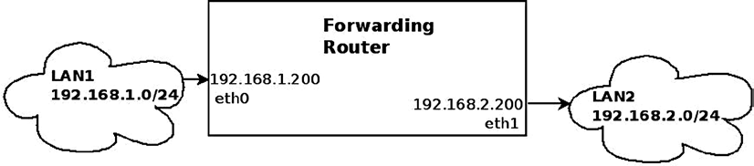
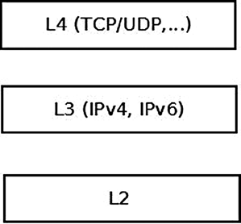
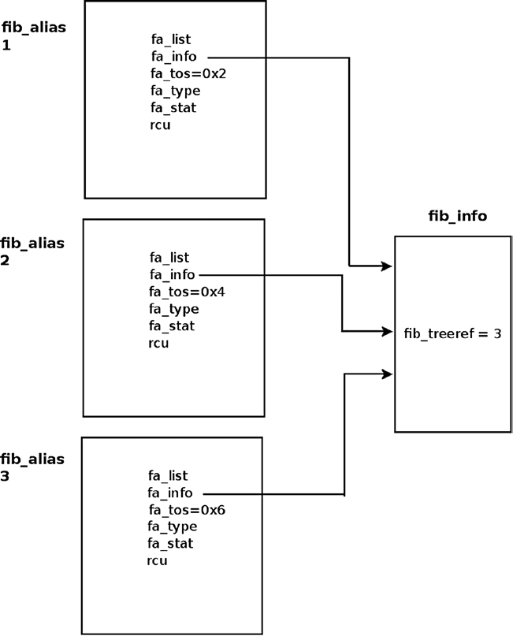
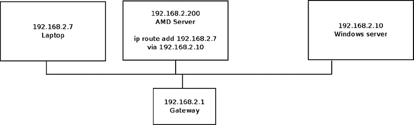

# Chương 5. IPv4 Routing Subsystem

Chương 4 đã trình bày IPv4 subsystem. Trong chương này và chương tiếp theo, tôi trình bày một trong những subsystem quan trọng nhất của Linux, routing subsystem, và cách triển khai nó trong Linux. Linux routing subsystem được dùng trong nhiều loại router—từ router gia đình và văn phòng nhỏ, đến enterprise router (kết nối các tổ chức hoặc ISP) và core router tốc độ cao trên Internet backbone. Không thể hình dung thế giới hiện đại thiếu những thiết bị này. Nội dung hai chương giới hạn ở IPv4 routing subsystem, rất giống cách triển khai IPv6. Chương này chủ yếu giới thiệu và trình bày các data structure chính được IPv4 routing subsystem sử dụng, như routing table, Forwarding Information Base (FIB) info và FIB alias, FIB TRIE cùng nhiều thành phần khác. (Nhân tiện, TRIE không phải từ viết tắt mà bắt nguồn từ từ retrieval). TRIE là một data structure, một tree đặc biệt thay thế FIB hash table. Bạn sẽ tìm hiểu cách thực hiện lookup trong routing subsystem, cách thức và thời điểm tạo message ICMP Redirect, cùng việc loại bỏ routing cache code. Lưu ý nội dung trình bày và các ví dụ code trong chương này liên quan đến kernel 3.9, ngoại trừ hai phần nêu rõ phiên bản kernel khác.

## Forwarding và FIB

Một trong những mục tiêu quan trọng của Linux Networking stack là forwarding lưu lượng. Điều này đặc biệt liên quan khi bàn về core router hoạt động trên Internet backbone. Layer của Linux IP stack chịu trách nhiệm forwarding packet và duy trì forwarding database được gọi là routing subsystem. Với mạng nhỏ, system administrator có thể quản lý FIB, vì phần lớn network topology là tĩnh. Với core router, tình hình hơi khác, vì topology là động và có lượng thông tin ever-changing khổng lồ. Trong trường hợp này, việc quản lý FIB thường do userspace routing daemon thực hiện, đôi khi kết hợp với những cải tiến phần cứng đặc biệt. Các userspace daemon này thường duy trì routing table riêng, đôi khi tương tác với kernel routing table.

Hãy bắt đầu từ cơ bản: routing là gì? Xét một ví dụ forwarding rất đơn giản: bạn có hai Ethernet Local Area Network, LAN1 và LAN2. Trên LAN1 có subnet 192.168.1.0/24, còn trên LAN2 có subnet 192.168.2.0/24. Có một máy nằm giữa hai LAN này, được gọi là “forwarding router”. Forwarding router có hai Ethernet network interface card (NIC). Network interface nối với LAN1 là `eth0`, có địa chỉ IP 192.168.1.200; network interface nối với LAN2 là `eth1`, có địa chỉ IP 192.168.2.200, như trong Hình 5-1. Để đơn giản, giả sử không có firewall daemon chạy trên forwarding router. Bạn bắt đầu gửi lưu lượng từ LAN1 đến LAN2. Quá trình forwarding các packet nhận được, được gửi từ LAN1 và có đích là LAN2 (hoặc ngược lại), theo các data structure có tên routing table, được gọi là routing. Tôi trình bày quá trình này và các data structure routing table trong chương này cũng như chương tiếp theo.



Hình 5-1. Forwarding packet giữa hai LAN

Trong Hình 5-1, các packet đến `eth0` từ LAN1, có đích là LAN2, được forwarding qua `eth1` làm outgoing device. Trong quá trình này, packet nhận được đi từ Layer 2 (link layer) trong kernel networking stack đến Layer 3, network layer, trên máy forwarding router. Tuy nhiên, khác với trường hợp lưu lượng dành cho chính máy forwarding router (“Lưu lượng đến tôi”), không cần chuyển packet lên Layer 4 (transport layer), vì lưu lượng này không dành cho bất kỳ Layer 4 transport socket nào xử lý. Lưu lượng này phải được forwarding. Chuyển lên Layer 4 gây tốn hiệu năng, nên tránh khi có thể. Lưu lượng này được xử lý tại Layer 3, và theo routing table được cấu hình trên máy forwarding router, packet được forwarding trên `eth1` làm outgoing interface (hoặc bị từ chối).

Hình 5-2 minh họa ba network layer do kernel xử lý đã đề cập ở trên.



Hình 5-2. Ba layer do networking kernel stack xử lý

Hai thuật ngữ bổ sung cần đề cập ở đây, thường được dùng trong routing, là default gateway và default route. Khi bạn định nghĩa một default gateway entry trong routing table, mọi packet không được các routing entry khác xử lý (nếu có những entry đó) phải được forwarding đến nó, bất kể địa chỉ đích trong IP header của packet. Default route được ký hiệu là 0.0.0.0/0 theo ký pháp Classless Inter-Domain Routing (CIDR). Ví dụ đơn giản, bạn có thể thêm máy có địa chỉ IPv4 192.168.2.1 làm default gateway như sau:

```
ip route add default via 192.168.2.1
```

Hoặc, khi dùng lệnh `route`, như sau:

```
route add default gateway 192.168.2.1
```

Trong phần này, bạn đã tìm hiểu forwarding là gì và xem ví dụ đơn giản minh họa cách forwarding packet giữa hai LAN. Bạn cũng đã biết default gateway và default route là gì, cùng cách thêm chúng. Sau khi nắm các thuật ngữ cơ bản và forwarding, hãy tiếp tục xem cách thực hiện lookup trong routing subsystem.

## Thực hiện Lookup trong Routing Subsystem

Lookup trong routing subsystem được thực hiện cho mỗi packet, trong cả Rx path và Tx path. Trong các kernel trước 3.6, mỗi lookup ở cả Rx path và Tx path gồm hai giai đoạn: lookup trong routing cache và, nếu cache miss, lookup trong routing table (tôi trình bày routing cache ở cuối chương này, trong phần “IPv4 Routing Cache”). Lookup được thực hiện bởi method `fib_lookup()`. Khi method `fib_lookup()` tìm thấy entry phù hợp trong routing subsystem, nó tạo object `fib_result` chứa các tham số routing và trả về 0. Tôi trình bày object `fib_result` trong phần này và các phần khác của chương. Đây là prototype của `fib_lookup()`:

```
int fib_lookup(struct net *net, const struct flowi4 *flp, struct fib_result *res)
```

Object `flowi4` chứa các trường quan trọng đối với quá trình IPv4 routing lookup, bao gồm địa chỉ đích, địa chỉ nguồn, Type of Service (TOS) và các trường khác. Thực tế object `flowi4` định nghĩa key để lookup trong routing table và phải được khởi tạo trước khi thực hiện lookup bằng method `fib_lookup()`. Với IPv6 có object tương ứng tên `flowi6`; cả hai được định nghĩa trong `include/net/flow.h`. Object `fib_result` được tạo trong quá trình IPv4 lookup. Method `fib_lookup()` trước tiên tìm trong local FIB table. Nếu lookup thất bại, nó thực hiện lookup trong main FIB table (tôi mô tả hai bảng này trong phần tiếp theo, “FIB Table”). Sau khi lookup thành công, ở Rx path hoặc Tx path, một object `dst` được tạo (instance của structure `dst_entry`, destination cache, được định nghĩa trong `include/net/dst.h`). Object `dst` được nhúng trong structure có tên `rtable`, như bạn sẽ thấy ngay sau đây. Object `rtable` thực tế biểu diễn một routing entry có thể gắn với SKB. Các member quan trọng nhất của object `dst_entry` là hai callback có tên `input` và `output`. Trong quá trình routing lookup, các callback này được gán thành handler phù hợp theo kết quả routing lookup. Hai callback này chỉ nhận một SKB làm tham số:

```
struct dst_entry {
    ...
    int  (*input)(struct sk_buff *);
    int  (*output)(struct sk_buff *);
    ...
}
```

Sau đây là structure `rtable`; như bạn thấy, object `dst` là object đầu tiên trong structure này:

```
    struct rtable {
        struct dst_entry  dst;

        int               rt_genid;
        unsigned int      rt_flags;
        __u16             rt_type;
        __u8              rt_is_input;
        __u8              rt_uses_gateway;

        int               rt_iif;

        /* Info on neighbour */
        __be32            rt_gateway;

    /* Miscellaneous cached information */
    u32               rt_pmtu;

    struct list_head  rt_uncached;
};
```

(`include/net/route.h`)

Sau đây là mô tả các member của structure `rtable`:

- `rt_flags`: Các flag của object `rtable`; một số flag quan trọng được đề cập ở đây:

- RTCF\_BROADCAST: Khi được đặt, địa chỉ đích là địa chỉ broadcast. Flag này được đặt trong method `__mkroute_output()` và method `ip_route_input_slow()`.

- RTCF\_MULTICAST: Khi được đặt, địa chỉ đích là địa chỉ multicast. Flag này được đặt trong method `ip_route_input_mc()` và method `__mkroute_output()`.

- RTCF\_DOREDIRECT: Khi được đặt, phải gửi message ICMPv4 Redirect để phản hồi packet nhận được. Một số điều kiện phải được đáp ứng để đặt flag này, bao gồm input device và output device là cùng thiết bị, đồng thời entry `procfs send_redirects` tương ứng được bật. Còn các điều kiện khác như bạn sẽ thấy ở phía sau chương này. Flag này được đặt trong method `__mkroute_input()`.

- RTCF\_LOCAL: Khi được đặt, địa chỉ đích là cục bộ. Flag này được đặt trong các method sau: `ip_route_input_slow()`, `__mkroute_output()`, `ip_route_input_mc()` và `__ip_route_output_key()`. Một số flag RTCF\_XXX có thể được đặt đồng thời. Chẳng hạn RTCF\_LOCAL có thể được đặt khi RTCF\_BROADCAST hoặc RTCF\_MULTICAST được đặt. Để xem danh sách đầy đủ các flag RTCF\_ XXX, hãy xem `include/uapi/linux/in_route.h`. Lưu ý một số flag không được sử dụng.

- `rt_is_input`: Flag được đặt thành 1 khi đây là input route.

- `rt_uses_gateway`: Nhận giá trị theo các trường hợp sau:

- Khi nexthop là gateway, `rt_uses_gateway` bằng 1.

- Khi nexthop là direct route, `rt_uses_gateway` bằng 0.

- `rt_iif`: `ifindex` của incoming interface. (Lưu ý member `rt_oif` đã bị loại khỏi structure `rtable` trong kernel 3.6; nó được đặt thành `oif` của flow key chỉ định, nhưng thực tế chỉ được dùng trong một method).

- `rt_pmtu`: Path MTU (MTU nhỏ nhất dọc theo route).

Lưu ý trong kernel 3.6, method `fib_compute_spec_dst()` được thêm vào, nhận SKB làm tham số. Method này khiến member `rt_spec_dst` của structure `rtable` không còn cần thiết, và do đó `rt_spec_dst` bị loại khỏi structure `rtable`. Method `fib_compute_spec_dst()` cần trong các trường hợp đặc biệt, như trong method `icmp_reply()`, khi trả lời bên gửi bằng cách dùng địa chỉ nguồn của họ làm địa chỉ đích cho phản hồi.

Với unicast packet nhận được dành cho host cục bộ, callback `input` của object `dst` được đặt thành `ip_local_deliver()`; với unicast packet nhận được cần forwarding, callback `input` này được đặt thành `ip_forward()`. Với packet được tạo trên máy cục bộ rồi gửi đi, callback `output` được đặt thành `ip_output()`. Với multicast packet, callback `input` có thể được đặt thành `ip_mr_input()` (trong một số điều kiện không được trình bày chi tiết

trong chương này). Có những trường hợp callback `input` được đặt thành `ip_error()`, như bạn sẽ thấy ở ví dụ rule PROHIBIT phía sau trong chương. Hãy xem object `fib_result`:

```
struct fib_result {
         unsigned char    prefixlen;
         unsigned char    nh_sel;
         unsigned char    type;
         unsigned char    scope;
         u32              tclassid;
         struct fib_info  *fi;
         struct fib_table *table;
         struct list_head *fa_head;
};
```

(`include/net/ip_fib.h`)

- `prefixlen`: Độ dài prefix, biểu diễn netmask. Giá trị nằm trong khoảng 0 đến 32. Nó bằng 0 khi dùng default route. Chẳng hạn khi thêm routing entry bằng `ip route add 192.168.2.0/24 dev eth0`, `prefixlen` là 24 theo netmask được chỉ định khi thêm entry. `prefixlen` được đặt trong method `check_leaf()` (`net/ipv4/fib_trie.c`).

- `nh_sel`: Số nexthop. Khi chỉ làm việc với một nexthop, nó bằng 0. Khi làm việc với Multipath Routing, có thể có nhiều nexthop. Các object nexthop được lưu trong một array trong routing entry (bên trong object `fib_info`), như trình bày trong phần tiếp theo.

- `type`: `type` của object `fib_result` là trường quan trọng nhất vì nó thực sự quyết định cách xử lý packet: forwarding đến máy khác, chuyển đến cục bộ, âm thầm loại bỏ, loại bỏ kèm phản hồi bằng message ICMPv4, v.v. Type của object `fib_result` được xác định theo nội dung packet (đáng chú ý nhất là địa chỉ đích) và theo routing rule do administrator, routing daemon hoặc message Redirect thiết lập. Bạn sẽ thấy cách xác định `type` của object `fib_result` trong quá trình lookup ở phía sau chương này và chương tiếp theo. Hai type phổ biến nhất của object `fib_result` là RTN\_UNICAST, được đặt khi packet cần forwarding qua gateway hoặc direct route, và RTN\_LOCAL, được đặt khi packet dành cho host cục bộ. Những type khác bạn sẽ gặp trong sách là RTN\_BROADCAST, dành cho packet phải được chấp nhận cục bộ dưới dạng broadcast, RTN\_MULTICAST, dành cho multicast route, RTN\_UNREACHABLE, dành cho packet kích hoạt việc gửi trả message ICMPv4 "Destination Unreachable", cùng các type khác. Tổng cộng có 12 route type. Để xem danh sách đầy đủ mọi route type khả dụng, hãy xem `include/uapi/linux/rtnetlink.h`.

- `fi`: Pointer đến object `fib_info`, biểu diễn một routing entry. Object `fib_info` giữ reference đến nexthop (`fib_nh`). Tôi trình bày structure FIB info trong phần “FIB Info” ở phía sau chương này.

- `table`: Pointer đến FIB table nơi thực hiện lookup. Được đặt trong method `check_leaf()` (`net/ipv4/fib_trie.c`).

- `fa_head`: Pointer đến danh sách `fib_alias` (danh sách các object `fib_alias` gắn với route này); việc dùng object `fib_alias` tối ưu routing entry, tránh tạo object `fib_info` riêng cho từng routing entry mà không xét đến việc đã có các object `fib_info` rất giống nhau. Mọi FIB alias được sắp xếp theo `fa_tos` giảm dần và `fib_priority` (metric) tăng dần. Các alias có `fa_tos` bằng 0 nằm cuối và có thể khớp với bất kỳ TOS nào. Tôi trình bày structure `fib_alias` trong phần “FIB Alias” ở phía sau chương này.

Trong phần này, bạn đã tìm hiểu cách thực hiện lookup trong routing subsystem. Bạn cũng đã biết các data structure quan trọng liên quan đến quá trình routing lookup, như `fib_result` và `rtable`. Phần tiếp theo trình bày cách tổ chức FIB table.

## FIB Table

Data structure chính của routing subsystem là routing table, được biểu diễn bằng structure `fib_table`. Có thể mô tả hơi đơn giản rằng routing table là bảng các entry, trong đó mỗi entry quyết định nexthop nào được chọn cho lưu lượng đến một subnet (hoặc một địa chỉ IPv4 đích cụ thể). Tất nhiên entry còn có các tham số khác, được trình bày ở phía sau chương này. Mỗi routing entry chứa một object `fib_info` (`include/net/ip_fib.h`), lưu các tham số routing entry quan trọng nhất (nhưng không phải tất cả, như bạn sẽ thấy ở phía sau chương). Object `fib_info` được tạo bởi method `fib_create_info()` (`net/ipv4/fib_semantics.c`) và lưu trong hash table tên `fib_info_hash`. Khi route dùng `prefsrc`, object `fib_info` cũng được thêm vào hash table tên `fib_info_laddrhash`.

Có một bộ đếm toàn cục cho các object `fib_info` tên `fib_info_cnt`, được tăng khi tạo object `fib_info` bởi method `fib_create_info()` và giảm khi giải phóng object `fib_info` bởi method `free_fib_info()`. Hash table được thay đổi kích thước động khi phát triển vượt một ngưỡng. Lookup trong hash table `fib_info_hash` được thực hiện bởi method `fib_find_info()` (trả về NULL khi không tìm được entry). Việc tuần tự hóa truy cập các member `fib_info` được thực hiện bằng spinlock tên `fib_info_lock`. Đây là structure `fib_table`:

```
struct fib_table {
        struct hlist_node       tb_hlist;
        u32                     tb_id;
        int                     tb_default;
        int                     tb_num_default;
        unsigned long           tb_data[0];
};
```

(`include/net/ip_fib.h`)

- `tb_id`: Table identifier. Với main table, `tb_id` là 254 (RT\_TABLE\_MAIN), còn với local table, `tb_id` là 255 (RT\_TABLE\_LOCAL). Tôi sẽ sớm nói về main table và local table—hiện tại chỉ cần lưu ý khi làm việc không có Policy Routing, chỉ hai FIB table này, main table và local table, được tạo trong quá trình boot.

- `tb_num_default:` Số default route trong bảng. Method `fib_trie_table()`, dùng để tạo bảng, khởi tạo `tb_num_default` thành 0. Thêm default route làm tăng `tb_num_default` thêm 1 bằng method `fib_table_insert()`. Xóa default route làm giảm `tb_num_default` đi 1 bằng method `fib_table_delete()`.

- `tb_data[0]` : Placeholder cho object routing entry (`trie`).

Phần này trình bày cách triển khai FIB table. Tiếp theo, bạn sẽ tìm hiểu FIB info, biểu diễn một routing entry.

### FIB Info

Routing entry được biểu diễn bằng structure `fib_info`. Nó chứa các tham số routing entry quan trọng như outgoing network device (`fib_dev`), priority (`fib_priority`), routing protocol identifier của route này (`fib_protocol`) và các tham số khác. Hãy xem structure `fib_info`:

```
struct fib_info {
    struct hlist_node    fib_hash;
    struct hlist_node    fib_lhash;
    struct net        *fib_net;
    int               fib_treeref;
    atomic_t          fib_clntref;
    unsigned int      fib_flags;
    unsigned char     fib_dead;
    unsigned char     fib_protocol;
    unsigned char     fib_scope;
    unsigned char     fib_type;
    __be32            fib_prefsrc;
    u32               fib_priority;
    u32               *fib_metrics;
#define fib_mtu fib_metrics[RTAX_MTU-1]
#define fib_window fib_metrics[RTAX_WINDOW-1]
#define fib_rtt fib_metrics[RTAX_RTT-1]
#define fib_advmss fib_metrics[RTAX_ADVMSS-1]
    int               fib_nhs;
#ifdef CONFIG_IP_ROUTE_MULTIPATH
    int               fib_power;
#endif
    struct rcu_head   rcu;
    struct fib_nh     fib_nh[0];
#define fib_dev       fib_nh[0].nh_dev
};
```

(`include/net/ip_fib.h`)

- `fib_net`: Network namespace mà object `fib_info` thuộc về.

- `fib_treeref`: Reference counter biểu diễn số object `fib_alias` giữ reference đến object `fib_info` này. Reference counter được tăng trong method `fib_create_info()` và giảm trong method `fib_release_info()`. Cả hai method nằm trong `net/ipv4/fib_semantics.c`.

- `fib_clntref`: Reference counter được tăng bởi method `fib_create_info()` (`net/ipv4/fib_semantics.c`) và giảm bởi method `fib_info_put()` (`include/net/ip_fib.h`). Nếu sau khi giảm đi 1 trong method `fib_info_put()` mà nó đạt 0, object `fib_info` tương ứng được giải phóng bởi method `free_fib_info()`.

- `fib_dead`: Flag cho biết có được phép giải phóng object `fib_info` bằng method `free_fib_info()` không; `fib_dead` phải được đặt thành 1 trước khi gọi method `free_fib_info()`. Nếu flag `fib_dead` không được đặt (giá trị bằng 0), object được xem là còn sống và cố giải phóng bằng method `free_fib_info()` sẽ thất bại.

- `fib_protocol`: Routing protocol identifier của route này. Khi thêm routing rule từ userspace mà không chỉ định routing protocol ID, `fib_protocol` được gán thành RTPROT\_BOOT. Administrator có thể thêm route với modifier “proto static”, cho biết route được administrator thêm; chẳng hạn có thể thực hiện như sau: `ip route add proto static 192.168.5.3 via 192.168.2.1`. `fib_protocol` có thể được gán một trong những flag sau:

- RTPROT\_UNSPEC: Giá trị lỗi.

- RTPROT\_REDIRECT: Khi được đặt, routing entry được tạo do nhận message ICMP Redirect. Protocol identifier RTPROT\_REDIRECT chỉ được dùng trong IPv6.

- RTPROT\_KERNEL: Khi được đặt, routing entry được kernel tạo (chẳng hạn khi tạo local IPv4 routing table, sẽ giải thích ngay sau đây).

- RTPROT\_BOOT: Khi được đặt, admin đã thêm route mà không chỉ định modifier “proto static”.

- RTPROT\_STATIC: Route được system administrator cài đặt.

- RTPROT\_RA: Đừng đọc nhầm—protocol identifier này không dành cho Router Alert; nó dành cho RDISC/ND Router Advertisements và chỉ được IPv6 subsystem sử dụng trong kernel; xem: `net/ipv6/route.c`. Tôi trình bày nó trong Chương 8.

Routing entry cũng có thể được thêm bởi userspace routing daemon, như ZEBRA, XORP, MROUTED và các daemon khác. Khi đó nó được gán giá trị tương ứng từ danh sách protocol identifier (xem các định nghĩa RTPROT\_XXX trong `include/uapi/linux/rtnetlink.h`). Chẳng hạn với daemon XORP, giá trị là RTPROT\_XORP. Lưu ý các flag này (như RTPROT\_KERNEL hoặc RTPROT\_STATIC) cũng được IPv6 sử dụng cho trường tương ứng (trường `rt6i_protocol` trong structure `rt6_info`; object `rt6_info` là thành phần IPv6 tương ứng với object `rtable`).

- `fib_scope`: Scope của địa chỉ đích. Nói ngắn gọn, scope được gán cho địa chỉ và route. Scope cho biết khoảng cách của host với các node khác. Lệnh `ip address show` hiển thị scope của mọi địa chỉ IP được cấu hình trên host. Lệnh `ip route show` hiển thị scope của mọi route entry trong main table. Scope có thể là một trong các giá trị sau:

- host (RT\_SCOPE\_HOST): Node không thể giao tiếp với các network node khác. Địa chỉ loopback có scope host.

- global (RT\_SCOPE\_UNIVERSE): Địa chỉ có thể dùng ở bất kỳ đâu. Đây là trường hợp phổ biến nhất.

- link (RT\_SCOPE\_LINK): Chỉ các host kết nối trực tiếp mới truy cập được địa chỉ này.

- site (RT\_SCOPE\_SITE): Chỉ được dùng trong IPv6 (tôi trình bày trong Chương 8).

- nowhere (RT\_SCOPE\_NOWHERE): Đích không tồn tại.

Khi administrator thêm route mà không chỉ định scope, trường `fib_scope` được gán giá trị theo các quy tắc sau:

- global scope (RT\_SCOPE\_UNIVERSE): Cho mọi unicast route đi qua gateway.

- scope link (RT\_SCOPE\_LINK): Cho direct unicast route và broadcast route.

- scope host (RT\_SCOPE\_HOST): Cho local route.

- `fib_type`: Type của route. Trường `fib_type` được thêm vào structure `fib_info` làm key để bảo đảm phân biệt các object `fib_info` theo type. Trường `fib_type` được thêm vào `fib_info struct` trong kernel 3.7. Ban đầu type này chỉ được lưu trong trường `fa_type` của object FIB alias (`fib_alias`). Bạn có thể thêm rule để chặn lưu lượng theo một loại chỉ định, chẳng hạn bằng: `ip route add prohibit 192.168.1.17 from 192.168.2.103`.

- `fib_type` của object `fib_info` được tạo là RTN\_PROHIBIT.

- Gửi lưu lượng từ 192.168.2.103 đến 192.168.1.17 dẫn đến message ICMPv4 “Packet Filtered” (ICMP\_PKT\_FILTERED).

- `fib_prefsrc`: Có những trường hợp bạn muốn cung cấp địa chỉ nguồn cụ thể cho lookup key. Điều này được thực hiện bằng cách đặt `fib_prefsrc.`

- `fib_priority`: Priority của route mặc định là 0, mức priority cao nhất. Giá trị priority càng lớn thì priority càng thấp. Chẳng hạn priority 3 thấp hơn priority 0, là mức cao nhất. Bạn có thể cấu hình bằng lệnh `ip`, chẳng hạn theo một trong các cách sau:

- `ip route add 192.168.1.10 via 192.168.2.1 metric 5`

- `ip route add 192.168.1.10 via 192.168.2.1 priority 5`

- `ip route add 192.168.1.10 via 192.168.2.1 preference 5`

Mỗi lệnh trong ba lệnh này đặt `fib_priority` thành 5; không có bất kỳ khác biệt nào giữa chúng. Hơn nữa, tham số `metric` của lệnh `ip route` không liên quan gì đến trường `fib_metrics` của structure `fib_info`.

- `fib_mtu`, `fib_window`, `fib_rtt` và `fib_advmss` chỉ cung cấp tên thuận tiện hơn cho các phần tử thường dùng của array `fib_metrics`.

`fib_metrics` là array gồm 15 (RTAX\_MAX) phần tử chứa các metric khác nhau. Nó được khởi tạo thành `dst_default_metrics` trong `net/core/dst.c`. Nhiều metric liên quan đến protocol TCP, như metric Initial Congestion Window `(initcwnd)`. Bảng 5-1 ở cuối chương liệt kê mọi metric khả dụng và cho biết mỗi metric có phải TCP-related hay không.

Từ userspace, có thể đặt metric `initcwnd` của TCPv4 như sau, chẳng hạn:

```
ip route add 192.168.1.0/24 initcwnd 35
```

Có các metric không dành riêng cho TCP—chẳng hạn metric `mtu`, có thể được thiết lập từ userspace như sau:

```
ip route add 192.168.1.0/24 mtu 800
```

hoặc như sau:

```
ip route add 192.168.1.0/24 mtu lock 800
```

Khác biệt giữa hai lệnh là khi chỉ định modifier `lock`, sẽ không thử path MTU discovery. Khi không chỉ định modifier `lock`, MTU có thể được kernel cập nhật do Path MTU discovery. Để biết thêm cách triển khai, xem method `__ip_rt_update_pmtu()` trong `net/ipv4/route.c`:

```
static void __ip_rt_update_pmtu(struct rtable *rt, struct flowi4 *fl4, u32 mtu)
{
```

Việc tránh cập nhật Path MTU khi chỉ định modifier `mtu lock` được thực hiện bằng cách gọi method `dst_metric_locked()`:

```
. . .
if (dst_metric_locked(dst, RTAX_MTU))
      return;
. . .
}
```

- `fib_nhs`: Số nexthop. Khi Multipath Routing (CONFIG\_IP\_ROUTE\_MULTIPATH) không được bật, số này không thể lớn hơn 1. Tính năng Multipath Routing thiết lập nhiều path thay thế cho một route, có thể gán trọng số khác nhau cho các path đó. Tính năng này cung cấp lợi ích như khả năng chịu lỗi, tăng băng thông hoặc cải thiện bảo mật (tôi trình bày trong Chương 6).

- `fib_dev`: Network device sẽ truyền packet đến nexthop.

- `fib_nh[0]`: Member `fib_nh[0]` biểu diễn nexthop. Khi làm việc với Multipath Routing, bạn có thể định nghĩa nhiều nexthop trong một route; khi đó có một array các nexthop. Chẳng hạn có thể định nghĩa hai nexthop node như sau: `ip route add default scope global nexthop dev eth0 nexthop dev eth1`.

Như đã nói, khi `fib_type` là RTN\_PROHIBIT, message ICMPv4 “Packet Filtered” (ICMP\_PKT\_FILTERED) được gửi. Điều này được triển khai như thế nào? Array tên `fib_props` gồm 12 (RTN\_MAX) phần tử (được định nghĩa trong `net/ipv4/fib_semantics.c`). Index của array này là route type. Các route type khả dụng, như RTN\_PROHIBIT hoặc RTN\_UNICAST, có thể tìm trong `include/uapi/linux/rtnetlink.h`. Mỗi phần tử trong array là một instance của `struct fib_prop`; structure `fib_prop` rất đơn giản:

```
struct fib_prop {
          int     error;
          u8      scope;
  };
```

(`net/ipv4/fib_lookup.h`)

Với mỗi route type, object `fib_prop` tương ứng chứa `error` và `scope` cho route đó. Chẳng hạn với route type RTN\_UNICAST (gateway hoặc direct route), là route rất phổ biến, giá trị lỗi bằng 0, nghĩa là không có lỗi, và scope là RT\_SCOPE\_UNIVERSE. Với route type RTN\_PROHIBIT (rule do system administrator cấu hình để chặn lưu lượng), lỗi là –EACCES và scope là RT\_SCOPE\_UNIVERSE:

```
const struct fib_prop fib_props[RTN_MAX + 1] = {
 . . .
         [RTN_PROHIBIT] = {
                 .error  = -EACCES,
                 .scope  = RT_SCOPE_UNIVERSE,
         },

. . .
```

Bảng 5-2 ở cuối chương này liệt kê mọi route type khả dụng, error code và scope của chúng. Khi bạn cấu hình rule như đã đề cập bằng `ip route add prohibit 192.168.1.17 from`

`192.168.2.103`—và khi packet được gửi từ 192.168.2.103 đến 192.168.1.17, những việc sau diễn ra: lookup trong routing table được thực hiện trong Rx path. Khi tìm thấy entry tương ứng, thực tế là leaf trong FIB TRIE, method `check_leaf()` được gọi. Method này truy cập array `fib_props` với route type của packet làm index (`fa->fa_type`):

```
static int check_leaf(struct fib_table *tb, struct trie *t, struct leaf *l,
                      t_key key,  const struct flowi4 *flp,
                      struct fib_result *res, int fib_flags)
{
    . . .
       fib_alias_accessed(fa);
       err = fib_props[fa->fa_type].error;
       if (err) {
                . . .
                return err;
                 }
    . . .
```

Cuối cùng, method `fib_lookup()`, khởi xướng lookup trong IPv4 routing subsystem, trả về lỗi –EACCES (trong trường hợp của chúng ta). Lỗi được truyền ngược từ `check_leaf()` qua `fib_table_lookup()` và các method tiếp theo cho đến method kích hoạt chuỗi này, tức method `fib_lookup()`. Khi method `fib_lookup()` trả về lỗi trong Rx path, lỗi được method `ip_error()` xử lý. Một hành động được thực hiện tùy theo lỗi. Với –EACCES, message ICMPv4 destination unreachable với code Packet Filtered (ICMP\_PKT\_FILTERED) được gửi trả về và packet bị drop.

Phần này trình bày FIB info, biểu diễn một routing entry. Phần tiếp theo trình bày caching trong IPv4 routing subsystem (đừng nhầm với IPv4 routing cache, đã bị loại khỏi network stack và được trình bày trong phần “IPv4 Routing Cache” ở cuối chương này).

### Caching

Caching kết quả routing lookup là kỹ thuật tối ưu giúp cải thiện hiệu năng routing subsystem. Kết quả routing lookup thường được cache trong object nexthop (`fib_nh`); khi packet không phải unicast packet hoặc có sử dụng `realms` (`itag` của packet khác 0), kết quả không được cache trong nexthop. Lý do là nếu cache mọi loại packet, cùng một nexthop có thể được sử dụng bởi các loại route khác nhau—điều này cần tránh. Có một số ngoại lệ nhỏ mà tôi không trình bày trong chương này. Caching trong Rx path và Tx path được thực hiện như sau:

- Trong Rx path, caching object `fib_result` trong object nexthop (`fib_nh`) được thực hiện bằng cách thiết lập trường `nh_rth_input` của object nexthop (`fib_nh`).

- Trong Tx path, caching object `fib_result` trong object nexthop (`fib_nh`) được thực hiện bằng cách thiết lập trường `nh_pcpu_rth_output` của object nexthop (`fib_nh`).

- Cả `nh_rth_input` và `nh_pcpu_rth_output` đều là instance của structure `rtable`.

- Caching `fib_result` được thực hiện bởi method `rt_cache_route()` trong cả Rx path và Tx path (`net/ipv4/route.c`).

- Caching Path MTU và ICMPv4 redirect được thực hiện bằng FIB exception. Để tăng hiệu năng, `nh_pcpu_rth_output` là biến per-CPU, nghĩa là mỗi CPU có một bản sao của

output entry `dst`. Caching gần như luôn được sử dụng. Số ít ngoại lệ là khi message ICMPv4 Redirect được gửi, hoặc `itag` (`tclassid`) được đặt, hoặc không đủ memory.

Trong phần này, bạn đã tìm hiểu cách caching bằng object nexthop. Phần tiếp theo trình bày structure `fib_nh`, biểu diễn nexthop, và các FIB nexthop exception.

### Nexthop (fib\_nh)

Structure `fib_nh` biểu diễn nexthop. Nó chứa thông tin như outgoing nexthop network device (`nh_dev`), outgoing nexthop interface index (`nh_oif`), scope (`nh_scope`) và các thông tin khác. Hãy xem:

```
struct fib_nh {
    struct net_device       *nh_dev;
    struct hlist_node       nh_hash;
    struct fib_info         *nh_parent;
    unsigned int            nh_flags;
    unsigned char           nh_scope;
#ifdef CONFIG_IP_ROUTE_MULTIPATH
    int                     nh_weight;
    int                     nh_power;
#endif
#ifdef CONFIG_IP_ROUTE_CLASSID
    __u32                   nh_tclassid;
#endif
    int                     nh_oif;
    __be32                  nh_gw;
    __be32                  nh_saddr;
    int                     nh_saddr_genid;
    struct rtable __rcu * __percpu *nh_pcpu_rth_output;
    struct rtable __rcu     *nh_rth_input;
    struct fnhe_hash_bucket *nh_exceptions;
};
```

(`include/net/ip_fib.h`)

Trường `nh_dev` biểu diễn network device (object `net_device`) mà lưu lượng đến nexthop sẽ được truyền trên đó. Khi một network device gắn với một hoặc nhiều route bị vô hiệu hóa, notification NETDEV\_DOWN được gửi. FIB callback xử lý sự kiện này là method `fib_netdev_event()`; đây là callback của notifier object `fib_netdev_notifier`, được đăng ký trong method `ip_fib_init()` bằng cách gọi method `register_netdevice_notifier()` (notification chain được trình bày trong Chương 14). Method `fib_netdev_event()` gọi method `fib_disable_ip()` khi nhận notification NETDEV\_DOWN. Trong method `fib_disable_ip()`, các bước sau được thực hiện:

- Trước tiên, method `fib_sync_down_dev()` được gọi (`net/ipv4/fib_semantics.c`). Trong method `fib_sync_down_dev()`, flag RTNH\_F\_DEAD của các nexthop flag (`nh_flags`) được đặt và các FIB info flag (`fib_flags`) được đặt.

- Các route được flush bằng method `fib_flush()`.

- Method `rt_cache_flush()` và method `arp_ifdown()` được gọi. Method `arp_ifdown()` không nằm trên notifier chain nào.

### FIB Nexthop Exception

FIB nexthop exception được thêm trong kernel 3.6 để xử lý các trường hợp routing entry thay đổi do message ICMPv4 Redirect hoặc Path MTU discovery, thay vì do hành động từ userspace. Hash key là địa chỉ đích. Các FIB nexthop exception dựa trên hash table gồm 2048 entry; reclaim (giải phóng hash entry) bắt đầu khi chain có độ sâu 5. Mỗi object nexthop (`fib_nh`) có một hash table FIB nexthop exception, `nh_exceptions` (instance của structure `fnhe_hash_bucket`). Hãy xem structure `fib_nh_exception`:

```
struct fib_nh_exception {
    struct fib_nh_exception __rcu    *fnhe_next;
    __be32                           fnhe_daddr;
    u32                              fnhe_pmtu;
    __be32                           fnhe_gw;
    unsigned long                    fnhe_expires;
    struct rtable __rcu              *fnhe_rth;
    unsigned long                    fnhe_stamp;
};
```

(`include/net/ip_fib.h`)

Các object `fib_nh_exception` được tạo bởi method `update_or_create_fnhe()` (`net/ipv4/route.c`). FIB nexthop exception được tạo ở đâu? Trường hợp đầu tiên là khi nhận message ICMPv4 Redirect (“Redirect to Host”) trong method `__ip_do_redirect()`. Message “Redirect to Host” chứa gateway mới. Trường `fnhe_gw` của `fib_nh_exception` được đặt thành gateway mới khi tạo object FIB nexthop exception (trong method `update_or_create_fnhe()`):

```
static void __ip_do_redirect(struct rtable *rt, struct sk_buff *skb, struct flowi4 *fl4,
                 bool kill_route)
{
  ...
  __be32 new_gw = icmp_hdr(skb)->un.gateway;
  ...
  update_or_create_fnhe(nh, fl4->daddr, new_gw, 0, 0);
  ...

}
```

Trường hợp thứ hai tạo FIB nexthop exception là khi Path MTU thay đổi, trong method `__ip_rt_update_pmtu()`. Khi đó, trường `fnhe_pmtu` của object `fib_nh_exception` được đặt thành MTU mới khi tạo object FIB nexthop exception (trong method `update_or_create_fnhe()`). Giá trị PMTU hết hạn nếu không được cập nhật trong 10 phút gần nhất (`ip_rt_mtu_expires`). Khoảng thời gian này được kiểm tra trong mỗi lời gọi `dst_mtu()` qua method `ipv4_mtu()`, là handler `dst->ops->mtu`. `ip_rt_mtu_expires`, mặc định là 600 giây, có thể được cấu hình qua entry `procfs` `/proc/sys/net/ipv4/route/mtu_expires`:

```
static void __ip_rt_update_pmtu(struct rtable *rt, struct flowi4 *fl4, u32 mtu)
{
    . . .
    if (fib_lookup(dev_net(dst->dev), fl4, &res) == 0) {
        struct fib_nh *nh = &FIB_RES_NH(res);

        update_or_create_fnhe(nh, fl4->daddr, 0, mtu,
                      jiffies + ip_rt_mtu_expires);
    }
    . . .
}
```

Lưu ý FIB nexthop exception được dùng trong Tx path. Bắt đầu từ Linux 3.11, chúng cũng được dùng trong Rx path. Do đó, thay vì `fnhe_rth`, có `fnhe_rth_input` và `fnhe_rth_output`.

Từ kernel 2.4, Policy Routing được hỗ trợ. Với Policy Routing, routing packet không chỉ phụ thuộc địa chỉ đích mà còn vào một số yếu tố khác như địa chỉ nguồn hoặc TOS. System administrator có thể thêm đến 255 routing table.

### Policy Routing

Khi làm việc không có Policy Routing (CONFIG\_IP\_MULTIPLE\_TABLES không được bật), hai routing table được tạo: local table và main table. ID main table là 254 (RT\_TABLE\_MAIN), còn ID local table là 255 (RT\_TABLE\_LOCAL). Local table chứa routing entry của các địa chỉ cục bộ. Chỉ kernel mới có thể thêm các routing entry này vào local table. Việc thêm routing entry vào main table (RT\_TABLE\_MAIN) do system administrator thực hiện (chẳng hạn qua `ip route add`). Các bảng này được tạo bởi method `fib4_rules_init()` trong `net/ipv4/fib_frontend.c`. Chúng được gọi là `ip_fib_local_table` và `ip_fib_main_table` trong các kernel trước 2.6.25, nhưng đã bị loại bỏ để dùng cách truy cập thống nhất các routing table bằng method `fib_get_table()` với đối số phù hợp. Truy cập thống nhất nghĩa là truy cập routing table theo cùng cách, bằng method `fib_get_table()`, cả khi hỗ trợ Policy Routing được bật lẫn khi bị tắt. Method `fib_get_table()` chỉ nhận hai đối số: network namespace và table id. Lưu ý có một method khác cùng tên `fib4_rules_init()` cho trường hợp Policy Routing trong `net/ipv4/fib_rules.c`, được gọi khi làm việc với hỗ trợ Policy Routing. Khi làm việc với hỗ trợ Policy Routing (CONFIG\_IP\_MULTIPLE\_TABLES được bật), có ba bảng ban đầu (local, main và default), và có thể có đến 255 routing table. Tôi nói thêm về Policy Routing trong Chương 6. Có thể truy cập main routing table như sau:

- Bằng lệnh của system administrator (dùng `ip route` hoặc `route`):

- Thêm route bằng `ip route add` được triển khai bằng cách gửi message RTM\_NEWROUTE từ userspace, được xử lý bởi method `inet_rtm_newroute()`. Lưu ý route không nhất thiết luôn là rule cho phép lưu lượng. Bạn cũng có thể thêm route chặn lưu lượng, chẳng hạn bằng `ip route add prohibit 192.168.1.17 from 192.168.2.103.` Khi áp dụng rule này, mọi packet gửi từ 192.168.2.103 đến 192.168.1.17 sẽ bị chặn.

- Xóa route bằng `ip route del` được triển khai bằng cách gửi message RTM\_DELROUTE từ userspace, được xử lý bởi method `inet_rtm_delroute()`.

- Dump routing table bằng `ip route show` được triển khai bằng cách gửi message RTM\_GETROUTE từ userspace, được xử lý bởi method `inet_dump_fib()`.

Lưu ý `ip route show` hiển thị main table. Để hiển thị local table, bạn phải chạy `ip route show table local`.

- Thêm route bằng `route add` được triển khai bằng cách gửi IOCTL SIOCADDRT, được xử lý bởi method `ip_rt_ioctl()` (`net/ipv4/fib_frontend.c`).

- Xóa route bằng `route del` được triển khai bằng cách gửi IOCTL SIOCDELRT, được xử lý bởi method `ip_rt_ioctl()` (`net/ipv4/fib_frontend.c`).

- Bằng userspace routing daemon triển khai các routing protocol như BGP (Border Gateway Protocol), EGP (Exterior Gateway Protocol), OSPF (Open Shortest Path First) hoặc các protocol khác. Các routing daemon này chạy trên core router hoạt động trên Internet backbone và có thể xử lý hàng trăm nghìn route.

Tôi cần đề cập ở đây rằng các route thay đổi do message ICMPv4 REDIRECT hoặc Path MTU discovery được cache trong nexthop exception table, sẽ được trình bày ngay sau đây. Phần tiếp theo mô tả FIB alias, hỗ trợ tối ưu routing.

### FIB Alias (fib\_alias)

Có những trường hợp tạo nhiều routing entry đến cùng địa chỉ đích hoặc cùng subnet. Các routing entry này chỉ khác giá trị TOS. Thay vì tạo `fib_info` cho từng route như vậy, một object `fib_alias` được tạo. `fib_alias` nhỏ hơn, giúp giảm tiêu thụ memory. Đây là ví dụ đơn giản tạo 3 object `fib_alias`:

```
ip route add 192.168.1.10 via 192.168.2.1 tos 0x2
ip route add 192.168.1.10 via 192.168.2.1 tos 0x4
ip route add 192.168.1.10 via 192.168.2.1 tos 0x6
```

Hãy xem định nghĩa structure `fib_alias`:

```
struct fib_alias {
        struct list_head        fa_list;
        struct fib_info         *fa_info;
        u8                      fa_tos;
        u8                      fa_type;
        u8                      fa_state;
        struct rcu_head         rcu;
};
```

(`net/ipv4/fib_lookup.h`)

Lưu ý trước đây cũng có trường scope trong structure `fib_alias` (`fa_scope`), nhưng nó được chuyển sang structure `fib_info` trong kernel 2.6.39.

Object `fib_alias` lưu các route đến cùng subnet nhưng có tham số khác nhau. Bạn có thể có một object `fib_info` được nhiều object `fib_alias` dùng chung. Khi đó, pointer `fa_info` trong tất cả object `fib_alias` này trỏ đến cùng object `fib_info` dùng chung. Trong Hình 5-3, bạn có thể thấy một object `fib_info` được ba object `fib_alias` dùng chung, mỗi object có `fa_tos` khác nhau. Lưu ý giá trị reference counter của object `fib_info` là 3 (`fib_treeref`).



Hình 5-3. Một fib\_info được ba object fib\_alias dùng chung. Mỗi object fib\_alias có giá trị fa\_tos khác nhau

Hãy xem điều gì xảy ra khi bạn thử thêm key mà một `fib_node` đã được thêm trước đó (như ví dụ ở trên với ba giá trị TOS 0x2, 0x4 và 0x6); giả sử bạn đã tạo rule đầu tiên với TOS 0x2 và bây giờ tạo rule thứ hai với TOS 0x4.

Object `fib_alias` được tạo bởi method `fib_table_insert()`, là method xử lý thêm routing entry:

```
int fib_table_insert(struct fib_table *tb, struct fib_config *cfg)
 {
         struct trie *t = (struct trie *) tb->tb_data;
         struct fib_alias *fa, *new_fa;
         struct list_head *fa_head = NULL;
         struct fib_info *fi;
      . . .
```

Trước tiên, object `fib_info` được tạo. Lưu ý trong method `fib_create_info()`, sau khi cấp phát và tạo object `fib_info`, một lookup được thực hiện để kiểm tra object tương tự đã tồn tại chưa bằng cách gọi method `fib_find_info()`. Nếu tồn tại object như vậy, object vừa tạo được giải phóng và reference counter của object tìm được (`ofi` trong đoạn code bạn sẽ thấy ngay sau đây) được tăng thêm 1:

```
fi = fib_create_info(cfg);
```

Hãy xem đoạn code trong method `fib_create_info()` vừa đề cập; khi tạo rule TOS thứ hai, object `fib_info` của rule đầu tiên và object `fib_info` của rule thứ hai giống hệt nhau. Bạn cần nhớ trường TOS có trong object `fib_alias` nhưng không có trong object `fib_info`:

```
struct fib_info *fib_create_info(struct fib_config *cfg)
{
    struct fib_info *fi = NULL;
    struct fib_info *ofi;
    . . .
    fi = kzalloc(sizeof(*fi)+nhs*sizeof(struct fib_nh), GFP_KERNEL);
    if (fi == NULL)
            goto failure;
    . . .
link_it:
        ofi = fib_find_info(fi);
```

Nếu tìm thấy object tương tự, giải phóng object `fib_info` và tăng reference count `fib_treeref`:

```
        if (ofi) {
                fi->fib_dead = 1;
                free_fib_info(fi);
                ofi->fib_treeref++;
                return ofi;
        }
    . . .
}
```

Bây giờ, việc kiểm tra được thực hiện để xác định xem có alias nào cho object `fib_info` hay không. Trong trường hợp này sẽ không có alias vì TOS của rule thứ hai khác với TOS của rule thứ nhất:

```
     l = fib_find_node(t, key);
     fa = NULL;

     if (l) {
             fa_head = get_fa_head(l, plen);
             fa = fib_find_alias(fa_head, tos, fi->fib_priority);
     }

if (fa && fa->fa_tos == tos &&
    fa->fa_info->fib_priority == fi->fib_priority) {
    . . .
       }
```

Bây giờ một `fib_alias` được tạo và pointer `fa_info` của nó được gán trỏ đến `fib_info` của rule đầu tiên đã tạo:

```
new_fa = kmem_cache_alloc(fn_alias_kmem, GFP_KERNEL);
if (new_fa == NULL)
    goto out;

new_fa->fa_info = fi;
    . . .
```

Sau khi tìm hiểu FIB Alias, bạn đã sẵn sàng xem message ICMPv4 redirect, được gửi khi có route chưa tối ưu.

## Message ICMPv4 Redirect

Có những trường hợp routing entry chưa tối ưu. Khi đó, message ICMPv4 redirect được gửi. Tiêu chí chính cho entry chưa tối ưu là input device và output device là cùng thiết bị. Nhưng còn các điều kiện khác phải được đáp ứng để gửi message ICMPv4 redirect, như bạn sẽ thấy trong phần này. Có bốn code của message ICMPv4 redirect:

- ICMP\_REDIR\_NET: Redirect cho mạng

- ICMP\_REDIR\_HOST: Redirect cho host

- ICMP\_REDIR\_NETTOS: Redirect cho mạng theo TOS

- ICMP\_REDIR\_HOSTTOS: Redirect cho host theo TOS

Hình 5-4 minh họa một thiết lập có route chưa tối ưu. Có ba máy trong thiết lập này, cùng subnet (192.168.2.0/24) và đều kết nối qua gateway (192.168.2.1). AMD server (192.168.2.200) thêm Windows server (192.168.2.10) làm gateway để truy cập 192.168.2.7 (laptop) bằng `ip route add 192.168.2.7 via 192.168.2.10`. AMD server gửi lưu lượng đến laptop, chẳng hạn bằng `ping 192.168.2.7`. Vì default gateway là `192.168.2.10`, lưu lượng được gửi đến `192.168.2.10`. Windows server phát hiện đây là route chưa tối ưu, vì AMD server có thể gửi trực tiếp đến 192.168.2.7, và gửi trả AMD server một message ICMPv4 redirect với code ICMP\_REDIR\_HOST.



Hình 5-4. Redirect to Host (ICMP\_REDIR\_HOST), một thiết lập đơn giản

Sau khi hiểu rõ hơn về redirect, hãy xem cách tạo message ICMPv4.

### Tạo Message ICMPv4 Redirect

Message ICMPv4 Redirect được gửi khi có route chưa tối ưu. Điều kiện đáng chú ý nhất cho route chưa tối ưu là input device và output device là cùng thiết bị, nhưng còn một số điều kiện khác cần đáp ứng. Tạo message ICMPv4 Redirect được thực hiện qua hai giai đoạn:

- Trong method `__mkroute_input()`: Flag RTCF\_DOREDIRECT được đặt tại đây nếu cần.

- Trong method `ip_forward()`: Message ICMPv4 Redirect thực sự được gửi tại đây bằng cách gọi method `ip_rt_send_redirect()`.

```
static int __mkroute_input(struct sk_buff *skb,
                   const struct fib_result *res,
                   struct in_device *in_dev,
                   __be32 daddr, __be32 saddr, u32 tos)
{
    struct rtable *rth;
    int err;
    struct in_device *out_dev;
    unsigned int flags = 0;
    bool do_cache;
```

Tất cả điều kiện sau phải được đáp ứng để flag RTCF\_DOREDIRECT được đặt:

- Input device và output device là cùng thiết bị.

- Entry `procfs`, `/proc/sys/net/ipv4/conf/<deviceName>/send_redirects`, được bật.

- Outgoing device này là shared media hoặc địa chỉ nguồn (`saddr`) và địa chỉ nexthop gateway (`nh_gw`) nằm trên cùng subnet:

```
if (out_dev == in_dev && err && IN_DEV_TX_REDIRECTS(out_dev) &&
  (IN_DEV_SHARED_MEDIA(out_dev) ||
   inet_addr_onlink(out_dev, saddr, FIB_RES_GW(*res)))) {

  flags |= RTCF_DOREDIRECT;
  do_cache = false;
}
  . . .
```

Thiết lập các flag của object `rtable` được thực hiện bằng:

```
    rth->rt_flags = flags;
    . . .

}
```

Gửi message ICMPv4 Redirect được thực hiện trong giai đoạn thứ hai, bởi method `ip_forward()`:

```
int ip_forward(struct sk_buff *skb)
{
    struct iphdr          *iph;    /* Our header */
    struct rtable         *rt;     /* Route we use */
    struct ip_options     *opt     = &(IPCB(skb)->opt);
```

Tiếp theo kiểm tra flag RTCF\_DOREDIRECT có được đặt, có không tồn tại IP option strict route (xem Chương 4), và packet không phải IPsec packet hay không. (Với IPsec tunnel, input device của tunneled packet có thể giống outgoing device của packet đã decapsulation; xem `http://lists.openwall.net/netdev/2007/08/24/29`):

```
if (rt->rt_flags&RTCF_DOREDIRECT && !opt->srr && !skb_sec_path(skb))
    ip_rt_send_redirect(skb);
```

Trong method `ip_rt_send_redirect()`, message ICMPv4 Redirect thực sự được gửi. Tham số thứ ba là địa chỉ IP của gateway mới được đề xuất, trong trường hợp này là 192.168.2.7 (địa chỉ laptop):

```
void ip_rt_send_redirect(struct sk_buff *skb)
  {
      . . .
      icmp_send(skb, ICMP_REDIRECT, ICMP_REDIR_HOST,
            rt_nexthop(rt, ip_hdr(skb)->daddr))
      . . .
  }
```

(`net/ipv4/route.c`)

### Nhận Message ICMPv4 Redirect

Để message ICMPv4 Redirect được xử lý, nó phải vượt qua một số sanity check. Xử lý message ICMPv4 Redirect được thực hiện bởi method `__ip_do_redirect()`:

```
static void __ip_do_redirect(struct rtable *rt, struct sk_buff *skb, struct flowi4
    *fl4,bool kill_route)
{
    __be32 new_gw = icmp_hdr(skb)->un.gateway;
    __be32 old_gw = ip_hdr(skb)->saddr;
    struct net_device *dev = skb->dev;
    struct in_device *in_dev;
    struct fib_result res;
    struct neighbour *n;
    struct net *net;
      . . .
```

Nhiều kiểm tra được thực hiện, chẳng hạn network device có được thiết lập để chấp nhận redirect hay không. Redirect bị từ chối nếu cần:

```
if (rt->rt_gateway != old_gw)
    return;

in_dev = __in_dev_get_rcu(dev);
if (!in_dev)
    return;

net = dev_net(dev);
if (new_gw == old_gw || !IN_DEV_RX_REDIRECTS(in_dev) ||
    ipv4_is_multicast(new_gw) || ipv4_is_lbcast(new_gw) ||
        ipv4_is_zeronet(new_gw))
        goto reject_redirect;

    if (!IN_DEV_SHARED_MEDIA(in_dev)) {
        if (!inet_addr_onlink(in_dev, new_gw, old_gw))
            goto reject_redirect;
        if (IN_DEV_SEC_REDIRECTS(in_dev) && ip_fib_check_default(new_gw, dev))
            goto reject_redirect;
    } else {
        if (inet_addr_type(net, new_gw) != RTN_UNICAST)
            goto reject_redirect;
    }
```

Lookup trong neighboring subsystem được thực hiện; key để lookup là địa chỉ gateway được đề xuất, `new_gw`, đã được trích từ message ICMPv4 ở đầu method này:

```
n = ipv4_neigh_lookup(&rt->dst, NULL, &new_gw);
if (n) {
    if (!(n->nud_state & NUD_VALID)) {
        neigh_event_send(n, NULL);
    } else {
           if (fib_lookup(net, fl4, &res) == 0) {
              struct fib_nh *nh = &FIB_RES_NH(res);
```

Tạo / cập nhật FIB nexthop exception, chỉ định địa chỉ IP của gateway được đề xuất (`new_gw`):

```
                update_or_create_fnhe(nh, fl4->daddr, new_gw,
                              0, 0);
            }
            if (kill_route)
                rt->dst.obsolete = DST_OBSOLETE_KILL;
            call_netevent_notifiers(NETEVENT_NEIGH_UPDATE, n);
        }
        neigh_release(n);
    }
    return;

reject_redirect:
      . . .
```

(`net/ipv4/route.c`)

Sau khi trình bày cách xử lý message ICMPv4 nhận được, tiếp theo chúng ta có thể tìm hiểu IPv4 routing cache và lý do loại bỏ nó.

### IPv4 Routing Cache

Trong các kernel trước 3.6, có IPv4 routing cache với garbage collector. IPv4 routing cache bị loại bỏ trong kernel 3.6 (khoảng tháng 7 năm 2012). FIB TRIE / FIB hash là một lựa chọn trong kernel trong nhiều năm, nhưng không phải mặc định. Sự có mặt của FIB TRIE cho phép loại bỏ IPv4 routing cache, vốn có vấn đề Denial of Service (DoS). FIB TRIE (còn gọi là LC-trie) là thuật toán longest matching prefix lookup có hiệu năng tốt hơn FIB hash với routing table lớn. Nó tiêu thụ nhiều memory hơn và phức tạp hơn, nhưng nhờ hiệu năng tốt hơn nên khiến việc loại bỏ

routing cache trở nên khả thi. FIB TRIE code đã có trong kernel từ lâu trước khi được merge, nhưng không phải mặc định. Lý do chính loại bỏ IPv4 routing cache là dễ thực hiện tấn công DoS vào nó, vì IPv4 routing cache tạo cache entry cho mỗi flow duy nhất. Về cơ bản, điều đó nghĩa là bằng cách gửi packet đến các đích ngẫu nhiên, bạn có thể tạo số lượng routing cache entry không giới hạn.

Merge FIB TRIE kéo theo việc loại bỏ routing cache, một số FIB hash table cồng kềnh và các method routing cache garbage collector. Chương này trình bày routing cache rất ngắn gọn. Vì người đọc mới có thể thắc mắc vì sao cần nội dung này, hãy lưu ý trong ngành phần mềm Linux-based, với các distribution thương mại như RedHat Enterprise, kernel được bảo trì đầy đủ và hỗ trợ đầy đủ trong thời gian rất dài (chẳng hạn RedHat hỗ trợ các distribution đến bảy năm). Vì vậy rất có khả năng một số người đọc tham gia dự án dựa trên kernel trước 3.6, nơi có routing cache và các routing table FIB hash-based. Đi sâu lý thuyết và chi tiết triển khai data structure FIB TRIE nằm ngoài phạm vi sách này. Để tìm hiểu thêm, tôi đề xuất bài viết “TRASH—A dynamic LC-trie and hash data structure” của Robert Olsson và Stefan Nilsson, `www.nada.kth.se/~snilsson/publications/TRASH/trash.pdf`.

Lưu ý với cách triển khai IPv4 routing cache, chỉ có một cache, bất kể dùng bao nhiêu routing table (có thể có đến 255 routing table khi dùng Policy Routing). Lưu ý trước đây cũng có hỗ trợ IPv4 Multipath Routing cache, nhưng bị loại bỏ trong kernel 2.6.23, năm 2007. Thực tế nó chưa từng hoạt động thật tốt và chưa bao giờ vượt qua trạng thái thử nghiệm.

Với các kernel trước kernel 3.6, nơi FIB TRIE chưa được merge, lookup trong IPv4 routing subsystem khác: truy cập routing table được thực hiện sau truy cập routing cache, các bảng được tổ chức khác, và có routing cache garbage collector vừa asynchronous (timer định kỳ) vừa synchronous (kích hoạt trong điều kiện cụ thể, chẳng hạn khi số cache entry vượt ngưỡng). Về cơ bản, cache là một hash lớn có địa chỉ nguồn, địa chỉ đích và TOS của IP flow làm key, gắn với tất cả thông tin flow-specific như neighbor entry, PMTU, redirect, thông tin TCPMSS, v.v. Lợi ích ở đây là các entry được cache có thể lookup nhanh và chứa mọi thông tin cần cho các layer cao hơn.

Lưu ý Hai phần sau (“Rx Path” và “Tx Path”) đề cập kernel 2.6.38.

### Rx Path

Trong Rx path, trước tiên method `ip_route_input_common()` được gọi. Method này thực hiện lookup trong IPv4 routing cache, nhanh hơn nhiều so với lookup trong IPv4 routing table. Lookup trong các routing table này dựa trên thuật toán tìm kiếm Longest Prefix Match (LPM). Với tìm kiếm LPM, table entry cụ thể nhất—entry có subnet mask cao nhất—được gọi là Longest Prefix Match. Nếu lookup trong routing cache thất bại (“cache miss”), lookup trong routing table được thực hiện bằng cách gọi method `ip_route_input_slow()`. Method này gọi method `fib_lookup()` để thực hiện lookup thực sự. Khi thành công, nó gọi method `ip_mkroute_input()`, method này (cùng những thao tác khác) chèn routing entry vào routing cache bằng cách gọi method `rt_intern_hash()`.

### Tx Path

Trong Tx path, trước tiên method `ip_route_output_key()` được gọi. Method này thực hiện lookup trong IPv4 routing cache. Khi cache miss, nó gọi method `ip_route_output_slow()`, method này gọi method `fib_lookup()` để thực hiện lookup trong routing subsystem. Sau đó, khi thành công, nó gọi method `ip_mkroute_output()`, method này (cùng những thao tác khác) chèn routing entry vào routing cache bằng cách gọi method `rt_intern_hash()`.

## Tổng kết

Chương này trình bày nhiều chủ đề của IPv4 routing subsystem. Routing subsystem thiết yếu cho xử lý cả incoming packet lẫn outgoing packet. Bạn đã tìm hiểu các chủ đề như forwarding, lookup trong routing subsystem, tổ chức FIB table, Policy Routing và routing subsystem, cùng message ICMPv4 Redirect. Bạn cũng đã tìm hiểu việc tối ưu nhờ FIB alias và việc routing cache đã bị loại bỏ, cùng lý do. Chương tiếp theo trình bày các chủ đề nâng cao của IPv4 routing subsystem.

## Tham khảo nhanh

Tôi kết thúc chương này bằng danh sách ngắn các method, macro và bảng quan trọng của IPv4 routing subsystem, cùng giải thích ngắn về routing flag.

Lưu ý IPv4 routing subsystem được triển khai trong các module sau dưới `net/ipv4`: `fib_frontend.c`, `fib_trie.c`, `fib_semantics.c`, `route.c`.

Module `fib_rules.c` triển khai Policy Routing và chỉ được biên dịch khi CONFIG\_IP\_MULTIPLE\_TABLES được bật. Các header file quan trọng nhất bao gồm `fib_lookup.h`, `include/net/ip_fib.h` và `include/net/route.h`.

Cách triển khai destination cache (`dst`) nằm trong `net/core/dst.c` và `include/net/dst.h`.

Phải bật CONFIG\_IP\_ROUTE\_MULTIPATH để hỗ trợ Multipath Routing.

### Method

Phần này liệt kê các method đã đề cập trong chương.

### int fib\_table\_insert(struct fib\_table \*tb, struct fib\_config \*cfg);

Method này chèn IPv4 routing entry vào FIB table chỉ định (object `fib_table`), dựa trên object `fib_config` chỉ định.

### int fib\_table\_delete(struct fib\_table \*tb, struct fib\_config \*cfg);

Method này xóa IPv4 routing entry khỏi FIB table chỉ định (object `fib_table`), dựa trên object `fib_config` chỉ định.

### struct fib\_info \*fib\_create\_info(struct fib\_config \*cfg);

Method này tạo object `fib_info` từ object `fib_config` chỉ định.

### void free\_fib\_info(struct fib\_info \*fi);

Method này giải phóng object `fib_info` với điều kiện object không còn sống (flag `fib_dead` khác 0) và giảm bộ đếm object `fib_info` toàn cục (`fib_info_cnt`).

### void fib\_alias\_accessed(struct fib\_alias \*fa);

Method này đặt flag `fa_state` của `fib_alias` chỉ định thành FA\_S\_ACCESSED. Lưu ý flag `fa_state` duy nhất là FA\_S\_ACCESSED.

### void ip\_rt\_send\_redirect(struct sk\_buff \*skb);

Method này gửi message ICMPV4 Redirect để phản hồi path chưa tối ưu.

### void \_\_ip\_do\_redirect(struct rtable \*rt, struct sk\_buff \*skb, struct flowi4\*fl4, bool kill\_route);

Method này xử lý nhận message ICMPv4 Redirect.

### void update\_or\_create\_fnhe(struct fib\_nh \*nh, \_\_be32 daddr, \_\_be32 gw, u32 pmtu, unsigned long expires);

Method này tạo FIB nexthop exception table (`fib_nh_exception`) trong object nexthop chỉ định (`fib_nh`) nếu chưa tồn tại và khởi tạo nó. Được gọi khi cần cập nhật route do ICMPv4 redirect hoặc PMTU discovery.

### u32 dst\_metric(const struct dst\_entry \*dst, int metric);

Method này trả về metric của object `dst` chỉ định.

### struct fib\_table \*fib\_trie\_table(u32 id);

Method này cấp phát và khởi tạo FIB TRIE table.

### struct leaf \*fib\_find\_node(struct trie \*t, u32 key);

Method này thực hiện TRIE lookup với key chỉ định. Nó trả về object `leaf` khi thành công hoặc NULL khi thất bại.

### Macro

Phần này là danh sách macro của IPv4 routing subsystem, một số đã được đề cập trong chương.

### FIB\_RES\_GW()

Macro này trả về trường `nh_gw` (địa chỉ nexthop gateway) gắn với object `fib_result` chỉ định.

### FIB\_RES\_DEV()

Macro này trả về trường `nh_dev` (object Next hop `net_device`) gắn với object `fib_result` chỉ định.

### FIB\_RES\_OIF()

Macro này trả về trường `nh_oif` (nexthop output interface index) gắn với object `fib_result` chỉ định.

### FIB\_RES\_NH()

Macro này trả về nexthop (object `fib_nh`) thuộc `fib_info` của object `fib_result` chỉ định. Khi bật Multipath Routing, bạn có thể có nhiều nexthop; giá trị trường `nh_sel` của object `fib_result` chỉ định được xét trong trường hợp này, làm index vào array các nexthop nhúng trong object `fib_info`.

(`include/net/ip_fib.h`)

### IN\_DEV\_FORWARD()

Macro này kiểm tra network device chỉ định (object `in_device`) có hỗ trợ IPv4 forwarding không.

### IN\_DEV\_RX\_REDIRECTS()

Macro này kiểm tra network device chỉ định (object `in_device`) có hỗ trợ chấp nhận ICMPv4 Redirect không.

### IN\_DEV\_TX\_REDIRECTS()

Macro này kiểm tra network device chỉ định (object `in_device`) có hỗ trợ gửi ICMPv4 Redirect không.

### IS\_LEAF()

Macro này kiểm tra tree node chỉ định có phải leaf không.

### IS\_TNODE()

Macro này kiểm tra tree node chỉ định có phải internal node (`trie` node hoặc `tnode`) không.

### change\_nexthops()

Macro này duyệt các nexthop của object `fib_info` chỉ định (`net/ipv4/fib_semantics.c`).

### Các bảng

Có 15 (RTAX\_MAX) metric cho route. Một số liên quan đến TCP, còn một số là metric chung. Bảng 5-1 cho biết metric nào liên quan đến TCP.

Bảng 5-1. Các Route Metric

| Linux Symbol | Metric liên quan đến TCP (Y/N) |
|---|---|
| RTAX\_UNSPEC | N |
| RTAX\_LOCK | N |
| RTAX\_MTU | N |
| RTAX\_WINDOW | Y |
| RTAX\_RTT | Y |
| RTAX\_RTTVAR | Y |
| RTAX\_SSTHRESH | Y |
| RTAX\_CWND | Y |
| RTAX\_ADVMSS | Y |
| RTAX\_REORDERING | Y |
| RTAX\_HOPLIMIT | N |
| RTAX\_INITCWND | Y |
| RTAX\_FEATURES | N |
| RTAX\_RTO\_MIN | Y |
| RTAX\_INITRWND | Y |

(`include/uapi/linux/rtnetlink.h`)

Bảng 5-2 cho biết giá trị lỗi và scope của mọi route type.

Bảng 5-2. Các Route Type

| Linux Symbol | Lỗi | Scope |
|---|---|---|
| RTN\_UNSPEC | 0 | RT\_SCOPE\_NOWHERE |
| RTN\_UNICAST | 0 | RT\_SCOPE\_UNIVERSE |
| RTN\_LOCAL | 0 | RT\_SCOPE\_HOST |
| RTN\_BROADCAST | 0 | RT\_SCOPE\_LINK |
| RTN\_ANYCAST | 0 | RT\_SCOPE\_LINK |
| RTN\_MULTICAST | 0 | RT\_SCOPE\_UNIVERSE |
| RTN\_BLACKHOLE | \-EINVAL | RT\_SCOPE\_UNIVERSE |
| RTN\_UNREACHABLE | \-EHOSTUNREACH | RT\_SCOPE\_UNIVERSE |
| RTN\_PROHIBIT | \-EACCES | RT\_SCOPE\_UNIVERSE |
| RTN\_THROW | \-EAGAIN | RT\_SCOPE\_UNIVERSE |
| RTN\_NAT | \-EINVAL | RT\_SCOPE\_NOWHERE |
| RTN\_XRESOLVE | \-EINVAL | RT\_SCOPE\_NOWHERE |

### Route Flag

Khi chạy lệnh `route –n`, bạn nhận được output hiển thị các route flag. Sau đây là các giá trị flag và ví dụ ngắn về output của `route –n`:

U (Route đang hoạt động)

H (Đích là host)

G (Sử dụng gateway)

R (Khôi phục route cho dynamic routing)

D (Được daemon hoặc redirect cài đặt động)

M (Được sửa đổi từ routing daemon hoặc redirect)

A (Được addrconf cài đặt)

\! (Từ chối route)

Bảng 5-3 minh họa ví dụ output khi chạy `route –n` (kết quả được tổ chức dưới dạng bảng):

Bảng 5-3. Kernel IP Routing Table

| Destination | Gateway | Genmask | Flags | Metric | Ref | Use | Iface |
|---|---|---|---|---|---|---|---|
| `169.254.0.0` | `0.0.0.0` | `255.255.0.0` | `U` | `1002` | `0` | `0` | `eth0` |
| `192.168.3.0` | `192.168.2.1` | `255.255.255.0` | `UG` | `0` | `0` | `0` | `eth1` |
