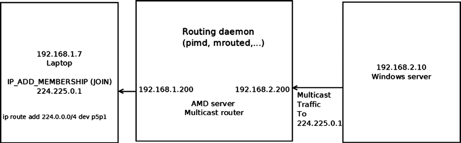

# Chương 6. Routing nâng cao

Chương 5 đã trình bày IPv4 routing subsystem. Chương này tiếp tục với routing subsystem và trình bày các chủ đề IPv4 routing nâng cao như Multicast Routing, Multipath Routing, Policy Routing cùng các chủ đề khác. Cuốn sách này trình bày cách triển khai Linux Kernel Networking—không đi sâu vào nội bộ cách triển khai userspace Multicast Routing daemon, vốn khá phức tạp và nằm ngoài phạm vi sách. Tuy nhiên, tôi có trình bày ở mức độ nhất định sự tương tác giữa userspace multicast routing daemon và multicast layer trong kernel. Tôi cũng trình bày ngắn gọn protocol Internet Group Management Protocol (IGMP), là nền tảng quản lý multicast group membership; thêm và xóa multicast group member được thực hiện bằng protocol IGMP. Cần có một số kiến thức cơ bản về IGMP để hiểu sự tương tác giữa multicast host và multicast router.

Multipath Routing là khả năng thêm nhiều nexthop vào một route. Policy Routing cho phép cấu hình routing policy không chỉ dựa trên địa chỉ đích. Tôi bắt đầu bằng việc mô tả Multicast Routing.

## Multicast Routing

Chương 4 đề cập ngắn gọn Multicast Routing trong phần “Nhận IPv4 Multicast Packet”. Bây giờ tôi sẽ trình bày sâu hơn. Gửi lưu lượng multicast nghĩa là gửi cùng packet đến nhiều bên nhận. Tính năng này có thể hữu ích trong streaming media, hội nghị âm thanh/video và các ứng dụng khác. Nó có ưu thế rõ rệt so với lưu lượng unicast về tiết kiệm băng thông mạng. Địa chỉ multicast được định nghĩa là địa chỉ Class D. Prefix Classless Inter-Domain Routing (CIDR) của nhóm này là 224.0.0.0/4. Dải địa chỉ IPv4 multicast từ 224.0.0.0 đến 239.255.255.255. Xử lý Multicast Routing phải kết hợp với userspace routing daemon tương tác với kernel. Theo cách triển khai Linux, Multicast Routing không thể được xử lý chỉ bằng kernel code mà thiếu userspace Routing daemon này, khác với Unicast Routing. Có nhiều multicast daemon: chẳng hạn `mrouted`, dựa trên cách triển khai Distance Vector Multicast Routing Protocol (DVMRP), hoặc `pimd`, dựa trên protocol Protocol-Independent Multicast (PIM). Protocol DVMRP được định nghĩa trong RFC 1075 và là multicast routing protocol đầu tiên. Nó dựa trên protocol Routing Information Protocol (RIP).

Protocol PIM có hai phiên bản và kernel hỗ trợ cả hai (CONFIG\_IP\_PIMSM\_V1 và CONFIG\_IP\_PIMSM\_V2). PIM có bốn mode khác nhau: PIM-SM (PIM Sparse Mode), PIM-DM (PIM Dense Mode), PIM Source-Specific Multicast (PIM-SSM) và Bidirectional PIM. Protocol được gọi là protocol-independent vì không phụ thuộc routing protocol cụ thể nào để topology discovery. Phần này trình bày sự tương tác giữa userspace daemon và kernel multicast routing layer. Đi sâu vào nội bộ protocol PIM hoặc DVMRP (hay bất kỳ Multicast Routing protocol nào khác) nằm ngoài phạm vi sách. Thông thường, Multicast Routing lookup dựa trên địa chỉ nguồn và đích. Có một tính năng kernel “Multicast Policy Routing”, tương ứng với tính năng kernel unicast policy routing đã đề cập trong Chương 5 và cũng được trình bày trong chương này. Protocol multicast policy routing được triển khai bằng Policy Routing API (chẳng hạn gọi method `fib_rules_lookup()` để thực hiện lookup, tạo object `fib_rules_ops` và đăng ký nó bằng method `fib_rules_register()`, v.v.). Với Multicast Policy Routing, routing có thể dựa trên tiêu chí bổ sung như ingress network interface. Hơn nữa, bạn có thể làm việc với nhiều

multicast routing table. Để làm việc với Multicast Policy Routing, phải bật IP\_MROUTE\_MULTIPLE\_TABLES.

Hình 6-1 minh họa một thiết lập IPv4 Multicast Routing đơn giản. Topology rất đơn giản: laptop bên trái tham gia multicast group (224.225.0.1) bằng cách gửi IGMP packet (IP\_ADD\_MEMBERSHIP). Protocol IGMP được trình bày trong phần tiếp theo, “Protocol IGMP”. AMD server ở giữa được cấu hình làm multicast router và chạy userspace multicast routing daemon (như `pimd` hoặc `mrouted`). Windows server bên phải có địa chỉ IP 192.168.2.10 gửi lưu lượng multicast đến 224.225.0.1; lưu lượng này được forwarding đến laptop qua multicast router. Lưu ý bản thân Windows server không tham gia multicast group 224.225.0.1. Chạy `ip route add 224.0.0.0/4 dev <networkDeviceName>` yêu cầu kernel gửi mọi lưu lượng multicast qua network device chỉ định.



Hình 6-1. Thiết lập Multicast Routing đơn giản

Phần tiếp theo trình bày protocol IGMP, được dùng để quản lý multicast group membership.

### Protocol IGMP

Protocol IGMP là thành phần không thể thiếu của IPv4 multicast. Nó phải được triển khai trên mỗi node hỗ trợ IPv4 multicast. Trong IPv6, quản lý multicast do protocol MLD (Multicast Listener Discovery) xử lý, sử dụng các message ICMPv6 được trình bày trong Chương 8. Với protocol IGMP, multicast group membership được thiết lập và quản lý. Có ba phiên bản IGMP:

1\. IGMPv1 (RFC 1112): Có hai loại message—host membership report và host

membership query. Khi host muốn tham gia multicast group, nó gửi message membership report. Multicast router gửi membership query để tìm các host multicast group có member trên những mạng cục bộ kết nối với mình. Query được gửi đến địa chỉ nhóm all-hosts (224.0.0.1, IGMP\_ALL\_HOSTS) và mang TTL bằng 1 để membership query không đi ra ngoài LAN.

2\. IGMPv2 (RFC 2236): Đây là phần mở rộng của IGMPv1. Protocol IGMPv2 thêm ba

message mới:

a. Membership Query (0x11): Có hai sub-types của message Membership Query:

General Query, dùng để tìm các group có member trên mạng kết nối, và Group-Specific Query, dùng để tìm xem một group cụ thể có member nào trên mạng kết nối hay không.

b. Version 2 Membership Report (0x16).

c. Leave Group (0x17).

Lưu ý IGMPv2 cũng hỗ trợ message Version 1 Membership Report để tương thích ngược với IGMPv1. Xem RFC 2236, phần 2.1.

3\. IGMPv3 (RFC 3376, được cập nhật bởi RFC 4604): Bản sửa đổi lớn này của protocol thêm

tính năng gọi là source filtering. Nghĩa là khi host tham gia multicast group, nó có thể chỉ định tập địa chỉ nguồn mà từ đó nó sẽ nhận lưu lượng multicast. Source filter cũng có thể loại trừ địa chỉ nguồn. Để hỗ trợ tính năng source filtering, socket API được mở rộng; xem RFC 3678, “Socket Interface Extensions for Multicast Source Filters”. Tôi cũng cần đề cập rằng multicast router định kỳ (khoảng mỗi hai phút) gửi membership query đến 224.0.0.1, địa chỉ multicast group all-hosts. Host nhận membership query phản hồi bằng membership report. Điều này được triển khai trong kernel bằng method `igmp_rcv()`: nhận message IGMP\_HOST\_MEMBERSHIP\_QUERY được xử lý bởi method `igmp_heard_query()`.

Lưu ý cách triển khai IPv4 IGMP trong kernel nằm trong `net/core/igmp.c`, `include/linux/igmp.h` và `include/uapi/linux/igmp.h`.

Phần tiếp theo xem xét data structure nền tảng của IPv4 Multicast Routing, multicast routing table, và cách triển khai trong Linux.

### Multicast Routing Table

Multicast routing table được biểu diễn bằng structure tên `mr_table`. Hãy xem:

```
    struct mr_table {
        struct list_head     list;
    #ifdef CONFIG_NET_NS
        struct net           *net;
    #endif
        u32                  id;
        struct sock __rcu    *mroute_sk;
        struct timer_list    ipmr_expire_timer;
        struct list_head     mfc_unres_queue;
    struct list_head     mfc_cache_array[MFC_LINES];
    struct vif_device    vif_table[MAXVIFS];
    . . .
};
```

(`net/ipv4/ipmr.c`)

Sau đây là mô tả một số member của structure `mr_table`:

- `net`: Network namespace gắn với multicast routing table; mặc định là initial network namespace, `init_net`. Network namespace được trình bày trong Chương 14.

- `id`: ID của multicast routing table; là RT\_TABLE\_DEFAULT (253) khi làm việc với một bảng duy nhất.

- `mroute_sk`: Pointer này biểu diễn reference đến userspace socket mà kernel giữ. Pointer `mroute_sk` được khởi tạo bằng cách gọi `setsockopt()` từ userspace với socket option `MRT_INIT` và được đặt về NULL bằng cách gọi `setsockopt()` với socket option MRT\_DONE. Sự tương tác giữa userspace và kernel dựa trên việc gọi method `setsockopt()`, gửi IOCTL từ userspace, và tạo IGMP packet rồi chuyển đến Multicast Routing daemon bằng cách gọi method `sock_queue_rcv_skb()` từ kernel.

- `ipmr_expire_timer`: Timer dọn các multicast routing entry chưa resolve. Timer này được khởi tạo khi tạo multicast routing table trong method `ipmr_new_table()` và bị loại bỏ khi xóa multicast routing table bằng method `ipmr_free_table()`.

- `mfc_unres_queue`: Queue chứa các routing entry chưa resolve.

- `mfc_cache_array`: Cache các routing entry gồm 64 (MFC\_LINES) entry, sẽ được trình bày ngay trong phần tiếp theo.

- `vif_table[MAXVIFS]`: Array gồm 32 (MAXVIFS) object `vif_device`. Entry được thêm bởi method `vif_add()` và xóa bởi method `vif_delete()`. Structure `vif_device` biểu diễn virtual multicast routing network interface; có thể dựa trên physical device hoặc IPIP (IP over IP) tunnel. Structure `vif_device` được trình bày ở phía sau trong phần “Vif Device”.

Tôi đã trình bày multicast routing table và đề cập các member quan trọng như Multicast Forwarding Cache (MFC) và queue các routing entry chưa resolve. Tiếp theo tôi xem xét MFC, được nhúng trong object multicast routing table và đóng vai trò quan trọng trong Multicast Routing.

### Multicast Forwarding Cache (MFC)

Data structure quan trọng nhất trong multicast routing table là MFC, thực tế là array các cache entry (object `mfc_cache`). Array này, tên `mfc_cache_array`, được nhúng trong object multicast routing table (`mr_table`). Nó có 64 (MFC\_LINES) phần tử. Index của array là giá trị hash (hash function nhận hai tham số—địa chỉ multicast group và địa chỉ IP nguồn; xem mô tả macro MFC\_HASH trong phần “Tham khảo nhanh” ở cuối chương này).

Thông thường chỉ có một multicast routing table, là instance của structure `mr_table`, và reference đến nó được giữ trong IPv4 network namespace (`net->ipv4.mrt`). Bảng được tạo bởi method `ipmr_rules_init()`, đồng thời method này gán `net->ipv4.mrt` trỏ đến multicast routing table vừa tạo. Khi làm việc với tính năng multicast policy routing đã đề cập, có thể có nhiều multicast policy routing table. Trong cả hai trường hợp, bạn lấy routing table bằng cùng method `ipmr_fib_lookup()`. Method `ipmr_fib_lookup()` nhận ba tham số đầu vào: network namespace, flow và pointer đến object `mr_table` mà nó phải

điền. Thông thường nó chỉ đặt pointer `mr_table` chỉ định thành `net->ipv4.mrt`; khi làm việc với nhiều bảng (IP\_MROUTE\_MULTIPLE\_TABLES được bật), cách triển khai phức tạp hơn. Hãy xem structure `mfc_cache`:

```
struct mfc_cache {
    struct list_head list;
    __be32 mfc_mcastgrp;
    __be32 mfc_origin;
    vifi_t mfc_parent;
    int mfc_flags;
    union {
            struct {
                    unsigned long expires;
                    struct sk_buff_head unresolved; /* Unresolved buffers */
            } unres;
            struct {
                    unsigned long last_assert;
                    int minvif;
                    int maxvif;
                    unsigned long bytes;
                    unsigned long pkt;
                    unsigned long wrong_if;
                    unsigned char ttls[MAXVIFS];    /* TTL thresholds */
            } res;
    } mfc_un;
    struct rcu_head rcu;
 };
```

(`include/linux/mroute.h`)

Sau đây là mô tả một số member của structure `mfc_cache`:

- `mfc_mcastgrp`: Địa chỉ multicast group mà entry thuộc về.

- `mfc_origin`: Địa chỉ nguồn của route.

- `mfc_parent`: Source interface.

- `mfc_flags`: Các flag của entry. Có thể có một trong những giá trị sau:

- MFC\_STATIC: Khi route được thêm tĩnh thay vì bởi multicast routing daemon.

- MFC\_NOTIFY: Khi flag RTM\_F\_NOTIFY của routing entry được đặt. Xem method `rt_fill_info()` và method `ipmr_get_route()` để biết thêm chi tiết.

- Union `mfc_un` gồm hai phần tử:

- `unres`: Các cache entry chưa resolve.

- `res`: Các cache entry đã resolve. Lần đầu SKB của một flow cụ thể đến kernel, nó được thêm vào queue các entry chưa resolve

(`mfc_un.unres.unresolved`), nơi có thể lưu tối đa ba SKB. Nếu đã có ba SKB trong queue, packet không được thêm vào queue mà được giải phóng, và method `ipmr_cache_unresolved()` trả về -ENOBUFS (“Không còn không gian buffer”):

```
static int ipmr_cache_unresolved(struct mr_table *mrt, vifi_t vifi, struct sk_buff *skb)
{
         . . .
         if (c->mfc_un.unres.unresolved.qlen > 3) {
                 kfree_skb(skb);
                 err = -ENOBUFS;
        } else {
            . . .

}
```

(`net/ipv4/ipmr.c`)

Phần này mô tả MFC và các member quan trọng, bao gồm queue các entry đã resolve và queue các entry chưa resolve. Phần tiếp theo mô tả ngắn gọn multicast router là gì và cách cấu hình trong Linux.

### Multicast Router

Để cấu hình máy làm multicast router, bạn phải bật kernel configuration option CONFIG\_IP\_MROUTE. Bạn cũng phải chạy routing daemon như `pimd` hoặc `mrouted`, như đã đề cập. Các routing daemon này tạo socket để giao tiếp với kernel. Chẳng hạn trong `pimd`, bạn tạo raw IGMP socket bằng cách gọi `socket(AF_INET, SOCK_RAW, IPPROTO_IGMP)`. Gọi `setsockopt()` trên socket này kích hoạt gửi lệnh đến kernel, được xử lý bởi method `ip_mroute_setsockopt()`. Khi gọi `setsockopt()` trên socket này từ routing daemon với MRT\_INIT, kernel được thiết lập giữ reference đến userspace socket trong trường `mroute_sk` của object `mr_table` đang dùng, và entry `mc_forwarding procfs` (`/proc/sys/net/ipv4/conf/all/mc_forwarding`) được bật bằng cách gọi IPV4\_DEVCONF\_ALL(net, MC\_FORWARDING)++. Lưu ý entry `mc_forwarding procfs` là entry read-only và không thể thiết lập từ userspace. Bạn không thể tạo instance khác của multicast routing daemon: khi xử lý option MRT\_INIT, method `ip_mroute_setsockopt()` kiểm tra trường `mroute_sk` của object `mr_table` đã được khởi tạo chưa và trả về -EADDRINUSE nếu đã khởi tạo. Thêm network interface được thực hiện bằng cách gọi `setsockopt()` trên socket này với MRT\_ADD\_VIF, còn xóa network interface bằng cách gọi `setsockopt()` trên socket này với MRT\_DEL\_VIF. Bạn có thể truyền tham số của network interface vào các lời gọi `setsockopt()` này bằng cách truyền object `vifctl` làm tham số `optval` của system call `setsockopt()`. Hãy xem structure `vifctl`:

```
struct vifctl {
    vifi_t    vifc_vifi;                /* Index of VIF */
    unsigned char vifc_flags;            /* VIFF_ flags */
    unsigned char vifc_threshold;        /* ttl limit */
    unsigned int vifc_rate_limit;        /* Rate limiter values (NI) */
    union {
        struct in_addr vifc_lcl_addr;     /* Local interface address */
        int            vifc_lcl_ifindex;  /* Local interface index   */
    };
    struct in_addr vifc_rmt_addr;    /* IPIP tunnel addr */
};
```

(`include/uapi/linux/mroute.h`)

Sau đây là mô tả một số member của structure `vifctl`:

- `vifc_flags` có thể là:

- VIFF\_TUNNEL: Khi bạn muốn dùng IPIP tunnel.

- VIFF\_REGISTER: Khi bạn muốn đăng ký interface.

- VIFF\_USE\_IFINDEX: Khi bạn muốn dùng local interface index thay vì địa chỉ IP của local interface; khi đó, bạn đặt `vifc_lcl_ifindex` thành local interface index. Flag VIFF\_USE\_IFINDEX có từ kernel 2.6.33 trở lên.

- `vifc_lcl_addr:` Địa chỉ IP của local interface. (Đây là mặc định—không cần đặt flag để sử dụng).

- `vifc_lcl_ifindex:` Local interface index. Phải được thiết lập khi flag VIFF\_USE\_IFINDEX được đặt trong `vifc_flags`.

- `vifc_rmt_addr:` Địa chỉ remote node của tunnel.

Khi multicast routing daemon đóng, method `setsockopt()` được gọi với option MRT\_DONE. Điều này kích hoạt gọi method `mrtsock_destruct()` để đặt trường `mroute_sk` của object `mr_table` đang dùng về NULL và thực hiện các thao tác dọn dẹp.

Phần này trình bày multicast router là gì và cách cấu hình trong Linux. Tôi cũng đã xem xét structure `vifctl`. Tiếp theo, tôi xem xét Vif device, biểu diễn multicast network interface.

### Vif Device

Multicast Routing hỗ trợ hai mode: direct multicast và multicast được encapsulation trong unicast packet qua tunnel. Trong cả hai trường hợp, cùng một object (instance của structure `vif_device`) được dùng để biểu diễn network interface. Khi làm việc qua tunnel, flag VIFF\_TUNNEL được đặt. Thêm và xóa multicast interface được thực hiện lần lượt bằng method `vif_add()` và method `vif_delete()`. Method `vif_add()` cũng thiết lập thiết bị hỗ trợ multicast bằng cách gọi method `dev_set_allmulti(dev, 1)`, tăng bộ đếm `allmulti` của network device chỉ định (object `net_device`). Method `vif_delete()` gọi `dev_set_allmulti(dev, -1)` để giảm bộ đếm `allmulti` của network device chỉ định (object `net_device`). Để biết thêm về method `dev_set_allmulti()`, xem Phụ lục A. Hãy xem structure `vif_device`; các member của nó khá self-explanatory:

```
struct vif_device {
        struct net_device       *dev;       /* Device we are using */
        unsigned long   bytes_in,bytes_out;
        unsigned long   pkt_in,pkt_out;     /* Statistics                   */
        unsigned long   rate_limit;         /* Traffic shaping (NI)         */
        unsigned char   threshold;          /* TTL threshold                */
        unsigned short  flags;              /* Control flags                */
        __be32          local,remote;       /* Addresses(remote for tunnels)*/
        int             link;               /* Physical interface index     */
};
```

(`include/linux/mroute.h`)

Để nhận lưu lượng multicast, host phải tham gia multicast group. Điều này được thực hiện bằng cách tạo socket trong userspace và gọi `setsockopt()` với IPPROTO\_IP cùng socket option IP\_ADD\_MEMBERSHIP. Ứng dụng userspace cũng tạo object `ip_mreq` để khởi tạo các tham số yêu cầu như địa chỉ multicast group mong muốn và địa chỉ IP nguồn của host (xem userspace header `netinet/in.h`). Lời gọi `setsockopt()` được xử lý trong kernel bởi method `ip_mc_join_group()` trong `net/ipv4/igmp.c`. Cuối cùng, địa chỉ multicast

được method `ip_mc_join_group()` thêm vào danh sách địa chỉ multicast (`mc_list`), là member của object `in_device`. Host có thể rời multicast group bằng cách gọi `setsockopt()` với IPPROTO\_IP cùng socket option IP\_DROP\_MEMBERSHIP. Điều này được xử lý trong kernel bởi method `ip_mc_leave_group()` trong `net/ipv4/igmp.c`. Một socket có thể tham gia tối đa 20 multicast group (`sysctl_igmp_max_memberships`). Cố tham gia hơn 20 multicast group bằng cùng socket sẽ thất bại với lỗi -ENOBUFS (“Không còn không gian buffer”). Xem cách triển khai method `ip_mc_join_group()` trong `net/ipv4/igmp.c`.

### IPv4 Multicast Rx Path

Phần “Nhận IPv4 Multicast Packet” của Chương 4 trình bày ngắn gọn cách xử lý multicast packet. Bây giờ tôi sẽ mô tả sâu hơn. Nội dung giả sử máy của chúng ta được cấu hình làm multicast router; như đã đề cập, nghĩa là CONFIG\_IP\_MROUTE được bật và một routing daemon như `pimd` hoặc `mrouted` chạy trên host này. Multicast packet được xử lý bởi method `ip_route_input_mc()`, nơi một routing table entry (object `rtable`) được cấp phát và khởi tạo, đồng thời callback `input` của object `dst` được đặt thành `ip_mr_input()` nếu CONFIG\_IP\_MROUTE được bật. Hãy xem method `ip_mr_input()`:

```
int ip_mr_input(struct sk_buff *skb)
{
        struct mfc_cache *cache;
        struct net *net = dev_net(skb->dev);
```

Trước tiên flag `local` được đặt thành `true` nếu packet dành cho local delivery, vì method `ip_mr_input()` cũng xử lý local multicast packet.

```
int local = skb_rtable(skb)->rt_flags & RTCF_LOCAL;
struct mr_table *mrt;

/* Packet is looped back after forward, it should not be
* forwarded second time, but still can be delivered locally.
*/
if (IPCB(skb)->flags & IPSKB_FORWARDED)
        goto dont_forward;
```

Thông thường, khi làm việc với một multicast routing table, method `ipmr_rt_fib_lookup()` chỉ trả về object `net->ipv4.mrt`:

```
mrt = ipmr_rt_fib_lookup(net, skb);
if (IS_ERR(mrt)) {
        kfree_skb(skb);
        return PTR_ERR(mrt);
}
if (!local) {
```

IGMPv3 và một số cách triển khai IGMPv2 đặt router alert option (IPOPT\_RA) trong IPv4 header khi gửi packet JOIN hoặc LEAVE. Xem method `igmpv3_newpack()` trong `net/ipv4/igmp.c`:

```
if (IPCB(skb)->opt.router_alert) {
```

Method `ip_call_ra_chain()` (`net/ipv4/ip_input.c`) gọi method `raw_rcv()` để chuyển packet đến userspace raw socket đang listen. Object `ip_ra_chain` chứa reference đến multicast routing socket,

được truyền làm tham số cho method `raw_rcv()`. Để biết thêm chi tiết, xem cách triển khai method `ip_call_ra_chain()` trong `net/ipv4/ip_input.c`:

```
if (ip_call_ra_chain(skb))
        return 0;
```

Có những cách triển khai không đặt router alert option, như giải thích trong comment sau; các trường hợp này cũng phải được xử lý bằng cách gọi trực tiếp method `raw_rcv()`:

```
} else if (ip_hdr(skb)->protocol == IPPROTO_IGMP) {
        /* IGMPv1 (and broken IGMPv2 implementations sort of
        * Cisco IOS <= 11.2(8)) do not put router alert
        * option to IGMP packets destined to routable
        * groups. It is very bad, because it means
        * that we can forward NO IGMP messages.
        */
        struct sock *mroute_sk;
```

Socket `mrt->mroute_sk` là bản sao trong kernel của socket được ứng dụng userspace multicast routing tạo:

```
mroute_sk = rcu_dereference(mrt->mroute_sk);
        if (mroute_sk) {
        nf_reset(skb);
        raw_rcv(mroute_sk, skb);
        return 0;
        }
     }
}
```

Trước tiên lookup trong multicast routing cache, `mfc_cache_array`, được thực hiện bằng cách gọi method `ipmr_cache_find()`. Hash key là địa chỉ multicast group đích và địa chỉ IP nguồn của packet, lấy từ IPv4 header:

```
cache = ipmr_cache_find(mrt, ip_hdr(skb)->saddr, ip_hdr(skb)->daddr);
if (cache == NULL) {
```

Lookup trong array các virtual device (`vif_table`) được thực hiện để xem có entry tương ứng khớp với incoming network device (`skb->dev`) hay không:

```
int vif = ipmr_find_vif(mrt, skb->dev);
```

Method `ipmr_cache_find_any()` xử lý tính năng nâng cao hỗ trợ multicast proxy (không được trình bày trong sách này):

```
            if (vif >= 0)
                    cache = ipmr_cache_find_any(mrt, ip_hdr(skb)->daddr,
                                                vif);
    }

/*
*      No usable cache entry
*/
if (cache == NULL) {
        int vif;
```

Nếu packet dành cho host cục bộ, chuyển nó đến đó:

```
if (local) {
        struct sk_buff *skb2 = skb_clone(skb, GFP_ATOMIC);
        ip_local_deliver(skb);
        if (skb2 == NULL)
                return -ENOBUFS;
        skb = skb2;
}

read_lock(&mrt_lock);
vif = ipmr_find_vif(mrt, skb->dev);
if (vif >= 0) {
```

Method `ipmr_cache_unresolved()` tạo multicast routing entry (object `mfc_cache`) bằng cách gọi method `ipmr_cache_alloc_unres()`. Method này tạo cache entry (object `mfc_cache`) và khởi tạo khoảng thời gian hết hạn (bằng cách thiết lập `mfc_un.unres.expires`). Hãy xem method rất ngắn này, `ipmr_cache_alloc_unres()`:

```
static struct mfc_cache *ipmr_cache_alloc_unres(void)
{
    struct mfc_cache *c = kmem_cache_zalloc(mrt_cachep, GFP_ATOMIC);

    if (c) {
        skb_queue_head_init(&c->mfc_un.unres.unresolved);
```

Thiết lập khoảng thời gian hết hạn:

```
        c->mfc_un.unres.expires = jiffies + 10*HZ;
    }
    return c;
}
```

Nếu routing daemon không resolve routing entry trong khoảng thời gian hết hạn, entry bị xóa khỏi queue các entry chưa resolve. Khi tạo multicast routing table (bằng method `ipmr_new_table()`), timer của nó (`ipmr_expire_timer`) được thiết lập. Timer này định kỳ gọi method `ipmr_expire_process()`. Method `ipmr_expire_process()` duyệt mọi cache entry chưa resolve trong queue các entry chưa resolve (`mfc_unres_queue` của object `mrtable`) và xóa các cache entry chưa resolve đã hết hạn.

Sau khi tạo cache entry chưa resolve, method `ipmr_cache_unresolved()` thêm nó vào queue các entry chưa resolve (`mfc_unres_queue` của multicast table, `mrtable`) và tăng thêm 1 độ dài unresolved queue (`cache_resolve_queue_len` của multicast table, `mrtable`). Nó cũng gọi method `ipmr_cache_report()`, tạo message IGMP (IGMPMSG\_NOCACHE) và chuyển đến userspace multicast routing daemon bằng cách cuối cùng gọi method `sock_queue_rcv_skb()`.

Tôi đã đề cập userspace routing daemon phải resolve routing trong một khoảng thời gian. Tôi không đi sâu cách triển khai trong userspace. Tuy nhiên, lưu ý khi routing daemon quyết định phải

resolve một entry chưa resolve, nó tạo các tham số cache entry (trong object `mfcctl`) và gọi `setsockopt()` với socket option MRT\_ADD\_MFC, rồi truyền object `mfcctl` được nhúng trong tham số `optval` của system call `setsockopt()`; điều này được xử lý trong kernel bởi method `ipmr_mfc_add()`:

```
                int err2 = ipmr_cache_unresolved(mrt, vif, skb);
                read_unlock(&mrt_lock);

                return err2;
        }
        read_unlock(&mrt_lock);
        kfree_skb(skb);
        return -ENODEV;
}

read_lock(&mrt_lock);
```

Nếu tìm thấy cache entry trong MFC, gọi method `ip_mr_forward()` để tiếp tục hành trình packet:

```
        ip_mr_forward(net, mrt, skb, cache, local);
        read_unlock(&mrt_lock);

        if (local)
                return ip_local_deliver(skb);

        return 0;

dont_forward:
        if (local)
                return ip_local_deliver(skb);
        kfree_skb(skb);
        return 0;
}
```

Phần này trình bày chi tiết IPv4 Multicast Rx path và sự tương tác với routing daemon trong path này. Phần tiếp theo mô tả method forwarding của multicast routing, `ip_mr_forward()`.

### Method ip\_mr\_forward()

Hãy xem method `ip_mr_forward()`:

```
static int ip_mr_forward(struct net *net, struct mr_table *mrt,
             struct sk_buff *skb, struct mfc_cache *cache,
             int local)
{
    int psend = -1;
    int vif, ct;
    int true_vifi = ipmr_find_vif(mrt, skb->dev);

    vif = cache->mfc_parent;
```

Ở đây bạn có thể thấy việc cập nhật thống kê của resolved cache object (`mfc_un.res`):

```
cache->mfc_un.res.pkt++;
cache->mfc_un.res.bytes += skb->len;

if (cache->mfc_origin == htonl(INADDR_ANY) && true_vifi >= 0) {
    struct mfc_cache *cache_proxy;
```

Biểu thức `(*, G)` nghĩa là lưu lượng từ bất kỳ nguồn nào gửi đến group G:

```
    /* For an (*,G) entry, we only check that the incomming
    * interface is part of the static tree.
    */
    cache_proxy = ipmr_cache_find_any_parent(mrt, vif);
    if (cache_proxy &&
        cache_proxy->mfc_un.res.ttls[true_vifi] < 255)
        goto forward;
}
/*
 * Wrong interface: drop packet and (maybe) send PIM assert.
 */
if (mrt->vif_table[vif].dev != skb->dev) {
    if (rt_is_output_route(skb_rtable(skb))) {
        /* It is our own packet, looped back.
         * Very complicated situation...
         *
         * The best workaround until routing daemons will be
         * fixed is not to redistribute packet, if it was
         * send through wrong interface. It means, that
         * multicast applications WILL NOT work for
         * (S,G), which have default multicast route pointing
         * to wrong oif. In any case, it is not a good
         * idea to use multicasting applications on router.
         */
        goto dont_forward;
    }

    cache->mfc_un.res.wrong_if++;

    if (true_vifi >= 0 && mrt->mroute_do_assert &&
        /* pimsm uses asserts, when switching from RPT to SPT,
         * so that we cannot check that packet arrived on an oif.
         * It is bad, but otherwise we would need to move pretty
         * large chunk of pimd to kernel. Ough... --ANK
         */
        (mrt->mroute_do_pim ||
        cache->mfc_un.res.ttls[true_vifi] < 255) &&
        time_after(jiffies,
               cache->mfc_un.res.last_assert + MFC_ASSERT_THRESH)) {
        cache->mfc_un.res.last_assert = jiffies;
```

Gọi method `ipmr_cache_report()` để tạo message IGMP (IGMPMSG\_WRONGVIF) và chuyển đến userspace multicast routing daemon bằng cách gọi method `sock_queue_rcv_skb()`:

```
        ipmr_cache_report(mrt, skb, true_vifi, IGMPMSG_WRONGVIF);
    }
    goto dont_forward;
}
```

Frame bây giờ sẵn sàng được forwarding:

```
forward:
    mrt->vif_table[vif].pkt_in++;
    mrt->vif_table[vif].bytes_in += skb->len;

    /*
     *    Forward the frame
     */
    if (cache->mfc_origin == htonl(INADDR_ANY) &&
        cache->mfc_mcastgrp == htonl(INADDR_ANY)) {
        if (true_vifi >= 0 &&
            true_vifi != cache->mfc_parent &&
            ip_hdr(skb)->ttl >
                cache->mfc_un.res.ttls[cache->mfc_parent]) {
            /* It's an (*,*) entry and the packet is not coming from
             * the upstream: forward the packet to the upstream
             * only.
             */
            psend = cache->mfc_parent;
            goto last_forward;
        }
        goto dont_forward;
    }
    for (ct = cache->mfc_un.res.maxvif - 1;
         ct >= cache->mfc_un.res.minvif; ct--) {
        /* For (*,G) entry, don't forward to the incoming interface */
        if ((cache->mfc_origin != htonl(INADDR_ANY) ||
             ct != true_vifi) &&
            ip_hdr(skb)->ttl > cache->mfc_un.res.ttls[ct]) {
            if (psend != -1) {
                struct sk_buff *skb2 = skb_clone(skb, GFP_ATOMIC);
```

Gọi method `ipmr_queue_xmit()` để tiếp tục forwarding packet:

```
                    if (skb2)
                        ipmr_queue_xmit(net, mrt, skb2, cache,
                                psend);
                }
                psend = ct;
            }
        }
    last_forward:
    if (psend != -1) {
        if (local) {
            struct sk_buff *skb2 = skb_clone(skb, GFP_ATOMIC);

            if (skb2)
                ipmr_queue_xmit(net, mrt, skb2, cache, psend);
        } else {
            ipmr_queue_xmit(net, mrt, skb, cache, psend);
            return 0;
        }
    }

dont_forward:
    if (!local)
        kfree_skb(skb);
    return 0;
}
```

Sau khi trình bày method forwarding của multicast routing, `ip_mr_forward()`, đã đến lúc xem xét method `ipmr_queue_xmit()`.

### Method ipmr\_queue\_xmit()

Hãy xem method `ipmr_queue_xmit()`:

```
static void ipmr_queue_xmit(struct net *net, struct mr_table *mrt,
                            struct sk_buff *skb, struct mfc_cache *c, int vifi)
{
        const struct iphdr *iph = ip_hdr(skb);
        struct vif_device *vif = &mrt->vif_table[vifi];
        struct net_device *dev;
        struct rtable *rt;
        struct flowi4 fl4;
```

Trường `encap` được dùng khi làm việc với tunnel:

```
        int encap = 0;

        if (vif->dev == NULL)
                goto out_free;

#ifdef CONFIG_IP_PIMSM
        if (vif->flags & VIFF_REGISTER) {
                vif->pkt_out++;
                vif->bytes_out += skb->len;
                vif->dev->stats.tx_bytes += skb->len;
                vif->dev->stats.tx_packets++;
                ipmr_cache_report(mrt, skb, vifi, IGMPMSG_WHOLEPKT);
                goto out_free;
        }
#endif
```

Khi làm việc với tunnel, routing lookup được thực hiện với `vif->remote` và `vif->local`, lần lượt biểu diễn địa chỉ đích và địa chỉ cục bộ. Các địa chỉ này là hai đầu tunnel. Khi làm việc với object `vif_device` biểu diễn physical device, routing lookup được thực hiện với địa chỉ đích của IPv4 header và 0 làm địa chỉ nguồn:

```
if (vif->flags & VIFF_TUNNEL) {
        rt = ip_route_output_ports(net, &fl4, NULL,
                                   vif->remote, vif->local,
                                   0, 0,
                                   IPPROTO_IPIP,
                                   RT_TOS(iph->tos), vif->link);
        if (IS_ERR(rt))
                goto out_free;
        encap = sizeof(struct iphdr);
} else {
       rt = ip_route_output_ports(net, &fl4, NULL, iph->daddr, 0,
                                  0, 0,
                                  IPPROTO_IPIP,
                                  RT_TOS(iph->tos), vif->link);
       if (IS_ERR(rt))
               goto out_free;
}

dev = rt->dst.dev;
```

Lưu ý nếu kích thước packet lớn hơn MTU, message ICMPv4 không được gửi (như trong trường hợp unicast forwarding); chỉ thống kê được cập nhật và packet bị loại bỏ:

```
if (skb->len+encap > dst_mtu(&rt->dst) && (ntohs(iph->frag_off) & IP_DF)) {
        /* Do not fragment multicasts. Alas, IPv4 does not
         * allow to send ICMP, so that packets will disappear
         * to blackhole.
         */

        IP_INC_STATS_BH(dev_net(dev), IPSTATS_MIB_FRAGFAILS);
        ip_rt_put(rt);
        goto out_free;
}

encap += LL_RESERVED_SPACE(dev) + rt->dst.header_len;

if (skb_cow(skb, encap)) {
        ip_rt_put(rt);
        goto out_free;
}

vif->pkt_out++;
vif->bytes_out += skb->len;

skb_dst_drop(skb);
skb_dst_set(skb, &rt->dst);
```

TTL được giảm và IPv4 header checksum được tính lại (vì TTL là một trong các trường IPv4) khi forwarding packet; điều tương tự được thực hiện trong method `ip_forward()` cho unicast packet:

```
ip_decrease_ttl(ip_hdr(skb));

/* FIXME: forward and output firewalls used to be called here.
 * What do we do with netfilter? -- RR
 */
if (vif->flags & VIFF_TUNNEL) {
        ip_encap(skb, vif->local, vif->remote);
        /* FIXME: extra output firewall step used to be here. --RR */
        vif->dev->stats.tx_packets++;
        vif->dev->stats.tx_bytes += skb->len;
}

IPCB(skb)->flags |= IPSKB_FORWARDED;

/*
 * RFC1584 teaches, that DVMRP/PIM router must deliver packets locally
 * not only before forwarding, but after forwarding on all output
 * interfaces. It is clear, if mrouter runs a multicasting
 * program, it should receive packets not depending to what interface
 * program is joined.
 * If we will not make it, the program will have to join on all
 * interfaces. On the other hand, multihoming host (or router, but
 * not mrouter) cannot join to more than one interface - it will
 * result in receiving multiple packets.
 */
```

Gọi hook NF\_INET\_FORWARD:

```
        NF_HOOK(NFPROTO_IPV4, NF_INET_FORWARD, skb, skb->dev, dev,
                ipmr_forward_finish);
        return;

out_free:
        kfree_skb(skb);
}
```

### Method ipmr\_forward\_finish()

Hãy xem method `ipmr_forward_finish()`, một method rất ngắn—thực tế giống hệt method `ip_forward()`:

```
static inline int ipmr_forward_finish(struct sk_buff *skb)
{
        struct ip_options *opt = &(IPCB(skb)->opt);

        IP_INC_STATS_BH(dev_net(skb_dst(skb)->dev), IPSTATS_MIB_OUTFORWDATAGRAMS);
        IP_ADD_STATS_BH(dev_net(skb_dst(skb)->dev), IPSTATS_MIB_OUTOCTETS, skb->len);
```

Xử lý IPv4 options nếu được đặt (xem Chương 4):

```
        if (unlikely(opt->optlen))
                ip_forward_options(skb);

        return dst_output(skb);
}
```

Cuối cùng, `dst_output()` gửi packet qua method `ip_mc_output()`, gọi method `ip_finish_output()` (cả hai method nằm trong `net/ipv4/route.c`).

Sau khi trình bày các multicast method này, hãy tìm hiểu rõ hơn cách sử dụng giá trị trường TTL trong lưu lượng multicast.

### TTL trong lưu lượng Multicast

Trường TTL của IPv4 header có hai ý nghĩa khi nói về lưu lượng multicast. Ý nghĩa đầu tiên giống lưu lượng unicast IPV4: TTL biểu diễn hop counter, giảm đi 1 trên mỗi thiết bị forwarding packet. Khi đạt 0, packet bị loại bỏ. Điều này nhằm tránh packet di chuyển vô tận do lỗi nào đó. Ý nghĩa thứ hai của TTL, chỉ có ở lưu lượng multicast, là một ngưỡng. Các giá trị TTL được chia thành scope. Router có TTL threshold gán cho từng interface, và chỉ packet có TTL lớn hơn threshold của interface mới được forwarding. Sau đây là các giá trị threshold này:

- 0: Giới hạn trong cùng host (không thể gửi ra qua bất kỳ interface nào)

- 1: Giới hạn trong cùng subnet (không được router forwarding)

- 32: Giới hạn trong cùng site

- 64: Giới hạn trong cùng khu vực

- 128: Giới hạn trong cùng châu lục

- 255: Không giới hạn scope (global)

Xem: “IP Multicast Extensions for 4.3BSD UNIX and related systems” của Steve Deering, tại `www.kohala.com/start/mcast.api.txt`.

Lưu ý IPv4 Multicast Routing được triển khai trong `net/ipv4/ipmr.c`, `include/linux/mroute.h` và `include/uapi/linux/mroute.h`.

Đến đây kết thúc phần trình bày Multicast Routing. Chương chuyển sang Policy Routing, cho phép bạn cấu hình routing policy không chỉ dựa trên địa chỉ đích.

## Policy Routing

Với Policy Routing, system administrator có thể định nghĩa đến 255 routing table. Phần này trình bày IPv4 Policy Routing; IPv6 Policy Routing được trình bày trong Chương 8. Trong phần này, tôi dùng các thuật ngữ policy hoặc rule cho entry được tạo bởi Policy Routing để tránh nhầm lẫn routing entry thông thường (được trình bày trong Chương 5) với policy rule.

### Quản lý Policy Routing

Quản lý Policy Routing được thực hiện bằng lệnh `ip rule` của package `iproute2` (không có cách tương ứng để quản lý Policy Routing bằng lệnh `route`). Hãy xem cách thêm, xóa và dump mọi Policy Routing rule:

- Bạn thêm rule bằng lệnh `ip rule add`; chẳng hạn: `ip rule add tos 0x04 table 252`. Sau khi chèn rule này, mọi packet có trường IPv4 TOS khớp 0x04 được xử lý theo routing rule của bảng 252. Bạn có thể thêm routing entry vào bảng này bằng cách chỉ định số bảng khi thêm route; chẳng hạn: `ip route add default via 192.168.2.10 table 252`. Lệnh này được xử lý trong kernel bởi method `fib_nl_newrule()` trong `net/core/fib_rules.c`. Modifier `tos` trong lệnh `ip rule` ở trên là một trong các SELECTOR modifier khả dụng của lệnh `ip rule`; xem `man 8 ip rule` và Bảng 6-1 trong phần “Tham khảo nhanh” ở cuối chương này.

- Bạn xóa rule bằng lệnh `ip rule del`; chẳng hạn: `ip rule del tos 0x04 table 252`. Lệnh này được xử lý trong kernel bởi method `fib_nl_delrule()` trong `net/core/fib_rules.c`.

- Bạn dump mọi rule bằng lệnh `ip rule list` hoặc lệnh `ip rule show`. Cả hai lệnh được xử lý trong kernel bởi method `fib_nl_dumprule()` trong `net/core/fib_rules.c`.

Bạn đã nắm các kiến thức cơ bản về quản lý Policy Routing, vậy hãy xem xét cách triển khai Policy Routing trong Linux.

### Triển khai Policy Routing

Hạ tầng cốt lõi của Policy Routing là module `fib_rules`, `net/core/fib_rules.c`. Nó được ba protocol của kernel networking stack sử dụng: IPv4 (bao gồm multicast module có tính năng multicast policy routing, như đã đề cập trong phần “Multicast Routing” ở phía trước chương này), IPv6 và DECnet. IPv4 Policy Routing cũng được triển khai trong file tên `fib_rules.c`. Đừng nhầm lẫn vì tên giống nhau (`net/ipv4/fib_rules.c`). Trong IPv6, policy routing được triển khai trong `net/ipv6/fib6_rules.c`. Header file `include/net/fib_rules.h` chứa các data structure và method của Policy Routing core. Đây là định nghĩa structure `fib4_rule`, nền tảng cho IPv4 Policy Routing:

```
struct fib4_rule {
    struct fib_rule    common;
    u8            dst_len;
    u8            src_len;
    u8            tos;
    __be32            src;
    __be32            srcmask;
    __be32            dst;
    __be32            dstmask;
#ifdef CONFIG_IP_ROUTE_CLASSID
    u32            tclassid;
#endif
};
```

(`net/ipv4/fib_rules.c`)

Ba policy được tạo mặc định khi boot bằng cách gọi method `fib_default_rules_init()`: bảng local (RT\_TABLE\_LOCAL), bảng main (RT\_TABLE\_MAIN) và bảng default (RT\_TABLE\_DEFAULT). Lookup được thực hiện bởi method `fib_lookup()`. Lưu ý có hai cách triển khai method `fib_lookup()` khác nhau trong `include/net/ip_fib.h`. Cách đầu tiên, được bao trong block `#ifndef` CONFIG\_IP\_MULTIPLE\_TABLES, dành cho non-Policy Routing, còn cách thứ hai dành cho Policy Routing. Khi làm việc với Policy Routing, lookup được thực hiện như sau: nếu không thay đổi các policy routing rule ban đầu (`net->ipv4.fib_has_custom_rules` không được đặt), nghĩa là rule phải nằm trong một trong ba routing table ban đầu. Vì vậy, trước tiên lookup trong local table, tiếp theo main table rồi default table. Nếu không có entry tương ứng, lỗi network unreachable (-ENETUNREACH) được trả về. Nếu có thay đổi trong các policy routing rule ban đầu (`net->ipv4.` `fib_has_custom_rules` được đặt), method \_`fib_lookup()` được gọi; đây là method nặng hơn vì duyệt danh sách rule và gọi `fib_rule_match()` cho mỗi rule để quyết định có khớp hay không. Xem cách triển khai method `fib_rules_lookup()` trong `net/core/fib_rules.c`. (Method `fib_rules_lookup()` được gọi từ method `__fib_lookup()`). Tôi cần đề cập ở đây rằng biến `net->ipv4.fib_has_custom_rules` được đặt thành `false` trong giai đoạn khởi tạo bởi method `fib4_rules_init()`, và thành `true` trong method `fib4_rule_configure()` và method `fib4_rule_delete()`. Lưu ý phải bật CONFIG\_IP\_MULTIPLE\_TABLES để làm việc với Policy Routing.

Đến đây kết thúc phần trình bày Multicast Routing. Phần tiếp theo nói về Multipath Routing, khả năng thêm nhiều nexthop vào một route.

## Multipath Routing

Multipath Routing cung cấp khả năng thêm nhiều nexthop vào một route. Chẳng hạn có thể định nghĩa hai nexthop node như sau: `ip route add default scope global nexthop dev eth0 nexthop dev eth1`. System administrator cũng có thể gán trọng số cho mỗi nexthop—chẳng hạn như sau: `ip route add 192.168.1.10 nexthop via 192.168.2.1 weight 3 nexthop via 192.168.2.10 weight 5`. Structure `fib_info` biểu diễn IPv4 routing entry có thể có nhiều FIB nexthop. Member `fib_nhs` của object `fib_info` biểu diễn số object FIB nexthop; object `fib_info` chứa array các object FIB nexthop tên `fib_nh`. Vì vậy trong trường hợp này, một object `fib_info` duy nhất được tạo với array hai object FIB nexthop. Kernel giữ trọng số của mỗi next hop trong trường `nh_weight` của object FIB nexthop (`fib_nh`). Nếu không chỉ định trọng số khi thêm multipath route, nó được đặt mặc định thành 1 trong method `fib_create_info()`. Method `fib_select_multipath()` được gọi để xác định nexthop khi làm việc với Multipath Routing. Method này được gọi từ hai nơi: từ method `__ip_route_output_key()` trong Tx path và từ method `ip_mkroute_input()` trong Rx path. Lưu ý khi output device được đặt trong flow, method `fib_select_multipath()` không được gọi vì output device đã biết:

```
struct rtable *__ip_route_output_key(struct net *net, struct flowi4 *fl4) {
. . .
#ifdef CONFIG_IP_ROUTE_MULTIPATH
    if (res.fi->fib_nhs > 1 && fl4->flowi4_oif == 0)
        fib_select_multipath(&res);
    else
#endif
. . .

}
```

Trong Rx path không cần kiểm tra `fl4->flowi4_oif` có bằng 0 không, vì được đặt thành 0 ở đầu method này. Tôi không đi sâu chi tiết method `fib_select_multipath()`. Tôi chỉ đề cập method có yếu tố ngẫu nhiên, sử dụng `jiffies`, giúp tạo phân phối route theo trọng số công bằng, và trọng số mỗi next hop được xét đến. FIB nexthop sẽ dùng được gán bằng cách thiết lập FIB nexthop

selector (`nh_sel`) của object `fib_result` chỉ định. Khác với Multicast Routing, được xử lý bởi module chuyên dụng (`net/ipv4/ipmr.c`), code Multipath Routing nằm rải rác trong routing code hiện có, được bao trong các điều kiện `#ifdef` CONFIG\_IP\_ROUTE\_MULTIPATH, và không có module riêng được thêm vào source code để hỗ trợ nó. Như đã đề cập trong Chương 5, trước đây có hỗ trợ IPv4 multipath routing cache, nhưng bị loại bỏ năm 2007 trong kernel 2.6.23; thực tế nó chưa từng hoạt động thật tốt và chưa bao giờ vượt qua trạng thái thử nghiệm. Đừng nhầm việc loại bỏ multipath routing cache với loại bỏ routing cache; đây là hai cache khác nhau. Routing cache bị loại bỏ năm năm sau, trong kernel 3.6 (2012).

LƯU Ý Phải bật CONFIG\_IP\_ROUTE\_MULTIPATH để hỗ trợ Multipath Routing.

## Tổng kết

Chương này trình bày các chủ đề IPv4 routing nâng cao như Multicast Routing, protocol IGMP, Policy Routing và Multipath Routing. Bạn đã tìm hiểu các structure nền tảng của Multicast Routing như multicast table (`mr_table)`, multicast forwarding cache (MFC), Vif device và các structure khác. Bạn cũng đã tìm hiểu những việc cần làm để thiết lập host thành multicast router, cùng cách sử dụng trường `ttl` trong Multicast Routing. Chương 7 trình bày Linux neighbouring subsystem. Phần “Tham khảo nhanh” tiếp theo liệt kê các method chính liên quan đến các chủ đề trong chương này, được sắp xếp theo ngữ cảnh.

## Tham khảo nhanh

Tôi kết thúc chương này bằng danh sách ngắn các method quan trọng của routing subsystem (một số đã được đề cập trong chương), danh sách macro, cùng các multicast entry trong `procfs` và các bảng.

### Method

Hãy bắt đầu với các method:

### int ip\_mroute\_setsockopt(struct sock \*sk, int optname, char \_\_user \*optval, unsigned int optlen);

Method này xử lý lời gọi `setsockopt()` từ multicast routing daemon. Các socket option được hỗ trợ là: MRT\_INIT, MRT\_DONE, MRT\_ADD\_VIF, MRT\_DEL\_VIF, MRT\_ADD\_MFC, MRT\_DEL\_MFC, MRT\_ADD\_MFC\_PROXY, MRT\_DEL\_MFC\_PROXY, MRT\_ASSERT, MRT\_PIM (khi hỗ trợ PIM được bật) và MRT\_TABLE (khi Multicast Policy Routing được bật).

### int ip\_mroute\_getsockopt(struct sock \*sk, int optname, char \_\_user \*optval, int \_\_user \*optlen);

Method này xử lý lời gọi `getsockopt()` từ multicast routing daemon. Các socket option được hỗ trợ là MRT\_VERSION, MRT\_ASSERT và MRT\_PIM.

### struct mr\_table \*ipmr\_new\_table(struct net \*net, u32 id);

Method này tạo multicast routing table mới. `id` của bảng là `id.` chỉ định.

### void ipmr\_free\_table(struct mr\_table \*mrt);

Method này giải phóng multicast routing table chỉ định và các tài nguyên gắn với nó.

### int ip\_mc\_join\_group(struct sock \*sk , struct ip\_mreqn \*imr);

Method này dùng để tham gia multicast group. Địa chỉ multicast group cần tham gia được chỉ định trong object `ip_mreqn` đã cho. Method trả về 0 khi thành công.

### static struct mfc\_cache \*ipmr\_cache\_find(struct mr\_table \*mrt, \_\_be32 origin, \_\_be32 mcastgrp);

Method này thực hiện lookup trong IPv4 multicast routing cache. Nó trả về NULL khi không tìm thấy entry.

### bool ipv4\_is\_multicast(\_\_be32 addr);

Method này trả về `true` nếu địa chỉ là địa chỉ multicast.

### int ip\_mr\_input(struct sk\_buff \*skb);

Method này là IPv4 multicast Rx method chính (`net/ipv4/ipmr.c`).

### struct mfc\_cache \*ipmr\_cache\_alloc(void);

Method này cấp phát multicast forwarding cache entry (`mfc_cache`).

### static struct mfc\_cache \*ipmr\_cache\_alloc\_unres(void);

Method này cấp phát multicast routing cache entry (`mfc_cache`) cho unresolved cache và thiết lập trường `expires` của queue các entry chưa resolve.

### void fib\_select\_multipath(struct fib\_result \*res);

Method này được gọi để xác định nexthop khi làm việc với Multipath Routing.

### int dev\_set\_allmulti(struct net\_device \*dev, int inc);

Method này tăng/giảm bộ đếm `allmulti` của network device chỉ định theo mức tăng chỉ định (mức tăng có thể là số dương hoặc số âm).

### int igmp\_rcv(struct sk\_buff \*skb);

Method này là receive handler cho IGMP packet.

### static int ipmr\_mfc\_add(struct net \*net, struct mr\_table \*mrt, struct mfcctl \*mfc, int mrtsock, int parent);

Method này thêm multicast cache entry; được gọi bằng cách gọi `setsockopt()` từ userspace với MRT\_ADD\_MFC.

### static int ipmr\_mfc\_delete(struct mr\_table \*mrt, struct mfcctl \*mfc, int parent);

Method này xóa multicast cache entry; được gọi bằng cách gọi `setsockopt()` từ userspace với MRT\_DEL\_MFC.

### static int vif\_add(struct net \*net, struct mr\_table \*mrt, struct vifctl \*vifc, int mrtsock);

Method này thêm multicast virtual interface; được gọi bằng cách gọi `setsockopt()` từ userspace với MRT\_ADD\_VIF.

### static int vif\_delete(struct mr\_table \*mrt, int vifi, int notify, struct list\_head \*head);

Method này xóa multicast virtual interface; được gọi bằng cách gọi `setsockopt()` từ userspace với MRT\_DEL\_VIF.

### static void ipmr\_expire\_process(unsigned long arg);

Method này xóa các entry đã hết hạn khỏi queue các entry chưa resolve.

### static int ipmr\_cache\_report(struct mr\_table \*mrt, struct sk\_buff \*pkt, vifi\_t vifi, int assert);

Method này tạo IGMP packet, đặt type trong IGMP header thành giá trị `assert` chỉ định và code thành 0. IGMP packet này được chuyển đến userspace multicast routing daemon bằng cách gọi method `sock_queue_rcv_skb()`. Tham số `assert` có thể được gán một trong các giá trị sau: IGMPMSG\_NOCACHE, khi một cache entry chưa resolve được thêm vào queue các entry chưa resolve và muốn thông báo cho userspace routing daemon rằng cần resolve nó, IGMPMSG\_WRONGVIF và IGMPMSG\_WHOLEPKT.

### static int ipmr\_device\_event(struct notifier\_block \*this, unsigned long event, void \*ptr);

Method này là notifier callback được đăng ký bằng method `register_netdevice_notifier()`; khi network device nào đó bị hủy đăng ký, sự kiện NETDEV\_UNREGISTER được tạo; callback này nhận sự kiện và xóa các object `vif_device` trong `vif_table` có device là thiết bị vừa bị hủy đăng ký.

### static void mrtsock\_destruct(struct sock \*sk);

Method này được gọi khi userspace routing daemon gọi `setsockopt()` với MRT\_DONE. Method đặt multicast routing socket (`mroute_sk` của multicast routing table) về NULL, giảm entry `mc_forwarding procfs` và gọi method `mroute_clean_tables()` để giải phóng tài nguyên.

### Macro

Phần này mô tả các macro của chúng ta.

### MFC\_HASH(a,b)

Macro này tính giá trị hash để thêm entry vào MFC cache. Nó nhận địa chỉ multicast group và địa chỉ IPv4 nguồn làm tham số.

### VIF\_EXISTS(\_mrt, \_idx)

Macro này kiểm tra sự tồn tại của entry trong `vif_table`; trả về `true` nếu array các multicast virtual device (`vif_table`) của multicast routing table chỉ định (`mrt`) có entry với index chỉ định (`_idx`).

### Multicast Entry trong Procfs

Sau đây là mô tả hai multicast entry quan trọng trong `procfs`:

### /proc/net/ip\_mr\_vif

Liệt kê mọi multicast virtual interface; hiển thị tất cả object `vif_device` trong multicast virtual device table (`vif_table`). Việc hiển thị `/proc/net/ip_mr_vif entry` được xử lý bởi method `ipmr_vif_seq_show()`.

### /proc/net/ip\_mr\_cache

Trạng thái của Multicast Forwarding Cache (MFC). Entry này hiển thị các trường sau của mọi cache entry: địa chỉ multicast group (`mfc_mcastgrp`), địa chỉ IP nguồn (`mfc_origin`), input interface index (`mfc_parent`), số packet đã forwarding (`mfc_un.res.pkt`), số byte đã forwarding (`mfc_un.res.bytes`), wrong interface index (`mfc_un.res.wrong_if`), index của forwarding interface (index trong `vif_table`) và entry trong array `mfc_un.res.ttls` tương ứng với index này. Việc hiển thị entry `/proc/net/ip_mr_cache` được xử lý bởi method `ipmr_mfc_seq_show()`.

### Bảng

Cuối cùng, Bảng 6-1 là bảng các rule selector.

Bảng 6-1. IP Rule Selector

| Linux Symbol | Selector | Member của fib\_rule | fib4\_rule |
|---|---|---|---|
| FRA\_SRC | from | src | (fib4\_rule) |
| FRA\_DST | to | dst | (fib4\_rule) |
| FRA\_IIFNAME | iif | iifname | (fib\_rule) |
| FRA\_OIFNAME | oif | oifname | (fib\_rule) |
| FRA\_FWMARK | fwmark | mark | (fib\_rule) |
| FRA\_FWMASK | fwmark/fwmask | mark\_mask | (fib\_rule) |
| FRA\_PRIORITY | preference,order,priority | pref | (fib\_rule) |
| \- | tos, dsfield | tos | (fib4\_rule) |
