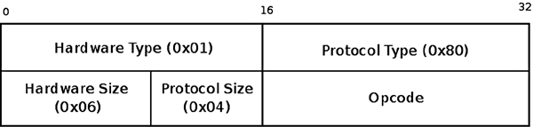

# Chương 7. Linux Neighbouring Subsystem

Chương này trình bày Linux neighbouring subsystem và cách triển khai trong Linux. Neighbouring subsystem chịu trách nhiệm phát hiện sự hiện diện của các node trên cùng link và chuyển đổi địa chỉ L3 (network layer) sang địa chỉ L2 (link layer). Địa chỉ L2 cần để tạo L2 header cho outgoing packet, như mô tả trong phần tiếp theo. Protocol thực hiện chuyển đổi này được gọi là Address Resolution Protocol (ARP) trong IPv4 và Neighbour Discovery protocol (NDISC hoặc ND) trong IPv6. Neighbouring subsystem cung cấp hạ tầng protocol-independent để thực hiện ánh xạ L3-to-L2. Tuy nhiên, nội dung chương này giới hạn ở các trường hợp phổ biến nhất—tức việc sử dụng neighbouring subsystem trong IPv4 và IPv6. Hãy nhớ protocol ARP, giống protocol ICMP được trình bày trong Chương 3, chịu các mối đe dọa bảo mật—như tấn công ARP poisoning và ARP spoofing (các khía cạnh bảo mật của protocol ARP nằm ngoài phạm vi sách này).

Trước tiên tôi trình bày các neighbouring data structure dùng chung và một số API method quan trọng được dùng trong cả IPv4 lẫn IPv6. Sau đó tôi trình bày cách triển khai cụ thể của protocol ARP và NDISC. Bạn sẽ thấy cách tạo và giải phóng neighbour, đồng thời tìm hiểu tương tác giữa userspace và neighbouring subsystem. Bạn cũng sẽ tìm hiểu ARP request và ARP reply, NDISC neighbour solicitation và NDISC neighbour advertisement, cùng cơ chế Duplicate Address Detection (DAD), được protocol NDISC dùng để tránh địa chỉ IPv6 trùng lặp.

## Neighbouring Subsystem Core

Neighbouring subsystem cần để làm gì? Khi packet được gửi qua L2 layer, cần địa chỉ L2 đích để tạo L2 header. Bằng các solicitation request và solicitation reply của neighbouring subsystem, có thể tìm địa chỉ L2 của host khi biết địa chỉ L3 (hoặc xác định địa chỉ L3 đó không tồn tại). Trong Ethernet, link layer (L2) phổ biến nhất, địa chỉ L2 của host là địa chỉ MAC. Trong IPv4, ARP là neighbouring protocol, và solicitation request cùng solicitation reply lần lượt được gọi là ARP request và ARP reply. Trong IPv6, neighbouring protocol là NDISC, và solicitation request cùng solicitation reply lần lượt được gọi là neighbour solicitation và neighbour advertisement.

Có trường hợp có thể tìm địa chỉ đích mà không cần neighbouring subsystem—chẳng hạn khi gửi broadcast. Khi đó địa chỉ L2 đích cố định (chẳng hạn FF:FF:FF:FF:FF:FF trong Ethernet). Hoặc khi địa chỉ đích là địa chỉ multicast, có ánh xạ cố định giữa địa chỉ L3 multicast và địa chỉ L2 của nó. Tôi trình bày các trường hợp này trong chương.

Data structure cơ bản của Linux neighbouring subsystem là neighbour. Neighbour biểu diễn network node gắn với cùng link (L2). Nó được biểu diễn bằng structure `neighbour`. Cách biểu diễn này không dành riêng cho protocol cụ thể. Tuy nhiên, như đã nói, nội dung về structure `neighbour` giới hạn ở việc sử dụng trong protocol IPv4 và IPv6. Hãy xem structure `neighbour`:

```
    struct neighbour {
            struct neighbour __rcu  *next;
            struct neigh_table      *tbl;
        struct neigh_parms      *parms;
        unsigned long           confirmed;
        unsigned long           updated;
        rwlock_t                lock;
        atomic_t                refcnt;
        struct sk_buff_head     arp_queue;
        unsigned int            arp_queue_len_bytes;
        struct timer_list       timer;
        unsigned long           used;
        atomic_t                probes;
        __u8                    flags;
        __u8                    nud_state;
        __u8                    type;
        __u8                    dead;
        seqlock_t               ha_lock;
        unsigned char           ha[ALIGN(MAX_ADDR_LEN, sizeof(unsigned long))];
        struct hh_cache         hh;
        int                     (*output)(struct neighbour *, struct sk_buff *);
        const struct neigh_ops  *ops;
        struct rcu_head         rcu;
        struct net_device       *dev;
        u8                      primary_key[0];
};
```

(`include/net/neighbour.h`)

Sau đây là mô tả một số member quan trọng của structure `neighbour`:

- `next`: Pointer đến neighbour tiếp theo trong cùng bucket của hash table.

- `tbl`: Neighbouring table gắn với neighbour này.

- `parms`: Object `neigh_parms` gắn với `neighbour` này. Nó được khởi tạo bởi method `constructor` của neighbouring table tương ứng. Chẳng hạn trong IPv4, method `arp_constructor()` khởi tạo `parms` thành `arp_parms` của network device tương ứng. Đừng nhầm với object `neigh_parms` của neighbouring table.

- `confirmed`: Timestamp xác nhận (được trình bày ở phía sau chương này).

- `refcnt`: Reference counter. Được tăng bởi macro `neigh_hold()` và giảm bởi method `neigh_release()`. Method `neigh_release()` chỉ giải phóng object neighbour bằng cách gọi method `neigh_destroy()` nếu giá trị reference counter bằng 0 sau khi giảm.

- `arp_queue`: Queue các SKB chưa resolve. Dù có tên như vậy, member này không dành riêng cho ARP mà còn được các protocol khác sử dụng, như NDISC.

- `timer`: Mỗi object `neighbour` có timer; timer callback là method `neigh_timer_handler()`. Method `neigh_timer_handler()` có thể thay đổi trạng thái Network Unreachability Detection (NUD) của neighbour. Khi gửi solicitation request, nếu trạng thái neighbour là NUD\_INCOMPLETE hoặc NUD\_PROBE và số solicitation request probe lớn hơn hoặc bằng `neigh_max_probes()`, trạng thái neighbour được đặt thành NUD\_FAILED và method `neigh_invalidate()` được gọi.

- `ha_lock`: Bảo vệ truy cập địa chỉ phần cứng của neighbour (`ha`).

- `ha`: Địa chỉ phần cứng của object neighbour; với Ethernet, đó là địa chỉ MAC của neighbour.

- `hh`: Hardware header cache của L2 header (object `hh_cache`).

- `output`: Pointer đến method truyền, như method `neigh_resolve_output()` hoặc method `neigh_direct_output()`. Nó phụ thuộc trạng thái NUD nên có thể được gán cho các method khác nhau trong vòng đời neighbour. Khi khởi tạo object neighbour trong method `neigh_alloc()`, nó được đặt thành method `neigh_blackhole()`, loại bỏ packet và trả về -ENETDOWN.

Sau đây là các helper method (method thiết lập callback `output`):

- `void neigh_connect(struct neighbour *neigh)`

Đặt method `output()` của neighbour chỉ định thành `neigh->ops->connected_output`.

- `void neigh_suspect(struct neighbour *neigh)`

Đặt method `output()` của neighbour chỉ định thành `neigh->ops->output`.

- `nud_state:` Trạng thái NUD của neighbour. Giá trị `nud_state` có thể thay đổi động trong vòng đời object neighbour. Bảng 7-1 trong phần “Tham khảo nhanh” ở cuối chương mô tả các trạng thái NUD cơ bản và Linux symbol tương ứng. NUD state machine rất phức tạp; tôi không đi sâu mọi chi tiết trong sách này.

- `dead:` Flag được đặt khi object `neighbour` còn sống. Nó được khởi tạo thành 0 khi tạo object `neighbour`, ở cuối method `__neigh_create()`. Method `neigh_destroy()` sẽ thất bại với object neighbour có flag `dead` không được đặt. Method `neigh_flush_dev()` đặt flag `dead` thành 1 nhưng chưa xóa neighbour entry. Việc xóa neighbour được đánh dấu dead (flag `dead` được đặt) do garbage collector thực hiện sau đó.

- `primary_key:` Địa chỉ IP (L3) của neighbour. Lookup trong neighbouring table được thực hiện với `primary_key`. Độ dài `primary_key` phụ thuộc protocol được dùng. Chẳng hạn với IPv4, phải là 4 byte. Với IPv6, phải là `sizeof(struct in6_addr)`, vì structure `in6_addr` biểu diễn địa chỉ IPv6. Vì vậy, `primary_key` được định nghĩa là array 0 byte, và khi cấp phát neighbour phải xét protocol đang dùng. Xem giải thích về `entry_size` và `key_len` ở phía sau chương, trong mô tả member của structure `neigh_table`.

Để tránh gửi solicitation request cho mỗi packet mới được truyền, kernel giữ ánh xạ địa chỉ L3 sang địa chỉ L2 trong data structure gọi là neighbouring table; với IPv4, đó là ARP table (đôi khi còn gọi là ARP cache, dù là cùng một thứ)—khác với những gì bạn đã thấy ở IPv4 routing subsystem trong Chương 5: routing cache trước khi bị loại bỏ và routing table là hai thực thể khác nhau, được biểu diễn bởi hai data structure khác nhau. Với IPv6, neighbouring table là NDISC table (còn gọi là NDISC cache). Cả ARP table (`arp_tbl`) và NDISC table (`nd_tbl`) đều là instance của structure `neigh_table`. Hãy xem structure `neigh_table`:

```
    struct neigh_table {
            struct neigh_table      *next;
            int                     family;
            int                     entry_size;
            int                     key_len;
            __u32                   (*hash)(const void *pkey,
                                            const struct net_device *dev,
                                            __u32 *hash_rnd);
        int                     (*constructor)(struct neighbour *);
        int                     (*pconstructor)(struct pneigh_entry *);
        void                    (*pdestructor)(struct pneigh_entry *);
        void                    (*proxy_redo)(struct sk_buff *skb);
        char                    *id;
        struct neigh_parms      parms;
        /* HACK. gc_* should follow parms without a gap! */
        int                     gc_interval;
        int                     gc_thresh1;
        int                     gc_thresh2;
        int                     gc_thresh3;
        unsigned long           last_flush;
        struct delayed_work     gc_work;
        struct timer_list       proxy_timer;
        struct sk_buff_head     proxy_queue;
        atomic_t                entries;
        rwlock_t                lock;
        unsigned long           last_rand;
        struct neigh_statistics __percpu *stats;
        struct neigh_hash_table __rcu *nht;
        struct pneigh_entry     **phash_buckets;
};
```

(`include/net/neighbour.h`)

Sau đây là một số member quan trọng của structure `neigh_table`:

- `next`: Mỗi protocol tạo instance `neigh_table` riêng. Có linked list chứa mọi neighbouring table trong hệ thống. Biến toàn cục `neigh_tables` là pointer đến đầu danh sách. Biến `next` trỏ đến phần tử tiếp theo trong danh sách này.

- `family`: Protocol family: AF\_INET cho IPv4 neighbouring table (`arp_tbl`) và AF\_INET6 cho IPv6 neighbouring table (`nd_tbl`).

- `entry_size`: Khi cấp phát neighbour entry bằng method `neigh_alloc()`, kích thước cấp phát là `tbl->entry_size + dev->neigh_priv_len`. Thông thường giá trị `neigh_priv_len` bằng 0. Trước kernel 3.3, `entry_size` được khởi tạo tường minh thành `sizeof(struct neighbour) + 4` cho ARP và `sizeof(struct neighbour) + sizeof(struct in6_addr)` cho NDISC. Lý do là khi cấp phát neighbour, bạn muốn cấp phát cả không gian cho member `primary_key[0]`. Từ kernel 3.3, `enrty_size` bị loại khỏi phần khởi tạo tĩnh của `arp_tbl` và `ndisc_tbl`, và việc khởi tạo `entry_size` được thực hiện dựa trên `key_len` trong core neighbouring layer, bởi method `neigh_table_init_no_netlink()`.

- `key_len`: Kích thước lookup key; là 4 byte cho IPv4 vì địa chỉ IPv4 dài 4 byte, và là `sizeof(struct in6_addr)` cho IPv6. Structure `in6_addr` biểu diễn địa chỉ IPv6.

- `hash`: Hash function ánh xạ key (địa chỉ L3) sang giá trị hash cụ thể; với ARP là method `arp_hash()`. Với NDISC là method `ndisc_hash()`.

- `constructor`: Method này thực hiện khởi tạo protocol-specific khi tạo object `neighbour`. Chẳng hạn `arp_constructor()` cho ARP trong IPv4 và `ndisc_constructor()` cho NDISC trong IPv6. Callback `constructor` được gọi bởi method `__neigh_create()`. Trả về 0 khi thành công.

- `pconstructor`: Method tạo neighbour proxy entry; không được ARP dùng, và là `pndisc_constructor` cho NDISC. Method phải trả về 0 khi thành công. Method `pconstructor` được gọi từ method `pneigh_lookup()` nếu lookup thất bại, với điều kiện `pneigh_lookup()` được gọi với `creat = 1`.

- `pdestructor`: Method hủy neighbour proxy entry. Giống callback `pconstructor`, `pdestructor` không được ARP dùng, và là `pndisc_destructor` cho NDISC. Method `pdestructor` được gọi từ method `pneigh_delete()` và method `pneigh_ifdown()`.

- `id`: Tên bảng; là `arp_cache` cho IPv4 và `ndisc_cache` cho IPv6.

- `parms`: Object `neigh_parms`: mỗi neighbouring table có object `neigh_parms` tương ứng, chứa các thiết lập cấu hình như thông tin reachability, các timeout, v.v. Việc khởi tạo `neigh_parms` khác nhau giữa ARP table và NDISC table.

- `gc_interval`: Không được neighbouring core sử dụng trực tiếp.

- `gc_thresh1`, `gc_thresh2`, `gc_thresh3`: Các ngưỡng số entry của neighbouring table. Được dùng làm tiêu chí kích hoạt synchronous garbage collector (`neigh_forced_gc`) và trong asynchronous garbage collector handler `neigh_periodic_work()`. Xem giải thích về cấp phát object neighbour trong phần “Tạo và giải phóng Neighbour” ở phía sau chương này. Trong ARP table, giá trị mặc định là: `gc_thresh1` bằng 128, `gc_thresh2` bằng 512 và `gc_thresh3` bằng 1024. Có thể đặt các giá trị này bằng `procfs`. Các giá trị mặc định tương tự cũng được dùng trong NDISC table của IPv6. Các entry IPv4 trong `procfs` là:

- `/proc/sys/net/ipv4/neigh/default/gc_thresh1`

- `/proc/sys/net/ipv4/neigh/default/gc_thresh2`

- `/proc/sys/net/ipv4/neigh/default/gc_thresh3`

và với IPv6, đây là các entry `procfs`:

- `/proc/sys/net/ipv6/neigh/default/gc_thresh1`

- `/proc/sys/net/ipv6/neigh/default/gc_thresh2`

- `/proc/sys/net/ipv6/neigh/default/gc_thresh3`

- `last_flush`: Thời điểm gần nhất method `neigh_forced_gc()` chạy. Được khởi tạo thành thời điểm hiện tại (`jiffies`) trong method `neigh_table_init_no_netlink ()`.

- `gc_work`: Asynchronous garbage collector handler. Được đặt thành timer `neigh_periodic_work()` bởi method `neigh_table_init_no_netlink()`. `delayed_work struct` là một loại work queue. Trước kernel 2.6.32, method `neigh_periodic_timer()` là asynchronous garbage collector handler; nó chỉ xử lý một bucket thay vì toàn bộ neighbouring hash table. Method `neigh_periodic_work()` trước tiên kiểm tra số entry trong bảng có nhỏ hơn `gc_thresh1` không; nếu có thì thoát mà không làm gì; sau đó tính lại reachable time (trường `reachable_time` của `parms`, là object `neigh_parms` gắn với neighbouring table). Tiếp theo nó quét neighbouring hash table và xóa các entry có trạng thái không phải NUD\_PERMANENT hoặc NUD\_IN\_TIMER, có reference count bằng 1, và thỏa một trong các điều kiện: đang ở trạng thái NUD\_FAILED hoặc thời điểm hiện tại sau timestamp `used` của chúng `+ gc_staletime` (`gc_staletime` là member của object `neighbour parms`). Xóa neighbour entry được thực hiện bằng cách đặt flag `dead` thành 1 và gọi method `neigh_cleanup_and_release()`.

- `proxy_timer`: Khi host được cấu hình làm ARP proxy, có thể tránh xử lý ngay solicitation request và xử lý sau một khoảng trễ. Lý do là với ARP proxy host, số solicitation request có thể rất lớn (khác với host không phải ARP proxy, thường chỉ có ít ARP request). Đôi khi bạn muốn trì hoãn phản hồi các broadcast này để ưu tiên các host sở hữu địa chỉ IP đó nhận request trước. Độ trễ là giá trị ngẫu nhiên tối đa bằng tham số `proxy_delay`. ARP proxy timer handler là method `neigh_proxy_process()`. `proxy_timer` được khởi tạo bởi method `neigh_table_init_no_netlink()`.

- `proxy_queue`: Proxy ARP queue chứa SKB. SKB được thêm bằng method `pneigh_enqueue()`.

- `stats`: Object thống kê neighbour (`neigh_statistics`); gồm các bộ đếm riêng cho mỗi CPU như `allocs`, là số object neighbour được cấp phát bằng method `neigh_alloc()`, hoặc `destroys`, là số object neighbour được giải phóng bằng method `neigh_destroy()`, cùng các bộ đếm khác. Các bộ đếm thống kê neighbour được tăng bằng macro NEIGH\_CACHE\_STAT\_INC. Lưu ý vì thống kê là các bộ đếm riêng cho mỗi CPU, macro `this_cpu_inc()` được macro này sử dụng. Bạn có thể hiển thị thống kê ARP và NDISC lần lượt bằng `cat /proc/net/stat/arp_cache` và `cat/proc/net/stat/ndisc_cache`. Trong phần “Tham khảo nhanh” ở cuối chương có mô tả structure `neigh_statistics`, chỉ rõ method tăng từng bộ đếm.

- `nht`: Neighbour hash table (object `neigh_hash_table`).

- `phash_buckets`: Neighbouring proxy hash table; được cấp phát trong method `neigh_table_init_no_netlink()`.

Khởi tạo neighbouring table được thực hiện bằng method `neigh_table_init()`:

- Trong IPv4, ARP module định nghĩa ARP table (instance của structure `neigh_table` tên `arp_tbl`) và truyền làm đối số cho method `neigh_table_init()` (xem method `arp_init()` trong `net/ipv4/arp.c`).

- Trong IPv6, NDISC module định nghĩa NDSIC table (cũng là instance của structure `neigh_table` tên `nd_tbl`) và truyền làm đối số cho method `neigh_table_init()` (xem method `ndisc_init()` trong `net/ipv6/ndisc.c`).

Method `neigh_table_init()` cũng tạo neighbouring hash table (object `nht`) bằng cách gọi method `neigh_hash_alloc()` trong method `neigh_table_init_no_netlink()`, cấp phát không gian cho tám hash entry:

```
static void neigh_table_init_no_netlink(struct neigh_table *tbl)
{
    . . .
    RCU_INIT_POINTER(tbl->nht, neigh_hash_alloc(3));
    . . .
}

static struct neigh_hash_table *neigh_hash_alloc(unsigned int shift)
{
```

Kích thước hash table là `1<< shift` (khi `size <= PAGE_SIZE`):

```
    size_t size = (1 << shift) * sizeof(struct neighbour *);
    struct neigh_hash_table *ret;
    struct neighbour __rcu **buckets;
    int i;
        ret = kmalloc(sizeof(*ret), GFP_ATOMIC);
        if (!ret)
            return NULL;
        if (size <= PAGE_SIZE)
            buckets = kzalloc(size, GFP_ATOMIC);
        else
            buckets = (struct neighbour __rcu **)
                  __get_free_pages(GFP_ATOMIC | __GFP_ZERO,
                           get_order(size));
        . . .

    }
```

Bạn có thể thắc mắc vì sao cần method `neigh_table_init_no_netlink()`—tại sao không thực hiện toàn bộ khởi tạo trong method `neigh_table_init()`? Method `neigh_table_init_no_netlink()` thực hiện mọi khởi tạo neighbouring table, ngoại trừ liên kết nó vào linked list toàn cục các neighbouring table, `neigh_tables`. Ban đầu, việc khởi tạo như vậy, không liên kết vào linked list `neigh_tables`, cần cho ATM, do đó method `neigh_table_init()` được tách ra, và ATM clip module gọi method `neigh_table_init_no_netlink()` thay vì method `neigh_table_init()`; tuy nhiên theo thời gian, một giải pháp khác được tìm ra trong ATM. Dù ATM clip module không còn gọi method `neigh_table_init_no_netlink()`, việc tách các method vẫn được giữ, có lẽ để dùng khi cần trong tương lai.

Tôi cần đề cập mỗi protocol L3 dùng neighbouring subsystem cũng đăng ký protocol handler: với IPv4, handler cho ARP packet (packet có type trong Ethernet header là 0x0806) là method `arp_rcv()`:

```
static struct packet_type arp_packet_type __read_mostly = {
         .type = cpu_to_be16(ETH_P_ARP),
         .func = arp_rcv,
 };

 void __init arp_init(void)
 {
     . . .
         dev_add_pack(&arp_packet_type);
     . . .
}
```

(`net/ipv4/arp.c`)

Với IPv6, neighbouring message là message ICMPv6, nên được xử lý bởi method `icmpv6_rcv()`, là ICMPv6 handler. Có năm ICMPv6 neighbouring message; khi nhận mỗi message (bằng method `icmpv6_rcv()`), method `ndisc_rcv()` được gọi để xử lý (xem `net/ipv6/icmp.c`). Method `ndisc_rcv()` được trình bày ở phần sau trong chương. Mỗi object neighbour định nghĩa một tập method bằng structure `neigh_ops`. Điều này được thực hiện bởi method `constructor` của nó. Structure `neigh_ops` chứa member protocol family và bốn function pointer:

```
struct neigh_ops {
        int      family;
        void     (*solicit)(struct neighbour *, struct sk_buff *);
        void     (*error_report)(struct neighbour *, struct sk_buff *);
        int      (*output)(struct neighbour *, struct sk_buff *);
        int      (*connected_output)(struct neighbour *, struct sk_buff *);
};
```

(`include/net/neighbour.h`)

- `family`: AF\_INET cho IPv4 và AF\_INET6 cho IPv6.

- `solicit`: Method này chịu trách nhiệm gửi neighbour solicitation request: trong ARP là method `arp_solicit()`, còn trong NDISC là method `ndisc_solicit()`.

- `error_report`: Method này được gọi từ method `neigh_invalidate()` khi trạng thái neighbour là NUD\_FAILED. Chẳng hạn điều này xảy ra sau một timeout khi solicitation request không được trả lời.

- `output`: Khi biết địa chỉ L3 của next hop nhưng địa chỉ L2 chưa resolve, callback `output` phải là `neigh_resolve_output()`.

- `connected_output`: Output method của neighbour được đặt thành `connected_output()` khi trạng thái neighbour là NUD\_REACHABLE hoặc NUD\_CONNECTED. Xem các lời gọi `neigh_connect()` trong method `neigh_update()` và method `neigh_timer_handler()`.

### Tạo và giải phóng Neighbour

Neighbour được tạo bởi method `__neigh_create()`:

```
struct neighbour *__neigh_create(struct neigh_table *tbl, const void *pkey, struct
net_device *dev, bool want_ref)
```

Trước tiên method `__neigh_create()` cấp phát object neighbour bằng cách gọi method `neigh_alloc()`, cũng thực hiện các khởi tạo. Có những trường hợp method `neigh_alloc()` gọi synchronous garbage collector (method `neigh_forced_gc()`):

```
static struct neighbour *neigh_alloc(struct neigh_table *tbl, struct net_device *dev)
{
        struct neighbour *n = NULL;
        unsigned long now = jiffies;
        int entries;

        entries = atomic_inc_return(&tbl->entries) - 1;
```

Nếu số table entry lớn hơn `gc_thresh3` (mặc định 1024), hoặc số table entry lớn hơn `gc_thresh2` (mặc định 512) và thời gian từ lần flush cuối lớn hơn 5 Hz, synchronous garbage collector method được gọi (method `neigh_forced_gc()`). Nếu sau khi chạy method `neigh_forced_gc()`, số table entry lớn hơn `gc_thresh3` (1024), bạn không cấp phát object neighbour và trả về NULL:

```
        if (entries >= tbl->gc_thresh3 ||
            (entries >= tbl->gc_thresh2 &&
            time_after(now, tbl->last_flush + 5 * HZ))) {
               if (!neigh_forced_gc(tbl) &&
                   entries >= tbl->gc_thresh3)
                       goto out_entries;
        }
```

Sau đó method `__neigh_create()` thực hiện thiết lập protocol-specific bằng cách gọi method `constructor` của neighbouring table chỉ định (`arp_constructor()` cho ARP, `ndisc_constructor()` cho NDISC). Trong constructor

method, các trường hợp đặc biệt như địa chỉ multicast hoặc loopback được xử lý. Chẳng hạn trong method `arp_constructor()`, bạn gọi method `arp_mc_map()` để đặt địa chỉ phần cứng của neighbour (`ha`) theo địa chỉ IPv4 `primary_key` của neighbour, rồi đặt `nud_state` thành NUD\_NOARP vì địa chỉ multicast không cần ARP. Chẳng hạn trong method `ndisc_constructor()`, bạn làm khá tương tự khi xử lý địa chỉ multicast: gọi `ndisc_mc_map()` để đặt địa chỉ phần cứng của neighbour (`ha`) theo địa chỉ IPv6 `primary_key` của neighbour, rồi cũng đặt `nud_state` thành NUD\_NOARP. Địa chỉ broadcast cũng được xử lý đặc biệt: chẳng hạn trong method `arp_constructor()`, khi neighbour type là RTN\_BROADCAST, bạn đặt địa chỉ phần cứng của neighbour (`ha`) thành địa chỉ broadcast của network device (trường `broadcast` của object `net_device`) và đặt `nud_state` thành NUD\_NOARP. Lưu ý protocol IPv6 không triển khai IP broadcast truyền thống, nên khái niệm địa chỉ broadcast không liên quan (tuy vậy có link-local all nodes multicast group tại địa chỉ `ff02::1`). Có hai trường hợp đặc biệt cần thiết lập bổ sung:

- Khi callback `ndo_neigh_construct()` của `netdev_ops` được định nghĩa, nó được gọi. Thực tế điều này chỉ diễn ra trong code classical IP over ATM (`clip`); xem `net/atm/clip.c`.

- Khi callback `neigh_setup()` của object `neigh_parms` được định nghĩa, nó được gọi. Chẳng hạn điều này được dùng trong bonding driver; xem `drivers/net/bonding/bond_main.c`.

Khi thử tạo object `neighbour` bằng method `__neigh_create()` và số neighbour entry vượt kích thước hash table, phải mở rộng bảng. Điều này được thực hiện bằng cách gọi method `neigh_hash_grow()`, như sau:

```
struct neighbour *__neigh_create(struct neigh_table *tbl, const void *pkey,
                 struct net_device *dev, bool want_ref)
{
     . . .
```

Kích thước hash table là `1 << nht->hash_shift`; hash table phải được mở rộng nếu vượt kích thước này:

```
     if (atomic_read(&tbl->entries) > (1 << nht->hash_shift))
        nht = neigh_hash_grow(tbl, nht->hash_shift + 1);
     . . .
}
```

Khi tham số `want_ref` là true, bạn tăng reference count của neighbour trong method này. Bạn cũng khởi tạo trường `confirmed` của object `neighbour`:

```
n->confirmed = jiffies - (n->parms->base_reachable_time << 1);
```

Nó được khởi tạo nhỏ hơn một chút so với thời điểm hiện tại, `jiffies` (vì lý do đơn giản là muốn yêu cầu reachability confirmation sớm hơn). Ở cuối method `__neigh_create()`, flag `dead` được khởi tạo thành 0 và object `neighbour` được thêm vào neighbour hash table.

Method `neigh_release()` giảm reference counter của neighbour và giải phóng nó khi đạt 0 bằng cách gọi method `neigh_destroy()`. Method `neigh_destroy()` kiểm tra neighbour được đánh dấu `dead`: neighbour có flag `dead` bằng 0 không bị xóa.

Trong phần này, bạn đã tìm hiểu kernel method tạo và giải phóng neighbour. Tiếp theo bạn sẽ tìm hiểu cách kích hoạt thêm và xóa neighbour entry từ userspace, cũng như cách hiển thị neighbouring table bằng lệnh `arp` cho IPv4 và lệnh `ip` cho IPv4/IPv6.

### Tương tác giữa Userspace và Neighbouring Subsystem

Quản lý ARP table được thực hiện bằng lệnh `ip neigh` của package `iproute2` hoặc lệnh `arp` của package `net-tools`. Vì vậy bạn có thể hiển thị ARP table bằng cách chạy một trong các lệnh sau từ dòng lệnh:

- `arp`: Được xử lý bởi method `arp_seq_show()` trong `net/ipv4/arp.c`.

- `ip neigh show` (hoặc `ip neighbour show`): Được xử lý bởi method `neigh_dump_info()` trong `net/core/neighbour.c`.

Lưu ý lệnh `ip neigh show` hiển thị trạng thái NUD của các neighbouring table entry (như NUD\_REACHABLE hoặc NUD\_STALE). Cũng lưu ý lệnh `arp` chỉ có thể hiển thị IPv4 neighbouring table (ARP table), trong khi lệnh `ip` có thể hiển thị cả IPv4 ARP table và IPv6 neighbouring table. Nếu chỉ muốn hiển thị IPv6 neighbouring table, bạn phải chạy `ip -6 neigh show`.

ARP module và NDISC module cũng xuất dữ liệu qua `procfs`. Nghĩa là bạn có thể hiển thị ARP table bằng cách chạy `cat /proc/net/arp` (entry `procfs` này được xử lý bởi method `arp_seq_show()`, cũng là method xử lý lệnh `arp`, như đã đề cập). Hoặc bạn có thể hiển thị thống kê ARP bằng `cat /proc/net/stat/arp_cache` và thống kê NDISC bằng `cat /proc/net/stat/ndisc_cache` (cả hai được xử lý bởi method `neigh_stat_seq_show()`).

Bạn có thể thêm entry bằng `ip neigh add`, được xử lý bởi method `neigh_add()`. Khi chạy `ip neigh add`, bạn có thể chỉ định trạng thái entry đang thêm (như NUD\_PERMANENT, NUD\_STALE, NUD\_REACHABLE, v.v.). Chẳng hạn:

```
ip neigh add 192.168.0.121 dev eth0 lladdr 00:30:48:5b:cc:45 nud permanent
```

Có thể xóa entry bằng `ip neigh del`, được xử lý bởi method `neigh_delete()`. Chẳng hạn:

```
ip neigh del 192.168.0.121 dev eth0
```

Có thể thêm entry vào proxy ARP table bằng `ip neigh add proxy`. Chẳng hạn:

```
ip neigh add proxy 192.168.2.11 dev eth0
```

Việc thêm cũng được xử lý bởi method `neigh_add()`. Trong trường hợp này, flag NTF\_PROXY được đặt trong dữ liệu truyền từ userspace (xem trường `ndm_flags` của object `ndm`), nên method `pneigh_lookup()` được gọi để thực hiện lookup trong proxy neighbouring hash table (`phash_buckets`). Nếu lookup thất bại, method `pneigh_lookup()` thêm entry vào proxy neighbouring hash table.

Có thể xóa entry khỏi proxy ARP table bằng `ip neigh del proxy`. Chẳng hạn:

```
ip neigh del proxy 192.168.2.11 dev eth0
```

Việc xóa được xử lý bởi method `neigh_delete()`. Một lần nữa, trong trường hợp này flag NTF\_PROXY được đặt trong dữ liệu truyền từ userspace (xem trường `ndm_flags` của object `ndm`), nên method `pneigh_delete()` được gọi để xóa entry khỏi proxy neighbouring table.

Với lệnh `ip ntable`, bạn có thể điều khiển các tham số của neighbouring table. Chẳng hạn:

- `ip ntable show`: Hiển thị tham số của mọi neighbouring table.

- `ip ntable change`: Thay đổi giá trị tham số của neighbouring table. Được xử lý bởi method `neightbl_set()`. Chẳng hạn: `ip ntable change name arp_cache queue 20 dev eth0`.

Bạn cũng có thể thêm entry vào ARP table bằng `arp add`. Và có thể thêm thủ công static entry vào ARP table như sau: `arp –s <IPAddress> <MacAddress>`. Static ARP entry không bị neighbouring subsystem garbage collector xóa, nhưng không được giữ lại qua reboot.

Phần tiếp theo mô tả ngắn gọn cách xử lý network event trong neighbouring subsystem.

### Xử lý Network Event

Neighbouring core không đăng ký event bằng method `register_netdevice_notifier()`. Ngược lại, ARP module và NDISC module có đăng ký network event. Trong ARP, method `arp_netdev_event()` được đăng ký làm callback cho event `netdev`. Nó xử lý event thay đổi địa chỉ MAC bằng cách gọi method dùng chung `neigh_changeaddr()` và method `rt_cache_flush()`. Từ kernel 3.11, bạn xử lý event NETDEV\_CHANGE khi flag IFF\_NOARP thay đổi bằng cách gọi method `neigh_changeaddr()`. Event NETDEV\_CHANGE được kích hoạt khi thiết bị đổi flag bằng method `__dev_notify_flags()`, hoặc khi thiết bị đổi trạng thái bằng method `netdev_state_change()`. Trong NDISC, method `ndisc_netdev_event()` được đăng ký làm callback cho netdev event; nó xử lý các event NETDEV\_CHANGEADDR, NETDEV\_DOWN và NETDEV\_NOTIFY\_PEERS.

Sau khi mô tả các data structure nền tảng dùng chung cho IPv4 và IPv6 như neighbouring table (`neigh_table`) và structure `neighbour`, đồng thời trình bày cách tạo và giải phóng object `neighbour`, đã đến lúc mô tả cách triển khai neighbouring protocol đầu tiên, protocol ARP.

## Protocol ARP (IPv4)

Protocol ARP được định nghĩa trong RFC 826. Khi làm việc với Ethernet, địa chỉ được gọi là địa chỉ MAC và có giá trị 48-bit. Địa chỉ MAC phải duy nhất, nhưng bạn phải xét đến khả năng gặp địa chỉ MAC non-unique. Lý do phổ biến là trên phần lớn network interface, system administrator có thể cấu hình địa chỉ MAC bằng công cụ userspace như `ifconfig` hoặc `ip`.

Khi gửi IPv4 packet, bạn biết địa chỉ IPv4 đích. Bạn phải tạo Ethernet header chứa địa chỉ MAC đích. Tìm địa chỉ MAC dựa trên địa chỉ IPv4 cho trước được thực hiện bằng protocol ARP, như bạn sẽ thấy ngay sau đây. Nếu chưa biết địa chỉ MAC, bạn gửi ARP request dưới dạng broadcast. ARP request này chứa địa chỉ IPv4 đang tìm. Nếu có host mang địa chỉ IPv4 đó, host gửi unicast ARP response để trả lời. ARP table (`arp_tbl`) là instance của structure `neigh_table`. ARP header được biểu diễn bằng structure `arphdr`:

```
struct arphdr {
    __be16          ar_hrd;         /* format of hardware address   */
    __be16          ar_pro;         /* format of protocol address   */
    unsigned char   ar_hln;         /* length of hardware address   */
    unsigned char   ar_pln;         /* length of protocol address   */
    __be16          ar_op;          /* ARP opcode (command)         */
#if 0
    *
    *      Ethernet looks like this : This bit is variable sized however...
    */
    unsigned char           ar_sha[ETH_ALEN];       /* sender hardware address      */
    unsigned char           ar_sip[4];              /* sender IP address            */
    unsigned char           ar_tha[ETH_ALEN];       /* target hardware address      */
    unsigned char           ar_tip[4];              /* target IP address            */
#endif
};
```

(`include/uapi/linux/if_arp.h`)

Sau đây là mô tả một số member quan trọng của structure `arphdr`:

- `ar_hrd` là hardware type; với Ethernet là 0x01. Để xem danh sách đầy đủ các ARP header hardware identifier khả dụng, xem định nghĩa ARPHRD\_XXX trong `include/uapi/linux/if_arp.h`.

- `ar_pro` là protocol ID; với IPv4 là 0x80. Để xem danh sách đầy đủ các protocol ID khả dụng, xem ETH\_P\_XXX trong `include/uapi/linux/if_ether.h`.

- `ar_hln` là độ dài địa chỉ phần cứng tính bằng byte, bằng 6 byte với địa chỉ Ethernet.

- `ar_pln` là độ dài protocol address tính bằng byte, bằng 4 byte với địa chỉ IPv4.

- `ar_op` là opcode, ARPOP\_REQUEST cho ARP request và ARPOP\_REPLY cho ARP reply. Để xem danh sách đầy đủ các ARP header opcode khả dụng, xem `include/uapi/linux/if_arp.h`.

Ngay sau `ar_op` là địa chỉ phần cứng (MAC) và địa chỉ IPv4 của bên gửi, cùng địa chỉ phần cứng (MAC) và địa chỉ IPv4 đích. Các địa chỉ này không thuộc structure ARP header (`arphdr`). Trong method `arp_process()`, chúng được trích bằng cách đọc các offset tương ứng của ARP header, như bạn có thể thấy trong giải thích về method `arp_process()` ở phần “ARP: Nhận Solicitation Request và Reply” phía sau chương này. Hình 7-1 minh họa ARP header cho ARP Ethernet packet.



Hình 7-1. ARP header (cho Ethernet)

Trong ARP, có bốn object `neigh_ops` được định nghĩa: `arp_direct_ops`, `arp_generic_ops`, `arp_hh_ops` và `arp_broken_ops`. Khởi tạo object `neigh_ops` của ARP table được thực hiện bởi method `arp_constructor()`, dựa trên tính năng network device:

- Nếu `header_ops` của object `net_device` là NULL, object `neigh_ops` được đặt thành `arp_direct_ops`. Khi đó gửi packet được thực hiện bằng method `neigh_direct_output()`, thực chất là wrapper cho `dev_queue_xmit()`. Tuy nhiên, trên phần lớn Ethernet network device, `header_ops` của object `net_device` được khởi tạo thành `eth_header_ops` bởi method dùng chung `ether_setup()`; xem `net/ethernet/eth.c`.

- Nếu `header_ops` của object `net_device` chứa callback `cache()` là NULL, object `neigh_ops` được đặt thành `arp_generic_ops`.

- Nếu `header_ops` của object `net_device` chứa callback `cache()` non-NULL, object `neigh_ops` được đặt thành `arp_hh_ops`. Khi dùng object `eth_header_ops` chung, callback `cache()` là callback `eth_header_cache()`.

- Với ba loại thiết bị, object `neigh_ops` được đặt thành `arp_broken_ops` (khi type của object `net_device` là ARPHRD\_ROSE, ARPHRD\_AX25 hoặc ARPHRD\_NETROM).

Sau khi trình bày protocol ARP và object ARP header (`arphdr`), hãy xem cách gửi ARP solicitation request.

### ARP: Gửi Solicitation Request

Solicitation request được gửi ở đâu? Trường hợp phổ biến nhất là trong Tx path, trước khi thực sự rời network layer (L3) và chuyển xuống link layer (L2). Trong method `ip_finish_output2()`, trước tiên bạn lookup địa chỉ IPv4 next hop trong ARP table bằng cách gọi method `__ipv4_neigh_lookup_noref()`; nếu không tìm thấy neighbour entry khớp, bạn tạo entry bằng cách gọi method `__neigh_create()`:

```
static inline int ip_finish_output2(struct sk_buff *skb)
{
        struct dst_entry *dst = skb_dst(skb);
        struct rtable *rt = (struct rtable *)dst;
        struct net_device *dev = dst->dev;
        unsigned int hh_len = LL_RESERVED_SPACE(dev);
        struct neighbour *neigh;
        u32 nexthop;
        . . .
        . . .
        nexthop = (__force u32) rt_nexthop(rt, ip_hdr(skb)->daddr);
        neigh = __ipv4_neigh_lookup_noref(dev, nexthop);
        if (unlikely(!neigh))
                neigh = __neigh_create(&arp_tbl, &nexthop, dev, false);
        if (!IS_ERR(neigh)) {
                int res = dst_neigh_output(dst, neigh, skb);
     . . .
}
```

Hãy xem method `dst_neigh_output()`:

```
static inline int dst_neigh_output(struct dst_entry *dst, struct neighbour *n,
                                   struct sk_buff *skb)
{
        const struct hh_cache *hh;

        if (dst->pending_confirm) {
                unsigned long now = jiffies;

                dst->pending_confirm = 0;
                /* avoid dirtying neighbour */
                if (n->confirmed != now)
                        n->confirmed = now;
        }
```

Khi đến method này lần đầu với flow này, `nud_state` không phải NUD\_CONNECTED và output callback là method `neigh_resolve_output()`:

```
        hh = &n->hh;
        if ((n->nud_state & NUD_CONNECTED) && hh->hh_len)
                return neigh_hh_output(hh, skb);
        else
                return n->output(n, skb);
}
```

(`include/net/dst.h`)

Trong method `neigh_resolve_output()`, bạn gọi method `neigh_event_send()`, cuối cùng đặt SKB vào `arp_queue` của neighbour bằng `__skb_queue_tail(&neigh->arp_queue, skb)`; sau đó method `neigh_probe()`, được gọi từ neighbour timer handler `neigh_timer_handler()`, sẽ gửi packet bằng cách gọi method `solicit()` (`neigh->ops->solicit` là method `arp_solicit()` trong trường hợp này):

```
static void neigh_probe(struct neighbour *neigh)
        __releases(neigh->lock)
{
        struct sk_buff *skb = skb_peek(&neigh->arp_queue);
        . . .
        neigh->ops->solicit(neigh, skb);
        atomic_inc(&neigh->probes);
        kfree_skb(skb);
}
```

Hãy xem method `arp_solicit()`, thực sự gửi ARP request:

```
static void arp_solicit(struct neighbour *neigh, struct sk_buff *skb)
{
        __be32 saddr = 0;
        u8 dst_ha[MAX_ADDR_LEN], *dst_hw = NULL;
        struct net_device *dev = neigh->dev;
        __be32 target = *(__be32 *)neigh->primary_key;
        int probes = atomic_read(&neigh->probes);
        struct in_device *in_dev;

        rcu_read_lock();
        in_dev = __in_dev_get_rcu(dev);
        if (!in_dev) {
                rcu_read_unlock();
                return;
        }
```

Với entry `arp_announce procfs`, bạn có thể đặt giới hạn địa chỉ IP nguồn cục bộ nào được dùng cho ARP packet muốn gửi:

- 0: Dùng bất kỳ địa chỉ cục bộ nào được cấu hình trên bất kỳ interface nào. Đây là giá trị mặc định.

- 1: Trước tiên thử dùng địa chỉ trên target subnet. Nếu không có địa chỉ như vậy, dùng mức 2.

- 2: Dùng primary IP address.

Lưu ý giá trị lớn nhất của hai entry này được sử dụng:

```
/proc/sys/net/ipv4/conf/all/arp_announce
/proc/sys/net/ipv4/conf/<netdeviceName>/arp_announce
```

Xem thêm mô tả macro IN\_DEV\_ARP\_ANNOUNCE trong phần “Tham khảo nhanh” ở cuối chương này.

```
        switch (IN_DEV_ARP_ANNOUNCE(in_dev)) {
        default:
        case 0:         /* By default announce any local IP */
                 if (skb && inet_addr_type(dev_net(dev),
                                           ip_hdr(skb)->saddr) == RTN_LOCAL)
                         saddr = ip_hdr(skb)->saddr;
                 break;
        case 1:         /* Restrict announcements of saddr in same subnet */
                 if (!skb)
                 break;
                 saddr = ip_hdr(skb)->saddr;
                 if (inet_addr_type(dev_net(dev), saddr) == RTN_LOCAL) {
```

Method `inet_addr_onlink()` kiểm tra địa chỉ đích chỉ định và địa chỉ nguồn chỉ định có trên cùng subnet không:

```
                 /* saddr should be known to target */
                 if (inet_addr_onlink(in_dev, target, saddr))
                         break;
         }
         saddr = 0;
         break;
case 2:         /* Avoid secondary IPs, get a primary/preferred one */
         break;
}
rcu_read_unlock();

if (!saddr)
```

Method `inet_select_addr()` trả về địa chỉ của primary interface đầu tiên của thiết bị chỉ định có scope nhỏ hơn scope chỉ định (RT\_SCOPE\_LINK trong trường hợp này), đồng thời nằm trong cùng subnet với đích:

```
        saddr = inet_select_addr(dev, target, RT_SCOPE_LINK);

        probes -= neigh->parms->ucast_probes;
        if (probes < 0) {
                if (!(neigh->nud_state & NUD_VALID))
                        pr_debug("trying to ucast probe in NUD_INVALID\n");
                neigh_ha_snapshot(dst_ha, neigh, dev);
                dst_hw = dst_ha;
        } else {
                probes -= neigh->parms->app_probes;
                if (probes < 0) {
```

CONFIG\_ARPD được bật khi làm việc với userspace ARP daemon; có các dự án như OpenNHRP dựa trên ARPD. Next Hop Resolution Protocol (NHRP) được dùng để cải thiện hiệu quả routing lưu lượng mạng máy tính qua mạng Non-Broadcast, Multiple Access (NBMA) (tôi không trình bày ARPD userspace daemon trong sách này):

```
#ifdef CONFIG_ARPD
                        neigh_app_ns(neigh);
#endif
                        return;
                }
        }
```

Bây giờ bạn gọi method `arp_send()` để gửi ARP request. Lưu ý tham số cuối, `target_hw`, là NULL. Bạn chưa biết địa chỉ phần cứng (MAC) đích. Khi gọi `arp_send()` với `target_hw` là NULL, một broadcast ARP request được gửi:

```
        arp_send(ARPOP_REQUEST, ETH_P_ARP, target, dev, saddr,
                 dst_hw, dev->dev_addr, NULL);
}
```

Hãy xem method `arp_send()` khá ngắn:

```
void arp_send(int type, int ptype, __be32 dest_ip,
              struct net_device *dev, __be32 src_ip,
              const unsigned char *dest_hw, const unsigned char *src_hw,
              const unsigned char *target_hw)
{
        struct sk_buff *skb;

        /*
         *      No arp on this interface.
         */
```

Bạn phải kiểm tra IFF\_NOARP có được hỗ trợ trên network device này không. Có trường hợp ARP bị tắt: administrator có thể tắt ARP, chẳng hạn bằng `ifconfig eth1 –arp` hoặc `ip link set eth1 arp off`. Một số network device đặt flag IFF\_NOARP khi tạo—chẳng hạn IPv4 tunnel device hoặc PPP device, vốn không cần ARP. Xem method `ipip_tunnel_setup()` trong `net/ipv4/ipip.c` hoặc method `ppp_setup()` trong `drivers/net/ppp_generic.c`.

```
        if (dev->flags&IFF_NOARP)
                return;
```

Method `arp_create()` tạo SKB có ARP header và khởi tạo theo các tham số chỉ định:

```
        skb = arp_create(type, ptype, dest_ip, dev, src_ip,
                         dest_hw, src_hw, target_hw);
        if (skb == NULL)
                return;
```

Method `arp_xmit()` chỉ gọi `dev_queue_xmit()` qua macro NF\_HOOK():

```
        arp_xmit(skb);
}
```

Bây giờ đã đến lúc tìm hiểu cách xử lý ARP request và ARP reply.

### ARP: Nhận Solicitation Request và Reply

Trong IPv4, method `arp_rcv()` chịu trách nhiệm xử lý ARP packet, như đã đề cập. Hãy xem method `arp_rcv()`:

```
static int arp_rcv(struct sk_buff *skb, struct net_device *dev,
                   struct packet_type *pt, struct net_device *orig_dev)
{
        const struct arphdr *arp;
```

Nếu network device nhận ARP packet có flag IFF\_NOARP được đặt, hoặc packet không dành cho máy cục bộ, hoặc dành cho loopback device, thì packet phải bị drop. Bạn tiếp tục thực hiện thêm một số sanity check; nếu mọi thứ ổn, chuyển đến method `arp_process()`, thực hiện công việc xử lý ARP packet thực sự:

```
        if (dev->flags & IFF_NOARP ||
            skb->pkt_type == PACKET_OTHERHOST ||
            skb->pkt_type == PACKET_LOOPBACK)
                goto freeskb;
```

Nếu SKB được chia sẻ, bạn phải clone vì nó có thể bị đối tượng khác thay đổi trong khi method `arp_rcv()` xử lý. Method `skb_share_check()` tạo clone của SKB nếu nó được chia sẻ (xem Phụ lục A).

```
        skb = skb_share_check(skb, GFP_ATOMIC);
        if (!skb)
                goto out_of_mem;

        /* ARP header, plus 2 device addresses, plus 2 IP addresses.  */
        if (!pskb_may_pull(skb, arp_hdr_len(dev)))
                goto freeskb;

        arp = arp_hdr(skb);
```

Field `ar_hln` của ARP header biểu diễn độ dài hardware address, phải bằng 6 byte đối với Ethernet header và bằng `addr_len` của object `net_device`. Field `ar_pln` của ARP header biểu diễn độ dài protocol address và phải bằng độ dài của địa chỉ IPv4, tức 4 byte:

```
            if (arp->ar_hln != dev->addr_len || arp->ar_pln != 4)
                    goto freeskb;

            memset(NEIGH_CB(skb), 0, sizeof(struct neighbour_cb));
            return NF_HOOK(NFPROTO_ARP, NF_ARP_IN, skb, dev, NULL, arp_process);

freeskb:
        kfree_skb(skb);
out_of_mem:
        return 0;
}
```

Xử lý ARP request không giới hạn ở packet có đích là host cục bộ. Khi host cục bộ được cấu hình làm proxy ARP hoặc private VLAN proxy ARP (xem RFC 3069), bạn cũng xử lý packet có đích không phải host cục bộ. Hỗ trợ private VLAN proxy ARP được thêm trong kernel 2.6.34.

Trong method `arp_process()`, bạn chỉ xử lý ARP request hoặc ARP response. Với ARP request, bạn lookup trong routing subsystem bằng method `ip_route_input_noref()`. Nếu ARP packet dành cho host cục bộ (`rt_type` của routing entry là RTN\_LOCAL), bạn tiếp tục kiểm tra một số điều kiện (sẽ mô tả ngay sau đây). Nếu mọi kiểm tra đều qua, ARP reply được gửi trả bằng method `arp_send()`. Nếu ARP packet không dành cho host cục bộ mà cần forwarding (`rt_type` của routing entry là RTN\_UNICAST), bạn kiểm tra một số điều kiện (cũng được mô tả ngay sau đây); nếu đáp ứng thì lookup trong proxy ARP table bằng cách gọi method `pneigh_lookup()`.

Bây giờ bạn sẽ xem chi tiết triển khai method ARP chính xử lý ARP request, method `arp_process()`.

### Method arp\_process( )

Hãy xem method `arp_process()`, nơi công việc thực sự được thực hiện:

```
static int arp_process(struct sk_buff *skb)
{
        struct net_device *dev = skb->dev;
        struct in_device *in_dev = __in_dev_get_rcu(dev);
        struct arphdr *arp;
        unsigned char *arp_ptr;
        struct rtable *rt;
        unsigned char *sha;
        __be32 sip, tip;
        u16 dev_type = dev->type;
        int addr_type;
        struct neighbour *n;
        struct net *net = dev_net(dev);

        /* arp_rcv below verifies the ARP header and verifies the device
         * is ARP'able.
         */

        if (in_dev == NULL)
                goto out;
```

Lấy ARP header từ SKB (đó là network header, xem method `arp_hdr()`):

```
        arp = arp_hdr(skb);

        switch (dev_type) {
        default:
                if (arp->ar_pro != htons(ETH_P_IP) ||
                            htons(dev_type) != arp->ar_hrd)
                                goto out;
                    break;
            case ARPHRD_ETHER:
                    . . .
                    if ((arp->ar_hrd != htons(ARPHRD_ETHER) &&
                         arp->ar_hrd != htons(ARPHRD_IEEE802)) ||
                        arp->ar_pro != htons(ETH_P_IP))
                            goto out;
                    break;
                    . . .
```

Bạn chỉ muốn xử lý ARP request hoặc ARP response trong method `arp_process()` và loại bỏ mọi packet khác:

```
        /* Understand only these message types */

        if (arp->ar_op != htons(ARPOP_REPLY) &&
            arp->ar_op != htons(ARPOP_REQUEST))
                goto out;

/*
 *      Extract fields
 */
        arp_ptr = (unsigned char *)(arp + 1);
```

### Method arp\_process( )—Trích xuất Header:

Ngay sau ARP header là các trường sau (xem định nghĩa ARP header ở trên):

- `sha:` Địa chỉ phần cứng nguồn (địa chỉ MAC, dài 6 byte).

- `sip`: Địa chỉ IPv4 nguồn (4 byte).

- `tha`: Địa chỉ phần cứng đích (địa chỉ MAC, dài 6 byte).

- `tip:` Địa chỉ IPv4 đích (4 byte).

Trích các địa chỉ `sip` và `tip`:

```
        sha     = arp_ptr;
        arp_ptr += dev->addr_len;
```

Đặt `sip` thành địa chỉ IPv4 nguồn sau khi tăng `arp_ptr` theo offset tương ứng:

```
        memcpy(&sip, arp_ptr, 4);
        arp_ptr += 4;
        switch (dev_type) {
        . . .
        default:
                arp_ptr += dev->addr_len;
        }
```

Đặt `tip` thành địa chỉ IPv4 đích sau khi tăng `arp_ptr` theo offset tương ứng:

```
        memcpy(&tip, arp_ptr, 4);
```

Loại bỏ hai loại packet sau:

- Multicast packet

- Packet dành cho loopback device nếu việc dùng local routing với địa chỉ loopback bị tắt; xem thêm mô tả macro IN\_DEV\_ROUTE\_LOCALNET trong phần “Tham khảo nhanh” ở cuối chương này.

```
/*
 *      Check for bad requests for 127.x.x.x and requests for multicast
 *      addresses.  If this is one such, delete it.
 */
        if (ipv4_is_multicast(tip) ||
            (!IN_DEV_ROUTE_LOCALNET(in_dev) && ipv4_is_loopback(tip)))
                goto out;

        . . .
```

IP nguồn (`sip`) bằng 0 khi dùng Duplicate Address Detection (DAD). DAD cho phép phát hiện các địa chỉ L3 trùng nhau trên các host khác nhau trong LAN. DAD được triển khai trong IPv6 như một phần không thể thiếu của quá trình cấu hình địa chỉ, nhưng không có trong IPv4. Tuy nhiên, IPv4 có hỗ trợ xử lý đúng DAD request, như bạn sẽ thấy ngay sau đây. Tiện ích `arping` của package `iputils` là ví dụ sử dụng DAD trong IPv4. Khi gửi ARP request bằng `arping –D`, bạn gửi ARP request có `sip` của ARP header bằng 0. (Modifier –`D` yêu cầu `arping` ở DAD mode); `tip` thường là địa chỉ IPv4 của bên gửi (vì bạn muốn kiểm tra có host khác trong cùng LAN mang cùng địa chỉ IPv4 với mình không); nếu có host có địa chỉ IP trùng với `tip` của DAD ARP request, nó sẽ gửi trả ARP reply (không thêm bên gửi vào neighbouring table của nó):

```
        /* Special case: IPv4 duplicate address detection packet (RFC2131) */
        if (sip == 0) {
                if (arp->ar_op == htons(ARPOP_REQUEST) &&
```

### Method arp\_process( )—Các Method arp\_ignore( ) và arp\_filter( )

Entry `arp_ignore procfs` hỗ trợ các mode khác nhau để gửi ARP reply phản hồi ARP request. Giá trị được dùng là giá trị lớn nhất của `/proc/sys/net/ipv4/conf/all/arp_ignore` và `/proc/sys/net/ipv4/conf/<netDeviceName>/arp_ignore`. Mặc định, giá trị entry `arp_ignore procfs` bằng 0; khi đó method `arp_ignore()` trả về 0. Bạn trả lời ARP request bằng `arp_send()`, như trong đoạn code tiếp theo (giả sử `inet_addr_type(net, tip)` trả về RTN\_LOCAL). Method `arp_ignore()` kiểm tra giá trị IN\_DEV\_ARP\_IGNORE(in\_dev); để biết thêm chi tiết, xem cách triển khai `arp_ignore()` trong `net/ipv4/arp.c` và mô tả macro IN\_DEV\_ARP\_IGNORE trong phần “Tham khảo nhanh” ở cuối chương này:

```
                 inet_addr_type(net, tip) == RTN_LOCAL &&
                !arp_ignore(in_dev, sip, tip))
                arp_send(ARPOP_REPLY, ETH_P_ARP, sip, dev, tip, sha,
                         dev->dev_addr, sha);
        goto out;
}

    if (arp->ar_op == htons(ARPOP_REQUEST) &&
        ip_route_input_noref(skb, tip, sip, 0, dev) == 0) {

            rt = skb_rtable(skb);
            addr_type = rt->rt_type;
```

Khi `addr_type` bằng RTN\_LOCAL, packet dành cho local delivery:

```
        if (addr_type == RTN_LOCAL) {
                int dont_send;

                dont_send = arp_ignore(in_dev, sip, tip);
```

Method `arp_filter()` thất bại (trả về 1) trong hai trường hợp:

- Khi lookup trong routing table bằng method `ip_route_output()` thất bại.

- Khi outgoing network device của routing entry khác network device nhận ARP request.

Khi thành công, method `arp_filter()` trả về 0 (xem thêm mô tả macro IN\_DEV\_ARPFILTER trong phần “Tham khảo nhanh” ở cuối chương này):

```
                     if (!dont_send && IN_DEV_ARPFILTER(in_dev))
                        dont_send = arp_filter(sip, tip, dev);
                if (!dont_send) {
```

Trước khi gửi ARP reply, bạn muốn thêm bên gửi vào neighbouring table hoặc cập nhật entry của nó; điều này được thực hiện bằng method `neigh_event_ns()`. Method `neigh_event_ns()` tạo neighbouring table entry mới và đặt trạng thái thành NUD\_STALE. Nếu đã có entry như vậy, nó cập nhật trạng thái thành NUD\_STALE bằng method `neigh_update()`. Thêm entry theo cách này gọi là passive learning:

```
                        n = neigh_event_ns(&arp_tbl, sha, &sip, dev);
                        if (n) {
                                arp_send(ARPOP_REPLY, ETH_P_ARP, sip,
                                         dev, tip, sha, dev->dev_addr,
                                         sha);
                                neigh_release(n);
                        }
                }
                goto out;
        } else if (IN_DEV_FORWARD(in_dev)) {
```

Method `arp_fwd_proxy()` trả về 1 khi thiết bị có thể dùng làm ARP proxy; method `arp_fwd_pvlan()` trả về 1 khi thiết bị có thể dùng làm ARP VLAN proxy:

```
               if (addr_type == RTN_UNICAST  &&
                    (arp_fwd_proxy(in_dev, dev, rt) ||
                     arp_fwd_pvlan(in_dev, dev, rt, sip, tip) ||
                     (rt->dst.dev != dev &&
                      pneigh_lookup(&arp_tbl, net, &tip, dev, 0)))) {
```

Một lần nữa, gọi method `neigh_event_ns()` để tạo neighbour entry của bên gửi với NUD\_STALE, hoặc nếu đã có entry, cập nhật trạng thái entry thành NUD\_STALE:

```
                        n = neigh_event_ns(&arp_tbl, sha, &sip, dev);
                        if (n)
                                neigh_release(n);

                       if (NEIGH_CB(skb)->flags & LOCALLY_ENQUEUED ||
                            skb->pkt_type == PACKET_HOST ||
                            in_dev->arp_parms->proxy_delay == 0) {
                                arp_send(ARPOP_REPLY, ETH_P_ARP, sip,
                                         dev, tip, sha, dev->dev_addr,
                                         sha);
                        } else {
```

Trì hoãn gửi ARP reply bằng cách đặt SKB vào cuối `proxy_queue`, qua lời gọi method `pneigh_enqueue()`. Lưu ý độ trễ là ngẫu nhiên và nằm giữa 0 và `in_dev->arp_parms->proxy_delay`:

```
                                pneigh_enqueue(&arp_tbl,
                                               in_dev->arp_parms, skb);
                                return 0;
                        }
                        goto out;
                }
        }
}

        /* Update our ARP tables */
```

Lưu ý tham số cuối khi gọi method `__neigh_lookup()` là 0, nghĩa là chỉ lookup trong neighbouring table (không tạo neighbour mới nếu lookup thất bại):

```
        n = __neigh_lookup(&arp_tbl, &sip, dev, 0);
```

Macro IN\_DEV\_ARP\_ACCEPT cho biết network device có được thiết lập chấp nhận ARP request không (xem thêm mô tả macro IN\_DEV\_ARP\_ACCEPT trong phần “Tham khảo nhanh” ở cuối chương này):

```
        if (IN_DEV_ARP_ACCEPT(in_dev)) {
                /* Unsolicited ARP is not accepted by default.
                   It is possible, that this option should be enabled for some
                   devices (strip is candidate)
                */
```

Unsolicited ARP request chỉ được gửi để cập nhật neighbouring table. Trong request như vậy, `tip` bằng `sip` (tiện ích `arping` hỗ trợ gửi unsolicited ARP request bằng `arping –U`):

```
        if (n == NULL &&
            (arp->ar_op == htons(ARPOP_REPLY) ||
             (arp->ar_op == htons(ARPOP_REQUEST) && tip == sip)) &&
           inet_addr_type(net, sip) == RTN_UNICAST)
               n = __neigh_lookup(&arp_tbl, &sip, dev, 1);
}
    if (n) {
            int state = NUD_REACHABLE;
            int override;

            /* If several different ARP replies follows back-to-back,
               use the FIRST one. It is possible, if several proxy
               agents are active. Taking the first reply prevents
               arp trashing and chooses the fastest router.
            */
            override = time_after(jiffies, n->updated + n->parms->locktime);

            /* Broadcast replies and request packets
               do not assert neighbour reachability.
             */
             if (arp->ar_op != htons(ARPOP_REPLY) ||
                 skb->pkt_type != PACKET_HOST)
                     state = NUD_STALE;
```

Gọi `neigh_update()` để cập nhật neighbouring table:

```
                neigh_update(n, sha, state,
                             override ? NEIGH_UPDATE_F_OVERRIDE : 0);
                neigh_release(n);
        }

out:
        consume_skb(skb);
        return 0;
}
```

Sau khi biết cách triển khai protocol ARP của IPv4, đã đến lúc chuyển sang cách triển khai protocol NDISC của IPv6. Bạn sẽ sớm nhận thấy một số khác biệt giữa cách triển khai neighbouring subsystem trong IPv4 và IPv6.

## Protocol NDISC (IPv6)

Protocol Neighbour Discovery (NDISC) dựa trên RFC 2461, “Neighbour Discovery for IP Version 6 (IPv6)”, sau đó được thay thế bởi RFC 4861 năm 2007. IPv6 node (host hoặc router) trên cùng link dùng Neighbour Discovery protocol để phát hiện sự hiện diện của nhau, phát hiện router, xác định địa chỉ L2 của nhau và duy trì thông tin neighbour reachability. Duplicate Address Detection (DAD) được thêm để tránh địa chỉ L3 trùng lặp trong cùng LAN. Tôi sẽ trình bày DAD và xử lý NDISC neighbour solicitation cùng neighbour advertisement ngay sau đây.

Tiếp theo bạn tìm hiểu cách các IPv6 neighbour discovery protocol tránh tạo địa chỉ IPv6 trùng lặp.

### Duplicate Address Detection (DAD)

Làm sao chắc chắn không có địa chỉ IPv6 giống hệt khác trong LAN? Khả năng thấp, nhưng nếu địa chỉ như vậy tồn tại thì có thể gây vấn đề. DAD là giải pháp. Khi host thử cấu hình địa chỉ, trước tiên nó tạo Link Local address (Link Local address bắt đầu bằng FE80). Địa chỉ này là tentative (IFA\_F\_TENTATIVE ), nghĩa là host chỉ có thể giao tiếp bằng ND message. Sau đó host bắt đầu quá trình DAD bằng cách gọi method

`addrconf_dad_start()` (`net/ipv6/addrconf.c`). Host gửi message Neighbour Solicitation DAD. Đích là tentative address của nó, nguồn toàn bit 0 (unspecified address). Nếu không có phản hồi trong khoảng thời gian chỉ định, trạng thái đổi thành permanent (IFA\_F\_PERMANENT). Khi Optimistic DAD (CONFIG\_IPV6\_OPTIMISTIC\_DAD) được bật, bạn không đợi DAD hoàn tất mà cho phép host giao tiếp với peer trước khi DAD hoàn thành thành công. Xem RFC 4429, "Optimistic Duplicate Address Detection (DAD) for IPv6", năm 2006.

Neighbouring table cho IPv6 có tên `nd_tbl`:

```
struct neigh_table nd_tbl = {
        .family =       AF_INET6,
        .key_len =      sizeof(struct in6_addr),
        .hash =         ndisc_hash,
        .constructor =  ndisc_constructor,
        .pconstructor = pndisc_constructor,
        .pdestructor =  pndisc_destructor,
        .proxy_redo =   pndisc_redo,
        .id =           "ndisc_cache",
        .parms = {
                .tbl                    = &nd_tbl,
                .base_reachable_time    = ND_REACHABLE_TIME,
                .retrans_time           = ND_RETRANS_TIMER,
                .gc_staletime           = 60 * HZ,
                .reachable_time         = ND_REACHABLE_TIME,
                .delay_probe_time       = 5 * HZ,
                .queue_len_bytes        = 64*1024,
                .ucast_probes           = 3,
                .mcast_probes           = 3,
                .anycast_delay          = 1 * HZ,
                .proxy_delay            = (8 * HZ) / 10,
                .proxy_qlen             = 64,
        },
        .gc_interval =    30 * HZ,
        .gc_thresh1 =    128,
        .gc_thresh2 =    512,
        .gc_thresh3 =   1024,
};
(net/ipv6/ndisc.c)
```

Lưu ý một số member của NDISC table bằng các member tương ứng trong ARP table—chẳng hạn giá trị các garbage collector threshold (`gc_thresh1`, `gc_thresh2` và `gc_thresh3`).

Cách triển khai Linux IPv6 Neighbour Discovery dựa trên message ICMPv6 để quản lý tương tác giữa các neighbouring node. Neighbour Discovery protocol định nghĩa năm ICMPv6 message type sau:

```
#define NDISC_ROUTER_SOLICITATION       133
#define NDISC_ROUTER_ADVERTISEMENT      134
#define NDISC_NEIGHBOUR_SOLICITATION    135
#define NDISC_NEIGHBOUR_ADVERTISEMENT   136
#define NDISC_REDIRECT                  137
```

(`include/net/ndisc.h`)

Lưu ý năm ICMPv6 message type này là informational message. ICMPv6 message type có giá trị từ 0 đến 127 là error message, còn ICMPv6 message type có giá trị từ 128 đến 255 là

informational message. Để biết thêm, xem Chương 3 trình bày protocol ICMP. Chương này chỉ trình bày các message Neighbour Solicitation và Neighbour Discovery.

Như đã đề cập ở đầu chương, vì neighbouring discovery message là message ICMPv6, chúng được xử lý bởi method `icmpv6_rcv()`, sau đó gọi method `ndisc_rcv()` cho ICMPv6 packet có message type là một trong năm type đã đề cập (xem `net/ipv6/icmp.c`).

Trong NDISC, có ba object `neigh_ops`: `ndisc_generic_ops`, `ndisc_hh_ops` và `ndisc_direct_ops`:

- Nếu `header_ops` của object `net_device` là NULL, object `neigh_ops` được đặt thành `ndisc_direct_ops`. Giống trường hợp `arp_direct_ops`, gửi packet được thực hiện bằng method `neigh_direct_output()`, thực chất là wrapper cho `dev_queue_xmit()`. Lưu ý như đã đề cập trong phần ARP, trên phần lớn Ethernet network device, `header_ops` của object `net_device` không phải NULL.

- Nếu `header_ops` của object `net_device` chứa callback `cache()` là NULL, object `neigh_ops` được đặt thành `ndisc_generic_ops`.

- Nếu `header_ops` của object `net_device` chứa callback `cache()` non-NULL, object `neigh_ops` được đặt thành `ndisc_hh_ops`.

Phần này trình bày cơ chế DAD và cách nó giúp tránh địa chỉ trùng lặp. Phần tiếp theo mô tả cách gửi solicitation request.

### NIDSC: Gửi Solicitation Request

Tương tự những gì đã thấy trong IPv6, bạn cũng lookup và tạo entry nếu không tìm thấy kết quả khớp:

```
static int ip6_finish_output2(struct sk_buff *skb)
{
        struct dst_entry *dst = skb_dst(skb);
        struct net_device *dev = dst->dev;
        struct neighbour *neigh;
        struct in6_addr *nexthop;
        int ret;
               . . .

               . . .

        nexthop = rt6_nexthop((struct rt6_info *)dst, &ipv6_hdr(skb)->daddr);
        neigh = __ipv6_neigh_lookup_noref(dst->dev, nexthop);
        if (unlikely(!neigh))
                neigh = __neigh_create(&nd_tbl, nexthop, dst->dev, false);
        if (!IS_ERR(neigh)) {
                ret = dst_neigh_output(dst, neigh, skb);
               . . .
```

Cuối cùng, giống IPv4 Tx path, bạn gọi solicit method `neigh->ops->solicit(neigh, skb)` từ method `neigh_probe()`. `neigh->ops->solicit` trong trường hợp này là method `ndisc_solicit()`. `ndisc_solicit()` là method rất ngắn; thực chất là wrapper cho method `ndisc_send_ns()`:

```
    static void ndisc_solicit(struct neighbour *neigh, struct sk_buff *skb)
    {
            struct in6_addr *saddr = NULL;
            struct in6_addr mcaddr;
        struct net_device *dev = neigh->dev;
        struct in6_addr *target = (struct in6_addr *)&neigh->primary_key;
        int probes = atomic_read(&neigh->probes);

        if (skb && ipv6_chk_addr(dev_net(dev), &ipv6_hdr(skb)->saddr, dev, 1))
                saddr = &ipv6_hdr(skb)->saddr;

        if ((probes -= neigh->parms->ucast_probes) < 0) {
                if (!(neigh->nud_state & NUD_VALID)) {
                        ND_PRINTK(1, dbg,
                                  "%s: trying to ucast probe in NUD_INVALID: %pI6\n",
                                  __func__, target);
                }
                ndisc_send_ns(dev, neigh, target, target, saddr);
        } else if ((probes -= neigh->parms->app_probes) < 0) {
#ifdef CONFIG_ARPD
                neigh_app_ns(neigh);
#endif
        } else {
                addrconf_addr_solict_mult(target, &mcaddr);
                ndisc_send_ns(dev, NULL, target, &mcaddr, saddr);
        }
}
```

Để gửi solicitation request, cần tạo object `nd_msg`:

```
struct nd_msg {
        struct icmp6hdr icmph;
        struct in6_addr target;
        __u8            opt[0];
};
```

(`include/net/ndisc.h`)

Với solicitation request, ICMPv6 header type phải được đặt thành NDISC\_NEIGHBOUR\_SOLICITATION, còn với solicitation reply, ICMPv6 header type phải được đặt thành NDISC\_NEIGHBOUR\_ADVERTISEMENT. Lưu ý với message Neighbour Advertisement, có trường hợp cần đặt flag trong ICMPv6 header. ICMPv6 header chứa structure tên `icmpv6_nd_advt`, bao gồm các flag override, solicited và router:

```
struct icmp6hdr {
        __u8            icmp6_type;
        __u8            icmp6_code;
        __sum16         icmp6_cksum;
        union {
                . . .
                . . .
                struct icmpv6_nd_advt {
#if defined(__LITTLE_ENDIAN_BITFIELD)
                        __u32           reserved:5,
                                        override:1,
                                        solicited:1,
                                            router:1,
                                            reserved2:24;
    . . .
    #endif
                    } u_nd_advt;
            } icmp6_dataun;
    . . .
    #define icmp6_router            icmp6_dataun.u_nd_advt.router
    #define icmp6_solicited         icmp6_dataun.u_nd_advt.solicited
    #define icmp6_override          icmp6_dataun.u_nd_advt.override
    . . .
```

(`include/uapi/linux/icmpv6.h`)

- Khi message được gửi để phản hồi Neighbour Solicitation, bạn đặt flag `solicited` (`icmp6_solicited`).

- Khi muốn override neighbouring cache entry (cập nhật địa chỉ L2), bạn đặt flag `override` (`icmp6_override`).

- Khi host gửi message Neighbour Advertisement là router, bạn đặt flag `router` (`icmp6_router`).

Bạn có thể thấy cách dùng ba flag này trong method `ndisc_send_na()` tiếp theo. Hãy xem method `ndisc_send_ns()`:

```
void ndisc_send_ns(struct net_device *dev, struct neighbour *neigh,
                   const struct in6_addr *solicit,
                   const struct in6_addr *daddr, const struct in6_addr *saddr)
{
        struct sk_buff *skb;
        struct in6_addr addr_buf;
        int inc_opt = dev->addr_len;
        int optlen = 0;
        struct nd_msg *msg;

        if (saddr == NULL) {
                if (ipv6_get_lladdr(dev, &addr_buf,
                                   (IFA_F_TENTATIVE|IFA_F_OPTIMISTIC)))
                        return;
                saddr = &addr_buf;
        }

        if (ipv6_addr_any(saddr))
                inc_opt = 0;
        if (inc_opt)
                optlen += ndisc_opt_addr_space(dev);

        skb = ndisc_alloc_skb(dev, sizeof(*msg) + optlen);
        if (!skb)
                return;
```

Tạo ICMPv6 header, được nhúng trong object `nd_msg`:

```
        msg = (struct nd_msg *)skb_put(skb, sizeof(*msg));
        *msg = (struct nd_msg) {
                .icmph = {
                        .icmp6_type = NDISC_NEIGHBOUR_SOLICITATION,
                },
                .target = *solicit,
        };

        if (inc_opt)
                ndisc_fill_addr_option(skb, ND_OPT_SOURCE_LL_ADDR,
                                       dev->dev_addr);

        ndisc_send_skb(skb, daddr, saddr);
}
```

Hãy xem method `ndisc_send_na()`:

```
static void ndisc_send_na(struct net_device *dev, struct neighbour *neigh,
                          const struct in6_addr *daddr,
                          const struct in6_addr *solicited_addr,
                          bool router, bool solicited, bool override, bool inc_opt)
{
        struct sk_buff *skb;
        struct in6_addr tmpaddr;
        struct inet6_ifaddr *ifp;
        const struct in6_addr *src_addr;
        struct nd_msg *msg;
        int optlen = 0;

        . . .

        skb = ndisc_alloc_skb(dev, sizeof(*msg) + optlen);
        if (!skb)
                return;
```

Tạo ICMPv6 header, được nhúng trong object `nd_msg`:

```
        msg = (struct nd_msg *)skb_put(skb, sizeof(*msg));
        *msg = (struct nd_msg) {
                .icmph = {
                        .icmp6_type = NDISC_NEIGHBOUR_ADVERTISEMENT,
                        .icmp6_router = router,
                        .icmp6_solicited = solicited,
                        .icmp6_override = override,
                },
                .target = *solicited_addr,
        };

            if (inc_opt)
                    ndisc_fill_addr_option(skb, ND_OPT_TARGET_LL_ADDR,
                                           dev->dev_addr);

            ndisc_send_skb(skb, daddr, src_addr);
    }
```

Phần này mô tả cách gửi solicitation request. Phần tiếp theo nói về cách xử lý Neighbour Solicitation và Advertisement.

### NDISC: Nhận Neighbour Solicitation và Advertisement

Như đã đề cập, method `ndisc_rcv()` xử lý cả năm neighbour discovery message type; hãy xem method này:

```
int ndisc_rcv(struct sk_buff *skb)
{
        struct nd_msg *msg;

        if (skb_linearize(skb))
                return 0;

        msg = (struct nd_msg *)skb_transport_header(skb);

        __skb_push(skb, skb->data - skb_transport_header(skb));
```

Theo RFC 4861, hop limit của neighbour message phải là 255; độ dài hop limit là 8 bit nên hop limit tối đa là 255. Giá trị 255 bảo đảm packet chưa được forwarding, qua đó bảo đảm bạn không bị một số tấn công bảo mật. Packet không đáp ứng yêu cầu này bị loại bỏ:

```
        if (ipv6_hdr(skb)->hop_limit != 255) {
                ND_PRINTK(2, warn, "NDISC: invalid hop-limit: %d\n",
                          ipv6_hdr(skb)->hop_limit);
                return 0;
        }
```

Theo RFC 4861, ICMPv6 code của neighbour message phải là 0, nên drop packet không đáp ứng yêu cầu này:

```
            if (msg->icmph.icmp6_code != 0) {
                    ND_PRINTK(2, warn, "NDISC: invalid ICMPv6 code: %d\n",
                              msg->icmph.icmp6_code);
            return 0;
            }

            memset(NEIGH_CB(skb), 0, sizeof(struct neighbour_cb));

            switch (msg->icmph.icmp6_type) {
            case NDISC_NEIGHBOUR_SOLICITATION:
                    ndisc_recv_ns(skb);
                    break;

        case NDISC_NEIGHBOUR_ADVERTISEMENT:
                ndisc_recv_na(skb);
                break;

        case NDISC_ROUTER_SOLICITATION:
                ndisc_recv_rs(skb);
                break;

        case NDISC_ROUTER_ADVERTISEMENT:
                ndisc_router_discovery(skb);
                break;

        case NDISC_REDIRECT:
                ndisc_redirect_rcv(skb);
                break;
        }

        return 0;
}
```

Tôi không trình bày router solicitation và router advertisement trong chương này vì được trình bày trong Chương 8. Hãy xem method `ndisc_recv_ns()`:

```
static void ndisc_recv_ns(struct sk_buff *skb)
{
        struct nd_msg *msg = (struct nd_msg *)skb_transport_header(skb);
        const struct in6_addr *saddr = &ipv6_hdr(skb)->saddr;
        const struct in6_addr *daddr = &ipv6_hdr(skb)->daddr;
        u8 *lladdr = NULL;
        u32 ndoptlen = skb->tail - (skb->transport_header +
                                    offsetof(struct nd_msg, opt));
        struct ndisc_options ndopts;
        struct net_device *dev = skb->dev;
        struct inet6_ifaddr *ifp;
        struct inet6_dev *idev = NULL;
        struct neighbour *neigh;
```

Method `ipv6_addr_any()` trả về 1 khi `saddr` là unspecified address toàn bit 0 (IPV6\_ADDR\_ANY). Khi địa chỉ nguồn là unspecified address (toàn bit 0), nghĩa là request là DAD:

```
        int dad = ipv6_addr_any(saddr);
        bool inc;
        int is_router = -1;
```

Thực hiện một số kiểm tra tính hợp lệ:

```
        if (skb->len < sizeof(struct nd_msg)) {
                ND_PRINTK(2, warn, "NS: packet too short\n");
                return;
        }

    if (ipv6_addr_is_multicast(&msg->target)) {
            ND_PRINTK(2, warn, "NS: multicast target address\n");
            return;
    }

    /*
     * RFC2461 7.1.1:
     * DAD has to be destined for solicited node multicast address.
     */
    if (dad && !ipv6_addr_is_solict_mult(daddr)) {
            ND_PRINTK(2, warn, "NS: bad DAD packet (wrong destination)\n");
            return;
    }

    if (!ndisc_parse_options(msg->opt, ndoptlen, &ndopts)) {
            ND_PRINTK(2, warn, "NS: invalid ND options\n");
            return;
    }

    if (ndopts.nd_opts_src_lladdr) {
            lladdr = ndisc_opt_addr_data(ndopts.nd_opts_src_lladdr, dev);
            if (!lladdr) {
                    ND_PRINTK(2, warn,
                              "NS: invalid link-layer address length\n");
                    return;
            }

            /* RFC2461 7.1.1:
             *      If the IP source address is the unspecified address,
             *      there MUST NOT be source link-layer address option
             *      in the message.
             */
            if (dad) {
                    ND_PRINTK(2, warn,
                              "NS: bad DAD packet (link-layer address option)\n");
                    return;
            }
    }

    inc = ipv6_addr_is_multicast(daddr);

    ifp = ipv6_get_ifaddr(dev_net(dev), &msg->target, dev, 1);
    if (ifp) {

            if (ifp->flags & (IFA_F_TENTATIVE|IFA_F_OPTIMISTIC)) {
                    if (dad) {
                            /*
                             * We are colliding with another node
                             * who is doing DAD
                             * so fail our DAD process
                            */
                        addrconf_dad_failure(ifp);
                        return;
                } else {
                        /*
                         * This is not a dad solicitation.
                         * If we are an optimistic node,
                         * we should respond.
                         * Otherwise, we should ignore it.
                        */
                        if (!(ifp->flags & IFA_F_OPTIMISTIC))
                                goto out;
                }
        }

        idev = ifp->idev;
} else {
        struct net *net = dev_net(dev);

        idev = in6_dev_get(dev);
        if (!idev) {
                /* XXX: count this drop? */
                return;
        }

        if (ipv6_chk_acast_addr(net, dev, &msg->target) ||
            (idev->cnf.forwarding &&
             (net->ipv6.devconf_all->proxy_ndp || idev->cnf.proxy_ndp) &&
             (is_router = pndisc_is_router(&msg->target, dev)) >= 0)) {
                if (!(NEIGH_CB(skb)->flags & LOCALLY_ENQUEUED) &&
                    skb->pkt_type != PACKET_HOST &&
                    inc != 0 &&
                    idev->nd_parms->proxy_delay != 0) {
                        /*
                         * for anycast or proxy,
                         * sender should delay its response
                         * by a random time between 0 and
                         * MAX_ANYCAST_DELAY_TIME seconds.
                         * (RFC2461) -- yoshfuji
                        */
                        struct sk_buff *n = skb_clone(skb, GFP_ATOMIC);
                        if (n)
                                pneigh_enqueue(&nd_tbl, idev->nd_parms, n);
                        goto out;
                }
        } else
                goto out;
}

    if (is_router < 0)
            is_router = idev->cnf.forwarding;

    if (dad) {
```

Gửi message neighbour advertisement:

```
        ndisc_send_na(dev, NULL, &in6addr_linklocal_allnodes, &msg->target,
                      !!is_router, false, (ifp != NULL), true);
        goto out;
}

if (inc)
        NEIGH_CACHE_STAT_INC(&nd_tbl, rcv_probes_mcast);
else
        NEIGH_CACHE_STAT_INC(&nd_tbl, rcv_probes_ucast);

/*
 *      update / create cache entry
 *      for the source address
*/
neigh = __neigh_lookup(&nd_tbl, saddr, dev,
                       !inc || lladdr || !dev->addr_len);
if (neigh)
```

Cập nhật neighbouring table bằng địa chỉ L2 của bên gửi; `nud_state` sẽ được đặt thành NUD\_STALE:

```
        neigh_update(neigh, lladdr, NUD_STALE,
                     NEIGH_UPDATE_F_WEAK_OVERRIDE|
                     NEIGH_UPDATE_F_OVERRIDE);
if (neigh || !dev->header_ops) {
```

Gửi message Neighbour Advertisement:

```
                ndisc_send_na(dev, neigh, saddr, &msg->target,
                              !!is_router,
                              true, (ifp != NULL && inc), inc);
                if (neigh)
                        neigh_release(neigh);
        }

out:
        if (ifp)
                in6_ifa_put(ifp);
        else
                in6_dev_put(idev);
}
```

Hãy xem method xử lý Neighbour Advertisement, `ndisc_recv_na()`:

```
static void ndisc_recv_na(struct sk_buff *skb)
{
        struct nd_msg *msg = (struct nd_msg *)skb_transport_header(skb);
        const struct in6_addr *saddr = &ipv6_hdr(skb)->saddr;
        const struct in6_addr *daddr = &ipv6_hdr(skb)->daddr;
        u8 *lladdr = NULL;
        u32 ndoptlen = skb->tail - (skb->transport_header +
                                    offsetof(struct nd_msg, opt));
        struct ndisc_options ndopts;
        struct net_device *dev = skb->dev;
        struct inet6_ifaddr *ifp;
        struct neighbour *neigh;

        if (skb->len < sizeof(struct nd_msg)) {
                ND_PRINTK(2, warn, "NA: packet too short\n");
                return;
        }

        if (ipv6_addr_is_multicast(&msg->target)) {
                ND_PRINTK(2, warn, "NA: target address is multicast\n");
                return;
        }

        if (ipv6_addr_is_multicast(daddr) &&
            msg->icmph.icmp6_solicited) {
                ND_PRINTK(2, warn, "NA: solicited NA is multicasted\n");
                return;
        }

        if (!ndisc_parse_options(msg->opt, ndoptlen, &ndopts)) {
                ND_PRINTK(2, warn, "NS: invalid ND option\n");
                return;
        }
        if (ndopts.nd_opts_tgt_lladdr) {
                lladdr = ndisc_opt_addr_data(ndopts.nd_opts_tgt_lladdr, dev);
                if (!lladdr) {
                        ND_PRINTK(2, warn,
                                  "NA: invalid link-layer address length\n");
                        return;
                }
        }
        ifp = ipv6_get_ifaddr(dev_net(dev), &msg->target, dev, 1);
        if (ifp) {
                if (skb->pkt_type != PACKET_LOOPBACK
                    && (ifp->flags & IFA_F_TENTATIVE)) {
                                addrconf_dad_failure(ifp);
                                return;
                }
                /* What should we make now? The advertisement
                   is invalid, but ndisc specs say nothing
                       about it. It could be misconfiguration, or
                       an smart proxy agent tries to help us :-)

                       We should not print the error if NA has been
                       received from loopback - it is just our own
                       unsolicited advertisement.
                     */
                    if (skb->pkt_type != PACKET_LOOPBACK)
                            ND_PRINTK(1, warn,
                                      "NA: someone advertises our address %pI6 on %s!\n",
                                      &ifp->addr, ifp->idev->dev->name);
                    in6_ifa_put(ifp);
                    return;
            }
            neigh = neigh_lookup(&nd_tbl, &msg->target, dev);

            if (neigh) {
                    u8 old_flags = neigh->flags;
                    struct net *net = dev_net(dev);

                    if (neigh->nud_state & NUD_FAILED)
                            goto out;

                    /*
                     * Don't update the neighbour cache entry on a proxy NA from
                     * ourselves because either the proxied node is off link or it
                     * has already sent a NA to us.
                     */
                    if (lladdr && !memcmp(lladdr, dev->dev_addr, dev->addr_len) &&
                        net->ipv6.devconf_all->forwarding &&
                        net->ipv6.devconf_all->proxy_ndp &&
                        pneigh_lookup(&nd_tbl, net, &msg->target, dev, 0)) {
                            /* XXX: idev->cnf.proxy_ndp */
                            goto out;
                    }
```

Cập nhật neighbouring table. Khi message nhận được là Neighbour Solicitation, `icmp6_solicited` được đặt, nên bạn muốn đặt trạng thái thành NUD\_REACHABLE. Khi flag `icmp6_override` được đặt, bạn muốn flag `override` được đặt (nghĩa là cập nhật địa chỉ L2 bằng `lladdr` chỉ định nếu khác):

```
                    neigh_update(neigh, lladdr,
                                 msg->icmph.icmp6_solicited ? NUD_REACHABLE : NUD_STALE,
                                 NEIGH_UPDATE_F_WEAK_OVERRIDE|
                                 (msg->icmph.icmp6_override ? NEIGH_UPDATE_F_OVERRIDE : 0)|
                                 NEIGH_UPDATE_F_OVERRIDE_ISROUTER|
                                 (msg->icmph.icmp6_router ? NEIGH_UPDATE_F_ISROUTER : 0));

                    if ((old_flags & ~neigh->flags) & NTF_ROUTER) {
                            /*
                             * Change: router to host
                             */
                        struct rt6_info *rt;
                        rt = rt6_get_dflt_router(saddr, dev);
                        if (rt)
                                ip6_del_rt(rt);
                }

out:
                neigh_release(neigh);
        }
}
```

## Tổng kết

Chương này mô tả neighbouring subsystem trong IPv4 và IPv6. Trước tiên bạn đã tìm hiểu mục tiêu của neighbouring subsystem. Sau đó bạn tìm hiểu ARP request và ARP reply trong IPv4, cùng NDISC Neighbour Solicitation và NDISC Neighbour Advertisement trong IPv6. Bạn cũng biết cách triển khai DAD tránh địa chỉ IPv6 trùng lặp, và xem các method xử lý request và reply của neighbouring subsystem. Chương 8 trình bày cách triển khai IPv6 subsystem. Phần “Tham khảo nhanh” tiếp theo liệt kê các method và macro chính liên quan đến chủ đề trong chương, sắp xếp theo ngữ cảnh. Tôi cũng trình bày structure `neigh_statistics`, biểu diễn thống kê do neighbouring subsystem thu thập.

## Tham khảo nhanh

Sau đây là một số method và macro quan trọng của neighbouring subsystem, cùng mô tả structure `neigh_statistics`.

Lưu ý core neighbouring code nằm trong `net/core/neighbour.c`, `include/net/neighbour.h` và `include/uapi/linux/neighbour.h`.

ARP code (IPv4) nằm trong `net/ipv4/arp.c`, `include/net/arp.h` và `include/uapi/linux/if_arp.h`.

NDISC code (IPv6) nằm trong `net/ipv6/ndisc.c` và `include/net/ndisc.h`.

### Method

Hãy bắt đầu với các method.

### void neigh\_table\_init(struct neigh\_table \*tbl)

Method này gọi method `neigh_table_init_no_netlink()` để khởi tạo neighbouring table, đồng thời liên kết bảng vào linked list neighbouring table toàn cục (`neigh_tables`).

### void neigh\_table\_init\_no\_netlink(struct neigh\_table \*tbl)

Method này thực hiện mọi khởi tạo neighbour ngoại trừ liên kết vào linked list neighbouring table toàn cục, do `neigh_table_init()` thực hiện như đã đề cập.

### int neigh\_table\_clear(struct neigh\_table \*tbl)

Method này giải phóng tài nguyên của neighbouring table chỉ định.

### struct neighbour \*neigh\_alloc(struct neigh\_table \*tbl, struct net\_device \*dev)

Method này cấp phát object neighbour.

### struct neigh\_hash\_table \*neigh\_hash\_alloc(unsigned int shift)

Method này cấp phát neighbouring hash table.

### struct neighbour \*\_\_neigh\_create(struct neigh\_table \*tbl, const void \*pkey, struct net\_device \*dev, bool want\_ref)

Method này tạo object neighbour.

### int neigh\_add(struct sk\_buff \*skb, struct nlmsghdr \*nlh, void \*arg)

Method này thêm neighbour entry; là handler cho message netlink RTM\_NEWNEIGH.

### int neigh\_delete(struct sk\_buff \*skb, struct nlmsghdr \*nlh, void \*arg)

Method này xóa neighbour entry; là handler cho message netlink RTM\_DELNEIGH.

### void neigh\_probe(struct neighbour \*neigh)

Method này lấy SKB từ `arp_queue` của neighbour và gọi method `solicit()` tương ứng để gửi. Với ARP, đó là `arp_solicit()`. Nó tăng bộ đếm `probes` của neighbour và giải phóng packet.

### int neigh\_forced\_gc(struct neigh\_table \*tbl)

Method này là synchronous garbage collection method. Nó xóa neighbour entry không ở trạng thái permanent (NUD\_PERMANENT) và có reference count bằng 1. Xóa và dọn dẹp neighbour được thực hiện bằng cách trước tiên đặt dead flag của neighbour thành 1 rồi gọi method `neigh_cleanup_and_release()`, nhận object neighbour làm tham số. Method `neigh_forced_gc()` được gọi từ method `neigh_alloc()` trong một số điều kiện, như mô tả trong phần “Tạo và giải phóng Neighbour” ở phía trước chương này. Method `neigh_forced_gc()` trả về 1 nếu ít nhất một object neighbour bị xóa, ngược lại trả về 0.

### void neigh\_periodic\_work(struct work\_struct \*work)

Method này là asynchronous garbage collector handler.

### static void neigh\_timer\_handler(unsigned long arg)

Method này là periodic timer garbage collector handler per-neighbour.

### struct neighbour \*\_\_neigh\_lookup(struct neigh\_table \*tbl, const void \*pkey, struct net\_device \*dev, int creat)

Method này thực hiện lookup trong neighbouring table chỉ định bằng key đã cho. Nếu tham số `creat` là 1 và lookup thất bại, gọi method `neigh_create()` để tạo neighbour entry trong neighbouring table chỉ định rồi trả về entry đó.

### neigh\_hh\_init(struct neighbour \*n, struct dst\_entry \*dst)

Method này khởi tạo L2 cache (object `hh_cache`) của neighbour chỉ định dựa trên routing cache entry chỉ định.

### void \_\_init arp\_init(void)

Method này thực hiện thiết lập protocol ARP: khởi tạo ARP table, đăng ký `arp_rcv()` làm handler nhận ARP packet, khởi tạo entry `procfs`, đăng ký entry `sysctl`, và đăng ký ARP `netdev` notifier callback, `arp_netdev_event()`.

### int arp\_rcv(struct sk\_buff \*skb, struct net\_device \*dev, struct packet\_type \*pt, struct net\_device \*orig\_dev)

Method này là Rx handler cho ARP packet (Ethernet packet có type 0x0806).

### int arp\_constructor(struct neighbour \*neigh)

Method này thực hiện khởi tạo ARP neighbour.

### int arp\_process(struct sk\_buff \*skb)

Method này, được gọi bởi method `arp_rcv()`, thực hiện xử lý chính cho ARP request và ARP response.

### void arp\_solicit(struct neighbour \*neigh, struct sk\_buff \*skb)

Method này gửi solicitation request (ARPOP\_REQUEST) sau một số kiểm tra và khởi tạo, bằng cách gọi method `arp_send()`.

### void arp\_send(int type, int ptype, \_\_be32 dest\_ip, struct net\_device \*dev, \_\_be32 src\_ip, const unsigned char \*dest\_hw, const unsigned char \*src\_hw, const unsigned char \*target\_hw)

Method này tạo ARP packet và khởi tạo bằng các tham số chỉ định, qua lời gọi method `arp_create()`, rồi gửi bằng cách gọi method `arp_xmit()`.

### void arp\_xmit(struct sk\_buff \*skb)

Method này thực sự gửi packet bằng cách gọi macro NF\_HOOK với `dev_queue_xmit()`.

### struct arphdr \*arp\_hdr(const struct sk\_buff \*skb)

Method này lấy ARP header của SKB chỉ định.

### int arp\_mc\_map(\_\_be32 addr, u8 \*haddr, struct net\_device \*dev, int dir)

Method này chuyển đổi địa chỉ IPv4 sang địa chỉ L2 (link layer) theo loại network device. Chẳng hạn khi thiết bị là Ethernet device, điều này được thực hiện bằng method `ip_eth_mc_map()`; khi thiết bị là Infiniband device, dùng method `ip_ib_mc_map()`.

### static inline int arp\_fwd\_proxy(struct in\_device \*in\_dev, struct net\_device \*dev, struct rtable \*rt)

Method này trả về 1 nếu thiết bị chỉ định có thể dùng proxy ARP cho routing entry chỉ định.

### static inline int arp\_fwd\_pvlan(struct in\_device \*in\_dev, struct net\_device \*dev, struct rtable \*rt, \_\_be32 sip, \_\_be32 tip)

Method này trả về 1 nếu thiết bị chỉ định có thể dùng proxy ARP VLAN cho routing entry chỉ định cùng địa chỉ IPv4 nguồn và đích chỉ định.

### int arp\_netdev\_event(struct notifier\_block \*this, unsigned long event, void \*ptr)

Method này là ARP handler cho các notification event `netdev`.

### int ndisc\_netdev\_event(struct notifier\_block \*this, unsigned long event, void \*ptr)

Method này là NDISC handler cho các notification event `netdev`.

### int ndisc\_rcv(struct sk\_buff \*skb)

Method này là NDISC handler chính để nhận một trong năm loại solicitation packet.

### static int neigh\_blackhole(struct neighbour \*neigh, struct sk\_buff \*skb)

Method này loại bỏ packet và trả về lỗi –ENETDOWN (mạng ngừng hoạt động).

### static void ndisc\_recv\_ns(struct sk\_buff \*skb) và static void ndisc\_recv\_na(struct sk\_buff \*skb)

Các method này lần lượt xử lý nhận Neighbour Solicitation và Neighbour Advertisement.

### static void ndisc\_recv\_rs(struct sk\_buff \*skb) và static void ndisc\_router\_discovery(struct sk\_buff \*skb)

Các method này lần lượt xử lý nhận router solicitation và router advertisement.

### int ndisc\_mc\_map(const struct in6\_addr \*addr, char \*buf, struct net\_device \*dev, int dir)

Method này chuyển đổi địa chỉ IPv4 sang địa chỉ L2 (link layer) theo loại network device. Trong Ethernet dưới IPv6, điều này được thực hiện bởi method `ipv6_eth_mc_map()`.

### int ndisc\_constructor(struct neighbour \*neigh)

Method này thực hiện khởi tạo NDISC neighbour.

### void ndisc\_solicit(struct neighbour \*neigh, struct sk\_buff \*skb)

Method này gửi solicitation request sau một số kiểm tra và khởi tạo, bằng cách gọi method `ndisc_send_ns()`.

### int icmpv6\_rcv(struct sk\_buff \*skb)

Method này là handler nhận message ICMPv6.

### bool ipv6\_addr\_any(const struct in6\_addr \*a)

Method này trả về 1 khi địa chỉ IPv6 đã cho là unspecified address toàn bit 0 (IPV6\_ADDR\_ANY).

### int inet\_addr\_onlink(struct in\_device \*in\_dev, \_\_be32 a, \_\_be32 b)

Method này kiểm tra hai địa chỉ chỉ định có trên cùng subnet không.

### Macro

Bây giờ hãy xem các macro.

### IN\_DEV\_PROXY\_ARP(in\_dev)

Macro này trả về `true` nếu `/proc/sys/net/ipv4/conf/<netDevice>/proxy_arp` được bật hoặc `/proc/sys/net/ipv4/conf/all/proxy_arp` được bật, trong đó `netDevice` là network device gắn với `in_dev` chỉ định.

### IN\_DEV\_PROXY\_ARP\_PVLAN(in\_dev)

Macro này trả về `true` nếu `/proc/sys/net/ipv4/conf/<netDevice>/proxy_arp_pvlan` được bật, trong đó `netDevice` là network device gắn với `in_dev` chỉ định.

### IN\_DEV\_ARPFILTER(in\_dev)

Macro này trả về `true` nếu `/proc/sys/net/ipv4/conf/<netDevice>/arp_filter` được bật hoặc `/proc/sys/net/ipv4/conf/all/arp_filter` được bật, trong đó `netDevice` là network device gắn với `in_dev` chỉ định.

### IN\_DEV\_ARP\_ACCEPT(in\_dev)

Macro này trả về `true` nếu `/proc/sys/net/ipv4/conf/<netDevice>/arp_accept` được bật hoặc `/proc/sys/net/ipv4/conf/all/arp_accept` được bật, trong đó `netDevice` là network device gắn với `in_dev` chỉ định.

### IN\_DEV\_ARP\_ANNOUNCE(in\_dev)

Macro này trả về giá trị lớn nhất của `/proc/sys/net/ipv4/conf/<netDevice>/arp_announce` và `/proc/sys/net/ipv4/conf/all/arp_announce`, trong đó `netDevice` là network device gắn với `in_dev` chỉ định.

### IN\_DEV\_ARP\_IGNORE(in\_dev)

Macro này trả về giá trị lớn nhất của `/proc/sys/net/ipv4/conf/<netDevice>/arp_ignore` và `/proc/sys/net/ipv4/conf/all/arp_ignore`, trong đó `netDevice` là network device gắn với `in_dev` chỉ định.

### IN\_DEV\_ARP\_NOTIFY(in\_dev)

Macro này trả về giá trị lớn nhất của `/proc/sys/net/ipv4/conf/<netDevice>/arp_notify` và `/proc/sys/net/ipv4/conf/all/arp_notify`, trong đó `netDevice` là network device gắn với `in_dev` chỉ định.

### IN\_DEV\_SHARED\_MEDIA(in\_dev)

Macro này trả về `true` nếu `/proc/sys/net/ipv4/conf/<netDevice>/shared_media` được bật hoặc `/proc/sys/net/ipv4/conf/all/shared_media` được bật, trong đó `netDevice` là network device gắn với `in_dev` chỉ định.

### IN\_DEV\_ROUTE\_LOCALNET(in\_dev)

Macro này trả về `true` nếu `/proc/sys/net/ipv4/conf/<netDevice>/route_localnet` được bật hoặc `/proc/sys/net/ipv4/conf/all/route_localnet` được bật, trong đó `netDevice` là network device gắn với `in_dev` chỉ định.

### neigh\_hold()

Macro này tăng reference count của neighbour chỉ định.

### Structure neigh\_statistics

Structure `neigh_statistics` quan trọng để giám sát neighbouring subsystem; như đã đề cập ở đầu chương, cả ARP và NDISC xuất các member của structure này qua `procfs` (lần lượt là `/proc/net/stat/arp_cache` và `/proc/net/stat/ndisc_cache`). Sau đây là mô tả các member và chỉ rõ nơi chúng được tăng:

```
struct neigh_statistics {
        unsigned long allocs;           /* number of allocated neighs     */
        unsigned long destroys;         /* number of destroyed neighs     */
        unsigned long hash_grows;       /* number of hash resizes         */
        unsigned long res_failed;       /* number of failed resolutions   */
        unsigned long lookups;          /* number of lookups              */
        unsigned long hits;             /* number of hits (among lookups) */
        unsigned long rcv_probes_mcast; /* number of received mcast ipv6  */
        unsigned long rcv_probes_ucast; /* number of received ucast ipv6  */
        unsigned long periodic_gc_runs; /* number of periodic GC runs     */
        unsigned long forced_gc_runs;   /* number of forced GC runs       */
        unsigned long unres_discards;   /* number of unresolved drops     */
};
```

Đây là mô tả các member của structure `neigh_statistics`:

- `allocs`: Số neighbour được cấp phát; tăng bởi method `neigh_alloc()`.

- `destroys`: Số neighbour bị hủy; tăng bởi method `neigh_destroy()`.

- `hash_grows`: Số lần thay đổi kích thước hash; tăng bởi method `neigh_hash_grow()`.

- `res_failed`: Số lần resolution thất bại; tăng bởi method `neigh_invalidate()`.

- `lookups`: Số neighbour lookup được thực hiện; tăng bởi method `neigh_lookup()` và method `neigh_lookup_nodev()`.

- `hits`: Số lần hit khi thực hiện neighbour lookup; tăng bởi method `neigh_lookup()` và method `neigh_lookup_nodev()` khi có hit.

- `rcv_probes_mcast`: Số multicast probe nhận được (chỉ IPv6); tăng bởi method `ndisc_recv_ns()`.

- `rcv_probes_ucast`: Số unicast probe nhận được (chỉ IPv6); tăng bởi method `ndisc_recv_ns()`.

- `periodic_gc_runs`: Số lần gọi periodic GC; tăng bởi method `neigh_periodic_work()`.

- `forced_gc_runs`: Số lần gọi forced GC; tăng bởi method `neigh_forced_gc()`.

- `unres_discards`: Số lần drop do chưa resolve; tăng bởi method `__neigh_event_send()` khi packet chưa resolve bị loại bỏ.

### Bảng

Đây là bảng đã được đề cập.

Bảng 7-1. Các trạng thái Network Unreachability Detection

| Linux | Symbol |
|---|---|
| NUD\_INCOMPLETE | Address resolution đang diễn ra và địa chỉ link-layer của neighbour chưa được xác định. Nghĩa là solicitation request đã được gửi và đang chờ solicitation reply hoặc timeout. |
| NUD\_REACHABLE | Neighbour được biết là reachable gần đây. |
| NUD\_STALE | Đã quá ReachableTime mili giây kể từ lần nhận xác nhận tích cực gần nhất rằng forward path hoạt động đúng. |
| NUD\_DELAY | Không còn biết neighbour có reachable hay không. Trì hoãn gửi probe một lúc để các upper layer protocol có cơ hội cung cấp reachability confirmation. |
| NUD\_PROBE | Không còn biết neighbour có reachable hay không, và các unicast Neighbour Solicitation probe đang được gửi để kiểm tra reachability. |
| NUD\_FAILED | Đặt neighbour thành unreachable. Khi xóa neighbour, bạn đặt nó ở trạng thái NUD\_FAILED. |
