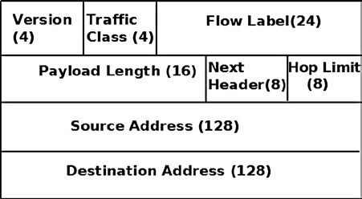
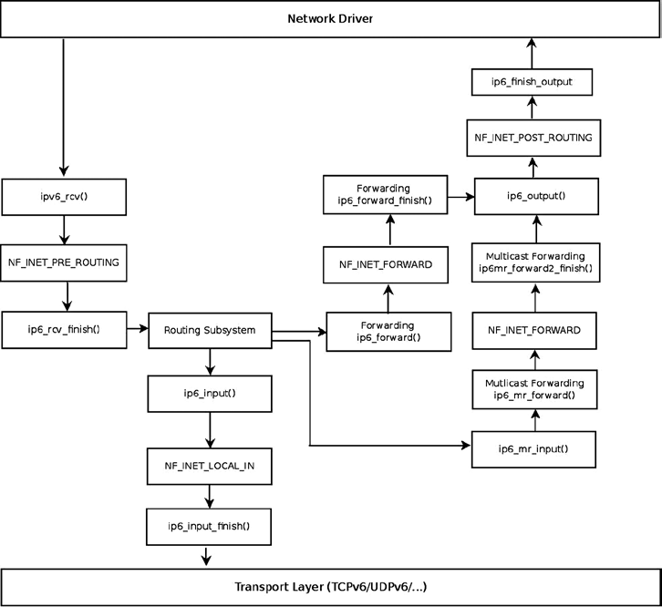
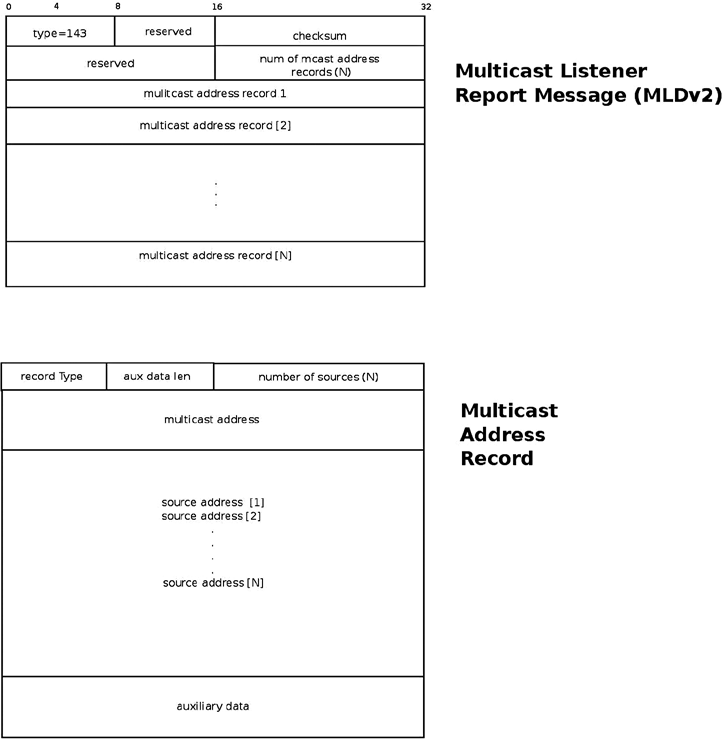

# Chương 8. IPv6

Trong Chương 7, tôi đã trình bày Linux Neighbouring Subsystem và cách triển khai. Trong chương này, tôi trình bày protocol IPv6 và cách triển khai trong Linux. IPv6 là network layer protocol next-generation của TCP/IP protocol stack. Nó được phát triển bởi Internet Engineering Task Force (IETF) nhằm thay thế IPv4, vốn vẫn mang phần lớn lưu lượng Internet.

Đầu những năm ‘90, IETF bắt đầu nỗ lực phát triển thế hệ tiếp theo của protocol IP do dự đoán sự tăng trưởng Internet. RFC IPv6 đầu tiên ra đời năm 1995: RFC 1883, “Internet Protocol, Version 6 (IPv6) Specification”. Sau đó, năm 1998, RFC 2460 thay thế nó. Vấn đề chính IPv6 giải quyết là thiếu địa chỉ: địa chỉ IPv6 dài 128 bit. IPv6 cung cấp không gian địa chỉ lớn hơn nhiều. Thay vì 2^32 địa chỉ trong IPv4, có 2^128 địa chỉ trong IPv6. Điều này mở rộng đáng kể không gian địa chỉ, có lẽ lớn hơn nhiều so với nhu cầu trong vài thập kỷ tới. Nhưng mở rộng không gian địa chỉ không phải ưu điểm duy nhất của IPv6 như một số người nghĩ. Dựa trên kinh nghiệm với IPv4, nhiều thay đổi được thực hiện trong IPv6 để cải thiện protocol IP. Chúng ta sẽ trình bày nhiều thay đổi trong chương này.

Protocol IPv6 hiện đang phát triển mạnh như một network layer protocol cải tiến. Internet ngày càng phổ biến khắp thế giới, cùng thị trường thiết bị di động thông minh và máy tính bảng tăng trưởng, chắc chắn khiến cạn kiệt địa chỉ IPv4 trở thành vấn đề rõ ràng hơn. Điều này dẫn đến nhu cầu chuyển sang thế hệ kế tiếp của IPv4, protocol IPv6.

## IPv6 – Giới thiệu ngắn gọn

IPv6 subsystem chắc chắn là chủ đề rất rộng và không ngừng phát triển. Các tính năng thú vị được thêm trong thập kỷ qua. Một số tính năng mới dựa trên IPv4, như ICMPv6 socket, IPv6 Multicast Routing và IPv6 NAT. IPsec bắt buộc trong IPv6 và tùy chọn trong IPv4, dù phần lớn hệ điều hành cũng triển khai IPsec trong IPv4. Khi tìm hiểu IPv6 kernel internals, chúng ta thấy nhiều điểm tương đồng. Đôi khi tên method, thậm chí tên một số biến, giống nhau ngoài việc thêm “v6” hoặc “6”. Tuy nhiên, có một số thay đổi trong cách triển khai ở một số nơi.

Trong chương này, chúng ta chọn trình bày các tính năng mới quan trọng của IPv6, chỉ ra một số điểm khác IPv4 và giải thích lý do thay đổi. Extension header, protocol Multicast Listener Discovery (MLD) và quá trình Autoconfiguration là một số tính năng mới được trình bày và minh họa bằng ví dụ userspace. Chúng ta cũng trình bày cách nhận IPv6 packet, cách IPv6 forwarding hoạt động và một số điểm khác biệt so với IPv4. Nhìn chung, có vẻ các nhà phát triển IPv6 đã cải tiến nhiều dựa trên kinh nghiệm với IPv4, và cách triển khai IPv6 mang lại nhiều lợi ích không có trong IPv4 cùng nhiều ưu điểm so với IPv4. Chúng ta sẽ trình bày địa chỉ IPv6 trong phần sau, bao gồm địa chỉ multicast và địa chỉ đặc biệt.

## Địa chỉ IPv6

Bước đầu tiên học IPv6 là làm quen với IPv6 Addressing Architecture, được định nghĩa trong RFC 4291. Có ba loại địa chỉ IPv6:

- Unicast: Địa chỉ này xác định duy nhất một interface. Packet gửi đến địa chỉ unicast được chuyển đến interface được địa chỉ đó xác định.

- Anycast: Địa chỉ này có thể gán cho tập interface (thường trên các node khác nhau). Loại địa chỉ này không có trong IPv4. Thực tế, nó kết hợp địa chỉ unicast và multicast. Packet gửi đến địa chỉ anycast được chuyển đến một trong các interface được địa chỉ đó xác định (interface “gần nhất” theo routing protocol).

- Multicast: Địa chỉ này có thể gán cho tập interface (thường trên các node khác nhau). Packet gửi đến địa chỉ multicast được chuyển đến mọi interface được địa chỉ đó xác định. Interface có thể thuộc số lượng multicast group bất kỳ.

Không có địa chỉ broadcast trong IPv6. Trong IPv6, để đạt kết quả như broadcast, bạn có thể gửi packet đến địa chỉ multicast group của mọi node (`ff02::1)`. Trong IPv4, phần lớn chức năng protocol Address Resolution Protocol (ARP) dựa trên broadcast. IPv6 subsystem dùng neighbour discovery thay ARP để ánh xạ địa chỉ L3 sang địa chỉ L2. IPv6 neighbour discovery protocol dựa trên ICMPv6 và dùng địa chỉ multicast thay broadcast, như đã thấy ở chương trước. Bạn sẽ thấy thêm ví dụ dùng lưu lượng multicast phía sau chương này.

Địa chỉ IPv6 gồm 8 block 16 bit, tổng cộng 128 bit. Địa chỉ IPv6 có dạng: `xxxx:xxxx:xxxx:xxxx:xxxx:xxxx:xxxx:xxxx` (x là chữ số hexadecimal.) Đôi khi bạn gặp "`::`" trong địa chỉ IPv6; đây là cách viết tắt các số không ở đầu.

IPv6 dùng address prefix. Prefix thực chất tương ứng với subnet mask của IPv4. IPv6 prefix được mô tả trong RFC 4291, “IP Version 6 Addressing Architecture”. IPv6 address prefix được biểu diễn bằng ký pháp: `ipv6-address/prefix-length`.

prefix-length là giá trị thập phân cho biết bao nhiêu bit liên tiếp bên trái của địa chỉ tạo thành prefix. Chúng ta dùng "`/n`" để ký hiệu prefix dài n bit. Chẳng hạn với mọi địa chỉ IPv6 bắt đầu bằng 32 bit `2001:0da7`, prefix được dùng là: `2001:da7::/32`.

Sau khi tìm hiểu các loại địa chỉ IPv6, bạn sẽ tìm hiểu một số địa chỉ IPv6 đặc biệt và cách sử dụng trong phần tiếp theo.

### Địa chỉ đặc biệt

Trong phần này, tôi mô tả một số địa chỉ IPv6 đặc biệt và cách sử dụng. Bạn nên làm quen với các địa chỉ này vì sẽ gặp một số ở phía sau chương (như unspecified address toàn bit 0 dùng trong DAD, hay Duplicate Address Detection) và khi duyệt code. Danh sách sau chứa địa chỉ IPv6 đặc biệt cùng giải thích cách dùng:

- Phải có ít nhất một địa chỉ link-local unicast trên mỗi interface. Địa chỉ link-local cho phép giao tiếp với node khác trong cùng mạng vật lý; cần cho neighbour discovery, cấu hình địa chỉ tự động và các chức năng khác. Router không được forwarding packet có địa chỉ nguồn hoặc đích link-local. Địa chỉ Link-local được gán với prefix `fe80::/64`.

- Định dạng chung của Global Unicast Address như sau: n bit đầu là `global routing prefix`, m bit tiếp theo là `subnet ID`, và 128-n-m bit còn lại là `interface ID`.

- `global routing prefix`: Giá trị được gán cho site. Nó biểu diễn network ID hoặc prefix của địa chỉ.

- `subnet ID`: Identifier của subnet bên trong site.

- `interface ID`: Một `id`; giá trị phải duy nhất trong subnet. Được định nghĩa trong RFC 3513, phần 2.5.1.

Global Unicast Address được mô tả trong RFC 3587, “IPv6 Global Unicast Address Format”. Không gian Global Unicast Address có thể cấp phát được định nghĩa trong RFC 4291.

- Địa chỉ IPv6 loopback là `0:0:0:0:0:0:0:1`, hoặc `::1` theo cách viết ngắn.

- Địa chỉ toàn bit 0 (`0:0:0:0:0:0:0:0`) được gọi là unspecified address. Nó được dùng trong DAD (Duplicate Address Detection) như đã thấy ở chương trước. Không được dùng làm địa chỉ đích. Bạn không thể gán unspecified address cho interface bằng công cụ userspace như lệnh `ip` hoặc lệnh `ifconfig`.

- Địa chỉ IPv6 IPv4-mapped bắt đầu bằng 80 bit 0. 16 bit tiếp theo là 1 và 32 bit còn lại là địa chỉ IPv4. Chẳng hạn `::ffff:192.0.2.128` biểu diễn địa chỉ IPv4 192.0.2.128. Về cách dùng, xem RFC 4038, “Application Aspects of IPv6 Transition”.

- Định dạng IPv4-compatible đã deprecated; trong định dạng này, địa chỉ IPv4 nằm ở 32 bit thấp của địa chỉ IPv6 và mọi bit còn lại bằng 0; địa chỉ đề cập ở trên phải là `::192.0.2.128` theo định dạng này. Xem RFC 4291, phần 2.5.5.1.

- Địa chỉ site local ban đầu được thiết kế để đánh địa chỉ trong site mà không cần global prefix, nhưng đã deprecated trong RFC 3879, “Deprecating Site Local Addresses”, năm 2004.

Địa chỉ IPv6 được biểu diễn trong Linux bằng structure `in6_addr`; dùng union có ba array (với phần tử 8, 16 và 32 bit) trong structure `in6_addr` giúp thực hiện các thao tác bit-manipulation:

```
struct in6_addr {
        union {
                __u8            u6_addr8[16];
                __be16          u6_addr16[8];
                __be32          u6_addr32[4];
        } in6_u;
#define s6_addr                 in6_u.u6_addr8
#define s6_addr16               in6_u.u6_addr16
#define s6_addr32               in6_u.u6_addr32
};
```

(`include/uapi/linux/in6.h`)

Multicast đóng vai trò quan trọng trong IPv6, đặc biệt với các protocol ICMPv6-based như NDISC (đã trình bày trong Chương 7 về Linux Neighbouring Subsystem) và MLD (được trình bày phía sau chương này). Bây giờ tôi trình bày địa chỉ multicast trong IPv6 ở phần tiếp theo.

### Địa chỉ Multicast

Địa chỉ multicast cung cấp cách định nghĩa multicast group; node có thể thuộc một hoặc nhiều multicast group. Packet có đích là địa chỉ multicast phải được chuyển đến mọi node thuộc multicast group đó. Trong IPv6, mọi địa chỉ multicast bắt đầu bằng FF (8 bit đầu). Tiếp theo là 4 bit flag và 4 bit scope. Cuối cùng, 112 bit cuối là group ID. 4 bit của trường flag có ý nghĩa:

- Bit 0: Dành cho sử dụng trong tương lai.

- Bit 1: Giá trị 1 cho biết Rendezvous Point được nhúng trong địa chỉ. Nội dung Rendezvous Point liên quan nhiều hơn đến userspace daemon và nằm ngoài phạm vi sách. Để biết thêm, xem RFC 3956, “Embedding the Rendezvous Point (RP) Address in an IPv6 Multicast Address”. Bit này đôi khi được gọi là R-flag (R là Rendezvous Point.)

- Bit 2: Giá trị 1 cho biết địa chỉ multicast được gán dựa trên network prefix. (Xem RFC 3306.) Bit này đôi khi được gọi là P-flag (P là Prefix information.)

- Bit 3: Giá trị 0 cho biết địa chỉ multicast permanently-assigned (“well-known”), do Internet Assigned Numbers Authority (IANA) gán. Giá trị 1 cho biết địa chỉ multicast non-permanently-assigned (“tạm thời”). Bit này đôi khi được gọi là T-flag (T là Temporary.)

Scope có thể là một trong các entry trong Bảng 8-1, liệt kê các IPv6 scope theo Linux symbol và giá trị.

Bảng 8-1. IPv6 scope

| Giá trị hex | Mô tả | Linux Symbol |
|---|---|---|
| 0x01 | Cục bộ trong node | IPV6\_ADDR\_SCOPE\_NODELOCAL |
| 0x02 | Cục bộ trong link | IPV6\_ADDR\_SCOPE\_LINKLOCAL |
| 0x05 | Cục bộ trong site | IPV6\_ADDR\_SCOPE\_SITELOCAL |
| 0x08 | Tổ chức | IPV6\_ADDR\_SCOPE\_ORGLOCAL |
| 0x0e | Toàn cục | IPV6\_ADDR\_SCOPE\_GLOBAL |

Sau khi tìm hiểu địa chỉ IPv6 multicast, bạn sẽ tìm hiểu một số địa chỉ multicast đặc biệt trong phần tiếp theo.

### Địa chỉ Multicast đặc biệt

Có một số địa chỉ multicast đặc biệt tôi sẽ đề cập trong chương. Phần 2.7.1 của RFC 4291 định nghĩa các địa chỉ multicast đặc biệt:

- Nhóm All Nodes Multicast Address: `ff01::1`, `ff02::1`

- Nhóm All Routers Multicast Address: `ff01::2`, `ff02::2`, `ff05::2`

Theo RFC 3810, có địa chỉ đặc biệt: All MLDv2-capable routers Multicast Group, là `ff02::16`. Version 2 Multicast Listener Report được gửi đến địa chỉ này; tôi trình bày trong phần “Multicast Listener Discovery (MLD)” phía sau chương.

Node phải tính và tham gia (trên interface phù hợp) các địa chỉ Solicited-Node multicast tương ứng với mọi địa chỉ unicast và anycast được cấu hình cho interface của node (thủ công hoặc tự động). Địa chỉ Solicited-Node multicast được tính dựa trên địa chỉ unicast và anycast của node. Địa chỉ Solicited-Node multicast được tạo bằng cách lấy 24 bit low-order của địa chỉ (unicast hoặc anycast) rồi nối vào prefix `ff02:0:0:0:0:1:ff00::/104`, tạo địa chỉ multicast trong dải `ff02:0:0:0:0:1:ff00:0000` đến `ff02:0:0:0:0:1:ffff:ffff`. Xem RFC 4291.

Method `addrconf_addr_solict_mult()` tính địa chỉ multicast link-local, solicited-node (`include/net/addrconf.h`). Method `addrconf_join_solict()` tham gia solicited address multicast group (`net/ipv6/addrconf.c`).

Trong chương trước, bạn thấy message neighbour advertisement được method `ndisc_send_na()` gửi đến địa chỉ link-local, all nodes (`ff02::1`). Bạn sẽ thấy thêm ví dụ dùng địa chỉ đặc biệt như địa chỉ all nodes multicast group hoặc all routers multicast group ở các phần sau của chương. Trong phần này, bạn đã thấy một số địa chỉ multicast sẽ gặp lại trong chương và khi duyệt IPv6 source code. Bây giờ tôi trình bày IPv6 header trong phần tiếp theo.

## IPv6 Header

Mỗi IPv6 packet bắt đầu bằng IPv6 header, và cần tìm hiểu structure của nó để hiểu đầy đủ cách triển khai IPv6 trong Linux. IPv6 header có độ dài cố định 40 byte; vì vậy không có trường chỉ định độ dài IPv6 header (khác với IPv4, nơi member `ihl` của IPv4 header biểu diễn độ dài header). Lưu ý IPv6 header cũng không có trường checksum, sẽ được giải thích phía sau chương. Trong IPv6 không có cơ chế IP options như IPv4. Cơ chế xử lý IP options của IPv4 gây tốn hiệu năng. Thay vào đó, IPV6 có cơ chế extension header hiệu quả hơn nhiều, được trình bày trong phần tiếp theo, “Extension Header”. Hình 8-1 minh họa IPv6 header và các trường.



Hình 8-1. IPv6 header

Lưu ý trong tiêu chuẩn IPv6 gốc, RFC 2460, priority (Traffic Class) dài 8 bit và flow label dài 20 bit. Trong định nghĩa structure `ipv6hdr`, kích thước trường `priority` (Traffic Class) là 4 bit. Thực tế, trong cách triển khai Linux IPv6, 4 bit đầu của `flow_lbl` được ghép với trường `priority` (Traffic Class) để tạo “class”. Hình 8-1 phản ánh định nghĩa structure `ipv6hdr` trong Linux, được trình bày ở đây:

```
    struct ipv6hdr {
    #if defined(__LITTLE_ENDIAN_BITFIELD)
            __u8                    priority:4,
                                    version:4;
    #elif defined(__BIG_ENDIAN_BITFIELD)
            __u8                    version:4,
                                priority:4;
#else
#error  "Please fix <asm/byteorder.h>"
#endif
        __u8                    flow_lbl[3];

        __be16                  payload_len;
        __u8                    nexthdr;
        __u8                    hop_limit;

        struct  in6_addr        saddr;
        struct  in6_addr        daddr;
};
```

(`include/uapi/linux/ipv6.h`)

Sau đây là mô tả các member của structure `ipv6hdr`:

- `version`: Trường 4-bit. Phải được đặt thành 6.

- `priority`: Cho biết traffic class hoặc priority của IPv6 packet. RFC 2460, nền tảng IPv6, không định nghĩa giá trị traffic class hoặc priority cụ thể.

- `flow_lbl`: Trường flow labeling được xem là thử nghiệm khi tiêu chuẩn IPv6 cơ bản được viết (RFC 2460). Nó cung cấp cách gán nhãn chuỗi packet của flow cụ thể; upper layer có thể dùng việc gán nhãn này cho nhiều mục đích. RFC 6437, “IPv6 Flow Label Specification”, năm 2011, đề xuất dùng flow labeling để phát hiện address spoofing.

- `payload_len`: Trường 16-bit. Kích thước packet không tính IPv6 header có thể đến 65.535 byte. Tôi sẽ trình bày packet lớn hơn (“jumbo frame”) trong phần tiếp theo khi giới thiệu Hop-by-Hop Options header.

- `nexthdr`: Khi không có extension header, đây là upper layer protocol number, như IPPROTO\_UDP (17) cho UDP hoặc IPPROTO\_TCP (6) cho TCP. Danh sách protocol khả dụng nằm trong `include/uapi/linux/in.h`. Khi dùng extension header, đây là type của header tiếp theo ngay sau IPv6 header. Tôi sẽ trình bày extension header trong phần tiếp theo.

- `hop_limit`: Trường một byte. Mỗi thiết bị forwarding giảm bộ đếm `hop_limit` đi một. Khi đạt 0, message ICMPv6 được gửi trả và packet bị loại bỏ. Tương ứng với member TTL trong IPv4 header. Xem method `ip6_forward()` trong `net/ipv6/ip6_output.c`.

- `saddr`: Địa chỉ IPv6 nguồn (128 bit).

- `daddr`: Địa chỉ IPv6 đích (128 bit). Có thể không phải đích cuối của packet nếu dùng Routing Header.

Lưu ý khác IPv4 header, IPv6 header không có checksum. Việc tính checksum được giả định do cả Layer 2 và Layer 4 bảo đảm. UDP trong IPv4 cho phép checksum bằng 0, biểu thị không có checksum; UDP trong IPV6 thông thường yêu cầu checksum riêng. Có một số trường hợp đặc biệt trong IPv6 cho phép UDP checksum bằng 0 với IPv6 UDP tunnel; xem RFC 6935, “IPv6 and UDP Checksums for Tunneled Packets”. Trong Chương 4 về IPv4 subsystem, bạn thấy khi forwarding packet, method `ip_decrease_ttl()` được gọi. Method này tính lại IPv4 header checksum vì giá trị `ttl` thay đổi. Trong IPv6 không cần tính lại checksum khi forwarding packet, vì IPv6 header hoàn toàn không có checksum. Điều này cải thiện hiệu năng trên router software-based.

Trong phần này, bạn đã thấy cách tạo IPv6 header. Bạn thấy một số khác biệt giữa IPv4 header và IPv6 header—chẳng hạn IPv6 header không có checksum và header length. Phần tiếp theo trình bày IPv6 extension header, tương ứng với IPv4 options.

## Extension Header

IPv4 header có thể chứa IP options, mở rộng IPv4 header từ tối thiểu 20 byte đến 60 byte. Trong IPv6, thay vào đó là các extension header tùy chọn. Ngoài một ngoại lệ (Hop-by-Hop Options header), không node nào trên đường chuyển packet xử lý extension header cho đến khi packet đến đích cuối; điều này cải thiện đáng kể hiệu năng forwarding. Tiêu chuẩn IPv6 cơ bản định nghĩa extension header. IPv6 packet có thể chứa 0, 1 hoặc nhiều extension header. Các header này có thể nằm giữa IPv6 header và upper-layer header trong packet. Trường `nexthdr` của IPv6 header là số của header tiếp theo ngay sau IPv6 header. Các extension header được nối chuỗi; mỗi extension header có trường Next Header. Trong extension header cuối, Next Header chỉ upper-layer protocol (như TCP, UDP hoặc ICMPv6). Ưu điểm khác là dễ thêm extension header mới trong tương lai mà không cần thay đổi IPv6 header.

Extension header phải được xử lý đúng thứ tự xuất hiện trong packet. Mỗi extension header chỉ nên xuất hiện tối đa một lần, trừ Destination Options header có thể xuất hiện tối đa hai lần. (Xem chi tiết phía sau phần này trong mô tả Destination Options header.) Hop-by-Hop Options header phải xuất hiện ngay sau IPv6 header; mọi option khác có thể theo thứ tự bất kỳ. Phần 4.1 của RFC 2460 (“Extension Header Order”) nêu thứ tự khuyến nghị cho extension header, nhưng không bắt buộc. Khi gặp số Next Header không biết trong lúc xử lý packet, message ICMPv6 “Parameter Problem” với code “unknown Next Header” (ICMPV6\_UNK\_NEXTHDR) được gửi trả bên gửi bằng cách gọi method `icmpv6_param_prob()`. Mô tả các ICMPv6 “Parameter Problem Codes” khả dụng nằm trong Bảng 8-4 của phần “Tham khảo nhanh” ở cuối chương.

Mỗi extension header phải được căn chỉnh theo boundary 8-byte. Với extension header có kích thước thay đổi, có trường Header Extension Length và dùng padding nếu cần để bảo đảm căn chỉnh theo boundary 8-byte. Số của mọi Linux IPv6 extension header và Linux Kernel symbol tương ứng được liệt kê trong Bảng 8-2, “IPv6 extension header”, ở phần “Tham khảo nhanh” cuối chương.

Protocol handler được đăng ký cho mỗi extension header (trừ Hop-by-Hop Options header) bằng method `inet6_add_protocol()`. Lý do không đăng ký protocol handler cho Hop-by-Hop Options header là có method riêng để parse Hop-by-Hop Options header, method `ipv6_parse_hopopts()`. Method này được gọi trước khi gọi protocol handler. (Xem method `ipv6_rcv()`, `net/ipv6/ip6_input.c`). Như đã nói, Hop-by-Hop Options header phải đứng đầu, ngay sau IPv6 header. Chẳng hạn protocol handler cho Fragment extension header được đăng ký như sau:

```
static const struct inet6_protocol frag_protocol =
{
    .handler    =    ipv6_frag_rcv,
    .flags      =    INET6_PROTO_NOPOLICY,
};


int __init ipv6_frag_init(void)
{
    int ret;

    ret = inet6_add_protocol(&frag_protocol, IPPROTO_FRAGMENT);

(net/ipv6/reassembly.c)
```

Sau đây là mô tả mọi IPv6 Extension header:

- Hop-by-Hop Options header: Hop-by-Hop Options header phải được xử lý tại mỗi node. Nó được parse bằng method `ipv6_parse_hopopts()` (`net/ipv6/exthdrs.c`).

- Hop-by-Hop Options header phải ngay sau IPv6 header. Chẳng hạn nó được protocol Multicast Listener Discovery sử dụng, như bạn sẽ thấy trong phần “Multicast Listener Discovery (MLD)” phía sau chương. Hop-by-Hop Options header chứa trường option variable-length. Byte đầu là type, có thể là một trong các giá trị sau:

- Router Alert (Linux Kernel symbol: IPV6\_TLV\_ROUTERALERT, giá trị: 5). Xem RFC 6398, “IP Router Alert Considerations and Usage”.

- Jumbo (Linux Kernel symbol: IPV6\_TLV\_JUMBO, giá trị: 194). IPv6 packet payload thông thường có thể dài đến 65.535 byte. Với jumbo option, có thể đến 2^32 byte. Xem RFC 2675, “IPv6 Jumbograms”.

- Pad1 (Linux Kernel symbol: IPV6\_TLV\_PAD1, giá trị: 0). Pad1 option được dùng để chèn một byte padding. Khi cần nhiều hơn một byte padding, phải dùng PadN option (xem tiếp theo) (không dùng nhiều Pad1 option). Xem phần 4.2 của RFC 2460.

- PadN (Linux Kernel symbol: IPV6\_TLV\_PADN, giá trị: 1). PadN option được dùng để chèn hai hoặc nhiều octet padding vào vùng Options của header.

- Routing Options header: Tương ứng với IPv4 Loose Source Record Route (IPOPT\_LSRR), được trình bày trong phần “IP Options” của Chương 4. Nó cho phép chỉ định một hoặc nhiều router mà packet phải đi qua trên route đến đích cuối.

- Fragment Options header: Khác IPv4, fragmentation trong IPv6 chỉ có thể diễn ra trên host gửi packet, không trên node trung gian. Fragmentation được triển khai bởi method `ip6_fragment()`, được gọi từ method `ip6_finish_output()`. Trong method `ip6_fragment()` có slow path và fast path, khá giống IPv4 fragmentation. Cách triển khai IPv6 fragmentation nằm trong `net/ipv6/ip6_output.c`, còn IPv6 defragmentation nằm trong `net/ipv6/reassembly.c`.

- Authentication Header: Authentication header (AH) cung cấp data authentication, data integrity và bảo vệ anti-replay. Được mô tả trong RFC 4302, “IP Authentication Header”, thay thế RFC 2402.

- Encapsulating Security Payload Options header: Được mô tả trong RFC 4303, “IP Encapsulating Security Payload (ESP)”, thay thế RFC 2406. Lưu ý: Protocol Encapsulating Security Payload (ESP) được trình bày trong Chương 10 về IPsec subsystem.

- Destination Options header: Destination Options header có thể xuất hiện hai lần trong packet; trước Routing Options header và sau nó. Khi ở trước Routing Options header, nó chứa thông tin phải được các router do Router Options header chỉ định xử lý. Khi ở sau Router Options header, nó chứa thông tin phải được đích cuối xử lý.

Trong phần tiếp theo, bạn sẽ thấy cách IPv6 protocol handler, method `ipv6_rcv()`, được gắn với IPv6 packet.

## Khởi tạo IPv6

Method `inet6_init()` thực hiện các khởi tạo IPv6 (như khởi tạo `procfs`, đăng ký protocol handler cho TCPv6, UDPv6 và các protocol khác), khởi tạo IPv6 subsystem (như IPv6 neighbour discovery, IPv6 Multicast Routing và IPv6 routing subsystem), cùng các thao tác khác. Để biết thêm, xem `net/ipv6/af_inet6.c`. Method `ipv6_rcv()` được đăng ký làm protocol handler cho IPv6 packet bằng cách định nghĩa object `packet_type` cho IPv6 và đăng ký bằng method `dev_add_pack()`, khá giống IPv4:

```
static struct packet_type ipv6_packet_type __read_mostly = {
        .type = cpu_to_be16(ETH_P_IPV6),
        .func = ipv6_rcv,
};

static int __init ipv6_packet_init(void)
{
        dev_add_pack(&ipv6_packet_type);
        return 0;
}
```

(`net/ipv6/af_inet6.c`)

Kết quả đăng ký ở trên là mỗi Ethernet packet có ethertype ETH\_P\_IPV6 (0x86DD) được xử lý bởi method `ipv6_rcv()`. Tiếp theo tôi trình bày cơ chế IPv6 Autoconfiguration để thiết lập địa chỉ IPv6.

## Autoconfiguration

Autoconfiguration là cơ chế cho phép host lấy hoặc tạo địa chỉ duy nhất cho mỗi interface. Quá trình IPv6 autoconfiguration bắt đầu khi khởi động hệ thống; node (cả host lẫn router) tạo địa chỉ link-local cho interface. Địa chỉ này được xem là “tentative” (interface flag IFA\_F\_TENTATIVE được đặt); nghĩa là chỉ có thể giao tiếp bằng neighbour discovery message. Phải kiểm tra địa chỉ chưa được node khác trên link sử dụng. Điều này được thực hiện bằng cơ chế DAD (Duplicate Address Detection), đã mô tả trong chương trước về Linux Neighbouring Subsystem. Nếu node không duy nhất, quá trình autoconfiguration dừng và cần cấu hình thủ công. Nếu địa chỉ duy nhất, quá trình autoconfiguration tiếp tục. Giai đoạn autoconfiguration tiếp theo của host bao gồm gửi một hoặc nhiều Router Solicitation đến địa chỉ all routers multicast group (`ff02::2`). Được thực hiện bằng cách gọi method `ndisc_send_rs()` từ method `addrconf_dad_completed()`. Router phản hồi bằng message Router Advertisement, gửi đến địa chỉ all hosts, `ff02::1`. Cả Router Solicitation và Router Advertisement dùng Neighbour Discovery Protocol qua message ICMPv6. Router solicitation ICMPv6 type là NDISC\_ROUTER\_SOLICITATION (133), còn router advertisement ICMPv6 type là NDISC\_ROUTER\_ADVERTISEMENT (134).

Daemon `radvd` là ví dụ về Router Advertisement daemon nguồn mở dùng cho stateless autoconfiguration (`http://www.litech.org/radvd/`). Bạn có thể đặt prefix trong file cấu hình `radvd` để gửi trong message Router Advertisement. Daemon `radvd` gửi Router Advertisement định kỳ. Ngoài ra, nó cũng listen Router Solicitation (RS) request và trả lời bằng Router Advertisement (RA) reply message. Các message Router Advertisement (RA) này chứa trường prefix, đóng vai trò quan trọng trong autoconfiguration như bạn sẽ thấy ngay sau đây. Prefix phải dài 64 bit. Khi host nhận message Router Advertisement (RA), nó cấu hình địa chỉ IP dựa trên prefix này và địa chỉ MAC của mình. Nếu bật tính năng Privacy Extensions (CONFIG\_IPV6\_PRIVACY), còn có yếu tố ngẫu nhiên được thêm khi tạo địa chỉ IPv6. Cơ chế Privacy Extensions tránh để lộ chi tiết nhận dạng máy từ địa chỉ IPv6, vốn thường được tạo bằng địa chỉ MAC và prefix, bằng cách thêm tính ngẫu nhiên như đã nói. Để biết thêm về Privacy Extensions, xem RFC 4941, “Privacy Extensions for Stateless Address Autoconfiguration in IPv6”. Khi host nhận message Router Advertisement, nó có thể tự động cấu hình địa chỉ và một số

tham số khác. Nó cũng có thể chọn default router dựa trên các advertisement này. Có thể đặt preferred lifetime và valid lifetime cho các địa chỉ được cấu hình tự động trên host. Giá trị preferred lifetime chỉ thời gian tính bằng giây mà địa chỉ được tạo từ prefix qua stateless address autoconfiguration còn ở trạng thái preferred. Khi preferred time hết, địa chỉ ngừng giao tiếp (không trả lời `ping6`, v.v.). Giá trị valid lifetime chỉ thời gian tính bằng giây mà địa chỉ còn hợp lệ (tức các ứng dụng đang dùng có thể tiếp tục dùng); khi hết thời gian, địa chỉ bị xóa. Preferred lifetime và valid lifetime được biểu diễn trong kernel lần lượt bằng các trường `prefered_lft` và `valid_lft` của object `inet6_ifaddr` (`include/net/if_inet6.h`).

Renumbering là quá trình thay prefix cũ bằng prefix mới và thay đổi địa chỉ IPv6 của host theo prefix mới. Renumbering cũng có thể thực hiện khá dễ bằng `radvd`: thêm prefix mới vào cấu hình, đặt preferred lifetime và valid lifetime rồi khởi động lại daemon `radvd`. Xem thêm RFC 4192, “Procedures for Renumbering an IPv6 Network without a Flag Day”, và RFC 5887, 6866, 6879.

Dynamic Host Configuration Protocol version 6 (DHCPv6) là ví dụ về stateful address configuration; trong mô hình stateful autoconfiguration, host lấy địa chỉ interface và/hoặc thông tin cấu hình cùng tham số từ server. Server duy trì database theo dõi địa chỉ nào được gán cho host nào. Tôi không đi sâu chi tiết protocol DHCPv6 trong sách này. Protocol DHCPv6 được quy định trong RFC 3315, “Dynamic Host Configuration Protocol for IPv6 (DHCPv6)”. Tiêu chuẩn IPv6 Stateless Autoconfiguration được mô tả trong RFC 4862, “IPv6 Stateless Address Autoconfiguration”.

Trong phần này, bạn đã tìm hiểu quá trình Autoconfiguration và thấy việc thay prefix cũ bằng prefix mới dễ thế nào bằng cách cấu hình rồi khởi động lại `radvd`. Phần tiếp theo trình bày cách method `ipv6_rcv()`, là IPv6 protocol handler, xử lý nhận IPv6 packet theo cách khá giống IPv4.

## Nhận IPv6 Packet

Method nhận IPv6 chính là `ipv6_rcv()`, handler cho mọi IPv6 packet (gồm multicast; không có broadcast trong IPv6 như đã nói). Có nhiều điểm tương đồng giữa Rx path của IPv4 và IPv6. Giống IPv4, trước tiên thực hiện một số sanity check như kiểm tra version của IPv6 header là 6 và địa chỉ nguồn không phải địa chỉ multicast. (Theo phần 2.7 của RFC 4291, điều này bị cấm.) Nếu có Hop-by-Hop Options header, nó phải đứng đầu. Nếu giá trị `nexthdr` của IPV6 header là 0, nghĩa là Hop-by-Hop Options header, được parse bằng cách gọi method `ipv6_parse_hopopts()`. Công việc thực sự do method `ip6_rcv_finish()` thực hiện, được gọi thông qua macro NF\_HOOK(). Nếu có netfilter callback đăng ký tại điểm này (NF\_INET\_PRE\_ROUTING), callback được gọi. Tôi trình bày netfilter hook trong chương tiếp theo. Hãy xem method `ipv6_rcv()`:

```
int ipv6_rcv(struct sk_buff *skb, struct net_device *dev, struct packet_type *pt,
             struct net_device *orig_dev)
{
        const struct ipv6hdr *hdr;
        u32             pkt_len;
        struct inet6_dev *idev;
```

Lấy network namespace từ network device gắn với Socket Buffer (SKB):

```
struct net *net = dev_net(skb->dev);

        . . .
```

Lấy IPv6 header từ SKB:

```
hdr = ipv6_hdr(skb);
```

Thực hiện một số sanity check và loại bỏ SKB nếu cần:

```
        if (hdr->version != 6)
                goto err;

        /*
         * RFC4291 2.5.3
         * A packet received on an interface with a destination address
         * of loopback must be dropped.
         */
        if (!(dev->flags & IFF_LOOPBACK) &&
            ipv6_addr_loopback(&hdr->daddr))
                goto err;

        . . .

        /*
         * RFC4291 2.7
         * Multicast addresses must not be used as source addresses in IPv6
         * packets or appear in any Routing header.
         */
        if (ipv6_addr_is_multicast(&hdr->saddr))
                goto err;

        . . .
        if (hdr->nexthdr == NEXTHDR_HOP) {
                if (ipv6_parse_hopopts(skb) < 0) {
                        IP6_INC_STATS_BH(net, idev, IPSTATS_MIB_INHDRERRORS);
                        rcu_read_unlock();
                        return NET_RX_DROP;
                }
        }
        . . .

        return NF_HOOK(NFPROTO_IPV6, NF_INET_PRE_ROUTING, skb, dev, NULL,
                       ip6_rcv_finish);
err:
        IP6_INC_STATS_BH(net, idev, IPSTATS_MIB_INHDRERRORS);
drop:
        rcu_read_unlock();
        kfree_skb(skb);
        return NET_RX_DROP;
}
```

(`net/ipv6/ip6_input.c`)

Method `ip6_rcv_finish()` trước tiên lookup trong routing subsystem bằng cách gọi method `ip6_route_input()` nếu không có `dst` gắn với SKB. Method `ip6_route_input()` cuối cùng gọi `fib6_rule_lookup()`.

```
int ip6_rcv_finish(struct sk_buff *skb)
 {
      . . .
      if (!skb_dst(skb))
                 ip6_route_input(skb);
```

Gọi callback `input` của `dst` gắn với SKB:

```
         return dst_input(skb);
 }
```

(`net/ipv6/ip6_input.c`)

Lưu ý có hai cách triển khai method `fib6_rule_lookup()` khác nhau: một khi Policy Routing (CONFIG\_IPV6\_MULTIPLE\_TABLES) được bật, trong `net/ipv6/fib6_rules.c`, và một khi không bật Policy Routing, trong `net/ipv6/ip6_fib.c`.

Như đã thấy trong Chương 5 về các chủ đề nâng cao của IPv4 Routing Subsystem, lookup trong routing subsystem tạo object `dst` và thiết lập callback `input` cùng `output`; IPv6 thực hiện các tác vụ tương tự. Sau khi method `ip6_rcv_finish()` lookup trong routing subsystem, nó gọi method `dst_input()`, thực chất gọi callback `input` của object `dst` gắn với packet.

Hình 8-2 minh họa receive path (Rx) của packet được network driver nhận. Packet có thể được chuyển đến máy cục bộ hoặc forwarding đến host khác. Kết quả lookup trong routing table quyết định lựa chọn nào diễn ra.



Hình 8-2. Nhận IPv6 packet

Lưu ý Để đơn giản, sơ đồ không bao gồm các method fragmentation/defragmentation/parse extension header /IPsec.

Lookup trong IPv6 routing subsystem đặt callback `input` của destination cache (`dst`) thành:

- `ip6_input()` khi packet dành cho máy cục bộ.

- `ip6_forward()` khi packet cần forwarding.

- `ip6_mc_input()` khi packet có đích là địa chỉ multicast.

- `ip6_pkt_discard()` khi packet cần loại bỏ. Method `ip6_pkt_discard()` drop packet và trả lời bên gửi bằng message ICMPv6 destination unreachable (ICMPV6\_DEST\_UNREACH).

IPv6 packet nhận được có thể được local delivery hoặc forwarding; trong phần tiếp theo, bạn tìm hiểu local delivery của IPv6 packet.

### Local Delivery

Trước tiên hãy xem trường hợp local delivery: method `ip6_input()` rất ngắn:

```
int ip6_input(struct sk_buff *skb)
{
        return NF_HOOK(NFPROTO_IPV6, NF_INET_LOCAL_IN, skb, skb->dev, NULL,
                       ip6_input_finish);
}
```

(`net/ipv6/ip6_input.c`)

Nếu có netfilter hook đăng ký tại điểm này (NF\_INET\_LOCAL\_IN), hook được gọi. Nếu không, tiếp tục đến method `ip6_input_finish()`:

```
static int ip6_input_finish(struct sk_buff *skb)
{
        struct net *net = dev_net(skb_dst(skb)->dev);
        const struct inet6_protocol *ipprot;
```

Structure `inet6_dev` (`include/net/if_inet6.h`) tương ứng với structure IPv4 `in_device` trong IPv6. Nó chứa cấu hình IPv6-related như danh sách địa chỉ unicast của network interface (`addr_list`) và danh sách địa chỉ multicast của network interface (`mc_list`). Người dùng có thể thiết lập cấu hình IPv6-related này bằng lệnh `ip` hoặc lệnh `ifconfig`.

```
        struct inet6_dev *idev;
        unsigned int nhoff;
        int nexthdr;
        bool raw;

        /*
         *      Parse extension headers
         */

        rcu_read_lock();
resubmit:
        idev = ip6_dst_idev(skb_dst(skb));
        if (!pskb_pull(skb, skb_transport_offset(skb)))
                goto discard;
        nhoff = IP6CB(skb)->nhoff;
```

Lấy số next header từ SKB:

```
nexthdr = skb_network_header(skb)[nhoff];
```

Trước tiên, nếu là raw socket packet, thử chuyển đến raw socket:

```
raw = raw6_local_deliver(skb, nexthdr);
```

Mỗi extension header (trừ Hop by Hop extension header) có protocol handler được đăng ký bởi method `inet6_add_protocol()`; method này thực chất thêm entry vào array toàn cục `inet6_protos` (xem `net/ipv6/protocol.c`).

```
    if ((ipprot = rcu_dereference(inet6_protos[nexthdr])) != NULL) {
            int ret;

            if (ipprot->flags & INET6_PROTO_FINAL) {
                    const struct ipv6hdr *hdr;

                    /* Free reference early: we don't need it any more,
                       and it may hold ip_conntrack module loaded
                       indefinitely. */
                    nf_reset(skb);

                    skb_postpull_rcsum(skb, skb_network_header(skb),
                                       skb_network_header_len(skb));
                    hdr = ipv6_hdr(skb);
```

RFC 3810, đặc tả MLDv2, nói: “Lưu ý message MLDv2 không chịu source filtering và phải luôn được host và router xử lý”. Chúng ta không muốn loại bỏ MLD multicast packet do source filtering, vì các MLD packet này phải luôn được xử lý theo RFC. Vì vậy trước khi loại bỏ packet, cần bảo đảm nếu địa chỉ đích là địa chỉ multicast thì packet không phải MLD packet. Điều này được thực hiện bằng cách gọi method `ipv6_is_mld()` trước khi loại bỏ. Nếu method cho biết packet là MLD packet thì không loại bỏ. Bạn có thể xem thêm trong phần “Multicast Listener Discovery (MLD)” phía sau chương.

```
        if (ipv6_addr_is_multicast(&hdr->daddr) &&
            !ipv6_chk_mcast_addr(skb->dev, &hdr->daddr,
            &hdr->saddr) &&
            !ipv6_is_mld(skb, nexthdr, skb_network_header_len(skb)))
                goto discard;
}
```

Khi flag INET6\_PROTO\_NOPOLICY được đặt, nghĩa là không cần kiểm tra IPsec policy cho protocol này:

```
        if (!(ipprot->flags & INET6_PROTO_NOPOLICY) &&
            !xfrm6_policy_check(NULL, XFRM_POLICY_IN, skb))
                goto discard;
        ret = ipprot->handler(skb);
        if (ret > 0)
                goto resubmit;
        else if (ret == 0)
                IP6_INC_STATS_BH(net, idev, IPSTATS_MIB_INDELIVERS);
} else {
        if (!raw) {
                if (xfrm6_policy_check(NULL, XFRM_POLICY_IN, skb)) {
                        IP6_INC_STATS_BH(net, idev,
                                         IPSTATS_MIB_INUNKNOWNPROTOS);
                        icmpv6_send(skb, ICMPV6_PARAMPROB,
                                    ICMPV6_UNK_NEXTHDR, nhoff);
                }
                kfree_skb(skb);
        } else {
```

Mọi thứ đều ổn, nên tăng bộ đếm INDELIVERS SNMP MIB (`/proc/net/snmp6/Ip6InDelivers`) và giải phóng packet bằng method `consume_skb()`:

```
                        IP6_INC_STATS_BH(net, idev, IPSTATS_MIB_INDELIVERS);
                        consume_skb(skb);
                }
        }
        rcu_read_unlock();
        return 0;

discard:
        IP6_INC_STATS_BH(net, idev, IPSTATS_MIB_INDISCARDS);
        rcu_read_unlock();
        kfree_skb(skb);
        return 0;
}
```

(`net/ipv6/ip6_input.c`)

Bạn đã thấy chi tiết triển khai local delivery, thực hiện bởi các method `ip6_input()` và `ip6_input_finish()`. Bây giờ chuyển sang chi tiết triển khai forwarding trong IPv6. Ở đây cũng có nhiều điểm tương đồng giữa forwarding trong IPv4 và IPv6.

### Forwarding

Forwarding trong IPv6 rất giống IPv4. Tuy nhiên có vài thay đổi nhỏ. Chẳng hạn trong IPv6, không tính checksum khi forwarding packet. (IPv6 header hoàn toàn không có trường checksum, như đã nói.) Hãy xem method `ip6_forward()`:

```
int ip6_forward(struct sk_buff *skb)
{
        struct dst_entry *dst = skb_dst(skb);
        struct ipv6hdr *hdr = ipv6_hdr(skb);
        struct inet6_skb_parm *opt = IP6CB(skb);
        struct net *net = dev_net(dst->dev);
        u32 mtu;
```

Entry forwarding IPv6 trong `procfs` (`/proc/sys/net/ipv6/conf/all/forwarding`) phải được bật:

```
if (net->ipv6.devconf_all->forwarding == 0)
        goto error;
```

Khi làm việc với Large Receive Offload (LRO), độ dài packet vượt Maximum transmission unit (MTU). Giống IPv4, khi LRO được bật, SKB được giải phóng và lỗi –EINVAL được trả về:

```
if (skb_warn_if_lro(skb))
        goto drop;

if (!xfrm6_policy_check(NULL, XFRM_POLICY_FWD, skb)) {
        IP6_INC_STATS(net, ip6_dst_idev(dst), IPSTATS_MIB_INDISCARDS);
        goto drop;
}
```

Drop packet không dành cho host cục bộ. `pkt_type` gắn với SKB được xác định theo địa chỉ MAC đích trong Ethernet header của packet nhận được. Điều này do method `eth_type_trans()` thực hiện, thường được gọi trong network device driver khi xử lý packet nhận được. Xem method `eth_type_trans()`, `net/ethernet/eth.c`.

```
if (skb->pkt_type != PACKET_HOST)
        goto drop;

skb_forward_csum(skb);

/*
 *      We DO NOT make any processing on
 *      RA packets, pushing them to user level AS IS
 *      without any WARRANTY that application will be able
 *      to interpret them. The reason is that we
 *      cannot make anything clever here.
 *
 *      We are not end-node, so that if packet contains
 *      AH/ESP, we cannot make anything.
 *      Defragmentation also would be mistake, RA packets
 *      cannot be fragmented, because there is no warranty
 *      that different fragments will go along one path. --ANK
 */
if (opt->ra) {
        u8 *ptr = skb_network_header(skb) + opt->ra;
```

Cần thử chuyển packet đến socket đã đặt socket option IPV6\_ROUTER\_ALERT bằng `setsockopt()`. Được thực hiện bằng cách gọi method `ip6_call_ra_chain()`; nếu chuyển thành công trong `ip6_call_ra_chain()`, method `ip6_forward()` trả về 0 và packet không được forwarding. Xem cách triển khai method `ip6_call_ra_chain()` trong `net/ipv6/ip6_output.c`.

```
        if (ip6_call_ra_chain(skb, (ptr[2]<<8) + ptr[3]))
                return 0;
}

/*
 *      check and decrement ttl
 */
if (hdr->hop_limit <= 1) {
        /* Force OUTPUT device used as source address */
        skb->dev = dst->dev;
```

Gửi trả ICMP error message khi Hop Limit bằng 1 (hoặc nhỏ hơn), giống IPv4 khi forwarding packet và TTL đạt 0. Khi đó packet bị loại bỏ:

```
            icmpv6_send(skb, ICMPV6_TIME_EXCEED, ICMPV6_EXC_HOPLIMIT, 0);
            IP6_INC_STATS_BH(net,
                             ip6_dst_idev(dst), IPSTATS_MIB_INHDRERRORS);

            kfree_skb(skb);
            return -ETIMEDOUT;
    }
/* XXX: idev->cnf.proxy_ndp? */
if (net->ipv6.devconf_all->proxy_ndp &&
    pneigh_lookup(&nd_tbl, net, &hdr->daddr, skb->dev, 0)) {
        int proxied = ip6_forward_proxy_check(skb);
        if (proxied > 0)
                return ip6_input(skb);
        else if (proxied < 0) {
                IP6_INC_STATS(net, ip6_dst_idev(dst),
                              IPSTATS_MIB_INDISCARDS);
                goto drop;
        }
}

if (!xfrm6_route_forward(skb)) {
        IP6_INC_STATS(net, ip6_dst_idev(dst), IPSTATS_MIB_INDISCARDS);
        goto drop;
}
dst = skb_dst(skb);

/* IPv6 specs say nothing about it, but it is clear that we cannot
   send redirects to source routed frames.
   We don't send redirects to frames decapsulated from IPsec.
 */
if (skb->dev == dst->dev && opt->srcrt == 0 && !skb_sec_path(skb)) {
        struct in6_addr *target = NULL;
        struct inet_peer *peer;
        struct rt6_info *rt;

        /*
         *      incoming and outgoing devices are the same
         *      send a redirect.
         */

        rt = (struct rt6_info *) dst;
        if (rt->rt6i_flags & RTF_GATEWAY)
                target = &rt->rt6i_gateway;
        else
                target = &hdr->daddr;

        peer = inet_getpeer_v6(net->ipv6.peers, &rt->rt6i_dst.addr, 1);

        /* Limit redirects both by destination (here)
           and by source (inside ndisc_send_redirect)
         */
        if (inet_peer_xrlim_allow(peer, 1*HZ))
        ndisc_send_redirect(skb, target);
        if (peer)
        inet_putpeer(peer);
} else {
        int addrtype = ipv6_addr_type(&hdr->saddr);

            /* This check is security critical. */
            if (addrtype == IPV6_ADDR_ANY ||
                addrtype & (IPV6_ADDR_MULTICAST | IPV6_ADDR_LOOPBACK))
            goto error;
            if (addrtype & IPV6_ADDR_LINKLOCAL) {
                    icmpv6_send(skb, ICMPV6_DEST_UNREACH,
                                ICMPV6_NOT_NEIGHBOUR, 0);
                    goto error;
            }
    }
```

Lưu ý IPv6 IPV6\_MIN\_MTU là 1280 byte, theo phần 5, “Packet Size Issues”, của tiêu chuẩn IPv6 cơ bản, RFC 2460.

```
mtu = dst_mtu(dst);
if (mtu < IPV6_MIN_MTU)
        mtu = IPV6_MIN_MTU;

if ((!skb->local_df && skb->len > mtu && !skb_is_gso(skb)) ||
    (IP6CB(skb)->frag_max_size && IP6CB(skb)->frag_max_size > mtu)) {
        /* Again, force OUTPUT device used as source address */
        skb->dev = dst->dev;
```

Trả lời bên gửi bằng message ICMPv6 “Packet Too Big” rồi giải phóng SKB; method `ip6_forward()` trả về –EMSGSIZ trong trường hợp này:

```
        icmpv6_send(skb, ICMPV6_PKT_TOOBIG, 0, mtu);
        IP6_INC_STATS_BH(net,
                         ip6_dst_idev(dst), IPSTATS_MIB_INTOOBIGERRORS);
        IP6_INC_STATS_BH(net,
                         ip6_dst_idev(dst), IPSTATS_MIB_FRAGFAILS);
        kfree_skb(skb);
        return -EMSGSIZE;
}
if (skb_cow(skb, dst->dev->hard_header_len)) {
        IP6_INC_STATS(net, ip6_dst_idev(dst), IPSTATS_MIB_OUTDISCARDS);
        goto drop;
}

hdr = ipv6_hdr(skb);
```

Packet cần forwarding, nên giảm `hop_limit` của IPv6 header.

```
    /* Mangling hops number delayed to point after skb COW */
    hdr->hop_limit--;

    IP6_INC_STATS_BH(net, ip6_dst_idev(dst), IPSTATS_MIB_OUTFORWDATAGRAMS);
    IP6_ADD_STATS_BH(net, ip6_dst_idev(dst), IPSTATS_MIB_OUTOCTETS, skb->len);
    return NF_HOOK(NFPROTO_IPV6, NF_INET_FORWARD, skb, skb->dev, dst->dev,
                   ip6_forward_finish);

error:
       IP6_INC_STATS_BH(net, ip6_dst_idev(dst), IPSTATS_MIB_INADDRERRORS);
drop:
       kfree_skb(skb);
       return -EINVAL;
}
```

(`net/ipv6/ip6_output.c`)

Method `ip6_forward_finish()` là method one-line, với destination cache (`dst`), nó chỉ gọi callback `output`:

```
static inline int ip6_forward_finish(struct sk_buff *skb)
{
return dst_output(skb);
}
```

(`net/ipv6/ip6_output.c`)

Trong phần này, bạn đã thấy cách xử lý nhận IPv6 packet, qua local delivery hoặc forwarding. Bạn cũng thấy một số khác biệt giữa nhận IPv6 packet và IPv4 packet. Trong phần tiếp theo, tôi trình bày Rx path của lưu lượng multicast.

## Nhận IPv6 Multicast Packet

Method `ipv6_rcv()` là IPv6 handler cho cả unicast packet và multicast packet. Như đã nói, sau một số sanity check, nó gọi method `ip6_rcv_finish()`, thực hiện lookup trong routing subsystem bằng cách gọi method `ip6_route_input()`. Trong method `ip6_route_input()`, callback `input` được đặt thành method `ip6_mc_input` khi nhận multicast packet. Hãy xem method `ip6_mc_input()`:

```
int ip6_mc_input(struct sk_buff *skb)
{
        const struct ipv6hdr *hdr;
        bool deliver;

        IP6_UPD_PO_STATS_BH(dev_net(skb_dst(skb)->dev),
                         ip6_dst_idev(skb_dst(skb)), IPSTATS_MIB_INMCAST,
                         skb->len);

        hdr = ipv6_hdr(skb);
```

Method `ipv6_chk_mcast_addr()` (`net/ipv6/mcast.c`) kiểm tra danh sách địa chỉ multicast (`mc_list`) của network device chỉ định có chứa địa chỉ multicast chỉ định không (ở đây là địa chỉ đích trong IPv6 header, `hdr->daddr`). Lưu ý vì tham số thứ ba là NULL, trong lời gọi này không kiểm tra có source filter cho địa chỉ nguồn hay không; xử lý source filtering được trình bày phía sau chương.

```
deliver = ipv6_chk_mcast_addr(skb->dev, &hdr->daddr, NULL);
```

Nếu máy cục bộ là multicast router (tức CONFIG\_IPV6\_MROUTE được bật), sau một số kiểm tra, tiếp tục đến method `ip6_mr_input()`. Cách triển khai IPv6 multicast routing rất giống IPv4 multicast routing, được trình bày trong Chương 6, nên tôi không trình bày trong sách này. Cách triển khai IPv6 multicast routing nằm trong `net/ipv6/ip6mr.c`. Hỗ trợ IPv6 Multicast Routing được thêm trong kernel 2.6.26 (2008), dựa trên patch của Mickael Hoerdt.

```
#ifdef CONFIG_IPV6_MROUTE
. . .
         if (dev_net(skb->dev)->ipv6.devconf_all->mc_forwarding &&
             !(ipv6_addr_type(&hdr->daddr) &
               (IPV6_ADDR_LOOPBACK|IPV6_ADDR_LINKLOCAL)) &&
             likely(!(IP6CB(skb)->flags & IP6SKB_FORWARDED))) {
                 /*
                  * Okay, we try to forward - split and duplicate
                  * packets.
                  */
                 struct sk_buff *skb2;

                 if (deliver)
                         skb2 = skb_clone(skb, GFP_ATOMIC);
                 else {
                         skb2 = skb;
                         skb = NULL;
                 }

                 if (skb2) {
```

Tiếp tục đến IPv6 Multicast Routing code qua method `ip6_mr_input()` (`net/ipv6/ip6mr.c`):

```
                         ip6_mr_input(skb2);
                 }

            }
#endif
        if (likely(deliver))
                ip6_input(skb);
        else {
                /* discard */
                kfree_skb(skb);
        }

        return 0;
}

(net/ipv6/ip6_input.c)
```

Khi multicast packet không cần được multicast routing forwarding (chẳng hạn CONFIG\_IPV6\_MROUTE không được bật), tiếp tục đến method `ip6_input()`, thực chất là wrapper cho method `ip6_input_finish()` như đã thấy. Trong method `ip6_input_finish()`, lại gọi method `ipv6_chk_mcast_addr()`, nhưng lần này tham số thứ ba không phải NULL mà là địa chỉ nguồn từ IPv6 header. Lần này có kiểm tra source filtering được đặt hay không trong method `ipv6_chk_mcast_addr()` và xử lý packet tương ứng. Source filtering được trình bày trong phần “Multicast Source Filtering (MSF)” phía sau chương. Tiếp theo, tôi mô tả protocol Multicast Listener Discovery, tương ứng với protocol IGMPv3 của IPv4.

## Multicast Listener Discovery (MLD)

Protocol MLD được dùng để trao đổi thông tin group giữa multicast host và router. Protocol MLD là asymmetric protocol; quy định hành vi khác nhau cho Multicast Router và Multicast Listener. Trong IPv4, quản lý multicast group do protocol Internet Group Management Protocol (IGMP) xử lý, như đã thấy trong Chương 6. Trong IPv6, quản lý multicast group do protocol MLDv2 xử lý, được quy định trong RFC 3810 năm 2004. Protocol MLDv2 bắt nguồn từ protocol IGMPv3 được IPv4 dùng. Tuy nhiên, khác IGMPv3, MLDv2 là một phần của protocol ICMPv6, trong khi IGMPv3 là protocol độc lập không dùng dịch vụ ICMPv4 nào; đây là lý do chính IGMPv3 không được dùng trong IPv6. Lưu ý bạn có thể gặp thuật ngữ GMP (Group Management Protocol), dùng để chỉ cả IGMP lẫn MLD.

Phiên bản trước của protocol Multicast Listener Discovery là MLDv1, được quy định trong RFC 2710; bắt nguồn từ IGMPv2. MLDv1 dựa trên mô hình Any-Source Multicast (ASM); nghĩa là không chỉ định mong muốn nhận lưu lượng multicast từ một địa chỉ nguồn hoặc tập địa chỉ. MLDv2 mở rộng MLDv1 bằng hỗ trợ Source Specific Multicast (SSM); nghĩa là node có khả năng chỉ định muốn bao gồm hay loại trừ việc listen packet từ địa chỉ unicast nguồn cụ thể. Tính năng này gọi là source filtering. Phía sau phần này, tôi đưa ra ví dụ userspace ngắn và chi tiết về cách dùng source filtering. Xem thêm RFC 4604, “Using Internet Group Management Protocol Version 3 (IGMPv3) and Multicast Listener Discovery Protocol Version 2 (MLDv2) for Source-Specific Multicast”.

Protocol MLDv2 dựa trên Multicast Listener Report và Multicast Listener Query. MLDv2 Router (đôi khi còn gọi là “Querier”) định kỳ gửi Multicast Listener Query để biết trạng thái multicast group của node. Nếu có nhiều MLDv2 Router trên cùng link, chỉ một được chọn làm Querier, mọi router còn lại được đặt ở trạng thái Non-Querier. Được thực hiện bằng cơ chế Querier Election, như mô tả trong phần 7.6.2 của RFC 3810. Node trả lời các query bằng Multicast Listener Report, cung cấp thông tin multicast group mà nó thuộc về. Khi listener muốn ngừng listen multicast group nào đó, nó thông báo Querier; Querier phải query các listener khác của địa chỉ multicast group đó trước khi xóa khỏi Multicast Address Listener state. MLDv2 router có thể cung cấp thông tin trạng thái listener cho multicast routing protocol.

Sau khi tìm hiểu khái quát protocol MLD, tôi chuyển sự chú ý của bạn trong phần tiếp theo đến cách xử lý tham gia và rời multicast group.

### Tham gia và rời Multicast Group

Có hai cách tham gia hoặc rời multicast group trong IPv6. Cách đầu từ bên trong kernel, bằng cách gọi method `ipv6_dev_mc_inc()`, nhận object network device và địa chỉ multicast group làm tham số. Chẳng hạn khi đăng ký network device, method `ipv6_add_dev()` được gọi; mỗi thiết bị phải tham gia interface-local all nodes multicast group (`ff01::1`) và link-local all nodes multicast group (`ff02::1`).

```
static struct inet6_dev *ipv6_add_dev(struct net_device *dev) {

. . .
         /* Join interface-local all-node multicast group */
         ipv6_dev_mc_inc(dev, &in6addr_interfacelocal_allnodes);

         /* Join all-node multicast group */
         ipv6_dev_mc_inc(dev, &in6addr_linklocal_allnodes);

. . .
}
```

(`net/ipv6/addrconf.c`)

Router là thiết bị có entry forwarding trong `procfs`, `/proc/sys/net/ipv6/conf/all/forwarding`, được bật. Router tham gia ba multicast address group, ngoài hai multicast group mà mỗi host tham gia đã đề cập. Đó là link-local all-routers multicast group (`ff02::2`), interface-local all routers multicast group (`ff01::2`) và site-local all routers multicast group (`ff05::2`).

Lưu ý thiết lập giá trị entry forwarding IPv6 trong `procfs` được xử lý bởi method `addrconf_fixup_forwarding()`, cuối cùng gọi method `dev_forward_change()`, khiến network interface chỉ định tham gia hoặc rời ba multicast address group theo giá trị entry `procfs` (được biểu diễn bằng `idev->cnf.forwarding`, như trong đoạn code sau):

```
static void dev_forward_change(struct inet6_dev *idev)
{
        struct net_device *dev;
        struct inet6_ifaddr *ifa;
     . . .
        dev = idev->dev;
     . . .
        if (dev->flags & IFF_MULTICAST) {
                if (idev->cnf.forwarding) {
                        ipv6_dev_mc_inc(dev, &in6addr_linklocal_allrouters);
                        ipv6_dev_mc_inc(dev, &in6addr_interfacelocal_allrouters);
                        ipv6_dev_mc_inc(dev, &in6addr_sitelocal_allrouters);
                } else {
                        ipv6_dev_mc_dec(dev, &in6addr_linklocal_allrouters);
                        ipv6_dev_mc_dec(dev, &in6addr_interfacelocal_allrouters);
                        ipv6_dev_mc_dec(dev, &in6addr_sitelocal_allrouters);
                }
        }
. . .
}
```

(`net/ipv6/addrconf.c`)

Để rời multicast group từ bên trong kernel, phải gọi method `ipv6_dev_mc_dec()`. Cách thứ hai tham gia multicast group là mở IPv6 socket trong userspace, tạo multicast request (object `ipv6_mreq`) và đặt `ipv6mr_multiaddr` của request thành địa chỉ multicast group host muốn tham gia, đồng thời đặt `ipv6mr_interface` thành `ifindex` của network interface muốn thiết lập. Sau đó gọi `setsockopt()` với socket option IPV6\_JOIN\_GROUP:

```
int                sockd;
struct ipv6_mreq   mcgroup;
struct addrinfo    *results;
. . .

/* read an IPv6 multicast group address to which we want to join */
/* into the address info object (results) */
. . .
```

Đặt network interface muốn dùng (bằng giá trị `ifindex`):

```
mcgroup.ipv6mr_interface=3;
```

Đặt địa chỉ multicast group muốn tham gia trong request (`ipv6mr_multiaddr`):

```
memcpy( &(mcgroup.ipv6mr_multiaddr),
     &(((struct sockaddr_in6 *) results->ai_addr)->sin6_addr),
     sizeof(struct in6_addr));

sockd  = socket(AF_INET6, SOCK_DGRAM,0);
```

Gọi `setsockopt()` với IPV6\_JOIN\_GROUP để tham gia multicast group; lời gọi này được xử lý trong kernel bởi method `ipv6_sock_mc_join()` (`net/ipv6/mcast.c`).

```
status = setsockopt(sockd, IPPROTO_IPV6, IPV6_JOIN_GROUP,
                    &mcgroup, sizeof(mcgroup));
. . .
```

Có thể dùng socket option IPV6\_ADD\_MEMBERSHIP thay IPV6\_JOIN\_GROUP. (Chúng tương đương.) Lưu ý có thể đặt cùng địa chỉ multicast group trên nhiều network device bằng cách đặt các giá trị network interface khác nhau cho `mcgroup.ipv6mr_interface`. Giá trị `mcgroup.ipv6mr_interface` được truyền làm tham số `ifindex` cho method `ipv6_sock_mc_join()`. Khi đó, kernel tạo và gửi packet MLDv2 Multicast Listener Report (ICMPV6\_MLD2\_REPORT) có địa chỉ đích `ff02::16` (All MLDv2-capable routers Multicast Group Address). Theo phần 5.2.14 của RFC 3810, mọi multicast router MLDv2-capable phải listen địa chỉ multicast này. Số Multicast Address Record trong MLDv2 header (Hình 8-3) là 1 vì chỉ dùng một Multicast Address Record, chứa địa chỉ multicast group muốn tham gia. Địa chỉ multicast group mà host muốn tham gia là một phần của ICMPv6 header. Hop-by-Hop Options header với Router Alert được đặt trong packet này. MLD packet chứa Hop-by-Hop Options header, bên trong chứa Router Alert options header; next header của Hop-by-Hop extension header là IPPROTO\_ICMPV6 (58), vì sau Hop-by-Hop header là ICMPv6 packet chứa message MLDv2.



Hình 8-3. MLDv2 Multicast Listener Report

Host có thể rời multicast group bằng cách gọi `setsockopt()` với socket option IPV6\_DROP\_MEMBERSHIP, được xử lý trong kernel bằng cách gọi method `ipv6_sock_mc_drop()`, hoặc đóng socket. Lưu ý IPV6\_LEAVE\_GROUP tương đương IPV6\_DROP\_MEMBERSHIP.

Sau khi trình bày cách xử lý tham gia và rời multicast group, đã đến lúc xem MLDv2 Multicast Listener Report là gì.

### MLDv2 Multicast Listener Report

MLDv2 Multicast Listener Report được biểu diễn trong kernel bằng structure `mld2_report`:

```
struct mld2_report {
        struct icmp6hdr         mld2r_hdr;
        struct mld2_grec        mld2r_grec[0];
};
```

(`include/net/mld.h`)

Member đầu của structure `mld2_report` là `mld2r_hdr`, một ICMPv6 header; `icmp6_type` của nó phải được đặt thành ICMPV6\_MLD2\_REPORT (143). Member thứ hai của structure `mld2_report` là `mld2r_grec[0]`, instance của structure `mld2_grec`, biểu diễn MLDv2 group record. (Đây là Multicast Address Record trong Hình 8-3.) Sau đây là định nghĩa structure `mld2_grec`:

```
struct mld2_grec {
        __u8            grec_type;
        __u8            grec_auxwords;
        __be16          grec_nsrcs;
        struct in6_addr grec_mca;
        struct in6_addr grec_src[0];
};
```

(`include/net/mld.h`)

Sau đây là mô tả các member của structure `mld2_grec`:

- `grec_type`: Chỉ định type của Multicast Address Record. Xem Bảng 8-3, “Multicast Address Record (record type)” trong phần “Tham khảo nhanh” cuối chương.

- `grec_auxwords`: Độ dài Auxiliary Data (aux data len trong Hình 8-3). Trường Auxiliary Data, nếu có, chứa thông tin bổ sung liên quan đến Multicast Address Record này. Thông thường bằng 0. Xem thêm phần 5.2.10 trong RFC 3810.

- `grec_nsrcs`: Số địa chỉ nguồn.

- `grec_mca`: Địa chỉ multicast mà Multicast Address Record này liên quan.

- `grec_src[0]`: Địa chỉ unicast nguồn (hoặc array địa chỉ unicast nguồn). Đây là các địa chỉ muốn lọc (chặn hoặc cho phép).

Trong phần tiếp theo, tôi trình bày tính năng Multicast Source Filtering (MSF). Bạn sẽ tìm thấy ví dụ chi tiết về cách dùng Multicast Address Record trong source filtering.

### Multicast Source Filtering (MSF)

Với Multicast Source Filtering, kernel drop lưu lượng multicast từ nguồn khác các nguồn mong đợi. Tính năng này còn gọi là Source-Specific Multicast (SSM), không thuộc MLDv1. Nó được giới thiệu trong MLDv2; xem RFC 3810. Ngược với Any-Source Multicast (ASM), nơi bên nhận bày tỏ quan tâm đến địa chỉ multicast đích. Để hiểu rõ Multicast Source Filtering, tôi đưa ra ví dụ ứng dụng userspace minh họa cách tham gia và rời multicast group với source filtering.

### Tham gia và rời Multicast Group với Source Filtering

Host có thể tham gia multicast group với source filtering bằng cách mở IPv6 socket trong userspace, tạo multicast group source request (object `group_source_req`) và đặt ba tham số trong request:

- `gsr_group`: Địa chỉ multicast group host muốn tham gia

- `gsr_source`: Địa chỉ multicast group nguồn muốn cho phép

- `ipv6mr_interface`: ifindex của network interface muốn thiết lập. Sau đó gọi `setsockopt()` với socket option MCAST\_JOIN\_SOURCE\_GROUP. Sau đây là

đoạn code ứng dụng userspace minh họa điều này (bỏ kiểm tra thành công của system call cho ngắn gọn):

```
int                       sockd;
struct group_source_req   mreq;
struct addrinfo           *results1;
struct addrinfo           *results2;

/* read an IPv6 multicast group address that we want to join into results1 */
/* read an IPv6 multicast group address which we want to allow into results2 */
memcpy(&(mreq.gsr_group),  results1->ai_addr,  sizeof(struct sockaddr_in6));
memcpy(&(mreq.gsr_source), results2->ai_addr,  sizeof(struct sockaddr_in6));

mreq.gsr_interface = 3;

sockd = socket(AF_INET6, SOCK_DGRAM, 0);
setsockopt(sockd, IPPROTO_IPV6, MCAST_JOIN_SOURCE_GROUP, &mreq, sizeof(mreq));
```

Request này được xử lý trong kernel trước tiên bởi method `ipv6_sock_mc_join()`, sau đó bởi method `ip6_mc_source()`. Để rời group, gọi `setsockopt()` với socket option MCAST\_LEAVE\_SOURCE\_GROUP hoặc đóng socket đã mở.

Bạn có thể đặt địa chỉ khác muốn cho phép và lại gọi `setsockopt()` trên socket này với socket option MCAST\_UNBLOCK\_SOURCE. Điều này thêm địa chỉ vào danh sách source filter. Mỗi lời gọi `setsockopt()` như vậy kích hoạt gửi message MLDv2 Multicast Listener Report với một Multicast Address Record; Record Type là 5 (“Cho phép nguồn mới”) và số nguồn là 1 (địa chỉ unicast muốn bỏ chặn). Bây giờ tôi đưa ra ví dụ dùng socket option MCAST\_MSFILTER cho source filtering.

### Ví dụ: Dùng MCAST\_MSFILTER cho Source Filtering

Bạn cũng có thể chặn hoặc cho phép lưu lượng multicast từ nhiều địa chỉ multicast trong một lời gọi `setsockopt()` bằng MCAST\_MSFILTER và object `group_filter`. Trước tiên hãy xem định nghĩa structure `group_filter` trong userspace, khá self-explanatory:

```
struct group_filter
  {
    /* Interface index.  */
    uint32_t gf_interface;

    /* Group address.  */
    struct sockaddr_storage gf_group;

    /* Filter mode.  */
    uint32_t gf_fmode;

    /* Number of source addresses.  */
    uint32_t gf_numsrc;
    /* Source addresses.  */
    struct sockaddr_storage gf_slist[1];
};
```

(`include/netinet/in.h`)

Filter mode (`gf_fmode`) có thể là MCAST\_INCLUDE (khi muốn cho phép lưu lượng multicast từ địa chỉ unicast nào đó) hoặc MCAST\_EXCLUDE (khi muốn cấm lưu lượng multicast từ địa chỉ unicast nào đó). Sau đây là hai ví dụ; ví dụ đầu cho phép lưu lượng multicast từ ba nguồn và ví dụ thứ hai cấm lưu lượng multicast từ hai nguồn:

```
struct ipv6_mreq        mcgroup;
struct group_filter     filter;
struct sockaddr_in6     *psin6;

int                     sockd[2];
```

Đặt địa chỉ multicast group muốn tham gia, `ffff::9`.

```
inet_pton(AF_INET6,"ffff::9", &mcgroup.ipv6mr_multiaddr);
```

Đặt network interface muốn dùng bằng `ifindex` (ở đây dùng `eth0`, có giá trị `ifindex` là 2):

```
mcgroup.ipv6mr_interface=2;
```

Đặt tham số filter: dùng cùng `ifindex` (2), dùng MCAST\_INCLUDE để filter cho phép lưu lượng từ nguồn được filter chỉ định, và đặt `gf_numsrc` thành 3 vì muốn chuẩn bị filter gồm 3 địa chỉ unicast:

```
filter.gf_interface = 2;
```

Muốn chuẩn bị hai filter: filter đầu cho phép lưu lượng từ tập ba địa chỉ multicast, filter thứ hai cho phép lưu lượng từ tập hai địa chỉ multicast. Trước tiên đặt filter mode thành MCAST\_INCLUDE, nghĩa là cho phép lưu lượng từ filter này:

```
filter.gf_fmode = MCAST_INCLUDE;
```

Đặt số địa chỉ nguồn của filter (`gf_numsrc`) thành 3:

```
filter.gf_numsrc = 3;
```

Đặt địa chỉ group của filter (`gf_group`) giống địa chỉ dùng cho `mcgrouop` ở trên, `ffff::9`:

```
psin6 = (struct sockaddr_in6 *)&filter.gf_group;
psin6->sin6_family = AF_INET6;
inet_pton(PF_INET6, "ffff::9", &psin6->sin6_addr);
```

Ba địa chỉ unicast muốn cho phép là `2000::1`, `2000::2` và `2000::3`. Đặt `filter.gf_slist[0]`, `filter.gf_slist[1]` và `filter.gf_slist[2]` tương ứng:

```
psin6 = (struct sockaddr_in6 *)&filter.gf_slist[0];
psin6->sin6_family = AF_INET6;
inet_pton(PF_INET6, "2000::1", &psin6->sin6_addr);

    psin6 = (struct sockaddr_in6 *)&filter.gf_slist[1];
    psin6->sin6_family = AF_INET6;
    inet_pton(PF_INET6, "2000::2", &psin6->sin6_addr);

    psin6 = (struct sockaddr_in6 *)&filter.gf_slist[2];
    psin6->sin6_family = AF_INET6;
    inet_pton(PF_INET6, "2000::3",&psin6->sin6_addr);
```

Tạo socket và tham gia multicast group:

```
sockd[0] = socket(AF_INET6, SOCK_DGRAM,0);
status = setsockopt(sockd[0], IPPROTO_IPV6, IPV6_JOIN_GROUP,
        &mcgroup, sizeof(mcgroup));
```

Kích hoạt filter đã tạo:

```
status=setsockopt(sockd[0], IPPROTO_IPV6, MCAST_MSFILTER, &filter,
   GROUP_FILTER_SIZE(filter.gf_numsrc));
```

Điều này kích hoạt gửi MLDv2 Multicast Listener Report (ICMPV6\_MLD2\_REPORT) đến mọi MLDv2 router (`ff02::16`) với object Multicast Address Record (`mld2_grec`) nhúng bên trong. (Xem mô tả structure `mld2_report` và Hình 8-3 ở trên.) Giá trị các trường của `mld2_grec` như sau:

- `grec_type` là MLD2\_CHANGE\_TO\_INCLUDE (3).

- `grec_auxwords` là 0. (Không dùng Auxiliary Data.)

- `grec_nsrcs` là 3 (vì muốn dùng filter có 3 địa chỉ nguồn và đã đặt `gf_numsrc` thành 3).

- `grec_mca` là `ffff::9`; đây là địa chỉ multicast group mà Multicast Address Record liên quan.

Ba địa chỉ unicast nguồn sau:

- `grec_src[0]` là `2000::1`

- `grec_src[1]` là `2000::2`

- `grec_src[2]` là `2000::3`

Bây giờ muốn tạo filter gồm 2 địa chỉ unicast nguồn cần loại trừ. Vì vậy trước tiên tạo userspace socket mới:

```
sockd[1] = socket(AF_INET6, SOCK_DGRAM,0);
```

Đặt filter mode thành EXCLUDE và số nguồn của filter thành 2:

```
filter.gf_fmode = MCAST_EXCLUDE;
filter.gf_numsrc = 2;
```

Đặt hai địa chỉ muốn loại trừ, 2001::1 và 2001::2:

```
psin6 = (struct sockaddr_in6 *)&filter.gf_slist[0];
psin6->sin6_family = AF_INET6;
inet_pton(PF_INET6, "2001::1", &psin6->sin6_addr);

psin6 = (struct sockaddr_in6 *)&filter.gf_slist[1];
psin6->sin6_family = AF_INET6;
inet_pton(PF_INET6, "2001::2", &psin6->sin6_addr);
```

Tạo socket và tham gia multicast group:

```
status = setsockopt(sockd[1], IPPROTO_IPV6, IPV6_JOIN_GROUP,
        &mcgroup, sizeof(mcgroup));
```

Kích hoạt filter:

```
status=setsockopt(sockd[1], IPPROTO_IPV6, MCAST_MSFILTER, &filter,
       GROUP_FILTER_SIZE(filter.gf_numsrc));
```

Điều này lại kích hoạt gửi MLDv2 Multicast Listener Report (ICMPV6\_MLD2\_REPORT) đến mọi MLDv2 router (`ff02::16`). Lần này nội dung object Multicast Address Record (`mld2_grec`) khác:

- `grec_type` là MLD2\_CHANGE\_TO\_EXCLUDE (4).

- `grec_auxwords` là 0. (Không dùng Auxiliary Data.)

- `grec_nsrcs` là 2 (vì muốn dùng 2 địa chỉ nguồn và đã đặt `gf_numsrc` thành 2).

- `grec_mca` là `ffff::9` như trước; đây là địa chỉ multicast group mà Multicast Address Record liên quan.

- Hai địa chỉ unicast nguồn sau:

- `grec_src[0]` là `2001::1`

- `grec_src[1]` là `2002::2`

Lưu ý Có thể hiển thị ánh xạ source filtering đã tạo bằng `cat/proc/net/mcfilter6`; được xử lý trong kernel bởi method `igmp6_mcf_seq_show()`.

Chẳng hạn ba entry đầu trong ánh xạ cho thấy với địa chỉ multicast `ffff::9`, cho phép (INCLUDE) lưu lượng multicast từ `2000::1`, `2000::2` và `2000::3`. Lưu ý với ba entry đầu, giá trị cột INC (Include) là 1. Với entry thứ tư và thứ năm, cấm lưu lượng từ `2001::1` và `2001::2`. Lưu ý giá trị cột EX (Exclude) là 1 cho entry thứ tư và thứ năm.

```
cat  /proc/net/mcfilter6
Idx Device Multicast Address               Source Address                   INC    EXC
  2   eth0 ffff0000000000000000000000000009 20000000000000000000000000000001 1      0
  2   eth0 ffff0000000000000000000000000009 20000000000000000000000000000002 1      0
  2   eth0 ffff0000000000000000000000000009 20000000000000000000000000000003 1      0
  2   eth0 ffff0000000000000000000000000009 20010000000000000000000000000001 0      1
  2   eth0 ffff0000000000000000000000000009 20010000000000000000000000000002 0      1
```

Lưu ý Tạo filter bằng cách gọi method `setsockopt()` với MCAST\_MSFILTER được xử lý trong kernel bởi method `ip6_mc_msfilter()` trong `net/ipv6/mcast.c`.

MLD router (đôi khi còn gọi là “Querier”) tham gia All MLDv2-capable routers Multicast Group (`ff02::16`) khi khởi động. Nó định kỳ gửi packet Multicast Listener Query để biết host nào thuộc Multicast group và thuộc Multicast group nào. Đây là ICMPv6 packet có type ICMPV6\_MGM\_QUERY. Địa chỉ đích của các query packet là all-hosts multicast group (`ff02::1`). Khi host nhận ICMPv6 Multicast Listener Query packet, ICMPv6 Rx handler (method `icmpv6_rcv()`) gọi method `igmp6_event_query()` để xử lý query. Lưu ý method `igmp6_event_query()` xử lý cả MLDv2 query lẫn MLDv1 query (vì cả hai dùng ICMPV6\_MGM\_QUERY làm ICMPv6 type). Method `igmp6_event_query()` xác định message là MLDv1 hay MLDv2 bằng cách kiểm tra độ dài; trong MLDv1 dài 24 byte, còn MLDv2 tối thiểu 28 byte. Xử lý MLDv1 và MLDv2 message khác nhau; với MLDv2 phải hỗ trợ source filtering như đã nói ở trên, còn MLDv1 không có tính năng này. Host gửi trả Multicast Listener Report bằng cách gọi method `igmp6_send()`. Packet Multicast Listener Report là ICMPv6 packet.

Ví dụ về IPv6 MLD router là daemon `mld6igmp` của dự án nguồn mở XORP: `http://www.xorp.org`. MLD router giữ thông tin các multicast address group của network node (MLD listener) và cập nhật động thông tin này. Thông tin có thể được cung cấp cho Multicast Routing daemon. Đi sâu vào cách triển khai MLDv2 routing daemon như daemon `mld6igmp`, hoặc các Multicast Routing daemon khác, nằm ngoài phạm vi sách vì được triển khai trong userspace.

Theo RFC 3810, MLDv2 phải tương tác được với node triển khai MLDv1; cách triển khai MLDv2 phải hỗ trợ hai MLDv1 message type sau:

- MLDv1 Multicast Listener Report (ICMPV6\_MGM\_REPORT, thập phân 131)

- MLDv1 Multicast Listener Done (ICMPV6\_MGM\_REDUCTION, thập phân 132) Có thể dùng protocol MLDv1 cho Multicast Listener message thay MLDv2; thực hiện bằng cách dùng

lệnh sau:

```
echo 1 > /proc/sys/net/ipv6/conf/all/force_mld_version
```

Khi đó, lúc host tham gia multicast group, message Multicast Listener Report được gửi bởi method `igmp6_send()`. Message dùng ICMPV6\_MGM\_REPORT (131) của MLDv1 làm ICMPv6 type, thay vì ICMPV6\_MLD2\_REPORT(143) như MLDv2. Lưu ý trong trường hợp này không thể dùng source filtering request cho message vì MLDv1 không hỗ trợ. Tham gia multicast group bằng cách gọi method `igmp6_join_group()`. Khi rời multicast group, message Multicast Listener Done được gửi. Trong message này, ICMPv6 type là ICMPV6\_MGM\_REDUCTION (132).

Trong phần tiếp theo, tôi nói rất ngắn gọn về IPv6 Tx path, khá giống IPv4 Tx path và không được trình bày sâu trong chương này.

## Gửi IPv6 Packet

IPv6 Tx path rất giống IPv4 Tx path; thậm chí tên method cũng rất giống. Trong IPv6 cũng có hai method chính để gửi IPv6 packet từ Layer 4, transport layer: method đầu là `ip6_xmit()`, được các protocol TCP, Stream Control Transmission Protocol (SCTP) và Datagram Congestion Control Protocol (DCCP) dùng. Method thứ hai là `ip6_append_data()`, được dùng chẳng hạn bởi UDP và Raw socket. Packet được tạo trên host cục bộ được gửi đi bằng method `ip6_local_out()`. Method `ip6_output()` được đặt làm output callback của `dst_entry` protocol-independent; trước tiên gọi macro NF\_HOOK() cho hook NF\_INET\_POST\_ROUTING, sau đó gọi method `ip6_finish_output()`. Nếu cần fragmentation, method

`ip6_finish_output()` gọi method `ip6_fragment()` để xử lý; nếu không, gọi method `ip6_finish_output2()`, cuối cùng gửi packet. Để biết chi tiết triển khai, xem IPv6 Tx path code; phần lớn nằm trong `net/ipv6/ip6_output.c`.

Trong phần tiếp theo, tôi nói rất ngắn gọn về IPv6 routing, cũng khá giống IPv4 routing và không được trình bày sâu trong chương này.

## IPv6 Routing

Cách triển khai IPv6 routing rất giống IPv4 routing đã trình bày trong Chương 5 về IPv4 routing subsystem. Giống IPv4 routing subsystem, Policy routing cũng được hỗ trợ trong IPv6 (khi CONFIG\_IPV6\_MULTIPLE\_TABLES được bật). Routing entry được biểu diễn trong IPv6 bằng structure `rt6_info` (`include/net/ip6_fib.h`). Object `rt6_info` tương ứng với structure IPv4 `rtable`, còn structure `flowi6` (`include/net/flow.h`) tương ứng với structure IPv4 `flowi4`. (Thực tế, cả hai có cùng object `flowi_common` làm member đầu tiên.) Để biết chi tiết triển khai, xem các IPv6 routing module: `net/ipv6/route.c`, `net/ipv6/ip6_fib.c` và policy routing module `net/ipv6/fib6_rules.c`.

## Tổng kết

Trong chương này, tôi trình bày IPv6 subsystem và cách triển khai. Tôi đã trình bày các chủ đề IPv6 như địa chỉ IPv6 (gồm địa chỉ đặc biệt và địa chỉ multicast), cách tạo IPv6 header, IPv6 extension header là gì, quá trình autoconfiguration, Rx path trong IPv6 và protocol MLD. Trong chương tiếp theo, chúng ta tiếp tục hành trình tìm hiểu kernel networking internals và trình bày netfilter subsystem cùng cách triển khai. Phần “Tham khảo nhanh” tiếp theo liệt kê các method chính liên quan đến các chủ đề đã trình bày, sắp xếp theo ngữ cảnh.

## Tham khảo nhanh

Tôi kết thúc chương bằng danh sách ngắn các method quan trọng của IPv6 subsystem. Một số đã được đề cập trong chương. Tiếp theo là ba bảng và hai phần ngắn về địa chỉ IPv6 đặc biệt và quản lý routing table trong IPv6.

### Method

Hãy bắt đầu với các method.

### bool ipv6\_addr\_any(const struct in6\_addr \*a);

Method này trả về `true` nếu địa chỉ chỉ định là địa chỉ all-zeroes (“unspecified address”).

### bool ipv6\_addr\_equal(const struct in6\_addr \*a1, const struct in6\_addr \*a2);

Method này trả về `true` nếu hai địa chỉ IPv6 chỉ định bằng nhau.

### static inline void ipv6\_addr\_set(struct in6\_addr \*addr, \_\_be32 w1, \_\_be32 w2, \_\_be32 w3, \_\_be32 w4);

Method này đặt địa chỉ IPv6 theo bốn tham số đầu vào 32-bit.

### bool ipv6\_addr\_is\_multicast(const struct in6\_addr \*addr);

Method này trả về `true` nếu địa chỉ chỉ định là địa chỉ multicast.

### bool ipv6\_ext\_hdr(u8 nexthdr);

Method này trả về `true` nếu `nexthdr` chỉ định là extension header well-known.

### struct ipv6hdr \*ipv6\_hdr(const struct sk\_buff \*skb);

Method này trả về IPv6 header (`ipv6hdr`) của `skb` chỉ định.

### struct inet6\_dev \*in6\_dev\_get(const struct net\_device \*dev);

Method này trả về object `inet6_dev` gắn với thiết bị chỉ định.

### bool ipv6\_is\_mld(struct sk\_buff \*skb, int nexthdr, int offset);

Method này trả về `true` nếu `nexthdr` chỉ định là ICMPv6 (IPPROTO\_ICMPV6) và type của ICMPv6 header tại offset chỉ định là MLD type. Phải là một trong các giá trị sau:

- ICMPV6\_MGM\_QUERY

- ICMPV6\_MGM\_REPORT

- ICMPV6\_MGM\_REDUCTION

- ICMPV6\_MLD2\_REPORT

### bool raw6\_local\_deliver(struct sk\_buff \*, int);

Method này thử chuyển packet đến raw socket. Trả về `true` khi thành công.

### int ipv6\_rcv(struct sk\_buff \*skb, struct net\_device \*dev, struct packet\_type \*pt, struct net\_device \*orig\_dev);

Method này là Rx handler chính cho IPv6 packet.

### bool ipv6\_accept\_ra(struct inet6\_dev \*idev);

Method này trả về `true` nếu host được cấu hình chấp nhận Router Advertisement, trong các trường hợp sau:

- Nếu forwarding được bật, phải đặt special hybrid mode, nghĩa là `/proc/sys/net/ipv6/conf/<deviceName>/accept_ra` bằng 2.

- Nếu forwarding không được bật, `/proc/sys/net/ipv6/conf/<deviceName>/accept_ra` phải bằng 1.

### void ip6\_route\_input(struct sk\_buff \*skb);

Method này là lookup method chính của IPv6 routing subsystem trong Rx path. Nó thiết lập `dst entry` của `skb` chỉ định theo kết quả lookup trong routing subsystem.

### int ip6\_forward(struct sk\_buff \*skb);

Method này là forwarding method chính.

### struct dst\_entry \*ip6\_route\_output(struct net \*net, const struct sock \*sk, struct flowi6 \*fl6);

Method này là lookup method chính của IPv6 routing subsystem trong Tx path. Giá trị trả về là destination cache entry (`dst`).

Lưu ý Cả method `ip6_route_input()` và method `ip6_route_output()` cuối cùng thực hiện lookup bằng cách gọi method `fib6_lookup()`.

### void in6\_dev\_hold(struct inet6\_dev \*idev); and void \_\_in6\_dev\_put(struct inet6\_dev \*idev);

Các method này lần lượt tăng và giảm reference counter của object `idev` chỉ định.

### int ip6\_mc\_msfilter(struct sock \*sk, struct group\_filter \*gsf);

Method này xử lý lời gọi `setsockopt()` với MCAST\_MSFILTER.

### int ip6\_mc\_input(struct sk\_buff \*skb);

Method này là Rx handler chính cho multicast packet.

### int ip6\_mr\_input(struct sk\_buff \*skb);

Method này là Rx handler chính cho multicast packet cần forwarding.

### int ipv6\_dev\_mc\_inc(struct net\_device \*dev, const struct in6\_addr \*addr);

Method này thêm thiết bị chỉ định vào multicast group do `addr` chỉ định hoặc tạo group nếu không tìm thấy.

### int \_\_ipv6\_dev\_mc\_dec(struct inet6\_dev \*idev, const struct in6\_addr \*addr);

Method này xóa thiết bị chỉ định khỏi address group chỉ định.

### bool ipv6\_chk\_mcast\_addr(struct net\_device \*dev, const struct in6\_addr \*group, const struct in6\_addr \*src\_addr);

Method này kiểm tra network device chỉ định có thuộc multicast address group chỉ định không. Nếu tham số thứ ba không phải NULL, nó cũng kiểm tra source filtering có cho phép nhận lưu lượng multicast từ địa chỉ chỉ định (`src_addr`) đến multicast address group chỉ định hay không.

### inline void addrconf\_addr\_solict\_mult(const struct in6\_addr \*addr, struct in6\_addr \*solicited)

Method này tính địa chỉ multicast link-local solicited-node.

### void addrconf\_join\_solict(struct net\_device \*dev, const struct in6\_addr \*addr);

Method này tham gia solicited address multicast group.

### int ipv6\_sock\_mc\_join(struct sock \*sk, int ifindex, const struct in6\_addr \*addr);

Method này xử lý socket tham gia multicast group.

### int ipv6\_sock\_mc\_drop(struct sock \*sk, int ifindex, const struct in6\_addr \*addr);

Method này xử lý socket rời multicast group.

### int inet6\_add\_protocol(const struct inet6\_protocol \*prot, unsigned char protocol);

Method này đăng ký IPv6 protocol handler. Được dùng khi đăng ký protocol L4 (UDPv6, TCPv6 và các protocol khác) cũng như extension header (như Fragment Extension Header).

### int ipv6\_parse\_hopopts(struct sk\_buff \*skb);

Method này parse Hop-by-Hop Options header, bắt buộc là extension header đầu tiên ngay sau IPv6 header.

### int ip6\_local\_out(struct sk\_buff \*skb);

Method này gửi packet được tạo trên host cục bộ.

### int ip6\_fragment(struct sk\_buff \*skb, int (\*output)(struct sk\_buff \*));

Method này xử lý IPv6 fragmentation. Được gọi từ method `ip6_finish_output()`.

### void icmpv6\_param\_prob(struct sk\_buff \*skb, u8 code, int pos);

Method này gửi lỗi ICMPv6 parameter problem (ICMPV6\_PARAMPROB). Được gọi khi có vấn đề trong parse extension header hoặc quá trình defragmentation.

### int do\_ipv6\_setsockopt(struct sock \*sk, int level, int optname, char \_\_user \*optval, unsigned int optlen); static int do\_ipv6\_getsockopt(struct sock \*sk, int level, int optname, char \_\_user \*optval, int \_\_user \*optlen, unsigned int flags);

Các method này lần lượt là IPv6 handler dùng chung để gọi các method `setsockopt()` và `getsockopt()` trên IPv6 socket (`net/ipv6/ipv6_sockglue.c`).

### int igmp6\_event\_query(struct sk\_buff \*skb);

Method này xử lý MLDv2 query và MLDv1 query.

### void ip6\_route\_input(struct sk\_buff \*skb);

Method này thực hiện routing lookup bằng cách tạo object `flow6` dựa trên `skb` chỉ định rồi gọi method `ip6_route_input_lookup()`.

### Macro

Sau đây là các macro.

### IPV6\_ADDR\_MC\_SCOPE( )

Macro này trả về scope của địa chỉ IPv6 Multicast chỉ định, nằm trong các bit 11-14 của địa chỉ multicast.

### IPV6\_ADDR\_MC\_FLAG\_TRANSIENT( )

Macro này trả về 1 nếu bit T của các flag trong địa chỉ multicast chỉ định được đặt.

### IPV6\_ADDR\_MC\_FLAG\_PREFIX( )

Macro này trả về 1 nếu bit P của các flag trong địa chỉ multicast chỉ định được đặt.

### IPV6\_ADDR\_MC\_FLAG\_RENDEZVOUS( )

Macro này trả về 1 nếu bit R của các flag trong địa chỉ multicast chỉ định được đặt.

### Các bảng

Sau đây là các bảng.

Bảng 8-2 liệt kê IPv6 extension header theo Linux symbol, giá trị và mô tả. Bạn có thể tìm thêm chi tiết trong phần “Extension Header” của chương.

Bảng 8-2. IPv6 extension header

| Linux Symbol | Giá trị | Mô tả |
|---|---|---|
| NEXTHDR\_HOP | 0 | Hop-by-Hop Options header. |
| NEXTHDR\_TCP | 6 | TCP segment. |
| NEXTHDR\_UDP | 17 | Message UDP. |
| NEXTHDR\_IPV6 | 41 | IPv6 bên trong IPv6. |
| NEXTHDR\_ROUTING | 43 | Routing header. |
| NEXTHDR\_FRAGMENT | 44 | Header cho fragmentation/reassembly. |
| NEXTHDR\_GRE | 47 | GRE header. |
| NEXTHDR\_ESP | 50 | Encapsulating security payload. |
| NEXTHDR\_AUTH | 51 | Authentication header. |
| NEXTHDR\_ICMP | 58 | ICMP cho IPv6. |
| NEXTHDR\_NONE | 59 | Không có next header. |
| NEXTHDR\_DEST | 60 | Destination options header. |
| NEXTHDR\_MOBILITY | 135 | Mobility header. |

Bảng 8-3 liệt kê Multicast Address Record type theo Linux symbol và giá trị. Để biết thêm, xem phần “MLDv2 Multicast Listener Report” trong chương.

Bảng 8-3. Multicast Address Record (record type)

| Linux Symbol | Giá trị |
|---|---|
| MLD2\_MODE\_IS\_INCLUDE | 1 |
| MLD2\_MODE\_IS\_EXCLUDE | 2 |
| MLD2\_CHANGE\_TO\_INCLUDE | 3 |
| MLD2\_CHANGE\_TO\_EXCLUDE | 4 |
| MLD2\_ALLOW\_NEW\_SOURCES | 5 |
| MLD2\_BLOCK\_OLD\_SOURCES | 6 |

(`include/uapi/linux/icmpv6.h`)

Bảng 8-4 liệt kê code của message ICMPv6 “Parameter Problem” theo Linux symbol và giá trị. Các code này cung cấp thêm thông tin về loại vấn đề đã xảy ra.

Bảng 8-4. ICMPv6 Parameter Problem code

| Linux Symbol | Giá trị |
|---|---|
| ICMPV6\_HDR\_FIELD | 0 Gặp trường header sai |
| ICMPV6\_UNK\_NEXTHDR | 1 Gặp trường header không biết |
| ICMPV6\_UNK\_OPTION | 2 Gặp IPv6 option không biết |

### Địa chỉ đặc biệt

Mọi biến sau là instance của structure `in6_addr`:

- `in6addr_any`: Biểu diễn unspecified device toàn bit 0 (`::`).

- `in6addr_loopback`: Biểu diễn loopback device (`::1`).

- `in6addr_linklocal_allnodes`: Biểu diễn địa chỉ multicast link-local all nodes (`ff02::1`).

- `in6addr_linklocal_allrouters`: Biểu diễn địa chỉ multicast link-local all routers (`ff02::2`).

- `in6addr_interfacelocal_allnodes`: Biểu diễn interface-local all nodes (`ff01::1`).

- `in6addr_interfacelocal_allrouters`: Biểu diễn interface-local all routers (`ff01::2`).

- `in6addr_sitelocal_allrouters`: Biểu diễn địa chỉ site-local all routers (`ff05::2`).

```
(include/linux/in6.h)
```

### Quản lý Routing Table trong IPv6

Giống IPv4, có thể quản lý thêm, xóa routing entry và hiển thị routing table bằng lệnh `ip route` của `iproute2` và lệnh `route` của `net-tools`:

- Thêm route bằng `ip -6 route add` được xử lý bởi method `inet6_rtm_newroute()` qua lời gọi method `ip6_route_add()`.

- Xóa route bằng `ip -6 route del` được xử lý bởi method `inet6_rtm_delroute()` qua lời gọi method `ip6_route_del()`.

- Hiển thị routing table bằng `ip -6 route show` được xử lý bởi method `inet6_dump_fib()`.

- Thêm route bằng `route -A inet6 add` được triển khai bằng cách gửi IOCTL SIOCADDRT, được method `ipv6_route_ioctl()` xử lý qua lời gọi method `ip6_route_add()`.

- Xóa route bằng `route -A inet6 del` được triển khai bằng cách gửi IOCTL SIOCDELRT, được method `ipv6_route_ioctl()` xử lý qua lời gọi method `ip6_route_del()`.
