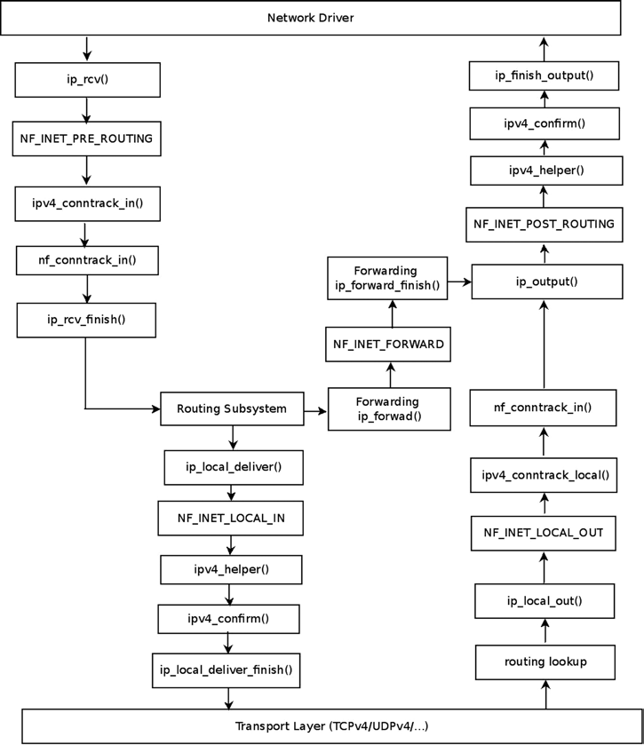
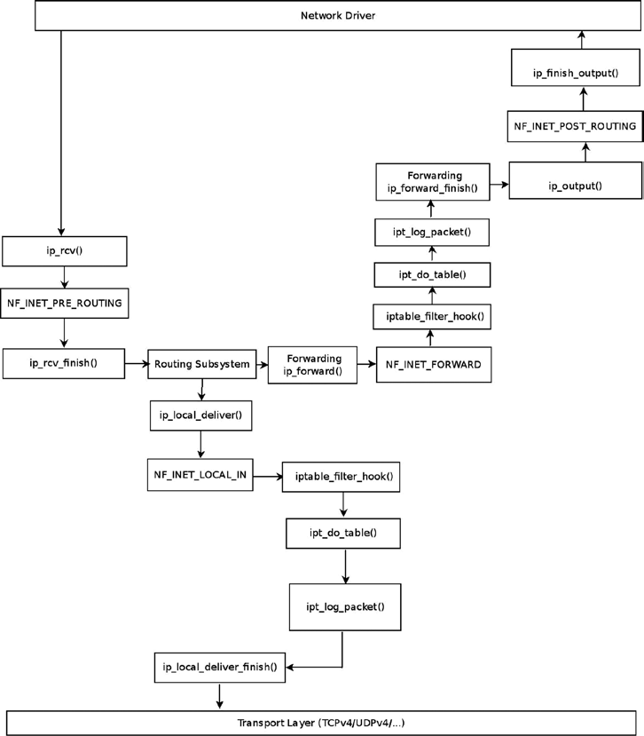
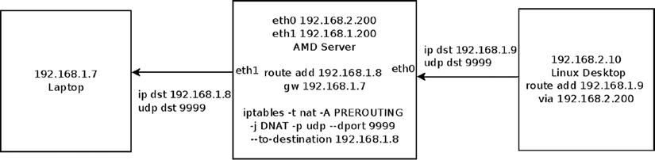
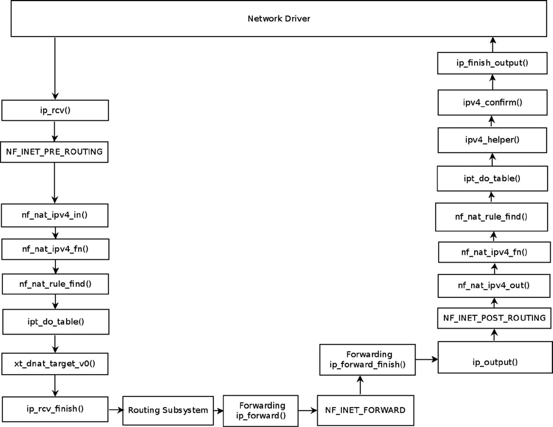

# Chương 9. Netfilter

Chương 8 trình bày cách triển khai IPv6 subsystem. Chương này trình bày netfilter subsystem. Netfilter framework được Rusty Russell, một trong những nhà phát triển Linux kernel nổi tiếng nhất, khởi xướng năm 1998 nhằm cải tiến các cách triển khai cũ của `ipchains` (Linux 2.2.x) và `ipfwadm` (Linux 2.0.x). Netfilter subsystem cung cấp framework cho phép đăng ký callback tại nhiều điểm (netfilter hook) trên hành trình packet đi qua network stack và thực hiện các thao tác trên packet như thay địa chỉ hoặc port, drop packet, logging, v.v. Các netfilter hook cung cấp hạ tầng cho netfilter kernel module đăng ký callback để thực hiện các tác vụ của netfilter subsystem.

## Netfilter Framework

Netfilter subsystem cung cấp các chức năng sau, được trình bày trong chương:

- Chọn packet (iptables)

- Packet filtering

- Network Address Translation (NAT)

- Packet mangling (sửa nội dung packet header trước hoặc sau routing)

- Connection tracking

- Thu thập thống kê mạng

Sau đây là một số framework phổ biến dựa trên Linux kernel netfilter subsystem:

- IPVS (IP Virtual Server): Giải pháp load-balancing tại transport layer (`net/netfilter/ipvs`). IPv4 IPVS được hỗ trợ từ các kernel rất sớm, còn hỗ trợ IPVS trong IPv6 có từ kernel 2.6.28. Hỗ trợ IPVS trong IPv6 kernel được Julius Volz và Vince Busam tại Google phát triển. Để biết thêm, xem website chính thức của IPVS, `www.linuxvirtualserver.org`.

- IP sets: Framework gồm công cụ userspace tên `ipset` và phần kernel (`net/netfilter/ipset`). IP set về cơ bản là tập địa chỉ IP. IP sets framework được Jozsef Kadlecsik phát triển. Để biết thêm, xem `http://ipset.netfilter.org`.

- iptables: Có lẽ là Linux firewall phổ biến nhất, iptables là front end của netfilter, cung cấp management layer cho netfilter: chẳng hạn thêm và xóa netfilter rule, hiển thị thống kê, thêm bảng, đặt bộ đếm của bảng về 0, v.v.

Có các cách triển khai iptables khác nhau trong kernel tùy protocol:

- iptables cho IPv4: (`net/ipv4/netfilter/ip_tables.c`)

- ip6tables cho IPv6: (`net/ipv6/netfilter/ip6_tables.c`)

- arptables cho ARP: (`net/ipv4/netfilter/arp_tables.c`)

- ebtables cho Ethernet: (`net/bridge/netfilter/ebtables.c`)

Trong userspace có các công cụ command-line `iptables` và `ip6tables`, lần lượt dùng để thiết lập, duy trì và kiểm tra bảng IPv4 và IPv6. Xem `man 8 iptables` và `man 8 ip6tables`. Cả `iptables` và `ip6tables` dùng system call `setsockopt()`/`getsockopt()` để giao tiếp với kernel từ userspace. Tôi cần đề cập hai dự án netfilter thú vị đang phát triển. Dự án `xtables2`—chủ yếu do Jan Engelhardt phát triển, vẫn đang thực hiện tại thời điểm viết sách—dùng interface netlink-based để giao tiếp với kernel netfilter subsystem. Xem thêm tại website dự án, `http://xtables.de`. Dự án thứ hai, `nftables`, là packet filtering engine mới, ứng viên thay `iptables`. Giải pháp `nftables` dựa trên virtual machine và một cách triển khai thống nhất thay cho bốn object `iptables` đã đề cập (`iptables`, `ip6tables`, `arptables` và `ebtables`). Dự án `nftables` được Patrick McHardy giới thiệu lần đầu tại netfilter workshop năm 2008. Hạ tầng kernel và tiện ích userspace được Patrick McHardy và Pablo Neira Ayuso phát triển. Để biết thêm, xem `http://netfilter.org/projects/nftables`, và “Nftables: a new packet filtering engine” tại `http://lwn.net/Articles/324989/`.

Có nhiều netfilter module mở rộng chức năng cốt lõi của core netfilter subsystem; ngoài một số ví dụ, tôi không mô tả sâu các module ở đây. Có nhiều nguồn thông tin về các netfilter extension từ góc độ quản trị trên web và trong các hướng dẫn quản trị. Xem thêm website chính thức của dự án netfilter: `www.netfilter.org`.

## Netfilter Hook

Có năm điểm trong network stack có netfilter hook: bạn đã gặp các điểm này trong nội dung Rx path và Tx path của IPv4 và IPv6 ở chương trước. Lưu ý tên hook dùng chung cho IPv4 và IPv6:

- NF\_INET\_PRE\_ROUTING: Hook này nằm trong method `ip_rcv()` của IPv4 và method `ipv6_rcv()` của IPv6. Method `ip_rcv()` là protocol handler của IPv4, còn method `ipv6_rcv()` là protocol handler của IPv6. Đây là hook point đầu tiên mọi packet nhận được đi đến, trước khi lookup trong routing subsystem.

- NF\_INET\_LOCAL\_IN: Hook này nằm trong method `ip_local_deliver()` của IPv4 và method `ip6_input()` của IPv6. Mọi packet nhận được dành cho host cục bộ đến hook point này sau khi đi qua hook point NF\_INET\_PRE\_ROUTING và lookup trong routing subsystem.

- NF\_INET\_FORWARD: Hook này nằm trong method `ip_forward()` của IPv4 và method `ip6_forward()` của IPv6. Mọi packet được forwarding đến hook point này sau khi đi qua hook point NF\_INET\_PRE\_ROUTING và lookup trong routing subsystem.

- NF\_INET\_POST\_ROUTING: Hook này nằm trong method `ip_output()` của IPv4 và method `ip6_finish_output2()` của IPv6. Packet được forwarding đến hook point này sau khi đi qua hook point NF\_INET\_FORWARD. Packet được tạo trên máy cục bộ rồi gửi đi cũng đến NF\_INET\_POST\_ROUTING sau khi đi qua hook point NF\_INET\_LOCAL\_OUT.

- NF\_INET\_LOCAL\_OUT: Hook này nằm trong method `__ip_local_out()` của IPv4 và method `__ip6_local_out()` của IPv6. Mọi outgoing packet được tạo trên host cục bộ đến điểm này trước hook point NF\_INET\_POST\_ROUTING.

(`include/uapi/linux/netfilter.h`)

Macro NF\_HOOK, được đề cập ở các chương trước, được gọi tại một số điểm riêng biệt trên hành trình packet trong kernel network stack; định nghĩa trong `include/linux/netfilter.h`:

```
static inline int NF_HOOK(uint8_t pf, unsigned int hook, struct sk_buff *skb,
                  struct net_device *in, struct net_device *out,
                  int (*okfn)(struct sk_buff *))
{
    return NF_HOOK_THRESH(pf, hook, skb, in, out, okfn, INT_MIN);
}
```

Các tham số của NF\_HOOK() như sau:

- `pf`: Protocol family. NFPROTO\_IPV4 cho IPv4 và NFPROTO\_IPV6 cho IPv6.

- `hook`: Một trong năm netfilter hook đã đề cập (chẳng hạn NF\_INET\_PRE\_ROUTING hoặc NF\_INET\_LOCAL\_OUT).

- `skb`: Object SKB biểu diễn packet đang được xử lý.

- `in`: Input network device (object `net_device`).

- `out`: Output network device (object `net_device`). Có trường hợp output device là NULL vì chưa biết; chẳng hạn trong method `ip_rcv()`, `net/ipv4/ip_input.c`, được gọi trước routing lookup nên chưa biết output device là gì; macro NF\_HOOK() được gọi trong method này với output device NULL.

- `okfn:` Pointer đến continuation function được gọi khi hook kết thúc. Nhận một đối số, SKB.

Giá trị trả về từ netfilter hook phải là một trong các giá trị sau (còn gọi là netfilter verdict):

- NF\_DROP (0): Âm thầm loại bỏ packet.

- NF\_ACCEPT (1): Packet tiếp tục hành trình trong kernel network stack như thông thường.

- NF\_STOLEN (2): Không tiếp tục hành trình. Packet được hook method xử lý.

- NF\_QUEUE (3): Đưa packet vào queue cho user space.

- NF\_REPEAT (4): Hook function phải được gọi lại.

(`include/uapi/linux/netfilter.h`)

Sau khi tìm hiểu các netfilter hook, phần tiếp theo trình bày cách đăng ký netfilter hook.

### Đăng ký Netfilter Hook

Để đăng ký hook callback tại một trong năm hook point đã đề cập, trước tiên bạn định nghĩa object `nf_hook_ops` (hoặc array các object `nf_hook_ops`) rồi đăng ký; structure `nf_hook_ops` được định nghĩa trong `include/linux/netfilter.h`:

```
    struct nf_hook_ops {
        struct list_head list;
    /* User fills in from here down. */
    nf_hookfn     *hook;
    struct module *owner;
    u_int8_t      pf;
    unsigned int  hooknum;
    /* Hooks are ordered in ascending priority. */
    int           priority;
};
```

Sau đây là giới thiệu một số member quan trọng của structure `nf_hook_ops`:

- `hook`: Hook callback muốn đăng ký. Prototype là:

```
          unsigned int nf_hookfn(unsigned int hooknum,
                                 struct sk_buff *skb,
                                 const struct net_device *in,
                                 const struct net_device *out,
                                 int (*okfn)(struct sk_buff *));
```

- `pf`: Protocol family (NFPROTO\_IPV4 cho IPv4 và NFPROTO\_IPV6 cho IPv6).

- `hooknum`: Một trong năm netfilter hook đã đề cập.

- `priority`: Có thể đăng ký nhiều hook callback trên cùng hook. Hook callback có priority thấp hơn được gọi trước. `nf_ip_hook_priorities enum` định nghĩa các giá trị priority khả dụng cho IPv4 hook (`include/uapi/linux/netfilter_ipv4.h`). Xem thêm Bảng 9-4 trong phần “Tham khảo nhanh” cuối chương.

Có hai method đăng ký netfilter hook:

- `int nf_register_hook(struct nf_hook_ops *reg)`: Đăng ký một object `nf_hook_ops`.

- `int nf_register_hooks(struct nf_hook_ops *reg, unsigned int n)`: Đăng ký array n object `nf_hook_ops`; tham số thứ hai là số phần tử trong array.

Bạn sẽ thấy hai ví dụ đăng ký array object `nf_hook_ops` trong hai phần tiếp theo. Hình 9-1 ở phần tiếp theo minh họa cách dùng priority khi đăng ký nhiều hook callback trên cùng hook point.

## Connection Tracking

Chỉ lọc lưu lượng theo L4 header và L3 header là chưa đủ trong mạng hiện đại. Bạn cũng phải xét trường hợp lưu lượng dựa trên session như FTP session hoặc SIP session. Ví dụ FTP session là chuỗi sự kiện: trước tiên client tạo TCP control connection trên TCP port 21, FTP port mặc định. Lệnh từ FTP client (như liệt kê nội dung thư mục) đến server được gửi trên control port này. FTP server mở data socket trên port 20, với port đích phía client được cấp phát động. Lưu lượng phải được lọc theo tham số khác như trạng thái connection hoặc timeout. Đây là một trong những lý do chính dùng Connection Tracking layer.

Connection Tracking cho phép kernel theo dõi session. Mục tiêu chính của Connection Tracking layer là làm nền tảng cho NAT. Không thể build IPv4 NAT module (`net/ipv4/netfilter/iptable_nat.c`) nếu CONFIG\_NF\_CONNTRACK\_IPV4 không được bật. Tương tự, không thể build IPv6 NAT module (`net/ipv6/netfilter/ip6table_nat.c`) nếu CONFIG\_NF\_CONNTRACK\_IPV6 không được bật. Tuy nhiên Connection Tracking không phụ thuộc NAT; bạn có thể chạy Connection Tracking module mà không kích hoạt NAT rule nào. IPv4 NAT module và IPv6 NAT module được trình bày phía sau chương.

Lưu ý Có một số công cụ userspace (`conntrack-tools`) để quản trị Connection Tracking được đề cập trong phần “Tham khảo nhanh” cuối chương. Các công cụ có thể giúp bạn hiểu rõ Connection Tracking layer hơn.

### Khởi tạo Connection Tracking

Array các object `nf_hook_ops`, tên `ipv4_conntrack_ops`, được định nghĩa như sau:

```
    static struct nf_hook_ops ipv4_conntrack_ops[] __read_mostly = {
            {
                    .hook           = ipv4_conntrack_in,
                    .owner          = THIS_MODULE,
                    .pf             = NFPROTO_IPV4,
                    .hooknum        = NF_INET_PRE_ROUTING,
                    .priority       = NF_IP_PRI_CONNTRACK,
            },
            {
                    .hook           = ipv4_conntrack_local,
                    .owner          = THIS_MODULE,
                    .pf             = NFPROTO_IPV4,
                    .hooknum        = NF_INET_LOCAL_OUT,
                    .priority       = NF_IP_PRI_CONNTRACK,
            },
            {
                    .hook           = ipv4_helper,
                    .owner          = THIS_MODULE,
                    .pf             = NFPROTO_IPV4,
                    .hooknum        = NF_INET_POST_ROUTING,
                    .priority       = NF_IP_PRI_CONNTRACK_HELPER,
            },
            {
                    .hook           = ipv4_confirm,
                    .owner          = THIS_MODULE,
                    .pf             = NFPROTO_IPV4,
                    .hooknum        = NF_INET_POST_ROUTING,
                    .priority       = NF_IP_PRI_CONNTRACK_CONFIRM,
            },
            {
                    .hook           = ipv4_helper,
                    .owner          = THIS_MODULE,
                    .pf             = NFPROTO_IPV4,
                    .hooknum        = NF_INET_LOCAL_IN,
                    .priority       = NF_IP_PRI_CONNTRACK_HELPER,
            },
            {
                    .hook           = ipv4_confirm,
                    .owner          = THIS_MODULE,
                    .pf             = NFPROTO_IPV4,
                .hooknum        = NF_INET_LOCAL_IN,
                .priority       = NF_IP_PRI_CONNTRACK_CONFIRM,
        },
};

(net/ipv4/netfilter/nf_conntrack_l3proto_ipv4.c)
```

Hai Connection Tracking hook quan trọng nhất được đăng ký là NF\_INET\_PRE\_ROUTING, được method `ipv4_conntrack_in()` xử lý, và NF\_INET\_LOCAL\_OUT, được method `ipv4_conntrack_local()` xử lý. Hai hook này có priority NF\_IP\_PRI\_CONNTRACK (-200). Các hook khác trong array `ipv4_conntrack_ops` có priority NF\_IP\_PRI\_CONNTRACK\_HELPER (300) và priority NF\_IP\_PRI\_CONNTRACK\_CONFIRM (INT\_MAX, bằng 2^31-1). Trong netfilter hook, callback có giá trị lower-priority được thực thi trước. (`enum nf_ip_hook_priorities` trong `include/uapi/linux/netfilter_ipv4.h` biểu diễn các giá trị priority khả dụng cho IPv4 hook). Cả method `ipv4_conntrack_local()` và method `ipv4_conntrack_in()` gọi method `nf_conntrack_in()`, truyền `hooknum` tương ứng làm tham số. Method `nf_conntrack_in()` thuộc NAT core protocol-independent và được dùng trong cả IPv4 Connection Tracking lẫn IPv6 Connection Tracking; tham số thứ hai là protocol family, chỉ định IPv4 (PF\_INET) hay IPv6 (PF\_INET6). Tôi bắt đầu với callback `nf_conntrack_in()`. Các hook callback khác, `ipv4_confirm()` và `ipv4_help()`, được trình bày phía sau phần này.

Lưu ý Khi kernel được build với hỗ trợ Connection Tracking (CONFIG\_NF\_CONNTRACK được bật ), Connection Tracking hook callback vẫn được gọi ngay cả khi không có iptables rule nào kích hoạt. Tất nhiên điều này tốn hiệu năng. Nếu hiệu năng rất quan trọng và biết trước thiết bị không dùng netfilter subsystem, hãy cân nhắc build kernel không hỗ trợ Connection Tracking hoặc build Connection Tracking thành kernel module rồi không load.

Đăng ký IPv4 Connection Tracking hook được thực hiện bằng cách gọi method `nf_register_hooks()` trong method `nf_conntrack_l3proto_ipv4_init()` (`net/ipv4/netfilter/nf_conntrack_l3proto_ipv4.c`):

```
in nf_conntrack_l3proto_ipv4_init(void) {
       . . .
       ret = nf_register_hooks(ipv4_conntrack_ops,
                                 ARRAY_SIZE(ipv4_conntrack_ops))
       . . .
}
```

Trong Hình 9-1, bạn thấy các Connection Tracking callback (`ipv4_conntrack_in()`, `ipv4_conntrack_local()`, `ipv4_helper()` và `ipv4_confirm()`) theo hook point nơi chúng được đăng ký.



Hình 9-1. Connection Tracking hook (IPv4)

Lưu ý Để đơn giản, Hình 9-1 không bao gồm các tình huống phức tạp hơn như dùng IPsec, fragmentation hoặc multicasting. Cũng lược bỏ các hàm được gọi cho packet tạo trên host cục bộ rồi gửi đi (như method `ip_queue_xmit()` hoặc method `ip_build_and_send_pkt()`) để đơn giản. Thành phần cơ bản của Connection Tracking là structure `nf_conntrack_tuple`:

```
struct nf_conntrack_tuple {
        struct nf_conntrack_man src;

        /* These are the parts of the tuple which are fixed. */
        struct {
                union nf_inet_addr u3;
                union {
                        /* Add other protocols here. */
                        __be16 all;

                        struct {
                                __be16 port;
                        } tcp;
                        struct {
                                __be16 port;
                        } udp;
                        struct {
                                u_int8_t type, code;
                        } icmp;
                        struct {
                                __be16 port;
                        } dccp;
                        struct {
                                __be16 port;
                        } sctp;
                        struct {
                                __be16 key;
                        } gre;
                } u;

                /* The protocol. */
                u_int8_t protonum;

                /* The direction (for tuplehash) */
                u_int8_t dir;
        } dst;
};

(include/net/netfilter/nf_conntrack_tuple.h)
```

Structure `nf_conntrack_tuple` biểu diễn flow theo một hướng. Union bên trong structure `dst` chứa các protocol object (như TCP, UDP, ICMP và các protocol khác). Với mỗi transport layer (L4) protocol, có Connection Tracking module triển khai phần protocol-specific. Chẳng hạn có `net/netfilter/nf_conntrack_proto_tcp.c` cho protocol TCP, `net/netfilter/nf_conntrack_proto_udp.c` cho UDP, `net/netfilter/nf_conntrack_ftp.c` cho FTP, v.v.; các module hỗ trợ cả IPv4 và IPv6. Bạn sẽ thấy ví dụ về khác biệt trong cách triển khai protocol-specific của Connection Tracking module phía sau phần này.

### Connection Tracking Entry

Structure `nf_conn` biểu diễn Connection Tracking entry:

```
struct nf_conn {
        /* Usage count in here is 1 for hash table/destruct timer, 1 per skb,
           plus 1 for any connection(s) we are `master' for */
        struct nf_conntrack ct_general;

        spinlock_t lock;

        /* XXX should I move this to the tail ? - Y.K */
        /* These are my tuples; original and reply */
        struct nf_conntrack_tuple_hash tuplehash[IP_CT_DIR_MAX];

        /* Have we seen traffic both ways yet? (bitset) */
        unsigned long status;

        /* If we were expected by an expectation, this will be it */
        struct nf_conn *master;

        /* Timer function; drops refcnt when it goes off. */
        struct timer_list timeout;

      . . .

        /* Extensions */
        struct nf_ct_ext *ext;
#ifdef CONFIG_NET_NS
        struct net *ct_net;
#endif

        /* Storage reserved for other modules, must be the last member */
        union nf_conntrack_proto proto;
};

(include/net/netfilter/nf_conntrack.h)
```

Sau đây là mô tả một số member quan trọng của structure `nf_conn`:

- `ct_general`: Reference count.

- `tuplehash`: Có hai object `tuplehash`: `tuplehash[0]` là hướng gốc, còn `tuplehash[1]` là phản hồi. Chúng thường được gọi lần lượt là `tuplehash[IP_CT_DIR_ORIGINAL]` và `tuplehash[IP_CT_DIR_REPLY]`.

- `status`: Trạng thái entry. Khi bắt đầu theo dõi connection entry, nó là IP\_CT\_NEW; sau khi connection được thiết lập, trở thành IP\_CT\_ESTABLISHED. Xem `ip_conntrack_info enum` trong `include/uapi/linux/netfilter/nf_conntrack_common.h`.

- `master`: Expected connection. Được method `init_conntrack()` đặt khi expected packet đến (nghĩa là method `nf_ct_find_expectation()`, được method `init_conntrack()` gọi, tìm thấy expectation). Xem thêm phần “Connection Tracking Helper và Expectation” phía sau chương.

- `timeout`: Timer của connection entry. Mỗi connection entry hết hạn sau khoảng thời gian không có lưu lượng. Khoảng thời gian được xác định theo protocol. Khi cấp phát object `nf_conn` bằng method `__nf_conntrack_alloc()`, timeout timer được đặt thành method `death_by_timeout()`.

Sau khi tìm hiểu `nf_conn struct` và một số member, hãy xem method `nf_conntrack_in()`:

```
unsigned int nf_conntrack_in(struct net *net, u_int8_t pf, unsigned int hooknum,
                          struct sk_buff *skb)
{
        struct nf_conn *ct, *tmpl = NULL;
        enum ip_conntrack_info ctinfo;
        struct nf_conntrack_l3proto *l3proto;
        struct nf_conntrack_l4proto *l4proto;
        unsigned int *timeouts;
        unsigned int dataoff;
        u_int8_t protonum;
        int set_reply = 0;
        int ret;

        if (skb->nfct) {
                /* Previously seen (loopback or untracked)?  Ignore. */
                tmpl = (struct nf_conn *)skb->nfct;
                if (!nf_ct_is_template(tmpl)) {
                        NF_CT_STAT_INC_ATOMIC(net, ignore);
                        return NF_ACCEPT;
                }
                skb->nfct = NULL;
        }
```

Trước tiên thử xác định network layer (L3) protocol có thể được theo dõi không:

```
        l3proto = __nf_ct_l3proto_find(pf);
```

Bây giờ thử xác định transport layer (L4) protocol có thể được theo dõi không. Với IPv4, được thực hiện bởi method `ipv4_get_l4proto()` (`net/ipv4/netfilter/nf_conntrack_l3proto_ipv4`):

```
        ret = l3proto->get_l4proto(skb, skb_network_offset(skb),
                           &dataoff, &protonum);
        if (ret <= 0) {
           . . .
                ret = -ret;
                goto out;
        }

            l4proto = __nf_ct_l4proto_find(pf, protonum);

            /* It may be an special packet, error, unclean...
             * inverse of the return code tells to the netfilter
             * core what to do with the packet. */
```

Bây giờ kiểm tra các điều kiện lỗi protocol-specific (chẳng hạn xem method `udp_error()` trong `net/netfilter/nf_conntrack_proto_udp.c`, kiểm tra packet sai định dạng, packet có checksum không hợp lệ, v.v.; hoặc method `tcp_error()` trong `net/netfilter/nf_conntrack_proto_tcp.c`):

```
        if (l4proto->error != NULL) {
                ret = l4proto->error(net, tmpl, skb, dataoff, &ctinfo,
                                     pf, hooknum);
                if (ret <= 0) {
                        NF_CT_STAT_INC_ATOMIC(net, error);
                        NF_CT_STAT_INC_ATOMIC(net, invalid);
                        ret = -ret;
                        goto out;
                }
                /* ICMP[v6] protocol trackers may assign one conntrack. */
                if (skb->nfct)
                        goto out;
        }
```

Method `resolve_normal_ct()`, được gọi ngay sau đây, thực hiện:

- Tính hash của tuple bằng cách gọi method `hash_conntrack_raw()`.

- Lookup tìm tuple khớp bằng cách gọi method `__nf_conntrack_find_get()`, truyền hash làm tham số.

- Nếu không tìm thấy, tạo object `nf_conntrack_tuple_hash` mới bằng cách gọi method `init_conntrack()`. Object `nf_conntrack_tuple_hash` này được thêm vào danh sách object tuplehash chưa xác nhận. Danh sách được nhúng trong object network namespace; structure `net` chứa object `netns_ct`, gồm thông tin Connection Tracking riêng của network namespace. Một member là `unconfirmed`, danh sách object `tuplehash` chưa xác nhận (xem `include/net/netns/conntrack.h`). Sau đó trong method `__nf_conntrack_confirm()`, nó bị xóa khỏi unconfirmed list. Tôi trình bày method `__nf_conntrack_confirm()` phía sau phần này.

- Mỗi SKB có member `nfctinfo` biểu diễn trạng thái connection (chẳng hạn IP\_CT\_NEW cho connection mới), cùng member `nfct` (instance của `nf_conntrack struct`), thực chất là reference counter. Method `resolve_normal_ct()` khởi tạo cả hai.

```
              ct = resolve_normal_ct(net, tmpl, skb, dataoff, pf, protonum,
                                     l3proto, l4proto, &set_reply, &ctinfo);
              if (!ct) {
                      /* Not valid part of a connection */
                      NF_CT_STAT_INC_ATOMIC(net, invalid);
                      ret = NF_ACCEPT;
                      goto out;
              }

        if (IS_ERR(ct)) {
                /* Too stressed to deal. */
                NF_CT_STAT_INC_ATOMIC(net, drop);
                ret = NF_DROP;
                goto out;
        }

        NF_CT_ASSERT(skb->nfct);
```

Bây giờ gọi method `nf_ct_timeout_lookup()` để quyết định timeout policy áp dụng cho flow. Chẳng hạn với UDP, timeout là 30 giây cho connection một chiều và 180 giây cho connection hai chiều; xem định nghĩa array `udp_timeouts` trong `net/netfilter/nf_conntrack_proto_udp.c`. Với TCP, protocol phức tạp hơn nhiều, có 11 entry trong array `tcp_timeouts` (`net/netfilter/nf_conntrack_proto_tcp.c`):

```
        /* Decide what timeout policy we want to apply to this flow. */
        timeouts = nf_ct_timeout_lookup(net, ct, l4proto);
```

Bây giờ gọi method `packet()` protocol-specific (chẳng hạn `udp_packet()` cho UDP hoặc method `tcp_packet()` cho TCP). Method `udp_packet()` gia hạn timeout theo trạng thái connection bằng cách gọi method `nf_ct_refresh_acct()`. Với connection chưa có phản hồi (flag IPS\_SEEN\_REPLY\_BIT không được đặt), timeout được đặt thành 30 giây; với connection đã có phản hồi là 180. Một lần nữa, với TCP, method `tcp_packet()` phức tạp hơn nhiều do TCP state machine nâng cao. Hơn nữa, method `udp_packet()` luôn trả về verdict NF\_ACCEPT, còn method `tcp_packet()` đôi khi có thể thất bại:

```
        ret = l4proto->packet(ct, skb, dataoff, ctinfo, pf, hooknum, timeouts);
        if (ret <= 0) {
                 /* Invalid: inverse of the return code tells
                  * the netfilter core what to do */
                 pr_debug("nf_conntrack_in: Can't track with proto module\n");
                 nf_conntrack_put(skb->nfct);
                 skb->nfct = NULL;
                 NF_CT_STAT_INC_ATOMIC(net, invalid);
                 if (ret == -NF_DROP)
                         NF_CT_STAT_INC_ATOMIC(net, drop);
                 ret = -ret;
                 goto out;
        }

        if (set_reply && !test_and_set_bit(IPS_SEEN_REPLY_BIT, &ct->status))
                 nf_conntrack_event_cache(IPCT_REPLY, ct);
        out:
        if (tmpl) {
                 /* Special case: we have to repeat this hook, assign the
                  * template again to this packet. We assume that this packet
                  * has no conntrack assigned. This is used by nf_ct_tcp. */
                 if (ret == NF_REPEAT)
                         skb->nfct = (struct nf_conntrack *)tmpl;
                 else
                         nf_ct_put(tmpl);
        }

        return ret;
}
```

Method `ipv4_confirm()`, được gọi tại hook NF\_INET\_POST\_ROUTING và NF\_INET\_LOCAL\_IN, thông thường gọi method `__nf_conntrack_confirm()`, xóa tuple khỏi unconfirmed list.

### Connection Tracking Helper và Expectation

Một số protocol có flow dữ liệu và điều khiển khác nhau—chẳng hạn FTP, File Transfer Protocol, và SIP, Session Initiation Protocol, một VoIP protocol. Thường trong các protocol này, control channel thương lượng một số thiết lập cấu hình với phía bên kia và thống nhất tham số dùng cho data flow. Netfilter subsystem khó xử lý các protocol này hơn vì cần biết các flow liên quan với nhau. Để hỗ trợ, netfilter subsystem cung cấp Connection Tracking Helper, mở rộng chức năng cơ bản của Connection Tracking. Các module tạo expectation (object `nf_conntrack_expect`), cho kernel biết cần chờ lưu lượng trên connection chỉ định và hai connection liên quan nhau. Biết hai connection liên quan cho phép định nghĩa rule trên master connection cũng áp dụng cho related connection. Bạn có thể dùng iptables rule đơn giản dựa trên Connection Tracking state để chấp nhận packet có Connection Tracking state RELATED:

```
iptables -A INPUT -m conntrack --ctstate RELATED -j ACCEPT
```

Lưu ý Connection có thể liên quan nhau không chỉ do expectation. Chẳng hạn ICMPv4 error packet như “ICMP fragmentation needed” sẽ liên quan nếu netfilter tìm thấy entry `conntrack` khớp tuple trong L3/L4 header ICMP-embedded. Xem method `icmp_error_message()` để biết thêm, `net/ipv4/netfilter/nf_conntrack_proto_icmp.c`.

Connection Tracking Helper được biểu diễn bằng structure `nf_conntrack_helper` (`include/net/netfilter/ nf_conntrack_helper.h`). Chúng được đăng ký và hủy đăng ký lần lượt bởi method `nf_conntrack_helper_register()` và method `nf_conntrack_helper_unregister()`. Chẳng hạn method `nf_conntrack_helper_register()` được `nf_conntrack_ftp_init()` (`net/netfilter/nf_conntrack_ftp.c`) gọi để đăng ký FTP Connection Tracking Helper. Connection Tracking Helper được giữ trong hash table (`nf_ct_helper_hash`). Hook callback `ipv4_helper()` được đăng ký tại hai hook point, NF\_INET\_POST\_ROUTING và NF\_INET\_LOCAL\_IN (xem định nghĩa array `ipv4_conntrack_ops` trong phần “Khởi tạo Connection Tracking” ở trên). Vì vậy khi FTP packet đến callback NF\_INET\_POST\_ROUTING, `ip_output()`, hoặc callback NF\_INET\_LOCAL\_IN, `ip_local_deliver()`, method `ipv4_helper()` được gọi và cuối cùng gọi callback của các Connection Tracking Helper đã đăng ký. Với FTP, helper method được đăng ký là method `help()`, `net/netfilter/nf_conntrack_ftp.c`. Method này tìm mẫu FTP-specific như lệnh FTP “PORT”; xem lời gọi method `find_pattern()` trong method `help()` ở đoạn code sau (`net/netfilter/nf_conntrack_ftp.c`). Nếu khớp, object `nf_conntrack_expect` được tạo bằng cách gọi method `nf_ct_expect_init()`:

```
    static int help(struct sk_buff *skb,
             unsigned int protoff,
             struct nf_conn *ct,
             enum ip_conntrack_info ctinfo)
    {
           struct nf_conntrack_expect *exp;
        . . .
       for (i = 0; i < ARRAY_SIZE(search[dir]); i++) {
              found = find_pattern(fb_ptr, datalen,
                            search[dir][i].pattern,
                            search[dir][i].plen,
                            search[dir][i].skip,
                            search[dir][i].term,
                            &matchoff, &matchlen,
                            &cmd,
                            search[dir][i].getnum);
              if (found) break;
       }

       if (found == -1) {
             /* We don't usually drop packets.  After all, this is
                connection tracking, not packet filtering.
                However, it is necessary for accurate tracking in
                this case. */
             nf_ct_helper_log(skb, ct, "partial matching of `%s'",
                             search[dir][i].pattern);
```

Lưu ý Thông thường Connection Tracking không drop packet. Có trường hợp packet bị drop do lỗi hoặc tình huống bất thường. Sau đây là ví dụ: lời gọi `find_pattern()` ở trên trả về –1, nghĩa là chỉ khớp một phần; packet bị drop vì không tìm thấy mẫu khớp đầy đủ.

```
              ret = NF_DROP;
              goto out;
       } else if (found == 0) { /* No match */
              ret = NF_ACCEPT;
              goto out_update_nl;
       }

       pr_debug("conntrack_ftp: match `%.*s' (%u bytes at %u)\n",
               matchlen, fb_ptr + matchoff,
               matchlen, ntohl(th->seq) + matchoff);

       exp = nf_ct_expect_alloc(ct);
    . . .
       nf_ct_expect_init(exp, NF_CT_EXPECT_CLASS_DEFAULT, cmd.l3num,
                         &ct->tuplehash[!dir].tuple.src.u3, daddr,
                         IPPROTO_TCP, NULL, &cmd.u.tcp.port);
    . . .
}

(net/netfilter/nf_conntrack_ftp.c)
```

Sau đó, khi connection mới được tạo bởi method `init_conntrack()`, kiểm tra nó có expectation không; nếu có, đặt flag IPS\_EXPECTED\_BIT và đặt master của connection (`ct->master`) tham chiếu đến connection tạo expectation:

```
static struct nf_conntrack_tuple_hash *
init_conntrack(struct net *net, struct nf_conn *tmpl,
               const struct nf_conntrack_tuple *tuple,
               struct nf_conntrack_l3proto *l3proto,
               struct nf_conntrack_l4proto *l4proto,
               struct sk_buff *skb,
               unsigned int dataoff, u32 hash)
{
        struct nf_conn *ct;
        struct nf_conn_help *help;
        struct nf_conntrack_tuple repl_tuple;
        struct nf_conntrack_ecache *ecache;
        struct nf_conntrack_expect *exp;
        u16 zone = tmpl ? nf_ct_zone(tmpl) : NF_CT_DEFAULT_ZONE;
        struct nf_conn_timeout *timeout_ext;
        unsigned int *timeouts;

        . . .
        ct = __nf_conntrack_alloc(net, zone, tuple, &repl_tuple, GFP_ATOMIC,
                                  hash);
    . . .

        exp = nf_ct_find_expectation(net, zone, tuple);
        if (exp) {
                pr_debug("conntrack: expectation arrives ct=%p exp=%p\n",
                         ct, exp);
                /* Welcome, Mr. Bond.  We've been expecting you... */
                __set_bit(IPS_EXPECTED_BIT, &ct->status);
                ct->master = exp->master;
                if (exp->helper) {
                        help = nf_ct_helper_ext_add(ct, exp->helper,
                                                    GFP_ATOMIC);
                        if (help)
                                rcu_assign_pointer(help->helper, exp->helper);
                }
        . . .
```

Lưu ý helper listen trên port định sẵn. Chẳng hạn FTP Connection Tracking Helper listen port 21 (xem định nghĩa FTP\_PORT trong `include/linux/netfilter/nf_conntrack_ftp.h`). Bạn có thể đặt port khác (hoặc nhiều port) theo hai cách: cách đầu qua module parameter—có thể override giá trị port mặc định bằng cách cung cấp một port hoặc danh sách port comma-separated cho lệnh `modprobe`:

```
modprobe nf_conntrack_ftp ports=2121
modprobe nf_conntrack_ftp ports=2022,2023,2024
```

Cách thứ hai là dùng CT target:

```
iptables -A PREROUTING -t raw -p tcp --dport 8888 -j CT --helper ftp
```

Lưu ý CT target (`net/netfilter/xt_CT.c`) được thêm trong kernel 2.6.34.

Lưu ý Xtables target extension được biểu diễn bằng structure `xt_target` và đăng ký bởi method `xt_register_target()` cho một target, hoặc method `xt_register_targets()` cho array target. Xtables match extension được biểu diễn bằng structure `xt_match` và đăng ký bởi method `xt_register_match()`, hoặc `xt_register_matches()` cho array match. Match extension kiểm tra packet theo tiêu chí do match extension module định nghĩa; chẳng hạn match module `xt_length` (`net/netfilter/xt_length.c`) kiểm tra packet theo độ dài (`tot_len` của SKB với IPv4 packet), còn module `xt_connlimit` (`net/netfilter/xt_connlimit.c`) giới hạn số TCP connection song song trên mỗi địa chỉ IP.

Phần này trình bày chi tiết khởi tạo Connection Tracking. Phần tiếp theo trình bày iptables, có lẽ là thành phần được biết đến nhiều nhất của netfilter framework.

### IPTables

iptables có hai phần. Phần kernel—core nằm trong `net/ipv4/netfilter/ip_tables.c` cho IPv4 và `net/ipv6/netfilter/ip6_tables.c` cho IPv6. Phần userspace cung cấp front end để truy cập kernel iptables layer (chẳng hạn thêm và xóa rule bằng lệnh `iptables`). Mỗi bảng được biểu diễn bằng structure `xt_table` (định nghĩa trong `include/linux/netfilter/x_tables.h`). Đăng ký và hủy đăng ký bảng được thực hiện lần lượt bởi các method `ipt_register_table()` và `ipt_unregister_table()`. Các method được triển khai trong `net/ipv4/netfilter/ip_tables.c`. Trong IPv6 cũng dùng structure `xt_table` để tạo bảng, nhưng đăng ký và hủy đăng ký bảng lần lượt bằng method `ip6t_register_table()` và method `ip6t_unregister_table()`.

Object network namespace chứa các object IPv4- và IPv6-specific (lần lượt là `netns_ipv4` và `netns_ipv6`). Các object `netns_ipv4` và `netns_ipv6` chứa pointer đến object `xt_table`. Với IPv4, trong `struct netns_ipv4` có chẳng hạn `iptable_filter`, `iptable_mangle`, `nat_table` và các thành phần khác (`include/net/netns/ipv4.h`). Trong `struct netns_ipv6` có chẳng hạn `ip6table_filter`, `ip6table_mangle`, `ip6table_nat` và các thành phần khác (`include/net/netns/ipv6.h`). Để xem đầy đủ các IPv4 và IPv6 network namespace netfilter table cùng kernel module tương ứng, xem Bảng 9-2 và 9-3 trong phần “Tham khảo nhanh” cuối chương.

Để hiểu iptables hoạt động thế nào, hãy xem ví dụ thực tế với filter table. Để đơn giản, giả sử filter table là bảng duy nhất được build và LOG target được hỗ trợ; rule duy nhất tôi dùng là logging, như bạn sẽ thấy ngay sau đây. Trước tiên xem định nghĩa filter table:

```
#define FILTER_VALID_HOOKS ((1 << NF_INET_LOCAL_IN) | \
                            (1 << NF_INET_FORWARD) | \
                            (1 << NF_INET_LOCAL_OUT))

static const struct xt_table packet_filter = {
        .name           = "filter",
        .valid_hooks    = FILTER_VALID_HOOKS,
        .me             = THIS_MODULE,
        .af             = NFPROTO_IPV4,
        .priority       = NF_IP_PRI_FILTER,
};

(net/ipv4/netfilter/iptable_filter.c)
```

Khởi tạo bảng bắt đầu bằng cách gọi method `xt_hook_link()`, đặt method `iptable_filter_hook()` làm hook callback của object `nf_hook_ops` thuộc bảng `packet_filter`:

```
static struct nf_hook_ops *filter_ops __read_mostly;
static int __init iptable_filter_init(void)
{
     . . .
        filter_ops = xt_hook_link(&packet_filter, iptable_filter_hook);
     . . .
}
```

Sau đó gọi method `ipt_register_table()` (lưu ý object IPv4 `netns`, `net->ipv4`, giữ pointer đến filter table, `iptable_filter`):

```
static int __net_init iptable_filter_net_init(struct net *net)
{
    . . .
       net->ipv4.iptable_filter =
                ipt_register_table(net, &packet_filter, repl);
    . . .

       return PTR_RET(net->ipv4.iptable_filter);
}

(net/ipv4/netfilter/iptable_filter.c)
```

Lưu ý filter table có ba hook:

- NF\_INET\_LOCAL\_IN

- NF\_INET\_FORWARD

- NF\_INET\_LOCAL\_OUT

Trong ví dụ này, đặt rule sau bằng dòng lệnh `iptable`:

```
iptables -A INPUT -p udp --dport=5001 -j LOG --log-level 1
```

Ý nghĩa rule này là dump vào syslog các UDP packet nhận được có port đích 5001. Modifier `log-level` là mức syslog tiêu chuẩn trong khoảng 0 đến 7; 0 là emergency và 7 là debug. Lưu ý khi chạy lệnh `iptables`, phải chỉ định bảng muốn dùng bằng modifier `–t`; chẳng hạn `iptables -t nat -A POSTROUTING -o eth0 -j MASQUERADE` thêm rule vào NAT table. Khi không chỉ định tên bảng bằng modifier `–t`, mặc định dùng filter table. Vì vậy chạy `iptables -A INPUT -p udp --dport=5001 -j LOG --log-level 1` thêm rule vào filter table.

Lưu ý Bạn có thể đặt target cho iptables rule; thường là target từ Linux netfilter subsystem (xem ví dụ LOG target ở trên). Bạn cũng có thể viết target riêng và mở rộng iptables userspace code để hỗ trợ. Xem “Writing Netfilter modules” của Jan Engelhardt và Nicolas Bouliane: `http://inai.de/documents/Netfilter_Modules.pdf`. Lưu ý phải bật CONFIG\_NETFILTER\_XT\_TARGET\_LOG để dùng LOG target trong iptables rule,

như ví dụ ở trên. Bạn có thể tham khảo code `net/netfilter/xt_LOG.c` làm ví dụ về target module của `iptables`.

Khi UDP packet có port đích 5001 đến network driver và đi lên network layer (L3), hook đầu tiên gặp là NF\_INET\_PRE\_ROUTING; filter table callback không đăng ký hook tại NF\_INET\_PRE\_ROUTING. Nó chỉ có ba hook: NF\_INET\_LOCAL\_IN, NF\_INET\_FORWARD và NF\_INET\_LOCAL\_OUT như đã nói. Vì vậy tiếp tục đến method `ip_rcv_finish()` và lookup trong routing subsystem. Bây giờ có hai trường hợp: packet dành cho host cục bộ hoặc cần forwarding (bỏ qua trường hợp packet cần loại bỏ). Trong Hình 9-2, bạn có thể thấy hành trình packet trong cả hai trường hợp.



Hình 9-2. Lưu lượng đến tôi và lưu lượng được forwarding với rule của Filter table

### Chuyển đến Host cục bộ

Trước tiên đến method `ip_local_deliver()`; hãy xem nhanh method này:

```
int ip_local_deliver(struct sk_buff *skb)
{
    . . .
       return NF_HOOK(NFPROTO_IPV4, NF_INET_LOCAL_IN, skb, skb->dev, NULL,
                       ip_local_deliver_finish);
}
```

Như bạn thấy, có hook NF\_INET\_LOCAL\_IN trong method này và như đã nói, NF\_INET\_LOCAL\_IN là một trong các hook của filter table; vì vậy macro NF\_HOOK() gọi method `iptable_filter_hook()`. Bây giờ xem method `iptable_filter_hook()`:

```
static unsigned int iptable_filter_hook(unsigned int hook, struct sk_buff *skb,
                                    const struct net_device *in,
                        const struct net_device *out,
                                 int (*okfn)(struct sk_buff *))
{
        const struct net *net;
        . . .
        net = dev_net((in != NULL) ? in : out);
        . . .

        return ipt_do_table(skb, hook, in, out, net->ipv4.iptable_filter);
}

(net/ipv4/netfilter/iptable_filter.c)
```

Method `ipt_do_table()` thực tế gọi callback của target LOG, `ipt_log_packet()`, để ghi các packet header vào syslog. Nếu có thêm rule, chúng sẽ được gọi tại thời điểm này. Vì không còn rule nào, quá trình tiếp tục đến method `ip_local_deliver_finish()`, và packet tiếp tục đi đến transport layer (L4) để được socket tương ứng xử lý.

### Forwarding Packet

Trường hợp thứ hai là sau lookup trong routing subsystem, xác định packet cần forwarding, nên method `ip_forward()` được gọi:

```
int ip_forward(struct sk_buff *skb)
  {
  . . .
   return NF_HOOK(NFPROTO_IPV4, NF_INET_FORWARD, skb, skb->dev,
                        rt->dst.dev, ip_forward_finish);
   . . .
```

Vì filter table có hook callback đăng ký tại NF\_INET\_FORWARD như đã nói, lại gọi method `iptable_filter_hook()`. Do đó như trước, lại gọi method `ipt_do_table()`, method này tiếp tục gọi method `ipt_log_packet()`. Tiếp tục đến method `ip_forward_finish()` (lưu ý `ip_forward_finish` là đối số cuối của macro NF\_HOOK ở trên, biểu diễn continuation method). Sau đó gọi method `ip_output()`; vì filter table không có hook NF\_INET\_POST\_ROUTING, tiếp tục đến method `ip_finish_output()`.

Lưu ý Bạn có thể lọc packet theo Connection Tracking state. Rule tiếp theo dump vào syslog packet có Connection Tracking state ESTABLISHED:

```
iptables -A INPUT -p tcp -m conntrack --ctstate ESTABLISHED -j LOG --log-level 1
```

### Network Address Translation (NAT)

Module Network Address Translation (NAT) chủ yếu xử lý chuyển đổi địa chỉ IP như tên gọi, hoặc thao tác port. Một trong những cách dùng NAT phổ biến nhất là cho phép nhóm host có địa chỉ IP riêng trên Local Area Network truy cập Internet qua residential gateway. Chẳng hạn có thể làm bằng cách đặt NAT rule. NAT được cài trên gateway có thể dùng rule để cho host truy cập Web. Netfilter subsystem có cách triển khai NAT cho IPv4 và IPv6. Cách triển khai IPv6 NAT chủ yếu dựa trên IPv4 và cung cấp interface tương tự IPv4 từ góc nhìn người dùng. Hỗ trợ IPv6 NAT được merge trong kernel 3.7. Nó cung cấp tính năng như giải pháp dễ dàng cho load balancing (bằng cách đặt DNAT trên incoming traffic), v.v. IPv6 NAT module nằm trong `net/ipv6/netfilter/ip6table_nat.c`. Có nhiều loại thiết lập NAT và nhiều tài liệu Web về quản trị NAT. Tôi trình bày hai cấu hình phổ biến: SNAT là source NAT, thay địa chỉ IP nguồn, còn DNAT là destination NAT, thay địa chỉ IP đích. Bạn có thể dùng flag `–j` để chọn SNAT hoặc DNAT. Cách triển khai cả DNAT lẫn SNAT nằm trong `net/netfilter/xt_nat.c`. Phần tiếp theo trình bày khởi tạo NAT.

### Khởi tạo NAT

NAT table, giống filter table trong phần trước, cũng là object `xt_table`. Nó được đăng ký tại mọi hook point trừ hook NF\_INET\_FORWARD:

```
static const struct xt_table nf_nat_ipv4_table = {
        .name           = "nat",
        .valid_hooks    = (1 << NF_INET_PRE_ROUTING) |
                          (1 << NF_INET_POST_ROUTING) |
                          (1 << NF_INET_LOCAL_OUT) |
                          (1 << NF_INET_LOCAL_IN),
        .me             = THIS_MODULE,
        .af             = NFPROTO_IPV4,
};

(net/ipv4/netfilter/iptable_nat.c)
```

Đăng ký và hủy đăng ký NAT table lần lượt bằng cách gọi `ipt_register_table()` và `ipt_unregister_table()` (`net/ipv4/netfilter/iptable_nat.c`). Network namespace (`struct net`) chứa object riêng cho IPv4 (`netns_ipv4`), trong đó có pointer đến IPv4 NAT table (`nat_table`), như

đã đề cập trong phần “IP tables” ở trên. Object `xt_table` này, được tạo bởi method `ipt_register_table()`, được gán cho pointer `nat_table`. Bạn cũng định nghĩa array object `nf_hook_ops` và đăng ký:

```
 static struct nf_hook_ops nf_nat_ipv4_ops[] __read_mostly = {
        /* Before packet filtering, change destination */
        {
                .hook           = nf_nat_ipv4_in,
                .owner          = THIS_MODULE,
                .pf             = NFPROTO_IPV4,
                .hooknum        = NF_INET_PRE_ROUTING,
                .priority       = NF_IP_PRI_NAT_DST,
        },
        /* After packet filtering, change source */
        {
                .hook           = nf_nat_ipv4_out,
                .owner          = THIS_MODULE,
                .pf             = NFPROTO_IPV4,
                .hooknum        = NF_INET_POST_ROUTING,
                .priority       = NF_IP_PRI_NAT_SRC,
        },
        /* Before packet filtering, change destination */
        {
                .hook           = nf_nat_ipv4_local_fn,
                .owner          = THIS_MODULE,
                .pf             = NFPROTO_IPV4,
                .hooknum        = NF_INET_LOCAL_OUT,
                .priority       = NF_IP_PRI_NAT_DST,
        },
        /* After packet filtering, change source */
        {
                .hook           = nf_nat_ipv4_fn,
                .owner          = THIS_MODULE,
                .pf             = NFPROTO_IPV4,
                .hooknum        = NF_INET_LOCAL_IN,
                .priority       = NF_IP_PRI_NAT_SRC,
        },
};
```

Đăng ký array `nf_nat_ipv4_ops` được thực hiện trong method `iptable_nat_init()`:

```
static int __init iptable_nat_init(void)
{
        int err;
        . . .
        err = nf_register_hooks(nf_nat_ipv4_ops, ARRAY_SIZE(nf_nat_ipv4_ops));
        if (err < 0)
                goto err2;
        return 0;
        . . .
}

(net/ipv4/netfilter/iptable_nat.c)
```

### NAT Hook Callback và Connection Tracking Hook Callback

Có hook đăng ký cả NAT callback và Connection Tracking callback. Chẳng hạn tại hook NF\_INET\_PRE\_ROUTING (hook đầu tiên incoming packet đến), có hai callback được đăng ký: Connection Tracking callback `ipv4_conntrack_in()` và NAT callback `nf_nat_ipv4_in()`. Priority của Connection Tracking callback `ipv4_conntrack_in()` là NF\_IP\_PRI\_CONNTRACK (-200), còn priority của NAT callback `nf_nat_ipv4_in()` là NF\_IP\_PRI\_NAT\_DST (-100). Vì callback cùng hook có priority thấp hơn được gọi trước, Connection Tracking callback `ipv4_conntrack_in()` có priority –200 được gọi trước NAT callback `nf_nat_ipv4_in()` có priority –100. Xem Hình 9-1 cho vị trí method `ipv4_conntrack_in()` và Hình 9-4 cho vị trí `nf_nat_ipv4_in()`; cả hai cùng chỗ tại điểm NF\_INET\_PRE\_ROUTING. Lý do là NAT lookup trong Connection Tracking layer; nếu không tìm thấy entry, NAT không thực hiện chuyển đổi địa chỉ:

```
static unsigned int nf_nat_ipv4_fn(unsigned int hooknum,
                           struct sk_buff *skb,
                           const struct net_device *in,
                           const struct net_device *out,
                           int (*okfn)(struct sk_buff *))
{
        struct nf_conn *ct;
        . . .
        /* Don't try to NAT if this packet is not conntracked */
        if (nf_ct_is_untracked(ct))
                return NF_ACCEPT;
    . . .
}

(net/ipv4/netfilter/iptable_nat.c)
```

Lưu ý Method `nf_nat_ipv4_fn ()` được gọi từ NAT PRE\_ROUTING callback, `nf_nat_ipv4_in()`.

Tại hook NF\_INET\_POST\_ROUTING, có hai Connection Tracking callback đăng ký: callback `ipv4_helper()` (priority NF\_IP\_PRI\_CONNTRACK\_HELPER, bằng 300) và callback `ipv4_confirm()` với priority NF\_IP\_PRI\_CONNTRACK\_CONFIRM (INT\_MAX, giá trị số nguyên lớn nhất cho priority). Cũng có NAT hook callback đăng ký, `nf_nat_ipv4_out()`, với priority NF\_IP\_PRI\_NAT\_SRC, bằng 100. Vì vậy khi đến hook NF\_INET\_POST\_ROUTING, NAT callback `nf_nat_ipv4_out()` được gọi trước, sau đó method `ipv4_helper()`, và `ipv4_confirm()` được gọi cuối cùng. Xem Hình 9-4.

Hãy xem DNAT rule đơn giản và hành trình packet được forwarding cùng thứ tự gọi Connection Tracking callback và NAT callback (để đơn giản, giả sử filter table không được build trong kernel image này). Trong thiết lập Hình 9-3, host giữa (AMD server) chạy DNAT rule sau:

```
iptables -t nat -A PREROUTING -j DNAT -p udp --dport 9999 --to-destination 192.168.1.8
```



Hình 9-3. Thiết lập đơn giản với DNAT rule

Ý nghĩa DNAT rule này là incoming UDP packet gửi đến UDP port đích 9999 được thay địa chỉ IP đích thành 192.168.1.8. Máy bên phải (Linux desktop) gửi UDP packet đến 192.168.1.9 với UDP port đích 9999. Trên AMD server, địa chỉ IPv4 đích được DNAT rule thay thành 192.168.1.8 và packet được gửi đến laptop bên trái.

Trong Hình 9-4, bạn thấy hành trình UDP packet đầu tiên được gửi theo thiết lập ở trên.



Hình 9-4. NAT và netfilter hook

NAT module dùng chung là `net/netfilter/nf_nat_core.c`. Thành phần cơ bản của cách triển khai NAT là structure `nf_nat_l4proto` (`include/net/netfilter/nf_nat_l4proto.h`) và structure `nf_nat_l3proto`. Trong các kernel trước 3.7, bạn gặp structure `nf_nat_protocol` thay cho hai structure này, vốn thay thế chúng khi thêm hỗ trợ IPv6 NAT. Hai structure cung cấp hỗ trợ NAT core protocol-independent.

Cả hai structure chứa function pointer `manip_pkt()` thay đổi packet header. Hãy xem ví dụ triển khai `manip_pkt()` cho protocol TCP trong `net/netfilter/nf_nat_proto_tcp.c`:

```
static bool tcp_manip_pkt(struct sk_buff *skb,
              const struct nf_nat_l3proto *l3proto,
              unsigned int iphdroff, unsigned int hdroff,
              const struct nf_conntrack_tuple *tuple,
              enum nf_nat_manip_type maniptype)
{
        struct tcphdr *hdr;
        __be16 *portptr, newport, oldport;
        int hdrsize = 8; /* TCP connection tracking guarantees this much */

        /* this could be an inner header returned in icmp packet; in such
           cases we cannot update the checksum field since it is outside of
           the 8 bytes of transport layer headers we are guaranteed */
        if (skb->len >= hdroff + sizeof(struct tcphdr))
                hdrsize = sizeof(struct tcphdr);

        if (!skb_make_writable(skb, hdroff + hdrsize))
                return false;

        hdr = (struct tcphdr *)(skb->data + hdroff);
```

Đặt `newport` theo `maniptype`:

- Nếu cần đổi source port, `maniptype` là NF\_NAT\_MANIP\_SRC. Vì vậy trích port từ `tuple->src`.

- Nếu cần đổi destination port, `maniptype` là NF\_NAT\_MANIP\_DST. Vì vậy trích port từ `tuple->dst`:

```
        if (maniptype == NF_NAT_MANIP_SRC) {
                /* Get rid of src port */
                newport = tuple->src.u.tcp.port;
                portptr = &hdr->source;
        } else {
                /* Get rid of dst port */
                newport = tuple->dst.u.tcp.port;
                portptr = &hdr->dest;
        }
```

Bạn sắp thay source port (khi `maniptype` là NF\_NAT\_MANIP\_SRC) hoặc destination port (khi `maniptype` là NF\_NAT\_MANIP\_DST) của TCP header nên cần tính lại checksum. Phải giữ port cũ cho việc tính lại checksum, được thực hiện ngay bằng cách gọi method `csum_update()` và method `inet_proto_csum_replace2()`:

```
        oldport = *portptr;
        *portptr = newport;

        if (hdrsize < sizeof(*hdr))
                return true;
```

Tính lại checksum:

```
        l3proto->csum_update(skb, iphdroff, &hdr->check, tuple, maniptype);
        inet_proto_csum_replace2(&hdr->check, skb, oldport, newport, 0);
        return true;
}
```

### NAT Hook Callback

NAT module protocol-specific là `net/ipv4/netfilter/iptable_nat.c` cho protocol IPv4 và `net/ipv6/netfilter/ip6table_nat.c` cho protocol IPv6. Mỗi NAT module có bốn hook callback, như Bảng 9-1.

Bảng 9-1. IPv4 và IPv6 NAT Callback

| Hook | Hook Callback (IPv4) | Hook Callback (IPv6) |
|---|---|---|
| NF\_INET\_PRE\_ROUTING | nf\_nat\_ipv4\_in | nf\_nat\_ipv6\_in |
| NF\_INET\_POST\_ROUTING | nf\_nat\_ipv4\_out | nf\_nat\_ipv6\_out |
| NF\_INET\_LOCAL\_OUT | nf\_nat\_ipv4\_local\_fn | nf\_nat\_ipv6\_local\_fn |
| NF\_INET\_LOCAL\_IN | nf\_nat\_ipv4\_fn | nf\_nat\_ipv6\_fn |

`nf_nat_ipv4_fn()` là method quan trọng nhất trong số này (cho IPv4). Ba method khác, `nf_nat_ipv4_in()`, `nf_nat_ipv4_out()` và `nf_nat_ipv4_local_fn()`, đều gọi method `nf_nat_ipv4_fn()`. Hãy xem method `nf_nat_ipv4_fn()`:

```
    static unsigned int nf_nat_ipv4_fn(unsigned int hooknum,
                                  struct sk_buff *skb,
                                  const struct net_device *in,
                                  const struct net_device *out,
                                  int (*okfn)(struct sk_buff *))
    {
            struct nf_conn *ct;
            enum ip_conntrack_info ctinfo;
            struct nf_conn_nat *nat;
            /* maniptype == SRC for postrouting. */
            enum nf_nat_manip_type maniptype = HOOK2MANIP(hooknum);

        /* We never see fragments: conntrack defrags on pre-routing
         * and local-out, and nf_nat_out protects post-routing.
         */
        NF_CT_ASSERT(!ip_is_fragment(ip_hdr(skb)));

        ct = nf_ct_get(skb, &ctinfo);
        /* Can't track?  It's not due to stress, or conntrack would
         * have dropped it.  Hence it's the user's responsibilty to
         * packet filter it out, or implement conntrack/NAT for that
         * protocol. 8) --RR
         */
        if (!ct)
                return NF_ACCEPT;

        /* Don't try to NAT if this packet is not conntracked */
        if (nf_ct_is_untracked(ct))
                return NF_ACCEPT;

        nat = nfct_nat(ct);
        if (!nat) {
                /* NAT module was loaded late. */
                if (nf_ct_is_confirmed(ct))
                        return NF_ACCEPT;
                nat = nf_ct_ext_add(ct, NF_CT_EXT_NAT, GFP_ATOMIC);
                if (nat == NULL) {
                        pr_debug("failed to add NAT extension\n");
                        return NF_ACCEPT;
                }
        }

        switch (ctinfo) {
        case IP_CT_RELATED:
        case IP_CT_RELATED_REPLY:
                if (ip_hdr(skb)->protocol == IPPROTO_ICMP) {
                        if (!nf_nat_icmp_reply_translation(skb, ct, ctinfo,
                                                           hooknum))
                                return NF_DROP;
                        else
                                return NF_ACCEPT;
                }
                /* Fall thru... (Only ICMPs can be IP_CT_IS_REPLY) */
        case IP_CT_NEW:
                /* Seen it before?  This can happen for loopback, retrans,
                 * or local packets.
                 */
                if (!nf_nat_initialized(ct, maniptype)) {
                        unsigned int ret;
```

Method `nf_nat_rule_find()` gọi method `ipt_do_table()`, duyệt mọi match của entry trong bảng chỉ định; nếu có match thì gọi target callback:

```
                        ret = nf_nat_rule_find(skb, hooknum, in, out, ct);
                        if (ret != NF_ACCEPT)
                                return ret;
                } else {
                        pr_debug("Already setup manip %s for ct %p\n",
                                 maniptype == NF_NAT_MANIP_SRC ? "SRC" : "DST",
                                 ct);
                        if (nf_nat_oif_changed(hooknum, ctinfo, nat, out))
                                goto oif_changed;
                }
                break;

        default:
                /* ESTABLISHED */
                NF_CT_ASSERT(ctinfo == IP_CT_ESTABLISHED ||
                             ctinfo == IP_CT_ESTABLISHED_REPLY);
                if (nf_nat_oif_changed(hooknum, ctinfo, nat, out))
                        goto oif_changed;
        }

        return nf_nat_packet(ct, ctinfo, hooknum, skb);

oif_changed:
        nf_ct_kill_acct(ct, ctinfo, skb);
        return NF_DROP;
}
```

### Connection Tracking Extension

Connection Tracking (CT) Extension được thêm trong kernel 2.6.23. Mục đích chính là chỉ cấp phát những gì cần—chẳng hạn nếu NAT module không được load, phần memory bổ sung cần cho NAT trong Connection Tracking layer không được cấp phát. Một số extension được bật bằng `sysctls` hoặc thậm chí tùy iptables rule cụ thể (chẳng hạn `-m connlabel`). Mỗi Connection Tracking Extension module phải định nghĩa object `nf_ct_ext_type` và đăng ký bằng method `nf_ct_extend_register()` (hủy đăng ký bằng method `nf_ct_extend_unregister()`). Mỗi extension phải định nghĩa method gắn Connection Tracking Extension của nó vào object connection (`nf_conn`), được gọi từ method `init_conntrack()`. Chẳng hạn có method `nf_ct_tstamp_ext_add()` cho timestamp CT Extension và `nf_ct_labels_ext_add()` cho labels CT Extension. Hạ tầng Connection Tracking Extension được triển khai trong `net/netfilter/nf_conntrack_extend.c`. Đây là các Connection Tracking Extension module tại thời điểm viết sách (đều dưới `net/netfilter`):

- `nf_conntrack_timestamp.c`

- `nf_conntrack_timeout.c`

- `nf_conntrack_acct.c`

- `nf_conntrack_ecache.c`

- `nf_conntrack_labels.c`

- `nf_conntrack_helper.c`

## Tổng kết

Chương này mô tả cách triển khai netfilter subsystem. Tôi đã trình bày netfilter hook và cách đăng ký. Tôi cũng trình bày các chủ đề quan trọng như cơ chế Connection Tracking, iptables và NAT. Chương 10 trình bày IPsec subsystem và cách triển khai.

## Tham khảo nhanh

Phần này liệt kê các method chính liên quan đến các chủ đề trong chương, sắp xếp theo ngữ cảnh, theo sau là ba bảng và phần ngắn về công cụ cùng thư viện.

### Method

Sau đây là danh sách ngắn các method quan trọng của netfilter subsystem. Một số đã được đề cập trong chương.

### struct xt\_table \*ipt\_register\_table(struct net \*net, const struct xt\_table \*table, const struct ipt\_replace \*repl);

Method này đăng ký bảng trong netfilter subsystem.

### void ipt\_unregister\_table(struct net \*net, struct xt\_table \*table);

Method này hủy đăng ký bảng trong netfilter subsystem.

### int nf\_register\_hook(struct nf\_hook\_ops \*reg);

Method này đăng ký một object `nf_hook_ops`.

### int nf\_register\_hooks(struct nf\_hook\_ops \*reg, unsigned int n);

Method này đăng ký array n object `nf_hook_ops`; tham số thứ hai là số phần tử trong array.

### void nf\_unregister\_hook(struct nf\_hook\_ops \*reg);

Method này hủy đăng ký một object `nf_hook_ops`.

### void nf\_unregister\_hooks(struct nf\_hook\_ops \*reg, unsigned int n);

Method này hủy đăng ký array n object `nf_hook_ops`; tham số thứ hai là số phần tử trong array.

### static inline void nf\_conntrack\_get(struct nf\_conntrack \*nfct);

Method này tăng reference count của object `nf_conntrack` tương ứng.

### static inline void nf\_conntrack\_put(struct nf\_conntrack \*nfct);

Method này giảm reference count của object `nf_conntrack` tương ứng. Nếu đạt 0, method `nf_conntrack_destroy()` được gọi.

### int nf\_conntrack\_helper\_register(struct nf\_conntrack\_helper \*me);

Method này đăng ký object `nf_conntrack_helper`.

### static inline struct nf\_conn \*resolve\_normal\_ct(struct net \*net, struct nf\_conn \*tmpl, struct sk\_buff \*skb, unsigned int dataoff, u\_int16\_t l3num, u\_int8\_t protonum, struct nf\_conntrack\_l3proto \*l3proto, struct nf\_conntrack\_l4proto \*l4proto, int \*set\_reply, enum ip\_conntrack\_info \*ctinfo);

Method này thử tìm object `nf_conntrack_tuple_hash` theo SKB chỉ định bằng cách gọi method `__nf_conntrack_find_get()`; nếu không tìm thấy entry như vậy, tạo bằng cách gọi method `init_conntrack()`. Method `resolve_normal_ct()` được gọi từ method `nf_conntrack_in()` (`net/netfilter/nf_conntrack_core.c`).

### struct nf\_conntrack\_tuple\_hash \*init\_conntrack(struct net \*net, struct nf\_conn \*tmpl, const struct nf\_conntrack\_tuple \*tuple, struct nf\_conntrack\_l3proto \*l3proto, struct nf\_conntrack\_l4proto \*l4proto, struct sk\_buff \*skb, unsigned int dataoff, u32 hash);

Method này cấp phát object Connection Tracking `nf_conntrack_tuple_hash`. Được gọi từ method `resolve_normal_ct()`, nó thử tìm expectation cho connection này bằng cách gọi method `nf_ct_find_expectation()`.

### static struct nf\_conn \*\_\_nf\_conntrack\_alloc(struct net \*net, u16 zone, const struct nf\_conntrack\_tuple \*orig, const struct nf\_conntrack\_tuple \*repl, gfp\_t gfp, u32 hash);

Method này cấp phát object `nf_conn`. Đặt timeout timer của object `nf_conn` thành method `death_by_timeout()`.

### int xt\_register\_target(struct xt\_target \*target);

Method này đăng ký Xtable target extension.

### void xt\_unregister\_target(struct xt\_target \*target);

Method này hủy đăng ký Xtable target extension.

### int xt\_register\_targets(struct xt\_target \*target, unsigned int n);

Method này đăng ký array Xtable target extension; n là số target.

### void xt\_unregister\_targets(struct xt\_target \*target, unsigned int n);

Method này hủy đăng ký array Xtable target extension; n là số target.

### int xt\_register\_match(struct xt\_match \*target);

Method này đăng ký Xtable match extension.

### void xt\_unregister\_match(struct xt\_match \*target);

Method này hủy đăng ký Xtable match extension.

### int xt\_register\_matches(struct xt\_match \*match, unsigned int n);

Method này đăng ký array Xtable match extension; n là số match.

### void xt\_unregister\_matches(struct xt\_match \*match, unsigned int n);

Method này hủy đăng ký array Xtable match extension; n là số match.

### int nf\_ct\_extend\_register(struct nf\_ct\_ext\_type \*type);

Method này đăng ký object Connection Tracking Extension.

### void nf\_ct\_extend\_unregister(struct nf\_ct\_ext\_type \*type);

Method này hủy đăng ký object Connection Tracking Extension.

### int \_\_init iptable\_nat\_init(void);

Method này khởi tạo IPv4 NAT table.

### int \_\_init nf\_conntrack\_ftp\_init(void);

Method này khởi tạo Connection Tracking FTP Helper. Gọi method `nf_conntrack_helper_register()` để đăng ký FTP helper.

### MACRO

Hãy xem macro được dùng trong chương.

### NF\_CT\_DIRECTION(hash)

Macro này nhận object `nf_conntrack_tuple_hash` làm tham số và trả về hướng (IP\_CT\_DIR\_ORIGINAL, bằng 0, hoặc IP\_CT\_DIR\_REPLY, bằng 1) của destination (object `dst`) của tuple tương ứng (`include/net/netfilter/nf_conntrack_tuple.h`).

### Các bảng

Sau đây là các bảng, liệt kê netfilter table trong IPv4 network namespace và IPv6 network namespace cùng netfilter hook priority.

Bảng 9-2. Các bảng của IPv4 Network Namespace (`netns_ipv4`) (Object `xt_table`)

| Linux Symbol (netns\_ipv4) | Linux Module |
|---|---|
| iptable\_filter | net/ipv4/netfilter/iptable\_filter.c |
| iptable\_mangle | net/ipv4/netfilter/iptable\_mangle.c |
| iptable\_raw | net/ipv4/netfilter/iptable\_raw.c |
| arptable\_filter | net/ipv4/netfilter/arp\_tables.c |
| nat\_table | net/ipv4/netfilter/iptable\_nat.c |
| iptable\_security | net/ipv4/netfilter/iptable\_security.c (Lưu ý: Phải bật CONFIG\_SECURITY). |

Bảng 9-3. Các bảng của IPv6 Network Namespace (`netns_ipv6`) (Object `xt_table`)

| Linux Symbol (netns\_ipv6) | Linux Module |
|---|---|
| ip6table\_filter | net/ipv6/netfilter/ip6table\_filter.c |
| ip6table\_mangle | net/ipv6/netfilter/ip6table\_mangle.c |
| ip6table\_raw | net/ipv6/netfilter/ip6table\_raw.c |
| ip6table\_nat | net/ipv6/netfilter/ip6table\_nat.c |
| ip6table\_security | net/ipv6/netfilter/ip6table\_security.c (Lưu ý: Phải bật CONFIG\_SECURITY). |

Bảng 9-4. Netfilter Hook Priority

| Linux Symbol | Giá trị |
|---|---|
| NF\_IP\_PRI\_FIRST | INT\_MIN |
| NF\_IP\_PRI\_CONNTRACK\_DEFRAG | \-400 |
| NF\_IP\_PRI\_RAW | \-300 |
| NF\_IP\_PRI\_SELINUX\_FIRST | \-225 |
| NF\_IP\_PRI\_CONNTRACK | \-200 |
| NF\_IP\_PRI\_MANGLE | \-150 |
| NF\_IP\_PRI\_NAT\_DST | \-100 |
| NF\_IP\_PRI\_FILTER | 0 |
| NF\_IP\_PRI\_SECURITY | 50 |
| NF\_IP\_PRI\_NAT\_SRC | 100 |
| NF\_IP\_PRI\_SELINUX\_LAST | 225 |
| NF\_IP\_PRI\_CONNTRACK\_HELPER | 300 |
| NF\_IP\_PRI\_CONNTRACK\_CONFIRM | INT\_MAX |
| NF\_IP\_PRI\_LAST | INT\_MAX |

Xem định nghĩa `nf_ip_hook_priorities enum` trong `include/uapi/linux/netfilter_ipv4.h`.

### Công cụ và thư viện

`conntrack-tools` gồm userspace daemon `conntrackd` và công cụ dòng lệnh `conntrack`. Cung cấp công cụ để system administrator tương tác với netfilter Connection Tracking layer. Xem: `http://conntrack-tools.netfilter.org/`.

Một số thư viện được dự án netfilter phát triển cho phép thực hiện nhiều tác vụ userspace; tên thư viện bắt đầu bằng “libnetfilter”; chẳng hạn `libnetfilter_conntrack`, `libnetfilter_log` và `libnetfilter_queue`. Để biết thêm, xem website chính thức netfilter, `www.netfilter.org`.
