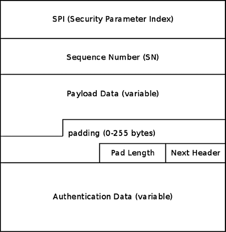
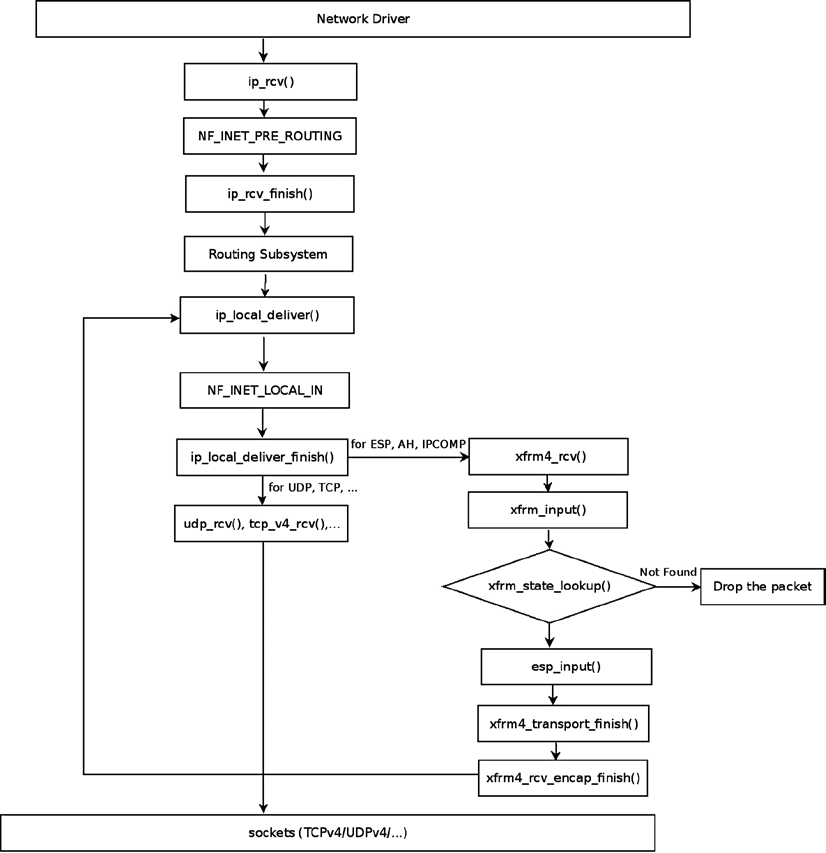
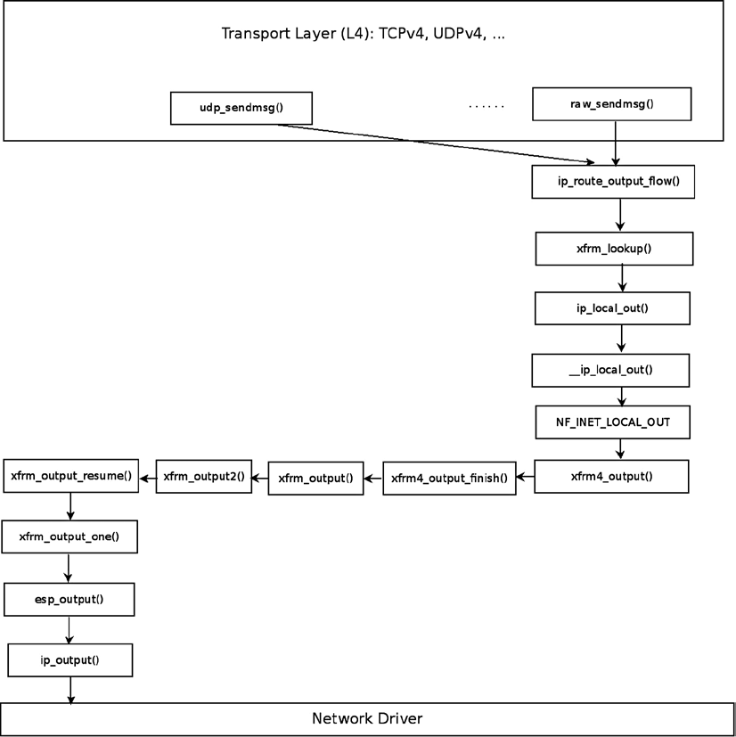
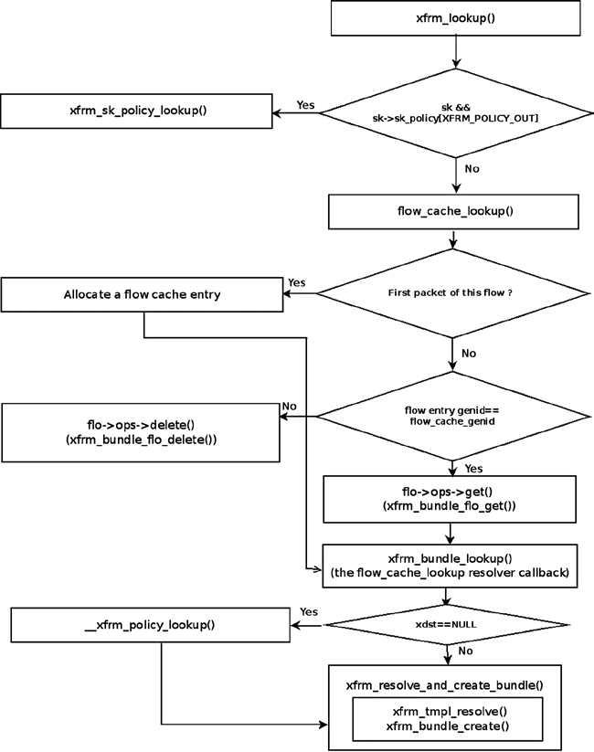

# Chương 10. IPsec

Chương 9 trình bày netfilter subsystem và cách triển khai trong kernel. Chương này trình bày Internet Protocol Security (IPsec) subsystem. IPsec là nhóm protocol bảo vệ lưu lượng IP bằng cách xác thực và mã hóa từng IP packet trong communication session. Phần lớn dịch vụ bảo mật được hai IPsec protocol chính cung cấp: Authentication Header (AH) và Encapsulating Security Payload (ESP). Hơn nữa, IPsec bảo vệ chống việc nghe lén rồi gửi lại packet (replay attack). IPsec bắt buộc theo đặc tả IPv6 và tùy chọn trong IPv4. Tuy nhiên, phần lớn hệ điều hành hiện đại, bao gồm Linux, hỗ trợ IPsec trong cả IPv4 lẫn IPv6. Các IPsec protocol đầu tiên được định nghĩa năm 1995 (RFC 1825–1829). Năm 1998, các RFC này được thay thế bởi RFC 2401–2412. Sau đó năm 2005, chúng lại được cập nhật bởi RFC 4301–4309.

IPsec subsystem rất phức tạp—có lẽ là phần phức tạp nhất của Linux kernel network stack. Nó có tầm quan trọng hàng đầu trước yêu cầu bảo mật ngày càng tăng của tổ chức và cá nhân. Chương này cung cấp nền tảng để bạn tìm hiểu subsystem phức tạp này.

## Tổng quan

IPsec đã trở thành tiêu chuẩn cho phần lớn công nghệ IP Virtual Private Network (VPN) trên thế giới. Tuy vậy, cũng có VPN dựa trên công nghệ khác như Secure Sockets Layer (SSL) và `pptp` (tunneling PPP connection qua protocol GRE). Trong các mode hoạt động của IPsec, quan trọng nhất là transport mode và tunnel mode. Trong transport mode, chỉ payload của IP packet được mã hóa; trong tunnel mode, toàn bộ IP packet được mã hóa rồi chèn vào IP packet mới với IP header mới. Khi dùng VPN với IPsec, thường làm việc ở tunnel mode, dù có trường hợp dùng transport mode (chẳng hạn L2TP/IPsec).

Tôi bắt đầu bằng phần ngắn về userspace daemon Internet Key Exchange (IKE) và cryptography trong IPsec. Đây là những chủ đề phần lớn không thuộc kernel networking stack, nhưng liên quan đến hoạt động IPsec và cần để hiểu rõ kernel IPsec subsystem hơn. Tiếp theo tôi trình bày XFRM framework, interface cấu hình và giám sát giữa phần IPsec userspace và các IPsec kernel component, đồng thời giải thích hành trình IPsec packet trong Tx path và Rx path. Tôi kết thúc chương bằng phần ngắn về NAT traversal trong IPsec, tính năng quan trọng và thú vị, cùng phần “Tham khảo nhanh”. Phần tiếp theo bắt đầu với protocol IKE.

## IKE (Internet Key Exchange)

Các giải pháp Linux IPsec userspace nguồn mở phổ biến nhất là Openswan (và `libreswan`, fork từ Openswan), strongSwan và racoon (thuộc `ipsec-tools`). Racoon thuộc dự án Kame, nhằm cung cấp cách triển khai IPv6 và IPsec protocol stack miễn phí cho các biến thể BSD. Để thiết lập IPsec connection, cần thiết lập Security Association (SA). Bạn thực hiện nhờ sự trợ giúp

của các dự án userspace vừa đề cập. SA được định nghĩa bằng hai tham số: địa chỉ nguồn và Security Parameter Index (SPI) 32-bit. Hai phía (gọi là initiator và responder trong thuật ngữ IPsec) phải thống nhất các tham số như key (hoặc nhiều key), authentication, encryption, data integrity và key exchange algorithm, cùng các tham số khác như key lifetime (chỉ IKEv1). Có hai cách phân phối key: manual key exchange, ít được dùng vì kém an toàn hơn, hoặc protocol IKE. Cách triển khai Openswan và strongSwan cung cấp IKE daemon (`pluto` trong Openswan và `charon` trong strongSwan), dùng UDP port 500 (cả nguồn lẫn đích) để gửi và nhận IKE message. Cả hai dùng XFRM Netlink interface để giao tiếp với native IPsec stack của Linux kernel. Dự án strongSwan là cách triển khai nguồn mở hoàn chỉnh duy nhất của RFC 5996, “Internet Key Exchange Protocol Version 2 (IKEv2)”, còn Openswan chỉ triển khai một tập con nhỏ bắt buộc.

Bạn có thể dùng IKEv1 Aggressive Mode trong Openswan và strongSwan 5.x (với strongSwan, phải cấu hình tường minh, và tên daemon `charon` đổi thành `weakSwan` trong trường hợp này); nhưng tùy chọn này được xem là không an toàn. IKEv1 vẫn được hệ điều hành Apple (iOS và Mac OS X) dùng do legacy client `racoon` built-in. Dù nhiều cách triển khai dùng IKEv1, có nhiều cải tiến và ưu điểm khi dùng IKEv2. Tôi đề cập rất ngắn một số: IKEv1 cần nhiều message hơn IKEv2 để thiết lập SA. IKEv1 rất phức tạp, còn IKEv2 đơn giản và vững chắc hơn đáng kể, chủ yếu vì mỗi IKEv2 request message phải được xác nhận bằng IKEv2 response message. IKEv1 không có acknowledgement mà có backoff algorithm liên tục thử mãi khi mất packet. Tuy nhiên, IKEv1 có thể xảy ra race khi hai phía retransmission, còn IKEv2 không xảy ra vì chỉ initiator chịu trách nhiệm retransmission. Những tính năng IKEv2 quan trọng khác gồm hỗ trợ NAT traversal tích hợp, tự động thu hẹp Traffic Selector (`left|rightsubnet` hai phía không cần khớp hoàn toàn, một proposal có thể là tập con của proposal kia), IKEv2 configuration payload cho phép gán địa chỉ IPv4/IPv6 ảo và thông tin DNS nội bộ (thay IKEv1 Mode Config), và cuối cùng IKEv2 EAP authentication (thay protocol IKEv1 XAUTH nguy hiểm), giải quyết vấn đề PSK có thể yếu bằng cách yêu cầu VPN server certificate và digital signature trước khi client dùng EAP authentication algorithm có thể yếu (chẳng hạn EAP-MSCHAPv2).

IKE có hai giai đoạn: đầu tiên gọi là Main Mode. Trong giai đoạn này, mỗi phía kiểm tra danh tính phía kia, và common session key được thiết lập bằng Diffie-Hellman key exchange algorithm. Mutual authentication này dựa trên RSA hoặc ECDSA certificate hay pre-shared secret (pre-shared key, PSK), vốn dựa trên mật khẩu và được xem là yếu hơn. Các tham số khác như Encryption algorithm và Authentication method được dùng cũng được thương lượng. Nếu giai đoạn hoàn tất thành công, hai peer được xem là thiết lập ISAKMP SA (Internet Security Association Key Management Protocol Security Association). Giai đoạn thứ hai gọi là Quick Mode. Trong giai đoạn này, hai phía thống nhất cryptographic algorithm sẽ dùng. Protocol IKEv2 không phân biệt giai đoạn 1 và 2 mà thiết lập CHILD\_SA đầu tiên trong trao đổi message IKE\_AUTH. Trao đổi message CHILD\_SA\_CREATE chỉ dùng để thiết lập CHILD\_SA bổ sung hoặc periodic rekeying các IKE và IPsec SA. Vì vậy IKEv1 cần chín message để thiết lập một IPsec SA, trong khi IKEv2 chỉ cần bốn.

Phần tiếp theo trình bày ngắn gọn cryptography trong ngữ cảnh IPsec (trình bày đầy đủ hơn nằm ngoài phạm vi sách).

## IPsec và Cryptography

Có hai IPsec stack dùng rộng rãi cho Linux: native Netkey stack (do Alexey Kuznetsov và David S. Miller phát triển) được giới thiệu với kernel 2.6, và KLIPS stack, ban đầu viết cho kernel 2.0 (có trước netfilter!). Netkey dùng Linux kernel Crypto API, còn KLIPS có thể hỗ trợ nhiều crypto hardware hơn qua Open Cryptography Framework (OCF). Ưu điểm OCF là cho phép dùng asynchronous call để mã hóa/giải mã dữ liệu. Trong Linux kernel, phần lớn Crypto API thực hiện synchronous call. Tôi cần đề cập kernel code `acrypto`, asynchronous crypto layer của Linux kernel. Có asynchronous implementation cho mọi algorithm type. Nhiều hardware crypto accelerator dùng asynchronous crypto interface để offload crypto request. Đơn giản vì chúng không thể block đến khi crypto job hoàn thành. Chúng phải dùng asynchronous API.

Cũng có thể dùng algorithm software-implemented với asynchronous API. Chẳng hạn crypto template `cryptd` có thể chạy algorithm bất kỳ trong asynchronous mode. Bạn có thể dùng crypto template `pcrypt` khi làm việc trong môi trường multicore. Template này song song hóa crypto layer bằng cách gửi incoming crypto request đến tập CPU cấu hình được. Nó cũng bảo đảm thứ tự crypto request nên không gây packet reorder khi dùng với IPsec. Dùng `pcrypt` có thể tăng tốc IPsec nhiều bậc trong một số tình huống. Crypto layer có user management API được công cụ `crconf` (`http://sourceforge.net/projects/crconf/`) dùng để cấu hình crypto layer, nên có thể cấu hình asynchronous crypto algorithm khi cần. Với Linux kernel 2.6.25, phát hành năm 2008, XFRM framework bắt đầu hỗ trợ các algorithm AEAD (Authenticated Encryption with Associated Data) rất hiệu quả (chẳng hạn AES-GCM), đặc biệt khi có instruction set Intel AES-NI và data integrity gần như không tốn thêm chi phí. Đi sâu chi tiết cryptography trong IPsec nằm ngoài phạm vi sách. Để biết thêm, tôi đề xuất đọc các chương liên quan trong Network Security Essentials, Fifth Edition của William Stallings (Prentice Hall, 2013).

Phần tiếp theo trình bày XFRM framework, hạ tầng của IPsec.

## XFRM Framework

IPsec được triển khai bằng XFRM framework (đọc là “transform”), bắt nguồn từ dự án USAGI nhằm cung cấp IPv6 và IPsec protocol stack chất lượng production. Thuật ngữ transform chỉ incoming packet hoặc outgoing packet được biến đổi trong kernel stack theo IPsec rule nào đó. XFRM framework được giới thiệu trong kernel 2.5. Hạ tầng XFRM độc lập protocol-family, nghĩa là có phần dùng chung cho cả IPv4 và IPv6 nằm dưới `net/xfrm`. Cả IPv4 và IPv6 có cách triển khai ESP, AH và IPCOMP riêng. Chẳng hạn IPv4 ESP module là `net/ipv4/esp4.c`, còn IPv6 ESP module là `net/ipv6/esp6.c`. Ngoài ra, IPv4 và IPv6 triển khai một số module protocol-specific hỗ trợ hạ tầng XFRM như `net/ipv4/xfrm4_policy.c` hoặc `net/ipv6/xfrm6_policy.c`.

XFRM framework hỗ trợ network namespace, dạng process virtualization nhẹ cho phép một process hoặc nhóm process có network stack riêng (tôi trình bày network namespace trong Chương 14). Mỗi network namespace (instance của `struct net`) chứa member tên `xfrm`, là instance của structure `netns_xfrm`. Object này chứa nhiều data structure và biến bạn sẽ gặp trong chương như hash table XFRM policy, hash table XFRM state, tham số `sysctl`, XFRM state garbage collector, bộ đếm, v.v.:

```
struct netns_xfrm {
        struct hlist_head       *state_bydst;
        struct hlist_head       *state_bysrc;
        struct hlist_head       *state_byspi;
        . . .
        unsigned int            state_num;
        . . .

        struct work_struct      state_gc_work;

     . . .

        u32                     sysctl_aevent_etime;
        u32                     sysctl_aevent_rseqth;
        int                     sysctl_larval_drop;
        u32                     sysctl_acq_expires;
};
```

(`include/net/netns/xfrm.h`)

### Khởi tạo XFRM

Trong IPv4, khởi tạo XFRM bằng cách gọi method `xfrm_init()` và method `xfrm4_init()` từ method `ip_rt_init()` trong `net/ipv4/route.c`. Trong IPv6, method `xfrm6_init()` được gọi từ method `ip6_route_init()` để khởi tạo XFRM. Giao tiếp giữa userspace và kernel được thực hiện bằng cách tạo netlink socket NETLINK\_XFRM rồi gửi và nhận netlink message. Kernel socket netlink NETLINK\_XFRM được tạo trong method sau:

```
static int __net_init xfrm_user_net_init(struct net *net)
{
        struct sock *nlsk;
        struct netlink_kernel_cfg cfg = {
                .groups = XFRMNLGRP_MAX,
                .input  = xfrm_netlink_rcv,
        };

        nlsk = netlink_kernel_create(net, NETLINK_XFRM, &cfg);
        . . .
        return 0;
}
```

Message gửi từ userspace (như XFRM\_MSG\_NEWPOLICY để tạo Security Policy mới hoặc XFRM\_MSG\_NEWSA để tạo Security Association mới) được method `xfrm_netlink_rcv()` xử lý (`net/xfrm/xfrm_user.c`), sau đó gọi method `xfrm_user_rcv_msg()` (tôi trình bày netlink socket trong Chương 2).

XFRM policy và XFRM state là data structure nền tảng của XFRM framework. Tôi bắt đầu mô tả XFRM policy là gì, sau đó mô tả XFRM state.

### XFRM Policy

Security Policy là rule cho IPsec biết flow cụ thể có cần xử lý hay có thể bỏ qua IPsec processing. Structure `xfrm_policy` biểu diễn IPsec policy. Policy chứa selector (object `xfrm_selector`). Policy được áp dụng khi selector khớp flow. XFRM selector gồm các trường như địa chỉ nguồn và đích, source port và destination port, protocol, v.v., có thể xác định flow:

```
struct xfrm_selector {
        xfrm_address_t  daddr;
        xfrm_address_t  saddr;
        __be16  dport;
        __be16  dport_mask;
        __be16  sport;
        __be16  sport_mask;
        __u16   family;
        __u8    prefixlen_d;
        __u8    prefixlen_s;
        __u8    proto;
        int     ifindex;
        __kernel_uid32_t        user;
};
```

(`include/uapi/linux/xfrm.h`)

Method `xfrm_selector_match()`, nhận XFRM selector, flow và family (AF\_INET cho IPv4 hoặc AF\_INET6 cho IPv6) làm tham số, trả về `true` khi flow chỉ định khớp XFRM selector chỉ định. Lưu ý structure `xfrm_selector` cũng được dùng trong XFRM state, như bạn sẽ thấy sau đây. Security Policy được biểu diễn bằng structure `xfrm_policy`:

```
struct xfrm_policy {
        . . .
        struct hlist_node             bydst;
        struct hlist_node             byidx;

        /* This lock only affects elements except for entry. */
        rwlock_t                      lock;
        atomic_t                      refcnt;
        struct timer_list             timer;

        struct flow_cache_object      flo;
        atomic_t                      genid;
        u32                           priority;
        u32                           index;
        struct xfrm_mark              mark;
        struct xfrm_selector          selector;
        struct xfrm_lifetime_cfg      lft;
        struct xfrm_lifetime_cur      curlft;
        struct xfrm_policy_walk_entry walk;
        struct xfrm_policy_queue      polq;
        u8                            type;
        u8                            action;
        u8                            flags;
        u8                            xfrm_nr;
        u16                           family;
        struct xfrm_sec_ctx           *security;
        struct xfrm_tmpl              xfrm_vec[XFRM_MAX_DEPTH];
};
```

(`include/net/xfrm.h`)

Mô tả sau trình bày các member quan trọng của structure `xfrm_policy`:

- `refcnt`: Reference counter của XFRM policy; khởi tạo thành 1 trong method `xfrm_policy_alloc( )`, tăng bởi method `xfrm_pol_hold()` và giảm bởi method `xfrm_pol_put()`.

- `timer`: Timer Per-policy; timer callback được đặt thành `xfrm_policy_timer()` trong method `xfrm_policy_alloc()`. Method `xfrm_policy_timer()` xử lý policy expiration: chịu trách nhiệm xóa policy hết hạn bằng cách gọi method `xfrm_policy_delete()` và gửi event (XFRM\_MSG\_POLEXPIRE) đến mọi Key Manager đã đăng ký bằng cách gọi method `km_policy_expired()`.

- `lft`: Lifetime của XFRM policy (object `xfrm_lifetime_cfg`). Mỗi XFRM policy có lifetime, là khoảng thời gian (biểu diễn bằng thời gian hoặc số byte).

Bạn có thể đặt giá trị lifetime của XFRM policy bằng lệnh `ip` và tham số `limit`—chẳng hạn:

```
ip xfrm policy add src 172.16.2.0/24 dst 172.16.1.0/24 limit byte-soft 6000 ...
```

- đặt `soft_byte_limit` của lifetime XFRM policy (`lft`) thành 6000; xem `man 8 ip xfrm`.

Bạn có thể hiển thị lifetime (`lft`) của XFRM policy bằng cách xem entry lifetime configuration khi chạy `ip -stat xfrm policy show`.

- `curlft`: Current lifetime của XFRM policy, phản ánh trạng thái hiện tại của policy theo lifetime. `curlft` là object `xfrm_lifetime_cur`. Gồm bốn member (đều là trường 64 bit không dấu):

- `bytes`: Số byte được IPsec subsystem xử lý, tăng trong Tx path bởi method `xfrm_output_one()` và trong Rx path bởi method `xfrm_input`().

- `packets`: Số packet được IPsec subsystem xử lý, tăng trong Tx path bởi method `xfrm_output_one()` và trong Rx path bởi method `xfrm_input()`.

- `add_time`: Timestamp thêm policy, khởi tạo khi thêm policy trong method `xfrm_policy_insert()` và method `xfrm_sk_policy_insert()`.

- `use_time:` Timestamp lần truy cập policy cuối. Timestamp `use_time` được cập nhật chẳng hạn trong method `xfrm_lookup()` hoặc method `__xfrm_policy_check()`. Khởi tạo thành 0 khi thêm XFRM policy trong method `xfrm_policy_insert()` và method `xfrm_sk_policy_insert()`.

Lưu ý Bạn có thể hiển thị current lifetime object (`curlft`) của XFRM policy bằng cách xem entry lifetime current khi chạy `ip -stat xfrm policy show`.

- `polq:` Queue giữ các packet được gửi khi chưa có XFRM state gắn với policy. Mặc định packet như vậy bị loại bỏ bằng cách gọi method `make_blackhole()`. Khi đặt entry `xfrm_larval_drop sysctl` thành 0 (`/proc/sys/net/core/xfrm_larval_drop`), packet được giữ trong queue (`polq.hold_queue`) chứa SKB; queue có thể giữ tối đa 100 packet (XFRM\_MAX\_QUEUE\_LEN). Được thực hiện bằng cách tạo dummy XFRM bundle qua method `xfrm_create_dummy_bundle`() (xem thêm phần “XFRM Lookup” phía sau chương). Mặc định entry `xfrm_larval_drop sysctl` được đặt thành 1 (xem method `__xfrm_sysctl_init()` trong `net/xfrm/xfrm_sysctl.c`).

- `type`: Thường type là XFRM\_POLICY\_TYPE\_MAIN (0). Khi kernel hỗ trợ subpolicy (CONFIG\_XFRM\_SUB\_POLICY được bật), có thể áp dụng hai policy cho cùng packet và dùng type XFRM\_POLICY\_TYPE\_SUB (1). Policy tồn tại ngắn hơn trong kernel phải là subpolicy. Tính năng này thường chỉ cần cho nhà phát triển/debugging và mobile IPv6, vì có thể áp dụng một policy cho IPsec và một cho mobile IPv6. IPsec policy thường là main policy có lifetime dài hơn mobile IPv6 (sub) policy.

- `action`: Có thể nhận một trong hai giá trị:

- XFRM\_POLICY\_ALLOW (0): Cho phép lưu lượng.

- XFRM\_POLICY\_BLOCK(1): Cấm lưu lượng (chẳng hạn khi dùng `type=reject` hoặc `type=drop` trong `/etc/ipsec.conf`).

- `xfrm_nr:` Số template gắn với policy—tối đa sáu template (XFRM\_MAX\_DEPTH). Structure `xfrm_tmpl` là structure trung gian giữa XFRM state và XFRM policy. Được khởi tạo trong method `copy_templates()`, `net/xfrm/xfrm_user.c`.

- `family`: IPv4 hoặc IPv6.

- `security:` Security context (object `xfrm_sec_ctx`) cho phép XFRM subsystem giới hạn socket có thể gửi hoặc nhận packet qua Security Association (XFRM state). Để biết thêm, xem `http://lwn.net/Articles/156604/`.

- `xfrm_vec`: Array các XFRM template (object `xfrm_tmpl`).

Kernel lưu IPsec Security Policy trong Security Policy Database (SPD). Quản lý SPD được thực hiện bằng cách gửi message từ userspace socket. Chẳng hạn:

- Thêm XFRM policy (XFRM\_MSG\_NEWPOLICY) được xử lý bởi method `xfrm_add_policy()`.

- Xóa XFRM policy (XFRM\_MSG\_DELPOLICY) được xử lý bởi method `xfrm_get_policy()`.

- Hiển thị SPD (XFRM\_MSG\_GETPOLICY) được xử lý bởi method `xfrm_dump_policy()`.

- Flush SPD (XFRM\_MSG\_FLUSHPOLICY) được xử lý bởi method `xfrm_flush_policy()`.

Phần tiếp theo mô tả XFRM state là gì.

### XFRM State (Security Association)

Structure `xfrm_state` biểu diễn IPsec Security Association (SA) (`include/net/xfrm.h`). Nó biểu diễn lưu lượng một chiều và chứa thông tin như cryptographic key, flag, request id, thống kê, replay parameter, v.v. Bạn thêm XFRM state bằng cách gửi request (XFRM\_MSG\_NEWSA) từ userspace socket; được xử lý trong kernel bởi method `xfrm_state_add()` (`net/xfrm/xfrm_user.c`). Tương tự, xóa state bằng cách gửi message XFRM\_MSG\_DELSA, được xử lý trong kernel bởi method `xfrm_del_sa()`:

```
    struct xfrm_state {
            . . .
            union {
                    struct hlist_node       gclist;
                    struct hlist_node       bydst;
            };
            struct hlist_node       bysrc;
            struct hlist_node       byspi;

            atomic_t                refcnt;
            spinlock_t              lock;

            struct xfrm_id          id;
            struct xfrm_selector    sel;
            struct xfrm_mark        mark;
            u32                     tfcpad;

        u32                     genid;

        /* Key manager bits */
        struct xfrm_state_walk  km;

        /* Parameters of this state. */
        struct {
                u32             reqid;
                u8              mode;
                u8              replay_window;
                u8              aalgo, ealgo, calgo;
                u8              flags;
                u16             family;
                xfrm_address_t  saddr;
                int             header_len;
                int             trailer_len;
        } props;

        struct xfrm_lifetime_cfg lft;

        /* Data for transformer */
        struct xfrm_algo_auth   *aalg;
        struct xfrm_algo        *ealg;
        struct xfrm_algo        *calg;
        struct xfrm_algo_aead   *aead;

        /* Data for encapsulator */
        struct xfrm_encap_tmpl  *encap;

        /* Data for care-of address */
        xfrm_address_t  *coaddr;

        /* IPComp needs an IPIP tunnel for handling uncompressed packets */
        struct xfrm_state       *tunnel;

        /* If a tunnel, number of users + 1 */
        atomic_t                tunnel_users;

        /* State for replay detection */
        struct xfrm_replay_state replay;
        struct xfrm_replay_state_esn *replay_esn;

        /* Replay detection state at the time we sent the last notification */
        struct xfrm_replay_state preplay;
        struct xfrm_replay_state_esn *preplay_esn;

        /* The functions for replay detection. */
        struct xfrm_replay      *reply;

            /* internal flag that only holds state for delayed aevent at the
             * moment
            */
            u32                     xflags;

            /* Replay detection notification settings */
            u32                     replay_maxage;
            u32                     replay_maxdiff;

            /* Replay detection notification timer */
            struct timer_list       rtimer;

            /* Statistics */
            struct xfrm_stats       stats;

            struct xfrm_lifetime_cur curlft;
            struct tasklet_hrtimer  mtimer;

            /* used to fix curlft->add_time when changing date */
            long            saved_tmo;

            /* Last used time */
            unsigned long           lastused;

            /* Reference to data common to all the instances of this
             * transformer. */
            const struct xfrm_type  *type;
            struct xfrm_mode        *inner_mode;
            struct xfrm_mode        *inner_mode_iaf;
            struct xfrm_mode        *outer_mode;

            /* Security context */
            struct xfrm_sec_ctx     *security;

            /* Private data of this transformer, format is opaque,
             * interpreted by xfrm_type methods. */
            void                    *data;
    };
```

(`include/net/xfrm.h`)

Mô tả sau trình bày chi tiết một số member quan trọng của structure `xfrm_state`:

- `refcnt`: Reference counter, tăng bởi method `xfrm_state_hold()` và giảm bởi method `__xfrm_state_put()` hoặc method `xfrm_state_put()` (method sau cũng giải phóng XFRM state bằng cách gọi method `__xfrm_state_destroy()` khi reference counter đạt 0).

- `id`: `id` (object `xfrm_id`) gồm ba trường xác định duy nhất nó: địa chỉ đích, spi và security protocol (AH, ESP hoặc IPCOMP).

- `props`: Các thuộc tính của XFRM state. Chẳng hạn:

- `mode`: Có thể là một trong năm mode (chẳng hạn XFRM\_MODE\_TRANSPORT cho transport mode hoặc XFRM\_MODE\_TUNNEL cho tunnel mode; xem `include/uapi/linux/xfrm.h`).

- `flag`: Chẳng hạn XFRM\_STATE\_ICMP. Các flag nằm trong `include/uapi/linux/xfrm.h`. Có thể đặt từ userspace, chẳng hạn bằng lệnh `ip` và option `flag`: `ip xfrm add state flag icmp` ...

- `family`: IPv4 hoặc IPv6.

- `saddr`: Địa chỉ nguồn của XFRM state.

- `lft:` Lifetime của XFRM state (object `xfrm_lifetime_cfg`).

- `stats`: Object `xfrm_stats`, biểu diễn thống kê XFRM state. Bạn có thể hiển thị thống kê XFRM state bằng `ip –stat xfrm show`.

Kernel lưu IPsec Security Association trong Security Associations Database (SAD). Object `xfrm_state` được lưu trong ba hash table của `netns_xfrm` (XFRM namespace đã trình bày): `state_bydst`, `state_bysrc`, `state_byspi`. Key của các bảng lần lượt được tính bằng các method `xfrm_dst_hash()`, `xfrm_src_hash()` và `xfrm_spi_hash()`. Khi object `xfrm_state` được thêm, nó được chèn vào ba hash table. Nếu spi bằng 0 (giá trị 0 thông thường không dùng cho spi—tôi sẽ sớm đề cập khi nào bằng 0), object `xfrm_state` không được thêm vào hash table `state_byspi` (xem method `__xfrm_state_insert()` trong `net/xfrm/xfrm_state.c`).

Lưu ý spi bằng 0 chỉ được dùng cho acquire state. Kernel gửi acquire message đến key manager và thêm temporary acquire state với spi 0 nếu lưu lượng khớp policy nhưng state chưa resolve. Kernel không gửi acquire tiếp theo chừng nào acquire state còn tồn tại; lifetime có thể cấu hình tại `net->xfrm.sysctl_acq_expires`. Nếu state được resolve, acquire state được thay bằng state thực.

Có thể lookup trong SAD bằng:

- Method `xfrm_state_lookup()`: Trong hash table `state_byspi`.

- Method `xfrm_state_lookup_byaddr()`: Trong hash table `state_bysrc`.

- Method `xfrm_state_find()`: Trong hash table `state_bydst`.

Protocol ESP là IPsec protocol được dùng phổ biến nhất; hỗ trợ cả encryption và authentication. Phần tiếp theo trình bày cách triển khai IPv4 ESP.

## Triển khai ESP (IPv4)

Protocol ESP được quy định trong RFC 4303; hỗ trợ cả encryption và authentication. Dù cũng hỗ trợ mode encryption-only và authentication-only, nó thường được dùng với cả encryption lẫn authentication vì an toàn hơn. Tôi cũng cần đề cập các method Authenticated Encryption (AEAD) mới như AES-GCM, có thể tính encryption và data integrity trong một lượt và song song hóa mạnh trên nhiều core, nên với instruction set Intel AES-NI, có thể đạt IPsec throughput vài Gbit/s. Protocol ESP

hỗ trợ cả tunnel mode và transport mode; protocol identifier là 50 (IPPROTO\_ESP). ESP thêm header mới và trailer vào mỗi packet. Theo định dạng ESP trong Hình 10-1, có các trường sau:

- SPI: Security Parameter Index 32-bit. Cùng với địa chỉ nguồn, nó xác định SA.

- Sequence Number: 32 bit, tăng thêm 1 cho mỗi packet được truyền để bảo vệ chống replay attack.

- Payload Data: Block dữ liệu được mã hóa có kích thước thay đổi.

- Padding: Padding cho block dữ liệu được mã hóa để đáp ứng yêu cầu căn chỉnh (0–255 byte).

- Pad Length: Kích thước padding tính bằng byte (1 byte).

- Next Header: Type của header tiếp theo (1 byte).

- Authentication Data: Integrity Check Value (ICV).



Hình 10-1. Định dạng ESP

Phần tiếp theo trình bày khởi tạo IPv4 ESP.

### Khởi tạo IPv4 ESP

Trước tiên định nghĩa `esp_type` (object `xfrm_type`) và `esp4_protocol` (object `net_protocol`) rồi đăng ký như sau:

```
static const struct xfrm_type esp_type =
{
        .description    = "ESP4",
        .owner          = THIS_MODULE,
        .proto          = IPPROTO_ESP,
        .flags          = XFRM_TYPE_REPLAY_PROT,
        .init_state     = esp_init_state,
        .destructor     = esp_destroy,
        .get_mtu        = esp4_get_mtu,
        .input          = esp_input,
        .output         = esp_output
};

static const struct net_protocol esp4_protocol = {
        .handler        =       xfrm4_rcv,
        .err_handler    =       esp4_err,
        .no_policy      =       1,
        .netns_ok       =       1,
};

static int __init esp4_init(void)
{
```

Mỗi protocol family có một instance của object `xfrm_state_afinfo`, chứa state method riêng cho protocol-family; có `xfrm4_state_afinfo` cho IPv4 (`net/ipv4/xfrm4_state.c`) và `xfrm6_state_afinfo` cho IPv6. Object này chứa array object `xfrm_type` tên `type_map`. Đăng ký XFRM type bằng cách gọi method `xfrm_register_type()` sẽ đặt `xfrm_type` chỉ định làm phần tử của array:

```
        if (xfrm_register_type(&esp_type, AF_INET) < 0) {
                pr_info("%s: can't add xfrm type\n", __func__);
                return -EAGAIN;
        }
```

Đăng ký protocol IPv4 ESP giống đăng ký các IPv4 protocol khác, bằng cách gọi method `inet_add_protocol()`. Lưu ý protocol handler của IPv4 ESP, tức method `xfrm4_rcv()`, cũng được protocol IPv4 AH (`net/ipv4/ah4.c`) và protocol IPv4 IPCOMP (IP Payload Compression Protocol ) (`net/ipv4/ipcomp.c`) dùng.

```
        if (inet_add_protocol(&esp4_protocol, IPPROTO_ESP) < 0) {
                pr_info("%s: can't add protocol\n", __func__);
                xfrm_unregister_type(&esp_type, AF_INET);
                return -EAGAIN;
        }
        return 0;
}
```

(`net/ipv4/esp4.c`)

## Nhận IPsec Packet (Transport Mode)

Giả sử bạn làm việc ở transport mode trong IPv4 và nhận ESP packet dành cho host cục bộ. ESP trong transport mode không mã hóa IP header, chỉ IP payload. Hình 10-2 minh họa hành trình incoming IPv4 ESP packet, các giai đoạn được mô tả trong phần này. Đi qua mọi giai đoạn local delivery thông thường, bắt đầu từ method `ip_rcv()` rồi đến method `ip_local_deliver_finish()`. Vì giá trị trường protocol trong IPv4 header là ESP (50), gọi handler tương ứng, method `xfrm4_rcv()`, như đã thấy. Method `xfrm4_rcv()` tiếp tục gọi method dùng chung `xfrm_input()`, lookup trong SAD bằng cách gọi method `xfrm_state_lookup()`. Nếu lookup thất bại, packet bị drop. Nếu lookup hit, method callback `input` của IPsec protocol tương ứng được gọi:

```
int xfrm_input(struct sk_buff *skb, int nexthdr, __be32 spi, int encap_type)
{
         struct xfrm_state *x;
         do {
                 . . .
```



Hình 10-2. Nhận IPv4 ESP packet, local delivery, transport mode. Lưu ý: Hình mô tả IPv4 ESP packet. Với IPv4 AH packet, method ah\_input() được gọi thay method esp\_input( ); tương tự, với IPv4 IPCOMP packet, method ipcomp\_input() được gọi thay method esp\_input( )

Lookup trong hash table `state_byspi`:

```
                 x = xfrm_state_lookup(net, skb->mark, daddr, spi, nexthdr, family);
```

Âm thầm drop packet nếu lookup thất bại:

```
                 if (x == NULL) {
                         XFRM_INC_STATS(net, LINUX_MIB_XFRMINNOSTATES);
                         xfrm_audit_state_notfound(skb, family, spi, seq);
                         goto drop;
                 }
```

Trong trường hợp incoming traffic IPv4 ESP này, XFRM type gắn với state (`x->type`) là ESP XFRM Type (`esp_type`); callback `input` được đặt thành `esp_input()` như đã đề cập trong phần “Khởi tạo IPv4 ESP”.

Bằng cách gọi `x->type->input()`, dòng sau gọi method `esp_input()`; method này trả về protocol number của packet ban đầu trước khi được ESP mã hóa:

```
                    nexthdr = x->type->input(x, skb);
                    . . .
```

Protocol number ban đầu được giữ trong control buffer (`cb`) của SKB bằng macro XFRM\_MODE\_SKB\_CB; sau đó dùng để sửa IPv4 header của packet, như bạn sẽ thấy:

```
                    XFRM_MODE_SKB_CB(skb)->protocol = nexthdr;
```

Sau khi method `esp_input()` kết thúc, method `xfrm4_transport_finish()` được gọi. Method này sửa các trường của IPv4 header. Hãy xem method `xfrm4_transport_finish()`:

```
int xfrm4_transport_finish(struct sk_buff *skb, int async)
{
        struct iphdr *iph = ip_hdr(skb);
```

Protocol của IPv4 header (`iph->protocol`) hiện là 50 (ESP); cần đặt thành protocol number của packet ban đầu (trước khi ESP mã hóa) để L4 socket xử lý. Protocol number của packet ban đầu được giữ trong `XFRM_MODE_SKB_CB(skb)->protocol`, như đã thấy trong phần này:

```
        iph->protocol = XFRM_MODE_SKB_CB(skb)->protocol;

        . . .
        __skb_push(skb, skb->data - skb_network_header(skb));
        iph->tot_len = htons(skb->len);
```

Tính lại checksum vì IPv4 header đã thay đổi:

```
        ip_send_check(iph);
```

Gọi mọi netfilter hook callback NF\_INET\_PRE\_ROUTING rồi gọi method `xfrm4_rcv_encap_finish()`:

```
        NF_HOOK(NFPROTO_IPV4, NF_INET_PRE_ROUTING, skb, skb->dev, NULL,
                xfrm4_rcv_encap_finish);
        return 0;
}
```

Method `xfrm4_rcv_encap_finish()` gọi method `ip_local_deliver()`. Bây giờ giá trị member `protocol` trong IPv4 header là transport protocol gốc (UDPv4, TCPv4, v.v.), nên từ đây tiếp tục hành trình packet thông thường và packet được chuyển lên transport layer (L4).

## Gửi IPsec Packet (Transport Mode)

Hình 10-3 minh họa Tx path của outgoing packet gửi qua IPv4 ESP ở transport mode. Bước đầu sau lookup trong routing subsystem (bằng cách gọi method `ip_route_output_flow()`) là lookup XFRM policy có thể áp dụng cho flow. Thực hiện bằng cách gọi method `xfrm_lookup()` (tôi trình bày nội bộ method phía sau phần này). Nếu lookup hit, tiếp tục đến method `ip_local_out()`, rồi sau khi gọi một số method như trong Hình 10-3, cuối cùng đến method `esp_output()`, mã hóa packet rồi gửi đi bằng cách gọi method `ip_output()`.



Hình 10-3. Truyền IPv4 ESP packet, transport mode. Để đơn giản, trường hợp tạo dummy bundle (khi không có XFRM state) và một số chi tiết khác được lược bỏ

Phần sau nói về cách lookup trong XFRM.

## XFRM Lookup

Method `xfrm_lookup()` được gọi cho mỗi packet gửi khỏi hệ thống. Cần lookup hiệu quả nhất có thể. Để đạt mục tiêu này, bundle được dùng. Bundle cho phép cache thông tin quan trọng như route, policy, số policy, v.v.; các bundle này là instance của structure `xfrm_dst`, được lưu bằng flow cache. Khi packet đầu tiên của flow đến, tạo entry trong generic flow cache rồi tạo bundle (object `xfrm_dst`). Bundle được tạo sau khi lookup bundle thất bại, vì đây là packet đầu của flow. Khi packet tiếp theo của flow đến, sẽ hit khi flow cache lookup:

```
struct xfrm_dst {
        union {
                struct dst_entry        dst;
                struct rtable           rt;
                struct rt6_info         rt6;
        } u;
        struct dst_entry *route;
        struct flow_cache_object flo;
        struct xfrm_policy *pols[XFRM_POLICY_TYPE_MAX];
        int num_pols, num_xfrms;
#ifdef CONFIG_XFRM_SUB_POLICY
        struct flowi *origin;
        struct xfrm_selector *partner;
#endif
        u32 xfrm_genid;
        u32 policy_genid;
        u32 route_mtu_cached;
        u32 child_mtu_cached;
        u32 route_cookie;
        u32 path_cookie;
};
```

(`include/net/xfrm.h`)

Method `xfrm_lookup()` rất phức tạp. Tôi trình bày các phần quan trọng nhưng không đi sâu mọi chi tiết. Hình 10-4 là block diagram nội bộ method `xfrm_lookup()`.



Hình 10-4. Nội bộ xfrm\_lookup( )

Hãy xem method `xfrm_lookup()`:

```
struct dst_entry *xfrm_lookup(struct net *net, struct dst_entry *dst_orig,
                              const struct flowi *fl, struct sock *sk, int flags)
{
```

Method `xfrm_lookup()` chỉ xử lý Tx path; vì vậy đặt flow direction (`dir`) thành FLOW\_DIR\_OUT bằng:

```
         u8 dir = policy_to_flow_dir(XFRM_POLICY_OUT);
```

Nếu policy gắn với socket này, lookup bằng method `xfrm_sk_policy_lookup()`, kiểm tra packet flow có khớp policy selector không. Lưu ý nếu packet cần forwarding, method `xfrm_lookup()` được gọi từ method `__xfrm_route_forward()` và không có socket gắn với packet vì nó không được tạo trên host cục bộ; khi đó đối số `sk` chỉ định là NULL:

```
        if (sk && sk->sk_policy[XFRM_POLICY_OUT]) {
                num_pols = 1;
                pols[0] = xfrm_sk_policy_lookup(sk, XFRM_POLICY_OUT, fl);


        . . .
}
```

Nếu không có policy gắn với socket, lookup trong generic flow cache bằng cách gọi method `flow_cache_lookup()`, truyền function pointer đến method `xfrm_bundle_lookup` (callback `resolver`) làm đối số. Lookup key là flow object (tham số `fl` chỉ định). Nếu không tìm thấy entry trong flow cache, cấp phát flow cache entry mới. Nếu tìm thấy entry có cùng `genid`, gọi method `xfrm_bundle_flo_get()` bằng cách gọi `flo->ops->get(flo)`. Cuối cùng gọi method `xfrm_bundle_lookup()` bằng callback `resolver`, nhận flow object làm tham số (`oldflo`). Xem cách triển khai method `flow_cache_lookup()` trong `net/core/flow.c`:

```
               flo = flow_cache_lookup(net, fl, family, dir, xfrm_bundle_lookup, dst_orig);
```

Lấy bundle (object `xfrm_dst`) chứa flow cache object làm member:

```
               xdst = container_of(flo, struct xfrm_dst, flo);
```

Lấy dữ liệu cache như số policy, số template, các policy và route:

```
       num_pols = xdst->num_pols;
       num_xfrms = xdst->num_xfrms;
       memcpy(pols, xdst->pols, sizeof(struct xfrm_policy*) * num_pols);
       route = xdst->route;
}

dst = &xdst->u.dst;
```

Tiếp theo xử lý dummy bundle. Dummy bundle là bundle có route member NULL. Nó được tạo trong quá trình XFRM bundle lookup (bởi method `xfrm_bundle_lookup()`) khi không tìm thấy XFRM state, bằng cách gọi method `xfrm_create_dummy_bundle()`. Khi đó có hai lựa chọn tùy giá trị `sysctl_larval_drop` (`/proc/sys/net/core/xfrm_larval_drop`):

- Nếu `sysctl_larval_drop` được bật (nghĩa là giá trị 1—mặc định như đã nói ở trên), packet phải bị loại bỏ.

- Nếu `sysctl_larval_drop` không được bật (giá trị 0), packet được giữ trong queue per-policy (`polq.hold_queue`), chứa tối đa 100 (XFRM\_MAX\_QUEUE\_LEN) SKB; được triển khai bởi method `xdst_queue_output()`. Packet được giữ đến khi các XFRM

state được resolve hoặc timeout. Khi state được resolve, packet được gửi khỏi queue. Nếu XFRM state không resolve sau khoảng thời gian (timeout của object `xfrm_policy_queue`), queue được flush bởi method `xfrm_queue_purge()`:

```
if (route == NULL && num_xfrms > 0) {
        /* The only case when xfrm_bundle_lookup() returns a
         * bundle with null route, is when the template could
         * not be resolved. It means policies are there, but
         * bundle could not be created, since we don't yet
         * have the xfrm_state's. We need to wait for KM to
         * negotiate new SA's or bail out with error.*/
         if (net->xfrm.sysctl_larval_drop) {
```

Với IPv4, method `make_blackhole()` gọi method `ipv4_blackhole_route()`. Với IPv6, nó gọi method `ip6_blackhole_route()`:

```
        return make_blackhole(net, family, dst_orig);
}
```

Phần tiếp theo trình bày một trong những tính năng IPsec quan trọng nhất—NAT traversal—và giải thích nó là gì, vì sao cần.

## NAT Traversal trong IPsec

Tại sao NAT device không cho lưu lượng IPsec đi qua? NAT thay địa chỉ IP và đôi khi cả port number của packet. Vì vậy nó tính lại checksum của TCP header hoặc UDP header. Tính transport layer checksum xét cả địa chỉ IP nguồn và đích. Do đó ngay cả khi chỉ đổi địa chỉ IP, TCP hoặc UDP checksum vẫn phải được tính lại. Tuy nhiên với ESP encryption ở transport mode, NAT device không thể cập nhật checksum vì TCP hoặc UDP header được ESP mã hóa. Có protocol mà checksum không bao phủ IP header (như SCTP), nên không xảy ra vấn đề này. Để giải quyết, tiêu chuẩn NAT traversal cho IPsec được phát triển (tên chính thức trong RFC 3948 là “UDP Encapsulation of IPsec ESP Packets”). UDP Encapsulation áp dụng được cho cả IPv4 packet lẫn IPv6 packet. Giải pháp NAT traversal không giới hạn ở lưu lượng IPsec; các kỹ thuật thường cần cho ứng dụng mạng client-to-client, đặc biệt peer-to-peer và Voice over Internet Protocol (VoIP).

Có một số giải pháp một phần cho VoIP NAT-traversal như STUN, TURN, ICE, v.v. Tôi cần đề cập strongSwan triển khai dịch vụ IKEv2 Mediation Extension (`http://tools.ietf.org/html/draft-brunner-ikev2-mediation-00`), cho phép hai VPN endpoint, mỗi endpoint nằm sau NAT router, thiết lập IPsec tunnel peer-to-peer trực tiếp bằng cơ chế giống TURN và ICE. Chẳng hạn STUN được dùng trong VoIP client nguồn mở Ekiga (trước là gnomemeeting). Vấn đề của các giải pháp này là có NAT device chúng không xử lý được. Thiết bị SBC (session border controller) cung cấp giải pháp đầy đủ cho NAT traversal trong VoIP. SBC có thể được triển khai bằng phần cứng (chẳng hạn Juniper Networks cung cấp giải pháp SBC router-integrated) hoặc phần mềm. Các giải pháp SBC thực hiện NAT traversal cho media traffic—gửi bằng Real Time Protocol (RTP)—và đôi khi cả signaling traffic—gửi bằng Session Initiation Protocol (SIP). NAT traversal là tùy chọn trong IKEv2. Openswan, strongSwan và racoon hỗ trợ NAT traversal, nhưng Openswan và racoon chỉ hỗ trợ NAT-T với IKEv1, trong khi strongSwan hỗ trợ NAT traversal ở cả IKEv1 và IKEv2.

### Mode hoạt động NAT-T

NAT traversal hoạt động thế nào? Trước tiên nhớ NAT-T chỉ là giải pháp tốt cho lưu lượng ESP, không cho AH. Giới hạn khác là NAT-T không thể dùng với manual keying mà chỉ với IKEv1 và IKEv2, vì NAT-T gắn với trao đổi message IKEv1/IKEv2. Trước tiên phải báo userspace daemon (`pluto`) rằng muốn dùng tính năng NAT traversal, vì mặc định không kích hoạt. Trong Openswan, thực hiện bằng cách thêm `nat_traversal=yes` vào tham số connection trong `/etc/ipsec.conf`. Client không nằm sau NAT không bị ảnh hưởng bởi entry bổ sung này. Trong strongSwan, IKEv2 daemon `charon` luôn hỗ trợ NAT traversal và không thể tắt tính năng. Trong giai đoạn đầu của IKE (Main Mode), kiểm tra cả hai peer có hỗ trợ NAT-T không. Trong IKEv1, khi peer hỗ trợ NAT-T, một member của ISAKAMP header (vendor ID) cho biết có hỗ trợ NAT-T hay không. Trong IKEv2, NAT-T thuộc tiêu chuẩn nên không cần thông báo. Nếu điều kiện đáp ứng, kiểm tra có một hoặc nhiều NAT device trên path giữa hai IPsec peer bằng cách gửi NAT-D payload message. Nếu điều kiện này cũng đáp ứng, NAT-T bảo vệ IPsec encoded packet gốc bằng cách chèn UDP header giữa IP header và ESP header. Cả source port lẫn destination port trong UDP header là 4500. Ngoài ra, NAT-T gửi message keep-alive mỗi 20 giây để NAT giữ ánh xạ. Keep alive message cũng được gửi trên UDP port 4500 và được nhận dạng bằng nội dung, giá trị (một byte, 0xFF). Khi packet đến IPsec peer sau khi đi qua NAT, kernel bỏ UDP header và giải mã ESP payload. Xem method `xfrm4_udp_encap_rcv()` trong `net/ipv4/xfrm4_input.c`.

## Tổng kết

Chương này trình bày IPsec và XFRM framework, hạ tầng của IPsec, cùng XFRM policy và state, các data structure nền tảng của XFRM framework. Tôi cũng trình bày IKE, cách triển khai ESP4, Rx/Tx path của ESP4 trong transport mode và NAT traversal trong IPsec. Chương 11 trình bày các transport Layer (L4) protocol: UDP, TCP, SCTP và DCCP. Phần “Tham khảo nhanh” tiếp theo liệt kê các method chính liên quan đến chủ đề trong chương, sắp xếp theo ngữ cảnh.

## Tham khảo nhanh

Tôi kết thúc chương bằng danh sách ngắn các method IPsec quan trọng. Một số đã được đề cập trong chương. Sau đó là bảng XFRM SNMP MIB counter.

### Method

Hãy bắt đầu với các method.

### bool xfrm\_selector\_match(const struct xfrm\_selector \*sel, const struct flowi \*fl, unsigned short family);

Method này trả về `true` khi flow chỉ định khớp XFRM selector chỉ định. Gọi method `__xfrm4_selector_match()` cho IPv4 hoặc method `__xfrm6_selector_match()` cho IPv6.

### int xfrm\_policy\_match(const struct xfrm\_policy \*pol, const struct flowi \*fl, u8 type, u16 family, int dir);

Method này trả về 0 nếu policy chỉ định áp dụng được cho flow chỉ định, ngược lại trả về –`errno`.

### struct xfrm\_policy \*xfrm\_policy\_alloc(struct net \*net, gfp\_t gfp);

Method này cấp phát và khởi tạo XFRM policy. Đặt reference counter thành 1, khởi tạo lock read-write, gán policy namespace (`xp_net`) thành network namespace chỉ định, đặt timer callback thành `xfrm_policy_timer()` và callback của state resolution packet queue timer (`policy->polq.hold_timer`) thành `xfrm_policy_queue_process()`.

### void xfrm\_policy\_destroy(struct xfrm\_policy \*policy);

Method này xóa timer của object XFRM policy chỉ định và giải phóng memory của XFRM policy chỉ định.

### void xfrm\_pol\_hold(struct xfrm\_policy \*policy);

Method này tăng reference count của XFRM policy chỉ định thêm 1.

### static inline void xfrm\_pol\_put(struct xfrm\_policy \*policy);

Method này giảm reference count của XFRM policy chỉ định đi 1. Nếu reference count đạt 0, gọi method `xfrm_policy_destroy()`.

### struct xfrm\_state\_afinfo \*xfrm\_state\_get\_afinfo(unsigned int family);

Method này trả về object `xfrm_state_afinfo` gắn với protocol family chỉ định.

### struct dst\_entry \*xfrm\_bundle\_create(struct xfrm\_policy \*policy, struct xfrm\_state \*\*xfrm, int nx, const struct flowi \*fl, struct dst\_entry \*dst);

Method này tạo XFRM bundle. Được gọi từ method `xfrm_resolve_and_create_bundle()`.

### int policy\_to\_flow\_dir(int dir);

Method này trả về flow direction theo policy direction chỉ định. Chẳng hạn trả về FLOW\_DIR\_IN khi hướng chỉ định là XFRM\_POLICY\_IN, v.v.

### static struct xfrm\_dst \*xfrm\_create\_dummy\_bundle(struct net \*net, struct dst\_entry \*dst, const struct flowi \*fl, int num\_xfrms, u16 family);

Method này tạo dummy bundle. Được gọi từ method `xfrm_bundle_lookup()` khi tìm thấy policy nhưng không có state khớp.

### struct xfrm\_dst \*xfrm\_alloc\_dst(struct net \*net, int family);

Method này cấp phát object XFRM bundle. Được gọi từ method `xfrm_bundle_create()` và method `xfrm_create_dummy_bundle()`.

### int xfrm\_policy\_insert(int dir, struct xfrm\_policy \*policy, int excl);

Method này thêm XFRM policy vào SPD. Được gọi từ method `xfrm_add_policy()` (`net/xfrm/xfrm_user.c`) hoặc từ method `pfkey_spdadd()` (`net/key/af_key.c`).

### int xfrm\_policy\_delete(struct xfrm\_policy \*pol, int dir);

Method này giải phóng tài nguyên của object XFRM policy chỉ định. Đối số hướng (`dir`) cần để giảm đi 1 XFRM policy counter tương ứng trong `policy_count` của object `netns_xfrm` riêng cho mỗi namespace.

### int xfrm\_state\_add(struct xfrm\_state \*x);

Method này thêm XFRM state chỉ định vào SAD.

### int xfrm\_state\_delete(struct xfrm\_state \*x);

Method này xóa XFRM state chỉ định khỏi SAD.

### void \_\_xfrm\_state\_destroy(struct xfrm\_state \*x);

Method này giải phóng tài nguyên của XFRM state bằng cách thêm vào XFRM states garbage list và kích hoạt XFRM state garbage collector.

### int xfrm\_state\_walk(struct net \*net, struct xfrm\_state\_walk \*walk, int (\*func)(struct xfrm\_state \*, int, void\*), void \*data);

Method này duyệt mọi XFRM state (`net->xfrm.state_all`) và gọi callback `func` chỉ định.

### struct xfrm\_state \*xfrm\_state\_alloc(struct net \*net);

Method này cấp phát và khởi tạo XFRM state.

### void xfrm\_queue\_purge(struct sk\_buff\_head \*list);

Method này flush state resolution queue per-policy (`polq.hold_queue`).

### int xfrm\_input(struct sk\_buff \*skb, int nexthdr, \_\_be32 spi, int encap\_type);

Method này là Rx IPsec handler chính.

### static struct dst\_entry \*make\_blackhole(struct net \*net, u16 family, struct dst\_entry \*dst\_orig);

Method này được gọi từ method `xfrm_lookup()` khi không có state đã resolve và `sysctl_larval_drop` được bật. Với IPv4, method `make_blackhole()` gọi method `ipv4_blackhole_route()`; với IPv6, gọi method `ip6_blackhole_route()`.

### int xdst\_queue\_output(struct sk\_buff \*skb);

Method này xử lý thêm packet vào state resolution packet queue per-policy (`pq->hold_queue`). Queue chứa tối đa 100 (XFRM\_MAX\_QUEUE\_LEN) packet.

### struct net \*xs\_net(struct xfrm\_state \*x);

Method này trả về namespace object (`xs_net`) gắn với object `xfrm_state` chỉ định.

### struct net \*xp\_net(const struct xfrm\_policy \*xp);

Method này trả về namespace object (`xp_net`) gắn với object `xfrm_policy` chỉ định.

### int xfrm\_policy\_id2dir(u32 index);

Method này trả về hướng policy theo index chỉ định.

### int esp\_input(struct xfrm\_state \*x, struct sk\_buff \*skb);

Method này là IPv4 ESP protocol handler chính.

### struct ip\_esp\_hdr \*ip\_esp\_hdr(const struct sk\_buff \*skb);

Method này trả về ESP header gắn với SKB chỉ định.

### int verify\_newpolicy\_info(struct xfrm\_userpolicy\_info \*p);

Method này kiểm tra object `xfrm_userpolicy_info` chỉ định chứa giá trị hợp lệ. (`xfrm_userpolicy_info` là object được truyền từ userspace). Trả về 0 nếu object hợp lệ, ngược lại -EINVAL hoặc -EAFNOSUPPORT.

### Bảng

Bảng 10-1 liệt kê XFRM SNMP MIB counter.

Bảng 10-1. XFRM SNMP MIB counter

| Linux Symbol | SNMP (procfs) Symbol | Method có thể tăng bộ đếm |
|---|---|---|
| LINUX\_MIB\_XFRMINERROR | `XfrmInError` | `xfrm_input()` |
| LINUX\_MIB\_XFRMINBUFFERERROR | `XfrmInBufferError` | `xfrm_input(),__xfrm_policy_check()` |
| LINUX\_MIB\_XFRMINHDRERROR | `XfrmInHdrError` | `xfrm_input(),__xfrm_policy_check()` |
| LINUX\_MIB\_XFRMINNOSTATES | `XfrmInNoStates` | `xfrm_input()` |
| LINUX\_MIB\_XFRMINSTATEPROTOERROR | `XfrmInStateProtoError` | `xfrm_input()` |
| LINUX\_MIB\_XFRMINSTATEMODEERROR | `XfrmInStateModeError` | `xfrm_input()` |
| LINUX\_MIB\_XFRMINSTATESEQERROR | `XfrmInStateSeqError` | `xfrm_input()` |
| LINUX\_MIB\_XFRMINSTATEEXPIRED | `XfrmInStateExpired` | `xfrm_input()` |
| LINUX\_MIB\_XFRMINSTATEMISMATCH | `XfrmInStateMismatch` | `xfrm_input()`, `__xfrm_policy_check()` |
| LINUX\_MIB\_XFRMINSTATEINVALID | `XfrmInStateInvalid` | `xfrm_input()` |
| LINUX\_MIB\_XFRMINTMPLMISMATCH | `XfrmInTmplMismatch` | `__xfrm_policy_check()` |
| LINUX\_MIB\_XFRMINNOPOLS | `XfrmInNoPols` | `__xfrm_policy_check()` |
| LINUX\_MIB\_XFRMINPOLBLOCK | `XfrmInPolBlock` | `__xfrm_policy_check()` |
| LINUX\_MIB\_XFRMINPOLERROR | `XfrmInPolError` | `__xfrm_policy_check()` |
| LINUX\_MIB\_XFRMOUTERROR | `XfrmOutError` | `xfrm_output_one(),xfrm_output()` |
| LINUX\_MIB\_XFRMOUTBUNDLEGENERROR | `XfrmOutBundleGenError` | `xfrm_resolve_and_create_bundle()` |
| LINUX\_MIB\_XFRMOUTBUNDLECHECKERROR | `XfrmOutBundleCheckError` | `xfrm_resolve_and_create_bundle()` |
| LINUX\_MIB\_XFRMOUTNOSTATES | `XfrmOutNoStates` | `xfrm_lookup()` |
| LINUX\_MIB\_XFRMOUTSTATEPROTOERROR | `XfrmOutStateProtoError` | `xfrm_output_one()` |
| LINUX\_MIB\_XFRMOUTSTATEMODEERROR | `XfrmOutStateModeError` | `xfrm_output_one()` |
| LINUX\_MIB\_XFRMOUTSTATESEQERROR | `XfrmOutStateSeqError` | `xfrm_output_one()` |
| LINUX\_MIB\_XFRMOUTSTATEEXPIRED | `XfrmOutStateExpired` | `xfrm_output_one()` |
| LINUX\_MIB\_XFRMOUTPOLBLOCK | `XfrmOutPolBlock` | `xfrm_lookup()` |
| LINUX\_MIB\_XFRMOUTPOLDEAD | `XfrmOutPolDead` | `n/a` |
| LINUX\_MIB\_XFRMOUTPOLERROR | `XfrmOutPolError` | `xfrm_bundle_lookup()`, `xfrm_resolve_and_create_bundle()` |
| LINUX\_MIB\_XFRMFWDHDRERROR | `XfrmFwdHdrError` | `__xfrm_route_forward()` |
| LINUX\_MIB\_XFRMOUTSTATEINVALID | `XfrmOutStateInvalid` | `xfrm_output_one()` |

Lưu ý IPsec git tree: `git://git.kernel.org/pub/scm/linux/kernel/git/klassert/ipsec.git.`

ipsec git tree dành cho bản sửa lỗi IPsec networking subsystem; phát triển trong tree này dựa trên net git tree của David Miller.

ipsec-next git tree: `git://git.kernel.org/pub/scm/linux/kernel/git/klassert/ipsec-next.git.`

ipsec-next tree dành cho thay đổi IPsec với đích là linux-next; phát triển trong tree này dựa trên net-next git tree của David Miller.

Các maintainer của IPsec subsystem là Steffen Klassert, Herbert Xu và David S. Miller.
