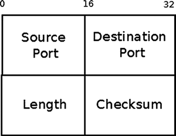
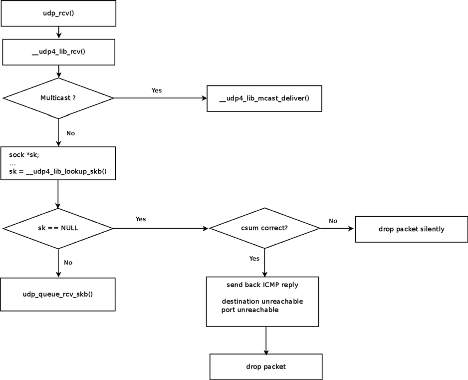
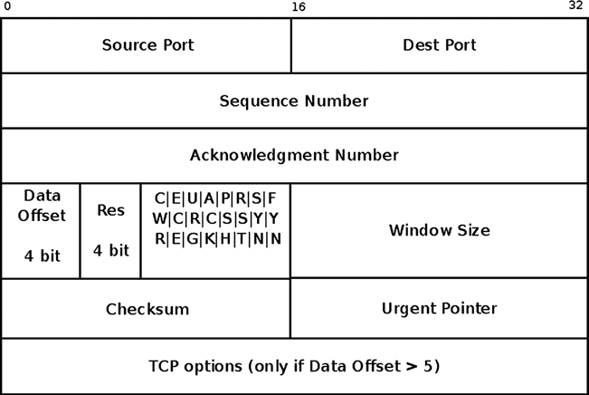
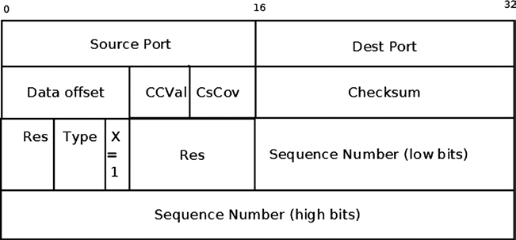
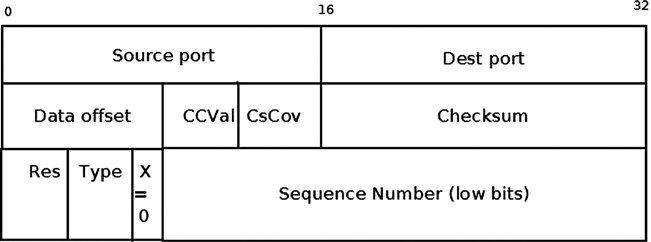

# Chương 11. Layer 4 Protocol

Chương 10 đã trình bày Linux IPsec subsystem và cách triển khai. Trong chương này, tôi trình bày bốn transport layer (L4) protocol. Tôi bắt đầu với hai transport layer (L4) protocol phổ biến nhất, User Datagram Protocol (UDP) và Transmission Control Protocol (TCP), đã được dùng nhiều năm. Sau đó tôi trình bày các protocol mới hơn Stream Control Transmission Protocol (SCTP) và Datagram Congestion Control Protocol (DCCP), kết hợp tính năng TCP và UDP. Tôi bắt đầu chương bằng sockets API, interface giữa transport layer (L4) và userspace. Tôi trình bày cách triển khai socket trong kernel và cách dữ liệu đi từ userspace đến transport layer rồi từ transport layer đến userspace. Tôi cũng trình bày chuyển packet từ network layer (L3) đến transport layer (L4) khi làm việc với các protocol này. Ở đây chủ yếu trình bày cách triển khai IPv4 của bốn protocol, dù một số code dùng chung cho IPv4 và IPv6.

## Sockets

Mọi hệ điều hành phải cung cấp entry point và API cho networking subsystem. Linux kernel networking subsystem cung cấp interface cho userspace bằng POSIX socket API tiêu chuẩn, được IEEE quy định (IEEE Std 1003.1g-2000, mô tả networking API, còn gọi là POSIX.1g). API này dựa trên Berkeley sockets API (còn gọi là BSD socket), bắt nguồn từ hệ điều hành Unix 4.2BSD và là tiêu chuẩn công nghiệp trong nhiều hệ điều hành. Trong Linux, mọi thứ phía trên transport layer thuộc userspace. Theo mô hình Unix “mọi thứ là file”, socket gắn với file, như sẽ thấy phía sau chương. Dùng sockets API thống nhất giúp port ứng dụng dễ hơn. Đây là các socket type khả dụng:

- Stream socket (SOCK\_STREAM): Cung cấp kênh giao tiếp byte-stream đáng tin cậy. TCP socket là ví dụ stream socket.

- Datagram socket (SOCK\_DGRAM): Cho phép trao đổi message (gọi là datagram). Datagram socket cung cấp kênh giao tiếp không đáng tin cậy vì packet có thể bị loại bỏ, đến sai thứ tự hoặc trùng lặp. UDP socket là ví dụ datagram socket.

- Raw socket (SOCK\_RAW): Truy cập trực tiếp IP layer, cho phép gửi hoặc nhận lưu lượng không cần định dạng protocol-specific, transport-layer.

- Reliably delivered message (SOCK\_RDM): Được Transparent Inter-Process Communication (TIPC) dùng, ban đầu phát triển tại Ericsson từ 1996–2005 và dùng trong ứng dụng cluster. Xem `http://tipc.sourceforge.net`.

- Sequenced packet stream (SOCK\_SEQPACKET): Socket type này tương tự SOCK\_STREAM và cũng connection-oriented. Khác biệt duy nhất là record boundary được duy trì khi dùng SOCK\_SEQPACKET. Bên nhận thấy record boundary qua flag MSG\_EOR (End of record). Sequenced packet stream type không được trình bày trong chương.

- DCCP socket (SOCK\_DCCP): Datagram Congestion Control Protocol là transport protocol cung cấp flow congestion-controlled của các datagram không đáng tin cậy. Kết hợp tính năng TCP và UDP. Được trình bày trong phần sau của chương.

- Data links socket (SOCK\_PACKET): SOCK\_PACKET được xem là obsolete trong AF\_INET family. Xem method `__sock_create()` trong `net/socket.c`.

Sau đây là mô tả một số method sockets API cung cấp (mọi kernel method trong danh sách được triển khai trong `net/socket.c`):

- `socket()`: Tạo socket mới; được trình bày trong phần “Tạo Socket”.

- `bind()`: Gắn socket với local port và địa chỉ IP; triển khai trong kernel bởi method `sys_bind()`.

- `send()`: Gửi message; triển khai trong kernel bởi method `sys_send()`.

- `recv()`: Nhận message; triển khai trong kernel bởi method `sys_recv()`.

- `listen()`: Cho phép socket nhận connection từ socket khác; triển khai trong kernel bởi method `sys_listen()`. Không liên quan đến datagram socket.

- `accept()`: Chấp nhận connection trên socket; triển khai trong kernel bởi method `sys_accept()`. Chỉ liên quan socket type connection-based (SOCK\_STREAM, SOCK\_SEQPACKET).

- `connect()`: Thiết lập connection đến peer socket; triển khai trong kernel bởi method `sys_connect()`. Liên quan socket type connection-based (SOCK\_STREAM hoặc SOCK\_SEQPACKET) cũng như socket type connectionless (SOCK\_DGRAM).

Sách này tập trung cách triển khai kernel network nên tôi không đi sâu userspace socket API. Nếu muốn thêm thông tin, tôi đề xuất các sách sau:

- Unix Network Programming, Volume 1: The Sockets Networking API (3rd Edition) của W. Richard Stevens, Bill Fenner và Andrew M. Rudoff (Addison-Wesley Professional, 2003).

- The Linux Programming Interface của Michael Kerrisk (No Starch Press, 2010).

Lưu ý Mọi socket API call được xử lý bởi method `socketcall()` trong `net/socket.c`.

Sau khi tìm hiểu một số socket type, bạn sẽ biết điều gì diễn ra trong kernel khi tạo socket. Trong phần tiếp theo, tôi giới thiệu hai structure triển khai socket: `struct socket` và `struct sock`. Tôi cũng mô tả khác biệt giữa chúng và mô tả `msghdr struct` cùng các member.

## Tạo Socket

Có hai structure biểu diễn socket trong kernel: đầu tiên là `struct socket`, cung cấp interface cho userspace và được method `sys_socket()` tạo. Tôi trình bày method `sys_socket()` phía sau phần này. Thứ hai là `struct sock`, cung cấp interface cho network layer (L3). Vì structure `sock`

nằm trong network layer, nó độc lập protocol. Tôi cũng trình bày structure `sock` phía sau phần này. Structure `socket` ngắn:

```
struct socket {
        socket_state            state;

        kmemcheck_bitfield_begin(type);
        short                   type;
        kmemcheck_bitfield_end(type);

        unsigned long           flags;

        . . .

        struct file             *file;
        struct sock             *sk;
        const struct proto_ops  *ops;
};
```

(i`nclude/linux/net.h`)

Sau đây là mô tả các member của structure `socket`:

- `state`: Socket có thể ở một trong nhiều trạng thái như SS\_UNCONNECTED, SS\_CONNECTED, v.v. Khi INET socket được tạo, trạng thái là SS\_UNCONNECTED; xem method `inet_create()`. Sau khi stream socket kết nối thành công đến host khác, trạng thái là SS\_CONNECTED. Xem `socket_state enum` trong `include/uapi/linux/net.h`.

- `type`: Type của socket như SOCK\_STREAM hoặc SOCK\_RAW; xem `enum sock_type` trong `include/linux/net.h`.

- `flags`: Các socket flag; chẳng hạn flag SOCK\_EXTERNALLY\_ALLOCATED được đặt trong TUN device khi cấp phát socket không qua system call `socket()`. Xem method `tun_chr_open()` trong `drivers/net/tun.c`. Socket flag được định nghĩa trong `include/linux/net.h`.

- `file`: File gắn với socket.

- `sk`: Object `sock` gắn với socket. Object `sock` biểu diễn interface đến network layer (L3). Khi tạo socket, object `sk` tương ứng được tạo. Chẳng hạn trong IPv4, method `inet_create()`, được gọi khi tạo socket, cấp phát object `sock`, `sk`, rồi gắn với socket object chỉ định.

- `ops`: Object này (instance của object `proto_ops`) chủ yếu gồm callback cho socket như `connect()`, `listen()`, `sendmsg()`, `recvmsg()`, v.v. Callback là interface đến userspace. Callback `sendmsg()` triển khai các routine library-level như `write()`, `send()`, `sendto()` và `sendmsg()`. Khá tương tự, callback `recvmsg()` triển khai các routine library-level như `read()`, `recv()`, `recvfrom()` và `recvmsg()`. Mỗi protocol định nghĩa object `proto_ops` riêng theo yêu cầu. Vì vậy với TCP, object `proto_ops` gồm callback `listen`, `inet_listen()`, và callback `accept`, `inet_accept()`. Ngược lại protocol UDP không hoạt động theo mô hình client-server, định nghĩa callback `listen()` là method `sock_no_listen()`, còn callback `accept()` là method `sock_no_accept()`. Hai method chỉ trả về lỗi –EOPNOTSUPP. Xem Bảng 11-1 trong phần “Tham khảo nhanh” cuối chương cho định nghĩa các object TCP và UDP `proto_ops`. Structure `proto_ops` được định nghĩa trong `include/linux/net.h`.

Structure `sock` là cách biểu diễn socket ở network-layer; khá dài, sau đây chỉ là một số trường quan trọng cho nội dung đang trình bày:

```
struct sock {

        struct sk_buff_head     sk_receive_queue;
        int                     sk_rcvbuf;

        unsigned long           sk_flags;

        int                     sk_sndbuf;
        struct sk_buff_head     sk_write_queue;
        . . .
        unsigned int            sk_shutdown  : 2,
                                sk_no_check  : 2,
                                sk_protocol  : 8,
                                sk_type      : 16;
        . . .

        void                    (*sk_data_ready)(struct sock *sk, int bytes);
        void                    (*sk_write_space)(struct sock *sk);
};

(include/net/sock.h)
```

Sau đây là mô tả các member của structure `sock`:

- `sk_receive_queue`: Queue cho incoming packet.

- `sk_rcvbuf`: Kích thước receive buffer tính bằng byte.

- `sk_flags`: Các flag như SOCK\_DEAD hoặc SOCK\_DBG; xem định nghĩa `sock_flags enum` trong `include/net/sock.h`.

- `sk_sndbuf`: Kích thước send buffer tính bằng byte.

- `sk_write_queue`: Queue cho outgoing packet.

Lưu ý Phía sau trong phần “Khởi tạo TCP Socket”, bạn sẽ thấy cách khởi tạo `sk_rcvbuf` và `sk_sndbuf`, cùng cách thay đổi bằng cách ghi entry `procfs`.

- `sk_no_check`: Flag tắt checksum. Có thể đặt bằng socket option SO\_NO\_CHECK.

- `sk_protocol`: Protocol identifier, được đặt theo tham số thứ ba (`protocol`) của system call `socket()`.

- `sk_type`: Type của socket như SOCK\_STREAM hoặc SOCK\_RAW; xem `enum sock_type` trong `include/linux/net.h`.

- `sk_data_ready`: Callback báo socket có dữ liệu mới đến.

- `sk_write_space`: Callback cho biết còn memory trống để tiếp tục truyền dữ liệu.

Tạo socket bằng cách gọi system call `socket()` từ userspace:

```
sockfd = socket(int socket_family, int socket_type, int protocol);
```

Sau đây là mô tả tham số của system call `socket()`:

- `socket_family`: Có thể là AF\_INET cho IPv4, AF\_INET6 cho IPv6 hoặc AF\_UNIX cho UNIX domain socket, v.v. (UNIX domain socket là dạng Inter Process Communication (IPC), cho phép giao tiếp giữa process chạy trên cùng host.)

- `socket_type`: Có thể là SOCK\_STREAM cho stream socket, SOCK\_DGRAM cho datagram socket hoặc SOCK\_RAW cho raw socket, v.v.

- `protocol`: Có thể là bất kỳ giá trị sau:

- 0 hoặc IPPROTO\_TCP cho TCP socket.

- 0 hoặc IPPROTO\_UDP cho UDP socket.

- IP protocol identifier hợp lệ (như IPPROTO\_TCP hoặc IPPROTO\_ICMP) cho raw socket; xem RFC 1700, “Assigned Numbers”.

Giá trị trả về của system call `socket()` (`sockfd`) là file descriptor phải truyền làm tham số cho lời gọi tiếp theo với socket này. System call `socket()` được xử lý trong kernel bởi method `sys_socket()`. Hãy xem cách triển khai system call `socket()`:

```
SYSCALL_DEFINE3(socket, int, family, int, type, int, protocol)
{
        int retval;
        struct socket *sock;
        int flags;

        . . .
        retval = sock_create(family, type, protocol, &sock);
        if (retval < 0)
                goto out;
        . . .
        retval = sock_map_fd(sock, flags & (O_CLOEXEC | O_NONBLOCK));
        if (retval < 0)
                goto out_release;
out:
        . . .
        return retval;

}

(net/socket.c)
```

Method `sock_create()` gọi socket creation method riêng cho address-family, `create()`; với IPv4 là method `inet_create()`. (Xem định nghĩa `inet_family_ops` trong `net/ipv4/af_inet.c`.) Method `inet_create()` tạo object `sock` (`sk`) gắn với socket; object `sock` biểu diễn network layer socket interface. Method `sock_map_fd()` trả về `fd` (file descriptor) gắn với socket; thông thường system call `socket()` trả về `fd` này. Gửi dữ liệu từ userspace socket hoặc nhận dữ liệu trong userspace socket từ transport layer được xử lý

trong kernel lần lượt bởi các method `sendmsg()` và `recvmsg()`, nhận object `msghdr` làm tham số. Object `msghdr` chứa data block để gửi hoặc điền dữ liệu, cùng một số tham số khác.

```
struct msghdr {
        void             *msg_name;       /* Socket name                                         */
        int              msg_namelen;     /* Length of name                                      */
        struct iovec     *msg_iov;        /* Data blocks                                         */
        __kernel_size_t  msg_iovlen;      /* Number of blocks                                    */
        void             *msg_control;    /* Per protocol magic (eg BSD file descriptor passing) */
        __kernel_size_t  msg_controllen;  /* Length of cmsg list                                 */
        unsigned int     msg_flags;
};

(include/linux/socket.h)
```

Sau đây là mô tả một số member quan trọng của structure `msghdr`:

- `msg_name`: Địa chỉ socket đích. Để lấy socket đích, thường cast opaque pointer `msg_name` sang pointer `struct sockaddr_in`. Chẳng hạn xem method `udp_sendmsg()`.

- `msg_namelen`: Độ dài địa chỉ.

- `iovec`: Vector các data block.

- `msg_iovlen`: Số block trong vector `iovec`.

- `msg_control`: Control information (còn gọi là ancillary data).

- `msg_controllen`: Độ dài control information.

- `msg_flags`: Flag của message nhận được như MSG\_MORE. (Chẳng hạn xem phần “Gửi Packet bằng UDP” phía sau chương.)

Lưu ý độ dài control buffer tối đa kernel xử lý được bị giới hạn cho mỗi socket bởi giá trị `sysctl_optmem_max` (`/proc/sys/net/core/optmem_max`).

Trong phần này, tôi mô tả cách triển khai kernel của `socket` và `msghdr struct`, được dùng khi gửi và nhận packet. Trong phần tiếp theo, tôi bắt đầu nội dung transport layer protocol (L4) bằng protocol UDP, đơn giản nhất trong các protocol của chương.

## UDP (User Datagram Protocol)

Protocol UDP được mô tả trong RFC 768 năm 1980. UDP là layer mỏng bao quanh IP layer, chỉ thêm thông tin port, length và checksum. Có từ năm 1980, cung cấp transport message-oriented không đáng tin cậy, không có congestion control. Nhiều protocol dùng UDP. Chẳng hạn protocol RTP (Real-time Transport Protocol), dùng để chuyển âm thanh và video qua mạng IP. Loại lưu lượng này chấp nhận được một mức packet loss. RTP thường dùng trong ứng dụng VoIP, thường kết hợp client dựa trên SIP (Session Initiation Protocol).(Cần nói rằng thực tế protocol RTP cũng có thể dùng TCP theo RFC 4571, nhưng ít được dùng.) Tôi cần đề cập UDP-Lite, phần mở rộng protocol UDP để

hỗ trợ checksum variable-length (RFC 3828). Phần lớn UDP-Lite được triển khai trong `net/ipv4/udplite.c`, nhưng bạn cũng gặp trong UDP module chính, `net/ipv4/udp.c`. Độ dài UDP header là 8 byte:

```
struct udphdr {
        __be16  source;
        __be16  dest;
        __be16  len;
        __sum16 check;
};
(include/uapi/linux/udp.h)
```

Sau đây là mô tả các member của UDP header:

- `source`: Source port (16 bit), trong khoảng 1-65535.

- `dest`: Destination port (16 bit), trong khoảng 1-65535.

- `len`: Độ dài tính bằng byte (payload length và UDP header length).

- `checksum`: Checksum của packet.

Hình 11-1 minh họa UDP header.



Hình 11-1. UDP header (IPv4)

Trong phần này, bạn đã tìm hiểu UDP header và các member. Để hiểu ứng dụng userspace dùng sockets API giao tiếp với kernel thế nào (gửi và nhận packet), cần biết cách khởi tạo UDP, được mô tả trong phần tiếp theo.

### Khởi tạo UDP

Định nghĩa object `udp_protocol` (object `net_protocol`) rồi thêm bằng method `inet_add_protocol()`. Điều này đặt object `udp_protocol` làm phần tử của global protocols array (`inet_protos`).

```
    static const struct net_protocol udp_protocol = {
            .handler =      udp_rcv,
            .err_handler =  udp_err,
            .no_policy =    1,
            .netns_ok =     1,
    };
    (net/ipv4/af_inet.c)

static int __init inet_init(void)
{
        . . .
        if (inet_add_protocol(&udp_protocol, IPPROTO_UDP) < 0)
                pr_crit("%s: Cannot add UDP protocol\n", __func__);
        . . .
}
(net/ipv4/af_inet.c)
```

Tiếp tục định nghĩa object `udp_prot` và đăng ký bằng cách gọi method `proto_register()`. Object chủ yếu chứa callback; được gọi khi mở UDP socket trong userspace và dùng socket API. Chẳng hạn gọi system call `setsockopt()` trên UDP socket sẽ gọi callback `udp_setsockopt()`.

```
struct proto udp_prot = {
         .name              = "UDP",
         .owner             = THIS_MODULE,
         .close             = udp_lib_close,
         .connect           = ip4_datagram_connect,
         .disconnect        = udp_disconnect,
         .ioctl             = udp_ioctl,
         . . .
         .setsockopt        = udp_setsockopt,
         .getsockopt        = udp_getsockopt,
         .sendmsg           = udp_sendmsg,
         .recvmsg           = udp_recvmsg,
         .sendpage          = udp_sendpage,
         . . .
};

(net/ipv4/udp.c)
int __init inet_init(void)
{
    int rc = -EINVAL;
    . . .
    rc = proto_register(&udp_prot, 1);
    . . .

}
(net/ipv4/af_inet.c)
```

Lưu ý Protocol UDP cùng các core protocol khác được khởi tạo qua method `inet_init()` tại boot-time.

Sau khi biết khởi tạo UDP và callback gửi packet, tức callback `udp_sendmsg()` của object `udp_prot` đã trình bày trong phần này, đã đến lúc tìm hiểu cách UDP gửi packet trong IPV4.

### Gửi Packet bằng UDP

Gửi dữ liệu từ UDP userspace socket có thể qua nhiều system call: `send()`, `sendto()`, `sendmsg()` và `write()`; cuối cùng đều được method `udp_sendmsg()` trong kernel xử lý. Ứng dụng userspace tạo object `msghdr` chứa các data block và truyền object `msghdr` đến kernel. Hãy xem method này:

```
int udp_sendmsg(struct kiocb *iocb, struct sock *sk, struct msghdr *msg,
                size_t len)
{
```

Nhìn chung UDP packet được gửi ngay. Có thể đổi hành vi bằng socket option UDP\_CORK (giới thiệu trong kernel 2.5.44), khiến dữ liệu packet truyền đến method `udp_sendmsg()` được tích lũy đến khi packet cuối được giải phóng bằng cách bỏ option. Cũng có thể đạt kết quả tương tự bằng cách đặt flag MSG\_MORE:

```
        int corkreq = up->corkflag || msg->msg_flags&MSG_MORE;
        struct inet_sock *inet = inet_sk(sk);
              . . .
```

Trước tiên thực hiện một số sanity check. Chẳng hạn `len` chỉ định không thể lớn hơn 65535 (nhớ trường `len` trong UDP header dài 16 bit):

```
        if (len > 0xFFFF)
                 return -EMSGSIZE;
```

Cần biết địa chỉ đích và destination port để tạo object `flowi4`, cần để gửi SKB bằng method `udp_send_skb()` hoặc method `ip_append_data()`. Destination port không được bằng 0. Có hai trường hợp: đích được chỉ định trong `msg_name` của `msghdr`, hoặc socket đã kết nối và trạng thái là TCP\_ESTABLISHED. Lưu ý UDP (khác TCP) gần như hoàn toàn stateless. Khái niệm TCP\_ESTABLISHED trong UDP chủ yếu nghĩa là socket đã qua một số sanity check.

```
        if (msg->msg_name) {
                struct sockaddr_in *usin = (struct sockaddr_in *)msg->msg_name;
                if (msg->msg_namelen < sizeof(*usin))
                        return -EINVAL;
                if (usin->sin_family != AF_INET) {
                        if (usin->sin_family != AF_UNSPEC)
                                return -EAFNOSUPPORT;
                }

                daddr = usin->sin_addr.s_addr;
                dport = usin->sin_port;
```

Linux code tuân thủ việc IANA dành riêng UDP/TCP port bằng 0. Port 0 trong TCP và UDP được dành riêng từ RFC 1010, “Assigned Numbers” (1987), vẫn có trong RFC 1700, sau đó được thay bằng database trực tuyến (xem RFC 3232), nơi vẫn giữ điều này. Xem `www.iana.org/assignments/service-names-port-numbers/service-names-port-numbers.xhtml`.

```
                    if (dport == 0)
                            return -EINVAL;
            } else {
                    if (sk->sk_state != TCP_ESTABLISHED)
                            return -EDESTADDRREQ;
                daddr = inet->inet_daddr;
                dport = inet->inet_dport;
                /* Open fast path for connected socket.
                   Route will not be used, if at least one option is set.
                 */
                connected = 1;
}

               . . .
```

Ứng dụng userspace có thể gửi control information (còn gọi ancillary data) bằng cách đặt `msg_control` và `msg_controllen` trong object `msghdr`. Ancillary data thực chất là chuỗi object `cmsghdr` có dữ liệu nối thêm. (Xem thêm `man 3 cmsg`.) Bạn có thể gửi và nhận ancillary data bằng cách gọi lần lượt method `sendmsg()` và `recvmsg()`. Chẳng hạn có thể tạo ancillary message IP\_PKTINFO để đặt source route cho unconnected UDP socket. (Xem `man 7 ip`.) Khi `msg_controllen` khác 0, đây là control information message, được method `ip_cmsg_send()` xử lý. Method `ip_cmsg_send()` tạo object `ipcm_cookie` (IP Control Message Cookie) bằng cách parse object `msghdr` chỉ định. Structure `ipcm_cookie` chứa thông tin được dùng tiếp khi xử lý packet. Chẳng hạn khi dùng ancillary message IP\_PKTINFO, có thể đặt địa chỉ nguồn bằng cách đặt trường địa chỉ trong control message, cuối cùng thiết lập `addr` trong object `ipcm_cookie`. `ipcm_cookie` là structure ngắn:

```
struct ipcm_cookie {
        __be32                  addr;
        int                     oif;
        struct ip_options_rcu   *opt;
        __u8                    tx_flags;
};
(include/net/ip.h)
```

Hãy tiếp tục với method udp\_sendmsg():

```
         if (msg->msg_controllen) {
                 err = ip_cmsg_send(sock_net(sk), msg, &ipc);
                 if (err)
                         return err;
                 if (ipc.opt)
                         free = 1;
                 connected = 0;
         }
         . . .
         if (connected)
                 rt = (struct rtable *)sk_dst_check(sk, 0);
         . . .
```

Nếu routing entry là NULL, phải routing lookup:

```
        if (rt == NULL) {
                struct net *net = sock_net(sk);

                fl4 = &fl4_stack;
                flowi4_init_output(fl4, ipc.oif, sk->sk_mark, tos,
                                   RT_SCOPE_UNIVERSE, sk->sk_protocol,
                                   inet_sk_flowi_flags(sk)|FLOWI_FLAG_CAN_SLEEP,
                                   faddr, saddr, dport, inet->inet_sport);

                    security_sk_classify_flow(sk, flowi4_to_flowi(fl4));
                    rt = ip_route_output_flow(net, fl4, sk);
                    if (IS_ERR(rt)) {
                            err = PTR_ERR(rt);
                            rt = NULL;
                            if (err == -ENETUNREACH)
                                    IP_INC_STATS_BH(net, IPSTATS_MIB_OUTNOROUTES);
                            goto out;
                    }

            . . .
```

Trong kernel 2.6.39, lockless transmit fast path được thêm. Nghĩa là khi không bật corking, không giữ socket lock và gọi method `udp_send_skb()`; khi bật corking, giữ socket lock bằng cách gọi method `lock_sock()` rồi gửi packet:

```
        /* Lockless fast path for the non-corking case. */
        if (!corkreq) {
                skb = ip_make_skb(sk, fl4, getfrag, msg->msg_iov, ulen,
                                  sizeof(struct udphdr), &ipc, &rt,
                                  msg->msg_flags);
                err = PTR_ERR(skb);
                if (!IS_ERR_OR_NULL(skb))
                         err = udp_send_skb(skb, fl4);
                 goto out;
        }
```

Bây giờ xử lý trường hợp corking được bật:

```
       lock_sock(sk);
do_append_data:
        up->len += ulen;
```

Method `ip_append_data()` buffer dữ liệu để truyền nhưng chưa truyền. Gọi method `udp_push_pending_frames()` sau đó mới thực sự truyền. Lưu ý method `udp_push_pending_frames()` cũng xử lý fragmentation bằng callback `getfrag` chỉ định:

```
        err = ip_append_data(sk, fl4, getfrag, msg->msg_iov, ulen,
                             sizeof(struct udphdr), &ipc, &rt,
                             corkreq ? msg->msg_flags|MSG_MORE : msg->msg_flags);
```

Nếu method thất bại, phải flush mọi SKB đang chờ. Thực hiện bằng cách gọi method `udp_flush_pending_frames()`, giải phóng mọi SKB trong write queue của socket (`sk_write_queue`) bằng method `ip_flush_pending_frames()`:

```
        if (err)
                udp_flush_pending_frames(sk);
        else if (!corkreq)
                err = udp_push_pending_frames(sk);
        else if (unlikely(skb_queue_empty(&sk->sk_write_queue)))
                up->pending = 0;
        release_sock(sk);
```

Trong phần này, bạn đã tìm hiểu gửi packet bằng UDP. Để hoàn tất nội dung UDP trong IPv4, đã đến lúc tìm hiểu cách UDP nhận packet từ network layer (L3) trong IPv4.

### Nhận Packet từ Network Layer (L3) bằng UDP

Handler chính nhận UDP packet từ network layer (L3) là method `udp_rcv()`. Nó chỉ gọi method `__udp4_lib_rcv()` (`net/ipv4/udp.c`):

```
int udp_rcv(struct sk_buff *skb)
{
        return __udp4_lib_rcv(skb, &udp_table, IPPROTO_UDP);
}
```

Hãy xem method `__udp4_lib_rcv()`:

```
int __udp4_lib_rcv(struct sk_buff *skb, struct udp_table *udptable,
                   int proto)
{
        struct sock *sk;
        struct udphdr *uh;
        unsigned short ulen;
        struct rtable *rt = skb_rtable(skb);
        __be32 saddr, daddr;
        struct net *net = dev_net(skb->dev);
        . . .
```

Lấy UDP header, header length, địa chỉ nguồn và đích từ SKB:

```
        uh   = udp_hdr(skb);
        ulen = ntohs(uh->len);
        saddr = ip_hdr(skb)->saddr;
        daddr = ip_hdr(skb)->daddr;
```

Bỏ qua một số sanity check được thực hiện, như bảo đảm UDP header length không lớn hơn độ dài packet và `proto` chỉ định là UDP protocol identifier (IPPROTO\_UDP). Nếu packet là broadcast hoặc multicast packet, được method `__udp4_lib_mcast_deliver()` xử lý:

```
        if (rt->rt_flags & (RTCF_BROADCAST|RTCF_MULTICAST))
             return __udp4_lib_mcast_deliver(net, skb, uh,
                                                saddr, daddr, udptable);
```

Tiếp theo lookup trong UDP sockets hash table:

```
        sk = __udp4_lib_lookup_skb(skb, uh->source, uh->dest, udptable);
              if (sk != NULL) {
```

Đến đây vì lookup tìm thấy socket khớp. Tiếp tục xử lý SKB bằng cách gọi method `udp_queue_rcv_skb()`, gọi method dùng chung `sock_queue_rcv_skb()`, sau đó thêm SKB chỉ định vào cuối `sk->sk_receive_queue` (bằng cách gọi method `__skb_queue_tail()`):

```
        int ret = udp_queue_rcv_skb(sk, skb);
        sock_put(sk);

        /* a return value > 0 means to resubmit the input, but
        * it wants the return to be -protocol, or 0
        */
        if (ret > 0)
             return -ret;
```

Mọi thứ ổn; trả về 0 để biểu thị thành công:

```
            return 0;
        }
        . . .
```

Đến đây vì lookup socket thất bại. Nghĩa là không nên xử lý packet. Chẳng hạn xảy ra khi không có UDP socket listen trên destination port. Nếu checksum sai, âm thầm drop packet. Nếu đúng, gửi trả ICMP reply cho bên gửi. Phải là message ICMP “Destination Unreachable” với code “Port Unreachable”. Sau đó giải phóng packet và cập nhật SNMP MIB counter:

```
        /* No socket. Drop packet silently, if checksum is wrong */
        if (udp_lib_checksum_complete(skb))
            goto csum_error;
```

Lệnh tiếp theo tăng MIB counter UDP\_MIB\_NOPORTS (`NoPorts`). Lưu ý có thể truy vấn các UDP MIB counter bằng `cat /proc/net/snmp` hoặc `netstat –s`.

```
        UDP_INC_STATS_BH(net, UDP_MIB_NOPORTS, proto == IPPROTO_UDPLITE);
        icmp_send(skb, ICMP_DEST_UNREACH, ICMP_PORT_UNREACH, 0);

        /*
        * Hmm.  We got an UDP packet to a port to which we
        * don't wanna listen.  Ignore it.
        */
        kfree_skb(skb);
        return 0;
```

Hình 11-2 minh họa nội dung nhận UDP packet trong phần này.



Hình 11-2. Nhận UDP packet

Nội dung UDP đã kết thúc. Phần tiếp theo mô tả protocol TCP, phức tạp nhất trong các protocol của chương.

## TCP (Transmission Control Protocol)

Protocol TCP được mô tả trong RFC 793 năm 1981. Qua nhiều năm kể từ đó, protocol TCP cơ bản có nhiều cập nhật, biến thể và bổ sung. Một số bổ sung dành cho loại mạng cụ thể (high-speed, vệ tinh), còn số khác nhằm cải thiện hiệu năng.

TCP là transport protocol được dùng phổ biến nhất trên Internet hiện nay. Nhiều protocol well-known dựa trên TCP. Protocol well-known nhất có lẽ là HTTP, và cũng cần đề cập các protocol well-known khác như `ftp`, `ssh`, `telnet`, `smtp` và `ssl`. TCP cung cấp transport đáng tin cậy và connection-oriented, khác UDP. Truyền dữ liệu được bảo đảm bằng sequence number và acknowledgement.

TCP là một protocol rất phức tạp; chúng ta sẽ không thảo luận mọi chi tiết, tối ưu và sắc thái trong cách triển khai TCP ở chương này vì bản thân nội dung đó cần một cuốn sách riêng. Chức năng TCP gồm hai thành phần: quản lý connection và truyền, nhận dữ liệu. Trong mục này, chúng ta tập trung vào khởi tạo TCP và thiết lập TCP connection, thuộc thành phần thứ nhất là quản lý connection, cùng việc nhận và gửi packet, thuộc thành phần thứ hai. Đây là những kiến thức cơ bản quan trọng để tiếp tục tìm hiểu sâu cách triển khai TCP protocol. Cần lưu ý rằng TCP protocol self-regulates byte-stream flow thông qua congestion control. Nhiều congestion-control algorithm khác nhau đã được quy định, và Linux cung cấp một kiến trúc có thể mở rộng bằng thành phần bổ sung và có thể cấu hình để hỗ trợ nhiều algorithm. Việc đi sâu vào chi tiết từng congestion-control algorithm nằm ngoài phạm vi cuốn sách.

Mỗi TCP packet bắt đầu bằng TCP header. Cần tìm hiểu TCP header để hiểu hoạt động TCP. Phần tiếp theo mô tả IPv4 TCP header.

### TCP Header

TCP header dài 20 byte, nhưng có thể mở rộng đến 60 byte khi dùng TCP options:

```
    struct tcphdr {
            __be16  source;
            __be16  dest;
            __be32  seq;
            __be32  ack_seq;
    #if defined(__LITTLE_ENDIAN_BITFIELD)
            __u16   res1:4,
                    doff:4,
                    fin:1,
                    syn:1,
                    rst:1,
                    psh:1,
                    ack:1,
                    urg:1,
                    ece:1,
                    cwr:1;
    #elif defined(__BIG_ENDIAN_BITFIELD)
            __u16   doff:4,
                    res1:4,
                    cwr:1,
                    ece:1,
                    urg:1,
                    ack:1,
                    psh:1,
                    rst:1,
                    syn:1,
                    fin:1;
    #else
    #error  "Adjust your <asm/byteorder.h> defines"
#endif
        __be16  window;
        __sum16 check;
        __be16  urg_ptr;
};

(include/uapi/linux/tcp.h)
```

Sau đây là mô tả các member của structure `tcphdr`:

- `source`: Source port (16 bit), trong khoảng 1-65535.

- `dest`: Destination port (16 bit), trong khoảng 1-65535.

- `seq`: Sequence number (32 bit).

- `ack_seq`: Acknowledgment number (32 bit). Nếu flag ACK được đặt, giá trị trường là sequence number tiếp theo bên nhận đang chờ.

- `res1`: Dành cho tương lai (4 bit). Phải luôn đặt thành 0.

- `doff`: Data offset (4 bit). Kích thước TCP header theo bội số 4 byte; tối thiểu 5 (20 byte), tối đa 15 (60 byte).

Sau đây là TCP flag; mỗi flag dài 1 bit:

- `fin`: Không còn dữ liệu từ bên gửi (khi một endpoint muốn đóng connection).

- `syn`: Flag SYN được gửi ban đầu khi thiết lập 3-way handshake giữa hai endpoint.

- `rst`: Flag Reset được dùng khi segment không dành cho connection hiện tại đến.

- `psh`: Dữ liệu phải được chuyển đến userspace sớm nhất có thể.

- `ack`: Cho biết giá trị acknowledgment number (`ack_seq`) trong TCP header có ý nghĩa.

- `urg`: Cho biết urgent pointer có ý nghĩa.

- `ece`: Flag ECN - Echo. ECN viết tắt của “Explicit Congestion Notification”. ECN cung cấp cơ chế gửi thông báo end-to-end về network congestion mà không drop packet. Được thêm bởi RFC 3168, “The Addition of Explicit Congestion Notification (ECN) to IP”, năm 2001.

- `cwr`: Flag Congestion Window Reduced.

- `window`: Kích thước TCP receive window tính bằng byte (16 bit).

- `check`: Checksum của TCP header và TCP data.

- `urg_ptr`: Chỉ có ý nghĩa khi flag `urg` được đặt. Biểu diễn offset từ sequence number chỉ byte urgent data cuối cùng (16 bit).

Hình 11-3 minh họa sơ đồ TCP header.



Hình 11-3. TCP header (IPv4)

Trong mục này, tôi đã mô tả IPv4 TCP header và các member của nó. Bạn đã thấy rằng, khác với UDP header chỉ có 4 member, TCP header có nhiều member hơn vì TCP là một protocol phức tạp hơn rất nhiều. Trong mục tiếp theo, tôi sẽ mô tả cách khởi tạo TCP để bạn biết các callback nhận và gửi TCP packet được khởi tạo như thế nào và ở đâu.

### Khởi tạo TCP

Định nghĩa object `tcp_protocol` (object `net_protocol`) và thêm bằng method `inet_add_protocol()`:

```
static const struct net_protocol tcp_protocol = {
        .early_demux    =       tcp_v4_early_demux,
        .handler        =       tcp_v4_rcv,
        .err_handler    =       tcp_v4_err,
        .no_policy      =       1,
        .netns_ok       =       1,
};

(net/ipv4/af_inet.c)

static int __init inet_init(void)
  {
        . . .
        if (inet_add_protocol(&tcp_protocol, IPPROTO_TCP) < 0)
            pr_crit("%s: Cannot add TCP protocol\n", __func__);
        . . .
}

(net/ipv4/af_inet.c)
```

Tiếp tục định nghĩa object `tcp_prot` và đăng ký bằng method `proto_register()`, giống UDP:

```
struct proto tcp_prot = {
        .name                   = "TCP",
        .owner                  = THIS_MODULE,
        .close                  = tcp_close,
        .connect                = tcp_v4_connect,
        .disconnect             = tcp_disconnect,
        .accept                 = inet_csk_accept,
        .ioctl                  = tcp_ioctl,
        .init                   = tcp_v4_init_sock,
        . . .
};

(net/ipv4/tcp_ipv4.c)

static int __init inet_init(void)
{
        int rc;
        . . .
        rc = proto_register(&tcp_prot, 1);
        . . .
}

(net/ipv4/af_inet.c)
```

Lưu ý trong định nghĩa `tcp_prot`, function pointer `init` được định nghĩa là callback `tcp_v4_init_sock()`, thực hiện các khởi tạo như đặt timer bằng method `tcp_init_xmit_timers()`, đặt socket state, v.v. Ngược lại UDP đơn giản hơn nhiều nên không định nghĩa function pointer `init` vì không có khởi tạo đặc biệt. Callback `tcp_v4_init_sock()` được trình bày phía sau phần này.

Phần tiếp theo mô tả ngắn các timer của TCP.

### TCP Timer

TCP timer được xử lý trong `net/ipv4/tcp_timer.c`. TCP dùng bốn timer:

- Retransmit timer: Gửi lại packet chưa được acknowledge trong khoảng thời gian chỉ định. Có thể xảy ra khi packet mất hoặc hỏng. Timer bắt đầu sau mỗi segment được gửi; nếu ACK đến trước khi hết hạn, timer bị hủy.

- Delayed ACK timer: Trì hoãn gửi ACK packet. Được đặt khi TCP nhận dữ liệu cần acknowledge nhưng không cần ngay lập tức.

- Keep Alive timer: Kiểm tra connection có ngừng hoạt động không. Có trường hợp session idle lâu và một phía ngừng hoạt động. Keep Alive timer phát hiện và gọi method `tcp_send_active_reset()` để reset connection.

- Zero window probe timer (còn gọi persistent timer): Khi receive buffer đầy, bên nhận quảng bá zero window và bên gửi ngừng gửi. Nếu bên nhận gửi segment với window size mới nhưng segment bị mất, bên gửi sẽ chờ mãi. Giải pháp: khi nhận zero window, bên gửi dùng persistent timer để probe window size của bên nhận; khi nhận window size non-zero, persistent timer dừng.

### Khởi tạo TCP Socket

Để dùng TCP socket, ứng dụng userspace phải tạo SOCK\_STREAM socket và gọi system call `socket()`. Trong kernel, callback `tcp_v4_init_sock()` xử lý, gọi method `tcp_init_sock()` để thực hiện công việc thực sự. Lưu ý method `tcp_init_sock()` khởi tạo độc lập address-family và cũng được gọi từ method `tcp_v6_init_sock()`. Các tác vụ quan trọng của method `tcp_init_sock()` là:

- Đặt socket state thành TCP\_CLOSE.

- Khởi tạo TCP timer bằng method `tcp_init_xmit_timers()`.

- Khởi tạo socket send buffer (`sk_sndbuf`) và receive buffer (`sk_rcvbuf`); `sk_sndbuf` được đặt thành `sysctl_tcp_wmem[1]`, mặc định 16384 byte, còn `sk_rcvbuf` thành `sysctl_tcp_rmem[1]`, mặc định 87380 byte. Các giá trị mặc định được đặt trong method `tcp_init()`; có thể override giá trị mặc định của array `sysctl_tcp_wmem` và `sysctl_tcp_rmem` bằng cách ghi lần lượt vào `/proc/sys/net/ipv4/tcp_wmem` và `/proc/sys/net/ipv4/tcp_rmem`. Xem phần “TCP Variables” trong `Documentation/networking/ ip-sysctl.txt`.

- Khởi tạo queue out-of-order và `prequeue`.

- Khởi tạo các tham số. Chẳng hạn TCP initial congestion window được khởi tạo thành 10 segment (TCP\_INIT\_CWND), theo RFC 6928, “Increasing TCP’s Initial Window”, năm 2013.

Sau khi biết cách khởi tạo TCP socket, tôi trình bày thiết lập TCP connection.

### Thiết lập TCP Connection

Thiết lập, teardown và thuộc tính TCP connection được mô tả bằng transition trong state machine. Tại mỗi thời điểm, TCP socket ở một trạng thái cụ thể; chẳng hạn vào trạng thái TCP\_LISTEN khi system call `listen()` được gọi. Trạng thái object `sock` được member `sk_state` biểu diễn. Danh sách mọi trạng thái khả dụng nằm trong `include/net/tcp_states.h`.

Three way handshake được dùng để thiết lập TCP connection giữa TCP client và TCP server:

- Đầu tiên client gửi SYN request đến server. Trạng thái đổi thành TCP\_SYN\_SENT.

- Server socket đang listen (trạng thái TCP\_LISTEN) tạo request socket biểu diễn connection mới ở trạng thái TCP\_SYN\_RECV rồi gửi trả SYN ACK.

- Client nhận SYN ACK đổi trạng thái thành TCP\_ESTABLISHED và gửi ACK đến server.

- Server nhận ACK và đổi request socket thành child socket ở trạng thái TCP\_ESTABLISHED, vì connection đã thiết lập và có thể gửi dữ liệu.

Lưu ý Để tìm hiểu sâu TCP state machine, xem method `tcp_rcv_state_process()` (`net/ipv4/tcp_input.c`), state machine engine cho cả IPv4 và IPv6. (Được gọi từ cả method `tcp_v4_do_rcv()` và method `tcp_v6_do_rcv()`.)

Phần tiếp theo mô tả cách TCP nhận packet từ network layer (L3) trong IPv4.

### Nhận Packet từ Network Layer (L3) bằng TCP

Handler chính nhận TCP packet từ network layer (L3) là method `tcp_v4_rcv()` (`net/ipv4/tcp_ipv4.c`). Hãy xem hàm này:

```
int tcp_v4_rcv(struct sk_buff *skb)
{
       struct sock *sk;
       . . .
```

Đầu tiên thực hiện sanity check (chẳng hạn kiểm tra packet type không phải PACKET\_HOST hoặc kích thước packet ngắn hơn TCP header), loại bỏ packet nếu có vấn đề; sau đó khởi tạo và lookup socket tương ứng bằng method `__inet_lookup_skb()`, trước tiên lookup trong established sockets hash table bằng method `__inet_lookup_established()`. Nếu lookup miss, lookup trong listening sockets hash table bằng method `__inet_lookup_listener()`. Nếu không tìm thấy socket, packet bị loại bỏ tại đây.

```
        sk = __inet_lookup_skb(&tcp_hashinfo, skb, th->source, th->dest);
        . . .
        if (!sk)
                goto no_tcp_socket;
```

Bây giờ chúng ta kiểm tra xem socket có thuộc quyền sở hữu của một ứng dụng nào hay không. Macro `sock_owned_by_user()` trả về 1 khi hiện có một ứng dụng sở hữu socket và trả về 0 khi không có ứng dụng nào sở hữu socket:

```
        if (!sock_owned_by_user(sk)) {
        . . .
                {
```

Đến đây nếu không ứng dụng nào sở hữu socket, nên socket có thể nhận packet. Trước tiên thử đặt packet vào `prequeue` bằng method `tcp_prequeue()`, vì packet trong `prequeue` được xử lý hiệu quả hơn. `tcp_prequeue()` trả về `false` nếu không thể xử lý trong `prequeue` (chẳng hạn queue không còn chỗ); khi đó gọi method `tcp_v4_do_rcv()`, sẽ trình bày ngay sau đây:

```
                if (!tcp_prequeue(sk, skb))
                        ret = tcp_v4_do_rcv(sk, skb);
        }
```

Khi ứng dụng sở hữu socket, nghĩa là socket bị lock nên không nhận packet được. Khi đó thêm packet vào backlog bằng method `sk_add_backlog()`:

```
                } else if (unlikely(sk_add_backlog(sk, skb,
                                                   sk->sk_rcvbuf + sk->sk_sndbuf))) {
                        bh_unlock_sock(sk);
                        NET_INC_STATS_BH(net, LINUX_MIB_TCPBACKLOGDROP);
                        goto discard_and_relse;
                }
        }
```

Hãy xem method `tcp_v4_do_rcv()`:

```
int tcp_v4_do_rcv(struct sock *sk, struct sk_buff *skb)
{
```

Nếu socket ở trạng thái TCP\_ESTABLISHED, gọi method `tcp_rcv_established()`:

```
        if (sk->sk_state == TCP_ESTABLISHED) { /* Fast path */
        . . .
                if (tcp_rcv_established(sk, skb, tcp_hdr(skb), skb->len)) {
                        rsk = sk;
                        goto reset;
                }
                return 0;
```

Nếu socket ở trạng thái TCP\_LISTEN, gọi method `tcp_v4_hnd_req()`:

```
        if (sk->sk_state == TCP_LISTEN) {
                struct sock *nsk = tcp_v4_hnd_req(sk, skb);

        }
```

Nếu không ở trạng thái TCP\_LISTEN, gọi method `tcp_rcv_state_process()`:

```
        if (tcp_rcv_state_process(sk, skb, tcp_hdr(skb), skb->len)) {
                rsk = sk;
                goto reset;
        }
        return 0;

reset:
        tcp_v4_send_reset(rsk, skb);

}
```

Trong phần này, bạn đã tìm hiểu nhận TCP packet. Phần tiếp theo kết thúc nội dung TCP bằng cách mô tả gửi packet bằng TCP trong IPv4.

### Gửi Packet bằng TCP

Giống UDP, gửi packet từ TCP socket tạo trong userspace có thể qua các system call `send()`, `sendto()`, `sendmsg()` và `write()`. Cuối cùng đều được method `tcp_sendmsg()` xử lý (`net/ipv4/tcp.c`). Method sao chép payload từ userspace đến kernel rồi gửi thành TCP segment. Phức tạp hơn method `udp_sendmsg()` nhiều.

```
    int tcp_sendmsg(struct kiocb *iocb, struct sock *sk, struct msghdr *msg,
                    size_t size)
    {
        struct iovec *iov;
        struct tcp_sock *tp = tcp_sk(sk);
        struct sk_buff *skb;
        int iovlen, flags, err, copied = 0;
        int mss_now = 0, size_goal, copied_syn = 0, offset = 0;
        bool sg;
        long timeo;
        . . .
```

Tôi không đi sâu mọi chi tiết sao chép dữ liệu từ userspace vào SKB trong method này. Khi SKB được tạo, gửi bằng method `tcp_push_one()`, gọi method `tcp_write_xmit()`, tiếp tục gọi method `tcp_transmit_skb()`:

```
static int tcp_transmit_skb(struct sock *sk, struct sk_buff *skb, int clone_it,
                            gfp_t gfp_mask)
{
```

Object `icsk_af_ops` (INET Connection Socket ops) là object riêng theo address-family. Với IPv4 TCP, được đặt thành object `inet_connection_sock_af_ops` tên `ipv4_specific` trong method `tcp_v4_init_sock()`. Callback `queue_xmit()` được đặt thành method dùng chung `ip_queue_xmit()`. Xem `net/ipv4/tcp_ipv4.c`.

```
    . . .
    err = icsk->icsk_af_ops->queue_xmit(skb, &inet->cork.fl);
    . . .
}
(net/ipv4/tcp_output.c)
```

Sau khi đã tìm hiểu TCP và UDP, bạn đã sẵn sàng chuyển sang mục tiếp theo về SCTP (Stream Control Transmission Protocol). SCTP protocol kết hợp các tính năng của cả UDP và TCP, đồng thời ra đời sau cả hai protocol này.

## SCTP (Stream Control Transmission Protocol)

Protocol SCTP được quy định trong RFC 4960 năm 2007. Được quy định lần đầu năm 2000, thiết kế cho Public Switched Telephone Network (PSTN) signaling qua mạng IP, nhưng có thể dùng cho ứng dụng khác. Nhóm IETF SIGTRAN (Signaling Transport) ban đầu phát triển SCTP rồi chuyển cho nhóm Transport Area (TSVWG) để tiếp tục phát triển SCTP thành transport protocol general-purpose. LTE (Long Term Evolution) dùng SCTP; một lý do chính là SCTP phát hiện rất nhanh link ngừng hoạt động hoặc packet bị drop, còn TCP không có tính năng này. Các algorithm flow-control và congestion-control của SCTP rất giống trong TCP và SCTP. SCTP dùng biến cho advertised receiver window size (`a_rwnd`); biến biểu diễn không gian hiện còn trong receiver buffer. Bên gửi không thể gửi dữ liệu mới nếu bên nhận cho biết `a_rwnd` bằng 0 (không còn không gian nhận). Các tính năng SCTP quan trọng là:

- SCTP kết hợp tính năng TCP và UDP. Là transport protocol đáng tin cậy có congestion control như TCP; là protocol message-oriented như UDP, còn TCP là stream-oriented.

- SCTP cải thiện bảo mật bằng 4-way handshake (so với TCP 3-way handshake) để chống SYN flooding attack. Tôi trình bày 4-way handshake trong phần “Thiết lập SCTP Association” phía sau chương.

- SCTP hỗ trợ multihoming, tức nhiều địa chỉ IP trên cả hai endpoint. Cung cấp khả năng fault-tolerance ở network-level. Tôi trình bày SCTP chunk phía sau phần này.

- SCTP hỗ trợ multistreaming, nghĩa là có thể gửi song song các stream data chunk. Có thể giảm latency của streaming multimedia trong một số môi trường. Tôi trình bày SCTP chunk phía sau phần này.

- SCTP dùng heartbeat để phát hiện peer idle/unreachable khi multihoming. Tôi trình bày cơ chế SCTP heartbeat phía sau chương.

Sau mô tả ngắn SCTP, bây giờ trình bày khởi tạo SCTP. Method `sctp_init()` cấp phát memory cho các structure, khởi tạo một số biến `sysctl` và đăng ký protocol SCTP trong IPv4 và IPv6:

```
int sctp_init(void)
{
       int status = -EINVAL;
        . . .
        status = sctp_v4_add_protocol();

       if (status)
               goto err_add_protocol;

       /* Register SCTP with inet6 layer.  */
       status = sctp_v6_add_protocol();
       if (status)
               goto err_v6_add_protocol;
       . . .
}

(net/sctp/protocol.c)
```

Đăng ký SCTP bằng cách định nghĩa instance `net_protocol` (tên `sctp_protocol` cho IPv4 và `sctpv6_protocol` cho IPv6) rồi gọi method `inet_add_protocol()`, tương tự các transport protocol khác như UDP. Cũng gọi `register_inetaddr_notifier()` để nhận notification thêm/xóa network address. Các event được method `sctp_inetaddr_event()` xử lý, cập nhật SCTP global address list (`sctp_local_addr_list`) tương ứng.

```
  static const struct net_protocol sctp_protocol = {
        .handler     = sctp_rcv,
        .err_handler = sctp_v4_err,
        .no_policy   = 1,
};

(net/sctp/protocol.c)

static int sctp_v4_add_protocol(void)
{
        /* Register notifier for inet address additions/deletions. */
        register_inetaddr_notifier(&sctp_inetaddr_notifier);

        /* Register SCTP with inet layer.  */
        if (inet_add_protocol(&sctp_protocol, IPPROTO_SCTP) < 0)
                return -EAGAIN;

        return 0;
}

(net/sctp/protocol.c)
```

Lưu ý Method `sctp_v6_add_protocol()` (`net/sctp/ipv6.c`) rất giống nên không trình bày ở đây.

Mỗi SCTP packet bắt đầu bằng SCTP header. Bây giờ tôi mô tả structure SCTP header. Tôi bắt đầu với SCTP chunk trong phần tiếp theo.

### SCTP Packet và Chunk

Mỗi SCTP packet có SCTP common header, theo sau bởi một hoặc nhiều chunk. Mỗi chunk chứa dữ liệu hoặc SCTP control information. Có thể bundle nhiều chunk trong một SCTP packet (trừ ba chunk dùng khi thiết lập và kết thúc connection: INIT, INIT\_ACK và SHUTDOWN\_COMPLETE). Chunk dùng định dạng Type-Length-Value (TLV) đã gặp lần đầu trong Chương 2.

### SCTP Common Header

```
typedef struct sctphdr {
        __be16 source;
        __be16 dest;
        __be32 vtag;
        __le32 checksum;
} __attribute__((packed)) sctp_sctphdr_t;

(include/linux/sctp.h)
```

Sau đây là mô tả các member của structure `sctphdr`:

- `source`: SCTP source port.

- `dest`: SCTP destination port.

- `vtag`: Verification Tag, giá trị ngẫu nhiên 32 bit.

- `checksum`: Checksum của SCTP common header và mọi chunk.

### SCTP Chunk Header

SCTP chunk header được biểu diễn bằng `struct sctp_chunkhdr`:

```
typedef struct sctp_chunkhdr {
        __u8 type;
        __u8 flags;
        __be16 length;
} __packed sctp_chunkhdr_t;

(include/linux/sctp.h)
```

Sau đây là mô tả các member của structure `sctp_chunkhdr`:

- `type`: SCTP type. Chẳng hạn type của data chunk là SCTP\_CID\_DATA. Xem Bảng 11-2, Chunk type, trong phần “Tham khảo nhanh” cuối chương, và định nghĩa chunk ID `enum` (`sctp_cid_t`) trong `include/linux/sctp.h`.

- `flags`: Thường cả 8 bit phải được bên gửi đặt thành 0 và bên nhận bỏ qua. Có trường hợp dùng giá trị khác. Chẳng hạn ABORT chunk dùng bit T (LSB): bằng 0 nếu bên gửi điền Verification Tag, bằng 1 nếu Verification Tag được phản chiếu.

- `length`: Độ dài SCTP chunk.

### SCTP Chunk

SCTP chunk được biểu diễn bằng `struct sctp_chunk`. Mỗi chunk object chứa địa chỉ nguồn/đích của chunk và subheader (member của union `subh`) theo type. Chẳng hạn data packet có subheader `sctp_datahdr`, còn type INIT có subtype `sctp_inithdr`:

```
    struct sctp_chunk {
            . . .
            atomic_t refcnt;

            union {
                    __u8 *v;
                    struct sctp_datahdr        *data_hdr;
                    struct sctp_inithdr        *init_hdr;
                    struct sctp_sackhdr        *sack_hdr;
                    struct sctp_heartbeathdr   *hb_hdr;
                    struct sctp_sender_hb_info *hbs_hdr;
                    struct sctp_shutdownhdr    *shutdown_hdr;
                    struct sctp_signed_cookie  *cookie_hdr;
                    struct sctp_ecnehdr        *ecne_hdr;
                    struct sctp_cwrhdr         *ecn_cwr_hdr;
                    struct sctp_errhdr         *err_hdr;
                    struct sctp_addiphdr       *addip_hdr;
                    struct sctp_fwdtsn_hdr     *fwdtsn_hdr;
                    struct sctp_authhdr        *auth_hdr;
            } subh;

            struct sctp_chunkhdr    *chunk_hdr;
            struct sctphdr          *sctp_hdr;

            struct sctp_association *asoc;

            /* What endpoint received this chunk? */
            struct sctp_ep_common   *rcvr;

            . . .

            /* What is the origin IP address for this chunk?  */
            union sctp_addr source;
            /* Destination address for this chunk. */
            union sctp_addr dest;

            . . .

        /* For an inbound chunk, this tells us where it came from.
         * For an outbound chunk, it tells us where we'd like it to
         * go.  It is NULL if we have no preference.
         */
        struct sctp_transport *transport;

};

(include/net/sctp/structs.h)
```

Bây giờ mô tả SCTP association (tương ứng với TCP connection).

### SCTP Association

Trong SCTP, dùng thuật ngữ association thay connection; connection chỉ giao tiếp giữa hai địa chỉ IP, còn association chỉ giao tiếp giữa hai endpoint có thể có nhiều địa chỉ IP. SCTP association được biểu diễn bằng `struct sctp_association`:

```
struct sctp_association {
       ...

        sctp_assoc_t assoc_id;

        /* These are those association elements needed in the cookie.  */
        struct sctp_cookie c;

        /* This is all information about our peer.  */
        struct {
                struct list_head transport_addr_list;

                . . .
                __u16 transport_count;
                __u16 port;
                . . .

                struct sctp_transport *primary_path;
                struct sctp_transport *active_path;

        } peer;

        sctp_state_t state;
        . . .
        struct sctp_priv_assoc_stats stats;
};

(include/net/sctp/structs.h).
```

Sau đây là mô tả một số member quan trọng của structure `sctp_association`:

- `assoc_id`: ID duy nhất của association. Được method `sctp_assoc_set_id()` đặt.

- `c`: State cookie (object `sctp_cookie`) gắn với association.

- `peer`: Structure bên trong biểu diễn peer endpoint của association. Thêm peer bằng method `sctp_assoc_add_peer()`; xóa bằng method `sctp_assoc_rm_peer()`. Sau đây là mô tả một số member quan trọng của structure `peer`:

- `transport_addr_list`: Biểu diễn một hoặc nhiều địa chỉ peer. Có thể thêm/xóa địa chỉ trong danh sách bằng method `sctp_connectx()` khi association được thiết lập.

- `transport_count`: Bộ đếm địa chỉ peer trong peer address list (`transport_addr_list`).

- `primary_path`: Biểu diễn địa chỉ kết nối ban đầu (trao đổi INIT \<--\> INIT\_ACK). Association luôn thử dùng primary path nếu active.

- `active_path`: Địa chỉ peer hiện được dùng khi gửi dữ liệu.

- `state`: Trạng thái association như SCTP\_STATE\_CLOSED hoặc SCTP\_STATE\_ESTABLISHED. Các trạng thái SCTP được trình bày phía sau phần này.

Có thể thêm nhiều địa chỉ cục bộ vào SCTP association hoặc xóa nhiều địa chỉ, chẳng hạn bằng system call `sctp_bindx()`, để hỗ trợ multihoming đã đề cập. Mỗi SCTP association có peer object biểu diễn remote endpoint; peer object chứa danh sách một hoặc nhiều địa chỉ remote endpoint (`transport_addr_list`). Có thể thêm một hoặc nhiều địa chỉ vào danh sách bằng system call `sctp_connectx()` khi thiết lập association. SCTP association được method `sctp_association_new()` tạo và method `sctp_association_init()` khởi tạo. Tại mỗi thời điểm, SCTP association ở một trong 8 trạng thái; chẳng hạn khi được tạo, trạng thái là SCTP\_STATE\_CLOSED. Sau đó trạng thái có thể thay đổi; chẳng hạn xem phần “Thiết lập SCTP Association” phía sau chương. Các trạng thái được biểu diễn bằng `sctp_state_t enum` (`include/net/sctp/constants.h`).

Để gửi dữ liệu giữa hai endpoint, phải hoàn tất khởi tạo. Trong quá trình này, SCTP association giữa hai endpoint được thiết lập; cơ chế cookie cung cấp bảo vệ chống synchronization attack. Quá trình được trình bày trong phần sau.

### Thiết lập SCTP Association

Quá trình khởi tạo là 4-way handshake gồm các bước:

- Endpoint (“A”) gửi INIT chunk đến endpoint muốn giao tiếp (“Z”). Chunk chứa Tag được tạo cục bộ trong trường Initiate Tag của INIT chunk, cùng verification tag (`vtag` trong SCTP header) bằng 0 (không).

- Sau khi gửi INIT chunk, association vào trạng thái SCTP\_STATE\_COOKIE\_WAIT.

- Endpoint kia (“Z”) gửi INIT-ACK chunk trả lời “A”. Chunk chứa Tag tạo cục bộ trong trường Initiate Tag của INIT-ACK chunk và remote Initiate Tag làm verification tag (`vtag` trong SCTP header). “Z” cũng phải tạo state cookie và gửi cùng INIT-ACK reply.

- Khi “A” nhận INIT-ACK chunk, nó rời trạng thái SCTP\_STATE\_COOKIE\_WAIT. Từ đây “A” dùng remote Initiate Tag làm verification tag (`vtag` trong SCTP header) trong mọi packet truyền đi. “A” gửi state cookie nhận được trong COOKIE ECHO chunk. “A” vào trạng thái SCTP\_STATE\_COOKIE\_ECHOED.

- Khi “Z” nhận COOKIE ECHO chunk, nó tạo TCB (Transmission Control Block). TCB là data structure chứa thông tin connection ở mỗi phía SCTP connection. “Z” tiếp tục đổi trạng thái thành SCTP\_STATE\_ESTABLISHED và trả lời bằng COOKIE ACK chunk. Tại đây association cuối cùng được thiết lập trên “Z” và bắt đầu dùng các tag đã lưu.

- Khi “A” nhận COOKIE ACK, nó chuyển từ SCTP\_STATE\_COOKIE\_ECHOED sang SCTP\_STATE\_ESTABLISHED.

Lưu ý Endpoint có thể trả lời INIT, INIT ACK hoặc COOKIE ECHO chunk bằng ABORT chunk khi thiếu tham số bắt buộc hoặc nhận giá trị tham số không hợp lệ. Phải chỉ định nguyên nhân ABORT chunk trong phản hồi.

Sau khi biết SCTP association và cách tạo, bạn sẽ thấy cách nhận và gửi SCTP packet.

### Nhận Packet bằng SCTP

Handler chính nhận SCTP packet là method `sctp_rcv()`, chỉ nhận một tham số SKB (`net/sctp/input.c`). Đầu tiên thực hiện sanity check (kích thước, checksum, v.v.). Nếu ổn, tiếp tục kiểm tra packet có phải “Out of the Blue” (OOTB) không. Packet là OOTB nếu đúng định dạng (không lỗi checksum) nhưng bên nhận không xác định được SCTP association mà packet thuộc về. (Xem phần 8.4 của RFC 4960.) OOTB packet được method `sctp_rcv_ootb()` xử lý, duyệt mọi chunk và hành động theo chunk type như RFC quy định. Chẳng hạn ABORT chunk bị loại bỏ. Nếu không phải OOTB packet, nó được đặt vào SCTP `inqueue` bằng method `sctp_inq_push()` và tiếp tục với method `sctp_assoc_bh_rcv()` hoặc method `sctp_endpoint_bh_rcv()`.

### Gửi Packet bằng SCTP

Ghi vào userspace SCTP socket đến method `sctp_sendmsg()` (`net/sctp/socket.c`). Packet được chuyển xuống lower layer bằng method `sctp_primitive_SEND()`, gọi state machine callback `sctp_do_sm()` (`net/sctp/sm_sideeffect.c`) với SCTP\_ST\_PRIMITIVE\_SEND. Giai đoạn tiếp theo gọi `sctp_side_effects()`, cuối cùng gọi method `sctp_packet_transmit()`.

### SCTP HEARTBEAT

Cơ chế HEARTBEAT kiểm tra kết nối transport hoặc path bằng trao đổi SCTP packet HEARTBEAT và HEARTBEAT-ACK. Nó tuyên bố transport IP address ngừng hoạt động khi đạt ngưỡng heartbeat acknowledgement không trả về. Mặc định HEARTBEAT chunk được gửi mỗi 30 giây để giám sát reachability của destination transport address idle. Khoảng thời gian cấu hình bằng `/proc/sys/net/sctp/hb_interval`. Mặc định 30000 mili giây (30 giây). Gửi heartbeat chunk bằng method `sctp_sf_sendbeat_8_3()`. `8_3` trong tên method tham chiếu phần 8.3 (Path Heartbeat) của RFC 4960. Khi endpoint nhận HEARTBEAT chunk, nó trả lời bằng HEARTBEAT-ECHO chunk nếu ở trạng thái SCTP\_STATE\_COOKIE\_ECHOED hoặc SCTP\_STATE\_ESTABLISHED.

### SCTP Multistreaming

Stream là data flow một chiều trong cùng association. Số Outbound Stream và Inbound Stream được khai báo khi thiết lập association (bằng INIT chunk), và stream hợp lệ suốt lifetime association. Ứng dụng userspace có thể đặt số stream bằng cách tạo object `sctp_initmsg`, khởi tạo `sinit_num_ostreams` và `sinit_max_instreams`, rồi gọi method `setsockopt()` với SCTP\_INITMSG. Cũng có thể khởi tạo số stream bằng system call `sendmsg()`. Điều này thiết lập các trường tương ứng trong object `initmsg` của object `sctp_sock`. Một lý do lớn nhất thêm stream là loại bỏ tình trạng Head-of-Line blocking (HoL Blocking). Head-of-line blocking là hiện tượng performance-limiting khi cả hàng packet bị packet đầu giữ lại—chẳng hạn nhiều request trong HTTP pipelining. Với SCTP Multistreaming không có vấn đề này vì mỗi stream được đánh thứ tự riêng và bảo đảm chuyển đúng thứ tự. Khi một stream bị block do mất packet/congestion, các stream khác có thể không bị block và dữ liệu tiếp tục được chuyển. Vì một stream có thể bị block trong khi stream khác không bị block,

Lưu ý Về socket cho SCTP, cần đề cập dự án `lksctp-tools` (`http://lksctp.sourceforge.net/`). Dự án cung cấp Linux userspace library cho SCTP (`libsctp`), gồm header file ngôn ngữ C (`netinet/sctp.h`), để truy cập API SCTP-specific mà standard socket không cung cấp, cùng một số helper utility cho SCTP. Cũng cần đề cập RFC 6458, “Sockets API Extensions for Stream Control Transmission Protocol (SCTP)”, mô tả ánh xạ SCTP vào sockets API.

### SCTP Multihoming

SCTP multihoming chỉ việc có nhiều địa chỉ IP trên cả hai endpoint. Tính năng hay của SCTP là endpoint mặc định multihomed nếu local IP address được chỉ định wildcard. Cũng có nhiều nhầm lẫn vì người dùng nghĩ chỉ bind nhiều địa chỉ thì association sẽ multihomed. Điều này không đúng vì chỉ triển khai destination multihoming. Nói cách khác, cả hai endpoint kết nối phải multihomed mới có failover thực sự. Nếu local association chỉ biết một địa chỉ đích, chỉ có một path và do đó không có multihoming.

Phần trình bày về SCTP trong chương này kết thúc với nội dung mô tả SCTP multihoming ở mục này. Trong mục tiếp theo, tôi sẽ mô tả DCCP protocol, transport protocol cuối cùng được thảo luận trong chương này.

## DCCP: Datagram Congestion Control Protocol

DCCP là transport layer protocol không đáng tin cậy, congestion-controlled, vì vậy mượn tính năng từ UDP và TCP đồng thời thêm tính năng mới. Giống UDP, nó message-oriented và không đáng tin cậy. Giống TCP, nó connection-oriented và dùng 3-way handshake để thiết lập connection. DCCP được phát triển nhờ ý tưởng học thuật với nhiều viện nghiên cứu tham gia, nhưng chưa được thử nghiệm trong thiết lập Internet larger-scale. DCCP phù hợp chẳng hạn với ứng dụng cần độ trễ nhỏ và cho phép mất ít dữ liệu, như điện thoại và streaming media.

Congestion control trong DCCP khác TCP ở chỗ algorithm congestion-control (gọi là CCID) có thể được thương lượng giữa endpoint và áp dụng trên cả forward path lẫn reverse path của connection (gọi là half-connections trong DCCP). Đến nay có hai lớp pluggable congestion control được quy định. Loại đầu là algorithm rate-based, trơn “TCP-friendly” (CCID-3, RFC 4342 và 5348), có biến thể small-packet thử nghiệm tên CCID-4 (RFC 5622, RFC 4828). Loại congestion control thứ hai,

“TCP-like” (RFC 4341), áp dụng algorithm TCP congestion-control cơ bản với selective acknowledgement (SACK, RFC 2018) vào DCCP flow. Endpoint phải triển khai ít nhất một CCID để hoạt động. Cách triển khai DCCP Linux đầu tiên phát hành trong Linux kernel 2.6.14 (2005). Chương này mô tả nguyên tắc triển khai DCCPv4 (IPv4). Chi tiết triển khai từng algorithm DCCP congestion-control nằm ngoài phạm vi sách.

Sau khi giới thiệu tổng quan protocol DCCP, tôi mô tả DCCP header.

### DCCP Header

Mỗi DCCP packet bắt đầu bằng DCCP header. Độ dài tối thiểu 12 byte. DCCP dùng header variable-length từ 12 đến 1020 byte, tùy có dùng short sequence number và các TLV packet option nào. DCCP sequence number tăng theo mỗi packet (không theo mỗi byte như TCP) và có thể rút từ 6 xuống 3 byte.

```
struct dccp_hdr {
        __be16  dccph_sport,
                dccph_dport;
        __u8    dccph_doff;
#if defined(__LITTLE_ENDIAN_BITFIELD)
        __u8    dccph_cscov:4,
                dccph_ccval:4;
#elif defined(__BIG_ENDIAN_BITFIELD)
        __u8    dccph_ccval:4,
                dccph_cscov:4;
#else
#error  "Adjust your <asm/byteorder.h> defines"
#endif
        __sum16 dccph_checksum;
#if defined(__LITTLE_ENDIAN_BITFIELD)
        __u8    dccph_x:1,
                dccph_type:4,
                dccph_reserved:3;
#elif defined(__BIG_ENDIAN_BITFIELD)
        __u8    dccph_reserved:3,
                dccph_type:4,
                dccph_x:1;
#else
#error  "Adjust your <asm/byteorder.h> defines"
#endif
        __u8    dccph_seq2;
        __be16  dccph_seq;
};

(include/uapi/linux/dccp.h)
```

Sau đây là mô tả các member quan trọng của structure `dccp_hdr`:

- `dccph_sport`: Source port (16 bit).

- `dccph_dport`: Destination port (16 bit).

- `dccph_doff`: Data offset (8 bit). Kích thước DCCP header theo bội số 4 byte.

- `dccph_cscov`: Xác định phần packet được checksum bao phủ. Partial checksumming có thể cải thiện hiệu năng với ứng dụng chấp nhận tỷ lệ dữ liệu hỏng nhỏ.

- `dccph_ccval`: Thông tin CCID-specific từ bên gửi đến bên nhận (không phải luôn dùng).

- `dccph_x`: Bit Extended Sequence Numbers (1 bit). Được đặt khi dùng Extended Sequence và Acknowledgment Number 48-bit.

- `dccph_type`: DCCP header type (4 bit). Chẳng hạn DCCP\_PKT\_DATA cho data packet hoặc DCCP\_PKT\_ACK cho ACK. Xem Bảng 11-3, “DCCP packet type”, trong phần “Tham khảo nhanh” cuối chương.

- `dccph_reserved`: Dành cho tương lai (1 bit).

- `dccph_checksum`: Checksum (16 bit). Internet checksum của DCCP header và dữ liệu, tính tương tự UDP và TCP. Nếu dùng partial checksum, chỉ phần application data có độ dài do `dccph_cscov` chỉ định được tính checksum.

- `dccph_seq2`: Sequence number. Dùng khi làm việc với Extended Sequence Numbers (8 bit).

- `dccph_seq`: Sequence number. Tăng thêm 1 cho mỗi packet (16 bit).

Lưu ý DCCP sequence number phụ thuộc `dccph_x`. (Chi tiết xem method `dccp_hdr_seq()`, `include/linux/dccp.h`).

Hình 11-4 minh họa DCCP header. Flag `dccph_x` được đặt nên dùng Extended Sequence number 48-bit.



Hình 11-4. DCCP header (bit Extended Sequence Numbers được đặt, dccph\_x=1)

Hình 11-5 minh họa DCCP header. Flag `dccph_x` không được đặt nên dùng Sequence number 24-bit.



Hình 11-5. DCCP header (bit Extended Sequence Numbers không được đặt, dccph\_x=0)

### Khởi tạo DCCP

Khởi tạo DCCP khá giống TCP và UDP. Xét DCCPv4 (`net/dccp/ipv4.c`), đầu tiên định nghĩa object `proto` (`dccp_v4_prot`) và đặt các callback riêng của DCCP; cũng định nghĩa object `net_protocol` (`dccp_v4_protocol`) và khởi tạo:

```
static struct proto dccp_v4_prot = {
         .name                   = "DCCP",
         .owner                  = THIS_MODULE,
         .close                  = dccp_close,
         .connect                = dccp_v4_connect,
         .disconnect             = dccp_disconnect,
         .ioctl                  = dccp_ioctl,
         .init                   = dccp_v4_init_sock,
         . . .
         .sendmsg                = dccp_sendmsg,
         .recvmsg                = dccp_recvmsg,
         . . .

}

(net/dccp/ipv4.c)


static const struct net_protocol dccp_v4_protocol = {
        .handler        = dccp_v4_rcv,
        .err_handler    = dccp_v4_err,
        .no_policy      = 1,
        .netns_ok       = 1,
};

(net/dccp/ipv4.c)
```

Đăng ký object `dccp_v4_prot` và object `dccp_v4_protocol` trong method `dccp_v4_init()`:

```
static int __init dccp_v4_init(void)
{
         int err = proto_register(&dccp_v4_prot, 1);

         if (err != 0)
                 goto out;

         err = inet_add_protocol(&dccp_v4_protocol, IPPROTO_DCCP);
         if (err != 0)
                 goto out_proto_unregister;
(net/dccp/ipv4.c)
```

### Khởi tạo DCCP Socket

Tạo socket DCCP từ userspace dùng system call `socket()`, với đối số domain (SOCK\_DCCP) cho biết cần tạo DCCP socket. Trong kernel, điều này khởi tạo DCCP socket qua callback `dccp_v4_init_sock()`, dựa vào method `dccp_init_sock()` để thực hiện công việc thực sự:

```
static int dccp_v4_init_sock(struct sock *sk)
{
        static __u8 dccp_v4_ctl_sock_initialized;
        int err = dccp_init_sock(sk, dccp_v4_ctl_sock_initialized);

        if (err == 0) {
                if (unlikely(!dccp_v4_ctl_sock_initialized))
                        dccp_v4_ctl_sock_initialized = 1;
                inet_csk(sk)->icsk_af_ops = &dccp_ipv4_af_ops;
        }

        return err;
}

(net/dccp/ipv4.c)
```

Các tác vụ quan trọng nhất của method `dccp_init_sock()` là:

- Khởi tạo trường DCCP socket bằng giá trị mặc định hợp lý (chẳng hạn socket state đặt thành DCCP\_CLOSED)

- Khởi tạo DCCP timer (qua method `dccp_init_xmit_timers()`)

- Khởi tạo phần feature-negotiation bằng method `dccp_feat_init()`. Feature negotiation là tính năng đặc trưng của DCCP, cho phép endpoint thống nhất thuộc tính của mỗi phía connection. Mở rộng TCP feature negotiation và được mô tả thêm trong RFC 4340, phần 6.

### Nhận Packet từ Network Layer (L3) bằng DCCP

Handler chính nhận DCCP packet từ network layer (L3) là method `dccp_v4_rcv ()`:

```
static int dccp_v4_rcv(struct sk_buff *skb)
{
        const struct dccp_hdr *dh;
        const struct iphdr *iph;
        struct sock *sk;
        int min_cov;
```

Đầu tiên loại bỏ packet không hợp lệ. Chẳng hạn packet không dành cho host này (packet type không phải PACKET\_HOST), hoặc kích thước packet ngắn hơn DCCP header (12 byte):

```
        if (dccp_invalid_packet(skb))
                  goto discard_it;
```

Sau đó lookup theo flow:

```
        sk = __inet_lookup_skb(&dccp_hashinfo, skb,
                               dh->dccph_sport, dh->dccph_dport);
```

Nếu không tìm thấy socket, packet bị drop:

```
        if (sk == NULL) {
               . . .
               goto no_dccp_socket;
        }
```

Thực hiện thêm kiểm tra Minimum Checksum Coverage; nếu ổn, tiếp tục đến method dùng chung `sk_receive_skb()` để chuyển packet lên transport layer (L4). Lưu ý method `dccp_v4_rcv()` rất giống method `tcp_v4_rcv()` về structure và chức năng. Vì tác giả DCCP Linux ban đầu, Arnaldo Carvalho de Melo, đã nỗ lực làm rõ điểm tương đồng TCP và DCCP trong code.

```
         . . .
         return sk_receive_skb(sk, skb, 1);
         }

(net/dccp/ipv4.c)
```

### Gửi Packet bằng DCCP

Gửi dữ liệu từ DCCP userspace socket cuối cùng được method `dccp_sendmsg()` trong kernel xử lý (`net/dccp/proto.c`). Tương ứng với TCP, nơi kernel method `tcp_sendmsg()` xử lý gửi dữ liệu từ TCP userspace socket. Hãy xem method `dccp_sendmsg()`:

```
int dccp_sendmsg(struct kiocb *iocb, struct sock *sk, struct msghdr *msg,
                  size_t len)
{
         const struct dccp_sock *dp = dccp_sk(sk);
         const int flags = msg->msg_flags;
            const int noblock = flags & MSG_DONTWAIT;
            struct sk_buff *skb;
            int rc, size;
            long timeo;
```

Cấp phát SKB:

```
        skb = sock_alloc_send_skb(sk, size, noblock, &rc);
        lock_sock(sk);
        if (skb == NULL)
                goto out_release;

        skb_reserve(skb, sk->sk_prot->max_header);
```

Sao chép data block từ object `msghdr` vào SKB:

```
        rc = memcpy_fromiovec(skb_put(skb, len), msg->msg_iov, len);
        if (rc != 0)
                goto out_discard;

        if (!timer_pending(&dp->dccps_xmit_timer))
                dccp_write_xmit(sk);
```

Tùy loại congestion control (window-based hoặc rate-based) chọn cho connection, method `dccp_write_xmit()` khiến packet được gửi sau (qua `dccps_xmit_timer()` hết hạn) hoặc chuyển đi gửi ngay bằng method `dccp_xmit_packet()`. Method này dựa vào method `dccp_transmit_skb()` để khởi tạo outgoing DCCP header và chuyển đến sending callback `queue_xmit` L3-specific (dùng method `ip_queue_xmit()` cho IPv4 và method `inet6_csk_xmit()` cho IPv6). Tôi kết thúc nội dung DCCP bằng phần ngắn về DCCP và NAT.

### DCCP và NAT

Một số NAT device không cho DCCP qua (thường vì firmware nhỏ nên không hỗ trợ IP protocol “lạ” như DCCP). RFC 5597 (tháng 9 năm 2009) đề xuất yêu cầu hành vi cho NAT hỗ trợ giao tiếp DCCP NAT-ed. Tuy nhiên không rõ các khuyến nghị được áp dụng đến mức nào trong thiết bị tiêu dùng. Một động lực của DCCP-UDP là thiếu NAT device cho DCCP qua (RFC 6773, phần 1). Có chi tiết thú vị khi so sánh TCP. TCP mặc định hỗ trợ simultaneous open (RFC 793, phần 3.4), còn đặc tả DCCP ban đầu trong RFC 4340, phần 4.6 cấm simultaneous-open. Để hỗ trợ NAPT traversal, RFC 5596 cập nhật RFC 4340 tháng 9 năm 2009 bằng kỹ thuật “near simultaneous open”, thêm một packet type (DCCP-LISTEN, RFC 5596, phần 2.2.1) vào danh sách và đổi state machine để hỗ trợ thêm hai trạng thái (2.2.2), nhằm hỗ trợ near-simultaneous open. Động lực là kỹ thuật NAT “hole punching”, nhưng đòi hỏi phải có NAT hỗ trợ DCCP (cùng vấn đề ở trên). Do vấn đề chicken-and-egg này, DCCP chưa được dùng nhiều trên Internet. Có lẽ UDP encapsulation sẽ thay đổi điều đó. Nhưng khi đó nó không còn thực sự được xem là transport layer protocol.

## Tổng kết

Chương này đã thảo luận về bốn transport protocol: UDP và TCP, hai protocol được sử dụng phổ biến nhất, cùng SCTP và DCCP, hai protocol mới hơn. Bạn đã tìm hiểu các khác biệt cơ bản giữa những protocol này. Bạn đã biết TCP phức tạp hơn UDP rất nhiều vì nó sử dụng một state machine, nhiều timer và yêu cầu acknowledgement. Bạn đã tìm hiểu header của từng protocol cũng như cách gửi và nhận packet bằng những protocol này. Tôi đã thảo luận về một số tính năng riêng của SCTP protocol, chẳng hạn multihoming và multistreaming.

Chương tiếp theo trình bày Wireless subsystem và cách triển khai trong Linux. Trong phần “Tham khảo nhanh” sau đây, tôi liệt kê các method chính liên quan đến chủ đề trong chương theo ngữ cảnh, đồng thời trình bày hai bảng đã đề cập.

## Tham khảo nhanh

Tôi kết thúc chương bằng danh sách ngắn các method quan trọng của socket và transport-layer protocol đã trình bày. Một số đã được đề cập trong chương. Sau đó là một macro và ba bảng.

### Method

Sau đây là các method.

### int ip\_cmsg\_send(struct net \*net, struct msghdr \*msg, struct ipcm\_cookie \*ipc);

Method này tạo object `ipcm_cookie` bằng cách parse object `msghdr` chỉ định.

### void sock\_put(struct sock \*sk);

Method này giảm reference count của object `sock` chỉ định.

### void sock\_hold(struct sock \*sk);

Method này tăng reference count của object `sock` chỉ định.

### int sock\_create(int family, int type, int protocol, struct socket \*\*res);

Method này thực hiện sanity check; nếu ổn, cấp phát socket bằng method `sock_alloc()`, sau đó gọi `net_families[family]->create`. (Trong IPv4 là method `inet_create()`.)

### int sock\_map\_fd(struct socket \*sock, int flags);

Method này cấp phát file descriptor và điền file entry.

### bool sock\_flag(const struct sock \*sk, enum sock\_flags flag);

Method này trả về `true` nếu `flag` chỉ định được đặt trong object `sock` chỉ định.

### int tcp\_v4\_rcv(struct sk\_buff \*skb);

Method này là handler chính xử lý incoming TCP packet từ network layer (L3).

### void tcp\_init\_sock(struct sock \*sk);

Method này thực hiện khởi tạo socket độc lập address-family.

### struct tcphdr \*tcp\_hdr(const struct sk\_buff \*skb);

Method này trả về TCP header gắn với `skb` chỉ định.

### int tcp\_sendmsg(struct kiocb \*iocb, struct sock \*sk, struct msghdr \*msg, size\_t size);

Method này xử lý gửi TCP packet từ userspace.

### struct tcp\_sock \*tcp\_sk(const struct sock \*sk);

Method này trả về object `tcp_sock` gắn với sock object chỉ định (`sk`).

### int udp\_rcv(struct sk\_buff \*skb);

Method này là handler chính xử lý incoming UDP packet từ network layer (L3).

### struct udphdr \*udp\_hdr(const struct sk\_buff \*skb);

Method này trả về UDP header gắn với `skb` chỉ định.

### int udp\_sendmsg(struct kiocb \*iocb, struct sock \*sk, struct msghdr \*msg, size\_t len);

Method này xử lý UDP packet được gửi từ userspace.

### struct sctphdr \*sctp\_hdr(const struct sk\_buff \*skb);

Method này trả về SCTP header gắn với `skb` chỉ định.

### struct sctp\_sock \*sctp\_sk(const struct sock \*sk);

Method này trả về SCTP socket (object `sctp_sock`) gắn với object `sock` chỉ định.

### int sctp\_sendmsg(struct kiocb \*iocb, struct sock \*sk, struct msghdr \*msg, size\_t msg\_len);

Method này xử lý SCTP packet gửi từ userspace.

### struct sctp\_association \*sctp\_association\_new(const struct sctp\_endpoint \*ep, const struct sock \*sk, sctp\_scope\_t scope, gfp\_t gfp);

Method này cấp phát và khởi tạo SCTP association mới.

### void sctp\_association\_free(struct sctp\_association \*asoc);

Method này giải phóng tài nguyên SCTP association.

### void sctp\_chunk\_hold(struct sctp\_chunk \*ch);

Method này tăng reference count của SCTP chunk chỉ định.

### void sctp\_chunk\_put(struct sctp\_chunk \*ch);

Method này giảm reference count của SCTP chunk chỉ định. Nếu reference count đạt 0, giải phóng bằng method `sctp_chunk_destroy()`.

### int sctp\_rcv(struct sk\_buff \*skb);

Method này là input handler chính cho incoming SCTP packet.

### static int dccp\_v4\_rcv(struct sk\_buff \*skb);

Method này là Rx handler chính xử lý incoming DCCP packet đến từ network layer (L3).

### int dccp\_sendmsg(struct kiocb \*iocb, struct sock \*sk, struct msghdr \*msg, size\_t len);

Method này xử lý DCCP packet gửi từ userspace.

### Macro

Sau đây là macro.

### sctp\_chunk\_is\_data()

Macro này trả về 1 nếu chunk chỉ định là data chunk, ngược lại trả về 0.

### Các bảng

Hãy xem các bảng dùng trong chương.

Bảng 11-1. Các object prot\_ops của TCP và UDP

| prot\_ops callback | TCP | UDP |
|---|---|---|
| `release` | `inet_release` | `inet_release` |
| `bind` | `inet_bind` | `inet_bind` |
| `connect` | `inet_stream_connect` | `inet_dgram_connect` |
| `socketpair` | `sock_no_socketpair` | `sock_no_socketpair` |
| `accept` | `inet_accept` | `sock_no_accept` |
| `getname` | `inet_getname` | `inet_getname` |
| `poll` | `tcp_poll` | `udp_poll` |
| `ioctl` | `inet_ioctl` | `inet_ioctl` |
| `listen` | `inet_listen` | `sock_no_listen` |
| `shutdown` | `inet_shutdown` | `inet_shutdown` |
| `setsockopt` | `sock_common_setsockopt` | `sock_common_setsockopt` |
| `getsockopt` | `sock_common_getsockopt` | `sock_common_getsockopt` |
| `sendmsg` | `inet_sendmsg` | `inet_sendmsg` |
| `recvmsg` | `inet_recvmsg` | `inet_recvmsg` |
| `mmap` | `sock_no_mmap` | `sock_no_mmap` |
| `sendpage` | `inet_sendpage` | `inet_sendpage` |
| `splice_read` | `tcp_splice_read` | `-` |
| `compat_setsockopt` | `compat_sock_common_setsockopt` | `compat_sock_common_setsockopt` |
| `compat_getsockopt` | `compat_sock_common_getsockopt` | `compat_sock_common_getsockopt` |
| `compat_ioctl` | `inet_compat_ioctl` | `inet_compat_ioctl` |

Lưu ý Xem định nghĩa `inet_stream_ops` và `inet_dgram_ops` trong `net/ipv4/af_inet.c`.

Bảng 11-2. Các Chunk Type

| Chunk Type | Linux Symbol | Giá trị |
|---|---|---|
| Dữ liệu payload | SCTP\_CID\_DATA | 0 |
| Khởi tạo | SCTP\_CID\_INIT | 1 |
| Xác nhận khởi tạo | SCTP\_CID\_INIT\_ACK | 2 |
| Selective Acknowledgment | SCTP\_CID\_SACK | 3 |
| Yêu cầu heartbeat | SCTP\_CID\_HEARTBEAT | 4 |

(tiếp theo)

Bảng 11-2. (tiếp theo)

| Chunk Type | Linux Symbol | Giá trị |
|---|---|---|
| Xác nhận heartbeat | SCTP\_CID\_HEARTBEAT\_ACK | 5 |
| Hủy bỏ | SCTP\_CID\_ABORT | 6 |
| Shutdown | SCTP\_CID\_SHUTDOWN | 7 |
| Xác nhận shutdown | SCTP\_CID\_SHUTDOWN\_ACK | 8 |
| Lỗi thao tác | SCTP\_CID\_ERROR | 9 |
| State Cookie | SCTP\_CID\_COOKIE\_ECHO | 10 |
| Xác nhận cookie | SCTP\_CID\_COOKIE\_ACK | 11 |
| Explicit Congestion Notification Echo (ECNE) | SCTP\_CID\_ECN\_ECNE | 12 |
| Congestion Window Reduced (CWR) | SCTP\_CID\_ECN\_CWR | 13 |
| Hoàn tất shutdown | SCTP\_CID\_SHUTDOWN\_COMPLETE | 14 |
| Chunk xác thực SCTP (RFC 4895) | SCTP\_CID\_AUTH | 0x0F |
| Transmission Sequence Numbers | SCTP\_CID\_FWD\_TSN | 0xC0 |
| Chunk thay đổi cấu hình địa chỉ | SCTP\_CID\_ASCONF | 0xC1 |
| Chunk xác nhận cấu hình địa chỉ | SCTP\_CID\_ASCONF\_ACK | 0x80 |

Bảng 11-3. Các DCCP Packet Type

| Linux Symbol | Mô tả |
|---|---|
| DCCP\_PKT\_REQUEST | Client gửi để khởi tạo connection (phần đầu của three-way initiation handshake). |
| DCCP\_PKT\_RESPONSE | Server gửi để phản hồi DCCP-Request (phần thứ hai của three-way initiation handshake). |
| DCCP\_PKT\_DATA | Dùng truyền application data. |
| DCCP\_PKT\_ACK | Dùng truyền acknowledgement thuần túy. |
| DCCP\_PKT\_DATAACK | Dùng truyền application data kèm thông tin acknowledgement piggyback. |
| DCCP\_PKT\_CLOSEREQ | Server gửi yêu cầu client đóng connection. |
| DCCP\_PKT\_CLOSE | Client hoặc server dùng đóng connection; kích hoạt DCCP-Reset packet phản hồi. |
| DCCP\_PKT\_RESET | Dùng kết thúc connection bình thường hoặc bất thường. |
| DCCP\_PKT\_SYNC | Dùng đồng bộ lại sequence number sau đợt mất packet lớn. |
| DCCP\_PKT\_SYNCACK | Xác nhận DCCP\_PKT\_SYNC. |
