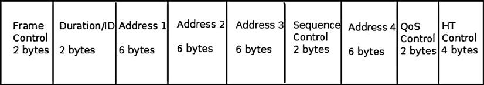
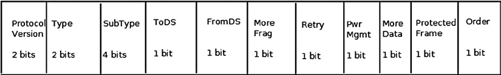
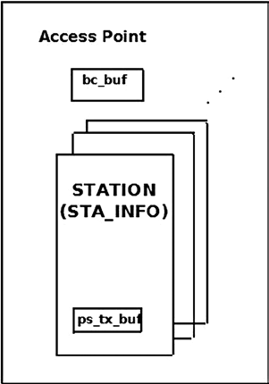
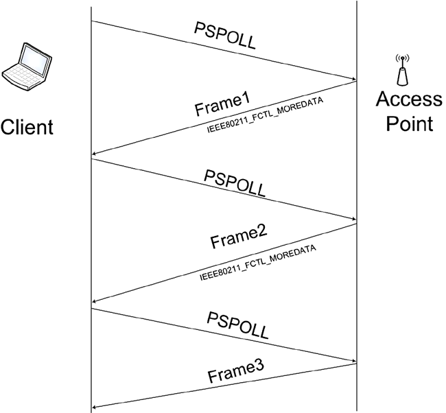
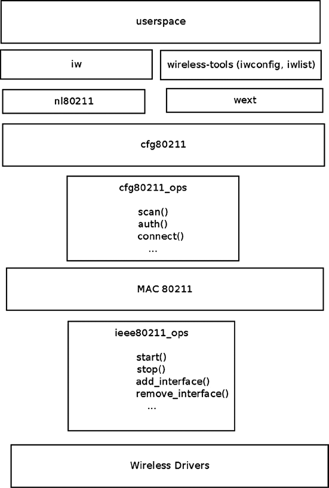
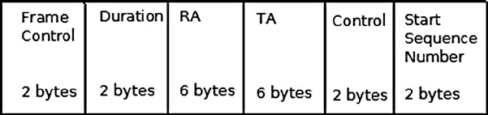
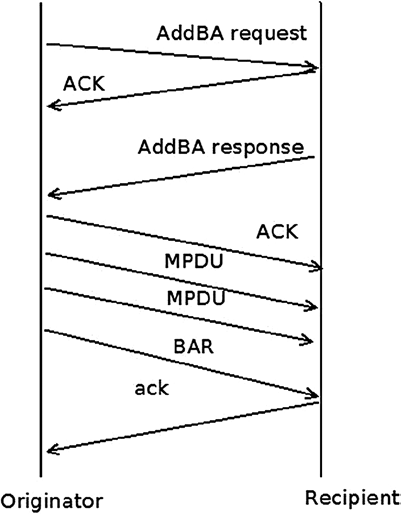
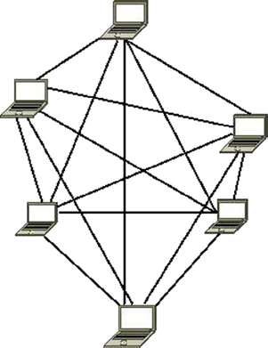
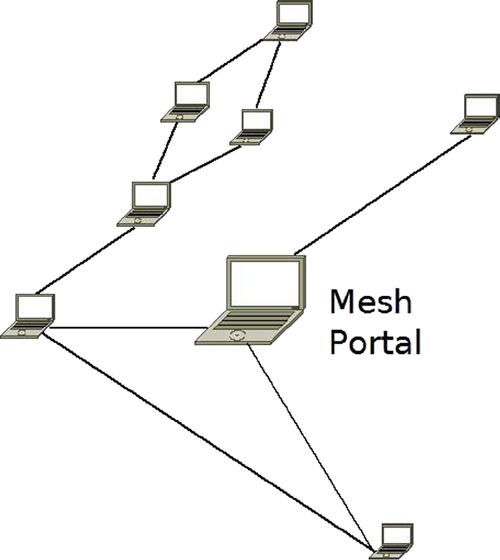

# Chương 12. Wireless trong Linux

Chương 11 trình bày Layer 4 protocol, cho phép giao tiếp với userspace. Chương này trình bày wireless stack trong Linux kernel. Tôi mô tả Linux wireless stack (mac80211 subsystem) và một số chi tiết triển khai các cơ chế quan trọng như packet aggregation và block acknowledgement dùng trong IEEE 802.11n, cùng power save mode. Làm quen với 802.11 MAC header là thiết yếu để hiểu cách triển khai wireless subsystem. Chương mô tả chi tiết 802.11 MAC header, các member và cách dùng. Tôi cũng trình bày wireless topology phổ biến như infrastructure BSS, independent BSS và Mesh networking.

## Mac80211 Subsystem

Cuối thập niên 1990, IEEE thảo luận về protocol cho wireless local area network (WLAN). Phiên bản IEEE 802.11 spec gốc cho WLAN phát hành năm 1997 và sửa đổi năm 1999. Những năm sau có các extension, chính thức gọi là 802.11 amendment. Có thể chia thành PHY (Physical) layer extension, MAC (Medium Access Control) layer extension, Regulatory extension và các loại khác. Ví dụ PHY layer extension là 802.11b năm 1999, 802.11a (cũng năm 1999) và 802.11g năm 2003. MAC layer extension gồm 802.11e cho QoS và 802.11s cho Mesh networking. Phần “Mesh Networking” trình bày cách Linux kernel triển khai IEEE802.11s amendment. IEEE802.11 spec được sửa đổi, năm 2007 phát hành phiên bản thứ hai dài 1.232 trang. Năm 2012, spec 2.793 trang được phát hành tại `http://standards.ieee.org/findstds/standard/802.11-2012.html`. Tôi gọi spec này là IEEE 802.11-2012 trong chương. Sau đây là danh sách một phần các 802.11 amendment quan trọng:

- IEEE 802.11d: Extension roaming quốc tế (country-to-country) (2001).

- IEEE 802.11e: Cải tiến QoS, gồm packet bursting (2005).

- IEEE 802.11h: Spectrum Managed 802.11a để tương thích tại châu Âu (2004).

- IEEE 802.11i: Bảo mật tăng cường (2004).

- IEEE 802.11j: Extension cho Nhật Bản (2004).

- IEEE 802.11k: Cải tiến radio resource measurement (2008).

- IEEE 802.11n: Cải thiện throughput cao hơn bằng MIMO (multiple input, multiple output antenna) (2009).

- IEEE 802.11p: WAVE: Wireless Access for the Vehicular Environment (như xe cứu thương và xe chở khách). Có đặc điểm riêng như không dùng khái niệm BSS và channel hẹp hơn (5/10 MHz). Lưu ý Linux chưa hỗ trợ IEEE 802.11p tại thời điểm viết sách.

- IEEE 802.11v: Quản lý wireless network.

- IEEE 802.11w: Protected Management Frame.

- IEEE 802.11y: Hoạt động 3650–3700 MHz tại Hoa Kỳ (2008)

- IEEE 802.11z: Extension cho Direct Link Setup (DLS) (tháng 8 năm 2007–tháng 12 năm 2011).

Chỉ đến khoảng năm 2001, bốn năm sau IEEE 802.11 spec đầu tiên được phê duyệt, laptop mới rất phổ biến; nhiều laptop được bán kèm wireless network interface. Ngày nay mọi laptop đều có WiFi tiêu chuẩn. Khi đó, cộng đồng Linux cần cung cấp Linux driver cho các wireless network interface và Linux network wireless stack để cạnh tranh với hệ điều hành khác (Windows, Mac OS, v.v.). Ít công sức dành cho kiến trúc và thiết kế. “Họ chỉ muốn phần cứng hoạt động”, như Jeff Garzik, Linux Kernel Wireless maintainer khi đó, nói. Khi wireless driver Linux đầu tiên được phát triển, chưa có wireless API dùng chung. Do đó có nhiều code trùng lặp giữa driver khi nhà phát triển triển khai từ đầu. Một số driver dựa trên FullMAC, nghĩa là phần lớn management layer (MLME) được quản lý trong phần cứng. Những năm sau, 802.11 wireless stack mới tên mac80211 được phát triển. Tích hợp vào Linux kernel tháng 7 năm 2007 cho Linux kernel 2.6.22. mac80211 stack dựa trên d80211 stack, stack nguồn mở GPL-licensed của công ty Devicescape.

Tôi không thể đi sâu PHY layer vì chủ đề rất rộng, xứng đáng một cuốn sách riêng. Tuy nhiên cần lưu ý nhiều khác biệt giữa 802.11 và wired Ethernet 802.3. Sau đây là hai khác biệt lớn:

- Ethernet dùng CSMA/CD, còn 802.11 dùng CSMA/CA. CSMA/CA viết tắt của carrier sense multiple access/collision avoidance, CSMA/CD là carrier sense multiple access/collision detection. Khác biệt là collision detection, như bạn có thể đoán. Với Ethernet, station bắt đầu truyền khi medium idle; nếu phát hiện collision trong lúc truyền, nó dừng và bắt đầu khoảng backoff ngẫu nhiên. Wireless station không thể phát hiện collision khi truyền, còn wired station có thể. Với CSMA/CA, wireless station chờ medium trống rồi mới truyền frame. Nếu collision, station không nhận biết, nhưng vì không có acknowledgement frame cho packet này, nó được truyền lại sau timeout nếu không nhận acknowledgement.

- Wireless traffic nhạy với nhiễu. Vì vậy 802.11 spec yêu cầu mọi frame trừ broadcast và multicast phải được acknowledge khi nhận. Packet không được acknowledge kịp phải retransmit. Lưu ý từ IEEE 802.11e có mode không yêu cầu acknowledgement—QoSNoAck—nhưng hiếm dùng thực tế.

## 802.11 MAC Header

Mỗi MAC frame gồm MAC header, frame body dài thay đổi và FCS (Frame Check Sequence) là CRC 32 bit. Hình 12-1 minh họa 802.11 header.



Hình 12-1. IEEE 802.11 header. Lưu ý không phải lúc nào cũng dùng mọi member, như sẽ giải thích ngay trong phần này

802.11 header được mac80211 biểu diễn bằng structure `ieee80211_hdr`:

```
struct ieee80211_hdr {
        __le16 frame_control;
        __le16 duration_id;
        u8 addr1[6];
        u8 addr2[6];
        u8 addr3[6];
        __le16 seq_ctrl;
        u8 addr4[6];
} __packed;
```

(`include/linux/ieee80211.h`)

Khác Ethernet header (`struct ethhdr`) chỉ chứa ba trường (địa chỉ MAC nguồn, địa chỉ MAC đích và Ethertype), 802.11 header chứa tối đa sáu địa chỉ cùng các trường khác. Tuy nhiên data frame điển hình chỉ dùng ba địa chỉ (chẳng hạn giao tiếp Access Point hay AP/client). ACK frame chỉ dùng receiver address. Lưu ý Hình 12-1 chỉ hiển thị bốn địa chỉ, nhưng Mesh networking dùng Mesh extension header có hai địa chỉ bổ sung.

Bây giờ tôi chuyển sang mô tả các field của 802.11 header, bắt đầu từ field đầu tiên trong header, tên là frame control. Đây là một field quan trọng; trong nhiều trường hợp, nội dung của nó quyết định ý nghĩa của các field khác trong 802.11 MAC header (đặc biệt là các địa chỉ).

### Frame Control

Frame control dài 16 bit. Hình 12-2 minh họa các trường và kích thước mỗi trường.



Hình 12-2. Các trường frame control

Sau đây là mô tả các member frame control:

- `Protocol version`: Version MAC 802.11 đang dùng. Hiện chỉ có một version MAC nên trường luôn bằng 0.

- `Type`: Có ba loại packet trong 802.11—management, control và data:

- Management packet (IEEE80211\_FTYPE\_MGMT) dành cho management action như association, authentication, scanning, v.v.

- Control packet (IEEE80211\_FTYPE\_CTL) thường liên quan data packet; chẳng hạn PS-Poll packet dùng lấy packet từ AP buffer. Ví dụ khác: station muốn truyền trước tiên gửi control packet RTS (request to send); nếu medium trống, destination station gửi trả control packet CTS (clear to send).

- Data packet (IEEE80211\_FTYPE\_DATA) là raw data packet. Null packet là trường hợp đặc biệt của raw packet, không mang dữ liệu, chủ yếu dùng điều khiển power management. Tôi trình bày null packet trong phần “Power Save Mode” phía sau chương.

- `Subtype`: Với cả ba loại packet đã đề cập (management, control và data), có một field sub-type xác định đặc tính của packet được sử dụng. Ví dụ:

- Giá trị 0100 của trường sub-type trong management frame biểu thị Probe Request (IEEE80211\_STYPE\_PROBE\_REQ) management packet, dùng trong scan.

- Giá trị 1011 của trường sub-type trong control packet biểu thị request to send (IEEE80211\_STYPE\_RTS) control packet. Giá trị 0100 của trường sub-type trong data packet biểu thị null data (IEEE80211\_STYPE\_NULLFUNC) packet, dùng điều khiển power management.

- Giá trị 1000 (IEEE80211\_STYPE\_QOS\_DATA) của sub-type data packet nghĩa là QoS data packet; sub-type này được thêm bởi IEEE802.11e amendment về cải tiến QoS.

- `ToDS`: Khi bit được đặt, packet dành cho distribution system.

- `FromDS`: Khi bit được đặt, packet đến từ distribution system.

- `More Frag`: Khi dùng fragmentation, bit được đặt thành 1.

- `Retry`: Khi retransmit packet, bit được đặt thành 1. Trường hợp điển hình là packet đã gửi không nhận acknowledgement kịp. Acknowledgement thường được firmware của wireless driver gửi.

- `Pwr Mgmt`: Khi power management bit được đặt, station sẽ vào power save mode. Tôi trình bày trong phần “Power Save Mode” phía sau chương.

- `More Data`: Khi AP gửi packet đã buffer cho station đang ngủ, đặt bit `More Data` thành 1 khi buffer chưa rỗng. Nhờ đó station biết còn packet cần lấy. Khi buffer rỗng, bit được đặt thành 0.

- `Protected Frame`: Bit được đặt thành 1 khi frame body được mã hóa; chỉ data frame và authentication frame có thể mã hóa.

- `Order`: Với MAC service strict ordering, thứ tự frame quan trọng. Khi dùng service này, order bit được đặt thành 1. Hiếm khi được dùng.

Lưu ý Action frame (IEEE80211\_STYPE\_ACTION) được giới thiệu trong 802.11h amendment về spectrum và transmit power management. Tuy nhiên vì thiếu không gian cho management packet sub-types, action frame cũng được dùng trong các amendment mới hơn—chẳng hạn HT action frame trong 802.11n.

## Các Member khác của 802.11 MAC Header

Sau đây mô tả các member khác của mac802.11 header sau frame control:

- `Duration/ID`: Duration chứa giá trị Network Allocation Vector (NAV) tính bằng micro giây, gồm 15 bit của trường `Duration/ID`. Trường thứ mười sáu bằng 0. Trong power save mode, đây là AID (association id) của station cho PS-Poll frame (xem 8.2.4.2 (a) trong IEEE 802.11-2012). NAV là cơ chế virtual carrier sensing. Tôi không đi sâu NAV internals vì ngoài phạm vi chương.

- `Sequence Control`: Trường 2-byte chỉ sequence control. Trong 802.11, packet có thể nhận nhiều lần, thường nhất khi acknowledgement không nhận được vì lý do nào đó. Trường sequence control gồm fragment number (4 bit) và sequence number (12 bit). Sequence number do transmitting station tạo trong method `ieee80211_tx_h_sequence()`. Nếu frame trùng trong retransmission, nó bị drop và bộ đếm duplicate frame bị drop (`dot11FrameDuplicateCount`) tăng thêm 1; thực hiện trong method `ieee80211_rx_h_check()`. Trường `Sequence Control` không có trong control packet.

- `Address1 – Address4`: Có bốn địa chỉ nhưng không phải luôn dùng hết. Address 1 là Receive Address (RA), dùng trong mọi packet. Address 2 là Transmit Address (TA), có trong mọi packet trừ ACK và CTS. Address 3 chỉ dùng cho management và data packet. Address 4 dùng khi các bit ToDS và FromDS của frame control được đặt; xảy ra khi hoạt động trong Wireless Distribution System.

- `QoS Control`: Trường QoS control được thêm bởi 802.11e amendment, chỉ có trong QoS data packet. Vì không thuộc 802.11 spec gốc nên không thuộc cách triển khai mac80211 gốc, do đó không là member của IEEE802.11 header (`ieee80211_hdr struct`). Thực tế được thêm ở cuối IEEE802.11 header và truy cập bằng method `ieee80211_get_qos_ctl()`. Trường QoS control gồm `tid` (Traffic Identification), ACK Policy và trường A-MSDU present cho biết có A-MSDU không. Tôi trình bày A-MSDU phía sau chương trong phần “High Throughput (ieee802.11n)”.

- HT Control Field: HT (high throughput) control field được thêm bởi 802.11n amendment (xem 7.1.3.5(a) của spec 802.11n-2009).

Mục này trình bày 802.11 MAC header, mô tả các member và cách sử dụng chúng. Việc làm quen với 802.11 MAC header là điều thiết yếu để hiểu mac802.11 stack.

## Network Topology

Có hai network topology phổ biến trong mạng wireless 802.11. Topology đầu tiên tôi trình bày là Infrastructure BSS mode, phổ biến nhất. Bạn gặp mạng wireless Infrastructure BSS tại nhà và văn phòng. Sau đó tôi trình bày IBSS (Ad Hoc) mode. Lưu ý IBSS không phải Infrastructure BSS; IBSS là Independent BSS, mạng ad hoc được trình bày phía sau phần này.

### Infrastructure BSS

Trong Infrastructure BSS mode có thiết bị trung tâm Access Point (AP) và một số client station. Chúng tạo thành BSS (Basic Service Set). Client station phải association và authentication với AP trước để truyền packet qua AP. Nhiều trường hợp client station scanning trước authentication và association để lấy thông tin AP. Association là độc quyền: client chỉ có thể gắn với một AP tại mỗi thời điểm. Khi association thành công, client nhận AID (association id), số duy nhất trong BSS, trong khoảng 1–2007. AP thực chất là wireless network device có thêm phần cứng (như Ethernet port, LED, nút reset về mặc định nhà sản xuất, v.v.). Management daemon chạy trên AP. Ví dụ là daemon `hostapd`. Phần mềm xử lý một số management task của MLME layer như authentication và association request. Thực hiện bằng cách đăng ký nhận management frame tương ứng qua `nl80211`. `hostapd` là dự án nguồn mở cho phép nhiều wireless network device hoạt động làm AP. Client có thể giao tiếp với client khác (hoặc station trong mạng khác được bridge với AP)

bằng cách gửi packet đến AP để AP relay đến đích cuối. Để phủ vùng rộng, có thể triển khai nhiều AP và nối bằng dây. Kiểu triển khai gọi là Extended Service Set (ESS). Trong ESS có hai hoặc nhiều BSS. Multicast và broadcast gửi trong một BSS có thể đến BSS gần đó nhưng bị station BSS đó từ chối (`bssid` trong 802.11 header không khớp). Trong triển khai này, mỗi AP thường dùng channel khác để giảm nhiễu.

### IBSS, hay Ad Hoc Mode

Mạng IBSS thường được hình thành mà không lập kế hoạch trước và chỉ tồn tại trong thời gian cần WLAN. Mạng IBSS còn được gọi là mạng ad hoc. Tạo một IBSS là một thao tác đơn giản. Bạn có thể thiết lập IBSS bằng cách chạy lệnh `iw` sau từ dòng lệnh (lưu ý rằng parameter 2412 tương ứng với việc sử dụng channel 1):

```
iw wlan0 ibss join AdHocNetworkName 2412
```

Hoặc dùng công cụ `iwconfig` với hai lệnh:

```
iwconfig wlan0 mode ad-hoc
iwconfig wlan0 essid AdHocNetworkrName
```

Điều này tạo IBSS bằng method `ieee80211_sta_create_ibss()` (`net/mac80211/ibss.c`). Sau đó `ssid` (`AdHocNetworkName` trong trường hợp này) phải được phân phối thủ công (hoặc cách khác) cho người muốn kết nối mạng ad hoc. IBSS không có AP. bssid của IBSS là địa chỉ ngẫu nhiên 48-bit (dựa trên method `get_random_bytes()`). Power management trong Ad Hoc mode phức tạp hơn Infrastructure BSS; dùng message Announcement Traffic Indication Map (ATIM). mac802.11 không hỗ trợ ATIM và chương không trình bày.

Phần tiếp theo mô tả power save mode, một cơ chế quan trọng nhất của mac80211 network stack.

## Power Save Mode

Ngoài relay packet, AP có chức năng quan trọng khác: buffer packet cho client station vào power save mode. Client thường là thiết bị battery-powered. Thỉnh thoảng wireless network interface vào power save mode.

### Vào Power Save Mode

Khi client station vào power save mode, thường báo AP bằng null data packet. Thực tế không bắt buộc null data packet; chỉ cần packet có PM=1 (PM là Power Management flag trong frame control). AP nhận null packet như vậy bắt đầu giữ unicast packet dành cho station trong buffer đặc biệt `ps_tx_buf`; mỗi station có buffer riêng. Buffer thực chất là linked list packet, giữ tối đa 128 packet (STA\_MAX\_TX\_BUFFER) mỗi station. Nếu đầy, bắt đầu loại bỏ packet nhận trước (FIFO). Ngoài ra có buffer duy nhất `bc_buf` cho multicast và broadcast packet (trong 802.11 stack, multicast packet phải được mọi station cùng BSS nhận và xử lý). Buffer `bc_buf` cũng giữ tối đa 128 packet (AP\_MAX\_BC\_BUFFER). Wireless network interface ở power save mode không thể nhận hoặc gửi packet.

### Thoát Power Save Mode

Thỉnh thoảng associated station tự thức dậy (bằng timer); sau đó kiểm tra management packet đặc biệt gọi là beacon, do AP gửi định kỳ. Thông thường AP gửi 10 beacon mỗi giây; trên phần lớn AP, đây là tham số cấu hình được. Beacon chứa dữ liệu trong information element, tạo thành dữ liệu management packet. Station thức dậy kiểm tra information element TIM (Traffic Indication Map) bằng method `ieee80211_check_tim()` (`include/linux/ieee80211.h`). TIM là array 2008 entry. Vì TIM dài 251 byte (2008 bit), có thể gửi partial virtual bitmap nhỏ hơn. Nếu entry TIM của station được đặt, nghĩa là AP lưu unicast packet cho station, nên station phải lấy hết buffer AP giữ. Station bắt đầu gửi null packet (hoặc hiếm hơn, control packet đặc biệt PS-Poll) để lấy buffered packet từ AP. Thường sau khi buffer rỗng station đi ngủ (nhưng spec không bắt buộc).

### Xử lý Multicast/Broadcast Buffer

AP buffer multicast và broadcast packet khi ít nhất một station đang ngủ. AID cho multicast/broadcast station là 0; khi đó đặt TIM\[0\] thành true. Delivery Team (DTIM), loại TIM đặc biệt, không gửi trong mọi beacon mà một lần sau số beacon interval định trước (DTIM period). Sau khi gửi DTIM, AP gửi broadcast và multicast packet đã buffer. Lấy packet từ multicast/broadcast buffer (`bc_buf`) bằng method `ieee80211_get_buffered_bc()`. Trong Hình 12-3, AP chứa linked list station (object `sta_info`), mỗi station có unicast buffer (`ps_tx_buf`) riêng và một buffer `bc_buf` duy nhất lưu multicast/broadcast packet.



Hình 12-3. Buffer packet trong AP

AP được triển khai bằng object `ieee80211_if_ap` trong mac80211. Mỗi object `ieee80211_if_ap` có member `ps` (instance của `ps_data`) lưu power save data. Một member của structure `ps_data` là broadcast/multicast buffer `bc_buf`. Trong Hình 12-4, client gửi flow PS-Poll packet để lấy packet từ AP

unicast buffer, `ps_tx_buf`. Lưu ý rằng AP gửi tất cả packet với flag IEEE80211\_FCTL\_MOREDATA, ngoại trừ packet cuối cùng. Nhờ đó, client biết cần tiếp tục gửi PS-Poll packet cho đến khi buffer rỗng. Để đơn giản, sơ đồ này không bao gồm ACK traffic, nhưng cần lưu ý rằng các packet phải được acknowledge.



Hình 12-4. Client gửi PSPOLL packet để lấy packet từ buffer `ps_tx_buf` trong AP

Lưu ý Power management và power save mode là hai chủ đề khác nhau. Power management xử lý máy thực hiện suspend (suspend to RAM hoặc suspend to disk, còn gọi hibernate; có trường hợp cả hai, gọi hybrid suspend), được xử lý trong `net/mac80211/pm.c`. Trong driver, power management được resume/suspend method xử lý. Power save mode xử lý station vào sleep mode rồi thức dậy; không liên quan suspend và hibernation.

Phần này mô tả power save mode và cơ chế buffering. Phần tiếp theo trình bày management layer và các tác vụ nó xử lý.

## Management Layer (MLME)

Có ba thành phần trong kiến trúc quản lý 802.11:

- Physical Layer Management Entity (PLME).

- System Management Entity (SME).

- MAC Layer Management Entity (MLME).

### Scanning

Có hai loại scanning: passive scanning và active scanning. Passive scanning là listen beacon thụ động, không truyền packet để scanning. Khi passive scanning (flag scan channel chứa IEEE80211\_CHAN\_PASSIVE\_SCAN), station chuyển giữa các channel, thử nhận beacon. Passive scanning cần ở một số dải tần 802.11a cao hơn vì không được truyền gì trước khi nghe AP beacon. Với active scanning, mỗi station gửi Probe Request packet; đây là management packet có sub-type Probe Request (IEEE80211\_STYPE\_PROBE\_REQ). Station cũng chuyển giữa các channel, gửi Probe Request management packet trên mỗi channel (bằng method `ieee80211_send_probe_req()`). Được thực hiện bằng method `ieee80211_request_scan()`. Đổi channel bằng method `ieee80211_hw_config()`, truyền IEEE80211\_CONF\_CHANGE\_CHANNEL làm tham số. Lưu ý có tương ứng one-to-one giữa channel và tần số station hoạt động; method `ieee80211_channel_to_frequency()` (`net/wireless/util.c`) trả về tần số khi biết channel.

### Authentication

Authentication bằng method `ieee80211_send_auth()` (`net/mac80211/util.c`). Gửi management frame với authentication sub-type (IEEE80211\_STYPE\_AUTH). Có nhiều authentication type; IEEE802.11 spec gốc chỉ nói hai dạng: open-system authentication và shared key authentication. Authentication method bắt buộc duy nhất của spec là open-system authentication (WLAN\_AUTH\_OPEN). Đây là authentication algorithm rất đơn giản—thực chất null authentication algorithm. Mọi client yêu cầu authentication bằng algorithm này đều được authenticated. Lựa chọn khác là shared key authentication (WLAN\_AUTH\_SHARED\_KEY). Trong shared key authentication, station phải authenticate bằng Wired Equivalent Privacy (WEP) key.

### Association

Để associate, station gửi management frame với association sub-type (IEEE80211\_STYPE\_ASSOC\_REQ). Association bằng method `ieee80211_send_assoc()` (`net/mac80211/mlme.c`).

### Reassociation

Khi station di chuyển giữa AP trong ESS, gọi là roaming. Roaming station gửi reassociation request đến AP mới bằng management frame có reassociation sub-type (IEEE80211\_STYPE\_REASSOC\_REQ). Reassociation bằng method `ieee80211_send_assoc()`; nhiều điểm giống association nên method xử lý cả hai. Ngoài ra khi thành công, AP trả AID (association id) cho client. Phần này trình bày management layer (MLME) và các thao tác hỗ trợ như scanning,

authentication, association, v.v. Phần tiếp theo mô tả chi tiết triển khai mac80211 quan trọng để hiểu wireless stack.

## Triển khai Mac80211

Mac80211 có API giao tiếp low level device driver. Cách triển khai phức tạp, nhiều chi tiết nhỏ. Tôi không thể mô tả toàn diện API và cách triển khai; tôi trình bày điểm quan trọng làm khởi đầu cho người muốn tìm hiểu code. Structure nền tảng của API là `ieee80211_hw` struct (`include/net/mac80211.h`), biểu diễn thông tin phần cứng. Pointer `priv` (trỏ đến private area) của `ieee80211_hw` có opaque type (`void *`). Phần lớn wireless device driver định nghĩa private structure cho vùng này như `lbtf_private` (Marvell wireless driver) hoặc `iwl_priv` (`iwlwifi` của Intel). Cấp phát memory và khởi tạo `ieee80211_hw struct` bằng method `ieee80211_alloc_hw()`. Sau đây là các method liên quan `ieee80211_hw` struct:

- `int ieee80211_register_hw(struct ieee80211_hw *hw)`: Wireless driver gọi để đăng ký object `ieee80211_hw` chỉ định.

- `void ieee80211_unregister_hw(struct ieee80211_hw *hw)`: Hủy đăng ký 802.11 hardware device chỉ định.

- `struct ieee80211_hw *ieee80211_alloc_hw(size_t priv_data_len, const struct ieee80211_ops *ops)`: Cấp phát object `ieee80211_hw` và khởi tạo.

- `ieee80211_rx_irqsafe()`: Method nhận packet, triển khai trong `net/mac80211/rx.c`, được low level wireless driver gọi.

Object `ieee80211_ops`, được truyền cho method `ieee80211_alloc_hw()` như bạn đã thấy trước đó, chứa các pointer trỏ đến callback của driver. Driver không bắt buộc phải triển khai tất cả callback này. Sau đây là mô tả ngắn về các method đó:

- `tx()`: Transmit handler gọi cho mỗi packet truyền đi. Thường trả về NETDEV\_TX\_OK (trừ một số điều kiện hạn chế).

- `start()`: Kích hoạt hardware device, được gọi trước khi hardware device đầu tiên được enable. Bật nhận frame.

- `stop()`: Tắt nhận frame và thường tắt phần cứng.

- `add_interface()`: Được gọi khi network device gắn với phần cứng được enable.

- `remove_interface()`: Báo driver interface đang ngừng hoạt động.

- `config()`: Xử lý configuration request như cấu hình hardware channel.

- `configure_filter()`: Cấu hình Rx filter của thiết bị.

Hình 12-5 là block diagram kiến trúc Linux wireless subsystem. Interface giữa wireless device driver layer và mac80211 layer là object `ieee80211_ops` cùng callback.



Hình 12-5. Kiến trúc Linux wireless

Structure quan trọng khác là `sta_info struct` (`net/mac80211/sta_info.h`), biểu diễn station. Member gồm statistics counter, flag, entry `debugfs`, array `ps_tx_buf` buffer unicast packet, v.v. Station được tổ chức trong hash table (`sta_hash`) và danh sách (`sta_list`). Method quan trọng liên quan `sta_info` là:

- `int sta_info_insert(struct sta_info *sta)`: Thêm station.

- `int sta_info_destroy_addr(struct ieee80211_sub_if_data *sdata, const u8 *addr)`: Xóa station (bằng method `__sta_info_destroy()`).

- `struct sta_info *sta_info_get(struct ieee80211_sub_if_data *sdata, const u8 *addr)`: Lấy station; địa chỉ station (`bssid` của nó) được truyền làm tham số.

### Rx Path

Hàm `ieee80211_rx()` (`net/mac80211/rx.c`) là receive handler chính. Trạng thái packet nhận (`ieee80211_rx_status`) được wireless driver truyền đến mac80211, nhúng trong SKB control buffer (`cb`). Macro IEEE80211\_SKB\_RXCB() lấy trạng thái. Trường `flag` của Rx status chỉ định chẳng hạn FCS check thất bại trên packet không (RX\_FLAG\_FAILED\_FCS\_CRC). Giá trị khả dụng của `flag` nằm trong Bảng 12-1 phần “Tham khảo nhanh”. Trong method `ieee80211_rx()`, `ieee80211_rx_monitor()` được gọi để bỏ FCS (checksum) và radiotap header (`struct ieee80211_radiotap_header`) có thể đã thêm nếu wireless interface ở monitor mode. (Chẳng hạn dùng monitor mode để sniffing. Không phải mọi wireless network interface hỗ trợ monitor mode, xem phần “Wireless Mode” phía sau chương.)

Nếu dùng HT (802.11n), thực hiện AMPDU reordering nếu cần bằng method `ieee80211_rx_reorder_ampdu()`. Sau đó gọi method `__ieee80211_rx_handle_packet()`, cuối cùng gọi method `ieee80211_invoke_rx_handlers()`. Tiếp theo lần lượt gọi receive handler (dùng macro CALL\_RXH). Thứ tự quan trọng. Mỗi handler kiểm tra có cần xử lý packet không. Nếu quyết định không xử lý, trả về RX\_CONTINUE và tiếp tục handler sau. Nếu quyết định xử lý, trả về RX\_QUEUED.

Có trường hợp handler quyết định drop packet; trả về RX\_DROP\_MONITOR hoặc RX\_DROP\_UNUSABLE. Chẳng hạn nhận PS-Poll packet nhưng receiver type cho thấy không phải AP thì trả về RX\_DROP\_UNUSABLE. Ví dụ khác: management frame có SKB length nhỏ hơn tối thiểu (24), packet bị loại bỏ và trả về RX\_DROP\_MONITOR. Hoặc nếu packet không phải management packet cũng loại bỏ và trả RX\_DROP\_MONITOR. Đây là đoạn code method `ieee80211_rx_h_mgmt_check()` triển khai:

```
ieee80211_rx_h_mgmt_check(struct ieee80211_rx_data *rx)
{
        struct ieee80211_mgmt *mgmt = (struct ieee80211_mgmt *) rx->skb->data;
        struct ieee80211_rx_status *status = IEEE80211_SKB_RXCB(rx->skb);

        . . .
        if (rx->skb->len < 24)
                return RX_DROP_MONITOR;

        if (!ieee80211_is_mgmt(mgmt->frame_control))
                return RX_DROP_MONITOR;
               .  .  .
}
```

(`net/mac80211/rx.c`)

### Tx Path

Method `ieee80211_tx()` là transmit handler chính (`net/mac80211/tx.c`). Đầu tiên gọi method `__ieee80211_tx_prepare()`, thực hiện kiểm tra và đặt một số flag. Sau đó gọi method `invoke_tx_handlers()`, lần lượt gọi transmit handler (dùng macro CALL\_TXH). Nếu handler thấy không cần làm gì với packet, trả về TX\_CONTINUE rồi tiếp tục handler sau. Nếu quyết định xử lý packet, trả TX\_QUEUED; nếu quyết định drop

packet, trả TX\_DROP. Method `invoke_tx_handlers()` trả về 0 khi thành công. Hãy xem nhanh cách triển khai method `ieee80211_tx()`:

```
static bool ieee80211_tx(struct ieee80211_sub_if_data *sdata,
                         struct sk_buff *skb, bool txpending,
                         enum ieee80211_band band)
{
        struct ieee80211_local *local = sdata->local;
        struct ieee80211_tx_data tx;
        ieee80211_tx_result res_prepare;
        struct ieee80211_tx_info *info = IEEE80211_SKB_CB(skb);
        bool result = true;
        int led_len;
```

Thực hiện sanity check, drop SKB nếu độ dài nhỏ hơn 10:

```
if (unlikely(skb->len < 10)) {
        dev_kfree_skb(skb);
        return true;
}

/* initialises tx */
led_len = skb->len;

res_prepare = ieee80211_tx_prepare(sdata, &tx, skb);

if (unlikely(res_prepare == TX_DROP)) {
        ieee80211_free_txskb(&local->hw, skb);
        return true;
} else if (unlikely(res_prepare == TX_QUEUED)) {
        return true;
}
```

Gọi Tx handler; nếu ổn, tiếp tục gọi method `__ieee80211_tx()`:

```
        . . .
        if (!invoke_tx_handlers(&tx))
                result = __ieee80211_tx(local, &tx.skbs, led_len,
                                        tx.sta, txpending);

        return result;
}
```

(`net/mac80211/tx.c`)

### Fragmentation

Fragmentation trong 802.11 chỉ dành cho unicast packet. Mỗi station được gán fragmentation threshold size (byte). Packet lớn hơn phải phân mảnh. Có thể giảm collision bằng cách giảm fragmentation threshold để packet nhỏ hơn. Kiểm tra fragmentation threshold bằng `iwconfig` hoặc entry `debugfs` tương ứng (xem phần “Mac80211 `debugfs`”

phía sau chương). Có thể đặt fragmentation threshold bằng lệnh `iwconfig`; chẳng hạn đặt 512 byte bằng:

```
iwconfig wlan0 frag 512
```

Mỗi fragment được acknowledge. Trường more fragment trong fragment header đặt thành 1 nếu còn fragment. Mỗi fragment có fragment number (subfield trong sequence control field của frame control). Bên nhận reassembly theo fragment number. Fragmentation phía gửi bằng method `ieee80211_tx_h_fragment()` (`net/mac80211/tx.c`). Reassembly phía nhận bằng method `ieee80211_rx_h_defragment()` (`net/mac80211/rx.c`). Fragmentation không tương thích aggregation (dùng tăng throughput); với rate cao khiến packet ngắn về thời gian, hiện nay rất hiếm dùng.

### Mac80211 debugfs

`debugfs` là kỹ thuật xuất debugging information đến userspace. Tạo entry dưới filesystem `sysfs`. `debugfs` là virtual filesystem dành cho thông tin debugging. Với mac80211, xử lý mac80211 `debugfs` chủ yếu trong `net/mac80211/debugfs.c`. Sau khi mount `debugfs`, có thể kiểm tra các entry thống kê/thông tin mac802.11. Mount `debugfs` như sau:

```
mount -t debugfs none_debugs /sys/kernel/debug
```

Lưu ý Phải bật CONFIG\_DEBUG\_FS khi build kernel để mount và làm việc với `debugfs`.

Chẳng hạn `phy` là `phy0`; sau đây trình bày một số entry dưới `/sys/kernel/debug/ieee80211/phy0`:

- `total_ps_buffered`: Tổng packet (unicast và multicast/broadcast) AP buffer cho station. Counter `total_ps_buffered` tăng bởi `ieee80211_tx_h_unicast_ps_buf()` cho unicast, và `ieee80211_tx_h_multicast_ps_buf()` cho multicast/broadcast.

- Dưới `/sys/kernel/debug/ieee80211/phy0/statistics` có các thông tin thống kê—chẳng hạn:

- `frame_duplicate_count` chỉ số duplicate frame. Entry `debugfs` này biểu diễn duplicate frame counter `dot11FrameDuplicateCount`, tăng bởi method `ieee80211_rx_h_check()`.

- `transmitted_frame_count` chỉ số packet truyền đi. Entry `debugfs` biểu diễn `dot11TransmittedFrameCount`; tăng bởi method `ieee80211_tx_status()`.

- `retry_count` chỉ số retransmission. Entry `debugfs` biểu diễn `dot11RetryCount`; cũng tăng bởi method `ieee80211_tx_status()`.

- `fragmentation_threshold:` Kích thước fragmentation threshold tính bằng byte. Xem phần “Fragmentation” ở trên.

- Bên dưới `/sys/kernel/debug/ieee80211/phy0/netdev:wlan0` có một số entry cung cấp thông tin về interface. Ví dụ, nếu interface ở station mode, bạn sẽ có `aid` cho association id của station, `assoc_tries` cho số lần các station đã thử thực hiện association, `bssid` cho bssid của station, v.v.

- Mỗi station dùng rate control algorithm. Tên được xuất qua entry `debugfs`: `/sys/kernel/debug/ieee80211/phy1/rc/name`.

### Wireless Mode

Có thể đặt wireless network interface hoạt động ở nhiều mode tùy mục đích và network topology. Một số trường hợp dùng lệnh `iwconfig`, trường hợp khác phải dùng công cụ như `hostapd`. Lưu ý không phải thiết bị nào hỗ trợ mọi mode. Xem `www.linuxwireless.org/en/users/Drivers` cho danh sách Linux driver hỗ trợ các mode. Hoặc kiểm tra trường `interface_modes` của member `wiphy` (trong object `ieee80211_hw`) được khởi tạo thành giá trị nào trong driver code. `interface_modes` được khởi tạo thành một hoặc nhiều mode của `nl80211_iftype enum`, như NL80211\_IFTYPE\_STATION hoặc NL80211\_IFTYPE\_ADHOC (xem `include/uapi/linux/nl80211.h`). Sau đây là mô tả chi tiết:

- AP mode: Thiết bị hoạt động làm AP (NL80211\_IFTYPE\_AP). AP duy trì và quản lý danh sách associated station. Tên mạng (BSS) là địa chỉ MAC AP (`bssid`). Còn có tên human-readable cho BSS, gọi SSID.

- Station infrastructure mode: Managed station trong infrastructure mode (NL80211\_IFTYPE\_STATION).

- Monitor mode: Mọi incoming packet được chuyển không lọc trong monitor mode (NL80211\_IFTYPE\_MONITOR). Hữu ích cho sniffing. Thường có thể truyền packet trong monitor mode, gọi là packet injection; packet được đánh dấu flag đặc biệt (IEEE80211\_TX\_CTL\_INJECTED).

- Ad Hoc (IBSS) mode: Station trong mạng ad hoc (IBSS) (NL80211\_IFTYPE\_ADHOC). Không có AP device trong mạng Ad Hoc.

- Wireless Distribution System (WDS) mode: Station trong mạng WDS (NL80211\_IFTYPE\_WDS).

- Mesh mode: Station trong mạng Mesh (NL80211\_IFTYPE\_MESH\_POINT), được trình bày trong phần “Mesh Networking (802.11s)” phía sau chương.

Phần tiếp theo trình bày công nghệ ieee802.11n hiệu năng cao hơn và cách triển khai trong Linux wireless stack. Bạn cũng tìm hiểu block acknowledgement, packet aggregation trong 802.11n và cách các kỹ thuật cải thiện hiệu năng.

## High Throughput (ieee802.11n)

Ngay sau khi 802.11g được phê duyệt, IEEE tạo task group mới High Throughput Task Group (TGn). IEEE 802.11n thành spec chính thức cuối năm 2009. IEEE 802.11n cho phép cùng tồn tại với legacy device. Một số nhà cung cấp đã bán thiết bị 802.11n pre-standard dựa trên draft trước phê duyệt chính thức. Broadcom tạo tiền lệ phát hành wireless interface dựa trên draft. Năm 2003 phát hành chipset wireless device dựa trên draft 802.11g. Theo tiền lệ này, ngay năm 2005 một số nhà cung cấp phát hành sản phẩm dựa trên draft 802.11n. Chẳng hạn processor Intel Santa Rose có Intel Next-Gen Wireless-N (Intel WiFI Link 5000 series), hỗ trợ 802.11n. Wireless network interface Intel khác như 4965AGN cũng hỗ trợ. Atheros, Ralink và nhà cung cấp khác cũng phát hành wireless device 802.11n draft-based. WiFi

alliance bắt đầu chứng nhận thiết bị draft 802.11n tháng 6 năm 2007. Nhiều nhà cung cấp phát hành sản phẩm tuân thủ Wi-Fi CERTIFIED 802.11n draft 2.0.

802\.11n hoạt động trên dải 2.4 GHz và/hoặc 5 GHz, còn 802.11g và 802.11b chỉ trên 2.4 GHz, 802.11a chỉ trên 5 GHz. Công nghệ MIMO (Multiple Input, Multiple Output) của 802.11n tăng phạm vi và độ tin cậy lưu lượng trong vùng phủ wireless. MIMO dùng nhiều transmitter/receiver antenna trên cả AP và client cho data stream đồng thời. Kết quả là tăng phạm vi và throughput. Với 802.11n, PHY rate lý thuyết đến 600 Mbps (throughput thực thấp hơn nhiều do medium access rule, v.v.).

802\.11n thêm nhiều cải tiến cho 802.11 MAC layer. Nổi tiếng nhất là packet aggregation, nối nhiều packet application data thành một transmission frame. Cơ chế block acknowledgement (BA) được thêm (trình bày phần tiếp theo). BA cho phép acknowledge nhiều packet bằng một packet thay vì ACK từng packet nhận. Thời gian chờ giữa hai packet liên tiếp được cắt giảm. Cho phép gửi nhiều data packet với overhead cố định của một packet. Protocol BA được giới thiệu trong 802.11e amendment năm 2005.

### Packet Aggregation

Có hai loại packet aggregation:

- AMSDU: Aggregated Mac Service Data Unit

- AMPDU: Aggregated Mac Protocol Data Unit

Lưu ý AMSDU chỉ hỗ trợ Rx, không hỗ trợ Tx, và hoàn toàn độc lập cơ chế Block Ack mô tả ở đây; vì vậy nội dung phần này chỉ liên quan AMPDU.

Block Ack session có hai phía: originator và recipient. Mỗi block session có Traffic Identifier (TID) khác. Originator bắt đầu block acknowledgement session bằng method `ieee80211_start_tx_ba_session()`. Thường được gọi từ rate control algorithm method trong driver. Chẳng hạn với ath9k wireless driver, hàm `ath_tx_status()` (`drivers/net/wireless/ath/ath9k/rc.c`), rate control callback, gọi method `ieee80211_start_tx_ba_session()`. Method `ieee80211_start_tx_ba_session()` đặt trạng thái HT\_ADDBA\_REQUESTED\_MSK và gửi ADDBA request packet bằng method `ieee80211_send_addba_request()`. Lời gọi `ieee80211_send_addba_request()` truyền các tham số session như reorder buffer size mong muốn và TID.

Reorder buffer size giới hạn 64K (xem định nghĩa `ieee80211_max_ampdu_length_exp` trong `include/linux/ieee80211.h`). Các tham số thuộc capability member (`capab`) trong struct `addba_req`. Phải nhận phản hồi ADDBA request trong 1 Hz, là một giây trên máy x86\_64 (ADDBA\_RESP\_INTERVAL). Nếu không nhận kịp, method `sta_addba_resp_timer_expired()` dừng BA session bằng method `___ieee80211_stop_tx_ba_session()`. Khi phía kia (recipient) nhận ADDBA request, trước tiên gửi ACK (mọi packet ieee802.11 phải được acknowledge như đã nói). Sau đó xử lý request bằng method `ieee80211_process_addba_request()`; nếu ổn, đặt aggregation state máy thành operational (HT\_AGG\_STATE\_OPERATIONAL) và gửi ADDBA response bằng method `ieee80211_send_addba_resp()`. Đồng thời dừng response timer (timer có callback là method `sta_addba_resp_timer_expired()`) bằng `del_timer_sync()`. Sau khi session bắt đầu, data block chứa nhiều MPDU packet được gửi. Sau đó originator gửi Block Ack Request (BAR) packet bằng method `ieee80211_send_bar()`.

### Block Ack Request (BAR)

BAR là control packet với Block Ack Request sub-type (IEEE80211\_STYPE\_BACK\_REQ). BAR packet chứa SSN (start sequence number), sequence number của MSDU cũ nhất trong block cần acknowledge. Recipient nhận BAR và reorder buffer `ampdu` tương ứng nếu cần. Hình 12-6 minh họa BAR request.



Hình 12-6. BAR request

Khi gửi BAR, subfield `type` trong frame control là control (IEEE80211\_FTYPE\_CTL), subfield `subtype` là Block Ack request (IEEE80211\_STYPE\_BACK\_REQ). BAR được biểu diễn bằng struct `ieee80211_bar`:

```
struct ieee80211_bar {
        __le16 frame_control;
        __le16 duration;
        __u8 ra[6];
        __u8 ta[6];
        __le16 control;
        __le16 start_seq_num;
} __packed;
```

(`include/linux/ieee80211.h`)

RA là recipient address, TA là transmitter (originator) address. Trường control của BAR request chứa TID.

### Block Ack

Có hai loại Block Ack: Immediate Block Ack và Delayed Block Ack. Hình 12-7 minh họa Immediate Block Ack.



Hình 12-7. Immediate Block Ack

Khác biệt giữa Immediate Block Ack và Delayed Block Ack là với Delayed Block Ack, bản thân BAR request được phản hồi trước bằng ACK, rồi sau một khoảng trễ mới bằng BA (Block Ack). Khi sử dụng Delayed Block Ack, có nhiều thời gian hơn để xử lý BAR; điều này đôi khi cần thiết khi xử lý bằng phần mềm. Immediate Block Ack tốt hơn về hiệu năng. Bản thân BA cũng được acknowledge. Khi originator không còn dữ liệu để gửi, nó có thể kết thúc Block Ack session bằng cách gọi method `ieee80211_send_delba()`; hàm này gửi một DELBA request packet đến phía bên kia. DELBA request được xử lý bởi method `ieee80211_process_delba()`. DELBA message, khiến Block Ack session được tháo dỡ, có thể được gửi bởi originator hoặc recipient của session. Độ dài AMPDU tối đa là 65535 octet. Lưu ý rằng packet aggregation chỉ được triển khai cho AP và managed station; đặc tả không hỗ trợ packet aggregation cho IBSS.

## Mesh Networking (802.11s)

Protocol IEEE 802.11s bắt đầu là Study Group IEEE tháng 9 năm 2003, thành Task Group TGs năm 2004. Năm 2006, 2 trong 15 proposal (“SEEMesh” và “Wi-Mesh”) được merge thành một, tạo draft D0.01. 802.11s được phê chuẩn tháng 7 năm 2011, nay thuộc IEEE 802.11-2012. Mesh network cho phép tạo 802.11 Basic Service Set trên Mesh topology kết nối đầy đủ hoặc một phần. Có thể xem là cải tiến so với mạng 802.11 ad hoc đòi hỏi Mesh topology fully-connected. Hình 12-8 và 12-9 minh họa khác biệt hai loại topology.



Hình 12-8. Full Mesh

Trong Mesh partially-connected, node chỉ nối với một số node khác thay vì tất cả. Topology phổ biến hơn nhiều trong wireless Mesh network. Hình 12-9 là ví dụ partial mesh.



Hình 12-9. Partial Mesh

Wireless mesh network forwarding data packet qua nhiều wireless hop. Mỗi mesh node làm relay point/router cho node khác. Kernel 2.6.26 (2008) thêm hỗ trợ draft wireless mesh networking (802.11s) vào network wireless stack nhờ dự án open80211s. Mục tiêu dự án là tạo cách triển khai mở đầu tiên của 802.11s. Dự án được OLPC và một số công ty thương mại tài trợ. Luis Carlos Cobo, Javier Cardona cùng nhà phát triển khác tại Cozybit phát triển Linux mac80211 Mesh code.

Sau khi tìm hiểu Mesh networking và topology, bạn sẵn sàng cho phần tiếp theo về HWMP routing protocol cho Mesh network.

### Protocol HWMP

802.11s protocol định nghĩa một routing protocol mặc định tên là HWMP (Hybrid Wireless Mesh Protocol). HWMP protocol hoạt động ở Layer 2 và sử dụng MAC address, khác với ví dụ IPV4 routing protocol hoạt động ở Layer 3 và sử dụng IP address. HWMP routing dựa trên hai loại routing, vì vậy được gọi là hybrid: loại thứ nhất là on-demand routing, loại thứ hai là proactive routing. Khác biệt chính giữa hai cơ chế nằm ở thời điểm khởi tạo việc thiết lập path (path là tên gọi của route ở Layer 2). Với on-demand routing, protocol chỉ thiết lập path đến một đích sau khi protocol stack nhận được frame dành cho đích đó. Điều này giảm thiểu lượng management traffic cần để duy trì Mesh network, nhưng đổi lại làm tăng latency của data traffic. Proactive routing có thể được sử dụng khi biết một Mesh node sẽ nhận nhiều mesh traffic. Trong trường hợp đó, node định kỳ quảng bá bản thân trên Mesh network và kích hoạt việc thiết lập path đến nó từ tất cả Mesh node trong mạng. Linux kernel triển khai cả on-demand routing và proactive routing. Có bốn loại routing message:

- PREQ (Path Request): Loại message này được gửi dưới dạng broadcast khi tìm một đích mà bạn chưa có route đến. PREQ message được lan truyền trong Mesh network cho đến khi đến đích. Việc tra cứu được thực hiện tại mỗi station cho đến khi đến đích cuối cùng (bằng cách gọi method `mesh_path_lookup()`). Nếu tra cứu thất bại, PREQ được forward dưới dạng broadcast đến các station khác. PREQ message được gửi trong một management packet; sub-type của nó là action (IEEE80211\_STYPE\_ACTION). Nó được xử lý bởi method `hwmp_preq_frame_process()`.

- PREP (Path Reply): Unicast packet gửi trả lời PREQ message trên reverse path. PREP cũng gửi trong management packet với `subtype` là action sub-type (IEEE80211\_STYPE\_ACTION). Được method `hwmp_prep_frame_process()` xử lý. Cả PREQ và PREP được method `mesh_path_sel_frame_tx()` gửi.

- PERR (Path Error): Nếu có lỗi trên đường đi, PERR được gửi. Message PERR được method `mesh_path_error_tx()` xử lý.

- RANN (Root Announcement): Root Mesh point định kỳ broadcast frame này. Mesh point nhận gửi unicast RREQ đến root qua MP đã gửi RANN cho nó. Root Mesh phản hồi PREP cho mỗi PREQ.

Lưu ý Route xét metric radio-aware (airtime metric). Airtime metric được method `airtime_link_metric_get()` tính (dựa trên rate và tham số phần cứng khác). Mesh point liên tục giám sát link và cập nhật metric với neighbour.

Station đã gửi PREQ có thể thử gửi packet đến đích cuối cùng trong khi vẫn chưa biết route đến đích đó; các packet này được giữ trong một buffer chứa SKB tên là `frame_queue`, là member của object `mesh_path` (`net/mac80211/mesh.h`). Trong trường hợp đó, khi PREP cuối cùng đến nơi, các packet đang chờ trong buffer được gửi đến đích cuối cùng (bằng cách gọi method `mesh_path_tx_pending()`). Số frame tối đa được lưu trong buffer cho mỗi đích chưa xác định được route là 10 (MESH\_FRAME\_QUEUE\_LEN). Các ưu điểm của Mesh networking như sau:

- Triển khai nhanh

- Cấu hình tối thiểu, ít tốn kém

- Dễ triển khai trong môi trường hard-to-wire

- Duy trì kết nối khi node di chuyển

- Độ tin cậy cao hơn: không có single point of failure, có khả năng tự phục hồi

Nhược điểm:

- Nhiều broadcast giới hạn hiệu năng mạng.

- Hiện không phải mọi wireless driver hỗ trợ Mesh mode.

### Thiết lập Mesh Network

Có hai bộ công cụ userspace quản lý wireless device/network trong Linux: bộ cũ Wireless Tools for Linux, dự án nguồn mở dựa trên IOCTL. Ví dụ tiện ích dòng lệnh là `iwconfig`, `iwlist`, `ifrename`, v.v. Công cụ mới hơn là `iw`, dựa trên generic netlink socket (Chương 2). Tuy nhiên có tác vụ chỉ `iw` mới thực hiện được. Chỉ có thể đặt wireless device làm việc ở Mesh mode bằng lệnh `iw`.

Ví dụ: đặt wireless network interface (`wlan0`) làm việc ở Mesh mode như sau:

```
iw wlan0 set type mesh
```

Lưu ý Cũng có thể đặt wireless network interface (wlan0) làm việc ở mesh mode như sau:

```
iw wlan0 set type mp
```

`mp` viết tắt Mesh Point. Xem “Adding interfaces with iw” tại `http://wireless.kernel.org/en/users/Documentation/iw`

Tham gia mesh bằng: `iw wlan0 mesh join "my-mesh-ID"` Có thể hiển thị thống kê station bằng:

- `iw wlan0 station dump`

- `iw wlan0 mpath dump`

Cũng cần đề cập công cụ `authsae` và `wpa_supplicant`, có thể tạo Mesh network bảo mật, không phụ thuộc `iw`.

## Quy trình phát triển Linux Wireless

Phần lớn phát triển dùng hệ thống quản lý phiên bản phân tán `git`, giống nhiều Linux subsystem khác. Có ba `git` tree chính; bleeding edge là wireless-testing tree. Còn có wireless tree thông thường và wireless-next tree. Sau đây là link đến các `git` repository của development tree:

- Development tree wireless-testing:

```
git://git.kernel.org/pub/scm/linux/kernel/git/linville/wireless-testing.git
```

- Development tree wireless:

```
git://git.kernel.org/pub/scm/linux/kernel/git/linville/wireless-2.6.git
```

- Development tree wireless-next:

```
git://git.kernel.org/pub/scm/linux/kernel/git/linville/wireless-next-2.6.git
```

Patch được gửi và thảo luận trên wireless mailing list: `linux-wireless@vger.kernel.org`. Thỉnh thoảng pull request được gửi đến kernel networking mailing list `netdev`, đã đề cập Chương 1.

Như đã nói trong phần “Mac80211 Subsystem”, một số nhà cung cấp wireless network interface duy trì development tree riêng cho Linux driver trên website. Có trường hợp code không dùng mac80211 API; chẳng hạn một số Ralink và Realtek wireless device driver. Từ tháng 1 năm 2006, maintainer Linux wireless subsystem là John W. Linville, thay Jeff Garzik. Maintainer mac80211 là Johannes Berg từ tháng 10 năm 2007. Có các Linux wireless summit hằng năm; lần đầu năm 2006 tại Beaverton (OR). Wiki rất chi tiết tại `http://wireless.kernel.org/`. Website có nhiều tài liệu quan trọng. Chẳng hạn bảng chỉ định mode mỗi wireless network interface hỗ trợ. Wiki có nhiều thông tin wireless device driver, phần cứng và công cụ (CRDA, central regulatory domain agent, `hostapd`, `iw`, v.v.).

## Tổng kết

Linux wireless stack được phát triển nhiều những năm gần đây. Thay đổi lớn nhất là tích hợp mac80211 stack và port wireless driver sang mac80211 API, tổ chức code tốt hơn. Tình hình tốt hơn trước nhiều; Linux hỗ trợ nhiều wireless device hơn. Mesh networking gần đây phát triển mạnh nhờ dự án open802.11s, tích hợp vào Linux kernel 2.6.26. Tương lai có lẽ có thêm driver hỗ trợ tiêu chuẩn mới IEEE802.11ac, công nghệ 5 GHz-only đạt throughput tối đa vượt xa một gigabit mỗi giây, cùng driver hỗ trợ P2P.

Chương 13 trình bày InfiniBand và RDMA trong Linux kernel. Phần “Tham khảo nhanh” liệt kê method chính liên quan chủ đề của chương theo ngữ cảnh.

## Tham khảo nhanh

Tôi kết thúc chương bằng danh sách ngắn method quan trọng của Linux wireless subsystem, một số đã đề cập trong chương. Bảng 12-1 liệt kê các giá trị khả dụng của member `flag` trong object `ieee80211_rx_status`.

### Method

Phần này trình bày các method.

### void ieee80211\_send\_bar(struct ieee80211\_vif \*vif, u8 \*ra, u16 tid, u16 ssn);

Method này gửi block acknowledgement request.

### int ieee80211\_start\_tx\_ba\_session(struct ieee80211\_sta \*pubsta, u16 tid, u16 timeout);

Method này bắt đầu Block Ack session bằng callback `ampdu_action()` của wireless driver, truyền IEEE80211\_AMPDU\_TX\_START. Sau đó driver gọi callback `ieee80211_start_tx_ba_cb()` hoặc callback `ieee80211_start_tx_ba_cb_irqsafe()` để bắt đầu aggregation session.

### int ieee80211\_stop\_tx\_ba\_session(struct ieee80211\_sta \*pubsta, u16 tid);

Method này dừng Block Ack session bằng hàm `ampdu_action()` của wireless driver, truyền IEEE80211\_AMPDU\_TX\_STOP. Driver sau đó phải gọi callback `ieee80211_stop_tx_ba_cb()` hoặc callback `ieee80211_stop_tx_ba_cb_irqsafe()`.

### static void ieee80211\_send\_addba\_request(struct ieee80211\_sub\_if\_data \*sdata, const u8 \*da, u16 tid, u8 dialog\_token, u16 start\_seq\_num, u16 agg\_size, u16 timeout);

Method này gửi ADDBA message. ADDBA message là management action message.

### void ieee80211\_process\_addba\_request(struct ieee80211\_local \*local, struct sta\_info \*sta, struct ieee80211\_mgmt \*mgmt, size\_t len);

Method này xử lý ADDBA message.

### static void ieee80211\_send\_addba\_resp(struct ieee80211\_sub\_if\_data \*sdata, u8 \*da, u16 tid, u8 dialog\_token, u16 status, u16 policy, u16 buf\_size, u16 timeout);

Method này gửi ADDBA response, là management packet với `subtype` action (IEEE80211\_STYPE\_ACTION).

### static ieee80211\_rx\_result debug\_noinline ieee80211\_rx\_h\_amsdu(struct ieee80211\_rx\_data \*rx);

Method này xử lý AMSDU aggregation (Rx path).

### void ieee80211\_process\_delba(struct ieee80211\_sub\_if\_data \*sdata, struct sta\_info \*sta, struct ieee80211\_mgmt \*mgmt, size\_t len);

Method này xử lý DELBA message.

### void ieee80211\_send\_delba(struct ieee80211\_sub\_if\_data \*sdata, const u8 \*da, u16 tid, u16 initiator, u16 reason\_code);

Method này gửi DELBA message.

### void ieee80211\_rx\_irqsafe(struct ieee80211\_hw \*hw, struct sk\_buff \*skb);

Method này nhận packet. Method `ieee80211_rx_irqsafe()` có thể gọi trong hardware interrupt context.

### static void ieee80211\_rx\_reorder\_ampdu(struct ieee80211\_rx\_data \*rx, struct sk\_buff\_head \*frames);

Method này xử lý A-MPDU reorder buffer.

### static bool ieee80211\_sta\_manage\_reorder\_buf(struct ieee80211\_sub\_if\_data \*sdata, struct tid\_ampdu\_rx \*tid\_agg\_rx, struct sk\_buff\_head \*frames);

Method này xử lý A-MPDU reorder buffer.

### static ieee80211\_rx\_result debug\_noinline ieee80211\_rx\_h\_check(struct ieee80211\_rx\_data \*rx);

Method này drop frame trùng trong retransmission và tăng `dot11FrameDuplicateCount` cùng bộ đếm `num_duplicates` của station.

### void ieee80211\_send\_nullfunc(struct ieee80211\_local \*local, struct ieee80211\_sub\_if\_data \*sdata, int powersave);

Method này gửi NULL data frame đặc biệt.

### void ieee80211\_send\_pspoll(struct ieee80211\_local \*local, struct ieee80211\_sub\_if\_data \*sdata);

Method này gửi PS-Poll control packet đến AP.

### static void ieee80211\_send\_assoc(struct ieee80211\_sub\_if\_data \*sdata);

Method này thực hiện association hoặc reassociation bằng management packet với association sub-type lần lượt IEEE80211\_STYPE\_ASSOC\_REQ hoặc IEEE80211\_STYPE\_REASSOC\_REQ. Method `ieee80211_send_assoc()` được gọi từ method `ieee80211_do_assoc()`.

### void ieee80211\_send\_auth(struct ieee80211\_sub\_if\_data \*sdata, u16 transaction, u16 auth\_alg, u16 status, const u8 \*extra, size\_t extra\_len, const u8 \*da, const u8 \*bssid, const u8 \*key, u8 key\_len, u8 key\_idx, u32 tx\_flags);

Method này thực hiện authentication bằng management packet với authentication sub-type (IEEE80211\_STYPE\_AUTH).

### static inline bool ieee80211\_check\_tim(const struct ieee80211\_tim\_ie \*tim, u8 tim\_len, u16 aid);

Method này kiểm tra `tim[aid]` được đặt không; aid được truyền làm tham số, biểu diễn association id của station.

### int ieee80211\_request\_scan(struct ieee80211\_sub\_if\_data \*sdata, struct cfg80211\_scan\_request \*req);

Method này bắt đầu active scanning.

### void mesh\_path\_tx\_pending(struct mesh\_path \*mpath);

Method này gửi packet từ `frame_queue`.

### struct mesh\_path \*mesh\_path\_lookup(struct ieee80211\_sub\_if\_data \*sdata, const u8 \*dst);

Method này lookup trong Mesh path table (routing table) của Mesh point. Tham số thứ hai cho method `mesh_path_lookup()` là địa chỉ phần cứng đích. Trả về NULL nếu không có entry, ngược lại trả pointer đến mesh path structure tìm được.

### static void ieee80211\_sta\_create\_ibss(struct ieee80211\_sub\_if\_data \*sdata);

Method này tạo IBSS.

### int ieee80211\_hw\_config(struct ieee80211\_local \*local, u32 changed);

Method này được gọi cho các cấu hình của driver; thường chuyển lời gọi đến method `driver config()` nếu được triển khai. Tham số thứ hai chỉ hành động (chẳng hạn IEEE80211\_CONF\_CHANGE\_CHANNEL để đổi channel hoặc IEEE80211\_CONF\_CHANGE\_PS để đổi power save mode của driver).

### struct ieee80211\_hw \*ieee80211\_alloc\_hw(size\_t priv\_data\_len, const struct ieee80211\_ops \*ops);

Method này cấp phát 802.11 hardware device mới.

### int ieee80211\_register\_hw(struct ieee80211\_hw \*hw);

Method này đăng ký 802.11 hardware device.

### void ieee80211\_unregister\_hw(struct ieee80211\_hw \*hw);

Method này hủy đăng ký 802.11 hardware device và giải phóng tài nguyên đã cấp phát.

### int sta\_info\_insert(struct sta\_info \*sta);

Method này thêm station vào hash table station và danh sách station.

### int sta\_info\_destroy\_addr(struct ieee80211\_sub\_if\_data \*sdata, const u8 \*addr);

Method này xóa station và giải phóng tài nguyên.

### struct sta\_info \*sta\_info\_get(struct ieee80211\_sub\_if\_data \*sdata, const u8 \*addr);

Method này trả pointer đến station bằng lookup trong hash table station.

### void ieee80211\_send\_probe\_req(struct ieee80211\_sub\_if\_data \*sdata, u8 \*dst, const u8 \*ssid, size\_t ssid\_len, const u8 \*ie, size\_t ie\_len, u32 ratemask, bool directed, u32 tx\_flags, struct ieee80211\_channel \*channel, bool scan);

Method này gửi probe request management packet.

### static inline void ieee80211\_tx\_skb(struct ieee80211\_sub\_if\_data \*sdata, struct sk\_buff \*skb);

Method này truyền SKB.

### int ieee80211\_channel\_to\_frequency(int chan, enum ieee80211\_band band);

Method này trả tần số station hoạt động khi biết channel. Có tương ứng one-to-one giữa channel và tần số.

### static int mesh\_path\_sel\_frame\_tx(enum mpath\_frame\_type action, u8 flags, const u8 \*orig\_addr, \_\_le32 orig\_sn, u8 target\_flags, const u8 \*target, \_\_le32 target\_sn, const u8 \*da, u8 hop\_count, u8 ttl, \_\_le32 lifetime, \_\_le32 metric, \_\_le32 preq\_id, struct ieee80211\_sub\_if\_data \*sdata);

Method này gửi PREQ hoặc PREP management packet.

### static void hwmp\_preq\_frame\_process(struct ieee80211\_sub\_if\_data \*sdata, struct ieee80211\_mgmt \*mgmt, const u8 \*preq\_elem, u32 metric);

Method này xử lý PREQ message.

### struct ieee80211\_rx\_status \*IEEE80211\_SKB\_RXCB(struct sk\_buff \*skb);

Method này trả object `ieee80211_rx_status` gắn với control buffer (`cb`) của SKB chỉ định.

### static bool ieee80211\_tx(struct ieee80211\_sub\_if\_data \*sdata, struct sk\_buff \*skb, bool txpending, enum ieee80211\_band band);

Method này là transmit handler chính.

### Bảng

Bảng 12-1 liệt kê bit của member flag (trường 32-bit) trong structure `ieee80211_rx_status` cùng Linux symbol tương ứng.

Bảng 12-1. Rx Flag: Các giá trị khả dụng cho trường Flag của object `ieee80211_rx_status`

| Linux Symbol | Bit | Mô tả |
|---|---|---|
| RX\_FLAG\_MMIC\_ERROR | 0 | Lỗi Michael MIC được báo trên frame này. |
| RX\_FLAG\_DECRYPTED | 1 | Frame được giải mã bằng phần cứng. |
| RX\_FLAG\_MMIC\_STRIPPED | 3 | Michael MIC được loại khỏi frame; phần cứng đã kiểm tra. |
| RX\_FLAG\_IV\_STRIPPED | 4 | IV/ICV được loại khỏi frame. |
| RX\_FLAG\_FAILED\_FCS\_CRC | 5 | FCS check trên frame thất bại. |
| RX\_FLAG\_FAILED\_PLCP\_CRC | 6 | PCLP check trên frame thất bại. |
| RX\_FLAG\_MACTIME\_START | 7 | Timestamp truyền trong RX status hợp lệ, chứa thời điểm nhận symbol đầu của MPDU. |

(tiếp theo)

Bảng 12-1. (tiếp theo)

| Linux Symbol | Bit | Mô tả |
|---|---|---|
| RX\_FLAG\_SHORTPRE | 8 | Frame dùng short preamble. |
| RX\_FLAG\_HT | 9 | Dùng HT MCS và `rate_idx` là MCS index |
| RX\_FLAG\_40MHZ | 10 | Dùng HT40 (40 MHz). |
| RX\_FLAG\_SHORT\_GI | 11 | Dùng short guard interval. |
| RX\_FLAG\_NO\_SIGNAL\_VAL | 12 | Không có giá trị signal strength. |
| RX\_FLAG\_HT\_GF | 13 | Frame được nhận trong truyền HT-greenfield |
| RX\_FLAG\_AMPDU\_DETAILS | 14 | Biết chi tiết A-MPDU; đặc biệt reference number phải được điền và khác nhau cho mỗi A-MPDU. |
| RX\_FLAG\_AMPDU\_REPORT\_ZEROLEN | 15 | Driver báo subframe 0-length. |
| RX\_FLAG\_AMPDU\_IS\_ZEROLEN | 16 | Đây là subframe zero-length, chỉ để monitoring. |
| RX\_FLAG\_AMPDU\_LAST\_KNOWN | 17 | Biết subframe cuối, phải đặt trên mọi subframe của cùng A-MPDU. |
| RX\_FLAG\_AMPDU\_IS\_LAST | 18 | Subframe này là subframe cuối của A-MPDU. |
| RX\_FLAG\_AMPDU\_DELIM\_CRC\_ERROR | 19 | Phát hiện delimiter CRC error trên subframe. |
| RX\_FLAG\_AMPDU\_DELIM\_CRC\_KNOWN | 20 | Biết trường delimiter CRC (CRC lưu trong trường `ampdu_delimiter_crc` của `ieee80211_rx_status`) |
| RX\_FLAG\_MACTIME\_END | 21 | Timestamp truyền trong RX status hợp lệ, chứa thời điểm nhận symbol cuối của MPDU (gồm FCS). |
| RX\_FLAG\_VHT | 22 | Dùng VHT MCS và `rate_index` là MCS index |
| RX\_FLAG\_80MHZ | 23 | Dùng 80 MHz |
| RX\_FLAG\_80P80MHZ | 24 | Dùng 80+80 MHz |
| RX\_FLAG\_160MHZ | 25 | Dùng 160 MHz |
