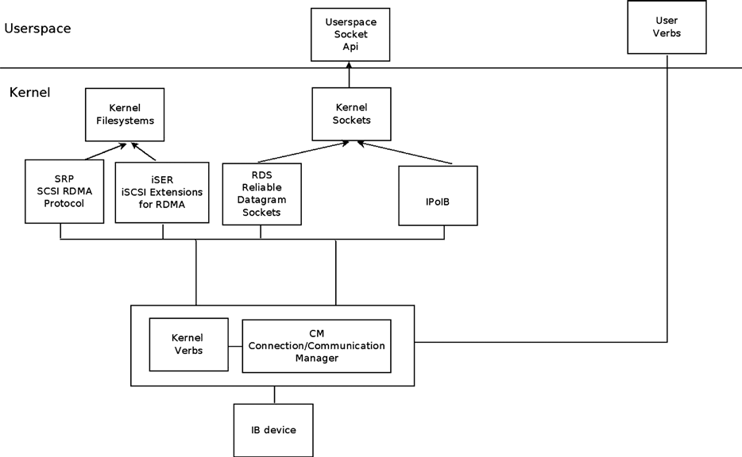
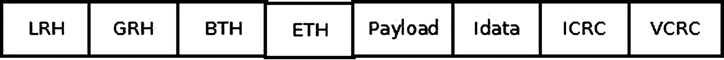
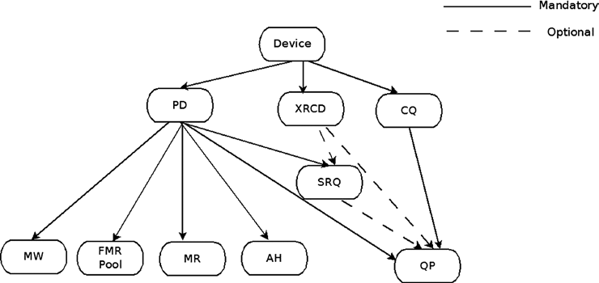
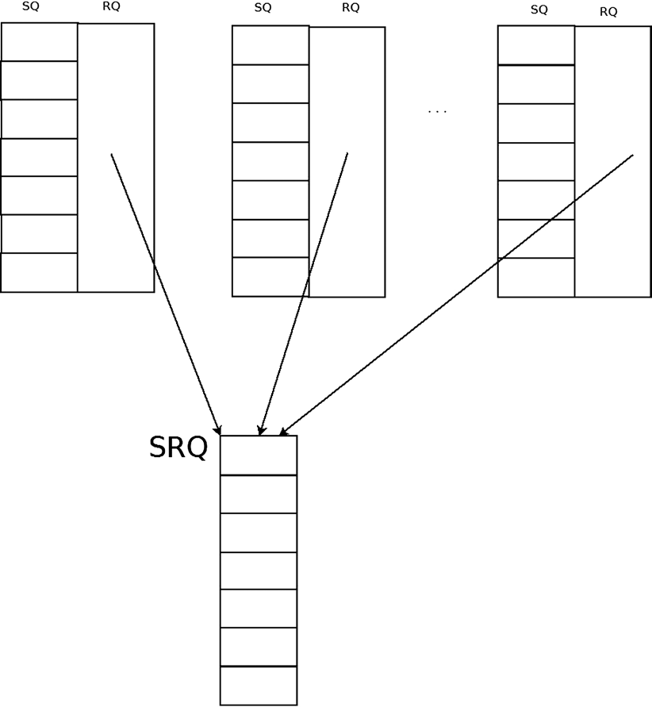
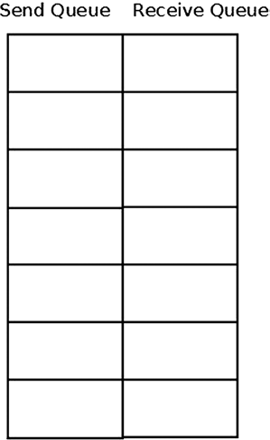
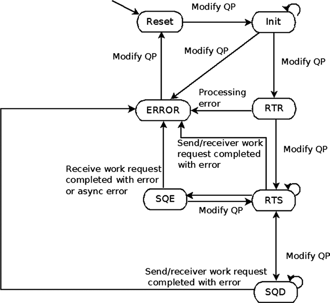
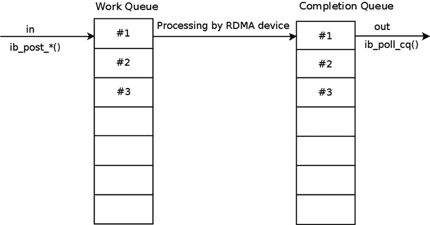
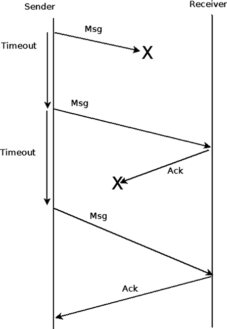
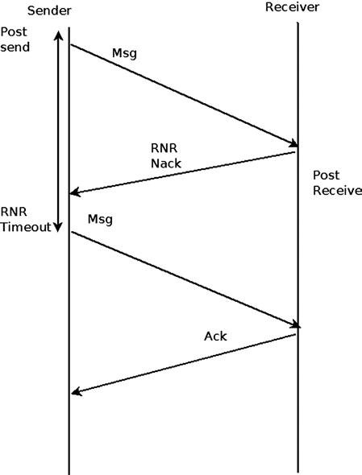

# Chương 13. InfiniBand

Chương này do Dotan Barak, chuyên gia InfiniBand, viết. Dotan là Senior Software Manager tại Mellanox Technologies, làm việc về RDMA Technologies. Dotan đã làm tại Mellanox hơn 10 năm ở nhiều vai trò, cả nhà phát triển lẫn quản lý. Ngoài ra Dotan duy trì blog về RDMA: `http://www.rdmamojo.com`.

Chương 12 trình bày wireless subsystem và cách triển khai trong Linux. Chương này trình bày InfiniBand subsystem và cách triển khai trong Linux. Dù người chưa quen có thể thấy InfiniBand rất phức tạp, các khái niệm phía sau lại đơn giản đáng ngạc nhiên, như bạn sẽ thấy. Tôi bắt đầu bằng Remote Direct Memory Access (RDMA), trình bày data structure chính và API. Tôi đưa ra ví dụ minh họa cách làm việc với RDMA, kết thúc bằng nội dung ngắn về dùng RDMA API từ kernel level và userspace.

## RDMA và InfiniBand—Tổng quan

Remote Direct Memory Access (RDMA) là khả năng một máy truy cập—đọc hoặc ghi—memory trên máy từ xa. Một số network protocol chính hỗ trợ RDMA: InfiniBand, RDMA over Converged Ethernet (RoCE) và internet Wide Area RDMA Protocol (iWARP), tất cả dùng chung API. InfiniBand là networking protocol hoàn toàn mới, đặc tả nằm trong tài liệu “InfiniBand Architecture specifications” do InfiniBand Trade Association (IBTA) duy trì. RoCE cho phép RDMA qua mạng Ethernet; đặc tả nằm ở Annex của InfiniBand specification. iWARP cho phép RDMA qua TCP/IP; đặc tả trong tài liệu “An RDMA Protocol Specification” do RDMA Consortium duy trì. Verbs là mô tả API dùng RDMA từ client code. Cách triển khai RDMA API được đưa vào Linux kernel 2.6.11. Ban đầu chỉ hỗ trợ InfiniBand; sau vài phiên bản kernel thêm iWARP và RoCE. Khi mô tả API, tôi chỉ nhắc một loại nhưng nội dung áp dụng cho tất cả. Mọi định nghĩa API nằm trong `include/rdma/ib_verbs.h`. Sau đây là lưu ý về API và triển khai RDMA stack:

- Một số hàm là inline, số khác không. Cách triển khai tương lai có thể thay đổi điều này.

- Phần lớn API có prefix “ib”; tuy nhiên API hỗ trợ InfiniBand, iWARP và RoCE.

- Header `ib_verbs.h` chứa hàm và structure để dùng bởi:

- Bản thân RDMA stack

- Driver Low-level cho RDMA device

- Kernel module dùng stack với vai trò consumer

Tôi tập trung hàm và structure chỉ liên quan kernel module dùng stack làm consumer (trường hợp thứ ba). Phần tiếp theo trình bày tổ chức RDMA stack trong kernel tree.

### Tổ chức RDMA Stack

Hầu hết kernel RDMA stack code nằm dưới `drivers/infiniband` trong kernel tree. Sau đây là module quan trọng (không phải danh sách đầy đủ vì chương không bao quát toàn RDMA stack):

- CM: Communication manager (`drivers/infiniband/core/cm.c`)

- IPoIB: IP over InfiniBand (`drivers/infiniband/ulp/ipoib/`)

- iSER: Extension iSCSI cho RDMA (`drivers/infiniband/ulp/iser/`)

- RDS: Reliable Datagram Socket (`net/rds/`)

- SRP: SCSI RDMA protocol (`drivers/infiniband/ulp/srp/`)

- Hardware driver low-level của các nhà cung cấp (`drivers/infiniband/hw`)

- verbs: Kernel verbs (`drivers/infiniband/core/verbs.c`)

- uverbs: User verbs (`drivers/infiniband/core/uverbs_*.c`)

- MAD: Management datagram (`drivers/infiniband/core/mad.c`)

Hình 13-1 minh họa kiến trúc Linux InfiniBand stack.



Hình 13-1. Kiến trúc Linux Infiniband stack

Phần này trình bày tổ chức RDMA stack và các kernel module thuộc nó trong Linux kernel.

### Ưu điểm công nghệ RDMA

Ở đây trình bày ưu điểm RDMA và giải thích các tính năng khiến nó phổ biến trong nhiều thị trường:

- Zero copy: Khả năng ghi/đọc trực tiếp remote memory cho phép truy cập remote buffer trực tiếp, không cần sao chép giữa software layer.

- Kernel bypass: Gửi/nhận dữ liệu từ cùng context của code (userspace hoặc kernel level) tiết kiệm thời gian context switch.

- CPU offload: Khả năng gửi/nhận dữ liệu bằng phần cứng chuyên dụng mà không cần CPU can thiệp giúp giảm sử dụng CPU phía từ xa, vì CPU không thực hiện active operation.

- Low latency: RDMA cho phép latency rất thấp với message ngắn. (Trên phần cứng và server hiện tại, latency gửi vài chục byte có thể chỉ vài trăm nano giây.)

- High Bandwidth: Ethernet device có băng thông tối đa giới hạn theo công nghệ (10 hoặc 40 Gbits/sec). InfiniBand dùng cùng protocol và thiết bị từ 2.5 đến 120 Gbits/sec. (Trên phần cứng/server hiện tại, BW đến 56 Gbits/sec.)

### Thành phần phần cứng InfiniBand

Giống công nghệ interconnect khác, spec InfiniBand mô tả nhiều hardware component: một số là endpoint packet (tạo packet và làm đích), số khác forwarding packet trong cùng subnet hoặc giữa subnet. Tôi trình bày loại phổ biến nhất:

- Host Channel Adapter (HCA): Network adapter đặt trong host hoặc hệ thống khác (chẳng hạn storage device). Thành phần khởi tạo hoặc làm đích packet.

- Switch: Thành phần biết nhận packet từ một port và gửi sang port khác. Nếu cần có thể nhân bản multicast message. (InfiniBand không hỗ trợ broadcast.) Khác công nghệ khác, mỗi switch rất đơn giản, có forwarding table do Subnet Manager (SM) cấu hình; SM là thực thể cấu hình/quản lý subnet (sẽ trình bày chi tiết phía sau). Switch không tự học hoặc parse/phân tích packet; chỉ forwarding trong cùng subnet.

- Router: Thành phần kết nối nhiều InfiniBand subnet khác nhau.

Subnet là tập HCA, switch và router port nối với nhau. Phần này mô tả hardware component InfiniBand; tiếp theo trình bày đánh địa chỉ thiết bị, hệ thống và port.

### Đánh địa chỉ trong InfiniBand

Sau đây là quy tắc đánh địa chỉ InfiniBand và ví dụ:

- Identifier duy nhất của thành phần InfiniBand là Globally Unique Identifier (GUID), giá trị 64-bit duy nhất toàn cầu.

- Mỗi node trong subnet có Node GUID, identifier và thuộc tính cố định của node.

- Mỗi port trong subnet, gồm HCA và switch, có port GUID, identifier và thuộc tính cố định của port.

- Hệ thống gồm nhiều thành phần có thể có system GUID. Mọi thành phần trong hệ thống có cùng system GUID.

Ví dụ minh họa các GUID trên: hệ thống switch lớn gồm nhiều switch chip. Mỗi switch chip có Node GUID duy nhất. Mỗi port của mỗi switch có port GUID duy nhất. Mọi chip trong hệ thống có cùng system GUID.

- Global IDentifier (GID) xác định end port hoặc multicast group. Mỗi port có ít nhất một GID hợp lệ tại index 0 trong GID table, dựa trên port GUID cộng subnet identifier của subnet chứa port.

- Local IDentifier (LID) là giá trị 16-bit do Subnet Manager gán cho mỗi subnet port. Switch là ngoại lệ: chỉ switch management port được gán LID, không phải mọi port. Mỗi port có thể được gán một LID hoặc dải LID liên tiếp để có nhiều path đến port. Mỗi LID duy nhất tại thời điểm cụ thể trong cùng subnet; switch dùng để biết egress port khi forwarding packet. Dải unicast LID là 0x001 đến 0xbfff. Dải multicast LID là 0xc000 đến 0xfffe.

### Tính năng InfiniBand

Ở đây trình bày một số tính năng protocol InfiniBand:

- InfiniBand cho phép cấu hình partition các port HCA, switch và router, cung cấp cách ly ảo trên cùng physical subnet. Mỗi Partition Key (P\_Key) là giá trị 16-bit gồm: 15 lsb là key value, msb là membership level; 0 là limited membership, 1 là full membership. Mỗi port có P\_Key table do SM cấu hình, và mỗi Queue Pair (QP), object thực sự gửi/nhận dữ liệu trong InfiniBand, gắn với một P\_Key index trong bảng. QP chỉ gửi/nhận packet với remote QP nếu các P\_Key tương ứng thỏa:

- Key value bằng nhau.

- Ít nhất một bên có full membership.

- Queue Key (Q\_Key): Unreliable Datagram (UD) QP chỉ nhận unicast/multicast message từ remote UD QP nếu Q\_Key của message bằng Q\_Key của UD QP này.

- Virtual Lanes (VL): Cơ chế tạo nhiều virtual link trên một physical link. Mỗi virtual lane biểu diễn tập buffer độc lập cho gửi/nhận packet ở mỗi port. Số VL hỗ trợ là thuộc tính port.

- Service Level (SL): InfiniBand hỗ trợ tối đa 16 service level. Protocol không quy định policy mỗi level. QoS được triển khai bằng ánh xạ SL-to-VL và tài nguyên mỗi VL.

- Failover: Connected QP chỉ gửi/nhận packet với một remote QP. InfiniBand cho phép định nghĩa primary path và alternate path cho connected QP. Nếu primary path gặp vấn đề, alternate path tự động được dùng thay vì báo lỗi.

Phần tiếp theo xem packet InfiniBand có dạng thế nào, rất hữu ích khi debug.

### InfiniBand Packet

Mỗi InfiniBand packet kết hợp nhiều header và thường có payload, là dữ liệu message client muốn gửi. Message chỉ chứa ACK hoặc message 0 byte (chẳng hạn

chỉ gửi immediate data) không có payload. Header mô tả packet gửi từ đâu, đích là gì, operation dùng, thông tin cần phân chia packet thành message và đủ thông tin phát hiện lỗi packet loss.

Hình 13-2 trình bày InfiniBand packet header.



Hình 13-2. InfiniBand packet header

Sau đây là các header InfiniBand:

- Local Routing Header (LRH): 8 byte. Luôn có. Xác định local source/destination port của packet. Cũng chỉ định thuộc tính QoS yêu cầu (SL và VL) của message.

- Global Routing Header (GRH): 40 byte. Tùy chọn. Có với multicast packet hoặc packet qua nhiều subnet. Mô tả source/destination port bằng GID. Định dạng giống IPv6 header.

- Base Transport Header (BTH): 12 byte. Luôn có. Chỉ định source/destination QP, operation, packet sequence number và partition.

- Extended Transport Header (ETH): 4 đến 28 byte. Tùy chọn. Nhóm header bổ sung có thể xuất hiện tùy class of service và operation.

- Payload: Tùy chọn. Dữ liệu client muốn gửi.

- Immediate data: 4 byte. Tùy chọn. Giá trị Out-of-band, 32-bit có thể thêm vào operation Send và RDMA Write.

- Invariant CRC (ICRC): 4 byte. Luôn có. Bao phủ mọi trường không được đổi khi packet đi qua subnet.

- Variant CRC (VCRC): 2 byte. Luôn có. Bao phủ mọi trường của packet.

### Management Entity

SM là thực thể trong subnet chịu trách nhiệm phân tích và cấu hình subnet. Một số nhiệm vụ:

- Phát hiện physical topology của subnet.

- Gán LID và thuộc tính khác—active MTU, active speed, v.v.—cho mỗi port trong subnet.

- Cấu hình forwarding table trong subnet switch.

- Phát hiện thay đổi topology (chẳng hạn thêm/xóa node trong subnet).

- Xử lý lỗi trong subnet.

Subnet Manager thường là software entity chạy trong switch (gọi là managed switch) hoặc node bất kỳ trong subnet. Có thể có nhiều SM nhưng chỉ một active, các SM còn lại ở standby

mode. Có protocol nội bộ thực hiện master election để quyết định SM active. Nếu active SM ngừng hoạt động, một standby SM trở thành active. Mỗi port có Subnet Management Agent (SMA), agent biết nhận management message SM gửi, xử lý và trả lời. Subnet Administrator (SA) là service thuộc SM. Một số nhiệm vụ:

- Cung cấp thông tin subnet—chẳng hạn cách đi từ port này đến port khác (path query).

- Cho phép đăng ký nhận event notification.

- Cung cấp service quản lý subnet như tham gia/rời multicast. Service có thể khiến SM cấu hình (lại) subnet.

Communication Manager (CM) là thực thể có thể chạy trên mỗi port nếu được hỗ trợ để thiết lập, duy trì và teardown QP connection.

## Tài nguyên RDMA

Trong RDMA API, nhiều tài nguyên cần tạo và xử lý trước khi gửi/nhận dữ liệu. Mọi tài nguyên thuộc phạm vi một RDMA device cụ thể, không thể chia sẻ hoặc dùng trên nhiều local device, ngay cả khi nhiều device cùng máy. Hình 13-3 trình bày resource creation hierarchy của RDMA.



Hình 13-3. RDMA resource creation hierarchy

### RDMA Device

Client cần đăng ký với RDMA stack để nhận thông báo RDMA device thêm/xóa khỏi hệ thống. Sau đăng ký ban đầu, client được báo về mọi RDMA device hiện có. Callback được gọi cho mỗi device và client có thể bắt đầu làm việc theo cách:

- Truy vấn các thuộc tính device

- Sửa thuộc tính device

- Tạo, làm việc và hủy tài nguyên. Method `ib_register_client()` đăng ký kernel client muốn dùng RDMA stack. Các callback chỉ định

được gọi cho mọi InfiniBand device hiện có, được thêm hoặc xóa (bằng chức năng hot-plug) khỏi hệ thống. Method `ib_unregister_client()` hủy đăng ký kernel client muốn ngừng dùng RDMA stack. Thường gọi khi unload driver. Đây là code mẫu đăng ký RDMA stack trong kernel client:

```
static void my_add_one(struct ib_device *device)
{
...
}

static void my_remove_one(struct ib_device *device)
{
...
}

static struct ib_client my_client = {
    .name   = "my RDMA module",
    .add    = my_add_one,
    .remove = my_remove_one
};

static int __init my_init_module(void)
{
    int ret;

    ret = ib_register_client(&my_client);
    if (ret) {
        printk(KERN_ERR "Failed to register IB client\n");
        return ret;
    }

    return 0;
}

static void __exit my_cleanup_module(void)
{
    ib_unregister_client(&my_client);
}

module_init(my_init_module);
module_exit(my_cleanup_module);
```

Sau đây là mô tả thêm các method xử lý InfiniBand device.

- Method `ib_set_client_data()` đặt client context gắn với InfiniBand device.

- Method `ib_get_client_data()` trả client context đã gắn với InfiniBand device bằng method `ib_set_client_data()`.

- Method `ib_register_event_handler()` đăng ký callback cho mọi asynchronous event xảy ra với InfiniBand device. Callback structure phải khởi tạo bằng macro INIT\_IB\_EVENT\_HANDLER.

- Method `ib_unregister_event_handler()` hủy đăng ký event handler.

- Method `ib_query_device()` truy vấn thuộc tính InfiniBand device. Thuộc tính cố định, không đổi trong lần gọi sau.

- Method `ib_query_port()` truy vấn thuộc tính InfiniBand device port. Một số cố định, số khác có thể đổi trong lần gọi sau—chẳng hạn port LID, state và thuộc tính khác.

- Method `rdma_port_get_link_layer()` trả link layer của device port.

- Method `ib_query_gid()` truy vấn GID table của port tại index cụ thể. Method `ib_find_gid()` trả index của GID cụ thể trong GID table của port.

- Method `ib_query_pkey()` truy vấn P\_Key table của port tại index cụ thể. Method `ib_find_pkey()` trả index của P\_Key cụ thể trong P\_Key table của port.

### Protection Domain (PD)

PD cho phép gắn với tài nguyên RDMA khác như SRQ, QP, AH hoặc MR để bảo vệ giữa chúng. Tài nguyên gắn PDx không thể làm việc với tài nguyên gắn PDy. Trộn chúng gây lỗi. Thường mỗi module có một PD. Tuy nhiên nếu module muốn tăng bảo mật, dùng một PD cho mỗi remote QP hoặc service. Cấp phát/giải phóng PD như sau:

- Method `ib_alloc_pd()` cấp phát PD. Nhận pointer device object được trả khi driver callback được gọi sau đăng ký.

- Method `ib_dealloc_pd()` giải phóng PD. Thường gọi khi unload driver hoặc hủy tài nguyên gắn với PD.

### Address Handle (AH)

AH được dùng trong Send Request của UD QP để mô tả path message từ local port đến remote port. Có thể dùng cùng AH cho nhiều QP nếu cùng gửi đến remote port với cùng thuộc tính. Sau đây là bốn method liên quan AH:

- Method `ib_create_ah()` tạo AH. Nhận PD và AH attribute làm đối số. AH attribute có thể điền trực tiếp hoặc bằng method `ib_init_ah_from_wc()`, nhận Work Completion đã nhận (object `ib_wc`) gồm thuộc tính incoming message hoàn tất thành công và port nhận. Thay vì gọi `ib_init_ah_from_wc()` rồi `ib_create_ah()`, có thể gọi method `ib_create_ah_from_wc()`.

- Method `ib_modify_ah()` sửa thuộc tính AH hiện có.

- Method `ib_query_ah()` truy vấn thuộc tính AH hiện có.

- Method `ib_destroy_ah()` hủy AH. Gọi khi không cần gửi thêm message đến node mà AH mô tả path đến.

### Memory Region (MR)

Mọi memory buffer được RDMA device truy cập phải đăng ký. Trong quá trình đăng ký, thực hiện các tác vụ sau trên buffer:

- Tách contiguous memory buffer thành memory page.

- Thực hiện ánh xạ chuyển đổi virtual-to-physical.

- Kiểm tra permission của memory page để bảo đảm hỗ trợ permission MR yêu cầu.

- Pin memory page để tránh swap out, giữ ánh xạ virtual-to-physical không đổi.

Sau khi đăng ký memory thành công, có hai key:

- Local key (lkey): Key truy cập memory bằng local Work Request.

- Remote key (rkey): Key truy cập memory từ máy từ xa bằng RDMA operation.

Key được dùng trong Work Request khi tham chiếu memory buffer. Cùng buffer có thể đăng ký nhiều lần, kể cả permission khác nhau. Sau đây là method liên quan MR:

- Method `ib_get_dma_mr()` trả Memory Region cho system memory dùng được với DMA. Nhận PD và access permission yêu cầu cho MR.

- Method `ib_dma_map_single()` ánh xạ kernel virtual address được họ method `kmalloc()` cấp phát sang DMA address. DMA address dùng truy cập local/remote memory. Phải dùng method `ib_dma_mapping_error()` để kiểm tra ánh xạ thành công.

- Method `ib_dma_unmap_single()` unmap DMA mapping do `ib_dma_map_single()` tạo. Gọi khi không cần memory nữa.

Lưu ý Có các biến thể khác của `ib_dma_map_single()` cho phép map page, map theo DMA attribute, map bằng scatter/gather list hoặc scatter/gather list với DMA attribute: `ib_dma_map_page()`, `ib_dma_map_single_attrs()`, `ib_dma_map_sg()` và `ib_dma_map_sg_attrs()`. Tất cả có hàm unmap tương ứng.

Trước khi truy cập DMA mapped memory, phải gọi:

- `ib_dma_sync_single_for_cpu()` nếu CPU sẽ truy cập DMA region, hoặc `ib_dma_sync_single_for_device()` nếu InfiniBand device sẽ truy cập.

- Method `ib_dma_alloc_coherent()` cấp phát memory block CPU truy cập được và map cho DMA.

- Method `ib_dma_free_coherent()` giải phóng memory block được cấp phát bằng `ib_dma_alloc_coherent()`.

- Method `ib_reg_phys_mr()` nhận tập physical page, đăng ký và chuẩn bị virtual address RDMA device truy cập được. Muốn đổi sau khi tạo, gọi method `ib_rereg_phys_mr()`.

- Method `ib_query_mr()` lấy thuộc tính MR cụ thể. Lưu ý phần lớn driver low-level không triển khai method.

- Method `ib_dereg_mr()` hủy đăng ký MR.

### Fast Memory Region (FMR) Pool

Đăng ký Memory Region là thủ tục “nặng”, có thể mất thời gian, context thực hiện thậm chí sleep nếu tài nguyên yêu cầu chưa có khi gọi. Hành vi có thể gây vấn đề trong context nhất định, như interrupt handler. FMR pool cho phép làm việc với FMR có đăng ký “nhẹ”, thực hiện được trong mọi context. API FMR pool nằm trong `include/rdma/ib_fmr_pool.h`.

### Memory Window (MW)

Cho phép remote access memory bằng hai cách:

- Đăng ký memory buffer với remote permission bật.

- Đăng ký Memory Region rồi bind Memory Window vào.

Cả hai tạo remote key (`rkey`) để truy cập memory với permission chỉ định. Tuy nhiên muốn vô hiệu `rkey` để ngăn remote access, hủy đăng ký Memory Region có thể là thủ tục nặng. Dùng Memory Window trên Memory Region và bind/unbind khi cần có thể là thủ tục nhẹ để bật/tắt remote access memory. Sau đây là ba method MW:

- Method `ib_alloc_mw()` cấp phát Memory Window. Nhận PD và MW type.

- Method `ib_bind_mw()` bind Memory Window vào Memory Region chỉ định với địa chỉ, kích thước và remote permission cụ thể bằng cách post Work Request đặc biệt đến QP. Gọi khi muốn cho phép remote access tạm thời. Work Completion trong Send Queue của QP được tạo để mô tả trạng thái operation. Nếu `ib_bind_mw()` được gọi cho Memory Windows đã bind, vào cùng hoặc Memory Region khác, binding cũ bị vô hiệu.

- Method `ib_dealloc_mw()` giải phóng MW object chỉ định.

### Completion Queue (CQ)

Mọi Work Request post vào Send hoặc Receive Queue được xem outstanding đến khi có Work Completion tương ứng cho nó hoặc Work Request post sau nó. Khi outstanding, nội dung memory buffer mà nó trỏ đến chưa xác định:

- Nếu RDMA device đọc memory rồi gửi nội dung qua mạng, client không biết buffer đã có thể dùng (lại) hay giải phóng chưa. Với reliable QP, Work Completion thành công nghĩa là remote side đã nhận message. Với unreliable QP, nghĩa là message đã gửi.

- Nếu RDMA device ghi message vào memory, client không biết buffer đã chứa incoming message chưa.

Work Completion cho biết Work Request tương ứng hoàn tất và cung cấp thông tin: status, opcode, kích thước, v.v. CQ là object chứa Work Completion. Client phải poll CQ để đọc. CQ hoạt động first-in, first-out (FIFO): thứ tự Work Completion được client de-queued theo thứ tự RDMA device enqueue vào CQ. Client có thể đọc bằng polling hoặc yêu cầu notification khi Work Completion mới được thêm. CQ không giữ quá kích thước của nó. Nếu thêm vượt capacity, Work Completion lỗi được thêm, CQ error asynchronous event được tạo và mọi Work Queue liên quan nhận lỗi. Sau đây là các method CQ:

- Method `ib_create_cq()` tạo CQ. Nhận pointer device object trả về khi driver callback được gọi sau đăng ký và CQ attribute, gồm kích thước và callback khi có asynchronous event trên CQ hoặc Work Completion được thêm.

- Method `ib_resize_cq()` đổi kích thước CQ. Số entry mới không được nhỏ hơn số Work Completion hiện có.

- Method `ib_modify_cq()` đổi moderation parameter của CQ. Completion event được tạo nếu ít nhất số Work Completion chỉ định vào CQ hoặc timeout. Giúp giảm interrupt trong RDMA device.

- Method `ib_peek_cq()` trả số Work Completion có trong CQ.

- Method `ib_req_notify_cq()` yêu cầu Completion event notification khi Work Completion tiếp theo, hoặc Work Completion chứa solicited event indication, được thêm vào CQ. Nếu không có Work Completion thêm sau lời gọi `ib_req_notify_cq()`, không có notification.

- Method `ib_req_ncomp_notif()` yêu cầu Completion event notification khi CQ có số Work Completion cụ thể. Khác method `ib_req_notify_cq()`, khi gọi `ib_req_ncomp_notif()`, notification được tạo ngay cả khi CQ hiện đã có số lượng đó.

- Method `ib_poll_cq()` poll Work Completion từ CQ. Đọc theo thứ tự thêm và xóa khỏi CQ.

Đây là code ví dụ làm rỗng CQ—đọc mọi Work Completion và kiểm tra trạng thái:

```
struct ib_wc wc;
int num_comp = 0;

while (ib_poll_cq(cq, 1, &wc) > 0) {
    if (wc.status != IB_WC_SUCCESS) {
        printk(KERN_ERR "The Work Completion[%d] has a bad status %d\n",
                         num_comp, wc.status);
        return -EINVAL;
    }
    num_comp ++;
}
```

### eXtended Reliable Connected (XRC) Domain

XRC Domain là object giới hạn các XRC SRQ mà incoming message có thể nhắm đến. XRC domain có thể gắn với tài nguyên RDMA khác làm việc với XRC như SRQ và QP.

### Shared Receive Queue (SRQ)

SRQ giúp kiến trúc RDMA mở rộng tốt hơn phía nhận. Thay vì Receive Queue riêng cho mỗi Queue Pair, có shared Receive Queue nối mọi QP. Khi cần tiêu thụ Receive Request, chúng lấy từ SRQ. Hình 13-4 trình bày QP gắn với SRQ.



Hình 13-4. QP gắn với SRQ

Nếu có N QP, mỗi QP có thể nhận burst M message vào thời điểm ngẫu nhiên:

- Không SRQ, post N\*M Receive Request.

- Với SRQ, post K\*M (với K \<\< N) Receive Request.

Khác QP không có cơ chế xác định số outstanding Work Request, SRQ có thể đặt watermark limit. Khi số Receive Request xuống dưới giới hạn, SRQ limit asynchronous event được tạo. Nhược điểm là không dự đoán được QP nào tiêu thụ từng Receive Request post vào SRQ, nên kích thước message mà mỗi Receive Request chứa được phải bằng incoming message lớn nhất mọi QP có thể nhận. Có thể xử lý bằng cách tạo nhiều SRQ, mỗi SRQ cho một maximum message size, rồi gắn QP phù hợp theo kích thước dự kiến.

Sau đây là method liên quan SRQ và ví dụ:

- Method `ib_create_srq()` tạo SRQ. Nhận PD và SRQ attribute.

- Method `ib_modify_srq()` sửa SRQ attribute. Dùng đặt watermark mới cho limit event hoặc resize SRQ nếu device hỗ trợ.

Ví dụ đặt watermark để nhận asynchronous event khi số RR trong SRQ xuống dưới 5:

```
struct ib_srq_attr srq_attr;
int ret;

memset(&srq_attr, 0, sizeof(srq_attr));
srq_attr.srq_limit = 5;

ret = ib_modify_srq(srq, &srq_attr, IB_SRQ_LIMIT);
if (ret) {
    printk(KERN_ERR "Failed to set the SRQ's limit value\n");
    return ret;
}
```

Sau đây là thêm các method xử lý SRQ.

- Method `ib_query_srq()` truy vấn SRQ attribute hiện tại. Thường dùng kiểm tra SRQ limit. Giá trị 0 trong member `srq_limit` của object `ib_srq_attr` nghĩa là chưa đặt SRQ limit watermark.

- Method `ib_destroy_srq()` hủy SRQ.

- Method `ib_post_srq_recv()` nhận linked list Receive Request và thêm vào Shared Receive Queue chỉ định để xử lý sau.

Ví dụ post một Receive Request vào SRQ. Lưu incoming message vào memory buffer bằng DMA address đã đăng ký trong một gather entry:

```
    struct ib_recv_wr wr, *bad_wr;
    struct ib_sge sg;
    int ret;

    memset(&sg, 0, sizeof(sg));
    sg.addr   = dma_addr;
    sg.length = len;
    sg.lkey   = mr->lkey;

memset(&wr, 0, sizeof(wr));
wr.next     = NULL;
wr.wr_id    = (uintptr_t)dma_addr;
wr.sg_list  = &sg;
wr.num_sge  = 1;

ret = ib_post_srq_recv(srq, &wr, &bad_wr);
if (ret) {
    printk(KERN_ERR "Failed to post Receive Request to an SRQ\n");
    return ret;
}
```

### Queue Pair (QP)

Queue Pair là object thực sự dùng gửi/nhận dữ liệu trong InfiniBand. Có hai Work Queue riêng: Send và Receive Queue. Mỗi Work Queue có số Work Request (WR) cụ thể có thể post, số scatter/gather element hỗ trợ mỗi WR và CQ để Work Request kết thúc xử lý thêm Work Completion vào. Work Queue có thể tạo với thuộc tính giống hoặc khác—chẳng hạn số WR có thể post. Thứ tự trong mỗi queue được bảo đảm: xử lý Work Request ở Send Queue bắt đầu theo thứ tự submit Send Request. Receive Queue tương tự. Tuy nhiên không có quan hệ thứ tự giữa hai queue: outstanding Send Request có thể được xử lý dù post sau Receive Request vào Receive Queue. Hình 13-5 trình bày QP.



Hình 13-5. QP (Queue Pair)

Khi tạo, mỗi QP có số duy nhất trên toàn RDMA device tại thời điểm cụ thể.

### QP Transport Type

InfiniBand hỗ trợ các QP transport type:

- Reliable Connected (RC): RC QP nối một remote RC QP, bảo đảm độ tin cậy—mọi packet đến theo thứ tự, giữ nguyên nội dung đã gửi. Mỗi message được fragmentation thành packet kích thước path MTU phía gửi và defragmentation phía nhận. QP hỗ trợ operation Send, RDMA Write, RDMA Read và Atomic.

- Unreliable Connected (UC): UC QP nối một remote UC QP, không bảo đảm độ tin cậy. Nếu mất packet trong message, mất toàn message. Mỗi message được fragmentation thành packet kích thước path MTU phía gửi và defragmentation phía nhận. QP hỗ trợ Send và RDMA Write.

- Unreliable Datagram (UD): UD QP có thể gửi unicast message đến mọi UD QP trong subnet. Hỗ trợ multicast. Không bảo đảm độ tin cậy. Mỗi message giới hạn một packet, kích thước tối đa path MTU. QP chỉ hỗ trợ Send.

- eXtended Reliable Connected (XRC): Nhiều QP cùng node có thể gửi message đến remote SRQ trong node cụ thể. Hữu ích để giảm số QP giữa hai node từ mức số CPU core—QP trong một process mỗi core—xuống một QP. Hỗ trợ mọi operation RC QP hỗ trợ. Chỉ liên quan ứng dụng userspace.

- Raw packet: Cho phép client tạo packet hoàn chỉnh gồm L2 header rồi gửi nguyên trạng. Phía nhận RDMA device không bỏ header.

- Raw IPv6/Raw Ethertype: QP cho phép gửi raw packet không được IB device diễn giải. Hiện không RDMA device nào hỗ trợ cả hai loại.

Có QP transport type đặc biệt cho subnet management và special service:

- SMI/QP0: QP cho subnet management packet.

- GSI/QP1: QP cho general service packet.

Method `ib_create_qp()` tạo QP. Nhận PD và thuộc tính yêu cầu cho QP. Ví dụ tạo RC QP bằng PD đã tạo, với hai CQ khác: một cho Send Queue, một cho Receive Queue.

```
    struct ib_qp_init_attr init_attr;
    struct ib_qp *qp;

    memset(&init_attr, 0, sizeof(init_attr));
    init_attr.event_handler       = my_qp_event;
    init_attr.cap.max_send_wr     = 2;
    init_attr.cap.max_recv_wr     = 2;
    init_attr.cap.max_recv_sge    = 1;
    init_attr.cap.max_send_sge    = 1;
    init_attr.sq_sig_type         = IB_SIGNAL_ALL_WR;
    init_attr.qp_type             = IB_QPT_RC;
    init_attr.send_cq             = send_cq;
    init_attr.recv_cq             = recv_cq;

    qp = ib_create_qp(pd, &init_attr);
    if (IS_ERR(qp)) {
        printk(KERN_ERR "Failed to create a QP\n");
        return PTR_ERR(qp);
    }
```

### QP State Machine

QP có state machine xác định khả năng ở mỗi trạng thái:

- Reset state: Mỗi QP được tạo ở đây. Không thể post Send Request hoặc Receive Request. Mọi incoming message âm thầm bị drop.

- Initialized state: Không thể post Send Request. Có thể post Receive Request nhưng chưa xử lý. Mọi incoming message âm thầm bị drop. Nên post Receive Request ở trạng thái này trước khi chuyển RTR (Ready To Receive), tránh remote QP gửi message cần tiêu thụ Receive Request nhưng chưa post.

- Ready To Receive (RTR) state: Không thể post Send Request, nhưng có thể post và xử lý Receive Request. Xử lý mọi incoming message. Message đầu tiên nhận ở trạng thái này tạo communication-established asynchronous event. QP chỉ nhận có thể giữ ở trạng thái này.

- Ready To Send (RTS) state: Có thể post và xử lý cả Send Request lẫn Receive Request. Xử lý mọi incoming message. Đây là trạng thái phổ biến.

- Send Queue Drained (SQD) state: QP hoàn tất mọi Send Request đã bắt đầu xử lý. Chỉ khi không còn message có thể gửi mới đổi một số thuộc tính QP. Gồm hai trạng thái nội bộ:

- Draining: Message vẫn đang gửi.

- Drained: Gửi message đã hoàn tất.

- Send Queue Error (SQE) state: RDMA device tự chuyển QP vào đây khi Send Queue lỗi với unreliable transport type. Send Request gây lỗi kết thúc với nguyên nhân lỗi, mọi Send Request tiếp theo được flush. Receive Queue vẫn làm việc—có thể post Receive Request và xử lý incoming message. Client có thể phục hồi, đổi QP về RTS.

- Error state: Mọi outstanding Work Request được flush. RDMA device có thể chuyển QP vào đây nếu reliable transport type gặp lỗi Send Request, hoặc Receive Queue lỗi bất kể transport type. Mọi incoming message âm thầm bị drop.

Có thể dùng `ib_modify_qp()` chuyển QP từ mọi state sang Reset và Error. Chuyển Error flush mọi outstanding Work Request. Chuyển Reset xóa mọi thuộc tính đã cấu hình, bỏ mọi outstanding Work Request và Work Completion kết thúc trên QP trong các Completion Queue QP dùng. Hình 13-6 là QP state machine diagram.



Hình 13-6. QP state machine

Method `ib_modify_qp()` sửa thuộc tính QP. Nhận QP cần sửa và thuộc tính sẽ sửa. State machine có thể đổi theo Hình 13-6. Mỗi QP transport type đòi hỏi thuộc tính khác nhau trong từng state transition.

Ví dụ sửa RC QP mới tạo sang RTS, nơi có thể gửi/nhận packet. Local attribute là outgoing port, SL và Packet Serial Number khởi đầu của Send Queue. Remote attribute cần là Receive PSN, QP number và LID của port nó dùng.

```
        struct ib_qp_attr attr = {
            .qp_state        = IB_QPS_INIT,
            .pkey_index      = 0,
            .port_num        = port,
            .qp_access_flags = 0
        };

        ret = ib_modify_qp(qp, &attr,
                  IB_QP_STATE         |
                  IB_QP_PKEY_INDEX    |
                  IB_QP_PORT          |
                  IB_QP_ACCESS_FLAGS);
if (ret) {
          printk(KERN_ERR "Failed to modify QP to INIT state\n");
          return ret;
}

attr.qp_state              = IB_QPS_RTR;
attr.path_mtu              = mtu;
attr.dest_qp_num           = remote->qpn;
attr.rq_psn                = remote->psn;
attr.max_dest_rd_atomic    = 1;
attr.min_rnr_timer         = 12;
attr.ah_attr.is_global     = 0;
attr.ah_attr.dlid          = remote->lid;
attr.ah_attr.sl            = sl;
attr.ah_attr.src_path_bits = 0,
attr.ah_attr.port_num      = port

ret = ib_modify_qp(ctx->qp, &attr,
          IB_QP_STATE                 |
          IB_QP_AV                    |
          IB_QP_PATH_MTU              |
          IB_QP_DEST_QPN              |
          IB_QP_RQ_PSN                |
          IB_QP_MAX_DEST_RD_ATOMIC    |
          IB_QP_MIN_RNR_TIMER);
if (ret) {
  printk(KERN_ERR "Failed to modify QP to RTR state\n");
  return ret;
}

attr.qp_state       = IB_QPS_RTS;
attr.timeout        = 14;
attr.retry_cnt      = 7;
attr.rnr_retry      = 6;
attr.sq_psn         = my_psn;
attr.max_rd_atomic  = 1;
ret = ib_modify_qp(ctx->qp, &attr,
          IB_QP_STATE             |
          IB_QP_TIMEOUT           |
          IB_QP_RETRY_CNT         |
          IB_QP_RNR_RETRY         |
          IB_QP_SQ_PSN            |
          IB_QP_MAX_QP_RD_ATOMIC);
if (ret) {
  printk(KERN_ERR "Failed to modify QP to RTS state\n");
  return ret;
}
```

Sau đây là thêm các method xử lý QP:

- Method `ib_query_qp()` truy vấn QP attribute hiện tại. Một số cố định (giá trị client chỉ định), số khác có thể đổi (như state).

- Method `ib_destroy_qp()` hủy QP. Gọi khi không cần nữa.

### Xử lý Work Request

Mọi Work Request post vào Send hoặc Receive Queue được xem outstanding đến khi có Work Completion được poll từ CQ gắn với Work Queue, cho Work Request này hoặc Work Request cùng queue post sau nó. Mọi outstanding Work Request ở Receive Queue kết thúc bằng Work Completion. Work Request processing flow trong Work Queue theo Hình 13-7.



Hình 13-7. Work Request processing flow

Trong Send Queue, có thể chọn khi tạo QP: mọi Send Request kết thúc bằng Work Completion, hoặc chọn Send Request nào tạo Work Completion—selective signaling. Unsignaled Send Request vẫn có thể lỗi; khi đó Work Completion với bad status vẫn được tạo.

Khi Work Request outstanding, không thể dùng (lại) hoặc giải phóng tài nguyên được chỉ định khi post. Chẳng hạn:

- Khi post Send Request cho UD QP, không được giải phóng AH.

- Khi post Receive Request, không được đọc memory buffer tham chiếu trong scatter/gather (s/g) list vì chưa biết RDMA device đã ghi dữ liệu chưa.

“Fencing” là khả năng ngăn xử lý Send Request cụ thể đến khi RDMA Read và Atomic operation trước đó kết thúc. Thêm Fence indication hữu ích chẳng hạn khi RDMA Read từ remote address rồi gửi dữ liệu hoặc một phần dữ liệu trong cùng Send Queue. Không fencing, send operation có thể bắt đầu trước khi dữ liệu được lấy về local memory. Khi post Send Request đến UC hoặc RC QP, path đích đã biết vì cung cấp khi chuyển QP sang RTR. Nhưng với UD QP, phải thêm AH mô tả path đến đích của message. Nếu lỗi liên quan Send Queue và Unreliable transport type, Send Queue sang Error (SQE) nhưng Receive Queue vẫn hoạt động đầy đủ. Client có thể phục hồi và đổi QP về RTS. Nếu lỗi Receive Queue, QP sang Error vì không phục hồi được. Khi Work Queue sang Error, Work Request gây lỗi kết thúc với status chỉ bản chất lỗi, các Work Request còn lại được flush với lỗi.

### Operation được hỗ trợ trong kiến trúc RDMA

InfiniBand hỗ trợ các operation type:

- Send: Gửi message qua mạng. Remote side cần Receive Request sẵn có; message được ghi vào buffer của nó.

- Send with Immediate: Gửi message kèm 32 bit dữ liệu out-of-band. Remote side cần Receive Request sẵn có; message ghi vào buffer. Immediate data có trong Work Completion của bên nhận.

- RDMA Write: Gửi message qua mạng đến remote address.

- RDMA Write with Immediate: Gửi message và ghi vào remote address. Remote side cần Receive Request sẵn có. Immediate data có trong Work Completion bên nhận. Có thể xem là RDMA Write + Send with immediate với message zero-byte.

- RDMA Read: Đọc remote address và điền nội dung vào local buffer.

- Compare and Swap: So sánh nội dung remote address với valueX; nếu bằng, thay bằng valueY. Tất cả thực hiện atomic. Nội dung remote memory gốc được gửi và lưu cục bộ.

- Fetch and Add: Cộng giá trị vào nội dung remote address theo cách atomic. Nội dung remote memory gốc được gửi và lưu cục bộ.

- Masked Compare and Swap: So sánh phần nội dung remote address dùng maskX với valueX; nếu bằng, thay phần nội dung dùng bit maskY bằng valueY. Tất cả atomic. Nội dung remote memory gốc được gửi và lưu cục bộ.

- Masked Fetch and Add: Cộng giá trị vào nội dung remote address theo cách atomic, chỉ đổi các bit được mask chỉ định. Nội dung remote memory gốc được gửi và lưu cục bộ.

- Bind Memory Window: Bind Memory Windows vào Memory Region cụ thể.

- Fast registration: Đăng ký Fast Memory Region bằng Work Request.

- Local invalidate: Vô hiệu Fast Memory Region bằng Work Request. Nếu dùng `lkey`/`rkey` cũ thì bị coi lỗi. Có thể kết hợp send/RDMA read; khi đó thực hiện send/read trước, rồi mới vô hiệu Fast Memory Region.

Receive Request chỉ nơi lưu incoming message cho operation tiêu thụ Receive Request. Tổng kích thước memory buffer trong scatter list phải lớn hơn hoặc bằng incoming message.

Với UD QP, vì chưa biết trước nguồn message (cùng/khác subnet, unicast/multicast), phải thêm 40 byte, kích thước GRH header, vào Receive Request buffer. 40 byte đầu chứa GRH nếu có. GRH mô tả cách gửi message trả bên gửi. Message thực bắt đầu tại offset 40 trong memory buffer của scatter list.

Method `ib_post_recv()` nhận linked list Receive Request và thêm vào Receive Queue của QP cụ thể để xử lý sau. Ví dụ post một Receive Request cho QP. Lưu incoming

message vào memory buffer bằng DMA address đã đăng ký trong một gather entry. `qp` là pointer đến QP tạo bằng `ib_create_qp()`. Memory buffer là block cấp phát bằng `kmalloc()` và map DMA bằng `ib_dma_map_single()`. `lkey` dùng từ MR đăng ký bằng `ib_get_dma_mr()`.

```
struct ib_recv_wr wr, *bad_wr;
struct ib_sge sg;
int ret;

memset(&sg, 0, sizeof(sg));
sg.addr   = dma_addr;
sg.length = len;
sg.lkey   = mr->lkey;

memset(&wr, 0, sizeof(wr));
wr.next     = NULL;
wr.wr_id    = (uintptr_t)dma_addr;
wr.sg_list  = &sg;
wr.num_sge  = 1;

ret = ib_post_recv(qp, &wr, &bad_wr);

if (ret) {
    printk(KERN_ERR "Failed to post Receive Request to a QP\n");
    return ret;
}
```

Method `ib_post_send()` nhận linked list Send Request làm đối số và thêm vào Send Queue của QP cụ thể để xử lý sau. Ví dụ post một Send Request của Send operation cho QP. Gửi nội dung memory buffer bằng DMA address đã đăng ký trong một gather entry.

```
    struct ib_sge sg;
    struct ib_send_wr wr, *bad_wr;
    int ret;

    memset(&sg, 0, sizeof(sg));
    sg.addr   = dma_addr;
    sg.length = len;
    sg.lkey   = mr->lkey;

    memset(&wr, 0, sizeof(wr));
    wr.next       = NULL;
    wr.wr_id      = (uintptr_t)dma_addr;
    wr.sg_list    = &sg;
    wr.num_sge    = 1;
    wr.opcode     = IB_WR_SEND;
    wr.send_flags = IB_SEND_SIGNALED;

    ret = ib_post_send(qp, &wr, &bad_wr);

if (ret) {
    printk(KERN_ERR "Failed to post Send Request to a QP\n");
    return ret;
}
```

### Work Completion Status

Mỗi Work Completion có thể kết thúc thành công hoặc lỗi. Nếu thành công, operation hoàn tất và dữ liệu gửi theo reliability level của transport type. Nếu lỗi, nội dung memory buffer không xác định. Có nhiều nguyên nhân Work Request status báo lỗi: protection violation, bad address, v.v. Violation error không retransmit. Tuy nhiên có hai retry flow đặc biệt cần đề cập. Cả hai do RDMA device tự động thực hiện, retransmit packet đến khi vấn đề được giải quyết hoặc vượt số lần retransmission. Nếu giải quyết được, client code không biết đã xảy ra, ngoài gián đoạn hiệu năng tạm thời. Chỉ áp dụng Reliable transport type.

#### Retry Flow

Nếu bên nhận không trả ACK/NACK trong timeout dự kiến, bên gửi có thể gửi lại message theo timeout và retry count đã cấu hình trong QP attribute. Có các nguyên nhân:

- Thuộc tính remote QP hoặc path đến nó không đúng.

- Remote QP chưa đạt (ít nhất) trạng thái RTR.

- Remote QP chuyển Error state.

- Message bị drop trên đường từ bên gửi đến bên nhận (chẳng hạn CRC error).

- ACK/NACK bị drop trên đường từ bên nhận đến bên gửi (chẳng hạn CRC error).

Hình 13-8 minh họa retry flow khắc phục packet loss do packet drop.



Hình 13-8. Retry flow (trên reliable transport type)

Nếu cuối cùng sender QP nhận ACK/NACK thành công, tiếp tục gửi message còn lại. Nếu message sau cũng gặp vấn đề, retry flow thực hiện lại cho message đó, không giữ lịch sử trước. Nếu sau nhiều lần retry bên nhận vẫn không phản hồi, phía gửi có Work Completion với Retry Error.

#### Receiver Not Ready (RNR) Flow

Nếu bên nhận nhận message cần tiêu thụ Receive Request từ Receiver Queue nhưng không có outstanding Receive Request, nó gửi trả RNR NACK. Sau khoảng thời gian chỉ định trong RNR NACK, bên gửi thử gửi lại.

Nếu cuối cùng bên nhận post Receiver Request kịp và incoming message tiêu thụ nó, ACK gửi đến bên gửi báo message đã lưu thành công. Nếu message sau cũng gặp vấn đề, RNR retry flow thực hiện lại không giữ lịch sử. Nếu sau nhiều lần retry bên nhận vẫn chưa post Receiver Request, và mỗi message gửi đều nhận RNR NACK, Work Completion với RNR Retry Error được tạo phía gửi. Hình 13-9 minh họa RNR retry flow khắc phục thiếu Receive Request phía nhận.



Hình 13-9. RNR retry flow (trên reliable transport type)

Phần này trình bày Work Request status và một số bad flow có thể xảy ra với message. Phần tiếp theo trình bày multicast group.

### Multicast Group

Multicast group cho phép gửi message từ một UD QP đến nhiều UD QP. Mỗi UD QP muốn nhận phải attach vào multicast group. Khi device nhận multicast packet, nhân bản đến mọi QP attach group. Sau đây là hai method:

- Method `ib_attach_mcast()` attach UD QP vào multicast group trong InfiniBand device. Nhận QP cần attach và thuộc tính multicast group.

- Method `ib_detach_mcast()` detach UD QP khỏi multicast group.

### Khác biệt RDMA API Userspace và Kernel-Level

Userspace và kernel level RDMA stack API khá giống vì cùng công nghệ và cần cung cấp cùng chức năng. Khi userspace gọi control path method của RDMA API, context switch sang kernel level để bảo vệ privileged resource và đồng bộ object cần thiết (chẳng hạn không thể gán cùng QP number cho nhiều QP đồng thời).

Tuy nhiên có khác biệt API và chức năng giữa userspace và kernel-level:

- Prefix mọi API kernel level là “ib\_”, còn userspace là “ibv\_”.

- Có enumeration và macro chỉ có trong kernel level RDMA API.

- Có QP type chỉ có trong kernel (chẳng hạn SMI và GSI QP).

- Có privileged operation chỉ thực hiện ở kernel level—chẳng hạn đăng ký physical memory, đăng ký MR bằng WR và FMR.

- Một số chức năng không có trong userspace RDMA API—chẳng hạn Request for N notification.

- Kernel API asynchronous. Callback được gọi khi có asynchronous event hoặc Completion event. Trong userspace, mọi thứ synchronous, người dùng phải kiểm tra tường minh có asynchronous/Completion event trong running context (thread) không.

- XRC không liên quan client kernel-level.

- Có tính năng mới được giới thiệu ở kernel level nhưng chưa có trong userspace.

Userspace API được thư viện “libibverbs” cung cấp. Dù chức năng RDMA user level ít hơn kernel-level, vẫn đủ hưởng lợi công nghệ InfiniBand.

## Tổng kết

Trong chương, bạn tìm hiểu ưu điểm InfiniBand. Tôi xem xét tổ chức RDMA stack, resource-creation hierarchy và mọi object quan trọng cùng API cần để viết client code dùng InfiniBand. Bạn cũng thấy ví dụ dùng API. Chương tiếp theo trình bày chủ đề nâng cao như network namespace và Bluetooth subsystem.

## Tham khảo nhanh

Tôi kết thúc chương bằng danh sách ngắn method quan trọng của RDMA API. Một số đã được đề cập.

### Method

Sau đây là các method.

### int ib\_register\_client(struct ib\_client \*client);

Đăng ký kernel client muốn dùng RDMA stack.

### void ib\_unregister\_client(struct ib\_client \*client);

Hủy đăng ký kernel client muốn ngừng dùng RDMA stack.

### void ib\_set\_client\_data(struct ib\_device \*device, struct ib\_client \*client, void \*data);

Đặt client context gắn với InfiniBand device.

### void \*ib\_get\_client\_data(struct ib\_device \*device, struct ib\_client \*client);

Đọc client context đã gắn với InfiniBand device.

### int ib\_register\_event\_handler(struct ib\_event\_handler \*event\_handler);

Đăng ký callback cho mọi asynchronous event xảy ra với InfiniBand device.

### int ib\_unregister\_event\_handler(struct ib\_event\_handler \*event\_handler);

Hủy đăng ký callback cho mọi asynchronous event xảy ra với InfiniBand device.

### int ib\_query\_device(struct ib\_device \*device, struct ib\_device\_attr \*device\_attr);

Truy vấn thuộc tính InfiniBand device.

### int ib\_query\_port(struct ib\_device \*device, u8 port\_num, struct ib\_port\_attr \*port\_attr);

Truy vấn thuộc tính InfiniBand device port.

### enum rdma\_link\_layer rdma\_port\_get\_link\_layer(struct ib\_device \*device, u8 port\_num);

Truy vấn link layer của InfiniBand device port.

### int ib\_query\_gid(struct ib\_device \*device, u8 port\_num, int index, union ib\_gid \*gid);

Truy vấn GID tại index cụ thể trong GID table của InfiniBand device port.

### int ib\_query\_pkey(struct ib\_device \*device, u8 port\_num, u16 index, u16 \*pkey);

Truy vấn index P\_Key-specific trong P\_Key table của InfiniBand device port.

### int ib\_find\_gid(struct ib\_device \*device, union ib\_gid \*gid, u8 \*port\_num, u16 \*index);

Tìm index của GID cụ thể trong GID table của InfiniBand device port.

### int ib\_find\_pkey(struct ib\_device \*device, u8 port\_num, u16 pkey, u16 \*index);

Tìm index của P\_Key cụ thể trong P\_Key table của InfiniBand device port.

### struct ib\_pd \*ib\_alloc\_pd(struct ib\_device \*device);

Cấp phát PD dùng tạo tài nguyên InfiniBand khác sau đó.

### int ib\_dealloc\_pd(struct ib\_pd \*pd);

Giải phóng PD.

### struct ib\_ah \*ib\_create\_ah(struct ib\_pd \*pd, struct ib\_ah\_attr \*ah\_attr);

Tạo AH dùng khi post Send Request trong UD QP.

### int ib\_init\_ah\_from\_wc(struct ib\_device \*device, u8 port\_num, struct ib\_wc \*wc, struct ib\_grh \*grh, struct ib\_ah\_attr \*ah\_attr);

Khởi tạo AH attribute từ Work Completion của message nhận được và GRH buffer. Có thể dùng AH attribute khi gọi method `ib_create_ah()`.

### struct ib\_ah \*ib\_create\_ah\_from\_wc(struct ib\_pd \*pd, struct ib\_wc \*wc, struct ib\_grh \*grh, u8 port\_num);

Tạo AH từ Work Completion của message nhận được và GRH buffer.

### int ib\_modify\_ah(struct ib\_ah \*ah, struct ib\_ah\_attr \*ah\_attr);

Sửa thuộc tính AH hiện có.

### int ib\_query\_ah(struct ib\_ah \*ah, struct ib\_ah\_attr \*ah\_attr);

Truy vấn thuộc tính AH hiện có.

### int ib\_destroy\_ah(struct ib\_ah \*ah);

Hủy AH.

### struct ib\_mr \*ib\_get\_dma\_mr(struct ib\_pd \*pd, int mr\_access\_flags);

Trả MR system memory dùng được cho DMA.

### static inline int ib\_dma\_mapping\_error(struct ib\_device \*dev, u64 dma\_addr);

Kiểm tra DMA memory trỏ đến địa chỉ không hợp lệ—tức DMA mapping operation có thất bại không.

### static inline u64 ib\_dma\_map\_single(struct ib\_device \*dev, void \*cpu\_addr, size\_t size, enum dma\_data\_direction direction);

Map kernel virtual address sang DMA address.

### static inline void ib\_dma\_unmap\_single(struct ib\_device \*dev, u64 addr, size\_t size, enum dma\_data\_direction direction);

Unmap DMA mapping của virtual address.

### static inline u64 ib\_dma\_map\_single\_attrs(struct ib\_device \*dev, void \*cpu\_addr, size\_t size, enum dma\_data\_direction direction, struct dma\_attrs \*attrs)

Map kernel virtual memory sang DMA address theo DMA attribute.

### static inline void ib\_dma\_unmap\_single\_attrs(struct ib\_device \*dev, u64 addr, size\_t size, enum dma\_data\_direction direction, struct dma\_attrs \*attrs);

Unmap DMA mapping của virtual address được map theo DMA attribute.

### static inline u64 ib\_dma\_map\_page(struct ib\_device \*dev, struct page \*page, unsigned long offset, size\_t size, enum dma\_data\_direction direction);

Map physical page sang DMA address.

### static inline void ib\_dma\_unmap\_page(struct ib\_device \*dev, u64 addr, size\_t size, enum dma\_data\_direction direction);

Unmap DMA mapping của physical page.

### static inline int ib\_dma\_map\_sg(struct ib\_device \*dev, struct scatterlist \*sg, int nents, enum dma\_data\_direction direction);

Map scatter/gather list sang DMA address.

### static inline void ib\_dma\_unmap\_sg(struct ib\_device \*dev, struct scatterlist \*sg, int nents, enum dma\_data\_direction direction);

Unmap DMA mapping của scatter/gather list.

### static inline int ib\_dma\_map\_sg\_attrs(struct ib\_device \*dev, struct scatterlist \*sg, int nents, enum dma\_data\_direction direction, struct dma\_attrs \*attrs);

Map scatter/gather list sang DMA address theo DMA attribute.

### static inline void ib\_dma\_unmap\_sg\_attrs(struct ib\_device \*dev, struct scatterlist \*sg, int nents, enum dma\_data\_direction direction, struct dma\_attrs \*attrs);

Unmap DMA mapping của scatter/gather list theo DMA attribute.

### static inline u64 ib\_sg\_dma\_address(struct ib\_device \*dev, struct scatterlist \*sg);

Trả thuộc tính address của scatter/gather entry.

### static inline unsigned int ib\_sg\_dma\_len(struct ib\_device \*dev, struct scatterlist \*sg);

Trả thuộc tính length của scatter/gather entry.

### static inline void ib\_dma\_sync\_single\_for\_cpu(struct ib\_device \*dev, u64 addr, size\_t size, enum dma\_data\_direction dir);

Chuyển quyền sở hữu DMA region cho CPU. Phải gọi trước khi CPU truy cập DMA mapped region đã chuyển quyền sở hữu cho device.

### static inline void ib\_dma\_sync\_single\_for\_device(struct ib\_device \*dev, u64 addr, size\_t size, enum dma\_data\_direction dir);

Chuyển quyền sở hữu DMA region cho device. Phải gọi trước khi device truy cập DMA mapped region đã chuyển quyền sở hữu cho CPU.

### static inline void \*ib\_dma\_alloc\_coherent(struct ib\_device \*dev, size\_t size, u64 \*dma\_handle, gfp\_t flag);

Cấp phát memory block CPU truy cập được và map cho DMA.

### static inline void ib\_dma\_free\_coherent(struct ib\_device \*dev, size\_t size, void \*cpu\_addr, u64 dma\_handle);

Giải phóng memory block đã cấp phát bằng `ib_dma_alloc_coherent()`.

### struct ib\_mr \*ib\_reg\_phys\_mr(struct ib\_pd \*pd, struct ib\_phys\_buf \*phys\_buf\_array, int num\_phys\_buf, int mr\_access\_flags, u64 \*iova\_start);

Nhận physical page list, chuẩn bị để InfiniBand device truy cập.

### int ib\_rereg\_phys\_mr(struct ib\_mr \*mr, int mr\_rereg\_mask, struct ib\_pd \*pd, struct ib\_phys\_buf \*phys\_buf\_array, int num\_phys\_buf, int mr\_access\_flags, u64 \*iova\_start);

Đổi thuộc tính MR.

### int ib\_query\_mr(struct ib\_mr \*mr, struct ib\_mr\_attr \*mr\_attr);

Truy vấn thuộc tính MR.

### int ib\_dereg\_mr(struct ib\_mr \*mr);

Hủy đăng ký MR.

### struct ib\_mw \*ib\_alloc\_mw(struct ib\_pd \*pd, enum ib\_mw\_type type);

Cấp phát MW dùng cho phép remote access MR.

### static inline int ib\_bind\_mw(struct ib\_qp \*qp, struct ib\_mw \*mw, struct ib\_mw\_bind \*mw\_bind);

Bind MW vào MR để cho phép remote access local memory với permission cụ thể.

### int ib\_dealloc\_mw(struct ib\_mw \*mw);

Giải phóng MW.

### struct ib\_cq \*ib\_create\_cq(struct ib\_device \*device, ib\_comp\_handler comp\_handler, void (\*event\_handler)(struct ib\_event \*, void \*), void \*cq\_context, int cqe, int comp\_vector);

Tạo CQ dùng chỉ trạng thái Work Request đã kết thúc của Send hoặc Receive Queue.

### int ib\_resize\_cq(struct ib\_cq \*cq, int cqe);

Đổi số entry trong CQ.

### int ib\_modify\_cq(structib\_cq \*cq, u16 cq\_count, u16 cq\_period);

Sửa moderation attribute của CQ. Method dùng giảm số interrupt của InfiniBand device.

### int ib\_peek\_cq(structib\_cq \*cq, intwc\_cnt);

Trả số Work Completion hiện có trong CQ.

### static inline int ib\_req\_notify\_cq(struct ib\_cq \*cq, enum ib\_cq\_notify\_flags flags);

Yêu cầu Completion notification event khi Work Completion tiếp theo được thêm vào CQ.

### static inline int ib\_req\_ncomp\_notif(struct ib\_cq \*cq, int wc\_cnt);

Yêu cầu Completion notification event khi CQ có số Work Completion cụ thể.

### static inline int ib\_poll\_cq(struct ib\_cq \*cq, int num\_entries, struct ib\_wc \*wc);

Đọc và xóa một hoặc nhiều Work Completion khỏi CQ theo thứ tự thêm.

### struct ib\_srq \*ib\_create\_srq(struct ib\_pd \*pd, struct ib\_srq\_init\_attr \*srq\_init\_attr);

Tạo SRQ làm shared Receive Queue cho nhiều QP.

### int ib\_modify\_srq(struct ib\_srq \*srq, struct ib\_srq\_attr \*srq\_attr, enum ib\_srq\_attr\_mask srq\_attr\_mask);

Sửa thuộc tính SRQ.

### int ib\_query\_srq(struct ib\_srq \*srq, struct ib\_srq\_attr \*srq\_attr);

Truy vấn thuộc tính SRQ. SRQ limit có thể đổi trong lần gọi sau.

### int ib\_destroy\_srq(struct ib\_srq \*srq);

Hủy SRQ.

### struct ib\_qp \*ib\_create\_qp(struct ib\_pd \*pd, struct ib\_qp\_init\_attr \*qp\_init\_attr);

Tạo QP. Mỗi QP mới được gán QP number chưa được QP khác dùng cùng thời điểm.

### int ib\_modify\_qp(struct ib\_qp \*qp, struct ib\_qp\_attr \*qp\_attr, int qp\_attr\_mask);

Sửa thuộc tính QP, gồm Send/Receive Queue attribute và QP state.

### int ib\_query\_qp(struct ib\_qp \*qp, struct ib\_qp\_attr \*qp\_attr, int qp\_attr\_mask, struct ib\_qp\_init\_attr \*qp\_init\_attr);

Truy vấn thuộc tính QP. Một số có thể đổi trong lần gọi sau.

### int ib\_destroy\_qp(struct ib\_qp \*qp);

Hủy QP.

### static inline int ib\_post\_srq\_recv(struct ib\_srq \*srq, struct ib\_recv\_wr \*recv\_wr, struct ib\_recv\_wr \*\*bad\_recv\_wr);

Thêm linked list Receive Request vào SRQ.

### static inline int ib\_post\_recv(struct ib\_qp \*qp, struct ib\_recv\_wr \*recv\_wr, struct ib\_recv\_wr \*\*bad\_recv\_wr);

Thêm linked list Receive Request vào Receive Queue của QP.

### static inline int ib\_post\_send(struct ib\_qp \*qp, struct ib\_send\_wr \*send\_wr, struct ib\_send\_wr \*\*bad\_send\_wr);

Thêm linked list Send Request vào Send Queue của QP.

### int ib\_attach\_mcast(struct ib\_qp \*qp, union ib\_gid \*gid, u16 lid);

Attach UD QP vào multicast group.

### int ib\_detach\_mcast(struct ib\_qp \*qp, union ib\_gid \*gid, u16 lid);

Detach UD QP khỏi multicast group.
