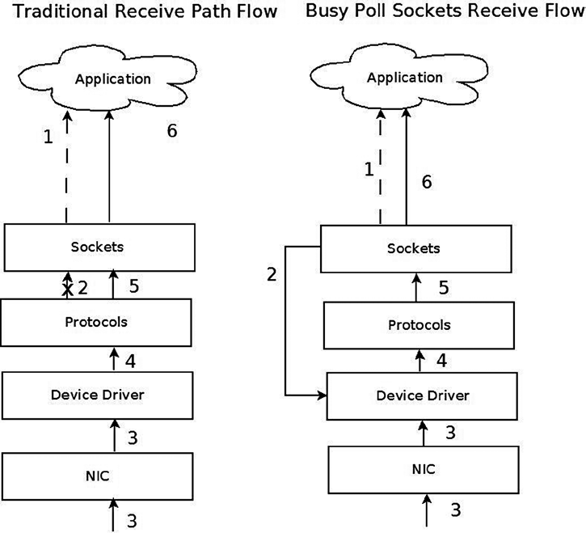
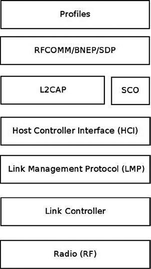
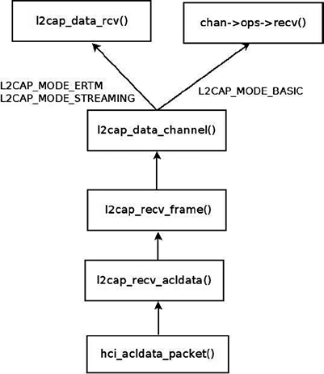
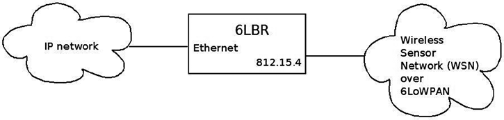
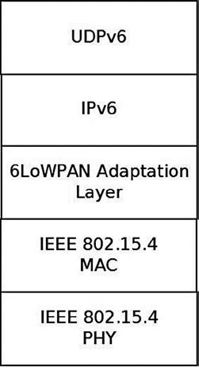
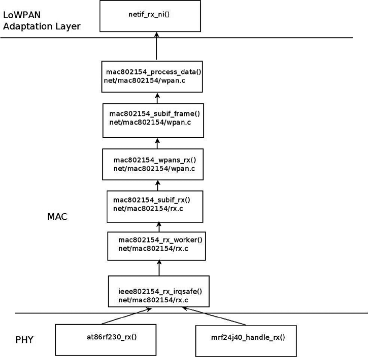
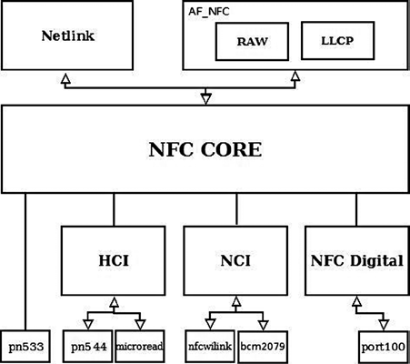
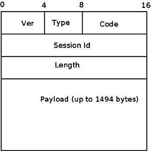

# Chương 14. Chủ đề nâng cao

Chương 13 trình bày InfiniBand subsystem và cách triển khai trong Linux. Chương này trình bày một số chủ đề nâng cao và những chủ đề không phù hợp về logic với chương khác. Chương bắt đầu với network namespace, một dạng cơ chế process virtualization nhẹ được thêm vào Linux những năm gần đây. Tôi sẽ trình bày triển khai namespace nói chung và network namespace nói riêng. Bạn sẽ biết chỉ cần hai system call mới để triển khai namespace. Bạn cũng sẽ thấy một số ví dụ cho thấy việc tạo và quản lý network namespace bằng lệnh `ip` của `iproute2` đơn giản thế nào, cũng như việc chuyển một network device từ network namespace này sang network namespace khác và gắn process chỉ định vào network namespace chỉ định đơn giản ra sao. Cgroups subsystem cũng cung cấp giải pháp quản lý tài nguyên, khác namespace. Tôi sẽ mô tả cgroups subsystem cùng hai network module của nó, `net_prio` và `cls_cgroup`, và đưa ra hai ví dụ dùng các cgroup network module này.

Ở phần sau của chương này, bạn sẽ tìm hiểu Busy Poll Sockets và cách tinh chỉnh chúng. Feature Busy Poll Sockets cung cấp một kỹ thuật tối ưu hiệu năng thú vị cho các socket cần latency thấp và chấp nhận đánh đổi bằng mức sử dụng CPU cao hơn. Feature Busy Poll Sockets có từ kernel 3.11. Tôi cũng sẽ trình bày Bluetooth subsystem, IEEE 802.15.4 subsystem và Near Field Communication (NFC) subsystem; ba subsystem này thường hoạt động trong mạng tầm ngắn, và việc phát triển các tính năng mới cho chúng đang tiến triển nhanh chóng. Tôi cũng sẽ thảo luận về Notification Chains, một cơ chế quan trọng mà bạn có thể gặp khi phát triển hoặc debug kernel networking code, cùng PCI subsystem vì nhiều network device là PCI device. Tôi sẽ không đi sâu vào chi tiết PCI subsystem vì cuốn sách này không trình bày về device driver. Tôi sẽ kết thúc chương bằng ba mục ngắn: một mục về teaming network driver (giải pháp kernel link aggregation mới), một mục về Point-to-Point over Ethernet (PPPoE) Protocol và cuối cùng là một mục về Android.

## Network Namespace

Phần này trình bày Linux namespace, mục đích và cách triển khai. Bao gồm nội dung in-depth về network namespace và ví dụ minh họa. Linux namespace thực chất là giải pháp virtualization. Operating system virtualization đã có trong mainframe nhiều năm trước Xen hay KVM. Linux namespace, dạng process virtualization, cũng không phải ý tưởng mới. Đã thử trong hệ điều hành Plan 9 (xem bài năm 1992: “The Use of Name Spaces in Plan 9”, `www.cs.bell-labs.com/sys/doc/names.html`).

Namespace là một dạng process virtualization nhẹ, cung cấp khả năng cô lập tài nguyên. Khác với các giải pháp virtualization như KVM hoặc Xen, khi sử dụng namespace, bạn không tạo thêm các instance của hệ điều hành trên cùng một host mà chỉ sử dụng một instance duy nhất. Trong ngữ cảnh này, tôi cũng cần đề cập rằng hệ điều hành Solaris có một giải pháp virtualization tên là Solaris Zones, cũng sử dụng một instance hệ điều hành duy nhất, nhưng cách phân chia tài nguyên hơi khác so với Linux namespace (ví dụ, Solaris Zones có một global zone là zone chính và có nhiều khả năng hơn). Trong hệ điều hành FreeBSD, có một cơ chế tên là `jails,` cũng cung cấp khả năng phân chia tài nguyên mà không chạy nhiều hơn một instance của kernel. Ý tưởng chính của Linux namespace là phân chia tài nguyên giữa các nhóm process để cho phép một process

(hoặc nhiều process) có góc nhìn về hệ thống khác với các process thuộc những nhóm process khác. Ví dụ, tính năng này được sử dụng để cung cấp resource isolation trong dự án Linux containers (`http://lxc.sourceforge.net/`). Dự án Linux containers cũng sử dụng một cơ chế quản lý tài nguyên khác do cgroups subsystem cung cấp, sẽ được mô tả ở phần sau của chương này. Với container, bạn có thể chạy nhiều Linux distribution khác nhau trên cùng host bằng một instance của hệ điều hành. Namespace cũng cần thiết cho feature checkpoint/restore, được sử dụng trong high performance computing (HPC). Ví dụ, nó được sử dụng trong CRIU (`http://criu.org/Main_Page)`, một công cụ phần mềm của OpenVZ (`http://openvz.org/Main_Page`), triển khai checkpoint/restore cho Linux process chủ yếu trong userspace, mặc dù có rất ít vị trí mà CRIU kernel patch đã được merge. Tôi cần đề cập rằng từng có một số dự án triển khai checkpoint/restore trong kernel, nhưng các dự án này không được chấp nhận vào mainline vì quá phức tạp. Ví dụ, hãy xem dự án CKPT: `https://ckpt.wiki.kernel.org/index.php/Main_Page`. Feature checkpoint/restore (đôi khi được gọi là checkpoint/restart) cho phép dừng và lưu một số process trên filesystem, rồi vào một thời điểm sau đó khôi phục những process này từ filesystem, có thể trên một host khác, và tiếp tục thực thi từ vị trí đã dừng. Nếu không có namespace, checkpoint/restore chỉ có rất ít trường hợp sử dụng; đặc biệt, live migration chỉ có thể thực hiện khi có namespace. Một trường hợp sử dụng khác của network namespace là thiết lập môi trường cần mô phỏng các network stack khác nhau để kiểm thử, debug, v.v. Với những độc giả muốn tìm hiểu thêm về checkpoint/restart, tôi đề xuất bài viết “Virtual Servers and Checkpoint/Restart in Mainstream Linux” của Sukadev Bhattiprolu, Eric W. Biederman, Serge Hallyn và Daniel Lezcano.

Mount namespace là loại Linux namespace đầu tiên được merge vào năm 2002, cho kernel 2.4.19. User namespace được triển khai sau cùng trong kernel 3.8 cho hầu hết các loại filesystem. Có thể sẽ có thêm namespace được phát triển, như được thảo luận ở phần sau của mục này. Để tạo namespace, bạn cần capability CAP\_SYS\_ADMIN đối với mọi loại namespace, ngoại trừ user namespace. Việc thử tạo namespace mà không có capability CAP\_SYS\_ADMIN, trừ trường hợp user namespace, sẽ dẫn đến lỗi –EPRM (“Operation not permitted”). Nhiều nhà phát triển đã tham gia phát triển namespace, trong đó có Eric W. Biederman, Pavel Emelyanov, Al Viro, Cyrill Gorcunov, Andrew Vagin và những người khác.

Sau nền tảng process virtualization, Linux namespace và cách dùng, bạn sẵn sàng tìm hiểu chi tiết triển khai.

### Triển khai Namespace

Tại thời điểm viết sách, Linux kernel đã triển khai sáu namespace. Sau đây là mô tả những phần bổ sung và thay đổi chính cần thiết để triển khai namespace trong Linux kernel và hỗ trợ namespace trong các userspace package:

- Một structure tên là `nsproxy` (namespace proxy) đã được bổ sung. Structure này chứa các pointer trỏ đến năm trong số sáu namespace được triển khai. Structure `nsproxy` không có pointer trỏ đến user namespace; tuy nhiên, cả năm namespace object còn lại đều chứa pointer trỏ đến user namespace object sở hữu chúng, và trong mỗi namespace, pointer đó có tên là `user_ns`. User namespace là trường hợp đặc biệt: nó là một member trong credentials structure (`cred)`, có tên là `user_ns`. Structure `cred` biểu diễn security context của một process. Mỗi process descriptor (`task_struct)` chứa hai object `cred`, dành cho effective và objective process descriptor credential. Tôi sẽ không đi sâu vào mọi chi tiết và sắc thái trong cách triển khai user namespace vì nội dung đó nằm ngoài phạm vi cuốn sách. Object `nsproxy` được tạo bởi method `create_nsproxy()` và được giải phóng bởi method `free_nsproxy()`. Một pointer trỏ đến object `nsproxy`, cũng có tên là `nsproxy`,

được thêm vào process descriptor (process descriptor được biểu diễn bằng structure `task_struct`, `include/linux/sched.h`). Hãy xem structure `nsproxy`, vì nó khá ngắn và self-explanatory:

```
struct nsproxy {
      atomic_t count;
       struct uts_namespace *uts_ns;
       struct ipc_namespace *ipc_ns;
       struct mnt_namespace *mnt_ns;
       struct pid_namespace *pid_ns;
       struct net           *net_ns;
};
(include/linux/nsproxy.h)
```

- Có thể thấy năm namespace pointer trong structure `nsproxy` (không có user namespace pointer). Dùng object `nsproxy` trong process descriptor (object `task_struct`) thay vì năm namespace object là một tối ưu. Khi thực hiện `fork()`, child mới có khả năng ở cùng tập namespace với parent. Vì vậy, thay vì năm lần tăng reference counter (mỗi namespace một lần), chỉ có một lần tăng reference counter (của object `nsproxy`). Member `nsproxy count` là reference counter, được khởi tạo bằng 1 khi object `nsproxy` được tạo bởi method `create_nsproxy()`, giảm bởi method `put_nsproxy()` và tăng bởi method `get_nsproxy()`. Lưu ý member `pid_ns` của object `nsproxy` được đổi tên thành `pid_ns_for_children` trong kernel 3.11.

- Một system call mới, `unshare()`, đã được bổ sung. System call này nhận một parameter duy nhất là bitmask của các flag CLONE\*. Khi đối số flags chứa một hoặc nhiều namespace flag CLONE\_NEW\*, system call `unshare()` thực hiện các bước sau:

- Trước tiên, nó tạo một hoặc nhiều namespace mới theo flag được chỉ định. Việc này được thực hiện bằng cách gọi method `unshare_nsproxy_namespaces()`, method này tạo một object `nsproxy` mới và một hoặc nhiều namespace bằng cách gọi method `create_new_namespaces()`. Type của một hoặc nhiều namespace mới được xác định theo flag CLONE\_NEW\* được chỉ định. Method `create_new_namespaces()` trả về một object `nsproxy` mới chứa một hoặc nhiều namespace vừa được tạo.

- Sau đó gắn calling process vào object `nsproxy` mới bằng method `switch_task_namespaces()`.

Khi flag của system call `unshare`() là CLONE\_NEWPID, hoạt động khác: đó là đối số ngầm cho `fork()`; chỉ child task vào PID namespace mới, không phải process gọi `unshare()`. Các flag CLONE\_NEW\* khác lập tức đưa calling process vào namespace mới.

Sáu flag CLONE\_NEW\* thêm để tạo namespace được mô tả phía sau phần này. Cách triển khai system call `unshare()` nằm trong `kernel/fork.c`.

- Thêm system call `setns()`, gắn calling thread vào namespace hiện có. Prototype là `int setns(int fd, int nstype)`; tham số:

- `fd`: File descriptor tham chiếu namespace, lấy bằng cách mở link trong `/proc/<pid>/ns/`.

- `nstype`: Một parameter tùy chọn. Khi nó là một trong các namespace flag CLONE\_NEW\*, file descriptor được chỉ định phải tham chiếu đến một namespace có type khớp với flag CLONE\_NEW\* đó. Khi `nstype` không được thiết lập (giá trị bằng 0), đối số `fd` có thể tham chiếu đến namespace thuộc bất kỳ type nào. Nếu `nstype` không tương ứng với namespace type gắn với `fd` được chỉ định, giá trị –EINVAL được trả về.

Cách triển khai system call `setns()` nằm trong `kernel/nsproxy.c`.

- Thêm sáu clone flag để hỗ trợ namespace:

- CLONE\_NEWNS (cho mount namespace)

- CLONE\_NEWUTS (cho UTS namespace)

- CLONE\_NEWIPC (cho IPC namespace)

- CLONE\_NEWPID (cho PID namespace)

- CLONE\_NEWNET (cho network namespace)

- CLONE\_NEWUSER (cho user namespace)

System call `clone()` theo cách sử dụng truyền thống được dùng để tạo một process mới. Nó đã được điều chỉnh để hỗ trợ các flag mới này, nhằm tạo một process mới thuộc một hoặc nhiều namespace mới. Lưu ý rằng bạn sẽ gặp cách sử dụng flag CLONE\_NEWNET để tạo một network namespace mới trong một số ví dụ ở phần sau của chương này.

- Mỗi subsystem trong số sáu subsystem có hỗ trợ namespace đều triển khai namespace riêng của nó. Ví dụ, mount namespace được biểu diễn bằng structure `mnt_namespace`, còn network namespace được biểu diễn bằng structure `net`, sẽ được thảo luận ở phần sau của mục này. Tôi sẽ đề cập đến các namespace khác ở phần sau của chương này.

- Để tạo namespace, một method tên là `create_new_namespaces()` đã được bổ sung (`kernel/nsproxy.c`). Method này nhận parameter đầu tiên là một flag CLONE\_NEW\* hoặc bitmap của các flag CLONE\_NEW\*. Trước tiên, nó tạo một object `nsproxy` bằng cách gọi method `create_nsproxy()`, sau đó liên kết namespace theo flag được chỉ định. Vì flag có thể là một bitmask chứa nhiều flag, method `create_new_namespaces()` có thể liên kết nhiều namespace. Hãy xem method `create_new_namespaces()`:

```
static struct nsproxy *create_new_namespaces(unsigned long flags,
        struct task_struct *tsk, struct user_namespace *user_ns,
        struct fs_struct *new_fs)
{
        struct nsproxy *new_nsp;
        int err;
```

Cấp phát object `nsproxy`, khởi tạo reference counter 1:

```
        new_nsp = create_nsproxy();
        if (!new_nsp)
                return ERR_PTR(-ENOMEM);
        . . .
```

Sau khi tạo object `nsproxy` thành công, cần tạo namespace theo flag hoặc gắn namespace hiện có vào object `nsproxy` mới. Bắt đầu gọi `copy_mnt_ns()` cho mount namespace, rồi `copy_utsname()` cho UTS namespace. Tôi mô tả ngắn method `copy_utsname()` vì UTS namespace được trình bày phần “Triển khai UTS Namespace” phía sau. Nếu CLONE\_NEWUTS không đặt trong flag method `copy_utsname()`, method `copy_utsname()` không tạo UTS namespace mới; trả UTS namespace truyền qua `tsk->nsproxy->uts_ns` làm tham số cuối cho `copy_utsname()`. Nếu CLONE\_NEWUTS đặt, method `copy_utsname()` clone UTS namespace chỉ định bằng method `clone_uts_ns()`. Method `clone_uts_ns()` cấp phát UTS namespace object mới, sao chép object `new_utsname` của UTS namespace chỉ định (`tsk->nsproxy->uts_ns)` vào object `new_utsname` của UTS namespace mới rồi trả namespace mới. Bạn sẽ tìm hiểu thêm structure `new_utsname` trong phần “Triển khai UTS Namespace” phía sau:

```
         new_nsp->uts_ns = copy_utsname(flags, user_ns, tsk->nsproxy->uts_ns);
         if (IS_ERR(new_nsp->uts_ns)) {
                 err = PTR_ERR(new_nsp->uts_ns);
                 goto out_uts;
         }
        . . .
```

Sau khi xử lý UTS namespace, chúng ta tiếp tục gọi method `copy_ipcs()` để xử lý IPC namespace, `copy_pid_ns()` để xử lý PID namespace và `copy_net_ns()` để xử lý network namespace. Lưu ý rằng không có lời gọi method `copy_user_ns()` vì `nsproxy` không chứa pointer trỏ đến user namespace, như đã đề cập trước đó. Tôi sẽ mô tả ngắn gọn method `copy_net_ns()` tại đây. Nếu CLONE\_NEWNET không được thiết lập trong các flag được chỉ định cho method `create_new_namespaces()`, method `copy_net_ns()` trả về network namespace được truyền làm parameter thứ ba cho method `copy_net_ns()`, là `tsk->nsproxy->net_ns`, tương tự cách `copy_utsname()` hoạt động mà bạn đã thấy trước đó trong mục này. Nếu CLONE\_NEWNET được thiết lập, method `copy_net_ns()` cấp phát một network namespace mới bằng cách gọi method `net_alloc()`, `i`khởi tạo nó bằng method `setup_net()` và thêm nó vào global list của tất cả network namespace, `net_namespace_list`:

```
        new_nsp->net_ns = copy_net_ns(flags, user_ns, tsk->nsproxy->net_ns);
        if (IS_ERR(new_nsp->net_ns)) {
                err = PTR_ERR(new_nsp->net_ns);
                goto out_net;
        }
        return new_nsp;
    }
```

Lưu ý system call `setns()` không tạo namespace mà chỉ gắn calling thread vào namespace chỉ định cũng gọi `create_new_namespaces()`, nhưng truyền 0 làm tham số đầu; nghĩa là chỉ tạo `nsproxy` bằng method `create_nsproxy()`, không tạo namespace mới, mà gắn thread vào network namespace hiện có được đối số `fd` của `setns()` xác định. Sau đó trong triển khai system call `setns()`, method `switch_task_namespaces()` được gọi, gán `nsproxy` vừa tạo cho calling thread (xem `kernel/nsproxy.c`).

- Thêm method `exit_task_namespaces()` trong `kernel/nsproxy.c`. Được method `do_exit()` gọi khi process kết thúc (`kernel/exit.c`). Method `exit_task_namespaces()` chỉ nhận process descriptor (object `task_struct`). Thực chất chỉ gọi method `switch_task_namespaces()`, truyền process descriptor và object `nsproxy` NULL. Method `switch_task_namespaces()` đặt `nsproxy` của process descriptor đang kết thúc về NULL. Nếu không còn process khác dùng `nsproxy` đó thì giải phóng.

- Thêm method `get_net_ns_by_fd()`, chỉ nhận file descriptor, trả network namespace gắn với inode tương ứng file descriptor. Người đọc chưa quen filesystem và inode semantics nên xem phần “Inode Objects” Chương 12, “The Virtual Filesystem”, trong Understanding the Linux Kernel của Daniel P. Bovet và Marco Cesati (O’Reilly, 2005).

- Thêm method `get_net_ns_by_pid()`, chỉ nhận PID number, trả network namespace object mà process gắn vào.

- Thêm sáu entry dưới `/proc/<pid>/ns`, mỗi namespace một entry. File mở được đưa vào system call `setns()`. Dùng `ls –al` hoặc `readlink` hiển thị unique proc inode number gắn namespace. Unique proc inode được method `proc_alloc_inum`() tạo khi tạo namespace và method `proc_free_inum()` giải phóng khi release namespace. Chẳng hạn xem method `create_pid_namespace()` trong `kernel/pid_namespace.c`. Ví dụ sau, số trong ngoặc vuông bên phải là unique proc inode number mỗi namespace:

```
ls -al /proc/1/ns/
total 0
dr-x--x--x 2 root root 0 Nov  3 13:32 .
dr-xr-xr-x 8 root root 0 Nov  3 12:17 ..
lrwxrwxrwx 1 root root 0 Nov  3 13:32 ipc -> ipc:[4026531839]
lrwxrwxrwx 1 root root 0 Nov  3 13:32 mnt -> mnt:[4026531840]
lrwxrwxrwx 1 root root 0 Nov  3 13:32 net -> net:[4026531956]
lrwxrwxrwx 1 root root 0 Nov  3 13:32 pid -> pid:[4026531836]
lrwxrwxrwx 1 root root 0 Nov  3 13:32 user -> user:[4026531837]
lrwxrwxrwx 1 root root 0 Nov  3 13:32 uts -> uts:[4026531838]
```

- Namespace có thể tồn tại nếu một trong các điều kiện:

- Giữ file descriptor namespace dưới `/proc/<pid>/ns/`.

- Bind mount namespace proc file ở nơi khác, chẳng hạn PID namespace: `mount --bind /proc/self/ns/pid /some/filesystem/path`

- Mỗi namespace định nghĩa một proc namespace operations object (instance của structure `proc_ns_operations`). Object này chứa các callback như `inum`, trả về số proc inode duy nhất, hoặc `install`, dùng để cài đặt namespace (callback `install` thực hiện các thao tác riêng cho namespace,

như gắn namespace object vào object `nsproxy`, v.v.; callback `install` được system call `setns` gọi). Structure `proc_ns_operations` định nghĩa trong `include/linux/proc_fs.h`. Sau đây là sáu object `proc_ns_operations`:

- `utsns_operations` cho UTS namespace (`kernel/utsname.c`)

- `ipcns_operations` cho IPC namespace (`ipc/namespace.c`)

- `mntns_operations` cho mount namespace (`fs/namespace.c`)

- `pidns_operations` cho PID namespace (`kernel/pid_namespace.c`)

- `userns_operations` cho user namespace (`kernel/user_namespace.c`)

- `netns_operations` cho network namespace (`net/core/net_namespace.c`)

- Mỗi namespace trừ mount namespace có initial namespace:

- `init_uts_ns`: Cho UTS namespace (`init/version.c`).

- `init_ipc_ns`: Cho IPC namespace (`ipc/msgutil.c`).

- `init_pid_ns`: Cho PID namespace (`kernel/pid.c`).

- `init_net`: Cho network namespace (`net/core/net_namespace.c`).

- `init_user_ns`: Cho user namespace (`kernel/user.c`).

- Định nghĩa object `nsproxy` ban đầu mặc định, tên `init_nsproxy`, chứa pointer đến năm initial namespace; tất cả khởi tạo thành initial namespace tương ứng, trừ mount namespace khởi tạo NULL:

```
struct nsproxy init_nsproxy = {
        .count  = ATOMIC_INIT(1),
        .uts_ns = &init_uts_ns,
#if defined(CONFIG_POSIX_MQUEUE) || defined(CONFIG_SYSVIPC)
        .ipc_ns = &init_ipc_ns,
#endif
        .mnt_ns = NULL,
        .pid_ns = &init_pid_ns,
#ifdef CONFIG_NET
        .net_ns = &init_net,
#endif
};
(kernel/nsproxy.c)
```

- Thêm method `task_nsproxy`(), chỉ nhận process descriptor (object `task_struct`) và trả `nsproxy` gắn với object `task_struct` chỉ định. Xem `include/linux/nsproxy.h`.

Đây là sáu namespace có trong Linux kernel tại thời điểm viết sách:

- Mount namespace: Mount namespace cho phép một process có góc nhìn riêng về filesystem và các mount point của nó. Việc mount một filesystem trong một mount namespace không lan truyền sang các mount namespace khác. Mount namespace được tạo bằng cách thiết lập flag CLONE\_NEWNS khi gọi system call `clone()` hoặc `unshare()`. Để triển khai mount namespace, một structure tên là `mnt_namespace` đã được bổ sung (`fs/mount.h`),

và `nsproxy` giữ một pointer trỏ đến object `mnt_namespace`, với tên pointer là `mnt_ns`. Mount namespace có từ kernel 2.4.19 và được triển khai chủ yếu trong `fs/namespace.c`. Khi tạo một mount namespace mới, các quy tắc sau được áp dụng:

- Mọi mount trước đó thấy được trong namespace mới.

- Mount/unmount trong namespace mới vô hình với phần còn lại hệ thống.

- Mount/unmount trong global mount namespace thấy được trong namespace mới.

Mount namespace dùng cải tiến VFS shared subtrees, giới thiệu trong Linux kernel 2.6.15; tính năng `shared subtrees` thêm các flag MS\_PRIVATE, MS\_SHARED, MS\_SLAVE và MS\_UNBINDABLE . (Xem `http://lwn.net/Articles/159077/` và `Documentation/filesystems/sharedsubtree.txt`.) Tôi không trình bày nội bộ triển khai. Muốn tìm hiểu cách dùng, xem “Applying Mount Namespaces” của Serge E. Hallyn và Ram Pai (`http://www.ibm.com/developerworks/linux/library/ l-mount-namespaces/index.html`).

- PID namespace: PID namespace cho phép các process trong những PID namespace khác nhau có cùng PID. Tính năng này là một thành phần nền tảng của Linux container. Nó quan trọng đối với checkpoint/restore của process vì một process được checkpoint trên host này có thể được restore trên host khác ngay cả khi host đó có một process mang cùng PID. Process đầu tiên được tạo trong một PID namespace mới có PID bằng 1. Hành vi của process này phần nào giống process `init`: khi một process chết, tất cả child process mồ côi của nó sẽ có process mang PID 1 làm parent (child reaping). Gửi signal SIGKILL đến process có PID 1 không kết thúc process đó, bất kể signal được gửi trong initial PID namespace hay một PID namespace khác. Tuy nhiên, có thể kết thúc `init` của một PID namespace từ namespace khác là parent của nó. Trong trường hợp này, tất cả task thuộc namespace bị tác động sẽ bị kết thúc và PID namespace đó sẽ dừng. PID namespace được tạo bằng cách thiết lập flag CLONE\_NEWPID khi gọi system call `clone()` hoặc `unshare()`. Để triển khai PID namespace, một structure tên là `pid_namespace` đã được bổ sung (`include/linux/pid_namespace.h`), và `nsproxy` giữ một pointer trỏ đến object `pid_namespace`, với tên pointer là `pid_ns`. Để hỗ trợ PID namespace, cần thiết lập CONFIG\_PID\_NS. PID namespace có từ kernel 2.6.24 và được triển khai chủ yếu trong `kernel/pid_namespace.c`.

- Network namespace: Network namespace cho phép tạo ra những gì có vẻ như là nhiều instance của kernel network stack. Network namespace được tạo bằng cách thiết lập flag CLONE\_NEWNET khi gọi system call `clone()` hoặc `unshare()`. Để triển khai network namespace, một structure tên là `net` đã được bổ sung (`include/net/net_namespace.h`), và `nsproxy` giữ một pointer trỏ đến object `net`, với tên pointer là `net_ns`. Để hỗ trợ network namespace, cần thiết lập CONFIG\_NET\_NS. Tôi sẽ thảo luận về network namespace ở phần sau của mục này. Network namespace có từ kernel 2.6.29 và được triển khai chủ yếu trong `net/core/net_namespace.c`.

- IPC namespace: IPC namespace cho phép một process có các tài nguyên System V IPC và POSIX message queue riêng. IPC namespace được tạo bằng cách thiết lập flag CLONE\_NEWIPC khi gọi system call `clone()` hoặc `unshare()`. Để triển khai IPC namespace, một structure tên là `ipc_namespace` đã được bổ sung (`include/linux/ipc_namespace.h`), và `nsproxy` giữ một pointer trỏ đến object `ipc_namespace`, với tên pointer là `ipc_ns`.

Để hỗ trợ IPC namespace, cần thiết lập CONFIG\_IPC\_NS. Khả năng hỗ trợ tài nguyên System V IPC trong IPC namespace có từ kernel 2.6.19. Khả năng hỗ trợ tài nguyên POSIX message queue trong IPC namespace được bổ sung sau đó, trong kernel 2.6.30. IPC namespace được triển khai chủ yếu trong `ipc/namespace.c`.

- UTS namespace: UTS namespace cho phép các UTS namespace khác nhau có host name hoặc domain name khác nhau (hoặc các thông tin khác do system call `uname()` trả về). UTS namespace được tạo bằng cách thiết lập flag CLONE\_NEWUTS khi gọi system call `clone()` hoặc `unshare()`. Việc triển khai UTS namespace là đơn giản nhất trong số sáu namespace đã được triển khai. Để triển khai UTS namespace, một structure tên là `uts_namespace` đã được bổ sung (`include/linux/utsname.h`), và `nsproxy` giữ một pointer trỏ đến một object `uts_namespace`, với tên pointer là `uts_ns`. Để hỗ trợ UTS namespace, cần thiết lập CONFIG\_UTS\_NS. UTS namespace có từ kernel 2.6.19 và được triển khai chủ yếu trong `kernel/utsname.c`.

- User namespace: User namespace cho phép ánh xạ user ID và group ID. Việc ánh xạ được thực hiện bằng cách ghi vào hai entry `procfs` đã được bổ sung để hỗ trợ user namespace: `/proc/sys/kernel/overflowuid` và `/proc/sys/kernel/overflowgid`. Một process thuộc user namespace có thể có tập capability khác với host. User namespace được tạo bằng cách thiết lập flag CLONE\_NEWUSER khi gọi system call `clone()` hoặc `unshare()`. Để triển khai user namespace, một structure tên là `user_namespace` đã được bổ sung (`include/linux/user_namespace.h`). Object `user_namespace` chứa một pointer trỏ đến user namespace object đã tạo ra nó (`parent`). Khác với năm namespace còn lại, `nsproxy` không giữ pointer trỏ đến object `user_namespace`. Tôi sẽ không đi sâu hơn vào chi tiết triển khai user namespace vì đây có lẽ là namespace phức tạp nhất và nằm ngoài phạm vi cuốn sách. Để hỗ trợ user namespace, cần thiết lập CONFIG\_USER\_NS. User namespace có từ kernel 3.8 đối với hầu hết các loại filesystem và được triển khai chủ yếu trong `kernel/user_namespace.c`.

Hỗ trợ namespace được thêm vào bốn userspace package:

- Trong `util-linux`:

- Tiện ích `unshare` tạo bất kỳ trong sáu namespace, có từ version 2.17.

- Tiện ích `nsenter` (thực chất wrapper nhẹ cho system call `setns`), có từ version 2.23.

- Trong `iproute2`, việc quản lý network namespace được thực hiện bằng lệnh `ip netns`; bạn sẽ thấy một số ví dụ ở phần sau của chương này. Ngoài ra, bạn có thể chuyển một network interface sang network namespace khác bằng lệnh `ip link`, như được trình bày trong mục “Chuyển Network Interface sang Network Namespace khác” ở phần sau của chương này.

- Trong `ethtool`, khả năng hỗ trợ đã được bổ sung để xác định xem feature NETIF\_F\_NETNS\_LOCAL có được thiết lập cho một network interface cụ thể hay không. Khi feature NETIF\_F\_NETNS\_LOCAL được thiết lập, điều đó cho biết network interface là cục bộ đối với network namespace đó và bạn không thể chuyển nó sang network namespace khác. Feature NETIF\_F\_NETNS\_LOCAL sẽ được thảo luận ở phần sau của mục này.

- Wireless package `iw` thêm option chuyển wireless interface sang namespace khác.

Lưu ý Trong bài thuyết trình Ottawa Linux Symposium (OLS) năm 2006, “Multiple Instances of the Global Linux Namespaces”, Eric W. Biederman (nhà phát triển namespace chính) đề cập mười namespace; bốn loại chưa triển khai là device, security, security keys và time namespace. (Xem `https://www.kernel.org/doc/ols/2006/ols2006v1-pages-101-112.pdf`.) Muốn thêm thông tin, xem loạt sáu bài của Michael Kerrisk (`https://lwn.net/Articles/531114/)`. Dự án Mobile OS virtualization thúc đẩy phát triển device namespace; xem “Device Namespaces” của Jake Edge (`http://lwn.net/Articles/564854/`) và (`http://lwn.net/Articles/564977/`) để biết thêm loại chưa thuộc kernel này. Cũng có công việc triển khai syslog namespace mới (bài “Stepping Closer to Practical Containers: “syslog” namespaces”, `http://lwn.net/Articles/527342/`).

Ba system call sau dùng với namespace:

- `clone():` Tạo một process mới thuộc một hoặc nhiều namespace mới. Type của namespace được chỉ định bằng flag CLONE\_NEW\* truyền làm parameter. Lưu ý rằng bạn cũng có thể sử dụng một bitmask chứa các flag CLONE\_NEW\* này. Cách triển khai system call `clone()` nằm trong `kernel/fork.c`.

- `unshare()`: Đã trình bày ở trên.

- `setns()`: Đã trình bày ở trên.

Lưu ý Namespace không có tên bên trong kernel để userspace process có thể dùng khi giao tiếp với chúng. Nếu namespace có tên, cần lưu các tên đó ở phạm vi toàn cục trong một namespace đặc biệt khác. Điều này sẽ làm phức tạp việc triển khai và có thể gây vấn đề, chẳng hạn với checkpoint/restore. Thay vào đó, userspace process cần mở các namespace file bên dưới `/proc/<pid>/ns/`; file descriptor của chúng có thể được dùng để giao tiếp với một namespace cụ thể và giữ namespace đó tồn tại. Namespace được nhận diện bằng một số proc inode duy nhất, được tạo khi namespace được tạo và được giải phóng khi namespace được giải phóng. Mỗi structure trong số sáu namespace chứa một integer member tên là `proc_inum`, là số proc inode duy nhất của namespace, được gán bằng cách gọi method `proc_alloc_inum()`. Mỗi namespace trong số sáu namespace còn có một object `proc_ns_operations` chứa các callback namespace-specific; một callback tên là `inum` trả về `proc_inum` của namespace tương ứng (xem định nghĩa structure `proc_ns_operations` trong `include/linux/proc_fs.h`).

Trước khi thảo luận về network namespace, hãy mô tả cách triển khai namespace đơn giản nhất là UTS namespace. Đây là điểm khởi đầu tốt để hiểu các namespace khác phức tạp hơn.

### Triển khai UTS Namespace

Để triển khai UTS namespace, thêm struct `uts_namespace`:

```
struct uts_namespace {
        struct kref kref;
        struct new_utsname name;
            struct user_namespace *user_ns;
            unsigned int proc_inum;
    };
    (include/linux/utsname.h)
```

Mô tả ngắn các member structure `uts_namespace`:

- `kref`: Reference counter. Đây là generic kernel reference counter, tăng bởi method `kref_get()` và giảm bởi method `kref_put()`. Ngoài UTS namespace, PID namespace cũng có object `kref` làm reference counter; cả bốn namespace còn lại dùng atomic counter cho reference counting. Để biết thêm API `kref`, xem `Documentation/kref.txt`.

- `name`: Object `new_utsname`, chứa trường `domainname` và `nodename` (trình bày ngay sau).

- `user_ns`: User namespace gắn với UTS namespace.

- `proc_inum`: Unique proc inode number của UTS namespace.

Structure `nsproxy` chứa pointer đến `uts_namespace`:

```
struct nsproxy {
        . . .
        struct uts_namespace *uts_ns;
        . . .
};
(include/linux/nsproxy.h)
```

Như bạn đã thấy trước đó, object `uts_namespace` chứa một instance của structure `new_utsname`. Hãy xem structure `new_utsname`, phần cốt lõi của UTS namespace:

```
struct new_utsname {
        char sysname[__NEW_UTS_LEN + 1];
        char nodename[__NEW_UTS_LEN + 1];
        char release[__NEW_UTS_LEN + 1];
        char version[__NEW_UTS_LEN + 1];
        char machine[__NEW_UTS_LEN + 1];
        char domainname[__NEW_UTS_LEN + 1];
};
(include/uapi/linux/utsname.h)
```

Member `nodename` của `new_utsname` là host name, còn `domainname` là domain name. Một method tên là `utsname()` đã được bổ sung; method này chỉ trả về object `new_utsname` gắn với process đang chạy (`current`):

```
static inline struct new_utsname *utsname(void)
{
         return &current->nsproxy->uts_ns->name;
}
(include/linux/utsname.h)
```

Bây giờ cách triển khai mới của system call `gethostname()` như sau:

```
SYSCALL_DEFINE2(gethostname, char __user *, name, int, len)
{
        int i, errno;
        struct new_utsname *u;

        if (len < 0)
                return -EINVAL;
        down_read(&uts_sem);
```

Gọi method `utsname()` để truy cập object `new_utsname` của UTS namespace gắn current process:

```
        u = utsname();
        i = 1 + strlen(u->nodename);
        if (i > len)
                i = len;
        errno = 0;
```

Sao chép đến userspace `nodename` của object `new_utsname` do method `utsname()` trả:

```
        if (copy_to_user(name, u->nodename, i))
                errno = -EFAULT;
        up_read(&uts_sem);
        return errno;
}
(kernel/sys.c)
```

Bạn có thể thấy cách tương tự trong system call `sethostbyname()` và `uname()`, cũng định nghĩa trong `kernel/sys.c`. Tôi lưu ý triển khai UTS namespace còn xử lý UTS `procfs` entry. Chỉ có hai UTS `procfs` entry, `/proc/sys/kernel/domainname` và `/proc/sys/kernel/hostname`, ghi được (nghĩa là có thể đổi từ userspace). Có các UTS `procfs` entry khác không ghi được, như `/proc/sys/kernel/ostype` và `/proc/sys/kernel/osrelease`. Nếu xem bảng UTS `procfs` entry, `uts_kern_table (kernel/utsname_sysctl.c)`, bạn sẽ thấy một số entry như `ostype` và `osrelease` có mode “0444”, nghĩa là không ghi được; chỉ hai entry `hostname` và `domainname` có mode “0644”, nghĩa là ghi được. Đọc và ghi UTS `procfs` entry do method `proc_do_uts_string()` xử lý. Độc giả muốn biết thêm cách xử lý UTS `procfs` entry nên xem method `proc_do_uts_string()` và method `get_uts()`; cả hai trong `kernel/utsname_sysctl.c`.

Sau khi biết triển khai UTS namespace đơn giản nhất, đã đến lúc tìm hiểu network namespace và cách triển khai.

### Triển khai Network Namespace

Về mặt logic, network namespace là một bản sao khác của network stack, có các network device, routing table, neighbouring table, netfilter table, network socket, network entry `procfs`, network entry `sysfs` và các tài nguyên mạng khác của riêng nó. Một tính năng hữu ích của network namespace là các ứng dụng mạng chạy trong một namespace nhất định (giả sử là `ns1`) sẽ tìm file cấu hình bên dưới `/etc/netns/ns1` trước, rồi mới tìm bên dưới `/etc`. Ví dụ, nếu bạn tạo namespace tên là `ns1` và tạo `/etc/netns/ns1/hosts`, mọi userspace application thử truy cập file `hosts` sẽ truy cập `/etc/netns/ns1/hosts` trước; chỉ sau đó, nếu không có entry cần tìm, nó mới đọc `/etc/hosts`. Tính năng này được triển khai bằng bind mount và chỉ có đối với network namespace được tạo bằng lệnh `ip netns add`.

### Network Namespace Object (struct net)

Bây giờ xem định nghĩa structure `net`, data structure nền tảng biểu diễn network namespace:

```
struct net {
        . . .
        struct user_namespace   *user_ns;       /* Owning user namespace */
        unsigned int            proc_inum;
        struct proc_dir_entry   *proc_net;
        struct proc_dir_entry   *proc_net_stat;
        . . .
        struct list_head        dev_base_head;
        struct hlist_head       *dev_name_head;
        struct hlist_head       *dev_index_head;
        . . .
        int                     ifindex;
        . . .
        struct net_device       *loopback_dev;  /* The loopback */
        . . .
        atomic_t                count;          /* To decided when the network
                                                *  namespace should be shut down.
                                                */

        struct netns_ipv4       ipv4;
#if IS_ENABLED(CONFIG_IPV6)
        struct netns_ipv6       ipv6;
#endif
#if defined(CONFIG_IP_SCTP) || defined(CONFIG_IP_SCTP_MODULE)
        struct netns_sctp       sctp;
#endif
       . . .

#if defined(CONFIG_NF_CONNTRACK) || defined(CONFIG_NF_CONNTRACK_MODULE)
        struct netns_ct         ct;
#endif
#if IS_ENABLED(CONFIG_NF_DEFRAG_IPV6)
        struct netns_nf_frag    nf_frag;
#endif
        . . .
        struct net_generic __rcu  *gen;
#ifdef CONFIG_XFRM
        struct netns_xfrm       xfrm;
#endif
        . . .
};
(include/net/net_namespace.h)
```

Mô tả ngắn một số member structure `net`:

- `user_ns` biểu diễn user namespace tạo network namespace, sở hữu nó và mọi tài nguyên. Được gán trong method `setup_net()`. Với initial network namespace (`init_net`), user namespace tạo nó là initial user namespace `init_user_ns`.

- `proc_inum` là unique proc inode number gắn network namespace. Unique proc inode được method `proc_alloc_inum()` tạo, đồng thời gán `proc_inum` thành proc inode number. Method `proc_alloc_inum()` được initialization method `net_ns_net_init()` gọi, và giải phóng bằng method `proc_free_inum()` trong cleanup method `net_ns_net_exit()`.

- `proc_net` biểu diễn network namespace `procfs` entry `(/proc/net)` vì mỗi network namespace duy trì `procfs` entry riêng.

- `proc_net_stat` biểu diễn network namespace `procfs` statistics entry `(/proc/net/stat)` vì mỗi network namespace duy trì `procfs` statistics entry riêng.

- `dev_base_head` trỏ linked list mọi network device.

- `dev_name_head` trỏ hashtable network device với key là tên device.

- `dev_index_head` trỏ hashtable network device với key là device index.

- `ifindex` là device index cuối cùng được gán bên trong một network namespace. Các index được virtualize trong network namespace; điều này có nghĩa là loopback device luôn có index bằng 1 trong mọi network namespace, còn các network device khác có thể có index trùng nhau khi chúng thuộc các network namespace khác nhau.

- `loopback_dev` là loopback device. Mỗi namespace mới chỉ có một network device là loopback device. Object `loopback_dev` được gán trong method `loopback_net_init()`, nằm trong `drivers/net/loopback.c`. Không thể chuyển loopback device giữa các namespace.

- `count` là reference counter của network namespace. Counter này được khởi tạo bằng 1 khi network namespace được tạo bởi method `setup_net()`. Nó được tăng bởi method `get_net()` và giảm bởi method `put_net()`. Nếu reference counter `count` đạt 0 trong method `put_net()`, method `__put_net()` được gọi. Đến lượt mình, method `__put_net()` thêm network namespace vào global list các network namespace cần xóa, `cleanup_list`, rồi xóa namespace đó sau.

- `ipv4` (instance structure `netns_ipv4`) cho IPv4 subsystem. Structure `netns_ipv4` chứa trường riêng IPv4 khác nhau giữa namespace. Chẳng hạn Chương 6 cho thấy multicast routing table của namespace `net` nằm trong `net->ipv4.mrt`. Tôi trình bày `netns_ipv4` phía sau.

- `ipv6` (instance structure `netns_ipv6`) cho IPv6 subsystem.

- `sctp` (instance structure `netns_sctp`) cho SCTP socket.

- `ct` (instance structure `netns_ct`, trình bày trong Chương 9`)` cho netfilter connection tracking subsystem.

- `gen` (instance structure `net_generic`, định nghĩa trong `include/net/netns/generic.h`) là tập generic pointer đến structure mô tả network namespace context của subsystem tùy chọn. Chẳng hạn module `sit` (Simple Internet Transition, IPv6 tunnel, triển khai trong `net/ipv6/sit.c`) đặt private data vào `struct net` bằng cơ chế này. Được giới thiệu để tránh làm đầy `struct net` bằng pointer cho từng network subsystem muốn có context riêng mỗi namespace.

- `xfrm` (instance structure `netns_xfrm`, nhắc nhiều lần trong Chương 10`)` cho IPsec subsystem.

Hãy xem namespace riêng IPv4, structure `netns_ipv4`:

```
    struct netns_ipv4 {
        . . .
    #ifdef CONFIG_IP_MULTIPLE_TABLES
            struct fib_rules_ops    *rules_ops;
            bool                    fib_has_custom_rules;
            struct fib_table        *fib_local;
            struct fib_table        *fib_main;
            struct fib_table        *fib_default;
    #endif
       . . .
            struct hlist_head       *fib_table_hash;
            struct sock             *fibnl;

            struct sock             **icmp_sk;
       . . .
    #ifdef CONFIG_NETFILTER
            struct xt_table         *iptable_filter;
            struct xt_table         *iptable_mangle;
            struct xt_table         *iptable_raw;
            struct xt_table         *arptable_filter;
    #ifdef CONFIG_SECURITY
            struct xt_table         *iptable_security;
    #endif
            struct xt_table         *nat_table;
    #endif

            int sysctl_icmp_echo_ignore_all;
            int sysctl_icmp_echo_ignore_broadcasts;
            int sysctl_icmp_ignore_bogus_error_responses;
            int sysctl_icmp_ratelimit;
            int sysctl_icmp_ratemask;
            int sysctl_icmp_errors_use_inbound_ifaddr;

            int sysctl_tcp_ecn;

            kgid_t sysctl_ping_group_range[2];
            long sysctl_tcp_mem[3];

            atomic_t dev_addr_genid;

#ifdef CONFIG_IP_MROUTE
#ifndef CONFIG_IP_MROUTE_MULTIPLE_TABLES
        struct mr_table         *mrt;
#else
        struct list_head        mr_tables;
        struct fib_rules_ops    *mr_rules_ops;
#endif
#endif
};
(net/netns/ipv4.h)
```

Có thể thấy trong structure `netns_ipv4` nhiều bảng/biến IPv4-specific như routing table, netfilter table, multicast routing table, v.v.

### Triển khai Network Namespace: Data Structure khác

Để hỗ trợ network namespace, một member tên là `nd_net`, là pointer trỏ đến network namespace, đã được bổ sung vào network device object (`struct net_device`). Việc thiết lập network namespace cho network device được thực hiện bằng method `dev_net_set()`, còn việc lấy network namespace gắn với network device được thực hiện bằng method `dev_net()`. Lưu ý rằng tại một thời điểm, network device chỉ có thể thuộc một network namespace. `nd_net` thường được thiết lập khi đăng ký network device hoặc khi chuyển network device sang network namespace khác. Ví dụ, khi đăng ký VLAN device, cả hai method vừa đề cập đều được sử dụng:

```
static int register_vlan_device(struct net_device *real_dev, u16 vlan_id)
{
    struct net_device *new_dev;
```

Network namespace được gán cho VLAN device mới là network namespace gắn với real device, được truyền làm parameter cho method `register_vlan_device()`. Chúng ta lấy namespace này bằng cách gọi `dev_net(real_dev)`:

```
    struct net *net = dev_net(real_dev);
    . . .
    new_dev = alloc_netdev(sizeof(struct vlan_dev_priv), name, vlan_setup);

    if (new_dev == NULL)
        return -ENOBUFS;
```

Chuyển namespace bằng method `dev_net_set()`:

```
    dev_net_set(new_dev, net);

    . . .
}
```

Member tên `sk_net`, pointer đến network namespace, được thêm vào `struct sock`, biểu diễn socket. Đặt network namespace cho object `sock` bằng lời gọi method `sock_net_set()`, và lấy network namespace gắn với object `sock` bằng lời gọi method `sock_net()`. Như trường hợp object `nd_net`, object `sock` cũng chỉ thuộc một network namespace tại mỗi thời điểm.

Khi boot, default network namespace `init_net,` được tạo. Sau boot, mọi physical network device và socket thuộc initial namespace, cùng network loopback device.

Một số network device và network subsystem cần có dữ liệu riêng cho từng network namespace. Để hỗ trợ điều này, một structure tên là `pernet_operations` đã được bổ sung; structure này chứa các callback `init` và `exit`:

```
struct pernet_operations {
        . . .
        int (*init)(struct net *net);
        void (*exit)(struct net *net);
        . . .
        int *id;
        size_t size;
};
(include/net/net_namespace.h)
```

Network device cần dữ liệu riêng cho network namespace phải định nghĩa object `pernet_operations`, định nghĩa callback `init()` và `exit()` lần lượt để khởi tạo và cleanup riêng device, gọi method `register_pernet_device()` khi khởi tạo module và method `unregister_pernet_device()` khi gỡ module, truyền object `pernet_operations` làm tham số duy nhất trong cả hai trường hợp. Ví dụ, PPPoE module xuất thông tin về PPPoE session qua `procfs` entry, `/proc/net/pppoe`. Thông tin do `procfs` entry này xuất phụ thuộc network namespace mà PPPoE device thuộc về (vì PPPoE device khác nhau có thể thuộc network namespace khác nhau). Vì vậy PPPoE module định nghĩa object `pernet_operations` tên `pppoe_net_ops`:

```
static struct pernet_operations pppoe_net_ops = {
        .init = pppoe_init_net,
        .exit = pppoe_exit_net,
        .id   = &pppoe_net_id,
        .size = sizeof(struct pppoe_net),
}
(net/ppp/pppoe.c)
```

Trong callback `init`, `pppoe_init_net()`, chỉ tạo entry PPPoE `procfs` `/proc/net/pppoe` bằng method `proc_create()`:

```
static __net_init int pppoe_init_net(struct net *net)
{
        struct pppoe_net *pn = pppoe_pernet(net);
        struct proc_dir_entry *pde;

        rwlock_init(&pn->hash_lock);

        pde = proc_create("pppoe", S_IRUGO, net->proc_net, &pppoe_seq_fops);
#ifdef CONFIG_PROC_FS
        if (!pde)
                return -ENOMEM;
#endif

        return 0;
}
(net/ppp/pppoe.c)
```

Trong callback `exit`, `pppoe_exit_net()`, chỉ xóa entry PPPoE `procfs` `/proc/net/pppoe` bằng method `remove_proc_entry()`:

```
static __net_exit void pppoe_exit_net(struct net *net)
{
        remove_proc_entry("pppoe", net->proc_net);
}
(net/ppp/pppoe.c)
```

Network subsystem cần dữ liệu network-namespace-specific phải gọi `register_pernet_subsys()` khi khởi tạo, `unregister_pernet_subsys()` khi gỡ. Xem ví dụ trong `net/ipv4/route.c`, còn nhiều ví dụ dùng các method. Bản thân network namespace module cũng định nghĩa object `net_ns_ops` và đăng ký trong boot:

```
static struct pernet_operations __net_initdata net_ns_ops = {
        .init = net_ns_net_init,
        .exit = net_ns_net_exit,
};

static int __init net_ns_init(void)
{
    . . .
    register_pernet_subsys(&net_ns_ops);
    . . .
}
(net/core/net_namespace.c)
```

Mỗi khi một network namespace mới được tạo, callback `init` (`net_ns_net_init`) được gọi; mỗi khi một network namespace bị xóa, callback `exit` (`net_ns_net_exit`) được gọi. Việc duy nhất mà `net_ns_net_init()` thực hiện là cấp phát một proc inode duy nhất cho namespace vừa tạo bằng cách gọi method `proc_alloc_inum()`; số proc inode duy nhất vừa tạo được gán cho `net->proc_inum`:

```
static __net_init int net_ns_net_init(struct net *net)
{
        return proc_alloc_inum(&net->proc_inum);
}
```

Method `net_ns_net_exit()` chỉ xóa unique proc inode bằng method `proc_free_inum()`:

```
static __net_exit void net_ns_net_exit(struct net *net)
{
        proc_free_inum(net->proc_inum);
}
```

Namespace mới chỉ có network loopback device. Các cách tạo phổ biến:

- Ứng dụng userspace tạo bằng system call `clone()` hoặc `unshare()`, đều đặt CLONE\_NEWNET.

- Dùng lệnh `ip netns` của `iproute2` (sẽ thấy ví dụ ngay sau).

- Dùng tiện ích `unshare` của `util-linux` với flag `--net`.

### Quản lý Network Namespace

Tiếp theo, bạn sẽ thấy một số ví dụ sử dụng lệnh `ip netns` của package `iproute2` để thực hiện các thao tác như tạo network namespace, xóa network namespace, hiển thị tất cả network namespace và các thao tác khác.

- Tạo network namespace tên `ns1` bằng:

```
ip netns add ns1
```

Lệnh trước tiên tạo file `/var/run/netns/ns1`, sau đó tạo network namespace bằng system call `unshare()`, truyền flag CLONE\_NEWNET. Rồi `/var/run/netns/ns1` được gắn vào network namespace `(/proc/self/ns/net)` bằng `bind` mount (gọi system call `mount()` với MS\_BIND). Namespace có thể lồng nhau, nghĩa là từ `ns1` cũng tạo namespace mới, v.v.

- Xóa namespace tên `ns1` bằng:

```
ip netns del ns1
```

Lưu ý rằng thao tác này sẽ không xóa network namespace nếu vẫn còn một hoặc nhiều process thuộc namespace đó. Nếu không còn process như vậy, file `/var/run/netns/ns1` sẽ bị xóa. Cũng cần lưu ý rằng khi xóa một namespace, tất cả network device của nó được chuyển về network namespace mặc định ban đầu, `init_net`, ngoại trừ các network namespace local device, tức những network device có feature NETIF\_F\_NETNS\_LOCAL được thiết lập; các network device này sẽ bị xóa. Xem thêm trong mục “Chuyển Network Interface sang Network Namespace” ở phần sau của chương này và trong Phụ lục A.

- Hiển thị mọi namespace trong hệ thống được thêm bằng `ip netns add`:

```
ip netns list
```

Thực tế, chạy `ip netns list` chỉ hiển thị tên các file bên dưới `/var/run/netns`. Lưu ý rằng các network namespace không được thêm bằng `ip netns add` sẽ không được hiển thị bởi `ip netns list`, vì việc tạo chúng không khiến file nào được tạo bên dưới `/var/run/netns`. Ví dụ, network namespace được tạo bằng `unshare --net bash` sẽ không xuất hiện khi chạy `ip netns list`.

- Giám sát tạo/xóa namespace bằng:

```
ip netns monitor
```

Sau khi chạy `ip netns monitor`, khi thêm namespace mới bằng `ip netns add ns2`, bạn sẽ thấy message “add ns2” trên màn hình; khi xóa namespace đó bằng `ip netns delete ns2`, bạn sẽ thấy message “delete ns2”. Lưu ý rằng việc thêm và xóa network namespace mà không chạy các lệnh tương ứng `ip netns add` và `ip netns delete` sẽ không khiến `ip netns monitor` hiển thị message nào trên màn hình. Lệnh `ip netns monitor` được triển khai bằng cách thiết lập một `inotify` watch trên `/var/run/netns`. Nếu chạy `ip netns monitor` trước khi thêm ít nhất một network namespace bằng `ip netns add`, bạn sẽ nhận được lỗi sau: `inotify_add_watch failed: No such file or directory`. Nguyên nhân là việc thiết lập watch trên `/var/run/netns` thất bại vì thư mục này chưa tồn tại. Xem `man inotify_init() and man inotify_add_watch()`.

- Khởi động shell trong namespace chỉ định (`ns1` ở đây):

```
ip netns exec ns1 bash
```

Lưu ý rằng với `ip netns exec`, bạn có thể chạy bất kỳ lệnh nào trong một network namespace được chỉ định. Ví dụ, lệnh sau sẽ hiển thị tất cả network interface trong network namespace tên là `ns1`:

```
ip netns exec ns1 ifconfig -a
```

Phiên bản `iproute2` gần đây (từ 3.8) có hai lệnh hữu ích bổ sung:

- Hiển thị namespace gắn với `pid` chỉ định:

```
ip netns identify #pid
```

Triển khai bằng cách đọc `/proc/<pid>/ns/net`, duyệt file dưới `/var/run/netns` tìm khớp (bằng system call `stat()`).

- Hiển thị PID process (hoặc danh sách process) gắn namespace `ns1`:

```
ip netns pids ns1
```

Triển khai bằng đọc `/var/run/netns/ns1`, duyệt entry `/proc/<pid>` tìm entry `/proc/pid/ns/net` khớp (bằng system call `stat()`).

Lưu ý Xem thêm option lệnh ip netns trong `man ip netns`.

### Chuyển Network Interface sang Network Namespace khác

Bạn có thể chuyển một network interface vào network namespace tên là `ns1` bằng lệnh `ip`, ví dụ: `ip link set eth0 netns ns1`. Trong quá trình triển khai network namespace, một feature mới tên là NETIF\_F\_NETNS\_LOCAL đã được bổ sung vào các feature của object `net_device` (structure `net_device` biểu diễn một network interface; xem Phụ lục A để biết thêm về structure `net_device` và các feature của nó). Bạn có thể xác định feature NETIF\_F\_NETNS\_LOCAL có được thiết lập cho một network device cụ thể hay không bằng cách xem flag `netns-local` trong output của `ethtool -k eth0` hoặc `ethtool --show-features eth0` (hai lệnh tương đương). Lưu ý rằng bạn không thể thiết lập feature NETIF\_F\_NETNS\_LOCAL bằng `ethtool`. Khi được thiết lập, feature này cho biết network device là một network namespace local device. Ví dụ, loopback, bridge, VXLAN và PPP device đều là network namespace local device. Việc thử chuyển một network device có feature NETIF\_F\_NETNS\_LOCAL được thiết lập sang namespace khác sẽ thất bại với lỗi –EINVAL, như bạn sắp thấy trong đoạn code sau. Method `dev_change_net_namespace()` được gọi khi thử chuyển một network interface sang network namespace khác, ví dụ bằng `ip link set eth0 netns ns1`. Hãy xem method `dev_change_net_namespace()`:

```
int dev_change_net_namespace(struct net_device *dev, struct net *net, const char *pat)
{
        int err;

            ASSERT_RTNL();

            /* Don't allow namespace local devices to be moved. */
            err = -EINVAL;
```

Trả –EINVAL nếu device là local (flag NETIF\_F\_NETNS\_LOCAL trong feature object `net_device` được đặt)

```
        if (dev->features & NETIF_F_NETNS_LOCAL)
                goto out;
        . . .
```

Thực sự chuyển namespace bằng cách đặt `nd_net` của object `net_device` thành namespace mới:

```
        dev_net_set(dev, net)
        . . .

out:
        return err;
}
(net/core/dev.c)
```

Lưu ý Bạn cũng có thể chuyển một network interface vào network namespace tên là `ns1` bằng cách chỉ định PID của một process thuộc namespace đó, mà không cần chỉ định tường minh tên namespace. Ví dụ, nếu bạn biết rằng process có PID là \<pidNumber\> thuộc `ns1`, thì chạy `ip link set eth1 netns <pidNumber>` sẽ chuyển `eth1` vào namespace `ns1`. Về chi tiết triển khai: khi chỉ định một trong các PID của các process thuộc namespace, việc lấy network namespace object được thực hiện bằng method `get_net_ns_by_pid()`; còn khi chỉ định tên network namespace, việc lấy object được thực hiện bằng method `get_net_ns_by_fd()`. Cả hai method đều nằm trong `net/core/net_namespace.c`. Để chuyển một wireless network interface sang network namespace khác, bạn nên sử dụng lệnh `iw`. Ví dụ, nếu muốn chuyển `wlan0` vào một network namespace và biết rằng process có PID là \<pidNumber\> thuộc namespace đó, bạn có thể chạy `iw phy phy0 set netns <pidNumber>` để chuyển interface vào network namespace ấy. Để biết chi tiết triển khai, hãy tham khảo method `nl80211_wiphy_netns()` trong `net/wireless/nl80211.c`.

### Giao tiếp giữa hai Network Namespace

Tôi sẽ kết thúc mục về network namespace bằng một ví dụ ngắn minh họa cách hai network namespace giao tiếp với nhau. Có thể thực hiện điều này bằng Unix socket hoặc bằng Virtual Ethernet (VETH) network driver để tạo một cặp virtual network device rồi chuyển một device sang network namespace khác. Ví dụ, trước tiên đây là hai namespace `ns1` và `ns2`:

```
ip netns add ns1
ip netns add ns2
```

Khởi động shell trong `ns1`:

```
ip netns exec ns1 bash
```

Tạo virtual Ethernet device (type `veth`):

```
ip link add name if_one type veth peer name if_one_peer
```

Chuyển `if_one_peer` sang `ns2`:

```
ip link set dev if_one_peer netns ns2
```

Bây giờ đặt địa chỉ cho `if_one` và `if_one_peer` như thường bằng lệnh `ifconfig` hoặc `ip`, gửi packet giữa hai namespace.

Lưu ý Network namespace không bắt buộc cho kernel image. Phần lớn distribution mặc định bật (CONFIG\_NET\_NS). Tuy nhiên có thể build và boot kernel tắt namespace.

Trong phần này tôi đã trình bày namespace là gì, đặc biệt network namespace là gì. Tôi đề cập một số thay đổi lớn cần để triển khai namespace nói chung, như thêm 6 flag CLONE\_NEW\*, thêm hai system call mới, thêm object `nsproxy` vào process descriptor, v.v. Tôi cũng mô tả triển khai UTS namespace, đơn giản nhất trong mọi namespace, và triển khai network namespace. Một số ví dụ cho thấy thao tác network namespace bằng lệnh `ip netns` của package `iproute2` đơn giản thế nào. Tiếp theo tôi mô tả cgroups subsystem, cung cấp giải pháp quản lý tài nguyên khác, và hai network module thuộc subsystem này.

## Cgroups

Cgroups subsystem là một dự án được Paul Menage, Rohit Seth và các nhà phát triển Google khác khởi xướng vào năm 2006. Ban đầu nó được gọi là “process containers”, nhưng sau đó được đổi tên thành “Control Groups”. Nó cung cấp khả năng quản lý và thống kê việc sử dụng tài nguyên cho các nhóm process. Nó là một phần của mainline kernel từ kernel 2.6.24 và được sử dụng trong nhiều dự án, chẳng hạn `systemd` (một service manager thay thế SysV init script, được Fedora và openSUSE sử dụng), dự án Linux Containers đã đề cập trước đó trong chương, Google containers (`https://github.com/google/lmctfy/`), `libvirt` (`http://libvirt.org/cgroups.html`) và các dự án khác. Phần triển khai cgroups trong kernel chủ yếu nằm trên các path non-critical về hiệu năng. Cgroups subsystem triển khai một Virtual File System (VFS) type mới tên là “cgroups”. Tất cả thao tác cgroups được thực hiện thông qua thao tác filesystem, chẳng hạn tạo thư mục cgroup trong cgroup filesystem, ghi hoặc đọc các entry trong những thư mục đó, mount cgroup filesystem, v.v. Một thư viện tên là `libcgroup` (còn gọi là `libcg)` cung cấp tập tiện ích userspace để quản lý cgroups, ví dụ `cgcreate` để tạo cgroup mới, `cgdelete` để xóa cgroup`, cgexec` để chạy một task trong control group được chỉ định và các tiện ích khác. Thực tế, việc này được thực hiện bằng cách gọi các cgroup filesystem operation từ thư viện `libcg`. Thư viện `libcg` có thể ít được sử dụng hơn trong tương lai vì không cung cấp khả năng phối hợp giữa nhiều bên cùng sử dụng cgroup controller. Trong tương lai, có thể tất cả thao tác trên cgroup file sẽ được thực hiện qua một thư viện hoặc daemon thay vì trực tiếp. Với cách triển khai hiện tại, cgroups subsystem cần một hình thức phối hợp vì mỗi loại tài nguyên chỉ có một controller duy nhất. Khi nhiều bên cùng sửa đổi controller, xung đột tất yếu xảy ra. Các cgroup controller có thể được nhiều dự án như `libvirt`, `systemd`, `lxc` và những dự án khác sử dụng đồng thời. Khi chỉ làm việc thông qua cgroups filesystem operation và mọi dự án đều cố áp dụng policy riêng qua cgroups ở mức quá thấp mà không biết đến nhau, chúng

có thể vô tình ghi đè nhau. Nếu mỗi bên giao tiếp daemon chẳng hạn sẽ tránh xung đột. Xem thêm `libcg` tại `http://libcg.sourceforge.net/`.

Khác với namespace, không có system call mới nào được bổ sung để triển khai cgroup subsystem. Giống như namespace, nhiều cgroup có thể được lồng nhau. Code đã được bổ sung trong boot phase, chủ yếu để khởi tạo cgroups subsystem, và trong nhiều subsystem khác, chẳng hạn memory subsystem hoặc security subsystem. Sau đây là một danh sách ngắn, chưa đầy đủ, về các tác vụ bạn có thể thực hiện với cgroup:

- Gán tập CPU cho tập process bằng cpusets controller. Cũng điều khiển NUMA node cấp phát memory bằng controller này.

- Điều chỉnh hoạt động của out of memory (`oom`) killer hoặc tạo một process có lượng memory giới hạn bằng memory cgroup controller (`memcg`). Bạn sẽ thấy một ví dụ ở phần sau của chương này.

- Gán permission cho device dưới `/dev` bằng devices cgroup. Có ví dụ trong phần “Cgroup Devices – Ví dụ đơn giản”.

- Gán priority lưu lượng (xem phần “Module net\_prio” phía sau).

- Đóng băng process bằng freezer cgroup.

- Báo CPU resource usage của task trong cgroup bằng cpuacct. Còn có cpu controller cấp CPU cycle theo priority hoặc bandwidth tuyệt đối, cung cấp cùng thống kê hoặc tập bao gồm nó.

- Gán class identifier (`classid`) cho network traffic; xem phần “Classifier cls\_cgroup” phía sau.

Tiếp theo mô tả rất ngắn thay đổi để hỗ trợ cgroups.

### Triển khai Cgroups

Cgroup subsystem rất phức tạp. Sau đây là chi tiết triển khai làm khởi đầu để tìm hiểu nội bộ:

- Thêm structure `cgroup_subsys` (`include/linux/cgroup.h`), biểu diễn cgroup subsystem (còn gọi controller). Các subsystem đã triển khai:

- `mem_cgroup_subsys`: `mm/memcontrol.c`

- `blkio_subsys`: `block/blk-cgroup.c`

- `cpuset_subsys`: `kernel/cpuset.c`

- `devices_subsys`: `security/device_cgroup.c`

- `freezer_subsys`: `kernel/cgroup_freezer.c`

- `net_cls_subsys`: `net/sched/cls_cgroup.c`

- `net_prio_subsys`: `net/core/netprio_cgroup.c`

- `perf_subsys`: `kernel/events/core.c`

- `cpu_cgroup_subsys`: `kernel/sched/core.c`

- `cpuacct_subsys`: `kernel/sched/core.c`

- `hugetlb_subsys`: `mm/hugetlb_cgroup.c`

- Thêm structure `cgroup`, biểu diễn control group (`linux/cgroup.h`)

- Thêm virtual filesystem bằng định nghĩa object `cgroup_fs_type` và object `cgroup_ops` (instance `super_operations`):

```
static struct file_system_type cgroup_fs_type = {
        .name = "cgroup",
        .mount = cgroup_mount,
        .kill_sb = cgroup_kill_sb,
};
static const struct super_operations cgroup_ops = {
        .statfs = simple_statfs,
        .drop_inode = generic_delete_inode,
        .show_options = cgroup_show_options,
        .remount_fs = cgroup_remount,
};
(kernel/cgroup.c)
```

Đăng ký như filesystem khác bằng method `register_filesystem()` trong method `cgroup_init()`; xem `kernel/cgroup.c`.

- Entry `sysfs` sau đây, `/sys/fs/cgroup`, được tạo mặc định khi cgroup subsystem được khởi tạo. Việc này được thực hiện bằng cách gọi `kobject_create_and_add("cgroup", fs_kobj)` trong method `cgroup_init()`. Lưu ý rằng cgroup controller cũng có thể được mount tại các thư mục khác.

- Có global array object `cgroup_subsys` tên `subsys`, trong `kernel/cgroup.c` (từ kernel 3.11 đổi tên `subsys` thành `cgroup_subsys`). Array có CGROUP\_SUBSYS\_COUNT phần tử. Subsystem xuất entry `procfs` `/proc/cgroups`. Có thể hiển thị phần tử global array `subsys` theo hai cách:

- Chạy `cat /proc/cgroups`.

- Tiện ích `lssubsys` của `libcgroup-tools`.

- Tạo cgroup luôn tạo bốn control file dưới cgroup VFS:

- `notify_on_release:` Giá trị đầu kế thừa parent. Biểu diễn biến boolean, liên quan control file topmost-only `release_agent` sẽ giải thích ngay sau.

- `cgroup.event_control`: Cho nhận notification từ cgroup bằng system call `eventfd()`. Xem `man 2 eventfd` và `fs/eventfd.c`.

- `tasks`: Danh sách PID thuộc group này. Việc gắn một process vào cgroup được thực hiện bằng cách ghi giá trị PID của nó vào control file `tasks` và được xử lý bởi method `cgroup_attach_task()` trong `kernel/cgroup.c`. Để hiển thị các cgroup mà một process thuộc về, sử dụng `cat /proc/<processPid>/cgroup`. Thao tác này được xử lý trong kernel bởi method `proc_cgroup_show()` trong `kernel/cgroup.c`.

- `cgroup.procs`: Danh sách các thread group id thuộc cgroup này. Entry `tasks` cho phép gắn các thread của cùng một process vào những cgroup controller khác nhau, trong khi `cgroup.procs` hoạt động ở mức process-level (tất cả thread của một process được chuyển cùng nhau và thuộc cùng một cgroup).

- Ngoài bốn control file này, control file tên `release_agent` chỉ được tạo cho topmost cgroup root object. Giá trị file là path của executable được thực thi khi process cuối của cgroup kết thúc; phải đặt `notify_on_release` đã nói trước đó để bật tính năng `release_agent`. Có thể gán `release_agent` làm cgroup mount option; ví dụ đây là trường hợp của `systemd` trong Fedora. Cơ chế `release_agent` dựa trên user-mode helper: method `call_usermodehelper()` được gọi và userspace process mới được tạo mỗi lần `release_agent` được kích hoạt, tốn kém về hiệu năng. Xem: “The past, present, and future of control groups”, `lwn.net/Articles/574317/`. Chi tiết triển khai `release_agent` xem method `cgroup_release_agent()` trong `kernel/cgroup.c`.

- Ngoài bốn control file mặc định này và control file topmost-only `release_agent`, mỗi subsystem có thể tạo các control file riêng. Việc này được thực hiện bằng cách định nghĩa một array chứa các object `cftype` (Control File type) và gán array đó cho member `base_cftypes` của object `cgroup_subsys`. Ví dụ, với memory cgroup controller, chúng ta có định nghĩa sau cho control file `usage_in_bytes`:

```
static struct cftype mem_cgroup_files[] = {
        {
                .name = "usage_in_bytes",
                .private = MEMFILE_PRIVATE(_MEM, RES_USAGE),
                .read = mem_cgroup_read,
                .register_event = mem_cgroup_usage_register_event,
                .unregister_event = mem_cgroup_usage_unregister_event,
        },
        . . .

struct cgroup_subsys mem_cgroup_subsys = {
        .name = "memory",
        . . .
        .base_cftypes = mem_cgroup_files,
};
(mm/memcontrol.c)
```

- Member `cgroups`, pointer đến object `css_set`, được thêm vào process descriptor `task_struct`. Object `css_set` chứa array pointer đến object `cgroup_subsys_state` (mỗi subsystem một pointer). Process descriptor (`task_struct` ) không chứa pointer trực tiếp đến subsystem tương ứng, nhưng xác định được từ array pointer `cgroup_subsys_state` này`.`

Thêm hai cgroups networking module, trình bày phía sau:

- `net_prio` (`net/core/netprio_cgroup.c`).

- `cls_cgroup` (`net/sched/cls_cgroup.c`).

Lưu ý Cgroup subsystem còn giai đoạn đầu, có thể sẽ phát triển đáng kể tính năng và interface.

Tiếp theo là ví dụ ngắn devices controller đổi write permission của device file.

### Cgroup Devices Controller: Ví dụ đơn giản

Hãy xem ví dụ devices cgroup. Lệnh sau tạo devices cgroup:

```
mkdir   /sys/fs/cgroup/devices/0
```

Ba control file được tạo dưới `/sys/fs/cgroup/devices/0`:

- `devices.deny`: Device bị từ chối truy cập.

- `devices.allow`: Device được phép truy cập.

- `devices.list`: Device khả dụng.

Mỗi control file gồm bốn trường:

- `type`: Giá trị: ‘a’ là tất cả, ‘c’ là char device, ‘b’ là block device.

- Device major number.

- Device minor number.

- Access permission: ‘r’ đọc, ‘w’ ghi, ‘m’ cho thực hiện `mknod`.

Mặc định devices cgroup mới có mọi permission:

```
cat /sys/fs/cgroup/devices/0/devices.list
a *:* rwm
```

Lệnh sau thêm current shell vào devices cgroup vừa tạo:

```
echo $$ > /sys/fs/cgroup/devices/0/tasks
```

Lệnh sau từ chối truy cập mọi device:

```
echo a > /sys/fs/cgroup/devices/0/devices.deny
echo "test" > /dev/null
-bash: /dev/null: Operation not permitted
```

Lệnh sau khôi phục access permission cho mọi device:

```
echo a >  /sys/fs/cgroup/devices/0/devices.allow
```

Lệnh sau trước đây thất bại, giờ thành công:

```
echo "test" > /dev/null
```

### Cgroup Memory Controller: Ví dụ đơn giản

Có thể tắt out of memory (OOM) killer như sau:

```
mkdir /sys/fs/cgroup/memory/0
echo $$ > /sys/fs/cgroup/memory/0/tasks
echo 1 > /sys/fs/cgroup/memory/0/memory.oom_control
```

Bây giờ chạy chương trình userspace memory-hogging sẽ không gọi OOM killer. Bật lại bằng:

```
echo 0 > /sys/fs/cgroup/memory/0/memory.oom_control
```

Dùng system call `eventfd()` để ứng dụng userspace nhận notification thay đổi trạng thái cgroup. Xem `man 2 eventfd`.

Lưu ý Có thể giới hạn memory process trong cgroup tối đa 20M, chẳng hạn:

echo 20M \> /sys/fs/cgroup/memory/0/memory.limit\_in\_bytes

### Module net\_prio

Network priority control group (`net_prio`) cung cấp một interface để thiết lập priority của network traffic do các userspace application tạo ra. Thông thường, có thể thực hiện việc này bằng cách thiết lập socket option SO\_PRIORITY, qua đó đặt priority của SKB, nhưng không phải lúc nào cũng muốn sử dụng socket option này. Để hỗ trợ module `net_prio`, một object tên là `priomap`, là instance của structure `netprio_map`, đã được bổ sung vào object `net_device`. Hãy xem structure `netprio_map`:

```
struct netprio_map {
        struct rcu_head rcu;
        u32 priomap_len;
        u32 priomap[];
};
(include/net/netprio_cgroup.h)
```

Array `priomap` dùng các entry `net_prio sysfs`, như sẽ thấy ngay sau đây. Module `net_prio` xuất hai entry vào cgroup `sysfs`: `net_prio.ifpriomap` và `net_prio.prioidx`. `net_prio.ifpriomap` dùng đặt object `priomap` của network device chỉ định, như ví dụ ngay sau đây. Trong Tx path, method `dev_queue_xmit()` gọi method `skb_update_prio()` để đặt `skb->priority` theo `priomap` gắn với outgoing network device (`skb->dev`). `net_prio.prioidx` là entry read-only hiển thị id của cgroup. Module `net_prio` là ví dụ tốt cho việc phát triển cgroup kernel module đơn giản ra sao với dưới 400 dòng code. Module `net_prio` do Neil Horman phát triển, có từ kernel 3.3. Để biết thêm xem `Documentation/cgroups/net_prio.txt`. Sau đây là ví dụ dùng network priority cgroup module (lưu ý phải load kernel module `netprio_cgroup.ko` nếu CONFIG\_NETPRIO\_CGROUP được đặt là module thay vì built-in):

```
mkdir /sys/fs/cgroup/net_prio
mount -t cgroup -onet_prio none /sys/fs/cgroup/net_prio
mkdir /sys/fs/cgroup/net_prio/0
echo "eth1 4" > /sys/fs/cgroup/net_prio/0/net_prio.ifpriomap
```

Chuỗi lệnh này đặt priority bốn cho mọi traffic xuất phát từ process thuộc netprio group “0” và đi ra interface `eth1`. Lệnh cuối kích hoạt ghi entry vào field trong object `net_device` tên `priomap`.

Lưu ý Phải bật CONFIG\_NETPRIO\_CGROUP để dùng net\_prio.

### Classifier cls\_cgroup

Classifier `cls_cgroup` cung cấp một interface để gắn class identifier (`classid`) cho network packet. Bạn có thể kết hợp nó với công cụ `tc` để gán priority khác nhau cho packet từ các cgroup khác nhau, như ví dụ sắp tới minh họa. Module `cls_cgroup` export một entry vào cgroup `sysfs`, là `net_cls.classid`. Control group classifier (`cls_cgroup)` được merge trong kernel 2.6.29 và do Thomas Graf phát triển. Giống module `net_prio` đã thảo luận ở mục trước, cgroup kernel module này cũng có dưới 400 dòng code, một lần nữa chứng tỏ việc bổ sung cgroup controller bằng kernel module không phải là một tác vụ nặng nề. Sau đây là ví dụ sử dụng control group classifier (lưu ý rằng bạn phải load kernel module `cls_cgroup.ko` nếu CONFIG\_NETPRIO\_CGROUP được thiết lập dưới dạng module thay vì built-in):

```
mkdir /sys/fs/cgroup/net_cls
mount -t cgroup -onet_cls none /sys/fs/cgroup/net_cls
mkdir /sys/fs/cgroup/net_cls/0
echo 0x100001 > /sys/fs/cgroup/net_cls/0/net_cls.classid
```

Lệnh cuối gán classid 10:1 cho group 0. Package `iproute2` có tiện ích `tc` quản lý traffic control. Có thể dùng `tc` với class id này, chẳng hạn:

```
tc qdisc add dev eth0 root handle 10: htb
tc class add dev eth0 parent 10: classid 10:1 htb rate 40mbit
tc filter add dev eth0 parent 10: protocol ip prio 10 handle 1: cgroup
```

Xem thêm `Documentation/cgroups/net_cls.txt` (chỉ từ kernel 3.10.)

Lưu ý Phải bật CONFIG\_NET\_CLS\_CGROUP để dùng `cls_cgroup`.

Tôi kết thúc nội dung cgroup bằng phần ngắn về mount.

### Mount Cgroup Subsystem

Bạn cũng có thể mount một cgroup subsystem tại các mount point khác với `/sys/fs/cgroup`, là mount point được tạo mặc định. Ví dụ, bạn có thể mount memory controller tại `/mycgroup/mymemtest` bằng chuỗi thao tác sau:

```
mkdir –p /mycgroup/mymemtest
mount -t cgroup -o memory mymemtest /mycgroup/mymemtest
```

Một số mount option:

- `all`: Mount mọi cgroup controller.

- `none`: Không mount controller nào.

- `release_agent`: Path executable chạy khi process cuối cgroup kết thúc. `Systemd` dùng mount option cgroup `release_agent`.

- `noprefix`: Không sử dụng prefix trong control file. Mỗi cgroup controller có prefix riêng cho các control file của nó; ví dụ, entry `mem_exclusive` của cpuset controller xuất hiện dưới dạng `cpuset.mem_exclusive`. Mount option noprefix ngăn việc thêm prefix của controller. Ví dụ,

```
mkdir /cgroup
mount -t tmpfs xxx /cgroup/
mount -t cgroup -o noprefix,cpuset xxx /cgroup/
ls /cgroup/
cgroup.clone_children  mem_hardwall             mems
cgroup.event_control   memory_migrate           notify_on_release
cgroup.procs           memory_pressure          release_agent
cpu_exclusive          memory_pressure_enabled  sched_load_balance
cpus                   memory_spread_page       sched_relax_domain_level
mem_exclusive          memory_spread_slab       tasks
```

Lưu ý Muốn tìm hiểu parse cgroups mount option, xem method `parse_cgroupfs_options()`, `kernel/cgroup.c.`

Xem thêm cgroups tại:

- `Documentation/cgroups`

- Cgroups mailing list: `cgroups@vger.kernel.org`

- Lưu trữ cgroups mailing list: `http://news.gmane.org/gmane.linux.kernel.cgroups`

- Repository `git`: `git://git.kernel.org/pub/scm/linux/kernel/git/tj/cgroup.git`

Lưu ý Linux namespace và cgroups độc lập, không liên quan kỹ thuật. Có thể build kernel hỗ trợ namespace không cgroups và ngược lại. Từng thử nghiệm cgroups namespace subsystem tên “ns”, nhưng code cuối cùng bị loại.

Bạn đã thấy cgroup là gì và tìm hiểu hai network module của nó, `net_prio` và `cls_cgroup`. Bạn cũng thấy các ví dụ ngắn minh họa cách dùng devices, memory và networking cgroup controller. Tính năng Busy Poll Sockets, được thêm từ kernel 3.11 trở đi, cung cấp latency thấp hơn cho socket. Hãy xem cách triển khai, cấu hình và sử dụng.

## Busy Poll Sockets

Theo cách hoạt động truyền thống của networking stack, khi socket queue hết dữ liệu, nó sleep để chờ driver đưa thêm dữ liệu vào socket queue, hoặc trả về nếu là thao tác non-blocking. Điều này làm tăng latency do interrupt và context switch. Với ứng dụng socket cần latency thấp nhất có thể và chấp nhận CPU utilization cao hơn, Linux bổ sung khả năng Busy Polling trên Socket từ kernel 3.11 trở đi (ban đầu kỹ thuật này gọi là Low Latency Sockets Poll, nhưng đổi thành Busy Poll Sockets theo đề xuất của Linus). Busy Polling chủ động hơn trong việc chuyển dữ liệu đến ứng dụng. Khi ứng dụng yêu cầu thêm dữ liệu mà socket queue không có, networking stack chủ động gọi vào

device driver. Driver kiểm tra dữ liệu mới đến và đẩy qua network layer (L3) tới socket. Driver có thể tìm thấy dữ liệu cho socket khác và cũng đẩy dữ liệu đó đi. Khi lời gọi poll trả về networking stack, socket code kiểm tra xem có dữ liệu mới đang chờ trong socket receive queue không.

Để network driver hỗ trợ busy polling, nó phải cung cấp method busy polling và gán làm callback `ndo_busy_poll` của object `net_device_ops`. Callback `ndo_busy_poll` này của driver phải chuyển packet vào network stack; ví dụ, xem method `ixgbe_low_latency_recv()`, `drivers/net/ethernet/intel/ixgbe/ixgbe_main.c`. Callback `ndo_busy_poll` này phải trả số packet đã chuyển vào stack hoặc 0 nếu không có packet nào, và LL\_FLUSH\_FAILED hoặc LL\_FLUSH\_BUSY khi có vấn đề. Driver chưa chỉnh sửa, không điền callback `ndo_busy_poll`, tiếp tục hoạt động bình thường và không được busy poll.

Một thành phần quan trọng để cung cấp latency thấp là busy polling. Đôi khi routine polling của driver trả về mà không có dữ liệu thì dữ liệu mới đang đến và vừa lỡ cơ hội được trả về networking stack. Đây là lúc busy polling phát huy tác dụng. Networking stack poll driver trong khoảng thời gian cấu hình được để nhận packet mới ngay khi chúng đến.

Việc chủ động busy poll device driver có thể giảm latency xuống rất gần latency của hardware. Có thể dùng busy polling đồng thời cho nhiều socket nhưng không đạt kết quả tốt nhất, vì busy polling trên một số socket làm chậm socket khác khi dùng chung CPU core. Hình 14-1 đối chiếu receive flow truyền thống với receive flow của socket đã bật Busy Polling.



Hình 14-1. Receive flow truyền thống so với receive flow của Busy Poll Sockets

```
1. Application checks for receive.              1. Application checks for receive
2. No immediate receive – thus block.           2. Check device driver for pending packet (poll starts).
3. Packet Received.                             3. Meanwhile, packet received to NIC.
4. Driver passes packet to the protocol layer.  4. Driver processes pending packet
5. Protocol/socket wakes application.           5. Driver passes to the protocol layer
   - Bypass context switch and interrupt.
6. Application receives data through sockets.   6. Application receives data through sockets.
   Repeat.                                      Repeat.
```

### Bật trên toàn hệ thống

Có thể bật Busy Polling trên Socket toàn hệ thống cho mọi socket qua tham số `procfs`, hoặc bật cho từng socket bằng socket option SO\_BUSY\_POLL. Để bật toàn hệ thống, có hai tham số: `net.core.busy_poll` và `net.core.busy_read`, được xuất qua `procfs` lần lượt tại `/proc/sys/net/core/busy_poll` và `/proc/sys/net/core/busy_read`. Mặc định cả hai bằng 0, nghĩa là Busy Polling tắt. Đặt các giá trị này sẽ bật Busy Polling toàn hệ thống. Giá trị 50 thường cho kết quả tốt, nhưng thử nghiệm có thể giúp tìm giá trị tốt hơn cho một số ứng dụng.

- `busy_read` điều khiển giới hạn thời gian busy polling cho thao tác blocking read. Với read non-blocking, nếu socket bật busy polling, stack code chỉ poll một lần trước khi trả quyền điều khiển về user.

- `busy_poll` điều khiển thời gian select và poll busy poll để chờ event mới trên các socket đã bật Busy Polling. Chỉ socket có bật thao tác busy read mới được busy poll.

Để biết thêm thông tin, xem: `Documentation/sysctl/net.txt`.

### Bật cho từng Socket

Cách tốt hơn để bật Busy Polling là sửa ứng dụng để dùng socket option SO\_BUSY\_POLL, đặt `sk_ll_usec` của socket object (một instance của structure `sock`). Dùng socket option này, ứng dụng chỉ định socket nào được Busy Poll để CPU utilization chỉ tăng cho các socket đó. Socket của ứng dụng và dịch vụ khác tiếp tục dùng receive path truyền thống. Giá trị khởi đầu khuyến nghị cho SO\_BUSY\_POLL là 50. Giá trị `sysctl.net.busy_read` phải đặt bằng 0 và giá trị `sysctl.net.busy_poll` nên đặt như mô tả trong `Documentation/sysctl/net.txt`.

### Tinh chỉnh và cấu hình

Sau đây là một số cách tinh chỉnh và cấu hình Busy Poll sockets:

- Interrupt coalescing (thiết lập `ethtool -C` cho `rx-usecs`) trên network device nên ở khoảng 100 để giảm interrupt rate. Điều này giới hạn số context switch do interrupt gây ra.

- Tắt GRO và LRO bằng `ethtool -K` trên network device có thể tránh packet sai thứ tự trong receive queue. Vấn đề này chỉ nên xảy ra khi bulk traffic và traffic latency thấp cùng đến một queue. Nhìn chung, giữ GRO và LRO bật thường cho kết quả tốt nhất.

- Application thread và IRQ của network device nên được bind vào CPU core riêng biệt. Cả hai nhóm core nên nằm trên cùng CPU NUMA node với network device. Khi ứng dụng và IRQ chạy cùng core, có một mức tổn thất nhỏ. Nếu interrupt coalescing đặt thấp, tổn thất này có thể rất lớn.

- Để đạt latency thấp nhất, có thể hữu ích khi tắt hỗ trợ I/O Memory Management Unit (IOMMU). Một số hệ thống có thể đã tắt mặc định.

### Hiệu năng

Nhiều ứng dụng dùng Busy Polling Sockets sẽ giảm latency và jitter, đồng thời tăng số transaction mỗi giây. Tuy nhiên, làm hệ thống quá tải bởi quá nhiều socket busy polling có thể giảm hiệu năng do tăng tranh chấp CPU. Các tham số `net.core.busy_poll`, `net.core.busy_read` và socket option SO\_BUSY\_POLL đều có thể tinh chỉnh. Thử nghiệm các giá trị này có thể cho kết quả tốt hơn với từng ứng dụng.

Bây giờ tôi bắt đầu trình bày ba wireless subsystem thường phục vụ thiết bị tầm ngắn, công suất thấp: Bluetooth subsystem, IEEE 802.15.4 và NFC. Ba subsystem này ngày càng được quan tâm khi các tính năng mới thú vị liên tục được bổ sung. Tôi bắt đầu với Bluetooth subsystem.

## Linux Bluetooth Subsystem

Bluetooth protocol là một transport protocol chủ yếu dành cho thiết bị nhỏ và embedded device. Ngày nay Bluetooth network interface có trong gần như mọi laptop hoặc tablet mới, mọi điện thoại di động và nhiều thiết bị điện tử. Bluetooth protocol được hãng thiết bị di động Ericsson tạo ra năm 1994. Ban đầu, nó được dùng làm cable-replacement cho kết nối point-to-point. Sau đó, nó phát triển để hỗ trợ wireless Personal Area Network (PAN). Bluetooth hoạt động trong dải radio-frequency Industrial, Scientific and Medical (ISM) 2.4 GHz, là dải license-free cho truyền dẫn low-power. Bluetooth Special Interest Group (SIG), thành lập năm 1998, chuẩn hóa Bluetooth specification; xem `https://www.bluetooth.org`. SIG chịu trách nhiệm phát triển Bluetooth specification và quy trình qualification nhằm bảo đảm khả năng tương tác giữa Bluetooth device của các hãng khác nhau. Bluetooth core specification được cung cấp miễn phí. Qua các năm có nhiều Bluetooth specification; tôi đề cập những phiên bản gần đây nhất:

- Bluetooth v2.0 + Enhanced Data Rate (EDR) từ năm 2004.

- Bluetooth v2.1 + EDR 2007; cải thiện quy trình pairing bằng secure simple pairing (SSP).

- Bluetooth v3.0 + HS (High Speed) từ năm 2009; tính năng mới chính là AMP (Alternate MAC/PHY), bổ sung 802.11 làm transport high-speed.

- Bluetooth v4.0 + BLE (Bluetooth Low Energy, trước đây gọi là WiBree) từ năm 2010.

Bluetooth protocol có nhiều ứng dụng như truyền file, audio streaming, thiết bị health-care, networking và nhiều ứng dụng khác. Bluetooth được thiết kế để trao đổi dữ liệu khoảng cách ngắn, thường trong phạm vi tối đa 10 mét. Có ba class Bluetooth device với phạm vi sau:

- Class 1 – khoảng 100 m.

- Class 2 – khoảng 10 m.

- Class 3 – khoảng 1 m. Linux Bluetooth protocol stack gọi là BlueZ. Ban đầu đây là dự án do Qualcomm khởi xướng. Nó được

tích hợp chính thức vào kernel 2.4.6 (2001). Hình 14-2 thể hiện Bluetooth stack.



Hình 14-2. Bluetooth stack. Lưu ý: Layer phía trên L2CAP có thể chứa các Bluetooth protocol khác không trình bày trong chương, như AVDTP (Audio/Video Distribution Transport Protocol), HFP (Hands-Free Profile), Audio/video control transport protocol (AVCTP) và các protocol khác

- Ba layer dưới cùng (RADIO layer, Link controller và Link Management Protocol) được triển khai trong hardware hoặc firmware.

- Host Controller Interface (HCI) quy định cách host tương tác và giao tiếp với Bluetooth device cục bộ (controller). Tôi trình bày trong phần “HCI Layer” phía sau chương.

- L2CAP (Logical link control and adaptation protocol) cung cấp khả năng truyền và nhận packet từ Bluetooth device khác. Ứng dụng có thể dùng L2CAP protocol làm transport protocol message-based, data-delivery không tin cậy, tương tự UDP protocol. Truy cập L2CAP protocol từ userspace thông qua BSD sockets API đã trình bày ở Chương 11. Lưu ý trong L2CAP, packet luôn được giao theo thứ tự gửi, khác UDP. Hình 14-2 thể hiện ba protocol nằm trên L2CAP (có những protocol khác nằm trên L2CAP không trình bày trong chương, như đã nói).

- BNEP: Bluetooth Network Encapsulation Protocol. Tôi trình bày ví dụ dùng BNEP protocol phía sau chương.

- RFCOMM: Radio Frequency Communications (RFCOMM) protocol là protocol streams-based tin cậy. RFCOMM chỉ cho phép hoạt động trên 30 port. RFCOMM dùng để mô phỏng giao tiếp qua serial port và gửi dữ liệu chưa đóng frame.

- SDP: Service Discovery Protocol. Cho phép ứng dụng đăng ký mô tả và port number trong SDP server mà nó chạy. Client có thể cung cấp mô tả để lookup trong SDP server.

- SCO (Synchronous Connection-Oriented) Layer: để gửi audio; tôi không đi vào chi tiết trong chương vì nằm ngoài phạm vi sách.

- Bluetooth profile là định nghĩa ứng dụng có thể có và quy định hành vi chung mà thiết bị Bluetooth- được bật dùng để giao tiếp với Bluetooth device khác. Có nhiều Bluetooth profile; tôi đề cập một số profile phổ biến nhất:

- File Transfer Profile (FTP): Thao tác và truyền object (file và folder) trong object store (file system) của hệ thống khác.

- Health Device Profile (HDP): Xử lý dữ liệu y tế.

- Human Interface Device Profile (HID): Wrapper của USB HID (Human Interface Device), hỗ trợ thiết bị như chuột và bàn phím.

- Object Push Profile (OPP) – Profile đẩy object.

- Personal Area Networking Profile (PAN): Cung cấp networking qua Bluetooth link; bạn sẽ thấy ví dụ trong phần BNEP phía sau chương.

- Headset Profile (HSP): Hỗ trợ Bluetooth headset dùng với điện thoại di động.

Bảy layer trong sơ đồ gần tương ứng với bảy layer của OS model. Radio (RF) layer tương ứng Physical layer, Link Controller tương ứng Data Link Layer, Link Management Protocol tương ứng Network Protocol, v.v. Linux Bluetooth subsystem gồm các thành phần:

- Bluetooth Core

- HCI device và connection manager, scheduler; file: `net/bluetooth/hci*.c`, `net/bluetooth/mgmt.c`.

- Bluetooth Address Family socket; file: `net/bluetooth/af_bluetooth.c`.

- SCO audio link; file: `net/bluetooth/sco.c`.

- L2CAP (Logical Link Control and Adaptation Protocol); file: `net/bluetooth/l2cap*.c`.

- SMP (Security Manager Protocol) trên LE (Low Energy) link; file: `net/bluetooth/smp.c`

- AMP manager - quản lý Alternate MAC/PHY; file: `net/bluetooth/a2mp.c`.

- HCI Device driver (interface với hardware); file: `drivers/bluetooth/*`. Gồm driver riêng của hãng và generic driver, như Bluetooth USB generic driver, `btusb`.

- RFCOMM Module (RFCOMM Protocol); file: `net/bluetooth/rfcomm/*`.

- BNEP Module (Bluetooth Network Encapsulation Protocol); file: `net/bluetooth/bnep/*`.

- CMTP Module (CAPI Message Transport Protocol), dùng bởi ISDN protocol. CMTP thực tế đã lỗi thời; file: `net/bluetooth/cmtp/*`.

- HIDP Module (Human Interface Device Protocol); file: `net/bluetooth/hidp/*`.

Tôi đã trình bày ngắn gọn Bluetooth protocol, kiến trúc Bluetooth stack và Linux Bluetooth subsystem tree, cùng Bluetooth profile. Phần tiếp theo mô tả HCI layer, layer đầu tiên phía trên LMP (xem Hình 14-2 ở phần trước).

### HCI Layer

Tôi bắt đầu phần HCI layer bằng mô tả HCI device, đại diện cho Bluetooth controller. Phía sau phần này, tôi mô tả interface giữa HCI layer và layer dưới nó, Link Controller layer, cùng interface giữa HCI và các layer phía trên, L2CAP và SCO.

### HCI Device

Bluetooth device được biểu diễn bằng `struct hci_dev`. Structure này khá lớn (hơn 100 member), được trích một phần tại đây:

```
struct hci_dev {
         char            name[8];
         unsigned long   flags;
         __u8            bus;
         bdaddr_t        bdaddr;
         __u8            dev_type;
         . . .
         struct work_struct      rx_work;
         struct work_struct      cmd_work;
         . . .
         struct sk_buff_head     rx_q;
         struct sk_buff_head     raw_q;
         struct sk_buff_head     cmd_q;
         . . .
         int (*open)(struct hci_dev *hdev);
         int (*close)(struct hci_dev *hdev);
         int (*flush)(struct hci_dev *hdev);
         int (*send)(struct sk_buff *skb);
         void (*notify)(struct hci_dev *hdev, unsigned int evt);
         int (*ioctl)(struct hci_dev *hdev, unsigned int cmd, unsigned long arg);
}
(include/net/bluetooth/hci_core.h)
```

Sau đây là mô tả một số member quan trọng của structure `hci_dev`:

- `flags:` Biểu diễn trạng thái device, như HCI\_UP hoặc HCI\_INIT.

- `bus:` Bus gắn với device, như USB (HCI\_USB), UART (HCI\_UART), PCI (HCI\_PCI), v.v. (xem `include/net/bluetooth/hci.h`).

- `bdaddr:` Mỗi HCI device có địa chỉ 48 bit duy nhất. Được xuất ra `sysfs` tại:

```
/sys/class/bluetooth/<hciDeviceName>/address
```

- `dev_type`: Có hai type Bluetooth device:

- Basic Rate device (HCI\_BREDR).

- Alternate MAC and PHY device (HCI\_AMP).

- `rx_work:` Xử lý việc nhận packet lưu trong queue `rx_q` của HCI device, bằng callback `hci_rx_work()`.

- `cmd_work:` Xử lý việc gửi command packet lưu trong queue `cmd_q` của HCI device, bằng callback `hci_cmd_work()`.

- `rx_q`: Receive queue chứa SKB. SKB được thêm vào `rx_q` bằng lời gọi method `skb_queue_tail()` khi nhận SKB, trong method `hci_recv_frame()`.

- `raw_q:` SKB được thêm vào `raw_q` bằng lời gọi method `skb_queue_tail()` trong method `hci_sock_sendmsg()`.

- `cmd_q`: Command queue. SKB được thêm vào `cmd_q` bằng lời gọi method `skb_queue_tail()` trong method `hci_sock_sendmsg()`.

Các callback của `hci_dev` (như `open()`, `close()`, `send()`, v.v.) thường được gán trong method `probe()` của Bluetooth device driver (ví dụ, xem generic USB Bluetooth driver, `drivers/bluetooth/btusb.c`).

HCI layer xuất các method để đăng ký/hủy đăng ký HCI device (lần lượt bằng method `hci_register_dev()` và `hci_unregister_dev()`). Cả hai method nhận một tham số duy nhất là object `hci_dev`. Việc đăng ký thất bại nếu callback `open()` hoặc `close()` của object `hci_dev` chỉ định chưa được định nghĩa.

Có năm type HCI packet:

- HCI\_COMMAND\_PKT: Command gửi từ host đến Bluetooth device.

- HCI\_ACLDATA\_PKT: Dữ liệu bất đồng bộ gửi đến hoặc nhận từ Bluetooth device. ACL viết tắt của Asynchronous Connection-oriented Link (ACL) protocol.

- HCI\_SCODATA\_PKT: Dữ liệu đồng bộ gửi đến hoặc nhận từ Bluetooth device (thường là audio). SCO viết tắt của Synchronous Connection-Oriented (SCO).

- HCI\_EVENT\_PKT: Gửi khi event (như thiết lập kết nối) xảy ra.

- HCI\_VENDOR\_PKT: Dùng trong một số Bluetooth device driver cho nhu cầu riêng của hãng.

### HCI và layer phía dưới (Link Controller)

HCI giao tiếp với layer phía dưới, Link Controller, bằng cách:

- Gửi data packet (HCI\_ACLDATA\_PKT hoặc HCI\_SCODATA\_PKT) bằng lời gọi method `hci_send_frame()`, ủy nhiệm lời gọi cho callback `send()` của object `hci_dev`. Method `hci_send_frame()` nhận một tham số duy nhất là SKB.

- Gửi command packet (HCI\_COMMAND\_PKT) bằng lời gọi method `hci_send_cmd()`. Ví dụ, gửi scan command.

- Nhận data packet bằng lời gọi method `hci_acldata_packet()` hoặc method `hci_scodata_packet()`.

- Nhận event packet bằng lời gọi method `hci_event_packet()`. Việc xử lý HCI command là bất đồng bộ; do đó, một thời gian sau khi gửi command packet (HCI\_COMMAND\_PKT), một hoặc nhiều event được nhận làm phản hồi bởi HCI `rx_work work_queue` (method `hci_rx_work()`). Có hơn 45 event khác nhau (xem HCI\_EV\_\* trong `include/net/bluetooth/hci.h`). Ví dụ, khi quét Bluetooth device lân cận bằng command-line `hcitool`, với `hcitool scan`, một command packet (HCI\_OP\_INQUIRY) được gửi. Kết quả là ba event packet được trả về bất đồng bộ để method `hci_event_packet()` xử lý: HCI\_EV\_CMD\_STATUS, HCI\_EV\_EXTENDED\_INQUIRY\_RESULT và HCI\_EV\_INQUIRY\_COMPLETE.

### HCI và các layer phía trên (L2CAP/SCO)

Hãy xem các method mà HCI layer dùng để giao tiếp với layer phía trên, L2CAP layer và SCO layer:

- HCI giao tiếp với L2CAP layer phía trên khi nhận data packet bằng lời gọi method `hci_acldata_packet()`, gọi method `l2cap_recv_acldata()` của L2CAP protocol.

- HCI giao tiếp với SCO layer phía trên khi nhận SCO packet bằng lời gọi method `hci_scodata_packet()`, gọi method `sco_recv_scodata()` của SCO protocol.

### HCI Connection

HCI connection được biểu diễn bằng structure `hci_conn`:

```
struct hci_conn {
        struct list_head list;
        atomic_t         refcnt;
        bdaddr_t         dst;
        . . .
        __u8              type;

}
(include/net/bluetooth/hci_core.h)
```

Sau đây là mô tả một số member của structure `hci_conn`:

- `refcnt:` Reference counter.

- `dst`: Bluetooth destination address.

- `type`: Biểu diễn type của connection:

- SCO\_LINK cho SCO connection.

- ACL\_LINK cho ACL connection.

- ESCO\_LINK cho Extended Synchronous connection.

- LE\_LINK – biểu diễn LE (Low Energy) connection; được thêm trong kernel v2.6.39 để hỗ trợ Bluetooth V4.0, phiên bản bổ sung tính năng LE.

- AMP\_LINK – Thêm trong v3.6 để hỗ trợ Bluetooth AMP controller.

HCI connection được tạo bằng lời gọi method `hci_connect()`. Có ba type connection: SCO, ACL và LE connection.

### L2CAP

Để cung cấp nhiều data stream, L2CAP dùng channel, biểu diễn bằng structure `l2cap_chan` (`include/net/bluetooth/l2cap.h`). Có một linked list toàn cục chứa channel tên `chan_list`. Truy cập list được tuần tự hóa bằng read-write lock toàn cục `chan_list_lock`. Method `l2cap_recv_acldata()`, được mô tả trong phần “HCI và các layer phía trên (L2CAP/SCO)”

ở trước trong chương, được gọi khi HCI chuyển data packet cho L2CAP layer. Method `l2cap_recv_acldata()` đầu tiên thực hiện sanity check và drop packet nếu có vấn đề, sau đó gọi method `l2cap_recv_frame()` nếu đã nhận packet hoàn chỉnh. Mỗi packet nhận được bắt đầu bằng L2CAP header:

```
struct l2cap_hdr {
        __le16     len;
        __le16     cid;
} __attribute__ ((packed));
(include/net/bluetooth/l2cap.h)
```

Method `l2cap_recv_frame()` kiểm tra channel id của packet nhận được bằng cách xem `cid` của object `l2cap_hdr`. Nếu là L2CAP command (`cid` bằng 0x0001), method `l2cap_sig_channel()` được gọi để xử lý. Ví dụ, khi Bluetooth device khác muốn kết nối đến device của ta, request L2CAP\_CONN\_REQ được nhận trên L2CAP signal channel, được xử lý bởi method `l2cap_connect_req()`, `net/bluetooth/l2cap_core.c`. Trong method `l2cap_connect_req()`, L2CAP channel được tạo bằng lời gọi method `l2cap_chan_create()`, qua `pchan->ops->new_connection()`. Trạng thái L2CAP channel được đặt thành BT\_OPEN và configuration state thành CONF\_NOT\_COMPLETE. Điều này nghĩa là phải cấu hình channel để làm việc với nó.

### BNEP

BNEP protocol cho phép IP over Bluetooth, nghĩa là chạy ứng dụng TCP/IP trên L2CAP Bluetooth channel. Bạn cũng có thể chạy ứng dụng TCP/IP bằng PPP over Bluetooth RFCOMM, nhưng networking qua serial PPP link kém hiệu quả hơn. BNEP protocol dùng PAN profile. Tôi trình bày ví dụ ngắn dùng BNEP protocol để thiết lập Bluetooth over IP, sau đó mô tả các kernel method triển khai giao tiếp này. Chi tiết BNEP nằm ngoài phạm vi sách. Nếu muốn tìm hiểu thêm, xem BNEP specification tại: `http://grouper.ieee.org/groups/802/15/Bluetooth/BNEP.pdf`. Cách rất đơn giản để tạo PAN là chạy:

- Ở phía server:

- `pand --listen --role=NAP`

- Lưu ý: NAP viết tắt của: Network Access Point (NAP)

- Ở phía client

- `pand --connect btAddressOfTheServer`

Trên cả hai endpoint, virtual interface (`bnep0`) được tạo. Sau đó, bạn có thể gán IP address cho `bnep0` ở cả hai endpoint bằng lệnh `ifconfig` (hoặc lệnh `ip`), giống Ethernet device, và có kết nối mạng qua Bluetooth giữa hai endpoint. Xem thêm tại `http://bluez.sourceforge.net/contrib/HOWTO-PAN`.

Lệnh `pand --listen` tạo L2CAP server socket và gọi system call `accept()`, còn `pand --connect btAddressOfTheServer` tạo L2CAP client socket và gọi system call `connect()`. Khi phía server nhận connect request, nó gửi IOCTL BNEPCONNADD, được xử lý trong kernel bằng method `bnep_add_connection()` (`net/bluetooth/bnep/core.c`), thực hiện các tác vụ:

- Tạo BNEP session (object `bnep_session`).

- Thêm BNEP session object vào BNEP session list (`bnep_session_list`) bằng lời gọi method `__bnep_link_session()`.

- Tạo network device tên `bnepX` (với BNEP device đầu tiên X bằng 0, thứ hai X bằng 1, v.v.).

- Đăng ký network device bằng lời gọi method `register_netdev()`.

- Tạo kernel thread tên “`kbnepd btDeviceName`”. Kernel thread chạy method `bnep_session()` chứa vòng lặp vô hạn để nhận hoặc truyền packet. Vòng lặp chỉ kết thúc khi ứng dụng userspace gửi IOCTL BNEPCONNDEL, gọi method `bnep_del_connection()` để đặt terminate flag của BNEP session, hoặc khi trạng thái socket thay đổi và không còn kết nối.

- Method `bnep_session()` gọi method `bnep_rx_frame()` để nhận incoming packet và chuyển vào network stack, đồng thời gọi method `bnep_tx_frame()` để gửi outgoing packet.

### Nhận Bluetooth Packet: Sơ đồ

Hình 14-3 thể hiện đường đi của Bluetooth ACL packet nhận được (khác SCO, dùng xử lý audio và được xử lý khác). Layer đầu tiên xử lý packet là HCI layer, bằng method `hci_acldata_packet()`. Sau đó đi lên L2CAP layer bằng lời gọi method `l2cap_recv_acldata()`.



Hình 14-3. Nhận ACL packet

Method `l2cap_recv_acldata()` gọi method `l2cap_recv_frame()`, lấy L2CAP header (object `l2cap_hdr` đã mô tả trước đó) từ SKB.

Hành động được thực hiện tùy theo channel ID của L2CAP header.

### L2CAP Extended Features

Hỗ trợ L2CAP Extended Features (còn gọi eL2CAP) được thêm trong kernel 2.6.36. Các tính năng mở rộng gồm:

- Enhanced Retransmission Mode (ERTM), protocol tin cậy có error control và flow control.

- Streaming Mode (SM), protocol không tin cậy dành cho streaming.

- Frame Check Sequence (FCS), checksum cho mỗi packet nhận được.

- Segmentation and Reassembly (SAR) của L2CAP packet, giúp retransmission dễ hơn.

Một số extension cần cho profile mới như Bluetooth Health Device Profile (HDP). Lưu ý các tính năng này cũng đã có trước đó, nhưng được coi là thử nghiệm, tắt mặc định, và bạn phải đặt CONFIG\_BT\_L2CAP\_EXT\_FEATURES để bật.

### Công cụ Bluetooth

Truy cập kernel từ userspace thông qua socket với thay đổi nhỏ: thay vì AF\_INET socket, ta dùng AF\_BLUTOOTH socket. Sau đây là mô tả ngắn các công cụ Bluetooth quan trọng và hữu ích:

- `hciconfig:` Công cụ cấu hình Bluetooth device. Hiển thị thông tin như interface type (BR/EDR hoặc AMP), Bluetooth address, flag và nhiều thông tin khác. Công cụ `hciconfig` hoạt động bằng cách mở raw HCI socket (BTPROTO\_HCI) và gửi IOCTL; ví dụ, để đưa HCI device lên hoặc xuống, lần lượt gửi HCIDEVUP hoặc HCIDEVDOWN. Các IOCTL được xử lý trong kernel bằng method `hci_sock_ioctl()`, `net/bluetooth/hci_sock.c`.

- `hcitool:` Công cụ cấu hình Bluetooth connection và gửi một số command đặc biệt đến Bluetooth device. Ví dụ `hcitool scan` quét Bluetooth device lân cận.

- `hcidump`: Dump raw HCI data đến và đi từ Bluetooth device.

- `l2ping`: Gửi L2CAP echo request và nhận phản hồi.

- `btmon:` Phiên bản thân thiện hơn của `hcidump`.

- `bluetoothctl:` Phiên bản thân thiện hơn của `hciconfig/hcitool`.

Bạn có thể tìm thêm thông tin về Linux Bluetooth subsystem tại:

- Linux BlueZ, website Linux Bluetooth chính thức`:` `http://www.bluez.org`.

- Linux Bluetooth mailing list: `linux-bluetooth@vger.kernel.org`.

- Lưu trữ Linux Bluetooth mailing list: `http://www.spinics.net/lists/linux-bluetooth/`.

- Lưu ý mailing list này dành cho cả Bluetooth kernel patch và Bluetooth userspace patch.

- IRC channel trên `freenode.net`:

- \#`bluez` (chủ đề liên quan phát triển)

- \#`bluez-users` (chủ đề non-development)

Trong phần này tôi mô tả Linux Bluetooth subsystem, tập trung khía cạnh networking. Bạn đã biết các layer của Bluetooth stack và cách triển khai trong Linux kernel. Bạn cũng biết các Bluetooth kernel structure quan trọng như HCI device và HCI connection. Tiếp theo, tôi mô tả wireless subsystem thứ hai, IEEEE 802.15.4 subsystem, và cách triển khai.

## IEEE 802.15.4 và 6LoWPAN

Chuẩn IEEE 802.15.4 (IEEE Std 802.15.4-2011) quy định Medium Access Control (MAC) layer và Physical (PHY) layer cho Low-Rate Wireless Personal Area Network (LR-WPANs). Nó dành cho thiết bị low-cost và tiêu thụ low-power trong mạng short-range. Hỗ trợ nhiều dải tần, phổ biến nhất là ISM 2.4 GHz, 915 MHz và 868 MHz. IEEE 802.15.4 device có thể dùng trong wireless sensor network (WSN), hệ thống an ninh, hệ thống tự động hóa công nghiệp và nhiều ứng dụng khác. Nó được thiết kế để tổ chức mạng cảm biến, switch, thiết bị tự động hóa, v.v. Bit rate tối đa cho phép là 250 kb/s. Chuẩn cũng hỗ trợ bit rate 1000 kb/s ở dải 2.4 GHz, nhưng ít phổ biến hơn. Không gian hoạt động cá nhân điển hình khoảng 10m. Chuẩn IEEE 802.15.4 được duy trì bởi IEEE 802.15 working group (`http://www.ieee802.org/15/`). Có nhiều protocol nằm trên IEEE 802.15.4; nổi tiếng nhất là ZigBee và 6LoWPAN.

ZigBee Alliance (ZA) đã công bố specification không theo GPL cho IEEE802.15.4, đồng thời công bố chuẩn mở ZigBee IP (Z-IP) (`http://www.zigbee.org/Specifications/ZigBeeIP/Overview.aspx`). Nó dựa trên Internet protocol như IPv6, TCP, UDP, 6LoWPAN, v.v. Dùng IPv6 protocol cho IEEE 802.15.4 là lựa chọn tốt vì IPv6 có address space rất lớn, cho phép gán routable address duy nhất cho mỗi IPv6 node. IPv6 header đơn giản hơn IPv4 header, và xử lý extension header cũng đơn giản hơn xử lý IPv4 header option. Dùng IPv6 với LR-WPANs được gọi là IPv6 over Low-power Wireless Personal Area Networks (6LoWPAN). IPv6 chưa thích nghi để dùng trên LR-WPAN nên cần adaptation layer, như giải thích phía sau phần này. Có năm RFC liên quan 6LoWPAN:

- RFC 4944: “Truyền IPv6 Packet qua mạng IEEE 802.15.4.”

- RFC 4919: “IPv6 qua Low-Power Wireless Personal Area Network (6LoWPANs): Tổng quan, giả định, phát biểu vấn đề và mục tiêu.”

- RFC 6282: “Định dạng nén IPv6 Datagram qua mạng 802.15.4-Based.” RFC giới thiệu encoding format mới, LOWPAN\_IPHC Encoding Format, thay cho LOWPAN\_HC1 và LOWPAN\_HC2.

- RFC 6775: “Tối ưu Neighbor Discovery cho IPv6 qua Low-Power Wireless Personal Area Network (6LoWPANs).”

- RFC 6550: “RPL: IPv6 Routing Protocol cho mạng Low-Power và Lossy.”

Các thách thức chính để triển khai 6LoWPAN là:

- Kích thước packet khác nhau: IPv6 có MTU 1280 còn IEEE802.15.4 có MTU 127 (IEEE802154\_MTU). Để hỗ trợ packet lớn hơn 127 byte, phải định nghĩa adaptation layer giữa IPv6 và IEEE 802.15.4. Layer này chịu trách nhiệm fragmentation/defragmentation IPv6 packet một cách trong suốt.

- Địa chỉ khác nhau: IPv6 address dài 128 bit còn IEEE802.15.4 là IEEE extended address 64-bit (IEEE802154\_ADDR\_LONG), hoặc sau association và được gán PAN id, là short address 16 bit (IEEE802154\_ADDR\_SHORT) duy nhất trong PAN đó. Thách thức chính là cần cơ chế compression để giảm kích thước 6LoWPAN packet, phần lớn tạo bởi IPv6 address. Ví dụ 6LoWPAN có thể tận dụng việc IEEE802.15.4 hỗ trợ short address 16 bit để tránh cần IID 64-bit.

- IEEE 802.15.4 không hỗ trợ multicast nguyên bản, còn IPv6 dùng multicast cho ICMPv6 và các protocol dựa trên ICMPv6 như Neighbour Discovery protocol.

IEEE 802.15.4 định nghĩa bốn type frame:

- Beacon frame (IEEE802154\_FC\_TYPE\_BEACON)

- MAC command frame (IEEE802154\_FC\_TYPE\_MAC\_CMD)

- Acknowledgement frame (IEEE802154\_FC\_TYPE\_ACK)

- Data frame (IEEE802154\_FC\_TYPE\_DATA)

IPv6 packet phải được mang trong type thứ tư, data frame. Acknowledgment cho data packet không bắt buộc, dù được khuyến nghị. Như 802.11, có device driver tự triển khai phần lớn protocol (HardMAC device driver), và device driver xử lý phần lớn protocol bằng software (SoftMAC device driver). Có ba type node trong 6LoWPAN:

- 6LoWPAN Node (6LN): Host hoặc router.

- 6LoWPAN Router (6LR): Có thể gửi và nhận message Router Advertisement (RA), Router Solicitation (RS), đồng thời forward và route IPv6 packet. Node này phức tạp hơn 6LoWPAN node đơn giản và có thể cần thêm memory cùng processing capacity.

- 6LoWPAN Border Router (6LBR): Border router nằm tại giao điểm của các mạng 6LoWPAN riêng biệt hoặc giữa mạng 6LoWPAN và mạng IP khác. 6LBR chịu trách nhiệm forwarding giữa IP network và 6LoWPAN network, cùng cấu hình IPv6 cho 6LoWPAN node. 6LBR cần nhiều memory và processing capacity hơn hẳn 6LN. Chúng chia sẻ context cho node trong LoWPAN, theo dõi node đăng ký bằng 6LoWPAN-ND và RPL. Thông thường 6LBR là always-on, khác 6LN sleep phần lớn thời gian. Hình 14-4 thể hiện thiết lập đơn giản với 6LBR kết nối IP network với Wireless Sensor Network dựa trên 6LoWPAN.



Hình 14-4. 6LBR kết nối IP network với WSN chạy trên 6LoWPAN

### Tối ưu Neighbor Discovery

Có hai lý do cần tối ưu và mở rộng IPv6 Neighboring protocol:

- IEEE 802.15.4 link layer không hỗ trợ multicast, dù hỗ trợ broadcast (dùng short address 0xFFFF để broadcast message).

- Neighbor Discovery protocol được thiết kế cho thiết bị đủ năng lượng, trong khi IEEE 802.15.4 device có thể sleep để tiết kiệm năng lượng; hơn nữa, chúng hoạt động trong môi trường mạng lossy, theo cách RFC mô tả.

RFC 6775, nói về tối ưu Neighbor Discovery, bổ sung các tối ưu mới như:

- Refresh thông tin Router Advertisement theo kiểu Host-initiated. Trong IPv6, router thường gửi Router Advertisement định kỳ. Tính năng này loại bỏ nhu cầu router gửi Router Advertisement định kỳ hoặc không được yêu cầu tới host.

- IPv6 address EUI-64-based được coi là duy nhất toàn cục. Khi dùng địa chỉ như vậy, không cần DAD (Duplicate Address Detection).

- Ba option được thêm:

- Address Registration Option (ARO): ARO option (33) có thể thuộc unicast NS message mà host gửi trong NUD (Neighbor Unreachability Detection) để xác định còn đến được default router. Khi host có non-link-local address, nó gửi NS message định kỳ đến default router với ARO option để đăng ký địa chỉ. Hủy đăng ký bằng cách gửi NS với ARO chứa lifetime bằng 0.

- 6LoWPAN Context Option (6CO): 6CO option (34) mang prefix information cho LoWPAN header compression, tương tự Prefix Information option (PIO) quy định trong RFC 4861.

- Authoritative Border Router Option (ABRO): ABRO option (35) cho phép phân phối prefix và context information trên topology route-over.

- Hai DAD message mới được thêm:

- Duplicate Address Request (DAR). ICMPv6 type mới 157.

- Duplicate Address Confirmation (DAC). ICMPv6 type mới 158.

### Linux Kernel 6LoWPAN

Triển khai 6LoWPAN cơ bản được tích hợp vào Linux v3.2. Do Embedded Systems Open Platform Group thuộc Siemens Corporate Technology đóng góp. Có ba layer:

- Network layer - `net/ieee802154` (gồm 6lowpan module, Raw IEEE 802.15.4 socket, netlink interface, v.v.).

- MAC layer - `net/mac802154`. Triển khai một phần MAC layer cho SoftMAC device driver.

- PHY layer - `drivers/net/ieee802154` – các IEEE802154 device driver.

- Hiện có hai 802.15.4 device được hỗ trợ:

- AT86RF230/231 transceiver driver

- Microchip MRF24J40

- Có Fakelb driver (IEEE 802.15.4 loopback interface).

- Hai device này cùng nhiều 802.15.4 transceiver khác kết nối qua SPI. Cũng có serial driver, dù chưa nằm trong mainline kernel và vẫn đang thử nghiệm. Có device như `atusb`, dựa trên AT86RF231 BN nhưng chưa vào mainline tại thời điểm viết.

### Khởi tạo 6LoWPAN

Trong method `lowpan_init_module()`, khởi tạo 6LoWPAN netlink socket bằng lời gọi method `lowpan_netlink_init()`, và đăng ký protocol handler cho 6LoWPAN packet bằng lời gọi method `dev_add_pack()`:

```
    . . .
    static struct packet_type lowpan_packet_type = {
            .type = __constant_htons(ETH_P_IEEE802154),
            .func = lowpan_rcv,
    };
. . .
static int __init lowpan_init_module(void)
{
        . . .
        dev_add_pack(&lowpan_packet_type);
        . . .
}
(net/ieee802154/6lowpan.c)
```

Method `lowpan_rcv()` là Rx handler chính cho 6LoWPAN packet, có ethertype 0x00F6 (ETH\_P\_IEEE802154). Nó xử lý hai trường hợp:

- Nhận packet chưa nén (dispatch type là IPv6.)

- Nhận packet đã nén.

Bạn dùng virtual link để bảo đảm chuyển đổi giữa 6LoWPAN và IPv6 packet. Một endpoint của virtual link này dùng IPv6 và có MTU 1280, đó là 6LoWPAN interface. Endpoint kia dùng 6LoWPAN và có MTU 127, đó là WPAN interface. 6LoWPAN packet đã nén được xử lý bởi method `lowpan_process_data()`, gọi `lowpan_uncompress_addr()` để giải nén địa chỉ và `lowpan_uncompress_udp_header()` để giải nén UDP header theo IPHC header. IPv6 packet đã giải nén sau đó được giao cho 6LoWPAN interface bằng method `lowpan_skb_deliver()` (`net/ieee802154/6lowpan.c`).

Hình 14-5 thể hiện 6LoWPAN Adaptation layer.



Hình 14-5. 6LoWPAN Adaptation layer

Hình 14-6 thể hiện đường đi của packet từ PHY layer (driver) qua MAC layer đến 6LoWPAN adaptation layer.



Hình 14-6. Nhận packet

Tôi không đi sâu chi tiết triển khai device driver vì ngoài phạm vi. Tôi lưu ý mỗi device driver phải tạo object `ieee802154_dev` bằng lời gọi method `ieee802154_alloc_device()`, truyền object `ieee802154_ops` làm tham số. Mỗi driver phải định nghĩa một số callback của object `ieee802154_ops`, như `xmit`, `start`, `stop`, v.v. Điều này chỉ áp dụng cho SoftMAC driver.

Tôi đề cập tại đây rằng đã có Internet-Draft được gửi để áp dụng công nghệ 6LoWPAN trên thiết bị Bluetooth Low-Energy (các thiết bị này thuộc Bluetooth 4.0 specification, như đã nói trong chương trước). Xem “Truyền IPv6 Packet qua Bluetooth Low Energy,” `http://tools.ietf.org/html/draft-ietf-6lowpan-btle-12`.

Lưu ý `Contiki` là Operating System mã nguồn mở triển khai khái niệm Internet of Things (IoT); một số patch của Linux IEEE802.15.4 6LoWPAN được lấy từ đó, như UDP header compression và decompression. Nó triển khai 6LoWPAN và RPL. Được Adam Dunkels phát triển. Xem `http://www.contiki-os.org/` Tài liệu bổ sung về 6LoWPAN và 802.15.4:

- Sách:

- “6LoWPAN: The Wireless Embedded Internet”, của Zach Shelby và Carsten Bormann, Wiley, 2009.

- “Interconnecting Smart Objects with IP: The Next Internet,” của Jean-Philippe Vasseur và Adam Dunkels (người phát triển Contiki), Morgan Kaufmann, 2010.

- Bài viết về tối ưu IPv6 Neighbor Discovery: `http://www.internetsociety.org/articles/ipv6-neighbor-discovery-optimization`.

`lowpan-tools` là bộ tiện ích quản lý Linux LoWPAN stack. Xem: `http://sourceforge.net/projects/linux-zigbee/files/linux-zigbee-sources/0.3/`

Lưu ý IEEE802.15.4 không duy trì repository `git` riêng (dù trước đây có). Patch gửi đến mailing list `netdev`; một số developer gửi patch trước đến linux zigbee developer mailing list để lấy phản hồi: `https://lists.sourceforge.net/lists/listinfo/linux-zigbee-devel`

Tôi đã mô tả IEEE 802.15.4 và 6LoWPAN protocol trong phần này, cùng thách thức khi tích hợp vào Linux kernel, như thêm Neighboring Discovery message. Phần tiếp theo mô tả wireless subsystem thứ ba, dành cho phạm vi ngắn nhất trong ba wireless subsystem của chương: Near Field Communication (NFC) subsystem.

## Near Field Communication (NFC)

Near Field Communication là công nghệ wireless tầm rất ngắn (dưới hai inch), được thiết kế để truyền lượng dữ liệu nhỏ qua link latency rất thấp với tốc độ tối đa 424 kb/s. NFC payload trải từ URL hoặc raw text rất đơn giản đến dữ liệu out of band phức tạp hơn để kích hoạt connection handover. Nhờ phạm vi và latency rất ngắn, NFC triển khai khái niệm chạm và chia sẻ bằng cách gắn việc đến gần với hành động tức thời được NFC data payload kích hoạt. Chạm NFC tag bằng điện thoại bật NFC, chẳng hạn, sẽ lập tức khởi chạy web browser.

NFC chạy trên dải 13.65MHz, dựa trên chuẩn Radio Frequency ID (RFID) ISO14443 và FeliCa. NFC Forum (`http://www.nfc-forum.org/`) là liên minh chịu trách nhiệm chuẩn hóa công nghệ thông qua tập specification, từ NFC Digital layer đến định nghĩa dịch vụ high-level như NFC Connection Handover hoặc Personal Health Device Communication (PHDC). Mọi NFC Forum specification đã thông qua đều được cung cấp miễn phí. Xem `http://www.nfc-forum.org/specs/`.

Trọng tâm NFC Forum specification là định nghĩa NFC Data Exchange Format (NDEF). Nó định nghĩa NFC data structure dùng trao đổi NFC payload từ NFC tag hoặc giữa NFC peer. Mọi NDEF chứa một hoặc nhiều NDEF Record nhúng payload thực. NDEF record header chứa metadata cho phép ứng dụng xây dựng liên kết ngữ nghĩa giữa NFC payload và hành động cần kích hoạt phía reader.

### NFC Tag

NFC tag là vật chứa dữ liệu rẻ, phần lớn tĩnh và không pin. Chúng thường gồm inductive antenna nối với lượng flash memory rất nhỏ, đóng gói dưới nhiều hình dạng (nhãn, móc khóa, sticker, v.v.). Theo định nghĩa NFC Forum, NFC tag là passive device, tức không thể tạo bất kỳ

radio field nào. Thay vào đó, chúng được cấp năng lượng bởi RF field do active NFC device khởi tạo. NFC Forum định nghĩa bốn tag type khác nhau, mỗi loại kế thừa rõ rệt từ RFID và smart card:

- Type 1 specification xuất phát từ specification của Innovision/Broadcom Topaz và Jewel card. Có thể cung cấp từ 96 đến 2 KByte dữ liệu ở 106 kb/s.

- Type 2 tag dựa trên NXP Mifare Ultralight specification. Rất giống Type 1 tag.

- Type 3 tag xây dựng trên phần non-secure của Sony FeliCa tag. Đắt hơn Type 1 và 2 tag, nhưng mang được tối đa 1 MByte ở 212 hoặc 424 kb/s.

- Type 4 specification dựa trên NXP DESFire card, hỗ trợ tối đa 32 KByte và ba tốc độ truyền: 106, 212 hoặc 424 kb/s.

### NFC Device

Khác NFC tag, NFC device có thể tạo magnetic field riêng để khởi tạo NFC communication. Điện thoại NFC-enabled và NFC reader là các NFC device phổ biến nhất. Chúng hỗ trợ nhiều tính năng hơn NFC tag. Chúng có thể đọc hoặc ghi NFC tag, đồng thời giả lập card để reader bất kỳ nhìn thấy như NFC tag đơn giản. Nhưng ưu điểm quan trọng của NFC so với RFID là khả năng hai NFC device giao tiếp với nhau trong mode peer-to-peer riêng của NFC. Link giữa hai NFC device được duy trì chừng nào chúng còn trong phạm vi magnetic field. Thực tế, điều này nghĩa là hai NFC device có thể duy trì link peer-to-peer khi chạm vật lý vào nhau. Điều này mở ra loạt trường hợp sử dụng di động hoàn toàn mới, cho phép trao đổi dữ liệu, context hoặc credential bằng cách chạm NFC device của người khác.

### Communication Mode và Operation Mode

NFC Forum định nghĩa hai communication mode và ba operation mode. Active NFC communication được thiết lập khi hai NFC device giao tiếp bằng cách luân phiên tạo magnetic field. Điều này đòi hỏi cả hai có nguồn điện riêng vì không dựa vào năng lượng cảm ứng. Active communication chỉ thiết lập được trong NFC peer-to-peer mode. Ngược lại, trong passive NFC communication chỉ một NFC device tạo radio field, device kia dùng field đó để trả lời.

Có ba NFC operation mode:

- Reader/Writer: NFC device (ví dụ điện thoại NFC-enabled) đọc hoặc ghi NFC tag.

- Peer-to-peer: Hai NFC device thiết lập Logical Link Control Protocol (LLCP), trên đó có thể multiplex nhiều NFC service: Simple NDEF Exchange Protocol (SNEP) để trao đổi dữ liệu định dạng NDEF, Connection Handover để khởi tạo handover carrier (Bluetooth hoặc WiFi), hoặc protocol độc quyền bất kỳ.

- Card Emulation: NFC device trả lời reader poll bằng cách giả làm NFC tag. Đơn vị phát hành thanh toán và giao dịch dựa vào mode này để triển khai thanh toán không tiếp xúc trên NFC. Trong card emulation mode, payment applet chạy trên trusted execution environment (còn gọi “secure elements”) điều khiển NFC radio và thể hiện như payment card truyền thống mà terminal point-of-sale NFC-enabled có thể đọc.

### Host-Controller Interface

Giao tiếp giữa hardware controller và host stack phải theo interface định nghĩa chính xác: host-controller interface (HCI). Hệ sinh thái NFC hardware khá phân mảnh ở khía cạnh này, vì phần lớn NFC controller ban đầu triển khai HCI do ETSI quy định, vốn thiết kế cho giao tiếp giữa SIM card và

contactless front-ends. (Xem `http://www.etsi.org/deliver/etsi_ts/102600_102699/102622/07.00.00_60/ts_102622v070000p.pdf`). HCI này không được thiết kế riêng cho trường hợp dùng NFC, nên mỗi hãng định nghĩa nhiều extension độc quyền để hỗ trợ tính năng của họ. NFC Forum cố giải quyết bằng cách định nghĩa interface riêng hướng NFC hơn, NFC Controller Interface (NCI). Xu hướng công nghiệp cho thấy rõ các hãng bỏ ETSI HCI để dùng NCI, tạo hệ sinh thái hardware chuẩn hóa hơn.

### Hỗ trợ NFC trong Linux

Khác NFC stack của Android operating system, mô tả phía sau phần này, NFC stack chuẩn của Linux được triển khai một phần ngay trong kernel. Từ Linux kernel 3.1, ứng dụng Linux có socket domain riêng cho NFC, cùng generic netlink family cho NFC. (Xem `http://git.kernel.org/?p=linux/kernel/git/sameo/nfc-next.git;a=shortlog;h=refs/heads/master`.) NFC generic netlink family dành làm NFC out of band channel để điều khiển và giám sát NFC adapter. NFC socket domain hỗ trợ hai family:

- Raw socket để gửi NFC frame đến driver mà không bị sửa đổi

- LLCP socket để triển khai NFC peer-to-peer service

Hardware abstraction được triển khai trong NFC kernel driver đăng ký vào các phần khác nhau của stack, chủ yếu tùy host-controller interface mà controller được hỗ trợ dùng. Nhờ đó, ứng dụng Linux có thể làm việc trên NFC kernel API độc lập hardware và tương thích POSIX đầy đủ. Linux NFC stack chia giữa kernel và userspace. Kernel NFC socket cho phép ứng dụng userspace triển khai hỗ trợ NFC tag bằng cách gửi command riêng từng tag type qua raw protocol. Các NFC peer-to-peer protocol (SNEP, Connection Handover, PHDC, v.v.) cũng có thể triển khai bằng cách truyền payload riêng qua NFC socket. Cuối cùng, card emulation mode được xây dựng trên phần secure element của kernel NFC netlink API. Linux NFC daemon, `neard,` nằm trên kernel và triển khai cả ba NFC mode, bất kể NFC controller nào nối vật lý với host platform. (Xem `https://01.org/linux-nfc/`.)

Hình 14-7 thể hiện tổng quan NFC system.



Hình 14-7. Tổng quan NFC

### NFC Socket

NFC socket có hai loại: raw và LLCP. Raw NFC socket được thiết kế nhằm hỗ trợ reader mode, cung cấp cách truyền command riêng từng tag và nhận phản hồi. Daemon `neard` dùng NFC Raw socket để triển khai hỗ trợ cả bốn tag type, trong reader và writer mode. LLCP socket triển khai NFC peer-to-peer logical link control protocol; trên đó `neard` triển khai mọi peer-to-peer service do NFC Forum quy định (SNEP, Connection Handover và PHDC).

Ngữ nghĩa NFC socket khác nhau tùy protocol được chọn.

#### Raw Socket

- `connect:` Chọn và bật NFC tag đã phát hiện

- `bind:` Không hỗ trợ

- `send/recv:` Gửi và nhận raw NFC payload. Triển khai NFC core không sửa đổi payload đó.

#### LLCP Socket

- `connect:` Kết nối đến LLCP service cụ thể trên peer device đã phát hiện, như SNEP hoặc Connection Handover service.

- `bind:` Liên kết device với LLCP service cụ thể. Service được xuất qua LLCP service name lookup (SNL) protocol để NFC peer device bất kỳ thử kết nối.

- `send/recv:` Truyền LLCP service payload đến và đi từ NFC peer device. Kernel xử lý link layer encapsulation và fragmentation riêng của LLCP.

- LLCP transport có thể connected hoặc connectionless, được xử lý bằng UNIX standard socket type SOCK\_STREAM và SOCK\_DGRAM. NFC LLCP socket cũng hỗ trợ SOCK\_RAW type để monitoring và sniffing.

### NFC Netlink API

NFC generic netlink API được thiết kế để triển khai thao tác out of band riêng của NFC. Nó cũng xử lý secure element có thể phát hiện từ NFC controller. Qua NFC netlink command, bạn có thể:

- Liệt kê mọi NFC controller hiện có.

- Bật và tắt nguồn NFC controller.

- Bắt đầu (và dừng) NFC poll để phát hiện NFC tag và device.

- Bật NFC peer-to-peer (còn gọi LLCP) link giữa local controller và remote NFC peer.

- Gửi LLCP service name lookup request để phát hiện LLCP service hiện có trên remote peer.

- Bật và tắt NFC discoverable secure element (thường dựa trên SIM card hoặc embedded secure element).

- Gửi ISO7816 frame đến secure element đã bật.

- Kích hoạt tải NFC controller firmware. Netlink API không chỉ để gửi synchronous command từ NFC application, mà còn để

nhận asynchronous NFC-related event. Ứng dụng lắng nghe broadcast NFC event trên NFC netlink socket sẽ được thông báo về:

- NFC tag và device được phát hiện

- Secure element được phát hiện

- Secure element transaction status

- LLCP service name lookup reply

Toàn bộ netlink API (command và event) cùng socket API được xuất qua kernel header, cài tại `/usr/include/linux/nfc.h` trên các Linux distribution chuẩn.

### Khởi tạo NFC

Khởi tạo NFC được thực hiện bằng method `nfc_init()`:

```
static int __init nfc_init(void)
{
        int rc;
        . . .
```

Đăng ký generic netlink NFC family và NFC notifier callback, method `nfc_genl_rcv_nl_event()`:

```
        rc = nfc_genl_init();
        if (rc)
                goto err_genl;

        /* the first generation must not be 0 */
        nfc_devlist_generation = 1;
```

Khởi tạo NFC Raw socket:

```
        rc = rawsock_init();
        if (rc)
                goto err_rawsock;
```

Khởi tạo NFC LLCP socket:

```
        rc = nfc_llcp_init();
        if (rc)
                goto err_llcp_sock;
```

Khởi tạo AF\_NFC protocol:

```
        rc = af_nfc_init();
        if (rc)
                goto err_af_nfc;

            return 0;
            . . .
    }
    (net/nfc/core.c)
```

### Driver API

Như đã giải thích, phần lớn NFC controller hiện nay dùng HCI hoặc NCI làm host-controller interface. Một số định nghĩa interface độc quyền qua USB, như phần lớn PC-compatible NFC reader. Cũng có “Soft” NFC controller yêu cầu host platform triển khai NFC Forum Digital layer và giao tiếp với firmware analog-only. Để hỗ trợ hardware controller đa dạng, NFC kernel triển khai NFC NCI, HCI và Digital layer. Tùy NFC hardware cần hỗ trợ, device driver developer phải đăng ký lúc probe module với một trong các stack này, hoặc trực tiếp với triển khai NFC core nếu protocol hoàn toàn độc quyền. Khi đăng ký, họ thường cung cấp triển khai stack operand, chính là hardware abstraction layer giữa NFC kernel driver và phần core của NFC stack. NFC driver registration API và operand prototype được định nghĩa trong thư mục kernel `include/net/nfc/`.

Hình 14-8 thể hiện block diagram của NFC Linux Architecture.


Hình 14-8. NFC Linux Kernel Architecture. (Lưu ý NFC Digital layer không có trong kernel 3.9. Sẽ tích hợp vào kernel 3.13.)

Bạn có thể hiểu rõ hơn hierarchy trong hình bằng cách xem chi tiết triển khai việc đăng ký NFC device driver trực tiếp với NFC core và với các HCI, NCI layer:

- Đăng ký trực tiếp với NFC core thường thực hiện trong callback `probe()` của driver. Các bước đăng ký:

- Tạo object `nfc_dev` bằng lời gọi method `nfc_allocate_device()`.

- Gọi method `nfc_register_device()`, truyền object `nfc_dev` tạo ở bước trước làm tham số duy nhất.

- Xem: `drivers/nfc/pn533.c`.

- Đăng ký với HCI layer cũng thường trong callback `probe()` của driver; với NFC device driver `pn544` và `microread`, hai HCI driver duy nhất trong kernel 3.9, method `probe()` này được I2C subsystem gọi. Các bước đăng ký:

- Tạo object `nfc_hci_dev` bằng lời gọi method `nfc_hci_allocate_device()`.

- Structure `nfc_hci_dev` được định nghĩa trong `include/net/nfc/hci.h`.

- Gọi method `nfc_hci_register_device()`, truyền object `nfc_hci_dev` tạo ở bước trước làm tham số duy nhất. Method `nfc_hci_register_device()` tiếp tục đăng ký với NFC core bằng lời gọi method `nfc_register_device()`.

- Xem `drivers/nfc/pn544/pn544.c` và `drivers/nfc/microread/microread.c`.

- Việc đăng ký với NCI layer cũng thường được thực hiện trong callback `probe()` của driver, ví dụ trong driver `nfcwilink`. Việc đăng ký được thực hiện theo các bước sau:

- Tạo object `nci_dev` bằng lời gọi method `nci_allocate_device()`.

- Structure `nci_dev` được định nghĩa trong `include/net/nfc/nci_core.h.`

- Gọi method `nci_register_device()`, truyền object `nci_dev` tạo ở bước trước làm tham số duy nhất. Method `nci_register_device()` tiếp tục đăng ký với NFC core bằng lời gọi method `nfc_register_device()`, tương tự như đã thấy với đăng ký HCI layer ở trước trong phần này.

- Xem `drivers/nfc/nfcwilink.c`.

Khi làm việc trực tiếp với NFC core, driver phải định nghĩa năm callback trong object `nfs_ops` (object này được truyền làm tham số đầu tiên của method `nfc_allocate_device()``):`

- `start_poll:` Đặt driver hoạt động trong polling mode.

- `stop_poll:` Dừng polling.

- `activate_target:` Kích hoạt target đã chọn.

- `deactivate_target:` Vô hiệu hóa target đã chọn.

- `im_transceive:` Thao tác transceive.

Khi làm việc với HCI, object `hci_nfc_ops`, là instance của `nfs_ops,` định nghĩa năm callback này, và khi cấp phát HCI object bằng method `nfc_hci_allocate_device()`, method `nfc_allocate_device()` được gọi với object `hci_nfc_ops` này làm tham số đầu tiên.

Với NCI, có điều khá tương tự với object `nci_nfc_ops`; xem: `net/nfc/nci/core.c`.

### Kiến trúc Userspace

`neard` (`http://git.kernel.org/?p=network/nfc/neard.git;a=summary`) là Linux NFC daemon chạy trên kernel NFC API. Đây là process một thread, dựa trên GLib, triển khai layer phía trên của NFC peer-to-peer stack cùng command riêng cho bốn tag type để đọc và ghi NFC tag. Specification NDEF Push Protocol (NPP), SNEP, PHDC và Connection Handover được triển khai qua plugin của `neard`. Một mục tiêu thiết kế chính của neard là cung cấp NFC API nhỏ, đơn giản và thống nhất cho ứng dụng Linux muốn cung cấp NFC service high-level. Điều này đạt được qua D-Bus API nhỏ, trừu tượng hóa

interface và method của tag, device, che giấu sự phức tạp của NFC khỏi application developer. API tương thích freedesktop D-Bus ObjectManager API và cung cấp các interface:

- `org.neard.Adapter:` Để phát hiện NFC controller mới, bật tắt chúng và bắt đầu NFC poll.

- `org.neard.Device, org.neard.Tag:` Biểu diễn NFC tag và device đã phát hiện. Gọi method Device.Push sẽ gửi NDEF đến peer device, còn Tag.Write ghi chúng vào tag được chọn.

- `org.neard.Record:` Biểu diễn NDEF record payload và property con người đọc và hiểu được. Đăng ký agent với interface `org.neard.NDEF`Agent cho ứng dụng quyền truy cập raw NDEF payload.

Bạn có thể tìm thêm thông tin về userspace daemon `neard` tại: `http://git.kernel.org/cgit/network/nfc/neard.git/tree/doc`.

### NFC trên Android

Hỗ trợ NFC ban đầu được thêm vào Android operating system tháng 12 năm 2010, với bản phát hành chính thức 2.3 (Gingerbread). Android 2.3 chỉ hỗ trợ reader/writer mode, nhưng sau đó đã cải thiện đáng kể, và các bản Android mới nhất (Jelly Bean 4.3) có hỗ trợ NFC đầy đủ tính năng. Để biết thêm, xem trang Android NFC: `http://developer.android.com/guide/topics/connectivity/nfc/index.html`. Theo kiến trúc Android cổ điển, ứng dụng có Java API riêng cho NFC để cung cấp NFC service và operation. Integrator chịu trách nhiệm triển khai các API qua native hardware abstraction layer (HAL). Google cung cấp Broadcom NFC HAL hiện chỉ hỗ trợ Broadcom NFC hardware. Một lần nữa, Android OEM và integrator phải điều chỉnh Broadcom NFC HAL cho NFC chipset đã chọn hoặc triển khai HAL riêng. Cần lưu ý vì Broadcom stack triển khai NFC Controller Interface (NCI) specification, việc điều chỉnh để hỗ trợ NFC controller tương thích NCI bất kỳ khá dễ. Có thể gọi Android NFC architecture là userspace NFC stack. Thực tế toàn bộ triển khai NFC nằm trong userspace thông qua HAL. NFC frame sau đó được đẩy xuống NFC controller qua kernel driver stub. Driver chỉ đóng gói frame vào buffer sẵn sàng gửi qua physical link (ví dụ I2C, SPI, UART) giữa host platform và NFC controller.

Lưu ý Pull request của tree `nfc-next git` gửi đến tree `wireless-next` (ngoài NFC subsystem, pull request của Bluetooth subsystem và mac802.11 subsystem cũng do wireless maintainer xử lý). Từ tree `wireless-next`, pull request gửi đến tree `net-next`, rồi từ đó đến tree `linux-next` của Linus. Tree `nfc-next` có tại: `git://git.kernel.org/pub/scm/linux/kernel/git/sameo/nfc-next.git`

Cũng có repository `nfc-fixes git`, chứa bản sửa khẩn cấp và quan trọng cho release hiện tại(-rc\*). Tree `git` của `nfc-fixes` có tại: `git://git.kernel.org/pub/scm/linux/kernel/git/sameo/nfc-fixes.git/`

NFC mailing list: `linux-nfc@lists.01.org`.

Lưu trữ NFC mailing list: `https://lists.01.org/pipermail/linux-nfc/`.

Trong phần này bạn đã biết tổng quan NFC, triển khai Linux NFC subsystem và triển khai Android NFC subsystem. Phần tiếp theo trình bày cơ chế notification chain, cơ chế quan trọng để thông báo network device về các event khác nhau.

## Notification Chain

Trạng thái network device có thể thay đổi động; thỉnh thoảng user/administrator đăng ký/hủy đăng ký network device, đổi MAC address, đổi MTU, v.v. Network stack cùng subsystem và module khác phải được thông báo về các event này và xử lý phù hợp. Network notification chain cung cấp cơ chế xử lý event như vậy; tôi mô tả API và các network event có thể xử lý trong phần này. Danh sách event đầy đủ nằm ở Bảng 14-1 phía sau. Mọi subsystem và module đều có thể đăng ký notification chain bằng cách định nghĩa và đăng ký `notifier_block`. Các method core để đăng ký và hủy đăng ký notification chain lần lượt là method `notifier_chain_register()` và `notifier_chain_unregister()`. Tạo notification event bằng lời gọi method `notifier_call_chain()`. Ba method này không dùng trực tiếp (không được export; xem `kernel/notifier.c`), và không dùng locking mechanism nào. Các method sau là wrapper cho `notifier_chain_register()`, tất cả triển khai trong `kernel/notifier.c`:

- `atomic_notifier_chain_register()`

- `blocking_notifier_chain_register()`

- `raw_notifier_chain_register()`

- `srcu_notifier_chain_register()`

- `register_die_notifier()`

Bảng 14-1. Network Device Event:

| Event | Ý nghĩa |
|---|---|
| NETDEV\_UP | event device up |
| NETDEV\_DOWN | event device down |
| NETDEV\_REBOOT | phát hiện hardware crash và khởi động lại device |
| NETDEV\_CHANGE | thay đổi trạng thái device |
| NETDEV\_REGISTER | event đăng ký device |
| NETDEV\_UNREGISTER | event hủy đăng ký device |
| NETDEV\_CHANGEMTU | MTU của device thay đổi |
| NETDEV\_CHANGEADDR | MAC address của device thay đổi |
| NETDEV\_GOING\_DOWN | device đang chuyển xuống |
| NETDEV\_CHANGENAME | device đã đổi tên |
| NETDEV\_FEAT\_CHANGE | tính năng của device thay đổi |
| NETDEV\_BONDING\_FAILOVER | bonding failover event |
| NETDEV\_PRE\_UP | event cho phép phủ quyết việc đổi trạng thái device thành UP; ví dụ trong cfg80211, từ chối đặt interface UP nếu biết device đã bị rfkill. Xem `cfg80211_netdev_notifier_call()` |
| NETDEV\_PRE\_TYPE\_CHANGE | Device sắp đổi type. Đây là dạng tổng quát hóa của flag NETDEV\_BONDING\_OLDTYPE, đã được thay bằng NETDEV\_PRE\_TYPE\_CHANGE |

(tiếp theo)

Bảng 14-1. (tiếp theo)

| Event | Ý nghĩa |
|---|---|
| NETDEV\_POST\_TYPE\_CHANGE | device đã đổi type. Đây là dạng tổng quát hóa của flag NETDEV\_BONDING\_NEWTYPE, đã được thay bằng NETDEV\_POST\_TYPE\_CHANGE |
| NETDEV\_POST\_INIT | Event được tạo khi đăng ký device (`register_netdevice()`), trước khi tạo network device kobject bằng `netdev_register_kobject()`; dùng trong cfg80211 `(net/wireless/core.c)` |
| NETDEV\_UNREGISTER\_FINAL | Event được tạo để hoàn tất hủy đăng ký device. |
| NETDEV\_RELEASE | slave cuối cùng của bond được giải phóng (khi làm việc với netconsole over bonding) (Flag này trước đây cũng dùng cho bridge, trong `br_if.c`). |
| NETDEV\_NOTIFY\_PEERS | event thông báo network peer (nghĩa là device muốn báo phần còn lại của mạng về một dạng cấu hình lại như failover event hoặc virtual machine migration) |
| NETDEV\_JOIN | Device thêm slave. Ví dụ dùng trong bonding driver, trong method `bond_enslave()` nơi thêm slave; xem `drivers/net/bonding/bond_main.c` |

Cũng có wrapper method tương ứng để hủy đăng ký notification chain và tạo notification event cho từng wrapper này. Ví dụ, với notification chain đăng ký bằng method `atomic_notifier_chain_register()`, `atomic_notifier_chain_unregister()` dùng để hủy đăng ký notification chain, và method `__atomic_notifier_call_chain()` dùng tạo notification event. Mỗi wrapper cũng có macro tương ứng để định nghĩa notification chain; với wrapper `atomic_notifier_chain_register()`, đó là macro `ATOMIC_NOTIFIER_HEAD` `(include/linux/notifier.h)`.

Sau khi đăng ký object `notifier_block`, mỗi khi một event trong Bảng 14-1 xảy ra, callback chỉ định trong `notifier_block` được gọi. Data structure cơ bản của notification chain là structure `notifier_block`; hãy xem:

```
struct notifier_block {
        int (*notifier_call)(struct notifier_block *, unsigned long, void *);
        struct notifier_block __rcu *next;
        int priority;
};
(include/linux/notifier.h)
```

- `notifier_call:` Callback cần gọi.

- `priority:` Callback của object `notifier_block` có priority cao hơn được thực hiện trước.

Có nhiều chain trong networking subsystem và subsystem khác. Hãy đề cập một số chain quan trọng:

- `netdev_chain`: Đăng ký bằng method `register_netdevice_notifier()` và hủy đăng ký bằng method `unregister_netdevice_notifier()` (`net/core/dev.c`).

- `inet6addr_chain`: Đăng ký bằng method `register_inet6addr_notifier()` và hủy đăng ký bằng method `unregister_inet6addr_notifier ()`. Notification được tạo bằng method `inet6addr_notifier_call_chain ()` (`net/ipv6/addrconf_core.c`).

- `netevent_notif_chain`: Đăng ký bằng method `register_netevent_notifier()` và hủy đăng ký bằng method `unregister_netevent_notifier()`. Notification được tạo bằng method `call_netevent_notifiers()` (`net/core/netevent.c`).

- `inetaddr_chain`: Đăng ký bằng method `register_inetaddr_notifier()` và hủy đăng ký bằng method `unregister_inetaddr_notifier()`. Notification được tạo bằng lời gọi method `blocking_notifier_call_chain()`.

Hãy xem ví dụ dùng `netdev_chain`; trước đó bạn đã thấy với `netdev_chain`, đăng ký bằng method `register_netdevice_notifier()`, wrapper của method `raw_notifier_chain_register()`. Sau đây là ví dụ đăng ký callback tên `br_device_event`; đầu tiên định nghĩa object `notifier_block`, rồi đăng ký bằng lời gọi method `register_netdevice_notifier()`:

```
struct notifier_block br_device_notifier = {
        .notifier_call = br_device_event
};
(net/bridge/br_notify.c)
static int __init br_init(void)
{
        ...
        register_netdevice_notifier(&br_device_notifier);
        ...
}
(net/bridge/br.c)
```

Notification của `netdev_chain` được tạo bằng lời gọi method `call_netdevice_notifiers()`. Tham số đầu tiên là event. Method `call_netdevice_notifiers()` thực chất là wrapper của `raw_notifier_call_chain()`.

Do đó khi network notification được tạo, mọi callback đã đăng ký đều được gọi; trong ví dụ này, callback `br_device_event()` được gọi bất kể network event nào xảy ra; callback quyết định xử lý notification thế nào, hoặc có thể bỏ qua. Hãy xem callback method `br_device_event()`:

```
static int br_device_event(struct notifier_block *unused, unsigned long event, void *ptr)
{
        struct net_device *dev = ptr;
        struct net_bridge_port *p;
        struct net_bridge *br;
        bool changed_addr;
        int err;
        . . .
```

Tham số thứ hai của method `br_device_event()` là event (mọi event định nghĩa trong `include/linux/netdevice.h`):

```
        switch (event) {
        case NETDEV_CHANGEMTU:
                dev_set_mtu(br->dev, br_min_mtu(br));
                break;
        . . .
}
```

Lưu ý Đăng ký notification chain không chỉ giới hạn trong networking subsystem. Ví dụ, subsystem `clockevents` định nghĩa chain tên `clockevents_chain` và đăng ký bằng lời gọi method `raw_notifier_chain_register()`, còn module `hung_task` định nghĩa chain tên `panic_notifier_list` và đăng ký bằng lời gọi method `atomic_notifier_chain_register()`.

Ngoài các notification trong phần này, có loại notification khác tên RTNetlink notification; chúng được gửi bằng method `rtmsg_ifinfo()`. Loại notification này đã trình bày trong Chương 2 về Netlink Socket.

Đây là các event type hỗ trợ networking (Lưu ý: event type trong bảng sau được định nghĩa trong `include/linux/netdevice.h`):

Ta đã trình bày notification event, cơ chế cho phép network device nhận thông báo event như thay đổi MTU, MAC address, v.v. Phần tiếp theo trình bày ngắn gọn PCI subsystem, mô tả một số data structure chính.

## PCI Subsystem

Nhiều network interface card là Peripheral Component Interconnect (PCI) device và phải làm việc cùng Linux PCI subsystem. Không phải mọi network interface đều là PCI device; nhiều embedded device có network interface không nằm trên PCI bus; khởi tạo và xử lý chúng theo cách khác, và nội dung sau không áp dụng cho các non-PCI device này. PCI device mới là PCI Express (PCIe hoặc PCIE) device; chuẩn được tạo năm 2004. Chúng có serial interface thay cho parallel interface, nhờ đó system bus throughput tối đa cao hơn. Mỗi PCI device có configuration space read-only, ít nhất 256 byte. Extended configuration space có trên PCI-X 2.0 và PCI Express bus dài 4096 byte. Bạn có thể đọc PCI configuration space và extended PCI configuration space bằng `lspci` (tiện ích `lspci` thuộc package `pciutils`):

- `lspci -xxx`: Hiển thị hexadecimal dump của PCI configuration space.

- `lspci –xxxx`: Hiển thị hexadecimal dump của extended PCI configuration space.

Linux PCI API cung cấp ba method đọc configuration space, xử lý độ hạt 8-, 16- và 32-bit:

- `static inline int pci_read_config_byte(const struct pci_dev *dev, int where,`

```
u8 *val)
```

- `static inline int pci_read_config_word(const struct pci_dev *dev, int where,`

```
u16 *val)
```

- `static inline int pci_read_config_dword(const struct pci_dev *dev, int where,`

```
u32 *val)
```

Cũng có ba method ghi configuration space; tương tự, xử lý độ hạt 8-, 16- và 32-bit:

- `static inline int pci_write_config_byte(const struct pci_dev *dev, int where, u8 val)`

- `static inline int pci_write_config_word(const struct pci_dev *dev, int where,`

```
u16 val)
```

- `static inline int pci_write_config_dword(const struct pci_dev *dev, int where,`

```
u32 val)
```

Mỗi PCI manufacturer gán giá trị ít nhất cho field vendor, device và class trong configuration space của PCI device. Linux PCI subsystem nhận diện PCI device bằng object `pci_device_id`. `pci_device_id struct` được định nghĩa trong `include/linux/mod_devicetable.h`:

```
struct pci_device_id {
        __u32 vendor, device;           /* Vendor and device ID or PCI_ANY_ID*/
        __u32 subvendor, subdevice;     /* Subsystem ID's or PCI_ANY_ID */
        __u32 class, class_mask;        /* (class,subclass,prog-if) triplet */
        kernel_ulong_t driver_data;     /* Data private to the driver */
};
(include/linux/mod_devicetable.h)
```

Field vendor, device và class trong `pci_device_id` nhận diện PCI device; phần lớn driver không cần chỉ định class vì vendor/device thường đã đủ.

Mỗi PCI device driver khai báo object `pci_driver`. Hãy xem structure `pci_driver`:

```
struct pci_driver {
    . . .
    const char *name;
    const struct pci_device_id *id_table;   /* must be non-NULL for probe to be called */
    int  (*probe)  (struct pci_dev *dev, const struct pci_device_id *id);   /* New device inserted */
    void (*remove) (struct pci_dev *dev);   /* Device removed (NULL if not a hot-plug capable driver) */
    int  (*suspend) (struct pci_dev *dev, pm_message_t state);      /* Device suspended */
    . . .
    int  (*resume) (struct pci_dev *dev);                   /* Device woken up */
    . . .
};
(include/linux/pci.h)
```

Sau đây là mô tả ngắn các member của structure `pci_driver`:

- `name:` Tên PCI device.

- `id_table`: Array chứa object `pci_device_id` mà nó hỗ trợ. Khởi tạo `id_table` thường bằng macro DEFINE\_PCI\_DEVICE\_TABLE.

- `probe`: Method khởi tạo device.

- `remove:` Method giải phóng device. Method `remove()` thường giải phóng mọi resource được gán trong method `probe()`.

- `suspend:` Power management callback đưa device vào trạng thái năng lượng thấp, cho device hỗ trợ power management.

- `resume:` Power management callback đánh thức device khỏi trạng thái năng lượng thấp, cho device hỗ trợ power management.

PCI device được biểu diễn bằng `struct pci_dev`. Đây là structure lớn; hãy xem một số member (chúng self-explanatory):

```
struct pci_dev {
        . . .
        unsigned short  vendor;
        unsigned short  device;
            unsigned short  subsystem_vendor;
            unsigned short  subsystem_device;
            . . .
            struct pci_driver *driver;      /* which driver has allocated this device */
            . . .
            pci_power_t     current_state;  /* Current operating state. In ACPI-speak,
                                               this is D0-D3, D0 being fully functional,
                                               and D3 being off. */
            struct  device  dev;            /* Generic device interface */

            int             cfg_size;       /* Size of configuration space */

            unsigned int    irq;
    };
    (include/linux/pci.h)
```

Đăng ký PCI network device với PCI subsystem bằng cách định nghĩa object `pci_driver` và gọi macro `pci_register_driver()`, nhận object `pci_driver` làm đối số duy nhất. Để khởi tạo PCI device trước khi dùng, driver phải gọi method `pci_enable_device()`. Method đánh thức device nếu đang suspend, đồng thời cấp phát I/O resource và memory resource cần thiết. Hủy đăng ký PCI driver bằng method `pci_unregister_driver()``.` Thông thường macro `pci_register_driver()` được gọi trong method `module_init()` của driver và method `pci_unregister_driver()` trong method `module_exit()` của driver. Mỗi driver phải gọi method `request_irq()` chỉ định IRQ handler khi đưa device lên, và gọi `free_irq()` khi đưa device xuống.

Cấp phát và giải phóng DMA (Direct Memory Access) memory thường bằng `dma_alloc_coherent()/dma_free_coherent()` khi làm việc với uncached memory buffer. Với `dma_alloc_coherent()` không cần lo cache coherency, vì mapping của method này là cache-coherent. Ví dụ xem trong `e1000_alloc_ring_dma(), drivers/net/ethernet/intel/e1000e/netdev.c`. Linux DMA API được mô tả trong Documentation/DMA-API.txt.

Lưu ý Single Root I/O Virtualization (SR-IOV) là PCI feature khiến một physical device xuất hiện thành nhiều virtual device. SR-IOV specification do PCI SIG tạo ra. Xem `http://www.pcisig.com/specifications/iov/single_root/`. Để biết thêm xem `Documentation/PCI/pci-iov-howto.txt`.

Có thể tìm thêm thông tin PCI trong ấn bản thứ ba của “Linux Device Drivers” do Jonathan Corbet, Alessandro Rubini và Greg Kroah-Hartman viết, có tại URL này (theo Creative Commons License): `http://lwn.net/Kernel/LDD3/`.

### Wake-On-LAN (WOL)

Wake-On-LAN là chuẩn cho phép device đã soft-powered-down được bật nguồn hoặc đánh thức bởi network packet. Wake-On-LAN mặc định tắt. Một số network device driver cho sysadmin bật Wake-On-LAN, thường bằng lệnh `ethtool` từ userspace. Để hỗ trợ, network device driver phải định nghĩa callback `set_wol()` trong object `ethtool_ops`. Ví dụ xem driver `8139cp` của RealTek (`net/ethernet/realtek/8139cp.c`). Chạy `ethtool <networkDeviceName>` hiển thị network device có hỗ trợ Wake-On-LAN không. `ethtool` cũng cho sysadmin định nghĩa packet nào đánh thức device; ví dụ, `ethtool -s eth1 wol g` bật Wake-On-LAN cho MagicPacket frame (MagicPacket là chuẩn của AMD). Bạn có thể dùng tiện ích `ether-wake` thuộc package `net-tools` để gửi Wake-On-LAN MagicPacket frame.

## Teaming Network Device

Virtual teaming network device driver được thiết kế thay thế bonding network device (`drivers/net/bonding`). Bonding network device cung cấp giải pháp link aggregation (còn gọi “link bundling” hoặc “trunking”). Xem `Documentation/networking/bonding.txt`. Bonding driver triển khai hoàn toàn trong kernel, được biết là rất lớn và dễ có vấn đề. Teaming network driver được userspace điều khiển, khác bonding network driver. Userspace daemon tên `teamd`, giao tiếp với kernel teaming driver qua library tên `libteam`. Library libteam dựa trên generic netlink socket (xem Chương 2).

Teaming driver có bốn mode:

- loadbalance: Dùng trong Link Aggregation Control Protocol (LACP), thuộc chuẩn 802.3ad.

```
net/team/team_mode_loadbalance.c
```

- activebackup: Chỉ một port active tại một thời điểm. Port này truyền và nhận SKB. Port khác là backup port. Ứng dụng userspace có thể chỉ định port nào làm active port.

```
net/team/team_mode_activebackup.c
```

- broadcast: Mọi packet được gửi bởi mọi port.

```
net/team/team_mode_broadcast.c
```

- roundrobin: Chọn port bằng round robin algorithm. Mode này không cần tương tác userspace.

```
net/team/team_mode_roundrobin.c
```

Lưu ý Teaming network driver nằm trong `drivers/net/team` và do Jiri Pirko phát triển.

Để biết thêm xem `http://libteam.org/`.

Website `libteam`: `https://github.com/jpirko/libteam`.

Phần tổng quan ngắn về teaming driver kết thúc tại đây. Nhiều độc giả dùng dịch vụ PPPoE khi truy cập Internet. Phần ngắn tiếp theo trình bày PPPoE protocol.

## PPPoE Protocol

PPPoE là specification để kết nối nhiều client đến remote site. PPPoE thường được DSL provider dùng để xử lý IP address và xác thực user. PPPoE protocol cung cấp khả năng dùng PPP encapsulation cho Ethernet packet. PPPoE protocol được quy định trong RFC 2516 năm 1999, còn PPP protocol trong RFC 1661 năm 1994. PPPoE có hai giai đoạn:

- PPPoE discovery stage. Discovery thực hiện trong session client-server. Server gọi là Access Concentrator và có thể có nhiều hơn một. Access Concentrator thường do Internet Server Provider (ISP) triển khai. Discovery stage có bốn bước:

- PPPoE Active Discovery Initiation (PADI). Broadcast packet gửi từ host. `code` trong PPPoE header là 0x09 (PADI\_CODE), và session id (`sid`) trong PPPoE header phải bằng 0.

- PPPoE Active Discovery Offer (PADO). Access Concentrator trả lời PADI request bằng PADO reply. Destination address là địa chỉ host gửi PADI. `code` trong PPPoE header là 0x07 (PADO\_CODE). Session id (`sid`) trong PPPoE header cũng phải bằng 0.

- PPPoE Active Discovery Request (PADR). Host gửi PADR packet đến Access Concentrator sau khi nhận PADO reply. `code` trong PPPoE header là 0x19 (PADR\_CODE). Session id (`sid`) trong PPPoE header cũng phải bằng 0.

- PPPoE Active Discovery Session-confirmation (PADS). Khi Access Concentrator nhận PADR request, nó sinh session id duy nhất và gửi PADS packet trả lời. `code` trong PPPoE header là 0x65 (PADS\_CODE). Session id (`sid`) trong PPPoE header là session id vừa sinh. Destination của packet là IP address của host gửi PADR request.

- Session kết thúc bằng cách gửi PPPoE Active Discovery Terminate (PADT) packet. `code` trong PPPoE header là 0xa7 (PADT\_CODE). PADT có thể do Access Concentrator hoặc host gửi, bất kỳ lúc nào sau khi session được thiết lập. Destination address là unicast address. Ethertype của Ethernet header trong cả năm discovery packet (PADI, PADO, PADR, PADS và PADT) là 0x8863 (ETH\_P\_PPP\_DISC).

- PPPoE Session stage. Khi PPPoE discovery stage hoàn tất thành công, packet được gửi bằng PPP encapsulation, nghĩa là thêm PPP header dài hai byte. Dùng PPP cho phép đăng ký và xác thực bằng PPP subprotocol như Password Authentication Protocol (PAP) hoặc Challenge Handshake Authentication Protocol (CHAP), cùng PPP subprotocol tên Link Control Protocol (LCP), chịu trách nhiệm thiết lập và kiểm tra data-link connection. Ethertype của Ethernet header là 0x8864 (ETH\_P\_PPP\_SES).

Mỗi PPPoE packet bắt đầu bằng PPPoE header 6-byte; bạn phải biết PPPoE header để hiểu rõ hơn PPPoE protocol.

## PPPoE Header

Tôi bắt đầu bằng định nghĩa PPPoE header trong Linux kernel:

```
    struct pppoe_hdr {
    #if defined(__LITTLE_ENDIAN_BITFIELD)
            __u8 ver : 4;
            __u8 type : 4;
#elif defined(__BIG_ENDIAN_BITFIELD)
        __u8 type : 4;
        __u8 ver : 4;
#else
#error  "Please fix <asm/byteorder.h>"
#endif
        __u8 code;
        __be16 sid;
        __be16 length;
        struct pppoe_tag tag[0];
} __packed;
(include/uapi/linux/if_pppox.h)
```

Sau đây là mô tả các member của structure `pppoe_hdr`:

- `ver`: Field `ver` là field 4-bit, phải đặt 0x1 theo mục 4 trong RFC 2516.

- `type`: Field `type` là field 4-bit, cũng phải đặt 0x1 theo mục 4 trong RFC 2516.

- `code`: Code field là field 8-bit, có thể là một constant đã đề cập: PADI\_CODE, PADO\_CODE, PADR\_CODE, PADS\_CODE và PADT\_CODE.

- `sid`: Session ID (16-bit).

- `length`: `length` là field 16-bit, biểu diễn độ dài PPPoE payload, không gồm độ dài PPPoE header hay Ethernet header.

- `tag[0]`: PPPoE payload có thể chứa không hoặc nhiều tag, theo định dạng type-length-value (TLV). Tag gồm 3 field:

- TAG\_TYPE: 16-bit (ví dụ AC-Name, Service-Name, Generic-Error, v.v.).

- TAG\_LENGTH: 16-bit.

- TAG\_VALUE: Độ dài thay đổi.

- Phụ lục A của RFC 2516 liệt kê các TAG\_TYPE và TAG\_VALUE.

Hình 14-9 thể hiện PPPoE header:



Hình 14-9. PPPoE header

### Khởi tạo PPPoE

Khởi tạo PPPoE bằng method `pppoe_init()`, `drivers/net/ppp/pppoe.c`. Hai PPPoE protocol handler được đăng ký, một cho PPPoE discovery packet, một cho PPPoE session packet. Hãy xem đăng ký PPPoE protocol handler:

```
static struct packet_type pppoes_ptype __read_mostly = {
        .type   = cpu_to_be16(ETH_P_PPP_SES),
        .func   = pppoe_rcv,
};

static struct packet_type pppoed_ptype __read_mostly = {
        .type   = cpu_to_be16(ETH_P_PPP_DISC),
        .func   = pppoe_disc_rcv,
};

static int __init pppoe_init(void)
{
        int err;

        dev_add_pack(&pppoes_ptype);
        dev_add_pack(&pppoed_ptype);
        . . .

        return 0;

}
```

Method `dev_add_pack()` là generic method đăng ký protocol handler, đã gặp trong các chương trước. Protocol handler được method `pppoe_init()` đăng ký là:

- Method `pppoe_disc_rcv()` là handler cho PPPoE discovery packet.

- Method `pppoe_rcv()` là handler cho PPPoE session packet.

PPPoE module xuất entry vào `procfs`, `/proc/net/pppoe`. Entry gồm session id, MAC address và device của các PPPoE session hiện tại. Chạy `cat /proc/net/pppoe` được xử lý bằng method `pppoe_seq_show()`. Notifier chain được method `pppoe_init()` đăng ký bằng lời gọi `register_netdevice_notifier(&pppoe_notifier)`.

### PPPoX Socket

PPPoX socket được biểu diễn bằng structure `pppox_sock` (`include/linux/if_pppox.h)` và triển khai trong `net/ppp/pppox.c`. Các socket này triển khai Generic PPP encapsulation socket family. Ngoài PPPoE, chúng cũng được Layer 2 Tunneling Protocol (L2TP) over PPP dùng. PPPoX socket được đăng ký bằng lời gọi `register_pppox_proto(PX_PROTO_OE, &pppoe_proto)` trong method `pppoe_init()`. Hãy xem định nghĩa structure `pppox_sock`:

```
    struct pppox_sock {
            /* struct sock must be the first member of pppox_sock */
            struct sock sk;
            struct ppp_channel chan;
            struct pppox_sock       *next;    /* for hash table */
        union {
                struct pppoe_opt pppoe;
                struct pptp_opt  pptp;
        } proto;
        __be16                  num;
};
(include/linux/if_pppox.h)
```

Khi PPPoX socket được PPPoE dùng, `pppoe_opt` trong union `proto` của object `pppox_sock` được dùng. Structure `pppoe_opt` chứa member tên `pa`, là instance của structure `pppoe_addr`. Structure `pppoe_addr` biểu diễn tham số của PPPoE session: session id, remote MAC address của peer và tên network device được dùng:

```
struct pppoe_addr {
        sid_t         sid;                    /* Session identifier */
        unsigned char remote[ETH_ALEN];       /* Remote address */
        char          dev[IFNAMSIZ];          /* Local device to use */
};
(include/uapi/linux/if_pppox.h)
```

Lưu ý Truy cập member `pa` của structure `pppoe_opt` nhúng trong union `proto` trong phần lớn trường hợp ở PPPoE module dùng macro `pppoe_pa`:

```
#define pppoe_pa        proto.pppoe.pa

(include/linux/if_pppox.h)
```

### Gửi và nhận Packet với PPPoE

Khi discovery stage hoàn tất, phải dùng PPP protocol để cho phép traffic giữa hai peer, như đã nói. Khi bắt đầu PPP connection bằng cách chạy, ví dụ, `pppd eth0` (xem ví dụ phía sau phần này), userspace daemon `pppd` tạo PPPoE socket bằng lời gọi `socket(AF_PPPOX, SOCK_STREAM, PX_PROTO_OE)`; việc này nằm trong plugin `rp-pppoe` của daemon `pppd`, trong method `PPPOEConnectDevice()` thuộc `pppd/plugins/rp-pppoe/plugin.c`. System call `socket()` này tạo PPPoE socket bằng method `pppoe_create()` của PPPoE kernel module. Giải phóng socket sau khi PPPoE session hoàn tất bằng method `pppoe_release()` của PPPoE kernel module. Hãy xem method `pppoe_create()`:

```
static const struct proto_ops pppoe_ops = {
        .family         = AF_PPPOX,
        .owner          = THIS_MODULE,
        .release        = pppoe_release,
        .bind           = sock_no_bind,
        .connect        = pppoe_connect,
        . . .
        .sendmsg        = pppoe_sendmsg,
        .recvmsg        = pppoe_recvmsg,
        . . .
        .ioctl          = pppox_ioctl,
};
    static int pppoe_create(struct net *net, struct socket *sock)
    {
            struct sock *sk;

            sk = sk_alloc(net, PF_PPPOX, GFP_KERNEL, &pppoe_sk_proto);
            if (!sk)
                    return -ENOMEM;

            sock_init_data(sock, sk);

            sock->state     = SS_UNCONNECTED;
            sock->ops       = &pppoe_ops;

            sk->sk_backlog_rcv      = pppoe_rcv_core;
            sk->sk_state            = PPPOX_NONE;
            sk->sk_type             = SOCK_STREAM;
            sk->sk_family           = PF_PPPOX;
            sk->sk_protocol         = PX_PROTO_OE;

            return 0;
    }
    (drivers/net/ppp/pppoe.c)
```

Bằng cách định nghĩa `pppoe_ops`, ta đặt callback cho socket. Do đó, gọi system call `connect()` từ userspace trên AF\_PPPOX socket được xử lý bằng method `pppoe_connect()` của PPPoE module trong kernel. Sau khi tạo PPPoE socket, method `PPPOEConnectDevice()` gọi `connect()`. Hãy xem method `pppoe_connect()`:

```
static int pppoe_connect(struct socket *sock, struct sockaddr *uservaddr,
                  int sockaddr_len, int flags)
{
        struct sock *sk = sock->sk;
        struct sockaddr_pppox *sp = (struct sockaddr_pppox *)uservaddr;
        struct pppox_sock *po = pppox_sk(sk);
        struct net_device *dev = NULL;
        struct pppoe_net *pn;
        struct net *net = NULL;
        int error;

        lock_sock(sk);

        error = -EINVAL;
        if (sp->sa_protocol != PX_PROTO_OE)
                goto end;

        /* Check for already bound sockets */
        error = -EBUSY;
```

Method `stage_session()` trả `true` khi session id khác 0 (như đã nói, session id chỉ bằng 0 trong discovery stage). Nếu socket đã kết nối và ở session stage thì socket đã bind, nên thoát:

```
        if ((sk->sk_state & PPPOX_CONNECTED) &&
             stage_session(sp->sa_addr.pppoe.sid))
                goto end;
```

Đến đây nghĩa là socket chưa kết nối (`sk_state` của nó không phải PPPOX\_CONNECTED) và ta cần đăng ký PPP channel:

```
        . . .
        /* Re-bind in session stage only */
        if (stage_session(sp->sa_addr.pppoe.sid)) {
                error = -ENODEV;
                net = sock_net(sk);
                dev = dev_get_by_name(net, sp->sa_addr.pppoe.dev);
                if (!dev)
                        goto err_put;

                po->pppoe_dev = dev;
                po->pppoe_ifindex = dev->ifindex;
                pn = pppoe_pernet(net);
```

Network device phải up:

```
                if (!(dev->flags & IFF_UP)) {
                        goto err_put;
                }

                memcpy(&po->pppoe_pa,
                       &sp->sa_addr.pppoe,
                       sizeof(struct pppoe_addr));

                write_lock_bh(&pn->hash_lock);
```

Method `__set_item()` chèn object `pppox_sock`, `po`, vào PPPoE socket hashtable; hash key được sinh theo session id và remote peer MAC address bằng method `hash_item()`. Remote peer MAC address là `po->pppoe_pa.remote`. Nếu hash table có entry cùng session id, remote MAC address và `ifindex` của network device, method `__set_item()` trả lỗi –EALREADY:

```
                error = __set_item(pn, po);
                write_unlock_bh(&pn->hash_lock);

                if (error < 0)
                        goto err_put;
```

`po->chan` là object `ppp_channel`, xem định nghĩa structure `pppox_sock` trước đó. Trước khi đăng ký bằng method `ppp_register_net_channel()`, cần khởi tạo một số member:

```
                po->chan.hdrlen = (sizeof(struct pppoe_hdr) +
                                   dev->hard_header_len);

                po->chan.mtu = dev->mtu - sizeof(struct pppoe_hdr);
                po->chan.private = sk;
                po->chan.ops = &pppoe_chan_ops;

                error = ppp_register_net_channel(dev_net(dev), &po->chan);
                if (error) {
```

Method `delete_item()` xóa object `pppox_sock` khỏi PPPoE socket hashtable.

```
                        delete_item(pn, po->pppoe_pa.sid,
                                    po->pppoe_pa.remote, po->pppoe_ifindex);
                        goto err_put;
                }
```

Đặt trạng thái socket thành connected:

```
                sk->sk_state = PPPOX_CONNECTED;
        }

        po->num = sp->sa_addr.pppoe.sid;

end:
        release_sock(sk);
        return error;
err_put:
        if (po->pppoe_dev) {
                dev_put(po->pppoe_dev);
                po->pppoe_dev = NULL;
        }
        goto end;
}
```

Đăng ký PPP channel cho phép dùng PPP service. Ta có thể xử lý PPPoE session packet bằng lời gọi generic PPP method `ppp_input()` từ method `pppoe_rcv_core()`. Truyền PPPoE session packet bằng generic method `ppp_start_xmit()`.

RP-PPPoE là dự án mã nguồn mở cung cấp PPPoE client và PPPoE server cho Linux: `http://www.roaringpenguin.com/products/pppoe`. Ví dụ đơn giản chạy PPPoE server:

```
pppoe-server -I  p3p1 -R 192.168.3.101  -L 192.168.3.210 -N 200
```

Các option dùng trong ví dụ:

- \-I: Interface name (`p3p1`)

- \-L: Đặt local IP address (192.168.3.210)

- \-R: Đặt remote IP address bắt đầu (192.168.3.101)

- \-N: Số PPPoE session đồng thời tối đa (200 trong trường hợp này)

Để biết option khác, xem `man 8 pppoe-server`. Client cùng LAN có thể tạo PPPoE connection đến server này bằng daemon `pppd`, dùng plugin `rp-pppoe`. Mức phổ biến của Android với vai trò mobile Operating System cho smartphone và tablet liên tục tăng. Tôi kết thúc

cuốn sách bằng phần ngắn về Android, trình bày sơ lược mô hình phát triển Android và bốn ví dụ về Android networking.

## Android

Những năm gần đây, Android operating system chứng minh là mobile OS rất tin cậy và thành công. Android operating system dựa trên Linux kernel với thay đổi từ Google developer. Android chạy trên hàng trăm loại mobile device, chủ yếu dựa trên ARM processor. (Tôi cũng lưu ý có dự án port Android sang Intel x86 processor, `http://www.android-x86.org/`). Thế hệ Google TV device đầu tiên dựa trên x86 processor của Intel, nhưng thế hệ thứ hai dựa trên ARM. Ban đầu Android do “Android Inc.” phát triển, công ty được Andy Rubin cùng những người khác thành lập tại California năm 2003. Google mua công ty năm 2005. Open Handset Alliance (OHA), liên minh hơn 80 công ty, công bố Android năm 2007. Android là operating system mã nguồn mở, source code phát hành theo Apache License. Khác Linux, phần lớn phát triển được Google employee thực hiện nội bộ. Khác Linux, không có public mailing list để developer gửi và thảo luận patch. Tuy nhiên, có thể gửi patch đến public Gerrit (xem `http://source.android.com/source/submit-patches.html`). Nhưng chỉ Google quyết định có đưa chúng vào Android tree hay không.

Google developer đã đóng góp nhiều cho Linux kernel. Trước đó trong chương bạn đã biết cgroup subsystem do Google developer khởi xướng. Tôi cũng đề cập hai Linux kernel networking patch, Receive Packet Steering (RPS) patch và Receive flow steering (RFS) patch do Tom Herbert từ Google viết (xem `http://lwn.net/Articles/362339/` và `http://lwn.net/Articles/382428/`), được tích hợp trong kernel 2.6.35. Khi làm việc với multicore platform, RPS và RFS cho phép hướng packet theo hash của payload đến CPU cụ thể. Còn nhiều ví dụ khác về đóng góp của Google cho Linux kernel, và có vẻ tương lai bạn cũng sẽ gặp nhiều đóng góp quan trọng từ Google. Có thể tìm thấy nhiều code từ Android kernel trong staging tree của Linux kernel. Tuy nhiên, khó nói Android kernel có hợp nhất hoàn toàn vào Linux kernel hay không; có lẽ phần rất lớn sẽ vào Linux kernel. Để biết thêm về Mainlining Android, xem wiki: `http://elinux.org/Android_Mainlining_Project`. Trước đây có nhiều trở ngại vì Google triển khai cơ chế riêng như wakelock, power management thay thế, IPC riêng (tên Binder) dựa trên Lightweight Remote Procedure Call (RPC), Android shared memory driver (Ashmem), Low Memory Killer, v.v. Thực tế Kernel community đã từ chối Google power management wakelock patch năm 2010. Nhưng sau đó, một số tính năng được merge và tình hình thay đổi. (Xem “Autosleep and Wake Locks,” `https://lwn.net/Articles/479841/`, và “The LPC Android microconference”, `https://lwn.net/Articles/570406/`). Linaro (`www.linaro.org/`) là tổ chức non-profit thành lập năm 2010 bởi các công ty lớn hàng đầu như ARM, Freescale, IBM, Samsung, ST-Ericsson và Texas Instruments (TI). Các engineering team phát triển Linux ARM kernel cùng tối ưu cho GCC toolchain. Linaro team làm công việc đáng kinh ngạc trong phối hợp và thúc đẩy/điều chỉnh thay đổi upstream. Đi sâu chi tiết triển khai và mainlining Android kernel nằm ngoài phạm vi sách.

### Android Networking

Tuy nhiên, vấn đề networking chính với Android xuất phát từ Android userspace, không phải Linux kernel. Android phụ thuộc nhiều vào HAL cả cho networking và system framework. Ban đầu (tức đến 4.2), hoàn toàn không hỗ trợ Ethernet ở framework level. Nếu driver được compile trong kernel, TCP/IP stack vẫn cho basic Ethernet connectivity để debug bằng Android Debug Bridge (ADB), nhưng chỉ vậy. Từ 4.0, fork của dự án Android-x86

thêm triển khai Ethernet ban đầu ở framework level (thiết kế kém nhưng phần nào hoạt động). Từ 4.2, official upstream source hỗ trợ Ethernet, nhưng thực tế không có cách cấu hình (nó phát hiện cắm/rút Ethernet, và nếu có DHCP server thì cấp IP address cho interface). Ứng dụng thực tế có thể dùng interface qua framework, nhưng hầu như không ứng dụng nào làm vậy. Nếu cần hỗ trợ Ethernet thực sự (tức cấu hình interface, cấu hình static/DHCP, đặt proxy, bảo đảm mọi app dùng interface, vẫn cần nhiều hack (xem `www.slideshare.net/gxben/abs-2013-dive-into-android-networking-adding-ethernet-connectivity)`. Trong mọi trường hợp, chỉ hỗ trợ một interface mỗi lúc (chỉ `eth0`, dù có `eth0` và `eth1`, nên đừng kỳ vọng hoạt động như router bất kỳ loại nào). Tôi trình bày bốn ví dụ ngắn về khác biệt giữa Android networking và Linux kernel networking:

- Security privilege và networking: Android thêm security feature (tên “paranoid network”) vào Linux kernel, hạn chế truy cập một số networking feature tùy group của calling process. Khác Linux kernel chuẩn, nơi ứng dụng bất kỳ có thể mở socket và truyền/nhận, trong Android truy cập network resource được lọc theo GID (group ID). Phần network security có lẽ rất khó merge vào mainline kernel vì chứa nhiều tính năng riêng Android. Để biết thêm Android network security, xem `http://elinux.org/Android_Security#Paranoid_network-ing`.

- Bluetooth: Bluedroid là Bluetooth stack dựa trên code do Broadcom phát triển. Nó thay stack dựa trên BlueZ trong Android 4.2. Hỗ trợ Bluetooth Low Energy (BLE, hoặc Bluetooth LE) device, còn gọi Bluetooth Smart và Smart Ready device, được giới thiệu trong Android 4.3 (API Level 18), tháng 7 năm 2013. Trước đó, Android Open Source Project (AOSP) không hỗ trợ BLE device, nhưng một số hãng cung cấp API cho BLE.

- Netfilter: Có dự án thú vị của Google cung cấp network statistic tốt hơn trên Android. Được triển khai bằng `xt_qtaguid`, netfilter module cho phép ứng dụng userspace gắn tag vào socket. Dự án yêu cầu một số thay đổi trong Linux kernel netfilter subsystem. Patch của thay đổi cũng gửi đến Linux Kernel Mailing List (LKML); xem `http://lwn.net/Articles/517358/`. Để biết chi tiết, xem “Android netfilter changes”

```
http://www.linuxplumbersconf.org/2013/ocw/sessions/1491.
```

- NFC: Như mô tả trong phần Near Field Communication (NFC) trước đó, Android NFC architecture là userspace NFC stack: triển khai trong userspace qua HAL do Broadcom hoặc Android OEM cung cấp.

### Android internals: Tài liệu

Mặc dù có nhiều tài liệu về phát triển ứng dụng cho Android (sách, mailing list, diễn đàn, khóa học, v.v.), tài liệu về cách hoạt động bên trong Android lại rất ít. Với những độc giả muốn tìm hiểu thêm, tôi đề xuất các tài liệu sau:

- Sách Embedded Android: Porting, Extending, and Customizing, của Karim Yaghmour (O’Reilly Media, 2013)

- Slide: Android System Development của Maxime Ripard, Alexandre Belloni (hơn 400 slide); `http://free-electrons.com/doc/training/android/`.

- Slide: Android Platform Anatomy của Benjamin Zores (59 slide); `http://www.slideshare.net/gxben/droidcon-2013-france-android-platform-anatomy`.

- Slide: Jelly Bean Device Porting của Benjamin Zores (127 slide); `http://www.slideshare.net/gxben/as-2013-jelly-bean-device-porting-walkthrough`.

- Website: `http://developer.android.com/index.html`.

- Android platform internals forum - lưu trữ: `http://news.gmane.org/gmane.comp.handhelds.android.platform`

- Mỗi năm tổ chức một Android Builders Summit (ABS). ABS đầu tiên diễn ra năm 2011 tại San Francisco. Nên đọc slide, xem video hoặc tham dự.

- XDA Developers Conference: `http://xda-devcon.com/`; Slide và video tại `http://xda-devcon.com/presentations/`

- Slide: Android Internals, Marko Gargenta: `http://www.scandevconf.se/db/Marakana-Android-Internals.pdf`

Lưu ý Android git repository có tại `https://android.googlesource.com/`

Lưu ý Android dùng công cụ đặc biệt dựa trên `python` tên `repo` để quản lý hàng trăm repository `git`, giúp làm việc với `git` dễ hơn.

## Tổng kết

Trong chương này tôi đã trình bày namespace trong Linux, tập trung network namespace. Tôi cũng mô tả cgroups subsystem và triển khai; ngoài ra mô tả hai network module `net_prio` và `cls_cgroup`. Chương đã trình bày Linux Bluetooth subsystem và triển khai, IEEE 802.15.4 Linux subsystem và 6LoWPAN, cùng NFC subsystem. Chương cũng trình bày tối ưu đạt được bằng Low Latency Sockets Poll, cùng cơ chế Notification Chains được dùng rộng rãi trong kernel networking stack (bạn sẽ gặp khi đọc source code). Chủ đề khác được trình bày ngắn là PCI subsystem, nhằm cung cấp kiến thức nền về PCI device vì nhiều network device là PCI device. Chương kết thúc bằng ba phần ngắn về network teaming driver (dự định thay bonding driver), triển khai PPPoE và Android.

Dù đã đến cuối sách, vẫn còn rất nhiều điều để học về Linux Kernel networking, vì đây là biển chi tiết rộng lớn, phát triển năng động với tốc độ rất nhanh. Tính năng và patch mới liên tục được thêm. Tôi hy vọng bạn thích sách và học được điều gì đó!

## Tham khảo nhanh

Tôi kết thúc bằng danh sách method và macro đã đề cập trong chương.

### Method

Danh sách sau chứa prototype và mô tả một số method đã trình bày trong chương.

### void switch\_task\_namespaces(struct task\_struct \*p, struct nsproxy \*new);

Method này gán object `nsproxy` chỉ định cho process descriptor chỉ định (object `task_struct`).

### struct nsproxy \*create\_nsproxy(void);

Method này cấp phát object `nsproxy` và khởi tạo reference counter bằng 1.

### void free\_nsproxy(struct nsproxy \*ns);

Method này giải phóng resource của object `nsproxy` chỉ định.

### struct net \*dev\_net(const struct net\_device \*dev);

Method này trả network namespace object (`nd_net`) gắn với network device chỉ định.

### void dev\_net\_set(struct net\_device \*dev, struct net \*net);

Method này gắn network namespace chỉ định với network device chỉ định bằng cách đặt member `nd_net` của object `net_device`.

### void sock\_net\_set(struct sock \*sk, struct net \*net);

Method này gắn network namespace chỉ định với object `sock` chỉ định.

### struct net \*sock\_net(const struct sock \*sk);

Method này trả network namespace object (`sk_net`) gắn với sock object chỉ định.

### int net\_eq(const struct net \*net1, const struct net \*net2);

Method này trả 1 nếu network namespace pointer thứ nhất chỉ định bằng network namespace pointer thứ hai chỉ định, ngược lại trả 0.

### struct net \*net\_alloc(void);

Method này cấp phát network namespace. Được gọi từ method `copy_net_ns()`.

### struct net \*copy\_net\_ns(unsigned long flags, struct user\_namespace \*user\_ns, struct net \*old\_net);

Method này tạo network namespace mới nếu flag CLONE\_NEWNET được đặt trong tham số đầu tiên `flags`. Nó tạo network namespace mới bằng cách trước tiên gọi method `net_alloc()` để cấp phát, sau đó `i`khởi tạo bằng lời gọi method `setup_net()`, cuối cùng thêm vào global list chứa mọi namespace, `net_namespace_list`. Nếu flag CLONE\_NEWNET được đặt trong tham số đầu tiên `flags`, không cần tạo namespace mới và trả old network namespace chỉ định, `old_net`. Lưu ý mô tả method `copy_net_ns()` này áp dụng khi CONFIG\_NET\_NS được đặt. Khi CONFIG\_NET\_NS không đặt, có triển khai thứ hai của `copy_net_ns()`, chỉ kiểm tra trước xem CLONE\_NEWNET có được đặt trong flag chỉ định không, và nếu có thì trả old network namespace chỉ định (`old_net`); xem `include/net/net_namespace.h`.

### int setup\_net(struct net \*net, struct user\_namespace \*user\_ns);

Method này khởi tạo network namespace object chỉ định. Nó gán member `user_ns` của network namespace bằng `user_ns` chỉ định, khởi tạo reference counter (`count`) của network namespace chỉ định bằng 1, và thực hiện thêm các khởi tạo khác. Được gọi từ method `copy_net_ns()` và method `net_ns_init()`.

### int proc\_alloc\_inum(unsigned int \*inum);

Method này cấp phát proc inode và đặt \*`inum` bằng proc inode number vừa sinh (số nguyên giữa 0xf0000000 và 0xffffffff). Trả 0 khi thành công.

### struct nsproxy \*task\_nsproxy(struct task\_struct \*tsk);

Method này trả object `nsproxy` gắn với process descriptor chỉ định (`tsk`).

### struct new\_utsname \*utsname(void);

Method này trả object `new_utsname` gắn với process đang chạy (`current`).

### struct uts\_namespace \*clone\_uts\_ns(struct user\_namespace \*user\_ns, struct uts\_namespace \*old\_ns);

Method này tạo UTS namespace object mới bằng lời gọi method `create_uts_ns()`, và copy object `new_utsname` của UTS namespace `old_ns` chỉ định vào `new_utsname` của UTS namespace mới tạo.

### struct uts\_namespace \*copy\_utsname(unsigned long flags, struct user\_namespace \*user\_ns, struct uts\_namespace \*old\_ns);

Method này tạo UTS namespace mới nếu flag CLONE\_NEWUTS được đặt trong tham số đầu tiên `flags`. Nó tạo UTS namespace mới bằng lời gọi method `clone_uts_ns()` và trả UTS namespace mới tạo. Nếu flag CLONE\_NEWUTS được đặt trong tham số đầu tiên, không cần tạo namespace mới và trả old UTS namespace chỉ định (`old_ns`).

### struct net \*sock\_net(const struct sock \*sk);

Method này trả network namespace object (`sk_net`) gắn với sock object chỉ định.

### void sock\_net\_set(struct sock \*sk, struct net \*net);

Method này gán network namespace chỉ định cho object `sock` chỉ định.

### int dev\_change\_net\_namespace(struct net\_device \*dev, struct net \*net, const char \*pat);

Method này đổi network namespace của network device chỉ định thành network namespace chỉ định. Trả 0 khi thành công hoặc –`errno` khi thất bại. Caller phải giữ semaphore `rtnl`. Nếu flag NETIF\_F\_NETNS\_LOCAL được đặt trong feature của network device, trả lỗi –EINVAL.

### void put\_net(struct net \*net);

Method này giảm reference counter của network namespace chỉ định. Nếu về 0, gọi method `__put_net()` để giải phóng resource.

### struct net \*get\_net(struct net \*net);

Method này trả network namespace object chỉ định sau khi tăng reference counter.

### void get\_nsproxy(struct nsproxy \*ns);

Method này tăng reference counter của object `nsproxy` chỉ định.

### struct net \*get\_net\_ns\_by\_pid(pid\_t pid);

Method này nhận process id (PID) làm đối số và trả network namespace object mà process gắn vào.

### struct net \*get\_net\_ns\_by\_fd(int fd);

Method này nhận file descriptor làm đối số và trả network namespace gắn với inode tương ứng file descriptor chỉ định.

### struct pid\_namespace \*ns\_of\_pid(struct pid \*pid);

Method này trả PID namespace nơi `pid` chỉ định được tạo.

### void put\_nsproxy(struct nsproxy \*ns);

Method này giảm reference counter của object `nsproxy` chỉ định; nếu về 0, `nsproxy` chỉ định được giải phóng bằng lời gọi method `free_nsproxy()`.

### int register\_pernet\_device(struct pernet\_operations \*ops);

Method này đăng ký network namespace device.

### void unregister\_pernet\_device(struct pernet\_operations \*ops);

Method này hủy đăng ký network namespace device.

### int register\_pernet\_subsys(struct pernet\_operations \*ops);

Method này đăng ký network namespace subsystem.

### void unregister\_pernet\_subsys(struct pernet\_operations \*ops);

Method này hủy đăng ký network namespace subsystem.

### static int register\_vlan\_device(struct net\_device \*real\_dev, u16 vlan\_id);

Method này đăng ký VLAN device gắn với physical device chỉ định (`real_dev`).

### void cgroup\_release\_agent(struct work\_struct \*work);

Method này được gọi khi cgroup được giải phóng. Nó tạo userspace process bằng lời gọi method `call_usermodehelper()`.

### int call\_usermodehelper(char \* path, char \*\* argv, char \*\* envp, int wait);

Method này chuẩn bị và khởi chạy userspace application.

### int bacmp(bdaddr\_t \*ba1, bdaddr\_t \*ba2);

Method này so sánh hai Bluetooth address. Trả 0 nếu bằng nhau.

### void bacpy(bdaddr\_t \*dst, bdaddr\_t \*src);

Method này copy source Bluetooth address chỉ định (`src`) đến destination Bluetooth address chỉ định (`dst`).

### int hci\_send\_frame(struct sk\_buff \*skb);

Method này là Bluetooth method chính để truyền SKB (command và data).

### int hci\_register\_dev(struct hci\_dev \*hdev);

Method này đăng ký HCI device chỉ định. Được gọi từ Bluetooth device driver. Nếu callback `open()` hoặc `close()` của object `hci_dev` chỉ định chưa định nghĩa, method thất bại và trả –EINVAL. Method này đặt flag HCI\_SETUP trong member `dev_flags` của HCI device chỉ định; cũng tạo entry `sysfs` cho device.

### void hci\_unregister\_dev(struct hci\_dev \*hdev);

Method này hủy đăng ký HCI device chỉ định. Được gọi từ Bluetooth device driver. Đặt flag HCI\_UNREGISTER trong member `dev_flags` của HCI device chỉ định; cũng xóa entry `sysfs` của device.

### void hci\_event\_packet(struct hci\_dev \*hdev, struct sk\_buff \*skb);

Method này xử lý event nhận từ HCI layer bằng method `hci_rx_work()`.

### int lowpan\_rcv(struct sk\_buff \*skb, struct net\_device \*dev, struct packet\_type \*pt, struct net\_device \*orig\_dev);

Method này là Rx handler chính cho 6LoWPAN packet. 6LoWPAN packet có `ethertype` 0x00F6.

### void pci\_unregister\_driver(struct pci\_driver \*dev);

Method này hủy đăng ký PCI driver. Thường được gọi trong method `module_exit()` của network driver.

### int pci\_enable\_device(struct pci\_dev \*dev);

Method này khởi tạo PCI device trước khi driver dùng.

### int request\_irq(unsigned int irq, irq\_handler\_t handler, unsigned long flags, const char \*name, void \*dev);

Method này đăng ký `handler` chỉ định làm interrupt service routine cho `irq` chỉ định.

### void free\_irq(unsigned int irq, void \*dev\_id);

Method này giải phóng interrupt được cấp phát bằng method `request_irq()`.

### int nfc\_init(void);

Method này khởi tạo NFC subsystem bằng cách đăng ký generic netlink NFC family, khởi tạo NFC Raw socket và NFC LLCP socket, đồng thời khởi tạo AF\_NFC protocol.

### int nfc\_register\_device(struct nfc\_dev \*dev);

Method này đăng ký NFC device (object `nfc_dev`) với NFC core.

### int nfc\_hci\_register\_device(struct nfc\_hci\_dev \*hdev);

Method này đăng ký NFC HCI device (object `nfc_hci_dev`) với NFC HCI layer.

### int nci\_register\_device(struct nci\_dev \*ndev);

Method này đăng ký NFC NCI device (object `nci_dev`) với NFC NCI layer.

### static int \_\_init pppoe\_init(void);

Method này khởi tạo PPPoE layer (PPPoE protocol handler, socket dùng bởi PPPoE, network notification handler, entry `procfs` của PPPoE, v.v.).

### struct pppoe\_hdr \*pppoe\_hdr(const struct sk\_buff \*skb);

Method này trả PPPoE header gắn với `skb` chỉ định.

### static int pppoe\_create(struct net \*net, struct socket \*sock);

Method này tạo PPPoE socket. Trả 0 khi thành công hoặc –ENOMEM nếu cấp phát socket bằng method `sk_alloc()` thất bại.

### int \_\_set\_item(struct pppoe\_net \*pn, struct pppox\_sock \*po);

Method này chèn object `pppox_sock` chỉ định vào PPPoE socket hashtable. Hash key được tính theo session id và remote peer MAC address bằng method `hash_item()`.

### void delete\_item(struct pppoe\_net \*pn, \_\_be16 sid, char \*addr, int ifindex);

Method này xóa PPPoE socket hashtable entry có session id chỉ định, MAC address chỉ định và network interface index chỉ định (`ifindex)`.

### bool stage\_session(\_\_be16 sid);

Method này trả `true` khi session id chỉ định khác 0.

### int notifier\_chain\_register(struct notifier\_block \*\*nl, struct notifier\_block \*n);

Method này đăng ký object `notifier_block` chỉ định (`n`) vào notifier chain chỉ định (`nl`). Lưu ý method không dùng trực tiếp, có nhiều wrapper cho nó.

### int notifier\_chain\_unregister(struct notifier\_block \*\*nl, struct notifier\_block \*n);

Method này hủy đăng ký object `notifier_block` chỉ định (`n`) khỏi notifier chain chỉ định (`nl`). Lưu ý method này cũng không dùng trực tiếp, có nhiều wrapper cho nó.

### int register\_netdevice\_notifier(struct notifier\_block \*nb);

Method này đăng ký object `notifier_block` chỉ định vào `netdev_chain` bằng lời gọi method `raw_notifier_chain_register()`.

### int unregister\_netdevice\_notifier(struct notifier\_block \*nb);

Method này hủy đăng ký object `notifier_block` chỉ định khỏi `netdev_chain` bằng lời gọi method `raw_notifier_chain_unregister()`.

### int register\_inet6addr\_notifier(struct notifier\_block \*nb);

Method này đăng ký object `notifier_block` chỉ định vào `inet6addr_chain` bằng lời gọi method `atomic_notifier_chain_register()`.

### int unregister\_inet6addr\_notifier(struct notifier\_block \*nb);

Method này hủy đăng ký object `notifier_block` chỉ định khỏi `inet6addr_chain` bằng lời gọi method `atomic_notifier_chain_unregister()`.

### int register\_netevent\_notifier(struct notifier\_block \*nb);

Method này đăng ký object `notifier_block` chỉ định vào `netevent_notif_chain` bằng lời gọi method `atomic_notifier_chain_register()`.

### int unregister\_netevent\_notifier(struct notifier\_block \*nb);

Method này hủy đăng ký object `notifier_block` chỉ định khỏi `netevent_notif_chain` bằng lời gọi method `atomic_notifier_chain_unregister()`.

### int \_\_kprobes notifier\_call\_chain(struct notifier\_block \*\*nl, unsigned long val, void \*v, int nr\_to\_call, int \*nr\_calls);

Method này dùng tạo notification event. Lưu ý method này cũng không dùng trực tiếp, có nhiều wrapper cho nó.

### int call\_netdevice\_notifiers(unsigned long val, struct net\_device \*dev);

Method này dùng tạo notification event trên `netdev_chain,` bằng lời gọi method `raw_notifier_call_chain()`.

### int blocking\_notifier\_call\_chain(struct blocking\_notifier\_head \*nh, unsigned long val, void \*v);

Method này dùng tạo notification event; cuối cùng, sau khi dùng locking mechanism, gọi method `notifier_call_chain()`.

### int \_\_atomic\_notifier\_call\_chain(struct atomic\_notifier\_head \*nh,unsigned long val, void \*v, int nr\_to\_call, int \*nr\_calls);

Method này dùng tạo notification event. Cuối cùng, sau khi dùng locking mechanism, gọi method `notifier_call_chain()`.

### Macro

Tại đây bạn thấy mô tả macro đã trình bày trong chương.

### pci\_register\_driver()

Macro này đăng ký PCI driver vào PCI subsystem. Nhận object `pci_driver` làm tham số. Thường được gọi trong method `module_init()` của network driver.
