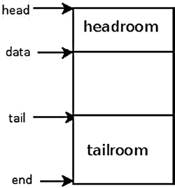

# Phụ lục A. Linux API

Trong phụ lục này tôi trình bày hai data structure cơ bản nhất của Linux Kernel Networking stack: `sk_buff` và `net_device`. Đây là tài liệu tham khảo hữu ích khi đọc phần còn lại của sách, vì bạn có thể gặp hai structure này trong gần như mọi chương. Làm quen và tìm hiểu hai data structure này là điều thiết yếu để hiểu Linux Kernel Networking stack. Sau đó là phần về remote DMA (RDMA), tài liệu tham khảo bổ sung cho Chương 13. Phần này mô tả chi tiết các method chính và data structure chính mà RDMA dùng. Phụ lục là nơi hữu ích để thường xuyên quay lại, nhất là khi tìm định nghĩa thuật ngữ cơ bản.

## Structure sk\_buff

Structure `sk_buff` biểu diễn packet. SKB viết tắt của socket buffer. Packet có thể được sinh bởi local socket trên local machine, do ứng dụng userspace tạo; packet có thể gửi ra ngoài hoặc tới socket khác trên cùng machine. Packet cũng có thể được kernel socket tạo; bạn có thể nhận physical frame từ network device (Layer 2), gắn vào `sk_buff` và chuyển lên Layer 3. Khi destination của packet là local machine, nó tiếp tục lên Layer 4. Nếu packet không dành cho machine của bạn, nó được forward theo quy tắc routing table, nếu machine hỗ trợ forwarding. Nếu packet hỏng vì bất kỳ lý do nào, nó bị drop. `sk_buff` là structure rất lớn; tôi đề cập phần lớn member trong phần này. Structure `sk_buff` định nghĩa trong `include/linux/skbuff.h`. Sau đây là mô tả phần lớn member:

- `ktime_t tstamp`

Timestamp khi packet đến. Timestamp lưu trong SKB dưới dạng offset so với base timestamp. Lưu ý: đừng nhầm `tstamp` của SKB với hardware timestamping, được triển khai bằng `hwtstamps` của `skb_shared_info`. Tôi mô tả object `skb_shared_info` phía sau phụ lục.

Method hỗ trợ:

- `skb_get_ktime(const struct sk_buff *skb)`: Trả `tstamp` của `skb` chỉ định.

- `skb_get_timestamp(const struct sk_buff *skb, struct timeval *stamp):` Chuyển offset trở lại `struct timeval`.

- `net_timestamp_set(struct sk_buff *skb):` Đặt timestamp cho `skb` chỉ định. Tính timestamp bằng method `ktime_get_real()`, trả thời gian ở định dạng `ktime_t`.

- `net_enable_timestamp()`: Cần gọi method này để bật SKB timestamping.

- `net_disable_timestamp():` Cần gọi method này để tắt SKB timestamping.

- `struct sock *sk` Socket sở hữu SKB, cho traffic sinh cục bộ và traffic đến local host. Với packet đang được forward, `sk` là NULL. Thông thường khi nói về socket, bạn làm việc với socket tạo bằng lời gọi system call `socket()` từ userspace. Cũng cần nhắc có kernel socket, tạo bằng lời gọi method `sock_create_kern()`. Ví dụ xem trong `vxlan_init_net()` của VXLAN driver, `drivers/net/vxlan.c`.

Method hỗ trợ:

- `skb_orphan(struct sk_buff *skb)`: Nếu `skb` chỉ định có destructor, gọi destructor này; đặt sock object (`sk`) của `skb` chỉ định thành NULL, và đặt destructor của `skb` chỉ định thành NULL.

- `struct net_device *dev`

Member `dev` là object `net_device` biểu diễn network interface device gắn với SKB; đôi khi bạn gặp thuật ngữ NIC (Network Interface Card) cho network device như vậy. Nó có thể là network device nhận packet hoặc network device gửi packet. Structure `net_device` sẽ được trình bày chi tiết trong phần tiếp theo.

- `char cb[48]`

Đây là control buffer. Layer bất kỳ có thể tự do dùng nó. Đây là opaque area dùng lưu private information. Ví dụ, TCP protocol dùng nó làm TCP control buffer:

```
#define TCP_SKB_CB(__skb) ((struct tcp_skb_cb *)&((__skb)->cb[0]))
(include/net/tcp.h)
```

Bluetooth protocol cũng dùng control block:

```
#define bt_cb(skb) ((struct bt_skb_cb *)((skb)->cb))
```

(`include/net/bluetooth/bluetooth.h`)

- `unsigned long _skb_refdst`

Địa chỉ destination entry (`dst_entry`). `dst_entry struct` biểu diễn routing entry cho destination nhất định. Với mỗi packet, incoming hoặc outgoing, bạn lookup trong routing table. Đôi khi lookup này gọi là FIB lookup. Kết quả quyết định cách xử lý packet; ví dụ, có cần forward không, nếu có thì truyền qua interface nào; hoặc phải loại bỏ, phải gửi ICMP error message, v.v. Object `dst_entry` có reference counter (field `__refcnt`). Có trường hợp dùng reference count này và có trường hợp không dùng. Object `dst_entry` và lookup trong FIB được trình bày chi tiết hơn ở Chương 4.

Method hỗ trợ:

- `skb_dst_set(struct sk_buff *skb, struct dst_entry *dst)`: Đặt `skb dst`, giả định đã lấy reference trên `dst` và phải giải phóng bằng method `dst_release()` (được method `skb_dst_drop()` gọi).

- `skb_dst_set_noref(struct sk_buff *skb, struct dst_entry *dst)`: Đặt `skb dst`, giả định chưa lấy reference trên `dst`. Trong trường hợp này, method `skb_dst_drop()` không gọi method `dst_release()` cho `dst`.

Lưu ý SKB có thể có pointer `dst_entry` gắn vào; có thể được reference count hoặc không. Bit thấp nhất của `_skb_refdst` được đặt nếu chưa lấy reference counter.

- `struct sec_path *sp`

Security path pointer. Nó chứa array các IPsec XFRM transformation state (object `xfrm_state`). IPsec (IP Security) là Layer 3 protocol chủ yếu dùng trong VPN. Nó bắt buộc trong IPv6 và tùy chọn trong IPv4. Linux, như nhiều operating system khác, triển khai IPsec cho cả IPv4 và IPv6. Structure `sec_path` định nghĩa trong `include/net/xfrm.h`. Xem thêm Chương 10 về IPsec subsystem.

Method hỗ trợ:

- `struct sec_path *skb_sec_path(struct sk_buff *skb)`: Trả object `sec_path` (`sp`) gắn với `skb` chỉ định.

- `unsigned int len`

Tổng số byte của packet.

- `unsigned int data_len`

Độ dài dữ liệu. Field này chỉ dùng khi packet có nonlinear data (paged data).

Method hỗ trợ:

- `skb_is_nonlinear(const struct sk_buff *skb):` Trả `true` khi `data_len` của `skb` chỉ định lớn hơn 0.

- `__u16 mac_len`

Độ dài MAC (Layer 2) header.

- `__wsum csum`

Checksum.

- `__u32 priority`

Queuing priority của packet. Trong Tx path, priority của SKB được đặt theo socket priority (field `sk_priority` của socket). Socket priority có thể được đặt bằng lời gọi system call `setsockopt()` với socket option SO\_PRIORITY. Dùng kernel module `net_prio cgroup`, bạn có thể định nghĩa rule đặt priority cho SKB; xem mô tả field `sk_buff netprio_map` phía sau phần này, và `Documentation/cgroup/netprio.txt`. Với forwarded packet, priority đặt theo field TOS (Type Of Service) trong IP header. Có table tên `ip_tos2prio` gồm 16 phần tử. Ánh xạ từ TOS sang priority bằng method `rt_tos2priority()`, theo field TOS của IP header; xem method `ip_forward()` trong `net/ipv4/ip_forward.c` và định nghĩa `ip_tos2prio` trong `include/net/route.h`.

- `__u8 local_df:1`

Flag cho phép local fragmentation. Nếu giá trị field `pmtudisc` của socket gửi packet là IP\_PMTUDISC\_DONT hoặc IP\_PMTUDISC\_WANT, `local_df` đặt bằng 1; nếu giá trị field `pmtudisc` của socket là IP\_PMTUDISC\_DO hoặc IP\_PMTUDISC\_PROBE, `local_df` đặt bằng 0. Xem triển khai method `__ip_make_skb()` trong `net/ipv4/ip_output.c`. Chỉ khi `local_df` của packet bằng 0 mới đặt flag don’t fragment của IP header, IP\_DF; xem method `ip_queue_xmit()` trong `net/ipv4/ip_output.c`:

```
            . . .
             if (ip_dont_fragment(sk, &rt->dst) && !skb->local_df)
                    iph->frag_off = htons(IP_DF);
                else
                  iph->frag_off = 0;
            . . .
```

Field `frag_off` trong IP header là field 16-bit, biểu diễn offset và flag của fragment. 13 bit ngoài cùng bên trái (MSB) là offset (đơn vị offset là 8-bytes), 3 bit ngoài cùng bên phải (LSB) là flag. Flag có thể là IP\_MF (còn fragment khác), IP\_DF (không fragment), IP\_CE (cho congestion), hoặc IP\_OFFSET (phần offset).

Lý do là có trường hợp bạn không muốn cho phép IP fragmentation. Ví dụ trong Path MTU Discovery (PMTUD), bạn đặt flag DF (don’t fragment) của IP header. Như vậy không fragment outgoing packet. Network device bất kỳ trên path có MTU nhỏ hơn packet sẽ drop packet và gửi trả ICMP packet (“Fragmentation Needed”). Nhận các ICMP “Fragmentation Needed” packet này là cần thiết để xác định Path MTU. Xem thêm Chương 3. Từ userspace, có thể đặt IP\_PMTUDISC\_DO như sau (đoạn code sau lấy từ source code tiện ích `tracepath` thuộc package `iputils`; tiện ích `tracepath` tìm path MTU):

```
           . . .
           int on = IP_PMTUDISC_DO;
           setsockopt(fd, SOL_IP, IP_MTU_DISCOVER, &on, sizeof(on));
           . . .
```

- `__u8 cloned:1`

Khi packet được clone bằng method `__skb_clone()`, field này đặt bằng 1 trong cả cloned packet và primary packet. Clone SKB nghĩa là tạo bản copy riêng của `sk_buff struct`; data block được chia sẻ giữa clone và primary SKB.

- `__u8 ip_summed:2`

Chỉ báo IP (Layer 3) checksum; có thể nhận một trong các giá trị:

- CHECKSUM\_NONE: Khi device driver không hỗ trợ hardware checksumming, nó đặt field `ip_summed` thành CHECKSUM\_NONE. Đây là chỉ báo phải checksumming bằng software.

- CHECKSUM\_UNNECESSARY: Không cần checksumming.

- CHECKSUM\_COMPLETE: Hardware đã hoàn tất tính checksum cho incoming packet.

- CHECKSUM\_PARTIAL: Đã tính partial checksum cho outgoing packet; hardware phải hoàn tất tính checksum. CHECKSUM\_COMPLETE và CHECKSUM\_PARTIAL thay thế flag CHECKSUM\_HW, hiện đã deprecated.

- `__u8 nohdr:1`

Chỉ reference payload, không được sửa header. Có trường hợp owner của SKB không cần truy cập header nữa. Khi đó có thể gọi method `skb_header_release()`, đặt field `nohdr` của SKB; chỉ báo không được sửa header của SKB này.

- `__u8 nfctinfo:3`

Thông tin Connection Tracking. Connection Tracking cho kernel theo dõi mọi logical network connection hoặc session. NAT dựa vào thông tin Connection Tracking để chuyển đổi. Giá trị field `nfctinfo` tương ứng giá trị `ip_conntrack_info enum`. Ví dụ, khi bắt đầu theo dõi connection mới, giá trị `nfctinfo` là IP\_CT\_NEW. Khi connection được thiết lập, giá trị `nfctinfo` là IP\_CT\_ESTABLISHED. Giá trị `nfctinfo` có thể đổi thành IP\_CT\_RELATED khi packet liên quan connection hiện có—ví dụ khi traffic thuộc FTP session hoặc SIP session, v.v. Danh sách đầy đủ giá trị `ip_conntrack_info enum` nằm trong `include/uapi/linux/netfilter/nf_conntrack_common.h`. Field `nfctinfo` của SKB được đặt trong method `resolve_normal_ct()`, `net/netfilter/nf_conntrack_core.c`. Method này thực hiện Connection Tracking lookup, nếu không tìm thấy thì tạo Connection Tracking entry mới. Connection Tracking được trình bày chi tiết trong Chương 9 về netfilter subsystem.

- `__u8 pkt_type:3`

Với Ethernet, packet type phụ thuộc destination MAC address trong ethernet header, được xác định bởi method `eth_type_trans()`:

- PACKET\_BROADCAST cho broadcast

- PACKET\_MULTICAST cho multicast

- PACKET\_HOST nếu destination MAC address là MAC address của device truyền làm tham số

- PACKET\_OTHERHOST nếu không thỏa các điều kiện này

Xem định nghĩa packet type trong `include/uapi/linux/if_packet.h`.

- `__u8 ipvs_property:1`

Flag này chỉ báo SKB có thuộc `ipvs` (IP Virtual Server), giải pháp transport layer load-balancing kernel-based, hay không. Field đặt bằng 1 trong các transmit method của `ipvs` (`net/netfilter/ipvs/ip_vs_xmit.c`).

- `__u8 peeked:1`

Packet này đã được xem nên đã được thống kê—đừng thống kê lại.

- `__u8 nf_trace:1`

Netfilter packet trace flag. Flag này được đặt bởi netfilter module theo dõi packet flow, module xt\_TRACE, dùng đánh dấu packet để trace (`net/netfilter/xt_TRACE.c`).

Method hỗ trợ:

- `nf_reset_trace(struct sk_buff *skb)`: Đặt `nf_trace` của `skb` chỉ định bằng 0.

- `__be16 protocol`

Protocol field được khởi tạo trong Rx path bằng method `eth_type_trans()` thành ETH\_P\_IP khi làm việc với Ethernet và IP.

- `void (*destructor)(struct sk_buff *skb)`

Callback được gọi khi giải phóng SKB bằng lời gọi method `kfree_skb()`.

- `struct nf_conntrack *nfct`

Connection Tracking object gắn kèm, nếu có. Field `nfct`, như field `nfctinfo`, được đặt trong method `resolve_normal_ct()`. Connection Tracking layer được trình bày chi tiết ở Chương 9 về netfilter subsystem.

- `int skb_iif`

`ifindex` của network device nhận packet.

- `__u32 rxhash`

`rxhash` của SKB được tính trong receive path, theo source và destination address của IP header cùng port trong transport header. Giá trị 0 chỉ báo hash không hợp lệ. `rxhash` dùng bảo đảm packet cùng flow được cùng CPU xử lý khi làm việc với Symmetrical Multiprocessing (SMP). Điều này giảm cache miss và cải thiện network performance. `rxhash` thuộc tính năng Receive Packet Steering (RPS), do Google developer (Tom Herbert và những người khác) đóng góp. RPS cải thiện hiệu năng trong môi trường SMP. Xem thêm `Documentation/networking/scaling.txt`.

- `__be16 vlan_proto`

VLAN protocol được dùng—thường là protocol `802.1q`. Gần đây bổ sung hỗ trợ protocol `802.1ad` (còn gọi Stacked VLAN).

Sau đây là ví dụ tạo VLAN device `802.1q` và `802.1ad` trong userspace bằng lệnh `ip` của package `iproute2`:

```
ip link add link eth0 eth0.1000 type vlan proto 802.1ad id 1000
ip link add link eth0.1000 eth0.1000.1000 type vlan proto 802.1q id 100
```

Lưu ý: tính năng này được hỗ trợ từ kernel 3.10 trở lên.

- `__u16 vlan_tci`

VLAN tag control information (2 byte), gồm ID và priority.

Method hỗ trợ:

- `vlan_tx_tag_present(__skb)`: Macro kiểm tra flag VLAN\_TAG\_PRESENT có được đặt trong field `vlan_tci` của `__skb` chỉ định không.

- `__u16 queue_mapping`

Queue mapping cho multiqueue device.

Method hỗ trợ:

- `skb_set_queue_mapping (struct sk_buff *skb, u16 queue_mapping)`: Đặt `queue_mapping` chỉ định cho `skb` chỉ định.

- `skb_get_queue_mapping(const struct sk_buff *skb)`: Trả `queue_mapping` của `skb` chỉ định.

- `__u8 pfmemalloc`

Cấp phát SKB từ PFMEMALLOC reserve.

Method hỗ trợ:

- `skb_pfmemalloc()`: Trả `true` nếu SKB được cấp phát từ PFMEMALLOC reserve.

- `__u8 ooo_okay:1`

Flag `ooo_okay` được đặt để tránh packet `ooo` (out of order).

- `__u8 l4_rxhash:1`

Flag được đặt khi dùng canonical hash 4-tuple trên transport port.

Xem method `__skb_get_rxhash()` trong `net/core/flow_dissector.c`.

- `__u8 no_fcs:1`

Flag được đặt khi yêu cầu NIC xem 4 byte cuối là Ethernet Frame Check Sequence (FCS).

- `__u8 encapsulation:1`

Encapsulation field biểu thị SKB được dùng cho encapsulation. Ví dụ dùng trong VXLAN driver. VXLAN là standard protocol truyền Layer 2 Ethernet packet qua UDP kernel socket. Có thể dùng làm giải pháp khi firewall chặn tunnel và chẳng hạn chỉ cho TCP hoặc UDP traffic. VXLAN driver dùng UDP encapsulation và đặt SKB encapsulation bằng 1 trong method `vxlan_init_net()`. Module `ip_gre` và tunnel module `ipip` cũng dùng encapsulation và đặt SKB encapsulation bằng 1.

- `__u32 secmark`

Security mark field. Field `secmark` được đặt bởi SECMARK target của `iptables`, gán nhãn packet bằng security context hợp lệ bất kỳ. Ví dụ:

```
iptables -t mangle -A INPUT -p tcp --dport 80 -j SECMARK --selctx
system_u:object_r:httpd_packet_t:s0
iptables -t mangle -A OUTPUT -p tcp --sport 80 -j SECMARK --selctx
system_u:object_r:httpd_packet_t:s0
```

Trong rule trước, bạn gán nhãn tĩnh `httpd_packet_t` cho packet đến và đi từ port 80. Xem: `netfilter/xt_SECMARK.c`.

Method hỗ trợ:

- `void skb_copy_secmark(struct sk_buff *to, const struct sk_buff *from)`: Đặt giá trị field `secmark` của SKB thứ nhất chỉ định (`to`) bằng giá trị field `secmark` của SKB thứ hai chỉ định (`from`).

- `void skb_init_secmark(struct sk_buff *skb)`: Khởi tạo `secmark` của `skb` chỉ định bằng 0.

Ba field tiếp theo: `mark`, `dropcount` và `reserved_tailroom` nằm trong union.

- `__u32 mark`

Field này cho phép nhận diện SKB bằng cách đánh dấu nó.

Ví dụ, bạn có thể đặt field `mark` của SKB bằng MARK target của `iptables` trong rule PREROUTING của `iptables` với mangle table.

- `iptables -A PREROUTING -t mangle -i eth1 -j MARK --set-mark 0x1234`

Rule này gán giá trị 0x1234 cho field `mark` của mọi SKB thuộc incoming traffic trên `eth1` trước routing lookup. Bạn cũng có thể chạy rule `iptables` kiểm tra field `mark` của mỗi SKB có khớp giá trị chỉ định không và hành động theo đó. Netfilter target và `iptables` được trình bày ở Chương 9 về netfilter subsystem.

- `__u32 dropcount`

Counter `dropcount` biểu diễn số packet bị drop (`sk_drops`) của `sk_receive_queue` thuộc object `sock` được gán (`sk`). Xem method `sock_queue_rcv_skb()` trong `net/core/sock.c`.

- `_u32 reserved_tailroom`: Dùng trong method `sk_stream_alloc_skb()`.

- `sk_buff_data_t transport_header`

Transport layer (L4) header.

Method hỗ trợ:

- `skb_transport_header(const struct sk_buff *skb)`: Trả transport header của `skb` chỉ định.

- `skb_transport_header_was_set(const struct sk_buff *skb)`: Trả 1 nếu `transport_header` của `skb` chỉ định được đặt.

- `sk_buff_data_t network_header`

Network layer (L3) header.

Method hỗ trợ:

- `skb_network_header(const struct sk_buff *skb):` Trả network header của `skb` chỉ định.

- `sk_buff_data_t mac_header`

Link layer (L2) header.

Method hỗ trợ:

- `skb_mac_header(const struct sk_buff *skb)`: Trả MAC header của `skb` chỉ định.

- `skb_mac_header_was_set(const struct sk_buff *skb)`: Trả 1 nếu `mac_header` của `skb` chỉ định đã được đặt.

- `sk_buff_data_t tail`

Phần tail của dữ liệu.

- `sk_buff_data_t end`

Phần cuối buffer. `tail` không thể vượt quá `end`.

- `unsigned char head`

Phần head của buffer.

- `unsigned char data`

Data head. Data block được cấp phát riêng với việc cấp phát `sk_buff`.

Xem trong `_alloc_skb()`, `net/core/skbuff.c`:

```
           data = kmalloc_reserve(size, gfp_mask, node, &pfmemalloc);
```

Method hỗ trợ:

- `skb_headroom(const struct sk_buff *skb)`: Method trả headroom, số byte trống ở head của skb chỉ định (`skb->data – skb->head`). Xem Hình A-1.

- `skb_tailroom(const struct sk_buff *skb)`: Method trả tailroom, số byte trống ở tail của `skb` chỉ định (`skb->end – skb->tail`). Xem Hình A-1.

Hình A-1 thể hiện headroom và tailroom của SKB.



Hình A-1. Headroom và tailroom của SKB Sau đây là một số method xử lý buffer:

- `skb_put(struct sk_buff *skb, unsigned int len)`: Thêm dữ liệu vào buffer: method thêm `len` byte vào buffer của `skb` chỉ định và tăng độ dài của `skb` chỉ định thêm `len` chỉ định.

- `skb_push(struct sk_buff *skb, unsigned int len)`: Thêm dữ liệu vào đầu buffer; method giảm data pointer của `skb` chỉ định đi `len` chỉ định và tăng độ dài của `skb` chỉ định thêm `len` chỉ định.

- `skb_pull(struct sk_buff *skb, unsigned int len)`: Xóa dữ liệu khỏi đầu buffer; method tăng data pointer của `skb` chỉ định thêm `len` chỉ định và giảm độ dài của `skb` chỉ định đi `len` chỉ định.

- `skb_reserve(struct sk_buff *skb, int len)`: Tăng headroom của `skb` rỗng bằng cách giảm tail.

Sau khi mô tả một số method xử lý buffer, tôi tiếp tục liệt kê member của structure `sk_buff`:

- `unsigned int truesize`

Tổng memory cấp phát cho SKB (gồm bản thân SKB structure và kích thước data block được cấp phát).

- `atomic_t users`

Reference counter khởi tạo bằng 1; tăng bởi method `skb_get()` và giảm bởi method `kfree_skb()` hoặc method `consume_skb()`; method `kfree_skb()` giảm usage counter; nếu đạt 0, method giải phóng SKB—ngược lại trả về mà không giải phóng.

Method hỗ trợ:

- `skb_get(struct sk_buff *skb)`: Tăng reference counter `users` thêm 1.

- `skb_shared(const struct sk_buff *skb)`: Trả `true` nếu số `users` khác 1.

- `skb_share_check(struct sk_buff *skb, gfp_t pri)`: Nếu buffer không được chia sẻ, trả original buffer. Nếu được chia sẻ, clone buffer và bản copy cũ bỏ một reference. Trả clone mới với một reference duy nhất. Khi gọi từ interrupt context hoặc đang giữ spinlock, tham số `pri` (priority) phải là GFP\_ATOMIC. Nếu cấp phát memory thất bại, trả NULL.

- `consume_skb(struct sk_buff *skb)`: Giảm reference counter `users` và giải phóng SKB nếu reference counter `users` bằng 0.

### struct skb\_shared\_info

`skb_shared_info struct` nằm ở cuối data block (`skb_end_pointer(SKB)`). Chỉ gồm một vài field. Hãy xem:

```
struct skb_shared_info {
    unsigned char         nr_frags;
    __u8                  tx_flags;
    unsigned short        gso_size;
    unsigned short        gso_segs;
    unsigned short        gso_type;
        struct sk_buff        *frag_list;
        struct skb_shared_hwtstamps hwtstamps;
        __be32                ip6_frag_id;
        atomic_t              dataref;
        void *                destructor_arg;
        skb_frag_t            frags[MAX_SKB_FRAGS];
    };
```

Sau đây là mô tả một số member quan trọng của structure `skb_shared_info`:

- `nr_frags`: Biểu diễn số phần tử trong array `frags`.

- `tx_flags` có thể là:

- SKBTX\_HW\_TSTAMP: Sinh hardware timestamp.

- SKBTX\_SW\_TSTAMP: Sinh software timestamp.

- SKBTX\_IN\_PROGRESS: Device driver sẽ cung cấp hardware timestamp.

- SKBTX\_DEV\_ZEROCOPY: Device driver hỗ trợ Tx buffer zero-copy.

- SKBTX\_WIFI\_STATUS: Sinh thông tin WiFi status.

- SKBTX\_SHARED\_FRAG: Chỉ báo ít nhất một fragment có thể bị ghi đè.

- Khi làm việc với fragmentation, có trường hợp dùng list `sk_buffs` (`frag_list`), có trường hợp dùng array `frags`. Điều này chủ yếu tùy Scatter/Gather mode có được đặt không.

Method hỗ trợ:

- `skb_is_gso(const struct sk_buff *skb)`: Trả `true` nếu `gso_size` của `skb_shared_info` gắn với `skb` chỉ định khác 0.

- `skb_is_gso_v6(const struct sk_buff *skb)`: Trả `true` nếu `gso_type` của `skb_shared_info` gắn với `skb` là SKB\_GSO\_TCPV6.

- `skb_shinfo(skb)`: Macro trả `skb_shinfo` gắn với `skb` chỉ định.

- `skb_has_frag_list(const struct sk_buff *skb)`: Trả `true` nếu `frag_list` của `skb_shared_info` thuộc `skb` chỉ định khác NULL.

- `dataref`: Reference counter của `skb_shared_info struct`. Đặt bằng 1 trong method cấp phát `skb` và khởi tạo `skb_shared_info` (method `__alloc_skb()`).

## Structure net\_device

`net_device struct` biểu diễn network device. Có thể là physical device như Ethernet device, hoặc software device như bridge device hay VLAN device. Như với structure `sk_buff`, tôi liệt kê member quan trọng. `net_device struct` định nghĩa trong `include/linux/netdevice.h`:

- `char name[IFNAMSIZ]`

Tên network device. Đây là tên bạn thấy bằng lệnh `ifconfig` hoặc `ip` (ví dụ `eth0`, `eth1`, v.v.). Độ dài interface name tối đa 16 ký tự. Trong distribution mới hỗ trợ `biosdevname`, naming scheme tương ứng vị trí vật lý của network device. Vì vậy PCI network

device được đặt tên `p<slot>p<port>` theo nhãn chassis, còn embedded port (trên motherboard interface) tên `em<port>`—ví dụ `em1`, `em2`, v.v. Có suffix riêng cho SR-IOV device và device bật Network Partitioning (NPAR). Biosdevname do Dell phát triển: `http://linux.dell.com/biosdevname`. Xem thêm white paper: `http://linux.dell.com/files/whitepapers/consistent_network_device_naming_in_linux.pdf`.

Method hỗ trợ:

- `dev_valid_name(const char *name)`: Kiểm tra tính hợp lệ của network device name chỉ định. Network device name phải tuân thủ hạn chế nhất định để tạo `sysfs` entry tương ứng. Ví dụ không thể là “ . ” hoặc “ .. ”; độ dài không được quá 16 ký tự. Ví dụ có thể đổi interface name như sau: `ip link set <oldDeviceName> p2p1 <newDeviceName>`. Do đó `ip link set p2p1 name a12345678901234567` thất bại với thông báo: `Error: argument "a12345678901234567" is wrong: "name" too long`. Lý do là bạn thử đặt device name dài hơn 16 ký tự. Chạy `ip link set p2p1 name.` thất bại với `RTNETLINK answers: Invalid argument`, vì bạn thử đặt device name “.”, giá trị không hợp lệ. Xem `dev_valid_name()` trong `net/core/dev.c`.

- `struct hlist_node name_hlist`

Đây là hash table chứa network device, index bằng network device name. Lookup trong hash table bằng `dev_get_by_name()`. Chèn vào hash table bằng method `list_netdevice()`, xóa khỏi hash table bằng method `unlist_netdevice()`.

- `char *ifalias`

SNMP alias interface name. Độ dài tối đa 256 (IFALIASZ).

Bạn có thể tạo alias cho network device bằng command line này:

```
           ip link set <devName> alias myalias
```

Tên `ifalias` được xuất qua `sysfs` tại `/sys/class/net/<devName>/ifalias`.

Method hỗ trợ:

- `dev_set_alias(struct net_device *dev, const char *alias, size_t len)`: Đặt alias chỉ định cho network device chỉ định. Tham số `len` chỉ định là số byte của `alias` chỉ định cần copy; nếu `len` chỉ định lớn hơn 256 (IFALIASZ), method thất bại với -EINVAL.

- `unsigned int irq`

Số Interrupt Request (IRQ) của device. Network driver phải gọi `request_irq()` để đăng ký với IRQ number này. Thông thường thực hiện trong callback `probe()` của network device driver. Prototype của method `request_irq()` là: `int request_irq(unsigned int irq, irq_handler_t handler, unsigned long flags, const char *name, void *dev)`. Đối số đầu là IRQ number. `handler` chỉ định là Interrupt Service Routine (ISR). Network driver phải gọi method `free_irq()` khi không còn dùng `irq` này. Trong nhiều trường hợp, `irq` được chia sẻ (method `request_irq()` được gọi với flag IRQF\_SHARED). Bạn có thể xem số interrupt xảy ra trên mỗi core bằng `cat /proc/interrupts`. Có thể đặt SMP affinity của `irq` bằng `echo irqMask > /proc/irq/<irqNumber>/smp_affinity`.

Trên SMP machine, đặt SMP affinity của interrupt nghĩa là đặt core nào được phép xử lý interrupt. Một số PCI network interface dùng Message Signaled Interrupt (MSI). PCI MSI interrupt không bao giờ chia sẻ, nên flag IRQF\_SHARED không được đặt khi gọi method `request_irq()` trong các network driver này. Xem thêm `Documentation/PCI/MSI-HOWTO.txt`.

- `unsigned long state`

Flag có thể nhận một trong các giá trị:

- \_\_LINK\_STATE\_START: Flag được đặt khi đưa device lên bằng method `dev_open()`, và xóa khi đưa device xuống.

- \_\_LINK\_STATE\_PRESENT: Flag được đặt khi đăng ký device bằng method `register_netdevice()`, và xóa trong method `netif_device_detach()`.

- \_\_LINK\_STATE\_NOCARRIER: Flag cho biết device có phát hiện mất carrier không. Đặt bằng method `netif_carrier_off()` và xóa bằng method `netif_carrier_on()`. Xuất qua `sysfs` tại `/sys/class/net/<devName>/carrier`.

- \_\_LINK\_STATE\_LINKWATCH\_PENDING: Flag đặt bằng method `linkwatch_fire_event()` và xóa bằng method `linkwatch_do_dev()`.

- \_\_LINK\_STATE\_DORMANT: Dormant state chỉ báo interface không thể chuyển packet (tức không “up”); tuy nhiên đây là trạng thái “pending”, chờ external event. Xem mục 3.1.12, “Trạng thái mới cho IfOperStatus” trong RFC 2863, “The Interfaces Group MIB.”

Flag `state` có thể đặt bằng generic method `set_bit()`.

Method hỗ trợ:

- `netif_running(const struct net_device *dev)`: Trả `true` nếu flag \_\_LINK\_STATE\_START của state field thuộc device chỉ định được đặt.

- `netif_device_present(struct net_device *dev)`: Trả `true` nếu flag \_\_LINK\_STATE\_PRESENT của state field thuộc device chỉ định được đặt.

- `netif_carrier_ok (const struct net_device *dev)`: Trả `true` nếu flag \_\_LINK\_STATE\_NOCARRIER của state field thuộc device chỉ định không được đặt.

Ba method định nghĩa trong `include/linux/netdevice.h`.

- `netdev_features_t features`

Tập device feature hiện active. Chỉ network core hoặc error path của callback `ndo_set_features()` được thay đổi feature này. Network driver developer chịu trách nhiệm đặt tập device feature ban đầu. Đôi khi họ dùng tổ hợp feature sai. Network core sửa bằng cách xóa feature gây lỗi trong method `netdev_fix_features()`, được gọi khi đăng ký network interface (trong method `register_netdevice()`); thông báo phù hợp cũng được ghi vào kernel log.

Tôi đề cập và trình bày một số feature của `net_device` tại đây. Danh sách đầy đủ feature của `net_device` nằm trong `include/linux/netdev_features.h`.

- NETIF\_F\_IP\_CSUM nghĩa là network device có thể checksum L4 IPv4 TCP/UDP packet.

- NETIF\_F\_IPV6\_CSUM nghĩa là network device có thể checksum L4 IPv6 TCP/UDP packet.

- NETIF\_F\_HW\_CSUM nghĩa là device có thể checksum mọi L4 packet bằng hardware. Không thể bật NETIF\_F\_HW\_CSUM cùng NETIF\_F\_IP\_CSUM, hoặc cùng NETIF\_F\_IPV6\_CSUM, vì sẽ gây checksumming hai lần.

Nếu tập driver feature gồm cả NETIF\_F\_HW\_CSUM và NETIF\_F\_IP\_CSUM, bạn nhận kernel message “mixed HW and IP checksum settings.” Khi đó method `netdev_fix_features()` xóa feature NETIF\_F\_IP\_CSUM. Nếu tập driver feature gồm cả NETIF\_F\_HW\_CSUM và NETIF\_F\_IPV6\_CSUM, bạn lại nhận thông báo như trước. Lần này feature NETIF\_F\_IPV6\_CSUM bị method `netdev_fix_features()` xóa. Để device hỗ trợ TSO (TCP Segmentation Offload), nó cũng cần hỗ trợ Scatter/Gather và TCP checksum; nghĩa là cả feature NETIF\_F\_SG và NETIF\_F\_IP\_CSUM phải được đặt. Nếu tập driver feature không có NETIF\_F\_SG, bạn nhận kernel message “Dropping TSO features since no SG feature,” và feature NETIF\_F\_ALL\_TSO bị xóa. Nếu tập driver feature không có NETIF\_F\_IP\_CSUM cũng không có NETIF\_F\_HW\_CSUM, bạn nhận kernel message “Dropping TSO features since no CSUM feature,” và NETIF\_F\_TSO bị xóa.

Lưu ý Trong kernel gần đây, nếu kernel config item CONFIG\_DYNAMIC\_DEBUG được đặt, có thể cần bật rõ ràng việc in một số thông báo qua interface `<debugfs>/dynamic_debug/control`. Xem `Documentation/dynamic-debug-howto.txt`.

- NETIF\_F\_LLTX là LockLess TX flag, được coi là deprecated. Khi đặt, bạn không dùng generic Tx lock (vì vậy gọi là LockLess TX). Xem macro sau (HARD\_TX\_LOCK) từ `net/core/dev.c`:

```
           #define HARD_TX_LOCK(dev, txq, cpu) { \ if ((dev->features & NETIF_F_LLTX) == 0) { \
              __netif_tx_lock(txq, cpu); \
             } \
              }
```

NETIF\_F\_LLTX dùng trong tunnel driver như VXLAN, VETH và IP over IP (IPIP) tunneling driver. Ví dụ trong IPIP tunnel module, bạn đặt flag NETIF\_F\_LLTX trong method `ipip_tunnel_setup()` (`net/ipv4/ipip.c`).

Flag NETIF\_F\_LLTX cũng dùng trong một số driver triển khai Tx lock riêng, như cxgb network driver.

Trong `drivers/net/ethernet/chelsio/cxgb/cxgb2.c`, có:

```
              static int __devinit init_one(struct pci_dev *pdev,
              const struct pci_device_id *ent)
              {
                  . . .
                  netdev->features |= NETIF_F_SG | NETIF_F_IP_CSUM |
                                      NETIF_F_RXCSUM | NETIF_F_LLTX;
                 . . .
              }
```

- NETIF\_F\_GRO chỉ báo device hỗ trợ GRO (Generic Receive Offload). Với GRO, incoming packet được gộp lúc nhận. GRO cải thiện network performance. GRO thay LRO (Large Receive Offload), vốn giới hạn cho TCP/IPv4. Flag được kiểm tra ở đầu method `dev_gro_receive()`; device không đặt flag không thực hiện phần xử lý GRO trong method này. Driver muốn dùng GRO phải gọi method `napi_gro_receive()` trong Rx path. Có thể bật/tắt GRO bằng ethtool, lần lượt với `ethtool -K <deviceName> gro on`/ `ethtool -K <deviceName> gro off`. Kiểm tra GRO có được đặt không bằng `ethtool –k <deviceName>` và xem field `gro`.

- NETIF\_F\_GSO được đặt để chỉ báo device hỗ trợ Generic Segmentation Offload (GSO). GSO tổng quát hóa giải pháp trước đó tên TSO (TCP segmentation offload), chỉ xử lý TCP trong IPv4. GSO cũng xử lý IPv6, UDP và protocol khác. GSO là tối ưu hiệu năng, dựa trên việc đi qua networking stack một lần thay vì nhiều lần đối với packet lớn. Ý tưởng là tránh segmentation trong Layer 4 và trì hoãn segmentation tối đa. Sysadmin có thể bật/tắt GSO bằng `ethtool`, lần lượt với `ethtool -K <driverName> gso on`/`ethtool -K <driverName> gso off`. Kiểm tra GSO bằng `ethtool –k <deviceName>` và xem field `gso`. Để dùng GSO, phải làm việc trong Scatter/Gather mode. Flag NETIF\_F\_SG phải được đặt.

- NETIF\_F\_NETNS\_LOCAL được đặt cho network namespace local device. Đây là network device không được phép chuyển giữa network namespace. Loopback, VXLAN và PPP network device là ví dụ namespace local device. Tất cả đều đặt flag NETIF\_F\_NETNS\_LOCAL. Sysadmin kiểm tra interface có đặt flag NETIF\_F\_NETNS\_LOCAL không bằng `ethtool -k <deviceName>`. Feature này cố định, không thể đổi bằng `ethtool`. Thử chuyển network device loại này sang namespace khác gây lỗi (-EINVAL). Chi tiết xem method `dev_change_net_namespace()` (`net/core/dev.c`). Khi xóa network namespace, device không đặt flag NETIF\_F\_NETNS\_LOCAL được chuyển về default initial network namespace (`init_net`). Network namespace local device có đặt flag NETIF\_F\_NETNS\_LOCAL không được chuyển về default initial network namespace (`init_net`) mà bị xóa.

- NETIF\_F\_HW\_VLAN\_CTAG\_RX dùng cho device hỗ trợ VLAN Rx hardware acceleration. Trước đây tên NETIF\_F\_HW\_VLAN\_RX, đổi tên trong kernel 3.10 khi thêm hỗ trợ `802.1ad`. Thêm “CTAG” để chỉ báo device khác “STAG” device (Service provider tagging). Device driver đặt feature NETIF\_F\_HW\_VLAN\_RX cũng phải định nghĩa callback `ndo_vlan_rx_add_vid()` và `ndo_vlan_rx_kill_vid()`. Nếu không sẽ ngăn đăng ký device và gây kernel error message “Buggy VLAN acceleration in driver”.

- NETIF\_F\_HW\_VLAN\_CTAG\_TX dùng cho device hỗ trợ VLAN Tx hardware acceleration. Trước đây tên NETIF\_F\_HW\_VLAN\_TX, đổi tên trong kernel 3.10 khi thêm hỗ trợ `802.1ad`.

- NETIF\_F\_VLAN\_CHALLENGED được đặt cho device không xử lý được VLAN packet. Đặt feature này ngăn đăng ký VLAN device. Hãy xem VLAN registration method:

```
    static int register_vlan_device(struct net_device *real_dev, u16 vlan_id) {
        int err;
        . . .
        err = vlan_check_real_dev(real_dev, vlan_id);
```

Việc đầu tiên method `vlan_check_real_dev()` làm là kiểm tra network device feature và trả lỗi nếu feature NETIF\_F\_VLAN\_CHALLENGED được đặt:

```
int vlan_check_real_dev(struct net_device *real_dev, u16 vlan_id)
{
        const char *name = real_dev->name;

        if (real_dev->features & NETIF_F_VLAN_CHALLENGED) {
                pr_info("VLANs not supported on %s\n", name);
                return -EOPNOTSUPP;
        }
                . . .
}
```

Ví dụ, một số loại Intel e100 network device driver đặt feature NETIF\_F\_VLAN\_CHALLENGED (xem `e100_probe()` trong `drivers/net/ethernet/intel/e100.c`).

Bạn kiểm tra NETIF\_F\_VLAN\_CHALLENGED có được đặt không bằng `ethtool –k <deviceName>` và xem field `vlan-challenged`. Đây là giá trị cố định, không thể đổi bằng lệnh `ethtool`.

- NETIF\_F\_SG được đặt khi network interface hỗ trợ Scatter/Gather IO. Có thể bật và tắt Scatter/Gather bằng `ethtool`, lần lượt với `ethtool -K <deviceName> sg on`/ `ethtool -K <deviceName> sg off`. Kiểm tra Scatter/Gather bằng `ethtool –k <deviceName>` và xem field `sg`.

- NETIF\_F\_HIGHDMA được đặt nếu device có thể truy cập high memory bằng DMA. Ý nghĩa thực tế là callback `ndo_start_xmit()` của object `net_device_ops` có thể quản lý SKB chứa phần tử `frags` trong high memory. Kiểm tra NETIF\_F\_HIGHDMA bằng `ethtool –k <deviceName>` và xem field `highdma`. Đây là giá trị cố định, không thể đổi bằng lệnh `ethtool`.

- `netdev_features_t hw_features`

Tập feature có thể thay đổi. Nghĩa là trạng thái có thể được đổi (bật hoặc tắt) cho device cụ thể theo yêu cầu user. Tập này phải khởi tạo trong callback `ndo_init()` và không đổi về sau.

- `netdev_features_t wanted_features`

Tập feature user yêu cầu. User có thể yêu cầu đổi offloading feature—ví dụ chạy `ethtool -K eth1 rx on`. Điều này tạo feature change event notification (NETDEV\_FEAT\_CHANGE) để method `netdev_features_change()` gửi đi.

- `netdev_features_t vlan_features`

Tập feature có trạng thái được child VLAN device kế thừa. Ví dụ, xem method `rtl_init_one()`, callback `probe` của network device driver `r8169` (xem Chương 14):

```
int rtl_init_one(struct pci_dev *pdev, const struct pci_device_id *ent)

{
   . . .
   dev->vlan_features=NETIF_F_SG|NETIF_F_IP_CSUM|NETIF_F_TSO|   NETIF_F_HIGHDMA;
   . . .
}
```

(`drivers/net/ethernet/realtek/r8169.c`)

Khởi tạo này nghĩa là mọi child VLAN device có các feature này. Ví dụ, giả sử device `eth0` là device `r8169` và bạn thêm VLAN device: `vconfig add eth0 100`. Khi đó trong khởi tạo của VLAN module có code liên quan `vlan_features`:

```
static int vlan_dev_init(struct net_device *dev)
{
    . . .
    dev->features |= real_dev->vlan_features | NETIF_F_LLTX;
    . . .
}

(net/8021q/vlan_dev.c)
```

Điều này có nghĩa là nó thiết lập các feature của VLAN child device bằng `vlan_features` của real device (trong trường hợp này là `eth0`), vốn đã được thiết lập theo cách bạn thấy trước đó trong method `rtl_init_one()`.

- `netdev_features_t hw_enc_features`

Mask feature được encapsulating device kế thừa. Field chỉ báo hardware có thể thực hiện encapsulation offload nào, driver cần đặt phù hợp. Để biết thêm network device feature, xem `Documentation/networking/netdev-features.txt`.

- `ifindex`

`ifindex` (Interface index) là device identifier duy nhất. Index tăng 1 mỗi lần tạo network device mới, bằng method `dev_new_index()`. Network device đầu tiên được tạo, gần như luôn là loopback device, có `ifindex` bằng 1. Cyclic integer overflow được xử lý bởi method gán số `ifindex`. `ifindex` được xuất qua `sysfs` tại `/sys/class/net/<devName>/ifindex`.

- `struct net_device_stats stats`

Statistics `struct`, giữ lại như legacy, gồm field như số `rx_packets` hoặc số `tx_packets`. Device driver mới dùng `rtnl_link_stats64 struct` (định nghĩa trong `include/uapi/linux/if_link.h`) thay cho `net_device_stats struct`. Phần lớn network driver triển khai callback `ndo_get_stats64()` của `net_device_ops` (hoặc callback `ndo_get_stats()` của `net_device_ops` khi dùng API cũ).

Thống kê được xuất qua `/sys/class/net/<deviceName>/statistics`.

Một số driver triển khai callback `get_ethtool_stats()`. Chúng hiển thị thống kê bằng `ethtool -S <deviceName>`

Ví dụ xem method `rtl8169_get_ethtool_stats()` trong `drivers/net/ethernet/realtek/r8169.c`.

- `atomic_long_t rx_dropped`

Counter số packet bị core network stack drop trong RX path. Driver không được dùng counter này. Đừng nhầm field `rx_dropped` của `sk_buff` với field `dropped` của `softnet_data struct`. `softnet_data struct` biểu diễn object per-CPU. Chúng không tương đương vì `rx_dropped` của `sk_buff` có thể tăng trong nhiều method, còn counter `dropped` của `softnet_data` chỉ tăng bởi method `enqueue_to_backlog()` (`net/core/dev.c`). Dropped counter của `softnet_data` được xuất qua `/proc/net/softnet_stat`. Trong `/proc/net/softnet_stat` có một dòng mỗi CPU. Cột đầu là total packets counter, cột thứ hai là dropped packets counter.

Ví dụ:

```
cat /proc/net/softnet_stat
00000076 00000001 00000000 00000000 00000000 00000000 00000000 00000000 00000000 00000000
00000005 00000000 00000000 00000000 00000000 00000000 00000000 00000000 00000000 00000000
```

Ở đây có một dòng mỗi CPU (có hai CPU); CPU đầu có tổng 118 packet (hex 0x76), một packet bị drop. CPU thứ hai có tổng 5 packet và 0 bị drop.

- `struct net_device_ops *netdev_ops`

Structure `netdev_ops` chứa pointer đến các callback method bạn muốn định nghĩa nếu muốn override hành vi mặc định. Sau đây là một số callback của `netdev_ops`:

- Callback `ndo_init()` được gọi khi đăng ký network device.

- Callback `ndo_uninit()` được gọi khi hủy đăng ký network device hoặc khi đăng ký thất bại.

- Callback `ndo_open()` xử lý thay đổi trạng thái device khi network device đổi từ down sang up.

- Callback `ndo_stop()` được gọi khi trạng thái network device đổi thành down.

- Callback `ndo_validate_addr()` được gọi để kiểm tra MAC có hợp lệ không. Nhiều network driver đặt generic method `eth_validate_addr()` làm callback `ndo_validate_addr()`. Generic method `eth_validate_addr()` trả `true` nếu MAC address không phải multicast address và không toàn số 0.

- Callback `ndo_set_mac_address()` đặt MAC address. Nhiều network driver đặt generic method `eth_mac_addr()` làm callback `ndo_set_mac_address()` của `struct net_device_ops` để đặt MAC address. Ví dụ VETH driver (`drivers/net/veth.c`) hoặc VXLAN driver (`drivers/nets/vxlan.c`).

- Callback `ndo_start_xmit()` xử lý truyền packet. Không thể NULL.

- Callback `ndo_select_queue()` dùng chọn Tx queue khi dùng multiqueue. Nếu callback `ndo_select_queue()` chưa đặt thì gọi `__netdev_pick_tx()`. Xem triển khai method `netdev_pick_tx()` trong `net/core/flow_dissector.c`.

- Callback `ndo_change_mtu()` xử lý sửa MTU. Nó phải kiểm tra MTU chỉ định không nhỏ hơn 68, là MTU tối thiểu. Trong nhiều trường hợp network driver đặt callback `ndo_change_mtu()` thành generic method `eth_change_mtu()`. Phải override method `eth_change_mtu()` nếu hỗ trợ jumbo frame.

- Callback `ndo_do_ioctl()` được gọi khi nhận IOCTL request không được generic interface code xử lý.

- Callback `ndo_tx_timeout()` được gọi khi transmitter idle khá lâu (để watchdog dùng).

- Callback `ndo_add_slave()` được gọi để đặt network device chỉ định làm slave của network device chỉ định. Ví dụ dùng trong team network driver và bonding network driver.

- Callback `ndo_del_slave()` được gọi để xóa network device đã được đặt làm slave.

- Callback `ndo_set_features()` được gọi để cập nhật cấu hình network device với feature mới.

- Callback `ndo_vlan_rx_add_vid()` được gọi khi đăng ký VLAN id nếu network device hỗ trợ VLAN filtering (flag NETIF\_F\_HW\_VLAN\_FILTER được đặt trong device feature).

- Callback `ndo_vlan_rx_kill_vid()` được gọi khi hủy đăng ký VLAN id nếu network device hỗ trợ VLAN filtering (flag NETIF\_F\_HW\_VLAN\_FILTER được đặt trong device feature).

Lưu ý Từ kernel 3.10, flag NETIF\_F\_HW\_VLAN\_FILTER đổi tên thành NETIF\_F\_HW\_VLAN\_CTAG\_FILTER.

- Cũng có một số callback xử lý SR-IOV device, ví dụ `ndo_set_vf_mac()` và `ndo_set_vf_vlan()`.

Trước kernel 2.6.29 có callback tên `set_multicast_list()` để thêm multicast address, được thay bằng method `dev_set_rx_mode()`. Callback `dev_set_rx_mode()` chủ yếu được gọi mỗi khi unicast/multicast address list hoặc network interface flag được cập nhật.

- `struct ethtool_ops *ethtool_ops`

Structure `ethtool_ops` chứa pointer đến callback xử lý offload, lấy và đặt device setting khác nhau, đọc register, lấy thống kê, đọc RX flow hash indirection table, WakeOnLAN parameter và nhiều thứ khác. Nếu network driver không khởi tạo object `ethtool_ops`, networking core cung cấp object

`ethtool_ops` mặc định rỗng tên `default_ethtool_ops`. Quản lý `ethtool_ops` trong `net/core/ethtool.c`.

Method hỗ trợ:

- SET\_ETHTOOL\_OPS (netdev,ops): Macro đặt `ethtool_ops` chỉ định cho `net_device` chỉ định.

Bạn có thể xem offload parameter của network interface device bằng `ethtool –k <deviceName>`. Có thể đặt một số offload parameter bằng `ethtool –K <deviceName> offloadParameter off/on`. Xem `man 8 ethtool`.

- `const struct header_ops *header_ops`

`header_ops struct` chứa callback tạo Layer 2 header, parse, dựng lại header, v.v. Với Ethernet, đó là `eth_header_ops`, định nghĩa trong `net/ethernet/eth.c`.

- `unsigned int flags`

Interface flag của network device mà bạn thấy từ userspace. Sau đây là một số flag (danh sách đầy đủ xem `include/uapi/linux/if.h`):

- Flag IFF\_UP được đặt khi interface đổi trạng thái từ down sang up.

- IFF\_PROMISC được đặt khi interface trong promiscuous mode (nhận mọi packet). Khi chạy sniffer như `wireshark` hoặc `tcpdump`, network interface ở promiscuous mode.

- IFF\_LOOPBACK được đặt cho loopback device.

- IFF\_NOARP được đặt cho device không dùng ARP protocol. Ví dụ IFF\_NOARP đặt trong tunnel device (xem trong method `ipip_tunnel_setup()`, `net/ipv4/ipip.c`).

- IFF\_POINTOPOINT được đặt cho PPP device. Ví dụ xem method `ppp_setup()`, `drivers/net/ppp/ppp_generic.c`.

- IFF\_MASTER được đặt cho master device. Ví dụ với bonding device, xem method `bond_setup()` trong `drivers/net/bonding/bond_main.c`.

- Flag IFF\_LIVE\_ADDR\_CHANGE chỉ báo device hỗ trợ sửa hardware address khi đang chạy. Xem method `eth_mac_addr()` trong `net/ethernet/eth.c`.

- Flag IFF\_UNICAST\_FLT được đặt khi network driver xử lý unicast address filtering.

- IFF\_BONDING được đặt cho bonding master device hoặc bonding slave device. Bonding driver cung cấp method tổng hợp nhiều network interface thành một logical interface.

- IFF\_TEAM\_PORT được đặt cho device dùng làm team port. Teaming driver là network software driver load-balancing nhằm thay bonding driver.

- IFF\_MACVLAN\_PORT được đặt cho device dùng làm macvlan port.

- IFF\_EBRIDGE được đặt cho Ethernet bridging device.

Field `flags` được xuất qua `sysfs` tại `/sys/class/net/<devName>/flags`.

Một số flag đặt được bằng userspace tool. Ví dụ `ifconfig <deviceName> -arp` đặt flag IFF\_NOARP của network interface, còn `ifconfig <deviceName> arp` xóa flag IFF\_NOARP. Lưu ý có thể làm tương tự bằng lệnh `iproute2 ip`: `ip link set dev <deviceName> arp on` và `ip link set dev <deviceName> arp off`.

- `unsigned int priv_flags`

Interface flag không thấy từ userspace. Ví dụ IFF\_EBRIDGE cho bridge interface, IFF\_BONDING cho bonding interface, hoặc IFF\_SUPP\_NOFCS cho interface hỗ trợ gửi custom FCS.

Method hỗ trợ:

- `netif_supports_nofcs()`: Trả `true` nếu IFF\_SUPP\_NOFCS được đặt trong `priv_flags` của device chỉ định.

- `is_vlan_dev(struct net_device *dev)`: Trả 1 nếu flag IFF\_802\_1Q\_VLAN được đặt trong `priv_flags` của network device chỉ định.

- `unsigned short gflags`

Global flag (giữ lại như legacy).

- `unsigned short padded`

Lượng padding method `alloc_netdev()` thêm vào.

- `unsigned char operstate`

Operstate theo RFC 2863.

- `unsigned char link_mode`

Ánh xạ policy sang operstate.

- `unsigned int mtu`

Giá trị MTU (Maximum Transmission Unit) của network interface. Kích thước frame tối đa device xử lý được. RFC 791 đặt MTU tối thiểu 68. Mỗi protocol có MTU riêng. MTU mặc định cho Ethernet là 1.500 byte. Được đặt trong method `ether_setup()`, `net/ethernet/eth.c`. Ethernet packet lớn hơn 1.500 byte, tối đa 9.000 byte, gọi là Jumbo frame. Network interface MTU được xuất qua `sysfs` tại

```
/sys/class/net/<devName>/mtu.
```

Method hỗ trợ:

- `dev_set_mtu(struct net_device *dev, int new_mtu)`: Đổi MTU của device chỉ định sang giá trị mới, chỉ định bằng tham số `mtu`.

Ví dụ sysadmin có thể đổi MTU network interface thành 1.400 theo một trong các cách:

```
           ifconfig <netDevice> mtu 1400
           ip link set <netDevice> mtu 1400
           echo 1400 > /sys/class/net/<netDevice>/mtu
```

Nhiều driver triển khai callback `ndo_change_mtu()` để đổi MTU nhằm thực hiện thao tác driver-specific cần thiết (như reset network card).

- `unsigned short type`

Network interface hardware type. Ví dụ với Ethernet là ARPHRD\_ETHER, đặt trong `ether_setup()` ở `net/ethernet/eth.c`. Với PPP interface là ARPHRD\_PPP, đặt trong method `ppp_setup()` ở `drivers/net/ppp/ppp_generic.c`. Type được xuất qua `sysfs` tại `/sys/class/net/<devName>/type`.

- `unsigned short hard_header_len`

Hardware header length. Ví dụ Ethernet header gồm MAC source address, MAC destination address và type. MAC source và destination address mỗi cái 6 byte, type 2 byte. Vì vậy Ethernet header dài 14 byte. Ethernet header length đặt bằng 14 (ETH\_HLEN) trong method `ether_setup()`, `net/ethernet/eth.c`. Method `ether_setup()` chịu trách nhiệm khởi tạo một số Ethernet device default như hard header len, Tx queue len, MTU, type, v.v.

- `unsigned char perm_addr[MAX_ADDR_LEN]`

Permanent hardware address (MAC address) của device.

- `unsigned char addr_assign_type`

Hardware address assignment type, có thể là:

- NET\_ADDR\_PERM

- NET\_ADDR\_RANDOM

- NET\_ADDR\_STOLEN

- NET\_ADDR\_SET

Mặc định MAC address là permanent (NET\_ADDR\_PERM). Nếu MAC address được tạo bằng helper method tên `eth_hw_addr_random()`, type của MAC address là NET\_ADD\_RANDOM. Type của MAC address lưu trong member `addr_assign_type` của `net_device`. Khi đổi MAC address của device bằng `eth_mac_addr()`, bạn cũng reset `addr_assign_type` bằng \~NET\_ADDR\_RANDOM (nếu trước đó đánh dấu NET\_ADDR\_RANDOM). Khi network device được đăng ký (bằng method `register_netdevice()`), nếu `addr_assign_type` bằng NET\_ADDR\_PERM, `dev->perm_addr` đặt bằng `dev->dev_addr`. Khi đặt MAC address, bạn đặt `addr_assign_type` thành NET\_ADDR\_SET. Điều này chỉ báo MAC address của device đã được đặt bằng method `dev_set_mac_address()`. `addr_assign_typ`e được xuất qua `sysfs` tại `/sys/class/net/<devName>/addr_assign_type`.

- `unsigned char addr_len`

Hardware address length tính theo octet. Với Ethernet address, dài 6 (ETH\_ALEN) byte, đặt trong method `ether_setup()`. `addr_len` xuất qua `sysfs` tại `/sys/class/net/<deviceName>/addr_len`.

- `unsigned char neigh_priv_len`

Dùng trong method `neigh_alloc()`, `net/core/neighbour.c`; `neigh_priv_len` chỉ khởi tạo trong ATM code (`atm/clip.c`).

- `struct netdev_hw_addr_list uc`

Unicast MAC address list, khởi tạo bằng method `dev_uc_init()`. Ethernet có ba packet type: unicast, multicast và broadcast. Unicast đến một machine, multicast đến nhóm machine, broadcast đến mọi machine trong LAN.

Method hỗ trợ:

- `netdev_uc_empty(dev)`: Trả 1 nếu unicast list của device chỉ định rỗng (field `count` bằng 0).

- `dev_uc_flush(struct net_device *dev)`: Flush unicast address của network device chỉ định và đặt `count` bằng 0.

- `struct netdev_hw_addr_list mc`

Multicast MAC address list, khởi tạo bằng method `dev_mc_init()`.

Method hỗ trợ:

- `netdev_mc_empty(dev)`: Trả 1 nếu multicast list của device chỉ định rỗng (field `count` bằng 0).

- `dev_mc_flush(struct net_device *dev)`: Flush multicast address của network device chỉ định và đặt count field bằng 0.

- `unsigned int promiscuity`

Counter số lần network interface card được yêu cầu làm việc trong promiscuous mode. Với promiscuous mode, packet có MAC destination address khác interface MAC address không bị từ chối. Ví dụ counter `promiscuity` cho phép nhiều sniffing client; khi mở các sniffing client (như `wireshark`), counter tăng 1 cho mỗi client mở, đóng client sẽ giảm promiscuity counter. Khi instance cuối của sniffing client đóng, `promiscuity` đặt bằng 0, device thoát promiscuous mode. Cũng dùng trong bridging subsystem vì bridge interface cần promiscuous mode. Vì vậy khi thêm bridge interface, network interface card được đặt vào promiscuous mode. Xem lời gọi method `dev_set_promiscuity()` trong `br_add_if()`, `net/bridge/br_if.c`.

Method hỗ trợ:

- `dev_set_promiscuity(struct net_device *dev, int inc)`: Tăng/giảm counter `promiscuity` của network device chỉ định theo increment chỉ định. Method `dev_set_promiscuity()` có thể nhận increment parameter dương hoặc âm. Chừng nào promiscuity counter còn lớn hơn 0, interface vẫn ở promiscuous mode. Khi về 0, device trở lại normal filtering operation. Vì promiscuity là integer, method `dev_set_promiscuity()` tính đến cyclic integer overflow, tức xử lý trường hợp counter `promiscuity` tăng khi đạt giá trị dương tối đa của unsigned integer.

- `unsigned int allmulti`

Counter `allmulti` của network device bật hoặc tắt allmulticast mode. Khi chọn, interface nhận mọi multicast packet trên mạng. Bạn có thể đặt network device vào allmulticast mode bằng `ifconfig eth0 allmulti`. Tắt flag `allmulti` bằng `ifconfig eth0 –allmulti`.

Cũng có thể bật/tắt allmulticast mode bằng lệnh `ip`:

```
ip link set p2p1 allmulticast on
ip link set p2p1 allmulticast off
```

Bạn cũng có thể xem allmulticast state bằng cách kiểm tra flag lệnh `ip` hiển thị:

```
ip addr show
flags=4610<BROADCAST,ALLMULTI,MULTICAST>  mtu 1500
```

Method hỗ trợ:

- `dev_set_allmulti(struct net_device *dev, int inc)`: Tăng/giảm counter `allmulti` của network device chỉ định theo increment chỉ định (có thể là số nguyên dương hoặc âm). Method `dev_set_allmulti()` cũng đặt flag IFF\_ALLMULTI của network device khi đặt allmulticast mode và xóa flag khi tắt allmulticast mode.

Ba field tiếp theo là pointer protocol-specific:

- `struct in_device __rcu *ip_ptr`

Pointer này được gán bằng pointer đến `struct in_device`, biểu diễn dữ liệu riêng IPv4, trong `inetdev_init()`, `net/ipv4/devinet.c`.

- `struct inet6_dev __rcu *ip6_ptr`

Pointer này được gán bằng pointer đến `struct inet6_dev`, biểu diễn dữ liệu riêng IPv6, trong `ipv6_add_dev()`, `net/ipv6/addrconf.c`.

- `struct wireless_dev *ieee80211_ptr`

Pointer đến wireless device, gán trong method `ieee80211_if_add()`, `net/mac80211/iface.c`.

- `unsigned long last_rx`

Thời điểm Rx cuối. Network device driver không nên đặt trừ khi thực sự cần. Ví dụ dùng trong bonding driver code.

- `struct list_head dev_list`

Global list network device. Chèn vào list bằng method `list_netdevice()` khi đăng ký network device. Xóa khỏi list bằng method `unlist_netdevice()` khi hủy đăng ký network device.

- `struct list_head napi_list`

NAPI viết tắt của New API, kỹ thuật để network driver dùng polling mode thay interrupt-driven mode khi traffic cao. Dùng NAPI khi traffic cao đã được chứng minh cải thiện hiệu năng. Với NAPI, thay vì nhận interrupt cho mỗi packet nhận được, network stack buffer packet và thỉnh thoảng kích hoạt poll method mà driver đăng ký bằng method `netif_napi_add()`. Khi làm việc với polling mode, driver bắt đầu trong interrupt-driven mode. Khi có interrupt cho packet nhận đầu tiên, bạn đến interrupt service routine (ISR), là method đăng ký bằng `request_irq()`. Sau đó driver tắt interrupt và thông báo NAPI tiếp quản,

thường bằng lời gọi method `__napi_schedule()` từ ISR. Ví dụ xem method `cpsw_interrupt()` trong `drivers/net/ethernet/ti/cpsw`.

Khi traffic thấp, network driver chuyển sang interrupt-driven mode. Ngày nay phần lớn network driver dùng NAPI. Object `napi_list` là list object `napi_struct`; method `netif_napi_add()` thêm object `napi_struct` vào list, method `netif_napi_del()` xóa object `napi_struct` khỏi list. Khi gọi method `netif_napi_add()`, driver phải chỉ định polling method và weight parameter. Weight giới hạn số packet driver chuyển vào stack trong mỗi polling cycle. Khuyến nghị weight 64. Nếu driver gọi `netif_napi_add()` với weight cao hơn 64 (NAPI\_POLL\_WEIGHT), có kernel error message. NAPI\_POLL\_WEIGHT định nghĩa trong `include/linux/netdevice.h`.

Network driver phải gọi `napi_enable()` để bật NAPI scheduling. Thường thực hiện trong callback `ndo_open()` của object `net_device_ops`. Network driver phải gọi `napi_disable()` để tắt NAPI scheduling. Thường thực hiện trong callback `ndo_stop()` của `net_device_ops`. NAPI triển khai bằng `softirqs`. `softirq` handler này là method `net_rx_action()`, đăng ký bằng lời gọi `open_softirq(NET_RX_SOFTIRQ, net_rx_action)` bởi method `net_dev_init()` trong `net/core/dev.c`. Method `net_rx_action()` gọi poll method của network driver đã đăng ký với NAPI. Số packet tối đa (từ mọi interface đăng ký polling) trong một polling cycle (NAPI poll) mặc định 300. Đó là biến `netdev_budget`, định nghĩa trong `net/core/dev.c`, sửa được qua `procfs` entry `/proc/sys/net/core/netdev_budget`. Trước đây có thể đổi weight mỗi device bằng ghi giá trị vào `procfs` entry, nhưng hiện entry `/sys/class/net/<device>/weight sysfs` đã bị xóa. Xem `Documentation/sysctl/net.txt`. Tôi cũng nhắc method `napi_complete()` xóa device khỏi polling list. Khi network driver muốn trở lại interrupt-driven mode, phải gọi method `napi_complete()` để xóa chính nó khỏi polling list.

- `struct list_head unreg_list`

List network device đã hủy đăng ký. Device được thêm vào list khi hủy đăng ký.

- `unsigned char *dev_addr`

MAC address của network interface. Đôi khi bạn muốn gán random MAC address. Thực hiện bằng lời gọi method `eth_hw_addr_random()`, cũng đặt `addr_assign_type` thành NET\_ADDR\_RANDOM.

Field `dev_addr` được xuất qua `sysfs` tại `/sys/class/net/<devName>/address`.

Có thể đổi `dev_addr` bằng userspace tool như `ifconfig` hoặc `ip` của `iproute2`.

Method hỗ trợ: Bạn thường gọi helper method sau trên Ethernet address nói chung và field `dev_addr` của network device nói riêng:

- `is_zero_ether_addr(const u8 *addr)`: Trả `true` nếu address toàn số 0.

- `is_multicast_ether_addr(const u8 *addr)`: Trả `true` nếu address là multicast address. Theo định nghĩa, broadcast address cũng là multicast address.

- `is_valid_ether_addr (const u8 *addr)`: Trả `true` nếu MAC address chỉ định không phải 00:00:00:00:00:00, không phải multicast address và không phải broadcast address (FF:FF:FF:FF:FF:FF).

- `struct netdev_hw_addr_list dev_addrs`

List device hardware address.

- `unsigned char broadcast[MAX_ADDR_LEN]`

Hardware broadcast address. Với Ethernet device, broadcast address khởi tạo thành 0XFFFFFF trong method `ether_setup()`, `net/ethernet/eth.c`. Broadcast address xuất qua `sysfs` tại `/sys/class/net/<devName>/broadcast`.

- `struct kset *queues_kset`

`kset` là nhóm `kobjects` có type cụ thể, thuộc subsystem cụ thể.

Structure `kobject` là type cơ bản của device model. Tx queue biểu diễn bằng struct `netdev_queue`, Rx queue biểu diễn bằng `struct netdev_rx_queue`. Mỗi cái giữ pointer `kobject`. Object `queues_kset` là nhóm mọi `kobjects` của Tx queue và Rx queue. Mỗi Rx queue có `sysfs` entry `/sys/class/net/<deviceName>/queues/<rx-queueNumber>`, mỗi Tx queue có `sysfs` entry `/` `sys/class/net/<deviceName>/queues/<tx-queueNumber>`. Entry được thêm lần lượt bằng method `rx_queue_add_kobject()` và method `netdev_queue_add_kobject()`, trong `net/core/net-sysfs.c`. Để biết thêm `kobject` và device model, xem `Documentation/kobject.txt`.

- `struct netdev_rx_queue *_rx`

Array Rx queue (object `netdev_rx_queue`), khởi tạo bằng method `netif_alloc_rx_queues()`. Rx queue cần dùng được xác định trong method `get_rps_cpu()`. Xem thêm RPS trong mô tả field `rxhash` ở phần `sk_buff` trước đó.

- `unsigned int num_rx_queues`

Số Rx queue cấp phát trong method `register_netdev()`.

- `unsigned int real_num_rx_queues` Số Rx queue hiện active trong device.

Method hỗ trợ:

- `netif_set_real_num_rx_queues (struct net_device *dev, unsigned int rxq)`: Đặt số Rx queue thực tế dùng cho device chỉ định theo số Rx queue chỉ định. Các `sysfs` entry liên quan (`/sys/class/net/<devName>/queues/*`) được cập nhật (chỉ khi trạng thái device là NETREG\_REGISTERED hoặc NETREG\_UNREGISTERING). Lưu ý `alloc_netdev_mq()` khởi tạo `num_rx_queues`, `real_num_rx_queues`, `num_tx_queues` và `real_num_tx_queues` bằng cùng giá trị. Có thể đặt số Tx queue và Rx queue bằng `ip link` khi thêm device. Ví dụ muốn tạo VLAN device với 6 Tx queue và 7 Rx queue, chạy lệnh:

```
ip link add link p2p1 name p2p1.1 numtxqueues 6 numrxqueues 7 type vlan id 8
```

- `rx_handler_func_t __rcu *rx_handler` Method hỗ trợ:

- `netdev_rx_handler_register(struct net_device *dev, rx_handler_func_t *rx_`

```
handler  void *rx_handler_data)
```

Callback `rx_handler` được đặt bằng lời gọi method `netdev_rx_handler_register()`. Ví dụ dùng trong bonding, team, openvswitch, macvlan và bridge device.

- `netdev_rx_handler_unregister(struct net_device *dev)`: Hủy đăng ký receive handler cho network device chỉ định.

- `void __rcu *rx_handler_data`

Field `rx_handler_data` cũng được đặt bằng method `netdev_rx_handler_register()` khi truyền giá trị non-NULL vào method `netdev_rx_handler_register()`.

- `struct netdev_queue __rcu *ingress_queue`

Method hỗ trợ:

- `struct netdev_queue *dev_ingress_queue(struct net_device *dev)`: Trả `ingress_queue` của `net_device` chỉ định (`include/linux/rtnetlink.h`).

- `struct netdev_queue *_tx`

Array Tx queue (object `netdev_queue`), khởi tạo bằng method `netif_alloc_netdev_queues()`.

Method hỗ trợ:

- `netdev_get_tx_queue(const struct net_device *dev,unsigned int index)`: Trả Tx queue (object `netdev_queue`), phần tử của array `_tx` thuộc network device chỉ định tại `index` chỉ định.

- `unsigned int num_tx_queues`

Số Tx queue, cấp phát bằng method `alloc_netdev_mq()`.

- `unsigned int real_num_tx_queues`

Số Tx queue hiện active trong device.

Method hỗ trợ:

- `netif_set_real_num_tx_queues(struct net_device *dev, unsigned int txq)`: Đặt số Tx queue thực tế dùng.

- `struct Qdisc *qdisc`

Mỗi device duy trì queue chứa packet cần truyền tên `qdisc`. Qdisc (Queuing Disciplines) layer triển khai Linux kernel traffic management. `qdisc` mặc định là `pfifo_fast`. Có thể đặt `qdisc` khác bằng `tc`, traffic control tool của package `iproute2`. Có thể xem `qdisc` của network device bằng lệnh `ip`:

```
           ip addr show <deviceName>
```

Ví dụ, chạy

```
           ip addr show eth1
```

có thể cho:

```
           2: eth1: <BROADCAST,MULTICAST,UP,LOWER_UP> mtu 1500 qdisc pfifo_fast state UP qlen 1000
           link/ether 00:e0:4c:53:44:58 brd ff:ff:ff:ff:ff:ff
           inet 192.168.2.200/24 brd 192.168.2.255 scope global eth1
           inet6 fe80::2e0:4cff:fe53:4458/64 scope link
           valid_lft forever preferred_lft forever
```

Trong ví dụ, bạn thấy dùng `qdisc` là `pfifo_fast`, giá trị mặc định.

- `unsigned long tx_queue_len`

Số packet tối đa cho phép mỗi queue. Mỗi hardware layer có `tx_queue_len` mặc định riêng. Với Ethernet device, `tx_queue_len` mặc định 1.000 (xem method `ether_setup()`). Với FDDI, `tx_queue_len` mặc định 100 (xem method `fddi_setup()` trong `net/802/fddi.c`).

Field `tx_queue_len` được đặt bằng 0 cho các virtual device, chẳng hạn VLAN device, vì việc truyền packet thực tế được thực hiện bởi real device mà các virtual device này dựa trên. Bạn có thể thiết lập độ dài Tx queue của device bằng lệnh `ifconfig` (option này có tên là `txqueuelen`) hoặc bằng lệnh `ip link show` (có tên là `qlen`), ví dụ như sau:

```
           ifconfig  p2p1 txqueuelen 900
           ip link set txqueuelen 950 dev p2p1
```

Tx queue length xuất qua `sysfs` entry sau: `/sys/class/net/<deviceName>/tx_queue_len`.

- `unsigned long trans_start`

Thời điểm (theo `jiffies`) truyền lần cuối.

- `int watchdog_timeo`

Watchdog là timer gọi callback khi network interface idle, không truyền trong timeout interval chỉ định. Thường driver định nghĩa watchdog callback reset network interface trong trường hợp này. Callback `ndo_tx_timeout()` của `net_device_ops` làm watchdog callback. Field `watchdog_timeo` biểu diễn timeout watchdog dùng. Xem method `dev_watchdog()`, `net/sched/sch_generic.c`.

- `int __percpu *pcpu_refcnt`

Network device reference counter theo từng CPU.

Method hỗ trợ:

- `dev_put(struct net_device *dev)`: Giảm reference count.

- `dev_hold(struct net_device *dev)`: Tăng reference count.

- `struct hlist_node index_hlist`

Đây là hash table của các network device, được đánh index bằng network device index (field `ifindex`). Việc tra cứu được thực hiện bằng method `dev_get_by_index()`. Việc chèn vào table được thực hiện bằng method `list_netdevice()`, còn việc xóa khỏi list được thực hiện bằng method `unlist_netdevice()`.

- `enum {...} reg_state`

`enum` biểu diễn các registration state của network device.

Giá trị có thể có:

- NETREG\_UNINITIALIZED: Khi cấp phát device memory, trong method `alloc_netdev_mqs()`.

- NETREG\_REGISTERED: Khi `net_device` được đăng ký, trong method `register_netdevice()`.

- NETREG\_UNREGISTERING: Khi hủy đăng ký device, trong method `rollback_registered_many()`.

- NETREG\_UNREGISTERED: Network device đã hủy đăng ký nhưng chưa giải phóng.

- NETREG\_RELEASED: Network device ở giai đoạn cuối giải phóng memory đã cấp phát cho network device, trong method `free_netdev()`.

- NETREG\_DUMMY: Dùng trong device `dummy`, trong method `init_dummy_netdev()`. Xem `drivers/net/dummy.c`.

- `bool dismantle`

Boolean flag cho thấy device ở dismantle phase, nghĩa là sắp được giải phóng.

- `enum {...} rtnl_link_state`

Đây là `enum` có hai giá trị biểu diễn hai giai đoạn tạo link mới:

- RTNL\_LINK\_INITIALIZE: Trạng thái đang tiến hành khi chưa tạo xong link.

- RTNL\_LINK\_INITIALIZING: Trạng thái cuối khi công việc hoàn tất.

Xem method `rtnl_newlink()` trong `net/core/rtnetlink.c`.

- `void (*destructor)(struct net_device *dev)`

Destructor callback này được gọi khi hủy đăng ký network device, trong method `netdev_run_todo()`. Cho phép network device thực hiện tác vụ bổ sung cần khi hủy đăng ký. Ví dụ destructor callback của loopback device, `loopback_dev_free()`, gọi `free_percpu()` để giải phóng statistics object và `free_netdev()`. Tương tự destructor callback của team device, `team_destructor()`, cũng gọi `free_percpu()` để giải phóng statistics object và `free_netdev()`. Nhiều network device driver khác cũng định nghĩa callback `destructor`.

- `struct net *nd_net`

Network namespace chứa network device này. Hỗ trợ network namespace thêm trong kernel 2.6.29. Các tính năng này cung cấp process virtualization, được coi là nhẹ so với giải pháp virtualization khác như KVM và Xen. Hiện Linux kernel hỗ trợ sáu namespace. Để hỗ trợ network namespace, structure tên `net` được thêm. Structure biểu diễn network namespace. Process descriptor (`task_struct`) xử lý network namespace và namespace khác qua member mới thêm để hỗ trợ namespace, tên `nsproxy`. `nsproxy` này chứa network namespace object tên `net_ns`, cùng bốn namespace object khác của pid namespace, mount namespace, uts namespace và ipc namespace; namespace thứ sáu, user namespace, lưu trong struct `cred` (credentials object), member của process descriptor, `task_struct`).

Network namespace cung cấp cơ chế phân vùng và isolation cho phép một process hoặc nhóm process có góc nhìn riêng về network stack hoàn chỉnh của mình. Mặc định sau boot mọi network interface thuộc default network namespace `init_net`. Có thể tạo network namespace bằng userspace tool, dùng lệnh `ip` từ package `iproute2` hoặc lệnh `unshare` của `util-linux`—hoặc viết userspace application riêng và gọi system call `unshare()` hoặc `clone()` với flag CLONE\_NEWNET. Hơn nữa, có thể đổi network namespace của process bằng lời gọi system call `setns()`. System call `setns()` và system call `unshare()` này được thêm riêng để hỗ trợ namespace. System call `setns()` có thể gắn namespace hiện có thuộc type bất kỳ vào calling process (network namespace, pid namespace, mount namespace, v.v.). Cần privilege CAP\_SYS\_ADMIN để gọi `set_ns()` cho mọi namespace, trừ user namespace. Xem `man 2 setns`.

Network device thuộc đúng một network namespace tại mỗi thời điểm. Network socket cũng thuộc đúng một network namespace tại mỗi thời điểm. Namespace không có tên nhưng có inode duy nhất để nhận diện. Inode này được sinh khi tạo namespace, đọc được qua `procfs` entry (lệnh `ls –al /proc/<pid>/ns/` hiển thị mọi symbolic link số inode duy nhất của process—cũng có thể đọc symbolic link bằng lệnh `readlink`).

Ví dụ dùng lệnh `ip`, tạo namespace mới tên `ns1` như sau:

```
           ip netns add myns1
```

Mỗi network namespace mới chỉ chứa loopback device, không có socket. Mỗi device (như bridge device hoặc VLAN device) tạo từ process chạy trong namespace đó (như shell) thuộc namespace đó.

Xóa namespace bằng lệnh:

```
           ip netns del myns1
```

Lưu ý Sau khi xóa namespace, mọi physical network device chuyển về default network namespace. Local device (namespace local device đặt flag NETIF\_F\_NETNS\_LOCAL, như PPP device hoặc VXLAN device) không chuyển về default network namespace mà bị xóa.

Hiển thị danh sách mọi network namespace trên hệ thống bằng lệnh:

```
           ip netns list
```

Gán interface p2p1 vào network namespace `myns1` bằng lệnh:

```
           ip link set p2p1 netns myns1
```

Mở shell trong `myns1` như sau:

```
           ip netns exec myns1 bash
```

Với tiện ích `unshare`, tạo namespace mới và khởi chạy bash shell bên trong như sau:

```
           unshare --net bash
```

Hai network namespace có thể giao tiếp bằng virtual Ethernet driver đặc biệt, `veth.` (`drivers/net/veth.c`).

Method hỗ trợ:

- `dev_change_net_namespace(struct net_device *dev, struct net *net, const char *pat)`: Chuyển network device sang network namespace khác, chỉ định bằng tham số `net`. Local device (device có feature NETIF\_F\_NETNS\_LOCAL được đặt) không được đổi namespace. Method trả -EINVAL cho device loại này. Tham số `pat`, khi khác NULL, là name pattern thử dùng nếu tên device hiện tại đã được dùng trong destination network namespace. Method cũng gửi KOBJ\_REMOVE uevent để xóa entry namespace cũ khỏi `sysfs`, và KOBJ\_ADD uevent để thêm `sysfs` entry vào namespace mới. Thực hiện bằng lời gọi method `kobject_uevent()` với uevent tương ứng.

- `dev_net(const struct net_device *dev)`: Trả network namespace của network device chỉ định.

- `dev_net_set(struct net_device *dev, struct net *net)`: Giảm reference count của `nd_net` (namespace object) của device chỉ định và gán network namespace chỉ định cho nó.

Bốn field sau là member trong union:

- `struct pcpu_lstats __percpu *lstats`

Thống kê loopback network device.

- `struct pcpu_tstats __percpu *tstats`

Thống kê tunnel.

- `struct pcpu_dstats __percpu *dstats`

Thống kê dummy network device.

- `struct pcpu_vstats __percpu *vstats`

Thống kê VETH (Virtual Ethernet).

- `struct device dev`

Object `device` gắn với network device. Mọi device trong Linux kernel gắn với device object, là instance của structure `device`. Để biết thêm structure `device`, tôi đề xuất đọc phần “Devices” ở Chương 14 của Linux Device Drivers, 3rd Edition (O’Reilly, 2005) và `Documentation/driver-model/overview.txt`.

Method hỗ trợ:

- `to_net_dev(d)`: Trả object `net_device` chứa device chỉ định làm device object của nó.

- SET\_NETDEV\_DEV (net, pdev): Đặt parent của member `dev` thuộc network device chỉ định thành device chỉ định đó (đối số thứ hai, `pdev`).

Với virtual device, không gọi macro SET\_NETDEV\_DEV(). Vì vậy entry cho virtual device được tạo dưới `/sys/devices/virtual/net`.

Phải gọi macro SET\_NETDEV\_DEV() trước khi gọi method `register_netdev()`.

- SET\_NETDEV\_DEVTYPE(net, devtype): Đặt type của member `dev` thuộc network device chỉ định thành type chỉ định. Type là object `device_type`.

Ví dụ SET\_NETDEV\_DEVTYPE() dùng trong method `br_dev_setup()`, trong`net/bridge/br_device.c`:

```
              static struct device_type br_type = {
              .name = "bridge",
              };

              void br_dev_setup(struct net_device *dev)
              {
                  . . .
                  SET_NETDEV_DEVTYPE(dev, &br_type);
                  . . .

              }
```

Với công cụ `udevadm` (`udev` management tool), có thể tìm device type, ví dụ cho bridge device tên `mybr`:

```
           udevadm info -q all -p /sys/devices/virtual/net/mybr

           P: /devices/virtual/net/mybr

           E: DEVPATH=/devices/virtual/net/mybr

           E: DEVTYPE=bridge

           E: ID_MM_CANDIDATE=1

           E: IFINDEX=7

           E: INTERFACE=mybr

           E: SUBSYSTEM=net
```

- `const struct attribute_group *sysfs_groups[4]`

Dùng bởi networking `sysfs`.

- `struct rtnl_link_ops *rtnl_link_ops`

Rtnetlink link operations object. Gồm các callback xử lý network device, ví dụ:

- `newlink()` để cấu hình và đăng ký device mới.

- `changelink()` để đổi tham số device hiện có.

- `dellink()` để xóa device.

- `get_num_tx_queues()` để lấy số Tx queue.

- `get_num_rx_queues()` để lấy số Rx queue.

Đăng ký và hủy đăng ký object `rtnl_link_ops` lần lượt bằng method `rtnl_link_register()` và method `rtnl_link_unregister()`.

- `unsigned int gso_max_size`

Method hỗ trợ:

- `netif_set_gso_max_size(struct net_device *dev, unsigned int size)`: Đặt `gso_max_size` chỉ định cho network device chỉ định.

- `u8 num_tc`

Số traffic class trong net device. Method hỗ trợ:

- `netdev_set_num_tc(struct net_device *dev, u8 num_tc)`: Đặt `num_tc` của network device chỉ định (giá trị tối đa của `num_tc` có thể là TC\_MAX\_QUEUE, bằng 16).

- `int netdev_get_num_tc(struct net_device *dev)`: Trả giá trị `num_tc` của network device chỉ định.

- `struct netdev_tc_txq tc_to_txq[TC_MAX_QUEUE]`

- `u8 prio_tc_map[TC_BITMASK + 1];`

- `struct netprio_map __rcu *priomap`

Network priority module `cgroup` cung cấp interface đặt priority của network traffic. Cgroups layer là Linux kernel layer cho phép process resource management và process isolation. Cho phép gán một hoặc nhiều task vào system resource như networking resource, memory resource, CPU resource, v.v. Cgroups layer triển khai Virtual File System (VFS), được quản lý bằng filesystem operation như mount/unmount, tạo file và directory, ghi cgroup VFS control file, v.v. Dự án cgroup bắt đầu năm 2005 bởi Google developer (Paul Manage, Rohit Seth và những người khác). Một số dự án dựa trên cgroup như `systemd` và `lxc` (Linux containers). Google có triển khai container riêng dựa trên cgroup. Không có liên hệ giữa triển khai cgroup và triển khai namespace. Trước đây có namespace controller trong cgroup nhưng đã xóa. Không thêm system call mới cho triển khai cgroup, và code bổ sung không quan trọng về mặt hiệu năng. Có hai networking cgroup module: `net_prio` và `net_cls`. Hai module `cgroup` này tương đối ngắn và đơn giản.

Đặt priority network traffic bằng module `netprio cgroup` bằng cách ghi entry vào control file `cgroup`, `/sys/fs/cgroup/net_prio/<group>/net_prio.` `ifpriomap`. Entry có dạng “deviceName priority.” Đúng là ứng dụng có thể đặt priority traffic qua system call `setsockopt()` với SO\_PRIORITY, nhưng không phải luôn làm được. Đôi khi không thể sửa code của ứng dụng nhất định. Hơn nữa, bạn muốn system administrator quyết định priority theo thiết lập site-specific. Kernel module `netprio` là giải pháp khi không thể dùng system call `setsockopt()` với SO\_PRIORITY. Module `netprio` cũng xuất entry `/sys/fs/cgroup/netprio` khác, `net_prio.prioidx`. Entry `net_prio.prioidx` là file read-only chứa giá trị integer duy nhất mà kernel dùng làm biểu diễn nội bộ cho cgroup này.

`netprio` triển khai trong `net/core/netprio_cgroup.c`.

`net_cls` triển khai trong `net/sched/cls_cgroup.c`.

Network classifier cgroup cung cấp interface gắn tag network packet bằng class identifier (`classid`). Tạo instance cgroup `net_cls` tạo control file `net_cls.classid`. Giá trị `net_cls.classid` khởi tạo bằng 0. Có thể thiết lập rule cho classid bằng `tc`, traffic control command của `iproute2`.

Để biết thêm, xem `Documentation/cgroups/net_cls.txt`.

- `struct phy_device *phydev`

PHY device gắn kèm. `phy_device` là Layer 1 (physical layer) device. Định nghĩa trong `include/linux/phy.h`. Với nhiều device, PHY flow control parameter như autonegotiation, speed hay duplex có thể cấu hình qua PHY device bằng lệnh `ethtool`. Xem `man 8 ethtool` để biết thêm.

- `int group`

Group network device thuộc về. Mặc định khởi tạo bằng INIT\_NETDEV\_GROUP (0). Group xuất qua `sysfs` tại `/sys/class/net/<devName>/netdev_group`. Network device group filter dùng chẳng hạn trong netfilter, ở `net/netfilter/xt_devgroup.c`.

Method hỗ trợ:

- `void dev_set_group(struct net_device *dev, int new_group)`: Đổi group của device chỉ định thành group chỉ định.

- `struct pm_qos_request pm_qos_req`

Power Management Quality Of Service request object, định nghĩa trong `include/linux/pm_qos.h`.

Để biết thêm PM QoS, xem `Documentation/power/pm_qos_interface.txt`.

Tiếp theo tôi mô tả method netdev\_priv() và macro alloc\_netdev(), được dùng nhiều trong network driver.

Method `netdev_priv(struct net_device *netdev)` trả pointer đến cuối `net_device`. Driver dùng vùng này, định nghĩa private network interface structure để lưu private data. Ví dụ trong `drivers/net/ethernet/intel/e1000e/netdev.c`:

```
          static int e1000_open(struct net_device *netdev)
          {
              struct e1000_adapter *adapter = netdev_priv(netdev);
              . . .
          }
```

Method `netdev_priv()` cũng dùng cho software device, như VLAN device. Vì vậy có:

```
          static inline struct vlan_dev_priv *vlan_dev_priv(const struct net_device *dev)
          {
              return netdev_priv(dev);
          }

          (net/8021q/vlan.h)
```

- Macro `alloc_netdev(sizeof_priv, name, setup)` để cấp phát và khởi tạo network device. Thực chất là wrapper của `alloc_netdev_mqs()`, với một Tx queue và một Rx queue. `sizeof_priv` là kích thước private data cần cấp phát chỗ. Method `setup` là callback khởi tạo network device. Với Ethernet device, thường là `ether_setup()`.

Với Ethernet device, có thể dùng macro `alloc_etherdev()` hoặc `alloc_etherdev_mq()`, cuối cùng gọi `alloc_etherdev_mqs()`; `alloc_etherdev_mqs()` cũng là wrapper của `alloc_netdev_mqs()`, với `ether_setup()` làm setup callback method.

- Software device thường định nghĩa setup method riêng. Vì vậy trong PPP có method `ppp_setup()` ở `drivers/net/ppp/ppp_generic.c`, với VLAN có `vlan_setup(struct net_device *dev)` ở `net/8021q/vlan.h`.

## RDMA (Remote DMA)

Các phần sau mô tả RDMA API cho data structure sau:

- RDMA device

- Protection Domain (PD)

- eXtended Reliable Connected (XRC)

- Shared Receive Queue (SRQ)

- Address Handle (AH)

- Multicast Groups

- Completion Queue (CQ)

- Queue Pair (QP)

- Memory Window (MW)

- Memory Region (MR)

## RDMA Device

Các method sau liên quan RDMA device.

### Method ib\_register\_client()

Method `ib_register_client()` đăng ký kernel client muốn dùng RDMA stack. Callback chỉ định được gọi cho mọi RDMA device hiện có trong hệ thống và mọi device mới được hệ thống phát hiện hoặc gỡ bỏ (bằng hot-plug). Trả 0 khi thành công hoặc giá trị errno cho biết lý do thất bại.

```
int ib_register_client(struct ib_client *client);
```

- `client`: Structure mô tả thuộc tính đăng ký.

### Struct ib\_client:

Thuộc tính device registration biểu diễn bằng `struct ib_client`:

```
struct ib_client {
        char  *name;
        void (*add)   (struct ib_device *);
        void (*remove)(struct ib_device *);

        struct list_head list;
};
```

- `name`: Tên kernel module cần đăng ký.

- `add`: Callback được gọi cho mỗi RDMA device hiện có trong hệ thống và mọi RDMA device mới kernel phát hiện.

- `remove`: Callback được gọi cho mỗi RDMA device kernel gỡ bỏ.

### Method ib\_unregister\_client()

Method `ib_unregister_client()` hủy đăng ký kernel module muốn dừng dùng RDMA stack.

```
void ib_unregister_client(struct ib_client *client);
```

- `device`: Structure mô tả thuộc tính hủy đăng ký.

- `client`: Phải là cùng object đã dùng khi gọi `ib_register_client()`.

### Method ib\_get\_client\_data()

Method `ib_get_client_data()` trả client context được gắn với RDMA device bằng method `ib_set_client_data()`.

```
void *ib_get_client_data(struct ib_device *device, struct ib_client *client);
```

- `device`: RDMA device cần lấy client context.

- `client`: Object mô tả thuộc tính đăng ký/hủy đăng ký.

### Method ib\_set\_client\_data()

Method `ib_set_client_data()` đặt client context để gắn với RDMA device.

```
void  ib_set_client_data(struct ib_device *device, struct ib_client *client,
             void *data);
```

- `device`: RDMA device cần đặt client context.

- `client`: Object mô tả thuộc tính đăng ký/hủy đăng ký.

- `data`: Client context cần gắn.

### Macro INIT\_IB\_EVENT\_HANDLER

Macro INIT\_IB\_EVENT\_HANDLER khởi tạo event handler cho asynchronous event có thể xảy ra với RDMA device. Phải dùng macro này trước khi gọi method `ib_register_event_handler()`:

```
#define INIT_IB_EVENT_HANDLER(_ptr, _device, _handler)        \
    do {                            \
        (_ptr)->device  = _device;            \
        (_ptr)->handler = _handler;            \
        INIT_LIST_HEAD(&(_ptr)->list);            \
    } while (0)
```

- `_ptr`: Pointer đến event handler sẽ cung cấp cho method `ib_register_event_handler()`.

- `_device`: RDMA device context; callback được gọi khi có event của nó.

- `_handler`: Callback được gọi với mỗi asynchronous event.

### Method ib\_register\_event\_handler()

Method `ib_register_event_handler()` đăng ký RDMA event để được gọi với mỗi handler asynchronous event. Trả 0 khi thành công hoặc giá trị errno cho biết lý do thất bại.

```
int ib_register_event_handler  (struct ib_event_handler *event_handler);
```

- `event_handler`: Event handler khởi tạo bằng macro INIT\_IB\_EVENT\_HANDLER. Callback có thể xảy ra trong interrupt context.

### Struct ib\_event\_handler:

RDMA event handler biểu diễn bằng `struct ib_event_handler`:

```
struct ib_event_handler {
    struct ib_device *device;
    void            (*handler)(struct ib_event_handler *, struct ib_event *);
    struct list_head  list;
};
```

### Struct ib\_event

Event callback được gọi với event mới xảy ra trên RDMA device. Event này biểu diễn bằng `struct ib_event`.

```
struct ib_event {
    struct ib_device    *device;
    union {
        struct ib_cq    *cq;
        struct ib_qp    *qp;
            struct ib_srq    *srq;
            u8        port_num;
        } element;
        enum ib_event_type    event;
    };
```

- `device`: RDMA device nơi asynchronous event xảy ra.

- `element.cq`: Nếu đây là CQ event, CQ nơi asynchronous event xảy ra.

- `element.qp`: Nếu đây là QP event, QP nơi asynchronous event xảy ra.

- `element.srq`: Nếu đây là SRQ event, SRQ nơi asynchronous event xảy ra.

- `element.port_num`: Nếu đây là port event, port number nơi asynchronous event xảy ra.

- `event`: Type asynchronous event đã xảy ra. Có thể là:

- IB\_EVENT\_CQ\_ERR: CQ event. Có lỗi với CQ và không sinh thêm Work Completion cho nó.

- IB\_EVENT\_QP\_FATAL: QP event. Có lỗi với QP ngăn nó báo lỗi qua Work Completion.

- IB\_EVENT\_QP\_REQ\_ERR: QP event. Incoming RDMA request gây transport error violation trong targeted QP.

- IB\_EVENT\_QP\_ACCESS\_ERR: QP event. Incoming RDMA request gây requested error violation trong targeted QP.

- IB\_EVENT\_COMM\_EST: QP event. Có communication established event. QP nhận incoming message khi đang ở RTR state.

- IB\_EVENT\_SQ\_DRAINED: QP event. Send Queue drain event. Send Queue của QP đã được drain.

- IB\_EVENT\_PATH\_MIG: QP event. Path migration hoàn tất thành công và primary đã thay đổi.

- IB\_EVENT\_PATH\_MIG\_ERR: QP event. Có lỗi khi thử thực hiện path migration.

- IB\_EVENT\_DEVICE\_FATAL: Device event. Có lỗi với RDMA device.

- IB\_EVENT\_PORT\_ACTIVE: Port event. Port state đã thành active.

- IB\_EVENT\_PORT\_ERR: Port event. Port state trước đây active, nay không còn active.

- IB\_EVENT\_LID\_CHANGE: Port event. LID của port đã đổi.

- IB\_EVENT\_PKEY\_CHANGE: Port event. P\_Key entry thay đổi trong P\_Key table của port.

- IB\_EVENT\_SM\_CHANGE: Port event. Subnet Manager quản lý port này đã đổi.

- IB\_EVENT\_SRQ\_ERR: SRQ event. Có lỗi với SRQ.

- IB\_EVENT\_SRQ\_LIMIT\_REACHED: SRQ event/SRQ limit event. Số Receive Request trong SRQ giảm dưới watermark yêu cầu.

- IB\_EVENT\_QP\_LAST\_WQE\_REACHED: QP event. Đã tới Receive Request cuối từ SRQ và sẽ không tiêu thụ thêm Receive Request từ đó.

- IB\_EVENT\_CLIENT\_REREGISTER: Port event. Client phải đăng ký lại mọi service từ Subnet Administrator.

- IB\_EVENT\_GID\_CHANGE: Port event. GID entry thay đổi trong GID table của port.

### Method ib\_unregister\_event\_handler()

Method `ib_unregister_event_handler()` hủy đăng ký RDMA event handler. Trả 0 khi thành công hoặc giá trị errno cho biết lý do thất bại.

```
int ib_unregister_event_handler(struct ib_event_handler *event_handler);
```

- `event_handler`: Event handler cần hủy đăng ký. Phải là cùng object đăng ký bằng `ib_register_event_handler()`.

### Method ib\_query\_device()

Method `ib_query_device()` truy vấn RDMA device để lấy thuộc tính. Trả 0 khi thành công hoặc giá trị errno cho biết lý do thất bại.

```
int ib_query_device(struct ib_device *device,
        struct ib_device_attr *device_attr);
```

- `device`: RDMA device cần truy vấn.

- `device_attr`: Pointer đến structure thuộc tính RDMA device sẽ được điền.

### Struct ib\_device\_attr:

Thuộc tính RDMA device biểu diễn bằng `struct ib_device_attr`:

```
struct ib_device_attr {
    u64            fw_ver;
    __be64         sys_image_guid;
    u64            max_mr_size;
    u64            page_size_cap;
    u32            vendor_id;
    u32            vendor_part_id;
    u32            hw_ver;
    int            max_qp;
    int            max_qp_wr;
    int            device_cap_flags;
    int            max_sge;
    int            max_sge_rd;
    int            max_cq;
    int            max_cqe;
    int            max_mr;
    int            max_pd;
        int            max_qp_rd_atom;
        int            max_ee_rd_atom;
        int            max_res_rd_atom;
        int            max_qp_init_rd_atom;
        int            max_ee_init_rd_atom;
        enum ib_atomic_cap    atomic_cap;
        enum ib_atomic_cap    masked_atomic_cap;
        int            max_ee;
        int            max_rdd;
        int            max_mw;
        int            max_raw_ipv6_qp;
        int            max_raw_ethy_qp;
        int            max_mcast_grp;
        int            max_mcast_qp_attach;
        int            max_total_mcast_qp_attach;
        int            max_ah;
        int            max_fmr;
        int            max_map_per_fmr;
        int            max_srq;
        int            max_srq_wr;
        int            max_srq_sge;
        unsigned int   max_fast_reg_page_list_len;
        u16            max_pkeys;
        u8             local_ca_ack_delay;
    };
```

- `fw_ver`: Số biểu diễn FW version của RDMA device. Có thể diễn giải là ZZZZYYXX: Z là major number, Y là minor number và X là build number.

- `sys_image_guid`: System image GUID: có giá trị duy nhất cho mỗi hệ thống.

- `max_mr_size`: MR size tối đa được hỗ trợ.

- `page_size_cap`: Bitwise OR của mọi memory page shift được hỗ trợ.

- `vendor_id`: IEEE vendor ID.

- `vendor_part_id`: Part ID của device, do vendor cung cấp.

- `hw_ver`: HW version của device, do vendor cung cấp.

- `max_qp`: Số QP tối đa được hỗ trợ.

- `max_qp_wr`: Số Work Request tối đa được hỗ trợ trong mỗi non-RD QP.

- `device_cap_flags`: Capability được RDMA device hỗ trợ. Là bitwise OR của các mask:

- IB\_DEVICE\_RESIZE\_MAX\_WR: RDMA device hỗ trợ đổi số Work Request trong QP.

- IB\_DEVICE\_BAD\_PKEY\_CNTR: RDMA device hỗ trợ đếm số P\_Key sai.

- IB\_DEVICE\_BAD\_QKEY\_CNTR: RDMA device hỗ trợ đếm số Q\_Key sai.

- IB\_DEVICE\_RAW\_MULTI: RDMA device hỗ trợ raw packet multicast.

- IB\_DEVICE\_AUTO\_PATH\_MIG: RDMA device hỗ trợ Automatic Path Migration.

- IB\_DEVICE\_CHANGE\_PHY\_PORT: RDMA device hỗ trợ đổi primary Port number của QP.

- IB\_DEVICE\_UD\_AV\_PORT\_ENFORCE: RDMA device hỗ trợ enforcement port number của UD QP và Address Handle.

- IB\_DEVICE\_CURR\_QP\_STATE\_MOD: RDMA device hỗ trợ current QP modifier khi gọi `ib_modify_qp()`.

- IB\_DEVICE\_SHUTDOWN\_PORT: RDMA device hỗ trợ port shutdown.

- IB\_DEVICE\_INIT\_TYPE: RDMA device hỗ trợ đặt InitType và InitTypeReply.

- IB\_DEVICE\_PORT\_ACTIVE\_EVENT: RDMA device hỗ trợ sinh port active asynchronous event.

- IB\_DEVICE\_SYS\_IMAGE\_GUID: RDMA device hỗ trợ system image GUID.

- IB\_DEVICE\_RC\_RNR\_NAK\_GEN: RDMA device hỗ trợ sinh RNR-NAK cho RC QP.

- IB\_DEVICE\_SRQ\_RESIZE: RDMA device hỗ trợ resize SRQ.

- IB\_DEVICE\_N\_NOTIFY\_CQ: RDMA device hỗ trợ notification khi CQ có N Work Completion.

- IB\_DEVICE\_LOCAL\_DMA\_LKEY: RDMA device hỗ trợ Zero Stag (trong iWARP) và reserved LKey (trong InfiniBand).

- IB\_DEVICE\_RESERVED: Bit dành riêng.

- IB\_DEVICE\_MEM\_WINDOW: RDMA device hỗ trợ Memory Window.

- IB\_DEVICE\_UD\_IP\_CSUM: RDMA device hỗ trợ chèn UDP và TCP checksum vào outgoing UD IPoIB message và kiểm tra tính hợp lệ checksum đó với incoming message.

- IB\_DEVICE\_UD\_TSO: RDMA device hỗ trợ TCP Segmentation Offload.

- IB\_DEVICE\_XRC: RDMA device hỗ trợ eXtended Reliable Connected transport.

- IB\_DEVICE\_MEM\_MGT\_EXTENSIONS: RDMA device hỗ trợ memory management extension.

- IB\_DEVICE\_BLOCK\_MULTICAST\_LOOPBACK: RDMA device hỗ trợ chặn multicast loopback.

- IB\_DEVICE\_MEM\_WINDOW\_TYPE\_2A: RDMA device hỗ trợ Memory Window type 2A: gắn với QP number.

- IB\_DEVICE\_MEM\_WINDOW\_TYPE\_2B: RDMA device hỗ trợ Memory Window type 2B: gắn với QP number và PD.

- `max_sge`: Số scatter/gather element tối đa được hỗ trợ mỗi Work Request trong non-RD QP.

- `max_sge_rd`: Số scatter/gather element tối đa được hỗ trợ mỗi Work Request trong RD QP.

- `max_cq`: Số CQ tối đa được hỗ trợ.

- `max_cqe`: Số entry tối đa được hỗ trợ trong mỗi CQ.

- `max_mr`: Số MR tối đa được hỗ trợ.

- `max_pd`: Số PD tối đa được hỗ trợ.

- `max_qp_rd_atom`: Số RDMA Read và Atomic operation tối đa có thể gửi đến QP làm target của operation.

- `max_ee_rd_atom`: Số RDMA Read và Atomic operation tối đa có thể gửi đến EE context làm target của operation.

- `max_res_rd_atom`: Số incoming RDMA Read và Atomic operation tối đa có thể gửi đến RDMA device này làm target của operation.

- `max_qp_init_rd_atom`: Số RDMA Read và Atomic operation tối đa có thể gửi từ QP làm initiator của operation.

- `max_ee_init_rd_atom`: Số RDMA Read và Atomic operation tối đa có thể gửi từ EE context làm initiator của operation.

- `atomic_cap`: Khả năng device hỗ trợ atomic operation. Có thể là:

- IB\_ATOMIC\_NONE: RDMA device không bảo đảm atomicity nào.

- IB\_ATOMIC\_HCA: RDMA device bảo đảm atomicity giữa QP trong cùng device.

- IB\_ATOMIC\_GLOB: RDMA device bảo đảm atomicity giữa device này và component khác bất kỳ.

- `masked_atomic_cap`: Khả năng device hỗ trợ masked atomic operation. Giá trị có thể có như mô tả `atomic_cap` trước đó.

- `max_ee`: Số EE context tối đa được hỗ trợ.

- `max_rdd`: Số RDD tối đa được hỗ trợ.

- `max_mw`: Số MW tối đa được hỗ trợ.

- `max_raw_ipv6_qp`: Số Raw IPv6 Datagram QP tối đa được hỗ trợ.

- `max_raw_ethy_qp`: Số Raw Ethertype Datagram QP tối đa được hỗ trợ.

- `max_mcast_grp`: Số multicast group tối đa được hỗ trợ.

- `max_mcast_qp_attach`: Số QP tối đa được hỗ trợ có thể gắn vào mỗi multicast group.

- `max_total_mcast_qp_attach`: Tổng số QP tối đa có thể gắn vào multicast group bất kỳ.

- `max_ah`: Số AH tối đa được hỗ trợ.

- `max_fmr`: Số FMR tối đa được hỗ trợ.

- `max_map_per_fmr`: Số map operation tối đa được hỗ trợ, được phép cho mỗi FMR.

- `max_srq`: Số SRQ tối đa được hỗ trợ.

- `max_srq_wr`: Số Work Request tối đa được hỗ trợ trong mỗi SRQ.

- `max_srq_sge`: Số scatter/gather element tối đa được hỗ trợ mỗi Work Request trong SRQ.

- `max_fast_reg_page_list_len`: Số page list tối đa dùng được khi đăng ký FMR bằng Work Request.

- `max_pkeys`: Số P\_Key tối đa được hỗ trợ.

- `local_ca_ack_delay`: Local CA ack delay. Giá trị chỉ định khoảng thời gian kỳ vọng tối đa từ lúc local device nhận message đến khi truyền ACK hoặc NAK tương ứng.

### Method ib\_query\_port()

Method `ib_query_port()` truy vấn thuộc tính port của RDMA device. Trả 0 khi thành công hoặc giá trị errno cho biết lý do thất bại.

```
int ib_query_port(struct ib_device *device,
         u8 port_num, struct ib_port_attr *port_attr);
```

- `device`: RDMA device cần truy vấn.

- `port_num`: Port number cần truy vấn.

- `port_attr`: Pointer đến structure thuộc tính RDMA port sẽ được điền.

### Struct ib\_port\_attr

Thuộc tính RDMA port biểu diễn bằng `struct ib_port_attr`:

```
struct ib_port_attr {
    enum ib_port_state    state;
    enum ib_mtu   max_mtu;
    enum ib_mtu   active_mtu;
    int           gid_tbl_len;
    u32           port_cap_flags;
    u32           max_msg_sz;
    u32           bad_pkey_cntr;
    u32           qkey_viol_cntr;
    u16           pkey_tbl_len;
    u16           lid;
    u16           sm_lid;
    u8            lmc;
    u8            max_vl_num;
    u8            sm_sl;
    u8            subnet_timeout;
        u8            init_type_reply;
        u8            active_width;
        u8            active_speed;
        u8            phys_state;
    };
```

- `state`: Logical port state. Có thể là:

- IB\_PORT\_NOP: Giá trị dành riêng.

- IB\_PORT\_DOWN: Logical link đang down.

- IB\_PORT\_INIT: Logical link đã khởi tạo. Physical link up nhưng Subnet Manager chưa bắt đầu cấu hình port.

- IB\_PORT\_ARMED: Logical link đã armed. Physical link up, Subnet Manager đã bắt đầu nhưng chưa cấu hình xong port.

- IB\_PORT\_ACTIVE: Logical link đang active.

- IB\_PORT\_ACTIVE\_DEFER: Logical link active nhưng physical link down. Link cố phục hồi khỏi trạng thái này.

- `max_mtu`: MTU tối đa port hỗ trợ. Có thể là:

- IB\_MTU\_256: 256 byte.

- IB\_MTU\_512: 512 byte.

- IB\_MTU\_1024: 1.024 byte.

- IB\_MTU\_2048: 2.048 byte.

- IB\_MTU\_4096: 4.096 byte.

- `active_mtu`: MTU thực tế cấu hình cho port này. Có thể nhận giá trị như `max_mtu` đã nói.

- `gid_tbl_len`: Số entry trong GID table của port.

- `port_cap_flags`: Capability port hỗ trợ. Là bitwise OR của các mask:

- IB\_PORT\_SM: Chỉ báo SM quản lý subnet đang gửi packet từ port này.

- IB\_PORT\_NOTICE\_SUP: Chỉ báo port hỗ trợ notice.

- IB\_PORT\_TRAP\_SUP: Chỉ báo port hỗ trợ trap.

- IB\_PORT\_OPT\_IPD\_SUP: Chỉ báo port hỗ trợ giá trị tùy chọn Inter Packet Delay.

- IB\_PORT\_AUTO\_MIGR\_SUP: Chỉ báo port hỗ trợ Automatic Path Migration.

- IB\_PORT\_SL\_MAP\_SUP: Chỉ báo port hỗ trợ SL 2 VL mapping table.

- IB\_PORT\_MKEY\_NVRAM: Chỉ báo port hỗ trợ lưu thuộc tính M\_Key trong Non Volatile RAM.

- IB\_PORT\_PKEY\_NVRAM: Chỉ báo port hỗ trợ lưu P\_Key table trong Non Volatile RAM.

- IB\_PORT\_LED\_INFO\_SUP: Chỉ báo port hỗ trợ bật tắt LED bằng management packet.

- IB\_PORT\_SM\_DISABLED: Chỉ báo có SM không active trong port này.

- IB\_PORT\_SYS\_IMAGE\_GUID\_SUP: Chỉ báo port hỗ trợ system image GUID.

- IB\_PORT\_PKEY\_SW\_EXT\_PORT\_TRAP\_SUP: Chỉ báo SMA trên switch management port sẽ giám sát P\_Key mismatch trên mỗi switch external port.

- IB\_PORT\_EXTENDED\_SPEEDS\_SUP: Chỉ báo port hỗ trợ extended speed (FDR và EDR).

- IB\_PORT\_CM\_SUP: Chỉ báo port hỗ trợ CM.

- IB\_PORT\_SNMP\_TUNNEL\_SUP: Chỉ báo SNMP tunneling agent đang lắng nghe trên port.

- IB\_PORT\_REINIT\_SUP: Chỉ báo port hỗ trợ khởi tạo lại node.

- IB\_PORT\_DEVICE\_MGMT\_SUP: Chỉ báo port hỗ trợ device management.

- IB\_PORT\_VENDOR\_CLASS\_SUP: Chỉ báo vendor-specific agent đang lắng nghe trên port.

- IB\_PORT\_DR\_NOTICE\_SUP: Chỉ báo port hỗ trợ Direct Route notice.

- IB\_PORT\_CAP\_MASK\_NOTICE\_SUP: Chỉ báo port hỗ trợ gửi notice nếu `port_cap_flags` của port thay đổi.

- IB\_PORT\_BOOT\_MGMT\_SUP: Chỉ báo boot manager agent đang lắng nghe trên port.

- IB\_PORT\_LINK\_LATENCY\_SUP: Chỉ báo port hỗ trợ đo link round trip latency.

- IB\_PORT\_CLIENT\_REG\_SUP: Chỉ báo port có thể sinh asynchronous event IB\_EVENT\_CLIENT\_REREGISTER.

- `max_msg_sz:` Message size tối đa port hỗ trợ.

- `bad_pkey_cntr:` Counter số P\_Key sai từ message port này nhận.

- `qkey_viol_cntr:` Counter số Q\_Key violation từ message port này nhận.

- `pkey_tbl_len`: Số entry trong P\_Key table của port.

- `lid`: Local Identifier (LID) của port do SM gán.

- `sm_lid`: LID của SM.

- `lmc`: LID mask của port này.

- `max_vl_num`: Số Virtual Lane tối đa port hỗ trợ. Có thể là:

- 1: Hỗ trợ 1 VL: VL0

- 2: Hỗ trợ 2 VL: VL0–VL1

- 3: Hỗ trợ 4 VL: VL0–VL3

- 4: Hỗ trợ 8 VL: VL0–VL7

- 5: Hỗ trợ 15 VL: VL0–VL14

- `sm_sl`: SL dùng khi gửi message đến SM.

- `subnet_timeout`: Subnet propagation delay kỳ vọng tối đa. Khoảng thời gian tính bằng 4.094\*2^subnet\_timeout.

- `init_type_reply`: Giá trị SM cấu hình trước khi chuyển port state sang IB\_PORT\_ARMED hoặc IB\_PORT\_ACTIVE để chỉ định type của khởi tạo đã thực hiện.

- `active_width`: Active width của port. Có thể là:

- IB\_WIDTH\_1X: Bội số của 1.

- IB\_WIDTH\_4X: Bội số của 4.

- IB\_WIDTH\_8X: Bội số của 8.

- IB\_WIDTH\_12X: Bội số của 12.

- `active_speed`: Active speed của port. Có thể là:

- IB\_SPEED\_SDR: Single Data Rate (SDR): 2.5 Gb/sec, encoding 8/10 bit.

- IB\_SPEED\_DDR: Double Data Rate (DDR): 5 Gb/sec, encoding 8/10 bit.

- IB\_SPEED\_QDR: Quad Data Rate (DDR): 10 Gb/sec, encoding 8/10 bit.

- IB\_SPEED\_FDR10: Fourteen10 Data Rate (FDR10): 10.3125 Gb/sec, encoding 64/66 bit.

- IB\_SPEED\_FDR: Fourteen Data Rate (FDR): 14.0625 Gb/sec, encoding 64/66 bit.

- IB\_SPEED\_EDR: Enhanced Data Rate (EDR): 25.78125 Gb/sec.

- `phys_state`: Physical port state. Không có enumeration cho giá trị này.

### Method rdma\_port\_get\_link\_layer()

Method `rdma_port_get_link_layer()` trả link layer của RDMA device port. Trả các giá trị sau:

- IB\_LINK\_LAYER\_UNSPECIFIED: Giá trị chưa chỉ định, thường là legacy value chỉ báo đây là InfiniBand link layer.

- IB\_LINK\_LAYER\_INFINIBAND: Link layer là InfiniBand.

- IB\_LINK\_LAYER\_ETHERNET: Link layer là Ethernet. Chỉ báo port hỗ trợ RDMA Over Converged Ethernet (RoCE).

```
enum rdma_link_layer rdma_port_get_link_layer(struct ib_device *device, u8 port_num);
```

- `device`: RDMA device cần truy vấn.

- `port_num`: Port number cần truy vấn.

### Method ib\_query\_gid()

Method `ib_query_gid()` truy vấn GID table của RDMA device port. Trả 0 khi thành công hoặc giá trị errno cho biết lý do thất bại.

```
int ib_query_gid(struct ib_device *device, u8 port_num, int index, union ib_gid *gid);
```

- `device`: RDMA device cần truy vấn.

- `port_num`: Port number cần truy vấn.

- `index`: Index trong GID table cần truy vấn.

- `gid`: Pointer đến GID union cần điền.

### Method ib\_query\_pkey()

Method `ib_query_pkey()` truy vấn P\_Key table của RDMA device port. Trả 0 khi thành công hoặc giá trị errno cho biết lý do thất bại.

```
int ib_query_pkey(struct ib_device *device,
        u8 port_num, u16 index, u16 *pkey);
```

- `device`: RDMA device cần truy vấn.

- `port_num`: Port number cần truy vấn.

- `index`: Index trong P\_Key table cần truy vấn.

- `pkey`: Pointer đến P\_Key cần điền.

### Method ib\_modify\_device()

Method `ib_modify_device()` sửa thuộc tính RDMA device. Trả 0 khi thành công hoặc giá trị errno cho biết lý do thất bại.

```
int ib_modify_device(struct ib_device *device,
            int device_modify_mask,
            struct ib_device_modify *device_modify);
```

- `device`: RDMA device cần sửa.

- `device_modify_mask`: Thuộc tính device cần đổi. Là bitwise OR của các mask:

- IB\_DEVICE\_MODIFY\_SYS\_IMAGE\_GUID: Sửa system image GUID.

- IB\_DEVICE\_MODIFY\_NODE\_DESC: Sửa node description.

- `device_modify`: Thuộc tính RDMA cần sửa, mô tả ngay sau đây.

### Struct ib\_device\_modify

Thuộc tính RDMA device biểu diễn bằng `struct ib_device_modify`:

```
struct ib_device_modify {
    u64    sys_image_guid;
    char    node_desc[64];
};
```

- `sys_image_guid`: Giá trị 64-bit của system image GUID.

- `node_desc`: String kết thúc bằng NULL mô tả node description.

### Method ib\_modify\_port()

Method `ib_modify_port()` sửa thuộc tính port của RDMA device. Trả 0 khi thành công hoặc giá trị errno cho biết lý do thất bại.

```
int ib_modify_port(struct ib_device *device,
           u8 port_num, int port_modify_mask,
           struct ib_port_modify *port_modify);
```

- `device`: RDMA device cần sửa.

- `port_num`: Port number cần sửa.

- `port_modify_mask`: Thuộc tính port cần đổi. Là bitwise OR của các mask:

- IB\_PORT\_SHUTDOWN: Chuyển port state sang IB\_PORT\_DOWN.

- IB\_PORT\_INIT\_TYPE: Đặt giá trị InitType của port.

- IB\_PORT\_RESET\_QKEY\_CNTR: Reset Q\_Key violation counter của port.

- `port_modify`: Thuộc tính port cần sửa, mô tả trong phần tiếp theo.

### Struct ib\_port\_modify:

Thuộc tính RDMA device biểu diễn bằng `struct ib_port_modify:`

```
struct ib_port_modify {
    u32    set_port_cap_mask;
    u32    clr_port_cap_mask;
    u8    init_type;
};
```

- `set_port_cap_mask`: Các port capability bit cần đặt.

- `clr_port_cap_mask`: Các port capability bit cần xóa.

- `init_type`: Giá trị InitType cần đặt.

### Method ib\_find\_gid()

Method `ib_find_gid()` tìm port number và index nơi GID value cụ thể tồn tại trong GID table. Trả 0 khi thành công hoặc giá trị errno cho biết lý do thất bại.

```
int ib_find_gid(struct ib_device *device, union ib_gid *gid,
        u8 *port_num, u16 *index);
```

- `device`: RDMA device cần truy vấn.

- `gid`: Pointer của GID cần tìm.

- `port_num`: Được điền port number chứa GID này.

- `index`: Được điền index trong GID table chứa GID này.

### Method ib\_find\_pkey()

Method `ib_find_pkey()` tìm index nơi P\_Key value cụ thể tồn tại trong P\_Key table trên port number cụ thể. Trả 0 khi thành công hoặc giá trị errno cho biết lý do thất bại.

```
int ib_find_pkey(struct ib_device *device,
         u8 port_num, u16 pkey, u16 *index);
```

- `device`: RDMA device cần truy vấn.

- `port_num`: Port number cần tìm P\_Key.

- `pkey`: P\_Key value cần tìm.

- `index`: Index trong P\_Key table chứa P\_Key này.

### Method rdma\_node\_get\_transport()

Method `rdma_node_get_transport()` trả RDMA transport type của node type cụ thể. Transport type có thể là:

- RDMA\_TRANSPORT\_IB: Transport là InfiniBand.

- RDMA\_TRANSPORT\_IWARP: Transport là iWARP.

### Method rdma\_node\_get\_transport()

```
enum rdma_transport_type
rdma_node_get_transport(enum rdma_node_type node_type) __attribute_const__;
```

- `node_type`: Node type. Có thể là:RDMA\_NODE\_IB\_CA: Node type là InfiniBand Channel Adapter.

- RDMA\_NODE\_IB\_SWITCH: Node type là InfiniBand Switch.

- RDMA\_NODE\_IB\_ROUTER: Node type là InfiniBand Router.

- RDMA\_NODE\_RNIC: Node type là RDMA NIC.

### Method ib\_mtu\_to\_int()

Method `ib_mtu_to_int()` trả số byte dạng integer cho MTU enumeration. Trả giá trị dương khi thành công hoặc –1 khi thất bại.

```
static inline int ib_mtu_enum_to_int(enum ib_mtu mtu);
```

- `mtu`: Có thể là MTU enumeration như mô tả trước đó.

### Method ib\_width\_enum\_to\_int()

Method `ib_width_enum_to_int()` trả số width multiple dạng integer cho IB port enumeration. Trả giá trị dương khi thành công hoặc –1 khi thất bại.

```
static inline int ib_width_enum_to_int(enum ib_port_width width);
```

- `width`: Có thể là port width enumeration như mô tả trước đó.

### Method ib\_rate\_to\_mult()

Method `ib_rate_to_mult()` trả số bội của base rate 2.5 Gbit/sec dạng integer cho IB rate enumeration. Trả giá trị dương khi thành công hoặc –1 khi thất bại.

```
int ib_rate_to_mult(enum ib_rate rate) __attribute_const__;
```

- rate: Rate enumeration cần chuyển đổi. Có thể là:

- IB\_RATE\_PORT\_CURRENT: Rate hiện tại của port.

- IB\_RATE\_2\_5\_GBPS: Rate 2.5 Gbit/sec.

- IB\_RATE\_5\_GBPS: Rate 5 Gbit/sec.

- IB\_RATE\_10\_GBPS: Rate 10 Gbit/sec.

- IB\_RATE\_20\_GBPS: Rate 20 Gbit/sec.

- IB\_RATE\_30\_GBPS: Rate 30 Gbit/sec.

- IB\_RATE\_40\_GBPS: Rate 40 Gbit/sec.

- IB\_RATE\_60\_GBPS: Rate 60 Gbit/sec.

- IB\_RATE\_80\_GBPS: Rate 80 Gbit/sec.

- IB\_RATE\_120\_GBPS: Rate 120 Gbit/sec.

- IB\_RATE\_14\_GBPS: Rate 14 Gbit/sec.

- IB\_RATE\_56\_GBPS: Rate 56 Gbit/sec.

- IB\_RATE\_112\_GBPS: Rate 112 Gbit/sec.

- IB\_RATE\_168\_GBPS: Rate 168 Gbit/sec.

- IB\_RATE\_25\_GBPS: Rate 25 Gbit/sec.

- IB\_RATE\_100\_GBPS: Rate 100 Gbit/sec.

- IB\_RATE\_200\_GBPS: Rate 200 Gbit/sec.

- IB\_RATE\_300\_GBPS: Rate 300 Gbit/sec.

### Method ib\_rate\_to\_mbps()

Method `ib_rate_to_mbps()` trả số Mbit/sec dạng integer cho IB rate enumeration. Trả giá trị dương khi thành công hoặc –1 khi thất bại.

```
int ib_rate_to_mbps(enum ib_rate rate) __attribute_const__;
```

- `rate`: Rate enumeration cần chuyển đổi, như mô tả trước đó.

### Method ib\_rate\_to\_mbps()

Method `ib_rate_to_mbps()` trả IB rate enumeration cho bội số của base rate 2.5 Gbit/sec. Trả giá trị dương khi thành công hoặc –1 khi thất bại.

```
enum ib_rate mult_to_ib_rate(int mult) __attribute_const__;
```

- `mult`: Rate multiple cần chuyển đổi, như mô tả trước đó.

## Protection Domain (PD)

PD là RDMA resource gắn QP và SRQ với MR, AH với QP. Có thể xem PD như màu sắc, ví dụ: MR đỏ làm việc được với QP đỏ, AH đỏ làm việc được với QP đỏ. Dùng AH xanh với QP đỏ gây lỗi.

### Method ib\_alloc\_pd()

Method `ib_alloc_pd()` cấp phát PD. Trả pointer đến PD mới cấp phát khi thành công hoặc ERR\_PTR() cho biết lý do thất bại.

```
struct ib_pd *ib_alloc_pd(struct ib_device *device);
```

- `device`: RDMA device mà PD sẽ gắn vào.

### Method ib\_dealloc\_pd()

Method `ib_dealloc_pd()` giải phóng PD. Trả 0 khi thành công hoặc giá trị errno cho biết lý do thất bại.

```
int ib_dealloc_pd(struct ib_pd *pd);
```

- `pd`: PD cần giải phóng.

## eXtended Reliable Connected (XRC)

XRC là IB transport extension cung cấp scalability tốt hơn ở phía sender cho Reliable Connected QP so với Reliable Transport ban đầu. Dùng XRC giảm số QP giữa hai core cụ thể: khi dùng RC QP, mỗi core trên mỗi machine có một QP. Khi dùng XRC, mỗi host có một XRC QP. Khi gửi message, sender cần chỉ định remote SRQ number sẽ nhận message.

### Method ib\_alloc\_xrcd()

Method `ib_alloc_xrcd()` cấp phát XRC domain. Trả pointer đến XRC domain mới tạo khi thành công hoặc ERR\_PTR() cho biết lý do thất bại.

```
struct ib_xrcd *ib_alloc_xrcd(struct ib_device *device);
```

- `device`: RDMA device nơi XRC domain này được cấp phát.

### Method ib\_dealloc\_xrcd\_cq()

Method `ib_dealloc_xrcd_cq()` giải phóng XRC domain. Trả 0 khi thành công hoặc giá trị errno cho biết lý do thất bại:

```
int ib_dealloc_xrcd(struct ib_xrcd *xrcd);
```

- `xrcd`: XRC domain cần giải phóng.

## Shared Receive Queue (SRQ)

SRQ là resource giúp RDMA mở rộng tốt hơn. Thay vì quản lý Receive Request trong Receive Queue của nhiều QP, có thể quản lý trong một Receive Queue duy nhất mà tất cả chia sẻ. Điều này loại bỏ starvation trong RC QP hoặc packet drop trong unreliable transport type và giảm tổng số posted Receive Request, nhờ đó giảm memory tiêu thụ. Hơn nữa, khác QP, SRQ có thể có watermark cho phép notification nếu số RR trong SRQ giảm dưới giá trị chỉ định.

### Struct ib\_srq\_attr

Thuộc tính SRQ biểu diễn bằng `struct ib_srq_attr`:

```
struct ib_srq_attr {
    u32    max_wr;
    u32    max_sge;
    u32    srq_limit;
};
```

- `max_wr`: Số outstanding RR tối đa SRQ chứa được.

- `max_sge`: Số scatter/gather element tối đa mỗi RR trong SRQ chứa được.

- `srq_limit`: Watermark limit tạo asynchronous event nếu số RR trong SRQ giảm dưới giá trị này.

### Method ib\_create\_srq()

Method `ib_create_srq()` tạo SRQ. Trả pointer đến SRQ mới tạo khi thành công hoặc ERR\_PTR() cho biết lý do thất bại:

```
struct ib_srq *ib_create_srq(struct ib_pd *pd, struct ib_srq_init_attr *srq_init_attr);
```

- `pd`: PD mà SRQ này được gắn vào.

- `srq_init_attr`: Thuộc tính dùng tạo SRQ này.

### Struct ib\_srq\_init\_attr

Thuộc tính SRQ được tạo biểu diễn bằng `struct ib_srq_init_attr`:

```
struct ib_srq_init_attr {
    void              (*event_handler)(struct ib_event *, void *);
    void               *srq_context;
    struct ib_srq_attr    attr;
    enum ib_srq_type    srq_type;

    union {
        struct {
            struct ib_xrcd *xrcd;
            struct ib_cq   *cq;
        } xrc;
    } ext;
};
```

- `event_handler`: Pointer đến callback được gọi khi có affiliated asynchronous event của SRQ.

- `srq_context`: Context User-defined có thể gắn với SRQ.

- `attr`: Thuộc tính SRQ như mô tả trước đó.

- `srq_type`: Type của SRQ. Có thể là:

- IB\_SRQT\_BASIC: Cho SRQ thông thường.

- IB\_SRQT\_XRC: Cho XRC SRQ.

- `ext`: Nếu `srq_type` là IB\_SRQT\_XRC, chỉ định XRC domain hoặc CQ mà SRQ này gắn vào.

### Method ib\_modify\_srq()

Method `ib_modify_srq()` sửa thuộc tính SRQ. Trả 0 khi thành công hoặc giá trị errno cho biết lý do thất bại.

```
int ib_modify_srq(struct ib_srq *srq, struct ib_srq_attr *srq_attr, enum ib_srq_attr_mask srq_attr_mask);
```

- `srq`: SRQ cần sửa.

- `srq_attr`: Thuộc tính SRQ như mô tả trước đó.

- `srq_attr_mask`: Thuộc tính SRQ cần đổi. Là bitwise OR của các mask:

- IB\_SRQ\_MAX\_WR: Sửa số RR trong SRQ (tức resize SRQ). Chỉ thực hiện được nếu device hỗ trợ SRQ resize—tức IB\_DEVICE\_SRQ\_RESIZE được đặt trong device flag.

- IB\_SRQ\_LIMIT: Đặt giá trị SRQ watermark limit.

### Method ib\_query\_srq()

Method `ib_query_srq()` truy vấn thuộc tính SRQ hiện tại. Trả 0 khi thành công hoặc giá trị errno cho biết lý do thất bại.

```
int ib_query_srq(struct ib_srq *srq, struct ib_srq_attr *srq_attr);
```

- `srq`: SRQ cần truy vấn.

- `srq_attr`: Thuộc tính SRQ như mô tả trước đó.

### Method ib\_destory\_srq()

Method `ib_destory_srq()` hủy SRQ. Trả 0 khi thành công hoặc giá trị errno cho biết lý do thất bại.

```
int ib_destroy_srq(struct ib_srq *srq);
```

- `srq`: SRQ cần hủy.

### Method ib\_post\_srq\_recv()

Method `ib_post_srq_recv()` nhận linked list Receive Request và thêm vào SRQ để xử lý sau. Mỗi Receive Request được coi là outstanding đến khi Work Completion được sinh sau khi xử lý. Trả 0 khi thành công hoặc giá trị errno cho biết lý do thất bại.

```
static inline int ib_post_srq_recv(struct ib_srq *srq, struct ib_recv_wr *recv_wr,
struct ib_recv_wr **bad_recv_wr);
```

- `srq`: SRQ nơi Receive Request được post.

- `recv_wr`: Linked list Receive Request cần post.

- `bad_recv_wr`: Nếu có lỗi xử lý Receive Request, pointer này được điền địa chỉ Receive Request gây lỗi.

### Struct ib\_recv\_wr

Receive Request biểu diễn bằng `struct ib_recv_wr`:

```
struct ib_recv_wr {
    struct ib_recv_wr          *next;
    u64            wr_id;
    struct ib_sge        *sg_list;
    int            num_sge;
};
```

- `next`: Pointer đến Receive Request kế tiếp trong list hoặc NULL nếu đây là Receive Request cuối.

- `wr_id`: Giá trị 64-bit gắn với Receive Request này, có trong Work Completion tương ứng.

- `sg_list`: Array scatter/gather element, như mô tả trong phần tiếp theo.

- `num_sge`: Số entry trong `sg_list`. Giá trị 0 nghĩa là message size lưu được bằng 0 byte.

### Struct ib\_sge

Scatter/gather element biểu diễn bằng `struct ib_sge`:

```
struct ib_sge {
    u64    addr;
    u32    length;
    u32    lkey;
};
```

- `addr`: Địa chỉ buffer cần truy cập.

- `length`: Độ dài địa chỉ cần truy cập.

- `lkey`: Local Key của Memory Region mà buffer này được đăng ký.

## Address Handle (AH)

AH là RDMA resource mô tả path từ local port đến remote port của destination. Dùng cho UD QP.

### Struct ib\_ah\_attr

Thuộc tính AH biểu diễn bằng `struct ib_ah_attr`:

```
struct ib_ah_attr {
    struct ib_global_route    grh;
    u16                dlid;
    u8                sl;
    u8                src_path_bits;
    u8                static_rate;
    u8                ah_flags;
    u8                port_num;
};
```

- `grh`: Thuộc tính Global Routing Header dùng gửi message sang subnet khác hoặc multicast group trong local hoặc remote subnet.

- `dlid`: Destination LID.

- `sl`: Service Level message này sẽ dùng.

- `src_path_bits`: Source path bit được dùng. Có ý nghĩa nếu port này dùng LMC.

- `static_rate`: Mức delay cần thực hiện giữa các lần gửi message. Dùng khi gửi message đến remote node hỗ trợ message rate thấp hơn local node.

- `ah_flags`: AH flag. Là bitwise OR của các mask:

- IB\_AH\_GRH: GRH được dùng trong AH này.

- `port_num`: Local port number nơi message được gửi đi.

### Method ib\_create\_ah()

Method `ib_create_ah()` tạo AH. Trả pointer đến AH mới tạo khi thành công hoặc ERR\_PTR() cho biết lý do thất bại.

```
struct ib_ah *ib_create_ah(struct ib_pd *pd, struct ib_ah_attr *ah_attr);
```

- `pd`: PD mà AH này được gắn vào.

- `ah_attr`: Thuộc tính dùng tạo AH này.

### Method ib\_init\_ah\_from\_wc()

Method `ib_init_ah_from_wc()` khởi tạo AH attribute structure từ Work Completion và GRH structure. Nhằm gửi message trả lời incoming message của UD QP. Trả 0 khi thành công hoặc giá trị errno cho biết lý do thất bại.

```
int ib_init_ah_from_wc(struct ib_device *device, u8 port_num, struct ib_wc *wc,
        struct ib_grh *grh, struct ib_ah_attr *ah_attr);
```

- `device`: RDMA device nơi Work Completion xuất phát và AH cần tạo.

- `port_num`: Port number nơi Work Completion xuất phát và AH sẽ gắn vào.

- `wc`: Work Completion của incoming message.

- `grh`: GRH buffer của incoming message.

- `ah_attr`: Thuộc tính AH này cần điền.

### Method ib\_create\_ah\_from\_wc()

Method `ib_create_ah_from_wc()` tạo AH từ Work Completion và GRH structure. Nhằm gửi message trả lời incoming message của UD QP. Trả pointer đến AH mới tạo khi thành công hoặc ERR\_PTR() cho biết lý do thất bại.

```
struct ib_ah *ib_create_ah_from_wc(struct ib_pd *pd, struct ib_wc *wc, struct ib_grh *grh, u8 port_num);
```

- `pd`: PD mà AH này được gắn vào.

- `wc`: Work Completion của incoming message.

- `grh`: GRH buffer của incoming message.

- `port_num`: Port number nơi Work Completion xuất phát và AH sẽ gắn vào.

### Method ib\_modify\_ah()

Method `ib_modify_ah()` sửa thuộc tính AH. Trả 0 khi thành công hoặc giá trị errno cho biết lý do thất bại.

```
int ib_modify_ah(struct ib_ah *ah, struct ib_ah_attr *ah_attr);
```

- `ah`: AH cần sửa.

- `ah_attr`: Thuộc tính AH như mô tả trước đó.

### Method ib\_query\_ah()

Method `ib_query_ah()` truy vấn thuộc tính AH hiện tại. Trả 0 khi thành công hoặc giá trị errno cho biết lý do thất bại.

```
int ib_query_ah(struct ib_ah *ah, struct ib_ah_attr *ah_attr);
```

- `ah`: AH cần truy vấn

- `ah_attr`: Thuộc tính AH như mô tả trước đó.

### Method ib\_destory\_ah()

Method `ib_destory_ah()` hủy AH. Trả 0 khi thành công hoặc giá trị errno cho biết lý do thất bại.

```
int ib_destroy_ah(struct ib_ah *ah);
```

- `ah`: AH cần hủy.

## Multicast Groups

Multicast group là cách gửi message từ một UD QP đến nhiều UD QP. Mỗi UD QP muốn nhận message này cần gắn vào multicast group.

### Method ib\_attach\_mcast()

Method `ib_attach_mcast()` gắn UD QP vào multicast group trong RDMA device. Trả 0 khi thành công hoặc giá trị errno cho biết lý do thất bại.

```
int ib_attach_mcast(struct ib_qp *qp, union ib_gid *gid, u16 lid);
```

- `qp`: Handler của UD QP cần gắn vào multicast group.

- `gid`: GID của multicast group nơi QP sẽ được thêm vào.

- `lid`: LID của multicast group nơi QP sẽ được thêm vào.

### Method ib\_detach\_mcast()

Method `ib_detach_mcast()` tách UD QP khỏi multicast group trong RDMA device. Trả 0 khi thành công hoặc giá trị errno cho biết lý do thất bại.

```
int ib_detach_mcast(struct ib_qp *qp, union ib_gid *gid, u16 lid);
```

- `qp`: Handler của UD QP cần tách khỏi multicast group.

- `gid`: GID của multicast group nơi QP sẽ được xóa khỏi.

- `lid`: LID của multicast group nơi QP sẽ được xóa khỏi.

## Completion Queue (CQ)

Work Completion chỉ định Work Request tương ứng đã hoàn tất và cung cấp một số thông tin.

về nó: status, opcode dùng, size, v.v. CQ là object gồm các Work Completion.

### Method ib\_create\_cq()

Method `ib_create_cq()` tạo CQ. Trả pointer đến CQ mới tạo khi thành công hoặc ERR\_PTR() cho biết lý do thất bại.

```
struct ib_cq *ib_create_cq(struct ib_device *device, ib_comp_handler comp_handler,
void (*event_handler)(struct ib_event *, void *), void *cq_context, int cqe, int comp_vector);
```

- `device`: RDMA device mà CQ này được gắn vào.

- `comp_handler`: Pointer đến callback được gọi khi completion event xảy ra với CQ.

- `event_handler`: Pointer đến callback được gọi khi có affiliated asynchronous event của CQ.

- `cq_context`: Context user-defined có thể gắn với CQ.

- `cqe`: Số Work Completion yêu cầu CQ này chứa được.

- `comp_vector`: Index completion vector của RDMA device cần dùng. Nếu IRQ affinity mask của các interrupt này trải trên các core, giá trị này có thể dùng phân tán completion workload trên mọi core.

### Method ib\_resize\_cq()

Method `ib_resize_cq()` đổi size CQ để chứa ít nhất size mới, bằng cách tăng hoặc giảm CQ size. Dù user yêu cầu resize CQ, size có thể không được resize.

```
int ib_resize_cq(struct ib_cq *cq, int cqe);
```

- `cq`: CQ cần resize. Giá trị này không thể thấp hơn số Work Completion hiện có trong CQ.

- `cqe`: Số Work Completion yêu cầu CQ này chứa được.

### Method ib\_modify\_cq()

Method `ib_modify_cq()` đổi moderation parameter cho CQ. Completion event được sinh nếu ít nhất số Work Completion cụ thể đi vào CQ hoặc timeout hết hạn. Dùng nó có thể giảm số interrupt xảy ra trên RDMA device. Trả 0 khi thành công hoặc giá trị -errno cho biết lý do thất bại.

```
int ib_modify_cq(structib_cq *cq, u16 cq_count, u16 cq_period);
```

- `cq`: CQ cần sửa.

- `cq_count`: Số Work Completion thêm vào CQ từ Completion event cuối sẽ kích hoạt CQ event.

- `cq_period`: Số microsecond trôi qua từ Completion event cuối sẽ kích hoạt CQ event.

### Method ib\_peek\_cq()

Method `ib_peek_cq()` trả về số Work Completion hiện có trong CQ. Nếu số Work Completion trong CQ lớn hơn hoặc bằng `wc_cnt`, method trả về `wc_cnt`. Ngược lại, nó trả về số Work Completion thực tế trong CQ. Nếu xảy ra lỗi, method trả về giá trị errno cho biết nguyên nhân thất bại.

```
int ib_peek_cq(structib_cq *cq, intwc_cnt);
```

- `cq`: CQ cần peek.

- `cq_count`: Số Work Completion thêm vào CQ từ Completion event cuối sẽ kích hoạt CQ event.

### Method ib\_req\_notify\_cq()

Method `ib_req_notify_cq()` yêu cầu tạo Completion event notification. Giá trị trả về có thể là:

- 0: Nghĩa là yêu cầu notification thành công. Nếu dùng IB\_CQ\_REPORT\_MISSED\_EVENTS, giá trị trả về 0 nghĩa là không có missed event.

- Chỉ trả giá trị dương khi dùng IB\_CQ\_REPORT\_MISSED\_EVENTS và có missed event. User phải gọi method `ib_poll_cq()` để đọc Work Completion hiện có trong CQ.

- Trả giá trị âm khi có lỗi. Giá trị –errno được trả để chỉ rõ lý do thất bại.

```
static inline int ib_req_notify_cq(struct ib_cq *cq,
                      enum ib_cq_notify_flags flags);
```

- `cq`: CQ mà Completion event này được sinh cho.

- `flags`: Thông tin Work Completion sẽ khiến Completion event notification được tạo. Có thể là một trong:

- IB\_CQ\_NEXT\_COMP: Work Completion tiếp theo thêm vào CQ sau lời gọi method này sẽ kích hoạt CQ event.

- IB\_CQ\_SOLICITED: Solicited Work Completion tiếp theo thêm vào CQ sau lời gọi method này sẽ kích hoạt CQ event.

Cả hai giá trị có thể bitwise OR với IB\_CQ\_REPORT\_MISSED\_EVENTS để yêu cầu gợi ý về missed event (tức khi gọi method này và đã có Work Completion trong CQ).

### Method ib\_req\_ncomp\_notif()

Method `ib_req_ncomp_notif()` yêu cầu tạo Completion event notification khi số Work Completion trong CQ bằng `wc_cnt`. Trả 0 khi thành công hoặc giá trị errno cho biết lý do thất bại.

```
static inline int ib_req_ncomp_notif(struct ib_cq *cq, int wc_cnt);
```

- `cq`: CQ mà Completion event này được sinh cho.

- `wc_cnt`: Số Work Completion CQ sẽ chứa trước khi sinh Completion event notification.

### Method ib\_poll\_cq()

Method `ib_poll_cq()` poll các Work Completion từ CQ. Nó đọc các Work Completion từ CQ và xóa chúng khỏi CQ. Work Completion được đọc theo thứ tự chúng được thêm vào CQ. Method trả về 0 hoặc một số dương cho biết số Work Completion đã đọc, hoặc giá trị -errno cho biết nguyên nhân thất bại.

```
static inline int ib_poll_cq(struct ib_cq *cq, int num_entries,
               struct ib_wc *wc);
```

- `cq`: CQ cần poll.

- `num_entries`: Số Work Completion tối đa cần poll.

- `wc`: Array nơi số Work Completion được poll sẽ lưu vào.

### Struct ib\_wc

Mỗi Work Completion biểu diễn bằng `struct ib_wc`:

```
struct ib_wc {
    u64            wr_id;
    enum ib_wc_status    status;
    enum ib_wc_opcode    opcode;
    u32            vendor_err;
    u32            byte_len;
    struct ib_qp           *qp;
    union {
        __be32        imm_data;
        u32        invalidate_rkey;
    } ex;
    u32            src_qp;
    int            wc_flags;
    u16            pkey_index;
    u16            slid;
    u8            sl;
    u8            dlid_path_bits;
    u8            port_num;
};
```

- `wr_id`: Giá trị 64-bit đã gắn với Work Request tương ứng.

- `status`: Status của Work Request đã kết thúc. Có thể là:

- IB\_WC\_SUCCESS: Operation hoàn tất thành công.

- IB\_WC\_LOC\_LEN\_ERR: Local length error. Message gửi quá lớn để xử lý hoặc incoming message lớn hơn Receive Request hiện có.

- IB\_WC\_LOC\_QP\_OP\_ERR: Local QP operation error. Phát hiện internal QP consistency error khi xử lý Work Request.

- IB\_WC\_LOC\_EEC\_OP\_ERR: Local EE context operation error. Deprecated vì RD QP không được hỗ trợ.

- IB\_WC\_LOC\_PROT\_ERR: Local protection error. Protection của Work Request buffer không hợp lệ cho operation yêu cầu.

- IB\_WC\_WR\_FLUSH\_ERR: Work Request flushed error. Work Request hoàn tất khi QP ở Error state.

- IB\_WC\_MW\_BIND\_ERR: Memory Windows bind error. Operation bind Memory Window thất bại.

- IB\_WC\_BAD\_RESP\_ERR: Bad response error. Responder trả transport layer opcode ngoài dự kiến.

- IB\_WC\_LOC\_ACCESS\_ERR: Local access error. Protection error xảy ra trên local buffer khi xử lý RDMA Write With Immediate message.

- IB\_WC\_REM\_INV\_REQ\_ERR: Remove invalid request error. Incoming message không hợp lệ.

- IB\_WC\_REM\_ACCESS\_ERR: Remote access error. Protection error xảy ra với incoming RDMA operation.

- IB\_WC\_REM\_OP\_ERR: Remote operation error. Incoming operation không thể hoàn tất thành công.

- IB\_WC\_RETRY\_EXC\_ERR: Vượt transport retry counter. Remote QP không gửi Ack hay Nack, timeout hết hạn sau message retransmission.

- IB\_WC\_RNR\_RETRY\_EXC\_ERR: Vượt RNR retry. Vượt RNR NACK return count.

- IB\_WC\_LOC\_RDD\_VIOL\_ERR: Local RDD violation error. Deprecated vì RD QP không được hỗ trợ.

- IB\_WC\_REM\_INV\_RD\_REQ\_ERR: Remove invalid RD request. Deprecated vì RD QP không được hỗ trợ.

- IB\_WC\_REM\_ABORT\_ERR: Remote aborted error. Responder hủy operation.

- IB\_WC\_INV\_EECN\_ERR: EE Context number không hợp lệ. Deprecated vì RD QP không được hỗ trợ.

- IB\_WC\_INV\_EEC\_STATE\_ERR: Invalid EE context state error. Deprecated vì RD QP không được hỗ trợ.

- IB\_WC\_FATAL\_ERR: Lỗi nghiêm trọng.

- IB\_WC\_RESP\_TIMEOUT\_ERR: Lỗi response timeout.

- IB\_WC\_GENERAL\_ERR: Lỗi chung. Lỗi khác không thuộc các lỗi trước.

- `opcode`: Operation của Work Request tương ứng đã kết thúc bằng Work Completion này. Có thể là:

- IB\_WC\_SEND: Send operation hoàn tất phía sender.

- IB\_WC\_RDMA\_WRITE: RDMA Write operation hoàn tất phía sender.

- IB\_WC\_RDMA\_READ: RDMA Read operation hoàn tất phía sender.

- IB\_WC\_COMP\_SWAP: Compare and Swap operation hoàn tất phía sender.

- IB\_WC\_FETCH\_ADD: Fetch and Add operation hoàn tất phía sender.

- IB\_WC\_BIND\_MW: Memory bind operation hoàn tất phía sender.

- IB\_WC\_LSO: Send operation với Large Send Offload (LSO) hoàn tất phía sender.

- IB\_WC\_LOCAL\_INV: Local invalidate operation hoàn tất phía sender.

- IB\_WC\_FAST\_REG\_MR: Fast registration operation hoàn tất phía sender.

- IB\_WC\_MASKED\_COMP\_SWAP: Masked Compare and Swap operation hoàn tất phía sender.

- IB\_WC\_MASKED\_FETCH\_ADD: Masked Fetch and Add operation hoàn tất phía sender.

- IB\_WC\_RECV: Receive Request của incoming send operation hoàn tất phía receiver.

- IB\_WC\_RECV\_RDMA\_WITH\_IMM: Receive Request của incoming RDMA Write with immediate operation hoàn tất phía receiver.

- `vendor_err`: Giá trị vendor-specific cung cấp thêm thông tin lý do lỗi.

- `byte_len`: Nếu Work Completion này tạo từ kết thúc của Receive Request, giá trị `byte_len` chỉ số byte đã nhận.

- `qp`: Handle của QP nhận được Work Completion. Thông tin này hữu ích khi các QP liên kết với một SRQ: nhờ đó, bạn biết handle của QP có incoming message đã sử dụng Receive Request từ SRQ.

- `ex.imm_data`: Out Of Band data (32 bit), theo network order, gửi kèm message. Có nếu IB\_WC\_WITH\_IMM đặt trong `wc_flags`.

- `ex.invalidate_rkey`: `rkey` đã invalidate. Có nếu IB\_WC\_WITH\_INVALIDATE đặt trong `wc_flags`.

- `src_qp`: Source QP number. QP number đã gửi message này. Chỉ có ý nghĩa cho UD QP.

- `wc_flags`: Flag cung cấp thông tin Work Completion. Là bitwise OR của các mask:

- IB\_WC\_GRH: Chỉ báo message nhận có GRH và 40 byte đầu của Receive Request buffer chứa nó. Chỉ có ý nghĩa cho UD QP.

- IB\_WC\_WITH\_IMM: Chỉ báo message nhận có immediate data.

- IB\_WC\_WITH\_INVALIDATE: Chỉ báo đã nhận Send with Invalidate message.

- IB\_WC\_IP\_CSUM\_OK: Chỉ báo message nhận vượt kiểm tra IP checksum của RDMA device. Chỉ có nếu RDMA device hỗ trợ IP checksum offload. Có nếu IB\_DEVICE\_UD\_IP\_CSUM đặt trong device flag.

- `pkey_index`: P\_Key index, chỉ có ý nghĩa cho GSI QP.

- `slid`: Source LID của message. Chỉ có ý nghĩa cho UD QP.

- `sl`: Service Level của message. Chỉ có ý nghĩa cho UD QP.

- `dlid_path_bits`: Destination LID path bit. Chỉ có ý nghĩa cho UD QP.

- `port_num`: Port number nơi message đi vào. Chỉ có ý nghĩa cho Direct Route SMP trên switch.

### Method ib\_destory\_cq()

Method `ib_destory_cq()` hủy CQ. Trả 0 khi thành công hoặc giá trị errno cho biết lý do thất bại.

```
int ib_destroy_cq(struct ib_cq *cq);
```

- `cq`: CQ cần hủy.

## Queue Pair (QP)

QP là một resource kết hợp hai Work Queue: Send Queue và Receive Queue. Mỗi queue hoạt động theo nguyên tắc FIFO. Các WR được post vào mỗi Work Queue sẽ được xử lý theo thứ tự đến. Tuy nhiên, không có bảo đảm về thứ tự giữa hai queue. Resource này thực hiện việc gửi và nhận packet.

### Struct ib\_qp\_cap

Size của Work Queue của QP biểu diễn bằng `struct ib_qp_cap`:

```
struct ib_qp_cap {
    u32    max_send_wr;
    u32    max_recv_wr;
    u32    max_send_sge;
    u32    max_recv_sge;
    u32    max_inline_data;
};
```

- `max_send_wr`: Số outstanding Work Request tối đa QP chứa được trong Send Queue.

- `max_recv_wr`: Số outstanding Work Request tối đa QP chứa được trong Receive Queue. Bỏ qua giá trị nếu QP gắn với SRQ.

- `max_send_sge`: Số scatter/gather element tối đa mỗi Work Request trong Send Queue chứa được.

- `max_recv_sge`: Số scatter/gather element tối đa mỗi Work Request trong Receive Queue chứa được.

- `max_inline_data`: Message size tối đa gửi inline được.

### Method ib\_create\_qp()

Method `ib_create_qp()` tạo QP. Trả pointer đến QP mới tạo khi thành công hoặc ERR\_PTR() cho biết lý do thất bại.

```
struct ib_qp *ib_create_qp(struct ib_pd *pd,
        struct ib_qp_init_attr *qp_init_attr);
```

- `pd`: PD mà QP này được gắn vào.

- `qp_init_attr`: Thuộc tính dùng tạo QP này.

### Struct ib\_qp\_init\_attr

Thuộc tính QP được tạo biểu diễn bằng `struct ib_qp_init_attr`:

```
struct ib_qp_init_attr {
    void                      (*event_handler)(struct ib_event *, void *);
    void                *qp_context;
    struct ib_cq            *send_cq;
    struct ib_cq            *recv_cq;
    struct ib_srq            *srq;
    struct ib_xrcd           *xrcd;     /* XRC TGT QPs only */
    struct ib_qp_cap        cap;
    enum ib_sig_type        sq_sig_type;
    enum ib_qp_type        qp_type;
    enum ib_qp_create_flags    create_flags;
    u8                port_num; /* special QP types only */
};
```

- `event_handler`: Pointer đến callback được gọi khi có affiliated asynchronous event của QP.

- `qp_context`: Context User-defined có thể gắn với QP.

- `send_cq`: CQ gắn với Send Queue của QP này.

- `recv_cq`: CQ gắn với Receive Queue của QP này.

- `srq`: SRQ gắn với Receive Queue của QP này, hoặc NULL nếu QP không gắn SRQ.

- `xrcd`: XRC domain mà QP này sẽ gắn vào. Chỉ có ý nghĩa nếu qp\_type là IB\_QPT\_XRC\_TGT.

- `cap`: Structure mô tả size của Send và Receive Queue. Structure đã mô tả trước đó.

- `sq_sig_type`: Signaling type của Send Queue. Có thể là:

- IB\_SIGNAL\_ALL\_WR: Mọi Send Request post vào Send Queue kết thúc bằng Work Completion.

- IB\_SIGNAL\_REQ\_WR: Chỉ Send Request post vào Send Queue với yêu cầu rõ ràng, tức đặt flag IB\_SEND\_SIGNALED—mới kết thúc bằng Work Completion. Đây gọi là selective signaling.

- `qp_type`: QP transport type. Có thể là:

- IB\_QPT\_SMI: Subnet Management Interface QP.

- IB\_QPT\_GSI: General Service Interface QP.

- IB\_QPT\_RC: Reliable Connected QP.

- IB\_QPT\_UC: Unreliable Connected QP.

- IB\_QPT\_UD: Unreliable Datagram QP.

- IB\_QPT\_RAW\_IPV6: IPv6 raw datagram QP.

- IB\_QPT\_RAW\_ETHERTYPE: EtherType raw datagram QP.

- IB\_QPT\_RAW\_PACKET: Raw packet QP.

- IB\_QPT\_XRC\_INI: QP XRC-initiator.

- IB\_QPT\_XRC\_TGT: QP XRC-target.

- `create_flags`: QP attribute flag. Là bitwise OR của các mask:

- IB\_QP\_CREATE\_IPOIB\_UD\_LSO: QP sẽ dùng gửi IPoIB LSO message.

- IB\_QP\_CREATE\_BLOCK\_MULTICAST\_LOOPBACK: Chặn loopback multicast packet.

- `port_num`: RDMA device port number mà QP này gắn vào. Chỉ có ý nghĩa khi `qp_type` là IB\_QPT\_SMI hoặc IB\_QPT\_GS.

### Method ib\_modify\_qp()

Method `ib_modify_qp()` sửa thuộc tính QP. Trả 0 khi thành công hoặc giá trị errno cho biết lý do thất bại.

```
int ib_modify_qp(struct ib_qp *qp,
    struct ib_qp_attr *qp_attr,
    int qp_attr_mask);
```

- `qp`: QP cần sửa.

- `qp_attr`: Thuộc tính QP như mô tả trước đó.

- `qp_attr_mask`: Thuộc tính QP cần đổi. Mỗi mask chỉ định thuộc tính sẽ sửa trong QP transition này, như chỉ định thuộc tính nào trong `qp_attr` được dùng. Là bitwise OR của các mask:

- IB\_QP\_STATE: Sửa QP state, chỉ định trong field `qp_state`.

- IB\_QP\_CUR\_STATE: Sửa current QP state giả định, chỉ định trong field `cur_qp_state`.

- IB\_QP\_EN\_SQD\_ASYNC\_NOTIFY: Sửa status yêu cầu notification khi QP state là SQD.drained, chỉ định trong field `en_sqd_async_notify`.

- IB\_QP\_ACCESS\_FLAGS: Sửa incoming Remote operation được phép, chỉ định trong field `qp_access_flags`.

- IB\_QP\_PKEY\_INDEX: Sửa index trong P\_Key table mà QP này gắn vào ở primary path, chỉ định trong field `pkey_index`.

- IB\_QP\_PORT: Sửa port number của RDMA device mà primary path của QP gắn vào, chỉ định trong field `port_num`.

- IB\_QP\_QKEY: Sửa Q-Key của QP, chỉ định trong field `qkey`.

- IB\_QP\_AV: Sửa Address Vector attribute của QP, chỉ định trong field `ah_attr`.

- IB\_QP\_PATH\_MTU: Sửa MTU của path, chỉ định trong field `path_mtu`.

- IB\_QP\_TIMEOUT: Sửa timeout chờ trước retransmission, chỉ định trong field timeout.

- IB\_QP\_RETRY\_CNT: Sửa số retry của QP do thiếu Ack/Nack, chỉ định trong field `retry_cnt`.

- IB\_QP\_RNR\_RETRY: Sửa số RNR retry của QP, chỉ định trong field `rq_psn`.

- IB\_QP\_RQ\_PSN: Sửa start PSN của packet nhận, chỉ định trong field `rnr_retry`.

- IB\_QP\_MAX\_QP\_RD\_ATOMIC: Sửa số RDMA Read và Atomic operation QP này có thể xử lý song song làm initiator, chỉ định trong field `max_rd_atomic`.

- IB\_QP\_ALT\_PATH: Sửa alternate path của QP, chỉ định trong field `alt_ah_attr`, `alt_pkey_index`, `alt_port_num` và `alt_timeout`.

- IB\_QP\_MIN\_RNR\_TIMER: Sửa minimum RNR timer QP báo cho remote side trong RNR Nak, chỉ định trong field `min_rnr_timer`.

- IB\_QP\_SQ\_PSN: Sửa start PSN của packet gửi, chỉ định trong field `sq_psn`.

- IB\_QP\_MAX\_DEST\_RD\_ATOMIC: Sửa số RDMA Read và Atomic operation QP này có thể xử lý song song làm initiator, chỉ định trong field `max_dest_rd_atomic`.

- IB\_QP\_PATH\_MIG\_STATE: Sửa state của path migration state machine, chỉ định trong field `path_mig_state`.

- IB\_QP\_CAP: Sửa size Work Queue trong QP (cả Send và Receive Queue), chỉ định trong field `cap`.

- IB\_QP\_DEST\_QPN: Sửa destination QP number, chỉ định trong field `dest_qp_num`.

### Struct ib\_qp\_attr

Thuộc tính QP biểu diễn bằng `struct ib_qp_attr`:

```
struct ib_qp_attr {
    enum ib_qp_state    qp_state;
    enum ib_qp_state    cur_qp_state;
    enum ib_mtu        path_mtu;
    enum ib_mig_state    path_mig_state;
    u32            qkey;
    u32            rq_psn;
    u32            sq_psn;
    u32            dest_qp_num;
    int            qp_access_flags;
    struct ib_qp_cap    cap;
    struct ib_ah_attr    ah_attr;
    struct ib_ah_attr    alt_ah_attr;
    u16            pkey_index;
    u16            alt_pkey_index;
    u8            en_sqd_async_notify;
    u8            sq_draining;
    u8            max_rd_atomic;
        u8            max_dest_rd_atomic;
        u8            min_rnr_timer;
        u8            port_num;
        u8            timeout;
        u8            retry_cnt;
        u8            rnr_retry;
        u8            alt_port_num;
        u8            alt_timeout;
    };
```

- `qp_state`: State cần chuyển QP đến. Có thể là:

- IB\_QPS\_RESET: Reset state.

- IB\_QPS\_INIT: State đã khởi tạo.

- IB\_QPS\_RTR: Ready To Receive state.

- IB\_QPS\_RTS: Ready To Send state.

- IB\_QPS\_SQD: Send Queue Drained state.

- IB\_QPS\_SQE: Send Queue Error state.

- IB\_QPS\_ERR: Error state.

- `cur_qp_state`: Current state giả định của QP. Có thể như `qp_state`.

- `path_mtu`: Size MTU trong path. Có thể là:

- IB\_MTU\_256: 256 byte.

- IB\_MTU\_512: 512 byte.

- IB\_MTU\_1024: 1.024 byte.

- IB\_MTU\_2048: 2.048 byte.

- IB\_MTU\_4096: 4.096 byte.

- `path_mig_state`: Path migration state machine, dùng trong APM (Automatic Path Migration). Có thể là:

- IB\_MIG\_MIGRATED: Migrated. State machine của path migration là Migrated (initial state của migration đã thực hiện).

- IB\_MIG\_REARM: Rearm. State machine của path migration là Rearm (thử phối hợp remote RC QP để chuyển cả local và remote QP sang Armed state).

- IB\_MIG\_ARMED: Armed. State machine của path migration là Armed (cả local và remote QP sẵn sàng thực hiện path migration).

- `qkey`: Q\_Key của QP.

- `rq_psn`: PSN kỳ vọng của packet đầu trong Receive Queue. Giá trị dài 24 bit.

- `sq_psn`: PSN dùng cho packet đầu trong Send Queue. Giá trị dài 24 bit.

- `dest_qp_num`: QP number phía remote (destination). Giá trị dài 24 bit.

- `qp_access_flags`: Incoming RDMA và Atomic operation được phép. Là bitwise OR của các mask:

- IB\_ACCESS\_REMOTE\_WRITE: Cho phép incoming RDMA Write operation.

- IB\_ACCESS\_REMOTE\_READ: Cho phép incoming RDMA Read operation.

- IB\_ACCESS\_REMOTE\_ATOMIC: Cho phép incoming Atomic operation.

- `cap`: QP size. Số Work Request trong Receive và Send Queue. Chỉ thực hiện được nếu device hỗ trợ QP resize—tức IB\_DEVICE\_RESIZE\_MAX\_WR đặt trong device flag. Structure đã mô tả trước đó.

- `ah_attr`: Address vector của primary path của QP. Structure đã mô tả trước đó.

- `alt_ah_attr`: Address vector của alternate path của QP. Structure đã mô tả trước đó.

- `pkey_index`: P\_Key index của primary path mà QP này gắn vào.

- `alt_pkey_index`: P\_Key index của alternate path mà QP này gắn vào.

- `en_sqd_async_notify`: Nếu giá trị khác 0, yêu cầu asynchronous event callback được gọi khi QP chuyển sang SQE.drained state.

- `sq_draining`: Chỉ có ý nghĩa cho `ib_query_qp()`. Nếu giá trị khác 0, QP ở state SQD. drainning (và không phải SQD.drained).

- `max_rd_atomic`: Số RDMA Read và Atomic operation QP này có thể xử lý song song làm initiator.

- `max_dest_rd_atomic`: Số RDMA Read và Atomic operation QP này có thể xử lý song song làm destination.

- `min_rnr_timer`: Timeout chờ trước khi gửi lại message nếu remote side trả lời RNR Nack.

- `port_num`: Port number của RDMA device mà QP này gắn vào trong Primary path.

- `timeout`: Timeout chờ trước khi gửi lại message nếu remote side không phản hồi Ack hay Nack trên primary path. `timeout` là giá trị 5-bit, 0 nghĩa là thời gian vô hạn, giá trị khác nghĩa là timeout bằng 4.096 \* 2 ^ `timeout` usec.

- `retry_cnt`: Số lần gửi (lại) message nếu remote side không phản hồi Ack hay Nack.

- `rnr_retry`: Số lần gửi (lại) message nếu remote side trả lời RNR Nack. Giá trị 3 bit, 7 nghĩa là retry vô hạn. Giá trị có thể là:

- IB\_RNR\_TIMER\_655\_36: Delay 655.36 mili giây.

- IB\_RNR\_TIMER\_000\_01: Delay 0.01 mili giây.

- IB\_RNR\_TIMER\_000\_02: Delay 0.02 mili giây.

- IB\_RNR\_TIMER\_000\_03: Delay 0.03 mili giây.

- IB\_RNR\_TIMER\_000\_04: Delay 0.04 mili giây.

- IB\_RNR\_TIMER\_000\_06: Delay 0.06 mili giây.

- IB\_RNR\_TIMER\_000\_08: Delay 0.08 mili giây.

- IB\_RNR\_TIMER\_000\_12: Delay 0.12 mili giây.

- IB\_RNR\_TIMER\_000\_16: Delay 0.16 mili giây.

- IB\_RNR\_TIMER\_000\_24: Delay 0.24 mili giây.

- IB\_RNR\_TIMER\_000\_32: Delay 0.32 mili giây.

- IB\_RNR\_TIMER\_000\_48: Delay 0.48 mili giây.

- IB\_RNR\_TIMER\_000\_64: Delay 0.64 mili giây.

- IB\_RNR\_TIMER\_000\_96: Delay 0.96 mili giây.

- IB\_RNR\_TIMER\_001\_28: Delay 1.28 mili giây.

- IB\_RNR\_TIMER\_001\_92: Delay 1.92 mili giây.

- IB\_RNR\_TIMER\_002\_56: Delay 2.56 mili giây.

- IB\_RNR\_TIMER\_003\_84: Delay 3.84 mili giây.

- IB\_RNR\_TIMER\_005\_12: Delay 5.12 mili giây.

- IB\_RNR\_TIMER\_007\_68: Delay 7.68 mili giây.

- IB\_RNR\_TIMER\_010\_24: Delay 10.24 mili giây.

- IB\_RNR\_TIMER\_015\_36: Delay 15.36 mili giây.

- IB\_RNR\_TIMER\_020\_48: Delay 20.48 mili giây.

- IB\_RNR\_TIMER\_030\_72: Delay 30.72 mili giây.

- IB\_RNR\_TIMER\_040\_96: Delay 40.96 mili giây.

- IB\_RNR\_TIMER\_061\_44: Delay 61.44 mili giây.

- IB\_RNR\_TIMER\_081\_92: Delay 81.92 mili giây.

- IB\_RNR\_TIMER\_122\_88: Delay 122.88 mili giây.

- IB\_RNR\_TIMER\_163\_84: Delay 163.84 mili giây.

- IB\_RNR\_TIMER\_245\_76: Delay 245.76 mili giây.

- IB\_RNR\_TIMER\_327\_68: Delay 327.86 mili giây.

- IB\_RNR\_TIMER\_491\_52: Delay 391.52 mili giây.

- `alt_port_num`: Port number của RDMA device mà QP này gắn vào trong alternate path.

- `alt_timeout`: Timeout chờ trước khi gửi lại message nếu remote side không phản hồi Ack hay Nack trên alternate path. Giá trị 5-bit, 0 nghĩa là thời gian vô hạn, giá trị khác nghĩa là timeout bằng 4.096 \* 2 ^ `timeout` usec.

### Method ib\_query\_qp()

Method `ib_query_qp()` truy vấn thuộc tính QP hiện tại. Một số thuộc tính trong `qp_attr` có thể thay đổi ở các lần gọi `ib_query_qp()` tiếp theo, các state field. Trả 0 khi thành công hoặc giá trị errno cho biết lý do thất bại.

```
int ib_query_qp(struct ib_qp *qp, struct ib_qp_attr *qp_attr, int qp_attr_mask,
struct ib_qp_init_attr *qp_init_attr);
```

- `qp`: QP cần truy vấn.

- `qp_attr`: Thuộc tính QP như mô tả trước đó.

- `qp_attr_mask`: Mask của thuộc tính bắt buộc cần truy vấn. Low-level driver có thể dùng làm gợi ý cho field cần truy vấn, nhưng cũng có thể bỏ qua và điền toàn bộ structure.

- `qp_init_attr`: Thuộc tính QP init như mô tả trước đó.

Method `ib_destory_qp()` hủy QP. Trả 0 khi thành công hoặc giá trị errno cho biết lý do thất bại.

```
int ib_destroy_qp(struct ib_qp *qp);
```

- `qp`: QP cần hủy.

### Method ib\_open\_qp()

Method `ib_open_qp()` lấy reference đến sharable QP hiện có giữa nhiều process. Process tạo QP có thể thoát, cho phép chuyển ownership của QP sang process khác. Trả pointer đến sharable QP khi thành công hoặc ERR\_PTR() cho biết lý do thất bại.

```
struct ib_qp *ib_open_qp(struct ib_xrcd *xrcd, struct ib_qp_open_attr *qp_open_attr);
```

- `xrcd`: XRC domain mà QP sẽ gắn vào.

- `qp_open_attr`: Thuộc tính QP hiện có cần mở.

### Struct ib\_qp\_open\_attr

Thuộc tính shared QP biểu diễn bằng `struct ib_qp_open_attr`:

```
struct ib_qp_open_attr {
    void                (*event_handler)(struct ib_event *, void *);
    void               *qp_context;
    u32            qp_num;
    enum ib_qp_type    qp_type;
};
```

- `event_handler`: Pointer đến callback được gọi khi có affiliated asynchronous event của QP.

- `qp_context`: Context User-defined có thể gắn với QP.

- `qp_num`: QP number mà QP này sẽ mở.

- `qp_type`: QP transport type. Chỉ hỗ trợ IB\_QPT\_XRC\_TGT.

### Method ib\_close\_qp()

Method `ib_close_qp()` giải phóng external reference đến QP. Shared QP bên dưới chưa bị hủy đến khi mọi internal reference lấy bằng method `ib_open_qp()` được giải phóng. Trả 0 khi thành công hoặc giá trị errno cho biết lý do thất bại.

```
    int ib_close_qp(struct ib_qp *qp);
```

- `qp`: QP cần đóng.

### Method ib\_post\_recv()

Method `ib_post_recv()` nhận linked list Receive Request và thêm vào Receive Queue để xử lý sau. Mỗi Receive Request được coi là outstanding đến khi Work Completion được sinh sau khi xử lý. Trả 0 khi thành công hoặc giá trị errno cho biết lý do thất bại.

```
static inline int ib_post_recv(struct ib_qp *qp, struct ib_recv_wr *recv_wr, struct ib_recv_wr
**bad_recv_wr);
```

- `qp`: QP nơi Receive Request được post.

- `recv_wr`: Linked list Receive Request cần post.

- `bad_recv_wr`: Nếu có lỗi xử lý Receive Request, pointer này được điền địa chỉ Receive Request gây lỗi.

### Method ib\_post\_send()

Method `ib_post_send()` nhận linked list Send Request làm đối số và thêm vào Send Queue để xử lý sau. Mỗi Send Request được coi là outstanding đến khi Work Completion được sinh sau khi xử lý. Trả 0 khi thành công hoặc giá trị errno cho biết lý do thất bại.

```
static inline int ib_post_send(struct ib_qp *qp, struct ib_send_wr *send_wr, struct ib_send_wr
**bad_send_wr);
```

- `qp`: QP nơi Send Request được post.

- `send_wr`: Linked list Send Request cần post.

- `bad_send_wr`: Nếu có lỗi xử lý Send Request, pointer này được điền địa chỉ Send Request gây lỗi.

### Struct ib\_send\_wr

Send Request biểu diễn bằng `struct ib_send_wr`:

```
    struct ib_send_wr {
        struct ib_send_wr          *next;
        u64            wr_id;
        struct ib_sge        *sg_list;
        int            num_sge;
        enum ib_wr_opcode    opcode;
        int            send_flags;
        union {
            __be32        imm_data;
            u32        invalidate_rkey;
        } ex;
        union {
        struct {
            u64    remote_addr;
            u32    rkey;
        } rdma;
        struct {
            u64    remote_addr;
            u64    compare_add;
            u64    swap;
            u64    compare_add_mask;
            u64    swap_mask;
            u32    rkey;
        } atomic;
        struct {
            struct ib_ah     *ah;
            void           *header;
            int             hlen;
            int             mss;
            u32        remote_qpn;
            u32        remote_qkey;
            u16        pkey_index; /* valid for GSI only */
            u8        port_num;   /* valid for DR SMPs on switch only */
        } ud;
        struct {
            u64                iova_start;
            struct ib_fast_reg_page_list       *page_list;
            unsigned int            page_shift;
            unsigned int            page_list_len;
            u32                length;
            int                access_flags;
            u32                rkey;
        } fast_reg;
        struct {
            struct ib_mw                    *mw;
            /* The new rkey for the memory window. */
            u32                              rkey;
            struct ib_mw_bind_info           bind_info;
        } bind_mw;
    } wr;
    u32            xrc_remote_srq_num;    /* XRC TGT QPs only */
};
```

- `next`: Pointer đến Send Request tiếp theo trong list hoặc NULL nếu đây là Send Request cuối.

- `wr_id`: Giá trị 64-bit gắn với Send Request này và sẽ có trong Work Completion tương ứng.

- `sg_list`: Array scatter/gather element. Như mô tả trước đó.

- `num_sge`: Số entry trong `sg_list`. Giá trị 0 nghĩa là message size bằng 0 byte.

- opcode: Operation cần thực hiện. Ảnh hưởng cách truyền dữ liệu, hướng truyền, việc Receive Request có bị tiêu thụ phía remote không và field nào trong Send Request (`send_wr`) được dùng. Có thể là:

- IB\_WR\_RDMA\_WRITE: RDMA Write operation.

- IB\_WR\_RDMA\_WRITE\_WITH\_IMM: RDMA Write with immediate operation.

- IB\_WR\_SEND: Send operation.

- IB\_WR\_SEND\_WITH\_IMM: Send with immediate operation.

- IB\_WR\_RDMA\_READ: RDMA Read operation.

- IB\_WR\_ATOMIC\_CMP\_AND\_SWP: Compare and Swap operation.

- IB\_WR\_ATOMIC\_FETCH\_AND\_ADD: Fetch and Add operation.

- IB\_WR\_LSO: Gửi IPoIB message với LSO (để RDMA device fragment SKB lớn thành nhiều packet MSS-sized).LSO là tính năng tối ưu cho phép dùng packet lớn bằng cách giảm CPU overhead.

- IB\_WR\_SEND\_WITH\_INV: Send with invalidate operation.

- IB\_WR\_RDMA\_READ\_WITH\_INV: RDMA Read with invalidate operation.

- IB\_WR\_LOCAL\_INV: Local invalidate operation.

- IB\_WR\_FAST\_REG\_MR: Fast MR registration operation.

- IB\_WR\_MASKED\_ATOMIC\_CMP\_AND\_SWP: Masked Compare and Swap operation.

- IB\_WR\_MASKED\_ATOMIC\_FETCH\_AND\_ADD: Masked Fetch and Add operation.

- IB\_WR\_BIND\_MW: Memory bind operation.

- `send_flags`: Thuộc tính bổ sung cho Send Request. Là bitwise OR của các mask:

- IB\_SEND\_FENCE: Trước khi thực hiện operation này, chờ xử lý Send Request trước đó kết thúc.

- IB\_SEND\_SIGNALED: Nếu QP được tạo với selective signaling, khi xử lý Send Request này kết thúc, Work Completion được sinh.

- IB\_SEND\_SOLICITED: Đánh dấu sẽ tạo Solicited event phía remote.

- IB\_SEND\_INLINE: Post Send Request này dạng inline—tức để low-level driver đọc memory buffer trong `sg_list` thay RDMA device; điều này có thể tăng latency.

- IB\_SEND\_IP\_CSUM: Gửi IPoIB message và tính IP checksum bằng HW (checksum offload).

- `ex.imm_data`: Immediate data cần gửi. Giá trị có ý nghĩa nếu `opcode` là IB\_WR\_SEND\_WITH\_IMM hoặc IB\_WR\_RDMA\_WRITE\_WITH\_IMM.

- `ex.invalidate_rkey`: `rkey` cần invalidate. Giá trị có ý nghĩa nếu opcode là IB\_WR\_SEND\_WITH\_INV.

Union sau có ý nghĩa nếu opcode là IB\_WR\_RDMA\_WRITE, IB\_WR\_RDMA\_WRITE\_WITH\_IMM hoặc IB\_WR\_RDMA\_READ:

- `wr.rdma.remote_addr`: Remote address mà Send Request này sắp truy cập.

- `wr.rdma.rkey`: Remote Key (`rkey`) của MR mà Send Request này sắp truy cập.

Union sau có ý nghĩa nếu `opcode` là IB\_WR\_ATOMIC\_CMP\_AND\_SWP, IB\_WR\_ATOMIC\_FETCH\_AND\_ADD,IB\_WR\_MASKED\_ATOMIC\_CMP\_AND\_SWP hoặc IB\_WR\_MASKED\_ATOMIC\_FETCH\_AND\_ADD:

- `wr.atomic.remote_addr`: Remote address mà Send Request này sắp truy cập.

- `wr.atomic.compare_add`: Nếu opcode là IB\_WR\_ATOMIC\_FETCH\_AND\_ADD\*, đây là giá trị thêm vào nội dung `remote_addr`. Ngược lại, đây là giá trị dùng so sánh với nội dung `remote_addr`.

- `wr.atomic.swap`: Giá trị đặt trong `remote_addr` nếu giá trị tại đó bằng `compare_add`. Có ý nghĩa nếu opcode là IB\_WR\_ATOMIC\_CMP\_AND\_SWP hoặc IB\_WR\_MASKED\_ATOMIC\_CMP\_AND\_SWP.

- `wr.atomic.compare_add_mask`: Nếu opcode là IB\_WR\_MASKED\_ATOMIC\_FETCH\_AND\_ADD, đây là mask của giá trị cần đổi khi thêm giá trị `compare_add` vào nội dung `remote_addr`. Ngược lại, đây là mask dùng trên nội dung `remote_addr` khi so sánh với swap.

- `wr.atomic.swap_mask`: Đây là mask của giá trị trong nội dung `remote_addr` cần đổi. Chỉ có ý nghĩa nếu opcode là IB\_WR\_MASKED\_ATOMIC\_CMP\_AND\_SWP.

- `wr.atomic.rkey`: `rkey` của MR mà Send Request này sắp truy cập.

Union sau có ý nghĩa nếu QP type mà Send Request này được post vào là UD:

- `wr.ud.ah`: Address handle mô tả path đến target node.

- `wr.ud.header`: Pointer chứa header. Có ý nghĩa nếu opcode là IB\_WR\_LSO.

- `wr.ud.hlen`: Độ dài của `wr.ud.header`. Có ý nghĩa nếu opcode là IB\_WR\_LSO.

- `wr.ud.mss`: Maximum Segment Size mà message sẽ được fragment thành. Có ý nghĩa nếu opcode là IB\_WR\_LSO.

- `wr.ud.remote_qpn`: Remote QP number để gửi message đến. Phải dùng enumeration IB\_MULTICAST\_QPN nếu gửi message này tới multicast group.

- `wr.ud.remote_qkey`: Remote Q\_Key value cần dùng. Nếu MSB của giá trị được đặt, giá trị Q\_Key lấy từ QP attribute.

- `wr.ud.pkey_index`: P\_Key index dùng gửi message. Có ý nghĩa nếu QP type là IB\_QPT\_GSI.

- `wr.ud.port_num`: Port number nơi message được gửi đi. Có ý nghĩa cho Direct Route SMP trên switch.

Union sau có ý nghĩa nếu opcode là IB\_WR\_FAST\_REG\_MR:

- `wr.fast_reg.iova_start`: I/O Virtual Address của FMR mới tạo.

- `wr.fast_reg.page_list`: List page cần cấp phát để map trong FMR.

- `wr.fast_reg.page_shift`: Log 2 của size “page” cần map.

- `wr.fast_reg.page_list_len`: Số page trong `page_list`.

- `wr.fast_reg.length`: Size FMR tính theo byte.

- `wr.fast_reg.access_flags`: Operation được phép trên FMR này.

- `wr.fast_reg.rkey`: Remote key value cần gán cho FMR.

Union sau có ý nghĩa nếu opcode là IB\_WR\_BIND\_MW:

- `wr.bind_mw.mw`: MW cần bind.

- `wr.bind_mw.rkey`: Remote key value cần gán cho MW.

- `wr.bind_mw.bind_info`: Thuộc tính bind như giải thích trong phần tiếp theo.

Member sau có ý nghĩa nếu QP type mà Send Request này được post vào là XRCTGT:

- `xrc_remote_srq_num`: Remote SRQ sẽ nhận message.

### Struct ib\_mw\_bind\_info

Thuộc tính MW binding cho cả MW type 1 và type 2 biểu diễn bằng `struct ib_mw_bind_info`.

```
struct ib_mw_bind_info {
    struct ib_mr       *mr;
    u64        addr;
    u64        length;
    int        mw_access_flags;
};
```

- `mr`: Memory Region mà Memory Window này sẽ bind vào.

- `addr`: Địa chỉ bắt đầu Memory Window.

- `length`: Độ dài Memory Window tính theo byte.

- `mw_access_flags`: Incoming RDMA và Atomic operation được phép. Là bitwise OR của các mask:

- IB\_ACCESS\_REMOTE\_WRITE: Cho phép incoming RDMA Write operation.

- IB\_ACCESS\_REMOTE\_READ: Cho phép incoming RDMA Read operation.

- IB\_ACCESS\_REMOTE\_ATOMIC: Cho phép incoming Atomic operation.

## Memory Windows (MW)

Memory Window dùng làm operation nhẹ để đổi quyền được phép của incoming remote operation và invalidate chúng.

### Method ib\_alloc\_mw()

Method `ib_alloc_mw()` cấp phát Memory Window. Trả pointer đến MW mới cấp phát khi thành công hoặc ERR\_PTR() cho biết lý do thất bại.

```
struct ib_mw *ib_alloc_mw(struct ib_pd *pd, enum ib_mw_type type);
```

- `pd`: PD mà MW này được gắn vào.

- `type`: Type của Memory Window. Có thể là:

- IB\_MW\_TYPE\_1: MW có thể bind bằng verb, chỉ hỗ trợ gắn với PD.

- IB\_MW\_TYPE\_2: MW có thể bind bằng Work Request, hỗ trợ gắn với riêng QP number hoặc QP number cùng PD.

### Method ib\_bind\_mw()

Method `ib_bind_mw()` bind Memory Window vào Memory Region chỉ định với address, size và remote permission cụ thể. Nếu không có immediate error, `rkey` của MW cập nhật sang giá trị mới, nhưng bind operation vẫn có thể thất bại bất đồng bộ (và kết thúc bằng completion có lỗi). Trả 0 khi thành công hoặc giá trị errno cho biết lý do thất bại.

```
static inline int ib_bind_mw(struct ib_qp *qp, struct ib_mw *mw, struct ib_mw_bind *mw_bind);
```

- `qp`: QP nơi bind WR được post.

- `mw`: MW cần bind.

- `mw_bind`: Thuộc tính bind như giải thích tiếp theo.

### Struct ib\_mw\_bind

Thuộc tính MW binding cho type 1 MW biểu diễn bằng `struct ib_mw_bind`.

```
struct ib_mw_bind {
    u64                    wr_id;
    int                    send_flags;
    struct ib_mw_bind_info bind_info;
};
```

- `wr_id`: Giá trị 64-bit gắn với bind Send Request này Giá trị Work Request id (`wr_id)` sẽ có trong Work Completion tương ứng.

- `send_flags`: Thuộc tính bổ sung cho bind Send Request như giải thích trước đó. Chỉ hỗ trợ IB\_SEND\_FENCE và IB\_SEND\_SIGNALED ở đây.

- `bind_info`: Thuộc tính bổ sung cho bind operation. Như giải thích trước đó.

### Method ib\_dealloc\_mw()

Method `ib_dealloc_mw()` giải phóng MW. Trả 0 khi thành công hoặc giá trị errno cho biết lý do thất bại.

```
int ib_dealloc_mw(struct ib_mw *mw);
```

- `mw`: MW cần giải phóng.

## Memory Region (MR)

Mọi memory buffer được RDMA device truy cập đều cần đăng ký. Trong quá trình đăng ký, memory được pin (ngăn swap out), và memory translation information (từ virtual address ➤ physical address) lưu trong RDMA device. Sau đăng ký, mỗi Memory Region có hai key: một cho local access, một cho remote access. Các key dùng khi chỉ định memory buffer đó trong Work Request.

### Method ib\_get\_dma\_mr()

Method `ib_get_dma_mr()` trả Memory Region cho system memory dùng được cho DMA. Chỉ tạo MR này chưa đủ, cần các method `ib_dma_*()` bên dưới để tạo hoặc hủy địa chỉ dùng với `lkey` và `rkey` của MR này. Trả pointer đến MR mới cấp phát khi thành công hoặc ERR\_PTR() cho biết lý do thất bại.

```
struct ib_mr *ib_get_dma_mr(struct ib_pd *pd, int mr_access_flags);
```

- `pd`: PD mà MR này được gắn vào.

- `mr_access_flags`: Operation được phép trên MR này. MR này luôn hỗ trợ Local Write. Là bitwise OR của các mask:

- IB\_ACCESS\_LOCAL\_WRITE: Cho phép local write vào Memory Region này.

- IB\_ACCESS\_REMOTE\_WRITE: Cho phép incoming RDMA Write operation vào Memory Region này.

- IB\_ACCESS\_REMOTE\_READ: Cho phép incoming RDMA Read operation vào Memory Region này.

- IB\_ACCESS\_REMOTE\_ATOMIC: Cho phép incoming Atomic operation vào Memory Region này.

- IB\_ACCESS\_MW\_BIND: Cho phép MW bind vào Memory Region này.

- IB\_ZERO\_BASED: Chỉ báo Virtual address bắt đầu từ 0.

### Method ib\_dma\_mapping\_error()

Method `ib_dma_mapping_error()` kiểm tra DMA address trả từ `ib_dma_*()` có thất bại không. Trả giá trị non-zero nếu có lỗi và 0 nếu operation hoàn tất thành công.

```
static inline int ib_dma_mapping_error(struct ib_device *dev, u64 dma_addr);
```

- `dev`: RDMA device mà DMA address được tạo bằng method `ib_dma_*()`.

- `dma_addr`: DMA address cần kiểm tra.

### Method ib\_dma\_map\_single()

Method `ib_dma_map_single()` map kernel virtual address sang DMA address. Trả DMA address cần được kiểm tra lỗi bằng method `ib_dma_mapping_error()`:

```
static inline u64 ib_dma_map_single(struct ib_device *dev, void *cpu_addr, size_t size, enum dma_
data_direction direction);
```

- `dev`: RDMA device nơi DMA address sẽ được tạo.

- `cpu_addr`: Kernel virtual address cần map cho DMA.

- `size`: Size vùng cần map tính theo byte.

- `direction`: Hướng DMA. Có thể là:

- DMA\_TO\_DEVICE: DMA từ main memory đến device.

- DMA\_FROM\_DEVICE: DMA từ device đến main memory.

- DMA\_BIDIRECTIONAL: DMA từ main memory đến device hoặc từ device đến main memory.

### Method ib\_dma\_unmap\_single()

Method `ib_dma_unmap_single()` unmap DMA mapping đã gán bằng `ib_dma_map_single()`:

```
static inline void ib_dma_unmap_single(struct ib_device *dev, u64 addr, size_t size, enum dma_data_
direction direction);
```

- `dev`: RDMA device nơi DMA address đã được tạo.

- `addr`: DMA address cần unmap.

- `size`: Size vùng cần unmap tính theo byte. Phải cùng giá trị đã dùng trong method `ib_dma_map_single()`.

- `direction`: Hướng DMA. Phải cùng giá trị đã dùng trong method `ib_dma_map_single()`.

### Method ib\_dma\_map\_single\_attrs()

Method `ib_dma_map_single_attrs()` map kernel virtual address sang DMA address theo DMA attribute. Trả DMA address cần được kiểm tra lỗi bằng method `ib_dma_mapping_error()`.

```
static inline u64 ib_dma_map_single_attrs(struct ib_device *dev, void *cpu_addr, size_t size, enum
dma_data_direction direction, struct dma_attrs *attrs);
```

- `dev`: RDMA device nơi DMA address sẽ được tạo.

- `cpu_addr`: Kernel virtual address cần map cho DMA.

- `size`: Size vùng cần map tính theo byte.

- `direction`: Hướng DMA. Như mô tả trước đó.

- `attrs`: DMA attribute cho mapping. Nếu giá trị NULL, method hoạt động như method `ib_dma_map_single()`.

### Method ib\_dma\_unmap\_single\_attrs()

Method `ib_dma_unmap_single_attrs()` unmap DMA mapping đã gán bằng method `ib_dma_map_single_attrs()`:

```
static inline void ib_dma_unmap_single_attrs(struct ib_device *dev, u64 addr, size_t size,
enum dma_data_direction direction, struct dma_attrs *attrs);
```

- `dev`: RDMA device nơi DMA address đã được tạo.

- `addr`: DMA address cần unmap.

- `size`: Size vùng cần unmap tính theo byte. Phải cùng giá trị đã dùng trong method `ib_dma_map_single_attrs()`.

- `direction`: Hướng DMA. Phải cùng giá trị đã dùng trong method `ib_dma_map_single_attrs()`.

- `attrs`: DMA attribute của mapping. Phải cùng giá trị đã dùng trong method `ib_dma_map_single_attrs()`. Nếu giá trị NULL, method hoạt động như method `ib_dma_unmap_single()`.

### Method ib\_dma\_map\_page()

Method `ib_dma_map_page()` map physical page sang DMA address. Trả DMA address cần được kiểm tra lỗi bằng method `ib_dma_mapping_error()`:

```
static inline u64 ib_dma_map_page(struct ib_device *dev, struct page *page, unsigned long offset,
size_t size, enum dma_data_direction direction);
```

- `dev`: RDMA device nơi DMA address sẽ được tạo.

- `page`: Physical page address cần map cho DMA.

- `offset`: Offset trong page nơi registration bắt đầu.

- `size`: Size vùng tính theo byte.

- `direction`: Hướng DMA. Như mô tả trước đó.

### Method ib\_dma\_unmap\_page()

Method `ib_dma_unmap_page()` unmap DMA mapping đã gán bằng method `ib_dma_map_page()`:

```
static inline void ib_dma_unmap_page(struct ib_device *dev, u64 addr, size_t size, enum dma_data_
direction direction);
```

- `dev`: RDMA device nơi DMA address đã được tạo.

- `addr`: DMA address cần unmap.

- `size`: Size vùng cần unmap tính theo byte. Phải cùng giá trị đã dùng trong method `ib_dma_map_page()`.

- `direction`: Hướng DMA. Phải cùng giá trị đã dùng trong method `ib_dma_map_page()`.

### Method ib\_dma\_map\_sg()

Method `ib_dma_map_sg()` map scatter/gather list sang DMA address. Trả giá trị non-zero khi thành công và 0 khi thất bại.

```
static inline int ib_dma_map_sg(struct ib_device *dev, struct scatterlist *sg, int nents, enum dma_
data_direction direction);
```

- `dev`: RDMA device nơi DMA address sẽ được tạo.

- `sg`: Array scatter/gather entry cần map.

- `nents`: Số scatter/gather entry trong `sg`.

- `direction`: Hướng DMA. Như mô tả trước đó.

### Method ib\_dma\_unmap\_sg()

Method `ib_dma_unmap_sg()` unmap DMA mapping đã gán bằng method `ib_dma_map_sg()`:

```
static inline void ib_dma_unmap_sg(struct ib_device *dev, struct scatterlist *sg, int nents, enum
dma_data_direction direction);
```

- `dev`: RDMA device nơi DMA address đã được tạo.

- `sg`: Array scatter/gather entry cần unmap. Phải cùng giá trị đã dùng trong method `ib_dma_map_sg()`.

- `nents`: Số scatter/gather entry trong `sg`. Phải cùng giá trị đã dùng trong method `ib_dma_map_sg()`.

- `direction`: Hướng DMA. Phải cùng giá trị đã dùng trong method `ib_dma_map_sg()`.

### Method ib\_dma\_map\_sg\_attr()

Method `ib_dma_map_sg_attr()` map scatter/gather list sang DMA address theo DMA attribute. Trả giá trị non-zero khi thành công và 0 khi thất bại.

```
static inline int ib_dma_map_sg_attrs(struct ib_device *dev, struct scatterlist *sg, int nents, enum
dma_data_direction direction, struct dma_attrs *attrs);
```

- `dev`: RDMA device nơi DMA address sẽ được tạo.

- `sg`: Array scatter/gather entry cần map.

- `nents`: Số scatter/gather entry trong `sg`.

- `direction`: Hướng DMA. Như mô tả trước đó.

- `attrs`: DMA attribute cho mapping. Nếu giá trị NULL, method hoạt động như method `ib_dma_map_sg()`.

### Method ib\_dma\_unmap\_sg()

Method `ib_dma_unmap_sg()` unmap DMA mapping đã thực hiện bằng method `ib_dma_map_sg()`:

```
static inline void ib_dma_unmap_sg_attrs(struct ib_device *dev, struct scatterlist *sg, int nents,
enum dma_data_direction direction, struct dma_attrs *attrs);
```

- `dev`: RDMA device nơi DMA address đã được tạo.

- `sg`: Array scatter/gather entry cần unmap. Phải cùng giá trị đã dùng trong method `ib_dma_map_sg_attrs()`.

- `nents`: Số scatter/gather entry trong `sg`. Phải cùng giá trị đã dùng trong method `ib_dma_map_sg_attrs()`.

- `direction`: Hướng DMA. Phải cùng giá trị đã dùng trong method `ib_dma_map_sg_attrs()`.

- `attrs`: DMA attribute của mapping. Phải cùng giá trị đã dùng trong method `ib_dma_map_sg_attrs()`. Nếu giá trị NULL, method hoạt động như method `ib_dma_unmap_sg()`.

### Method ib\_sg\_dma\_address()

Method `ib_sg_dma_address()` trả DMA address từ scatter/gather entry.

```
static inline u64 ib_sg_dma_address(struct ib_device *dev, struct scatterlist *sg);
```

- `dev`: RDMA device nơi DMA address đã được tạo.

- `sg`: Scatter/gather entry.

### Method ib\_sg\_dma\_len()

Method `ib_sg_dma_len()` trả DMA length từ scatter/gather entry.

```
static inline unsigned int ib_sg_dma_len(struct ib_device *dev, struct scatterlist *sg);
```

- dev: RDMA device nơi DMA address đã được tạo.

- `sg`: Scatter/gather entry.

### Method ib\_dma\_sync\_single\_for\_cpu()

Method `ib_dma_sync_single_for_cpu()` chuyển ownership của DMA region sang CPU. Phải gọi trước khi CPU truy cập buffer DMA-mapped để đọc hoặc sửa nội dung, và ngăn device truy cập:

```
static inline void ib_dma_sync_single_for_cpu(struct ib_device *dev, u64 addr, size_t size,
enum dma_data_direction dir);
```

- `dev`: RDMA device nơi DMA address đã được tạo.

- `addr`: DMA address cần sync.

- `size`: Size vùng tính theo byte.

- `direction`: Hướng DMA. Như mô tả trước đó.

### Method ib\_dma\_sync\_single\_for\_device()

Method `ib_dma_sync_single_for_device()` chuyển ownership của DMA region sang device. Phải gọi trước khi device truy cập lại buffer DMA-mapped sau khi đã gọi method `ib_dma_sync_single_for_cpu()`.

```
static inline void ib_dma_sync_single_for_device(struct ib_device *dev, u64 addr, size_t size, enum
dma_data_direction dir);
```

- `dev`: RDMA device nơi DMA address đã được tạo.

- `addr`: DMA address cần sync.

- `size`: Size vùng tính theo byte.

- `direction`: Hướng DMA. Như mô tả trước đó.

### Method ib\_dma\_alloc\_coherent()

Method `ib_dma_alloc_coherent()` cấp phát memory block CPU truy cập được và map cho DMA. Trả virtual address CPU truy cập được khi thành công hoặc NULL khi thất bại:

```
static inline void *ib_dma_alloc_coherent(struct ib_device *dev, size_t size, u64 *dma_handle, gfp_t flag);
```

- `dev`: RDMA device nơi DMA address sẽ được tạo.

- `size`: Size memory cần cấp phát và map tính theo byte.

- `direction`: Hướng DMA. Như mô tả trước đó.

- `dma_handle`: Pointer sẽ được điền DMA address của vùng nếu cấp phát thành công.

- `flag`: Memory allocation flag. Có thể là:

- GFP\_KERNEL: Cho phép blocking (không trong interrupt, không giữ SMP lock).

- GFP\_ATOMIC: Ngăn blocking.

### Method ib\_dma\_free\_coherent()

Method `ib_dma_free_coherent()` giải phóng memory block đã cấp phát bằng method `ib_dma_alloc_coherent()`:

```
static inline void ib_dma_free_coherent(struct ib_device *dev, size_t size, void *cpu_addr,
u64 dma_handle);
```

- `dev`: RDMA device nơi DMA address đã được tạo.

- `size`: Size memory region tính theo byte. Phải cùng giá trị đã dùng trong method `ib_dma_alloc_coherent()`.

- `cpu_addr`: CPU memory address cần giải phóng. Phải là giá trị trả từ method `ib_dma_alloc_coherent()`.

- `dma_handle`: DMA address cần giải phóng. Phải là giá trị trả từ method `ib_dma_alloc_coherent()`.

### Method ib\_reg\_phys\_mr()

Method `ib_reg_phys_mr()` nhận tập physical page, đăng ký chúng và chuẩn bị virtual address RDMA device truy cập được. Trả pointer đến MR mới cấp phát khi thành công hoặc ERR\_PTR() cho biết lý do thất bại.

```
struct ib_mr *ib_reg_phys_mr(struct ib_pd *pd, struct ib_phys_buf *phys_buf_array, int num_phys_buf,
int mr_access_flags, u64 *iova_start);
```

- `pd`: PD mà MR này được gắn vào.

- `phys_buf_array`: Array physical buffer dùng trong Memory Region.

- `num_phys_buf`: Số physical buffer trong `phys_buf_array`.

- `mr_access_flags`: Operation được phép trên MR này. Như chỉ định trước đó.

- `iova_start`: Pointer đến I/O Virtual Address yêu cầu gắn với Region, được phép bắt đầu ở bất kỳ đâu trong physical buffer đầu tiên. RDMA device đặt giá trị này bằng I/O virtual address thực tế của Region. Có thể khác giá trị yêu cầu.

### Struct ib\_phys\_buf

Physical buffer biểu diễn bằng `struct ib_phys_buf`.

```
struct ib_phys_buf {
    u64      addr;
    u64      size;
};
```

- `addr`: Physical address của buffer.

- `size`: Size của buffer.

### Method ib\_rereg\_phys\_mr()

Method `ib_rereg_phys_mr()` sửa thuộc tính Memory Region hiện có. Có thể xem như lời gọi method `ib_dereg_mr()` rồi gọi method `ib_reg_phys_mr()`. Khi có thể, resource được dùng lại thay vì giải phóng và cấp phát lại. Trả 0 khi thành công hoặc giá trị errno cho biết lý do thất bại:

```
int ib_rereg_phys_mr(struct ib_mr *mr, int mr_rereg_mask, struct ib_pd *pd, struct ib_phys_buf
*phys_buf_array, int num_phys_buf, int mr_access_flags, u64 *iova_start);
```

- mr: Memory Region cần đăng ký lại.

- mr\_rereg\_mask: Thuộc tính Memory Region cần đổi. Là bitwise OR của các mask:

- IB\_MR\_REREG\_TRANS: Sửa memory page của Memory Region này.

- IB\_MR\_REREG\_PD: Sửa PD của Memory Region này.

- IB\_MR\_REREG\_ACCESS: Sửa operation được phép của Memory Region này.

- `pd`: Protection Domain mới mà Memory Region này sẽ gắn vào.

- `phys_buf_array`: Physical page mới cần dùng.

- `num_phys_buf`: Số physical page cần dùng.

- `mr_access_flags`: Operation mới được phép của Memory Region này.

- `iova_start`: I/O Virtual Address mới của Memory Region này.

### Method ib\_query\_mr()

Method `ib_query_mr()` lấy thuộc tính MR cụ thể. Trả 0 khi thành công hoặc giá trị errno cho biết lý do thất bại.

```
int ib_query_mr(struct ib_mr *mr, struct ib_mr_attr *mr_attr);
```

- `mr`: MR cần truy vấn.

- `mr_attr`: Thuộc tính MR như mô tả trong phần tiếp theo.

Thuộc tính MR biểu diễn bằng `struct ib_mr_attr`.

### Struct ib\_mr\_attr

```
struct ib_mr_attr {
    struct ib_pd    *pd;
    u64        device_virt_addr;
    u64        size;
    int        mr_access_flags;
    u32        lkey;
    u32        rkey;
};
```

- `pd`: PD mà MR gắn vào.

- `device_virt_addr`: Địa chỉ virtual block mà MR này bao phủ.

- `size`: Size Memory Region tính theo byte.

- `mr_access_flags`: Access permission của Memory Region này.

- `lkey`: Local key của Memory Region này.

- `rkey`: Remote key của Memory Region này.

### Method ib\_dereg\_mr()

Method `ib_dereg_mr()` hủy đăng ký MR. Method có thể thất bại nếu Memory Window bind vào nó. Trả 0 khi thành công hoặc giá trị errno cho biết lý do thất bại:

```
int ib_dereg_mr(struct ib_mr *mr);
```

- `mr`: MR cần hủy đăng ký.
