# Chương 2. Build Linux kernel 6.x từ source code – Phần 1

Build Linux kernel từ source code là một cách thú vị để bắt đầu hành trình phát triển kernel của bạn! Hãy tin rằng hành trình này dài và gian nan, nhưng chính điều đó mới thú vị, phải không? Bản thân chủ đề build kernel đã đủ rộng để xứng đáng chia thành hai chương, chương này và chương tiếp theo.

Hãy nhớ lại những gì chúng ta đã học đến đây trong chương đầu tiên mở rộng được xuất bản trực tuyến (`http://www.packtpub.com/sites/default/files/downloads/9781803232225_Online_Chapter.pdf`): chủ yếu là cách thiết lập workspace để lập trình Linux kernel. Bạn cũng đã được giới thiệu các nguồn tài liệu người dùng và tài liệu kernel, cùng một số dự án hữu ích hand-in-hand với phát triển kernel/driver. Đến đây, tôi giả định bạn đã hoàn thành chương được xuất bản trực tuyến, và theo đó là thiết lập môi trường workspace; nếu chưa, hãy thực hiện trước khi tiếp tục.

Mục đích chính của chương này và chương tiếp theo là mô tả chi tiết chính xác cách bạn có thể build một Linux kernel hiện đại từ đầu bằng source code. Trong chương này, trước tiên bạn sẽ học các kiến thức cơ bản cần thiết: quy ước đặt phiên bản kernel, quy trình phát triển và các loại source tree khác nhau. Sau đó, chúng ta sẽ hands-on: bạn sẽ học cách tải một source tree vanilla Linux kernel ổn định về máy ảo (Virtual Machine – VM) khách Linux. Khi nói “vanilla kernel”, chúng tôi muốn nói đến kernel source code mặc định, thông thường và nguyên bản mà cộng đồng Linux kernel phát hành trên kho `https://www.kernel.org`. Sau đó, bạn sẽ tìm hiểu một ít về bố cục kernel source code – thực chất là có cái nhìn từ độ cao 10.000 foot về code base kernel. Tiếp đến là quy trình build kernel thực tế.

Trước khi tiếp tục, có một thông tin then chốt: mọi hệ thống Linux hiện đại, dù là siêu máy tính hay thiết bị nhúng nhỏ bé, đều có ba thành phần bắt buộc:

- Một bootloader

- Một kernel của hệ điều hành (Operating System – OS)

- Một root filesystem. Ngoài ra còn có hai thành phần tùy chọn:

- Nếu họ bộ xử lý là ARM hoặc PPC (32 hoặc 64 bit), một tệp ảnh Device Tree Blob (DTB)

- Một tệp ảnh `initramfs` (hoặc `initrd`)

Trong hai chương này, chúng ta chỉ tập trung build kernel hệ điều hành Linux từ source code. Chúng ta không đi sâu vào chi tiết root filesystem. Trong chương tiếp theo, chúng ta sẽ học cách cấu hình tối thiểu bootloader GNU GRUB dành riêng cho x86.

Quy trình build kernel hoàn chỉnh – ít nhất với x86\[\_64\] – cần tổng cộng sáu hoặc bảy bước. Ngoài các kiến thức chuẩn bị cần thiết, chúng ta trình bày ba bước đầu ở đây và các bước còn lại trong chương tiếp theo.

Trong chương này, chúng ta sẽ đề cập các chủ đề sau:

- Chuẩn bị cho việc build kernel

- Các bước build kernel từ source code

- Bước 1 – Lấy source tree Linux kernel

- Bước 2 – Giải nén kernel source tree

- Bước 3 – Cấu hình Linux kernel

- Tùy chỉnh menu kernel, Kconfig và thêm mục menu riêng

Bạn có thể thắc mắc: còn build Linux kernel cho kiến trúc CPU khác (như ARM 32 hoặc 64 bit) thì sao? Chúng ta cũng sẽ thực hiện chính việc này trong chương tiếp theo!

## Yêu cầu kỹ thuật

Tôi giả định bạn đã đọc chương trực tuyến Kernel Workspace Setup, chuẩn bị phù hợp một máy ảo khách x86\_64 chạy Ubuntu 22.04 LTS (hoặc tương đương) và cài tất cả các gói cần thiết. Nếu chưa, tôi rất khuyến khích bạn thực hiện việc này trước.

Để tận dụng tối đa cuốn sách, tôi cũng rất khuyến khích bạn clone kho GitHub của sách (`https://github.com/PacktPublishing/Linux-Kernel-Programming_2E`) để lấy source code và hands-on với nó.

## Chuẩn bị cho việc build kernel

Điều quan trọng là hiểu một vài điều ngay từ đầu để hỗ trợ chúng ta trên hành trình build và làm việc với Linux kernel. Trước tiên, Linux kernel và các dự án liên quan hoàn toàn phi tập trung – đó là một cộng đồng open-source ảo, hoạt động trực tuyến! Điều gần với một “văn phòng” Linux nhất là: việc quản lý Linux kernel (cùng vài chục dự án liên quan) nằm trong tay Linux Foundation đầy năng lực (`https://linuxfoundation.org/`); hơn nữa, tổ chức này quản lý Linux Kernel Organization, một quỹ tư nhân phân phối Linux kernel miễn phí cho công chúng (`https://www.kernel.org/nonprofit.html`).

Bạn có biết? Các điều khoản của giấy phép GNU GPLv2 – giấy phép mà Linux kernel được phát hành theo và sẽ tiếp tục được giữ theo trong tương lai có thể dự đoán được – hoàn toàn không ngăn các nhà phát triển gốc thu phí cho công việc của mình! Chỉ là Linus Torvalds, và hiện nay là Linux Foundation, cung cấp phần mềm Linux kernel miễn phí cho mọi người. Điều này không ngăn các tổ chức thương mại bổ sung giá trị cho kernel (và các sản phẩm đi kèm nó) rồi thu phí, dù bằng khoản trả trước ban đầu hay mô hình thuê bao SaaS/IaaS điển hình ngày nay.

Vì vậy, source code mở chắc chắn khả thi trong kinh doanh, như đã và đang tiếp tục được chứng minh mỗi ngày. Khách hàng có hoạt động kinh doanh cốt lõi ở lĩnh vực khác chỉ muốn nhận giá trị tương xứng với tiền bỏ ra; doanh nghiệp xây dựng quanh Linux có thể đáp ứng bằng hỗ trợ expert-level, SLA chi tiết và các bản nâng cấp.

Một số điểm then chốt chúng ta sẽ thảo luận trong phần này gồm:

- Quy ước đặt số bản phát hành hay phiên bản kernel

- Quy trình phát triển kernel điển hình

- Sự tồn tại của các loại kernel source tree khác nhau trong kho lưu trữ

Với những thông tin này, bạn sẽ được trang bị tốt hơn để thực hiện quy trình build kernel. Được rồi, hãy lần lượt xem từng điểm trên.

### Tìm hiểu quy ước đặt bản phát hành Linux kernel

Để xem số phiên bản kernel, chỉ cần chạy `uname -r` trong shell. Bạn diễn giải chính xác kết quả `uname -r` như thế nào? Trên máy ảo khách chạy bản phân phối Ubuntu 22.04 LTS x86\_64, chúng ta chạy `uname`, truyền tùy chọn `-r` để chỉ hiển thị bản phát hành hay phiên bản kernel hiện tại:

```
$ uname -r
5.19.0-40-generic
```

Tất nhiên, khi bạn đọc sách, kernel Ubuntu 22.04 LTS rất có thể đã được nâng cấp lên bản mới hơn; điều đó hoàn toàn bình thường. Kernel 5.19.0-40-generic là phiên bản tôi gặp trên Ubuntu 22.04.2 LTS tại thời điểm viết chương này.

Quy ước đặt số bản phát hành Linux kernel hiện đại như sau:

```
major#.minor#[.patchlevel][-EXTRAVERSION]
```

Quy ước này cũng thường được viết hoặc mô tả là `w.x[.y][-z]`.

Dấu ngoặc vuông quanh thành phần `patchlevel` và `EXTRAVERSION` (hoặc `y` và `-z`) cho biết chúng là tùy chọn. Bảng sau tóm tắt ý nghĩa các thành phần của số bản phát hành:

| Release # component | Ý nghĩa | Ví dụ về số |
|---|---|---|
| Major # (hay `w`) | Số chính hay major number; hiện chúng ta ở dòng kernel 6.x nên major number là 6. | `2`, `3`, `4`, `5`, `6` |
| Minor # (hay `x`) | Minor number, nằm dưới major number trong phân cấp. | Từ `0` trở đi |
| `[patchlevel]` (hay `y`) | Nằm dưới minor number trong phân cấp – còn gọi là ABI hoặc revision – thỉnh thoảng được áp dụng cho stable kernel khi cần sửa lỗi/vá bảo mật quan trọng. | Từ `0` trở đi |
| `[-EXTRAVERSION]` (hay `-z`) | Còn gọi là `localversion`; thường được distribution kernel và nhà cung cấp sử dụng để theo dõi thay đổi nội bộ. | Thay đổi tùy trường hợp; Ubuntu dùng `w.x.y-<z>-generic` |

Bảng 2.1: Quy ước đặt bản phát hành Linux kernel

Vậy giờ chúng ta có thể diễn giải số bản phát hành kernel `5.19.0-40-generic` của bản phân phối Ubuntu 22.04 LTS:

- Major # (hay w): `5`

- Minor # (hay x): `19`

- \[patchlevel\] (hay y): `0`

- \[-EXTRAVERSION\] (hay -z): `-40-generic`

Lưu ý distribution kernel có thể không tuân thủ chính xác các quy ước này; tùy họ quyết định. Các kernel thông thường hay vanilla kernel được phát hành trên `https://www.kernel.org/` tuân thủ những quy ước này (ít nhất đến khi Linus quyết định thay đổi).

Trong lịch sử, ở các kernel trước 2.6 (nói cách khác, giờ đã rất cổ), minor number có ý nghĩa đặc biệt: nếu chẵn thì biểu thị bản kernel ổn định, nếu lẻ thì là bản không ổn định hoặc beta. Hiện nay không còn như vậy.

Trong một bài tập cấu hình kernel thú vị, ở phần sau chúng ta sẽ thay đổi thành phần localversion (còn gọi là `-EXTRAVERSION`) của kernel tự build.

#### Các bản phát hành Fingers-and-toes

Tiếp theo, cần hiểu một sự thật đơn giản: với Linux kernel hiện đại, khi major number và/hoặc minor number thay đổi, điều đó không có nghĩa đã xuất hiện thiết kế, kiến trúc hay tính năng mới to lớn hoặc then chốt; không, theo lời Linus, đó đơn giản là sự tiến hóa tự nhiên.

Quy ước phiên bản kernel hiện tại time-based, không dựa vào tính năng. Vì thế, cứ một thời gian lại xuất hiện major number mới. Cụ thể bao lâu? Linus thích gọi đó là mô hình “ngón tay và ngón chân”; khi hết ngón tay, ngón chân để đếm minor number (thành phần x của bản phát hành w.x.y), ông tăng major number từ w lên w+1. Vì vậy, sau khi đi qua 20 minor number – từ 0 đến 19 – chúng ta có major number mới.

Trên thực tế, điều này đã diễn ra từ kernel 3.0; vì vậy có các dòng sau:

- 3.0 đến 3.19 (20 minor release)

- 4.0 đến 4.19 (20 minor release)

- 5.0 đến 5.19 (20 minor release)

- 6.0 đến … (vẫn tiếp tục; bạn hiểu rồi đấy!)

Hãy xem Hình 2.1 để thấy điều này. Mỗi lần chuyển minor-to-next-minor mất khoảng 6 đến 10 tuần.

### Quy trình phát triển kernel – tìm hiểu kiến thức cơ bản

Ở đây, chúng tôi cung cấp tổng quan ngắn về quy trình phát triển kernel điển hình. Bất kỳ ai quan tâm đến phát triển kernel như bạn đều nên hiểu ít nhất những điều cơ bản của quy trình.

Bạn có thể tìm mô tả chi tiết trong tài liệu kernel chính thức tại: `https://www.kernel.org/doc/html/latest/process/2.Process.html#how-the-development-process-works`.

Một hiểu lầm phổ biến, đặc biệt trong những năm đầu, là Linux kernel được phát triển một cách tùy hứng. Điều này hoàn toàn không đúng! Quy trình phát triển kernel đã tiến hóa thành một hệ thống phần lớn well-oiled, với quy trình được ghi chép kỹ lưỡng và kỳ vọng rõ ràng về những điều người đóng góp cần biết để sử dụng hiệu quả. Tôi đề nghị bạn xem liên kết trên để có đầy đủ chi tiết.

Để xem một chu kỳ phát triển điển hình, hãy giả định chúng ta đã clone cây Git Linux kernel mainline mới nhất về hệ thống.

Chi tiết sử dụng công cụ quản lý source code (Source Code Management – SCM) Git mạnh mẽ nằm ngoài phạm vi cuốn sách. Hãy xem phần Đọc thêm để có các liên kết hữu ích học cách dùng Git. Tất nhiên, tôi rất khuyến khích bạn ít nhất làm quen với cách sử dụng Git cơ bản.

Như đã đề cập, tại thời điểm viết sách, kernel 6.1 là phiên bản Long-Term Stable (LTS) có ngày EOL dự kiến xa nhất tính từ hiện tại (tháng 12 năm 2026), nên chúng ta sẽ sử dụng nó trong nội dung tiếp theo.

Vậy nó ra đời như thế nào? Tất nhiên, nó phát triển từ các release candidate kernel (rc) trước đó và stable kernel tiền nhiệm; trong trường hợp này là các kernel v6.1-rc’n’ và bản ổn định v6.0 trước chúng. Hãy xem sự tiến hóa này theo hai cách: qua dòng lệnh và bằng hình ảnh qua trang GitHub của kernel.

#### Xem Git log của kernel qua dòng lệnh

Chúng ta dùng lệnh `git log` như sau để lấy nhật ký human-readable về các tag trong cây Git kernel, sắp xếp theo ngày. Ở đây, vì chủ yếu quan tâm đến bản phát hành kernel 6.1 LTS, chúng tôi chủ động rút gọn kết quả sau để làm nổi bật phần đó:

Lệnh `git log` (dùng trong khối mã sau, và thực tế cả mọi sub-commands `git` khác) chỉ hoạt động trên cây Git. Chúng ta dùng ví dụ sau thuần túy để minh họa sự phát triển của kernel. Một lát nữa, chúng tôi sẽ chỉ cách clone kernel source tree Git.

```
$ git log --date-order --tags --simplify-by-decoration \
--pretty=format:'%ai %h %d'
2023-04-23 12:02:52 -0700 457391b03803  (tag: v6.3)
2023-04-16 15:23:53 -0700 6a8f57ae2eb0  (tag: v6.3-rc7)
2023-04-09 11:15:57 -0700 09a9639e56c0  (tag: v6.3-rc6)
2023-04-02 14:29:29 -0700 7e364e56293b  (tag: v6.3-rc5)
[ … ]
2023-03-05 14:52:03 -0800 fe15c26ee26e  (tag: v6.3-rc1)
2023-02-19 14:24:22 -0800 c9c3395d5e3d  (tag: v6.2)
2023-02-12 14:10:17 -0800 ceaa837f96ad  (tag: v6.2-rc8)
[ … ]
2022-12-25 13:41:39 -0800 1b929c02afd3  (tag: v6.2-rc1)
2022-12-11 14:15:18 -0800 830b3c68c1fb  (tag: v6.1)
2022-12-04 14:48:12 -0800 76dcd734eca2  (tag: v6.1-rc8)
2022-11-27 13:31:48 -0800 b7b275e60bcd  (tag: v6.1-rc7)
2022-11-20 16:02:16 -0800 eb7081409f94  (tag: v6.1-rc6)
2022-11-13 13:12:55 -0800 094226ad94f4  (tag: v6.1-rc5)
2022-11-06 15:07:11 -0800 f0c4d9fc9cc9  (tag: v6.1-rc4)
2022-10-30 15:19:28 -0700 30a0b95b1335  (tag: v6.1-rc3)
2022-10-23 15:27:33 -0700 247f34f7b803  (tag: v6.1-rc2)
2022-10-16 15:36:24 -0700 9abf2313adc1  (tag: v6.1-rc1)
2022-10-02 14:09:07 -0700 4fe89d07dcc2  (tag: v6.0)
2022-09-25 14:01:02 -0700 f76349cf4145  (tag: v6.0-rc7)
[ … ]
2022-08-14 15:50:18 -0700 568035b01cfb  (tag: v6.0-rc1)
2022-07-31 14:03:01 -0700 3d7cb6b04c3f  (tag: v5.19)
2022-07-24 13:26:27 -0700 e0dccc3b76fb  (tag: v5.19-rc8)
[ … ]
```

Trong khối kết quả trên, trước hết bạn thấy rằng khi tôi chạy lệnh `git log` này (cuối tháng 4 năm 2023), kernel 6.3 vừa được phát hành! Bạn cũng thấy bảy kernel rc dẫn đến bản phát hành này, được đánh số 6.3-rc1, 6.3-rc2, …, 6.3-rc7.

Tìm sâu hơn, chúng ta thấy điều cần tìm – bạn thấy rõ ngày phát hành đầu tiên của stable kernel 6.1 (LTS) là 11 tháng 12 năm 2022, còn cây 6.0 tiền nhiệm phát hành ngày 2 tháng 10 năm 2022. Bạn cũng có thể xác minh các ngày này bằng cách tra các nguồn kernel hữu ích khác như `https://kernelnewbies.org/LinuxVersions`.

Với chuỗi phát triển cuối cùng dẫn đến kernel 6.1, ngày vừa nêu sau cùng (2 tháng 10 năm 2022) đánh dấu thời điểm bắt đầu giai đoạn gọi là merge window cho stable kernel tiếp theo, kéo dài khoảng hai tuần. Trong giai đoạn này, nhà phát triển được phép gửi mã mới vào cây kernel. Thực tế, công việc thực sự đã diễn ra từ sớm hơn nhiều; thành quả được hợp nhất vào mainline lúc này, thường bởi các subsystem maintainer.

Chúng tôi thử biểu diễn dòng thời gian công việc này trong Hình 2.1; bạn thấy các kernel trước đó (từ 3.0 trở đi) có 20 minor release. Kernel mục tiêu của chúng ta, 6.1 LTS, được thể hiện chi tiết hơn.

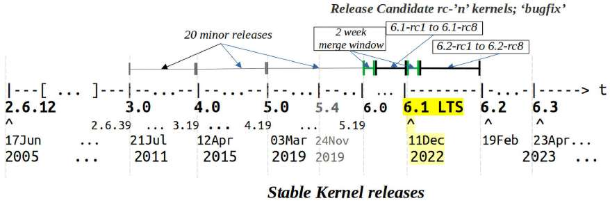

Hình 2.1: Dòng thời gian sơ lược của các Linux kernel hiện đại, làm nổi bật kernel chúng ta chủ yếu làm việc (6.1 LTS)

Hai tuần sau khi merge window của kernel 6.1 mở ngày 2 tháng 10 năm 2022, vào ngày 16 tháng 10 năm 2022, merge window đóng và công việc kernel rc bắt đầu, tất nhiên với `6.1-rc1` là bản rc đầu tiên. Các cây `-rc` (còn gọi là prepatch) chủ yếu làm việc với hợp nhất patch và sửa bug (regression bug và các bug khác), cuối cùng dẫn đến cây kernel được các maintainer chủ chốt (Linus Torvalds và Andrew Morton) xác định là “ổn định”.

Số kernel rc hay prepatch thay đổi; tuy nhiên, giai đoạn “sửa lỗi” này thường kéo dài khoảng 6 đến 10 tuần, sau đó stable kernel mới được phát hành. Trong khối kết quả trên, chúng ta thấy tám release candidate kernel (từ 6.1-rc1 đến 6.1-rc8) cuối cùng tạo ra bản ổn định cây v6.1 vào ngày 11 tháng 12 năm 2022, tổng cộng mất 70 ngày, hay 10 tuần. Xem mục 6.x tại `https://kernelnewbies.org/LinuxVersions` để xác nhận.

Vì sao Hình 2.1 bắt đầu từ kernel 2.6.12? Câu trả lời đơn giản: đây là phiên bản đầu tiên mà lịch sử kernel được lưu bằng Git.

Một câu hỏi khác có thể là vì sao hiển thị kernel 5.4 (LTS) trong hình? Vì nó cũng là LTS kernel (EOL dự kiến tháng 12 năm 2025), và đó là kernel chúng ta dùng trong lần xuất bản đầu tiên của sách!

#### Xem Git log của kernel qua trang GitHub

Có thể xem nhật ký kernel trực quan hơn qua trang releases/tags trong cây GitHub của Linus tại `https://github.com/torvalds/linux/tags`:

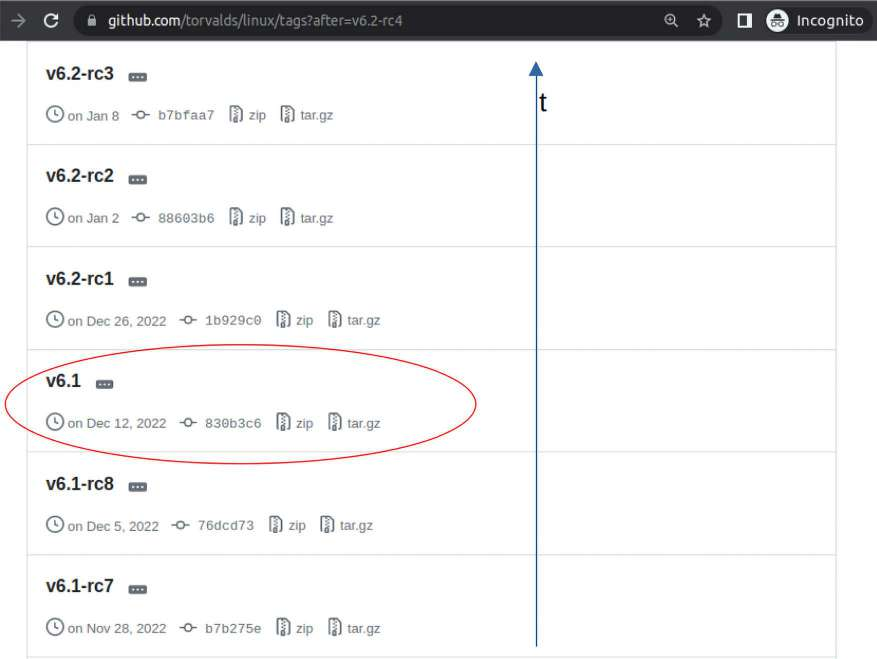

Hình 2.2: Xem tag v6.1 cùng các release candidate -rc’n’ cuối cùng tạo nên kernel v6.1 ở phía trên (đọc bottom-up)

Hình 2.2 cho thấy tag kernel v6.1 trong ảnh chụp đã rút gọn. Chúng ta đến đó bằng cách nào? Nhấn nút Next (không hiển thị ở đây) vài lần sẽ đến các trang còn lại, nơi có thể thấy các release candidate kernel v6.1-rc’n’. Hoặc chỉ cần truy cập `https://github.com/torvalds/linux/tags?after=v6.2-rc4`.

Ảnh trên là ảnh một phần, cho thấy hai trong số các release candidate kernel v6.1-rc’n’, 6.1-rc7 và 6.1-rc8, cuối cùng dẫn đến việc phát hành cây LTS 6.1 vào ngày 12 tháng 12 năm 2022.

Công việc thực sự không bao giờ ngừng: như có thể thấy, đầu tháng 1 năm 2023, release candidate v6.2-rc3 được phát hành, cuối cùng dẫn đến kernel v6.2 ngày 19 tháng 2 năm 2023. Sau đó, kernel 6.3-rc1 ra mắt ngày 6 tháng 3 năm 2023, tiếp theo là sáu bản nữa, cuối cùng dẫn đến stable kernel 6.3 ngày 23 tháng 4 năm 2023. Và cứ thế tiếp diễn…

Một lần nữa, khi bạn đọc sách, kernel đã tiến xa hơn nhiều. Nhưng không sao – kernel 6.1 LTS sẽ được bảo trì tương đối lâu (nhớ rằng EOL dự kiến là tháng 12 năm 2026), nên đây là bản phát hành rất quan trọng với các sản phẩm và dự án!

#### Tóm lược quy trình phát triển kernel

Nói chung, lấy dòng kernel 6.x làm ví dụ, quy trình phát triển kernel như sau. Bạn có thể đồng thời tham khảo Hình 2.3, nơi chúng tôi biểu diễn cách kernel 6.0 phát triển thành 6.1 LTS.

1\. Một bản ổn định 6.x được phát hành (trong ví dụ này coi x bằng 0). Vì thế, merge window hai tuần cho mainline kernel 6.x+1 mở ra. 2. Merge window mở khoảng hai tuần và patch mới được các subsystem maintainer hợp nhất vào mainline kernel; họ đã cẩn thận tiếp nhận patch từ người đóng góp và cập nhật cây của mình từ lâu trước đó. 3. Sau khoảng 2 tuần, merge window đóng. 4. Giờ đến giai đoạn “sửa lỗi”; các kernel rc (hay mainline, prepatch) bắt đầu xuất hiện. Chúng phát triển như sau: 6.x+1-rc1, 6.x+1-rc2, ..., 6.x+1-rcn được phát hành. Quá trình này có thể kéo dài 6 đến 8 tuần. 5. Tiếp đến là giai đoạn “hoàn thiện”, thường dài khoảng một tuần. Bản ổn định xuất hiện và stable kernel 6.x+1 mới được phát hành. 6. Bản phát hành được bàn giao cho “nhóm stable”:

  - Các bản sửa bug hoặc vá bảo mật quan trọng dẫn đến phát hành 6.x+1.y: 6.x+1.1, 6.x+1.2, ... , 6.x+1.n. Chúng ta sẽ chủ yếu làm việc trên kernel 6.1.25, nên giá trị y là 25.

  - Bản phát hành được bảo trì cho đến khi đến bản ổn định tiếp theo hoặc ngày End Of Life (EOL), với 6.1 LTS dự kiến là tháng 12 năm 2026. Bản sửa bug và vá bảo mật được áp dụng cho đến tận lúc đó.

...và toàn bộ quy trình lặp lại.

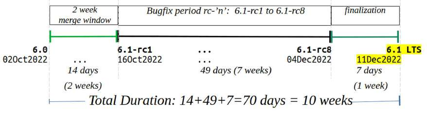

Hình 2.3: Cách 6.x trở thành kernel 6.x+1 (ví dụ ở đây cụ thể là cách 6.0 phát triển thành 6.1)

Giả sử bạn đang cố gửi một patch nhưng bỏ lỡ merge window. Không còn cách nào khác: bạn (hoặc nhiều khả năng là subsystem maintainer đang đưa loạt patch của bạn vào cùng một số loạt khác) chỉ còn chờ merge window tiếp theo sau khoảng 2,5 đến 3 tháng. Quy trình là như vậy; chúng ta cũng không vội đến thế.

#### Bài tập

Hãy thực hiện những gì chúng ta đã làm – theo dõi sự phát triển của kernel – với stable kernel mới nhất hiện tại. (Mẹo nhanh: thêm một cách xem lịch sử phát hành kernel: `https://en.wikipedia.org/wiki/Linux_kernel_version_history`).

Vậy giờ khi gặp các bản phát hành Linux kernel, bạn sẽ hiểu tên gọi và quy trình liên quan. Bây giờ hãy chuyển sang xem các loại kernel source tree hiện có.

### Khám phá các loại kernel source tree

Có một số loại source tree Linux kernel. Một loại then chốt là kernel Long Term Support (LTS). Nó đơn giản là bản phát hành “đặc biệt” theo nghĩa các kernel maintainer tiếp tục backport những bản sửa bug quan trọng và vá bảo mật cho đến ngày EOL xác định. Theo thông lệ, kernel tiếp theo được “đánh dấu” LTS là bản cuối cùng phát hành mỗi năm, thường vào tháng 12.

“Tuổi thọ” của LTS kernel thường tối thiểu 2 năm và có thể được gia hạn thêm vài năm. Kernel 6.1.y LTS mà chúng ta dùng xuyên suốt sách là LTS kernel thứ 23, có tuổi thọ dự kiến 4 năm – từ tháng 12 năm 2022 đến tháng 12 năm 2026.

Ảnh trích từ trang Wikipedia về lịch sử phiên bản Linux kernel (`https://en.wikipedia.org/wiki/Linux_kernel_version_history`) nói lên tất cả:


Hình 2.4: Các kernel đang phát triển, được hỗ trợ (stable) và stable LTS cùng ngày EOL; 6.1 LTS là kernel chúng ta sử dụng (nguồn ảnh: Wikipedia)

Điều thú vị là kernel 5.4 LTS được bảo trì đến tháng 12 năm 2025, còn 5.10 LTS được bảo trì cùng thời hạn với 6.1 LTS, đến tháng 12 năm 2026.

Tuy nhiên, lưu ý kho lưu trữ có nhiều loại kernel phát hành. Ở đây chúng tôi đưa ra danh sách chưa đầy đủ, xếp từ ít ổn định nhất đến ổn định nhất (do đó vòng đời cũng từ ngắn nhất đến dài nhất):

- Cây -next: Đây thực sự là tuyến đầu phát triển (đầu mũi tên!); các subsystem tree với patch mới được tập hợp ở đây để kiểm thử và review. Đây là cây mà người đóng góp kernel upstream làm việc. Nếu định upstream patch của mình vào kernel (đóng góp), bạn phải làm việc với cây -next mới nhất.

- Prepatch, còn gọi là -rc hoặc mainline: Đây là release candidate kernel được tạo trước một bản phát hành.

- Stable kernel: Như tên gọi, đây là phần dùng cho công việc thực tế. Những kernel này thường được các bản phân phối và dự án khác chọn dùng (ít nhất lúc bắt đầu). Chúng còn được gọi là vanilla kernel.

- Distribution kernel và LTS kernel: Distribution kernel (hiển nhiên) là kernel do bản phân phối cung cấp. Chúng thường bắt đầu từ vanilla/stable kernel nền. LTS kernel specially-maintained-for-a-longer-while, khiến chúng đặc biệt hữu ích cho dự án và sản phẩm công nghiệp/production. Đặc biệt với distro cấp doanh nghiệp, bạn thường thấy nhiều distro dường như dùng kernel “cũ”. Điều này thậm chí đúng với một số nhà cung cấp Android. Nhưng dù uname -r cho thấy phiên bản kernel dựa trên 4.x chẳng hạn, chưa chắc nó đã cũ. Không, distro/nhà cung cấp/OEM thường có nhóm kỹ sư kernel (hoặc thuê ngoài một nhóm) định kỳ cập nhật kernel cũ bằng các patch mới phù hợp, đặc biệt những bản sửa bug và vá bảo mật nghiêm trọng. Vì vậy, dù phiên bản có vẻ lỗi thời, chưa chắc thực tế là vậy!

Tuy nhiên, lưu ý việc này tạo khối lượng công việc rất lớn cho nhóm kỹ sư kernel, mà vẫn rất khó theo kịp stable kernel mới nhất; vì thế thực sự tốt nhất là làm việc với vanilla kernel.

Trong toàn bộ sách, chúng ta sẽ làm việc với một trong những LTS kernel mới nhất có vòng đời dài nhất.

Tại thời điểm viết sách, đó là kernel 6.1.x LTS với EOL dự kiến tháng 12 năm 2026, nhờ đó giữ nội dung sách phù hợp và có giá trị trong nhiều năm!

Cần nhắc thêm hai loại kernel source tree: Super LTS (SLTS) và kernel của nhà cung cấp chip (SoC). SLTS kernel được Civil Infrastructure Platform (`https://www.cip-project.org/`), một dự án của Linux Foundation, bảo trì lâu hơn cả LTS kernel. Trích từ trang của họ:

“... Dự án CIP tập trung thiết lập một ‘lớp nền’ phần mềm source code mở chất lượng công nghiệp, cho phép sử dụng và triển khai các khối phần mềm trong dự án hạ tầng dân dụng. Hiện nay, các hệ thống hạ tầng dân dụng được xây dựng từ đầu, ít re-use các khối phần mềm hiện có. Dự án CIP dự định tạo ra các khối có thể tái sử dụng, đáp ứng yêu cầu an toàn, độ tin cậy và những yêu cầu khác của hạ tầng công nghiệp, dân dụng.”

Thực tế, tại thời điểm viết sách, các CIP kernel mới nhất – SLTS v6.1 và SLTS v6.1-rt – dựa trên kernel 6.1 LTS, có EOL dự kiến tháng 8 năm 2033 (10 năm)! Đồng thời, các kernel SLTS 5.10 và SLTS 5.10-rt có EOL dự kiến tháng 1 năm 2031. Xem wiki tại đây để biết thông tin mới nhất: `https://wiki.linuxfoundation.org/civilinfrastructureplatform/start#kernel_maintainership`.

#### LTS kernel – định hướng mới

Một cập nhật nhanh và quan trọng! Tháng 9 năm 2023, tại Open Source Summit ở Bilbao, Tây Ban Nha, Jonathan Corbet đưa ra thông báo quan trọng trong bài nói “kernel report” nổi tiếng: từ nay LTS kernel sẽ chỉ được bảo trì trong hai năm.

Dưới đây là một số tài liệu nếu bạn muốn tự tìm hiểu:

  - The Kernel Report, Jon Corbet, tháng 9 năm 2023, OSS EU, Tây Ban Nha; YouTube: `https://osseu2023.sched.com/event/4a09976cdb50e939601160ecdb45bc05#video_stream`; slide (PDF): `https://lwn.net/talks/2023/kr-osseu.pdf`

  - Long-term support for Linux kernels is about to get a lot shorter (Thời gian hỗ trợ dài hạn cho Linux kernel sắp ngắn đi nhiều), Liam Proven, The Register, tháng 9 năm 2023: `https://www.theregister.com/2023/09/26/linux_kernel_report_2023/`

Điều này có thể khiến nhiều người hơi ngạc nhiên. Vì sao chỉ hai năm? Tóm lại, hai lý do được đưa ra:

- Thứ nhất, vì sao phải bảo trì một dòng kernel nhiều năm khi mọi người không thực sự dùng chúng? Nhiều nhà cung cấp kernel doanh nghiệp, cũng như nhà cung cấp SoC, bảo trì kernel riêng.

- Tiếp đến là vấn đề đáng tiếc và nghiêm trọng: maintainer kiệt sức. Cộng đồng kernel khó liên tục bảo trì tất cả những LTS kernel này – hiện có 7 phiên bản LTS chính (4.14, 4.19, 5.4, 5.10, 5.15, 6.1 và 6.6)! Hơn nữa, gánh nặng chỉ tăng theo thời gian. Ví dụ, dòng 4.14 LTS đã có khoảng 300 bản cập nhật và gần 28.000 commit. Ngoài ra, bug cũ cuối cùng cũng lộ ra và kéo theo nhiều công việc sửa chúng trong LTS kernel hiện đại. Không chỉ vậy, bug mới xuất hiện trong kernel mới hơn phải được sửa rồi back-ported về LTS kernel cũ still-maintained. Mọi thứ cứ cộng dồn.

Tại thời điểm này, có vẻ kernel chúng ta làm việc ở đây – 6.1 LTS – sẽ được bảo trì theo thời hạn thông thường, đến tháng 12 năm 2026.

Tiếp tục, hãy thảo luận ngắn về loại kernel source tree thứ hai vừa nêu: nhà cung cấp silicon/chipset SoC thường duy trì kernel riêng cho các bo mạch/chip họ hỗ trợ. Họ thường dựa trên vanilla LTS kernel hiện có (không nhất thiết mới nhất!) rồi phát triển tiếp, thêm patch vendor-specific, các thành phần Board Support Package (BSP), driver, v.v. Tất nhiên, theo thời gian, khác biệt giữa kernel của họ và stable kernel mới nhất có thể khá lớn, dẫn đến vấn đề bảo trì khó khăn như phải liên tục backport các patch bảo mật/sửa bug nghiêm trọng.

Khi làm dự án dùng những chip như vậy, perhaps-best là dựa trên giải pháp industry-strength hiện có như Yocto Project (`https://www.yoctoproject.org/`), vốn làm rất tốt việc bảo trì LTS kernel gần đây với vendor layer được áp dụng đồng bộ cùng các patch bảo mật/sửa bug then chốt. Ví dụ, tại thời điểm viết, bản Yocto ổn định mới nhất – Nanbield 4.3 – hỗ trợ cả kernel 6.1 LTS lẫn kernel 6.5 non-LTS mới hơn; tất nhiên phiên bản cụ thể có thể khác theo kiến trúc (họ bộ xử lý).

Vậy có rất nhiều loại kernel source tree. Tuy nhiên, tôi đề nghị bạn xem trang Releases của kernel.org để biết chi tiết các loại kernel phát hành: `https://www.kernel.org/releases.html`. Một lần nữa, để biết sâu hơn, xem How the development process works (`https://www.kernel.org/doc/html/latest/process/2.Process.html#how-the-development-process-works`).

Có thể dùng `curl` để truy vấn kho `https://www.kernel.org/` theo cách non-interactive, dùng được trong script. Kết quả sau là tình trạng Linux ngày 6 tháng 12 năm 2023:

```
$ curl -L https://www.kernel.org/finger_banner
The latest stable version of the Linux kernel is:             6.6.4
The latest mainline version of the Linux kernel is:           6.7-rc4
The latest stable 6.6 version of the Linux kernel is:         6.6.4
The latest stable 6.5 version of the Linux kernel is:         6.5.13 (EOL)
The latest longterm 6.1 version of the Linux kernel is:       6.1.65
The latest longterm 5.15 version of the Linux kernel is:      5.15.141
The latest longterm 5.10 version of the Linux kernel is:      5.10.202
The latest longterm 5.4 version of the Linux kernel is:       5.4.262
The latest longterm 4.19 version of the Linux kernel is:      4.19.300
The latest longterm 4.14 version of the Linux kernel is:      4.14.331
The latest linux-next version of the Linux kernel is:         next-20231206
$
```

Khi bạn đọc sách, khả năng rất cao – thực ra là chắc chắn – kernel đã tiếp tục phát triển và có phiên bản mới hơn. Với cuốn sách như thế này, điều tốt nhất tôi có thể làm là chọn LTS kernel ổn định gần mới nhất có EOL dự kiến xa nhất lúc viết: 6.1.x LTS.

Tất nhiên, điều đó đã xảy ra! Kernel 6.6 phát hành ngày 29 tháng 10 năm 2023 và tại thời điểm viết (ngay trước khi in), nó thực sự đã được đánh dấu LTS với EOL dự kiến tháng 12 năm 2026 (giống 6.1 LTS).

Để minh họa điểm này, lưu ý lần xuất bản đầu dùng kernel 5.4.0 vì 5.4 là dòng LTS kernel có vòng đời dài nhất lúc viết. Hôm nay, khi tôi viết những dòng này, 5.4 LTS vẫn được bảo trì với EOL dự kiến tháng 12 năm 2025 và phiên bản ổn định mới nhất là 5.4.268.

#### Tôi nên chạy kernel nào?

Với tất cả các loại kernel đã thấy, câu hỏi thực sự đặt ra là tôi nên chạy kernel nào? Câu trả lời có nhiều sắc thái vì phụ thuộc môi trường. Dùng cho hệ nhúng, desktop hay server? Dự án mới hay dự án cũ? Thời hạn bảo trì dự định là bao lâu? Có phải kernel SoC do nhà cung cấp bảo trì? Yêu cầu bảo mật là gì? Dù vậy, “câu trả lời đúng” từ chính các kernel maintainer kỳ cựu là:

Hãy chạy bản cập nhật stable mới nhất. Đó là kernel ổn định nhất, an toàn nhất, tốt nhất mà chúng tôi biết cách tạo ra ở thời điểm này. Đó là điều tốt nhất chúng tôi có thể làm. Bạn nên chạy nó.

– Jon Corbet, tháng 9 năm 2023

Mẹo: Mở `https://kernel.org/` trong trình duyệt; bạn thấy nút lớn màu vàng chứa số bản phát hành kernel không? Đó là stable kernel mới nhất hôm nay.

Bạn phải áp dụng tất cả các bản phát hành stable/LTS để có hệ thống an toàn và ổn định. Nếu cố cherry-pick patch ngẫu nhiên, bạn sẽ không sửa hết các vấn đề đã biết và chưa biết, mà thay vào đó có thể nhận một hệ thống kém an toàn hơn, chứa các bug đã biết.

– Greg Kroah-Hartman

Bài blog thực tế What Stable Kernel Should I Use (Tôi nên dùng stable kernel nào), tháng 8 năm 2018, của Greg Kroah-Hartman (`http://kroah.com/log/blog/2018/08/24/what-stable-kernel-should-i-use/`) cũng thể hiện các suy nghĩ này.

Được rồi, giờ đã có kiến thức về quy ước phiên bản kernel và các loại kernel source tree, chắc chắn đã đến lúc bắt đầu hành trình build kernel của chúng ta.

## Các bước build kernel từ source code

Để tiện tra cứu nhanh, dưới đây là các bước chính, then chốt để build Linux kernel từ source code. Vì phần giải thích từng bước khá chi tiết, bạn có thể quay lại bản tóm tắt này để nắm bức tranh tổng thể. Các bước như sau:

1\. Lấy source tree Linux kernel bằng một trong các lựa chọn:

  - Tải một kernel source tree cụ thể dưới dạng tệp nén

  - Clone cây Git (kernel)

2\. Giải nén kernel source tree vào một vị trí trong thư mục cá nhân (bỏ qua bước này nếu lấy kernel bằng cách clone cây Git).

3\. Cấu hình: Chọn điểm khởi đầu cho cấu hình kernel (có nhiều cách tiếp cận). Sau đó sửa, chọn các tùy chọn hỗ trợ theo yêu cầu của kernel mới. Cách được khuyến nghị là dùng `make menuconfig`.

4\. Build kernel image, loadable module và Device Tree Blob (DTB) cần thiết bằng `make [-j'n'] all`. Lệnh này build kernel image nén (`arch/<arch>/boot/[b|z|u]` `{Ii}mage`), kernel image không nén `– vmlinux`, tệp `System.map`, các kernel module object và mọi tệp DTB đã cấu hình.

5\. Cài kernel module just-built (trên x86) bằng `sudo make [INSTALL_MOD_PATH=<prefix-dir>]` `modules_install`. Bước này mặc định cài kernel module dưới `/lib/modules/$(uname` `-r)/` (có thể dùng biến môi trường `INSTALL_MOD_PATH` để thay đổi).

6\. Bootloader (x86): Thiết lập bootloader GRUB và ảnh `initramfs`, trước đây gọi là `initrd`: `sudo make [INSTALL_PATH=</new/boot/dir>] install`

  - Lệnh này tạo và cài ảnh `initramfs` hoặc `initrd` dưới `/boot` (có thể dùng biến môi trường `INSTALL_PATH` để thay đổi).

  - Nó cập nhật tệp cấu hình bootloader để boot kernel mới (mục đầu tiên).

7\. Tùy chỉnh menu bootloader GRUB (tùy chọn).

Chương này là chương đầu trong hai chương về build kernel, trình bày bước 1 đến 3 và nhiều kiến thức nền cần thiết. Chương tiếp theo trình bày các bước còn lại, từ 4 đến 7. Vì vậy, hãy bắt đầu với bước 1.

## Bước 1 – Lấy source tree Linux kernel

Trong phần này, chúng ta sẽ xem hai cách chính để lấy source tree Linux kernel:

- Tải và giải nén kernel source tree cụ thể từ kho công khai Linux kernel: `https://www.kernel.org`.

- Clone source tree của Linus Torvalds (hoặc người khác) – ví dụ cây Git `linux-next`.

Bạn quyết định dùng cách nào? Với hầu hết nhà phát triển làm dự án hoặc sản phẩm, quyết định đã được đưa ra – dự án dùng một phiên bản Linux kernel rất cụ thể. Vì vậy, bạn tải kernel source tree đó, rất có thể áp dụng patch project-specific theo yêu cầu, rồi dùng nó.

Với người định đóng góp hay upstream mã vào mainline kernel, cách thứ hai – clone cây Git – là lựa chọn phù hợp. Tất nhiên còn nhiều điều khác; chúng tôi đã mô tả một số chi tiết trong phần Khám phá các loại kernel source tree.

Trong phần sau, chúng tôi minh họa cả hai cách lấy kernel source tree. Trước tiên là cách tải một kernel source tree cụ thể (không phải cây Git) từ kho kernel. Chúng ta chọn Linux kernel 6.1.25 LTS cho mục đích này. Vì vậy, trong các bài thực hành của sách, đây là cách cần dùng. Ở cách thứ hai, chúng ta clone cây Git.

### Tải kernel source tree cụ thể

Trước hết, kernel source code ở đâu? Câu trả lời ngắn gọn là trên máy chủ kho kernel công khai tại `https://www.kernel.org`. Trang chủ hiển thị phiên bản Linux kernel stable mới nhất cùng các bản `longterm` và `linux-next` mới nhất. Ảnh sau cho thấy website ngày 25 tháng 4 năm 2023. Ngày được hiển thị theo định dạng `yyyy-mm-dd`:


Hình 2.5: Website kernel.org (ngày 25 tháng 4 năm 2023), làm nổi bật kernel 6.1 LTS

Nhắc nhanh: chúng tôi cũng cung cấp tệp PDF chứa ảnh full-color của các ảnh chụp/sơ đồ trong sách. Bạn có thể tải tại: `https://packt.link/gbp/9781803232225`.

Có nhiều cách tải tệp kernel source code nén từ máy chủ này và/hoặc các mirror của nó. Hãy xem hai cách:

- Cách tương tác, có lẽ đơn giản nhất, là vào website trên rồi nhấn liên kết `tarball` phù hợp trong web client. Trình duyệt sẽ tải tệp ảnh định dạng `.tar.xz` về hệ thống.

- Bạn cũng có thể tải bất kỳ kernel source tree dạng nén nào bằng cách truy cập `https://mirrors.edge.kernel.org/pub/linux/kernel/` rồi chọn major version; cụ thể, với kernel major # 6, URL là `https://mirrors.edge.kernel.org/pub/linux/kernel/v6.x/`; duyệt hoặc tìm trên trang này kernel mong muốn. Ví dụ, xem ảnh sau:

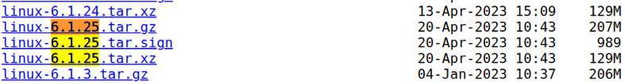

Hình 2.6: Một phần ảnh chụp kernel.org, làm nổi bật kernel (6.1.25 LTS) chúng ta sẽ tải và làm việc

Các file `tar.gz` và `tar.xz` có nội dung giống hệt nhau; chỉ khác kiểu nén. Bạn có thể thấy tải các file `.tar.xz` thường nhanh hơn vì chúng có kích thước nhỏ hơn.

- Hoặc bạn có thể tải kernel source tree từ dòng lệnh bằng tiện ích `wget`. Chúng ta cũng có thể dùng tiện ích mạnh mẽ `curl` để làm việc này. Ví dụ, để tải tệp source code nén của stable kernel 6.1.25 LTS, gõ lệnh sau trên một dòng:

```
wget –https-only -O ~/Downloads/linux-6.1.25.tar.xz  https://mirrors.
edge.kernel.org/pub/linux/kernel/v6.x/linux-6.1.25.tar.xz
```

Lệnh này tải an toàn kernel source tree 6.1.25 dạng nén vào thư mục `~/Downloads` của máy. Vì vậy, hãy thực hiện để đưa kernel source code 6.1.25 (LTS) về hệ thống!

### Clone cây Git

Với nhà phát triển đang làm việc và muốn đóng góp mã upstream, bạn phải làm việc trên phiên bản mới nhất của code base Linux kernel. Tuy nhiên, trong cộng đồng kernel, có những mức độ tinh tế về chính xác điều gì được coi là phiên bản mới nhất. Như đã đề cập, cây `linux-next`, cùng một branch hoặc tag cụ thể trong đó, là nơi cần làm việc cho mục đích này.

Tuy nhiên, sách không định đi sâu vào các chi tiết phức tạp khi thiết lập cây `linux-next`. Quy trình này đã được ghi chép rất đầy đủ; xem phần Đọc thêm của chương để có các liên kết chi tiết. Trang hướng dẫn chính xác cách clone cây `linux-next` nằm tại Working with linux-next, `https://www.kernel.org/doc/man-pages/linux-next.html`; như được nêu ở đó, cây linux-next, `http://git.kernel.org/cgit/linux/kernel/git/next/linux-next.git`, là nơi tập hợp patch hướng đến merge window kernel tiếp theo. Nếu đang phát triển kernel bleeding-edge, có lẽ bạn muốn làm việc từ cây đó thay vì cây mainline của Linus Torvalds hoặc source tree từ kho kernel chung tại `https://www.kernel.org`.

Với mục đích của chúng ta, clone kho Git Linux mainline (thực chất là cây Git của Linus Torvalds) là quá đủ. Thực hiện như sau:

```
git clone https://git.kernel.org/pub/scm/linux/kernel/git/torvalds/linux.git
cd linux
```

Lưu ý clone toàn bộ Linux kernel source tree là thao tác tốn thời gian, tài nguyên mạng và disk-consuming! Bảo đảm đủ chỗ trống, ít nhất vài gigabyte.

Chạy `git clone --depth n <...>`, với `n` là số nguyên, có thể hữu ích để giới hạn độ sâu lịch sử (commit), qua đó giảm dung lượng tải và dùng trên đĩa. Như trang man `git-clone` nói về tùy chọn `--depth`: “Tạo shallow clone với lịch sử được cắt còn số commit chỉ định.” Ngoài ra, để hủy giới hạn “shallow fetch” và lấy toàn bộ, chỉ cần chạy `git pull --unshallow`.

Lệnh `git clone` có thể mất một lúc để hoàn tất. Hơn nữa, bạn có thể chỉ định muốn lấy phiên bản ổn định mới nhất của cây Git kernel bằng cách chạy `git clone` như dưới đây; lúc này, chỉ khi định làm việc trên cây Git mainline này, chúng ta sẽ chấp nhận clone cây Git stable kernel cùng toàn bộ lịch sử phong phú của nó (một lần nữa, nhập trên một dòng):

```
git clone git://git.kernel.org/pub/scm/linux/kernel/git/stable/linux-stable.git
```

Giờ chuyển đến thư mục mà cây đã được giải ra:

```
cd linux-stable
```

Một lần nữa, nếu định làm việc trên cây Git này, hãy bỏ qua phần Bước 2 – Giải nén kernel source tree vì thao tác `git clone` dù sao cũng giải ra source tree. Thay vào đó, tiếp tục phần Bước 3 – Cấu hình Linux kernel ngay sau đó. Tuy nhiên, điều này có nghĩa phiên bản kernel source tree bạn dùng sẽ rất khác 6.1.25 trong sách. Vì vậy, tôi đề nghị bạn chỉ coi phần này là minh họa cách lấy cây Git ổn định mới nhất qua `git`, rồi dừng ở đó.

Cuối cùng, kernel maintainer còn cung cấp một cách tải kernel khác: script tải an toàn source tree Linux kernel chỉ định, có xác minh chữ ký PGP. Script nằm tại: `https://git.kernel.org/pub/scm/linux/kernel/git/mricon/korg-helpers.git/tree/get-verified-tarball`.

## Bước 2 – Giải nén kernel source tree

Trong phần trước, ở bước 1, bạn đã học chính xác cách lấy source tree Linux kernel. Một cách – cũng là cách chúng ta theo trong sách – đơn giản là tải tệp source code nén từ kernel.org hoặc một mirror của nó. Cách khác là dùng Git clone kernel source tree gần đây.

Vì vậy, tôi giả định đến đây bạn đã lấy kernel source tree 6.1.25 (LTS) dạng nén về máy Linux. Khi đã có, hãy tiếp tục bước 2, một bước đơn giản để học cách giải nén nó.

Như đã đề cập, phần này dành cho bạn đã tải một source tree Linux kernel cụ thể dạng nén từ kho `https://www.kernel.org` và muốn build nó. Trong sách, chúng ta chủ yếu làm việc với dòng kernel 6.1 longterm, cụ thể là kernel 6.1.25 LTS.

Ngược lại, nếu đã thực hiện `git clone` cây Git Linux mainline như phần ngay trước, bạn có thể yên tâm bỏ qua phần này và chuyển đến phần tiếp theo – Bước 3 – Cấu hình Linux kernel.

Được rồi, tải xuống đã xong, hãy tiếp tục. Bước tiếp theo là giải nén kernel source tree – nhớ rằng đây là tệp tar-ed rồi nén, thường là `.tar.xz`. Dù có thể lặp lại, chúng tôi giả định đến đây bạn đã tải code base Linux kernel 6.1.25 dưới dạng tệp nén vào `~/Downloads`:

```
$ cd ~/Downloads ; ls -lh linux-6.1.25.tar.xz
-rw-rw-r-- 1 c2kp c2kp  129M  Apr 20 16:13  linux-6.1.25.tar.xz
```

Cách đơn giản để giải nén và trích xuất tệp này là dùng tiện ích `tar` có ở khắp nơi:

```
tar xf ~/Downloads/linux-6.1.25.tar.xz
```

Thao tác này giải kernel source tree vào thư mục tên `linux-6.1.25` trong `~/Downloads`. Nhưng nếu muốn giải vào thư mục khác, chẳng hạn `~/kernels?` thì sao? Khi đó làm như sau:

```
mkdir -p ~/kernels
tar xf ~/Downloads/linux-6.1.25.tar.xz \
 --directory=~/kernels/
```

Thao tác này giải kernel source code vào `~/kernels/linux-6.1.25/`. Để thuận tiện và theo thông lệ tốt, hãy thiết lập biến môi trường trỏ đến vị trí gốc kernel source tree mới của chúng ta:

```
export LKP_KSRC=~/kernels/linux-6.1.25
```

Lưu ý từ đây trở đi, chúng tôi giả định biến `LKP_KSRC` chứa vị trí kernel source tree 6.1.25 LTS.

Dù luôn có thể dùng ứng dụng quản lý tệp GUI như Nautilus để giải tệp nén, tôi rất khuyến khích bạn làm quen với Linux CLI để thực hiện các thao tác này.

Đừng quên `tldr` khi cần tra nhanh các tùy chọn được dùng nhiều nhất của lệnh thông thường! Ví dụ với `tar`, chỉ cần chạy `tldr tar` để xem các lệnh tar phổ biến, hoặc tra tại: `https://tldr.inbrowser.app/pages/common/tar`.

Bạn có nhận thấy không? Chúng ta có thể giải kernel source tree vào bất kỳ thư mục nào dưới thư mục cá nhân hoặc nơi khác. Khác với ngày trước, khi cây luôn được giải vào vị trí root-writeable, thường là `/usr/src/`.

Nếu điều duy nhất bạn muốn lúc này là tiếp tục quy trình build kernel, hãy bỏ qua phần sau và đi tiếp. Nếu quan tâm (tôi chắc chắn hy vọng vậy!), phần tiếp theo là một đoạn tìm hiểu ngắn nhưng quan trọng về cấu trúc và bố cục kernel source tree.

### Tham quan ngắn kernel source tree

Hãy tưởng tượng! Toàn bộ source code Linux kernel giờ đã có trên hệ thống của bạn! Tuyệt vời – hãy xem nhanh:

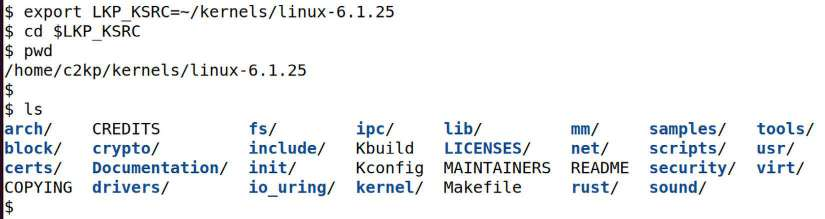

Hình 2.7: Gốc source tree Linux kernel 6.1.25 nguyên bản

Tuyệt! Nó lớn thế nào? Chạy nhanh `du -h .` ở gốc kernel source tree đã giải nén cho thấy cây này (nhớ rằng phiên bản là 6.1.25) có kích thước khoảng 1,5 gigabyte!

Để bạn biết, Linux kernel đã phát triển lớn và tiếp tục lớn hơn về số dòng source code (Source Lines of Code – SLOC). Ước tính hiện tại gần 30 triệu SLOC. Tất nhiên, cần hiểu rằng không phải tất cả mã này đều được biên dịch khi build một kernel.

Chỉ nhìn source code, làm sao biết chính xác đây là phiên bản Linux kernel nào? Rất dễ: một cách nhanh là xem vài dòng đầu `Makefile` của dự án. Nhân tiện, kernel dùng `Makefiles` ở khắp nơi; hầu hết thư mục có một tệp. Chúng ta sẽ gọi `Makefile` này, tệp ở gốc kernel source tree, là Makefile top-level:

```
$ head Makefile
# SPDX-License-Identifier: GPL-2.0
VERSION = 6
PATCHLEVEL = 1
SUBLEVEL = 25
EXTRAVERSION =
NAME = Hurr durr I'ma ninja sloth
# *DOCUMENTATION*
# To see a list of typical targets execute "make help"
# More info can be located in ./README
```

Rõ ràng đây là kernel source code 6.1.25. Chúng ta đã trình bày ý nghĩa các nhãn `VERSION`, `PATCHLEVEL`, `SUBLEVEL` và `EXTRAVERSION` – tương ứng trực tiếp quy ước `w.x.y.z` – trong phần Tìm hiểu quy ước đặt bản phát hành Linux kernel. Nhãn `NAME` đơn giản là biệt danh đặt cho bản phát hành (nhìn vào đây thì tôi còn biết nói gì: đó là kiểu hài hước của giới kernel. Cá nhân tôi thích `NAME` của kernel 5.x hơn – đó là “Dare mighty things”!).

Được rồi, giờ hãy có cái nhìn zoomed-out từ độ cao 10.000 foot về kernel source tree này. Bảng sau tóm tắt phân loại chung và mục đích các tệp, thư mục quan trọng hơn ở gốc source tree Linux kernel. Hãy Cross-reference với Hình 2.7:

| Tên tệp hoặc thư mục | Mục đích |
|---|---|
| Top-level files |  |
| `README` | Tệp `README` của dự án. Nó cho biết tài liệu kernel chính thức nằm ở đâu – bật mí: trong thư mục tên `Documentation` `–` và cách bắt đầu dùng tài liệu. Tài liệu kernel hiện đại cũng có trực tuyến, được thực hiện rất tốt: `https://www.kernel.org/doc/html/latest/`. Tài liệu thực sự quan trọng; đây là nguồn chính thống do chính nhà phát triển kernel viết. Hãy đọc tệp `README` ngắn này trước! Xem thêm mục \[1\] bên dưới. |
| `COPYING` | Tệp này trình bày chi tiết các điều khoản giấy phép phát hành kernel source code. Phần lớn tệp kernel source code phát hành theo giấy phép GNU GPL v2 well-known (viết là GPL-2.0). Xu hướng hiện đại là dùng định danh giấy phép SPDX industry-aligned, grep-pable. Danh sách đầy đủ tại `https://spdx.org/licenses/`. Xem thêm mục \[2\] bên dưới. |
| `MAINTAINERS` | Câu hỏi thường gặp: thành phần kernel (hoặc tệp) XYZ có vấn đề – liên hệ ai để được hỗ trợ? Đó chính là nội dung tệp này cung cấp: danh sách mọi kernel subsystem cùng maintainer tương ứng. Chi tiết đến từng thành phần riêng như một driver hay tệp cụ thể, cùng trạng thái, người hiện bảo trì, mailing list, website, v.v. Rất hữu ích! Thậm chí có helper script tìm người hoặc nhóm cần trao đổi: `scripts/get_maintainer.pl` . Xem thêm mục \[3\]. |
| `Makefile` | Đây là Makefile top-level của kernel; hệ thống build Kbuild của kernel cũng như kernel module dùng `Makefile` này để build. |
| Major subsystem directories |  |
| `kernel/` | Core kernel subsystem: mã ở đây xử lý rất nhiều tính năng kernel cốt lõi, gồm quản lý vòng đời process/thread, CPU task scheduling, locking, cgroups, timer, interrupt, signaling, module, tracing, RCU primitive, \[e\]BPF và nhiều nội dung khác. |
| `mm/` | Phần lớn mã memory management (mm) nằm ở đây. Chúng ta sẽ đề cập một ít ở Chương 6, Kernel Internals Essentials – Processes and Threads, cùng một số nội dung liên quan trong Chương 7, Memory Management Internals – Essentials, và Chương 8, Kernel Memory Allocation for Module Authors – Phần 1. |
| `fs/` | Mã ở đây triển khai hai tính năng filesystem then chốt: abstraction layer – Virtual Filesystem Switch (VFS) của kernel – và các filesystem driver riêng (ví dụ `ext[2\|4]`, `btrfs`, `nfs`, `ntfs`, `overlayfs`, `squashfs`, `jffs2`, `fat`, `f2fs`, `isofs`, v.v.). |
| `block/` | Code path block I/O bên dưới VFS/FS. Gồm mã triển khai page cache, generic block I/O layer, I/O scheduler, các tính năng blk-mq new-ish, v.v. |
| `net/` | Triển khai đầy đủ network protocol stack, tuân thủ sát Request For Comments (RFC) – `https://whatis.techtarget.com/definition/Request-for-Comments-RFC`. Bao gồm triển khai high-quality của TCP, UDP, IP và rất nhiều giao thức mạng khác. Muốn xem triển khai TCP/IP cho IPv4 code-level? Nó ở đây: net/ipv4/, hãy xem source code `tcp*.c`, `ip*.c` và các tệp khác. |
| `ipc/` | Mã subsystem Inter-Process Communication (IPC); triển khai các cơ chế IPC như message queue SysV và POSIX, shared memory, semaphore, v.v. |
| `sound/` | Mã audio subsystem, còn gọi là lớp Advanced Linux Sound Architecture (ALSA). |
| `virt/` | Mã virtualization (hypervisor); Kernel Virtual Machine (KVM) phổ biến và mạnh mẽ được triển khai ở đây. |
| Arch/Infrastructure/Drivers/Miscellaneous |  |
| `Documentation/` | Tài liệu kernel chính thức nằm ngay đây; việc làm quen với nó rất quan trọng. Tệp `README` dẫn đến phiên bản trực tuyến. |
| `LICENSES/` | Nội dung mọi giấy phép, phân loại theo các nhóm khác nhau. Xem mục \[2\]. |
| `arch/` | Mã arch-specific nằm ở đây (arch ở đây nghĩa là CPU). Linux khởi đầu là dự án sở thích nhỏ cho i386. Nay rất có thể nó là hệ điều hành được port nhiều nhất từ trước đến nay. Xem các bản port kiến trúc ở mục \[4\] của danh sách sau bảng. |
| `certs/` | Mã hỗ trợ tạo signed module; đây là tính năng bảo mật mạnh, khi dùng đúng bảo đảm ngay cả rootkit độc hại cũng không thể tùy tiện nạp bất kỳ kernel module nào chúng muốn. |
| `crypto/` | Thư mục chứa triển khai kernel-level của cipher (thuật toán mã hóa/giải mã hoặc transformation) và kernel API phục vụ các thành phần cần cryptographic service. |
| `drivers/` | Mã device driver kernel-level nằm ở đây. Đây được coi là vùng non-core; được phân thành nhiều loại driver. Đây thường là vùng nhận đóng góp thường xuyên nhất; đồng thời mã ở đây chiếm nhiều dung lượng đĩa nhất trong source tree. |
| `include/` | Thư mục chứa kernel header arch-independent. Cũng có một số header arch-specific dưới `arch/<cpu>/include/....` |
| `init/` | Kernel code initialization arch-independent; có lẽ nơi gần với hàm `main` của kernel nhất là `init/main.c:start_kernel()`, với hàm `start_kernel()` được coi là early C entry point trong kernel initialization. (Hãy dùng công cụ duyệt code web tuyệt vời của Bootlin để xem cho 6.1.25 tại `https://elixir.bootlin.com/linux/v6.1.25/source/init/main.c#L936`.) |
| `io_uring/` | Hạ tầng kernel triển khai fast I/O framework `io_uring` new-ish; xem mục \[5\]. |
| `lib/` | Thành phần gần tương đương thư viện nhất cho kernel. Cần hiểu rằng kernel không hỗ trợ shared library như ứng dụng user space. Một số mã ở đây được auto-linked vào kernel image, nên có sẵn cho kernel lúc runtime. Trong `lib/:` có nhiều thành phần hữu ích: nén/giải nén, checksum, bitmap, toán học, string routine, thuật toán cây, v.v. |
| `rust/` | Hạ tầng kernel hỗ trợ ngôn ngữ lập trình Rust; xem mục \[6\]. |
| `samples/` | Mã mẫu cho nhiều tính năng và cơ chế kernel; hữu ích để học hỏi! |
| `scripts/` | Nhiều script nằm ở đây, một số dùng trong kernel build, nhiều script cho mục đích khác như static/dynamic analysis, debugging, v.v. Chủ yếu là Bash và Perl script. (Để bạn biết, đặc biệt cho mục đích debug, tôi đã trình bày nhiều script này trong Linux Kernel Debugging, 2022.) |
| `security/` | Chứa Linux Security Module (LSM) của kernel, một framework Mandatory Access Control (MAC) nhằm áp đặt kiểm soát chặt hơn việc user app truy cập kernel space so với kernel mặc định. Mô hình mặc định gọi là Discretionary Access Control (DAC). Hiện Linux hỗ trợ nhiều LSM; well-known có SELinux, AppArmor, Smack, Tomoyo, Integrity và Yama. Lưu ý LSM mặc định “tắt”. |
| `tools/` | Source code các công cụ user mode nằm ở đây, chủ yếu ứng dụng hoặc script “gắn chặt” với kernel nên cần nằm trong code base kernel cụ thể. Perf, công cụ CPU profiling hiện đại, các công cụ eBPF và một số tracing tool là ví dụ rất tốt. |
| `usr/` | Mã hỗ trợ tạo và nạp ảnh initramfs; cho phép kernel thực thi mã user space trong kernel init. Điều này thường cần thiết; chúng ta trình bày initramfs ở Chương 3, Build Linux kernel 6.x từ source code – Phần 2, mục Tìm hiểu framework initramfs. |

Bảng 2.2: Bố cục source tree Linux kernel

Sau đây là một số giải thích quan trọng từ bảng:

1\. README: Tệp này còn đề cập tài liệu cần xem để biết phiên bản phần mềm tối thiểu chấp nhận được cho build và chạy kernel: `Documentation/process/changes.rst`. Điều thú vị là kernel cung cấp Awk script (`scripts/ver_linux`) in phiên bản phần mềm hiện có trên hệ thống chạy nó, giúp kiểm tra các phiên bản đã cài có đáp ứng yêu cầu hay không.

2\. Giấy phép kernel: Không sa vào chi tiết pháp lý (không cần nói cũng biết, tôi không phải luật sư), bản chất thực tế là như sau. Vì kernel phát hành theo GNU GPL-2.0 (GNU GPL là GNU General Public License), mọi dự án trực tiếp dùng code base kernel tự động chịu giấy phép này. Đây là thuộc tính “tác phẩm phái sinh” của GPL-2.0. Về pháp lý, các dự án hoặc sản phẩm đó phải phát hành phần mềm kernel theo cùng điều khoản giấy phép. Nói thực tế, tình hình lại mơ hồ hơn nhiều; nhiều sản phẩm thương mại chạy trên Linux kernel có mã độc quyền ở user space và/hoặc kernel-space. Họ thường làm vậy bằng cách tái cấu trúc công việc kernel (thường nhất là device driver) thành dạng Loadable Kernel Module (LKM). Có thể phát hành kernel module (LKM) theo mô hình dual-license. LKM là chủ đề Chương 4, Viết kernel module đầu tiên – Phần 1, và Chương 5, Viết kernel module đầu tiên – Phần 2; chúng ta trình bày một số thông tin giấy phép kernel module ở đó.

Một số người thích giấy phép độc quyền tìm cách phát hành kernel code trong kernel module không theo điều khoản GPL-2.0; về kỹ thuật có lẽ làm được, nhưng ít nhất bị coi là rất anti-social, thậm chí có thể vượt sang phạm pháp. Bạn nào quan tâm có thể tìm thêm liên kết giấy phép trong tài liệu Đọc thêm của chương.

3\. MAINTAINERS: Hãy xem tệp này ở gốc kernel source tree! Những điều thú vị... Để minh họa ích lợi, chạy helper Perl script `scripts/get_maintainer.pl`. Lưu ý nói chính xác thì nó chỉ được thiết kế để chạy trên cây Git. Ở đây, chúng ta yêu cầu script hiển thị maintainer của code base CPU task scheduling trong kernel, bằng cách chỉ định tệp hoặc thư mục qua tùy chọn `-f`:

```
$ scripts/get_maintainer.pl --nogit -f kernel/sched
Ingo Molnar <mingo@redhat.com> (maintainer:SCHEDULER)
Peter Zijlstra <peterz@infradead.org> (maintainer:SCHEDULER)
Juri Lelli <juri.lelli@redhat.com> (maintainer:SCHEDULER)
Vincent Guittot <vincent.guittot@linaro.org> (maintainer:SCHEDULER)
Dietmar Eggemann <dietmar.eggemann@arm.com> (reviewer:SCHEDULER)
Steven Rostedt <rostedt@goodmis.org> (reviewer:SCHEDULER)
Ben Segall <bsegall@google.com> (reviewer:SCHEDULER)
Mel Gorman <mgorman@suse.de> (reviewer:SCHEDULER)
Daniel Bristot de Oliveira <bristot@redhat.com> (reviewer:SCHEDULER)
Valentin Schneider <vschneid@redhat.com> (reviewer:SCHEDULER)
linux-kernel@vger.kernel.org (open list:SCHEDULER)
```

4\. Các bản port kiến trúc (CPU) Linux: Đến 6.1, hệ điều hành Linux đã được port sang tất cả bộ xử lý sau. Phần lớn có MMU. Bạn thấy mã arch-specific dưới `arch/`, mỗi thư mục đại diện một kiến trúc CPU cụ thể:

```
$ cd ${LKP_KSRC} ; ls arch/
alpha/        arm64/     ia64/      m68k/       nios2/        powerpc/
sh/           x86/       arc/       csky/       Kconfig       microblaze/
openrisc/     riscv/     sparc/     x86_64/     arm/          hexagon/
loongarch/    mips/      parisc/    s390/       um/           xtensa/
```

Thực tế, khi cross-compiling, biến môi trường `ARCH` được đặt bằng tên một trong các thư mục này để biên dịch kernel cho kiến trúc đó. Ví dụ, khi build target “foo” cho AArch64, thường làm tương tự `make ARCH=arm64 CROSS_COMPILE=<...> foo`.

Là nhà phát triển kernel hoặc driver, bạn phải khá quen với duyệt kernel source tree (và thậm chí dần thích nó!). Tuy nhiên, tìm một hàm hay biến cụ thể có thể rất khó khi code base khoảng 30 triệu SLOC! Hãy học công cụ code-browsing hiệu quả. Tôi đề nghị các công cụ phần mềm tự do và source code mở (FOSS) `ctags` và `cscope`. Thực tế, `Makefile` top-level có target dành chính xác cho chúng: `make [ARCH=<cpu>] tags ; make [ARCH=<cpu>] cscope`. must-do! (Với `cscope`, khi `ARCH` đặt bằng null theo mặc định, nó tạo chỉ mục cho x86\[\_64\]. Ví dụ, để sinh tag liên quan AArch64, chạy `make ARCH=arm64 cscope`.) Ngoài ra, tất nhiên còn nhiều công cụ duyệt code khác; một công cụ tốt nữa là opengrok.

5\. io\_uring: Không quá lời khi nói `io_uring` và eBPF được coi là hai “tính năng kỳ diệu” tương đối mới mà Linux hiện đại cung cấp (thư mục `io_uring` ở đây là phần hỗ trợ kernel cho tính năng này)! Lý do giới cơ sở dữ liệu/mạng ga-ga với `io_uring` rất đơn giản: hiệu năng. Framework này cải thiện mạnh các số liệu hiệu năng trong tình huống I/O cao real-world, cho cả disk workload và network workload. Kiến trúc ring buffer chia sẻ giữa user space và kernel-space, cơ chế zero-copy và khả năng dùng ít system call hơn nhiều so với AIO framework cũ điển hình, bao gồm cả hoạt động polled mode, khiến nó thành tính năng đáng ao ước. Vì vậy, để ứng dụng user space đi vào I/O path thật nhanh đó, hãy tìm hiểu `io_uring`. Phần Đọc thêm của chương có các liên kết hữu ích.

6\. Rust trong kernel: Đúng vậy, việc hỗ trợ cơ bản ngôn ngữ Rust được đưa vào Linux kernel (đầu tiên là 6.0) đã gây nhiều chú ý. Vì sao? Rust có ưu điểm well-advertised so với cả ngôn ngữ C lâu đời của chúng ta: memory safety. Thực tế, ngay cả hôm nay, một trong những vấn đề bảo mật programing-related lớn nhất của code C/C++ – cả hệ điều hành/driver và ứng dụng user space – bắt nguồn từ memory-safety issue (như lỗi BoF – Buffer Overflow – well-known). Chúng có thể xảy ra khi lập trình viên tạo lỗi memory corruption (bug!) trong code C/C++. Điều này dẫn đến lỗ hổng phần mềm mà tin tặc tinh ranh luôn tìm kiếm và khai thác! Dù đã nói vậy, ít nhất hiện tại Rust mới chỉ bước vào kernel ở mức rất nhỏ – chưa có mã core nào dùng. Hỗ trợ Rust hiện tại trong kernel nhằm hỗ trợ viết module bằng Rust trong tương lai. (Tất nhiên có một ít mã Rust mẫu tại `samples/rust/`.) Việc dùng Rust trong kernel chắc chắn sẽ tăng theo thời gian.... Phần Đọc thêm có vài liên kết về chủ đề này – hãy xem nếu quan tâm.

Chúng ta đã hoàn thành bước 2, giải nén kernel source tree! Ngoài ra, bạn còn học các kiến thức cơ bản về bố cục kernel source code. Giờ hãy chuyển sang bước 3 và học cách cấu hình Linux kernel trước khi build.

## Bước 3 – Cấu hình Linux kernel

Cấu hình kernel có lẽ là bước quan trọng nhất trong quy trình build kernel. Một trong nhiều lý do Linux là hệ điều hành được đánh giá cao là tính linh hoạt. Cho rằng có code base Linux kernel riêng cho server enterprise-class, data center, workstation và thiết bị Linux nhúng nhỏ bé là hiểu lầm phổ biến – không, tất cả dùng chính cùng một source code Linux kernel thống nhất! Vì thế, cấu hình cẩn thận kernel cho tình huống cụ thể (server, desktop, embedded hoặc kết hợp/tùy chỉnh) vừa là tính năng mạnh vừa là yêu cầu. Đây chính là nội dung chúng ta đi sâu ở đây.

Có lẽ bạn sẽ thấy chủ đề này – đạt được cấu hình kernel hoạt động – thường là thảo luận dài và quanh co, nhưng cuối cùng xứng đáng; hãy dành thời gian và công sức đọc hết.

Ngoài ra, để build kernel, dù thế nào bạn cũng phải thực hiện bước cấu hình. Ngay cả khi cảm thấy không cần đổi cấu hình hiện có hay mặc định, vẫn rất quan trọng phải chạy bước này ít nhất một lần trong quy trình build. Nếu không, một số header được auto-generated ở đây sẽ thiếu và gây vấn đề sau đó. Ít nhất phải thực hiện `make old[def]config`. Bước này thiết lập cấu hình kernel theo hệ thống hiện có, chỉ hỏi người dùng trả lời các tùy chọn mới.

Tiếp theo, chúng ta trình bày một ít kiến thức nền cần thiết về hệ thống build kernel.

. Lưu ý: Nếu hoàn toàn mới với cấu hình kernel, bạn có thể thấy các chi tiết sau hơi quá tải lúc đầu. Khi đó, tôi đề nghị bỏ qua ở lần đọc đầu, chuyển sang thực hành cấu hình kernel rồi quay lại phần này.

### Tìm hiểu tối thiểu hệ thống build Kconfig/Kbuild

Hạ tầng Linux kernel dùng để cấu hình kernel được gọi là hệ thống Kconfig, còn để build là hạ tầng Kbuild. Không đi sâu các chi tiết phức tạp, hệ thống Kconfig + Kbuild kết nối quy trình cấu hình và build kernel phức tạp bằng cách chia công việc thành các luồng logic:

- Kconfig – hạ tầng cấu hình kernel; gồm hai phần logic:

  - Ngôn ngữ Kconfig: dùng để quy định cú pháp trong các tệp `Kconfig[.*]`, thực chất xác định các “menu” nơi chọn tùy chọn cấu hình kernel.

  - Kconfig parser: công cụ phân tích thông minh các tệp `Kconfig[.*]`, xác định dependency và auto-selections, tạo hệ thống menu. Trong đó có `make menuconfig` thường dùng, bên trong gọi công cụ `mconf` (mã dưới `scripts/kconfig`).

- Kbuild – hạ tầng hỗ trợ build source code thành các thành phần nhị phân kernel. Chủ yếu dùng kiểu build recursive make, bắt đầu tại Makefile top-level của kernel, rồi phân tích đệ quy nội dung hàng trăm Makefile trong các sub-directories của source code theo yêu cầu.

Hình 2.8 là sơ đồ cố gắng truyền đạt thông tin về hệ thống Kconfig/Kbuild theo cách đơn giản hóa. Một số chi tiết chưa được trình bày; tuy vậy, bạn có thể ghi nhớ sơ đồ khi đọc nội dung tiếp theo.

Để giúp hiểu rõ hơn, hãy xem vài thành phần then chốt tạo nên hệ thống Kconfig/Kbuild:

- Các symbol `CONFIG_FOO`

- Các tệp đặc tả menu tên `Kconfig[.*]`

- Các `Makefile`

- Chính tệp cấu hình kernel tổng thể – `.config`.

Mục đích các thành phần được tóm tắt như sau:

| Kconfig/Kbuild component | Mục đích tóm tắt |
|---|---|
| `Kconfig`: Config symbol: `CONFIG_FOO` | Mỗi thành phần kernel cấu hình được `FOO` biểu diễn bằng macro `CONFIG_FOO`. Tùy lựa chọn người dùng, macro nhận một trong các giá trị `y`, `m` hoặc `n`: • `y=yes`: build cấu hình hay tính năng `FOO` vào chính kernel image • `m=module`: build thành object riêng, một kernel module (tệp `.ko`) • `n=no`: không build tính năng. Lưu ý `CONFIG_FOO` là chuỗi chữ và số. Chúng ta sẽ sớm xem cách tra chính xác tên tùy chọn qua giao diện `make` `menuconfig`. |
| `Kconfig:` `Kconfig.*` files | Nơi định nghĩa symbol `CONFIG_FOO`. Cú pháp Kconfig quy định kiểu (Boolean, tristate, chữ/số, v.v.) và dependency tree. Hơn nữa, với giao diện cấu hình menu-based (gọi bằng một trong các lệnh `make [menu\|g\|x]config`), nó còn chỉ định chính các mục menu. Tất nhiên, chúng ta sẽ dùng tính năng này ở phần sau. |
| `Kbuild: Makefile(s)` | Kbuild dùng cách tiếp cận Makefile với recursive make. `Makefile` ở gốc kernel source tree gọi là Makefile top-level, thường có thêm `Makefile` trong mỗi sub-folder để build mã tại đó. Kernel source code 6.1 có tổng cộng hơn 2.700 Makefile! |
| The `.config` file | Cuối cùng, cấu hình kernel được tập hợp về tệp này; `.config` là tệp cấu hình kernel cuối cùng. Nó được sinh và lưu trong thư mục gốc kernel source tree dưới dạng văn bản ASCII thuần. Hãy giữ an toàn vì đây là phần then chốt của sản phẩm. Lưu ý có thể ghi đè tên tệp cấu hình qua biến môi trường `KCONFIG_CONFIG`. |

Bảng 2.3: Các thành phần chính của hệ thống build Kconfig+Kbuild

#### Cách hệ thống Kconfig+Kbuild hoạt động – mô tả tối giản

Giờ đã biết vài chi tiết, dưới đây là cách nhìn đơn giản về việc chúng kết nối và hoạt động:

- Trước tiên, người dùng (bạn) cấu hình kernel bằng một hệ thống menu do Kconfig cung cấp.

- Các chỉ thị cấu hình kernel được chọn qua giao diện menu được ghi vào vài header auto-generated và tệp `.config` cuối cùng, dùng cú pháp `CONFIG_FOO={y|m}`; hoặc `CONFIG_FOO` đơn giản bị biến thành chú thích (nghĩa là “hoàn toàn không build `FOO`”).

- Tiếp theo, Makefile Kbuild per-component (gọi qua Makefile top-level của kernel) thường chỉ định chỉ thị FOO như sau:

```
obj-$(CONFIG_FOO) += FOO.o
```

- Thành phần `FOO` có thể là bất kỳ thứ gì – core kernel feature, device driver, filesystem, debug directive, v.v. Nhớ rằng giá trị `CONFIG_FOO` có thể là `y`, `m` hoặc không tồn tại; tương ứng, quá trình build đưa thành phần `FOO` vào kernel (khi bằng `y`) hoặc thành module (khi bằng `m`)! Nếu bị chú thích, nó hoàn toàn không được build, đơn giản vậy. Thực chất, khi build, chỉ thị Makefile above-mentioned mở rộng thành một trong ba dạng sau cho thành phần kernel `FOO` cụ thể:

```
obj-y += FOO.o      # build the feature FOO into the kernel image
obj-m += FOO.o     # build the feature FOO as a discrete kernel module (a
#  foo.ko file)
<if CONFIG_FOO is null>        # do NOT build feature FOO
```

Để xem ví dụ thực tế, hãy mở tệp Kbuild ở gốc kernel source tree (chi tiết thêm về tệp Kconfig nằm trong phần Tìm hiểu các tệp Kconfig\*):

```
$ cat Kconfig
…
# Kbuild for top-level directory of the kernel
…
# Ordinary directory descending
# ---------------------------------------------------------------------------

obj-y                   += init/
obj-y                   += usr/
obj-y                   += arch/$(SRCARCH)/
obj-y                   += $(ARCH_CORE)
obj-y                   += kernel/
[ … ]
obj-$(CONFIG_BLOCK)     += block/
obj-$(CONFIG_IO_URING)  += io_uring/
obj-$(CONFIG_RUST)      += rust/
obj-y                   += $(ARCH_LIB)
[ … ]
obj-y                   += virt/
obj-y                   += $(ARCH_DRIVERS)
```

Thú vị! Ta thực sự thấy cách Makefile top-level đi xuống các thư mục khác, phần lớn đặt là `obj-y`, thực chất build tích hợp vào kernel (một số trường hợp được tham số hóa, trở thành `obj-y` hoặc `obj-m` tùy người dùng chọn).

Tuyệt. Giờ hãy tiếp tục; việc then chốt là có được tệp `.config` hoạt động. Làm sao thực hiện? Chúng ta làm theo từng vòng lặp. Bắt đầu với cấu hình “mặc định” – chủ đề phần sau – rồi cẩn thận tiến dần đến cấu hình riêng.

### Có được cấu hình mặc định

Vậy bạn quyết định cấu hình kernel ban đầu để bắt đầu như thế nào? Có nhiều kỹ thuật; vài cách phổ biến như sau:

- Không chỉ định gì; Kconfig sẽ lấy cấu hình kernel mặc định (vì mọi cấu hình kernel đều có giá trị mặc định)

- Dùng cấu hình kernel của bản phân phối hiện có

- Build cấu hình riêng dựa trên kernel module hiện được nạp trong bộ nhớ

Cách đầu có lợi thế đơn giản. Kernel xử lý chi tiết, cho bạn cấu hình mặc định. Nhược điểm là cấu hình mặc định có thể rất lớn (khi build Linux cho hệ thống desktop hoặc server-type x86\_64-based); số lượng lớn tùy chọn mặc định bật để phòng khi bạn cần, khiến thời gian build rất dài và kernel image rất lớn. Tất nhiên, thông thường sau đó bạn cần cấu hình thủ công kernel theo các thiết lập mong muốn.

Điều này đặt ra câu hỏi: cấu hình kernel mặc định lưu ở đâu? Kconfig dùng cơ chế tìm lần lượt theo danh sách ưu tiên để lấy cấu hình mặc định nếu không có cấu hình chỉ định. Danh sách và thứ tự ưu tiên (đầu tiên cao nhất) như sau:

- `.config`

- `/lib/modules/$(uname -r)/.config`

- `/etc/kernel-config`

- `/boot/config-$(uname -r)`

- `ARCH_DEFCONFIG (if defined)`

- `arch/${ARCH}/defconfig`

Từ danh sách, bạn thấy Kconfig trước tiên kiểm tra sự hiện diện của `.config` ở gốc kernel source tree; nếu thấy, nó lấy mọi giá trị cấu hình từ đó. Nếu không tồn tại, tiếp theo tìm đường dẫn `/lib/modules/$(uname -r)/.config`. Nếu thấy, các giá trị trong tệp được dùng làm mặc định. Nếu không thấy, nó kiểm tra mục kế tiếp trong danh sách ưu tiên trên, và cứ thế… Bạn thấy điều này được minh họa trong Hình 2.8.

Để xem chi tiết hơn hạ tầng Kconfig và Kbuild của kernel, chúng tôi đề nghị tham khảo các tài liệu tuyệt vời sau:

  - Exploring the Linux kernel: The secrets of Kconfig/kbuild, Cao Jin, opensource.com, tháng 10 năm 2018: `https://opensource.com/article/18/10/kbuild-and-kconfig`

  - Bài trình chiếu: A Dive Into Kbuild, Cao Jin, Fujitsu, tháng 8 năm 2018: `https://events19.linuxfoundation.org/wp-content/uploads/2017/11/A-Dive-into-Kbuild-Cao-Jin-Fujitsu.pdf`

Sơ đồ dưới đây (lấy cảm hứng từ bài của Cao Jin) cố gắng truyền đạt hệ thống Kconfig/Kbuild của kernel. Sơ đồ chứa nhiều thông tin hơn nội dung đã trình bày đến đây; đừng lo, chúng ta sẽ tìm hiểu.

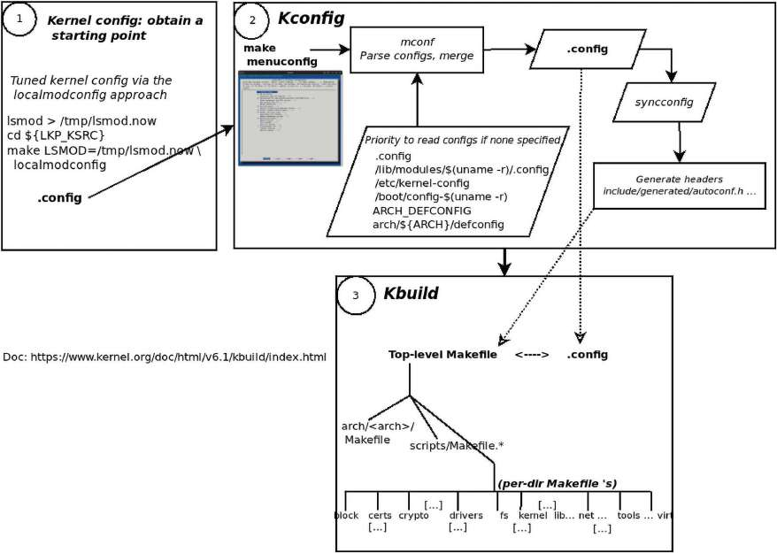

Hình 2.8: Hệ thống Kconfig/Kbuild của kernel ở dạng đơn giản hóa

Được rồi, giờ hãy tìm hiểu chính xác cách có cấu hình kernel hoạt động!

#### Chọn điểm khởi đầu tốt cho cấu hình kernel

Điều này dẫn đến một điểm thực sự quan trọng: dù thử nghiệm cấu hình kernel là chấp nhận được khi học, với hệ thống production, điều then chốt là phải dựa cấu hình riêng trên một cấu hình kernel đã được chứng minh – đã biết, đã kiểm thử và hoạt động.

Ở đây, để giúp hiểu các sắc thái khi chọn điểm khởi đầu hợp lệ cho cấu hình kernel, chúng ta sẽ xem ba cách lấy điểm khởi đầu cho cấu hình kernel điển hình:

- Đầu tiên là cách dễ nhưng sub-optimal, chỉ mô phỏng cấu hình kernel của bản phân phối hiện có.

- Tiếp đến là cách tối ưu hơn, dựa cấu hình kernel trên các kernel module in-memory của hệ thống hiện có. Đây là phương pháp `localmodconfig`.

- Cuối cùng là đôi lời về cách cần theo với dự án Linux nhúng điển hình.

Hãy xem từng cách chi tiết hơn một chút. Với việc cấu hình kernel đã tải và giải nén ở hai bước trước, lúc này đừng làm gì; hãy đọc các phần sau, rồi tại phần Bắt đầu với phương pháp localmodconfig, chúng tôi sẽ hướng dẫn bạn thực sự bắt đầu.

#### Cấu hình kernel dùng cấu hình bản phân phối làm điểm khởi đầu

Hệ thống đích điển hình của phương pháp này là Linux desktop hoặc server x86\_64. Hãy cấu hình kernel về toàn bộ mặc định:

```
$ make mrproper
  CLEAN   scripts/basic
  CLEAN   scripts/kconfig
  CLEAN   include/config include/generated .config
```

Để bảo đảm bắt đầu từ trạng thái sạch, trước tiên chạy `make mrproper`; cẩn thận, nó dọn gần như mọi thứ, kể cả `.config` nếu tồn tại.

Tiếp theo, thực hiện bước `make defconfig`; như kết quả lệnh `make help` cho biết (hãy thử! Xem Hình 2.10), bước này cho cấu hình mới:

```
$ make defconfig
  HOSTCC  scripts/basic/fixdep
  HOSTCC  scripts/kconfig/conf.o
 [ … ]
 HOSTLD  scripts/kconfig/conf
*** Default configuration is based on 'x86_64_defconfig'
#
# configuration written to .config
#
```

Bản thân tiện ích mconf được build trước (dưới `scripts/kconfig`), sau đó cấu hình được sinh. Đây là kết quả:

```
$ ls -l .config
-rw-rw-r-- 1 c2kp c2kp 136416 Apr 29 08:12 .config
```

Vậy là xong: giờ chúng ta có cấu hình kernel “all-defaults” lưu trong `.config`!

Nếu không có tệp `defconfig` cho kiến trúc của bạn dưới `arch/${ARCH}/configs` thì sao? Khi đó, ít nhất trên x86\_64, có thể đơn giản chép cấu hình kernel mặc định của distro hiện có:

```
cp /boot/config-$(uname -r) ${LKP_KSRC}/.config
```

Ở đây, chúng ta chỉ chép tệp cấu hình của bản phân phối Linux hiện có (máy ảo khách Ubuntu 22.04 LTS) vào `.config` ở gốc kernel source tree, qua đó lấy cấu hình bản phân phối làm điểm khởi đầu để chỉnh sửa thêm. Như đã nói, nhược điểm của cách nhanh này là cấu hình thường lớn, dẫn đến kernel image large-footprint.

Ngoài ra, để bạn biết, khi cấu hình kernel được sinh bằng bất kỳ cách nào (như `make defconfig`), mỗi cấu hình kernel `FOO` được biểu diễn bằng một tệp rỗng trong `include/config`.

#### Tinh chỉnh cấu hình kernel bằng phương pháp localmodconfig

Hệ thống đích điển hình cho phương pháp này là Linux desktop hoặc server, thường là x86\_64.

Cách thứ hai tối ưu hơn cách trước – phù hợp khi mục tiêu là bắt đầu từ cấu hình kernel dựa trên hệ thống hiện đang chạy, do đó thường khá gọn so với cấu hình mặc định điển hình trên Linux desktop/server.

Ở đây, chúng ta cung cấp cho Kconfig ảnh chụp các kernel module hiện chạy trên hệ thống, chỉ bằng cách chuyển hướng kết quả `lsmod` vào tệp tạm rồi cung cấp tệp đó cho quá trình build. Có thể thực hiện như sau:

```
lsmod > /tmp/lsmod.now
cd ${LKP_KSRC}
make LSMOD=/tmp/lsmod.now localmodconfig
```

Tiện ích `lsmod` đơn giản liệt kê mọi kernel module hiện nằm trong kernel memory của hệ thống. Chúng ta sẽ tìm hiểu thêm ở Chương 4, Viết kernel module đầu tiên – Phần 1.

Chúng ta lưu kết quả vào tệp tạm, rồi truyền tệp qua biến môi trường `LSMOD` cho target `localmodconfig` của `Makefile`. Nhiệm vụ target này là cấu hình kernel chỉ gồm chức năng nền tảng cộng các chức năng do những kernel module đó cung cấp và bỏ phần còn lại, thực chất tạo bản tương đương hợp lý của kernel hiện tại (hoặc kernel mà kết quả `lsmod` đại diện). Chúng ta dùng chính kỹ thuật này để cấu hình kernel 6.1 ở phần Bắt đầu với phương pháp localmodconfig sắp tới. Chúng tôi cũng chỉ minh họa cách này ở bước 1 (số 1 trong vòng tròn) trong Hình 2.8.

#### Cấu hình kernel cho hệ thống Linux nhúng điển hình

Hệ thống đích điển hình của phương pháp này thường là hệ thống Linux nhúng nhỏ. Mục tiêu là bắt đầu từ cấu hình kernel đã được chứng minh – đã biết, đã kiểm thử và hoạt động – cho dự án Linux nhúng. Vậy cụ thể đạt được điều đó thế nào?

Trước khi tiếp tục, tôi muốn nói rõ: phần thảo luận ban đầu ở đây sẽ trình bày cách cũ để cấu hình Linux nhúng trên kiến trúc AArch32 hay ARM-32; sau đó chúng ta sẽ xem cách “đúng” và hiện đại cho nền tảng hiện đại.

Điều thú vị là, ít nhất với AArch32, bản thân code base kernel chứa các tệp cấu hình kernel đã biết, đã kiểm thử và hoạt động cho nhiều nền tảng phần cứng well-known.

Giả sử đích dựa trên ARM-32, chúng ta chỉ cần chọn cấu hình khớp hoặc gần khớp nhất với bo mạch nhúng đích. Các tệp cấu hình kernel này nằm trong thư mục `arch/<arch>/configs/` của kernel source tree. Chúng có định dạng `<platform-name>_defconfig`.

Nên xem nhanh; ảnh sau hiển thị kernel code board-specific ARM-32 hiện có dưới `arch/arm/mach-<foo>` và tệp cấu hình nền tảng dưới `arch/arm/configs` trong code base Linux kernel v6.1.25:

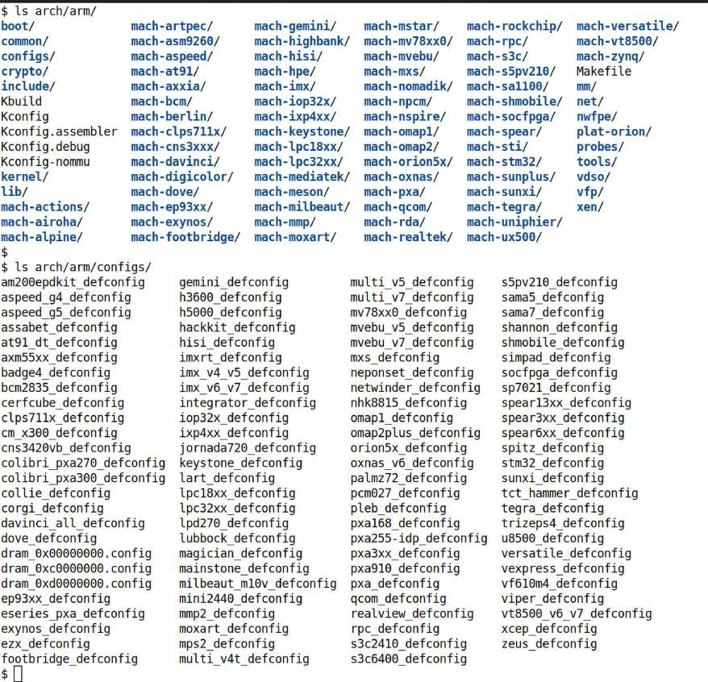

Hình 2.9: Nội dung arch/arm và arch/arm/configs trong Linux kernel 6.1.25

Ồ, khá nhiều! Các thư mục `arch/arm/mach-<foo>` đại diện nền tảng phần cứng (bo mạch hoặc máy) mà Linux được port sang, thường bởi nhà cung cấp chip; mã board-specific nằm trong những thư mục này.

Tương tự, họ cũng đóng góp tệp cấu hình kernel mặc định hoạt động cho các nền tảng này, nằm dưới `arch/arm/configs` với dạng `<foo>_defconfig`, như thấy rõ ở phần dưới Hình 2.9.

Vì vậy, ví dụ nếu cấu hình Linux kernel cho nền tảng phần cứng có SoC i.MX 7 của NXP, đừng bắt đầu bằng tệp cấu hình kernel x86\_64 làm mặc định. Nó sẽ không hoạt động. Dù xoay xở được, kernel cũng không build/chạy trơn tru. Hãy chọn tệp cấu hình phù hợp: với ví dụ này, có lẽ `imx_v6_v7_defconfig` là điểm khởi đầu tốt. Bạn có thể chép tệp này thành `.config` ở gốc kernel source tree rồi fine-tune theo nhu cầu project-specific.

Ví dụ khác, Raspberry Pi (`https://www.raspberrypi.org/`) là nền tảng rất phổ biến cho người yêu thích và production. Tệp cấu hình kernel trong source tree của nó được dùng làm nền là `arch/arm/configs/bcm2835_defconfig`. Tên tệp phản ánh việc bo Raspberry Pi dùng SoC dựa trên Broadcom 2835. Bạn có thể tìm chi tiết biên dịch kernel cho Raspberry Pi tại `https://www.raspberrypi.org/documentation/linux/kernel/building.md`. Nhưng hãy chờ, chúng ta sẽ trình bày ít nhất một phần nội dung này ở Chương 3, Build Linux kernel 6.x từ source code – Phần 2, trong phần Build kernel cho Raspberry Pi.

##### Cách hiện đại – dùng Device Tree

Được rồi, có một lời lưu ý! Với AArch32, như đã thấy, tệp cấu hình platform-specific ở `arch/arm/configs` và kernel code board-specific ở `arch/arm/mach-<foo>`, với `foo` là tên nền tảng. Thực tế, cách giữ cấu hình và tệp kernel source code board-specific trong code base hệ điều hành Linux này bị coi là cách làm hoàn toàn sai đối với một hệ điều hành! Linus đã nói rất rõ: các “sai lầm” ở Linux cũ, khi ARM-32 là kiến trúc phổ biến, tuyệt đối không được lặp lại với kiến trúc khác. Vậy giải quyết thế nào? Với ARM và PPC hiện đại, cả 32 và 64 bit, câu trả lời là dùng Device Tree (DT) hiện đại.

Về cơ bản, DT giữ mọi chi tiết hardware topology của nền tảng. Thực chất đó là bố cục bo mạch hay nền tảng; không phải mã chương trình mà là mô tả nền tảng phần cứng, tương tự VHDL. Vẫn cần viết code BSP-specific và driver, nhưng giờ có cách gọn gàng để kernel “phát hiện” hoặc enumerate chúng lúc boot khi phân tích DTB (Device Tree Blob) được bootloader truyền vào. DTB được sinh trong quy trình build bằng cách gọi DTC (Device Tree Compiler) trên các tệp nguồn DT của nền tảng.

Vì vậy, ngày nay bạn thấy phần lớn dự án nhúng, ít nhất với ARM và PPC, dùng DT hiệu quả. DT còn giúp OEM và ODM/nhà cung cấp bằng cách cho phép dùng về cơ bản cùng một kernel với tùy chỉnh riêng theo nền tảng/mẫu máy được đưa vào DT. Hãy nghĩ đến hàng chục mẫu điện thoại Android từ OEM phổ biến, phần lớn giống nhau nhưng chỉ khác vài chi tiết phần cứng; thường một kernel là đủ! Điều này giảm mạnh gánh nặng bảo trì. Nếu tò mò, nguồn DT – các tệp `.dts` – nằm tại `arch/<arch>/boot/dts`.

Bài học về việc giữ các thành phần board-specific bên ngoài kernel code base nhiều nhất có thể dường như đã được tiếp thu tốt đối với AArch64 (ARM-64). Hãy so sánh các folder config và DTS sạch sẽ, well-organized và gọn gàng của nó với AArch32 (`arch/arm64/configs/` chỉ có một file `defconfig`). Ngay cả các file DTS, xem trong `arch/arm64/boot/dts/`, cũng được tổ chức tốt hơn so với AArch32:

```
6.1.25 $ ls arch/arm64/configs/
defconfig
6.1.25 $ ls arch/arm64/boot/dts/
actions/      amazon/     apm/          bitmain/     exynos/       intel/
marvell/      nuvoton/    realtek/      socionext/   tesla/        xilinx/
allwinner/    amd/        apple/        broadcom/    freescale/    lg/
mediatek/     nvidia/     renesas/      sprd/        ti/           altera/
amlogic/      arm/        cavium/       hisilicon/   Makefile      microchip/
qcom/         rockchip/   synaptics/    toshiba/
```

Vậy với dự án nhúng hiện đại và DT, thực hiện công việc kernel/BSP thế nào? Có một số cách; công việc BSP được:

- Nhóm BSP hoặc platform in-house thực hiện.

- Nhà cung cấp, thường là đối tác cung cấp chip, cung cấp dưới dạng “gói” BSP cùng phần cứng tham chiếu.

- Thuê công ty hoặc chuyên gia tư vấn đối tác bên ngoài thực hiện. Có một số công ty trong lĩnh vực này, gồm Siemens (trước đây là Mentor Graphics), Timesys và WindRiver.

- Ngày nay thường với dự án được build và tích hợp bằng phần mềm builder tinh vi như Yocto hay Buildroot, nhà cung cấp đóng góp BSP layer, rồi nhóm build tích hợp chúng vào sản phẩm.

Thiết kế: Hơi off-topic nhưng tôi nghĩ quan trọng: khi làm dự án, đặc biệt hệ nhúng, các nhóm nhiều lần thể hiện xu hướng không mong muốn là dùng trực tiếp vendor SDK API để thực hiện công việc device-specific trong ứng dụng và driver. Thoạt nhìn có vẻ ổn; nó có thể trở thành gánh nặng lớn khi nhận ra rằng yêu cầu thay đổi, bản thân thiết bị thay đổi, và phần mềm gắn chặt của bạn đơn giản bị hỏng! Bạn đã buộc ứng dụng và driver vào phần cứng thiết bị, gần như không có tách biệt.

Tất nhiên, giải pháp là kiến trúc loosely coupled, với thành phần thực chất là HAL (Hardware Abstraction Layer) để ứng dụng tương tác liền mạch với thiết bị. Nó cũng cho phép đổi mã device-specific mà không ảnh hưởng các lớp cao hơn, tức ứng dụng. Thiết kế như vậy có vẻ hiển nhiên ở mức trừu tượng, thực chất vận dụng ý tưởng information-hiding, nhưng khó bảo đảm trong thực tế; hãy luôn ghi nhớ. Thực tế Linux device model khuyến khích loose coupling này. Phần Đọc thêm có các liên kết hay về những cách thiết kế này, trong mục Generic online and book resources... (tại `https://github.com/PacktPublishing/Linux-Kernel-Programming_2E/blob/main/Further_Reading.md#generic-online-and-book-resources--miscellaneous-very-useful`).

Được rồi, đến đây kết thúc ba cách thiết lập điểm khởi đầu cho cấu hình kernel.

#### Xem mọi tùy chọn cấu hình sẵn có

Thực ra, về cấu hình kernel, chúng ta mới chỉ chạm bề mặt. Nhiều kỹ thuật khác để chủ động sinh cấu hình kernel theo cách cụ thể đã được mã hóa ngay trong Kconfig! Bằng cách nào? Qua configuration target cho `make`. Xem chúng bằng cách chạy `make help` ở gốc kernel source code; chúng nằm dưới tiêu đề `Configuration targets`:

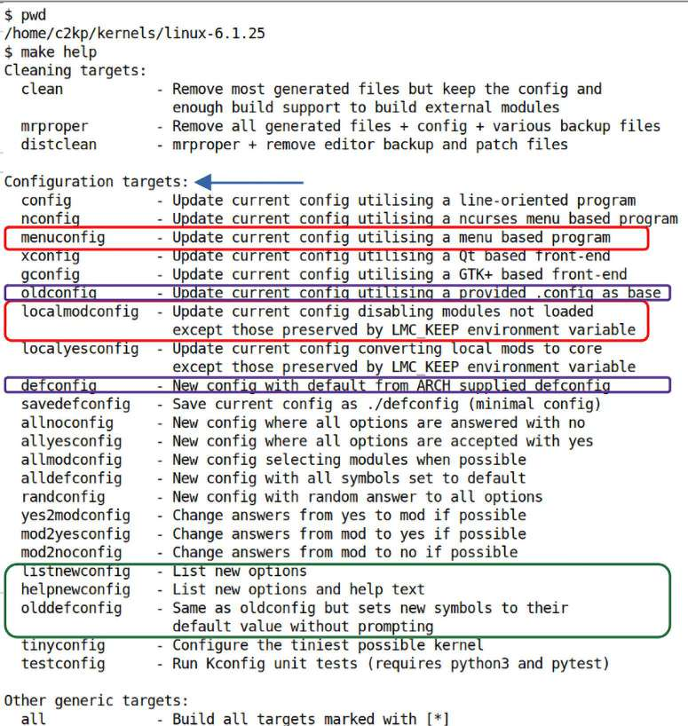

Hình 2.10: Kết quả make help trên x86\_64 (kernel 6.1.25), làm nổi bật các dòng đáng chú ý

Hãy thử nghiệm thêm vài cách khác – bắt đầu với `oldconfig`:

```
$ make mrproper
[ … ]
$ make oldconfig
  HOSTCC  scripts/basic/fixdep
  HOSTCC  scripts/kconfig/conf.o
  HOSTCC  scripts/kconfig/confdata.o
  [ … ]
 HOSTLD  scripts/kconfig/conf
 #
 # using defaults found in /boot/config-5.19.0-41-generic
 #
 [ … ]
 * Restart config...
 [ … ]
 *
 Control Group support (CGROUPS) [Y/?] y
  Favor dynamic modification latency reduction by default   (CGROUP_FAVOR_
DYNMODS) [N/y/?] (NEW)                  << waits for input here >>
 [ … ]
```

Tất nhiên nó hoạt động, nhưng bạn phải nhấn Enter, có lẽ nhiều lần, để chấp nhận mặc định cho từng và mọi cấu hình kernel mới phát hiện… (hoặc chỉ định rõ giá trị; chúng ta sẽ tìm hiểu thêm các cấu hình mới này trong phần sau). Điều đó khá bình thường nhưng hơi phiền. Có cách dễ hơn: dùng target `olddefconfig`; như dòng trợ giúp nói – “Giống oldconfig nhưng đặt symbol mới về giá trị mặc định mà không hỏi”:

```
$ make olddefconfig
#
# using defaults found in /boot/config-5.19.0-41-generic
#
.config:10301:warning: symbol value 'm' invalid for ANDROID_BINDER_IPC
.config:10302:warning: symbol value 'm' invalid for ANDROID_BINDERFS
#
# configuration written to .config
#
Done.
```

##### Xem và đặt các cấu hình kernel mới

Một thử nghiệm nhanh khác: dọn sạch rồi chép cấu hình distro kernel vào. Hãy sao lưu nếu muốn giữ `.config` hiện có.

```
$ make mrproper
$ cp /boot/config-5.19.0-41-generic .config
cp: overwrite '.config'? y
$
```

Chúng ta có mặc định của distro trong `.config`. Giờ hãy nghĩ: hiện đang chạy distro kernel 5.19.0-41-generic nhưng định build kernel mới 6.1.25. Vì vậy, kernel mới chắc chắn có ít nhất vài cấu hình kernel mới. Trong trường hợp này, khi bạn cấu hình kernel, Kconfig sẽ hỏi: nó hiển thị từng tùy chọn mới cùng các giá trị có thể đặt, với giá trị mặc định trong ngoặc vuông, trên cửa sổ console. Bạn cần chọn giá trị cho các tùy chọn cấu hình mới mà nó gặp. Bạn thấy việc này dưới dạng một chuỗi câu hỏi và lời nhắc trả lời trên dòng lệnh.

Kernel cung cấp hai cơ chế thú vị để xem mọi cấu hình kernel mới:

- `listnewconfig` – liệt kê tùy chọn mới

- `helpnewconfig` – liệt kê tùy chọn mới và nội dung trợ giúp

Chạy cách đầu chỉ liệt kê từng biến cấu hình kernel mới:

```
$ make listnewconfig
[ … ]
CONFIG_CGROUP_FAVOR_DYNMODS=n
CONFIG_XEN_PV_MSR_SAFE=y
CONFIG_PM_USERSPACE_AUTOSLEEP=n
[ … ]
CONFIG_TEST_DYNAMIC_DEBUG=n
```

Có rất nhiều – tôi nhận được 108 cấu hình mới – nên đã rút gọn kết quả ở đây.

Chúng ta thấy mọi cấu hình mới, nhưng kết quả không giúp nhiều để hiểu chính xác ý nghĩa. Chạy target `helpnewconfig` giải quyết việc này: giờ bạn thấy “Help” từ tệp `Kconfig` của tùy chọn cho từng cấu hình kernel mới:

```
$ make helpnewconfig
[ … ]
CONFIG_CGROUP_FAVOR_DYNMODS:
This option enables the favordynmods mount option by default, which reduces
the latencies of dynamic cgroup modifications such as task migrations and
controller on/offs at the cost of making hot path operations such as forks and
exits more expensive.
Say N if unsure.
Symbol: CGROUP_FAVOR_DYNMODS [=n]
Type  : bool
Defined at init/Kconfig:959
  Prompt: Favor dynamic modification latency reduction by default
[ … ]
CONFIG_TEST_DYNAMIC_DEBUG:
This module registers a tracer callback to count enabled pr_debugs in a do_
debugging function, then alters their enablements, calls the function, and
compares counts.
If unsure, say N.
Symbol: TEST_DYNAMIC_DEBUG [=n]
[ … ]
$
```

Lúc này đừng lo phải hiểu cú pháp `Kconfig`; chúng ta sẽ trình bày trong phần Tùy chỉnh menu kernel, Kconfig và thêm mục menu riêng.

##### Biến môi trường LMC\_KEEP

Ngoài ra, bạn có nhận thấy trong Hình 2.10 các target `localmodconfig` và `localyesconfig` có thể kèm biến môi trường tùy chọn tên `LMC_KEEP` (LMC là LocalModConfig) không?

Ý nghĩa rất rõ: đặt `LMC_KEEP` bằng các giá trị colon-delimited sẽ yêu cầu Kconfig giữ cấu hình gốc cho đường dẫn chỉ định. Ví dụ có thể là `"drivers/usb:drivers/gpu:fs"`. Thực chất nó nói: “Giữ các module này được bật.”

Đây là tính năng được đưa vào kernel 5.8 (commit tại `https://github.com/torvalds/linux/commit/c027b02d89fd42ecee911c39e9098b9609a5ca0b`). Vì vậy, để dùng nó, có thể chạy lệnh cấu hình như sau:

```
make LSMOD=/tmp/mylsmod \
  LMC_KEEP="drivers/usb:drivers/gpu:fs" \
              localmodconfig
```

##### Tinh chỉnh cấu hình qua script streamline\_config.pl

Điều thú vị là kernel cung cấp nhiều helper script trong `scripts/` để làm các công việc housekeeping, debugging và việc khác hữu ích. Ví dụ tốt liên quan nội dung đang thảo luận là Perl script `scripts/kconfig/streamline_config.pl`. Nó lý tưởng khi distro kernel bật quá nhiều module hoặc built-in kernel feature, còn bạn chỉ muốn những gì hiện đang dùng – những gì module hiện được nạp cung cấp, giống `localmodconfig`. Chạy script khi đã nạp mọi module bạn muốn, lưu kết quả cuối cùng vào `.config`. Sau đó chạy `make oldconfig`, cấu hình đã sẵn sàng!

Ngoài lề, đây là cách tác giả gốc của script, Steven Rostedt, mô tả chức năng của nó (`https://github.com/torvalds/linux/blob/master/scripts/kconfig/streamline_config.pl`):

```
[…]
# Here's what I did with my Debian distribution.
#
#    cd /usr/src/linux-2.6.10
#    cp /boot/config-2.6.10-1-686-smp .config
#    ~/bin/streamline_config > config_strip
#    mv .config config_sav
#    mv config_strip .config
#    make oldconfig
[…]
```

Bạn có thể thử nếu muốn.

### Bắt đầu với phương pháp localmodconfig

Giờ (cuối cùng cũng đến!) hãy hands-on và tạo cấu hình kernel nền có kích thước hợp lý cho kernel 6.1.25 LTS bằng kỹ thuật `localmodconfig`. Như đã nói, cách existing-kernel-modules-only này phù hợp khi mục tiêu là lấy điểm khởi đầu cho cấu hình kernel trên hệ thống x86, giữ cấu hình được tinh chỉnh theo host hiện tại.

Đừng quên: cấu hình kernel đang thực hiện lúc này phù hợp với hệ thống desktop/server x86\_64 điển hình để học tập. Cách này chỉ cung cấp điểm khởi đầu, thậm chí điểm khởi đầu đó có thể chưa phù hợp. Với dự án thực tế, bạn phải kiểm tra và tinh chỉnh cẩn thận mọi khía cạnh cấu hình kernel; việc kiểm kê chính xác phần cứng và phần mềm cần hỗ trợ là then chốt. Một lần nữa, với thiết bị nhúng đích, cách tiếp cận khác đi (như đã thảo luận trong phần Cấu hình kernel cho hệ thống Linux nhúng điển hình).

Trước khi tiếp tục, nên dọn sạch source tree, đặc biệt nếu bạn đã chạy các thử nghiệm mà chúng ta thực hiện trước đó. Hãy cẩn thận: lệnh này sẽ xóa sạch mọi thứ, bao gồm cả `.config`:

```
make mrproper
```

Như đã mô tả, trước tiên hãy lấy ảnh chụp các kernel module hiện được nạp, rồi cho hệ thống build xử lý nó bằng cách chỉ định target `localmodconfig` như sau:

```
lsmod > /tmp/lsmod.now
cd ${LKP_KSRC}
make LSMOD=/tmp/lsmod.now localmodconfig
```

Khi chạy lệnh `make [...] localmodconfig` vừa nêu, hoàn toàn có thể, thực ra là rất có khả năng, có khác biệt về tùy chọn cấu hình giữa kernel đang cấu hình (6.1.25) và kernel đang chạy trên máy build (với tôi, host kernel là `$(uname -r) = 5.19.0-41-generic`). Trong trường hợp này, như giải thích ở phần Xem và đặt các cấu hình kernel mới, Kconfig hỏi từng cấu hình mới; nhấn Enter để chấp nhận mặc định.

Giờ hãy dùng lệnh `localmodconfig`.

Lời nhắc có hậu tố `(NEW)`, thực chất báo đây là tùy chọn cấu hình kernel mới và yêu cầu bạn trả lời cách cấu hình.

Nhập các lệnh sau nếu chưa thực hiện:

```
$ uname -r
5.19.0-41-generic
$ lsmod > /tmp/lsmod.now
$ make LSMOD=/tmp/lsmod.now localmodconfig
  HOSTCC  scripts/basic/fixdep
  HOSTCC  scripts/kconfig/conf.o
  [ ... ]
using config: '/boot/config-5.19.0-41-generic'
System keyring enabled but keys "debian/canonical-certs.pem" not found.
Resetting keys to default value.
*
* Restart config...
*
* Control Group support
*
Control Group support (CGROUPS) [Y/?] y
  Favor dynamic modification latency reduction by default (CGROUP_FAVOR_
DYNMODS) [N/y/?] (NEW)   ↵
  Memory controller (MEMCG) [Y/n/?] y
[ … ]
Userspace opportunistic sleep (PM_USERSPACE_AUTOSLEEP) [N/y/?] (NEW)   ↵
[ … ]
Multi-Gen LRU (LRU_GEN) [N/y/?] (NEW)   ↵
[ … ]
 Rados block device (RBD) (BLK_DEV_RBD) [N/m/y/?] n
 Userspace block driver (Experimental) (BLK_DEV_UBLK) [N/m/y/?] (NEW)   ↵
[ … ]
  Pine64 PinePhone Keyboard (KEYBOARD_PINEPHONE) [N/m/y/?] (NEW)   ↵
[ … ]
  Intel Meteor Lake pinctrl and GPIO driver (PINCTRL_METEORLAKE) [N/m/y/?]
(NEW)   ↵
[ … ]
Test DYNAMIC_DEBUG (TEST_DYNAMIC_DEBUG) [N/m/y/?] (NEW)   ↵
[ … ]
#
# configuration written to .config
#
$ ls -l .config
-rw-rw-r-- 1 c2kp c2kp 170136 Apr 29 09:56 .config
```

Sau khi nhấn Enter (↵) nhiều lần – chúng tôi làm nổi bật điều này trong khối kết quả ngay trên, chỉ hiển thị vài trong số nhiều tùy chọn mới gặp – cuối cùng phần hỏi đáp cũng chịu kết thúc và `Kconfig` ghi cấu hình mới sinh vào tệp tên `.config` trong thư mục làm việc hiện tại. Lưu ý chúng tôi rút gọn kết quả trên vì đơn giản quá dài và không cần chép lại đầy đủ.

Các bước trên đảm nhiệm việc sinh `.config` bằng phương pháp `localmodconfig`. Trước khi kết thúc phần này, có vài điểm bổ sung cần lưu ý:

- Để bảo đảm bắt đầu hoàn toàn sạch, chạy `make mrproper` hoặc `make distclean` ở gốc kernel source tree, hữu ích khi muốn làm lại quy trình build kernel từ đầu; hãy tin rằng một ngày bạn sẽ cần! Lưu ý thao tác này cũng xóa các tệp cấu hình kernel. Hãy sao lưu trước khi bắt đầu nếu cần.

- Trong chương này, mọi bước cấu hình kernel và ảnh chụp liên quan đều thực hiện trên máy ảo khách Ubuntu 22.04 LTS x86\_64, dùng làm host để cuối cùng build một Linux kernel 6.1 LTS brand-spanking-new. Tên chính xác, sự hiện diện, nội dung mục menu và hình thức, cách hoạt động giao diện menu có thể và thực sự thay đổi theo (a) kiến trúc CPU và (b) phiên bản kernel.

- Như đã đề cập, với hệ thống hoặc dự án production, nhóm platform/BSP hoặc công ty cung cấp BSP Linux nhúng nếu bạn có đối tác sẽ cung cấp tệp cấu hình kernel đã biết, hoạt động tốt và được kiểm thử. Dùng nó làm điểm khởi đầu bằng cách chép thành `.config` ở gốc kernel source tree. Hoặc có thể dùng phần mềm builder như Yocto hay Buildroot.

Khi có kinh nghiệm build kernel, bạn sẽ nhận ra công sức thiết lập cấu hình kernel đúng ở lần đầu lớn hơn; tất nhiên lần build đầu tiên cũng mất nhiều thời gian. Tuy nhiên, khi đã thực hiện đúng, quy trình thường đơn giản hơn nhiều – một công thức chạy lặp lại.

Giờ hãy học cách dùng giao diện hữu ích và trực quan để fine-tune cấu hình kernel.

### Tinh chỉnh cấu hình kernel qua giao diện make menuconfig

Được rồi, rất tốt, chúng ta đã có tệp cấu hình kernel ban đầu (`.config`) được sinh qua Makefile target `localmodconfig`, như trình bày chi tiết ở phần trước, một điểm khởi đầu tốt. Thông thường, giờ chúng ta fine-tune cấu hình kernel thêm. Một cách – thực ra là cách được khuyến nghị – là qua Makefile target `menuconfig`. Target này yêu cầu Kbuild sinh một chương trình thực thi C-based khá tinh vi (`scripts/kconfig/mconf`), cung cấp menu-based gọn gàng cho người dùng cuối. Đây là bước 2 trong Hình 2.8. Trong khối kết quả sau, khi gọi lệnh lần đầu tại gốc kernel source tree, Kbuild build tệp thực thi `mconf` rồi gọi nó:

```
$ make menuconfig
 UPD scripts/kconfig/.mconf-cfg
 HOSTCC scripts/kconfig/mconf.o
 HOSTCC scripts/kconfig/lxdialog/checklist.o
 […]
 HOSTLD  scripts/kconfig/mconf
```

Tất nhiên, một bức ảnh chắc chắn đáng giá ngàn lời, nên đây là hình thức giao diện `menuconfig` trên máy ảo của tôi.

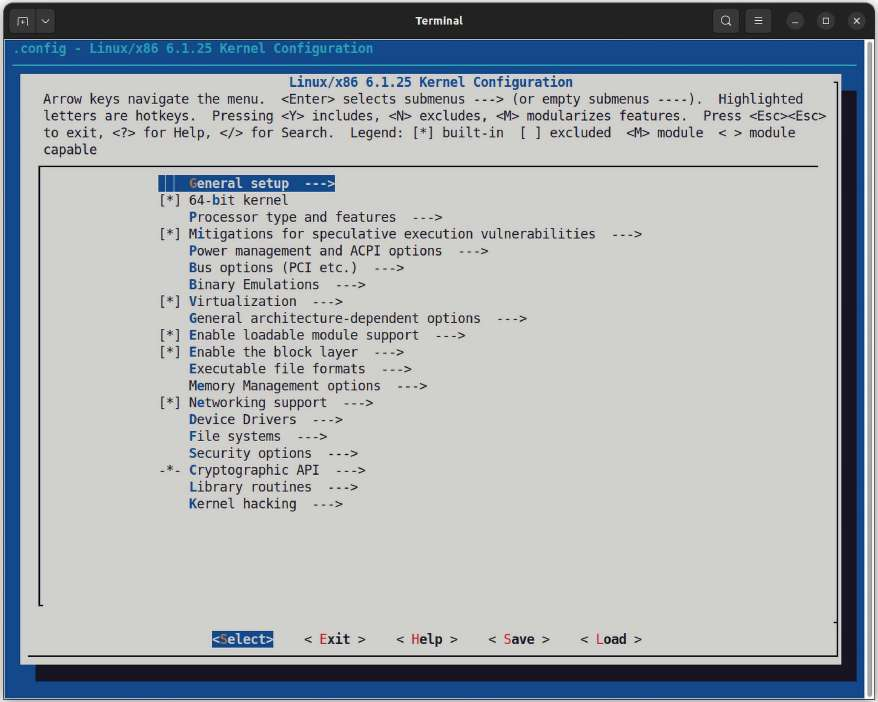

Hình 2.11: Menu chính cấu hình kernel qua make menuconfig (trên x86-64)

Nhân tiện, bạn không cần chạy máy ảo ở GUI mode để dùng cách này; nó thậm chí hoạt động trên terminal khi dùng SSH login shell từ host – một lợi thế nữa của cách chỉnh cấu hình kernel qua giao diện này!

Nhà phát triển giàu kinh nghiệm, hoặc bất kỳ ai dùng máy tính đủ lâu, đều biết mọi thứ có thể và thực sự trục trặc. Ví dụ tình huống sau: chạy `make menuconfig` lần đầu trên Ubuntu vừa cài:

```
$ make menuconfig
 UPD     scripts/kconfig/.mconf-cfg
 HOSTCC  scripts/kconfig/mconf.o
 YACC    scripts/kconfig/zconf.tab.c
/bin/sh: 1: bison: not found
scripts/Makefile.lib:196: recipe for target 'scripts/kconfig/zconf.tab.c'
failed
make[1]: *** [scripts/kconfig/zconf.tab.c] Error 127
Makefile:539: recipe for target 'menuconfig' failed
make: *** [menuconfig] Error 2
$
```

Hãy chờ, đừng hoảng. Đọc kỹ thông báo lỗi. Dòng sau `YACC [...]` cho manh mối: `/bin/sh: 1: bison: not found`. À! Vậy hãy cài `bison` bằng lệnh:

```
sudo apt install bison
```

Giờ mọi thứ hẳn ổn. Gần như vậy; một lần nữa, trên Ubuntu khách mới cài, `make menuconfig` tiếp tục báo chưa cài `flex`. Vì thế chúng ta cài nó (đúng như bạn đoán: qua `sudo apt install flex`). Ngoài ra, riêng Ubuntu cần cài gói `libncurses5-dev`. Trên Fedora, chạy `sudo` `dnf install ncurses-devel`.

Nếu đã đọc và làm theo chương trực tuyến Kernel Workspace Setup, bạn đã cài sẵn mọi gói tiên quyết này. Nếu chưa, hãy tham khảo ngay và cài tất cả gói cần thiết. Hãy nhớ, gieo gì gặt nấy…

Mẹo nhanh: chạy Bash script `<book_src>/ch1/pkg_install4ubuntu_lkp.sh` sẽ cài mọi gói cần thiết trên Ubuntu.

Tiếp tục, framework open-source Kconfig+Kbuild cung cấp chỉ dẫn cho người dùng qua giao diện. Xem Hình 2.11; bạn thường thấy ký hiệu đứng trước menu như `[*]`, `<>`, `-*-`, `()`, v.v.; các ký hiệu và ý nghĩa như sau:

- `[.]`: In-kernel feature, tùy chọn Boolean. Nó chỉ bật hoặc tắt; dấu ‘.’ hiển thị được thay bằng `*` hoặc khoảng trắng:

  - `[*]`: Bật, tính năng được biên dịch và build tích hợp vào kernel image (y)

  - `[ ]`: Tắt, hoàn toàn không build (n)

- `<.>`: Tính năng có thể ở một trong ba trạng thái. Đây gọi là tristate; dấu chấm hiển thị được thay bằng `*`, `M` hoặc khoảng trắng:

  - `<*>`: Bật, tính năng được biên dịch và build tích hợp vào kernel image (y)

  - `<M>`: Module, tính năng được biên dịch và build thành kernel module (LKM) (m)

  - `< >`: Tắt, hoàn toàn không build (n)

- `{.}`: Có dependency với tùy chọn này; vì thế nó phải được build/biên dịch thành module (m) hoặc vào kernel image (y).

- `-*-`: Một dependency yêu cầu mục này được biên dịch tích hợp (y).

- `(...)`: Prompt: cần nhập chữ/số. Nhấn Enter khi ở tùy chọn này, hộp nhắc nhập xuất hiện.

- `<Menu name> --->`: Có sub-menu theo sau. Nhấn Enter ở mục này để vào submenu.

Một lần nữa, phương pháp thực nghiệm là then chốt. Hãy thực hiện vài thử nghiệm với giao diện `make menuconfig` để xem nó hoạt động thế nào. Đây chính là nội dung chúng ta học trong phần tiếp theo.

#### Ví dụ sử dụng giao diện make menuconfig

Để có cảm nhận về hệ thống menu Kbuild qua target menuconfig tiện lợi, hãy bật một cấu hình kernel khá thú vị. Nó tên `Kernel .config support`, cho phép xem nội dung cấu hình kernel khi đang chạy chính kernel đó! Hữu ích, đặc biệt trong phát triển và kiểm thử. Tuy nhiên, vì bảo mật, nó thường tắt trong production.

Vẫn còn hai câu hỏi khiến ta băn khoăn:

- Hỏi: Nó nằm ở đâu?

Đáp: Là mục dưới menu chính General Setup (chúng ta sẽ sớm thấy).

- Hỏi: Mặc định nó được đặt thế nào?

Đáp: Giá trị `<M>`, nghĩa là mặc định được build thành kernel module.

Để thử nghiệm học tập, chúng ta đặt thành `[*]` (hoặc `y)`), build nó vào chính cấu trúc kernel. Thực chất, nó sẽ luôn bật. Được rồi, hãy thực hiện!

1\. Khởi chạy giao diện cấu hình kernel:

```
make menuconfig
```

Bạn sẽ thấy giao diện terminal như Hình 2.11. Mục đầu tiên thường là submenu General Setup ---\>; nhấn Enter tại đó để vào General Setup, nơi có nhiều mục hiển thị; điều hướng bằng mũi tên xuống đến mục `Kernel .config support`:

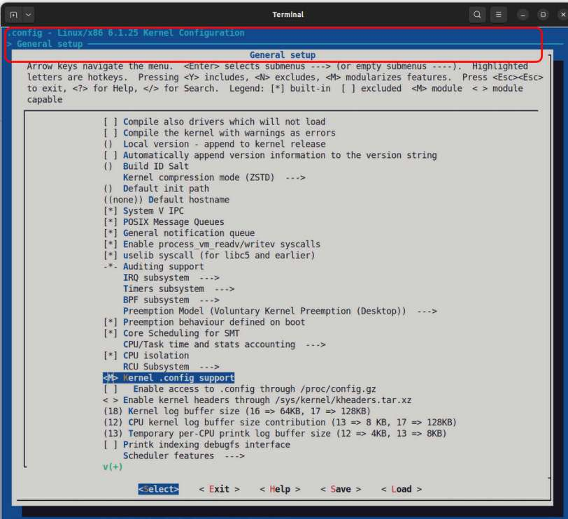

Hình 2.12: Ảnh các mục menu General Setup, làm nổi bật mục liên quan (trên x86-64)

2\. Trong ảnh trên, ta thấy đang cấu hình kernel 6.1.25 trên x86, mục nổi bật là `Kernel .config` support; từ tiền tố `<M>`, biết đây là mục tristate ban đầu, theo mặc định, được chọn `<M>` cho “module”.

3\. Giữ mục (`Kernel .config support`) được chọn, dùng mũi tên phải đến nút \< Help \> trên thanh công cụ dưới cùng rồi nhấn Enter tại nút \< Help \>. Hoặc chỉ cần nhấn ? khi ở một tùy chọn! Màn hình giờ sẽ trông tương tự:

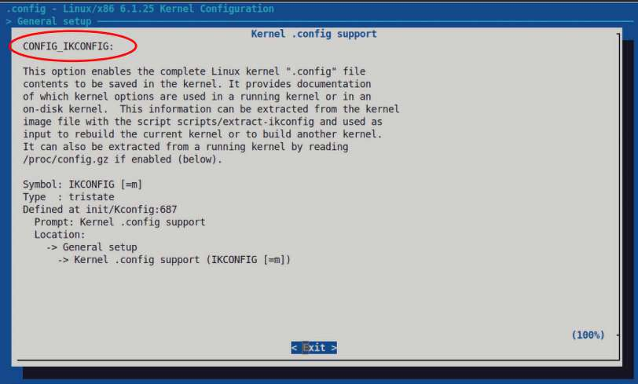

Hình 2.13: Cấu hình kernel qua make menuconfig; ví dụ màn hình Help (làm nổi bật tên macro cấu hình kernel)

Màn hình trợ giúp khá nhiều thông tin. Thực sự, nhiều màn hình trợ giúp cấu hình kernel rất đầy đủ và hữu ích. Đáng tiếc một số lại không như vậy.

4\. Được rồi, tiếp theo nhấn Enter ở \< Exit \> để quay về màn hình trước. 5. Đổi giá trị bằng phím cách; giá trị mục hiện tại chuyển giữa `<*>` (luôn bật), `< >` (tắt) và `<M>` (module). Giữ ở `<*>`, nghĩa là “luôn bật”. 6. Tiếp theo, dù đã bật, khả năng thực sự xem cấu hình kernel được cung cấp qua pseudofile dưới `procfs`; mục ngay bên dưới là tùy chọn liên quan:

```
[ ]   Enable access to .config through /proc/config.gz
```

7\. Bạn thấy mặc định nó tắt (`[ ]`); đến đó và nhấn phím cách để bật. Giờ nó hiển thị `[*]`:

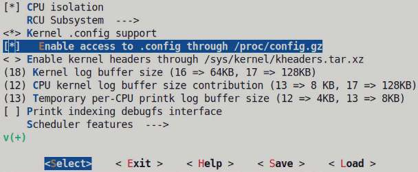

Hình 2.14: Ảnh rút gọn cho thấy cách chúng ta bật khả năng xem cấu hình kernel

8\. Được rồi, tạm xong; nhấn mũi tên phải hoặc Tab, đến \< Exit \> rồi nhấn Enter; bạn trở lại menu chính. Lặp lại, nhấn \< Exit \> lần nữa; giao diện hỏi có muốn lưu cấu hình không. Chọn \< Yes \> bằng cách nhấn Enter tại nút Yes:

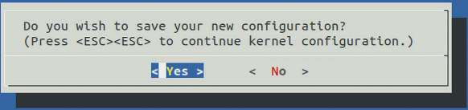

Hình 2.15: Lời nhắc lưu cấu hình kernel đã sửa

9\. Cấu hình kernel mới giờ được lưu trong `.config`. Hãy xác minh nhanh. Tôi hy vọng bạn nhận thấy tên chính xác các cấu hình đã sửa – chính là macro mà kernel source code thấy – là:

a. `CONFIG_IKCONFIG` cho tùy chọn Kernel .config support. b. `CONFIG_IKCONFIG_PROC` cho tùy chọn Enable access to .config through /proc/config.gz.

Làm sao biết? Nó ở top-left màn hình Help! Xem lại Hình 2.13.

Xong. Tất nhiên, tác dụng thực tế chưa xuất hiện cho đến khi build và boot kernel này. Vậy bật tính năng này đạt được chính xác điều gì? Khi bật, có thể tra thiết lập cấu hình của kernel hiện đang chạy bất cứ lúc nào theo hai cách:

- Chạy script `scripts/extract-ikconfig`.

- Đọc trực tiếp nội dung pseudofile `/proc/config.gz`. Tất nhiên nó được nén bằng `gzip`; trước hết giải nén rồi đọc. `zcat /proc/config.gz` làm được việc đó!

Để luyện tập thêm, tại sao không sửa thêm vài mục trong cấu hình kernel mặc định của Linux kernel 6.1.25 cho kiến trúc x86-64? Lúc này đừng quá lo về ý nghĩa chính xác từng tùy chọn cấu hình; mục đích chỉ là luyện dùng Kconfig. Vì vậy, chạy `make menuconfig` và thay đổi trong đó theo mẫu ngay dưới.

Mẫu:

- Cấu hình kernel đang làm việc:

- Ý nghĩa

- Vị trí điều hướng đến

- Tên mục menu (và macro cấu hình kernel `CONFIG_FOO` trong ngoặc)

- Giá trị mặc định

- Giá trị cần đổi sang

Được rồi, đây là những gì cần thử; hãy bắt đầu với:

Local version:

- Ý nghĩa: chuỗi nối thêm vào phiên bản kernel. Lấy `uname –r` làm ví dụ; thực chất đó là thành phần “z” hay `EXTRAVERSION` trong quy ước phiên bản kernel w.x.y.z.

- Đến: General Setup.

- Mục menu: Local version – append to kernel release (CONFIG\_LOCALVERSION); nhấn Enter tại đây để có hộp nhắc nhập.

- Giá trị mặc định: NULL.

- Đổi thành: bất kỳ thứ gì bạn thích; thêm dấu gạch nối trước localversion được coi là thông lệ tốt, ví dụ `-lkp-kernel`.

Tiếp theo:

- Timer frequency. Bạn sẽ học chi tiết tham số điều chỉnh này ở Chương 10, The CPU Scheduler – Phần 1:

- Ý nghĩa: tần số kích hoạt timer interrupt (phần cứng).

- Đến: Processor type and features \| Timer frequency (250 HZ) ---\> . Tiếp tục cuộn cho đến khi thấy mục menu thứ hai.

- Mục menu: Timer frequency (CONFIG\_HZ).

- Giá trị mặc định: 250 HZ.

- Đổi thành: 300 HZ.

Tra các màn hình Help của từng cấu hình kernel khi làm việc với chúng. Tuyệt; khi xong, lưu và thoát giao diện.

##### Kiểm tra cấu hình kernel trong tệp cấu hình

Nhưng cấu hình kernel mới lưu ở đâu? Xin nhắc lại vì quan trọng: cấu hình kernel được ghi vào tệp văn bản ASCII đơn giản ở gốc kernel source tree tên `.config`. Tức được lưu tại `${LKP_KSRC}/.config`.

Như đã nói, từng tùy chọn cấu hình kernel đều gắn với biến cấu hình dạng `CONFIG_<FOO>`, trong đó tất nhiên `<FOO>` được thay bằng tên phù hợp. Bên trong, chúng trở thành macro mà hệ thống build và chính kernel source code sử dụng.

Vì vậy, để xác minh các cấu hình vừa sửa có hiệu lực hay không, hãy dùng `grep` thích hợp trên tệp cấu hình kernel:

```
$ grep -E "CONFIG_IKCONFIG|CONFIG_LOCALVERSION|CONFIG_HZ_300" .config
CONFIG_LOCALVERSION="-lkp-kernel"
# CONFIG_LOCALVERSION_AUTO is not set
CONFIG_IKCONFIG=y
CONFIG_IKCONFIG_PROC=y
CONFIG_HZ_300=y
$
```

À! Tệp cấu hình giờ phản ánh việc chúng ta thực sự đã sửa các cấu hình kernel liên quan; các giá trị cũng hiển thị.

Chú ý: tốt nhất KHÔNG cố sửa thủ công tệp .`config`. Có nhiều inter-dependencies mà bạn có thể không biết; luôn dùng hệ thống menu Kbuild (chúng tôi đề nghị `make menuconfig`) để chỉnh sửa.

Dù vậy, cũng có cách non-interactive qua script để thực hiện. Chúng ta sẽ học sau. Tuy nhiên, dùng giao diện `make menuconfig` thực sự vẫn là cách tốt nhất.

Vậy đến đây, tôi kỳ vọng bạn đã sửa cấu hình kernel theo các giá trị vừa thấy.

Trong hành trình nhanh với Kconfig/Kbuild đến đây, khá nhiều việc đã diễn ra bên trong. Phần tiếp theo xét các điểm còn lại: thêm một ít về Kconfig/Kbuild, tìm trong hệ thống menu, xem rõ khác biệt giữa tệp cấu hình kernel gốc và đã sửa, dùng script chỉnh cấu hình, các mối quan tâm bảo mật và mẹo xử lý; còn nhiều điều để học!

### Cấu hình kernel – tìm hiểu thêm

Việc tạo hoặc sửa `.config` ở gốc kernel source tree qua giao diện `make` `menuconfig` hay phương pháp khác chưa phải bước cuối trong cách Kconfig làm việc với cấu hình. Không, giờ nó tiếp tục gọi nội bộ một target ẩn tên `syncconfig`, trước đây được đặt tên chưa đúng là `silentoldconfig`. Target này yêu cầu Kconfig sinh vài header được dùng tiếp để chuẩn bị build kernel.

Các tệp gồm một số meta-headers dưới `include/config`, cùng header `include/generated/autoconf.h` lưu cấu hình kernel dưới dạng C macro, nhờ đó cả Makefile và kernel code quyết định dựa trên việc tính năng kernel có sẵn hay không.

Giờ đã trình bày đủ kiến thức nền, hãy xem lại Hình 2.8, sơ đồ high-level lấy cảm hứng từ các bài của Cao Jin, cố gắng truyền đạt hệ thống Kconfig/Kbuild của kernel. Trong phần Kconfig, sơ đồ chỉ thể hiện giao diện phổ biến `make menuconfig`; lưu ý có một số cách giao diện khác là `make config` và `make {x|g|n}config`. Những cách đó không được thể hiện ở đây.

#### Tìm kiếm trong giao diện menuconfig

Tiếp tục, khi chạy make menuconfig, nếu bạn tìm một tùy chọn cấu hình kernel cụ thể nhưng khó thấy nó thì sao? Không vấn đề: giao diện `menuconfig` có tính năng `Search Configuration Parameter`. Giống trình soạn thảo nổi tiếng `vi` (đúng vậy, \[g\]vi\[m\] vẫn là trình soạn thảo văn bản yêu thích của chúng tôi!), nhấn / (gạch chéo xuôi) để mở hộp tìm kiếm, nhập từ cần tìm có hoặc không có tiền tố `CONFIG_`, rồi chọn nút \< Ok \> để bắt đầu tìm.

Hai ảnh sau hiển thị hộp tìm kiếm và hộp kết quả. Ví dụ, chúng ta tìm từ `vbox`:

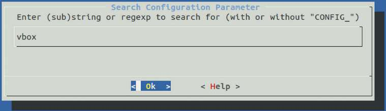

Hình 2.16: Cấu hình kernel qua make menuconfig: tìm tham số cấu hình

Hộp kết quả trong Hình 2.17 cho tìm kiếm trên rất thú vị. Nó cho biết một số thông tin về các tùy chọn cấu hình:

- Chỉ thị cấu hình. Chỉ cần thêm tiền tố `CONFIG_` vào nội dung hiển thị ở `Symbol:`.

- `Type` của cấu hình (Boolean, tristate, chữ/số, v.v.).

- Chuỗi `Prompt`.

- Quan trọng là `Location` của nó trong hệ thống menu, để bạn tìm được.

- Các dependency nội bộ `(Depends on:)`, nếu có.

- Tệp Kconfig và số dòng n trong đó `(Defined at <path/to/foo.Kconfig*:n>)`, nơi định nghĩa cấu hình kernel cụ thể này. Chúng ta sẽ trình bày thêm ở các phần tới.

- Mọi tùy chọn nó auto-selects (`Selects:`) nếu bản thân nó được chọn.

Sau đây là ảnh một phần hộp kết quả:

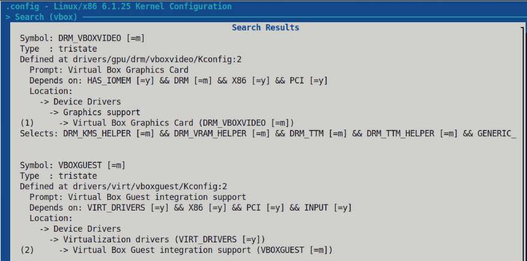

Hình 2.17: Cấu hình kernel qua make menuconfig: ảnh rút gọn hộp kết quả tìm kiếm trên

Mọi thông tin điều khiển hiển thị và lựa chọn menu nằm trong tệp văn bản ASCII được Kbuild dùng – tệp thường tên `Kconfig`. Thực tế có nhiều tệp như vậy. Tên và vị trí chính xác hiển thị ở dòng `Defined at ...`.

#### Tra khác biệt cấu hình

Ngay khi sắp ghi vào tệp cấu hình kernel `.config`, Kconfig kiểm tra tệp đã tồn tại chưa; nếu có, nó sao lưu với tên `.config.old`. Biết vậy, ta luôn có thể so sánh hai tệp để thấy thay đổi vừa thực hiện. Tuy nhiên, dùng tiện ích `diff` thông thường khiến khác biệt khá khó diễn giải. Kernel hữu ích cung cấp cách tốt hơn, một script console-based chuyên làm chính việc này. Script `scripts/diffconfig` trong kernel source tree hữu ích cho mục đích đó. Truyền tham số `--help` để xem màn hình hướng dẫn.

Hãy thử:

```
$ scripts/diffconfig .config.old .config
HZ 250 -> 300
HZ_250 y -> n
HZ_300 n -> y
LOCALVERSION "" -> "-lkp-kernel"
$
```

Nếu thay đổi cấu hình kernel như phần trước, bạn sẽ thấy kết quả tương tự khối mã trên qua script `diffconfig` của kernel. Nó cho biết rõ chính xác các tùy chọn cấu hình nào đã đổi và đổi thế nào. Thực ra thậm chí không cần truyền tham số `.config*`; nó mặc định dùng các tệp đó.

#### Dùng config script của kernel để xem/sửa cấu hình kernel

Đôi khi cần trực tiếp chỉnh sửa hoặc truy vấn cấu hình kernel, kiểm tra hay đổi một cấu hình cụ thể. Chúng ta đã học làm vậy qua giao diện `make menuconfig` tuyệt vời. Ở đây ta biết thêm một cách có lẽ dễ hơn và quan trọng hơn là non-interactive, do đó dùng được trong script, để đạt điều tương tự: Bash script `scripts/config` trong kernel source code.

Chạy không tham số sẽ hiển thị màn hình trợ giúp hữu ích; hãy xem thử. Một ví dụ sẽ giúp hiểu cách sử dụng.

Khả năng tra cấu hình kernel hiện tại rất hữu ích, nên hãy bảo đảm các cấu hình này được bật. Chỉ trong ví dụ này, trước hết hãy chủ động tắt các cấu hình liên quan rồi bật lại:

```
$ scripts/config --disable IKCONFIG --disable IKCONFIG_PROC
$ grep IKCONFIG .config
# CONFIG_IKCONFIG is not set
# CONFIG_IKCONFIG_PROC is not set

$ scripts/config --enable IKCONFIG --enable IKCONFIG_PROC
$ grep IKCONFIG .config
CONFIG_IKCONFIG=y
CONFIG_IKCONFIG_PROC=y
```

Vậy là xong.

Tuy nhiên hãy cẩn thận: script sửa được `.config` nhưng không bảo đảm việc bạn yêu cầu thực sự đúng. Tính hợp lệ cấu hình kernel chỉ được kiểm tra ở lần build tiếp theo. Khi nghi ngờ, trước tiên kiểm tra mọi dependency qua `Kconfig*` hoặc chạy `make menuconfig`, rồi dùng `scripts/config` tương ứng, sau đó thử build để xem mọi thứ ổn không.

#### Cấu hình kernel cho bảo mật

Trước khi kết thúc, lưu ý nhanh một điều then chốt: kernel security. Trong khi công nghệ user-space-security-hardening đã phát triển rất mạnh, công nghệ kernel-space-security-hardening đang cố theo kịp. Cấu hình cẩn thận các tùy chọn kernel thực sự đóng vai trò then chốt trong mức độ bảo mật của Linux kernel cụ thể; khó ở chỗ có quá nhiều tùy chọn và quan điểm, nên thường khó kiểm tra điều gì là ý tưởng tốt security-wise, điều gì không.

Alexander Popov viết Python script rất hữu ích tên `kconfig-hardened-check`. Có thể chạy nó để kiểm tra và so sánh cấu hình kernel cụ thể qua tệp cấu hình thông thường với bộ lựa chọn hardening định trước, lấy từ nhiều dự án bảo mật Linux kernel:

- Kernel Self Protection Project (KSPP; liên kết: `https://kernsec.org/wiki/index.php/Kernel_Self_Protection_Project`)

- Patch grsecurity công khai cuối cùng

- CLIP OS

- security lockdown LSM

- Phản hồi trực tiếp từ Linux kernel maintainer

Bạn có thể clone dự án `kconfig-hardened-check` từ kho GitHub tại `https://github.com/a13xp0p0v/kconfig-hardened-check` và dùng thử! Để bạn biết, cuốn Linux Kernel Debugging của tôi trình bày chi tiết hơn cách dùng script này. Dưới đây, ảnh màn hình trợ giúp sẽ giúp bạn bắt đầu:

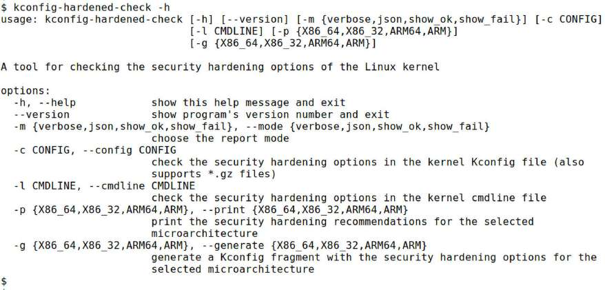

Hình 2.18: Ảnh màn hình trợ giúp của script kconfig-hardened-check tuyệt vời

Mẹo nhanh hữu ích: dùng `kconfig-hardened-check`, ta dễ sinh tệp cấu hình kernel security-conscious như sau (ví dụ ở đây cho AArch64):

```
kconfig-hardened-check -g ARM64 > my_kconfig_hardened
```

(Tệp kết quả gọi là `config fragment`.) Giờ nói thực tế, nếu đã có tệp cấu hình kernel cho sản phẩm thì sao? Có hợp nhất cả hai được không? Đúng là được! Kernel cung cấp script làm chính việc này: `scripts/kconfig/merge_config.sh.` Chạy nó, truyền tham số là đường dẫn tệp cấu hình kernel gốc (có thể non-secure), rồi đường dẫn secure kernel config fragment just-generated; kết quả là hợp nhất cả hai (tham số bổ sung cho `merge_config.sh` cho phép kiểm soát thêm; hãy tìm hiểu.

Ví dụ nằm tại: `https://github.com/a13xp0p0v/kconfig-hardened-check#generating-a-kconfig-fragment-with-the-security-hardening-options`).

Ngoài ra, chắc chắn bạn sẽ biết có các GCC plugin new-ish (`CONFIG_GCC_PLUGINS`) cung cấp tính năng bảo mật thú vị arch-specific. Ví dụ auto-initialization biến local/heap, tạo entropy lúc boot, v.v. Tuy nhiên, chúng thường thậm chí không xuất hiện trong menu. Vị trí thường là General architecture-dependent options \| GCC plugins, do phần hỗ trợ không được cài mặc định. Ít nhất trên x86, hãy thử cài gói `gcc-<ver#>-plugin-dev`, với ver# là số phiên bản GCC, rồi cấu hình lại.

#### Các mẹo khác – cấu hình kernel

Sau đây là một vài mẹo còn lại về cấu hình kernel:

- Khi build kernel x86 cho máy ảo dùng VirtualBox như ở đây, lúc cấu hình bạn có thể thấy hữu ích khi đặt `CONFIG_ISO9660_FS=y`; sau đó VirtualBox cho phép máy khách mount CD ảo Guest Additions và cài các guest addition khá hữu ích! Thông thường chúng cải thiện hiệu năng máy ảo, cho đồ họa tốt hơn, khả năng USB, chia sẻ clipboard và tệp, v.v.

- Khi build kernel tùy chỉnh, đôi khi ta muốn viết/build chương trình eBPF (chủ đề nâng cao không trình bày ở đây) hoặc nội dung tương tự. Để làm vậy cần một số in-kernel header. Có thể chủ động bảo đảm bằng cách đặt cấu hình kernel `CONFIG_IKHEADERS=y` (hoặc `m`; từ 5.2 trở đi). Điều này cung cấp tệp `/sys/kernel/kheaders.tar.xz`, có thể giải ở nơi khác để lấy header.

  - Hơn nữa, khi nói về eBPF, kernel hiện đại có khả năng sinh một số debug information gọi là metadata BPF Type Format (BTF). Có thể bật bằng cấu hình `CONFIG_DEBUG_INFO_BTF=y`. Điều này cũng yêu cầu cài công cụ pahole. Thông tin thêm về BTF metadata trong tài liệu kernel chính thức tại `https://www.kernel.org/doc/html/next/bpf/btf.html`.

  - Khi bật tùy chọn này, một cấu hình kernel khác – `CONFIG_MODULE_ALLOW_BTF_MISMATCH` – trở nên liên quan lúc build kernel module. Đây là chủ đề chúng ta trình bày sâu ở hai chương sau. Nếu bật `CONFIG_DEBUG_INFO_BTF`, nên đặt cấu hình sau thành Yes, vì nếu không, module có thể không được phép nạp khi BTF metadata không khớp ở load time.

- Tiếp theo, ít nhất về lý thuyết, build kernel không nên sinh lỗi hay thậm chí cảnh báo. Để bảo đảm, tức coi cảnh báo là lỗi, đặt `CONFIG_WERROR=y`. Trong giao diện `make` `menuconfig` giờ đã quen thuộc, nó ở General Setup \| Compile the kernel with warnings as errors và thường mặc định tắt.

- Có script thú vị tại `scripts/get_feat.pl`; màn hình trợ giúp cho biết cách dùng để liệt kê ma trận hỗ trợ tính năng kernel của máy hoặc kiến trúc cụ thể. Ví dụ, để xem ma trận hỗ trợ tính năng kernel cho AArch64, làm như sau:

```
scripts/get_feat.pl --arch arm64 ls
```

- Tiếp đến, một dạng “cơ sở dữ liệu” không chính thức về mọi cấu hình kernel sẵn có và phiên bản kernel hỗ trợ chúng nằm tại website dự án Linux Kernel Driver database (LKDDb): `https://cateee.net/lkddb/web-lkddb/`.

- Kernel boot config: Lúc boot, luôn có thể ghi đè một số tính năng kernel qua kernel command-line parameter mạnh mẽ. Chúng được ghi chép kỹ tại `https://www.kernel.org/doc/html/latest/admin-guide/kernel-parameters.html`. Dù rất hữu ích, đôi khi cần truyền thêm tham số theo cặp key-value, về cơ bản dạng `key=value`, mở rộng kernel command line. Có thể làm bằng cách điền một tệp cấu hình kernel nhỏ gọi là boot config. Tính năng boot config phụ thuộc vào cấu hình kernel `BOOT_CONFIG` bằng `y`. Nó ở menu General Setup, thường mặc định bật.

  - Có hai cách dùng: gắn boot config vào ảnh initrd hoặc initramfs (chúng ta trình bày initrd trong chương sau), hoặc nhúng boot config vào chính kernel. Với cách sau, cần tạo tệp boot config, truyền chỉ thị `CONFIG_BOOT_CONFIG_EMBED_FILE="x/y/z"` trong cấu hình kernel và build lại kernel. Lưu ý kernel command-line parameter có ưu tiên hơn boot config parameter. Lúc boot, nếu bật và sử dụng, có thể xem boot config parameter qua `/proc/bootconfig`. Chi tiết boot config nằm trong tài liệu kernel chính thức tại `https://elixir.bootlin.com/linux/v6.1.25/source/Documentation/admin-guide/bootconfig.rst`.

Chắc chắn bạn sẽ gặp nhiều thiết lập cấu hình kernel và script hữu ích khác, kể cả để hardening kernel; hãy chú ý tìm hiểu.

Được rồi! Bạn đã hoàn thành ba bước đầu của Linux kernel build – một việc đáng kể. Tất nhiên chúng ta sẽ hoàn thành bốn bước còn lại trong chương sau. Chúng ta kết thúc chương này bằng phần cuối học thêm kỹ năng hữu ích – cách tùy chỉnh menu giao diện kernel.

## Tùy chỉnh menu kernel, Kconfig và thêm mục menu riêng

Giả sử bạn đã phát triển device driver, một modular scheduling class thử nghiệm mới, callback `debugfs` (debug filesystem) tùy chỉnh hoặc tính năng kernel thú vị khác. Một ngày bạn sẽ làm được. Làm sao để người khác trong nhóm – hoặc khách hàng hay cộng đồng – biết tính năng kernel mới tuyệt vời này tồn tại? Thông thường bạn thiết lập cấu hình kernel (macro) mới và cho phép chọn built-in hoặc kernel module, từ đó build và sử dụng. Trong quá trình này, bạn cần định nghĩa cấu hình kernel mới và chèn mục menu mới vào vị trí phù hợp trong menu cấu hình kernel.

Để làm vậy, trước tiên nên hiểu thêm một ít về các tệp `Kconfig*` và nơi chúng nằm. Hãy tìm hiểu.

### Tìm hiểu các tệp Kconfig\*

Các tệp `Kconfig*` chứa metadata được hệ thống cấu hình và build kernel – Kconfig/Kbuild – diễn giải, cho phép tạo và hiển thị có điều kiện các menu bạn thấy khi chạy giao diện `menuconfig`, tiếp nhận lựa chọn, v.v.

Ví dụ, tệp `Kconfig` ở gốc kernel source tree được dùng điền nội dung màn hình ban đầu của `menuconfig`. Hãy xem nó; nó hoạt động bằng cách nạp nhiều tệp `Kconfig` khác ở các thư mục khác nhau trong kernel source tree. Có nhiều tệp `Kconfig*` trong kernel source tree (hơn 1.700 với 6.1.25)! Mỗi tệp thường định nghĩa một menu, giúp ta nhận ra hệ thống build thực sự phức tạp đến đâu.

Ví dụ thực tế, hãy tra mục `Kconfig` định nghĩa các mục menu Google Devices \| Google Virtual NIC (gVNIC) support. Google Cloud dùng một Network Interface Card (NIC) ảo; nó được gọi là Google Virtual NIC. Có khả năng các cloud server Linux-based của họ sử dụng nó. Vị trí trong giao diện `menuconfig` tại đây:

\-\> Device Drivers

\-\> Network device support

\-\> Ethernet driver support

\-\> Google Devices

Đây là ảnh chụp các mục menu này:

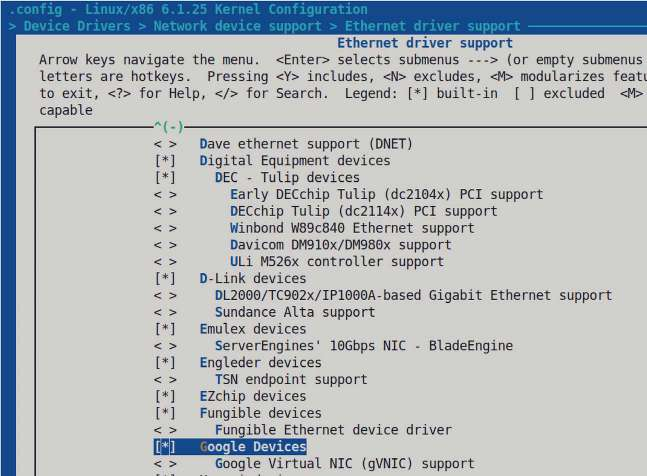

Hình 2.19: Một phần ảnh chụp mục Google Devices trong giao diện make menuconfig (x86/6.1.25)

Làm sao biết tệp `Kconfig` nào định nghĩa các mục menu này? Màn hình Help của cấu hình tương ứng cho biết! Vì vậy, ở mục menu liên quan, chọn \< Help \> rồi nhấn Enter; tại đây, màn hình Help có dòng sau (bên cạnh thông tin khác):

`Defined at drivers/net/ethernet/google/Kconfig:5`

Đó là tệp `Kconfig` mô tả menu này! Hãy mở xem:

```
$ cat drivers/net/ethernet/google/Kconfig
#
# Google network device configuration
#
config NET_VENDOR_GOOGLE
    bool "Google Devices"
    default y
    help
      If you have a network (Ethernet) device belonging to this class, say Y.
[ … ]
```

Đây là mục `Kconfig` đẹp và đơn giản; chú ý các từ khóa ngôn ngữ `Kconfig`: `config`, `bool`, `default` và `help`. Chúng tôi làm nổi bật bằng màu đảo ngược. Bạn thấy thiết bị được bật mặc định. Chúng ta sẽ sớm trình bày cú pháp.

Bảng sau tóm tắt các tệp `Kconfig*` quan trọng hơn và submenu mà chúng phục vụ trong giao diện Kbuild:

| Menu | Vị trí tệp Kconfig tương ứng |
|---|---|
| Menu chính, màn hình ban đầu của giao diện menuconfig | `Kconfig` |
| General setup + Enable loadable module support | `init/Kconfig` |
| Processor types and features + Bus options + Binary Emulations (tên menu thường arch-specific; ở đây liên quan x86\[\_64\]; nói chung tệp Kconfig nằm tại `arch/<arch>/Kconfig`) | `arch/<arch>/Kconfig*` |
| Power management | `kernel/power/Kconfig*` |
| Firmware drivers | `drivers/firmware/Kconfig*` |
| Virtualization | `arch/<arch>/kvm/Kconfig*` |
| General architecture-dependent options | `arch/Kconfig*` |
| Enable the block layer + IO Schedulers | `block/Kconfig*` |
| Executable file formats | `fs/Kconfig.binfmt` |
| Memory management options | `mm/Kconfig*` |
| Networking support | `net/Kconfig, net/*/Kconfig*` |
| Device drivers | `drivers/Kconfig, drivers/*/Kconfig*` |
| Filesystems | `fs/Kconfig, fs/*/Kconfig*` |
| Security options | `security/Kconfig, security/*/Kconfig*` |
| Cryptographic API | `crypto/Kconfig, crypto/*/Kconfig*` |
| Library routines | `lib/Kconfig, lib/*/Kconfig*` |
| Kernel hacking (nghĩa là Kernel debugging) | `lib/Kconfig.debug, lib/Kconfig.*` |

Bảng 2.4: Các menu/submenu cấu hình kernel và tệp Kconfig\* tương ứng định nghĩa chúng

Thông thường một tệp `Kconfig` điều khiển một menu, dù có thể nhiều menu. Giờ hãy chuyển sang thực sự thêm mục menu.

### Tạo mục menu mới trong General Setup

Ví dụ đơn giản, hãy thêm tùy chọn cấu hình Boolean giả lập riêng trong General Setup. Chúng ta muốn tên cấu hình là, chẳng hạn, `CONFIG_LKP_OPTION1`. Như thấy từ bảng trên, tệp `Kconfig` cần sửa là `init/Kconfig`, vì đây là meta-file định nghĩa menu General Setup.

Hãy thực hiện (giả định bạn ở gốc kernel source tree):

1\. Tùy chọn: để an toàn, luôn tạo bản sao lưu tệp `Kconfig` đang sửa:

```
cp init/Kconfig init/Kconfig.orig
```

2\. Giờ sửa tệp `init/Kconfig`:

```
vi init/Kconfig
```

Cuộn đến vị trí phù hợp trong tệp; ở đây ta chọn chèn mục menu riêng giữa `LOCALVERSION_AUTO` và `BUILD_SALT`. Ảnh sau hiển thị mục mới (tệp `init/Kconfig` đang được sửa bằng `vim`):

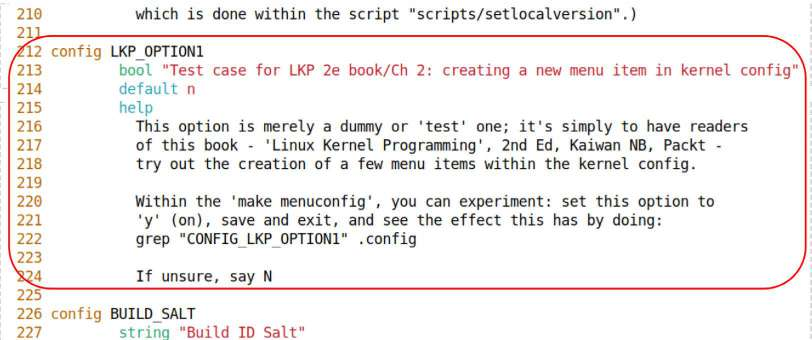

Hình 2.20: Sửa 6.1.25:init/Kconfig và chèn mục menu riêng (được làm nổi bật)

Để bạn biết, tôi cung cấp thử nghiệm trên dưới dạng patch cho tệp `init/Kconfig` 6.1.25 gốc trong source tree GitHub của sách. Tìm patch tại `ch2/Kconfig.patch`.

Mục mới bắt đầu bằng từ khóa `config`, tiếp đến phần `FOO` của biến cấu hình mới `CONFIG_LKP_OPTION1`. Lúc này, chỉ cần đọc các câu lệnh chúng ta viết trong `Kconfig` cho mục này. Chi tiết thêm về ngôn ngữ/cú pháp `Kconfig` nằm trong phần Một vài chi tiết về ngôn ngữ Kconfig bên dưới.

3\. Lưu tệp rồi thoát trình soạn thảo. 4. Cấu hình lại kernel: chạy `make menuconfig`. Sau đó đến mục menu mới thú vị của chúng ta dưới General Setup \| Test case for LKP 2e book/Ch 2: creating …. Bật tính năng. Chú ý trong Hình 2.21, nó được làm nổi bật và mặc định tắt, đúng như chỉ định qua dòng `default n`.

```
    make menuconfig
   [...]
```

Đây là kết quả liên quan:

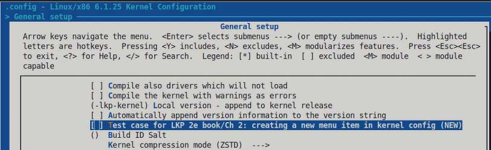

Hình 2.21: Cấu hình kernel qua make menuconfig hiển thị mục menu mới (trước khi bật)

5\. Giờ bật bằng phím cách, sau đó lưu và thoát hệ thống menu.

Khi ở đó, thử nhấn nút \< Help \>. Bạn sẽ thấy nội dung “help” chúng ta cung cấp trong `init/Kconfig`.

6\. Kiểm tra tính năng đã được chọn chưa:

```
$ grep "LKP_OPTION1" .config
CONFIG_LKP_OPTION1=y
$ grep "LKP_OPTION1" include/generated/autoconf.h
$
```

Chúng ta thấy nó thực sự được bật (`y`) trong `.config`, nhưng chưa có trong header nội bộ auto-generated của kernel. Điều này sẽ xảy ra khi build kernel.

Giờ kiểm tra qua phương pháp script `config` non-interactive hữu ích. Chúng ta đã trình bày ở phần Dùng config script của kernel để xem/sửa cấu hình kernel.

```
$ scripts/config -s LKP_OPTION1
y
```

À, nó bật như mong đợi (tùy chọn `-s` giống `--state`). Bên dưới, chúng ta tắt qua `-d`, truy vấn (`-s`), re-enable qua `-e`, rồi truy vấn lần nữa (chỉ để học cách dùng!):

```
$ scripts/config -d LKP_OPTION1 ; scripts/config -s LKP_OPTION1
n
$ scripts/config -e LKP_OPTION1 ; scripts/config -s LKP_OPTION1
y
```

7\. Build kernel. Đừng lo; chi tiết đầy đủ về build kernel nằm trong chương tiếp theo. Có thể tạm bỏ qua, hoặc đọc Chương 3, Build Linux kernel 6.x từ source code – Phần 2, rồi quay lại điểm này.

```
make -j4
```

Hơn nữa, ở kernel gần đây, sau bước build, mỗi tùy chọn cấu hình kernel được bật (y hoặc m) xuất hiện như tệp rỗng trong `include/config`; tất nhiên cấu hình mới của chúng ta cũng vậy:

```
   $ ls -l include/config/LKP_*
      -rw-r--r-- 1 c2kp c2kp 0 Apr 29 11:56 include/config/LKP_
      OPTION1
```

8\. Khi xong, kiểm tra lại header `autoconf.h` xem có tùy chọn cấu hình mới không:

```
$ grep LKP_OPTION1 include/generated/* 2>/dev/null
include/generated/autoconf.h:#define CONFIG_LKP_OPTION1 1
include/generated/rustc_cfg:--cfg=CONFIG_LKP_OPTION1
include/generated/rustc_cfg:--cfg=CONFIG_LKP_OPTION1="y"
```

Đã hoạt động (từ 6.0 ngay cả Rust cũng biết đến nó!). Đúng vậy; tuy nhiên, khi làm dự án hay sản phẩm thực tế, để tận dụng cấu hình kernel mới này, thường cần thêm bước thiết lập mục cấu hình trong `Makefile` liên quan mã dùng tùy chọn này.

Đây là ví dụ nhanh về hình thức có thể có. Giả sử ta viết kernel code trong tệp C tên `lkp_options.c`. Giờ cần bảo đảm nó được biên dịch và build vào kernel image! Bằng cách nào? Một cách là trong `Makefile` top-level của kernel hoặc Makefile riêng, dòng sau bảo đảm mã được biên dịch vào kernel lúc build; hãy thêm vào cuối Makefile liên quan:

```
obj-${CONFIG_LKP_OPTION1}  +=  lkp_option1.o
```

Lúc này đừng quá lo cú pháp Makefile kernel khá kỳ lạ. Vài chương tới chắc chắn sẽ làm rõ. Ngoài ra, chúng ta đã trình bày chính cú pháp này trong phần Cách hệ thống Kconfig+Kbuild hoạt động – mô tả tối giản.

Hơn nữa, bạn cần nhận ra cùng cấu hình đó có thể dùng như C macro thông thường trong một đoạn code kernel; ví dụ ta có thể làm như sau trong code C kernel hoặc module in-tree:

```
#ifdef CONFIG_LKP_OPTION1
    do_our_thing();
#endif
```

Tuy nhiên, rất cần lưu ý cộng đồng Linux kernel đã đề ra và tuân thủ nghiêm ngặt một số hướng dẫn coding style chặt chẽ. Trong trường hợp này, hướng dẫn nói nên tránh conditional compilation bất cứ khi nào có thể; nếu cần dùng symbol `Kconfig` làm điều kiện, hãy làm theo cách này:

```
if (IS_ENABLED(CONFIG_LKP_OPTION1))
    do_our_thing();
```

Hướng dẫn Linux kernel coding style tại `https://www.kernel.org/doc/html/latest/process/coding-style.html`. Tôi rất khuyến khích bạn thường xuyên tham khảo và tất nhiên tuân thủ!

### Một vài chi tiết về ngôn ngữ Kconfig

Cách chúng ta dùng Kconfig đến đây (Hình 2.20) chỉ là phần nổi của tảng băng, như cách nói quen thuộc. Thực tế, Kconfig dùng ngôn ngữ hay cú pháp `Kconfig` để biểu diễn và tạo menu bằng các chỉ thị văn bản ASCII đơn giản. Ngôn ngữ gồm menu entry, attribute, dependency, visibility constraint, nội dung trợ giúp, v.v.

Kernel có tài liệu cấu trúc và cú pháp ngôn ngữ `Kconfig` tại `https://www.kernel.org/doc/html/v6.1/kbuild/kconfig-language.html#kconfig-language`. Hãy tham khảo tài liệu để có đầy đủ chi tiết.

Bảng sau giới thiệu ngắn các cấu trúc `Kconfig` phổ biến hơn:

| Construct | Ý nghĩa |
|---|---|
| `config <FOO>` | Ở đây chỉ định tên mục menu dạng `CONFIG_FOO`; chỉ dùng phần `FOO` sau từ khóa `config`. |
| Menu attributes |  |
| `bool ["<description>"]` | Chỉ định tùy chọn Boolean; giá trị trong `.config` là `y` (build vào kernel image) hoặc không tồn tại (hiển thị như mục commented-out). |
| `tristate ["description>"]` | Chỉ định tùy chọn tristate; giá trị trong `.config` là `y`, `m` (build thành kernel module) hoặc không tồn tại (hiển thị như mục commented-out). |
| `int ["<description>"]` | Chỉ định tùy chọn nhận giá trị số nguyên. |
| `range x-y` | Dành cho số nguyên có miền giá trị hợp lệ từ `x` đến `y`. |
| `default <value>` | Chỉ định giá trị mặc định; dùng `y`, `m`, `n` hoặc giá trị khác theo yêu cầu. |
| `prompt "<description>" [if` `<expr>]` | Lời nhắc nhập kèm câu mô tả (có thể đặt điều kiện); mỗi mục menu có tối đa một prompt. |
| `depends on "expr"` | Định nghĩa dependency cho mục menu; có thể có nhiều dependency với cú pháp dạng `depends on FOO1 && FOO2 &&` `(FOO3 \|\| FOO4`). |
| `select <config> [if "expr"]` | Định nghĩa reverse dependency. |
| `help "my awesome help text …` `bleh` `bleh bleh "` | Nội dung hiển thị khi chọn nút \< Help \>. |

Bảng 2.5: Kconfig, một số cấu trúc

Để giúp hiểu cú pháp, sau đây là vài ví dụ từ `lib/Kconfig.debug` (tệp mô tả các mục menu cho submenu `Kernel Hacking` của giao diện – thực chất nghĩa là kernel debugging). Đừng quên bạn cũng có thể duyệt trực tuyến tại `https://elixir.bootlin.com/linux/v6.1.25/source/lib/Kconfig.debug`:

1\. Bắt đầu bằng tùy chọn đơn giản, self-explanatory: `CONFIG_DEBUG_INFO`:

```
config DEBUG_INFO
        bool
        help
          A kernel debug info option other than "None" has been selected
          in the "Debug information" choice below, indicating that debug
          information will be generated for build targets.
```

2\. Tiếp theo, xem tùy chọn `CONFIG_FRAME_WARN`. Chú ý `range` và cú pháp giá trị mặc định có điều kiện như sau:

```
config FRAME_WARN
    int "Warn for stack frames larger than"
    range 0 8192
    default 0 if KMSAN
        default 2048 if GCC_PLUGIN_LATENT_ENTROPY
        default 2048 if PARISC
        default 1536 if (!64BIT && XTENSA)
        default 1280 if KASAN && !64BIT
        default 1024 if !64BIT
        default 2048 if 64BIT
        help
          Tell the compiler to warn at build time for stack frames larger
than this.
          Setting this too low will cause a lot of warnings.
          Setting it to 0 disables the warning.
```

3\. Tiếp đến, `CONFIG_HAVE_DEBUG_STACKOVERFLOW` là Boolean đơn giản; chỉ bật hoặc tắt (kernel có hoặc không có khả năng phát hiện kernel-space stack overflow). Tùy chọn `CONFIG_DEBUG_STACKOVERFLOW` cũng là Boolean. Chú ý nó phụ thuộc hai tùy chọn khác, ngăn cách bằng toán tử Boolean AND (`&&`):

```
config HAVE_DEBUG_STACKOVERFLOW
        bool

config DEBUG_STACKOVERFLOW
        bool "Check for stack overflows"
        depends on DEBUG_KERNEL && HAVE_DEBUG_STACKOVERFLOW
        help
           Say Y here if you want to check for overflows of kernel, IRQ
           and exception stacks (if your architecture uses them). This
           option will show detailed messages if free stack space drops
           below a certain limit. [...]
```

Một điều hữu ích nữa: khi cấu hình kernel qua giao diện `make menuconfig` thông thường, nhấn \< Help \> không chỉ hiện nội dung trợ giúp thường hữu ích, mà còn hiển thị giá trị runtime hiện tại của nhiều tùy chọn cấu hình. Chỉ cần tìm một tùy chọn qua phím / như đã nói cũng thấy điều tương tự. Vì vậy, ví dụ nhấn / và tìm cấu hình kernel tên `KASAN`; đây là điều tôi thấy khi thực hiện.

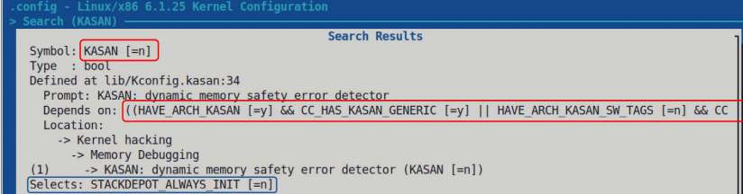

Hình 2.22: Một phần ảnh chụp tùy chọn cấu hình KASAN; bạn thấy mặc định nó tắt

Nếu bạn chưa biết, KASAN là Kernel Address SANitizer – công nghệ compiler-based rất xuất sắc để phát hiện lỗi memory corruption; tôi trình bày sâu trong cuốn Linux Kernel Debugging.

Nhìn kỹ dòng Depends on:; nó hiển thị các dependency cùng giá trị hiện tại. Điều quan trọng cần lưu ý là mục menu thậm chí không hiện trong giao diện trừ khi các dependency được đáp ứng.

Được rồi! Đến đây kết thúc nội dung về các tệp `Kconfig`, tạo hoặc sửa mục menu riêng trong cấu hình kernel, một ít cú pháp ngôn ngữ Kconfig và thực sự cả chương này.

## Tổng kết

Trong chương này, trước tiên bạn học quy ước đặt bản phát hành hay phiên bản Linux kernel (nhớ rằng bản phát hành Linux kernel dựa trên thời gian, không feature-based!), các loại Linux kernel (cây `(-next`, cây `-rc/mainline`, stable, LTS, SLTS, distribution, custom embedded) và quy trình phát triển kernel cơ bản. Sau đó, bạn học cách tự lấy source tree Linux kernel và giải nén kernel source tree nén xuống đĩa. Trong quá trình đó, bạn còn có cái nhìn nhanh từ độ cao 10.000 foot về kernel source tree để hiểu bố cục rõ hơn.

Sau đó, quan trọng là bạn học cách tiếp cận và thực hiện bước cấu hình kernel – một bước then chốt trong quy trình build kernel! Hơn nữa, bạn học cách tùy chỉnh menu kernel, thêm mục riêng và một ít về hệ thống Kconfig/Kbuild cùng các tệp `Kconfig` liên quan mà nó dùng, bên cạnh những nội dung khác.

Biết cách lấy và cấu hình Linux kernel là kỹ năng hữu ích nên có. Chúng ta mới bắt đầu hành trình dài và thú vị này. Bạn sẽ nhận ra càng có kinh nghiệm và kiến thức về kernel internals, driver và phần cứng hệ thống đích, khả năng fine-tune kernel theo mục tiêu dự án càng tốt hơn.

Chúng ta đã đi nửa đường để build kernel tùy chỉnh; tôi đề nghị bạn nghiền ngẫm tài liệu, hands-on các bước trong chương, làm câu hỏi/bài tập và xem phần Đọc thêm. Sau đó, trong chương tiếp theo, hãy thực sự build kernel 6.1.25 và xác minh!

## Bài tập

Làm gần như chính xác các bước đã học trong chương này, tôi muốn giờ bạn thực hiện tương tự với một kernel khác, chẳng hạn Linux kernel 6.0.y, với y là số cao nhất (lúc viết là 19)! Tất nhiên nếu muốn, cứ thoải mái làm việc với bất kỳ kernel khác:

1\. Truy cập `https://mirrors.edge.kernel.org/pub/linux/kernel/v6.x/` và tra các bản 6.0.y. 2. Tải source tree Linux kernel v6.0.y mới nhất. 3. Giải nén xuống đĩa. 4. Cấu hình kernel (bắt đầu bằng `localmodconfig`, rồi điều chỉnh cấu hình theo yêu cầu. Để làm thêm bài tập, cũng có thể chạy script `streamline_config.pl`). 5. Hiển thị “delta” – khác biệt giữa tệp cấu hình kernel gốc và mới (mẹo: dùng script `diffconfig` của kernel để thực hiện).

## Câu hỏi

Khi kết thúc, đây là danh sách câu hỏi để kiểm tra kiến thức về nội dung chương này: `https://github.com/PacktPublishing/Linux-Kernel-Programming_2E/blob/main/questions/ch2_qs_assignments.txt`. Bạn tìm thấy câu trả lời cho một số câu hỏi trong kho GitHub của sách: `https://github.com/PacktPublishing/Linux-Kernel-Programming_2E/tree/master/solutions_to_assgn`.

## Đọc thêm

Để giúp tìm hiểu sâu hơn chủ đề, chúng tôi cung cấp danh sách khá chi tiết tài liệu tham khảo và liên kết trực tuyến, đôi khi cả sách, trong tài liệu Further reading ở kho GitHub của sách. Tài liệu nằm tại `https://github.com/PacktPublishing/Linux-Kernel-Programming_2E/blob/master/Further_Reading.md`.

## Tìm hiểu thêm trên Discord

Để tham gia cộng đồng Discord của sách – nơi có thể chia sẻ phản hồi, hỏi tác giả và tìm hiểu các bản phát hành mới – hãy quét mã QR bên dưới:

`https://packt.link/SecNet`
