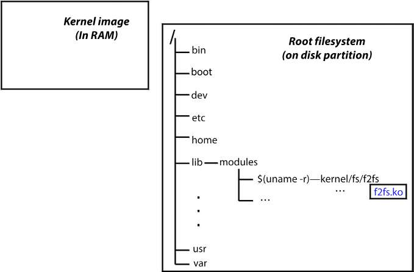
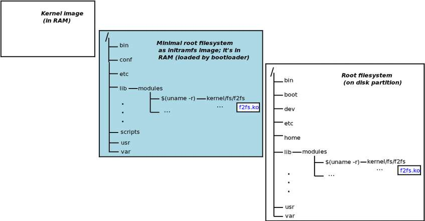
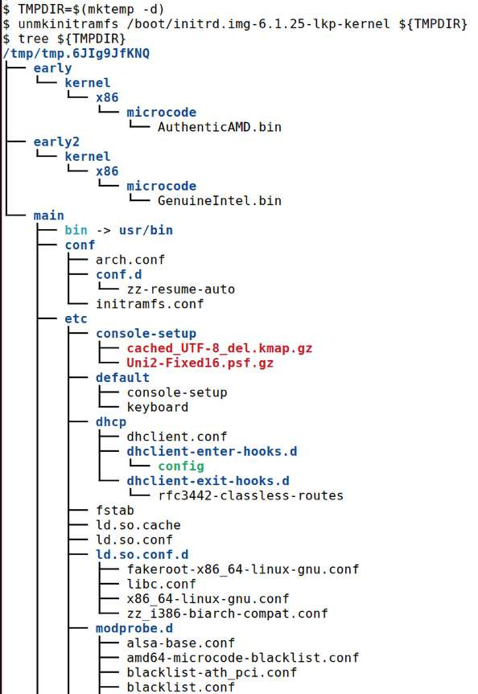
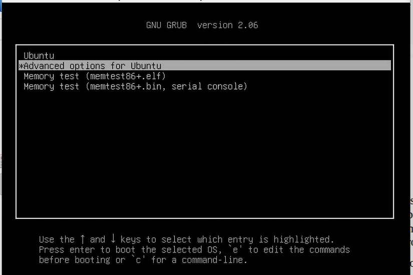
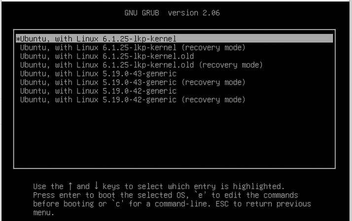
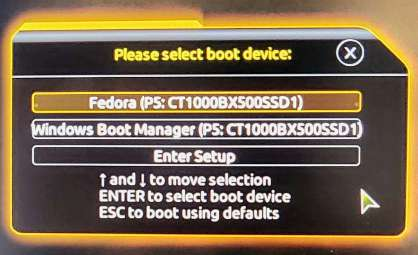
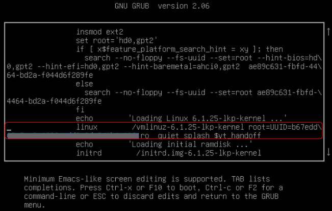
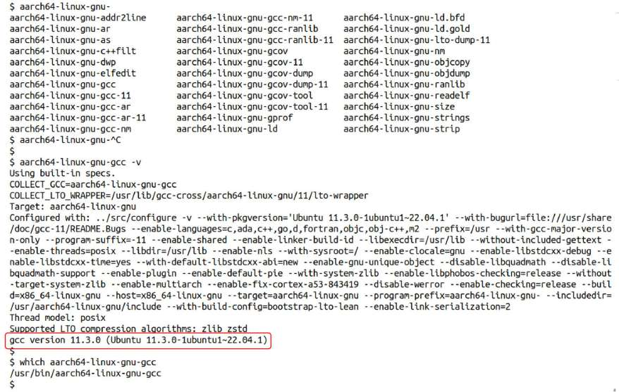
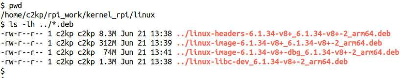

# Chương 3. Biên dịch Linux kernel 6.x từ mã nguồn – Phần 2

Chương này tiếp nối chương trước. Trong phần Các bước biên dịch kernel từ mã nguồn, chúng ta đã thực hiện ba bước đầu: tải và giải nén cây mã nguồn, hoặc dùng `git clone` để lấy mã nguồn (bước 1 và 2). Sau đó, chúng ta tìm hiểu bố cục cây mã nguồn và quan trọng hơn là các cách chọn điểm khởi đầu phù hợp để cấu hình kernel (bước 3). Chúng ta còn thêm mục riêng vào menu cấu hình kernel.

Trong chương này, chúng ta tiếp tục với bốn bước còn lại. Đầu tiên là build kernel (bước 4). Sau đó, bạn học cách cài đúng các kernel module được tạo trong quá trình build (bước 5). Tiếp theo, chúng ta chạy một lệnh đơn giản để thiết lập bootloader GRUB (Grand Unified Bootloader) và tạo ảnh `initramfs` (hoặc `initrd`) (bước 6). Lý do sử dụng ảnh `initramfs` và cách tạo nó cũng được giải thích. Cuối cùng là một số chi tiết cấu hình bootloader GRUB cho x86 (bước 7).

Đến cuối chương, chúng ta sẽ khởi động hệ thống bằng kernel image mới và kiểm tra nó được build đúng mong đợi. Sau cùng, bạn học cách cross-compile Linux kernel cho kiến trúc khác (với AArch 32/64, bo mạch được dùng là Raspberry Pi quen thuộc).

Tóm lại, chương này bao gồm:

- Bước 4 – build kernel image và module

- Bước 5 – cài đặt kernel module

- Bước 6 – tạo ảnh initramfs và thiết lập bootloader

- Tìm hiểu framework initramfs

- Bước 7 – tùy chỉnh bootloader GRUB

- Kiểm tra cấu hình kernel mới

- Build kernel cho Raspberry Pi

- Một số mẹo về build kernel

## Yêu cầu kỹ thuật

Trước khi bắt đầu, tôi giả định bạn đã tải, giải nén (nếu cần) và cấu hình kernel, tức đã có tệp `.config`. Nếu chưa, xem Chương 2, Biên dịch Linux kernel 6.x từ mã nguồn – Phần 1, để biết cách thực hiện chi tiết. Giờ chúng ta có thể build.

## Bước 4 – build kernel image và module

Từ góc nhìn người dùng, thao tác build rất đơn giản. Ở dạng đơn giản nhất, chỉ cần đứng tại gốc cây mã nguồn kernel đã cấu hình rồi gõ `make`. Vậy là kernel image, các kernel module và trên hệ nhúng có thể cả tệp nhị phân Device Tree Blob (DTB) sẽ được build. Hãy pha cà phê! Lần đầu có thể mất khá lâu.

Tất nhiên, có nhiều `Makefile` target để truyền cho `make`. Chạy nhanh `make help` trên dòng lệnh sẽ thấy nhiều thông tin. Chúng ta đã dùng lệnh này để xem các configuration target (có thể xem lại phần Xem mọi tùy chọn cấu hình sẵn có trong Chương 2, Biên dịch kernel 6.x từ mã nguồn – Phần 1). Ở đây, dùng nó để xem mặc định target `all` build những gì:

```
$ cd ${LKP_KSRC}     # recall that the env var LKP_KSRC holds the pathname to
                     # the 'root' directory of our 6.1 LTS kernel source tree
$ make help
 [...]
Other generic targets:
  all - Build all targets marked with [*]
* vmlinux  - Build the bare kernel
* modules - Build all modules
 [...]
Architecture specific targets (x86):
 * bzImage - Compressed kernel image (arch/x86/boot/bzImage)
 [...]
$
```

Điều cần chú ý: `make all` sẽ build ba target có tiền tố `*` ở trên. Chúng có ý nghĩa gì?

- `vmlinux` chính là tên tệp kernel image không nén.

- Target `modules` build tất cả tùy chọn cấu hình được đánh dấu `m` (module) thành kernel module (tệp `.ko`) trong cây mã nguồn. Kernel module là gì và cách lập trình chúng là chủ đề của hai chương tiếp theo.

- `bzImage` là tệp kernel image riêng theo kiến trúc. Trên x86\[\_64\], đây là kernel image nén mà bootloader thực sự nạp vào RAM, giải nén trong bộ nhớ rồi khởi động; về thực chất, đó là tệp kernel image nén.

Câu hỏi thường gặp: nếu `bzImage` là tệp thực sự dùng để boot và khởi tạo hệ thống thì `vmlinux` để làm gì? `vmlinux` là kernel image không nén, có thể lớn (thậm chí rất lớn nếu chứa kernel symbol sinh ra khi debug build). Dù không boot qua `vmlinux`, nó vẫn quan trọng, thực sự vô giá. Hãy giữ nó để debug kernel (cuốn Linux Kernel Debugging của tôi trình bày nội dung này!).

Với hệ thống `kbuild` mà kernel sử dụng, chỉ chạy `make` tương đương `make all`.

Cơ sở mã Linux kernel hiện đại rất lớn. Ước tính các kernel gần đây có khoảng 25–30 triệu dòng mã nguồn (SLOC)! Vì thế, build kernel tiêu tốn rất nhiều bộ nhớ và CPU. Một số người còn dùng nó làm stress test! (Không phải mọi dòng mã đều được biên dịch trong một lần build.) Tiện ích `make` hiện đại mạnh mẽ và hỗ trợ nhiều process. Ta có thể yêu cầu tạo nhiều process để xử lý song song các phần độc lập, tăng thông lượng và rút ngắn thời gian build. Tùy chọn là `-jn`, với `n` là giới hạn số task được tạo và chạy song song. Quy tắc kinh nghiệm để xác định là:

```
n = number-of-CPU-cores * factor;
```

Ở đây, `factor` bằng 2 (hoặc 1,5 trên hệ thống rất cao cấp có hàng trăm hay hàng nghìn CPU core). Về kỹ thuật, quy tắc này cần CPU core hỗ trợ thread nội bộ hay Simultaneous Multi-Threading (SMT), được Intel gọi là hyper-threading, mới hữu ích.

Chi tiết về `make` song song và cách hoạt động nằm ở mục PARALLEL MAKE AND THE JOBSERVER trong trang man của `make` (mở bằng `man 1 make`).

Câu hỏi khác: hệ thống có bao nhiêu CPU core? Có nhiều cách xác định; một cách dễ là dùng `nproc`:

```
$ nproc
4
```

Một vài lưu ý về `nproc` và tiện ích liên quan:

Chạy `strace` trên `nproc` cho thấy nó chủ yếu dùng system call `sched_getaffinity()`. Chúng ta sẽ nói thêm về system call này và các lời gọi liên quan trong Chương 10, The CPU Scheduler – Phần 1, và Chương 11, The CPU Scheduler – Phần 2, về CPU scheduling.

Tiện ích lscpu cũng cho biết số core và các thông tin CPU hữu ích khác. Hãy thử trên hệ thống Linux của bạn.

Máy ảo khách của tôi có bốn CPU core, nên đặt `n=4*2=8`. Hãy build kernel. Kết quả sau từ máy khách Ubuntu 22.04 LTS x86\_64 quen thuộc, được cấu hình 2 GB RAM và bốn CPU core.

Nhớ rằng kernel phải được cấu hình đúng trước khi build. Xem chi tiết ở Chương 2, Biên dịch Linux kernel 6.x từ mã nguồn – Phần 1.

Khi bắt đầu, quá trình build có thể phát cảnh báo, dù trường hợp này chưa gây dừng build:

```
$ make -j8
scripts/kconfig/conf --syncconfig Kconfig
 UPD include/config/kernel.release
warning: Cannot use CONFIG_STACK_VALIDATION=y, please install libelf-dev,
libelf-devel or elfutils-libelf-devel
 [...]
```

Để xử lý, dừng build bằng Ctrl + C rồi làm theo hướng dẫn cài gói `libelf-dev`. Trên Ubuntu, `sudo apt install libelf-dev` là đủ. Nếu bạn đã làm theo chương trực tuyến Kernel Workspace Setup hoặc chạy script `ch1/pkg_install4ubuntu_lkp.sh`, điều này sẽ không xảy ra.

Vì build kernel dùng nhiều CPU và RAM, chạy trong máy ảo khách chậm hơn nhiều so với Linux chạy trực tiếp trên phần cứng. Có thể tiết kiệm RAM bằng cách boot máy khách ở run level 3 (multiuser có mạng, không GUI): `https://www.if-not-true-then-false.com/2012/howto-change-runlevel-on-grub2/`.

Hãy thực hiện cùng vài mẹo nhanh nhưng rất hữu ích:

1\. Do build kernel dùng rất nhiều CPU và RAM, đôi khi tôi gặp lỗi khi build trong máy ảo ở chế độ đồ họa: thiếu bộ nhớ gây lỗi lạ, thậm chí bị đăng xuất! Để giảm vấn đề, nên boot máy ảo ở run level 3 – thường gọi là `multi-user.target` trong `systemd` – chế độ nhiều người dùng có mạng nhưng không đồ họa. Bạn có thể sửa kernel command line ở menu GRUB và thêm 3 vào cuối (xem phần Bước 7 – tùy chỉnh GRUB). Nếu đang ở chế độ đồ họa (`graphical.target` trong `systemd`), có thể chuyển sang `multi-user.target` bằng `sudo systemctl` `isolate multi-user.target`. 2. RAM khá rẻ (và có thể còn giảm giá), nên nâng RAM là cách nhanh, hiệu quả để cải thiện hiệu năng! 3. Đặc biệt khi chạy console mode, cá nhân tôi thích ssh vào máy ảo và làm việc từ đó.

4\. Khi build, dùng `tee` để lưu cả standard output và standard error vào tệp (`tee` đồng thời cho phép xem kết quả trên console):

```
$ sudo systemctl isolate multi-user.target
[...]
$ cd ${LKP_KSRC}
$ make –j8 2>&1 | tee out.txt
SYNC    include/config/auto.conf.cmd
  HOSTCC  scripts/basic/fixdep
  HOSTCC  scripts/kconfig/conf.o
  HOSTCC  scripts/kconfig/confdata.o
  HOSTCC  scripts/kconfig/expr.o
  LEX     scripts/kconfig/lexer.lex.c
  YACC    scripts/kconfig/parser.tab.[ch]
  HOSTCC  scripts/kconfig/preprocess.o
[...]
```

Hệ thống `kbuild` giờ sẽ build kernel mới và các thành phần được cấu hình thành module. Tất nhiên có lúc xảy ra trục trặc. Trong chương này, chúng ta sẽ xem một số tình huống và cách khắc phục nếu có thể, bắt đầu ở phần tiếp theo.

### Khắc phục vấn đề cert config trên Ubuntu

Đặc biệt trên Ubuntu gần đây, khi chạy `make`, mọi thứ có vẻ ổn cho đến khi thường gặp lỗi sau:

```
$ make ...
[...]
  EXTRACT_CERTS   certs/signing_key.pem
  CC      certs/system_keyring.o
  CC      arch/x86/entry/vdso/vclock_gettime.o
  EXTRACT_CERTS
  CC      certs/common.o
  CC      arch/x86/entry/vdso/vgetcpu.o
make[1]: *** No rule to make target 'debian/canonical-revoked-certs.pem',
needed by 'certs/x509_revocation_list'.  Stop.
make[1]: *** Waiting for unfinished jobs....
  CC      certs/blacklist.o
[...]
```

Bạn sẽ thấy `make` tiếp tục các task song song khác – ít nhất đến khi xác định tiếp tục cũng vô ích – rồi mới dừng (có thể khá lâu), cuối cùng thất bại; không có kernel nào được build.

Vấn đề là gì? Đó là cấu hình `CONFIG_SYSTEM_REVOCATION_KEYS` được thêm vào các kernel 5.x gần đây; hãy xem:

```
$ grep CONFIG_SYSTEM_REVOCATION_KEYS .config
CONFIG_SYSTEM_REVOCATION_KEYS="debian/canonical-revoked-certs.pem"
```

Ít nhất trên Ubuntu, thiết lập này có vẻ làm build thất bại; cách khắc phục nhanh, đơn giản là tắt nó:

```
scripts/config --disable SYSTEM_REVOCATION_KEYS
```

Kiểm tra lại bằng `grep`; bạn sẽ thấy nó không còn được đặt.

Bài hỏi đáp Ask Ubuntu này đề cập vấn đề: `https://askubuntu.com/a/1329625/245524.` Nếu tò mò, cấu hình dường như được đưa vào kernel 5.13; commit thực tế tại `https://github.com/torvalds/linux/commit/d1f044103dad70c1cec0a8f3abdf00834fec8b98`.

Chạy lại `make` (có thể cần nhấn Enter trả lời một hoặc hai lời nhắc); giờ sẽ thành công!

```
[...]
KSYMS   .tmp_vmlinux.kallsyms2.S
AS      .tmp_vmlinux.kallsyms2.S
LD      vmlinux
BTFIDS  vmlinux
SORTTAB vmlinux
SYSMAP  System.map
MODPOST modules-only.symvers
CC      arch/x86/boot/a20.o
AS      arch/x86/boot/bioscall.o
CC      arch/x86/boot/cmdline.o
[...]
GEN     Module.symvers
LDS     arch/x86/boot/compressed/vmlinux.lds
AS      arch/x86/boot/compressed/kernel_info.o
CC [M]  arch/x86/crypto/aesni-intel.mod.o
CC [M]  arch/x86/crypto/crc32-pclmul.mod.o
[...]
LD      arch/x86/boot/setup.elf
OBJCOPY arch/x86/boot/setup.bin
BUILD   arch/x86/boot/bzImage
Kernel: arch/x86/boot/bzImage is ready  (#3)
```

Đã xong!

Ngoài lề: nói chung cần kiểm tra gì khi build thất bại?

- Kiểm tra kỹ, rồi kiểm tra lại xem đã làm đúng mọi thứ chưa; hãy xem lại mình trước khi trách cộng đồng hay mã kernel!

- Đã cài đủ gói cần thiết, với phiên bản đủ mới chưa? Ví dụ, nếu cấu hình có `CONFIG_DEBUG_INFO_BTF=y` (của tôi có), cần cài `pahole` 1.16 trở lên.

- Cấu hình kernel có hợp lý không?

- Có phải vấn đề phần cứng? Lỗi như internal compiler error: Segmentation fault thường chỉ điều này; đã cấp đủ RAM và swap space chưa? Thử build trên máy ảo khác, tốt hơn là Linux chạy trực tiếp trên phần cứng.

- Bắt đầu lại từ đầu; ở gốc cây mã nguồn, chạy `make mrproper` (cẩn thận: dọn sạch mọi thứ, kể cả `.config`) rồi thực hiện cẩn thận các bước.

- Khi mọi cách đều thất bại, hãy tìm thông báo lỗi bằng Google!

Build nên chạy sạch, không lỗi hay cảnh báo. Đôi khi vẫn thấy compiler warning, nhưng ở đây chúng ta sẽ bỏ qua. Nếu gặp compiler error khiến build thất bại thì sao? Nói lịch sự thế nào nhỉ? Có lẽ không thể: rất có thể lỗi ở phía bạn chứ không phải cộng đồng kernel. Hãy kiểm tra lại từng bước, nếu hết cách thì chạy `make mrproper` và làm lại từ đầu! Build kernel thất bại thường do cấu hình sai (chọn tùy tiện các tùy chọn xung đột), toolchain cũ, áp dụng patch sai hoặc nguyên nhân khác. Phần Một số mẹo về build kernel có hướng dẫn cụ thể hơn.

Giả sử bước build đã thành công. Kernel image nén (trên x86\[\_64\] tên là `bzImage`) và tệp không nén `vmlinux` đã được tạo bằng cách liên kết các object file, như dòng cuối kết quả trên xác nhận (#3 nghĩa là với tôi đây là lần build thứ ba). Trong quá trình này, `kbuild` cũng hoàn tất build mọi kernel module.

Mẹo nhanh: để đo thời gian chạy lệnh, thêm `time` trước lệnh (ở đây: `time make -j8 2>&1 | tee out.txt`). Cách này hoạt động, nhưng tiện ích `time(1)` chỉ cung cấp cái nhìn rất khái quát về thời gian thực thi.

Nếu muốn CPU profiling và thống kê thời gian chính xác, hãy học tiện ích `perf` mạnh mẽ. Có thể thử `perf stat make -j8 ...`. Nên thử trên distro kernel; nếu dùng kernel tùy chỉnh, bạn phải tự build cả `perf` cho nó.

Trong kết quả trên, vì build song song qua `make -j8` (tối đa tám process cùng build), mọi process đều ghi vào cùng `stdout` là console hoặc terminal. Vì thế kết quả có thể đảo thứ tự hoặc trộn lẫn.

Giả sử mọi thứ diễn ra tốt như mong đợi, khi bước này kết thúc, `kbuild` đã tạo ba tệp quan trọng trong số nhiều tệp. Ở gốc cây mã nguồn, ta có:

- Kernel image không nén `vmlinux` (dùng để debug)

- Tệp ánh xạ symbol–address `System.map`

- Kernel image nén có thể boot `bzImage` (xem kết quả sau)

Hãy kiểm tra! Truyền tùy chọn `-h` cho `ls` để kết quả, đặc biệt kích thước tệp, dễ đọc hơn:

```
$ ls -lh vmlinux System.map
-rw-rw-r-- 1 c2kp c2kp 4.8M May 16 16:12 System.map
-rwxrwxr-x 1 c2kp c2kp 704M May 16 16:12 vmlinux
$ file vmlinux
vmlinux: ELF 64-bit LSB executable, x86-64, version 1 (SYSV), statically
linked, BuildID[sha1]=e4<...>, with debug_info, not stripped
```

Tệp `vmlinux` rất lớn vì chứa mọi kernel symbol cùng debug information bổ sung. (Hãy giữ `vmlinux` và `System.map` cho việc debug kernel.) Tiện ích `file` cho biết thêm chi tiết về image này.

Kernel image mà bootloader thực sự nạp và boot luôn nằm tại vị trí chung `arch/<arch>/boot/`; vì thế với x86:

```
$ ls -lh arch/x86/boot/bzImage
-rw-rw-r-- 1 c2kp c2kp 12M May 16 16:12 arch/x86/boot/bzImage
$ file arch/x86/boot/bzImage
arch/x86/boot/bzImage: Linux kernel x86 boot executable bzImage, version
6.1.25-lkp-kernel (c2kp@osboxes) #3 SMP PREEMPT_DYNAMIC Tue [...], RO-rootFS,
swap_dev 0XB, Normal VGA
```

Kernel image nén phiên bản `6.1.25-lkp-kernel` cho x86\_64 ở đây có kích thước khoảng 12 MB. Tiện ích `file` xác nhận rõ đó là Linux kernel boot image cho x86.

`Makefile` cấp cao nhất có một số target đơn giản nhưng hữu ích để kiểm tra chuỗi phiên bản kernel, v.v. Hãy xem gần cuối tệp `Makefile` lớn này:

```
cd ${LKP_KSRC}
cat Makefile
[ … ]
kernelrelease:
        @echo "$(KERNELVERSION)$$($(CONFIG_SHELL) $(srctree)/scripts/
setlocalversion $(srctree))"
kernelversion:
        @echo $(KERNELVERSION)

image_name:
        @echo $(KBUILD_IMAGE)
[ … ]
```

Hãy thử các target đó:

```
$ make kernelrelease kernelversion image_name
6.1.25-lkp-kernel
6.1.25
arch/x86/boot/bzImage
$
```

Rất tốt.

Kernel có tài liệu về các tùy chỉnh và tùy chọn build bằng biến môi trường, nằm trong cây mã nguồn tại `Documentation/kbuild/kbuild.rst`. Chúng ta sẽ dùng các biến `INSTALL_MOD_PATH`, `ARCH` và `CROSS_COMPILE` trong phần sau.

Kernel image và module đã sẵn sàng! Hãy tiếp tục để cài các kernel module ở bước kế tiếp.

## Bước 5 – cài đặt kernel module

Ở bước trước, mọi tùy chọn đánh dấu `m` – tức các kernel module, tệp `*.ko` – đã được build trong cây mã nguồn. Nhưng như bạn sẽ thấy, vậy chưa đủ: cần cài chúng vào vị trí quy định trên hệ thống. Phần này trình bày chi tiết.

### Tìm kernel module trong mã nguồn kernel

Bước trước tạo kernel image nén, không nén và mọi kernel module theo cấu hình. Kernel module là tệp luôn có hậu tố `.ko` (kernel object). Chúng rất hữu ích, cung cấp chức năng kernel theo dạng module (có thể tùy ý nạp vào hoặc gỡ khỏi kernel memory; hai chương sau sẽ đi sâu).

Biết rằng bước trước đã sinh các tệp kernel module, hãy dùng lệnh `find` để tìm chúng trong cây mã nguồn:

```
$ cd ${LKP_KSRC}
$ find . -name "*.ko"
./crypto/crypto_simd.ko
./crypto/cryptd.ko
[...]
./fs/binfmt_misc.ko
./fs/vboxsf/vboxsf.ko
```

Chỉ build kernel module chưa đủ. Chúng phải được cài vào vị trí quy định trong root filesystem để lúc boot hệ thống tìm thấy và nạp vào kernel memory. Vì vậy cần bước cài module tiếp theo (phần Cài đặt kernel module). Vị trí đó là `/lib/modules/$(uname -r)/`, với `$(uname -r)` cho biết phiên bản kernel.

### Cài đặt kernel module

Việc cài kernel module đơn giản: sau khi build, gọi Makefile target `modules_install`:

```
$ cd ${LKP_KSRC}
$ sudo make modules_install
[sudo] password for c2kp:
 INSTALL /lib/modules/6.1.25-lkp-kernel/kernel/arch/x86/crypto/aesni-intel.ko
  SIGN    /lib/modules/6.1.25-lkp-kernel/kernel/arch/x86/crypto/aesni-intel.ko
[ … ]
 INSTALL /lib/modules/6.1.25-lkp-kernel/kernel/sound/soundcore.ko
  SIGN    /lib/modules/6.1.25-lkp-kernel/kernel/sound/soundcore.ko
  DEPMOD  /lib/modules/6.1.25-lkp-kernel
$
```

Một số điểm cần chú ý:

- Chúng ta dùng `sudo` để cài module với quyền root (superuser), vì vị trí mặc định dưới `/lib/modules/` chỉ cho root ghi. Target `modules_install` chép kernel module vào đúng vị trí dưới `/lib/modules/` (công việc hiển thị là `INSTALL /lib/modules/6.1.25-lkp-kernel/<...>` trong kết quả trên).

- Tiếp theo, module có thể được “ký”. Trên hệ thống bật cryptographic signing cho kernel module (`CONFIG_MODULE_SIG`, tính năng bảo mật hữu ích như ở đây), bước `SIGN` yêu cầu kernel ký module.

Khi bật `CONFIG_MODULE_SIG_FORCE` (mặc định tắt), chỉ module có chữ ký hợp lệ mới được nạp vào kernel memory lúc runtime.

- Sau khi chép và có thể ký mọi module, `kbuild` chạy tiện ích `depmod` để xác định dependency giữa kernel module và ghi chúng (nếu có) vào một số metafile.

Hãy xem kết quả cài module:

```
$ ls /lib/modules
5.19.0-40-generic/  5.19.0-41-generic/  5.19.0-42-generic/  6.1.25-lkp-kernel/
```

Kết quả trên cho thấy với mỗi Linux kernel đã cài, có thư mục dưới `/lib/modules/` mang tên kernel release. Hãy xem thư mục kernel mới (`6.1.25-lkp-kernel`). Các kernel module vừa cài nằm trong nhiều thư mục dưới thư mục con `kernel/`:

```
$ ls /lib/modules/6.1.25-lkp-kernel/kernel/
arch/  crypto/  drivers/  fs/  lib/  net/  sound/
```

Tệp `/lib/modules/<kernel-ver>/modules.builtin` chứa danh sách mọi kernel module đã cài (nằm dưới `/lib/modules/<kernel-ver>/kernel/`).

#### Thay vị trí cài module mặc định

Điểm quan trọng cuối: có thể cài kernel module vào vị trí tự chỉ định thay cho `/lib/modules/<kernel-ver>` mặc định bằng biến môi trường `INSTALL_MOD_PATH`. Ví dụ, đặt biến `STG_MYKMODS` chứa vị trí muốn cài module, rồi chạy `modules_install`:

```
export STG_MYKMODS=../staging/rootfs/my_kernel_modules
make INSTALL_MOD_PATH=${STG_MYKMODS} modules_install
```

Mọi kernel module sẽ được cài vào `${STG_MYKMODS}/`. Lưu ý có thể không cần `sudo` nếu `INSTALL_MOD_PATH` trỏ đến nơi không yêu cầu quyền root để ghi.

Kỹ thuật thay vị trí cài module đặc biệt hữu ích khi build Linux kernel và module cho thiết bị nhúng. Không được ghi đè module của host bằng module của thiết bị nhúng; hậu quả sẽ rất nghiêm trọng! Thực tế ai cũng có lúc mắc lỗi này (tôi từng mắc!); khi đó ích lợi của máy ảo, đặc biệt có checkpoint để nhanh chóng quay về trạng thái tốt, trở nên rõ ràng.

Bước tiếp theo là tạo ảnh `initramfs` (hoặc `initrd`) và thiết lập bootloader. Chúng ta cũng cần hiểu ảnh `initramfs` là gì và tại sao sử dụng. Phần sau phần kế tiếp sẽ đi sâu.

## Bước 6 – tạo ảnh initramfs và thiết lập bootloader

Lưu ý phần này chủ yếu tập trung vào x86\[\_64\], có lẽ là kiến trúc phổ biến nhất. Tuy nhiên, các khái niệm áp dụng được cho kiến trúc khác như ARM, dù lệnh cụ thể có thể khác. Thông thường, ít nhất với Linux trên ARM, không có lệnh trực tiếp tạo initramfs như x86; phải tự thực hiện thủ công. Các dự án build hệ nhúng như Yocto và Buildroot cung cấp cách tự động hóa.

Với quy trình build kernel cho desktop/server x86 điển hình, bước này gồm hai phần riêng:

- Tạo ảnh `initramfs` (trước đây gọi là `initrd`)

- Thiết lập GRUB cho kernel image mới

Chúng được gộp thành một bước vì trên x86, các script tiện ích thực hiện cả hai, khiến ta thấy như một bước duy nhất.

Bạn thắc mắc initramfs (hay initrd) chính xác là gì? Xem phần Tìm hiểu framework initramfs; chúng ta sẽ đến đó ngay.

Lúc này, hãy tạo tệp ảnh initramfs (initial RAM filesystem) và cập nhật bootloader. Đây cũng là lúc phù hợp để tạo checkpoint máy ảo (hoặc sao lưu), để trong trường hợp xấu nhất root filesystem bị hỏng (bình thường không xảy ra), vẫn có thể quay lại trạng thái tốt và làm tiếp. Trên Ubuntu x86\[\_64\], chỉ cần một bước đơn giản:

```
$ sudo make install
  INSTALL /boot
run-parts: executing /etc/kernel/postinst.d/dkms 6.1.25-lkp-kernel /boot/
vmlinuz-6.1.25-lkp-kernel
 * dkms: running auto installation service for kernel 6.1.25-lkp-kernel
[ OK ]
run-parts: executing /etc/kernel/postinst.d/initramfs-tools 6.1.25-lkp-kernel /
boot/vmlinuz-6.1.25-lkp-kernel
update-initramfs: Generating /boot/initrd.img-6.1.25-lkp-kernel
[ … ]
run-parts: executing /etc/kernel/postinst.d/xx-update-initrd-links 6.1.25-lkp-
kernel /boot/vmlinuz-6.1.25-lkp-kernel
I: /boot/initrd.img.old is now a symlink to initrd.img-5.19.0-42-generic
I: /boot/initrd.img is now a symlink to initrd.img-6.1.25-lkp-kernel
run-parts: executing /etc/kernel/postinst.d/zz-update-grub 6.1.25-lkp-kernel /
boot/vmlinuz-6.1.25-lkp-kernel
Sourcing file `/etc/default/grub'
Sourcing file `/etc/default/grub.d/init-select.cfg'
Generating grub configuration file ...
Found linux image: /boot/vmlinuz-6.1.25-lkp-kernel
Found initrd image: /boot/initrd.img-6.1.25-lkp-kernel
[ … ]
Found linux image: /boot/vmlinuz-5.19.0-42-generic
Found initrd image: /boot/initrd.img-5.19.0-42-generic
[ … ]
done
```

Một lần nữa, chúng ta thêm `sudo` trước `make install`, vì cần quyền root ghi các tệp và thư mục liên quan vào `/boot` (có thể thuộc root filesystem hoặc một partition riêng).

Nếu không muốn lưu sản phẩm đầu ra – ảnh initramfs và tệp bootloader – trong `/boot` thì sao? Có thể đổi thư mục đích bằng biến môi trường `INSTALL_PATH`; điều này thường gặp khi build Linux cho hệ nhúng. Tài liệu kernel đề cập tại `https://docs.kernel.org/kbuild/kbuild.html#install-path`.

Vậy là xong: kernel 6.1 mới, mọi kernel module yêu cầu và ảnh `initramfs` đã được tạo, cài đặt; GRUB được cập nhật để nhận biết kernel và initramfs mới. Còn lại là reboot, chọn kernel image mới từ menu bootloader, boot, đăng nhập và kiểm tra mọi thứ.

Bước này đã tạo ảnh `initramfs`. Vậy bên trong `kbuild` đã làm gì? Hãy đọc tiếp.

### Bên trong quá trình tạo ảnh initramfs

Khi chạy `sudo make install` trên x86, Makefile của kernel gọi script `scripts/install.sh`. Đây là wrapper script duyệt qua các script cài đặt riêng theo kiến trúc và chạy chúng với tham số phù hợp nếu có. Cụ thể, các vị trí được kiểm tra theo thứ tự:

- `${HOME}/bin/${INSTALLKERNEL}`

- `/sbin/${INSTALLKERNEL}`

- `${srctree}/arch/${SRCARCH}/install.sh`

- `${srctree}/arch/${SRCARCH}/boot/install.sh`

Vẫn tập trung vào x86\[\_64\], script `arch/x86/boot/install.sh` chép các tệp sau vào `/boot`, thường với định dạng tên `<filename>-$(uname -r)-kernel`:

```
/boot/config-6.1.25-lkp-kernel
/boot/System.map-6.1.25-lkp-kernel
/boot/initrd.img-6.1.25-lkp-kernel
/boot/vmlinuz-6.1.25-lkp-kernel
```

Ảnh `initramfs` cũng được tạo. Trên Ubuntu Linux x86, shell script `update-initramfs` thực hiện việc này; bản thân nó là wrapper tiện ích cho script `mkinitramfs` làm công việc thực tế.

Ảnh được tạo cụ thể thế nào? Nói đơn giản, initramfs chỉ là tệp `cpio` dùng định dạng `newc`. Tiện ích `cpio` (copy-in, copy-out) lâu đời dùng để tạo archive, tức tập hợp các tệp; `tar` là công cụ nổi tiếng sử dụng `cpio` bên trong. Cách đơn giản để tạo initramfs từ nội dung thư mục, gọi là `my_initramfs`, như sau:

```
find my_initramfs/ | sudo cpio -o --format=newc -R root:root | gzip -9 >
initramfs.img
```

Lưu ý ảnh thường được nén bằng `gzip`.

Khi tạo xong, ảnh `initramfs` cũng được chép vào `/boot`, thể hiện bằng tệp `/boot/initrd.img-6.1.25-lkp-kernel` trong kết quả trước.

Nếu tệp sắp chép vào `/boot` đã tồn tại, nó được sao lưu thành `<filename>-$(uname -r).old`. Tệp `vmlinuz-<kernel-ver>-kernel` là bản sao của `arch/x86/boot/bzImage`. Nói cách khác, đây là kernel image nén mà bootloader được cấu hình để nạp vào RAM, giải nén rồi nhảy đến entry point, trao quyền điều khiển cho kernel!

Vì sao có tên `vmlinux` (kernel image không nén ở gốc cây mã nguồn) và `vmlinuz?` Đây là quy ước Unix cũ mà Linux tiếp nối: trên nhiều biến thể Unix, kernel tên `vmunix`, nên Linux gọi là `vmlinux`, còn bản nén là `vmlinuz`; chữ `z` trong `vmlinuz` gợi đến nén `gzip` mặc định. Tuy nhiên, dùng `gzip` nén kernel hiện đại đã khá lỗi thời; x86 hiện đại mặc định dùng ZSTD tốt hơn, nhanh hơn, dù quy ước tên vẫn giữ nguyên.

Tệp cấu hình GRUB `/boot/grub/grub.cfg` cũng được cập nhật để nhận biết kernel mới có thể boot.

Cần nhấn mạnh rằng mọi việc này phụ thuộc mạnh vào kiến trúc. Thảo luận trên dành cho build kernel trên Ubuntu Linux x86\_64. Dù khái niệm tương tự, tên kernel image, vị trí và đặc biệt bootloader khác nhau theo kiến trúc, thậm chí theo distro.

Bạn có thể chuyển đến Bước 7 – tùy chỉnh GRUB. Nếu tò mò (tôi hy vọng vậy), hãy đọc tiếp: phần sau giải thích kỹ hơn cách hoạt động và lý do dùng framework `initramfs` (trước đây gọi là `initrd)`).

## Tìm hiểu framework initramfs

Vẫn còn điều bí ẩn! Ảnh initramfs (initial RAM filesystem) hay initrd (initial RAM disk) dùng để làm gì? Vì sao nó tồn tại?

Trước hết, sử dụng tính năng này là tùy chọn, do `CONFIG_BLK_DEV_INITRD` điều khiển. Nó mặc định bằng `y`, tức bật. Tóm lại, hệ thống cần `initramfs` nếu không biết trước loại host adapter/controller của đĩa boot (SCSI, RAID, v.v.), loại filesystem chính xác của root filesystem (`ext2`, `ext4`, `btrfs`, `f2fs` hay loại khác), hoặc nếu các chức năng này luôn được build thành kernel module. Lý do cụ thể sẽ rõ ngay. Như đã nói, `initrd` là thuật ngữ cũ; ngày nay thường dùng `initramfs` thay thế.

Khác biệt chính xác giữa `initrd` cũ và `initramfs` mới là gì? Khác biệt chính nằm ở cách tạo. Để tạo ảnh `initrd` cũ từ nội dung thư mục hiện tại, có thể làm:

```
find . | sudo cpio -R root:root | gzip -9 > initrd.img
```

Còn tạo initramfs mới từ thư mục hiện tại thì dùng định dạng `newc`:

```
find . | sudo cpio -o --format=newc -R root:root | gzip -9 > initramfs.img
```

(Mẹo: những chi tiết này sẽ rõ hơn sau khi đọc phần tiếp theo.)

### Vì sao cần framework initramfs?

Framework `initramfs` về cơ bản là trung gian giữa giai đoạn boot kernel ban đầu và user mode. Nó cho phép chạy ứng dụng hoặc script user space trước khi mount root filesystem thật, khi kernel chưa hoàn tất khởi tạo hệ thống. Điều này hữu ích trong nhiều tình huống, một số được liệt kê bên dưới. Điểm chính là `initramfs` cho phép chạy ứng dụng user mode mà kernel thông thường chưa thể chạy trong lúc boot.

Trong thực tế, framework này cho phép thực hiện nhiều việc hữu ích, gồm:

- Thiết lập font console.

- Tùy chỉnh keyboard layout.

- In lời chào tùy chỉnh lên console device.

- Nhận mật khẩu (cần cho đĩa mã hóa).

- Nạp kernel module theo yêu cầu.

- Mở “rescue” shell nếu xảy ra lỗi.

- Và nhiều việc khác!

Giả sử bạn xây dựng và bảo trì một distro Linux mới. Lúc cài đặt, người dùng có thể chọn định dạng SSD bằng f2fs (fast flash filesystem). Bạn không thể biết trước họ chọn filesystem nào trong rất nhiều loại. Vì thế, bạn build sẵn và cung cấp nhiều kernel module để đáp ứng gần như mọi khả năng. Sau khi cài xong và boot, trong tình huống này kernel cần module `f2fs.ko` để mount thành công root filesystem f2fs rồi tiếp tục.



Hình 3.1: Kernel image nằm trong RAM, còn root filesystem nằm trên đĩa và chưa được mount

Khi bootloader hoàn tất, Linux kernel tiếp quản và chạy mã khởi tạo, chuẩn bị hệ thống. Hãy nghĩ: kernel đang chạy trong RAM (góc trên bên trái Hình 3.1), nhưng các module sắp cần vẫn nằm trên secondary storage, tức đĩa hoặc flash chip (góc dưới bên phải). Quan trọng hơn, chưa truy cập được chúng vì root filesystem chưa được mount.

Đây là bài toán con gà và quả trứng: để mount root filesystem và truy cập các module trên đó, kernel cần nạp tệp `f2fs.ko` vào RAM vì nó chứa mã hỗ trợ mount và làm việc với filesystem. Nhưng tệp đó lại nằm ngay trong root filesystem f2fs, chính xác tại `/lib/modules/<kernel-ver>/kernel/fs/f2fs/f2fs.ko` (Hình 3.1).

Một mục đích chính của `initramfs` là giải quyết vòng luẩn quẩn này. Tệp ảnh `initramfs` là archive `cpio` nén (`cpio` là định dạng tệp phẳng được `tar` dùng). Như phần trước, script `update-initramfs` gọi `mkinitramfs` bên trong, ít nhất trên Ubuntu x86. Chúng tạo root filesystem tạm tối thiểu chứa kernel module và hạ tầng hỗ trợ như thư mục `/etc`, `/lib`, đóng gói dạng `cpio` rồi thường nén bằng gzip. Đó là ảnh `initramfs` (hay `initrd`), được đặt tại `/boot/initrd.img-<kernel-ver>`. Vậy nó giúp thế nào?

Lúc boot, nếu bật `initramfs`, bootloader thực hiện thêm bước: sau khi giải nén và nạp kernel image vào RAM, nó cũng nạp tệp ảnh `initramfs` được chỉ định vào RAM. Khi chạy và phát hiện ảnh `initramfs`, kernel giải nén rồi dùng nội dung bên trong qua script để nạp các kernel module cần thiết vào RAM (Hình 3.2):



Hình 3.2: Ảnh initramfs làm trung gian giữa kernel giai đoạn đầu và lúc root filesystem thật sẵn sàng

Giờ các module cần thiết đã có trong bộ nhớ chính RAM, ở dạng “RAM disk”, kernel có thể nạp chúng (ở đây là `f2fs.ko`), sử dụng chức năng của chúng để mount root filesystem thật rồi tiếp tục! Các phần sau nói thêm về boot process trên x86 và ảnh initramfs.

### Kiến thức cơ bản về boot process trên x86

Danh sách sau khái quát boot process điển hình trên desktop/laptop, workstation hoặc server x86\[\_64\]:

1\. Nhìn chung có hai cách boot hệ thống. Cách cũ riêng cho x86 dùng BIOS (Basic Input Output System, về cơ bản là firmware x86). Sau khi khởi tạo và chẩn đoán cơ bản (POST – Power On Self Test), nó nạp sector đầu của đĩa boot đầu tiên vào RAM rồi nhảy đến entry point. Đây thường gọi là stage one bootloader, rất nhỏ (thường chỉ 1 sector, 512 byte); nhiệm vụ chính là nạp mã stage two bootloader lớn hơn, cũng nằm trên đĩa boot, vào bộ nhớ rồi nhảy đến đó.

Cách hiện đại, mạnh hơn là chuẩn UEFI (Unified Extensible Firmware Interface) mới: nhiều hệ thống hiện đại dùng UEFI để boot tốt hơn và an toàn hơn.

Khác biệt giữa BIOS cũ và UEFI mới là gì? Tóm tắt:

- UEFI là framework hiện đại không giới hạn ở x86 (BIOS chỉ dành cho x86); chẳng hạn hệ thống ARM dùng UEFI trong khả năng Secure Boot nổi tiếng.

- UEFI an toàn hơn nhiều; nó chỉ cho boot hệ điều hành có chữ ký (gọi là “app”), đôi khi gây vấn đề khi dual-boot.

- UEFI cần partition đặc biệt riêng gọi là ESP (EFI System Partition), chứa tệp `.efi` có mã và dữ liệu khởi tạo, khác BIOS ghi chúng trong firmware (thường chip EEPROM). Vì vậy cập nhật UEFI đơn giản.

- UEFI boot nhanh hơn BIOS cũ.

- UEFI chạy được mã 32 hoặc 64 bit hiện đại, cho phép giao diện đồ họa hấp dẫn; BIOS chỉ dùng mã 16 bit.

- Kích thước đĩa: BIOS chỉ hỗ trợ tối đa 2,2 TB, còn UEFI có thể hỗ trợ đến 9 ZB (zettabyte)!

2\. Dù UEFI hay BIOS, khi kernel image được nạp vào RAM, mã stage two bootloader tiếp quản. Nhiệm vụ chính là nạp bootloader thật (stage three) từ filesystem vào bộ nhớ rồi nhảy đến entry point. Trên x86 thường dùng GRUB (bootloader cũ hơn là LILO – Linux Loader).

3\. GRUB được truyền cả tệp kernel image nén (`/boot/vmlinuz-<kernel-ver>`) và ảnh `initramfs` nén (`/boot/initrd.img-<kernel-ver>`) qua tệp cấu hình, sẽ xem ở phần sau. Nói đơn giản, bootloader sẽ:

  - Khởi tạo phần cứng cấp thấp.

  - Nạp các ảnh vào RAM, giải nén kernel image đến một mức nhất định.

  - Nhảy đến kernel entry point.

4\. Linux kernel, giờ toàn quyền điều khiển máy, khởi tạo môi trường phần cứng và phần mềm. Thông thường nó không giả định bootloader đã làm gì trước đó. Tuy nhiên, nó dựa vào BIOS hoặc UEFI để thiết lập PCI addressing và interrupt line assignment qua bảng ACPI (hoặc Device Tree trên ARM/PPC). 5. Khi hoàn tất phần lớn khởi tạo, nếu bật `initramfs` (`CONFIG_BLK_DEV_INITRD=y`), kernel tìm ảnh `initramfs` (`initrd`) trong RAM và giải nén nếu cần (Hình 3.2). 6. Nó mount ảnh thành root filesystem tạm ngay trong RAM, trong RAM disk. 7. Giờ bộ nhớ có root filesystem nền tảng, tối thiểu và tạm thời; các startup script `initramfs-based` chạy, trong đó có việc nạp kernel module cần thiết vào RAM, tức các root filesystem driver, gồm `f2fs.ko` trong ví dụ (Hình 3.2). 8. Khi initramfs chạy, nó gọi `/sbin/init` trước (có thể là binary executable hoặc script); ngoài dọn dẹp, nhiệm vụ quan trọng là pivot-root: unmount root filesystem initramfs tạm, giải phóng bộ nhớ và mount root filesystem thật. Giờ làm được vì module hỗ trợ filesystem đã có trong RAM. 9. Khi mount thành công root filesystem thật trên đĩa hoặc flash, quá trình khởi tạo tiếp tục. Cuối cùng kernel gọi user space process đầu tiên (PID 1), thường `/sbin/init` khi dùng SysV init cũ, hoặc phổ biến hơn hiện nay là framework `systemd` mạnh hơn. 10. Framework `init` tiếp tục khởi tạo hệ thống, kích hoạt các system service theo cấu hình.

Một số điểm cần lưu ý:

Trên Linux hiện đại, framework SysV (đọc là System Five) `init` truyền thống phần lớn đã được thay bằng systemd (system daemon) hiện đại, tối ưu hơn. Vì thế trên nhiều, nếu không phải hầu hết hệ thống Linux hiện đại, kể cả hệ nhúng, `/sbin/init` được thay bằng systemd hoặc chỉ là symbolic link đến tệp thực thi của nó. systemd được coi là tốt hơn nhờ tinh chỉnh boot process, tối ưu thời gian boot và rất nhiều tính năng khác. Xem phần Đọc thêm để tìm hiểu.

Sách không trình bày chi tiết việc tạo root filesystem initramfs; tài liệu kernel chính thức có đề cập trong Using the initial RAM disk (initrd): `https://docs.kernel.org/admin-guide/initrd.html`.

Một ví dụ đơn giản tạo root filesystem là mã dự án SEALS tại `https://github.com/kaiwan/seals`, đã giới thiệu trong chương trực tuyến Kernel Workspace Setup; nó có Bash script tạo root filesystem rất tối thiểu, dạng khung, từ đầu.

Đã hiểu lý do dùng `initramfs`, hãy kết thúc phần này bằng việc tìm hiểu sâu hơn về `initramfs` ở phần tiếp theo!

### Tìm hiểu thêm framework initramfs

`initramfs` còn hữu ích khi khởi động máy có đĩa mã hóa.

Bạn đang dùng laptop có đĩa không mã hóa? Điều đó không tốt: nếu mất hoặc bị trộm, tin tặc dễ truy cập dữ liệu bằng cách boot từ USB Linux rồi thường truy cập được mọi partition. Thông tin đăng nhập không giúp trong tình huống này. Distro hiện đại mã hóa partition dễ dàng, đây đã là phần thông thường của cài đặt. Ngoài volume-based encryption qua LUKS, dm-crypt, eCryptfs, v.v., còn nhiều công cụ mã hóa/giải mã từng tệp. Xem thêm:

Top 10 file and disk encryption tools for Linux, tháng 1 năm 2022: `https://www.fosslinux.com/50005/top-10-file-and-disk-encryption-tools-for-linux.htm,` và Best File \& Disk Encryption Tools for Linux, Day, tháng 5 năm 2022: `https://linuxsecurity.com/features/top-8-file-and-disk-encryption-tools-for-linux`.

Với hệ thống có filesystem mã hóa, từ khá sớm trong boot process kernel phải hỏi mật khẩu, nếu đúng thì giải mã và mount đĩa, v.v.

Nhưng làm sao chạy chương trình C hỏi mật khẩu khi chưa có C runtime environment: root filesystem chứa library, loader (ld-linux...), kernel module cần thiết (có thể để hỗ trợ crypto), v.v.?

Nhớ rằng kernel chưa hoàn tất khởi tạo; làm sao ứng dụng user space chạy được? Một lần nữa, `initramfs` giải quyết bằng cách dựng user-space runtime environment tạm nhưng khá đầy đủ trong bộ nhớ chính, có root filesystem chứa library, loader, kernel module, script, v.v.

#### Xem bên trong ảnh initramfs

Chúng ta vừa nói initramfs tạm nhưng khá đầy đủ, chứa system library, loader, kernel module tối thiểu, script, v.v. Có kiểm chứng được không? Có! Hãy xem trong tệp ảnh `initramfs`. Script `lsinitramfs` trên Ubuntu phục vụ đúng mục đích này (trên Fedora, công cụ tương đương tên `lsinitrd`):

```
$ ls -lh /boot/initrd.img-6.1.25-lkp-kernel
-rw-r--r-- 1 root root 26M Jun 13 11:08 /boot/initrd.img-6.1.25-lkp-kernel
$ lsinitramfs /boot/initrd.img-6.1.25-lkp-kernel|wc -l
364
$ lsinitramfs /boot/initrd.img-6.1.25-lkd-kernel
.
kernel
[ ... ]
bin
[ ... ]
conf/initramfs.conf
etc
etc/console-setup
[ ... ]
etc/default/console-setup
etc/default/keyboard
etc/dhcp
[ ... ]
etc/modprobe.d
etc/modprobe.d/alsa-base.conf
[ ... ]
etc/udev/udev.conf
[ ... ]
lib64
libx32
run
sbin
scripts
scripts/functions
scripts/init-bottom
[ ... ]
usr
usr/bin
usr/bin/cpio
usr/bin/dd
usr/bin/dmesg
[ ... ]
usr/lib/initramfs-tools
usr/lib/initramfs-tools/bin
[ ... ]
usr/lib/modprobe.d/systemd.conf
usr/lib/modules
[ ... ]
usr/lib/modules/6.1.25-lkp-kernel/kernel/crypto/crc32_generic.ko
[ ... ]
usr/lib/modules/6.1.25-lkp-kernel/kernel/drivers/net/ethernet/intel/e1000/
e1000.ko
[ ... ]
usr/lib/modules/6.1.25-lkp-kernel/kernel/fs/f2fs/f2fs.ko
[ ... ]
usr/sbin/modprobe
[ ... ]
var/lib/dhcp
```

Có khá nhiều nội dung: kết quả đã rút gọn để hiển thị vài đoạn chọn lọc. Ta thấy root filesystem tối thiểu hỗ trợ runtime library, kernel module, các thư mục `/etc`, `/bin`, `/sbin`, `/usr` và thư mục khác, cùng các tiện ích của chúng.

Chi tiết tạo ảnh `initramfs` (hoặc `initrd`) vượt phạm vi ở đây. Chúng ta đã nêu cơ bản: có thể tạo bằng `find my_initramfs/ | sudo cpio -o --format=newc -R root:root | gzip -9` `> initramfs.img`. Hãy xem các script Ubuntu để hiểu bên trong: `/usr/sbin/update-initramfs`, wrapper của shell script `/usr/sbin/mkinitramfs`. Xem phần Đọc thêm.

Hệ thống hiện đại còn có hybrid `initramfs`: ảnh `initramfs` gồm một ảnh `ramfs` sớm đặt trước ảnh `ramfs` chính/thông thường. Cần công cụ đặc biệt để đóng/mở gói, nén/giải nén chúng. Ubuntu cung cấp script `unmkinitramfs` và `mkinitramfs` tương ứng.

Thử nhanh: giải ảnh `initramfs` mới tạo ở phần trước vào thư mục tạm. Nhớ rằng thực hiện trên máy ảo khách Ubuntu 22.04 LTS x86\_64. Dùng `tree` xem kết quả đã rút gọn cho dễ đọc:



Hình 3.3: Một phần cây thư mục của ảnh initramfs 6.1

Ảnh chụp chỉ hiển thị một phần; còn rất nhiều kết quả phía sau... Hãy tự thử để xem.

Đến đây kết thúc thảo luận khá dài về `initramfs` và boot process cơ bản trên x86\[\_64\]. Với kiến thức này, bạn có thể tùy chỉnh thêm sản phẩm bằng cách sửa ảnh `initramfs` theo nhu cầu – một kỹ năng quan trọng! Phần Đọc thêm có chi tiết cách tùy chỉnh.

Bài tập

Lấy ảnh initramfs hiện có, giải ra rồi tùy chỉnh để thêm ứng dụng hoặc script mới, có thể chạy qua một startup script.

Ví dụ như đã nói, bảo mật là yếu tố then chốt trên hệ thống hiện đại; mã hóa đĩa ở block level là tính năng mạnh và đòi hỏi tùy chỉnh ảnh `initramfs`. Phần Đọc thêm có liên kết về mã hóa đĩa.

Giờ hãy hoàn tất quy trình build kernel x86\_64 bằng một số tùy chỉnh đơn giản cho boot script của bootloader GRUB x86.

## Bước 7 – tùy chỉnh bootloader GRUB

Chúng ta đã hoàn thành bước 1 đến 6 trong phần Các bước biên dịch kernel từ mã nguồn ở Chương 2, Biên dịch Linux kernel 6.x từ mã nguồn – Phần 1. Giờ có thể reboot; trước tiên hãy lưu và đóng mọi ứng dụng, tệp. Mặc định GRUB hiện đại thậm chí không hiển thị menu khi reboot mà boot thẳng kernel mới build (ở đây chỉ mô tả Ubuntu trên x86\[\_64\]; kernel mặc định cũng có thể khác theo distro).

Trên x86\[\_64\], có thể vào menu GRUB lúc đầu boot bằng cách giữ Shift. Hành vi còn phụ thuộc yếu tố khác: với firmware UEFI/BIOS mới hoặc máy ảo lồng nhau, có thể cần cách khác để buộc hiển thị menu (thử cả Esc).

Nếu muốn xem và tùy chỉnh GRUB mỗi lần boot, để chọn kernel/hệ điều hành khác hoặc truyền kernel parameter thì sao? Điều này rất hữu ích khi phát triển, debug; hãy xem cách làm.

### Tùy chỉnh GRUB – cơ bản

Tùy chỉnh GRUB khá dễ: có thể sửa tệp `/etc/default/grub` với quyền root. Lưu ý:

- Các bước sau thực hiện ngay trên hệ thống đích, không phải host; ở đây là trong máy ảo khách Ubuntu 22.04 x86\_64. Nếu chạy Linux trực tiếp trên phần cứng, thực hiện ngay trên hệ thống đó.

- Quy trình này chỉ được kiểm thử, xác minh trên máy khách Ubuntu 22.04 LTS x86\_64 của chúng ta.

Mục tiêu là GRUB hiển thị menu lúc boot trước khi chạy hệ điều hành, cho phép tùy chỉnh thêm. Các bước nhanh như sau:

1\. Để an toàn, trước tiên sao lưu tệp cấu hình bootloader GRUB:

```
sudo cp /etc/default/grub /etc/default/grub.orig
```

2\. Sửa tệp bằng `vi` hoặc trình soạn thảo bạn chọn:

```
sudo vi /etc/default/grub
```

3\. Để luôn hiện lời nhắc GRUB khi boot, chèn dòng:

```
GRUB_HIDDEN_TIMEOUT_QUIET=false
```

Một số distro có chỉ thị `GRUB_TIMEOUT_STYLE=hidden`; đổi thành `GRUB_TIMEOUT_STYLE=menu` để có cùng tác dụng. Luôn hiện menu bootloader hữu ích khi phát triển, kiểm thử; trong sản phẩm thực tế thường tắt để tăng tốc và bảo mật.

Về bảo mật, hãy luôn bảo vệ truy cập firmware BIOS/UEFI và bootloader bằng mật khẩu.

4\. Đặt thời gian chờ boot hệ điều hành mặc định theo giây. Mặc định là `10` giây; ở đây đặt 3 giây:

```
GRUB_TIMEOUT=3
```

Các giá trị timeout sau cho kết quả:

  - `0`: Boot ngay mà không hiện menu.

  - `-1`: Chờ vô thời hạn.

Nếu có chỉ thị `GRUB_HIDDEN_TIMEOUT` trong tệp, hãy biến nó thành chú thích:

```
#GRUB_HIDDEN_TIMEOUT=1
```

5\. Cuối cùng, chạy `update-grub` với quyền root để áp dụng thay đổi:

```
sudo update-grub
```

Lệnh trên thường khiến ảnh `initramfs` được tạo lại. Khi xong, bạn đã sẵn sàng reboot. Nhưng hãy chờ: phần tiếp theo hướng dẫn đổi cấu hình GRUB để mặc định boot kernel bạn chọn.

### Chọn kernel mặc định để boot

Kernel mặc định của GRUB được đặt là số không qua `GRUB_DEFAULT=0`, bảo đảm “kernel đầu tiên”, tức kernel vừa thêm gần nhất, được boot mặc định khi hết timeout.

Đó có thể không phải điều ta muốn. Ví dụ trên máy ảo Ubuntu 22.04 LTS x86, có thể chọn distro kernel mặc định bằng cách sửa `/etc/default/grub` với quyền root như trước:

```
GRUB_DEFAULT="Advanced options for Ubuntu>Ubuntu, with Linux 5.19.0-43-generic"
```

Điều này có nghĩa khi distro được cập nhật/nâng cấp, bạn phải sửa lại dòng trên để khớp distro kernel mới muốn boot mặc định, rồi chạy `sudo update-grub`.

Tệp cấu hình GRUB vừa sửa như sau:

```
$ cat /etc/default/grub
 [...]
#GRUB_DEFAULT=0
GRUB_DEFAULT="Advanced options for Ubuntu>Ubuntu, with Linux 5.19.0-43-generic"
 #GRUB_TIMEOUT_STYLE=hidden
GRUB_HIDDEN_TIMEOUT_QUIET=false
GRUB_TIMEOUT=3
GRUB_DISTRIBUTOR=`lsb_release -i -s 2> /dev/null || echo Debian`
GRUB_CMDLINE_LINUX_DEFAULT="quiet splash"
 GRUB_CMDLINE_LINUX="quiet splash"
 [...]
```

Như phần trước, đừng quên: nếu thay đổi ở đây, chạy `sudo update-grub` để áp dụng.

Một số lưu ý bổ sung:

Có thể thêm tùy chỉnh giao diện như đổi ảnh hoặc màu nền qua chỉ thị `BACKGROUND_IMAGE="<img_file>"`.

Trên Fedora, cấu hình bootloader GRUB hơi khác; chạy lệnh sau để hiện menu mỗi lần boot:

```
sudo grub2-editenv - unset menu_auto_hide
```

Chi tiết tại Fedora wiki – Changes/HiddenGrubMenu: `https://fedoraproject.org/wiki/Changes/HiddenGrubMenu`.

Đáng tiếc, GRUB2 (hiện phiên bản mới nhất là 2) dường như được triển khai khác nhau trên gần như mỗi distro Linux, dẫn đến không tương thích khi cố tinh chỉnh theo một cách chung.

Đã xong! Cuối cùng hãy reboot, vào menu GRUB và boot kernel mới:

```
$ sudo reboot
 [sudo] password for c2kp:
```

Khi hệ thống tắt xong rồi khởi động lại, bạn sẽ sớm thấy menu bootloader GRUB (phần sau có ảnh). Hãy nhấn phím bất kỳ để dừng đếm ngược!

Dù có thể xóa, tôi khuyên giữ các distro kernel image gốc và tệp liên quan như `initrd, System.map`. Nếu kernel mới không boot được thì sao? (Đến Titanic còn gặp nạn!) Giữ ảnh gốc cho ta phương án dự phòng: boot distro kernel gốc, sửa lỗi rồi thử lại. Gần như luôn có thêm mục Recovery… tự động, cố đưa bạn vào root shell. Trong tình huống gần xấu nhất, thường bạn được đưa vào shell dựa trên initramfs, hoạt động từ RAM.

Nếu mọi kernel và ảnh `/initrd` khác đều đã bị xóa hoặc hỏng, còn kernel mới duy nhất không boot được thì sao? Bạn vẫn có thể boot Linux recovery mode bằng USB; tìm trên Google sẽ thấy nhiều hướng dẫn, video. Đây là hướng dẫn Ubuntu dùng ứng dụng GUI thường có sẵn: `https://ubuntu.com/tutorials/create-a-usb-stick-on-ubuntu#1-overview`.

### Boot máy ảo bằng GNU GRUB

Máy ảo khách dùng Oracle VirtualBox hypervisor sắp khởi động; khi các routine BIOS/UEFI giả lập xong, màn hình GNU GRUB xuất hiện trước. Quy trình này cũng áp dụng cho Linux chạy trực tiếp trên phần cứng. Nguyên nhân là chúng ta đã chủ động đổi cấu hình GRUB `GRUB_HIDDEN_TIMEOUT_QUIET` thành `false` như phần trước. Xem Hình 3.4.

Kiểu giao diện trong ảnh là phần tùy chỉnh dành cho Ubuntu:



Hình 3.4: Menu GRUB2 tạm dừng lúc hệ thống khởi động

Hãy boot máy ảo:

1\. Nhấn phím bất kỳ trừ Enter để ngăn kernel mặc định boot khi hết timeout (đã đặt 3 giây). 2. Nếu chưa ở đó, chọn `Advanced options for Ubuntu` như Hình 3.4 rồi nhấn Enter. 3. Menu sẽ tương tự, có thể không giống hoàn toàn Hình 3.5. Mỗi kernel mà GRUB phát hiện và boot được có hai dòng: kernel thông thường và tùy chọn recovery mode tương ứng:



Hình 3.5: Menu Advanced options… của GRUB2 hiển thị các kernel có thể boot

Kernel boot mặc định, ở đây là `6.1.25-lkp-kernel`, được đánh dấu sẵn bằng dấu sao (`*`).

Ảnh trên có vài mục “thêm” vì lúc chụp tôi đã build kernel 6.1.25 vài lần, bản trước được lưu thành mục “`.old`”. Cập nhật Ubuntu cũng cài thêm distro kernel mới. Ta thấy 5.19.0-43-generic và bản trước đó; ở đây bỏ qua chúng.

Để có ví dụ khác, đây là menu chọn boot trên hệ thống UEFI (máy Dell x86\_64 này dùng F12 để hiện boot menu). Chú ý giao diện đồ họa phong phú và hỗ trợ con trỏ chuột:



Hình 3.6: Menu chọn boot trên PC x86\_64 dùng UEFI

4\. Trở lại máy ảo Ubuntu x86 với GRUB: chọn mục cần dùng, ở đây là kernel 6.1 LTS mới với nhãn `*Ubuntu, with Linux 6.1.25-lkp-kernel` (Hình 3.5). Nó là dòng đầu vì vừa được thêm gần nhất vào menu hệ điều hành boot được. 5. Nhấn Enter tại mục đó. Bootloader giải nén và nạp kernel cùng initramfs (hoặc `initrd`) vào RAM rồi nhảy đến Linux kernel entry point, trao quyền điều khiển cho Linux!

Nếu mọi thứ tốt như mong đợi, bạn đã boot Linux kernel 6.1.25 LTS vừa build! Chúc mừng bạn hoàn thành công việc!

Bạn còn có thể làm thêm: phần sau chỉ cách sửa và tùy chỉnh GRUB lúc runtime, tức lúc boot. Kỹ năng này đôi khi rất hữu ích, ví dụ quên mật khẩu root. Có thể dùng kỹ thuật này để vượt qua bước đó! Hãy đọc tiếp.

### Thử nghiệm với lời nhắc GRUB

Thay vì chỉ nhấn Enter tại mục `Ubuntu, with Linux` `6.1.25-lkp-kernel`, hãy chọn dòng rồi nhấn e (edit). Bạn sẽ vào màn hình chỉnh sửa GRUB, có thể sửa các giá trị. Đây là ảnh sau khi nhấn e:



Hình 3.7: Bootloader GRUB2: sửa mục menu kernel tùy chỉnh 6.1.25-lkp-kernel

Ảnh chụp sau khi cuộn xuống vài dòng; nhìn kỹ sẽ thấy con trỏ dạng gạch dưới “\_” ở đầu dòng thứ tư từ dưới lên trong khung chỉnh sửa. Tôi khoanh dòng quan trọng này để nhấn mạnh; UUID đĩa được che một phần. Đây là dòng then chốt, bắt đầu bằng từ khóa `linux` có thụt lề.

Nó chỉ định đường dẫn kernel image nén, tiếp đến storage device ID nơi có ảnh, rồi danh sách kernel parameter GRUB truyền cho Linux kernel. Ở đây đường dẫn là `/vmlinuz-6.1.25-lkp-kernel`, bắt đầu tại `/` vì `/boot` là partition riêng.

Hãy thử vài thao tác:

- Bài tập 1: Chọn dòng bắt đầu bằng `linux`, chuyển sang phải rồi xóa `quiet` và `splash`, nhấn Ctrl + X hoặc F10 để boot. Lần này không có màn hình splash đẹp của Ubuntu; bạn thấy trực tiếp console với mọi kernel message chạy qua (phát qua các API liên quan `printk()` mà bạn sắp học), tiếp đến là console message của systemd, v.v.

Câu hỏi thường gặp: quên mật khẩu nên không đăng nhập được thì sao? Có nhiều cách xử lý. Một cách là thử đặt lại qua bootloader; hãy xem như bài thực hành nhỏ.

- Bài tập 2: Boot vào menu GRUB như trước, chọn mục kernel, nhấn e, cuộn đến dòng `linux`, thêm `single` (hoặc số `1`) vào cuối để được:

```
               linux       /vmlinuz-6.1.25-lkp-kernel root=UUID=<...> ro
quiet splash $vt_handoff single
```

Khi boot, kernel vào single-user mode và cung cấp shell có quyền root. Nó có thể nhắc `Press Enter for maintenance`; hãy làm theo. Chạy `passwd <username>` để đổi/đặt lại mật khẩu. Thoát root shell sẽ tiếp tục boot bình thường.

Quy trình chính xác vào single-user mode khác nhau theo distro. Nội dung cần sửa trong GRUB2 trên Red Hat/Fedora/CentOS hơi khác. Phần Đọc thêm có liên kết hướng dẫn.

Điều này cho thấy một bài học bảo mật: hệ thống không an toàn nếu có thể truy cập menu bootloader và BIOS/UEFI mà không cần mật khẩu! Ở môi trường bảo mật cao, ngay cả truy cập vật lý console device cũng phải bị hạn chế.

Đến đây, bạn đã biết tùy chỉnh GRUB và tôi hy vọng đã boot Linux kernel 6.1 mới! Đừng chỉ giả định; hãy kiểm tra kernel đúng phiên bản và cấu hình theo kế hoạch.

## Kiểm tra cấu hình kernel mới

Chúng ta đã boot kernel mới build. Nhưng đừng mặc nhiên cho rằng mọi thứ ổn; hãy kiểm chứng thực sự.

Thực nghiệm luôn là cách tốt nhất. Hãy xác nhận đang chạy đúng kernel 6.1.25 vừa build, với cấu hình mong muốn. Bắt đầu bằng phiên bản kernel:

```
$ uname -r
6.1.25-lkp-kernel
```

Đúng vậy, ta đang chạy Ubuntu 22.04 LTS trên kernel 6.1.25 LTS tùy chỉnh vừa build! Các cách gọi uname khác xác nhận tên phần cứng và hệ điều hành như dự kiến: GNU/Linux trên x86\_64:

```
$ uname -m ; uname -o
x86_64
GNU/Linux
```

Nhớ lại phần Ví dụ sử dụng giao diện make menuconfig trong Chương 2, Biên dịch Linux kernel 6.x từ mã nguồn – Phần 1, nơi chúng ta thay đổi vài cấu hình để luyện tập.

Giờ kiểm tra từng thay đổi đã có hiệu lực. Liệt kê theo tên `CONFIG_'FOO'` liên quan:

- `CONFIG_LOCALVERSION`: Kết quả `uname -r` trên cho thấy thành phần `localversion` (hay `-EXTRAVERSION`) đúng như mong muốn: chuỗi `-lkp-kernel`.

- `CONFIG_IKCONFIG`: Cần được bật như chương trước; cho phép truy vấn cấu hình kernel hiện tại qua pseudofile `/proc/config.gz`.

- `CONFIG_HZ`: Chúng ta thử đặt thành 300.

Hãy kiểm tra bằng script `extract-ikconfig` của kernel (nhớ đặt biến môi trường `LKP_KSRC` trỏ đến gốc cây mã nguồn kernel 6.1):

```
$ ${LKP_KSRC}/scripts/extract-ikconfig /boot/vmlinuz-6.1.25-lkp-kernel
#
# Automatically generated file; DO NOT EDIT.
 # Linux/x86 6.1.25 Kernel Configuration
[...]
CONFIG_HZ_300=y
 [...]
```

Đã hoạt động! Ta xem toàn bộ cấu hình qua `scripts/extract-ikconfig` vì đã bật `CONFIG_IKCONFIG[_PROC]`. Dùng chính script này cùng `grep` để kiểm tra các cấu hình còn lại đã thay trong phần Ví dụ sử dụng giao diện make menuconfig ở Chương 2, Biên dịch Linux kernel 6.x từ mã nguồn – Phần 1:

```
$ scripts/extract-ikconfig /boot/vmlinuz-6.1.25-lkp-kernel | grep -E
"LOCALVERSION|CONFIG_HZ"
CONFIG_LOCALVERSION="-lkp-kernel"
# CONFIG_LOCALVERSION_AUTO is not set
# CONFIG_HZ_PERIODIC is not set
# CONFIG_HZ_100 is not set
# CONFIG_HZ_250 is not set
CONFIG_HZ_300=y
# CONFIG_HZ_1000 is not set
CONFIG_HZ=300
```

Xem kỹ kết quả, ta nhận đúng mọi giá trị mong muốn. Cấu hình kernel mới khớp chính xác thiết lập trong phần Ví dụ sử dụng giao diện make menuconfig của Chương 2, Biên dịch Linux kernel 6.x từ mã nguồn – Phần 1. Hoàn hảo.

Hoặc vì bật `CONFIG_IKCONFIG_PROC`, có thể kiểm tra tương tự bằng mục proc filesystem nén `/proc/config.gz`:

```
gunzip -c /proc/config.gz | grep -E "LOCALVERSION|CONFIG_HZ"
```

Build kernel đã hoàn tất! Hãy xem lại phần Các bước biên dịch kernel từ mã nguồn ở Chương 2, Biên dịch Linux kernel 6.x từ mã nguồn – Phần 1, để nắm tổng thể quy trình. Tiếp theo là phần thú vị: cross-compile kernel cho bo Raspberry Pi.

## Build kernel cho Raspberry Pi

Raspberry Pi dựa trên ARM là Single-Board Computer (SBC) phổ biến, tương đối rẻ để thử nghiệm và tạo prototype. Người yêu thích, người thích mày mò và phần nào cả chuyên gia thấy nó hữu ích để học Linux nhúng, đặc biệt nhờ cộng đồng mạnh với nhiều diễn đàn hỏi đáp và hỗ trợ tốt. Chương trực tuyến Kernel Workspace Setup, phần Experimenting with the Raspberry Pi, có giới thiệu ngắn cùng ảnh bo mạch Raspberry Pi. Có một số bo tương tự Raspberry Pi khá nổi tiếng, như Orange Pi, hoạt động rất tốt; nội dung thảo luận cũng áp dụng tương tự.

Có hai cách điển hình build kernel cho thiết bị đích hay Device Under Test (DUT), ở đây là Raspberry Pi 4 Model B 64 bit:

- Build trên host mạnh, thường desktop/laptop x86\_64 (hoặc Mac) chạy distro Linux.

- Build ngay trên thiết bị đích.

Chúng ta dùng cách đầu: nhanh hơn nhiều và được coi là cách đúng khi phát triển Linux nhúng. Cách build trên thiết bị đích được giải thích tại `https://www.raspberrypi.com/documentation/computers/linux_kernel.html#building-the-kernel-locally`.

Như thường lệ, giả định đang dùng máy ảo khách Ubuntu 22.04 LTS x86\_64. Nghĩa là host build lúc này chính là máy ảo Linux! Chúng ta build cho AArch64 để tận dụng kiến trúc 64 bit, không phải 32 bit.

Tải dung lượng lớn và build kernel trong máy ảo không lý tưởng. Tùy sức mạnh, RAM của host và guest, có thể khá lâu, thậm chí chậm gấp đôi so với Linux trực tiếp trên phần cứng. Tuy vậy, quy trình vẫn hoạt động nếu máy ảo được cấp đủ dung lượng đĩa và host thực sự còn đủ chỗ.

Cần cross-compiler x86\_64-to-AArch64 64 bit để build kernel hay bất kỳ thành phần nào cho DUT Raspberry Pi 4 AArch64. Vì vậy cũng phải cài cross-toolchain phù hợp.

Các phần tiếp theo chia công việc thành ba bước:

1\. Bước 1 – clone cây mã nguồn kernel Raspberry Pi. 2. Bước 2 – cài cross-toolchain x86\_64-to-AArch64. 3. Bước 3 – cấu hình và build kernel Raspberry Pi AArch64.

Hãy bắt đầu!

### Bước 1 – clone cây mã nguồn kernel Raspberry Pi

Chọn một staging folder, nơi build cây mã nguồn kernel Raspberry Pi và đặt cross-toolchain, rồi gán vào biến môi trường để tránh hardcode:

1\. Thiết lập workspace. Đặt biến môi trường `RPI_STG` trỏ đến staging folder nơi làm việc (không bắt buộc đúng tên này; chọn tên hợp lý rồi dùng nhất quán). Hãy chọn giá trị phù hợp hệ thống; tôi dùng `~/rpi_work`:

```
export RPI_STG=~/rpi_work
mkdir -p ${RPI_STG}/kernel_rpi
```

Bảo đảm đủ dung lượng: cây Git kernel Raspberry Pi chiếm khoảng 1,7 GB, toolchain đơn giản chỉ hơn 40 MB. Cần ít nhất 3–4 GB để làm việc. Nếu build image thành gói Deb như phần sau, cần thêm ít nhất 1 GB; tốt nhất để trống khoảng 7–8 GB cho an toàn.

2\. Tải cây mã nguồn kernel riêng của Raspberry Pi bằng cách clone kho GitHub kernel chính thức của Raspberry Pi tại `https://github.com/raspberrypi/linux/`:

```
cd ${RPI_STG}/kernel_rpi
git clone --depth=1 --branch=rpi-6.1.y \
  https://github.com/raspberrypi/linux.git
```

Cây mã nguồn được clone vào thư mục `linux/`, tức `${RPI_STG}/kernel_rpi/linux`, có thể mất một lúc. Chú ý lệnh trên:

- Nhánh kernel Raspberry Pi được chọn không phải mới nhất (lúc viết mới nhất là dòng rpi-6.8.y), mà là kernel 6.1. Hoàn toàn phù hợp vì 6.1.y là LTS kernel và khớp với kernel x86 của chúng ta!

- Truyền `--depth` bằng `1` cho `git clone` để giảm tải xuống và giải nén.

Cây mã nguồn kernel Raspberry Pi đã có. Hãy kiểm tra nhanh:

```
$ cd ${RPI_STG}/kernel_rpi/linux ; head -n5 Makefile
# SPDX-License-Identifier: GPL-2.0
VERSION = 6
PATCHLEVEL = 1
SUBLEVEL = 34
EXTRAVERSION =
```

Đây là bản port kernel 6.1.34 cho Raspberry Pi. Kernel x86\_64 ta dùng là 6.1.25; khác biệt nhỏ này không vấn đề. Số bản phát hành y=34 có thể thay đổi khi bạn thử, cũng không sao.

### Bước 2 – cài cross-toolchain x86\_64-to-AArch64

Giờ cài cross-toolchain phù hợp trên host, tức máy ảo Ubuntu x86, để build. Có nhiều toolchain hoạt động được; ở đây tôi dùng cách dễ và tốt nhất để lấy, cài toolchain phù hợp. Lần xuất bản đầu có cách thứ hai phức tạp hơn qua kho “tools” GitHub của Raspberry Pi; cách đó hiện bị coi là deprecated nên không trình bày nữa.

Distro hiện đại thường cung cấp gói cross-build/cross-compile sẵn dùng! Để xem một số gói GCC compiler cho các kiến trúc trên Debian/Ubuntu x86, gõ lệnh sau rồi nhấn Tab hai lần để tự hoàn thành:

```
sudo apt install gcc-<TAB><TAB>
Display all 398 possibilities? (y or n) y
gcc-10                                                 gcc-12-plugin-dev-alpha-
linux-gnu
gcc-10-aarch64-linux-gnu               gcc-12-plugin-dev-arm-linux-gnueabi
gcc-10-aarch64-linux-gnu-base     gcc-12-plugin-dev-arm-linux-gnueabihf
gcc-10-alpha-linux-gnu                   gcc-12-plugin-dev-hppa-linux-gnu
gcc-10-alpha-linux-gnu-base          gcc-12-plugin-dev-i686-linux-gnu
gcc-10-arm-linux-gnueabi               gcc-12-plugin-dev-m68k-linux-gnu
[ … ]
```

Có rất nhiều công cụ để thử! Chúng ta cũng cần `binutils`; hãy cài cả hai gói phù hợp:

```
$ sudo apt install gcc-aarch64-linux-gnu binutils-aarch64-linux-gnu
```

Cross tool thường được cài dưới `/usr/bin/`, đã có trong `PATH`, nên có thể dùng ngay. Ví dụ, kiểm tra vị trí và phiên bản AArch64 `GCC` compiler:



Hình 3.8: Các gói cross-compiler AArch64 đã được cài thành công trong /usr/bin

Hình 3.8 cho thấy các công cụ trong toolchain, đều ở `/usr/bin/` và quan trọng hơn là có tiền tố `aarch64-linux-gnu-`. Đây là cross-compiler/toolchain prefix, thường gán vào biến môi trường `CROSS_COMPILE` mà ta sắp dùng.

Tiền tố cross-compiler có ý nghĩa không? Có, nó theo quy ước dạng:

`MACHINE-VENDOR-OS-`

hoặc

`<CPU>-<MANUFACTURER>[-<KERNEL>]-<OS>-`

Dạng đầu gọi là “target triplet”, được tiền tố cross-toolchain `aarch64-linux-gnu-` sử dụng vì có ba thành phần thay vì bốn. Ở đây `MACHINE as aarch64` chỉ CPU đích ARM 64 bit, `VENDOR` đặt là `linux`, còn `OS` là `gnu` (không hoàn toàn chính xác; có thể coi `VENDOR` rỗng và `OS` là `linux-gnu`).

Toolchain này phù hợp build kernel AArch64 (ARM 64 bit), không phải 32 bit. Nếu muốn 32 bit, cài toolchain x86\_64-to-AArch32 bằng `sudo apt install gcc-arm-linux-gnueabihf binutils-arm-linux-gnueabihf` (hậu tố `hf` là “hard float”, vì CPU đích Raspberry Pi sử dụng nó).

Có thể dùng toolchain khác. Ví dụ trang ARM developer cung cấp nhiều toolchain phát triển ARM cho host GNU/Linux, Windows và macOS: `https://developer.arm.com/downloads/-/arm-gnu-toolchain-downloads`.

### Bước 3 – cấu hình và build kernel Raspberry Pi AArch64

Giờ cấu hình kernel cho Raspberry Pi 4. Trước khi bắt đầu, cần ghi nhớ:

- Biến môi trường `ARCH` phải là kiến trúc CPU mà phần mềm được cross-compile để chạy trên đó. Giá trị chính xác của `ARCH` là tên thư mục dưới `arch/` trong cây mã nguồn. Ví dụ đặt `ARCH` bằng `arm` cho ARM-32, `arm64` cho AArch64, `powerpc` cho PowerPC và `openrisc` cho OpenRISC.

- Biến môi trường `CROSS_COMPILE` phải là cross-compiler/toolchain prefix, tức các ký tự chung đứng trước tên mọi tiện ích. Ví dụ, C compiler `gcc`, linker, C++, `objdump`, v.v. đều bắt đầu bằng `aarch64-linux-gnu-` (Hình 3.8), nên đặt `CROSS_COMPILE` bằng chuỗi đó. `Makefile` luôn gọi `${CROSS_COMPILE}<utility>` để chạy đúng công cụ. Điều này yêu cầu thư mục toolchain nằm trong `PATH`.

Hãy thực hiện các bước cần thiết:

1\. Thiết lập cấu hình kernel mặc định:

```
cd ${RPI_STG}/kernel_rpi/linux
make mrproper
KERNEL=kernel8
make ARCH=arm64 bcm2711_defconfig
```

Kết quả là cấu hình mặc định lưu trong `.config`. Về configuration target `bcm2711_defconfig`: như phần Cấu hình kernel cho hệ thống Linux nhúng điển hình trong Chương 2, Biên dịch Linux kernel 6.x từ mã nguồn – Phần 1, phải dùng tệp cấu hình riêng cho bo mạch phù hợp làm điểm khởi đầu. Ở đây `bcm2711_defconfig` là tệp đúng cho Broadcom SoC (System on Chip) trên Raspberry Pi 3, 3+, 4, 400, Zero 2 W và Raspberry Pi compute module 3, 3+, 4 để tạo cấu hình build 64 bit mặc định.

(Quan trọng: nếu build cho Raspberry Pi loại khác, xem `https://www.raspberrypi.org/documentation/linux/kernel/building.md`.)

Giá trị `kernel8` xuất phát từ CPU dựa trên ARMv8 64 bit.

Sự đa dạng của SoC, cách đóng gói và tên gọi gây khá nhiều nhầm lẫn; liên kết này có thể giúp: `https://raspberrypi.stackexchange.com/questions/840/why-is-the-cpu-sometimes-referred-to-as-bcm2708-sometimes-bcm2835`.

2\. Nếu cần tùy chỉnh thêm cấu hình kernel của bo, dùng:

```
make ARCH=arm64 menuconfig
```

Nếu không, bỏ qua bước này. Nhớ rằng muốn tinh chỉnh cấu hình, trước tiên phải tạo đúng qua Bước 1 rồi mới thực hiện bước này.

3\. Build (cross-compile) kernel, kernel module và DTB bằng:

```
make -j8 ARCH=arm64 CROSS_COMPILE=aarch64-linux-gnu- all
```

4\. Điều chỉnh `-jn` theo host build. Target `all` tạo những gì? Đó là mọi target có tiền tố `*` trong target `help` của Makefile cấp cao nhất:

```
$ make ARCH=arm64 help |grep "^\*"
* vmlinux      - Build the bare kernel
* modules      - Build all modules
* dtbs             - Build device tree blobs for enabled boards
* Image.gz      - Compressed kernel image (arch/arm64/boot/Image.gz)
```

Sau khi build thành công, trong nhiều tệp được tạo có các tệp liên quan sau:

```
$ ls -lh vmlinux System.map arch/arm64/boot/Image* arch/arm64/boot/dts/
broadcom/bcm2711-rpi-4-b.dtb
-rw-rw-r-- 1 c2kp c2kp  54K Jun 21 13:02 arch/arm64/boot/dts/broadcom/
bcm2711-rpi-4-b.dtb
-rw-rw-r-- 1 c2kp c2kp  22M Jun 21 13:24 arch/arm64/boot/Image
-rw-rw-r-- 1 c2kp c2kp 7.9M Jun 21 13:24 arch/arm64/boot/Image.gz
-rw-rw-r-- 1 c2kp c2kp 3.6M Jun 21 13:24 System.map
-rwxrwxr-x 1 c2kp c2kp 237M Jun 21 13:24 vmlinux
```

5\. Tốt! Tệp `Image` là bản không nén của `Image.gz`; bản nén sau là ảnh có thể dùng để boot. Tệp `vmlinux` là kernel image không nén thực sự; hãy giữ để debug kernel! Tệp `arch/arm64/boot/dts/broadcom/bcm2711-rpi-4-b.dtb` là DTB cho nền tảng đích này. Lệnh `file` xác minh thêm ảnh `vmlinux`:

```
$ file ./vmlinux
./vmlinux: ELF 64-bit LSB pie executable, ARM aarch64, version 1 (SYSV),
statically linked, BuildID[sha1]=03b7<...>, with debug_info, not stripped
```

Mục đích ở đây là minh họa cấu hình và build Linux kernel cho kiến trúc khác host biên dịch, tức cross-compile. Không đi sâu cách đưa kernel image, module, DTB và overlay lên thẻ microSD. Hãy tham khảo tài liệu build kernel Raspberry Pi đầy đủ tại `https://www.raspberrypi.com/documentation/computers/linux_kernel.html#cross-compiling-the-kernel`.

Đến đây kết thúc thử nghiệm cross-compile kernel cho Raspberry Pi. Chúng ta kết thúc chương bằng một số mẹo hữu ích khác.

## Một số mẹo về build kernel

Chương về build Linux kernel từ mã nguồn kết thúc với vài mẹo, vì mọi thứ không phải lúc nào cũng trơn tru như mong muốn. Mỗi phần nhỏ sau trình bày một mẹo cần lưu ý.

Người mới thường nhầm ở điểm này: sau khi cấu hình, build và boot Linux kernel mới, root filesystem và mọi filesystem đã mount vẫn giống trên hệ thống gốc, dù distro hay tùy chỉnh. Chỉ kernel và ảnh initramfs thay đổi.

Đây hoàn toàn là chủ đích, theo mô hình Unix liên kết lỏng giữa kernel và root filesystem thật. Vì root filesystem chứa mọi ứng dụng, system tool, tiện ích và library, ta có thể dùng nhiều kernel, chẳng hạn cho các biến thể sản phẩm, trên cùng hệ thống nền.

### Yêu cầu phiên bản tối thiểu

Để build kernel thành công, hệ thống build phải có các phiên bản tối thiểu được tài liệu quy định cho toolchain và các công cụ, tiện ích khác. Thông tin nằm trong phần Minimal requirements to compile the kernel tại `https://github.com/torvalds/linux/blob/master/Documentation/process/changes.rst#minimal-requirements-to-compile-the-kernel`.

Ví dụ, lúc viết sách, phiên bản tối thiểu được khuyến nghị cho `gcc` là 5.1, Clang (compiler thay thế mạnh mẽ cho Linux) là 11.0.0 và `make` là 3.82. Còn nhiều công cụ khác được liệt kê, hãy xem.

### Build kernel cho hệ thống ở nơi khác

Trong hướng dẫn của sách, ta build Linux kernel trên một hệ thống, cụ thể máy khách x86\_64, rồi boot ngay trên đó. Nếu build cho nơi khác hoặc hệ thống khách hàng thì sao? Dù có thể tự đặt từng thành phần vào hệ thống từ xa, cách dễ và đúng hơn là đóng gói kernel cùng các sản phẩm liên quan như ảnh `initrd`, bộ kernel module, kernel header, v.v. thành định dạng phổ biến như `deb` của Debian hay `rpm` của Red Hat! Lệnh `help` của `Makefile` cấp cao nhất cho biết các packaging target sau (chỉ trích phần liên quan):

```
$ make ARCH=arm64 help
 [ ... ]

Kernel packaging:
  rpm-pkg             - Build both source and binary RPM kernel packages
  binrpm-pkg          - Build only the binary kernel RPM package
  deb-pkg             - Build both source and binary deb kernel packages
  bindeb-pkg          - Build only the binary kernel deb package
  snap-pkg            - Build only the binary kernel snap package
                        (will connect to external hosts)
  dir-pkg             - Build the kernel as a plain directory structure
  tar-pkg             - Build the kernel as an uncompressed tarball
  targz-pkg           - Build the kernel as a gzip compressed tarball
[ ... ]
```

Ví dụ với thiết lập vừa dùng cho Raspberry Pi 4 AArch64, để build và đóng gói kernel cùng tệp liên quan thành gói Debian, chỉ cần:

```
$ make -j8 ARCH=arm64 CROSS_COMPILE=aarch64-linux-gnu- bindeb-pkg
sh ./scripts/package/mkdebian
dpkg-buildpackage -r"fakeroot -u" -a$(cat debian/arch)  -b -nc -uc
dpkg-buildpackage: info: source package linux-upstream
dpkg-buildpackage: info: source version 6.1.34-v8+-2
dpkg-buildpackage: info: source distribution jammy
[ … ]
make KERNELRELEASE=6.1.34-v8+ ARCH=arm64        KBUILD_BUILD_VERSION=2 -f ./
Makefile
  CALL    scripts/checksyscalls.sh
  UPD     init/utsversion-tmp.h
  CC      init/version.o
[ … ]
  GZIP    arch/arm64/boot/Image.gz
make KERNELRELEASE=6.1.34-v8+ ARCH=arm64        KBUILD_BUILD_VERSION=2 -f ./
Makefile intdeb-pkg
sh ./scripts/package/builddeb
  INSTALL debian/linux-image/usr/lib/linux-image-6.1.34-v8+/broadcom/bcm2711-
rpi-400.dtb
  INSTALL debian/linux-image/usr/lib/linux-image-6.1.34-v8+/broadcom/bcm2711-
rpi-4-b.dtb
[ … ]
 INSTALL debian/linux-image/usr/lib/linux-image-6.1.34-v8+/overlays/wm8960-
soundcard.dtbo
  INSTALL debian/linux-image/lib/modules/6.1.34-v8+/kernel/arch/arm64/crypto/
aes-arm64.ko
  INSTALL debian/linux-image/lib/modules/6.1.34-v8+/kernel/arch/arm64/crypto/
aes-neon-blk.ko
[ … ]
 XZ      debian/linux-image/lib/modules/6.1.34-v8+/kernel/arch/arm64/crypto/
aes-arm64.ko.xz
  XZ      debian/linux-image/lib/modules/6.1.34-v8+/kernel/arch/arm64/crypto/
aes-neon-bs.ko.xz
[ … ]
 DEPMOD  debian/linux-image/lib/modules/6.1.34-v8+
dpkg-deb: building package 'linux-headers-6.1.34-v8+' in '../linux-headers-
6.1.34-v8+_6.1.34-v8+-2_arm64.deb'.
  HOSTCC  scripts/unifdef
  HDRINST usr/include/asm-generic/stat.h
[ … ]
  INSTALL debian/linux-libc-dev/usr/include
dpkg-deb: building package 'linux-libc-dev' in '../linux-libc-dev_6.1.34-v8+-2_
arm64.deb'.
dpkg-deb: building package 'linux-image-6.1.34-v8+' in '../linux-image-6.1.34-
v8+_6.1.34-v8+-2_arm64.deb'.
dpkg-deb: building package 'linux-image-6.1.34-v8+-dbg' in '../linux-image-
6.1.34-v8+-dbg_6.1.34-v8+-2_arm64.deb'.
 dpkg-genbuildinfo --build=binary -O../linux-upstream_6.1.34-v8+-2_arm64.
buildinfo
 dpkg-genchanges --build=binary -O../linux-upstream_6.1.34-v8+-2_arm64.changes
dpkg-genchanges: info: binary-only upload (no source code included)
 dpkg-source --after-build .
dpkg-buildpackage: info: binary-only upload (no source included)
$
```

Thư mục `debian` được tạo và điền đầy đủ nội dung trong cây kernel (dùng tree để xem). Các tệp package thực tế được ghi vào thư mục ngay trên thư mục mã nguồn kernel. Ví dụ, lệnh vừa chạy tạo các gói `deb` sau:



Hình 3.9: Các gói Debian được tạo bằng lệnh make … bindeb-pkg

Rất tiện lợi! Giờ có thể cài package, tức kernel mới cùng header và sản phẩm liên quan, lên hệ thống khác có CPU và loại Linux phù hợp bằng `sudo dpkg -i <package-name>`.

### Theo dõi quá trình build kernel

Để xem chi tiết lệnh, script, GCC compiler flag, v.v. trong lúc build, truyền tùy chọn verbose `V=1` cho `make`. Dưới đây là một phần kết quả build kernel Raspberry Pi 4 khi bật verbose (tôi thêm dòng mới và ký tự nối dòng để dễ đọc):

```
$ make -j8 V=1 ARCH=arm64 CROSS_COMPILE=aarch64-linux-gnu- all
[ … ]
aarch64-linux-gnu-gcc -Wp,-MMD,drivers/net/ethernet/realtek/.r8169_main.o.d
-nostdinc \
-I./arch/arm64/include -I./arch/arm64/include/generated  -I./include -I./arch/
arm64/include/uapi -I./arch/arm64/include/generated/uapi -I./include/uapi
-I./include/generated/uapi -include ./include/linux/compiler-version.h -include
./include/linux/kconfig.h -include ./include/linux/compiler_types.h \

-D__KERNEL__ -mlittle-endian -DCC_USING_PATCHABLE_FUNCTION_ENTRY
-DKASAN_SHADOW_SCALE_SHIFT= -fmacro-prefix-map=./= \

-Wall -Wundef -Werror=strict-prototypes -Wno-trigraphs -fno-strict-aliasing
-fno-common -fshort-wchar -fno-PIE -Werror=implicit-function-declaration
-Werror=implicit-int -Werror=return-type -Wno-format-security \

-std=gnu11 -mgeneral-regs-only -DCONFIG_CC_HAS_K_CONSTRAINT=1 -Wno-psabi
-mabi=lp64 -fno-asynchronous-unwind-tables -fno-unwind-tables -mbranch-
protection=pac-ret+leaf \

-Wa,-march=armv8.5-a -DARM64_ASM_ARCH='"armv8.5-a"'
-DKASAN_SHADOW_SCALE_SHIFT= -fno-delete-null-pointer-checks -Wno-frame-address
-Wno-format-truncation -Wno-format-overflow -Wno-address-of-packed-member -O2
-fno-allow-store-data-races -Wframe-larger-than=2048 -fstack-protector-strong
-Wno-main -Wno-unused-but-set-variable -Wno-unused-const-variable
-fno-omit-frame-pointer -fno-optimize-sibling-calls -fno-stack-clash-protection
-fpatchable-function-entry=2 \

-Wdeclaration-after-statement -Wvla -Wno-pointer-sign
-Wcast-function-type -Wno-stringop-truncation -Wno-stringop-overflow -Wno-
restrict
-Wno-maybe-uninitialized -Wno-array-bounds -Wno-alloc-size-larger-than
-Wimplicit-fallthrough=5 -fno-strict-overflow -fno-stack-check -fconserve-stack
-Werror=date-time -Werror=incompatible-pointer-types -Werror=designated-init
-Wno-packed-not-aligned \

-g -mstack-protector-guard=sysreg -mstack-protector-guard-reg=sp_el0
-mstack-protector-guard-offset=1432  -DMODULE
-DKBUILD_BASENAME='"r8169_main"' -DKBUILD_MODNAME='"r8169"'
-D__KBUILD_MODNAME=kmod_r8169 \

-c -o drivers/net/ethernet/realtek/r8169_main.o drivers/net/ethernet/realtek/
r8169_main.c
[ … ]
```

Mức chi tiết này giúp debug build thất bại hoặc tìm hiểu compiler option được dùng! Lúc này trang man GCC sẽ hữu ích.

Tất nhiên có thể vừa xem kết quả trên terminal vừa chuyển vào tệp bằng shell và `tee`. Ví dụ lưu vào `out.txt` trong khi vẫn xem:

```
make -j8 V=1 ARCH=arm64 CROSS_COMPILE=aarch64-linux-gnu- all 2>&1 | tee out.txt
```

Dùng `tee -a <filename>` để nối kết quả vào tệp chỉ định thay vì ghi đè.

### Cú pháp shell rút gọn cho quy trình build

Giả sử đã cài đủ gói, cấu hình kernel xong và đang trên x86, có thể dùng cú pháp shell (thường Bash) rút gọn như sau, chẳng hạn trong build script không tương tác:

```
time make -j8 [ARCH=<...> CROSS_COMPILE=<...>] all && \
 sudo make modules_install && \
 sudo make install
```

Trong mã trên, `&&` và `||` là cú pháp conditional list tiện lợi của shell Bash:

- `cmd1 && cmd2`: chỉ chạy `cmd2` khi `cmd1` thành công.

- `cmd1 || cmd2`: chỉ chạy `cmd2` khi `cmd1` thất bại.

Kho sách cung cấp Bash script đơn giản, mới kiểm thử ở mức tối thiểu, để build kernel x86\_64 tại `https://github.com/PacktPublishing/Linux-Kernel-Programming_2E/blob/main/ch3/kbuild.sh`. Hãy xem thử.

### Xử lý thiếu OpenSSL development header

Trong một trường hợp, build kernel x86\_64 trên Ubuntu thất bại với lỗi:

```
[...] fatal error: openssl/opensslv.h: No such file or directory
```

Đơn giản là thiếu OpenSSL development header, được đề cập trong Minimal requirements to compile the kernel tại `https://github.com/torvalds/linux/blob/master/Documentation/process/changes.rst#openssl`. Tài liệu nêu từ v4.3 trở đi (và 3.7 nếu bật module signing), cần các gói development của `openssl`. Vì vậy script `ch1/pkg_install4ubuntu_lkp.sh` cài `libssl-dev`; gói tương đương trên distro kiểu Fedora là `openssl-devel`.

Bài hỏi đáp OpenSSL missing during ./configure. How to fix cũng cho thấy cài `libssl-dev` hoặc gói tương đương giải quyết được lỗi: `https://superuser.com/questions/371901/openssl-missing-during-configure-how-to-fix`.

### Kiểm tra distro kernel nào đã được cài?

Đôi khi cần biết các kernel package đã cài, thường do distro cung cấp. Có thể bạn muốn gỡ kernel cũ để lấy lại dung lượng, chẳng hạn partition `/boot` sắp đầy (thường xảy ra với bản OSBoxes của tôi!). Trên Debian/Ubuntu, một cách tra là:

```
dpkg --list | grep linux-image
```

Trên Red Hat/Fedora/CentOS, dùng:

```
dnf list installed kernel
```

Đây là kernel cài qua package; tất nhiên không gồm các kernel tự build thủ công!

Có nhiều dự án Linux “builder”, tức framework đầy đủ để xây dựng toàn bộ hệ thống hoặc distro Linux, thường dùng cho Linux nhúng. Lúc viết sách, `Yocto` (`https://www.yoctoproject.org/`) được coi là tiêu chuẩn ngành; `Buildroot` (`https://buildroot.org/`) lâu đời hơn nhưng vẫn được hỗ trợ tích cực. Rất đáng tìm hiểu.

Nếu build kernel, tạo initramfs và mọi thứ đều tốt nhưng boot không hoàn tất, kết thúc bằng kernel panic với thông báo quen thuộc như `[ end` `Kernel panic - not syncing: Attempted to kill init! …]` hoặc `[Kernel panic - not syncing:` `No working init found. …]` thì sao? Nguyên nhân thường là cấu hình kernel sai, kernel command-line parameter sai (đặc biệt root device), hoặc không thể mount root filesystem thật vì lý do nào đó. Tài liệu kernel chính thức có mẹo tại `https://www.kernel.org/doc/Documentation/admin-guide/init.rst`.

Cuối cùng, hãy nhớ cách gần như luôn hữu ích: khi không sửa được lỗi build/boot, chép chính xác thông báo vào clipboard, mở Google hay công cụ tìm kiếm khác rồi nhập tương tự `linux kernel build <ver ...> fails with <paste-your-error-message-here>`. Bạn có thể ngạc nhiên vì cách này thường hiệu quả. Nếu chưa được, nghiên cứu kỹ; khi thực sự không tìm thấy lời giải phù hợp, hãy đăng câu hỏi được suy nghĩ cẩn thận, kèm đầy đủ chi tiết liên quan trên diễn đàn thích hợp.

Đến đây kết thúc các chương về build kernel!

## Tổng kết

Chương này cùng chương trước trình bày chi tiết kiến thức chuẩn bị và cách cấu hình, build Linux kernel từ mã nguồn.

Chương này bắt đầu bằng build kernel và kernel module thực tế. Sau đó là cài module lên hệ thống, thực hành tạo ảnh `initramfs` (hoặc `initrd`) và giải thích lý do sử dụng.

Bước cuối là tùy chỉnh đơn giản bootloader, ở đây chỉ tập trung GRUB trên x86. Tiếp đó, chúng ta boot kernel mới, kiểm tra cấu hình như mong đợi. Phần bổ sung hữu ích hướng dẫn cross-compile Linux kernel cho CPU khác, ở đây là AArch64. Cuối cùng là các mẹo hỗ trợ build.

Nếu chưa thực hiện, hãy xem lại kỹ, thử các quy trình và build Linux kernel tùy chỉnh của riêng mình.

Chúc mừng bạn đã build Linux kernel từ đầu! Trong dự án hay sản phẩm thực tế, có thể không cần tự làm mọi bước đã hướng dẫn. Vì sao? Có thể nhóm platform/BSP riêng phụ trách; hoặc ngày càng phổ biến, nhất là Linux nhúng, dự án dùng framework Linux builder như Yocto/Buildroot, hay kernel tùy chỉnh của nhà cung cấp SoC. Yocto thường lo các thao tác build lặp lại, dù học Yocto không hẳn dễ. Tuy vậy, bạn vẫn cần cấu hình kernel theo yêu cầu dự án; việc đó đòi hỏi kiến thức và hiểu biết đã học ở đây.

Hai chương tiếp theo đưa bạn trực tiếp vào thế giới phát triển Linux kernel, hướng dẫn viết kernel module đầu tiên.

## Câu hỏi

Danh sách câu hỏi kiểm tra kiến thức chương này tại `https://github.com/PacktPublishing/Linux-Kernel-Programming_2E/blob/main/questions/ch3_qs_assignments.txt`. Một số câu trả lời nằm trong kho GitHub của sách: `https://github.com/PacktPublishing/Linux-Kernel-Programming/tree/master/solutions_to_assgn`.

## Đọc thêm

Để tìm hiểu sâu hơn bằng tài liệu hữu ích, chúng tôi cung cấp danh sách khá chi tiết các tài liệu, liên kết trực tuyến, đôi khi cả sách, trong tài liệu Further reading ở kho GitHub của sách: `https://github.com/PacktPublishing/Linux-Kernel-Programming/blob/master/Further_Reading.md`.

## Tìm hiểu thêm trên Discord

Để tham gia cộng đồng Discord của sách, nơi chia sẻ phản hồi, hỏi tác giả và tìm hiểu bản phát hành mới, hãy quét mã QR bên dưới:

`https://packt.link/SecNet`
