# Chương 4. Viết kernel module đầu tiên – Phần 1

Trong hai chương trước, bạn đã học tường tận cách lấy kernel source tree, cấu hình và build nó cho x86. Giờ xin chào mừng đến hành trình tìm hiểu một khía cạnh nền tảng của phát triển Linux kernel – framework Loadable Kernel Module (LKM) – và cách người dùng hoặc tác giả module, thường là lập trình viên kernel hay device driver, sử dụng nó. Chủ đề này khá rộng, vì thế được chia thành hai chương – chương này và chương tiếp theo.

Trong chương này, chúng ta bắt đầu bằng việc xem nhanh kiến thức cơ bản về Linux kernel architecture, giúp hiểu framework LKM. Sau đó, chúng ta xem vì sao kernel module hữu ích và viết, build, chạy LKM Hello, world đơn giản. Chúng ta sẽ xem cách ghi thông báo vào kernel log, tìm hiểu và sử dụng LKM Makefile. Đến cuối chương, bạn sẽ học kiến thức cơ bản về Linux kernel architecture và framework LKM, áp dụng để viết một đoạn kernel code đơn giản nhưng hoàn chỉnh.

Trong chương này, chúng ta sẽ trình bày các hướng dẫn sau:

- Tìm hiểu kernel architecture – phần 1

- Khám phá LKM

- Viết kernel module đầu tiên

- Các thao tác thông thường với kernel module

- Tìm hiểu kernel logging và printk

- Tìm hiểu kiến thức cơ bản về Makefile của kernel module

## Yêu cầu kỹ thuật

Nếu đã cẩn thận làm theo chương trực tuyến Kernel Workspace Setup, một phần điều kiện kỹ thuật tiên quyết sau đây đã được đáp ứng. (Chương đầu còn đề cập nhiều công cụ và dự án open-source hữu ích; tôi chắc chắn khuyến khích bạn xem qua ít nhất một lần.) Để thuận tiện, chúng tôi tóm tắt một số điểm then chốt ở đây.

Để build và dùng external kernel module (hay out-of-tree kernel module) trên bản phân phối Linux hoặc hệ thống tùy chỉnh, bạn cần:

- Kernel được build với module support bật (`CONFIG_MODULES=y`)

- Tối thiểu phải cài hai thành phần sau:

  - Toolchain: Gồm compiler, assembler, linker/loader, C library và nhiều thành phần khác. Nếu build cho hệ thống cục bộ như giả định hiện tại, mọi bản phân phối Linux hiện đại đều có native toolchain cài sẵn. Nếu chưa, chỉ cần cài gói GCC cho bản phân phối là đủ; trên hệ thống Linux dựa trên Ubuntu hoặc Debian-based, dùng:

```
sudo apt install gcc
```

  - Kernel header: Các header này được dùng khi biên dịch LKM. Thực tế, bạn cài gói không chỉ cài kernel header mà còn đưa các thành phần cần thiết khác như kernel Makefile lên hệ thống. Một lần nữa, mọi bản phân phối Linux hiện đại đều sẽ/nên cài sẵn kernel header. Nếu chưa (có thể kiểm tra bằng `dpkg` như ở đây), chỉ cần cài gói cho bản phân phối; trên hệ thống Linux dựa trên Ubuntu hoặc Debian-based, dùng:

```
$ sudo apt install linux-headers-generic
$ dpkg -l | grep linux-headers | awk '{print $1, $2}'
ii linux-headers-5.19.0-45-generic
ii linux-headers-generic-hwe-22.04
```

Ở đây, lệnh thứ hai dùng `dpkg` đơn giản để xác minh các gói `linux-headers` thực sự đã được cài.

Trên một số bản phân phối, gói này có thể tên `kernel-headers-<ver#>`. Ngoài ra, để phát triển trực tiếp trên Raspberry Pi, cài gói kernel header liên quan tên `raspberrypi-kernel-headers`.

Nếu không build được module, hãy thử: chuẩn bị kernel cho external module build bằng cách chạy `make modules_prepare` ở gốc kernel source tree. Với distro hiện đại điển hình, bạn không cần làm việc này; build module bình thường phải hoạt động được.

Toàn bộ source tree của sách có trong kho GitHub tại `https://github.com/PacktPublishing/Linux-Kernel-Programming_2E`; chúng tôi kỳ vọng bạn clone nó:

```
git clone \
  https://github.com/PacktPublishing/Linux-Kernel-Programming_2E.git
```

Code của chương nằm dưới thư mục cùng tên `chn` (với `n` là số chương; vì vậy ở đây dưới `ch4/`).

## Tìm hiểu kernel architecture – phần 1

Trong phần này, chúng ta bắt đầu hiểu sâu hơn về Linux kernel. Cụ thể, ở đây tìm hiểu user space, kernel space là gì, cùng các subsystem chính và thành phần khác nhau tạo nên kernel. Hiện tại, thông tin được trình bày ở mức trừu tượng cao hơn và chủ đích giữ ngắn gọn. Chúng ta sẽ đi sâu hơn nhiều vào cấu trúc kernel trong Chương 6, Kernel Internals Essentials – Processes and Threads.

### User space và kernel space

Microprocessor hiện đại hỗ trợ thực thi code ở tối thiểu hai privilege level. Ví dụ real-world, họ Intel/AMD x86\[-64\] hỗ trợ bốn privilege level (gọi là ring level), họ AArch32 (ARM-32) hỗ trợ đến bảy mode (ARM gọi là execution mode; sáu privileged và một non-privileged), còn họ AArch64 (ARM-64/ARMv8) hỗ trợ bốn exception level (EL0 đến EL3, với EL0 ít đặc quyền nhất, EL3 nhiều nhất).

Điểm then chốt là để bảo mật và ổn định nền tảng, mọi hệ điều hành hiện đại chạy trên các bộ xử lý này dùng ít nhất hai privilege level hay execution mode, dẫn đến tách Virtual Address Space (VAS) thành hai virtual address space phân biệt rõ:

User space: Để ứng dụng chạy trong user mode không đặc quyền. Mọi ứng dụng – process và thread – thực thi ở mức đặc quyền này trong không gian này. Vì vậy, ngay lúc này có thể bạn đang dùng trình duyệt, trình soạn thảo, trình đọc PDF, terminal, email client, v.v. Chúng đều là ứng dụng – cuối cùng là process và thread; trên Linux, tất cả thực thi trong user space ở user mode, không có đặc quyền. Chúng ta sẽ sớm tìm hiểu chính xác privileged và unprivileged nghĩa là gì.

Kernel space: Để kernel và mọi thành phần của nó chạy ở mode có đặc quyền – kernel mode. Đây là miền của hệ điều hành và mọi thứ bên trong như driver, networking, I/O, v.v., gồm cả kernel module. Tất cả chạy với đặc quyền hệ điều hành; thực chất có thể làm bất kỳ điều gì muốn! Chú ý kỹ privilege level này là tính năng phần cứng, không giống việc chạy bằng root hay không (đó thuần túy là cơ chế phần mềm); trong nhiều trường hợp, có thể coi chạy với kernel privilege thực chất như chạy root.

Hình sau thể hiện kiến trúc cơ bản này:

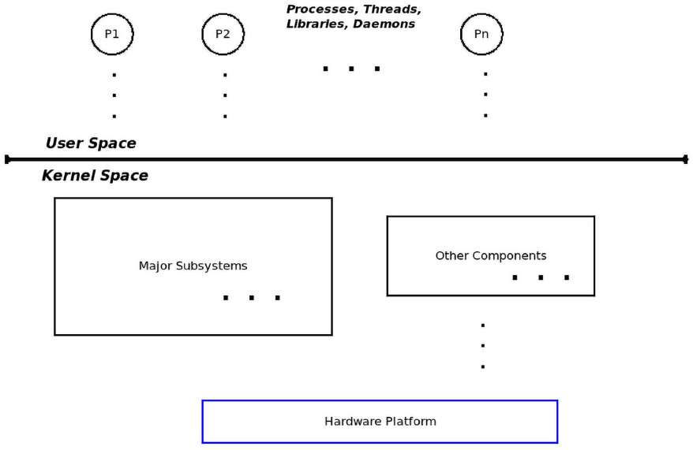

Hình 4.1: Kiến trúc cơ bản – hai address space, hai privilege mode

Sau đây là vài chi tiết Linux system architecture; hãy đọc tiếp.

### Library API và system call API

Ứng dụng user space thường dựa vào Application Programming Interface (API) để làm việc. Library về cơ bản là tập hợp hay archive các API, cho phép dùng interface chuẩn hóa, well-written và well-tested (cùng các lợi ích thông thường: không phải phát minh lại bánh xe, portability, standardization, v.v.). Linux có nhiều library: ngay cả hàng trăm trên hệ thống enterprise-class cũng không hiếm. Trong số đó, mọi ứng dụng Linux user mode dạng thực thi được “auto-linked” với một library quan trọng always-used: `glibc` – GNU standard C library, như bạn sẽ học. Tuy nhiên, library chỉ có trong user mode; kernel không dùng các user-mode library này (nói thêm ở chương sau).

Ví dụ library API là `printf(3)`, `scanf(3)`, `strcmp(3)`, `malloc(3)` và `free(3)` well-known. (Nhớ lại phần Using the Linux man pages trong chương trực tuyến Kernel Workspace Setup.)

Giờ đến điểm then chốt: nếu user và kernel là các address space riêng, ở privilege level khác nhau, làm sao user process vốn bị giới hạn trong user space như vừa học truy cập kernel? Câu trả lời ngắn: qua system call. System call là API đặc biệt theo nghĩa nó là cách hợp lệ duy nhất, theo kiểu synchronous, để process hoặc thread user space truy cập kernel. Nói cách khác, system call là entry point hợp lệ duy nhất vào kernel space.

Chúng, tức system call, built-in khả năng chuyển từ user mode non-privileged sang kernel mode có đặc quyền (nói thêm về điều này và monolithic design ở Chương 6, Kernel Internals Essentials – Processes and Threads, phần Process and interrupt contexts). Ví dụ system call gồm `fork(2)`, `execve(2)`, `open(2)`, `read(2)`, `write(2)`, `socket(2)`, `accept(2)`, `chmod(2)`, v.v.

Tra mọi library API và system call API trong man page trực tuyến:

Library API, man section 3: `https://linux.die.net/man/3/`

System call API, man section 2: `https://linux.die.net/man/2/`

Điểm cần nhấn mạnh ở đây là ứng dụng người dùng (process và thread) và kernel chỉ giao tiếp qua system call – đó là interface. Trong sách, chúng ta không đi sâu thêm các chi tiết này. Nếu muốn biết thêm, hãy tham khảo cuốn trước của tôi, Hands-On System Programming with Linux, Packt (cụ thể Chương 1, Linux System Architecture).

Sách này nói về phát triển kernel, hãy bắt đầu xem các thành phần khác nhau của kernel.

### Các thành phần kernel space

Tất nhiên, sách tập trung hoàn toàn vào kernel space. Linux kernel ngày nay là một hệ thống khá lớn và phức tạp. Bên trong gồm vài subsystem chính và nhiều thành phần. Liệt kê tổng quát các subsystem và thành phần kernel cho danh sách sau:

- Core kernel: Code này xử lý các công việc chuyên sâu điển hình của hệ điều hành hiện đại, gồm tạo/hủy process và thread ở user/kernel, CPU scheduling, synchronization primitive, signaling, timer, interrupt handling, namespace, cgroup, module support, crypto và nhiều nội dung khác.

- Memory Management (MM): Xử lý mọi công việc memory-related, gồm thiết lập và duy trì Virtual Address Space (VAS) của kernel và process.

- VFS (để hỗ trợ filesystem): Virtual Filesystem Switch (VFS) là abstraction layer trên các filesystem thực tế được triển khai trong Linux kernel (ví dụ `ext[2|4]`, `vfat`, `ntfs`, `msdos`, `iso9660`, `f2fS`, `ufS` và nhiều loại khác).

- Block I/O: Các code path triển khai file I/O thực tế, từ filesystem xuống tận block device driver và mọi thứ ở giữa (thực sự khá nhiều!), đều nằm ở đây.

- Network protocol stack: Linux nổi tiếng với triển khai chính xác, to-the-letter-of-the-RFC và high-quality của các network protocol well-known lẫn not-so-well-known ở mọi lớp của mô hình, có lẽ TCP/IP nổi tiếng nhất.

- Inter-Process Communication (IPC) support: Các cơ chế IPC được triển khai ở đây; Linux hỗ trợ message queue, shared memory, semaphore (cả SysV cũ lẫn POSIX mới) và các cơ chế IPC khác.

- Sound support: Mọi code triển khai audio ở đây, từ firmware đến driver và codec.

- Virtualization support: Linux đã rất phổ biến với cloud provider lớn lẫn nhỏ, một lý do lớn là virtualization engine Kernel-based Virtual Machine (KVM) high-quality, low-footprint.

Tất cả tạo thành các kernel subsystem chính; ngoài ra còn có:

- Code Arch-specific, nghĩa là CPU-specific

- Kernel initialization

- Security framework

- Nhiều loại device driver

Nhớ rằng trong Chương 2, Build Linux kernel 6.x từ source code – Phần 1, phần Tham quan ngắn kernel source tree đã đưa ra bố cục code trong source tree tương ứng các subsystem chính và thành phần khác.

Việc Linux kernel tuân theo monolithic kernel architecture (trái với microkernel architecture) là một thực tế well-known. Về cơ bản, monolithic design là thiết kế trong đó mọi thành phần kernel đã đề cập ở phần này cùng nằm trong và chia sẻ kernel VAS (hay kernel segment). Điều này thấy rõ trong sơ đồ sau:

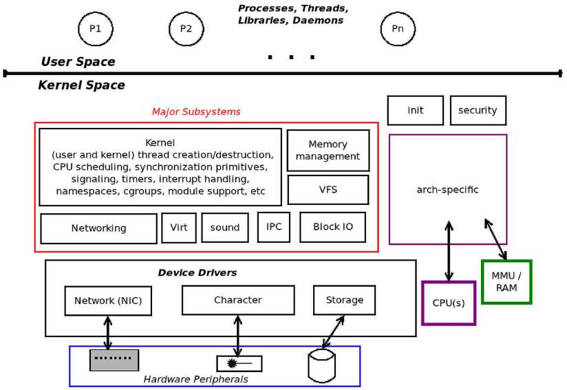

Hình 4.2: Linux kernel space – các subsystem và khối chính

Điều khác cần biết là tất nhiên đây là virtual address space, không phải physical address space. Kernel ánh xạ virtual page sang physical page frame ở độ hạt page, dùng các khối phần cứng như Memory Management Unit (MMU), processor và Translation Lookaside Buffer (TLB) cache để tăng hiệu quả. Nó dùng master kernel paging table ánh xạ kernel virtual page sang physical frame (RAM), và với từng process user space đang tồn tại, ánh xạ user virtual page của process sang physical page frame qua paging table riêng của từng process.

Nội dung in-depth hơn về kiến thức thiết yếu của kernel, memory management architecture và internals đang chờ bạn ở Chương 6, Kernel Internals Essentials – Processes and Threads, cùng các chương tiếp theo.

Giờ đã hiểu cơ bản user và kernel virtual address space, hãy tiếp tục và bắt đầu hành trình vào framework LKM.

## Khám phá LKM

Kernel module là phương tiện cung cấp chức năng kernel-level mà không phải làm việc trong kernel source tree và static kernel image.

Hãy hình dung tình huống cần thêm tính năng hỗ trợ vào Linux kernel – có thể device driver mới để dùng chip ngoại vi phần cứng cụ thể, filesystem mới hoặc I/O scheduler mới. Một cách hiển nhiên là cập nhật kernel source tree bằng code mới, rồi cấu hình, build, kiểm thử và triển khai.

Dù có vẻ đơn giản, đó là rất nhiều công việc – mỗi thay đổi code chúng ta viết, dù nhỏ đến đâu, đều đòi hỏi build lại kernel image rồi reboot hệ thống để kiểm thử. Phải có cách gọn gàng, dễ hơn; thực sự có – framework LKM!

### Framework LKM

Framework LKM cho phép biên dịch một đoạn kernel code, thường bên ngoài kernel source tree và gọi là code “out-of-tree”, giữ nó độc lập với kernel theo một nghĩa giới hạn, rồi chèn hay cắm “module object” được sinh vào kernel memory, tức kernel VAS, cho chạy và thực hiện công việc, sau đó gỡ hay rút khỏi kernel memory. (Lưu ý cũng có thể dùng LKM để tạo in-tree kernel module như khi chúng ta build kernel. Ở đây tập trung out-of-tree module.)

Code nguồn kernel module thường gồm một hay nhiều tệp C, header và Makefile, được build (tất nhiên qua `make`) thành kernel module. Bản thân kernel module chỉ là binary object file, không phải binary executable. Ở Linux 2.4 trở về trước, tên tệp kernel module có hậu tố `.o`; trên Linux 2.6 hiện đại trở đi, thay vào đó có hậu tố `.ko` (kernel object). Khi build xong, có thể chèn tệp `.ko`, tức kernel module, vào kernel đang chạy lúc runtime, thực chất biến nó thành một phần kernel.

Lưu ý không phải `all` chức năng kernel đều có thể cung cấp qua LKM. Nhiều tính năng core như CPU (task) scheduler code cốt lõi, memory management, signaling, timer, interrupt management code path, driver platform-specific điều khiển pin controller, clock, v.v., chỉ phát triển được trong chính kernel. Tương tự, kernel module chỉ được truy cập một tập con của toàn bộ kernel API và data variable; nói thêm sau.

Bạn có thể hỏi: làm sao chèn module object vào kernel lúc runtime? Hãy giữ đơn giản – câu trả lời là qua tiện ích `insmod`. Lúc này bỏ qua chi tiết, sẽ được giải thích ở phần Chạy kernel module sắp tới. Hình sau khái quát việc build rồi chèn kernel module vào kernel memory:

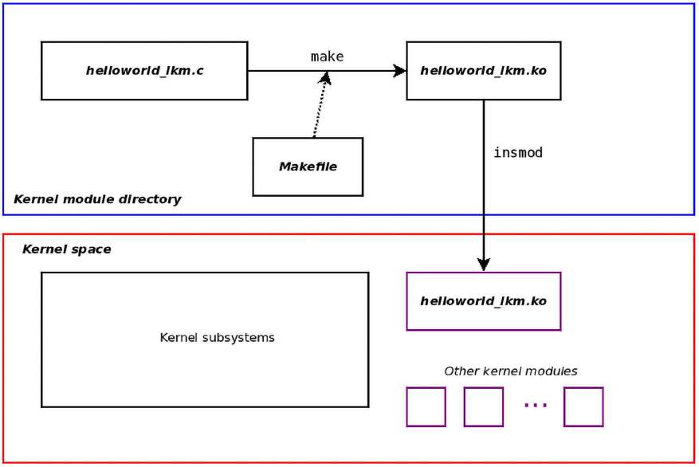

Hình 4.3: Build rồi chèn kernel module vào kernel memory

Đừng lo: code thực tế của cả kernel module C source và Makefile được trình bày rất chi tiết trong phần sắp tới; lúc này chỉ muốn hiểu khái niệm.

Kernel module được nạp vào và tồn tại trong kernel memory, tức kernel VAS ở nửa dưới Hình 4.3, trong vùng không gian kernel cấp phát cho nó. Đừng nhầm, đó là kernel code và chạy với kernel privilege.

Nhờ vậy, bạn, nhà phát triển kernel hay driver, không phải cấu hình lại, build lại và reboot mỗi lần. Chỉ cần sửa kernel module code, build lại, gỡ bản cũ khỏi bộ nhớ nếu có và chèn bản mới. Nó tiết kiệm thời gian, tăng năng suất.

Dù vậy, trong thực tế ngay cả kernel module cũng có thể và thực sự gây system-level crash, khiến phải reboot (thêm một lý do chạy trong máy ảo cách ly có lợi).

Một lý do khác khiến kernel module có lợi là phù hợp dynamic product configuration. Ví dụ, có thể thiết kế kernel module cung cấp tính năng khác nhau ở các mức giá khác nhau; script sinh image cuối cho sản phẩm nhúng có thể cài tập kernel module cụ thể tùy giá khách hàng sẵn lòng trả. Ví dụ khác về tận dụng công nghệ này trong debug/troubleshooting: có thể dùng kernel module động để sinh diagnostics và debug log trên sản phẩm hiện có. Công nghệ như Kprobes và tương tự cho phép chính điều này (cuốn Linux Kernel Debugging của tôi trình bày sâu).

Thực chất, framework LKM cho phương tiện mở rộng động chức năng kernel bằng cách cho phép chèn code trực tiếp vào kernel memory và gỡ ra sau đó. Khả năng tùy ý cắm/rút chức năng kernel khiến ta nhận ra Linux kernel không thuần monolithic mà còn modular.

### Kernel module trong kernel source tree

Thực tế, kernel module object không hoàn toàn xa lạ với chúng ta. Trong Chương 3, Build Linux kernel 6.x từ source code – Phần 2, chúng ta đã build kernel module trong quy trình build kernel và cài chúng.

Nhớ rằng các kernel module này thuộc kernel source code và đã được cấu hình thành module bằng cách chọn `M` ở lời nhắc cấu hình menu tristate. Chúng được cài trong các thư mục dưới `/lib/modules/$(uname -r)/`. Vì vậy, để xem một ít về kernel module đã cài cho kernel khách Ubuntu 22.04 LTS x86\_64 hiện đang chạy, có thể làm:

```
$ lsb_release -a 2>/dev/null |grep Description
Description:    Ubuntu 22.04.2 LTS
$ uname -r
5.19.0-45-generic
$ find /lib/modules/$(uname -r)/ -name "*.ko" | wc -l
6189
```

Được rồi, mọi người ở Canonical và các nơi khác đã rất bận rộn! Hơn sáu nghìn kernel module... Nghĩ kỹ thì hợp lý: nhà phân phối không biết trước chính xác ngoại vi phần cứng nào người dùng cuối sẽ dùng, đặc biệt trên máy tính phổ dụng như PC x86. Kernel module là cách tiện lợi hỗ trợ lượng lớn phần cứng mà không làm kernel image phình quá mức, ví dụ các tệp `bzImage` hoặc `Image`.

Các kernel module đã cài cho Ubuntu Linux nằm trong `/lib/modules/$(uname` `-r)/kernel` như ở đây:

```
$ ls /lib/modules/5.19.0-45-generic/kernel/
arch/     block/   crypto/   drivers/       fs/  kernel/  lib/  mm/  net/
samples/  sound/   ubuntu/   v4l2loopback/  zfs/
$ ls /lib/modules/6.1.25-lkp-kernel/kernel/
arch/  crypto/  drivers/  fs/  lib/  net/  sound/
```

Ở đây, nhìn cấp cao nhất của `kernel/` dưới `/lib/modules/$(uname -r)` cho distro kernel (Ubuntu 22.04 LTS chạy kernel `5.19.0-45-generic`), ta thấy nhiều sub-folders, chứa thực sự vài nghìn kernel module. Trái lại, với kernel tự build (xem chi tiết ở Chương 2, Build Linux kernel 6.x từ source code – Phần 1, và Chương 3, Build Linux kernel 6.x từ source code – Phần 2), số lượng ít hơn nhiều. Bạn nhớ từ thảo luận ở Chương 2, Build Linux kernel 6.x từ source code – Phần 1, rằng chúng ta chủ động dùng target `localmodconfig` để giữ build tương đối nhỏ và nhanh. Vì vậy, ví dụ kernel 6.1.25 tùy chỉnh ở đây chỉ có khoảng hơn 70 kernel module được build cho nó.

Một lĩnh vực dùng rất nhiều kernel module là device driver. Ví dụ, hãy xem network device driver được thiết kế dạng kernel module. Bạn tìm thấy một số với các thương hiệu quen thuộc dưới thư mục `kernel/drivers/net/ethernet` của distro kernel:

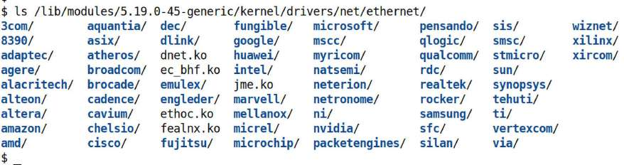

Hình 4.4: Nội dung Ethernet network driver của distro kernel (kernel module)

Phổ biến trên nhiều laptop Intel-based là Ethernet adapter Intel 1GbE Network Interface Card (NIC). Network device driver điều khiển nó tên `e1000` (hệ thống mới hơn có thể dùng mẫu mới hơn, vì thế dùng module driver `e1000e`).

Cách tiện lợi tra mọi kernel module hiện trong kernel memory là tiện ích `lsmod` (đọc là “list mod(ules)” – chúng ta sẽ học thêm định dạng kết quả sau). Máy khách Ubuntu 22.04 x86\_64 chạy trên laptop host x86\_64 cho thấy nó thực sự dùng driver này:

```
$ lsmod | grep e1000
e1000                             159744  0
```

Điều quan trọng lúc này là ta thấy driver `e1000` là kernel module! Muốn biết thêm về kernel module cụ thể này thì sao? Rất dễ bằng tiện ích `modinfo` (để dễ đọc, chúng tôi rút gọn kết quả dài ở đây):

```
$ ls -l /lib/modules/5.19.0-45-generic/kernel/drivers/net/ethernet/intel/e1000
total 364
-rw-r--r-- 1 root root 372185 Jun  7 19:53 e1000.ko
$ modinfo /lib/modules/5.19.0-45-generic/kernel/drivers/net/ethernet/intel/
e1000/e1000.ko
filename:        /lib/modules/5.19.0-45-generic/kernel/drivers/net/ethernet/
intel/e1000/e1000.ko
license:         GPL v2
description:     Intel(R) PRO/1000 Network Driver
author:          Intel Corporation, <linux.nics@intel.com>
srcversion:      F35F102C5522A6614A9D65C
alias:           pci:v00008086d00002E6Esv*sd*bc*sc*i*
alias:           pci:v00008086d000010B5sv*sd*bc*sc*i*
[ … ]
intree:          Y
name:            e1000
vermagic:        5.19.0-45-generic SMP preempt mod_unload modversions
sig_id:          PKCS#7
signer:          Build time autogenerated kernel key
[ … ]
parm:            SmartPowerDownEnable:Enable PHY smart power down (array of
int)
parm:            copybreak:Maximum size of packet that is copied to a new
buffer on receive (uint)
parm:            debug:Debug level (0=none,...,16=all) (int)
$
```

Tiện ích `modinfo` cho phép xem vào binary image của kernel module và trích một số chi tiết; phần tiếp theo nói thêm cách dùng `modinfo`.

Bạn có thể thấy tệp kernel module được nén, ví dụ `e1000.ko.xz`; đây là tính năng, không phải bug (nói thêm sau). Cách khác để lấy thông tin hệ thống hữu ích, gồm kernel module hiện được nạp, là tiện ích `systool`. Với kernel module đã cài (chi tiết cài đặt ở chương sau, phần Auto-loading modules on system boot), chạy `systool -m` `<module-name> -v` cho biết thông tin về nó. Tra man page `systool(1)` để biết chi tiết sử dụng.

Điểm cốt yếu là kernel module đã thành cách thực tế để build và phân phối một số loại thành phần kernel, với device driver có lẽ là trường hợp thường gặp nhất. Các cách dùng khác gồm nhưng không giới hạn ở filesystem, network firewall, packet sniffer và kernel code tùy chỉnh.

Vì vậy, nếu muốn học viết Linux device driver, filesystem hoặc firewall, rất nên học viết kernel module trước, qua đó dùng framework LKM mạnh mẽ của kernel. Đó chính là việc chúng ta làm tiếp theo.

## Viết kernel module đầu tiên

Khi giới thiệu ngôn ngữ lập trình hay chủ đề mới, mô phỏng chương trình Hello, world gốc làm đoạn code đầu tiên đã thành truyền thống lập trình được chấp nhận rộng rãi. Tôi vui lòng theo truyền thống đáng kính này để giới thiệu framework LKM mạnh mẽ của Linux kernel. Trong phần này, bạn học các bước viết LKM đơn giản. Chúng tôi giải thích code chi tiết.

### Giới thiệu C code LKM Hello, world

Không dài dòng nữa, đây là C code Hello, world đơn giản, được triển khai tuân theo framework LKM của Linux kernel:

Để dễ đọc và vì giới hạn dung lượng, ở đây chỉ hiển thị phần then chốt của phần lớn source code. Để xem code đầy đủ với mọi comment, build và chạy, toàn bộ source tree của sách có trong kho GitHub tại `https://github.com/PacktPublishing/Linux-Kernel-Programming_2E`. Chúng tôi chắc chắn kỳ vọng bạn clone và dùng nó:

```
      git clone https://github.com/PacktPublishing/Linux-Kernel-
      Programming_2E.git

$ cat <LKP2E_src>/ch4/helloworld_lkm/helloworld_lkm.c
// ch4/helloworld_lkm/helloworld_lkm.c
#include <linux/init.h>
#include <linux/module.h>

/* Module stuff */
MODULE_AUTHOR("<insert your name here>");
MODULE_DESCRIPTION("LKP2E book:ch4/helloworld_lkm: hello, world, our first
LKM");
MODULE_LICENSE("Dual MIT/GPL");
MODULE_VERSION("0.2");

static int __init helloworld_lkm_init(void)
{
    printk(KERN_INFO "Hello, world\n");
    return 0;    /* success */
}
static void __exit helloworld_lkm_exit(void)
{
     printk(KERN_INFO "Goodbye, world! Climate change has done us in...\n");
}
module_init(helloworld_lkm_init);
module_exit(helloworld_lkm_exit);
```

Bạn có thể thử kernel module Hello, world đơn giản này ngay! Chỉ cần `cd` đến đúng thư mục source code và dùng helper script `lkm` của chúng tôi để build và chạy:

```
$ cd ~/Linux-Kernel-Programming_2E/ch4/helloworld_lkm
$ ../../lkm helloworld_lkm.c
Usage: lkm name-of-kernel-module-file ONLY (do NOT put any extension).

$ ../../lkm helloworld_lkm
Version info:
Distro:     Ubuntu 22.04.2 LTS
Kernel: 5.19.0-45-generic
[ … ]
make || exit 1
------------------------------
make -C /lib/modules/5.19.0-45-generic/build/ M=/home/c2kp/Linux-Kernel-
Programming_2E/ch4/helloworld_lkm modules
[ … ]
sudo dmesg
------------------------------
[ 4123.028252] Hello, world
$
```

Cách làm và lý do sẽ sớm được giải thích rất chi tiết. Dù nhỏ, kernel module code đầu tiên này đòi hỏi đọc kỹ và hiểu cẩn thận. Hãy đọc tiếp!

### Phân tích từng phần

Các phần nhỏ sau giải thích gần như từng dòng C code LKM Hello, world trên. Nhớ rằng dù chương trình có vẻ rất nhỏ và đơn giản, vẫn có nhiều điều cần hiểu về nó và framework LKM xung quanh. Phần còn lại chương tập trung vào đây và đi sâu chi tiết. Tôi rất khuyến khích bạn dành thời gian đọc và hiểu các nền tảng này trước. Nó sẽ giúp rất nhiều trong tình huống về sau có thể difficult-to-debug.

#### Kernel header

Đầu tiên trong code, chúng ta dùng `#include` để hiển nhiên đưa vào một vài header. Khác phát triển ứng dụng C user space, đây là kernel header, như phần Yêu cầu kỹ thuật đã đề cập. Nhớ từ Chương 3, Build Linux kernel 6.x từ source code – Phần 2, kernel module được cài dưới một nhánh cụ thể root-writable.

Hãy kiểm tra lại (ở đây đang chạy máy ảo khách Ubuntu x86\_64 với distro kernel 5.19.0-45-generic):

```
$ ls -l /lib/modules/$(uname -r)
total 6712
lrwxrwxrwx  1 root root      40 Jun  7 19:53 build -> /usr/src/linux-headers-
5.19.0-45-generic
drwxr-xr-x  2 root root    4096 Jun 23 09:47 initrd
[ … ]
```

Chú ý symbolic link hay soft link tên `build`. Nó trỏ đến vị trí kernel header trên hệ thống. Trong code block trên, bạn thấy nó nằm tại thư mục `/usr/src/linux-headers-5.19.0-45-generic/!` Như sẽ thấy, chúng ta cung cấp thông tin này cho Makefile dùng build kernel module. (Một số hệ thống còn có soft link tương tự tên `source`.)

Gói `kernel-headers` hoặc `linux-headers` giải một kernel source tree giới hạn lên hệ thống, thường dưới `/usr/src/…`. Tuy nhiên, kernel codebase này không đầy đủ, vì thế chúng ta dùng cụm “limited source tree”. Lý do là build module không cần toàn bộ kernel source tree – chỉ các thành phần cần thiết như header, Makefile, v.v. được đóng gói và giải ra.

Dòng code đầu tiên trong kernel module Hello, world là `#include <linux/init.h>`.

Compiler xử lý dòng này bằng cách tìm kernel header vừa nói dưới `/lib/modules/$(uname -r)/build/include/`. Vì thế, đi theo soft link `build`, ta thấy cuối cùng nó lấy header này:

```
$ ls -l /usr/src/linux-headers-5.19.0-45-generic/include/linux/init.h
-rw-r--r-- 1 root root 11963 Aug  1  2022 /usr/src/linux-headers-5.19.0-45-
generic/include/linux/init.h
```

Điều tương tự áp dụng cho các kernel header khác được include trong kernel module source code.

#### Module macro

Tiếp theo là vài module macro dạng `MODULE_FOO()`, thường được gọi thân mật là “module stuff”. Phần lớn khá dễ hiểu:

- `MODULE_AUTHOR()`: Chỉ định tác giả kernel module

- `MODULE_DESCRIPTION()`: Mô tả ngắn chức năng hay mục đích LKM này

- `MODULE_LICENSE()`: Chỉ định giấy phép phát hành kernel module

- `MODULE_VERSION()`: Chỉ định chuỗi phiên bản cục bộ của kernel module

Khi không có source code, thông tin này được chuyển đến người dùng cuối hay khách hàng thế nào? À, `modinfo` làm chính việc đó! Các macro và thông tin này có vẻ nhỏ nhặt nhưng quan trọng trong dự án và sản phẩm.

Ví dụ, nhà cung cấp dựa vào thông tin này để xác định các giấy phép open source mà code đang chạy theo, bằng cách dùng `grep` trên kết quả `modinfo` của mọi kernel module đã cài. (Đây là module macro cơ bản; còn những macro khác sẽ được trình bày dần.)

#### Entry point và exit point

Đừng bao giờ quên, kernel module cuối cùng vẫn là kernel code chạy với kernel privilege. Nó không phải ứng dụng, nên không có entry point là hàm `main()` quen thuộc mà chúng ta biết và yêu thích. Tất nhiên điều này đặt ra câu hỏi: entry point và exit point của kernel module là gì? Chú ý các dòng sau ở cuối kernel module đơn giản:

```
module_init(helloworld_lkm_init);
module_exit(helloworld_lkm_exit);
```

Code `module_{init|exit}()` là macro chỉ định entry point và exit point tương ứng. Tham số cho mỗi macro là function pointer. Với C compiler hiện đại, chỉ cần chỉ định tên hàm. Vì vậy trong code chúng ta:

- Hàm `helloworld_lkm_init()` là entry point.

- Hàm `helloworld_lkm_exit()` là exit point.

Bạn gần như có thể coi entry/exit point là cặp constructor/destructor của kernel module. Tất nhiên về kỹ thuật không phải vậy, vì đây không phải C++ object-oriented mà là C thuần. Tuy nhiên, có lẽ đó là phép so sánh hữu ích.

#### Giá trị trả về

Chú ý signature của các hàm `init` và `exit` như sau:

```
static int  __init <modulename>_init(void);
static void __exit <modulename>_exit(void);
```

Theo thông lệ viết code tốt, chúng ta đặt tên hàm dạng `<modulename>_{init|exit}()`, với `<modulename>` thay bằng tên kernel module. Bạn sẽ nhận ra quy ước này chỉ là quy ước – về kỹ thuật không cần thiết nhưng trực quan, nên hữu ích (nhớ rằng con người phải viết code cho người đọc và hiểu, không phải máy). Rõ ràng cả hai routine đều không nhận tham số.

Đánh dấu cả hai hàm bằng qualifier `static` nghĩa là chúng private đối với kernel module này. Đó là điều chúng ta muốn.

Giờ tiếp tục đến quy ước quan trọng cho giá trị trả về hàm `init` của kernel module.

##### Quy ước trả về 0/-E

Hàm `init` của kernel module phải trả số nguyên, giá trị kiểu `int`; đây là khía cạnh then chốt. Linux kernel đã hình thành một phong cách hay quy ước, nếu bạn muốn gọi vậy, về trả giá trị từ nó, nghĩa là từ kernel space nơi module nằm và chạy, đến process user space.

Để trả giá trị, framework LKM theo quy ước thường được gọi là `0/-E`:

- Khi thành công, trả số nguyên `0`.

- Khi thất bại, trả giá trị âm của giá trị bạn muốn số nguyên global chưa khởi tạo `errno` trong user space được đặt thành.

Lưu ý `errno` là số nguyên global nằm trong VAS của user process, thuộc uninitialized data segment. Với rất ít ngoại lệ, mỗi khi Linux system call thất bại, `-1` được trả và `errno` được đặt thành giá trị dương biểu thị mã lỗi hay chẩn đoán; công việc này do “glue” code của `glibc` thực hiện trên return path của `syscall`.

Hơn nữa, giá trị `errno` là chỉ mục vào bảng global chứa thông báo lỗi tiếng Anh (`const char * sys_errlist[]`); nhờ đó routine như `perror(3)`, `strerror[_r]` `(3)` và tương tự có thể in chẩn đoán lỗi.

Nhân tiện, bạn có thể tra toàn bộ error code (errno) trong các header thuộc kernel source tree: `include/uapi/asm-generic/errno-base.h` và `include/uapi/asm-generic/errno.h`.

Ví dụ nhanh cách trả về từ hàm `init` của kernel module sẽ làm rõ điểm then chốt: giả sử `init` đang cố cấp phát động kernel memory (tất nhiên chi tiết API `kmalloc()` và tương tự ở các chương sau; lúc này hãy bỏ qua). Khi đó có thể viết:

```
[...]
ptr = kmalloc(87, GFP_KERNEL);
 if (!ptr) {
    pr_warning("%s():%s():%d: kmalloc failed! Out of memory\n", __FILE__, __
func__, __LINE__);
    return -ENOMEM;
 }
 [...]
return 0;   /* success */
```

Nếu cấp phát bộ nhớ thực sự thất bại (rất ít khả năng nhưng có thể vào ngày không may!), chúng ta làm:

1\. Trước tiên phát cảnh báo `printk` (đừng lo, chúng ta sẽ trình bày cú pháp này và nhiều nội dung khác về `printk`). Trong trường hợp cụ thể “out of memory”, phát thông báo bị coi là quá câu nệ và không cần thiết. Kernel chắc chắn phát đủ thông tin chẩn đoán nếu kernel-space memory allocation thất bại! Xem thêm tại `https://lkml.org/lkml/2014/6/10/382`; ở đây làm vậy chỉ vì mới bắt đầu thảo luận và để mạch đọc liền lạc.

2\. Trả số nguyên `-ENOMEM`:

  - Lớp trong user space nhận giá trị này thực chất là `glibc`; nó có “glue” code nhân giá trị với `-1` rồi đặt số nguyên global `errno` bằng kết quả.

  - Giờ system call `[f]init_module()` trả `-1`, báo thất bại (vì `insmod` thực sự gọi system call `finit_module()`, hoặc `init_module()` trước đây, như bạn sẽ sớm thấy).

  - `errno` được đặt bằng `ENOMEM`, phản ánh việc chèn kernel module thất bại do không cấp phát được bộ nhớ.

Ngược lại, framework kỳ vọng hàm `init` trả `0` khi thành công. Thực tế ở kernel cũ, không trả `0` khi thành công khiến kernel module bị unload đột ngột ngay khỏi kernel memory. Ngày nay việc gỡ này không xảy ra; thay vào đó kernel phát cảnh báo đã trả giá trị non-zero đáng ngờ. Hơn nữa, compiler hiện đại thường phát hiện việc không trả giá trị khi cần, gây thông báo tương tự `error: no return statement` `in function returning non-void [-Werror=return-type]`.

Không có nhiều điều để nói về cleanup routine. Nó không nhận tham số, không trả gì (`void`). Nhiệm vụ là làm mọi cleanup cần thiết, như giải phóng memory object, có thể đặt một số register, v.v. tùy thiết kế module, trước khi kernel module bị unload khỏi kernel memory.

Không đưa macro `module_exit()` vào kernel module khiến không bao giờ unload được nó, tất nhiên ngoại trừ shutdown hoặc reboot. Thú vị... Tôi đề nghị thử như bài tập nhỏ! Tất nhiên không bao giờ đơn giản thế: hành vi ngăn unload này chỉ được bảo đảm nếu kernel build với cờ `CONFIG_MODULE_FORCE_UNLOAD` đặt là `Disabled` theo mặc định.

##### Các macro ERR\_PTR và PTR\_ERR

Trong thảo luận giá trị trả về, giờ bạn hiểu routine `init` của kernel module phải trả số nguyên. Nếu muốn trả pointer thì sao? Inline function `ERR_PTR()` giúp ta, cho phép trả số nguyên dưới dạng pointer chỉ bằng typecast thành `void *`.

Còn tốt hơn: có thể kiểm tra lỗi bằng inline function `IS_ERR()` (thực sự chỉ xác định giá trị có trong miền \[-1 đến -4095\] không), mã hóa giá trị lỗi âm vào pointer qua inline function `ERR_PTR()` và lấy lại giá trị từ pointer bằng routine ngược `PTR_ERR()`.

Ví dụ đơn giản, xem code callee sau. Lần này, ví dụ cho hàm mẫu `myfunc()` trả pointer đến structure tên `mystruct`, không phải số nguyên:

```
struct mystruct * myfunc(void)
 {
    struct mystruct *mys = NULL;
    mys = kzalloc(sizeof(struct mystruct), GFP_KERNEL);
    if (!mys)
        return ERR_PTR(-ENOMEM);
    [...]
    return mys;
 }
```

Code caller như sau:

```
[...]
retp = myfunc();
if (IS_ERR(retp)) {
    pr_warn("myfunc() mystruct alloc failed, aborting...\n");
    stat = PTR_ERR(retp);     /* sets 'stat' to the value -ENOMEM */
    goto out_fail_1;
 }
 [...]
 out_fail_1:
    return stat;
 }
```

Để bạn biết, các inline function `ERR_PTR()`, `PTR_ERR()` và `IS_ERR()` đều nằm trong kernel header `include/linux/err.h`. Một ví dụ dùng chúng tại `https://elixir.bootlin.com/linux/v6.1.25/source/arch/x86/kernel/cpu/sgx/ioctl.c#L269` (và `ERR_PTR()` ở dòng 31).

##### Các từ khóa \_\_init và \_\_exit

Nhớ lại các hàm `init` và `cleanup` của module đơn giản:

```
static int __init helloworld_lkm_init(void)
{
    [ … ]
static void __exit helloworld_lkm_exit(void)
{
    [ … ]
```

Còn một điều gây băn khoăn: chính xác macro `__init` và `__exit` trong signature trên là gì? Chúng chỉ định linker attribute để tối ưu bộ nhớ.

Macro `__init` định nghĩa section `init.text` cho code. Tương tự, dữ liệu khai báo với attribute `__initdata` vào section `init.data`. Điểm cốt yếu là code và dữ liệu trong hàm `init` chỉ được dùng đúng một lần trong initialization.

Sau khi gọi, nó không bao giờ được gọi lại; vì thế khi đã gọi xong, mọi code và dữ liệu trong các section `init` này được giải phóng qua `free_initmem()`.

Với macro `__exit` cũng tương tự, dù tất nhiên chỉ có ý nghĩa với kernel module. Khi gọi hàm `cleanup`, mọi bộ nhớ được giải phóng. Nếu code thuộc static kernel image hoặc module support bị tắt, macro này không có tác dụng.

Được rồi, nhưng đến đây vẫn chưa giải thích một số thực hành: chính xác làm sao build kernel module mới, đưa vào kernel memory cho thực thi rồi unload, cùng các thao tác khác có thể muốn làm? Hãy thảo luận ở phần sau.

## Các thao tác thông thường với kernel module

Giờ hãy tìm hiểu chính xác cách build, load và unload kernel module. Ngoài ra, chúng ta cũng xem kiến thức cơ bản về kernel API `printk()` cực kỳ hữu ích, chi tiết liệt kê module hiện được nạp bằng `lsmod` và script tiện lợi tự động hóa một số việc thường gặp khi phát triển kernel module. Vậy hãy bắt đầu!

### Build kernel module

Dù có thể lặp lại, chúng tôi khuyến khích bạn thử kernel module Hello, world đơn giản như bài tập nếu chưa làm! Để thực hiện, giả định bạn đã clone kho GitHub sách (`https://github.com/PacktPublishing/Linux-Kernel-Programming_2E`). Nếu chưa, hãy clone ngay, xem chi tiết phần Yêu cầu kỹ thuật.

Ở đây trình bày từng bước chính xác cách build rồi chèn kernel module đầu tiên vào kernel memory. Nhắc nhanh lần nữa: chúng tôi thực hiện trên máy ảo khách Linux x86\_64 dưới Oracle VirtualBox 7.x, chạy Ubuntu 22.04 LTS (distro bạn dùng không quá quan trọng; các bước chung vẫn như nhau):

1\. Chuyển đến thư mục chương và thư mục con trong source code của sách. Kernel module đầu tiên nằm trong thư mục riêng như nên có, tên `helloworld_lkm`:

```
cd <book-code-dir>/ch4/helloworld_lkm
```

Tất nhiên `<book-code-dir>` là thư mục nơi clone kho GitHub sách; trên hệ thống tôi, như ảnh Hình 4.5, nó là `/home/c2kp/kaiwanTECH/Linux-Kernel-Programming_2E`.

2\. Giờ kiểm tra codebase:

```
$ pwd
<book-code-dir>/ch4/helloworld_lkm
$ ls -l
total 8
-rw-rw-r-- 1 c2kp c2kp 1238  Dec 18  12:38 helloworld_lkm.c
-rw-rw-r-- 1 c2kp c2kp   290  Oct 27  07:26 Makefile
```

(Kích thước không hoàn toàn khớp với của bạn cũng không sao; phần mềm luôn phát triển.)

3\. Build kernel module bằng `make`:

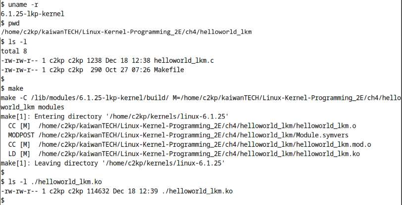

Hình 4.5: Liệt kê và build kernel module Hello, world đầu tiên

Nếu gặp khi build module, lúc này có thể khá yên tâm bỏ qua các cảnh báo liên quan “Skipping BTF generation for `<...>/helloworld_lkm.ko` due to the unavailability of vmlinux….”

Ảnh trên cho thấy kernel module đã build thành công; đó là tệp “kernel object” tên `./helloworld_lkm.ko`.

Luôn dùng `make`, qua đó dùng Makefile cung cấp, để build kernel module; đừng cố build thủ công bằng cách gọi trực tiếp `gcc` hay Clang.

Cũng lưu ý chúng ta boot từ kernel 6.1.25 LTS tùy chỉnh đã build ở các chương trước, vì thế build kernel module cho chính kernel đó. Giờ module đã build thành công, hãy chạy!

### Chạy kernel module

Tất nhiên để kernel module chạy, trước tiên cần nạp nó vào kernel memory space. Điều này gọi là chèn module vào kernel memory.

Có vài cách đưa kernel module vào Linux kernel segment hay VAS, tất nhiên nằm trong RAM, cuối cùng đều quy về gọi một trong các system call `[f]init_module()`.

Để tiện lợi, có nhiều wrapper utility làm việc này, hoặc bạn luôn có thể tự viết. Dưới đây dùng tiện ích phổ biến `insmod` (“insert module”); tham số cho `insmod` là pathname đến kernel module cần chèn (bên trong `insmod` gọi system call `finit_module()` để nạp module vào kernel memory):

```
$ insmod ./helloworld_lkm.ko
insmod: ERROR: could not insert module ./helloworld_lkm.ko: Operation not
permitted
$
```

Thất bại! Thực tế lý do hẳn rõ ràng. Hãy nghĩ: chèn code vào kernel, theo nghĩa rất thực, còn cao hơn làm root (superuser) trên hệ thống – xin nhắc lại, đó là kernel code và chạy với kernel privilege. Nếu mọi người dùng đều được chèn hoặc gỡ kernel module, tin tặc tha hồ hoạt động! Triển khai malicious code, hơn nữa ở cấp hệ điều hành, sẽ thành chuyện đơn giản. Vì thế, để bảo mật, chỉ với quyền root mới chèn/gỡ kernel module được.

Về kỹ thuật, là `root` nghĩa là giá trị Real và/hoặc Effective UID (RUID/EUID) của process hay thread bằng giá trị đặc biệt `zero`. Không chỉ vậy, kernel hiện đại “nhìn” thread như có các capability nhất định qua mô hình POSIX Capabilities hiện đại, tốt hơn. Ngoài làm root, cách còn tốt hơn là dùng capability model; với nó, chỉ process/thread có capability `CAP_SYS_MODULE` mới load/unload kernel module. Chúng tôi đề nghị xem man page `capabilities(7)` để biết thêm.

Vậy hãy thử chèn kernel module vào bộ nhớ lần nữa, lần này với root privilege qua `sudo`:

```
$ sudo insmod ./helloworld_lkm.ko
 [sudo] password for c2kp:
$ echo $?
0
```

Giờ hoạt động (biến kết quả `$?` bằng `0` nghĩa là lệnh shell trước thành công)! Như đã gợi ý, `insmod` hoạt động bằng cách gọi system call `finit_module()`. Khi nào `insmod` có thể thất bại? Có vài trường hợp:

- Cấu hình kernel `CONFIG_MODULES` không bằng `y`, tức kernel build không hỗ trợ loadable kernel module.

- Không chạy bằng root hoặc thiếu capability `CAP_SYS_MODULE` (khi đó `errno` bằng `EPERM`).

- Kernel tunable trong filesystem `proc`, `/proc/sys/kernel/modules_disabled`, được đặt `1` (mặc định `0`).

- Kernel module cùng tên đã nằm trong kernel memory (khi đó `errno` bằng `EEXISTS`).

Được rồi, ở đây mọi thứ có vẻ tốt. Tuyệt, nhưng thông báo Hello, world quý giá của chúng ta ở đâu? Hãy đọc tiếp!

### Xem nhanh lần đầu kernel printk()

Để phát thông báo, nhà phát triển C user space thường dùng glibc API `printf()` đáng tin cậy, hoặc `cout` khi viết C++. Tuy nhiên, cần hiểu kernel space không có library user mode hay loại khác. Vì vậy đơn giản không truy cập được API `printf()` quen thuộc. Thay vào đó, về cơ bản nó re-implemented trong kernel thành API `printk()`. Tò mò code nằm đâu? Nó được định nghĩa dạng macro trong source tree tại `include/linux/printk.h:printk(fmt, …)`. Hàm thực tế tại `kernel/printk/printk.c:_printk()`. Thực tế triển khai nội bộ `printk` khá phức tạp, gồm wrapper layer cho `printk` indexing và nhiều nội dung khác; xem phần Đọc thêm.

May là để kernel hoặc kernel module phát thông báo qua `printk()` thì đơn giản, rất giống `printf()`. Trong module đơn giản của chúng ta, công việc diễn ra ở đây:

```
printk(KERN_INFO "Hello, world\n");
```

Dù thoạt nhìn rất giống `printf`, API `printk` trong kernel thực sự khá khác. Về điểm giống, API nhận format string làm tham số. Format string gần như giống hệt `printf`.

Nhưng điểm giống dừng ở đó. Khác biệt then chốt giữa `printf` và `printk`: library API `printf()` trong user space định dạng chuỗi theo yêu cầu rồi gọi system call `write()`, đến lượt nó thực sự ghi vào thiết bị `stdout`, mặc định là cửa sổ Terminal hay console device.

Kernel API `printk` cũng định dạng chuỗi theo yêu cầu, nhưng đích đầu ra khác. Nó ghi ít nhất một nơi – mục đầu danh sách sau – và có thể thêm vài nơi:

- Kernel log buffer volatile trong RAM

- Log file non-volatile, tức kernel log file

- Console device

Lúc này bỏ qua chi tiết nội bộ cách `printk` hoạt động. Đồng thời hãy tạm bỏ qua token `KERN_INFO` trong API `printk`; chúng ta sẽ sớm trình bày tất cả.

Tiếp theo, đừng quá gắn bó với API `printk()`; bạn sẽ sớm học cách hiện đại, được khuyến nghị là qua macro dạng `pr_foo()` (trình bày trong phần Các convenience macro pr\_\<foo\> sắp tới).

Khi phát thông báo qua `printk`, bảo đảm đầu ra vào log buffer trong kernel memory (RAM). Thực chất đây là kernel log volatile. Cần lưu ý bạn không bao giờ thấy trực tiếp đầu ra `printk` khi làm việc trong graphical mode có process X server chạy (Xorg, Xwayland hay loại khác), là môi trường mặc định trên distro Linux điển hình.

Vậy câu hỏi hiển nhiên: làm sao xem nội dung kernel log buffer? Có vài cách. Lúc này chỉ dùng cách nhanh, dễ.

Dùng tiện ích `dmesg`! Mặc định `dmesg` dump toàn bộ kernel log buffer ra stdout. Hãy thử!

```
$ dmesg
dmesg: read kernel buffer failed: Operation not permitted
```

Chúng ta khá thường gặp thứ gọi là sysctl. Ở đây sysctl viết tắt system control, một núm điều chỉnh trong kernel, thường dưới `/proc/sys/<dir>/*`; có một số thư mục như `fs`, `kernel`, `net`, `user` và `vm`. Thường cần root để ghi sysctl, nhưng nhiều sysctl đọc được không cần đặc quyền. Tài liệu kernel chính thức về kernel sysctl tại `https://www.kernel.org/doc/Documentation/sysctl/kernel.txt`, hãy xem. Tương tự, một số nhánh khác cũng có tài liệu, tìm tại `https://www.kernel.org/doc/Documentation/sysctl/`. Cũng xem website “sysctl explorer” hữu ích tại `https://sysctl-explorer.net/`.

Trên một số distro gần đây, sysctl `dmesg_restrict` (nói thêm sau) ngăn người dùng thường xem nội dung kernel log; tốt cho bảo mật vì ngăn information leak. Giờ hãy làm lại với root privilege; xem hai dòng cuối kernel log buffer:

```
$ sudo dmesg | tail -n2
[39884.691954] Hello, world
```

Cuối cùng nó đây: thông báo Hello, world của chúng ta!

Bạn có thể thấy thông báo trong kernel log như `loading out-of-tree module` `taints kernel`, và có thể cả `module verification failed: signature and/or` `required key missing - tainting kernel`. Lúc này có thể bỏ qua. Vì bảo mật, phần lớn distro Linux hiện đại đánh dấu kernel là tainted (nghĩa đen “nhiễm bẩn” hay “ô nhiễm”) nếu chèn kernel module bên thứ ba/out-of-tree/external hoặc non-signed. (Thực ra còn giống cách cover-up pseudo-legal kiểu “nếu từ thời điểm này có chuyện, chúng tôi không chịu trách nhiệm, v.v...” – bạn hiểu rồi đấy!)

Trong kernel log hiển thị bởi `dmesg`, các số trong ngoặc vuông ở cột ngoài cùng bên trái là timestamp đơn giản dạng `[seconds.microseconds]`, tức thời gian từ lúc hệ thống boot (tuy nhiên không nên coi hoàn toàn chính xác). Nhân tiện, timestamp này là biến `Kconfig`, một tùy chọn cấu hình kernel tên `CONFIG_PRINTK_TIME`; có thể ghi đè bằng kernel parameter `printk.time` (liên kết: `https://elixir.bootlin.com/linux/v6.1.25/source/Documentation/admin-guide/kernel-parameters.txt#L4504`).

### Liệt kê kernel module đang tồn tại

Trở lại kernel module. Đến đây đã build, nạp vào kernel và xác minh entry point, hàm `helloworld_lkm_init()`, được gọi, qua đó thực thi API `printk`. Sau đó nó làm gì? Không gì cả; kernel module chỉ vui vẻ nằm trong kernel memory mà hoàn toàn không làm gì. Ta dễ tra nó bằng `lsmod`:

```
$ lsmod | head
helloworld_lkm         16384  0
isofs                  49152  1
vboxvideo              45056  0
vboxsf                 90112  0
binfmt_misc            24576  1
snd_intel8x0           49152  2
snd_ac97_codec        176128  1 snd_intel8x0
ac97_bus               16384  1 snd_ac97_codec
snd_pcm               151552  2 snd_intel8x0,snd_ac97_codec
```

`lsmod` hiển thị mọi kernel module hiện nằm hay đang tồn tại trong kernel memory, sắp theo thời gian ngược. Kết quả định dạng cột, có ba cột và cột thứ tư tùy chọn. Hãy xem riêng từng cột:

- Cột đầu hiển thị tên kernel module.

- Cột hai là kích thước tĩnh theo byte nó chiếm trong kernel.

- Cột ba là module usage count.

- Cột bốn tùy chọn cho biết các dependent module, được giải thích trong chương sau, phần Module stacking. Ngoài ra, trên distro Ubuntu x86\_64 gần đây, kernel module dường như chiếm tối thiểu 16 KB kernel memory, còn Fedora khoảng 12 KB.

Vậy tuyệt! Đến đây bạn đã build, load và chạy kernel module đầu tiên trong kernel memory, cơ bản hoạt động: tiếp theo là gì? Thực sự không nhiều với module này! Chúng ta chỉ học unload trong phần sau. Tất nhiên còn nhiều điều sắp tới... hãy tiếp tục!

### Unload module khỏi kernel memory

Để unload kernel module, dùng tiện ích thuận tiện `rmmod` (remove module):

```
$ rmmod
rmmod: ERROR: missing module name.

$ rmmod helloworld_lkm
rmmod: ERROR: ../libkmod/libkmod-module.c:799 kmod_module_remove_module() could
not remove 'helloworld_lkm': Operation not permitted
rmmod: ERROR: could not remove module helloworld_lkm: Operation not permitted
$ sudo rmmod helloworld_lkm
 [sudo] password for c2kp:

$ dmesg | tail -n2
[39884.691954] Hello, world
[40280.138269] Goodbye, world! Climate change has done us in...
 $
```

Tham số `rmmod` là tên kernel module như cột đầu `lsmod`, không phải pathname. Rõ ràng giống `insmod`, cần chạy `rmmod` bằng root để thành công hoặc có capability `CAP_SYS_MODULE`.

Ở đây còn thấy do `rmmod`, framework LKM trước hết gọi exit routine hay “destructor”, hàm `helloworld_lkm_exit()` của kernel module sắp gỡ. Hàm này gọi `printk`, phát thông báo Goodbye, world... mà ta tra bằng `dmesg`.

Khi nào `rmmod` có thể thất bại (lưu ý bên trong gọi system call `delete_module()`)? Một số trường hợp:

- Quyền: không chạy bằng root hoặc thiếu capability `CAP_SYS_MODULE` (khi đó `errno` bằng `EPERM`).

- Nếu code và/hoặc dữ liệu kernel module được module khác dùng, tức có dependency, trình bày kỹ ở phần Module stacking chương sau, hoặc module đang được process/thread dùng, module usage count dương và `rmmod` thất bại (`errno` bằng `EBUSY`); hợp lý.

- Kernel module không chỉ định exit routine hay destructor bằng `module_exit()` và tùy chọn kernel `CONFIG_MODULE_FORCE_UNLOAD` tắt.

Một số tiện ích quản lý module chỉ là symbolic link hay soft link đến tiện ích duy nhất `kmod`, tương tự điều busybox phổ biến làm. Các wrapper là `lsmod,` `rmmod`, `insmod`, `modinfo`, `modprobe` và `depmod`. Hãy xem vài tiện ích:

```
$ ls -l $(which insmod) ; ls -l $(which lsmod) ; ls -l $(which rmmod)
lrwxrwxrwx  1 root root 9 Apr 23  2022 /usr/sbin/insmod -> /bin/kmod
lrwxrwxrwx  1 root root 9 Apr 23  2022 /usr/sbin/lsmod  -> /bin/kmod
lrwxrwxrwx  1 root root 9 Apr 23  2022 /usr/sbin/rmmod -> /bin/kmod
```

Lưu ý vị trí chính xác của chúng `(/bin`, `/sbin` hay `/usr/sbin`) có thể khác theo bản phân phối.

### Convenience script lkm của chúng ta

Hãy khép lại thảo luận kernel module đầu tiên bằng Bash script tùy chỉnh đơn giản nhưng hữu ích tên `lkm`, hỗ trợ tự động hóa quy trình build, load, `dmesg` và unload kernel module.

Đây là script (code đầy đủ ở gốc source tree của sách):

```
# !/bin/bash
# lkm : a silly kernel module dev - build, load, unload - helper wrapper script
 […]
# Turn on unofficial Bash 'strict mode'! V useful
# "Convert many kinds of hidden, intermittent, or subtle bugs into immediate,
glaringly obvious errors" [...]
set -euo pipefail

unset ARCH
unset CROSS_COMPILE
name=$(basename "${0}")

# Display and run the provided command.
 # Parameter(s) : the command to run
runcmd()
{
    local SEP="------------------------------"
    [[ $# -eq 0 ]] && return
    echo "${SEP}
$*
${SEP}"
    eval "$@"
    [[ $? -ne 0 ]] && echo " ^--[FAILED]"
 }
 ### "main" here
 [[ $# -ne 1 ]] && {
     echo "Usage: ${name} name-of-kernel-module-file (without the .c)"
     exit 1
}
 [[ "${1}" = *"."* ]] && {
      echo "Usage: ${name} name-of-kernel-module-file ONLY (do NOT put any
extension)."
      exit 1
}
echo "Version info:"
 which lsb_release >/dev/null 2>&1 && {
      echo -n "Distro: "
      lsb_release -a 2>/dev/null |grep "Description" |awk -F':' '{print $2}'
 }
echo -n "Kernel: " ; uname -r
runcmd "sudo rmmod $1 2> /dev/null" || true
# runcmd "make clean" || true
runcmd "sudo dmesg -C > /dev/null" || true
runcmd "make || exit 1" || true

[[ ! -f "$1".ko ]] && {
      echo "[!] ${name}: $1.ko has not been built, aborting..."
      exit 1
}
runcmd "sudo insmod ./$1.ko && lsmod|grep $1" || true
# Ubuntu 20.10 onward has enabled CONFIG_SECURITY_DMESG_RESTRICT !
# That's good for security; so we need to 'sudo' dmesg
runcmd "sudo dmesg" || true
exit 0
```

Khi nhận tham số tên kernel module không có phần mở rộng như `.c`, script `lkm` kiểm tra tính hợp lệ, hiển thị một số thông tin phiên bản (hiện chỉ hoạt động trên Ubuntu), rồi dùng wrapper Bash function `runcmd()` để hiện tên và chạy lệnh, thực chất thực hiện quy trình `build/load/lsmod/dmesg` dễ dàng. Hãy thực nghiệm và thử với kernel module đầu tiên (lưu ý `/home/c2kp/lkp2e` chỉ là soft link đến pathname đầy đủ nơi code sách nằm):

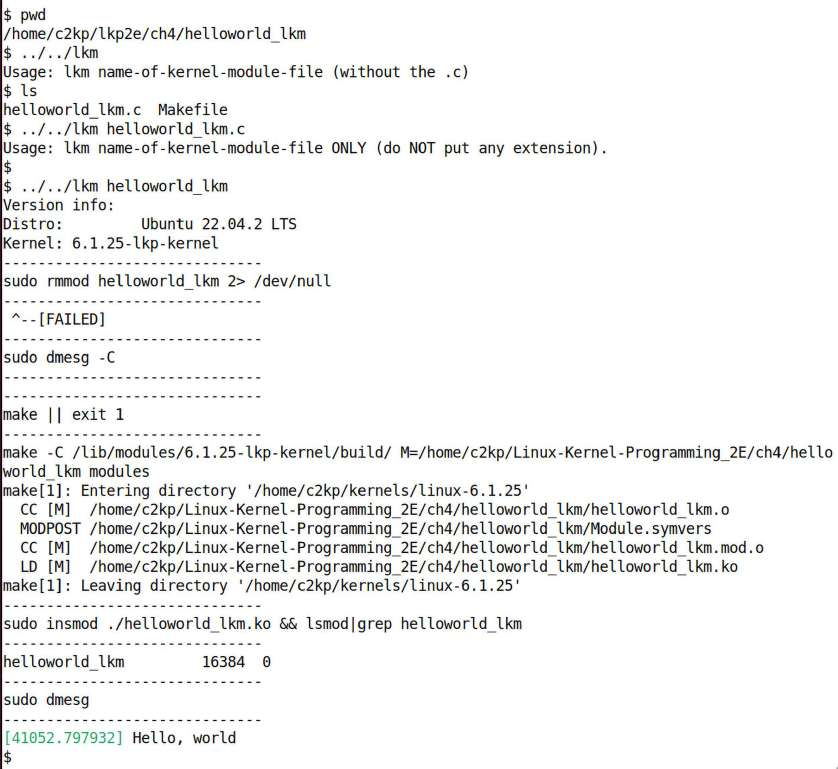

Hình 4.6: Convenience script lkm thực hiện build, load và dmesg cho kernel module

Đã xong! Nhớ unload kernel module bằng `rmmod`.

Chúc mừng! Giờ bạn đã học viết và thử kernel module Hello, world đơn giản. Tuy nhiên còn nhiều việc trước khi nghỉ ngơi trên thành quả; phần sau đi sâu các chi tiết then chốt khác về kernel logging và API `printk` linh hoạt.

## Tìm hiểu kernel logging và printk

Vẫn còn nhiều nội dung về logging kernel message qua kernel API `printk`. Phần này đi sâu một số chi tiết. Với nhà phát triển kernel/driver mới như bạn, hiểu rõ các chủ đề này rất quan trọng.

Ở phần Xem nhanh lần đầu kernel printk(), chúng ta đã thấy kiến thức thiết yếu sử dụng chức năng kernel API `printk` (hãy xem lại nếu muốn). Ở đây tìm hiểu nhiều hơn về cách dùng API `printk()`. Hãy bắt đầu!

### Dùng kernel memory ring buffer

Kernel log buffer đơn giản là memory buffer trong kernel virtual address space, nơi lưu/log đầu ra `printk`. Về kỹ thuật chính xác hơn, đó là biến global `__log_buf[]`. Định nghĩa trong kernel source code như sau:

```
kernel/printk/printk.c
#define __LOG_BUF_LEN (1 << CONFIG_LOG_BUF_SHIFT)
#define LOG_BUF_LEN_MAX (u32)(1 << 31)
 static char __log_buf[__LOG_BUF_LEN] __aligned(LOG_ALIGN);
static char *log_buf = __log_buf;
static u32 log_buf_len = __LOG_BUF_LEN;
```

Nó được thiết kế dạng ring buffer, kích thước hữu hạn `(__LOG_BUF_LEN` byte), khi đầy sẽ ghi đè từ byte số không. Vì thế gọi là “ring” hay circular buffer. Ở đây thấy kích thước dựa trên biến `Kconfig` `CONFIG_LOG_BUF_SHIFT` (`1 << n` trong C nghĩa là `2^n`). Giá trị này hiển thị và có thể ghi đè trong kernel `(menu)config` tại `General Setup | Kernel` `log buffer size`.

Đó là số nguyên trong miền `12-25` (luôn có thể tìm `init/Kconfig` để xem đặc tả), mặc định `18`. Vì vậy kernel log buffer mặc định có kích thước (1 \<\< 18), tức 2<sup>18</sup> = 256 KB. Tuy nhiên, kích thước runtime thực tế còn chịu các chỉ thị khác, đặc biệt `LOG_CPU_MAX_BUF_SHIFT`, khiến kích thước phụ thuộc số CPU. Hơn nữa, tệp `Kconfig` liên quan nói: “Tùy chọn này cũng bị bỏ qua khi dùng kernel parameter log\_buf\_len vì nó ép kích thước ring buffer chính xác, là lũy thừa của hai.” Thú vị; ta thường ghi đè mặc định bằng cách truyền kernel parameter qua bootloader!

Ngoài lề, kernel parameter hữu ích, nhiều và đa dạng, rất đáng tìm hiểu. Xem tài liệu chính thức tại `https://www.kernel.org/doc/html/latest/admin-guide/kernel-parameters.html`.

Đoạn trích tài liệu Linux kernel về kernel parameter `log_buf_len` cho biết chi tiết:

```
log_buf_len=n[KMG]       Sets the size of the printk ring buffer,
                     in bytes. n must be a power of two and greater
                     than the minimal size. The minimal size is defined
                     by LOG_BUF_SHIFT kernel config parameter. There is
                     also CONFIG_LOG_CPU_MAX_BUF_SHIFT config parameter
                     that allows to increase the default size depending
                     on the number of CPUs. See init/Kconfig for more details.
```

Dù kernel log buffer lớn thế nào, hai vấn đề khi dùng API `printk` trở nên rõ ràng:

- Thông báo được log trong volatile memory (RAM); nếu hệ thống crash hoặc mất/cấp lại nguồn bằng bất kỳ cách nào, ta mất kernel log quý giá, thường hạn chế nghiêm trọng hoặc loại bỏ khả năng debug kernel issue.

- Mặc định log buffer không quá lớn, thường chỉ 256 KB và/hoặc có thể 4–8 KB mỗi CPU; vì thế rõ ràng in quá nhiều sẽ làm ring buffer quá tải, quay vòng và mất thông tin.

Làm sao khắc phục? Hãy đọc tiếp...

### Kernel logging và journalctl của systemd

Giống ứng dụng user space dùng log, kernel cũng vậy; tính năng gọi là kernel logging, cần trên mọi hệ thống trừ những hệ thống resource-constrained nhất. Giải pháp hiển nhiên cho các vấn đề logging vào memory buffer nhỏ và volatile vừa nói là ghi, thực ra nối thêm, từng kernel `printk` vào tệp trên secondary storage non-volatile. Đó chính là cách phần lớn distro Linux hiện đại được thiết lập. Vị trí kernel log file khác theo distro: theo quy ước, distro Red Hat-based ghi vào `/var/log/messages`, còn Debian-based vào `/var/log/syslog`. Trước đây kernel `printk` kết nối với system logger daemon user space (`syslogd`) để log vào tệp, qua đó tự động hưởng tính năng tinh vi hơn như log rotation, compression và archival.

Tuy nhiên, trong vài năm qua, system logging được framework system initialization mới hữu ích và mạnh mẽ systemd tiếp quản hoàn toàn; nó thay hoặc thường hoạt động cùng framework SysV init cũ. Thực sự systemd giờ thường được dùng ngay cả trên thiết bị Linux nhúng. Trong systemd, daemon process tên `systemd-journal` thực hiện logging, còn `journalctl` là user interface của nó.

Trình bày chi tiết systemd và các tiện ích liên quan thuộc user mode nên ngoài phạm vi sách. Hãy tham khảo phần Đọc thêm của chương để có liên kết đến nhiều nội dung hơn về nó.

Một lợi thế then chốt khi dùng journal để truy xuất và diễn giải log là mọi log – từ ứng dụng process/thread, library, system daemon, kernel, driver, v.v. – đều được ghi, hợp nhất ở đây.

Nhờ vậy có thể thấy timeline sự kiện theo thứ tự thời gian hoặc ngược lại, không phải tự ghép các log khác nhau. Man page `journalctl(1)` trình bày chi tiết tùy chọn. Ở đây đưa ra vài alias hy vọng tiện lợi dựa trên tiện ích này, tất nhiên giả định nó trong `PATH`:

```
#--- a few journalctl(1) aliases
# jlog: current (from most recent) boot only, everything
alias jlog='journalctl -b --all --catalog –no-pager'

# jlogr: current (from most recent) boot only, everything,
 #  in *reverse* chronological order
alias jlogr='journalctl -b --all --catalog --no-pager --reverse'

# jlogall: *everything*, all time; --merge => _all_ logs merged
alias jlogall='journalctl --all --catalog --merge --no-pager'

# jlogf: *watch* the live log, akin to 'tail -f' mode; very useful to 'watch
live' logs;
# use 'journalctl -f -k' to only watch for kernel printk's
alias jlogf='journalctl -f'

# jlogk: only kernel messages, this (from most recent) boot
alias jlogk='journalctl -b -k --no-pager'
```

Lưu ý tùy chọn `-b` nghĩa là “chỉ hiện log của lần boot hiện tại”, tức journal hiển thị từ ngày boot hệ thống gần nhất tính đến hiện tại. Có thể xem danh sách đánh số các lần boot/reboot được lưu bằng `journalctl --list-boots`.

Chúng ta chủ động dùng `--no-pager` vì cho phép lọc tiếp kết quả bằng tiện ích Linux chuẩn như `grep`, `awk`, `sort`, v.v. theo nhu cầu. Ví dụ đơn giản dùng `journalctl` như sau:

```
$ journalctl -b -k --no-pager | tail -n2
Jul 07 12:25:05 osboxes kernel: Goodbye, world! Climate change has done us
in...
Jul 07 12:37:57 osboxes kernel: Hello, world
```

Chú ý định dạng log mặc định của journal:

```
[timestamp] [hostname] [source-of-msg]: [... log message ...]
```

Ở đây `[source-of-msg]` là `kernel` với kernel message, hoặc tên ứng dụng/service cụ thể ghi thông báo.

Sẽ hữu ích nếu xem vài ví dụ sử dụng từ man page `journalctl(1)`:

```
Show all kernel logs from previous boot:
    journalctl -k -b -1

Show a live log display from a system service apache.service:
    journalctl -f -u apache
```

Hơn nữa, `journalctl` giúp tìm log time-based theo cách human-friendly, ví dụ xem mọi kernel log được ghi trong nửa giờ qua:

```
journalctl -k --since="30 min ago"
```

Tất nhiên log kernel message vào tệp non-volatile rất hữu ích. Tuy nhiên có tình huống, thường do hạn chế phần cứng, khiến không thể thực hiện. Ví dụ thiết bị Linux nhúng nhỏ, resource-constrained có thể dùng internal flash chip nhỏ làm lưu trữ. Không chỉ nhỏ và gần hết chỗ vì ứng dụng, library, kernel, driver, bootloader, chip flash-based còn có giới hạn thực tế về số erase-write cycle chịu được trước khi hao mòn. Vì vậy ghi vài triệu lần có thể làm nó hỏng! Do đó đôi khi nhà thiết kế chủ động dùng và/hoặc bổ sung external flash rẻ hơn như thẻ (micro)SD/MMC (MultiMediaCard) cho dữ liệu non-critical để giảm tác động, vì dễ và rẻ để thay.

Hãy tiếp tục tìm hiểu log level của `printk`.

### Dùng printk log level

Khi phát thông báo vào kernel log qua API `printk` và các API liên quan, thường phải chỉ định logging level. Để hiểu và dùng các log level `printk`, hãy bắt đầu bằng chép lại dòng code duy nhất đó – `printk` đầu tiên trong kernel module `helloworld_lkm` world-famous:

```
printk(KERN_INFO "Hello, world\n");
```

Giờ giải quyết điều lớn còn bỏ ngỏ: `KERN_INFO` chính xác nghĩa là gì? Trước tiên hãy cẩn thận; nó không phải tham số như knee-jerk có thể khiến bạn nghĩ. Không! Chú ý giữa nó và format string “Hello, world\\n” không có dấu phẩy, chỉ khoảng trắng. `KERN_INFO` là một trong tám log level mà kernel `printk` có thể được log. Cần hiểu ngay rằng log level này không phải priority specifier bất kỳ loại nào; nó cho phép lọc thông báo dựa trên log level. Kernel định nghĩa tám log level có thể có cho `printk`; đây là chúng:

```
// include/linux/kern_levels.h
#ifndef __KERN_LEVELS_H__
#define __KERN_LEVELS_H__

#define KERN_SOH    "\001"      /* ASCII Start Of Header */
#define KERN_SOH_ASCII  '\001'

#define KERN_EMERG    KERN_SOH "0"    /* system is unusable */
#define KERN_ALERT    KERN_SOH "1"    /* action must be taken immediately */
#define KERN_CRIT     KERN_SOH "2"    /* critical conditions */
#define KERN_ERR      KERN_SOH "3"    /* error conditions */
#define KERN_WARNING  KERN_SOH "4"    /* warning conditions */
#define KERN_NOTICE   KERN_SOH "5"    /* normal but significant condition */
#define KERN_INFO     KERN_SOH "6"    /* informational */
#define KERN_DEBUG    KERN_SOH "7"    /* debug-level messages */

#define KERN_DEFAULT          ""      /* the default kernel loglevel */
```

Giờ thấy các log level `KERN_<FOO>` chỉ là chuỗi (`"0", "1", ..., "7"`) thêm vào trước kernel message do `printk` phát, không hơn. Điều này cung cấp khả năng lọc thông báo theo log level hữu ích. Comment bên phải mỗi mục cho nhà phát triển biết rõ khi nào dùng log level nào.

`KERN_SOH?` là gì? Đó là giá trị ASCII Start Of Header (SOH) `\001`. Xem man page `ascii(7)`; tiện ích `ascii` dump bảng ASCII ở nhiều cơ số. Từ đó thấy rõ số `1` hay `\001` là ký tự `SOH`, quy ước được tuân theo ở đây (ừm, đừng lo về nó).

Giờ xem nhanh vài ví dụ dùng `printk` thực tế trong Linux kernel source tree. Khi device driver `hangcheck-timer` của kernel, hơi giống software watchdog, xác định một timer expiry nhất định (mặc định 60 giây) bị trì hoãn quá ngưỡng (mặc định 180 giây), nó khởi động lại hệ thống! Đây là kernel code liên quan, nơi driver `hangcheck-timer` phát `printk` về việc này: `https://elixir.bootlin.com/linux/v6.1.25/source/drivers/char/hangcheck-timer.c#L134`:

```
// drivers/char/hangcheck-timer.c
 [...]
if (hangcheck_reboot) {
     printk(KERN_CRIT "Hangcheck: hangcheck is restarting the machine.\n");
     emergency_restart();
} else {
   [...]
```

Chú ý API `printk` được gọi với log level đặt là `KERN_CRIT`.

Mặt khác, phát một thông báo thông tin nhỏ có lẽ vừa đúng điều cần. Ở đây generic parallel printer driver lịch sự báo với mọi bên rằng máy in đang cháy (hơi nói giảm nhỉ?). Code liên quan tại `https://elixir.bootlin.com/linux/v6.1.25/source/drivers/char/lp.c#L260`:

```
// drivers/char/lp.c
 [...]
if (last != LP_PERRORP) {
     last = LP_PERRORP;
     printk(KERN_INFO "lp%d on fire\n", minor);
 }
```

Bạn hẳn nghĩ thiết bị đang cháy đủ để phát `printk` ở emergency logging level, đúng không? Ít nhất `arch/x86/kernel/cpu/mce/p5.c:pentium_machine_check()` cũng nghĩ vậy, `https://elixir.bootlin.com/linux/v6.1.25/source/arch/x86/kernel/cpu/mce/p5.c#L24`:

```
// arch/x86/kernel/cpu/mce/p5.c
 [...]
    pr_emerg("CPU#%d: Machine Check Exception: 0x%8X (type 0x%8X).\n",
         smp_processor_id(), loaddr, lotype);

    if (lotype & (1<<5)) {
        pr_emerg("CPU#%d: Possible thermal failure (CPU on fire ?).\n",
             smp_processor_id());
    }
[...]
```

Các convenience macro `pr_<foo>()` được trình bày tiếp theo.

Câu hỏi thường gặp: nếu không chỉ định log level trong `printk()`, nó được phát ở mức nào? Mặc định là `4`, tức `KERN_WARNING` (phần Ghi ra console cho biết chính xác vì sao). Tuy nhiên lưu ý bạn luôn cần chỉ định log level phù hợp khi dùng `printk`.

Có cách dễ hơn để chỉ định kernel message log level; đó là điều ta tìm hiểu tiếp theo.

#### Các convenience macro pr\_\<foo\>

Các convenience macro `pr_<foo>()`, thường gọi `pr_*()`, giải thích ở đây giúp việc viết code bớt vất vả. Cách cồng kềnh

```
printk(KERN_FOO "<format-str>", vars...);
```

được thay bằng cách thanh thoát

```
      pr_foo("<format-str>", vars...);
```

trong đó `<foo>` là log level, một trong emerg, alert, crit, err, warn, notice, info hoặc debug. Việc dùng chúng được khuyến khích:

```
// include/linux/printk.h:
[ ... ]
/**
 * pr_emerg - Print an emergency-level message
 * @fmt: format string
 * @...: arguments for the format string
 *
 * This macro expands to a printk with KERN_EMERG loglevel. It uses pr_fmt() to
 * generate the format string.
 */
#define pr_emerg(fmt, ...) \
    printk(KERN_EMERG pr_fmt(fmt), ##__VA_ARGS__)
/**
 * pr_alert - Print an alert-level message
 * @fmt: format string
 * @...: arguments for the format string
 *
 * This macro expands to a printk with KERN_ALERT loglevel. It uses pr_fmt() to
 * generate the format string.
 */
#define pr_alert(fmt, ...) \
    printk(KERN_ALERT pr_fmt(fmt), ##__VA_ARGS__)
 […]
#define pr_err(fmt, ...) \
    printk(KERN_ERR pr_fmt(fmt), ##__VA_ARGS__)
[ … ]
#define pr_warn(fmt, ...) \
    printk(KERN_WARNING pr_fmt(fmt), ##__VA_ARGS__)
[ … ]
#define pr_notice(fmt, ...) \
    printk(KERN_NOTICE pr_fmt(fmt), ##__VA_ARGS__)
[ … ]
#define pr_info(fmt, ...) \
    printk(KERN_INFO pr_fmt(fmt), ##__VA_ARGS__)
[ … ]
/**
 * pr_devel - Print a debug-level message conditionally
 [ … ]
 * This macro expands to a printk with KERN_DEBUG loglevel if DEBUG is
 * defined. Otherwise it does nothing.
 [ … ]
#ifdef DEBUG
#define pr_devel(fmt, ...) \
    printk(KERN_DEBUG pr_fmt(fmt), ##__VA_ARGS__)
[ … ]
```

Khi nói về macro `pr_*()`, có macro tên `pr_cont()`. Nhiệm vụ là làm continuation string, tiếp nối `printk` trước! Điều này có thể hữu ích... đây là ví dụ:

```
// kernel/module.c
   if (last_unloaded_module[0])
      pr_cont(" [last unloaded: %s]",
              last_unloaded_module);
   pr_cont("\n");
```

Thông thường ta bảo đảm chỉ `pr_cont()` cuối có ký tự newline.

Để tránh bất ngờ khó chịu như `printk()` có vẻ không có tác dụng, hãy tạo thói quen kết thúc các `printk` bằng ký tự newline `"\n"` (điều này cũng đúng với `printf()`).

Từ đây, thông thường ta chỉ dùng macro kiểu `pr_foo() (or pr_*())` khi phát thông báo `printk` vào kernel log.

Hơn nữa, rất quan trọng: tác giả driver phải dùng macro `dev_*()`. Điều này đòi truyền thêm tham số đầu, pointer đến thiết bị liên quan (`struct device *`). Chúng được định nghĩa tại `https://elixir.bootlin.com/linux/v6.1.25/source/include/linux/dev_printk.h#L137`. Lý do là driver core auto-prefixes chi tiết hữu ích trước driver `printk`, giúp log tốt hơn và nhanh nhận ra chi tiết. Ví dụ khi viết I2C driver, thông báo `dev_*()` gồm tên driver, số I2C bus và địa chỉ chip! Đây là ví dụ từ I2C RTC driver được làm lại:

```
ks3231 1-0068: IRQ! #5
```

Ở đây `ks3231` là tên driver; với token `1-0068`, `1` là số I2C bus và `0x68` là địa chỉ client chip RTC trên bus đó. Thông báo thực tế là `IRQ! #5`. Hữu ích.

Kernel cho phép truyền `loglevel=n` làm kernel command-line parameter, với `n` là số nguyên từ `0` đến `7`, tương ứng tám log level trên. Như mong đợi và bạn sẽ sớm học, mọi `printk` có log level nhỏ hơn mức được truyền cũng được đưa ra console device.

Đôi khi ghi kernel message trực tiếp lên console device rất hữu ích; phần sau trình bày chi tiết cách thực hiện.

#### Ghi ra console

Nhớ rằng đầu ra `printk` có thể đến tối đa ba nơi:

- Đầu tiên là kernel memory log buffer (luôn luôn)

- Thứ hai là log file non-volatile (thông thường)

- Cuối cùng, trình bày ở đây, là console device

Theo truyền thống, console device thuần là tính năng kernel, cửa sổ Terminal ban đầu mà người dùng hay superuser đăng nhập (`/dev/console`) trong môi trường non-graphical. Thú vị là Linux cho định nghĩa nhiều console: cửa sổ teletype terminal (tty) như `/dev/console`, text-mode VGA console, framebuffer, hoặc ngay cả serial port qua USB (thường gặp khi phát triển hệ nhúng; xem thêm Linux console ở phần Đọc thêm của chương).

Ví dụ, khi kết nối bo Raspberry Pi với laptop x86\_64 qua cáp USB-to-RS232 TTL UART, tức USB-to-serial (xem phần Đọc thêm để có bài blog về phụ kiện rất hữu ích này và cách thiết lập trên Raspberry Pi), rồi dùng Terminal emulator như `minicom` hay `screen`, đây là thiết bị `tty` xuất hiện trên Raspberry Pi – chính là serial port:

```
rpi # tty
/dev/ttyS0
```

Điểm ở đây là console thường là đích của log message đủ quan trọng, kể cả từ sâu trong kernel. printk của Linux dùng sysctl, cơ chế dựa trên `proc`, để đưa log ra console có điều kiện. Để hiểu rõ, trước tiên xem pseudofile `proc` liên quan, ở đây trên Ubuntu khách x86\_64:

```
$ cat /proc/sys/kernel/printk
4    4    1    7
```

Ta diễn giải bốn số trên thành log level `printk` (`0` cao nhất, `7` thấp nhất về “khẩn cấp”). Ý nghĩa chuỗi four-integer như sau:

- Log level console hiện tại. Hệ quả then chốt là mọi thông báo có mức nhỏ hơn giá trị này cũng được gửi ra console device!

- Mức mặc định cho thông báo không chỉ định log level rõ ràng.

- Log level tối thiểu cho phép.

- Log level mặc định boot-time.

Ta thấy log level `4` tương ứng `KERN_WARNING`. Vì vậy khi số đầu là `4`, thực tế là mặc định điển hình trên distro Linux, mọi printk có log level dưới 4 được gửi ra console, ngoài việc log vào kernel log buffer và tệp tất nhiên. Thực chất với thiết lập này, các kernel message ở mức sau mặc định cũng được tự động gửi ra console: `KERN_EMERG`, `KERN_ALERT`, `KERN_CRIT` và `KERN_ERR`.

Kernel message ở log level `0 [KERN_EMERG]` luôn được in ra console, thực sự ra mọi cửa sổ Terminal non-GUI cùng kernel log buffer và log file, bất kể thiết lập.

Cần lưu ý khi làm Linux nhúng hoặc phát triển kernel, bạn rất thường làm việc trên console device, như ví dụ Raspberry Pi vừa nêu. Trên Raspberry Pi 4 model B của tôi chạy distro và kernel nguyên bản, đây là thiết lập log level `printk` mặc định:

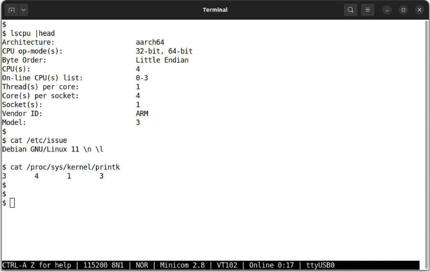

Hình 4.7: Chạy minicom để kết nối bo Raspberry Pi qua cáp USB-to-serial và tra vài thông tin

Chú ý các logging level `printk` mặc định, tức `printk sysctl`, khác x86\_64; điều đó có thể xảy ra.

Giờ đến điểm thú vị: đặt số nguyên đầu pseudofile `/proc/sys/kernel/printk` bằng `8` bảo đảm mọi printk cũng được đưa trực tiếp ra console, khiến printk giống printf thông thường! Ở đây minh họa cách root dễ thiết lập:

```
$ sudo sh -c "echo '8 4 1 7' > /proc/sys/kernel/printk"
$ cat /proc/sys/kernel/printk
8       4       1       7
```

Tất nhiên thực hiện bằng root; chú ý cú pháp shell. Đặt đầu ra console như vậy rất thuận tiện khi phát triển, kiểm thử!

Tuy nhiên, thay đổi sysctl qua `proc` chỉ tạm thời, áp dụng cho phiên hiện tại. Khi reboot hay tắt/bật nguồn, thay đổi mất. Một cách làm thay đổi sysctl lâu dài là qua tiện ích `sysctl`(8), ví dụ chạy bằng root:

```
sysctl -w kernel.printk='8 4 1 7'
```

Điều này đặt `printk sysctl` bằng các giá trị đó mỗi lần boot.

Trên Raspberry Pi và các bo khác, tôi giữ startup script chứa dòng:

`[[ $(id -u) -eq 0 ]] && echo "8 4 1 7" > /proc/sys/kernel/printk`

Vì vậy khi chạy bằng root, thiết lập có hiệu lực, mọi `printk` trực tiếp xuất hiện trên console `minicom` như `printf`; rất tốt cho debug! Dùng `sysctl` có thể làm nó lâu dài.

Nói về Raspberry Pi linh hoạt, phần sau minh họa chạy kernel module trên nó.

#### Ghi đầu ra lên Raspberry Pi console

Đến kernel module thứ hai! Ở đây, từ nay trở đi, ta dùng macro kiểu `pr_*()` để phát chín `printk`, một ở mỗi trong tám log level, cộng một qua `pr_devel()` (thực sự chỉ là log level `KERN_DEBUG`). Hãy xem code liên quan:

```
// ch4/printk_loglvl/printk_loglvl.c
[ … ]
static int __init printk_loglvl_init(void)
{
    pr_emerg("Hello, world @ log-level KERN_EMERG   [0]\n");
    pr_alert(  "Hello, world @ log-level KERN_ALERT   [1]\n");
    pr_crit(    "Hello, world @ log-level KERN_CRIT    [2]\n");
    pr_err(     "Hello, world @ log-level KERN_ERR     [3]\n");
    pr_warn(  "Hello, world @ log-level KERN_WARNING [4]\n");
    pr_notice("Hello, world @ log-level KERN_NOTICE  [5]\n");
    pr_info(    "Hello, world @ log-level KERN_INFO    [6]\n");
    pr_debug("Hello, world @ log-level KERN_DEBUG   [7]\n");
    pr_devel( "Hello, world via the pr_devel() macro"
        " (eff @KERN_DEBUG) [7]\n");

    return 0; /* success */
}
static void __exit printk_loglvl_exit(void)
{
    pr_info("Goodbye, world @ log-level KERN_INFO    [6]\n");
}
module_init(printk_loglvl_init);
module_exit(printk_loglvl_exit);
```

Giờ thảo luận đầu ra khi chạy kernel module `printk_loglvl` trên Raspberry Pi. Nếu không có hoặc không tiện dùng, không vấn đề; cứ thử trên x86\_64, máy ảo khách hay hệ thống trực tiếp.

Trên Raspberry Pi (ở đây tôi dùng Raspberry Pi 4 model B chạy Raspberry Pi OS mặc định), đăng nhập rồi lấy root shell qua `sudo -s` đơn giản. Sau đó build kernel module.

Nếu cài image Raspberry Pi mặc định trên thiết bị, mọi development tool, kernel header và các thành phần khác cần thiết đều pre-installed! Vì vậy đăng nhập bo, build module và thử. Hình 4.8 là ảnh chạy kernel module `printk_loglvl` trên bo Raspberry Pi. Cũng cần hiểu ta chạy trên console device vì dùng cáp USB-to-serial đã nói qua Terminal emulator `minicom`, không chỉ qua kết nối SSH:

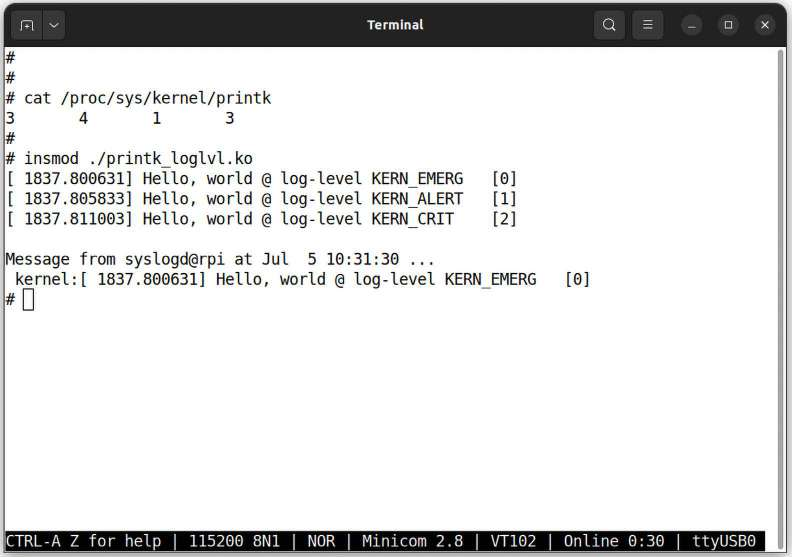

Hình 4.8: Cửa sổ Terminal emulator minicom – console – với đầu ra kernel module printk\_loglvl

Chú ý khác biệt nhỏ với môi trường x86\_64: ở đây mặc định số nguyên đầu trong `/proc/sys/kernel/printk`, tức console log level hiện tại, là `3`, không phải `4`. Điều đó nghĩa là mọi kernel `printk` ở log level dưới 3 xuất hiện trực tiếp trên console. Xem ảnh: đúng là vậy! Hơn nữa, như mong đợi, `printk` ở log level “emergency” (`0, KERN_EMERG`) luôn xuất hiện trên console, thực sự trên mọi cửa sổ Terminal non-GUI đang mở.

Giờ đến phần thú vị: hãy đặt console log level hiện tại bằng `8`, tất nhiên với root (nhớ đó là số đầu của `/proc/sys/kernel/printk`). Như vậy mọi `printk` phải hiện trực tiếp trên console. Ta kiểm thử chính điều này:

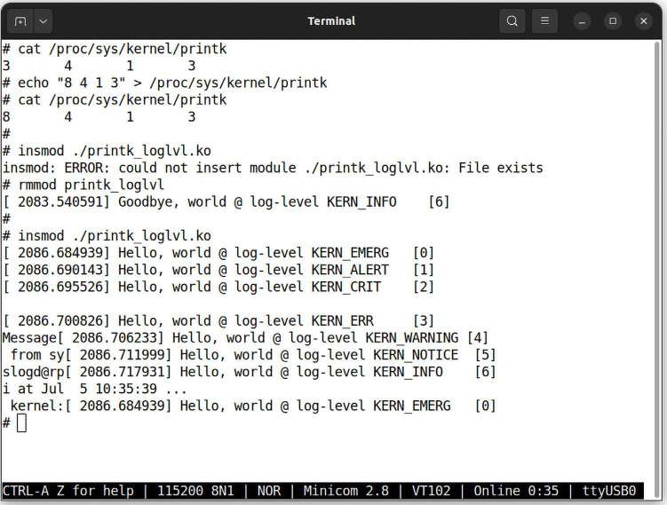

Hình 4.9: Terminal minicom, thực chất console, với console log level đặt bằng 8

Tất nhiên trước tiên gỡ instance module trước khỏi bộ nhớ bằng `rmmod`. Đúng như mong đợi, ta thấy mọi `printk` ngay trên console device, không cần `dmesg` nữa.

Nhưng chờ chút: chuyện gì xảy ra với macro `pr_debug()` và `pr_devel()` phát kernel message ở log level `KERN_DEBUG`, tức số nguyên `7`? Nó không xuất hiện trên console hay kết quả `dmesg` sau. Chúng tôi sẽ giải thích ngay; hãy đọc tiếp.

Tất nhiên với `dmesg`, mọi kernel message, ít nhất còn trong kernel log ring buffer ở RAM, đều hiện ra. Ta thấy đúng như vậy:

```
rpi # rmmod printk_loglvl
rpi # dmesg
 [...]
[ 2086.684939] Hello, world @ log-level KERN_EMERG   [0]
[ 2086.690143] Hello, world @ log-level KERN_ALERT   [1]
[ 2086.695526] Hello, world @ log-level KERN_CRIT    [2]
[ 2086.700826] Hello, world @ log-level KERN_ERR     [3]
[ 2086.706233] Hello, world @ log-level KERN_WARNING [4]
[ 2086.711999] Hello, world @ log-level KERN_NOTICE  [5]
[ 2086.717931] Hello, world @ log-level KERN_INFO    [6]
[ 2372.690250] Goodbye, world @ log-level KERN_INFO    [6]
rpi #
```

Mọi `printk` trừ `KERN_DEBUG` đều thấy vì đang xem kernel log qua `dmesg`. Vậy làm sao hiện debug message? Phần sau trình bày.

#### Bật kernel message ở debug-level

Ta vừa thấy có thể phát `printk` ở nhiều log level; tất cả xuất hiện trừ debug-level message. À đúng, `pr_debug()` cùng `dev_dbg()` là trường hợp hơi đặc biệt; trừ khi symbol `DEBUG` được định nghĩa cho kernel module, `printk` ở `KERN_DEBUG` không xuất hiện. Có thể sửa Makefile kernel module để bật. Có ít nhất hai cách thiết lập:

- Chèn dòng sau vào Makefile:

```
CFLAGS_printk_loglvl.o := -DDEBUG
```

Dạng tổng quát là `CFLAGS_<filename>.o := <value>`

- Cũng có thể, thực tế thường hơn, chỉ chèn câu lệnh này vào Makefile:

```
ccflags_y += -DDEBUG
```

Trước đây biến Makefile để truyền thêm C compiler flag tên `EXTRA_CFLAGS`; giờ bị coi là deprecated, nên dùng biến mới hơn `ccflags_y`.

Trong Makefile của chúng ta, ban đầu chủ động để `-DDEBUG` commented-out. Giờ để thử, bỏ comment một trong các dòng sau (tôi đề nghị dòng đầu, biến `ccflags_y`):

```
# Enable the pr_debug() as well (rm the comment from one of the lines below)
# (Note: EXTRA_CFLAGS deprecated; use ccflags-y)
#ccflags-y += -DDEBUG
#CFLAGS_printk_loglvl.o := -DDEBUG
```

Sau khi sửa, build lại rồi chèn bằng script `lkm`. Ảnh một phần Hình 4.10 của kết quả `lkm` cho thấy rõ color-coding `dmesg`: `KERN_ALERT / KERN_CRIT / KERN_ERR` lần lượt có nền đỏ/chữ đỏ đậm/chữ đỏ, còn `KERN_WARNING` chữ đen đậm, giúp con người nhanh nhận ra kernel message quan trọng:

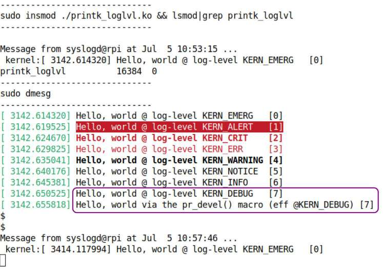

Hình 4.10: Một phần kết quả script lkm khi chạy module có định nghĩa DEBUG

Chúng tôi làm nổi bật hai `printk` phát ở `KERN_DEBUG`. Lưu ý hành vi `pr_debug()` không giống hệt khi bật tính năng “dynamic debug” (`CONFIG_DYNAMIC_DEBUG=y;`, trình bày tiếp theo).

Như đã nói, tác giả device driver cần chú ý kỹ rằng phải dùng macro đặc biệt `dev_*()` để phát `printk`, không phải `pr_*()` thông thường của kernel và module thuần. Điều đó nghĩa là truyền thêm tham số đầu, pointer đến thiết bị liên quan (`struct device *`). Chúng được định nghĩa tại `https://elixir.bootlin.com/linux/v6.1.25/source/include/linux/dev_printk.h#L137`.

Ngoài ra, `pr_devel()` dành cho debug `printk` kernel-internal mà đầu ra không bao giờ nên hiển thị trên hệ thống production.

Giờ trở lại phần đầu ra console. Vậy có cách được bảo đảm khác để mọi `printk` được đưa ra console, có lẽ nhằm debug kernel/driver nếu không vì gì khác? Có – chỉ cần truyền kernel parameter boot-time tên `ignore_level`. Để biết thêm, hãy tra mô tả trong tài liệu kernel chính thức: `https://www.kernel.org/doc/html/latest/admin-guide/kernel-parameters.html`.

Ngoài ra, có thể bật bỏ qua log level `printk` lúc runtime bằng cách echo Y vào pseudofile sau, cho phép mọi `printk` xuất hiện trên console device:

```
sudo bash -c "echo Y > /sys/module/printk/parameters/ignore_loglevel"
```

Ngược lại, có thể tắt lúc runtime bằng cách echo `N` vào cùng pseudofile. Hữu ích!

Cũng có thể dùng `dmesg` để kiểm soát bật/tắt kernel message ra console và console logging level, tức mức mà thông báo có số nhỏ hơn sẽ hiện trên console, qua các option switch, đặc biệt `--console-level`. Tôi để bạn tự xem man page `dmesg`(1) để biết chi tiết.

Lưu ý quan trọng: Dùng API/macro `printk` và liên quan với mục đích cụ thể debugging được trình bày sâu trong cuốn Linux Kernel Debugging của tôi, cụ thể Chương 3, Debug via Instrumentation – printk and Friends. Nó đề cập nội dung `printk` thông thường đã trình bày ở đây, mẹo dùng `printk` debug, rate-limiting và quan trọng là framework dynamic debug kernel mạnh mẽ. Hãy xem thử.

##### Giới thiệu tính năng dynamic debug mạnh mẽ của kernel

Là lập trình viên, chúng ta cần kỹ thuật debug. Có lẽ nổi tiếng nhất là instrumentation, đặt debug print ở vị trí chiến lược trong codebase. Xem log, ta hiểu control flow và có thể tìm ra bug.

Với Linux kernel, debug print và print khác được phát vào kernel log qua các biến thể `printk`: macro `printk()` thông thường, macro `pr_*()` được ưu tiên và `dev_*()` cho driver; những print ở `KERN_DEBUG` so-called debug print. Vì vậy các mục sau đều là print call site ở “debug-level” có thể có:

- `pr_debug("<fmt str>"[, args…]);`

- `dev_dbg(dev, "<fmt str>"[, args…]);`

- `printk(KERN_DEBUG "<fmt str>"[, args…]);`

Rất quan trọng phải nhớ debug printk luôn mặc định tắt; chỉ khi định nghĩa symbol `DEBUG` chúng mới thực sự có tác dụng.

Điều này có vẻ tiện; tuy nhiên trong production thực tế, nếu cần phát vài debug print từ module cụ thể thì sao? Để làm vậy phải định nghĩa `DEBUG`, tất nhiên có thể trong Makefile, build lại, unload và reload module. Nhưng cách này không thực tế, thậm chí không được phép trên phần lớn hệ thống production. Vì vậy cần cách động hơn, chính là tính năng dynamic debug của kernel cung cấp.

Với kernel dynamic debug, từng call site `printk` ở log level `KERN_DEBUG` trong kernel cũng như kernel module đều được biên dịch vào kernel. Trong `make menuconfig`, tùy chọn ở Kernel hacking \> printk and dmesg options \> Enable dynamic printk() support. Cấu hình là Boolean tên `CONFIG_DYNAMIC_DEBUG`.

Giả định bạn bật nó, đặt `Y`; ngay cả khi bật, overhead lúc không tracing dynamic print được coi là tối thiểu, đó là lý do tính năng được merge!

Vì sách không tập trung kernel debugging, ở đây chỉ trình bày cơ bản; xem Linux Kernel Debugging để biết chi tiết. Tuy vậy nội dung ở đây chắc chắn đủ để bắt đầu và thấy giá trị tính năng mạnh mẽ này.

“Help” của tính năng này, nhớ nằm trong một tệp `Kconfig*`, rất hay; hãy hiển thị nguyên nội dung, vì đọc sẽ giúp hiểu cách dùng (trên kernel 6.1.25 tại `https://elixir.bootlin.com/linux/v6.1.25/source/lib/Kconfig.debug#L108`:

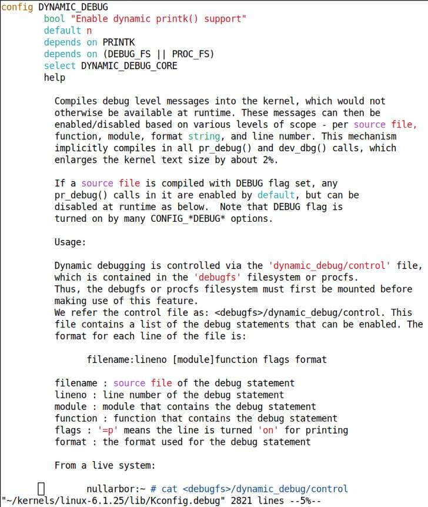

Hình 4.11: “Help” cho tính năng dynamic debug mạnh mẽ của kernel, phần 1

Vì chi tiết đầy đủ không vừa một ảnh, ảnh tiếp theo trình bày phần còn lại:

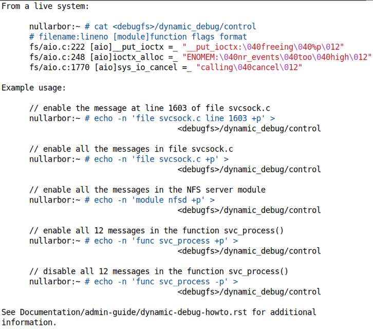

Hình 4.12: “Help” cho tính năng dynamic debug mạnh mẽ của kernel, phần 2

Hãy đọc kỹ cả Hình 4.11 và 4.12. Chúng cho đủ chi tiết để bắt đầu dùng dynamic debug; tài liệu kernel chính thức về tính năng cũng rất tốt, nên hãy xem: `https://www.kernel.org/doc/html/v6.1/admin-guide/dynamic-debug-howto.html#dynamic-debug`.

Để kiểm tra dynamic debug của kernel có sẵn trên x86 không: nếu hiển thị y như ở đây thì có, nếu không thì không:

```
$ grep "DYNAMIC_DEBUG=y" /boot/config-$(uname -r)
CONFIG_DYNAMIC_DEBUG=y
```

Vậy interface làm việc với dynamic debug là pseudofile dưới `debugfs:` `<debugfs_mount_point>/dynamic_debug/control`. Tuy nhiên trên nhiều hệ thống production, `debugfs` có thể chưa cấu hình hoặc được giữ “ẩn”; khi đó control file thấy qua `proc:` `/proc/dynamic_debug/control`. Cả hai giống hệt.

Xem nội dung control file sẽ thấy mọi debug print hay call site được biên dịch vào kernel. Xem nhanh sẽ hữu ích:

```
$ head -n1 /proc/dynamic_debug/control
# filename:lineno [module]function flags format
```

Dòng đầu cho biết định dạng. Mọi field đều self-explanatory trừ field then chốt `flags`; điều kỳ diệu nằm ở đây!

Tóm tắt về `flags`: nếu giá trị `=_`, debug print tắt, thường là mặc định; ví dụ tra vài debug print call site cho module driver e1000:

```
# grep "e1000" /proc/dynamic_debug/control | head -n3
drivers/net/ethernet/intel/e1000/e1000_hw.c:385 [e1000]e1000_reset_hw =_
"Disabling MWI on 82542 rev 2.0\n"
drivers/net/ethernet/intel/e1000/e1000_hw.c:390 [e1000]e1000_reset_hw =_
"Masking off all interrupts\n"
drivers/net/ethernet/intel/e1000/e1000_hw.c:423 [e1000]e1000_reset_hw =_
"Issuing a global reset to MAC\n"
```

Bạn thấy debug print tắt, được xác nhận bởi `=_`. Để bật, ghi giá trị `+p` vào field `flags`. Cũng có một số giá trị tùy chọn ghi được: `m`, `f`, `l` và `t`; xem tài liệu để biết ý nghĩa.

Sau đây là vài ví dụ chạy dynamic debug ở các mức scope khác nhau. Trước tiên bảo đảm điều kiện cơ bản `CONFIG_DYNAMIC_DEBUG=y`. Tất nhiên cần chạy root; cũng có thể luôn thay control file path `/sys/kernel/debug/dynamic_debug/control` dưới đây bằng `/proc/dynamic_debug/control`:

- File scope: bật mọi debug message trong mọi tệp có pathname chứa chuỗi “`usb`”:

```
echo -n 'file *usb* +p' > /sys/kernel/debug/dynamic_debug/control
```

Bạn có thể thử cắm/rút thiết bị USB khi bật, đồng thời xem kernel log bằng `journalctl -k -f` ở terminal khác. Tắt bằng `-p`:

```
echo -n 'file *usb* -p' > /sys/kernel/debug/dynamic_debug/control
```

- File scope: bật mọi debug message trong mọi tệp có pathname chứa chuỗi “`ip`”:

```
echo -n 'file *ip* +p' > /sys/kernel/debug/dynamic_debug/control
```

Thử ping website trong khi xem kernel log bằng `journalctl -k -f` ở terminal khác. Tắt bằng `-p`:

```
echo -n 'file *ip* -p' > /sys/kernel/debug/dynamic_debug/control
```

- Module scope: bật mọi debug `printk`, tức mọi call site `pr_debug()|dev_dbg()`, cho mọi kernel module hiện trong bộ nhớ:

```
echo -n 'module * +pflmt' > \
  /sys/kernel/debug/dynamic_debug/control
```

CẢNH BÁO: Điều này thường có thể tạo đầu ra rất lớn!

Tắt bằng:

```
echo -n 'module * -pflmt' > \
 /sys/kernel/debug/dynamic_debug/control
```

Trong khi chạy, theo dõi kỹ kernel log ở cửa sổ Terminal khác bằng `journalctl` `-k -f`. Tất nhiên các thiết lập volatile, sẽ về mặc định sau tắt/bật nguồn hay reboot.

Tài liệu kernel có thêm ví dụ; hãy xem: `https://www.kernel.org/doc/html/v6.1/admin-guide/dynamic-debug-howto.html#examples`.

Phần sau nói về tính năng logging rất hữu ích khác: rate limiting.

### Rate limiting cho printk

Khi phát `printk` từ code path chạy rất thường xuyên, lượng `printk` lớn có thể nhanh chóng làm tràn kernel log buffer trong RAM, nhớ nó là circular buffer, ghi đè thông tin có thể then chốt. Ngoài ra, log file non-volatile ever-growing với thông báo kernel log gần như lặp vô hạn cũng không tốt, lãng phí dung lượng đĩa hoặc tệ hơn là flash. Ví dụ, nghĩ đến `printk` large-ish trong interrupt handler code path. Nếu hardware interrupt được gọi ở tần số 100 Hz, tức 100 lần mỗi giây, thì sao?

Để giảm các vấn đề này, kernel cung cấp lựa chọn thay thế thú vị, hữu ích: rate-limited `printk`. Macro `pr_<foo>_ratelimited()` (với `<foo>` là emerg, alert, crit, err, warn, notice, info hay debug) có cú pháp giống hệt `printk` thông thường; điểm then chốt là nó thực sự chặn các print thông thường khi đáp ứng điều kiện nhất định.

Kernel cung cấp hai tệp `sysctl` tên `printk_ratelimit` và `printk_ratelimit_burst` qua filesystem `proc` cho mục đích này. Ở đây chép nguyên tài liệu `sysctl` từ `https://www.kernel.org/doc/Documentation/sysctl/kernel.txt`, giải thích ý nghĩa chính xác hai pseudofile:

```
printk_ratelimit:
Some warning messages are rate limited. printk_ratelimit specifies
the minimum length of time between these messages (in jiffies), by
default we allow one every 5 seconds.
A value of 0 will disable rate limiting.
==============================================
printk_ratelimit_burst:
While long term we enforce one message per printk_ratelimit
seconds, we do allow a burst of messages to pass through.
printk_ratelimit_burst specifies the number of messages we can
send before ratelimiting kicks in.
```

Trên Ubuntu 22.04 LTS khách x86\_64, ta thấy giá trị mặc định như sau:

```
$ cat /proc/sys/kernel/printk_ratelimit /proc/sys/kernel/printk_ratelimit_burst
5
10
```

Nghĩa là mặc định tối đa 10 lần cùng thông báo trong khoảng 5 giây được đi qua trước khi rate limiting có hiệu lực.

Để bạn biết, đây là web tool giúp tra ý nghĩa `sysctl` cụ thể; ví dụ tại `https://sysctl-explorer.net/kernel/printk_ratelimit/`. Hữu ích.

Rate limiter của `printk`, khi chặn kernel `printk`, phát thông báo hữu ích nói chính xác bao nhiêu callback `printk` trước đã bị chặn. Kết quả mẫu giúp làm rõ:

```
ratelimit_test_init: 41 callbacks suppressed
ratelimit_test:ratelimit_test_init():45: [51] ratelimited printk @ KERN_INFO
[6]
```

#### Các macro Rate-limiting nên dùng

Kernel cung cấp các macro sau để rate-limit print/logging (nên dùng `#include <linux/kernel.h>`):

- `printk_ratelimited()`: Cảnh báo! Không dùng – kernel cảnh báo không dùng.

- `pr_*_ratelimited()`: Wildcard `*` thay bằng các mức thông thường emerg, alert, crit, err, warn, notice, info hoặc debug.

- `dev_*_ratelimited()`: Wildcard `*` thay bằng các mức thông thường emerg, alert, crit, err, warn, notice, info hoặc debug.

Bảo đảm ưu tiên macro `pr_*_ratelimited()` thay `printk_ratelimited()`; tác giả driver nên dùng `dev_*_ratelimited()`.

Kernel module ví dụ minh họa rate-limited `printk` có trong kho GitHub cuốn Linux Kernel Debugging của tôi tại `https://github.com/PacktPublishing/Linux-Kernel-Debugging/tree/main/ch3/ratelimit_test`. Hãy thử.

Ví dụ code-level, trong số nhiều ví dụ ở kernel tree, dùng rate-limited driver-debug `printk` nằm trong AMD GPU driver: `https://elixir.bootlin.com/linux/v6.1.25/source/drivers/gpu/drm/amd/amdgpu/sdma_v4_0.c#L2146`:

```
 dev_dbg_ratelimited(adev->dev,
           "[sdma%d] address:0x%016llx src_id:%u ring:%u vmid:%u "
           "pasid:%u, for process %s pid %d thread %s pid %d\n",
           instance, addr, entry->src_id, entry->ring_id, entry->vmid,
           entry->pasid, task_info.process_name, task_info.tgid,
           task_info.task_name, task_info.pid);
```

Với macro `dev_*_*()`, chú ý tham số đầu luôn là pointer đến thiết bị.

Không dùng macro cũ nay deprecated `printk_ratelimited()` và `printk_ratelimit()`. Ngoài ra, code rate-limiting thực tế tại `lib/ratelimit.c:___ratelimit()`. Đây là quy ước kernel: hàm/macro bắt đầu bằng hai gạch dưới trở lên (`__foo()`) được coi là internal. Tránh dùng trực tiếp; dùng wrapper `foo()` của nó.

Có thể sinh kernel-level message từ user space không? Nghe thú vị; đó là chủ đề nhỏ tiếp theo.

### Sinh kernel message từ user space

Kỹ thuật debug phổ biến của lập trình viên là rải print tại nhiều điểm trong code, thường giúp khoanh vùng nguồn vấn đề. Đây thực sự là kỹ thuật hữu ích, chính thức gọi là instrumenting the code. Nhà phát triển kernel thường dùng API `printk` lâu đời và liên quan chính cho mục đích này.

Vậy giả sử bạn đã viết kernel module và đang debug bằng cách thêm nhiều `printk` tại vị trí phù hợp. Code kernel giờ phát những `printk` này, tất nhiên thấy lúc runtime qua `dmesg`, `journalctl` hay công cụ khác.

Tốt, nhưng nếu đặc biệt vì đang chạy user-space test script tự động, bạn muốn thấy thời điểm script bắt đầu hành động trong kernel module bằng cách in thông báo cụ thể thì sao? Ví dụ cụ thể, giả sử muốn log như sau:

```
test_script: @user msg 1 ; kernel_module: msg n, msg n+1, ..., msg n+m ; test_
script: @user msg 2 ; ...
```

Có thể cho user-space test script ghi thông báo vào kernel log buffer giống kernel `printk`, bằng cách ghi thông báo vào special device file `/dev/kmsg`:

```
echo "test_script: @user msg 1" > /dev/kmsg
```

Nhưng chờ – tất nhiên cần root để làm vậy. Tuy nhiên chú ý ở đây chỉ thêm `sudo` trước `echo` không hoạt động:

```
$ sudo echo "test_script: @user msg 1" > /dev/kmsg
bash: /dev/kmsg: Permission denied
$ sudo bash -c "echo \"test_script: @user msg 1\" > /dev/kmsg"
 [sudo] password for c2kp:
 $ dmesg |tail -n1
 [55527.523756] test_script: @user msg 1
```

Cú pháp dùng ở lần thử hai hoạt động, nhưng lấy root shell (`sudo -s`) rồi làm những việc như vậy đơn giản hơn.

Thêm điều nữa. `dmesg` có nhiều tùy chọn giúp kết quả human-readable; chúng tôi thể hiện vài tùy chọn qua alias mẫu cho `dmesg` rồi dùng nó:

```
$ alias dmesg='sudo dmesg --decode --nopager --color --ctime'
$ dmesg | tail -n1
kern  :debug : [Mon Jul 10 08:14:32 2023] wlo1: Limiting TX power to 30 (30 -
0) dBm as advertised by b8:<...>
```

Thông báo ghi vào kernel log qua special device file `/dev/kmsg` được in ở default log level hiện tại, thường `4 : KERN_WARNING`. Có thể ghi đè bằng cách thêm log level cần thiết dưới dạng số trong chuỗi vào trước thông báo. Ví dụ, để ghi từ user space vào kernel log ở `6 : KERN_INFO`, dùng:

```
$ sudo bash -c "echo \"<6>test_script: test msg at KERN_INFO\"   \
   > /dev/kmsg"
 $ dmesg | tail -n1
user  :info  : [Mon Jul 10 08:25:27 2023] test_script: test msg at KERN_INFO
```

Ta thấy thông báo sau phát ở log level `6`, như chỉ định trong `echo`.

Thực sự không có cách phân biệt kernel message user-generated và do kernel `printk()` sinh; chúng trông giống hệt. Vì thế tất nhiên có thể đơn giản chèn hay thêm signature byte/chuỗi đặc biệt vào thông báo như `@user ...`, giúp phân biệt các print user-generated với kernel.

Hơi ngoài lề, sau đây là điều cần lưu ý.

Interfacing giữa user space và kernel space là chủ đề then chốt, quan trọng, thường là điều tác giả driver cần làm. Có nhiều cách, luôn ở mức nào đó liên quan gọi system call từ user space để chuyển vào kernel. Trong các công nghệ Linux làm interface giữa user/kernel space có `procfs, sysfs, debugfs, netlink sockets` và system call `ioctl()`. Chúng được trình bày sâu trong Linux Kernel Programming - Part 2, Chương 2, User-Kernel Communication Pathways.

Giờ hãy xem cách dễ chuẩn hóa định dạng đầu ra kernel `printk`.

### Chuẩn hóa đầu ra printk qua macro pr\_fmt

Điểm quan trọng khác về kernel `printk`: khá thường xuyên để cung cấp ngữ cảnh đầu ra `printk()` (chính xác xảy ra ở đâu?), bạn có thể viết như sau, tận dụng các GCC macro như `__FILE__, __func__` và `__LINE__`, tất nhiên lần lượt phát tên tệp, tên hàm và số dòng nơi phát print:

```
pr_info("%s:%s:%s():%d: mywork XY failed!\n", OURMODNAME, __FILE__, __func__,
__LINE__);
```

Bản thân cách này ổn; vấn đề là nếu dự án có nhiều `printk`, sẽ vất vả bảo đảm mọi người luôn theo nhất quán, chính xác định dạng `printk` chuẩn, ví dụ hiện tên module trước, tiếp đến tên tệp, tên hàm và có thể số dòng như ở đây.

Đó là lúc dùng `pr_fmt()`; định nghĩa macro này ngay đầu code, phải trước cả `#include` đầu tiên, bảo đảm từng `printk` sau đó được thêm tiền tố theo định dạng macro chỉ định.

Hãy lấy ví dụ (trích code chương tiếp theo; đừng lo, thực sự rất đơn giản và làm template cho kernel module tương lai):

```
// ch5/lkm_template/lkm_template.c
 [ ... ]
 */
#define pr_fmt(fmt) "%s:%s(): " fmt, KBUILD_MODNAME, __func__

#include <linux/init.h>
#include <linux/module.h>
#include <linux/kernel.h>
 [ ... ]
 static int __init lkm_template_init(void)
 {
    pr_info("inserted\n");
    [ ... ]
```

Macro `pr_fmt()` được làm nổi bật; nó dùng macro định nghĩa sẵn `KBUILD_MODNAME` để thay tên kernel module và GCC specifier `__func__` để hiện tên hàm đang chạy! Bạn có thể thêm `%s` cho `__FILE__`, `%d` khớp macro `__LINE__` tương ứng để hiện số dòng; hoàn toàn tùy bạn.

Vậy điểm cốt yếu là `pr_info()` phát trong hàm `init` của LKM này sẽ hiện trong kernel log như sau:

```
[381534.391966] lkm_template:lkm_template_init(): inserted
```

Chú ý tên module và hàm tự động được thêm trước nội dung `printk`! Rất hữu ích và thực sự rất phổ biến; trong kernel, thực sự hàng trăm tệp nguồn bắt đầu bằng `pr_fmt()`. Tìm nhanh kernel codebase 6.1.25 cho hơn 2.200 instance macro này! Chúng ta cũng sẽ theo quy ước, dù không trong mọi module demo.

`pr_fmt()` cũng có hiệu lực với cách dùng `printk` được khuyến nghị cho tác giả driver qua macro `dev_*()`.

Tiếp theo, tìm hiểu vấn đề viết code portable liên quan `printk`.

### Portability và printk format specifier

Có câu hỏi cần suy nghĩ về kernel API `printk` linh hoạt: làm sao bảo đảm đầu ra `printk` đúng, định dạng chính xác và hoạt động tốt như nhau trên mọi CPU bất kể bit width? Vấn đề portability xuất hiện ở đây; tin tốt là làm quen các format specifier cung cấp giúp rất nhiều, thực chất cho phép viết `printk` arch-independent.

Cần hiểu `size_t`, đọc là `size type`, là `typedef` cho số nguyên unsigned; tương tự `ssize_t` (signed size type) là `typedef` cho số nguyên signed.

Đây là vài format specifier `printk` thông dụng top-of-mind cần lưu ý khi viết code portable:

- Với số nguyên `size_t` và `ssize_t`, unsigned và signed, lần lượt dùng `%zu` và `%zd`.

- Với kernel pointer, dùng `%pK` để bảo mật qua hashed value và `%px` cho pointer thực (không dùng trong production!). Ngoài ra dùng `%pa` cho physical address, phải truyền by reference. Có thể tận dụng sysctl `kptr_restrict`; chúng ta đi sâu hơn ở Chương 5, Viết kernel module đầu tiên – Phần 2, phần Proc filesystem tunables affecting the system log.

- Với raw buffer dưới dạng chuỗi ký tự hex, dùng `%*ph`, với `*` thay bằng số ký tự. Dùng cho buffer tối đa 64 ký tự; dài hơn dùng routine `print_hex_dump_bytes()`; có các biến thể, xem tài liệu kernel ở liên kết sau.

- Với địa chỉ IPv4 dùng `%pI4`, IPv6 dùng `%pI6` (cũng có biến thể).

Danh sách đầy đủ `printk` format specifier và giải thích khi nào dùng từng loại, có ví dụ, thuộc tài liệu kernel chính thức tại `https://www.kernel.org/doc/Documentation/printk-formats.txt`.

Kernel cũng nêu rõ dùng `%p` đơn thuần trong `printk()` có thể dẫn đến vấn đề bảo mật (`https://www.kernel.org/doc/html/latest/process/deprecated.html#p-format-specifier`). Tôi rất khuyến khích bạn đọc!

Hãy kết thúc phần này bằng tính năng gần đây: `printk` indexing.

### Tìm hiểu tính năng printk indexing mới

Vậy bạn đã viết kernel module, có thể driver, trong công việc phát một số `printk` (tất nhiên là người làm tốt, bạn biết giữ số print thấp nhất có thể). Giả sử một log message là mydriver: detected crazy situation X; được rồi, tốt. Dự án triển khai production; giả sử một user-space monitoring daemon nào đó cũng theo dõi kernel log message tìm tình trạng bất thường để cảnh báo người dùng. Điều này cho thấy `printk` không chỉ để người đọc; chương trình cũng có thể theo dõi liên tục, thường gặp trong hệ thống triển khai lớn.

Vài tháng sau, nhà phát triển khác cảm thấy kernel log message chưa tốt và đổi thành mydriver: detected abnormal condition X (thừa nhận đi, tốt hơn mà). Vấn đề là log monitoring daemon process vẫn tìm thông báo cũ, có thể bằng grep chuỗi mydriver: detected crazy situation, nên giờ hoàn toàn bỏ lỡ thông báo then chốt mới, gây đủ loại vấn đề.

Để xử lý tình huống như vậy, đúng là có xảy ra, Chris Down đề xuất tính năng kernel `printk indexing`, được merge vào mainline 5.15. Về cơ bản, khi bật, metadata từng `printk` – format string thực tế tức thông báo, vị trí source code phát, log level và hơn nữa – được lưu vào structure (`struct pi_entry`), mọi structure được tập hợp vào section đặc biệt trong kernel image `vmlinux` tên `.printk_index`; kernel module riêng cũng vậy!

Những thông báo này hiện qua entry `debugfs`, nghĩa là phụ thuộc bật `debugfs`, tại `<debugfs_mount_point>/printk/index/<file>`, với `<file>` có thể là `vmlinux` cũng như mọi kernel module.

Cấu hình kernel liên quan, Boolean, tên `CONFIG_PRINTK_INDEX`; mặc định tắt (có thể xem trong make menuconfig thông thường tại General setup \| Printk indexing debugfs interface).

Khi kernel build với tùy chọn bật, đây là vài ví dụ nhanh (chú ý chạy root vì `debugfs` chỉ root truy cập):

```
# head -n3 /sys/kernel/debug/printk/index/vmlinux
# <level/flags> filename:line function "format"
<3> init/main.c:1591 console_on_rootfs "Warning: unable to open an initial
console.\n"
<3> init/main.c:1569 kernel_init "Default init %s failed (error %d)\n"
```

Dòng đầu cho biết định dạng mỗi dòng, khá trực quan. Ví dụ khác, hãy tìm `"fire"`:

```
# grep -Hn -i -w "fire" /sys/kernel/debug/printk/index/*
/sys/kernel/debug/printk/index/lp:13:<6> drivers/char/lp.c:262 lp_check_status
"lp%d on fire\n"
```

(Ha! Chúng ta đã thấy chính ví dụ `printk` này trong phần Dùng printk log level!) Vậy hãy nghĩ: user-space monitoring daemon giờ tra được log message của kernel vmlinux và mọi kernel module qua printk index debugfs entry, kiểm tra có đúng mong đợi không; nếu không có thể khắc phục như báo vấn đề hoặc việc khác.

Hơn nữa, khi tắt `PRINTK_INDEX`, hoàn toàn non-inclusion overhead. Tuy nhiên khi bật `printk` indexing, có ít nhất hai vấn đề có thể xảy ra: thứ nhất nhiều production system không có `debugfs`, thứ hai tốn thêm bộ nhớ giữ hàng nghìn format string trong kernel image (trong `vmlinux` 6.1.25 của tôi, tính năng phát hiện gần 12.000 `printk`!). Tuy vậy, nó giải quyết hoặc ít nhất giảm một vấn đề, nên đã vào mainline kernel.

Bài tập: Build kernel với tính năng này bật và dùng thử.

Để bạn biết, commit merge `PRINTK_INDEX` tại `https://github.com/torvalds/linux/commi` `t/337015573718b161891a3473d25f59273f2e626b`.

Suy nghĩ nhanh: `printk` indexing có gần giống hoàn toàn dynamic kernel debug đã trình bày ở phần Giới thiệu tính năng dynamic debug mạnh mẽ của kernel không? Không, cần hiểu dynamic debug chỉ bao phủ mọi debug `printk` call site; `printk` indexing bao phủ mọi `printk` call site!

Sau khi tìm hiểu khá nhiều về kernel `printk` lâu đời và các API liên quan, bạn có thể tò mò chi tiết triển khai nội bộ. LWN Kernel Index là nơi tuyệt vời tìm bài kỹ thuật chi tiết về điều này, thực sự mọi khía cạnh kernel: `https://lwn.net/Kernel/Index/#Kernel_messages`. Xem chúng, tại thời điểm viết tháng 7 năm 2023, bạn thấy nhiều thay đổi đang diễn ra, nhằm cuối cùng giải quyết latency issue cũ và vấn đề khác của `printk`, dọn đường để `PREEMPT_RT` cuối cùng được merge (Chương 11, The CPU Scheduler – Phần 2, giới thiệu nỗ lực Linux real-time).

Được rồi! Hãy tiến đến hoàn tất chương bằng kiến thức cơ bản về hình thức và cách hoạt động Makefile của kernel module.

## Tìm hiểu kiến thức cơ bản về Makefile của kernel module

Có thể bạn đã nhận ra chúng ta thường theo quy tắc one-kernel-module-per-directory. Đúng, chắc chắn giúp tổ chức gọn gàng. Vậy lấy kernel module thứ hai `ch4/printk_loglvl`. Để build, chỉ `cd` vào thư mục, gõ `make` và hy vọng may mắn, xong! Có kernel module object mới `printk_loglevel.ko`, rồi có thể áp dụng `insmod/rmmod`. Nhưng chính xác nó được build thế nào khi gõ `make?` Giải thích điều đó là mục đích phần này.

Trước hết, chúng tôi kỳ vọng bạn hiểu cơ bản `make` và Makefile. Nếu chưa đừng lo, đã cung cấp liên kết tìm hiểu trong phần Đọc thêm, đoạn Makefiles: introductory stuff, của chương. . Hãy xem! (Liên kết: `https://github.com/PacktPublishing/Linux-Kernel-Programming_2E/blob/main/Further_Reading.md#chapter-4-writing-your-first-kernel-module-lkms-part-1---further-reading`).

Tiếp theo, vì đây là chương đầu về LKM và Makefile tương ứng, chúng ta giữ mọi thứ đơn giản, đặc biệt Makefile. Tuy nhiên đầu Chương 5, Viết kernel module đầu tiên – Phần 2, phần A better Makefile template for your kernel modules, sẽ giới thiệu Makefile tinh vi hơn và hy vọng tốt hơn, vẫn khá dễ hiểu. Sau đó dùng Makefile tốt hơn trong mọi code tiếp theo nhưng chưa phải bây giờ; hãy chú ý và dùng nó!

Như bạn biết, lệnh `make` mặc định tìm tệp `Makefile` trong thư mục hiện tại; nếu tồn tại, phân tích và thực thi chuỗi lệnh chỉ định bên trong. Đây là Makefile đơn giản cho dự án kernel module `printk_loglevel` (`I` dùng tiện ích `nl` – “number lines” – hiển thị với số dòng ở đầu):

```
$ nl Makefile
     1    # ch4/printk_loglvl/Makefile
     2    PWD          := $(shell pwd)
     3    KDIR          := /lib/modules/$(shell uname -r)/build/
     4    obj-m       += printk_loglvl.o

     5    # Enable the pr_debug() and pr_devel() as well by removing the
comment from
     6    # one of the lines below
     7    # (Note: EXTRA_CFLAGS deprecated; use ccflags-y)
     8    #ccflags-y += -DDEBUG
     9    #CFLAGS_printk_loglvl.o := -DDEBUG

    10    all:
    11        make -C $(KDIR) M=$(PWD) modules
    12    install:
    13        make -C $(KDIR) M=$(PWD) modules_install
    14    clean:
    15        make -C $(KDIR) M=$(PWD) clean
```

Không cần nói cũng biết cú pháp Unix Makefile yêu cầu định dạng cơ bản:

```
target: [dependent-source-file(s)]
     rule(s)
```

Các `rule(s)` luôn bắt đầu bằng ký tự `[Tab]`, không phải khoảng trắng.

Hãy nắm cơ bản cách Makefile module này hoạt động. Trước tiên điểm then chốt: hệ thống `Kbuild` của kernel mà ta đã nhắc và dùng từ Chương 2, Build Linux kernel 6.x từ source code – Phần 1, chủ yếu dùng hai chuỗi biến của phần mềm cần build, nối trong hai biến `obj-y` và `obj-m`.

Chuỗi `obj-y` chứa danh sách nối mọi object cần build và merge vào kernel image cuối – `vmlinux` không nén và `[b][z]Image` nén boot-able. Nghĩ thì hợp lý: `y` trong `obj-y` là Yes. Mọi kernel built-in và tùy chọn `Kconfig` đặt `Y` khi cấu hình hoặc mặc định `Y` được nối qua mục này, build và cuối cùng kết hợp thành kernel image bởi hệ thống `Kbuild`.

Mặt khác, giờ dễ thấy `obj-m` là danh sách nối mọi kernel object cần build riêng thành kernel module! Đó chính xác là lý do Makefile có dòng all-important sau, dòng 4:

```
obj-m += printk_loglvl.o
```

Thực chất nó bảo `Kbuild` đưa code chúng ta vào; chính xác hơn, bảo ngầm biên dịch source code `printk_loglvl.c` thành binary object `printk_loglvl.o`, rồi thêm object vào danh sách `obj-m`. Tiếp theo, vì default rule của `make` là `all`, dòng 10 và 11, nó được xử lý:

```
all:
    make -C $(KDIR) M=$(PWD) modules
```

Xử lý câu lệnh duy nhất ở dòng 11 khá phức tạp; những việc sau diễn ra:

1\. Tùy chọn `-C` của `make` khiến process `make` chuyển thư mục qua system call `chdir()` đến tên thư mục sau `-C`. Vì vậy nó đến `$(KDIR)`, đặt ở dòng 3 là symbolic link kernel `build` dưới `/lib/modules/$(uname -r)`, vốn trỏ đến kernel source tree giới hạn được cài bởi gói `kernel-headers` như đã trình bày. Nhắc lại, đây là nó trên Ubuntu khách của tôi:

```
$ ls -l /lib/modules/$(uname -r)/build
lrwxrwxrwx 1 root root    31 May  5 10:51 build -> /home/c2kp/kernels/
linux-6.1.25/
```

2\. Rõ ràng process `make` chuyển đến `~/kernels/linux-6.1.25/`, trường hợp này trỏ về kernel source tree 6.1.25 gốc, vì đang chạy kernel tùy chỉnh đã build trước. Khi đến, nó tự phân tích nội dung Makefile top-level của kernel, tức Makefile ở gốc source tree này. Đây là điểm then chốt. Makefile top-level khá lớn và tinh vi, trên 6.1.25 dài hơn 2.000 dòng, chứa chi tiết và biến build then chốt. Nhờ luôn được phân tích mỗi lần ngay cả khi build out-of-tree module, bảo đảm mọi kernel module gắn chặt kernel được build cho, nói thêm sau một chút. Điều này cũng bảo đảm module build bằng chính cùng bộ quy tắc, tức cấu hình compiler/linker (tùy chọn `*CFLAGS*`, compiler option switch, v.v.), như chính kernel image. Điều đó cần cho binary compatibility. 3. Tiếp theo, vẫn dòng 11 Makefile, bạn thấy khởi tạo biến `M` bằng thư mục làm việc hiện tại và target chỉ định là `modules`; vì thế process `make` giờ chuyển đến thư mục biến `M` chỉ định, `$(PWD)`, chính thư mục ban đầu (dòng 2 `PWD := $(shell pwd)` trong Makefile khởi tạo đúng giá trị)!

Thú vị là đây là recursive build: quá trình build, sau khi quan trọng nhất là phân tích Makefile top-level, giờ chuyển về thư mục kernel module và build các module ở đó.

Dòng 12 và 13 tạo target `install`, trình bày chương sau; dòng 14 và 15 tạo target `clean`.

Bạn có thấy khi build kernel module cũng sinh khá nhiều intermediate working file? Gồm `modules.order, <file>.mod.c, <file>.o, Module.symvers,` `<file>.mod.o, .<file>.o.cmd, .<file>.ko.cmd`, thư mục `.tmp_versions/` và tất nhiên chính binary object kernel module `<file>.ko`, mục tiêu toàn bộ bài build. Hơn nữa cũng sinh một số hidden file. Xóa mọi temporary build artifact, kể cả target là kernel module object, rất dễ: chỉ chạy `make clean`. Rule `clean` dọn tất cả. Chúng ta sẽ đi sâu target `install` ở chương sau.

Ảnh chụp giúp thể hiện kết quả khi build rồi dọn:

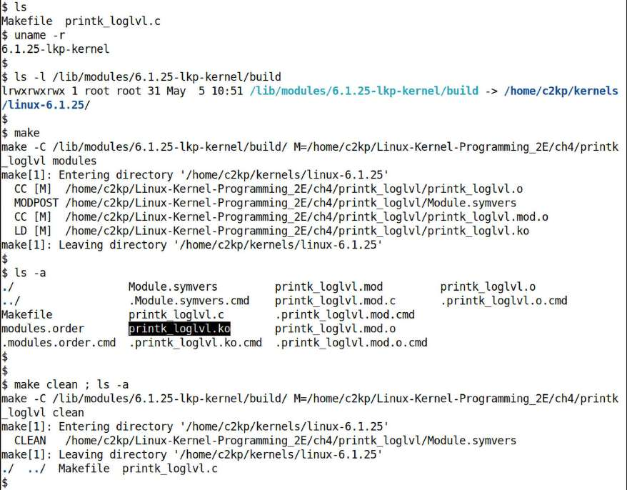

Hình 4.13: Build (make) và “make clean” kernel module printk\_loglvl, trên Ubuntu 22.04 khách x86\_64 chạy kernel 6.1.25 LTS custom-built

Có thể tra mục đích `modules.order`, `modules.builtin` và tệp khác trong tài liệu kernel tại `https://elixir.bootlin.com/linux/v6.1.25/source/Documentation/kbuild/kbuild.rst`. Ngoài ra như đã nói, chương sau giới thiệu và dùng biến thể Makefile tinh vi hơn, một Makefile “tốt hơn”. Nó được thiết kế giúp nhà phát triển kernel module/driver cải thiện chất lượng code bằng target liên quan kiểm tra kernel coding style, static analysis, đóng gói đơn giản và dummy target cho dynamic analysis.

Đến đây kết thúc chương. Làm tốt lắm – bạn đang tiến vững trên đường học phát triển Linux kernel!

## Tổng kết

Trong chương này, chúng ta trình bày cơ bản Linux kernel architecture và LKM. Bạn học kernel module là gì, vì sao hữu ích. Sau đó viết kernel module đơn giản nhưng hoàn chỉnh, Hello, world rất cơ bản. Tiếp theo đi sâu cách hoạt động và coding convention cần theo, cùng thực hành chính xác cách build, load, xem danh sách và unload module. Kernel logging với `printk` và các API liên quan được trình bày khá chi tiết, cùng giải thích logging level của `printk`, kiểm soát đầu ra console và hơn nữa. Sau đó là chi tiết phát kernel message thuần debug-level, quan trọng hơn là giới thiệu dùng dynamic debug của kernel. Tiếp đến rate-limiting `printk`, sinh kernel message từ user space, chuẩn hóa định dạng đầu ra và hiểu tính năng `printk` indexing mới. Chương khép lại bằng kiến thức cơ bản Makefile kernel module và cách hoạt động trong LKM.

Tôi rất khuyến khích bạn làm việc với sample code qua kho GitHub sách, làm câu hỏi/bài tập, rồi sang chương tiếp theo, nơi tiếp tục trình bày viết Linux kernel module!

## Câu hỏi

Khi kết thúc, đây là danh sách câu hỏi kiểm tra kiến thức nội dung chương: `https://github.com/PacktPublishing/Linux-Kernel-Programming_2E/blob/main/questions/ch4_qs_assignments.txt`. Bạn thấy một số câu trả lời trong kho GitHub sách: `https://github.com/PacktPublishing/Linux-Kernel-Programming_2E/tree/master/solutions_to_assgn`.

## Đọc thêm

Để giúp tìm hiểu sâu bằng tài liệu hữu ích, chúng tôi cung cấp danh sách khá chi tiết tài liệu tham khảo và liên kết trực tuyến, đôi khi cả sách, trong tài liệu Further reading ở kho GitHub sách. Tài liệu tại `https://github.com/PacktPublishing/Linux-Kernel-Programming_2E/blob/master/Further_Reading.md`.

## Hãy để lại đánh giá!

Bạn đang yêu thích cuốn sách? Hãy giúp độc giả như bạn bằng cách để lại đánh giá Amazon. Quét code QR bên dưới để nhận mã giảm giá 20%.


\*Ưu đãi có giới hạn
