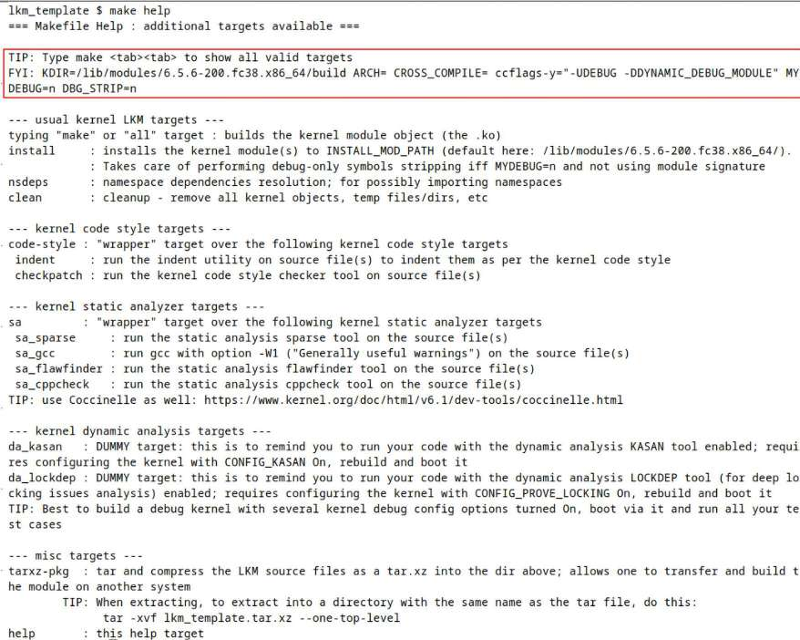
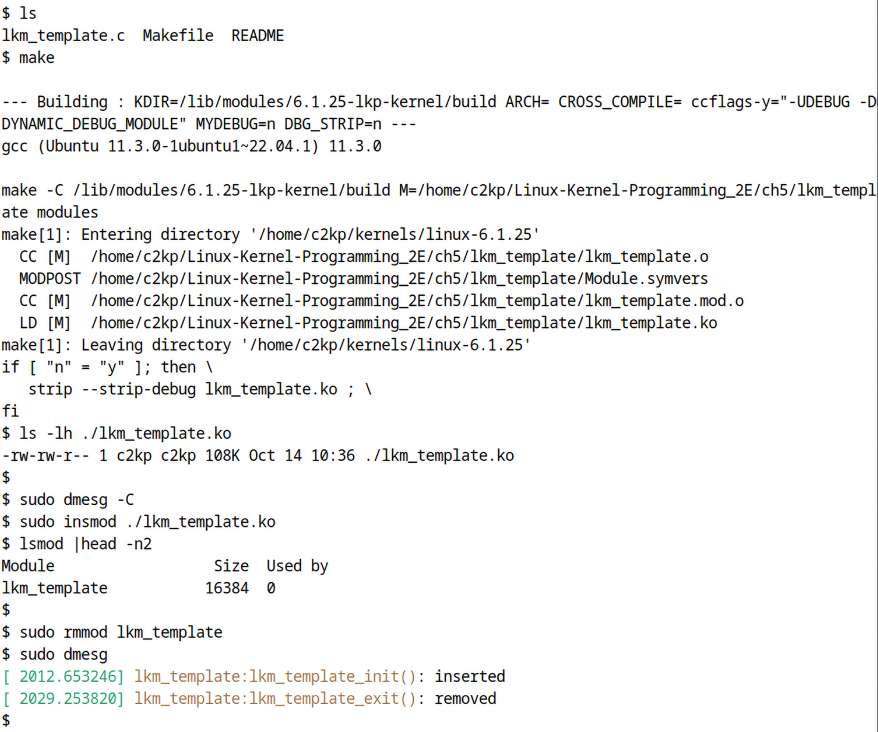
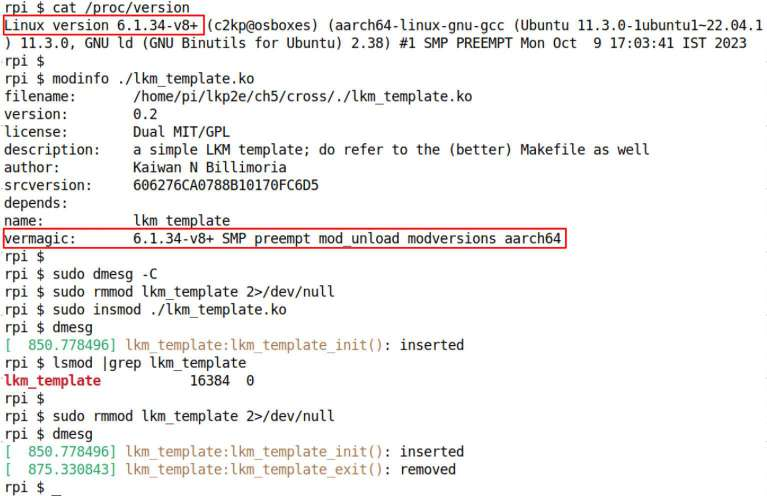
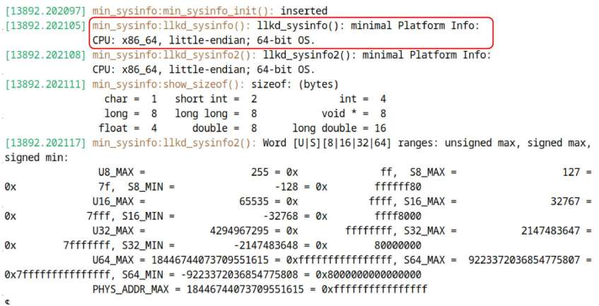
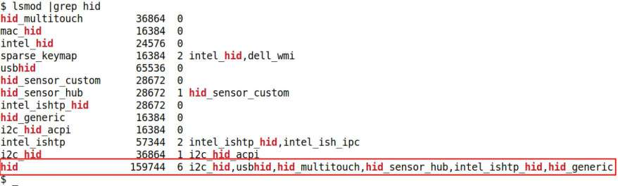
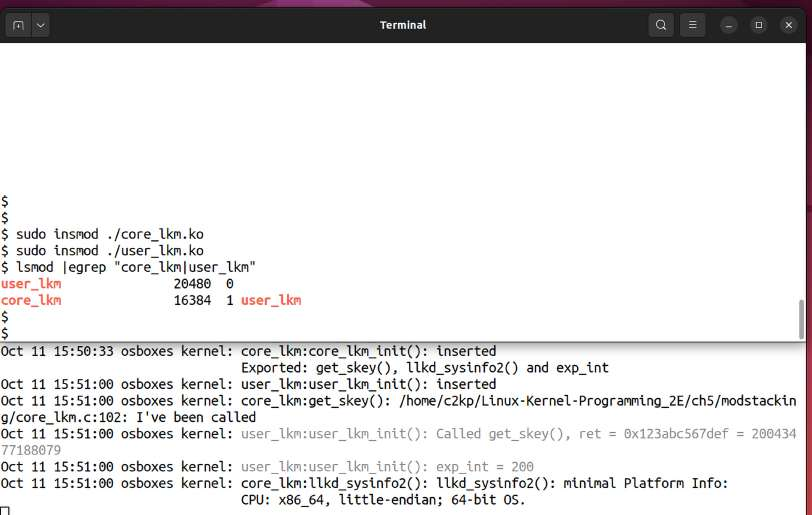
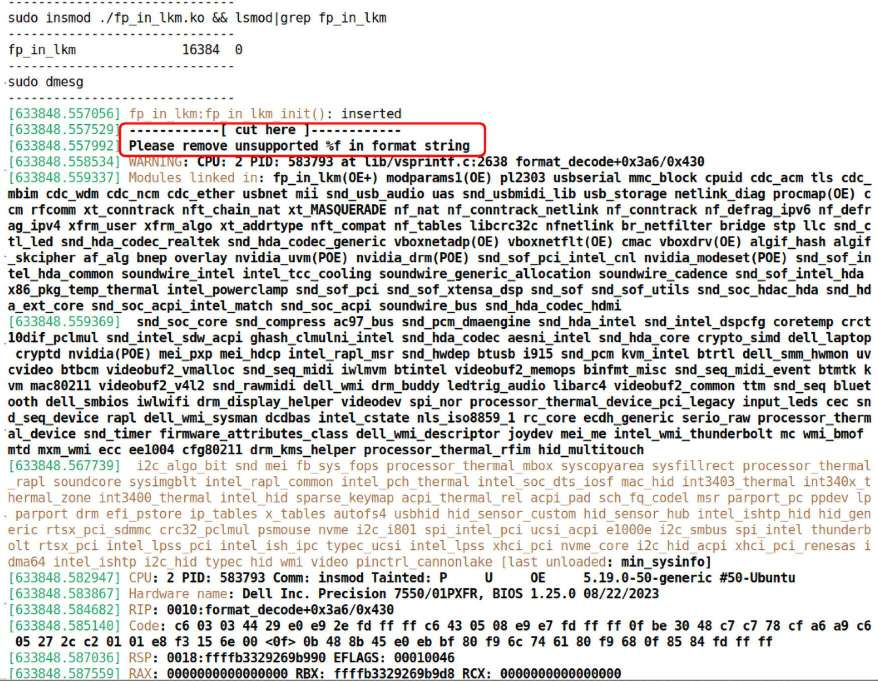
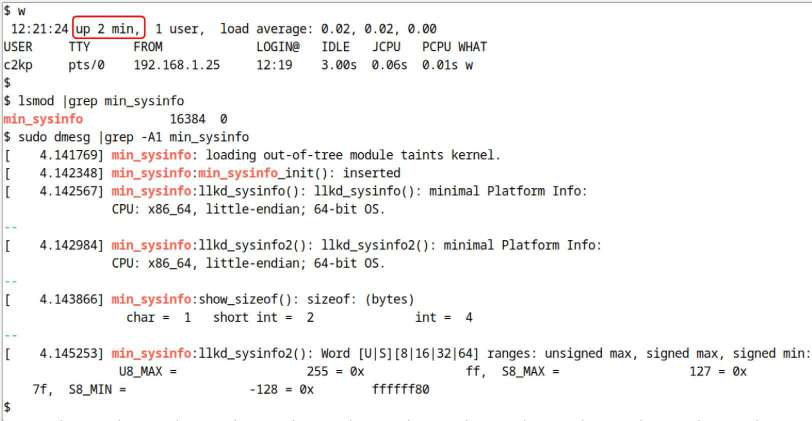
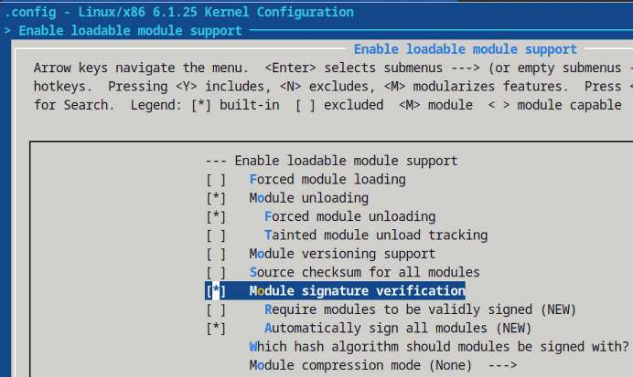
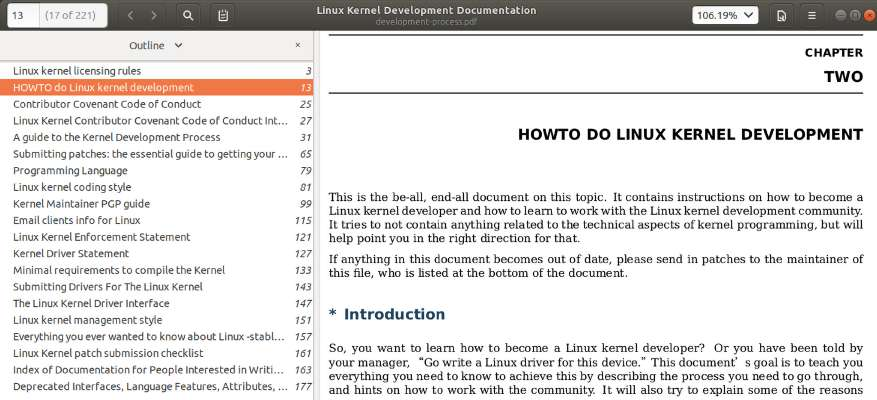

# Chương 5. Viết kernel module đầu tiên – Phần 2

Chương này là nửa sau nội dung về framework Loadable Kernel Module (LKM) và cách dùng nó để viết kernel module. Để tận dụng tối đa, tôi kỳ vọng bạn hoàn thành chương trước và thử code cùng câu hỏi/bài tập ở đó trước khi bắt đầu chương này.

Trong chương này, chúng ta tiếp tục từ chỗ dừng ở chương trước. Ở đây trình bày cách dùng Makefile “tốt hơn” cho LKM, cross-compile kernel module cho ARM như ví dụ điển hình, module stacking là gì và thực hiện thế nào, cùng cách thiết lập và dùng module parameter. Trong quá trình đó, bên cạnh nhiều nội dung khác, bạn sẽ học tính ổn định kernel API/ABI (hay đúng hơn là sự thiếu ổn định!), khác biệt then chốt giữa viết user-space code và kernel code, tự load kernel module lúc boot, cùng vấn đề bảo mật và cách xử lý. Chúng ta kết thúc bằng thông tin về kernel documentation, gồm coding style, và cách bắt đầu đóng góp cho mainline kernel.

Tóm lại, chương này trình bày các chủ đề:

- Makefile template “tốt hơn” cho kernel module

- Cross-compile kernel module

- Thu thập thông tin hệ thống tối thiểu

- Giấy phép kernel module

- Mô phỏng tính năng “giống library” cho kernel module

- Truyền parameter cho kernel module

- Floating point không được phép trong kernel

- Tự load module khi hệ thống boot

- Kernel module và bảo mật – tổng quan

- Hướng dẫn coding style cho nhà phát triển kernel

- Đóng góp cho mainline kernel

## Yêu cầu kỹ thuật

Yêu cầu kỹ thuật, tức các gói phần mềm cần thiết, của chương này giống hệt phần Yêu cầu kỹ thuật trong Chương 4, Viết kernel module đầu tiên – Phần 1; hãy tham khảo. Như thường lệ, source code chương này nằm trong kho GitHub sách. Clone bằng:

```
git clone https://github.com/PacktPublishing/Linux-Kernel-Programming_2E
```

Code hiển thị trong sách thường chỉ là đoạn trích liên quan. Hãy theo dõi với source code đầy đủ từ kho.

## Makefile template “tốt hơn” cho kernel module

Chương trước giới thiệu Makefile dùng sinh kernel module từ source code, cài đặt và dọn dẹp. Tuy nhiên, như đã nói ngắn ở đó, giờ tôi giới thiệu thứ theo tôi là Makefile vượt trội hơn, gọi là “tốt hơn”, và giải thích nó tốt hơn thế nào.

Cuối cùng, tất cả phải viết code tốt hơn, an toàn hơn, cả user space lẫn kernel space. Tin tốt là có nhiều công cụ cải thiện độ vững chắc và mức bảo mật của code, trong đó có static analyzer và dynamic analyzer (vì một số đã đề cập trong chương trực tuyến Kernel Workspace Setup, tôi không lặp lại ở đây).

Tôi thiết kế một dạng Makefile “template” đơn giản nhưng hữu ích cho kernel module, gồm nhiều target giúp chạy các công cụ này. Các target cho thực hiện kiểm tra, phân tích có giá trị rất dễ dàng; những việc có thể bạn quên, bỏ qua hoặc trì hoãn mãi! Các target gồm:

- Các target “thông thường” `build (all)`, `install` và `clean`, có xét thiết lập “debug”, strip module nếu debug tắt.

- Tạo và kiểm tra kernel coding style qua `indent` và script `checkpatch.pl` của kernel.

- Kernel static analysis target (`sparse`, `gcc` và `flawfinder`), có đề cập Coccinelle.

- Vài dummy kernel dynamic analysis target nhắc bạn nên đầu tư thời gian cấu hình, build “debug” kernel và dùng bắt bug qua `KASAN` cùng `LOCKDEP` / `CONFIG_PROVE_LOCKING`; phần sau sẽ nói thêm.

- Target `tarxz-pkg` đơn giản đóng gói tar và nén các source file vào thư mục cha. Nhờ đó chuyển tệp nén `tar-xz` sang Linux khác, rồi giải và build LKM tại đó.

Bạn tìm thấy code cùng tệp `README` trong `ch5/lkm_template`. Để giúp hiểu cách dùng, sức mạnh và bắt đầu, hình sau đơn giản hiển thị output cùng ảnh output mà code tạo khi chạy `make <tab><tab>` và `make help`:

```
lkm_template $ make <tab><tab>
all                      clean              help           install    sa
sa_flawfinder  sa_sparse
checkpatch     code-style     indent      nsdeps   sa_cppcheck  sa_gcc
tarxz-pkg
```



Hình 5.1: Output của help target trong Makefile “tốt hơn”

Như Hình 5.1, gõ `make` rồi ngay lập tức nhấn Tab hai lần để hiện mọi target sẵn có (có thể cần cài Bash completion package để hoạt động; phần lớn distro thường có sẵn). Hãy nghiên cứu kỹ và dùng nó! Ví dụ chạy `make sa` (xem target sa và các target khác ở Hình 5.1) khiến mọi static analysis target (sa) chạy trên code của bạn.

Chú ý dòng bắt đầu `FYI: KDIR=…` được làm nổi bật cho biết giá trị hiện Makefile hiểu về các biến và “thiết lập”. Chúng tôi chép lại ở đây:

```
FYI: KDIR=/lib/modules/6.1.25-lkp-kernel/build ARCH= CROSS_COMPILE= ccflags-
y="-UDEBUG -DDYNAMIC_DEBUG_MODULE" MYDEBUG=n DBG_STRIP=n
```

Trong Makefile, dùng biến MYDEBUG để quyết định có thực hiện ‘debug’ build không. Rõ ràng với `MYDEBUG` mặc định `n`, ta không thực hiện build gọi là `debug` (phần sau đi sâu ý nghĩa chính xác).

Ngoài ra, biến `DBG_STRIP=n` thực chất nói với `make` `:` đừng strip debug ‘symbol’ khỏi module object. Thực tế nó mặc định `y`; Makefile đủ thông minh chỉ strip debug symbol (tuyệt đối không strip thêm gì khác khỏi module!) nếu `MYDEBUG` là `n`, tức tắt, và kernel config không dùng module-signing, tính năng cần symbol sẽ được trình bày sau trong chương. Biến `KDIR` là đường dẫn đến kernel source tree giới hạn, thực chất kernel header, có giá trị thông thường; `ARCH` và `CROSS_COMPILE` mặc định `null` vì không cross-compile module.

Được rồi, hãy dùng Makefile “tốt hơn” để đơn giản build module “template”, rồi insert, remove và xem kernel `printk's` thực sự hiện ra (ảnh Hình 5.2 cho thấy output):



Hình 5.2: Build module lkm\_template bằng Makefile “tốt hơn” và thử trên Ubuntu khách x86\_64

Cần lưu ý để tận dụng đầy đủ Makefile “tốt hơn”, bạn phải cài vài package/app trên hệ thống; với Ubuntu nền tảng gồm `indent(1)`, `linux-headers-$(uname -r)`, `sparse(1)`, `flawfinder(1)`, `cppcheck(1)` và `tar(1)`. (Chương trực tuyến Kernel Workspace Setup đã nêu cần cài chúng. Ngoài ra chạy script `ch1/pkg_install4ubuntu_lkp.sh` trên Ubuntu bảo đảm chúng được cài.)

Cũng lưu ý các dynamic analysis target (da) gọi như vậy trong Makefile chỉ là dummy target không làm gì ngoài in thông báo. Chúng ở đó để nhắc kiểm thử code kỹ bằng cách chạy trên “debug” kernel được cấu hình phù hợp!

Nói về “debug” kernel, phần tiếp theo chỉ cách cấu hình cơ bản.

### Cấu hình “debug” kernel

Để biết chi tiết cấu hình và build kernel, xem lại Chương 2, Build Linux kernel 6.x từ source code – Phần 1, và Chương 3, Build Linux kernel 6.x từ source code – Phần 2.

Chạy code trên debug kernel giúp phát hiện bug và vấn đề khó thấy. Tôi rất khuyến khích, thường trong phát triển và kiểm thử!

Thực chất, bạn nên có hai kernel để chạy và kiểm thử: production kernel thông thường được cấu hình cẩn thận để tối ưu, và debug kernel chủ động bật nhiều kernel debug option, có thể chưa tối ưu nhưng mục đích là dùng bắt bug.

Ở đây, tối thiểu tôi kỳ vọng cấu hình kernel 6.1 tùy chỉnh với các debug config sau bật, tức `y`; tìm trong `make menuconfig`, phần lớn dưới submenu `Kernel Hacking`; danh sách sau dành cho Linux 6.1.25:

- `CONFIG_DEBUG_KERNEL` và `CONFIG_DEBUG_INFO`

- `CONFIG_DEBUG_MISC`

- Các công cụ kernel debugging tổng quát:

  - `CONFIG_MAGIC_SYSRQ` (tính năng phím tắt magic SysRq)

  - `CONFIG_DEBUG_FS` (pseudo filesystem `debugfs`)

  - `CONFIG_KGDB` (kernel GDB; tùy chọn, được khuyến nghị)

  - `CONFIG_UBSAN` (undefined behaviour sanity checker)

  - `CONFIG_KCSAN` (dynamic data race detector)

- Memory debugging:

  - `CONFIG_SLUB_DEBUG`

  - `CONFIG_DEBUG_MEMORY_INIT`

  - `CONFIG_KASAN`: Memory checker Kernel Address Sanitizer (KASAN) mạnh mẽ

- `CONFIG_DEBUG_SHIRQ`

- `CONFIG_SCHED_STACK_END_CHECK`

- `CONFIG_DEBUG_PREEMPT`

- Lock debugging:

  - `CONFIG_PROVE_LOCKING`: Tính năng `lockdep` rất mạnh để bắt locking bug! Nó cũng bật nhiều lock debug config khác, giải thích trong Chương 13, Kernel Synchronization – Phần 2.

  - `CONFIG_LOCK_STAT`.

  - `CONFIG_DEBUG_ATOMIC_SLEEP`.

- `CONFIG_BUG_ON_DATA_CORRUPTION`

- `CONFIG_STACKTRACE`

- `CONFIG_DEBUG_BUGVERBOSE`

- `CONFIG_FTRACE` (`ftrace`: Trong submenu, bật ít nhất vài “tracer”, gồm ‘Kernel Function \[Graph\] Tracer’)

- `CONFIG_BUG_ON_DATA_CORRUPTION`

- `Arch-specific` (hiện dưới “x86 Debugging” trên x86):

  - `CONFIG_EARLY_PRINTK` (riêng theo kiến trúc)

  - `CONFIG_DEBUG_BOOT_PARAMS`

  - `CONFIG_UNWINDER_FRAME_POINTER` (chọn `FRAME_POINTER` và `CONFIG_STACK_VALIDATION`)

Vài điều cần lưu ý:

a) Đừng quá lo lúc này nếu chưa hiểu mọi kernel debug config đã nêu làm gì; khi đọc xong sách, nhiều tùy chọn sẽ rõ.

b) Bật vài `Ftrace` tracer hay plugin như `CONFIG_IRQSOFF_TRACER` sẽ hữu ích, vì ta thực sự dùng chúng trong sách đồng hành Linux Kernel Programming – Part 2, chương Handling Hardware Interrupts (lưu ý dù Ftrace có thể mặc định bật, mọi tracer của nó thì không).

c) Nội dung chi tiết tinh chỉnh và build debug kernel nằm trong Linux Kernel Debugging.

Lưu ý bật các config này gây giảm hiệu năng, nhưng không sao. Ta chạy “debug” kernel loại này với mục đích rõ ràng là bắt lỗi và bug, đặc biệt loại khó phát hiện! Nó thực sự có thể cứu nguy! Trong dự án, workflow nên gồm kiểm thử và chạy code trên cả hai:

- Hệ thống debug kernel, bật mọi kernel debug config cần thiết, tối thiểu như trên

- Hệ thống production kernel, có thể phần lớn debug option trên tắt; lưu ý bật vài config gọi là “debug” ngay cả trong production cũng cực kỳ hữu ích.

Không cần nói cũng biết, ta sẽ dùng Makefile “tốt hơn” trên trong mọi LKM code tiếp theo của sách.

Được rồi, giờ đã sẵn sàng, hãy vào tình huống thú vị, thực tế: biên dịch kernel module cho target khác, thường là ARM.

## Cross-compile kernel module

Trong Chương 3, Build Linux kernel 6.x từ source code – Phần 2, phần Build kernel cho Raspberry Pi, chúng tôi đã chỉ cách cross-compile Linux kernel cho target architecture “khác”, như ARM\[64\], PowerPC, MIPS, v.v. Về cơ bản cũng làm tương tự với kernel module; dễ cross-compile bằng cách thiết lập cross-toolchain và các biến môi trường “đặc biệt” `ARCH`, `CROSS_COMPILE` phù hợp.

Ví dụ, giả sử làm sản phẩm Linux nhúng; thiết bị đích chạy code có CPU AArch64 (ARM-64). Tại sao không lấy ví dụ thực: hãy cross-compile kernel module `ch5/lkm_template` cho Raspberry Pi 4 Single-Board Computer (SBC)!

Thú vị đây. Bạn sẽ thấy dù có vẻ đơn giản, trực tiếp, cuối cùng cần bốn vòng thử mới thành công. Vì sao? Hãy đọc tiếp.

Để bạn biết, tôi đã tóm tắt những điều bạn học ở các phần sau qua bốn lần thử cross-build và load module trong phần Tóm tắt lỗi cross-build/load module và cách khắc phục sắp tới. (Tôi đề nghị ít nhất lần đọc đầu hãy đọc ghi chú đầy đủ để hiểu chi tiết trước khi xem tóm tắt.)

Nhưng trước tiên chắc chắn cần cross-toolchain phù hợp, nên hãy trình bày ngay.

### Thiết lập hệ thống để cross-compile

Điều kiện tiên quyết cross-compile kernel module khá rõ:

- Cần kernel source tree cho hệ thống đích được cài trong workspace trên host, thường desktop x86\_64 (ví dụ dùng Raspberry Pi làm target; tham khảo tài liệu Raspberry Pi chính thức tại `https://www.raspberrypi.org/documentation/linux/kernel/building.md`).

- Giờ cần cross toolchain host-to-target. Host thường x86\_64, còn target ở đây ARM-64, nên cần cross toolchain x86\_64-to-ARM64. Một lần nữa, như nêu rõ trong Chương 3, Build Linux kernel 6.x từ source code – Phần 2, phần Build kernel cho Raspberry Pi, phải cài toolchain x86\_64-to-ARM riêng cho Raspberry Pi trong workspace host; nếu chưa thiết lập, tham khảo vị trí vừa nêu để học cách cài.

Mẹo nhanh: Nếu chưa, cài cross-compiler `aarch64-linux-gnu` bằng `sudo` `apt install gcc-aarch64-linux-gnu binutils-aarch64-linux-gnu`.

Được rồi, từ đây tôi giả định bạn có các điều kiện tiên quyết trong nội dung Chương 3, Build Linux kernel 6.x từ source code – Phần 2, phần Build kernel cho Raspberry Pi: kernel source tree Raspberry Pi 6.1.34 và cross toolchain x86\_64-to-ARM64 đã cài. Vì thế cũng giả định toolchain prefix là `aarch64-linux-gnu`; kiểm tra nhanh toolchain đã cài và binary thêm vào path bằng cách thử gọi cross-compiler `gcc`:

```
$ aarch64-linux-gnu-gcc
aarch64-linux-gnu-gcc: fatal error: no input files
compilation terminated.
```

Nó hoạt động – chỉ là chưa truyền C program nào làm tham số để biên dịch nên nó báo lỗi.

Chắc chắn cũng tra được compiler version bằng `aarch64-linux-gnu-gcc --version`, thêm chi tiết với `-v`. Ngoài lề, lựa chọn hiện đại thay GCC là Clang toolchain; nay dùng khá nhiều, gồm Android AOSP, và thậm chí tốt hơn GCC ở vài khía cạnh (xem Đọc thêm về cross-compile bằng Clang). Ở đây tiếp tục dùng GCC compiler native và cross.

Giờ hãy cross-compile module cho Raspberry Pi!

### Lần thử 1 – đặt biến môi trường ARCH và CROSS\_COMPILE

Cross-compile kernel module rất dễ, hoặc ta nghĩ vậy! Trước tiên bảo đảm đặt phù hợp các biến môi trường “đặc biệt” `ARCH` và `CROSS_COMPILE`. Làm theo các bước:

1\. Hãy build lại kernel module `lkm_template` vừa thảo luận cho Raspberry Pi target; cũng có lợi thế dùng Makefile “tốt hơn”. Đây là cách build:

Để không làm hỏng code gốc, trước tiên tạo thư mục mới `cross` chứa bản sao code. (Nhân tiện codebase đã thiết lập sẵn tại `ch5/cross`.)

```
cd <book-dir>/ch5; mkdir cross ; cd cross
cp ../lkm_template/lkm_template.c ../lkm_template/Makefile .
```

Ở đây `<book-dir>` là gốc GitHub source tree của sách.

2\. Giờ chạy lệnh sau, giả định cross-compiler tool nằm trong path:

```
make ARCH=arm64 CROSS_COMPILE=aarch64-linux-gnu-
```

(Nhân tiện, book codebase có wrapper script nhỏ `ch5/cross/buildit` kiểm tra vài điều hợp lệ rồi chạy lệnh này.) Nhưng nó không hoạt động ngay (hoặc có thể hoạt động; xem nội dung sau). Ta gặp compile failure như ở đây:

```
$ make ARCH=arm64 CROSS_COMPILE=aarch64-linux-gnu-

--- Building : KDIR=~/arm64_prj/kernel/linux ARCH=arm64 CROSS_
COMPILE=aarch64-linux-gnu- ccflags-y="-UDEBUG -DDYNAMIC_DEBUG_MODULE"
MYDEBUG=n ---
aarch64-linux-gnu-gcc (Ubuntu 11.3.0-1ubuntu1~22.04.1) 11.3.0

make -C ~/arm64_prj/kernel/linux M=/home/c2kp/Linux-Kernel-
Programming_2E/ch5/cross modules
make[1]: *** /home/c2kp/arm64_prj/kernel/linux: No such file or
directory.  Stop.
make: *** [Makefile:93: all] Error 2
$
```

(Chú ý lần này biến môi trường `ARCH` và `CROSS_COMPILE` được định nghĩa đúng.) Vì sao thất bại?

Manh mối thất bại nằm ở việc nó cố dùng, build cho, kernel source tree của host hiện tại, không phải target. Vì vậy cần sửa Makefile trỏ đúng kernel source tree của target. Khá dễ thực hiện. Trong code sau, ta thấy cách viết Makefile code đã sửa điển hình:

```
# ch5/cross/Makefile:
# To support cross-compiling for kernel modules:
# For architecture (cpu) 'arch', invoke make as:
# make ARCH=<arch> CROSS_COMPILE=<cross-compiler-prefix>
[ ... ]
else ifeq ($(ARCH),arm64)
  # *UPDATE* 'KDIR' below to point to the ARM64 (Aarch64) Linux kernel source
  # tree on your box
  #KDIR ?= ~/arm64_prj/kernel/linux
  KDIR ?= ~/rpi_work/kernel_rpi/linux
else ifeq ($(ARCH),powerpc)
  [ ... ]
else
  [ … ]
endif
[ ... ]
# IMPORTANT :: Set FNAME_C to the kernel module name source filename (without
.c)
FNAME_C := lkm_template

PWD          := $(shell pwd)
obj-m        += ${FNAME_C}.o
[ ... ]
all:
    @echo
    @echo '--- Building : KDIR=${KDIR} ARCH=${ARCH} CROSS_COMPILE=${CROSS_
COMPILE} ccflags-y="${ccflags-y}" MYDEBUG=${MYDEBUG} DBG_STRIP=${DBG_STRIP}
---'
    @echo
    make -C $(KDIR) M=$(PWD) modules
[...]
```

Nhìn kỹ Makefile mới, “tốt hơn” như phần trước giải thích, bạn thấy cách hoạt động:

- Quan trọng nhất, đặt có điều kiện biến `KDIR` trỏ đúng kernel source tree theo giá trị biến môi trường `ARCH` (tất nhiên tôi dùng pathname mẫu cho kernel source tree ARM-32 và PowerPC làm ví dụ; hãy thay bằng đường dẫn thực tế của bạn).

- Như thường lệ đặt `obj-m` bằng object filename.

- Có thể đặt biến `ccflags-y` (`(CFLAGS_EXTRA` bị coi là deprecated) để thêm symbol `DEBUG`, nhờ đó LKM có `DEBUG` và macro `pr_debug()/dev_dbg()` hoạt động. ‘Debug’ build mặc định tắt.

- Các dòng `@echo '<...>'` tương đương lệnh shell `echo`; chỉ phát thông tin hữu ích khi build (tiền tố `@` ẩn chính câu lệnh echo khỏi hiển thị).

- Cuối cùng có Makefile target “thông thường”: `all`, `install` và `clean.` Chú ý bên trong khi gọi `make`, bảo đảm chuyển thư mục bằng `-C` đến giá trị `KDIR`!

- Dù không hiện trong code trên, xin nhắc lại Makefile “tốt hơn” còn nhiều target bổ sung hữu ích. Chắc chắn nên dành thời gian khám phá, sử dụng như phần trước giải thích; để bắt đầu gõ `make help`, nghiên cứu output và thử.

Làm xong, hãy thử lại cross-compile module bằng phiên bản này để xem kết quả.

### Lần thử 2 – trỏ Makefile đúng kernel source tree của target

Giờ với Makefile cải tiến, sửa lỗi ở phần trước, hẳn sẽ hoạt động. Trong thư mục mới để thử, `cross` (vì cross-compile, không phải đang cáu giận!), làm theo:

1\. Thử build lần hai bằng lệnh `make` phù hợp cross-compile:

```
$ make ARCH=arm CROSS_COMPILE=arm-linux-gnueabihf-
[ ... ]

  CC [M]  /home/c2kp/Linux-Kernel-Programming_2E/ch5/cross/lkm_template.o
  MODPOST /home/c2kp/Linux-Kernel-Programming_2E/ch5/cross/Module.symvers
ERROR: modpost: "_printk" [/home/c2kp/Linux-Kernel-Programming_2E/ch5/
cross/lkm_template.ko] undefined!
make[2]: *** [scripts/Makefile.modpost:126: /home/c2kp/Linux-Kernel-
Programming_2E/ch5/cross/Module.symvers] Error 1
[ ... ]
```

Ối. Lần này lỗi `modpost`. Ở giai đoạn build module `MODPOST`, hệ thống build phải truy cập và kiểm tra mọi exported kernel symbol. Chính thông tin này nằm trong `Module.symvers` ở gốc kernel source tree. Nó thường được sinh ngay sau khi build module trong quy trình kernel build. Có thể gặp `modpost` failure như vừa rồi nếu tệp không tồn tại. Vì vậy để sửa một lần, tôi đơn giản dọn kernel source tree Raspberry Pi bằng `make mrproper` rồi build lại; `Module.symvers` thực sự xuất hiện và build chạy thành công:

```
[ … ]
rpi $  make ARCH=arm64 CROSS_COMPILE=aarch64-linux-gnu-

--- Building : KDIR=~/rpi_work/kernel_rpi/linux ARCH=arm64 CROSS_
COMPILE=aarch64-linux-gnu- ccflags-y="-UDEBUG -DDYNAMIC_DEBUG_MODULE"
MYDEBUG=n ---
aarch64-linux-gnu-gcc (Ubuntu 11.3.0-1ubuntu1~22.04.1) 11.3.0
make -C ~/rpi_work/kernel_rpi/linux M=/home/c2kp/Linux-Kernel-
Programming_2E/ch5/cross modules
make[1]: Entering directory '/home/c2kp/rpi_work/kernel_rpi/linux'
  CC [M]  /home/c2kp/Linux-Kernel-Programming_2E/ch5/cross/lkm_template.o
  MODPOST /home/c2kp/Linux-Kernel-Programming_2E/ch5/cross/Module.symvers
  CC [M]  /home/c2kp/Linux-Kernel-Programming_2E/ch5/cross/lkm_template.
mod.o
  LD [M]  /home/c2kp/Linux-Kernel-Programming_2E/ch5/cross/lkm_template.
ko
make[1]: Leaving directory '/home/c2kp/rpi_work/kernel_rpi/linux'
if [ "n" != "y" ]; then \
    sudo aarch64-linux-gnu-strip --strip-debug lkm_template.ko ; \
fi
```

2\. À, cross-compile build đã hoạt động! Hãy xem module mới build:

```
$ ls -l ./lkm_template.ko
-rw-rw-r-- 1 c2kp c2kp          [ … ]              ./lkm_template.ko
$ file ./lkm_template.ko
./lkm_template.ko: ELF 64-bit LSB relocatable, ARM aarch64, version 1
(SYSV),  BuildID[sha1]=03<...>4, not stripped
```

Tất nhiên thực tế build có thể thất bại vì nhiều lý do, không chỉ những gì tình cờ thấy ở đây… Một trường hợp khác thất bại vì target kernel source tree dùng build module vẫn ở trạng thái “nguyên sơ”. Có lẽ ngay cả `.config` cùng các header cần thiết còn chưa có ở thư mục gốc, đòi hỏi tối thiểu phải cấu hình. Để sửa, phải cấu hình và cross-compile kernel theo cách thông thường, rồi thử lại module build.

### Lần thử 3 – cross-compile kernel module

Giờ đã tạo cross-compiled kernel module bằng kernel source tree Raspberry Pi cấu hình đúng trên host, có `Module.symvers` (xem phần Lần thử 2 – trỏ Makefile đúng kernel source tree của target), nó hẳn hoạt động trên bo (chúng ta lạc quan mà).

Tất nhiên phải thử thực tế mới biết. Vì vậy bật Raspberry Pi, dùng `scp` chuyển kernel module object đã cross-compile sang nó rồi thử như sau trong phiên `ssh` trên Raspberry Pi (output sau lấy trực tiếp từ thiết bị):

```
$ sudo insmod ./lkm_template.ko
insmod: ERROR: could not insert module ./lkm_template.ko: Invalid module format
```

Rõ ràng `insmod` thất bại! Cần hiểu vì sao. Do không khớp giữa kernel version đang thử load module và kernel version đã dùng biên dịch module.

Khi đăng nhập Raspberry Pi, hãy in Raspberry Pi kernel version hiện chạy và dùng `modinfo` in chi tiết bản thân kernel module:

```
rpi $ cat /proc/version
Linux version 6.1.21-v8+ (dom@buildbot) (aarch64-linux-gnu-gcc-8 (Ubuntu/Linaro
8.4.0-3ubuntu1) 8.4.0, GNU ld (GNU Binutils for Ubuntu) 2.34) #1642 SMP PREEMPT
Mon Apr  3 17:24:16 BST 2023
rpi $ modinfo ./lkm_template.ko
filename:       /home/pi/lkp2e/ch5/cross/./lkm_template.ko
version:        0.2
license:        Dual MIT/GPL
description:    a simple LKM template; do refer to the (better) Makefile as
well
author:         Kaiwan N Billimoria
srcversion:     606276CA0788B10170FC6D5
depends:
name:           lkm_template
vermagic:       6.1.34-v8+ SMP preempt mod_unload modversions aarch64
rpi $
```

Từ output trên, rõ ràng bo Raspberry Pi ARM64 này chạy kernel `6.1.21-v8+`. Thực tế đây là kernel nhận được khi cài Raspberry Pi OS mặc định lên microSD (tình huống chủ động tạo ở đây, ban đầu không dùng kernel 6.1 đã build trước cho Raspberry Pi). Mặt khác, kernel module cho biết được biên dịch cho Linux kernel `6.1.34-v8+`, chuỗi `vermagic` từ `modinfo(8)` cho thấy. Rõ ràng không khớp. Vậy thì sao? Đọc tiếp, phần sau giải thích.

#### Xem vấn đề Linux kernel ABI compatibility

Linux kernel có quy tắc, thuộc kernel Application Binary Interface (ABI): chỉ chèn kernel module vào kernel memory nếu module được build cho chính nó – kernel version chính xác, build flag và ngay cả kernel configuration option đều quan trọng!

Kernel được build cho là kernel có source location bạn chỉ định trong Makefile, trước đó qua biến `KDIR`.

Nói cách khác, kernel module không binary-compatible với kernel khác kernel mà nó được build cho. Ví dụ build module trên Ubuntu 22.04 LTS x86\_64, nó chỉ hoạt động trên hệ thống chạy chính xác môi trường phần cứng, library và kernel này! Nó không hoạt động hay load trên Fedora 38, RHEL 8.x, Raspberry Pi, v.v., hoặc ngay cả Ubuntu 22.04 x86\_64 chạy kernel khác.

Giờ điều quan trọng, hãy suy nghĩ lại: không có nghĩa kernel module hoàn toàn không tương thích và không portable. Không, chúng source-compatible giữa các kiến trúc khác nhau, ít nhất có thể hoặc nên được viết như vậy. Vì thế giả định có source code, luôn có thể build lại kernel module trên hệ thống cụ thể rồi nó hoạt động trên hệ thống đó. Chỉ binary image, tệp `.ko`, không tương thích kernel khác kernel chính xác được build cho. (Ở vài kernel version, kernel log sẽ nói rõ điều này.) Vậy giờ rõ: ở đây có không khớp giữa binary module và kernel nó được build cho, với kernel đang thử run/load, do đó chèn kernel module thất bại.

Dù không dùng cách này ở đây, có cách bảo đảm build và triển khai thành công third-party out-of-tree kernel module nếu có source code, qua framework DKMS (Dynamic Kernel Module Support). Sau đây là trích dẫn trực tiếp:

Dynamic Kernel Module Support (DKMS) là chương trình/framework cho phép sinh Linux kernel module có source thường nằm ngoài kernel source tree. Ý tưởng là tự build lại DKMS module khi cài kernel mới.

Lưu ý kỹ: cụm then chốt là “... tự build lại DKMS module khi cài kernel mới”, chứng minh rằng kernel module cần build cho chính xác kernel nơi triển khai. Ví dụ dùng DKMS, Oracle VirtualBox hypervisor khi chạy trên Linux host dùng DKMS tự build và cập nhật kernel module của nó.

Nhân tiện, nếu không có Raspberry Pi để thử thì sao? Đừng lo, có thể dùng bo ARM khác hoặc ngay cả virtualization! (Dự án SEALS nhắc ở Chương 1 cho phép virtualization rất đơn giản ARM-32, ARM-64 và PC x86\_64 qua QEMU.)

### Lần thử 4 – cross-compile kernel module

Giờ đã hiểu binary compatibility issue, có vài giải pháp có thể:

- Phải cấu hình, cross-build và boot thiết bị với custom kernel cần cho sản phẩm, rồi build mọi kernel module cho kernel source tree đó.

- Dùng DKMS.

- Hoặc build lại module để khớp kernel Raspberry Pi tình cờ đang chạy.

Trong dự án Linux nhúng điển hình, gần như chắc chắn có kernel cấu hình riêng cho thiết bị đích mà bạn phải làm việc cùng. Mọi module sản phẩm sẽ/phải build cho nó. Vì vậy theo cách đầu: phải boot thiết bị bằng kernel 6.1.34 tùy chỉnh đã cấu hình, build; vì module build cho nó, giờ chắc chắn phải hoạt động.

Chúng ta đã trình bày build kernel Raspberry Pi trong Chương 3, Build Linux kernel 6.x từ source code – Phần 2, phần Build kernel cho Raspberry Pi. Xem lại chi tiết nếu cần.

Được rồi, tôi phải giả định bạn đã theo các bước trong Chương 3, Build Linux kernel 6.x từ source code – Phần 2, phần Build kernel cho Raspberry Pi, và đến đây đã cấu hình, build kernel 6.x cho Raspberry Pi. Các chi tiết nhỏ cách chép kernel image tùy chỉnh, DTB, module file lên microSD và tương tự không được trình bày; tham khảo tài liệu Raspberry Pi chính thức tại `https://www.raspberrypi.org/documentation/linux/kernel/building.md`. Tuy vậy sẽ chỉ cách tiện chuyển kernel trên thiết bị, giả định Raspberry Pi 4B chạy kernel 64 bit:

1\. Chép kernel binary `Image` tự build vào partition `/boot` trên microSD thành `kernel8.img`. (Để an toàn trước tiên lưu Raspberry Pi kernel image gốc mặc định thành `kernel8.img.orig).` 2. Chép bằng `scp` kernel module vừa cross-compile (`lkm_template.ko` cho ARM64, build phần trước) từ host lên microSD, vào `/home/pi` cũng được. 3. \[Tùy chọn\] Trên bo Raspberry Pi có thể chỉ định kernel boot như sau; trường hợp này không cần vì bootloader tự chọn `kernel8.img` làm mặc định. Nếu muốn kernel khác, sửa `/boot/config.txt` trên microSD, đặt kernel image qua dòng `kernel=xxx`. 4. Lưu, reboot rồi đăng nhập và thử lại module. Hình 5.3 cho thấy LKM `lkm_template.ko` vừa cross-compile được dùng trên Raspberry Pi 4 B:



Hình 5.3: LKM cross-compiled dùng trên Raspberry Pi 4B; kernel version, phần cứng và kernel config khớp hoàn toàn

À, hoạt động! Chú ý lần này kernel version trên bo (`6.1.34-v8+`) khớp chính xác kernel module được build cho: trong dòng `vermagic` của `modinfo` thấy `6.1.34-v8+`. Phù, cuối cùng xong.

Nếu thấy `rmmod` phát non-fatal error dù cleanup hook vẫn được gọi, lý do là chưa thiết lập đầy đủ kernel mới trên thiết bị. Cần chép mọi kernel module dưới `/lib/modules/<kernel-ver>/` và chạy `depmod(8)` tại đó bằng root. Ở đây không đi sâu thêm; như đã nói, tài liệu chính thức Raspberry Pi có mọi bước.

Tất nhiên Raspberry Pi khá mạnh; có thể cài Raspberry Pi OS mặc định, một dẫn xuất Debian, cùng development tool và kernel header để biên dịch module ngay trên bo! Không cần cross-compile. Nhưng ở đây theo cross-compile vì đó là điển hình và cần thiết khi làm dự án Linux nhúng.

Sau đây là tóm tắt những điều vừa học về cross-compile kernel module.

### Tóm tắt lỗi cross-build/load module và cách khắc phục

Hãy tóm tắt điều đã học trong phần thú vị về cross-compile kernel module:

| Lần thử | Nguyên nhân không cross-compile hoặc chạy được | Cách sửa |
|---|---|---|
| 1 | Module build thất bại vì cố build target kernel module cho kernel source tree của host hiện tại x86\_64, hoặc chỉ định path không hợp lệ, thay vì kernel source tree của target. `KDIR ?= /lib/modules/$(shell uname -r)/build` | Sửa Makefile module để biến KDIR trỏ đúng kernel source tree của target: `KDIR ?= ~/rpi_work/kernel_rpi/linux` |
| 2 | Module build thất bại ở `MODPOST` do thiếu `Module.symvers` trong target kernel source tree. | Nghĩa là target kernel tree chưa cấu hình và/hoặc build; hãy thực hiện… rồi tệp xuất hiện và module cross-build được. |
| 3 | Module cross-compiled không load trên thiết bị Raspberry Pi, kernel báo “Invalid module format”. | Do quy tắc kernel ABI: kernel chỉ chèn module vào kernel memory nếu được build cho chính nó. Vì thế module không binary-compatible giữa các hệ thống nhưng có thể viết source portable. Lần thử #4 sửa lỗi này. |
| 4 | \<Giống trên, Lần thử #3\> | Cách sửa: boot thiết bị với custom kernel 6.1 VÀ cross-compile module cho cùng kernel, tham chiếu qua biến Makefile KDIR; chép binary module lên target root filesystem rồi `insmod`. Hoạt động! |

Bảng 5.1: Tóm tắt các lần thử cross-compile và chạy kernel module từ host x86\_64 đến target AArch64 Raspberry Pi 4

Xong.

Framework LKM là công trình khá lớn. Còn nhiều điều để khám phá. Hãy tiếp tục. Phần sau xem cách lấy thông tin hệ thống tối thiểu từ kernel module.

## Thu thập thông tin hệ thống tối thiểu

Đôi khi, đặc biệt viết module nhằm portable qua nhiều kiến trúc CPU, cần thực hiện công việc có điều kiện theo processor family thực tế đang chạy. Kernel cung cấp vài macro và cách xác định; ở đây build demo module đơn giản (`ch5/min_sysinfo/min_sysinfo.c`), dù còn sơ khai, thể hiện vài cách “phát hiện” chi tiết hệ thống như CPU family, bit-width và endianness. Đoạn code sau chỉ hiển thị hàm liên quan:

```
// ch5/min_sysinfo/min_sysinfo.c
[ ... ]
void llkd_sysinfo(void)
{
    char msg[128];

    memset(msg, 0, 128);
    my_snprintf_lkp(msg, 47, "%s(): minimal Platform Info:\nCPU: ", __func__);

    /* Strictly speaking, all this #if...#endif is considered ugly and should
be
     * isolated as far as is possible */
#ifdef CONFIG_X86
#if(BITS_PER_LONG == 32)
    strncat(msg, "x86-32, ", 9);
#else
    strncat(msg, "x86_64, ", 9);
#endif
#endif
#ifdef CONFIG_ARM
    strncat(msg, "AArch32 (ARM-32), ", 19);
#endif
#ifdef CONFIG_ARM64
    strncat(msg, "AArch64 (ARM-64), ", 19);
#endif
#ifdef CONFIG_MIPS
    strncat(msg, "MIPS, ", 7);
#endif
#ifdef CONFIG_PPC
    strncat(msg, "PowerPC, ", 10);
#endif
#ifdef CONFIG_S390
    strncat(msg, "IBM S390, ", 11);
#endif

#ifdef __BIG_ENDIAN
    strncat(msg, "big-endian; ", 13);
#else
    strncat(msg, "little-endian; ", 16);
#endif

#if(BITS_PER_LONG == 32)
    strncat(msg, "32-bit OS.\n", 12);
#elif(BITS_PER_LONG == 64)
    strncat(msg, "64-bit OS.\n", 12);
#endif
    pr_info("%s", msg);

  show_sizeof();
 /* Word ranges: min & max: defines are in include/linux/limits.h */
 [ ... ]
}
EXPORT_SYMBOL(llkd_sysinfo);
```

Chi tiết bổ sung LKM thể hiện, như kích thước primitive data type và word range, không hiển thị ở đây; hãy tham khảo source code kho GitHub và tự thử.

Kernel module code trên có tính hướng dẫn vì giúp minh họa viết portable code. Nhớ module bản thân là binary object file không portable, nhưng source code có thể, có lẽ nên tùy dự án, viết để portable qua nhiều kiến trúc. Chỉ build trên hoặc cho target architecture sẽ sẵn sàng triển khai.

Lúc này hãy bỏ qua macro `EXPORT_SYMBOL()` dùng ở đây. Sẽ trình bày cách dùng ngay sau. Ngoài ra `my_snprintf_lkp()` là wrapper đơn giản của `snprintf()` để bảo mật tốt hơn, hiện chỉ định nghĩa trong source file hiện tại (`min_sysinfo.c`; hãy xem. Để bạn biết, khi trình bày thêm mô phỏng chức năng ‘giống library’, ta định nghĩa wrapper `snprintf_lkp()` nơi khác; lúc này đừng lo). Phần sau đi sâu bảo mật, cũng như nhiều nơi khác trong sách.

Build và chạy trên Ubuntu 22.04 LTS khách x86\_64 quen thuộc cho output này, từ lệnh `sudo dmesg` trở đi:



Hình 5.4: Kernel output của module min\_sysinfo đơn giản nhưng thú vị trên guest x86\_64

Output hàm `llkd_sysinfo()` vừa thấy được khoanh chữ nhật ở Hình 5.4. Tiếp đến output `llkd_sysinfo2()`, tất nhiên giống nhau, chỉ chú trọng bảo mật hơn, phần sau trình bày. Nó tiếp tục dùng `sizeof()` cho biết kích thước byte các data type; cuối cùng module cho word range của kiến trúc, với mọi unsigned/signed word 8, 16, 32 và 64 bit.

Tuyệt! Tương tự như đã minh họa, có thể cross-compile module cho target AArch64, chuyển bằng `scp` rồi chạy ở đó (output sau từ Raspberry Pi 4B chạy custom kernel 64 bit 6.1.34-v8+):

```
$ sudo insmod ./min_sysinfo.ko
min_sysinfo:min_sysinfo_init(): inserted
min_sysinfo:llkd_sysinfo(): llkd_sysinfo(): minimal Platform Info:
               CPU: AArch64 (ARM-64), little-endian; 64-bit OS.
min_sysinfo:llkd_sysinfo2(): llkd_sysinfo2(): minimal Platform Info:
               CPU: AArch64 (ARM-64), little-endian; 64-bit OS.
min_sysinfo:show_sizeof(): sizeof: (bytes)
                 char =  1   short int =  2              int =  4
                 long =  8   long long =  8           void * =  8
                float =  4      double =  8      long double = 16
min_sysinfo:llkd_sysinfo2(): Word [U|S][8|16|32|64] ranges: unsigned max,
signed max, signed min:
                U8_MAX =                  255 = 0x              ff,  S8_MAX =
127 = 0x              7f,  S8_MIN =                 -128 = 0x        ffffff80
               U16_MAX =                65535 = 0x            ffff, S16_MAX =
32767 = 0x            7fff, S16_MIN =               -32768 = 0x        ffff8000
               U32_MAX =           4294967295 = 0x        ffffffff, S32_MAX
=           2147483647 = 0x        7fffffff, S32_MIN =          -2147483648 =
0x        80000000
               U64_MAX = 18446744073709551615 = 0xffffffffffffffff, S64_MAX
=  9223372036854775807 = 0x7fffffffffffffff, S64_MIN = -9223372036854775808 =
0x8000000000000000
               PHYS_ADDR_MAX = 18446744073709551615 = 0xffffffffffffffff
```

Một lần nữa thấy các chi tiết, lần này liên quan nền tảng AArch64!

Để bạn biết, Yocto Project mạnh mẽ (`https://www.yoctoproject.org/`) là một cách tiêu chuẩn ngành sinh toàn bộ embedded Linux BSP cho Raspberry Pi. Hoặc Ubuntu cung cấp custom Ubuntu kernel 64 bit và root filesystem cho thiết bị, dễ thử nhanh hơn nhiều (`https://wiki.ubuntu.com/ARM/RaspberryPi`).

Tôi rất khuyến khích bạn đọc code và tự thử module.

### Chú ý bảo mật hơn một chút

Tất nhiên bảo mật là mối quan tâm then chốt ngày nay. Nhà phát triển chuyên nghiệp được kỳ vọng viết secure code. Những năm gần đây có nhiều exploit Linux kernel đã biết, xem thêm Đọc thêm. Song song đó, nhiều nỗ lực cải thiện bảo mật Linux kernel đang diễn ra.

Trong module trước (`ch5/min_sysinfo/min_sysinfo.c`), hãy thận trọng dùng routine kiểu cũ như `sprintf`, `strlen`, v.v.; đúng, chúng có trong kernel! Static analyzer giúp rất nhiều để bắt bug tiềm ẩn liên quan bảo mật và loại khác; rất khuyến khích dùng. Chương trực tuyến Kernel Workspace Setup đề cập vài static analysis tool hữu ích cho kernel. Khối output sau dùng một target `sa` trong Makefile “tốt hơn” chạy static analyzer tương đối đơn giản `flawfinder`, do David Wheeler viết, trên source code trong `ch5/min_sysinfo/`:

```
$ make [tab][tab]
all         clean       help    install  sa           sa_flawfinder  sa_sparse
checkpatch  code-style  indent  nsdeps   sa_cppcheck  sa_gcc         tarxz-pkg
$ make sa_flawfinder
make clean
make[1]: Entering directory '<...>/Linux-Kernel-Programming_2E/ch5/min_sysinfo'

--- cleaning ---

[...]

--- static analysis with flawfinder ---

flawfinder *.[ch]
Flawfinder version 2.0.19, (C) 2001-2019 David A. Wheeler.
Number of rules (primarily dangerous function names) in C/C++ ruleset: 222
Examining min_sysinfo.c

FINAL RESULTS:

min_sysinfo.c:54:  [2] (buffer) char:
  Statically-sized arrays can be improperly restricted, leading to potential
  overflows or other issues (CWE-119!/CWE-120). Perform bounds checking, use
  functions that limit length, or ensure that the size is larger than the
  maximum possible length.
[ … ]
min_sysinfo.c:136:  [1] (buffer) strncat:
  Easily used incorrectly (e.g., incorrectly computing the correct maximum
  size to add) [MS-banned] (CWE-120). Consider strcat_s, strlcat, snprintf,
  or automatically resizing strings. Risk is low because the source is a
  constant string.
min_sysinfo.c:138:  [1] (buffer) strncat:
  Easily used incorrectly (e.g., incorrectly computing the correct maximum
[ ... ]
```

Nhìn kỹ cảnh báo trên do `flawfinder` phát về hàm `strncat()`, trong nhiều cảnh báo! Theo lời khuyên, dùng `strlcat()` thay, viết lại code hàm `llkd_sysinfo()` thành `llkd_sysinfo2()` (vì sao chính xác? Nó an toàn, bảo mật hơn; tra chi tiết man page `https://linux.die.net/man/3/strlcat`). Tương tự, thực sự tận dụng sức mạnh API `snprintf()` đòi kiểm tra return value xem có khả năng buffer overflow không, nguyên nhân nhiều vulnerability! Vì vậy như đã nói, tôi viết wrapper đơn giản `my_snprintf_lkp()`.

Output `flawfinder` thường đề cập CWE number, ở đây CWE-119/120, của nhóm vấn đề bảo mật tổng quát đang thấy (hãy Google để xem chi tiết). Trường hợp này CWE-120 biểu thị ‘Buffer Copy without Checking Size of Input (‘Classic Buffer Overflow’): `https://cwe.mitre.org/data/definitions/120.html`. Như sẽ nhận ra, Buffer Overflow defect là một trong những nhóm vulnerability lớn nhất thường bị nhắm trong tấn công hacking, đúng, ngay cả kernel!

Cũng thêm vài dòng code cho thấy range min/max của unsigned và signed variable trên nền tảng, cả cơ số 10 và 16. Chúng tôi để bạn tự đọc. Bài tập đơn giản: chạy module trên các máy Linux của bạn và xác minh output.

Tất nhiên còn nhiều về bảo mật Linux kernel và hardening technique. Tôi đã nói về các mối quan tâm và kernel hardening mitigation có thể tại Mitigating Hackers with Hardening on Linux – An Overview for Developers, Focus on BoF, Kaiwan Billimoria, cho Embedded IOT Summit, Prague, tháng 6 năm 2023: `https://www.youtube.com/watch?v=KQa_XEiLGMc`.

Phần Kernel module và bảo mật – tổng quan sắp tới có nội dung về chủ đề này. Ngoài ra, nhớ xem nhiều tài liệu trong Đọc thêm chương này, dưới tiêu đề Linux Kernel Security.

Giờ tiếp tục thảo luận một ít về giấy phép Linux kernel và kernel module code.

## Giấy phép kernel module

Như đã biết, bản thân Linux kernel codebase được cấp phép GNU GPL v2, còn gọi GPL-2.0; GPL là General Public License, và theo phần lớn mọi người sẽ giữ như vậy. Như đã nói ngắn ở Chương 4, Viết kernel module đầu tiên – Phần 1, cấp phép kernel code là bắt buộc và quan trọng. Hãy chia thảo luận ngắn thành hai phần: áp dụng cho inline kernel code hay mainline kernel, và áp dụng cho third-party out-of-tree kernel module như nhiều người chúng ta viết.

### Giấy phép inline kernel code

Bắt đầu với inline kernel code. Điểm then chốt về giấy phép: nếu định dùng trực tiếp Linux kernel code và/hoặc đóng góp code upstream vào mainline kernel, sẽ nói thêm sau, phải phát hành cùng giấy phép Linux kernel: GNU GPL-2.0. Chi tiết được ghi chép rõ; xem quan điểm chính thức tại `https://docs.kernel.org/process/license-rules.html#linux-kernel-licensing-rules`.

Khi mới tìm hiểu, rất nhiều open-source license cùng điều được và không được làm chắc chắn có thể khó hiểu. Hãy xem website giúp làm rõ `https://choosealicense.com/`. Nội dung Bootlin về open-source licensing trong Embedded Linux system development training, phần Open source licenses and compliance, cũng rất tốt (`https://bootlin.com/doc/training/embedded-linux/embedded-linux-slides.pdf`).

Để nhất quán, kernel gần đây có quy tắc: dòng đầu từng source file phải là SPDX (Software Package Data Exchange) license identifier, xem `https://spdx.org/` để biết chi tiết, dạng ngắn gọn biểu đạt giấy phép phát hành code. (Tất nhiên script cần dòng đầu chỉ định interpreter.) Vì vậy dòng đầu phần lớn C source file trong kernel là comment SPDX license:

```
// SPDX-License-Identifier: GPL-2.0
```

### Giấy phép out-of-tree kernel module

Với out-of-tree kernel module, tình hình vẫn hơi “chưa cố định”, có thể nói vậy. Dù sao để hợp tác và được cộng đồng kernel hỗ trợ, lợi ích rất lớn, bạn nên hay được kỳ vọng phát hành GNU GPL-2.0, dù dual licensing chắc chắn có thể và được chấp nhận.

Giấy phép phát hành kernel module được chỉ định hai cách:

1\. Qua tag SPDX-License-Identifier dưới dạng comment ở source line đầu tiên. Điều này áp dụng nghiêm cho module trong source tree, không luôn áp dụng out-of-tree. 2. Qua macro `MODULE_LICENSE()`. Chú ý tài liệu kernel chính thức nói rõ (`https://docs.kernel.org/process/license-rules.html#id1`): “Loadable kernel module cũng cần tag MODULE\_LICENSE(). Tag này không thay thế thông tin giấy phép source code đúng (SPDX-License-Identifier), cũng không liên quan biểu đạt hay xác định giấy phép chính xác cung cấp source code module.”

Mục đích duy nhất của tag là cung cấp đủ thông tin module là free software hay proprietary cho kernel module loader và user-space tool.

Comment sau chép từ kernel header `include/linux/module.h`, cho biết rõ license “ident” chấp nhận được, chú ý dual licensing. Hiển nhiên cộng đồng kernel rất khuyến khích phát hành module theo GPL-2.0 (GPL v2) và/hoặc giấy phép tương tự như BSD/MIT/MPL. Nếu định đóng góp upstream vào kernel mainline, không cần nói cũng biết chỉ GPL-2.0 là giấy phép cần phát hành:

```
// include/linux/module.h
[...]
/*
 * The following license idents are currently accepted as indicating free
 * software modules
 *
 * "GPL"                       [GNU Public License v2 or later]
 * "GPL v2"                    [GNU Public License v2]
 * "GPL and additional rights" [GNU Public License v2 rights and more]
 * "Dual BSD/GPL"              [GNU Public License v2
 *                              or BSD license choice]
 * "Dual MIT/GPL"              [GNU Public License v2
 *                              or MIT license choice]
 * "Dual MPL/GPL"              [GNU Public License v2
 *                              or Mozilla license choice]
 *
 * The following other idents are available
 *
 * "Proprietary" [Non free products]
 [ ... ]
```

Nó tiếp tục nói dùng `MODULE_LICENSE`() phần lớn là nỗ lực lịch sử thất bại nhằm truyền thêm thông tin trong chuỗi `MODULE_LICENSE`. Mục đích chính nay là kiểm tra và đánh dấu module `Proprietary`, hạn chế dùng symbol exported theo GPL, sẽ nói sau. Nó cũng giúp cộng đồng, người dùng cuối và module vendor nhanh xem codebase có open source không.

Kernel source tree có thư mục `LICENSES/` chứa thông tin chi tiết các giấy phép liên quan; chạy nhanh `ls` cho thấy các thư mục con:

```
$ ls <...>/linux-6.1.25/LICENSES/
deprecated/ dual/ exceptions/ preferred/
```

Chúng tôi để bạn tự xem và dừng thảo luận giấy phép ở đây; thực tế đó là chủ đề phức tạp đòi kiến thức pháp lý. Nên tham khảo chuyên viên pháp lý, luật sư trong công ty hoặc thuê, để xử lý đúng khía cạnh pháp lý cho sản phẩm/dịch vụ.

Một số câu trả lời FAQ về GPL tại `https://www.gnu.org/licenses/gpl-faq.html`.

Thông tin thêm về licensing model, không lạm dụng macro `MODULE_LICENSE`, đặc biệt multi-/dual-licensing, nằm trong tài liệu tham khảo phần Đọc thêm chương này.

Giờ quay lại kỹ thuật. Phần sau giải thích cách mô phỏng hiệu quả tính năng giống library trong kernel space.

## Mô phỏng tính năng “giống library” cho kernel module

Một khác biệt lớn giữa lập trình user mode và kernel mode là ở kernel hoàn toàn không có khái niệm “library” quen thuộc. Library về cơ bản là tập hợp/archive API, giúp nhà phát triển đạt các mục tiêu quan trọng: không phát minh lại bánh xe, software reuse, modularity, portability và tương tự. Nhưng trong Linux kernel, library theo nghĩa truyền thống đơn giản không tồn tại. Dù vậy, thư mục `lib/` trong kernel source tree chứa routine giống library, nhiều routine được build vào kernel image nên có sẵn cho nhà phát triển kernel/module lúc runtime.

Tin tốt là nói tổng quát có hai kỹ thuật đạt chức năng “giống library” trong kernel space cho kernel module:

- Đầu tiên là chủ động “link vào” module object nhiều source file, gồm code gọi là “library”.

- Thứ hai là kỹ thuật module stacking.

Hãy đọc tiếp để thảo luận chi tiết hơn. Có lẽ tiết lộ trước nhưng hữu ích: kỹ thuật đầu thường tốt hơn kỹ thuật thứ hai. Dù vậy còn tùy dự án. Hãy đọc chi tiết ở các phần tới; ta liệt kê ưu/nhược điểm trong quá trình trình bày.

### Mô phỏng library bằng link nhiều source file

Đến đây chỉ làm module rất đơn giản, có đúng một C source file. Còn tình huống thực tế khá điển hình một module có nhiều C source file? Mọi source file phải được biên dịch rồi link thành một binary object `.ko` duy nhất.

Ví dụ build dự án kernel module `projx`. Gồm ba C source file: `prj1.c`, `prj2.c` và `prj3.c`. Muốn module cuối tên `projx.ko`. Makefile là nơi chỉ định các quan hệ như sau:

```
obj-m      := projx.o
projx-objs := prj1.o prj2.o prj3.o
```

Trong code trên, chú ý label `projx` dùng sau chỉ thị `obj-m` và làm tiền tố cho `-objs` ở dòng sau. Tất nhiên dùng label bất kỳ thay `projx` được. Makefile ví dụ yêu cầu kernel build system biên dịch ba C source file thành object file `.o` riêng, rồi link tất cả thành binary kernel module object cuối `projx.ko`, đúng mong muốn.

Thực sự ta dùng chính cơ chế này build “library” routine nhỏ trong source tree của sách; source file của ‘kernel library’ ở gốc source tree tại `klib.h` và `klib.c`. Tất nhiên ý tưởng là module khác dùng hàm ở đây bằng cách link vào! Ví dụ ở Chương 8, Kernel Memory Allocation for Module Authors – Phần 1, kernel module code `ch8/lowlevel_mem/lowlevel_mem.c` gọi hàm trong library code tại relative path `../../klib.c`. Việc “link vào” library code được thực hiện bằng thêm các dòng sau vào Makefile module `lowlevel_mem`, với tiền tố in đậm:

```
FNAME_C := lowlevel_mem
[ … ]
PWD            := $(shell pwd)
obj-m          += ${FNAME_C}_lkm.o
lowlevel_mem_lkm-objs := ${FNAME_C}.o ../../klib.o
```

Dòng cuối chỉ định source file cần build thành object: code module `lowlevel_mem.c` và library code `../../klib.c`. Sau đó build system link cả hai thành binary kernel module duy nhất `lowlevel_mem_lkm.ko`, đạt mục tiêu. (Tại sao không làm Assignment 5.1 trong phần Câu hỏi cuối chương để hiểu cách này rõ hơn?)

Tiếp theo, hiểu điều nền tảng: scope của function và variable trong kernel module.

### Tìm hiểu function scope và variable scope trong kernel module

Trước khi đi sâu, xem nhanh lại cơ bản là ý hay. Khi lập trình C, bạn hiểu:

- Variable khai báo local trong hàm hiển nhiên local với nó và chỉ có scope trong hàm (local variable ‘biến mất’ khi hàm trả về nên gọi là “automatic”. Bug phổ biến là cố tham chiếu local/automatic variable ngoài scope; thường gọi Use After Scope (UAS) hoặc Use After Return (UAR) defect).

- Variable và function có qualifier `static` chỉ có scope trong “unit” hiện tại, thực chất tệp khai báo. Điều này tốt vì giảm namespace pollution. Static data variable khai báo trong hàm giữ giá trị qua các lần gọi..

Trước Linux 2.6, tức \<= 2.4.x nay rất cổ, static/global variable và mọi function của kernel module tự động visible khắp kernel. Nhìn lại rõ ràng không tốt. Quyết định được đảo ngược từ 2.5, vì vậy từ 2.6 trở đi ở Linux hiện đại: mọi variable kernel module, static/global data và function, mặc định chỉ private trong chính module, không visible ngoài nó. Vì thế nếu `lkmA` và `lkmB` cùng có global/static variable `maya`, nó riêng biệt với mỗi module; không xung đột.

Để đổi scope, LKM cung cấp macro `EXPORT_SYMBOL()`. Dùng nó có thể khai báo data item hoặc function có global scope, thực chất visible với mọi kernel module khác.

Ví dụ đơn giản: kernel module `prj_core` chứa một global và một function:

```
static int my_glob = 5;
static long my_foo(int key)
{ [...]
}
```

Dù variable `my_glob` và function `my_foo()` dùng được trong module này, cả hai không thấy từ ngoài. Đây là chủ đích. Để visible ngoài module, có thể export:

```
int my_glob = 5;
EXPORT_SYMBOL(my_glob);

long my_foo(int key)
{ [...]
}
EXPORT_SYMBOL(my_foo);
```

Giờ cả hai có scope ngoài module, chú ý từ khóa `static` được chủ động bỏ trong code block trên. Module khác có thể “thấy” và dùng. Chính ý tưởng này được dùng theo hai cách chính:

- Thứ nhất, kernel export qua macro `EXPORT_SYMBOL*()` tập con global variable và function được cân nhắc kỹ, thuộc core functionality và các subsystem khác. Giờ chúng visible nên dùng được từ kernel module! Sẽ thấy ví dụ ngay sau.

  - Ý tưởng này còn dẫn đến hệ quả rất quan trọng: out-of-tree kernel module chỉ truy cập function/variable trong kernel đã được export rõ ràng.

- Thứ hai, tác giả kernel module, thường device driver, dùng ý tưởng này export data và/hoặc functionality nhất định để module khác, có lẽ ở abstraction level cao hơn, tận dụng thiết kế và dùng data/functionality – gọi là module stacking, sẽ đi sâu bằng ví dụ ngay sau.

Với trường hợp đầu, ví dụ tác giả device driver muốn xử lý hay trap vào hardware interrupt từ thiết bị ngoại vi. Cách phổ biến là API `request_threaded_irq()`:

```
// kernel/irq/manage.c
int request_threaded_irq(unsigned int irq, irq_handler_t handler,
                         irq_handler_t thread_fn, unsigned long irqflags,
                         const char *devname, void *dev_id)
{
    struct irqaction *action;
[...]
    return retval;
}
EXPORT_SYMBOL(request_threaded_irq);
```

Chính vì function `request_threaded_irq()` được export, nó mới gọi được trong device driver, vốn rất thường viết dạng kernel module, thường out-of-tree như chúng ta.

Tương tự, nhà phát triển module thường cần routine “tiện lợi”, ví dụ xử lý string. Linux kernel trong `lib/string.c` triển khai nhiều string processing function thông thường mà bạn kỳ vọng có: `str[n]casecmp()`, `str[n|l|s]cpy()`, `str[n|l]cat()`, `str[n]cmp()`, `strchr[nul]()`, `str[n|r]chr()`, `str[n]len()`, v.v. Tất nhiên chúng đều export qua `EXPORT_SYMBOL()` để visible và dùng được cho tác giả module.

Ở đây dùng ký hiệu `str[n|l|s]cpy()` để nói kernel cung cấp bốn hàm `strcpy()`, `strncpy()`, `strlcpy()` và `strscpy()`. Lưu ý vài interface có thể deprecated (`strcpy()`, `strncpy()` và `strlcpy()`). Nói chung luôn tránh các nội dung deprecated được ghi tại Deprecated Interfaces, Language Features, Attributes, and Conventions (`https://www.kernel.org/doc/html/latest/process/deprecated.html#deprecated-interfaces-language-features-attributes-and-conventions`).

Mặt khác, xem một phần rất nhỏ core CPU scheduling code CFS (Completely Fair Scheduler) sâu trong kernel core. Ở đây hàm `pick_next_task_fair()` được scheduling code gọi khi cần tìm task khác để context-switch sang:

```
// kernel/sched/fair.c
static struct task_struct *
pick_next_task_fair(struct rq *rq, struct task_struct *prev, struct rq_flags
*rf)
{
        struct cfs_rq *cfs_rq = &rq->cfs;
[...]
    update_idle_rq_clock_pelt(rq);
        return NULL;
}
```

Chúng ta không thực sự muốn học scheduling ở đây (Chương 10, The CPU Scheduler – Phần 1, và Chương 11, The CPU Scheduler – Phần 2, sẽ lo việc đó!); điểm chính là vì hàm trên không được đánh dấu macro `EXPORT_SYMBOL*()` nào, kernel module không bao giờ gọi được. Nó private với core kernel; tất nhiên là quyết định thiết kế có chủ đích.

Cũng có thể đánh dấu data structure là exported bằng cùng macro. Hiển nhiên chỉ data global scope, không phải local variable, mới đánh dấu exported được. (Muốn xem `EXPORT_SYMBOL()` hoạt động thế nào, tham khảo Đọc thêm chương này.)

Nhớ thảo luận ngắn về giấy phép module. Linux kernel có đề xuất, có thể nói là thú vị: còn macro `EXPORT_SYMBOL_GPL()`. Giống người anh em `EXPORT_SYMBOL()`, trừ function/data export chỉ visible với module có chữ `GPL` trong `MODULE_LICENSE()`! À, sự trả đũa ngọt ngào của cộng đồng kernel. Nó thực sự được dùng ở nhiều nơi trong kernel codebase. (Tôi để bạn tự tìm như bài tập; trên kernel 6.1.25, tìm nhanh bằng `cscope` thấy “chỉ” khoảng hơn 17.000 lần dùng!)

Để xem mọi exported symbol, đến gốc kernel source tree và chạy `make export_report`. Tuy nhiên chỉ hoạt động trên kernel tree đã cấu hình và build.

Giờ xem cách then chốt khác đạt tính năng giống library: module stacking.

### Tìm hiểu module stacking

Ý tưởng quan trọng thứ hai ở đây, module stacking, là điều giờ chúng ta đi sâu.

Module stacking là khái niệm phần nào cung cấp tính năng “giống library” cho tác giả module. Ở đây thường thiết kế dự án/sản phẩm có một hay nhiều “core” kernel module, nhiệm vụ hoạt động như một dạng library. Nó gồm data structure và functionality, function/API, được export cho module khác trong dự án và bất kỳ ai muốn dùng, như phần trước thảo luận.

Để hiểu rõ, xem vài ví dụ thực tế. Đầu tiên trên host Ubuntu 22.04.3 LTS native Linux của tôi, tôi chạy máy ảo khách qua ứng dụng hypervisor Oracle VirtualBox 7.0. Chạy nhanh `lsmod` trên host, lọc chuỗi `vbox`, cho:

```
$ lsmod | grep vbox
vboxnetadp             28672   0
vboxnetflt             28672   1
vboxdrv                614400  3 vboxnetadp,vboxnetflt
```

Nhớ từ thảo luận trước, trong bốn cột, cột ba là usage count. Nó `0` ở hàng đầu nhưng `3` ở hàng ba. Không chỉ vậy, kernel module `vboxdrv` có hai module liệt kê bên phải sau usage count. Nếu module xuất hiện sau cột ba, đó là module dependency; đọc như sau: module bên phải phụ thuộc module bên trái.

Vì vậy trong ví dụ, `vboxnetadp` và `vboxnetflt` phụ thuộc `vboxdrv`. Phụ thuộc thế nào? Tất nhiên gọi function/API và/hoặc dùng data structure trong core module `vboxdrv`! Nói chung module xuất hiện bên phải cột ba nghĩa là gọi một hay nhiều function và/hoặc dùng data structure của module bên trái, tăng usage count; usage count là ví dụ reference counter tốt, ở đây thực chất atomic variable 32 bit, điều đi sâu trong chương cuối. Thực chất `vboxdrv` giống “library” theo nghĩa giới hạn, không mang hàm ý user-space library thông thường trừ cung cấp modular functionality. Trong snapshot này thấy usage count `3`, các module phụ thuộc được stack trên nó – đúng nghĩa đen! Bạn thấy ở hai dòng `lsmod` phía trên. Cũng chú ý `vboxnetflt` có usage count dương (`1`) nhưng không module nào bên phải; vẫn nghĩa là thứ gì đang dùng, thường process/thread.

Để bạn biết, các Oracle VirtualBox kernel module thấy trong ví dụ thực sự là triển khai VirtualBox Guest Additions. Về cơ bản là para-virtualization construct, giúp tăng tốc máy ảo khách. Oracle VirtualBox cũng cung cấp tương tự cho host Windows/macOS, như mọi virtualization vendor lớn.

Ví dụ module stacking khác như đã hứa: kernel có generic core driver HID (Human Interface Device), thường chạy dạng module; nhiều driver khác ‘phụ thuộc’ được stack trên nó, tận dụng chính tính năng “giống library” đang bàn; ảnh làm rõ:



Hình 5.5: Module “hid” của kernel có nhiều HID driver khác phụ thuộc, minh họa cách “module stacking”

Đây là chút scripting nhanh để xem mọi module có usage count khác không; thường nhưng không luôn có dependent module bên phải; tiếp tục sort output số tăng dần theo usage count:

```
lsmod | awk '$3 > 0 {print $0}' | sort -k3n
```

Hệ quả module stacking: chỉ `rmmod` thành công nếu usage count `0`, tức không được dùng. Vì vậy với ví dụ đầu, chỉ gỡ `vboxdrv` sau khi gỡ hai dependent module stack trên nó, đưa usage count xuống `0`.

#### Thử module stacking

Hãy thiết kế proof-of-concept code rất đơn giản cho module stacking. Để thực hiện build hai module:

- Đầu tên `core_lkm`; nhiệm vụ như một ‘library’, cung cấp cho kernel và module khác vài function, ta coi là API của ‘core’ module.

- Module thứ hai `user_lkm` là ‘người dùng’, consumer/client của ‘library’. Nó chỉ gọi function và dùng data trong module đầu.

Để làm vậy, cặp module cần:

- ‘Core’ module phải dùng `EXPORT_SYMBOL()` đánh dấu data/function được export; cũng dùng `EXPORT_SYMBOL_GPL()` nếu muốn.

- ‘User’ module phải khai báo data/function dự định dùng là external qua từ khóa C `extern` (nhớ export chỉ thiết lập linkage phù hợp; compiler vẫn cần biết data/function được gọi).

- Với toolchain gần đây, đánh dấu function/data exported là `static` được phép. Vì gây compiler warning nên không dùng `static` cho exported symbol.

- Sửa custom Makefile để build cả hai module.

##### Module ‘core’ mẫu – ‘library’

Code như sau, trước tiên core/library kernel module. Để hy vọng thú vị hơn, ta chép code một function module trước, `ch5/min_sysinfo/min_sysinfo.c:llkd_sysinfo2()`, vào module này và export, làm visible cho “user” LKM thứ hai sẽ gọi nó.

Ở đây không hiện code đầy đủ; tham khảo kho GitHub sách:

```
// ch5/modstacking/core_lkm.c
#define pr_fmt(fmt) "%s:%s(): " fmt, KBUILD_MODNAME, __func__
#include <linux/init.h>
#include <linux/module.h>

#define THE_ONE     0xfedface
MODULE_LICENSE("Dual MIT/GPL");

int exp_int = 200;
EXPORT_SYMBOL_GPL(exp_int);

/* Functions to be called from other LKMs */
void llkd_sysinfo2(void)
{
[...]
}
EXPORT_SYMBOL(llkd_sysinfo2);

#if(BITS_PER_LONG == 32)
u32 get_skey(int p)
#else // 64-bit
u64 get_skey(int p)
#endif
{
#if(BITS_PER_LONG == 32)
    u32 secret = 0x567def;
#else // 64-bit
    u64 secret = 0x123abc567def;
#endif
    if (p == THE_ONE)
        return secret;
    return 0;
}
EXPORT_SYMBOL(get_skey);
[...]
```

##### Module ‘user’ mẫu – client của ‘library’

Tiếp theo là kernel module `user_lkm`, được “stack” trên `core_lkm`, ‘người dùng’ hay client của core hoặc ‘library’ module:

```
// ch5/modstacking/user_lkm.c
#define pr_fmt(fmt) "%s:%s(): " fmt, KBUILD_MODNAME, __func__

#if 1
MODULE_LICENSE("Dual MIT/GPL");
#else
MODULE_LICENSE("MIT");
#endif

extern void llkd_sysinfo2(void);
extern long get_skey(int);
extern int exp_int;

/* Call some functions within the 'core' module */
static int __init user_lkm_init(void)
{
#define THE_ONE 0xfedface
     pr_info("inserted\n");
     u64 sk = get_skey(THE_ONE);
     pr_debug("Called get_skey(), ret = 0x%llx = %llu\n", sk, sk);
     pr_debug("exp_int = %d\n", exp_int);
     llkd_sysinfo2();
     return 0;
}

static void __exit user_lkm_exit(void)
{
    pr_info("bids you adieu\n");
}
module_init(user_lkm_init);
module_exit(user_lkm_exit);
```

##### Thử chạy

Makefile phần lớn giống các module trước, trừ lần này cần build hai kernel module object trong cùng thư mục như sau:

```
obj-m     := core_lkm.o
obj-m     += user_lkm.o
```

Được rồi, hãy thử:

1\. Trước tiên build các module:

```
$ make
--- Building : KDIR=/lib/modules/6.1.25-lkp-kernel/build ARCH= CROSS_
COMPILE= ccflags-y="-DDEBUG -g -ggdb -gdwarf-4 -Wall -fno-omit-frame-
pointer -fvar-tracking-assignments -DDYNAMIC_DEBUG_MODULE" MYDEBUG=y ---
gcc (Ubuntu 11.3.0-1ubuntu1~22.04.1) 11.3.0

make -C /lib/modules/6.1.25-lkp-kernel/build M=/home/c2kp/Linux-Kernel-
Programming_2E/ch5/modstacking modules
[ … ]
  LD [M]  /home/c2kp/Linux-Kernel-Programming_2E/ch5/modstacking/core_
lkm.ko
  CC [M]  /home/c2kp/Linux-Kernel-Programming_2E/ch5/modstacking/user_
lkm.mod.o
  LD [M]  /home/c2kp/Linux-Kernel-Programming_2E/ch5/modstacking/user_
lkm.ko
[ … ]
$ ls *.ko
core_lkm.ko  user_lkm.ko
```

2\. Giờ thực hiện nhanh chuỗi kiểm thử minh họa module-stacking proof of concept. Trước tiên làm sai: thử insert `user_lkm` trước `core_lkm`.

Sẽ thất bại – vì sao? Bạn nhận ra exported functionality và data mà `user_lkm` phụ thuộc chưa có trong kernel. Chính xác hơn, symbol không có trong kernel symbol table vì `core_lkm` chứa chúng chưa insert:

```
$ sudo dmesg -C
$ sudo insmod ./user_lkm.ko
insmod: ERROR: could not insert module ./user_lkm.ko: Unknown symbol in
module
$ sudo dmesg
[13204.476455] user_lkm: Unknown symbol exp_int (err -2)
[13204.476493] user_lkm: Unknown symbol get_skey (err -2)
[13204.476531] user_lkm: Unknown symbol llkd_sysinfo2 (err -2)
```

Như mong đợi, do thiếu symbol cần thiết, `insmod` thất bại; thông báo lỗi chính xác trong kernel log có thể hơi khác theo kernel version và debug config.

3\. Giờ làm đúng:



Hình 5.6: Chạy module-stacking proof-of-concept demo: cửa sổ trên là shell chạy insmod, dưới chạy journalctl -k -f để liên tục hiện kernel log trực tiếp

Nghiên cứu Hình 5.6; đúng, giờ hoạt động như mong đợi!

Chú ý với `core_lkm`, usage count tăng lên `1`, giờ thấy `user_lkm` bên phải, chỉ phụ thuộc `core_lkm`. (Nhớ module ở các cột ngoài cùng bên phải output `lsmod` phụ thuộc module cột ngoài cùng bên trái.)

4\. Giờ gỡ module. Việc gỡ cũng có ordering dependency như insert. Cố gỡ `core_lkm` trước thất bại vì hiển nhiên còn module khác trong kernel memory dựa vào code/data của nó; tức vẫn được dùng:

```
$ sudo rmmod core_lkm
rmmod: ERROR: Module core_lkm is in use by: user_lkm
```

Lưu ý nếu module đã cài trên hệ thống, có thể dùng `modprobe -r <modules...>` để gỡ mọi module liên quan; việc cài được trình bày phần Tự load module khi hệ thống boot.

5\. Thông báo thất bại `rmmod` trên tự nó đã rõ. Vậy hãy làm đúng:

```
$ sudo rmmod user_lkm core_lkm
$ dmesg
[...]
 CPU: x86_64, little-endian; 64-bit OS.
[13889.717265] user_lkm:user_lkm_exit(): bids you adieu
[13889.732018] core_lkm:core_lkm_exit(): bids you adieu
```

Vậy là xong!

Tiếp theo, trong code `user_lkm`, giấy phép phát hành nằm trong conditional statement `#if`:

```
#if 1
MODULE_LICENSE("Dual MIT/GPL");
#else
MODULE_LICENSE("MIT");
#endif
```

Ta thấy mặc định phát hành theo Dual MIT/GPL; vậy thì sao? Hãy nghĩ: trong code `core_lkm` có:

```
int exp_int = 200;
EXPORT_SYMBOL_GPL(exp_int);
```

Số nguyên `exp_int` chỉ visible với module chạy theo GPL. Vậy bài tập: đổi `#if 1` trong `core_lkm.c` thành `#if 0`, giờ phát hành chỉ MIT. Build lại và thử. Nó thất bại ngay ở build:

```
$ make
[...]
  MODPOST /home/c2kp/Linux-Kernel-Programming_2E/ch5/modstacking/Module.symvers
ERROR: modpost: GPL-incompatible module user_lkm.ko uses GPL-only symbol 'exp_
int'
[...]
```

Đọc lỗi; giấy phép thực sự quan trọng!

Bạn có nhận thấy trong module-stacking demo dưới `ch5/modstacking`, code cả “core” và “user” cùng thư mục, giúp Makefile rule và build dễ hơn? Nếu không cùng thì sao? Không vấn đề; giả sử ở thư mục khác như:

```
modstacking2
├── core_module
└── user_module
```

Mọi thứ như cũ trừ Makefile tất nhiên:

- Makefile “core” giờ chỉ cần build một module, core:

```
obj-m          := core_module.o
```

- Makefile “user” tất nhiên vẫn phải tham chiếu cả nó lẫn core như trước; chỉ là lần này cần chỉ định relative path đúng đến core. Vì vậy thành:

```
obj-m          := user_module.o
obj-m          += ../core_module/core_module.o
```

Build cả hai, insert đúng thứ tự vào kernel, mọi thứ hoạt động. (Chúng tôi để bạn thực sự làm như bài tập.)

Trước khi kết thúc, đây là danh sách nhanh những việc có thể sai với module stacking, tức cần kiểm tra:

- Cố insert/remove module sai thứ tự.

- Cố insert exported routine đã trong kernel memory – namespace collision. Ví dụ:

```
$ cd <book_src>/ch5/min_sysinfo ; make && sudo insmod ./min_sysinfo.ko
[...]
$ cd ../modstacking ; sudo insmod ./core_lkm.ko
insmod: ERROR: could not insert module ./core_lkm.ko: Invalid module
format
$ sudo dmesg
[...]
[335.823472] core_lkm: exports duplicate symbol llkd_sysinfo2 (owned by
min_sysinfo)
$ sudo rmmod min_sysinfo
$ sudo insmod ./core_lkm.ko        # now it's ok
```

- Vấn đề giấy phép do dùng macro `EXPORT_SYMBOL_GPL()`.

Mẹo: Luôn xem kernel log bằng `dmesg` hay `journalctl`. Nó thường giúp chỉ ra điều thực sự sai.

### Mô phỏng tính năng ‘giống library’ – tóm tắt và kết luận

Hãy tóm tắt ngắn các điểm then chốt đã học để mô phỏng library-like feature trong kernel module space. Ta khám phá hai kỹ thuật:

- Kỹ thuật đầu dùng link nhiều source file thành một module.

- Khác module stacking, nơi thực sự build nhiều module và “stack” lên nhau.

Không chỉ hoạt động tốt, kỹ thuật đầu còn có lợi thế:

- Không phải chủ động đánh dấu từng function/data item dùng là exported qua `EXPORT_SYMBOL()`.

- Function/data chỉ có cho module thực sự link vào, không phải mọi module khác. Đây là điều tốt! Tất cả chỉ cần sửa Makefile chút ít – rất xứng đáng.

Nhược điểm cách “link” đầu tiên: khi link nhiều file, kích thước module có thể khá lớn.

Đến đây kết thúc học tính năng mạnh của kernel programming: link nhiều source file thành một module và/hoặc dùng thiết kế module stacking; cả hai cho phát triển dự án kernel tinh vi hơn. (Hãy làm sample code và bài tập gợi ý trước chủ đề sau.)

Giờ có thể truyền parameter vào kernel module không? Phần sau chỉ cách!

## Truyền parameter vào kernel module

Kỹ thuật debug thường gặp là instrument code, tức chèn print tại điểm phù hợp để theo dõi code path. Trong module, tất nhiên dùng các function `printk` linh hoạt và liên quan cho việc này. Giả sử làm như pseudo-code sau:

```
#define pr_fmt(fmt) "%s:%s():%d: " fmt, KBUILD_MODNAME, __func__, __LINE__
[ ... ]
func_x() {
    pr_debug("At 1\n");
    [...]
    while (<cond>) {
        pr_debug("At 2: j=0x%x\n", j);
        [...]
 }
 [...]
}
```

Được rồi, tuyệt. Nhưng không muốn debug print xuất hiện trong production/release. Đó chính là lý do dùng `pr_debug()`: chỉ phát printk khi định nghĩa `DEBUG`! Đúng, nhưng nếu khách hàng là engineering customer muốn động bật/tắt debug print thì sao? Có nhiều cách; một như pseudo-code sau:

```
static int debug_level;     /* will be init to zero */
func_x() {
    if (debug_level >= 1)
        pr_debug("At 1\n");
    [...]
    while (<cond>) {
        if (debug_level >= 2)
            pr_debug("At 2: j=0x%x\n", j);
        [...]
    }
 [...]
}
```

À, hay. Thực sự muốn nói điều này: nếu có thể biến `debug_level` thành parameter của module? Khi đó, điều mạnh mẽ là người dùng module kiểm soát debug message nào hiện, nào không.

Ví dụ cố tạo này thì ổn… Nhưng thực tế luôn có thể, ngay trong production, dùng framework dynamic debug dễ và mạnh hơn của kernel để xem debug print bất cứ lúc nào. Nhớ đã nói ngắn chủ đề then chốt ở Chương 4, Viết kernel module đầu tiên – Phần 1, phần Giới thiệu tính năng dynamic debug mạnh mẽ của kernel.

Ngoài debug instrumentation, nhiều trường hợp khác module parameter vô giá, như đặt initial volume cho audio driver, brightness cho camera driver, v.v. Giờ hãy học dùng module parameter.

### Khai báo và dùng module parameter

Module parameter truyền vào module dưới dạng name-value pair khi insert qua `insmod/modprobe`.

Ví dụ parameter tên `mp_debug_level`; có thể truyền giá trị lúc `insmod` như:

```
sudo insmod ./modparams1.ko mp_debug_level=2
```

Ở đây tiền tố `mp` là module parameter. Tất nhiên không bắt buộc tên vậy; hơi câu nệ nhưng theo nhất quán quy ước giúp đọc codebase lớn trực quan hơn một chút.

Điều đó khá mạnh. Giờ người dùng cuối chọn chính xác verbosity muốn phát debug-level message. Dễ đặt mặc định `0` để module không phát debug message mặc định.

Bạn có thể thắc mắc cách hoạt động: module không có `main()`, nên không có parameter list `(argc, argv)` thông thường, vậy chính xác truyền parameter thế nào? Chỉ là chút thủ thuật linker... Làm như sau: khai báo module parameter dự định là global variable (`static`), rồi chỉ định với build system coi là module parameter qua macro `module_param()`.

Dễ thấy với demo module parameter đầu tiên, như thường lệ full source code/Makefile ở kho GitHub sách:

```
// ch5/modparams/modparams1/modparams1.c
[ ... ]
/* Module parameters */
static int mp_debug_level;
module_param(mp_debug_level, int, 0660);
MODULE_PARM_DESC(mp_debug_level,
"Debug level [0-2]; 0 => no debug messages, 2 => high verbosity");

static char *mp_strparam = "My string param";
module_param(mp_strparam, charp, 0660);
MODULE_PARM_DESC(mp_strparam, "A demo string parameter");
```

Ngoài lề: trong câu lệnh `static int mp_debug_level;` trên, đổi thành `static int mp_debug_level = 0;` để chủ động khởi tạo 0 không hại gì, đúng không? Không: output script `scripts/checkpatch.pl` của kernel cho biết cộng đồng không coi đây là coding style tốt; làm vậy gây “error”:

`ERROR: do not initialise statics to 0`

`#28: FILE: modparams1.c:28:`

`+static int mp_debug_level = 0;` Trong code block trên, khai báo hai variable thành module parameter qua `module_param()`. Macro `module_param()` nhận ba parameter:

- Đầu tiên: variable trong code muốn coi là module parameter. Nên khai báo với qualifier `static`.

- Thứ hai: data type của nó.

- Thứ ba: permission, thực chất visibility qua `sysfs`, giải thích ngay sau.

Tiếp theo, macro `MODULE_PARM_DESC()` cho “mô tả” parameter biểu thị gì. Hãy nghĩ: đây là cách báo người dùng module/driver các parameter thực sự sẵn có. Tra bằng `modinfo(8)`. Hơn nữa, có thể chỉ in thông tin parameter bằng tùy chọn `-p` như:

```
$ cd <booksrc>/ch5/modparams/modparams1 ; make
[ … ]
$ modinfo -p ./modparams1.ko
parm:          mp_debug_level:Debug level [0-2]; 0 => no debug messages, 2 =>
high verbosity (int)
parm:          mp_strparam:A demo string parameter (charp)
```

Output `modinfo` hiện parameter có sẵn nếu có. Ở đây thấy `modparams1.ko` có hai parameter: tên, mô tả, data type được hiện; thành phần cuối trong ngoặc, `charp` là “character pointer”, một string.

Được rồi, thử nhanh demo module:

```
$ sudo dmesg -C
$ sudo insmod ./modparams1.ko
$ sudo dmesg
[630238.316261] modparams1:modparams1_init(): inserted
[630238.316685] modparams1:modparams1_init(): module parameters passed: mp_
debug_level=0 mp_strparam=My string param
```

Từ `dmesg` thấy vì không chủ động truyền module parameter, variable hiển nhiên giữ mặc định ban đầu. Làm lại, lần này truyền rõ giá trị:

```
sudo rmmod modparams1
sudo insmod ./modparams1.ko mp_debug_level=2 mp_strparam=\"Hello modparams1\"
sudo dmesg
[...]
[630359.270765] modparams1:modparams1_exit(): removed
[630373.572641] modparams1:modparams1_init(): inserted
[630373.573096] modparams1:modparams1_init(): module parameters passed: mp_
debug_level=2 mp_strparam=Hello modparams1
```

Hoạt động như mong đợi. Thú vị phải không: parameter variable giờ đổi trong kernel memory bằng giá trị mới truyền từ user space!

Giờ đã thấy cách khai báo, truyền parameter, hãy xem truy xuất và ngay cả thay đổi lúc runtime.

### Get/set module parameter sau khi insert

Xem kỹ lại cách dùng `module_param()` trong source file `modparams1.c`:

```
module_param(mp_debug_level, int, 0660);
```

Chú ý parameter thứ ba, permission hay mode: `0660`, tất nhiên số bát phân, nghĩa owner/group đọc-ghi, người khác không truy cập. Hơi khó hiểu đến khi nhận ra nếu permission/mode khác không, pseudofile được tạo dưới filesystem `sysfs`, biểu diễn module parameter, tại `/sys/module/<module-name>/parameters/`:

`sysfs` thường mount dưới `/sys`. Mặc định mọi pseudofile trong đó có owner/group root.

1\. Vậy với module `modparams1`, trước tiên bảo đảm `insmod` vào kernel memory, hãy tra:

```
$ ls /sys/module/modparams1/
coresize  holders/  initsize  initstate  notes/  parameters/  refcnt
sections/  srcversion  taint  uevent  version
$ ls -l /sys/module/modparams1/parameters/
total 0
-rw-rw---- 1 root root 4096 Oct 11 17:09 mp_debug_level
-rw-rw---- 1 root root 4096 Oct 11 17:09 mp_strparam
$
```

Đúng, chúng ở đó! Không chỉ vậy, điều hay thực sự là các “parameter” giờ có thể tùy ý đọc/ghi bất cứ lúc nào, dù ở đây tất nhiên chỉ với root permission!

2\. Hãy xem giá trị hiện tại module parameter `mp_debug_level`:

```
$ cat /sys/module/modparams1/parameters/mp_debug_level
cat: /sys/module/modparams1/parameters/mp_debug_level: Permission denied
$ sudo cat /sys/module/modparams1/parameters/mp_debug_level
[sudo] password for c2kp:
2
```

Giá trị hiện tại `mp_debug_level` thực sự `2`, chính giá trị gán lúc `insmod`.

3\. Giờ động đổi thành `0` bằng ghi vào với root, nghĩa là module `modparams1` không phát “debug” message:

```
$ sudo sh -c "echo 0 > /sys/module/modparams1/parameters/mp_debug_level"
$ sudo cat /sys/module/modparams1/parameters/mp_debug_level
0
```

Vậy là xong. Tương tự get/set `mp_strparam`; để bạn thử như bài tập đơn giản. Hãy suy ngẫm khái niệm này. Khá mạnh: viết script đơn giản điều khiển hành vi thiết bị hay thứ khác qua module parameter, lấy hoặc ngắt debug info, cùng mọi việc khác; khả năng gần như vô tận.

Thực tế viết parameter thứ ba `module_param()` dạng literal octal như `0660` không được một số người coi là thông lệ tốt nhất. Chỉ định permission pseudofile `sysfs` qua macro thích hợp trong `include/uapi/linux/stat.h`, ví dụ:

```
module_param(mp_debug_level, int, S_IRUSR|S_IWUSR|S_IRGRP|S_IWGRP);
```

Tuy vậy, target checkpatch của Makefile “tốt hơn”, tất nhiên gọi Perl script kiểm tra “coding-style” `scripts/checkpatch.pl`, lịch sự nói chỉ dùng octal permission tốt hơn:

```
$ make checkpatch
[ ... ]
checkpatch.pl: /lib/modules/<ver>/build//scripts/checkpatch.pl --no-tree -f
*.[ch]
[ ... ]
WARNING: Symbolic permissions 'S_IRUSR|S_IWUSR|S_IRGRP|S_IWGRP' are not
preferred. Consider using octal permissions '0660'.
 #32: FILE: modparams1.c:32:
 +module_param(mp_debug_level, int, S_IRUSR|S_IWUSR|S_IRGRP|S_IWGRP);
```

Vậy cộng đồng kernel không đồng ý. Vì thế chỉ dùng ký hiệu bát phân “thông thường” `0660`. (Thú vị là commit 6.3 gần đây sửa chính điều này cho vài driver: dm: avoid using symbolic permissions: `https://github.com/torvalds/linux/commit/6a808034724b5` `a36f8e0b712427bfbe9e667d296`.)

Nhắc lại để nhấn mạnh mẹo hữu ích: từ điều đã học, để cung cấp debug instrumentation “động”, module parameter kiểu `debug_level` có vẻ tốt. Tuy nhiên tôi cho rằng dynamic debug tích hợp của Linux kernel tốt hơn nhiều (`CONFIG_DYNAMIC_DEBUG`)! Chủ đề then chốt đã nói ngắn ở Chương 4, Viết kernel module đầu tiên – Phần 1, phần Giới thiệu tính năng dynamic debug mạnh mẽ của kernel. Có thể học thêm từ tài liệu chính thức (`https://www.kernel.org/doc/html/v6.1/admin-guide/dynamic-debug-howto.html`) và chương ba cuốn Linux Kernel Debugging của tôi.

### Tìm hiểu module parameter data type và validation

Trong module đơn giản trên, thiết lập hai parameter kiểu integer (`int`) và string (`charp`). Còn data type nào dùng được? Hóa ra khá nhiều: include file `moduleparam.h` cho biết tất cả trong comment chép dưới:

```
// include/linux/moduleparam.h
[...]
 * Standard types are:
 *  byte, hexint, short, ushort, int, uint, long, ulong
 *  charp: a character pointer
 *  bool: a bool, values 0/1, y/n, Y/N.
 *  invbool: the above, only sense-reversed (N = true).
```

Được rồi, khá đầy đủ. Thậm chí có thể định nghĩa data type riêng nếu cần. Tuy nhiên thường standard type đã quá đủ.

#### Validate kernel module parameter

Mọi kernel module parameter mặc định optional; người dùng có thể chủ động truyền hoặc không. Nhưng nếu dự án yêu cầu bắt buộc truyền giá trị cho parameter cụ thể? Xử lý ở đây: cải tiến module trước, tạo module khác (`ch5/modparams/modparams2`), khác biệt then chốt là thêm parameter `control_freak`. Giả sử yêu cầu người dùng bắt buộc truyền nó lúc insert:

1\. Thiết lập module parameter mới trong code:

```
static int control_freak;
module_param(control_freak, int, 0660);
MODULE_PARM_DESC(control_freak, "Set to the project's control level [1-
5]. MANDATORY");
```

2\. Làm sao đạt “bắt buộc truyền parameter”? Thực sự là chút hack: lúc insert, kiểm tra parameter variable có bằng mặc định `0` ở đây không. Nếu có, tất nhiên nghĩa người dùng chưa chủ động truyền để ghi đè; vậy hủy với thông báo phù hợp (cũng kiểm tra hợp lệ đơn giản để bảo đảm số nguyên trong range). Đây là code `init` của `ch5/modparams/modparams2/modparams2.c`:

```
static int __init modparams2_init(void)
{
    pr_info("inserted\n");
    if (mp_debug_level > 0)
        pr_info("module parameters passed: "
                "mp_debug_level=%d mp_strparam=%s\n control_freak=%d\n",
                mp_debug_level, mp_strparam, control_freak);

    /* param 'control_freak': if it hasn't been passed (implicit guess),
     * or is the same old value, or isn't within the right range,
     * it's Unacceptable!  :-)
     */
    if ((control_freak < 1) || (control_freak > 5)) {
      pr_warn("I'm a control freak; thus, you *Must* pass along module
parameter 'control_freak', value in the range [1-5]; aborting...\n");
        return -EINVAL;
    }
    return 0;    /* success */
}
```

Vậy hãy làm điều không tưởng và load module không truyền `control_freak` (rùng mình)!

```
$ sudo dmesg -C
[sudo] password for c2kp:
$ sudo insmod ./modparams2.ko
insmod: ERROR: could not insert module ./modparams2.ko: Invalid
parameters
$ sudo dmesg
[ … ]
kern  :info  : [632275.085408] modparams2:modparams2_init(): inserted
kern  :warn  : [632275.085866] modparams2:modparams2_init(): I'm a
control freak; thus, you *Must* pass along module parameter 'control_
freak', value in the range [1-5]; aborting...
$
```

Hoạt động như thiết kế, hủy module bằng trả negative errno, ở đây -EINVAL, vì parameter không được truyền rõ ràng.

3\. Ngoài ra để demo nhanh, chú ý chỉ phát printk hiển thị module parameter value nếu `mp_debug_level` dương. 4. Cuối cùng về chủ đề này, framework kernel cung cấp cách chặt chẽ hơn để get/set kernel/module parameter và kiểm tra hợp lệ qua `module_param_cb()` (`cb` là callback). Không đi sâu ở đây; tham khảo bài blog trong Đọc thêm để biết cách dùng.

Giờ tiếp tục cách và lý do ghi đè tên module parameter.

#### Ghi đè tên module parameter

Để giải thích, lấy ví dụ kernel source tree 6.1.25: direct mapping buffered I/O library driver `drivers/md/dm-bufio.c` cần dùng, như một ví dụ, variable `dm_bufio_current_allocated` làm module parameter. Nhưng đây thực sự là internal variable name, không quá trực quan với người dùng driver. Vì vậy tác giả muốn tên parameter trực quan, có ý nghĩa hơn – `current_allocated_bytes` – làm alias hay name override. Chính điều này đạt được qua macro `module_param_named()`, ghi đè và hoàn toàn tương đương internal variable name như sau:

```
module_param_named(current_allocated_bytes, dm_bufio_current_allocated, ulong,
S_IRUGO);
MODULE_PARM_DESC(current_allocated_bytes, "Memory currently used by the
cache");
```

Tra cách này cùng nhiều cách dùng tương tự `module_param_named()` ở cuối tệp tại `https://elixir.bootlin.com/linux/v6.1.25/source/drivers/md/dm-bufio.c#L2169`.

Vì vậy khi người dùng `insmod` driver, có thể làm:

```
sudo insmod <path/to/>dm-bufio.ko current_allocated_bytes=4096 ...
```

Bên trong, variable thực `dm_bufio_current_allocated` giờ được gán `4096`.

#### Kernel parameter liên quan phần cứng

Vì bảo mật, module/kernel parameter chỉ định hardware-specific value có macro riêng `module_param_hw[_named|array]()`. David Howells gửi patch series hỗ trợ các hardware parameter mới ngày 1 tháng 12 năm 2016. Patch email (`https://lwn.net/Articles/708274/`) đề cập:

```
Provided an annotation for module parameters that specify hardware
parameters (such as io ports, iomem addresses, irqs, dma channels, fixed
dma buffers and other types).
This will enable such parameters to be locked down in the core parameter
parser for secure boot support.  [...]
```

Đến đây kết thúc thảo luận kernel module parameter. Giờ chuyển sang khía cạnh hơi đặc biệt khi viết kernel code: dùng floating point trong kernel.

## Floating point không được phép trong kernel

Nhiều năm trước, một chàng trai trẻ khá thiếu kinh nghiệm viết temperature sensor device driver, chính tôi, có trải nghiệm buồn cười, dù lúc đó không thấy vui lắm. Cố biểu diễn nhiệt độ millidegree Celsius thành nhiệt độ “thông thường” degree Celsius chính xác ba chữ số thập phân, anh ấy làm tương tự:

```
int temperature;
double temperature_fp;
 [... processing …]
temperature_fp = temperature / 1000.0;
printk(KERN_INFO "temperature is %.3f degrees C\n", temperature_fp);
```

Từ đó mọi thứ tệ đi!

Cuốn LDD lâu đời, Linux Device Drivers của Corbet, Rubini và Kroah-Hartman, chỉ ra lỗi của tôi: floating-point (FP) arithmetic không được phép trong kernel space! Đây là quyết định thiết kế có chủ ý; lưu processor FP state, bật FP unit, làm việc, rồi tắt và restore FP state không được coi đáng làm trong kernel. Nhà phát triển kernel/driver được khuyên đơn giản đừng cố làm FP trong kernel space.

Vậy bạn hỏi làm temperature conversion như ví dụ thế nào? Đơn giản: truyền giá trị millidegree Celsius nguyên sang user space và làm FP ở đó!

Trong khá nhiều trường hợp, làm một số việc trong kernel đơn giản là sai; user space mới đúng chỗ, có vài ngoại lệ như mọi quy tắc. Gồm floating-point arithmetic, file I/O (đúng, đừng cố đọc/ghi file trong kernel qua code path giống system call) và chạy ứng dụng, dù kernel có cung cấp khả năng khá bất ngờ nhưng đôi khi hữu ích qua UMH (user-mode helper) API như `call_usermodehelper*()` (thận trọng khi dùng!), v.v.

### Buộc FP trong kernel

Dù đã nói FP không được phép trong kernel space, vẫn có cách buộc kernel thực hiện floating-point arithmetic: đặt FP code giữa macro `kernel_fpu_begin()` và `kernel_fpu_end()`. Vài nơi trong kernel codebase dùng chính kỹ thuật này, thường code path crypto/AES, CRC, v.v.

Khuyến nghị rõ ràng: nhà phát triển module/driver thông thường chỉ nên thực hiện integer arithmetic trong kernel.

Tuy vậy để kiểm thử toàn bộ tình huống (luôn nhớ thực nghiệm, thực sự thử, là cách tiến tới thực tế duy nhất!), ta viết module đơn giản cố làm FP. Phần code then chốt ở đây:

```
// ch5/fp_in_kernel/fp_in_kernel.c
static double num = 22.0, den = 7.0, mypi;
static int __init fp_in_lkm_init(void)
{
    [...]
    kernel_fpu_begin();
    mypi = num/den;
    kernel_fpu_end();
#if 1
    pr_info("%s: PI = %.4f = %.4f\n", OURMODNAME, mypi, num/den);
#endif
    return 0;     /* success */
}
```

Nó thực sự hoạt động đến khi cố hiển thị FP value bằng `printk()`! Lúc đó trở nên hỗn loạn. Xem ảnh:



Hình 5.7: Output WARN\_ONCE() khi cố in số FP trong kernel space

Dòng then chốt là `Please remove unsupported %f in format string`.

Điều đó cho biết chuyện gì xảy ra. Hệ thống không thực sự crash hay panic vì chỉ là `WARNING`, phát vào kernel log qua `WARN_ONCE()`. Tuy nhiên cần hiểu trên production system, sysctl pseudofile `/proc/sys/kernel/panic_on_warn` có thể đặt `1`, khiến kernel panic, khá đúng đắn.

Dù không thấy trong Hình 5.7, phía dưới, section bắt đầu `Call Trace:` tất nhiên cho xem state hiện tại kernel-mode stack của process/thread bị “bắt” trong code path `WARN_ONCE()` trên (hãy chờ, bạn học chi tiết then chốt user-/kernel-mode stack và hơn nữa ở Chương 6, Kernel Internals Essentials – Processes and Threads).

Có thể diễn giải kernel stack từ dưới lên, giúp rất nhiều debug. Đây là phần rút gọn output `Call Trace:`, tiếp nối Hình 5.7:

```
[ … ]
[633848.592829] CR2: 000056086ea0dbd8 CR3: 0000000775ed8003 CR4:
00000000007706e0
[633848.593607] PKRU: 55555554
[633848.593889] Call Trace:
[633848.594148]  <TASK>
[633848.594374]  vsnprintf+0x71/0x560
[633848.594717]  vprintk_store+0x19a/0x5a0
[633848.595101]  vprintk_emit+0x8e/0x1f0
[633848.595468]  ? 0xffffffffc0a33000
[633848.595811]  vprintk_default+0x1d/0x30
[633848.596194]  vprintk+0x67/0xb0
[633848.596587]  ? 0xffffffffc0a33000
[633848.596927]  _printk+0x58/0x81
[633848.597246]  fp_in_lkm_init+0x62/0x1000 [fp_in_lkm]
[633848.597735]  do_one_initcall+0x46/0x230
[633848.598163]  ? kmem_cache_alloc_trace+0x1a6/0x330
[633848.598638]  do_init_module+0x52/0x220
[633848.599022]  load_module+0xb56/0xd40
[633848.599388]  ? security_kernel_post_read_file+0x5c/0x80
[ … ]
```

Đọc từ dưới lên, thấy `do_one_initcall()` gọi `fp_in_lkm_init()`, thuộc module trong ngoặc vuông `[fp_in_lkm_init]`, tất nhiên module chúng ta; rồi gọi `[_]printk()`, cuối cùng gây đủ phiền toái khi cố in FP quantity! (Nhân tiện bỏ qua call frame bắt đầu `?`.)

Bài học rõ: tránh floating-point math trong kernel space nhiều nhất có thể.

Bài tập: Nếu bỏ `printk()` gây lỗi thì sao? Có hoạt động không? Hãy thử.

Giờ chuyển sang thực hành cách cài và auto-load module lúc startup.

## Tự load module khi hệ thống boot

Đến nay ta viết out-of-tree module đơn giản trong thư mục riêng và phải load thủ công, thường qua `insmod` hay `modprobe(8)`. Với phần lớn dự án/sản phẩm thực tế, cần out-of-tree module tự load lúc boot. Phần này trình bày cách đạt được.

Giả sử module `foo.ko`. Giả định có source code và Makefile. Để auto-load lúc boot, trước tiên cần cài module vào vị trí quy định trên hệ thống. Để làm vậy, kỳ vọng Makefile có target `install`, thường:

```
install:
        make -C $(KDIR) M=$(PWD) modules_install
```

Không phải điều mới; ta đã đặt target `install` trong các `Makefile` demo module. Hơn nữa vì ghi vào root-owned directory, luôn có thể sửa rule chạy qua `sudo` để bảo đảm thành công, hoặc người dùng phải gọi bằng `sudo`, cách nào cũng được:

```
install:
        sudo make -C $(KDIR) M=$(PWD) modules_install
```

Để minh họa “auto-load”, chúng tôi đưa các bước cài và tự load kernel module `ch5/min_sysinfo` lúc boot:

1\. Trước tiên chuyển đến source directory của module:

```
cd <book_src>/ch5/min_sysinfo
```

2\. Tiếp theo quan trọng là build module trước bằng `make`, khi thành công mới cài (như sẽ thấy, Makefile “tốt hơn” đơn giản hóa bằng bảo đảm build trước, sau đó `install` và `depmod`):

```
make && sudo make install
```

Giả định build thành công, `sudo make install` cài module tại `/lib/modules/<kernel-ver>/extra/` đúng mong đợi; cũng xem info box và mẹo sau. Hãy thử:

```
$ cd <book_src>/ch5/min_sysinfo
$ make            # <-- ensure it's first built 'locally'
                  # generating the min_sysinfo.ko kernel module object
[...]
$ sudo make install
[sudo] password for c2kp:

--- installing ---
 [First, invoking the 'make' ]
make
[ … ]
 [Now for the 'sudo make install' ]
sudo make -C /lib/modules/6.1.25-lkp-kernel/build M=/home/c2kp/Linux-
Kernel-Programming_2E/ch5/min_sysinfo modules_install
make: Entering directory '/home/c2kp/kernels/linux-6.1.25'
  INSTALL /lib/modules/6.1.25-lkp-kernel/extra/min_sysinfo.ko
  SIGN    /lib/modules/6.1.25-lkp-kernel/extra/min_sysinfo.ko
  DEPMOD  /lib/modules/6.1.25-lkp-kernel
make: Leaving directory '/home/c2kp/kernels/linux-6.1.25'
sudo depmod
 [If !debug, stripping debug info from  /lib/modules/6.1.25-lkp-kernel/
extra/min_sysinfo.ko]
if [ "n" != "y" ]; then \
    sudo strip --strip-debug /lib/modules/6.1.25-lkp-kernel/extra/min_
sysinfo.ko ; \
fi

$ ls -l /lib/modules/6.1.25-lkp-kernel/extra/
total 16
-rw-r--r-- 1 root root            <...>    min_sysinfo.ko
$
```

Lúc này bỏ qua dòng `SIGN`; nó nói module được kernel “ký”, tính năng bảo mật sẽ trình bày ngay sau.

Trong `sudo make install`, có thể thấy non-fatal error về SSL; có thể yên tâm bỏ qua. Chúng chỉ hệ thống không “ký” được module, ở đây đã hoạt động. Nói thêm ở phần bảo mật sắp tới.

Ngoài ra nếu thấy `sudo make install` thất bại, thử:

a) Chuyển root shell (`sudo -s`) và chạy `make ; make install` bên trong.

b) Tài liệu hữu ích: Makefile: installing external Linux kernel module, Stack Overflow, tháng 6 năm 2016 (`https://unix.stackexchange.com/questions/288540/makefile-installing-external-linux-kernel-module`).

3\. Tiện ích module khác `depmod(8)` thường mặc định được gọi trong `sudo` `make install` như output trên. Nếu vì lý do nào đó không xảy ra, luôn gọi thủ công `depmod` được, Makefile chúng ta có làm; nhiệm vụ cơ bản resolve module dependency, xem man page: `sudo depmod`. Khi cài module, có thể xem tác dụng `depmod` bằng tùy chọn `--dry-run`:

```
$ sudo depmod --dry-run | grep min_sysinfo
extra/min_sysinfo.ko:
alias symbol:llkd_sysinfo min_sysinfo
alias symbol:llkd_sysinfo2 min_sysinfo
```

4\. Bảo đảm module vừa cài auto-load lúc boot. Một cách là tạo config file `/etc/modules-load.d/<foo>.conf`, với \<`foo`\> là tên module; tất nhiên cần root tạo tệp. Trường hợp đơn giản thực sự dễ: chỉ đặt tên module trong file là xong. Dòng bắt đầu `#` được coi comment và bỏ qua. Ví dụ `min_sysinfo`:

```
$ sudo vim /etc/modules-load.d/min_sysinfo.conf
# Auto load kernel module demo for the LKP2E book: ch5/min_sysinfo
min_sysinfo
<save & exit>

$ cat /etc/modules-load.d/min_sysinfo.conf
# Auto load kernel module demo for the LKP2E book: ch5/min_sysinfo
min_sysinfo
$
```

Trên Linux hiện đại, initialization framework thực tế là systemd. Cách còn đơn giản hơn auto-load là báo systemd load: chỉ nhập tên module đã cài vào file có sẵn `/etc/modules-load.d/modules.conf`.

5\. Reboot bằng `sync; sudo reboot`.

Khi hệ thống lên, dùng `lsmod` tìm module và xem kernel log bằng `dmesg`/`journalctl`. Bạn sẽ thấy thông tin liên quan module load, ví dụ `min_sysinfo`:

```
[... system boots up, we log in and check …]
```



Hình 5.8: Module min\_sysinfo đã tự load vào kernel memory lúc boot

Vậy xong: module `min_sysinfo` thực sự auto-load vào kernel space khi boot! (“Platform details”, output module, thực sự nằm tiếp trong kernel log; chỉ là không phải mọi dòng đều khớp `grep` đã chạy.)

Nhớ phải build module trước rồi install; để tự động hóa, Makefile “tốt hơn” có nội dung sau trong target cài module `install`:

```
// ch5/min_sysinfo/Makefile
[ ... ]
install:
        @echo
        @echo "--- installing ---"
        @echo " [First, invoking the 'make' ]"
        make
        @echo
        @echo " [Now for the 'sudo make install' ]"
        sudo make -C $(KDIR) M=$(PWD) modules_install
        sudo depmod
    @echo " [If !debug and !(module signing), stripping debug info from
${KMODDIR}/extra/${FNAME_C}.ko]"
    if [ "${DBG_STRIP}" = "y" ]; then \
           sudo ${STRIP} --strip-debug ${KMODDIR}/extra/${FNAME_C}.ko ; \
    fi
```

Nó bảo đảm build trước, sau là install và chủ động `depmod`. (Makefile cũng đủ thông minh strip debug symbol nếu build release binary và module signing sắp trình bày không bật.)

Cách khác auto-load là “thủ công” load qua startup script gọi `modprobe(8)`, bản thông minh hơn insmod, nói thêm phần sau.

Nếu module tự load cần parameter truyền lúc load thì sao? Có hai cách: modprobe config file dưới `/etc/modprobe.d/`, hoặc nếu module built-in trong kernel, qua kernel command line.

Ở đây chỉ cách đầu: thiết lập config file `modprobe`, ví dụ dùng tên LKM `mykmod`; lần nữa cần root tạo file `/etc/modprobe.d/mykmod.conf`; truyền parameter bên trong như:

```
options <module-name> <parameter-name>=<value>
```

Ví dụ modprobe config `/etc/modprobe.d/alsa-base.conf` trên Ubuntu 22.04 LTS x86\_64 của tôi chứa các dòng, trong nhiều dòng khác:

```
# Ubuntu #62691, enable MPU for snd-cmipci
options snd-cmipci mpu_port=0x330 fm_port=0x388
```

Ở đây hiểu: nếu cần module `snd-cmipci`, nó được load vào kernel memory cùng module parameter `mpu_port=0x330 fm_port=0x388`. Sau đây thêm vài điểm về auto-loading.

### Module auto-loading – chi tiết bổ sung

Khi module đã cài qua `sudo make install` như trên, cũng insert tương tác hay qua script được chỉ bằng bản “thông minh hơn” của `insmod`, tên `modprobe(8)`. Với ví dụ ta có thể `rmmod` trước rồi:

```
sudo modprobe min_sysinfo
```

Ngoài lề thú vị, xét trường hợp có nhiều kernel module object cần load, ví dụ thiết kế module stacking; modprobe đủ thông minh load đúng thứ tự (đã nói cần ở phần Tìm hiểu module stacking), đáp ứng dependency và mọi thứ hoạt động!

`modprobe` biết thứ tự đúng thế nào? Khi build local, quá trình sinh `modules.order`. Nó cho tiện ích như `modprobe` biết thứ tự load để resolve mọi dependency. Khi module cài vào kernel, tức `/lib/modules/$(uname -r)/extra/` hay vị trí tương tự, `depmod` sinh `/lib/modules/$(uname -r)/modules.dep`. Chứa dependency information, chỉ module có phụ thuộc module khác không. Dùng thông tin, modprobe load đúng thứ tự. Để cụ thể, hãy cài các module ví dụ module stacking:

```
$ cd <...>/ch5/modstacking
$ sudo make install
[ ... ]
  INSTALL /lib/modules/6.1.25-lkp-kernel/extra/core_lkm.ko
  SIGN    /lib/modules/6.1.25-lkp-kernel/extra/core_lkm.ko
  INSTALL /lib/modules/6.1.25-lkp-kernel/extra/user_lkm.ko
  SIGN    /lib/modules/6.1.25-lkp-kernel/extra/user_lkm.ko
  DEPMOD  /lib/modules/6.1.25-lkp-kernel
make: Leaving directory '/home/c2kp/kernels/linux-6.1.25'
sudo depmod
[ ... ]
$ ls -l /lib/modules/6.1.25-lkp-kernel/extra/
total 248
-rw-r--r-- 1 root root 118377 Oct 12 16:37 core_lkm.ko
-rw-r--r-- 1 root root 12672 Oct 12 15:51 min_sysinfo.ko
-rw-r--r-- 1 root root 117097 Oct 12 16:37 user_lkm.ko
```

Rõ ràng hai module ví dụ (`core_lkm.ko` và `user_lkm.ko`) giờ cài dưới vị trí mong đợi `/lib/modules/$(uname -r)/extra/`, và thấy depmod đã chạy.

Giờ xem:

```
$ grep user_lkm /lib/modules/6.1.25-lkp-kernel/* 2>/dev/null
/lib/modules/6.1.25-lkp-kernel/modules.dep:extra/user_lkm.ko: extra/core_lkm.ko
$
```

À, `depmod` đã sắp xếp để `modules.dep` có dependency! Nó cho thấy module `extra/user_lkm.ko`, lần này bên trái, phụ thuộc `extra/core_lkm.ko` qua ký hiệu `<k1.ko>: <k2.ko>...`, nghĩa `k1.ko` phụ thuộc `k2.ko`.

Vì vậy `modprobe`, phân tích `/lib/modules/$(uname -r)/modules.order`, nhận thấy và load đúng thứ tự, tránh vấn đề.

Nhân chủ đề này, file sinh `/lib/modules/$(uname -r)/modules.symbols` có thông tin mọi exported module symbol. Tương tự trong module directory, `Module.symvers` chứa cùng thông tin. (Ngoài ra mọi symbol kernel symbol table, exported và private, cùng virtual address thấy qua pseudofile `/proc/kallsyms` với root; xem man page `nm(1)` để hiểu ký hiệu.)

Tiếp theo trên Linux hiện đại, thực ra systemd lo auto-load module lúc boot bằng phân tích file như `/etc/modules-load.d/*`; service phụ trách là `systemd-modules-load.service(8)`, xem man page `modules-load.d(5)` để biết chi tiết.

Ngược lại đôi khi module auto-load hoạt động sai, gây lockup/delay hoặc không hoạt động, nên muốn tắt auto-load. Có thể blacklist module. Chỉ định trên kernel command line, tiện khi mọi cách khác thất bại, hoặc trong config `/etc/modules-load.d/<foo>.conf` vừa nói. Trên command line qua `module_blacklist=mod1,mod2,...`, tài liệu kernel cho cú pháp/giải thích:

```
module_blacklist=  [KNL] Do not load a comma-separated list of
                    modules. Useful for debugging problem modules.
```

Tra kernel command line hiện tại bằng `cat /proc/cmdline`.

Nhân chủ đề command line, còn nhiều tùy chọn hữu ích cho dùng kernel giúp debug vấn đề kernel initialization. Vài ví dụ, trong nhiều parameter kernel cung cấp cho việc này, lấy từ tài liệu chính thức tại `https://www.kernel.org/doc/html/latest/admin-guide/kernel-parameters.html`:

```
debug           [KNL] Enable kernel debugging (events log level).
[...]
initcall_debug  [KNL] Trace initcalls as they are executed. Useful
                      for working out where the kernel is dying during
                      startup.
[...]
ignore_loglevel [KNL] Ignore loglevel setting - this will print /all/
                      kernel messages to the console. Useful for
                      debugging. We also add it as printk module
                      parameter, so users could change it dynamically,
                      usually by /sys/module/printk/parameters/ignore_loglevel.
```

Fastboot! Ngoài ra kernel parameter `initcall_debug` giúp xác định chức năng kernel chạy lâu khi boot; thuộc việc làm hệ thống “fast boot”, yêu cầu của một số dự án. (Về điều này, nhớ xem `systemd-analyze`, Perl script `scripts/bootgraph.pl` trong kernel tree và hơn nữa. Xem Đọc thêm.)

Như đã nói đầu chương, có framework thay thế tự build lại third-party module, tên Dynamic Kernel Module Support (DKMS). Tài liệu Đọc thêm chương cũng cung cấp liên kết hữu ích. Kết lại, tự load module vào bộ nhớ lúc startup là chức năng hữu ích, thường bắt buộc trong sản phẩm.

Build sản phẩm chất lượng cao đòi hiểu kỹ bảo mật và kiến thức tích hợp nó; đó là trọng tâm phần sau.

## Kernel module và bảo mật – tổng quan

Thực tế trớ trêu là nỗ lực khổng lồ cải thiện bảo mật user space đã mang lại lợi ích lớn những năm gần đây. Người dùng độc hại thực hiện Buffer Overflow (BoF) attack khá dễ vài thập niên trước, nhưng nay thực sự khó thực hiện tốt. Vì sao? Vì nhiều lớp cơ chế bảo mật tăng cường ngăn nhiều nhóm tấn công này.

Kể nhanh vài biện pháp: compiler protection (`-fstack-protector[...]`, `-Wformat-security`, `-D_FORTIFY_SOURCE=3`), partial/full RELRO, sanity/security checker tốt hơn (`checksec.sh`, address sanitizer, PaxTest, static analysis tool, v.v.), secure library, cơ chế bảo vệ phần cứng (NX, SMEP, SMAP, v.v.), \[K\]ASLR, kiểm thử tốt hơn qua fuzzing, v.v. Phù.

Điều trớ trêu là kernel-space attack ngày càng phổ biến trong vài năm qua! Đã chứng minh chỉ lộ một kernel virtual address hợp lệ cùng symbol tương ứng cho attacker thông minh cũng có thể giúp tìm vị trí internal kernel structure then chốt, mở đường đủ loại privilege escalation (privesc) attack. Sắp tới sẽ liệt kê, mô tả ngắn vài security/hardening feature Linux kernel cung cấp. Tuy nhiên cuối cùng, là kernel developer, bạn có vai trò lớn: trước hết viết secure code! Dùng Makefile “tốt hơn” là cách bắt đầu tốt, nhiều target liên quan bảo mật, ví dụ mọi static analysis target. Trong phần bảo mật và module này, trình bày vài chủ đề liên quan; bắt đầu với proc-based `sysctl` then chốt.

### Proc filesystem tunable ảnh hưởng system log

Chúng tôi dẫn trực tiếp đến man page `proc(5)`, rất giá trị, để lấy thông tin hai security-related tunable hay `sysctl` (liên kết: `https://man7.org/linux/man-pages/man5/proc.5.html`):

- `dmesg_restrict`

- `kptr_restrict`

#### Đôi lời về sysctl dmesg\_restrict

Sysctl `dmesg_restrict` quyết định privilege tối thiểu cần để tra kernel log. Nhớ ngay thứ có vẻ vô hại này cũng là thông tin giá trị cho hacker quyết tâm! Mục liên quan trong man page `proc(5)` như sau:

```
dmesg_restrict
/proc/sys/kernel/dmesg_restrict (since Linux 2.6.37)
The value in this file determines who can see kernel syslog contents. A  value
of 0 in this file imposes no restrictions. If the value is 1, only privileged
users can read the kernel syslog. (See syslog(2) for more details.) Since Linux
3.4, only users with the CAP_SYS_ADMIN capability may change the value in this
file.
```

(Nhớ người dùng có “capability `CAP_SYS_ADMIN`” tương đương root.) Giá trị mặc định `dmesg_restrict` trên x86\_64:

- Ubuntu 22.04 chạy kernel dựa trên 5.19 là 1. Tốt; đến bản 20.04, Ubuntu có mặc định 0, yếu hơn.

- Fedora 38 chạy kernel dựa trên 6.2 là 0.

Làm sao xem giá trị hiện tại trên máy Linux? Dễ; có hai cách:

```
$ cat /proc/sys/kernel/dmesg_restrict
0
$ sysctl -a 2>/dev/null |grep -w dmesg_restrict
kernel.dmesg_restrict = 0
```

Rõ ràng là 0, nghĩa không hạn chế (đây là workstation Fedora 39; Ubuntu gần đây đặt 1).

Linux kernel dùng mô hình POSIX capability mạnh, fine-granularity. Capability `CAP_SYS_ADMIN` về cơ bản bao trùm quyền root/superuser/sysadmin truyền thống. `CAP_SYSLOG` cho process/thread thực hiện privileged operation `syslog(2)`.

#### Đôi lời về sysctl kptr\_restrict

Như đã nói, “leak” kernel address cùng symbol liên quan có thể dẫn đến info-leak-based attack. Để ngăn, trước tiên tác giả kernel/module nên đơn giản tránh in kernel address. Nếu phải in, luôn dùng format kiểu `printf` tương đối mới, riêng cho kernel: thay `%p` hoặc `%px` quen thuộc để in kernel virtual address, nên dùng format specifier `%pK`. Dùng `%px` bảo đảm in actual address; có thể hữu ích debug nhưng chắc chắn muốn tránh trong production. Các printk format specifier giúp thế nào? Đọc tiếp...

Sysctl `kptr_restrict`, từ 2.6.38, ảnh hưởng output `printk()` khi in kernel address; dùng `printk("&var = %pK\n", &var);` thay `printk("&var = %p\n", &var);` quen thuộc được coi là security best practice. Hiểu chính xác tunable `kptr_restrict` hoạt động là then chốt:

```
kptr_restrict
/proc/sys/kernel/kptr_restrict (since Linux 2.6.38)
The value in this file determines whether kernel addresses are exposed via
/proc files and other interfaces. A value of 0 in this file imposes no
restrictions. If the value is 1, kernel pointers printed using the %pK format
specifier will be replaced with zeros unless the user has the CAP_SYSLOG
capability. If the value is 2, kernel pointers printed using the %pK format
specifier will be replaced with zeros regardless of the user's capabilities.
The initial default value for this file was 1, but the default was changed to 0
in Linux 2.6.39. Since Linux 3.4, only users with the CAP_SYS_ADMIN capability
can change the value in this file.
```

Một lần nữa, giá trị mặc định `sysctl` này trên Ubuntu và Fedora đủ mới của chúng ta lần lượt 1 và 0. Có thể dùng `sysctl` xem và với root thay kernel sysctl; trên máy ảo Ubuntu 22.04:

```
$ sysctl kernel.dmesg_restrict kernel.kptr_restrict
kernel.dmesg_restrict = 1
kernel.kptr_restrict = 1
```

Bảng sau tóm tắt hành vi sysctl `kptr_restrict`:

| Giá trị kptr\_restrict | Người dùng không đặc quyền và printk dùng %pK | Người dùng đặc quyền (root) và printk dùng %pK |
|---|---|---|
| 0 | Không hạn chế (kernel address bị lộ) |  |
| 1 | Kernel address thay bằng số không, trừ caller có capability `CAP_SYSLOG` | Không hạn chế (kernel address bị lộ) |
| 2 | Kernel address thay bằng số không |  |

Bảng 5.2: Tóm tắt cách giá trị sysctl kptr\_restrict ảnh hưởng hiển thị kernel address trong các tình huống

Bạn có thể, đúng hơn phải, đổi các sysctl trên production system thành giá trị an toàn 1 hoặc 2, một security best practice.

a) Vì tất nhiên `procfs` là volatile filesystem, luôn có thể làm thay đổi lâu dài bằng `sysctl(8)` với tùy chọn `-w`, hoặc trực tiếp cập nhật `/etc/sysctl.conf`.

b) Để debug, nếu phải in actual kernel address không sửa đổi, nên dùng `%px`; hãy bỏ các print đó trên production system!

c) Tài liệu kernel chi tiết `printk` format specifier tại `https://www.kernel.org/doc/html/latest/core-api/printk-formats.html#how-to-get-printk-format-specifiers-right`; hãy đọc.

Tất nhiên biện pháp bảo mật chỉ có tác dụng khi nhà phát triển dùng; trong kernel source tree 6.1.25 có tổng khoảng hơn 87.000 lần dùng routine `printk`() (\~ 33k) và liên quan (`pr_*()` : \~ 54k). Trong đó chỉ vỏn vẹn 24 dùng format specifier chú trọng bảo mật `%pK`! (Để biết, tôi grep các file `*.[ch]` trong kernel source tree với regex `printk\(.*\%pK` và `pr_.*\` `(.*\%pK` . Dù khó hoàn hảo, cho ước tính khá tốt. Lần xuất bản đầu tìm chỉ 14 chỗ dùng `%pK` trong kernel source tree 5.4.0; vì thế đang cải thiện, chậm.)

Với hardware-level defect xuất hiện đầu 2018, nay nổi tiếng Meltdown, Spectre và các processor speculation security issue khác, xuất hiện cảm giác cấp thiết mới về phát hiện information leakage để developer/admin ngăn chặn.

Perl script hữu ích `scripts/leaking_addresses.pl` được phát hành mainline 4.14 tháng 11 năm 2017 (tôi vui đã góp tay công việc quan trọng: `https://github.com/torvalds/linux/commit/1410fe4eea22959bd31c05e4c1846f1718300bde`), cùng thêm kiểm tra phát hiện kernel address leak.

Giờ xem security feature thú vị, mạnh mẽ, đặc biệt cho tác giả module!

### Tìm hiểu cryptographic signing của kernel module

Khi attacker độc hại có chỗ đứng trong hệ thống, thường thử privesc vector nào đó để lấy root. Khi đạt, bước tiếp thường cài rootkit: về cơ bản tập hợp script và kernel module gần như bí mật tiếp quản hệ thống, qua “hijack” system call, backdoor, keylogger, v.v., để attacker tùy ý quay lại.

Tất nhiên không dễ: security posture của Linux production-quality hiện đại, đầy Linux Security Module (LSM) và nhiều user/kernel hardening feature, nghĩa hoàn toàn không đơn giản, nhưng với attacker có kỹ năng, động lực, mọi thứ có thể; với hệ thống nhạy cảm đó là tư duy đúng. Giả định cài được rootkit đủ tinh vi, hệ thống giờ coi là compromised.

Ý tưởng thú vị: ngay cả có root, không cho bất kỳ thứ gì, `insmod`, `modprobe` hay ngay system call `[f]init_module()` bên dưới, chèn module vào kernel address space trừ khi cryptographically signed bằng security key trong kernel keyring. Tính năng mạnh này xuất hiện kernel 3.7, hơn một thập niên trước! (Commit ban đầu tại `https://git.kernel.org/pub/scm/linux/kernel/git/torvalds/linux.git/comm` `it/?id=106a4ee258d14818467829bf0e12aeae14c16cd7`.)

Một vài kernel config liên quan là `CONFIG_MODULE_SIG`, `CONFIG_MODULE_SIG_FORCE`, `CONFIG_MODULE_SIG_ALL`, v.v. Xem và đặt qua `make menuconfig` thông thường: đến `Enable loadable module support > Module signature` `verification`. Phần lớn mặc định tắt; tôi bật `Module signature verification` trước. Sau đây ảnh một phần các tùy chọn:



Hình 5.9: Một phần các module signature option cùng các tùy chọn khác

Vậy giờ hiểu hơn: khi cài module, có thể sắp xếp kernel config phù hợp để:

- Module đã cài có thể được ký (`CONFIG_MODULE_SIG=y`).

- Mọi module đã cài luôn được ký (`CONFIG_MODULE_SIG_ALL=y`).

- Module đã cài không được load vào kernel memory trừ khi ký, còn gọi “sig force” (`CONFIG_MODULE_SIG_FORCE=y`)!

- Module cũng được nén khi cài (`CONFIG_MODULE_COMPRESS_XZ=y`, cùng các lựa chọn khác).

Để hiểu chính xác mục đầu `CONFIG_MODULE_SIG=y`, xem section “`help`” trong `Kconfig` như sau, từ `init/Kconfig`:

```
config MODULE_SIG
 bool "Module signature verification"
 depends on MODULES
 select SYSTEM_DATA_VERIFICATION
 help
  Check modules for valid signatures upon load: the signature is simply
  appended to the module. For more information see
  <file:Documentation/admin-guide/module-signing.rst>. Note that this
  option adds the OpenSSL development packages as a kernel build
  dependency so that the signing tool can use its crypto library.

  You should enable this option if you wish to use either
  CONFIG_SECURITY_LOCKDOWN_LSM or lockdown functionality imposed via
  another LSM - otherwise unsigned modules will be loadable regardless of the
  lockdown policy.

     !!!WARNING!!! If you enable this option, you MUST make sure that the
     module DOES NOT get stripped after being signed. This includes the
     debuginfo strip done by some packagers (such as rpmbuild) and
     inclusion into an initramfs that wants the module size reduced.
```

Hãy đọc kỹ Help trên. Makefile “tốt hơn” nghiêm túc theo cảnh báo và không strip debug symbol nếu bất kỳ kernel config `CONFIG_MODULE_SIG*` nào bật.

#### Hai module-signing mode

Module signing có thể hoạt động ở hai mode:

- Permissive, mặc định: khi `CONFIG_MODULE_SIG_FORCE` tắt. Cho load module không ký hoặc không có key. Tác dụng phụ là kernel bị đánh dấu “tainted”, E bit được đặt cho kernel và module liên quan. Thiết lập permissive này thường mặc định trên distro Linux hiện đại điển hình.

- Restrictive: khi `CONFIG_MODULE_SIG_FORCE` bật, đặt `y` hoặc kernel command line có `module.sig_enforce=1`. Giờ chỉ valid signed module, xác minh bằng key trong kernel, được load. Hơn nữa module có signature block kernel không parse được hoặc không khớp sẽ bị từ chối load. Tốt cho tăng bảo mật. (Nhưng nhớ module không được strip bằng bất kỳ cách nào.)

Tainted kernel: “tainted” nghĩa ô nhiễm hay bẩn… kernel bị đánh dấu trong vài tình huống như Oops, load proprietary/unsigned module và nhiều trường hợp khác. Kernel duy trì tainted bitmask; không có tác động thực chất nhưng giúp điều tra chuyện xảy ra. Chi tiết tại `https://docs.kernel.org/admin-guide/tainted-kernels.html`.

Trong output sau, tôi tra các config này trên Fedora 38 x86\_64 chạy distro kernel gần đây dựa trên 6.5:

```
$ grep MODULE_SIG /boot/config-6.5.6-200.fc38.x86_64
CONFIG_MODULE_SIG_FORMAT=y
CONFIG_MODULE_SIG=y
# CONFIG_MODULE_SIG_FORCE is not set
CONFIG_MODULE_SIG_ALL=y
[ ... ]
```

`CONFIG_MODULE_SIG_ALL` bằng `y` bảo đảm mọi module khi cài đều ký! (Dùng module signing đòi cài OpenSSL developer package vì chứa tool ký.) Đặt mặc định như vậy có vẻ tốt cho bảo mật. Tuy nhiên chính vì bảo mật, chắc chắn nên dùng keypair public/private khác mặc định kernel; cấu hình qua `certs/x509.genkey`, được sinh khi cần. Vì vậy khuyến nghị chủ động thiết lập file này, không dùng mặc định kernel.

Cũng có thể ký thủ công module bằng chương trình `scripts/sign-file`, được build từ C source file. Tất cả và hơn nữa được ghi chép rất tốt trong tài liệu kernel chính thức `https://www.kernel.org/doc/html/v6.1/admin-guide/module-signing.html`; hãy tham khảo. (Ubuntu có tool module-signing riêng kmodsign.)

Vì vậy cryptographic signing và hành vi load-only-if-signed của module được khuyến khích trên production system; những năm gần đây với edge device (I)IoT phổ biến hơn, bảo mật là mối quan tâm then chốt.

### Tắt kernel module hoàn toàn

Người quá thận trọng có thể muốn tắt hoàn toàn load kernel module. Khá mạnh tay, nhưng nhờ vậy khóa chặt toàn bộ kernel space hệ thống và khiến rootkit gần như vô hại. Có hai cách chính:

- Đầu tiên khi cấu hình kernel, tắt `CONFIG_MODULES`, tất nhiên mặc định bật. Khá mạnh tay – làm quyết định thành lâu dài!

- Thứ hai, giả định `CONFIG_MODULES` bật, có thể động tắt module loading lúc runtime qua `modules_disabled sysctl`; xem:

```
$ cat /proc/sys/kernel/modules_disabled
0
```

Tất nhiên mặc định tắt (`0`). Như thường lệ, man page `proc(5)` giải thích:

```
/proc/sys/kernel/modules_disabled (since Linux 2.6.31)
A toggle value indicates if modules are allowed to be loaded in an
otherwise modular kernel. This toggle defaults to off (0), but can be set
true (1).
Once true, modules can be neither loaded nor unloaded, and the toggle
cannot be set back to false. The file is present only if the kernel is
built with the CONFIG_MODULES option enabled.
```

### Giới thiệu kernel lockdown LSM

Kernel hardening feature còn mạnh hơn là LSM (Linux Security Module) tương đối gần đây, từ 5.4, tên lockdown; khá nghiêm và can thiệp sâu nên mặc định tắt. Tóm lại nó ngăn user-mode app/script sửa kernel đang chạy qua Integrity mode. Lockdown mode còn chặt hơn, Confidential, đồng thời ngăn trích kernel information được coi bí mật, giúp ngăn info leak và hơn nữa.

Lưu ý lockdown có thể tự bật khi dùng Secure Boot mode trên (U)EFI x86 hoặc AArch64! Điều này có thể khiến module không load, tôi từng gặp một lần. Bảo mật có thể và thực sự thường là con dao hai lưỡi.

Thông tin thêm lockdown LSM trong Đọc thêm.

Kết lại, tất nhiên kernel security hardening và malicious attack là trò mèo đuổi chuột. Ví dụ security hardening measure (K)ASLR, sẽ nói ý nghĩa trong các chương Linux memory management tới, khá thường bị vượt qua. Cũng xem Effectively bypassing kptr\_restrict on Android: `http://bits-please.blogspot.com/2015/08/effectively-bypassing-kptrrestrict-on.html`. Bảo mật không dễ; luôn là công việc tiếp diễn. Gần như không cần nói: developer cả user/kernel space cần nắm security posture yêu cầu và thực tế, phải viết security-aware code, dùng tool và test xác minh liên tục. (Thêm việc nhưng phải làm.)

Hãy kết thúc chương bằng một ít về cộng đồng kernel: coding style guideline và chỉ dẫn nhanh kiểu how-to về upstream contribution.

## Hướng dẫn coding style cho nhà phát triển kernel

Nhiều dự án lớn chỉ định coding guideline riêng; cộng đồng Linux kernel cũng vậy. Theo Linux kernel coding style là ý tưởng rất tốt khi viết kernel và/hoặc module code. Hướng dẫn chính thức tại `https://www.kernel.org/doc/html/latest/process/coding-style.html`, hãy đọc!

Hơn nữa, thuộc code-submission checklist khá đầy đủ cho developer như bạn muốn upstream code, bạn được kỳ vọng chạy patch qua Perl script kiểm tra code phù hợp Linux kernel coding style: `scripts/checkpatch.pl`.

Mặc định script chỉ chạy trên patch `git` định dạng đúng. Có thể chạy với standalone C code như out-of-tree module code như sau, đúng điều Makefile “tốt hơn” thực hiện:

```
<kernel-src>/scripts/checkpatch.pl --no-tree -f <filename>.c
```

Tạo thói quen làm vậy với kernel code hữu ích, bắt các vấn đề nhỏ khó chịu và cả nghiêm trọng hơn có thể trì hoãn patch. Nhắc lại: target `indent` và `checkpatch` trong Makefile “tốt hơn” nhằm việc này.

Bài tập: `cd` đến module directory có Makefile “tốt hơn”, chạy `make checkpatch`. Qua Makefile, target `checkpatch` chạy trên code, đến lượt gọi script kernel `checkpatch.pl`. Đọc kỹ warning/error, sửa và lặp lại. (Lưu ý thường bỏ qua warning đầu vì liên quan chỉ định tag “SPDX-License” ở dòng đầu.)

Ngoài coding style, thỉnh thoảng cần đào sâu tài liệu kernel phong phú, hữu ích. Nhắc nhẹ: đã trình bày tìm và dùng kernel documentation trong chương trực tuyến Kernel Workspace Setup, phần Locating and using the Linux kernel documentation. Làm quen tài liệu kernel rất có lợi.

Giờ kết thúc chương bằng đề cập ngắn cách bắt đầu mục tiêu cao đẹp: đóng góp code vào mainline Linux kernel project.

## Đóng góp cho mainline kernel

Trong sách thường phát triển kernel ngoài kernel source tree qua LKM. Nếu viết code trong kernel tree với mục tiêu rõ upstream vào mainline thì sao? Thực sự đáng khen – toàn bộ nền tảng open source bắt nguồn từ cộng đồng sẵn lòng làm việc và đóng góp upstream cho dự án.

### Bắt đầu đóng góp cho kernel

Tất nhiên câu hỏi thường nhất là bắt đầu thế nào? Để giúp chính việc này, câu trả lời dài, chi tiết trong tài liệu kernel chính thức HOWTO do Linux kernel development: `https://www.kernel.org/doc/html/latest/process/howto.html#howto-do-linux-kernel-development`.

Thực ra có thể sinh toàn bộ Linux kernel documentation qua `make pdfdocs` ở gốc kernel source tree; khi thành công, tìm PDF này, cùng HOWTO do Linux kernel development, tại `<root-of-kernel-source-tree>/Documentation/output/latex/development-process.pdf`.

Đó là hướng dẫn rất chi tiết Linux kernel development process, gồm code submission guideline. Ảnh cắt tài liệu ở đây:



Hình 5.10: Một phần kernel development documentation vừa sinh

Là phần của kernel development process và để giữ tiêu chuẩn chất lượng, checklist chặt chẽ bắt buộc theo, dạng hướng dẫn dài, thực sự thuộc kernel patch submission process; phiên bản mới nhất hiện có không dưới 24 mục. Checklist chính thức tại Linux Kernel patch submission checklist: `https://www.kernel.org/doc/html/latest/process/submit-checklist.html#linux-kernel-patch-submission-checklist`.

Dù có vẻ nặng nề với kernel newbie, làm cẩn thận checklist tăng tính chặt chẽ và uy tín công việc, cuối cùng cho code tốt hơn. Tôi rất khuyến khích đọc kernel patch submission checklist và thử các quy trình trong đó.

Có mẹo thực hành, cách gần như bảo đảm trở thành kernel hacker không? Tất nhiên tiếp tục đọc sách này! Ha ha, đúng, ngoài ra hãy tham gia Eudyptula Challenge tuyệt vời (`http://www.eudyptula-challenge.org/`) Ồ chờ, rất tiếc tại thời điểm viết nó đã đóng.

Đừng lo; đây là site đăng mọi challenge và solution, nhưng đừng gian lận! Hãy xem và thử challenge. Sẽ tăng tốc kỹ năng kernel hacking đáng kể: `https://github.com/agelastic/eudyptula`.

## Tổng kết

Trong chương này, chương hai về viết module qua LKM, đã trình bày nhiều phần còn lại của chủ đề quan trọng: dùng Makefile “tốt hơn”, mẹo cấu hình debug kernel (rất quan trọng!), cross-compile module, thu thập platform information tối thiểu từ module và ngay cả một ít giấy phép. Cũng xem mô phỏng library-like feature theo hai cách: đầu thường được ưu tiên là linking, thứ hai module stacking; dùng module parameter, tránh floating-point arithmetic, tự load module lúc boot, v.v. Mối quan tâm bảo mật, đặc biệt module và cách xử lý, quan trọng và đã trình bày. Cuối cùng khép lại với kernel coding style guideline và cách bắt đầu đóng góp mainline. Vậy chúc mừng! Giờ bạn biết phát triển kernel module và thậm chí bắt đầu hành trình kernel upstream contribution.

Trong chương tiếp theo, chủ đề đầu của Phần 2 – Tìm hiểu và làm việc với kernel, ta đi sâu chủ đề thú vị, cần thiết. Bắt đầu khám phá khá sâu Linux kernel internals về architecture, cách encapsulate process/thread và hơn nữa.

## Câu hỏi

Khi kết thúc, đây là danh sách câu hỏi kiểm tra kiến thức nội dung chương: `https://github.com/PacktPublishing/Linux-Kernel-Programming_2E/blob/main/questions/ch5_qs_assignments.txt`. Một số câu trả lời trong kho GitHub sách: `https://github.com/PacktPublishing/Linux-Kernel-Programming_2E/tree/main/solutions_to_assgn`.

## Đọc thêm

Để hỗ trợ tìm hiểu sâu qua tài liệu hữu ích, chúng tôi cung cấp danh sách khá chi tiết tài liệu tham khảo và liên kết trực tuyến, đôi khi cả sách, trong tài liệu Markdown Further reading tổ chức theo chương ở kho GitHub sách. Tài liệu tại `https://github.com/PacktPublishing/Linux-Kernel-Programming_2E/blob/main/Further_Reading.md`.

## Tìm hiểu thêm trên Discord

Để tham gia cộng đồng Discord của sách, nơi chia sẻ phản hồi, hỏi tác giả và tìm hiểu bản phát hành mới, hãy quét mã QR bên dưới:

`https://packt.link/SecNet`
