# Chương 6. Kiến thức thiết yếu về kernel internals – Process và thread

Sau chương trước, giờ bạn đã có nền tảng tốt để hiểu và viết kernel module đơn giản. Trong chương này, chúng ta bắt đầu khám phá Linux kernel internals, một chủ đề rộng lớn và phức tạp. Trong sách, chúng tôi không định đi quá sâu vào chi tiết kernel internals và memory internals. Đồng thời, tôi muốn cung cấp đủ kiến thức nền cần thiết để tác giả kernel module hoặc nhà phát triển device driver mới như bạn xử lý thành công các chủ đề then chốt nhằm hiểu kernel architecture qua cách quản lý process, thread và stack của chúng. Với kiến thức này, bạn sẽ hiểu tốt hơn các chương sắp tới về quản lý dynamic kernel memory đúng và hiệu quả. Lợi ích phụ là bạn sẽ thấy mình thành thạo hơn trong debug cả user-space code và kernel-space code.

Tôi chia thảo luận kernel internals thiết yếu thành hai chương, chương này và chương tiếp theo. Chương này trình bày các khía cạnh then chốt Linux kernel architecture, đặc biệt cách quản lý process và thread bên trong. Chương sau tập trung memory management internals, một khía cạnh quan trọng khác để hiểu và làm việc với Linux kernel. Tất nhiên thực tế mọi điều này không chỉ được trình bày trong một hai chương mà trải khắp sách (ví dụ chi tiết CPU scheduling cho process/thread nằm ở các chương sau – tương tự memory internals, synchronization và các chủ đề khác).

Tóm lại, đây là các chủ đề trong chương:

- Tìm hiểu process context và interrupt context

- Tìm hiểu cơ bản process Virtual Address Space (VAS)

- Tổ chức process, thread và stack – user space và kernel space

- Tìm hiểu và truy cập kernel task structure

- Làm việc với task structure qua ‘current’

- Duyệt các task list của kernel

## Yêu cầu kỹ thuật

Tôi giả định bạn đã đọc chương trực tuyến Kernel Workspace Setup, chuẩn bị phù hợp máy ảo khách (Virtual Machine – VM) chạy Ubuntu 22.04 LTS hoặc stable release mới hơn, và cài mọi package cần thiết. Nếu chưa, tôi khuyên thực hiện trước.

Ngoài ra, nếu chưa, hãy clone kho GitHub sách để lấy code tại `https://github.com/PacktPublishing/Linux-Kernel-Programming_2E`; chúng ta hãy hands-on với nó.

Tôi giả định bạn quen các khái niệm virtual memory cơ bản, bố cục segment/mapping của user-mode process Virtual Address Space (VAS), stack, v.v. Tuy vậy, chúng ta dành vài trang giải thích các nền tảng này trong phần Tìm hiểu cơ bản process VAS ngay sau.

## Tìm hiểu process context và interrupt context

Trong Chương 4, Viết kernel module đầu tiên – Phần 1, đã trình bày phần ngắn Tìm hiểu kernel architecture – phần 1 (nếu chưa đọc, tôi đề nghị đọc trước khi tiếp tục). Giờ chúng ta mở rộng thảo luận.

Trước hết, processor hiện đại thực thi code ở các privilege level khác nhau. Ví dụ processor x86 có bốn privilege level hay ring, với Ring 0 đặc quyền cao nhất, Ring 3 thấp nhất. Tương tự ARM-32 (AArch32) có bảy execution mode, sáu mode có đặc quyền. ARM64 (AArch64) dùng khái niệm exception level, EL0 đến EL3, với EL0 thấp nhất và EL3 cao nhất. Tuy nhiên thực tế, đây là điểm then chốt: mọi hệ điều hành hiện đại chỉ dùng hai CPU privilege level sẵn có – một có đặc quyền, một không – để thực thi code; gọi tương ứng kernel mode và user mode.

Cũng rất quan trọng hiểu phần lớn hệ điều hành hiện đại có monolithic design. Monolithic nghĩa đen là một khối đá lớn duy nhất. Chúng ta để phần giải thích chính xác nó áp dụng cho hệ điều hành yêu thích thế nào sang sau một chút! Lúc này chỉ hiểu monolithic như sau: khi process/thread phát system call, nó chuyển sang kernel mode có đặc quyền, thực thi kernel code và có thể làm việc trên kernel data. Đúng, không có kernel hay kernel thread thực thi thay; process/thread phát system call được chuyển sang kernel mode và tự thực thi kernel code. Vì vậy nói kernel code thực thi trong context của user-space process/thread – execution context này gọi process context. Hãy nghĩ, phần đáng kể của kernel chạy chính cách này, gồm phần lớn device driver code. (Ngay cả xử lý processor exception như page fault/system call, cùng CPU scheduling, cũng thực hiện trong process context.)

Bạn có thể hỏi: giờ hiểu điều này, ngoài process context kernel code còn thực thi cách nào? Có cách khác: khi hardware interrupt từ ngoại vi như bàn phím, network card, đĩa, v.v. phát sinh, CPU control unit lưu current context rồi lập tức re-vectors sang chạy interrupt handler code, tức interrupt service routine (ISR). Code này cũng chạy ở kernel mode có đặc quyền – thực chất đây là cách khác, asynchronous, chuyển vào kernel mode nếu chưa ở đó! Interrupt code path của nhiều device driver chạy như vậy; giờ nói kernel/driver code thực thi theo cách này đang chạy trong interrupt context.

(Một lần nữa để bạn biết, nhiều driver hiện đại dùng threaded interrupt model, trong đó phần lớn interrupt processing diễn ra trong context kernel thread, thực chất process context.)

Vậy từng và mọi phần kernel code, hay module/driver code, được đi vào và thực thi trong một trong hai context:

- Process context: Đi vào Kernel-space vì process/thread phát system call hoặc xảy ra processor exception như page fault, kernel code được thực thi, kernel data được xử lý; thường synchronous.

- Interrupt context: Đi vào Kernel-space vì peripheral chip assert hardware interrupt, kernel và/hoặc driver code được thực thi, kernel data được xử lý; asynchronous.

Hình 6.1 thể hiện góc nhìn khái niệm: user-mode process và thread chạy trong user context không đặc quyền; user-mode thread có thể chuyển sang kernel mode có đặc quyền bằng system call. Sơ đồ cũng cho thấy Linux có pure kernel thread; rất giống user-mode thread, khác biệt then chốt là chỉ chạy trong kernel space, thậm chí không “thấy” user VAS. Chuyển synchronous sang kernel mode qua system call hay processor exception khiến task giờ chạy kernel code trong process context. (Kernel thread cũng chạy kernel code trong process context.)

Tuy nhiên hardware interrupt là chuyện khác – chúng preempt bất kỳ thứ gì, kể cả kernel code, khiến execution chuyển asynchronous sang kernel privilege nếu chưa ở đó. Code chúng thực thi, thường interrupt handler của kernel hoặc device driver, chạy trong so-called interrupt context.

Hình 6.1 có thêm chi tiết – interrupt context top half/bottom half, kernel thread và work queue; các chi tiết này cùng nhiều nội dung khác được trình bày trong sách đồng hành Linux Kernel Programming – Part 2.

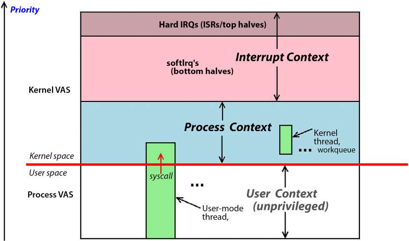

Hình 6.1: Sơ đồ khái niệm user-mode execution không đặc quyền và kernel-mode execution có đặc quyền với cả process context, interrupt context

Ở phần sau, Xác định context, chúng tôi chỉ chính xác cách kiểm tra kernel/driver code hiện chạy trong process hay interrupt context. Hãy đọc tiếp!

## Tìm hiểu cơ bản process Virtual Address Space (VAS)

“Quy tắc” nền tảng virtual memory: mọi bộ nhớ có khả năng addressable nằm trong một chiếc hộp, tức được sandbox. Ta coi “hộp” là process image hay process VAS. Không thể nhìn “ngoài” hộp.

Ở đây chỉ cung cấp tổng quan nhanh process user VAS, hẳn đủ dùng. Để biết thêm, tham khảo cuốn trước của tôi Hands-On System Programming with Linux.

User VAS chia thành các memory region đồng nhất gọi segment, hoặc chính xác hơn mapping, vì bên trong được tạo qua system call mmap(). Hình 6.2 cho thấy mapping/segment tối thiểu mọi Linux user-space process đều có:

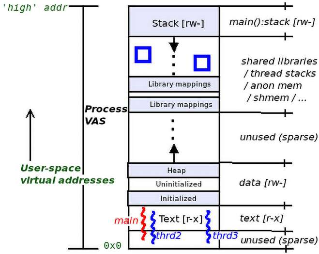

Hình 6.2: VAS của Linux user-space process

Hãy phân tích nhanh các segment/mapping từ dưới lên:

- Text segment: Nơi chứa machine code; register instruction pointer hoặc tương đương của processor core trỏ vào đây khi thread của process thực thi code – static/fixed size (mode `r-x`). (Lưu ý text segment không bắt đầu tại virtual address `0x0`, mà cao hơn một khoảng. Thực tế virtual page đầu tiên chứa NULL address (`0x0`) được gọi ‘null trap’ page. Nói thêm null trap sau.)

- Data segment: Ngay trên text mapping. Nơi lưu global và static data variable (mode `rw-`). Thực tế có ba data segment riêng:

  - Initialized data segment: Global/static variable Pre-initialized nằm ở đây – static/fixed size.

  - Uninitialized data segment: Global/static variable chưa khởi tạo nằm ở đây, auto-initialized `0` lúc runtime; vùng này đôi khi gọi bss – static/fixed size.

  - Heap segment: Standard C library API cấp phát/giải phóng bộ nhớ, họ routine `malloc()` quen thuộc, lấy bộ nhớ ở đây. Điều đó cũng chưa hoàn toàn đúng. Trên glibc hiện đại, chỉ `malloc()` yêu cầu dưới `MMAP_THRESHOLD` byte, mặc định 128 KB, lấy từ heap. Yêu cầu lớn hơn được cấp thành mapping riêng trong process VAS qua system call mạnh mẽ `mmap()`, gọi anonymous hay anon mapping. Heap là dynamic segment, có thể tăng/giảm kích thước. Ta thường nói heap ‘phát triển lên’ về virtual address cao hơn. Vị trí cuối trên heap reference-able hợp lệ gọi program break, lấy được bằng sbrk(0).

- Shared library (text, data): Mọi shared library mà process dynamic link được map lúc runtime qua loader gọi mmap() vào process VAS, đâu đó giữa đỉnh heap và stack của thread `main()` (mode `r-x`/`rw-`). Vùng chung giữa heap và stack này cũng chứa stack memory của các thread khác ngoài main(), anonymous memory và shared memory region.

- Stack: Memory region dùng Last In, First Out (LIFO) semantics; stack triển khai cơ chế function call của ngôn ngữ high-level, thực chất giữ execution context của thread. Stack frame đảm nhiệm parameter passing, tạo/hủy local variable và truyền return value. Đây là dynamic segment. Trên mọi processor hiện đại gồm x86/ARM, stack ‘phát triển xuống’ về virtual address thấp hơn, gọi fully descending stack. Mỗi lần function-calling, stack frame hay call frame được cấp phát, khởi tạo theo yêu cầu; bố cục chính xác rất CPU-dependent, phải tham khảo CPU Application Binary Interface (ABI) tương ứng – xem Đọc thêm. Register Stack Pointer (SP) hoặc tương đương của processor core luôn trỏ current frame, đỉnh stack; vì stack phát triển về virtual address thấp, đỉnh stack thực chất là virtual address thấp nhất! non-intuitive nhưng đúng (mode `rw-`). (Tất nhiên còn nhiều điều; stack frame thực sự không được cấp phát, khởi tạo mỗi lần gọi function vì quá chậm. Tương tự không deallocate khi function return; bạn học thêm khi tiến tới.)

Tất nhiên bạn hiểu process phải có ít nhất một thread thực thi, thread là execution path trong process; thread được bảo đảm đó tất nhiên là function `main()`. Trong Hình 6.2, ví dụ có ba thread thực thi `main`, `thrd2` và `thrd3`. Như mong đợi, mọi thread chia sẻ mọi thứ trong process VAS trừ stack; như đã biết, mỗi thread có private stack. Stack của `main` ở đỉnh process user VAS; stack `thrd2` và `thrd3` có thể cấp bất cứ đâu giữa library mapping và stack `main`, được minh họa bằng hai ô xanh trong vùng này.

Tôi thiết kế, triển khai tiện ích mà tôi thấy khá hữu ích để học/dạy và debug, tên procmap (`https://github.com/kaiwan/procmap`); công cụ visualization process VAS console-based. Nó thực sự hiện toàn bộ process VAS khá chi tiết; ta bắt đầu dùng ở chương sau. Nhưng đừng vì vậy chờ mới thử; hãy clone và thử trên Linux ngay, cần root access.

Giờ hiểu cơ bản process VAS, đến lúc đi sâu hơn khá nhiều vào kernel internals liên quan process VAS, user/kernel address space, thread và stack.

## Tổ chức process, thread và stack – user space và kernel space

Mô hình process UNIX truyền thống – Mọi thứ là process; nếu không phải process thì là file – có nhiều ưu điểm. Việc các hệ điều hành vẫn theo mô hình sau hơn năm thập niên đủ xác nhận. Tất nhiên ngày nay thread được coi atomic execution context; thread là execution path trong process. Thread chia sẻ mọi process resource, gồm user VAS, open file, signal disposition, IPC object, credential, paging table, v.v., trừ stack. Mỗi thread có private stack region; hoàn toàn hợp lý, nếu không làm sao thực sự chạy parallel vì stack giữ execution context.

Lý do khác tập trung thread thay process sẽ rõ hơn ở Chương 10, The CPU Scheduler – Phần 1. Hiện chỉ nói: thread, không phải process, là kernel schedulable entity (KSE) – thứ được schedule chạy trên CPU core. Đây là hệ quả của khía cạnh then chốt Linux architecture. Trên Linux, mọi thread kể cả kernel thread ánh xạ đến kernel metadata structure gọi task structure. Task structure, còn gọi process descriptor, về cơ bản là kernel data structure lớn dùng làm per-thread attribute structure. Với mỗi thread tồn tại, kernel duy trì task structure tương ứng (Hình 6.3; đừng lo, sẽ nói thêm trong các phần sau).

Điểm then chốt tiếp theo là cần một stack cho mỗi thread ở mỗi privilege level CPU hỗ trợ. Trên hệ điều hành hiện đại như Linux, hỗ trợ hai CPU privilege level – user mode/user space không đặc quyền và kernel mode/kernel space có đặc quyền. Vì vậy trên Linux mỗi user-space thread tồn tại có hai stack:

- User-space stack: Dùng khi thread chạy user-mode code path.

- Kernel-space stack: Dùng khi thread chuyển kernel mode qua system call/processor exception và chạy kernel code path trong process context.

Tất nhiên quy tắc tốt nào cũng có ngoại lệ: kernel thread, viết ngắn kthread, chỉ sống trong kernel nên chỉ có “tầm nhìn” kernel virtual address space, không “thấy” userland. Vì vậy kthread chỉ thực thi kernel-space code path nên mỗi kthread chỉ một stack – kernel-space stack.

Điều này có thể khiến bạn hỏi dùng stack nào khi xử lý hardware interrupt handler; dù arch-dependant, kernel thường duy trì một IRQ stack mỗi core cho đúng mục đích này.

Ví dụ nhanh làm rõ điểm then chốt: khi chạy process C ‘Hello, world’ K\&R kinh điển, kernel tạo process; nó thiết lập, khởi tạo nhiều object, gồm process task structure, process VAS với user-mode stack, cùng kernel-mode stack riêng. Khi chạy, tất nhiên process đầu tiên thực thi API `printf()` trong user mode, dùng user-space stack của `main()`. Sau khi chuẩn bị, `printf()` phát system call `write()`! Khiến process chuyển kernel mode và thực sự ghi chuỗi `Hello, world\n` qua code path lớp `tty` trong kernel ra stdout device. Vì giờ thực thi kernel code ở kernel mode, nó dùng kernel-space stack của mình.

Hình 6.3 chia address space làm hai – user space và kernel space. Ở phần trên sơ đồ, user space, thấy góc nhìn khái niệm nhiều process cùng user VAS. Ở dưới, kernel space, không gian monolithic lớn chia sẻ bởi mọi user-mode process, thấy tương ứng mỗi user-mode thread có kernel metadata structure `struct task_struct`, sẽ trình bày chi tiết sau, và kernel-mode stack của thread đó.

Ngoài ra dưới cùng, ví dụ thấy ba kernel thread tên `kthrd1`, `kthrd2`, `kthrdn`; như mong đợi, chúng cũng có metadata structure `task_struct` biểu diễn nội dung bên trong, các attribute, và kernel-mode stack:

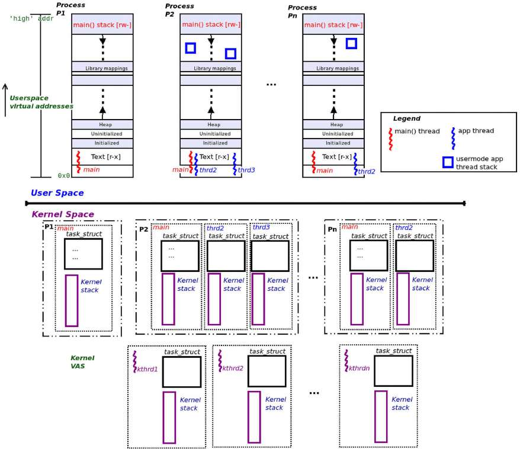

Hình 6.3: User/kernel VAS – process, thread, stack và task structure (task\_struct)

### Chạy script nhỏ xem số process và thread tồn tại

Để thảo luận user/kernel virtual address space cụ thể, chạy Bash script đơn giản (`ch6/countem.sh`) đếm process và thread hiện tồn tại. Tôi làm trên native Linux Ubuntu 22.04 LTS x86\_64; xem output sau (phần đầu có thể hơi khác trên distro khác, không sao):

```
$ cd <booksrc>/ch6
$ ./countem.sh
System release info:
Distributor ID: Ubuntu
Description:    Ubuntu 22.04.1 LTS
Release:        22.04
Codename:       jammy

Total # of processes alive              =       234
Total # of threads alive                =       514
Total # of kernel threads alive         =       116
Thus, total # of user mode threads alive =       398
$
```

Script lấy số process/thread thế nào? Đơn giản dựa trên `ps`, dùng option switch phù hợp, lọc output và tính chút ít. (Các phần sau bổ sung chi tiết.) Tôi để bạn tự xem code script đơn giản tại `ch6/countem.sh`. Nghiên cứu và hiểu phần dưới output trên. Tất nhiên bạn nhận ra đó là snapshot tình hình ở một thời điểm nhất định. Nó có thể và thực sự thay đổi.

Trong các phần sau, chia thảo luận thành hai, tương ứng hai address space: phần user space thấy trong Hình 6.3 và phần kernel space. Bắt đầu các thành phần user space.

### Tổ chức user space

Tham chiếu Bash script `countem.sh` đã chạy phần trước, giờ phân tích và thảo luận vài điểm then chốt, tạm giới hạn ở user-space portion của process VAS. Hãy đọc và hiểu cẩn thận (các số nói trong thảo luận sau thuộc lần chạy mẫu `countem.sh` ở phần Chạy script nhỏ xem số process và thread tồn tại). Để hiểu rõ hơn, tôi đặt phần user space của sơ đồ ở đây:

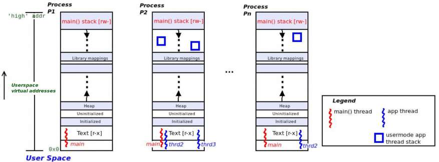

Hình 6.4: Phần user space của bức tranh tổng thể Hình 6.3

Ở Hình 6.4 thấy ba user-mode process riêng. Mọi process có ít nhất một thread thực thi, thread `main()`. Ở đây ba process `P1`, `P2`, `Pn` lần lượt có một, ba và hai thread, kể cả `main()`. Trong lần chạy ví dụ script `countem.sh` trước ở phần Chạy script nhỏ xem số process và thread tồn tại, `Pn` có n=234.

Lưu ý sơ đồ thuần khái niệm. Ví dụ thực tế process PID 2 thường là single-threaded kernel thread tên kthreadd.

Mỗi process gồm vài segment, chính xác là mapping. Nói chung user-mode segment/mapping như sau:

- Text: Code; `r-x`

- Data segment: `rw-`; gồm ba mapping riêng – initialized data segment, uninitialized data segment hay `bss`, và `heap` ‘upward-growing’

- Library mapping: Cho text/data của từng shared library process dynamic link vào:

- Các stack Downward-growing.

Về stack, lần chạy mẫu trước cho thấy hiện có 398 user-mode thread trên hệ thống. Nghĩa là cũng có 398 user-space stack, vì mỗi user-mode thread tồn tại có một user-mode stack. Về các user-space thread stack này có thể nói:

- Luôn có một user-space stack cho thread `main()`, gần đỉnh, đầu cao của user VAS. Nếu process single-threaded, chỉ thread `main()`, nó chỉ có một user-mode stack; process P1 ở Hình 6.4 thể hiện trường hợp này.

Ngoài lề nhưng quan trọng: trên Linux, system call `foo()` bất kỳ thường thành function `sys_foo()` trong kernel. Thường nhưng không luôn, `sys_foo()` là wrapper gọi code ‘thực’ `do_[*]_foo()`. Chi tiết thêm: trong kernel code có thể thấy macro dạng `SYSCALL_DEFINEn(foo, ...)`; macro thành routine `sys_foo()`. Số `n` nối thêm trong miền \[0,6\], là số parameter truyền từ user space vào kernel qua system call.

- Nếu process multithreaded, mỗi thread tồn tại có một user-mode thread stack, kể cả `main()`; `P2` và `Pn` trong Hình 6.4 minh họa. Stack được cấp khi gọi `fork(2)` cho `main()` hoặc `pthread_create()` cho thread còn lại, khiến code path sau chạy trong process context ở kernel (`kernel/fork.c`): `sys_fork() --> kernel_clone()`

(Trước đây worker routine triển khai system call `fork()` trong kernel tên `_do_fork()`; từ kernel 5.10 đổi thành `kernel_clone()`; commit `# cad6967ac108`.)

- Ngoài ra Pthreads creation library API `pthread_create()` trên Linux gọi system call rất Linux-specific `clone()` (code trong kernel tại `kernel/fork.c:sys_clone()`). Cuối cùng system call gọi `kernel_clone();` parameter truyền, đặc biệt giá trị `flags`, báo kernel chính xác cách tạo custom process – nói cách khác một thread!

- User-space stack tất nhiên dynamic; có thể tăng/giảm đến stack size resource limit `RLIMIT_STACK`, thường 8 MB; dùng `prlimit` tra được.

Để bạn biết: Với Linux 6.6, tính năng mới cho họ x86 tên “user space shadow stacks” cuối cùng được merge. Về cơ bản là security hardening feature, giúp bảo vệ app khỏi Return Oriented Programming (ROP) attack nguy hiểm. Các attack sửa call stack/function return address. Dùng shadow stack chỉ cho kernel implementation lưu return address trong hardware shadow stack không sửa được, rồi lúc return pop giá trị và so với regular stack. Nếu khác, báo có thể exploit đang diễn ra và khiến processor phát general protection fault để chặn ngay. Triển khai hiện tại trên 6.6 dành x86\_64 và chỉ user-mode stack. Xem thêm User-space shadow stacks (maybe) for 6.4, Jon Corbet, LWN, tháng 3 năm 2023: `https://lwn.net/Articles/926649/`.

Đã thấy và hiểu phần user space, giờ đi sâu phía kernel space.

### Tổ chức kernel space

Tiếp tục thảo luận tham chiếu Bash script `countem.sh` đã chạy ở phần Chạy script nhỏ xem số process và thread tồn tại, giờ phân tích và bàn vài điểm then chốt, giới hạn ở kernel-space portion của VAS. Hãy đọc và hiểu kỹ, đồng thời đọc các số output lần chạy mẫu script `countem.sh` trước.

Để hiểu rõ hơn, tôi đặt phần kernel space của sơ đồ ở đây, Hình 6.5:

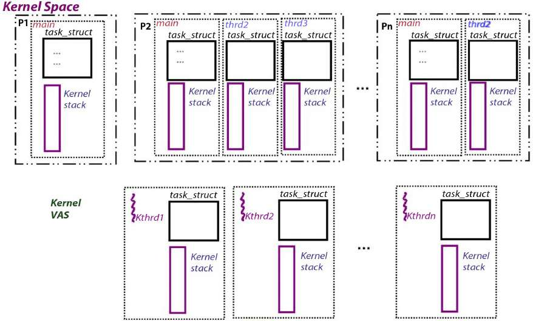

Hình 6.5: Phần kernel space của bức tranh tổng thể Hình 6.3

Một lần nữa từ chạy mẫu thấy hệ thống hiện có 398 user-mode thread và 116 kernel thread. Cho tổng 514 kernel-space stack. Thế nào? Như đã nói mỗi user-mode thread có hai stack, một user-mode, một kernel-mode. Vì vậy có 398 kernel-mode stack cho các user-mode thread, cộng 116 kernel-mode stack cho pure kernel thread (nhớ kernel thread chỉ có kernel-mode stack, hoàn toàn không “thấy” user space), cho tổng (398+116=) 514 kernel-space stack. Hãy liệt kê vài đặc điểm kernel-mode stack:

- Có một kernel-mode stack cho từng user-mode thread tồn tại, kể cả `main()`.

- Kernel-mode stack fixed size, static, khá nhỏ. Thực tế kích thước 2 page trên hệ điều hành 32 bit, 4 page trên 64 bit, page thường 4 KB.

Đừng đơn giản giả định page size luôn 4 KB – trong user space dùng system call `getpagesize()` truy vấn; trong kernel space macro `PAGE_SIZE` cho cùng giá trị.

- Được cấp lúc tạo thread, thường quy về kernel code tại `kernel_clone() --> copy_process() --> dup_task_struct()`.

Một lần nữa cần cực rõ: mỗi user-mode thread có hai stack – user-mode và kernel-mode. Ngoại lệ là kernel thread, chỉ có kernel-mode stack vì không có user mapping, do đó không user-space segment. Dưới Hình 6.5 có ba kernel thread `kthrd1`, `kthrd2`, `kthrdn`; trong chạy mẫu trước, `kthrdn` có n=116. Hơn nữa mỗi kernel thread được cấp task structure và kernel-mode stack lúc tạo.

kernel-mode stack giống user-mode stack ở phần lớn khía cạnh – mỗi lần gọi function trong kernel space, stack frame được thiết lập (bố cục riêng kiến trúc, thuộc CPU ABI document; xem Đọc thêm). CPU có register theo dõi vị trí stack hiện tại, thường Stack Pointer (SP), stack “phát triển” về virtual address thấp. Nhưng khác user-mode stack dynamic, kernel-mode stack fixed size và nhỏ.

Hệ quả quan trọng kích thước kernel-mode stack khá nhỏ, two-page hoặc four-page, đối với nhà phát triển kernel/driver: rất thận trọng không overflow kernel stack bằng công việc stack-intensive như local variable lớn hoặc recursion.

Có kernel configurable `CONFIG_FRAME_WARN` cảnh báo dùng kernel stack cao lúc compile time; đây là text liên quan trong `lib/Kconfig.debug`:

```
config FRAME_WARN:
  int "Warn for stack frames larger than"
  range 0 8192
  […]
  default 2048 if 64BIT
  help
     Tell gcc to warn at build time for stack frames larger than this.
     Setting this too low will cause a lot of warnings.
     Setting it to 0 disables the warning.
```

#### Tóm tắt kernel về thread, task structure và stack

Được rồi, tuyệt, giờ tóm tắt điều học và phát hiện từ thảo luận trước cùng lần chạy mẫu script `countem.sh` ở phần Chạy script nhỏ xem số process và thread tồn tại:

- Task structure:

  - Mỗi thread tồn tại, user hay kernel, có task structure tương ứng (`struct task_struct`) trong kernel; đó là cách kernel theo dõi, quản lý. Mọi thread attribute cũng lưu ở đây; học thêm trong phần Tìm hiểu và truy cập kernel task structure

  - Với lần chạy mẫu script `ch6/countem.sh` ở phần Chạy script nhỏ xem số process và thread tồn tại:

  - Vì có tổng cộng 514 thread, cả user lẫn kernel, đang tồn tại trên hệ thống, điều này có nghĩa có tổng cộng 514 task structure chứa metadata trong kernel memory, trong code là `struct task_struct`. Trong số đó, chúng ta có thể nói như sau:

  - 398 task structure biểu diễn user thread.

  - (514 – 398 =) 116 task structure còn lại biểu diễn kernel thread.

- Stack:

  - Mỗi user-space thread có hai stack:

  - User-mode stack dùng khi thread thực thi user-mode code path

  - Kernel-mode stack dùng khi thread thực thi kernel-mode code path

  - Ngoài ra có per-core IRQ stack riêng dùng khi hardware interrupt handler chạy code path

  - Ngoại lệ: kernel thread chỉ có một stack, kernel-mode stack của nó

  - Vì vậy với lần chạy mẫu script `ch6/countem.sh`, có:

  - 398 user-space stack trong userland.

  - Trên, cộng 398 kernel-space stack trong kernel memory.

  - Trên, cộng 116 kernel-space stack cho 116 kernel thread tồn tại.

  - Tổng cộng 398 + 398 + 116 = 912 stack! Với 4 page mỗi kernel-mode stack trên Linux 64 bit, giả định page size 4 KB, là 4\*4096\*912 = 14,25 MB RAM dùng cho stack memory.

  - Để bạn biết, `grep "KernelStack" /proc/meminfo` cho biết bộ nhớ hiện dùng cho kernel stack. Tra man page proc(5) để biết chi tiết.

Như đã đề cập ngắn, nhiều kiến trúc gồm x86/ARM64 hỗ trợ per-CPU stack riêng cho interrupt handling, gọi IRQ stack. Khi external hardware interrupt xảy ra, CPU control unit lập tức re-vectors cuối cùng đến interrupt handling code, có thể trong device driver. per-CPU interrupt stack riêng dùng giữ stack frame cho interrupt code path; giúp tránh áp lực quá lớn lên kernel-mode stack nhỏ hiện có của process/thread bị interrupt. IRQ stack size giống kernel-mode stack size của kiến trúc. (Ngoài ra x86\_64 hỗ trợ nhiều loại stack hơn, nhưng không đi sâu.)

Được rồi, bây giờ bạn đã hiểu tổ chức tổng thể của user space và kernel space xét theo process, thread và các stack của chúng. Chúng ta hãy chuyển sang cách thực sự xem nội dung của cả kernel-space stack lẫn user-space stack. Ngoài việc hữu ích cho học tập, kiến thức này có thể hỗ trợ rất nhiều trong các tình huống debug.

### Xem user stack và kernel stack

Stack thường là chìa khóa phiên debug. Chính stack giữ execution context hiện tại của thread – đang thực thi code trong function nào, và quan trọng là đến đây thế nào – cho phép suy luận lịch sử, đang làm gì và điều đã xảy ra. Có thể xem, diễn giải call stack của thread, còn gọi call chain/call trace/backtrace, cực kỳ quan trọng để hiểu chính xác đến đây thế nào. Mọi thông tin quý giá nằm trong stack. Nhưng chờ, mỗi thread có hai stack – user space và kernel space. Xem nội dung thế nào?

Ở đây trình bày hai cách chính xem kernel stack và user-mode stack của process/thread cụ thể, trước tiên cách truyền thống, rồi cách hiện đại gần đây qua eBPF. Hãy đọc tiếp.

#### Cách truyền thống để xem stack

Trước tiên học xem cả kernel stack và user-mode stack của process/thread bằng cách ta gọi truyền thống. Bắt đầu kernel-mode stack.

##### Xem kernel-space stack của thread hoặc process cụ thể

Tin tốt: rất dễ. Linux kernel cho thấy kernel stack của thread qua cơ chế thông thường để lộ kernel internals cho user space – interface filesystem `proc` mạnh, linh hoạt. Chỉ đọc pseudofile `/proc/PID/stack`.

Ví dụ luôn hữu ích, nên tra kernel-mode stack của Bash process. Giả sử trên Ubuntu khách x86\_64, Bash PID là `2459`:

Trên các kernel hiện đại, để tránh information leakage, việc xem kernel-mode stack của một process hoặc thread đòi hỏi root access như một yêu cầu bảo mật.

```
$ sudo cat /proc/2549/stack
[<0>] do_wait+0x184/0x340
[<0>] kernel_wait4+0xaf/0x150
[<0>] __do_sys_wait4+0x89/0xa0
[<0>] __x64_sys_wait4+0x1e/0x30
[<0>] do_syscall_64+0x5c/0x90
[<0>] entry_SYSCALL_64_after_hwframe+0x63/0xcd
$
```

Trong output trên, mỗi dòng biểu diễn call frame hay stack frame trên stack. Để giải kernel stack backtrace, nên biết:

- Tên hiển thị là function đã gọi – ví dụ mục thứ hai ở đây tên `do_syscall_64()`, vì luôn đọc stack trace bottom-up.

- Function call graph có thứ tự dưới lên; vì thế output nên đọc bottom-up. Ở đây nghĩa là, bỏ mục đầu dưới cùng, call graph như sau: `do_syscall_64() --> __x64_sys_wait4() --> __do_sys_wait4() -->` `kernel_wait4() --> do_wait()`.

- Mỗi dòng output biểu diễn call frame, thực chất một function trong call chain.

- Nếu call frame có tiền tố một hay nhiều `?`, nghĩa kernel không diễn giải tin cậy được. Bỏ qua, kernel nói rất có thể invalid stack frame, dấu vết cũ còn lại; kernel backtrace code thường hoàn toàn đúng! (Cần hiểu cùng vùng stack memory rất thường được tái sử dụng liên tục; có thể để lại dấu vết call stack trước không liên quan hiện tại.)

- Như đã nói, trên Linux system call `foo()` bất kỳ thường thành function `sys_foo()` trong kernel. Thường nhưng không luôn, `sys_foo()` là wrapper gọi code “thực” `do_[*]_foo()`.

Bây giờ, hãy xem lại output trước đó. Điều này khá rõ: Bash process của chúng ta đang thực thi function `do_wait()` bên trong kernel; call graph cho thấy rõ nó đến đó thông qua một system call, chính là `wait4()`! Điều này hoàn toàn đúng: shell hoạt động bằng cách fork một child process rồi chờ process đó kết thúc thông qua system call `wait4(2)`.

Độc giả tò mò, chính bạn, nên chú ý `[<0>]` ở cột ngoài cùng trái mỗi stack frame trong output trên là placeholder cho text/code address của function. Một lần nữa vì bảo mật, ngăn information leakage, kernel hiện đại đặt về không. (Biện pháp bảo mật khác về kernel/process layout ở Chương 7, Memory Management Internals – Essentials, các phần Randomizing the memory layout – KASLR và User-mode ASLR.)

Tiếp theo, bạn hỏi cú pháp `<func>+x/y`, ví dụ dòng `do_wait+0x184/0x340`, là gì? Thông tin thực sự hữu ích khi debug:

- Số đầu x, luôn hex, là byte offset từ đầu function đến vị trí execution hiện tại.

- Số hai y, cũng hex, là độ dài function kernel xác định; thường đúng.

Vậy `do_wait+0x184/0x340` nghĩa function `do_wait()` đang thực thi machine code ở offset `0x184` (`388` thập phân) byte từ đầu function, và function dài `0x340` (`832` thập phân) byte! (Cuốn Linux Kernel Debugging của tôi trình bày rất chi tiết các khía cạnh này.)

##### Xem user-space stack của thread hoặc process cụ thể

Trớ trêu, xem user-space stack của process/thread dường như khó hơn trên distro Linux điển hình, trái với kernel-mode stack vừa thấy. Có tiện ích gstack. Thực tế chỉ là wrapper đơn giản trên script gọi GDB debugger lâu đời ở batch mode, yêu cầu GDB chạy `backtrace`.

Đáng tiếc trên Ubuntu, ít nhất 23.10 trở xuống, dường như có vấn đề: không thấy gstack trong native package nào. (Ubuntu có pstack cũ nhưng chỉ chạy Linux x86 32 bit.)

Workaround đơn giản là dùng GDB non-interactive/batch mode; luôn có thể chạy `attach <PID>` rồi `[thread apply all] bt` để xem user-mode stack. Thực chất gần chính xác điều webpage tên rất hợp “poor man’s profiler” (`https://poormansprofiler.org/`) chỉ làm, cũng như `pstack` trên Fedora! Vì vậy wrapper script đơn giản, khá sơ khai sau có thể hiện user-mode stack frame của process bất kỳ, với `$1` là PID process/thread, tất nhiên phải chạy root:

```
sudo gdb \
  -ex "set pagination 0" \
  -ex "thread apply all bt" \
  --batch -p $1
```

Tôi đặt code đơn giản vào script ch6/ustack. Đã đến lúc kiểm thử tối thiểu! Ta cho script chạy trên Bash process mới nhất không hề biết sắp bị kiểm tra:

```
$ ./ustack $(pgrep --newest bash)
[sudo] password for c2kp:
0x00007fadd3109c3a in __GI___wait4 (pid=-1, stat_loc=0x7fffe3a3a1e0,
options=10, usage=0x0) at ../sysdeps/unix/sysv/linux/wait4.c:27
27    ../sysdeps/unix/sysv/linux/wait4.c: No such file or directory.

Thread 1 (process 2549):
#0  0x00007fadd3109c3a in __GI___wait4 (pid=-1, stat_loc=0x7fffe3a3a1e0,
options=10, usage=0x0) at ../sysdeps/unix/sysv/linux/wait4.c:27
#1  0x0000555b98cd4f03 in ?? ()
#2  0x0000555b98cd6373 in wait_for ()
#3  0x0000555b98cc3216 in execute_command_internal ()
#4  0x0000555b98cc39da in execute_command ()
#5  0x0000555b98cab665 in reader_loop ()
#6  0x0000555b98ca9ef9 in main ()
[Inferior 1 (process 2549) detached]
```

Và đây rồi! User-mode stack của Bash cùng mọi call frame hiện ra, đọc bottom-up! Một lần nữa mỗi dòng dưới `Thread 1 (process …)`, Thread 1 là thread `main()`, biểu diễn call frame; đọc từ dưới lên. Rõ ràng Bash thực thi command rồi cuối cùng gọi `__GI___wait4()`; trên Linux hiện đại chỉ là glibc wrapper của system call thực `wait4()`! Cột ngoài cùng trái như `#3` là call frame number; frame `#0` được coi đỉnh stack, tức function thực thi gần nhất, cuối call chain.

Một lần nữa bỏ qua call frame có label/tiền tố `??`. (Nhân tiện gstack hoạt động tốt trên máy ảo khách Fedora 38/39 x86\_64 của tôi.)

Khả năng xem bên trong kernel stack và user-space stack như các snippet trước, cùng việc sử dụng strace và ltrace để trace lần lượt system call và library call của một process hoặc thread, có thể hỗ trợ rất nhiều khi debug! Đừng bỏ qua những công cụ này.

Nhân tiện có thể bạn hỏi chuỗi `... at ../sysdeps/unix/sysv/linux/wait4.c:27` ở frame 0 nghĩa gì. Debug information trong library `libthread_db` cho GDB biết chính xác source code line nơi function `__GI___wait4()` được gọi! Tất nhiên cần source code đúng glibc version để tra.

Giờ đến cách hiện đại xem stack.

#### eBPF – cách hiện đại xem cả hai stack

Giờ thú vị hơn: học kiến thức rất cơ bản dùng cách hiện đại mạnh mẽ, tận dụng công nghệ gần đây tại thời điểm viết tên extended Berkeley Packet Filter (eBPF). Đã đề cập eBPF project trong chương trực tuyến Kernel Workspace Setup, phần Additional useful projects. BPF cũ đã có lâu, dùng network packet tracing; eBPF là đổi mới tương đối mới, chỉ có từ Linux kernel 4.x, tất nhiên nghĩa phải dùng Linux 4.x trở lên để theo cách này.

Dùng trực tiếp kernel-level BPF bytecode technology bên dưới cực kỳ khó; tin tốt là có nhiều frontend easy-to-use, tool và script. Trong số frontend, BPF Compiler Collection (BCC) và bpftrace được coi rất hữu ích. (Sơ đồ BCC performance analysis tool hiện tại ở `https://github.com/iovisor/bcc/blob/master/images/bcc_tracing_tools_2019.png`; danh sách eBPF frontend tại `http://www.brendangregg.com/ebpf.html#frontends`.)

Ở đây, chúng ta chỉ minh họa nhanh bằng một công cụ BCC có tên `stackcount`. Ít nhất trên Ubuntu, các công cụ eBPF này có hậu tố `-bpfcc`, nên công cụ này có tên `stackcount-bpfcc`. Một ưu điểm khác là công cụ cho phép xem đồng thời cả kernel stack lẫn user-mode stack mà không cần các công cụ riêng.

Bạn có thể cài các công cụ BCC cho Linux distro trên host bằng cách đọc hướng dẫn cài đặt tại `https://github.com/iovisor/bcc/blob/master/INSTALL.md`. Còn việc cài chúng trên Linux VM khách đang chạy custom kernel 6.1 của chúng ta thì sao? Bạn có thể làm được, mặc dù với các phiên bản kernel trước đây, việc này có thể gây vấn đề và đòi hỏi chạy một distro kernel như kernel Ubuntu- hoặc Fedora-supplied.

Hình 6.6 là ảnh màn hình help ngắn gọn tiện ích hiện khi chạy với parameter `–h`:

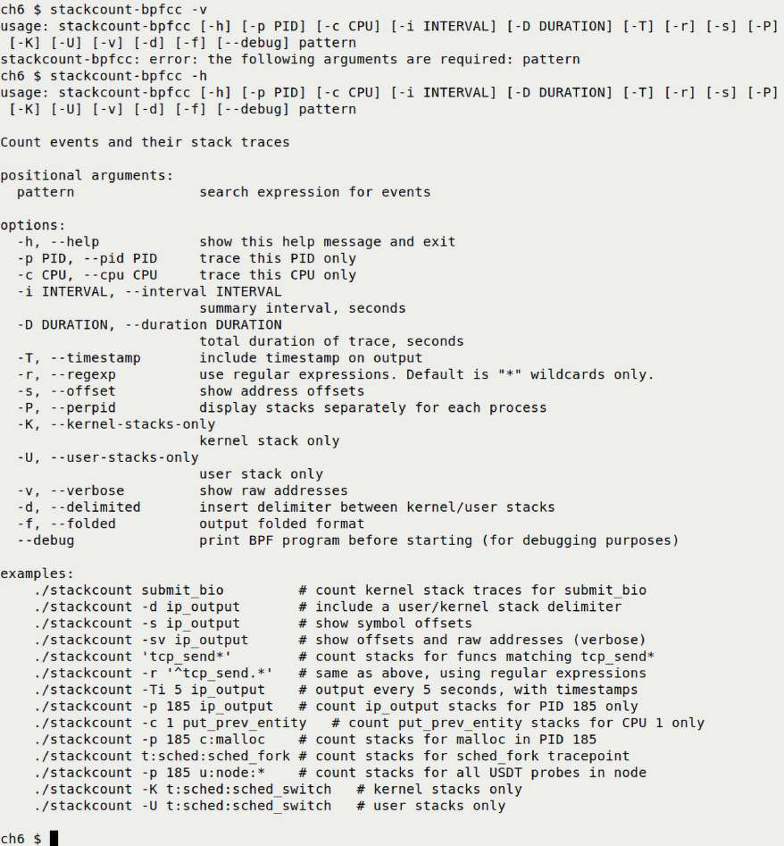

Hình 6.6: Output hữu ích của stackcount-bpfcc -h

Hãy xem. Tôi chắc chắn khuyến khích đọc ví dụ stackcount\[-bpfcc\] của Brendan Gregg và contributor khác tại `https://github.com/iovisor/bcc/blob/master/tools/stackcount_example.txt`. Chúng đáng đọc.

Ví dụ sau dùng BCC tool `stackcount-bpfcc` trên host Ubuntu 22.04 LTS x86\_64 chạy custom kernel 6.1, tra các khía cạnh call stack khi process `ping` chạy. Để thiết lập, tôi chạy `ping yahoo.com` background rồi vài instance `stackcount_bpfcc` với parameter khác nhau phù hợp qua wrapper script đơn giản `ch6/stackcount_eg.sh`; hãy xem.

Kernel symbol, ngay cả nhiều production system, thường được bật đủ để ít nhất thấy tên function; thực tế sysctl `kptr_restrict` ảnh hưởng rõ ràng, tra tại `https://sysctl-explorer.net/kernel/kptr_restrict/`. Mặt khác hơi trớ trêu, thường ứng dụng không compile với symbol, vì hay dùng compiler option `–fomit-frame-pointer`, nên tên function có thể không hiện ở user-mode call stack. Compile với `–fno-omit-frame-pointer` hoặc dùng debug symbol package giải quyết được khi debug.

Với `stackcount[-bpfcc]`, phải chỉ định function quan tâm; thú vị là có thể user-space hoặc kernel-space function, dùng wildcard hay ngay cả regex! Chỉ khi các function đó được gọi, stack mới trace và report. Hình 6.7 là ảnh một phần demo stackcount script hoạt động; khi `ping` liên tục ping, thấy rõ kernel call stack và user-mode call stack not-so-clear vì không có user-space symbol:

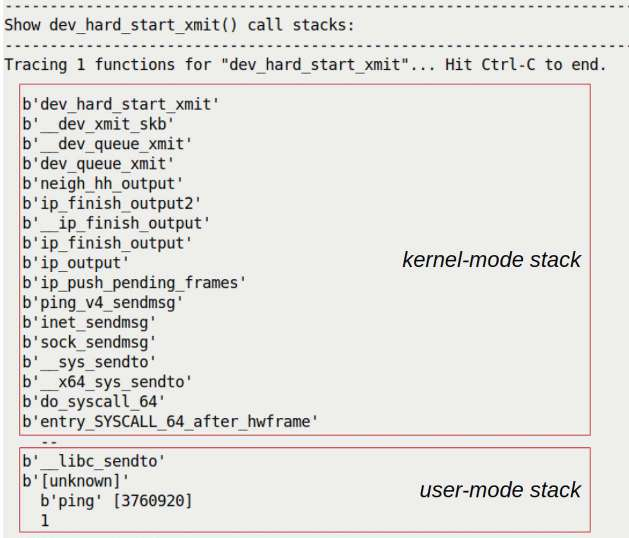

Hình 6.7: Một phần script ch6/stackcount\_eg.sh đang chạy, kernel/user stack được chủ động làm nổi bật giữa --delimiter

Tùy chọn `--delimited` in delimiter `--`, biểu thị ranh giới kernel-mode và user-mode stack của process. (Đáng tiếc phần lớn production user-mode app đã strip symbolic information, nên phần lớn user-mode stack frame chỉ hiện `[unknown]`.) Ít nhất trên hệ thống này kernel stack frame rất rõ; truyền `--verbose` còn in virtual address của text/code function bên trái. Một lần nữa lưu ý `stackcount-bpfcc` chỉ hoạt động Linux 4.6+, cần root. Xem man page để biết chi tiết.

Lưu ý eBPF program có thể thất bại vì bật kernel lockdown tương đối mới, dù mặc định tắt. Đây là Linux Security Module (LSM) tăng mức bảo mật cứng rắn trên Linux. Tất nhiên bảo mật là dao double-edged; hệ thống rất an toàn ngầm nghĩa vài thứ không hoạt động như mong đợi, gồm một số eBPF program. Tham khảo Đọc thêm về kernel lockdown.

Ngoài lề thú vị, hữu ích: Brendan Gregg đã xây dựng từ một thời gian trước visualization tooling mạnh tên rất hợp Flame Graphs; stack trace visualization trên code path được profile, giúp nhanh thấy code frequently-on-the-cpu, có tính năng zoom vào/ra call path! Xem Đọc thêm để có liên kết eBPF, BCC, bpftrace và Flame Graphs.

Ở đây mới chạm bề mặt; eBPF tool như BCC/bpftrace thực sự là cách hiện đại mạnh để system app tracing và performance analysis trên Linux, và observability nói chung. Profiling tool hữu ích khác gồm perf, Flame Graphs và nhiều công cụ khác. Hãy dành thời gian học dùng các tool mạnh này!

Được rồi, tiến triển tốt, giờ kết thúc phần bằng thu nhỏ góc nhìn để xem tổng quan những điều học đến đây!

### Góc nhìn từ độ cao 10.000 foot về process VAS

Trước khi kết thúc, cần lùi lại xem toàn bộ VAS mỗi process và hình thức trên toàn hệ thống – nói cách khác thu nhỏ để có “góc nhìn từ độ cao 10.000 foot” của toàn system address space. Đó là điều cố thực hiện qua sơ đồ khá lớn, chi tiết sau, Hình 6.8, bản mở rộng hay superset Hình 6.3 trước.

Với bạn đọc bản in, rất tốt, tôi chắc chắn khuyến khích xem hình màu đầy đủ trong PDF tại `https://packt.link/gbp/9781803232225`.

Ngoài những gì đã học, thấy – process user-space segment, user/kernel thread và kernel-mode stack – đừng quên kernel có nhiều metadata khác: per-thread task structure, kernel thread, per-process memory descriptor metadata structure, open-file metadata structure, IPC metadata structure, v.v. Tất cả thực sự thuộc kernel VAS, thường gọi kernel segment.

Kernel segment không chỉ có task và stack. Nó còn chứa hiển nhiên static kernel core code/data – thực chất mọi subsystem lớn nhỏ, arch-specific code, v.v. đã nói ở Chương 4, Viết kernel module đầu tiên – Phần 1, phần Các thành phần kernel space.

Như vừa nói, sơ đồ sau là nỗ lực tổng hợp, trình bày mọi thông tin, đúng hơn phần lớn, ở cùng nơi:

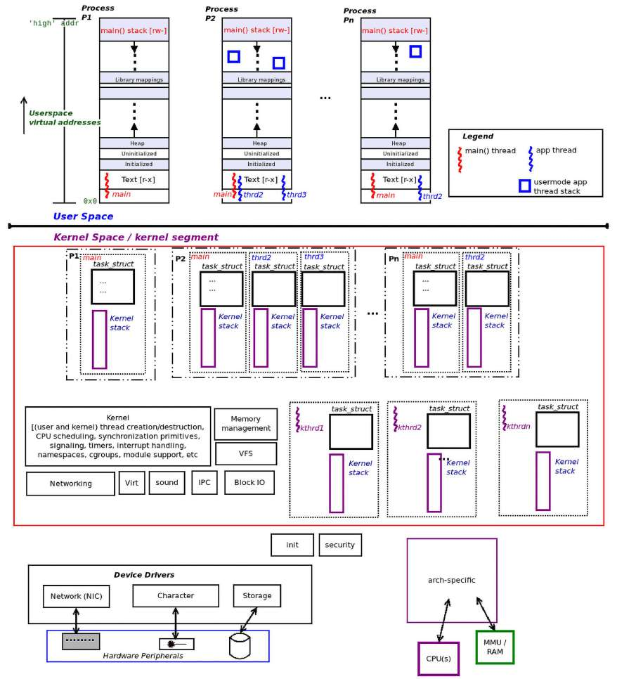

Hình 6.8: Góc nhìn từ độ cao 10.000 foot về process, thread, stack, task structure và nhiều thành phần khác của user/kernel VAS

Phù, khá nhiều nhỉ? Khối đỏ lớn trong kernel segment sơ đồ trên về khái niệm bao quát core kernel code/data, các subsystem chính; cũng hiện per-thread task structure và kernel-mode stack. Còn lại coi non-core, gồm device driver. (Có thể coi arch-specific code là core; ở đây chỉ hiện riêng.) Cũng đừng để thông tin trên làm quá tải; chỉ tập trung điều hiện cần – process, thread, task structure, stack. Nếu chưa rõ, nhớ re-read nội dung trước.

Giờ chuyển sang thực sự hiểu và học cách tham chiếu metadata structure then chốt hay “root” của từng thread tồn tại – task structure.

## Tìm hiểu và truy cập kernel task structure

Như đã học, từng user-space/kernel-space thread được biểu diễn nội bộ Linux kernel bằng metadata structure chứa mọi attribute – task structure. Task structure được biểu diễn trong kernel code tại `include/linux/sched.h:struct task_struct`.

Để xem trực tuyến kernel code phiên bản bất kỳ, có hệ thống tìm kiếm tuyệt vời tại `https://elixir.bootlin.com/linux/latest/source`. Ví dụ với release kernel 6.1.25 LTS, định nghĩa task structure tại `https://elixir.bootlin.com/linux/v6.1.25/source/include/linux/sched.h#L737`.

Đáng tiếc nó thường bị gọi “process descriptor”, gây nhầm lẫn không dứt! May thay cụm task structure tốt hơn nhiều; biểu diễn runnable task, thực chất thread.

Vậy là rõ: trong thiết kế Linux, mỗi process gồm một hay nhiều thread, mỗi thread ánh xạ đến kernel metadata structure gọi task structure (`struct task_struct`).

Task structure là metadata structure “root” của thread, encapsulate mọi thông tin hệ điều hành cần cho thread. Gồm thông tin memory như thiết lập segment/mapping, paging table, usage info và hơn nữa; CPU scheduling detail; mọi file đang mở; credential, capability bitmask, timer, lock, Asynchronous I/O (AIO) context, hardware context info, signal disposition, IPC object, resource limit, audit tùy chọn, security/profiling info và nhiều chi tiết tương tự.

Hình 6.9 biểu diễn khái niệm Linux kernel task structure và phần lớn metadata nó chứa:

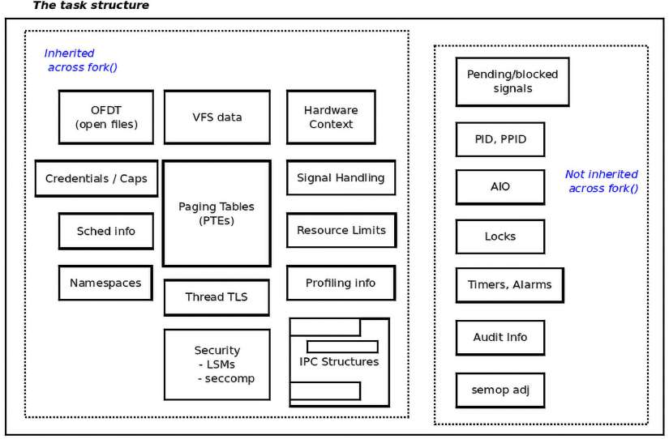

Hình 6.9: Linux kernel task structure: struct task\_struct

Như thấy ở Hình 6.9, task structure giữ lượng thông tin lớn cho từng task/thread tồn tại trên hệ thống, xin nhắc lại gồm cả kernel thread. Chúng tôi hiện các loại attribute encapsulate trong data structure theo dạng khái niệm chia ngăn ở Hình 6.9. Cũng thấy một số attribute được child process/thread kế thừa khi `fork()` hay `pthread_create()`, một số không mà chỉ reset về mặc định.

Ít nhất lúc này, đủ để nói kernel hiểu task là process hay thread. Sau sẽ demo kernel module (`ch6/foreach/thrd_showall`) cho thấy chính xác cách xác định, hãy chờ, sẽ đến!

Giờ bắt đầu hiểu chi tiết hơn vài member quan trọng của task structure khổng lồ; đọc tiếp!

Ở đây tôi chỉ muốn cho cảm nhận kernel task structure; không đi sâu vì hiện chưa cần. Bạn sẽ thấy ở phần sau sách, chúng ta đi sâu từng vùng theo yêu cầu.

### Xem bên trong task structure

Trước tiên nhớ task structure về cơ bản là root data structure process/thread – giữ mọi attribute của task như đã thấy. Vì thế khá lớn; tiện ích mạnh `crash`, dùng phân tích Linux crash dump hoặc điều tra live system, báo kích thước trên x86\_64 kernel 6.1.25 là 13.120 byte, C operator `sizeof` cũng vậy.

Task structure định nghĩa trong kernel header `include/linux/sched.h`, header khá then chốt. Code sau hiện định nghĩa nhưng chỉ một vài trong nhiều member. (Chú thích trong \<\< dấu ngoặc góc kép như thế này \>\> dùng giải thích rất ngắn các member):

```
// include/linux/sched.h
struct task_struct {
#ifdef CONFIG_THREAD_INFO_IN_TASK
    /*
     * For reasons of header soup (see current_thread_info()), this
     * must be the first element of task_struct.
     */
    struct thread_info  thread_info;   << important flags and status bits >>
#endif
    unsigned int            __state;
    [...]
    void     *stack;        << the location of the kernel-mode stack >>
    [...]
    << the members that follow are to do with CPU scheduling; some of them are
discussed in Ch 10 & Ch 11 on CPU Scheduling >>
    int on_rq;
    int prio;
    int static_prio;
    int normal_prio;
    unsigned int rt_priority;
    struct sched_entity se;
    struct sched_rt_entity rt;
    struct sched_dl_entity dl;
    const struct sched_class *sched_class;
    [...]
    unsigned int policy;
    int nr_cpus_allowed;
    const cpumask_t *cpus_ptr;
    [...]
```

Tiếp tục task structure trong code block sau, xem member liên quan memory management `(mm)`, giá trị Process ID (PID), Thread Group ID (TGID), credential structure, signal handling, open file và nhiều nữa. Một lần nữa không định đi sâu mọi member; khi phù hợp ở phần sau chương và có thể các chương khác sẽ quay lại:

```
    [...]
    struct mm_struct *mm;     << memory management info >>
    struct mm_struct *active_mm;
    [...]
    pid_t pid;    << task PID and TGID values; explained below >>
    pid_t tgid;
    [...]
    /* Context switch counts: */
    unsigned long nvcsw;
    unsigned long nivcsw;
    [...]
    /* Effective (overridable) subjective task credentials (COW): */
    const struct cred __rcu *cred;
    [...]
    /* Signal handlers: */
    struct signal_struct        *signal;
    struct sighand_struct __rcu        *sighand;
    sigset_t            blocked;
    sigset_t            real_blocked;
    /* Restored if set_restore_sigmask() was used: */
    sigset_t            saved_sigmask;
    struct sigpending        pending;
    [...]
    char comm[TASK_COMM_LEN];           << task name >>
    [...]
     /* Open file information: */
    struct files_struct *files;  << ptr to the 'open files' ds >>
    [...]
#ifdef CONFIG_VMAP_STACK
    struct vm_struct *stack_vm_area;
#endif
    [...]
#ifdef CONFIG_SECURITY
    /* Used by LSM modules for access restriction: */
    void *security;
#endif
    [...]
    /* CPU-specific state of this task: */
    struct thread_struct thread;  << task hardware context detail >>
    [...]
};
```

Cần hiểu member `struct task_struct` trong code block trên chỉ theo kernel source 6.1.25; kernel version khác có thể và thực sự thay đổi member! Tất nhiên không cần nói cũng biết điều này đúng toàn sách – mọi code/data trình bày theo Linux kernel 6.1(.25) LTS, được bảo trì đến tháng 12 năm 2026, còn CIP SLTS 6.1 đến tận tháng 8 năm 2033.

Giờ biết rõ hơn member task structure, chính xác truy cập nó và member thế nào? Hãy đọc tiếp.

### Truy cập task structure bằng current

Bạn còn nhớ trong lần chạy mẫu script `countem.sh` trước đó, ở phần Chạy script nhỏ để xem số process và thread đang tồn tại, chúng ta thấy tổng cộng 514 thread, cả user lẫn kernel, đang tồn tại trên hệ thống. Điều này có nghĩa có tổng cộng 514 task structure object trong kernel memory.

Chúng cần tổ chức để kernel dễ truy cập khi cần. Vì thế mọi task structure object trong kernel memory được nối trên circular doubly linked list gọi task list. Cách tổ chức này cần để các kernel code path duyệt, thường có `procfs` code cùng nhiều code khác. Dù vậy hãy nghĩ: khi process/thread chạy kernel code trong process context, làm sao biết `task_struct` nào thuộc mình giữa có thể hàng trăm, nghìn structure trong kernel memory? Hóa ra non-trivial. Kernel developer phát triển cách bảo đảm tìm được task structure cụ thể biểu diễn thread hiện chạy kernel code một cách hiệu quả. Đạt qua macro `current`. Hãy nghĩ như sau:

- Tra `current` cho pointer đến `struct task_struct` của thread đang chạy kernel code ngay lúc này – tức process context hiện chạy trên processor core, chính core thực hiện lookup!

- `current` tương tự, tất nhiên không hoàn toàn, pointer `this` trong ngôn ngữ object-oriented.

implementation-level macro `current` rất riêng theo kiến trúc/CPU. Ở đây không đi sâu mọi chi tiết triển khai phức tạp. Đủ nói nó được thiết kế kỹ để nhanh, thường thuật toán O(1). Ví dụ trên vài kiến trúc Reduced Instruction Set Computer (RISC) có nhiều general-purpose register như PowerPC/AArch64, một register dành riêng giữ `current`!

Tôi rất khuyến khích duyệt kernel source tree xem triển khai `current` dưới `arch/<arch>/asm/current.h`. Trên ARM32 phép tính O(1) cho kết quả; AArch64/PowerPC lưu trong register nên lookup cực nhanh. Trên x86\_64 triển khai dùng công nghệ lock-free, biến `per-CPU`, để giữ `current`, tránh costly locking; trình bày ở Chương 13, Kernel Synchronization – Phần 2, phần Per-CPU variables. Tất cả cần để dùng macro `current` trong module code là include header `<linux/sched.h>`.

Có thể dùng `current` dereference task structure lấy thông tin; ví dụ tra PID và tên process/thread như:

```
#include <linux/sched.h>
current->pid, current->comm
```

Phần sau bạn thấy kernel module full-fledged duyệt task list, in vài chi tiết từ mỗi task structure gặp.

### Xác định context

Như giờ đã biết, kernel code chạy ở một trong hai context:

- Process hay task context

- Interrupt context, một atomic context

Chúng loại trừ nhau – tại bất kỳ thời điểm, kernel code chạy trong process context, đôi khi atomic, hoặc interrupt context, luôn atomic; sẽ giải thích atomic ngay sau.

Vì sao cần xác định context kernel/driver code đang chạy? Quy tắc vàng kernel là không sleep hay block trong bất kỳ atomic context; làm vậy gây kernel bug. Có thể lockup hệ thống, thường gây kernel panic.

Vì sao? Trước tiên hiểu sleeping nghĩa context-switching: CPU chuyển chạy task khác trong khi task trước sleep. Vì thế sleeping gọi scheduler code rồi context switch, sẽ nói chi tiết Chương 10, The CPU Scheduler – Phần 1, và Chương 11, The CPU Scheduler – Phần 2. Đây thực sự là cách mọi blocking API hoạt động. Nhưng chạy atomic context như hardware interrupt, cả software interrupt/softirq, hoặc khi giữ spinlock, phải hoàn tất công việc không block, không sleep, không nhường CPU. Vì thế dùng từ “atomic”; nghĩa chạy đến hoàn tất không gián đoạn.

Giờ biết quy tắc đừng sleep trong atomic context, câu hỏi: làm sao biết code path có đang atomic context không? Đây là cách dễ xác định context kernel/driver code hiện thực thi:

```
#include <linux/preempt.h>
if (in_task())
    foo(); /* runs in process context; usually safe to sleep or block */
else
    bar(); /* runs in an atomic context; unsafe to sleep or block! */
```

Macro `in_task()` trả Boolean; `True` nếu code chạy process/task context, nơi thường an toàn để sleep; `False` nghĩa ở atomic context nào đó, có thể interrupt context, nơi không bao giờ an toàn để sleep.

Có thể bạn đã thấy dùng `in_interrupt()` – trả `True` nghĩa code ở interrupt context, `False` thì không. Tuy nhiên khuyến nghị code hiện đại không dựa macro này vì Bottom Half (BH) disabling có thể ảnh hưởng hoạt động. Vì thế khuyến nghị `in_task()` thay.

Nhưng chờ! Có thể hơi rắc rối: `in_task()` trả `True` đúng là nghĩa process context, nhưng riêng sự thật đó không bảo đảm hiện atomic không hay sleep an toàn không. Ví dụ chạy kernel/driver code trong process context nhưng giữ spinlock, loại lock rất phổ biến trong kernel; code giữa lock/unlock, so-called critical section, phải chạy atomically! Nghĩa là dù process/task context, code vẫn gây kernel-level bug nếu cố gọi API có khả năng block/sleep! Đừng lo, locking trình bày kỹ ở hai chương cuối.)

Cũng cẩn thận: theo định nghĩa, dùng macro `current` chỉ coi hợp lệ khi chạy process context.

Được rồi, giờ bạn đã học những kiến thức nền hữu ích về task structure, cách truy cập nó qua macro `current` và cách xác định context mà kernel code hoặc driver code đang chạy. Vì vậy, bây giờ chúng ta hãy viết một ít code kernel module để xem xét một phần kernel task structure!

## Làm việc với task structure qua ‘current’

Ở đây viết module đơn giản hiện vài member task structure. Hơn nữa tôi muốn bạn nghĩ: chính xác ai chạy init và cleanup code path của module này, hay bất kỳ module/kernel nào? Theo điều đã học, không phải kernel; như đã nói không có “kernel” process tổng thể lớn lao… Vậy ai chạy?

Câu trả lời hẳn rõ trong monolithic kernel như Linux: khi user-space process/thread phát system call, nó chuyển kernel mode, chạy kernel/module code trong process context. Vậy đúng, là process/thread. Cái nào? Code ta viết sẽ cho biết process context mà init/cleanup code path chạy. (Thảo luận chính điểm này kỹ hơn trong phần Thấy Linux là monolithic sắp tới.) Để làm, tạo function `show_ctx()` dùng `current` truy cập vài member task structure và hiện giá trị. Nó được gọi từ cả init và cleanup method như sau:

Để dễ đọc và vì giới hạn dung lượng, chỉ phần source code then chốt hiển thị ở đây. Toàn bộ source tree sách có trong kho GitHub; kỳ vọng bạn clone và dùng: `git clone https://github.com/PacktPublishing/Linux-Kernel-Programming_2E`.

```
/* code: ch6/current_affairs/current_affairs.c */
#define pr_fmt(fmt) "%s:%s(): " fmt, KBUILD_MODNAME, __func__
[ ... ]
#include <linux/sched.h>      /* current */
#include <linux/preempt.h>    /* in_task() */
#include <linux/cred.h>        /* current_{e}{u,g}id() */
#include <linux/uidgid.h>     /* {from,make}_kuid() */
[ ... ]
static void show_ctx(char *nm)
{
        /* Extract the task UID and EUID using helper methods provided */
        unsigned int uid = from_kuid(&init_user_ns, current_uid());
        unsigned int euid = from_kuid(&init_user_ns, current_euid());

        pr_info("\n"); /* shows mod & func names(due to pr_fmt()!) */
        if (likely(in_task())) {
        pr_info("we're running in process context ::\n"
            " name        : %s\n"
            " PID            : %6d\n"
            " TGID          : %6d\n"
            " UID            : %6u\n"
            " EUID          : %6u (%s root)\n"
            " state          : %c\n"
            " current (ptr to our process context's task_struct) :\n"
            "               0x%pK (0x%px)\n"
            " stack start : 0x%pK (0x%px)\n",
            current->comm,
            /* always better to use the helper methods provided */
        task_pid_nr(current), task_tgid_nr(current),
        /* ... rather than using direct lookups:
         * current->pid, current->tgid,
         */
        uid, euid,
        (euid == 0 ? "have" : "don't have"),
        task_state_to_char(current),
        /* Printing addresses twice- via %pK and %px
         * Here, by default, the values will typically be the same as
         * kptr_restrict == 1 and we've got root.
         */
        current, current, current->stack, current->stack);
} else
    pr_alert("Whoa! running in interrupt context [Should NOT Happen here!]\n");
```

Như in đậm trong code snippet trên, thấy với một số member có thể đơn giản dereference pointer `current` để truy cập các member `task_struct` và hiển thị qua kernel log buffer.

Tuyệt! Code snippet trên thực sự cho biết cách truy cập trực tiếp vài `task_struct` member qua `current`; nhưng không phải mọi member có thể hoặc nên truy cập trực tiếp. Thay vào đó kernel cung cấp helper method truy cập; hãy bàn ngắn tiếp theo.

### Kernel helper method Built-in và optimization

Trong code ví dụ trước, dùng vài helper/accessor method built-in kernel để lấy các member task structure. Đây là cách được khuyến nghị; ví dụ dùng `task_pid_nr()` xem PID thay trực tiếp `current->pid`. Tương tự process credential trong task structure, như effective UID (`EUID`) và các member tương tự đã hiện, được trừu tượng trong `struct cred`, truy cập qua helper routine như `from_kuid()` đã dùng. Tương tự còn nhiều helper method; tra trong `include/linux/sched.h` ngay dưới định nghĩa `struct task_struct`, từ đây: `https://elixir.bootlin.com/linux/v6.1.25/source/include/linux/sched.h#L1547`.

Vì sao vậy? Sao không chỉ truy cập trực tiếp task structure member qua `current-><member-name>`? Có nhiều lý do thực tế: thứ nhất có thể truy cập cần lấy lock, sẽ nói chi tiết locking/synchronization ở hai chương cuối. Thứ hai có thể có cách tối ưu hơn; thứ ba có thể không nên truy cập trực tiếp vì chỉ có nghĩa trong namespace task thuộc về, v.v... Thực tế khái niệm then chốt kernel namespace và control group/cgroup là nền tảng container technology; ta bàn cgroup chi tiết, namespace một ít ở Chương 11, The CPU Scheduler – Phần 2, phần An introduction to cgroups.

Ngoài ra, như trong code trước đó, chúng ta có thể dễ dàng xác định kernel code của kernel module đang chạy trong process context hay interrupt context bằng macro `in_task()`: nó trả về `True` nếu đang trong process context, hay task context, và `False` trong trường hợp ngược lại.

Bạn có nhận thấy dùng macro thú vị `likely()` bao quanh conditional; nghĩa gì? Như thường lệ liên quan performance; macro trở thành compiler attribute `__builtin_expect`. Nó gợi ý branch prediction của compiler, tối ưu instruction sequence đưa vào CPU pipeline, giữ code trên “fast path”; thêm micro-optimization qua `likely()/unlikely()` ở Đọc thêm chương này. Bạn khá thường thấy kernel code dùng `likely()/unlikely()` nơi developer “biết” code path lần lượt likely hay unlikely.

Các macro `[un]likely()` trên là ví dụ tốt về micro-optimization, cách Linux kernel tận dụng GCC/clang sâu. Thực tế đến gần đây Linux kernel chỉ compile được GCC; gần đây compile với clang đã là thực tế (Android Open Source Project (AOSP) hiện đại compile bằng `clang`).

Đã hiểu `show_ctx()` của module hoạt động, tại sao không thử?

### Thử kernel module in process context info

Build module `current_affair.ko`, không hiện build output ở đây, rồi insert vào kernel space qua `insmod` như thường lệ. Giờ xem kernel log bằng `dmesg`, `rmmod` rồi `dmesg` lại. Ảnh sau cho thấy:

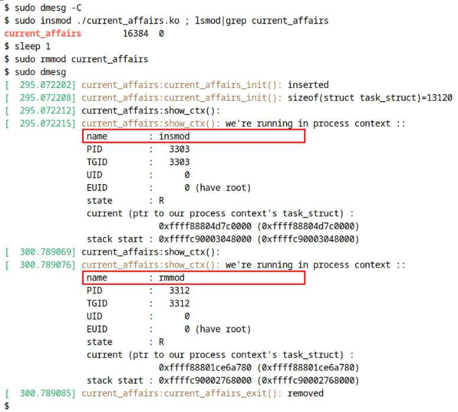

Hình 6.10: Output kernel module current\_affairs.ko trên Ubuntu VM x86\_64 chạy custom kernel 6.1.25

Rõ ràng như Hình 6.10, process context ban đầu, process/thread chạy init kernel code module, tức `current_affairs.c:current_affairs_init()`, là process `insmod` (xem output `name : insmod`). Tương tự process context `current_affairs.c:current_affairs_exit()` thực thi cleanup là process `rmmod`!

Chú ý timestamp cột trái (`[sec.usec]`) giúp hiểu `rmmod` được gọi gần 6 giây sau `insmod`.

Demo module nhỏ có nhiều điều hơn thoạt nhìn. Nó thực sự rất hữu ích để hiểu Linux kernel architecture. Phần sau giải thích vì sao.

#### Thấy Linux là monolithic

Ngoài luyện dùng `current`, điểm then chốt module này (`ch6/current_affairs`) là chỉ rõ một khía cạnh monolithic của Linux. Trong code trước, thấy khi `insmod` file module (`current_affairs.ko`), nó được insert và code path `init` chạy; câu hỏi rất quan trọng: ai chạy? À, output trả lời: chính process `insmod` chạy code `init` của module trong process context, chứng minh tính monolithic Linux kernel! (Tương tự process `rmmod` và code path `cleanup`; nó được process `rmmod` chạy trong process context.)

Chú ý cẩn thận, rõ: không “kernel” hay kernel thread nào thực thi code module; chính user-space process/thread, bằng phát system call (nhớ cả insmod/rmmod đều phát system call), chuyển vào kernel space và thực thi module code. Monolithic kernel hoạt động vậy.

Để bạn biết, microkernel architecture có lẽ là cách đối lập hoàn toàn monolithic. Nó dùng message-passing, không system call, truyền message từ user app/process đến server process thực hiện công việc. Đến lượt chúng khi cần trao đổi với microkernel nhỏ, cũng qua message. Nếu làm tốt cũng cho performance tuyệt vời; tuy nhiên có vẻ khó thiết kế, triển khai tốt micro-kernel-based, nghĩ đến GNU Hurd. Tất nhiên chúng thực sự tồn tại: QNX, VxWorks và ENEA là ví dụ real-world, hard real-time rất tốt; Minix của Tannenbaum chủ yếu là microkernel dùng trong lớp học.

Trở lại monolithic và Linux: kiểu thực thi kernel code này, như Hình 6.10, gọi chạy process context, trái interrupt context. Tuy nhiên Linux kernel không nghiêm ngặt thuần monolithic; nếu vậy chỉ là một khối memory hard-coded. Thay vào đó như mọi hệ điều hành hiện đại, Linux hỗ trợ modularization qua LKM.

Ngoài lề, lưu ý có thể tạo và chạy kernel thread trong kernel space; giống user-mode thread, được schedule chạy CPU và thực thi kernel code trong process context.

#### Viết code chú trọng bảo mật với printk

Trong module demo trước (`ch6/current_affairs/current_affairs.c`), hy vọng bạn thấy dùng `printk` với format specifier đặc biệt `%pK`. Lặp lại code snippet liên quan:

```
pr_info(
[...]
     " current (ptr to our process context's task_struct) :\n"
     "               0x%pK (0x%px)\n"
     " stack start : 0x%pK (0x%px)\n",
     [...]
     current, current,
     current->stack, current->stack); [...]
```

Nhớ thảo luận Chương 5, Viết kernel module đầu tiên – Phần 2, phần Đôi lời về sysctl kptr\_restrict: khi in address, trước tiên thực sự không nên in trong production, tôi khuyến khích không dùng `%p` hay `%px` thông thường mà `%pK`. Đó là điều làm trong code trước, nhằm bảo mật, ngăn kernel information leak. Trên hệ thống well-tuned, `%pK` chỉ hiển thị zeroed-out hay hashed value thay actual address. Để thể hiện, cũng in actual kernel address bằng `0x%px`, chỉ để đối chiếu.

Khá thú vị, ở đây `%pK` có vẻ không tác dụng – hai address in cùng giá trị, như Hình 6.10; điều này đúng mong đợi vì sysctl `kptr_restrict` mặc định 1 và đang root.

Trên production system, nhúng hay loại khác, hãy an toàn: đặt `kernel.kptr_restrict` `1`, tốt hơn `2` để sanitize pointer, và `kernel.dmesg_restrict` `1` để chỉ privileged user đọc kernel log.

Bây giờ, chúng ta chuyển sang một phần khá thú vị: trong phần tiếp theo, bạn sẽ học cách duyệt các task list của Linux kernel, qua đó thực chất học cách lấy thông tin kernel-level về từng process hoặc thread đang tồn tại trên hệ thống.

## Duyệt các task list của kernel

Như đã nói, mọi task structure tổ chức trong kernel memory trên linked list gọi task list để duyệt được. List data structure tiến hóa thành circular doubly linked list rất phổ biến. Thực tế core kernel code làm việc với list được tách vào header `list.h`; well-known và được kỳ vọng dùng cho mọi công việc list-based.

Data structure `include/linux/types.h:list_head` tạo doubly linked circular list cơ bản; như mong đợi gồm hai pointer, một đến member `prev`, một đến `next` trên list:

```
struct list_head {
        struct list_head *next, *prev;
};
```

Dễ duyệt các list liên quan task qua macro tiện lợi trong header `include/linux/sched/signal.h` cho version \>= 4.11; lưu ý kernel 4.10 trở xuống macro ở `include/linux/sched.h`.

Giờ như thường lệ hãy thực nghiệm và hands-on! Các phần sau viết module duyệt kernel task list hai cách:

- Một: Duyệt kernel task list và hiện mọi process tồn tại, vì vậy chỉ thread `main()` hay `T0` mỗi process.

- Hai: Duyệt kernel task list và hiện mọi thread tồn tại.

Chúng tôi trình bày code view chi tiết trường hợp sau. Đọc tiếp và nhớ tự thử cả hai!

### Duyệt task list I – hiển thị mọi process

Kernel cung cấp routine tiện lợi, macro `for_each_process()`, để dễ duyệt mỗi process trên task list:

```
// include/linux/sched/signal.h:
#define for_each_process(p) \
    for (p = &init_task ; (p = next_task(p)) != &init_task ; )
```

Rõ ràng macro mở rộng thành loop `for`, cho duyệt circular list. `init_task` là “head” hay điểm bắt đầu tiện; luôn là pointer đến task structure của “idle” thread CPU core, được schedule chạy khi không ai khác muốn chạy trên core đó.

Lưu ý `for_each_process()` được thiết kế rõ ràng chỉ duyệt thread `main()` hay T0 của mỗi process, không thread child/peer khác.

Đoạn ngắn phần đầu output kernel module `ch6/foreach/prcs_showall` ở đây, Hình 6.11, khi chạy trên Ubuntu 22.04 LTS guest x86\_64 với custom kernel 6.1.25:

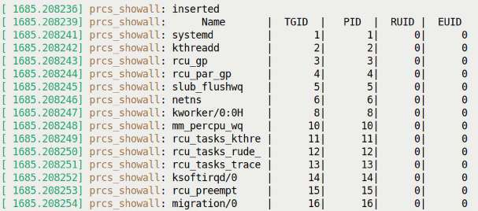

Hình 6.11: Một phần output kernel module prcs\_showall

Chú ý ít nhất trong đoạn Hình 6.11, TGID và PID của mỗi process luôn bằng nhau, chứng minh `for_each_process()` chỉ duyệt thread `main` mỗi process, không mọi thread. Chi tiết member TGID/PID giải thích phần sau.

Chúng tôi để bạn nghiên cứu, thử sample module `ch6/foreach/prcs_showall` như bài tập.

### Duyệt task list II – hiển thị mọi thread

Để duyệt từng thread đang tồn tại bình thường, dùng cặp helper macro `do_each_thread() { ... }` `while_each_thread()`; viết sample module làm chính việc này tại `ch6/foreach/thrd_showall/`.

Trước khi tìm hiểu sâu code, chúng ta hãy xem một phần output mà nó tạo ra qua `dmesg)`. Vì vậy, chúng ta build và `insmod` nó trên Ubuntu 22.04 LTS guest x86\_64. Do không thể hiển thị toàn bộ output của module ở đây vì quá lớn, tôi chỉ trình bày phần dưới của output trong ảnh chụp màn hình tiếp theo, Hình 6.12. Chúng tôi cũng chép lại header để bạn hiểu mỗi cột biểu diễn điều gì:

```
Timestamp     TGID    PID   current          stack pointer   name      #threads
```

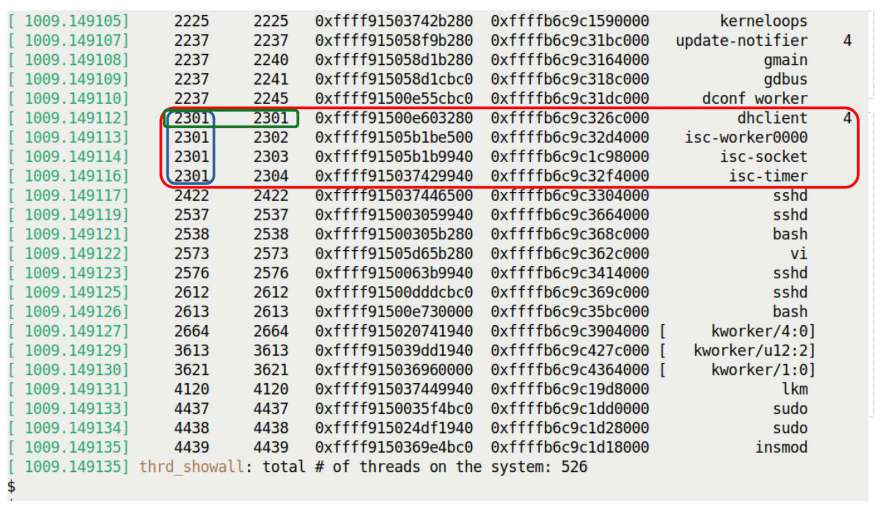

Hình 6.12: Output module thrd\_showall.ko; process multithreaded dhclient được làm nổi bật

Ngoài lề thú vị, trong Hình 6.12 chú ý mọi kernel-mode stack start address ở cột năm kết thúc bằng không, `0xffff .... .... .000`, nghĩa stack region luôn page-aligned vì `0x1000` là `4096` thập phân. Đúng như vậy vì kernel-mode stack luôn fixed size, bội của system page size, thường 4 KB.

Theo quy ước thể hiện trong output của `ps aux`, trong kernel module của chúng ta, nếu thread là kernel thread thì tên của nó được hiển thị trong dấu ngoặc vuông.

Diễn giải tên `kthread` khá lạ như “\[ kworker/u12:2 \]” ở Hình 6.12 thế nào? Liên kết trả lời: `https://unix.stackexchange.com/a/152865`.

Trước khi tiếp tục code, cần xem chi tiết hơn member TGID và PID của task structure.

#### Phân biệt process và thread – TGID và PID

Hãy nghĩ: vì Linux kernel dùng task structure riêng (`struct task_struct`) biểu diễn mỗi thread, và member duy nhất bên trong là Process IDentifier (PID), nghĩa trong Linux kernel mỗi thread có PID riêng. Nảy sinh câu hỏi, một câu đố: trong multithreaded process, làm sao nhiều thread cùng process chia sẻ PID chung như POSIX Threads standard POSIX.1c yêu cầu? Thực tế không chia sẻ: mỗi thread của multithreaded process, thực sự từng thread tồn tại trên Linux hiện đại, có PID riêng! Nhưng chờ, không vi phạm Pthreads standard sao? Đúng, một thời gian rất lâu trước Linux non-compliant, gây porting issue cùng nhiều vấn đề khác.

Để sửa vấn đề user-space standard khó chịu, Ingo Molnar của Red Hat đề xuất và đưa vào mainline một patch từ dòng kernel 2.5. Member mới Thread Group IDentifier hay TGID được thêm vào task structure.

Cơ chế hoạt động như sau: nếu process là single-threaded, các giá trị `tgid` và `pid` giống nhau. Nếu là process multithreaded, giá trị `tgid` của thread `main` bằng giá trị `pid` của thread `main`; các thread khác của process kế thừa giá trị `tgid` của thread `main`, nhưng vẫn giữ các giá trị `pid` riêng và duy nhất. Có thể tóm tắt điều này như sau:

- Single-threaded process: thread `main()` hay T0: một PID riêng và TGID == PID

- Multithreaded process:

  - Thread `main()` hay T0: PID và TGID bằng nhau: TGID == PID

  - Các thread không phải `main()`: nhiều PID riêng: TGID == PID của `main()`

Để hiểu rõ hơn, chúng ta hãy lấy một ví dụ thực tế từ ảnh chụp màn hình trước. Trong Hình 6.12, lưu ý rằng nếu một số nguyên dương xuất hiện ở cột cuối cùng bên phải, nó biểu diễn số thread trong multithreaded process ngay bên trái.

Hãy xem process `dhclient` được đánh dấu bằng hình chữ nhật bo góc trong Hình 6.12: TGID và PID đều có giá trị 2301, biểu diễn thread `main()` (T0), và process có tổng cộng bốn thread. Bốn thread đó là gì? Đầu tiên, dĩ nhiên thread `main()` là `dhclient`, và ba thread được hiển thị bên dưới có tên `isc-worker0000, isc-socket` và `isc-timer`. Làm sao biết chắc? Rất đơn giản: xem kỹ cột thứ hai và thứ ba trong Hình 6.12; chúng lần lượt biểu diễn TGID và PID. Nếu hai giá trị giống nhau, đó là main thread của process; nếu TGID lặp lại, process là multithreaded và giá trị PID biểu diễn các PID riêng biệt của những worker thread hoặc peer thread.

Thực ra hoàn toàn có thể thấy cách biểu diễn TGID/PID của kernel ở user space qua lệnh GNU `ps` phổ biến, dùng `-LA`, ngoài các cách khác:

```
$ ps -LA
    PID   LWP  TTY          TIME  CMD
      1       1 ?        00:00:01 systemd
      2       2 ?        00:00:00 kthreadd
      3       3 ?        00:00:00 rcu_gp
[...]
   2301    2301 ?        00:00:00 dhclient
   2301    2302 ?        00:00:00 isc-worker0000
   2301    2303 ?        00:00:00 isc-socket
   2301    2304 ?        00:00:00 isc-timer
 [...]
```

Label `ps` được diễn giải:

- Cột đầu `PID`, nhưng hiểu giá trị thực biểu diễn member `tgid` trong kernel task structure cho task này!

- Cột hai `LWP`, nghĩa đen LightWeight Process hay thread, biểu diễn member `pid` trong kernel task structure cho task.

Lưu ý chỉ GNU ps mới truyền parameter như `-LA` để thấy thread; triển khai `ps` nhẹ như busybox không làm được. Nhưng không vấn đề: luôn tra cùng chi tiết dưới procfs. Ví dụ dưới `/proc/2301/task` thấy sub-folders biểu diễn worker thread. Đoán xem: thực chất GNU `ps` cũng hoạt động như vậy bên trong!

Được rồi, đến code...

### Duyệt task list III – code

Giờ xem code liên quan của module `thrd_showall`:

```
// ch6/foreach/thrd_showall/thrd_showall.c */
[...]
#include <linux/sched.h>     /* current */
#include <linux/version.h>
#if LINUX_VERSION_CODE > KERNEL_VERSION(4, 10, 0)
#include <linux/sched/signal.h>
#endif
[...]

static int showthrds(void)
{
    struct task_struct *p, *t;       /* 'p' : process ptr; 't': thread ptr */
    [...]
    disp_idle_thread();
```

Vài điểm cần lưu ý về code trước:

- Dùng macro `LINUX_VERSION_CODE` để conditional include header theo yêu cầu.

- Lúc này bỏ qua kernel-level locking, cách dùng `task_{un}lock()` và/hoặc RCU routine; hoãn thảo luận đến hai chương cuối.

- Điểm then chốt: khi làm việc, ngay cả chỉ đọc member task structure, cần báo phần còn lại kernel để không bất ngờ giải phóng nó dưới chân ta; bằng lấy reference qua helper `get_task_struct()`, sau đó release qua `put_task_struct()`.

- Đừng quên CPU idle thread! Mỗi CPU core có idle thread riêng tên `swapper/n`, chạy khi không thread khác muốn, `n` là số core từ `0`. Đáng tiếc loop `do ... while` không bắt đầu ở thread này, `ps` cũng không bao giờ hiện. Vì vậy thêm routine nhỏ hiển thị nó, tận dụng hardcoded task structure của idle thread có sẵn, exported tại `init_task` (chi tiết: `init_task` luôn là idle thread CPU đầu, core # `0`).

Tiếp tục duyệt mọi thread tồn tại, cần cặp macro tạo loop; `do_each_thread(p,t) { ... } while_each_thread(p,t)` làm chính điều này, cho duyệt mọi thread trên hệ thống.

Từ kernel 6.6, rất mới lúc viết, macro kiểu `do_each_thread()/while_each_thread()` được bỏ, thay bằng `for_each_process_thread()` đơn giản, dễ đọc hơn. Code xét điều này qua `LINUX_VERSION_CODE` và `KERNEL_VERSION`, do đó portable hơn.

Các phần code liên quan như sau:

```
#if LINUX_VERSION_CODE < KERNEL_VERSION(6, 6, 0)
    do_each_thread(p, t) {     /* 'p' : process ptr; 't': thread ptr */
#else
    for_each_process_thread(p, t) {   /* 'p' : process ptr; 't': thread ptr */
#endif
         get_task_struct(t);    /* take a reference to the task struct */
        task_lock(t);
        snprintf_lkp(tmp1, TMPMAX-1, "%8d %8d  0x%px 0x%px",
                  p->tgid, t->pid, t, t->stack);

        [...]            << we cover this portion in the notes below >>

    total++;
    memset(tmp1, 0, sizeof(tmp1));       << cleanup >>
    memset(tmp2, 0, sizeof(tmp2));
    memset(tmp3, 0, sizeof(tmp3));

    task_unlock(t);

        memset(tmp, 0, sizeof(tmp));
        put_task_struct(t);    /* release reference to the task struct */

#if LINUX_VERSION_CODE < KERNEL_VERSION(6, 6, 0)
    } while_each_thread(p, t);
#else
    }
#endif

    return total;
}
```

Tham chiếu code block trước, cặp macro `do_each_thread() { ... } while_each_thread()` tạo do-while loop, cho duyệt mọi thread tồn tại. Một số chi tiết code snippet:

- Theo chiến lược đặt vài temporary variable tên `tmp1, tmp2, tmp3` để fetch và thiết lập data item cần, rồi in một lần mỗi loop iteration.

- Để thiết lập data cần report, C programmer thường dùng `sprintf()`; nhưng lưu ý chắc chắn có thể thành security issue do buffer overflow vulnerability well-known và exploit liên quan. Vì vậy được dạy dùng `snprintf()` thay.

Đúng, nhưng còn cải thiện được: viết wrapper routine nhỏ `snprintf_lkp()`, định nghĩa trong ‘library’ source file `klib.c`. Nó chủ động kiểm tra, cảnh báo mọi buffer overflow, tăng security posture hơn nữa.

- Lấy `TGID`, `PID`, start address `task_struct` và `stack` đơn giản – ở đây giữ dễ, chỉ dùng `current` dereference; tất nhiên cũng dùng kernel helper method tinh vi hơn đã thấy đầu chương, nhưng ở đây muốn đơn giản. Cũng chú ý chủ động không dùng printk format specifier an toàn hơn `%pK`, mà generic `%px` để hiện actual kernel virtual address của task structure và kernel-mode stack, đừng làm trong production.

- Cleanup theo yêu cầu trước vòng tiếp, tăng counter tổng thread, `memset()` temporary buffer về `NULL`, v.v.

- Khi hoàn tất, trả tổng số thread đã duyệt.

Trong code block tiếp theo, chúng ta trình bày phần code đã chủ động bỏ khỏi block trước. Chúng ta lấy tên thread và in nó trong dấu ngoặc vuông nếu là kernel thread. Chúng ta cũng truy vấn số lượng thread trong process. Phần giải thích nằm sau code:

```
        if (!p->mm)         // kernel thread?
            snprintf_lkp(tmp2, TMPMAX-1, " [%16s]", t->comm);
        else
            snprintf_lkp(tmp2, TMPMAX-1, "  %16s ", t->comm);

        /* Is this the "main" thread of a multithreaded process?
         * We check by seeing if (a) it's a user space thread,
         * (b) its TGID == its PID, and (c), there are >1 threads in
         * the process.
         * If so, display the number of threads in the overall process
         * to the right..
         */
        nr_thrds = get_nr_threads(g);
        if (p->mm && (p->tgid == t->pid) && (nr_thrds > 1))
            snprintf_lkp(tmp3, TMPMAX-1, " %3d", nr_thrds);
      pr_info("%s%s%s\n", tmp1, tmp2, tmp3);
        [...]
```

Về code block trước, có thể nói:

- Kernel thread/kthread không có user-space mapping. Member `current->mm` của thread `main()` là pointer đến structure kiểu `mm_struct`, biểu diễn toàn bộ user-space mapping của process; nếu `NULL`, hợp lý là kernel thread vì không user-space mapping. Ta kiểm tra và in tên tương ứng.

- Cũng in tên thread bằng tra member `comm` trong task structure. Bạn có thể hỏi sao không dùng helper `get_task_comm()` lấy tên; câu trả lời ngắn là gây self-deadlock! Sẽ khám phá và cách phát hiện, tránh chi tiết ở các chương kernel synchronization sau. Hiện lại làm đơn giản.

- Lấy số thread trong process tiện lợi qua macro `get_nr_threads()`; phần còn lại giải thích rõ trong code comment trên macro ở block trước.

Cuối cùng code chỉ phát các temporary string vào kernel log qua một lần gọi `printk`.

Tuyệt! Với đó kết thúc thảo luận hiện tại Linux kernel internals/architecture, chủ yếu tập trung process, thread và stack.

## Tổng kết

Trong chương này trình bày khía cạnh then chốt kernel internals giúp bạn, tác giả module/device driver, hiểu tốt và sâu hơn cơ chế nội bộ hệ điều hành. Đã xem khá chi tiết tổ chức, quan hệ giữa process, thread và stack ở cả user/kernel space. Xem metadata structure kernel `task_struct` và học duyệt task list nhiều cách qua module tự viết.

Dù có thể không hiển nhiên, hiểu các chi tiết kernel internals này là bước cần thiết, bắt buộc trên hành trình trở thành nhà phát triển kernel và/hoặc device driver dày dạn. Nội dung chương giúp debug nhiều tình huống system programming, đặt nền khám phá Linux kernel sâu hơn, đặc biệt memory management.

Chương tiếp và vài chương sau thực sự then chốt: trình bày điều cần hiểu về memory management internals sâu, phức tạp. Tôi đề nghị nghiền ngẫm chương này trước, xem liên kết Đọc thêm quan tâm, làm bài tập và phần Câu hỏi rồi sang chương tiếp!

## Câu hỏi

Khi kết thúc, đây là danh sách câu hỏi kiểm tra kiến thức nội dung chương: `https://github.com/PacktPublishing/Linux-Kernel-Programming_2E/blob/main/questions/ch6_qs_assignments.txt`. Một số câu trả lời trong kho GitHub sách: `https://github.com/PacktPublishing/Linux-Kernel-Programming_2E/tree/main/solutions_to_assgn`.

## Đọc thêm

Để giúp tìm hiểu sâu bằng tài liệu hữu ích, chúng tôi cung cấp danh sách khá chi tiết tài liệu tham khảo và liên kết trực tuyến, đôi khi cả sách, trong tài liệu Further reading ở kho GitHub sách. Tài liệu tại `https://github.com/PacktPublishing/Linux-Kernel-Programming_2E/blob/main/Further_Reading.md`.

## Hãy để lại đánh giá!

Bạn đang yêu thích cuốn sách? Hãy giúp độc giả như bạn bằng cách để lại đánh giá Amazon. Quét mã QR bên dưới để nhận mã giảm giá 20%.


\*Ưu đãi có giới hạn
