# Chương 7. Memory Management Internals – Những kiến thức thiết yếu

Kernel internals, đặc biệt là phần liên quan đến memory management, là một chủ đề rộng lớn và phức tạp. Trong cuốn sách này, tôi không định đi sâu vào những chi tiết phức tạp của kernel memory internals. Đồng thời, tôi muốn cung cấp kiến thức nền tảng đủ dùng – và cần thiết – để một kernel developer hoặc device driver developer đang bắt đầu như bạn có thể xử lý thành công chủ đề then chốt này.

Theo đó, chương này sẽ giúp bạn hiểu đủ sâu về cơ chế bên trong của cách thực hiện memory management trên Linux OS; nội dung bao gồm tìm hiểu Virtual Memory (VM) split, xem xét cả user-mode VAS lẫn kernel VAS của process ở mức độ đủ sâu, và trình bày những kiến thức cơ bản về cách kernel quản lý physical memory. Qua đó, bạn sẽ hiểu được memory map – cả virtual lẫn physical (ở một mức độ nhất định) – của process và hệ thống.

Kiến thức nền tảng này sẽ giúp ích rất nhiều cho việc quản lý dynamic kernel memory một cách đúng đắn và hiệu quả (tập trung vào việc viết kernel code hoặc driver code bằng framework Loadable Kernel Module (LKM); khía cạnh này – dynamic memory management – được trình bày theo hướng thực hành và là trọng tâm của hai chương tiếp theo trong sách). Một lợi ích phụ quan trọng là, với kiến thức này, bạn sẽ thấy mình thành thạo hơn khi debug cả user-space code lẫn kernel-space code. (Không thể nhấn mạnh hết tầm quan trọng của điều này! Debug code vừa là nghệ thuật, vừa là khoa học, đồng thời cũng là một thực tế phải đối mặt.)

Trong chương này, chúng ta sẽ tìm hiểu các nội dung sau:

- Tìm hiểu VM split

- Xem xét process VAS

- Xem xét kernel VAS

- Ngẫu nhiên hóa memory layout – KASLR

- Tìm hiểu cách tổ chức physical memory

## Yêu cầu kỹ thuật

Tôi giả định rằng bạn đã đọc chương trực tuyến Kernel Workspace Setup, đã chuẩn bị phù hợp một guest VM (hoặc hệ thống native) chạy Ubuntu 22.04 LTS (hoặc một bản phát hành ổn định mới hơn) và đã cài đặt tất cả các package cần thiết. Nếu chưa, tôi khuyên bạn thực hiện việc này trước. Để tận dụng tối đa cuốn sách, tôi đặc biệt khuyên bạn trước tiên hãy thiết lập môi trường workspace, bao gồm clone GitHub repository của sách để lấy code (`https://github.com/PacktPublishing/Linux-Kernel-Programming_2E`), rồi thực hành trực tiếp trên đó.

Tôi giả định rằng bạn đã quen với các khái niệm virtual memory cơ bản, layout các segment trong Virtual Address Space (VAS) của user-mode process, user-mode stack và kernel-mode stack, task structure, v.v. Nếu chưa chắc chắn về những kiến thức nền này, tôi đặc biệt đề nghị bạn đọc chương trước trước tiên.

## Tìm hiểu VM split

Trong chương này, chúng ta sẽ xem xét khái quát cách Linux kernel quản lý memory theo hai góc nhìn:

- Cách tiếp cận dựa trên virtual memory, trong đó memory được ảo hóa (trường hợp thông thường)

- Góc nhìn về cách kernel tổ chức physical memory (các RAM page)

Trước hết, hãy bắt đầu với góc nhìn virtual memory, rồi thảo luận về cách tổ chức physical memory ở phần sau của chương.

Như đã thấy trong Chương 6, Kernel Internals Essentials – Processes and Threads, tại phần Tìm hiểu các kiến thức cơ bản về process Virtual Address Space (VAS), một thuộc tính then chốt của process VAS là nó hoàn toàn độc lập, một sandbox. Bạn không thể nhìn ra ngoài chiếc hộp đó. Trong chương ấy, ở Hình 6.2, chúng ta đã thấy process VAS trải từ virtual address `0x0` đến một địa chỉ mà chúng ta chỉ gọi là “địa chỉ cao”. Giá trị thực tế của địa chỉ “cao” này là bao nhiêu? Đó là giới hạn cao nhất của VAS, vì vậy phụ thuộc vào số bit dùng để đánh địa chỉ; do đó:

- Trên Linux OS chạy trên processor 32-bit (hoặc được compile cho 32-bit), virtual address cao nhất sẽ là 2<sup>32</sup> = 4 GB.

- Trên Linux OS chạy trên (và được compile cho) processor 64-bit, virtual address cao nhất sẽ là 2<sup>64</sup> = 16 EB. (EB là viết tắt của exabyte, tương đương 1.152.921.504.606.846.976 byte hay 1.024 petabyte. Rõ ràng đây là một lượng khổng lồ; 16 EB là con số 16 x 10<sup>18</sup>.)

Để đơn giản và giữ các con số ở mức dễ xử lý, trước mắt hãy tập trung vào address space 32-bit (chắc chắn chúng ta cũng sẽ đề cập đến việc đánh địa chỉ 64-bit). Như vậy, theo những gì đã thảo luận, trên hệ thống 32-bit, process VAS trải từ 0 đến 4 GB – vùng này gồm không gian trống (các vùng chưa sử dụng, gọi là sparse region hoặc hole) và các vùng memory hợp lệ, thường được gọi là segment (hay chính xác hơn là mapping) – text, data, library và stack (tất cả những nội dung này đã được trình bày tương đối chi tiết trong Chương 6, Kernel Internals Essentials – Processes and Threads).

Trên hành trình tìm hiểu virtual memory, sẽ hữu ích nếu lấy chương trình C K\&R `Hello, world` nổi tiếng và tìm hiểu (ở mức tương đối) cách hoạt động bên trong của nó trên hệ thống Linux; đó là nội dung của phần tiếp theo!

### Tìm hiểu bên trong – chương trình C Hello, world

Nào, có ai ở đây biết cách viết chương trình C K\&R `Hello, world` kinh điển không? Được rồi, vui đấy, hãy xem dòng có ý nghĩa duy nhất trong đó:

```
printf("Hello, world.\n");
```

Process đang gọi function `printf()`. Bạn có viết code của `printf()` không? Bạn nói: “Không, dĩ nhiên là không, nó nằm trong standard C library, thường là `glibc` (GNU `libc`) trên Linux.” Đúng, bạn nói đúng; nhưng khoan đã, trừ khi code và data của `printf()` (và tương tự với tất cả các library API khác) thực sự nằm trong process VAS, làm sao chúng ta có thể truy cập nó? (Hãy nhớ rằng bạn không thể nhìn ra ngoài chiếc hộp!) Để làm được điều đó, code (và data) của `printf()` (thực ra là của toàn bộ library `glibc`) phải được map vào chiếc hộp của process – process VAS. Nó quả thực được map vào process VAS, trong các library segment hay mapping (như đã thấy trong Chương 6, Kernel Internals Essentials – Processes and Threads, Hình 6.2). Việc mapping này diễn ra như thế nào?

Thực tế là khi application khởi động, trong quá trình thiết lập C runtime environment, có một binary Executable and Linkable Format (ELF) nhỏ (được nhúng vào file binary executable `a.out` của bạn), gọi là loader (`ld.so` hoặc `ld-linux.so`). Nó được trao quyền điều khiển từ sớm trong quá trình thực thi. Nó phát hiện tất cả các shared library cần thiết và thực hiện memory mapping cho tất cả chúng – library text (code), data và mọi segment cần thiết khác từ các file (library) vào process VAS bằng cách mở chúng và gọi system call `mmap()`. Như vậy, một khi code và data của library đã được map vào process VAS, process thực sự có thể truy cập chúng, và do đó – chờ chút nhé – API `printf()` có thể được gọi thành công! (Ở đây chúng ta đã bỏ qua những chi tiết phức tạp của memory mapping và linkage.)

Để kiểm chứng thêm, script `ldd` (output sau đây lấy từ hệ thống x86\_64) cho thấy đúng là như vậy:

```
$ gcc helloworld.c -o helloworld
$ ./helloworld
Hello, world
$ ldd ./helloworld
        linux-vdso.so.1 (0x00007fffcfce3000)
        libc.so.6 => /lib/x86_64-linux-gnu/libc.so.6 (0x00007feb7b85b000)
        /lib64/ld-linux-x86-64.so.2 (0x00007feb7be4e000)
$
```

Một vài điểm ngắn gọn cần lưu ý:

- Mỗi Linux process – tự động và theo mặc định – đều link với tối thiểu hai object: shared library `glibc` và program loader (không cần linker switch tường minh khi compile/link).

- Tên chương trình loader thay đổi theo architecture. Ở đây, trên hệ thống x86\_64 của chúng ta, nó là `ld-linux-x86-64.so.2`.

- Trong output `ldd` ở trên, địa chỉ trong ngoặc bên phải là virtual address (user space) của vị trí mapping. Ví dụ, trong output ở trên, `glibc` được map vào process VAS của chúng ta tại User Virtual Address (UVA) bằng `0x00007feb7b85b000`. Lưu ý rằng địa chỉ này phụ thuộc runtime (nó cũng thay đổi sau mỗi lần chạy khi cơ chế Address Space Layout Randomization (ASLR) được bật (ASLR thường được bật theo mặc định; chi tiết sẽ được trình bày sau)).

- Vì lý do bảo mật (và trên các architecture ngoài x86), việc dùng utility `objdump` để tra cứu những chi tiết như thế này được xem là tốt hơn.

Hãy thử chạy `strace` trên binary executable `Hello,` `world` và bạn sẽ thấy nhiều system call `mmap()`, map các segment của `glibc` (và các segment khác) vào!

Bây giờ hãy xem xét application `Hello, world` đơn giản của chúng ta sâu hơn.

#### Đi xa hơn API printf()

Như bạn biết, API `printf()` thực hiện việc định dạng đẹp mắt rồi gọi system call `write()`, và tất nhiên system call này ghi string `"Hello, world"` vào `stdout` – ở đây, theo mặc định, `stdout` sẽ là cửa sổ (pseudo) terminal hoặc console device.

Chúng ta cũng hiểu rằng vì `write()` là một system call, điều này có nghĩa process (hoặc thread) hiện tại đang chạy code này – process context – giờ phải chuyển sang kernel mode và chạy kernel code của `write()` (monolithic kernel architecture)! Quả thực là như vậy. Nhưng chờ một chút: kernel code của `write()` nằm trong kernel VAS (tham khảo Chương 6, Kernel Internals Essentials – Processes and Threads, Hình 6.1). Điểm mấu chốt ở đây là: nếu kernel VAS nằm ngoài chiếc hộp, thì làm thế nào chúng ta gọi được nó?

Có thể thực hiện bằng cách đặt user VAS và kernel VAS vào hai không gian 4 GB riêng biệt, nhưng cách này dẫn đến context switching rất chậm (và việc flush Translation Lookaside Buffer (TLB) tốn kém), vì vậy người ta đơn giản là không làm như thế.

Cách thiết kế thực tế là như sau: cả user VAS và kernel VAS đều “sống” trong cùng một “chiếc hộp” – VAS có sẵn. Cụ thể bằng cách nào? Bằng cách chia address space có sẵn giữa user và kernel theo một tỷ lệ `User:Kernel :: U:K` nào đó. Đây được gọi là VM split (tỷ lệ `U:K` thường được biểu diễn bằng megabyte, gigabyte, terabyte, hoặc thậm chí petabyte).

Trên nhiều hệ thống ARM-32 (AArch32) và x86-32, VM split mặc định thường là 3:1 GB. Sơ đồ sau (Hình 7.1) biểu diễn một Linux process 32-bit có VM split 3:1 (đơn vị là GB); nghĩa là tổng process VAS 4 GB được chia thành 3 GB user space và 1 GB kernel space. Nói cách khác, có thể mô tả tỷ lệ chia là U:K :: 3:1.

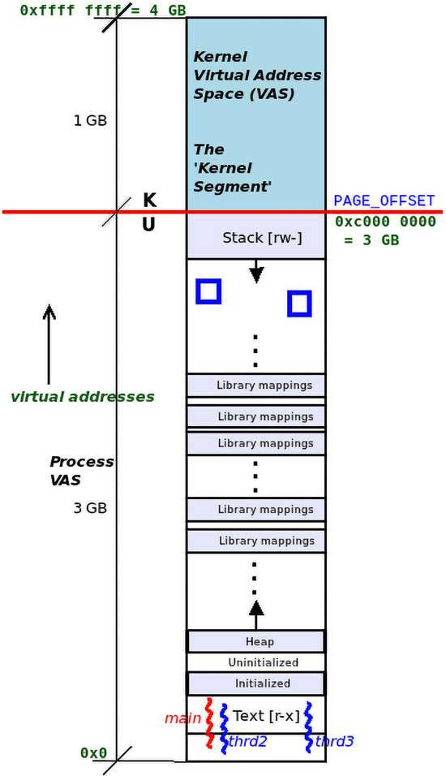

Hình 7.1: Process VAS với VM split User:Kernel :: 3:1 GB trên hệ thống AArch32 chạy Linux OS

Có thể cấu hình VM split vào thời điểm cấu hình kernel trên 32-bit (sẽ trình bày thêm ngay sau đây. Những giá trị hợp lệ khác của VM split trên hệ thống AArch32 (hoặc x86-32) là U:K :: 2:2 hoặc thậm chí 1:3, dù giá trị cuối sẽ rất hiếm gặp trong thực tế.)

Vậy, giờ kernel VAS đã “ở trong chiếc hộp”, điều sau đây đột nhiên trở nên rõ ràng và cần được hiểu: khi một user-mode process hoặc thread gọi một system call, context switch sẽ chuyển sang kernel VAS 1 GB (trong ví dụ này) ngay bên trong VAS của chính process đó (việc chuyển này bao gồm cập nhật nhiều CPU register đặc thù architecture, trong đó có stack pointer). Thread gọi system call giờ chạy các kernel code path tương ứng trong process context ở privileged kernel mode (và thao tác trên kernel-space data). Khi hoàn tất, nó trở về từ system call, context switch trở lại unprivileged user mode, và giờ chạy user-mode code (và thao tác trên user-mode data) trong 3 GB VAS đầu tiên.

Virtual address chính xác nơi kernel VAS bắt đầu (còn gọi là kernel segment) thường được biểu diễn bằng macro `PAGE_OFFSET` trong kernel. Chúng ta sẽ xem xét macro này cùng một số macro then chốt khác trong phần Các macro và variable mô tả kernel VAS layout.

Quyết định về vị trí và kích thước chính xác của VM split được đưa ra ở đâu? À, trên Linux 32-bit, đây là một tùy chọn cấu hình vào kernel build time. Nó được thực hiện trong quá trình kernel build, như một phần của quy trình `make [ARCH=xxx]` `menuconfig` – ví dụ, khi cấu hình kernel cho System on Chip (SoC) Broadcom BCM2835 (hoặc BCM2837) (họ Raspberry Pi là một dòng board phổ biến sử dụng chính SoC này). Đây là một đoạn trích từ file cấu hình kernel chính thức (output sau lấy từ một Raspberry Pi 32-bit chạy Raspberry Pi OS 32-bit mặc định):

```
$ uname -r
5.15.76+
# gain access to /proc/config.gz by loading the 'configs' module
$ sudo modprobe configs
$ zcat /proc/config.gz | grep -C3 VMSPLIT
#
# Kernel Features
#
CONFIG_VMSPLIT_3G=y
# CONFIG_VMSPLIT_3G_OPT is not set
# CONFIG_VMSPLIT_2G is not set
# CONFIG_VMSPLIT_1G is not set
CONFIG_PAGE_OFFSET=0xC0000000
[ … ]
```

Như thấy trong đoạn trích trên, tùy chọn cấu hình kernel `CONFIG_VMSPLIT_3G` được đặt thành `y` (nghĩa là yes), cho biết VM split mặc định là `user:kernel :: 3:1`. Với các architecture 32-bit, vị trí VM split có thể điều chỉnh được (như thấy trong đoạn trích trên, thông qua `CONFIG_VMSPLIT_[1|2|3]G macros;` `CONFIG_PAGE_OFFSET` được đặt tương ứng). Với VM split 3:1, `PAGE_OFFSET` được đặt thành virtual address `0xC000 0000` (3 GB).

VM split mặc định cho processor IA-32 (Intel x86-32) là 3:1 (GB). Điều thú vị là Windows 3.x OS (cổ xưa) chạy trên IA-32 cũng có VM split giống như vậy, cho thấy về cơ bản các khái niệm này độc lập với OS. Ở phần sau của chương, chúng ta sẽ đề cập thêm một số architecture cùng VM split của chúng (trên Linux), bên cạnh những chi tiết khác.

Đôi khi có thể cấu hình VM split cho các architecture 64-bit, tùy vào CPU cụ thể và kernel Board Support Package (BSP) (chúng ta sẽ nêu ví dụ về cách thực hiện cho AArch64 trong phần nội dung sắp tới). Vậy, giờ đã hiểu VM split trên hệ thống 32-bit, hãy chuyển sang xem xét cách thực hiện trên hệ thống 64-bit. Nhưng trước hết, sẽ hữu ích và quan trọng nếu hiểu ít nhất những kiến thức cơ bản về chính xác cách virtual address được dịch thành physical address; hãy bắt đầu nào!

### Virtual addressing và address translation

Trước khi đi sâu hơn vào những chi tiết này, điều rất quan trọng là phải hiểu rõ một vài điểm then chốt.

Hãy xét một đoạn code nhỏ và điển hình từ một chương trình C:

```
int i = 5;
printf("address of i is 0x%x\n", &i);
```

Khi chạy chương trình này trên một OS hiện đại có nhiều tính năng (như Linux, Unix, Windows hoặc Mac), địa chỉ mà bạn thấy `printf()` xuất ra (gần như) luôn là virtual address chứ không phải physical address. Hơn nữa, chúng ta phân biệt hai loại virtual address:

- Nếu chạy code này trong user-space process, địa chỉ của variable `i` mà bạn thấy là một User Virtual Address, viết tắt là UVA.

- Nếu chạy code này trong kernel, hoặc một kernel module (tất nhiên khi đó bạn sẽ dùng API `printk()` (hoặc tương tự) thay cho `printf()`), địa chỉ của variable `i` mà bạn thấy là một Kernel Virtual Address (KVA).

Tiếp theo, khác với cách người ta thường nghĩ, virtual address không phải một giá trị tuyệt đối (offset tính từ `0`); nó là một bitmask được thiết kế cho và được diễn giải bởi MMU (Memory Management Unit nằm trong silicon của các microprocessor hiện đại):

- Trên Linux OS 32-bit, 32 bit có sẵn được chia thành giá trị Page Global Directory (PGD), giá trị Page Table (PT) và offset.

- Chúng trở thành các index vào physical memory, qua đó MMU, với khả năng truy cập kernel page table của process context hiện tại, thực hiện address translation.

Ở đây chúng ta không định trình bày những chi tiết chuyên sâu về address translation ở mức MMU. Nó cũng rất đặc thù theo architecture. Hãy tham khảo phần Đọc thêm để có các liên kết hữu ích về chủ đề này.

- Như có thể dự đoán, trên hệ thống 64-bit, ngay cả khi đánh địa chỉ 48-bit, sẽ có nhiều field hơn trong bitmask của virtual address.

Được rồi, nếu việc đánh địa chỉ 48-bit này là trường hợp điển hình trên processor x86\_64, thì các bit trong virtual address 64-bit được bố trí như thế nào?

Điều gì xảy ra với 16 bit MSB không sử dụng? Hình sau trả lời câu hỏi đó; đây là biểu diễn cách phân chia virtual address (bitmask) 64-bit trên hệ thống Linux x86\_64:

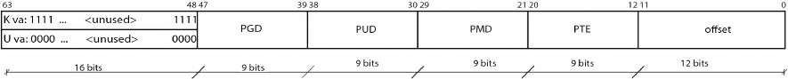

Hình 7.2: Phân chia virtual address 64-bit trên processor Intel x86\_64 với page 4 KB

Về cơ bản, với việc đánh địa chỉ 48-bit, chúng ta dùng các bit từ 0 đến 47 (48 bit LSB) và bỏ qua 16 bit MSB (Most Significant Bit), xử lý chúng khá giống sign extension. Nhưng khoan đã, giá trị của 16 bit MSB không sử dụng – như trình bày bên dưới – thay đổi tùy theo address space được tham chiếu:

- Trong kernel VAS, 16 bit MSB luôn được đặt thành `1`.

- Trong user VAS, 16 bit MSB luôn được đặt thành `0`.

Đây là thông tin hữu ích! Biết điều này, chỉ cần nhìn vào một virtual address (đầy đủ 64-bit), bạn có thể lập tức biết đó là KVA hay UVA; vì vậy, trên hệ thống Linux x86\_64:

- KVA luôn có dạng `0xffff XXXX XXXX XXXX`

- UVA luôn có dạng `0x0000 XXXX XXXX XXXX`

Một lưu ý cần thận trọng: định dạng trên chỉ đúng với những processor (thực ra là MMU) định nghĩa virtual address là KVA hoặc UVA; họ processor x86 và ARM (cả 32-bit lẫn 64-bit) thuộc nhóm này. Ở đây, MSB (bit 63) đóng vai trò selector cho paging table; nếu được đặt, kernel paging table (tại `swapper_pg_dir`) được sử dụng vì đang tham chiếu một kernel virtual address; nếu được xóa, process paging table (physical address của base process paging table nằm trong register CR3 trên x86\[\_64\] và register TTBR0 (Translation Table Base Register 0) trên ARM\[64\]) được sử dụng vì đang tham chiếu một user virtual address (trong khi TTBR1 giữ base address của kernel master PGD – `swapper_pg_dir`).

Một điểm khác: N-level paging có nghĩa là gì? Hãy nhìn lại Hình 7.2; có bốn mức “gián tiếp” – Page Global Directory (PGD), Page Upper Directory (PUD), Page Middle Directory (PMD) và Page Table Entry (PTE) – trước khi đến offset. Đây là một thuộc tính của paging schema – số mức gián tiếp; ở đây là 4, vì vậy chúng ta gọi đây là 4-level paging (sau này, Hình 7.6 sẽ cho thấy các giá trị N-level paging khác nhau).

##### Từ virtual address đến physical address – tổng quan rất ngắn gọn

Như giờ đã thấy (và tôi nhắc lại ở đây), thực tế virtual address không phải địa chỉ tuyệt đối (offset tuyệt đối tính từ zero, như bạn có thể đã tưởng nhầm), mà là bitmask. Thực tế memory management là một lĩnh vực phức tạp trong đó công việc được chia sẻ; hãy nhắc lại những điểm thực sự then chốt:

- Mỗi process đang tồn tại có một tập paging table map các virtual page sang physical page (gọi là page frame); paging table được sử dụng bất cứ khi nào một virtual address – user hoặc kernel – được truy cập. Kernel cũng có paging table riêng.

- OS tạo và thao tác trên paging table của từng process cũng như của kernel; toolchain (compiler/linker) tạo ra virtual address.

- MMU của processor thực hiện runtime address translation, dịch một virtual address (user hoặc kernel) cho trước thành physical address (RAM).

Vậy, một lần nữa, không đi vào những chi tiết phức tạp, sau đây là quy trình tổng thể tóm lược của cơ chế thường gọi là hardware paging (ở đây dành cho x86) (Hình 7.3 cung cấp cái nhìn tổng quan ở mức cao về toàn bộ luồng):

1\. Một process (hoặc một thread trong nó) tra cứu một virtual address (UVA hoặc KVA) – nghĩa là thực hiện thao tác read/write/execute trên một virtual address. (Đây là hành vi hoàn toàn bình thường, được mong đợi; ví dụ, đọc hoặc ghi một variable, hay thực thi một machine instruction). 2. Để CPU thực hiện công việc tại vị trí đó trong memory, giờ chúng ta phải bằng cách nào đó dịch virtual address này sang physical address tương ứng. Nhưng chờ đã: nhờ tối ưu phần cứng, có thể bỏ qua bước này hoặc thực hiện nó nhanh hơn (các bước 3.1, 3.2); nếu không thể, nó phải được dịch “thủ công” qua MMU (chậm hơn; bước 4). 3. Trước khi đến MMU, một vài tối ưu phần cứng có thể giúp chúng ta nhanh hơn, đi tắt qua đường xử lý chậm hơn “thông thường”:

i. Trước tiên, code hoặc data đang được xử lý có thể đã nằm trong các cache trên CPU (L1/L2/L3/…); điều này được kiểm tra trước hết. Nếu đúng như vậy, chúng ta có cache-hit: phần tử code/data được xử lý ngay trong CPU cache, và công việc hoàn tất. Nếu không, chúng ta có CPU cache miss (về kỹ thuật là LLC (Last Level Cache) miss (tốn kém)); vì vậy chuyển sang bước tiếp theo. (Trong Chương 13, Kernel Synchronization – Part 2, chúng ta sẽ đề cập thêm về CPU caching và vấn đề cache coherency; tạm thời hãy bỏ qua nó.) ii. Virtual address đã được dịch chưa? Tra cứu Translation Lookaside Buffer (TLB) của CPU. Nếu có bản dịch, chúng ta có TLB hit; khi đó physical address đã được cache trong TLB: chuyển thẳng đến bước 5; nếu không, chúng ta có TLB miss (tốn kém).

(Một lưu ý bên lề: các bước không nhất thiết được thực hiện theo thứ tự trình bày ở đây; một số micro-architecture dùng physical cache model trong đó CPU cache nằm giữa MMU và bước truy cập RAM, trên thực tế đảo ngược thứ tự hai bước trên).

4\. Virtual address được gửi đến MMU; giờ nó “duyệt” các paging table của process (nó biết base page table của process (hoặc kernel) nằm ở đâu trong physical RAM nhờ một system register giữ physical address của bảng đó) và cuối cùng thu được page frame cùng physical address tương ứng (Hình 7.4 mô tả bước này). 5. Physical address (thu được từ một trong các bước trước) giờ được đưa lên các address line của CPU, và công việc được thực hiện.

Hãy chắc chắn bạn đọc kỹ và hiểu phần này. Tất cả các bước được trình bày, trừ bước 4, được mô tả trong Hình 7.3; bước 4 – bước dịch bằng MMU – được mô tả qua Hình 7.4. Hãy nghiên cứu chúng.

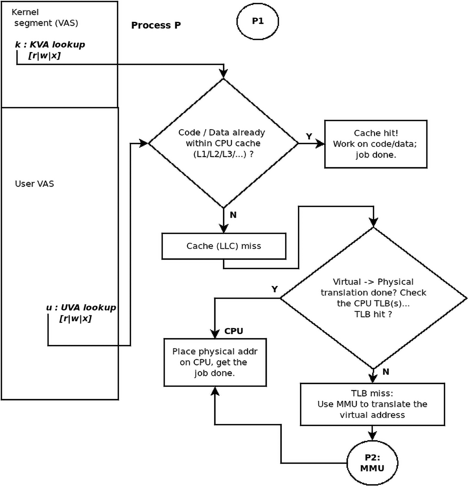

Hình 7.3: Dịch VA sang PA, phần 1 (các bước 1,2,3,5)

Và đây là phần “P2: MMU”, nơi MMU thực hiện runtime address translation, dịch user virtual address hoặc kernel virtual address được truyền vào thành physical address:

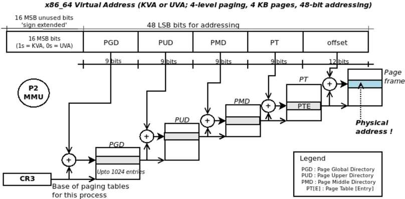

Hình 7.4: Dịch VA sang PA, phần 2, MMU (các bước 4, 5) trên x86\_64 với địa chỉ 48-bit và page 4 KB

Với sơ đồ MMU address translation (Hình 7.4), hãy lưu ý rằng ở đây chúng ta dùng một ví dụ rất đặc thù architecture của x86\_64 với 4-level paging, page size 4 KB và đánh địa chỉ 48-bit. Khi được truyền một virtual address, MMU có khả năng xem nó như bitmask; nó tra cứu base physical address – nằm trong Control Register 3 (CR3) trên x86 (trên các họ ARM, đó là register TTBR0 cho user process và TTBR1 cho kernel paging table) – rồi tiến hành dịch. (Hãy suy nghĩ về điều này: tất nhiên base address trong CR3 là physical address, nếu không bước này sẽ trở thành đệ quy vô hạn!)

Tóm lược, đây là những gì MMU làm để thực hiện runtime address translation: nó tra cứu base address CR3, cộng giá trị 9-bit trong phần PGD của virtual address vào đó và tra cứu tại vị trí thu được. Đây là một pointer đến bảng tiếp theo, tại đó nó lặp lại bước trước nhưng lần này với giá trị từ field PUD 9-bit. Quá trình tiếp tục (qua PMD) đến Page Table, nơi nó tham chiếu Page Table Entry (PTE) thực tế. Entry này chứa (cùng các bit đặc thù micro-architecture khác) một pointer đến physical page frame; cộng offset 12-bit vào base address của page frame sẽ thu được physical address.

Thực tế có nhiều sắc thái hơn; có một vài điểm then chốt đáng được nhắc đến ở đây.

Thứ nhất, ít nhất về lý thuyết, khi virtual address được truyền đến MMU, nó “duyệt” các paging table và kết quả cuối cùng phải là physical address; trong thực tế, lần thử address translation của MMU có thể thất bại! Một trường hợp hiển nhiên là virtual address được cung cấp không đúng (một địa chỉ chưa được map): thực chất, chúng ta có một bug, một lỗi, khiến MMU phát sinh fault (OS fault handler sẽ xử lý thích hợp). Trường hợp còn lại là demand paging – khi virtual address hợp lệ nhưng physical memory chưa được cấp phát, khiến việc dịch thất bại (khiến MMU phát sinh một fault “tốt” để hệ thống cấp phát page frame). Chúng ta trình bày chính xác nội dung này tương đối chi tiết trong Chương 9, Kernel Memory Allocation for Module Authors – Part 2, tại phần Demand paging và OOM; nếu muốn, bạn có thể xem qua Hình 9.9 để thấy những gì khác có thể xảy ra… tất nhiên, chúng ta sẽ trình bày chi tiết ở đó.

Thứ hai, kernel, với vai trò người điều khiển, thực sự có thể bỏ qua việc dùng MMU và tự thực hiện address translation bằng phần mềm. Trong thực tế, điều này hiếm khi được thực hiện vì tất nhiên sẽ chậm hơn. Một nơi thực hiện việc đó là khi làm IO (đọc hoặc ghi) bằng cách sử dụng một `mmap()` vào process VAS qua pseudo file / proc/PID/maps. Với cách tiếp cận này, người ta có thể ghi vào memory được đánh dấu read-only! (offlinemark trình bày rất hay về điều này trong bài blog Linux Internals: How /proc/ self/mem writes to unwritable memory, tháng 5 năm 2021: `https://offlinemark.com/2021/05/12/an-obscure-quirk-of-proc/`; hãy nhớ xem bài viết.)

Chúng ta sẽ không đi sâu hơn về hardware paging (và các công nghệ tăng tốc phần cứng khác nhau, chẳng hạn Translation Lookaside Buffer (TLB)) trong cuốn sách này. Các chủ đề ấy được trình bày đầy đủ trong nhiều cuốn sách và website tham khảo xuất sắc khác được đề cập trong phần Đọc thêm của chương này.

### VM split trên hệ thống Linux 64-bit

Trước hết, cần lưu ý rằng trên hệ thống 64-bit, không phải tất cả 64 bit đều được dùng để đánh địa chỉ. Cấu hình Linux OS tiêu chuẩn cho x86\_64 với page size 4 KB (điển hình) dùng 48 bit LSB (Least Significant Bit) để đánh địa chỉ. Tại sao không dùng trọn 64 bit? Đơn giản là quá nhiều! Không máy tính hiện có nào gần đạt đến thậm chí một nửa tổng 2<sup>64</sup> = 18.446.744.073.709.551.616 byte, tương đương 16 EB (16 exabyte, tức 16.384 petabyte) RAM!

Bạn hoàn toàn có thể tự hỏi: “Tại sao chúng ta lại đồng nhất việc đánh virtual address này với RAM?”. Hãy đọc tiếp – cần trình bày thêm nội dung trước khi điều này trở nên rõ ràng. Phần Xem xét kernel VAS là nơi bạn sẽ hiểu đầy đủ điều này.

Như vừa nói, VAS có sẵn trên hệ thống 64-bit lớn đến khó tin: 2<sup>64</sup> = 16 EB (16 x 10<sup>18</sup> byte!). Có lẽ khi Linus làm việc trên bản port Linux 64-bit đầu tiên (sang DEC Alpha, processor 64-bit thương mại đầu tiên), ông đã phải quyết định cách bố trí process segment và kernel segment trong VAS khổng lồ này. Quyết định đó ít nhiều vẫn được giữ lại (về khái niệm), ngay cả trên Linux OS x86\_64 ngày nay. VAS 64-bit khổng lồ này được chia thành một VAS cho user mode và một VAS riêng cho kernel như sau. Ở đây chúng ta giả định đánh địa chỉ 48-bit với page size 4 KB:

- Phần gọi là “canonical lower half” của process VAS, dung lượng 128 TB: User VAS – virtual address trải từ `0x0` đến `0x0000 7fff ffff ffff`

- Phần gọi là “canonical upper half” của process VAS, dung lượng 128 TB: Kernel VAS – virtual address trải từ `0xffff 8000 0000 0000` đến `0xffff ffff ffff ffff`

Từ canonical về thực chất có nghĩa là theo quy tắc hoặc theo quy ước chung.

Có thể thấy VM split 64-bit này trên nền tảng Linux x86\_64 trong hình sau:

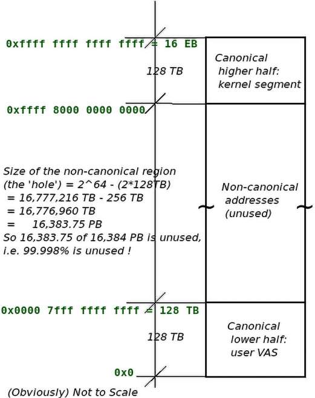

Hình 7.5: VAS layout 16 EB của Intel x86\_64 (hoặc AMD64) (với đánh địa chỉ 48-bit và page size 4 KB); VM split User:Kernel :: 128 TB:128 TB

Trong hình trên, bạn có thể thấy rõ user VAS được “neo” tại 128 terabyte dưới cùng và kernel VAS được “neo” tại 128 terabyte trên cùng của tổng VAS 16 EB hiện có.

Còn vùng không sử dụng ở giữa (ở đây từ `0x0000 8000 0000 0000` đến `0xffff 7fff ffff` `ffff`) thì sao? Đây đơn giản là một hole hoặc sparse region; nó cũng được gọi là vùng non-canonical address. Điều thú vị là, như sơ đồ cho biết, với cơ chế đánh địa chỉ 48-bit điển hình, phần lớn VAS (99,998%) không được sử dụng! Đó là lý do chúng ta mô tả VAS là rất thưa.

Hình trên chắc chắn không được vẽ đúng tỷ lệ! Đồng thời, hãy luôn nhớ rằng tất cả đây là virtual memory space, không phải physical.

#### Các VM split phổ biến

Để hoàn tất thảo luận về VM split, một số tỷ lệ user:kernel VM split phổ biến cho các CPU architecture khác nhau được trình bày trong hình sau (một lần nữa, chúng ta giả định MMU page size 4 KB, ngoại trừ hàng cuối dùng page size 64 KB):

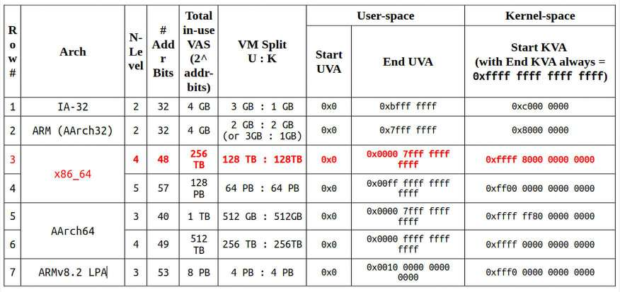

Hình 7.6: Các tỷ lệ user:kernel VM split phổ biến cho các CPU architecture khác nhau trên Linux hiện đại

Sau đây là một vài ghi chú liên quan đến Hình 7.6 (theo số hàng được hiển thị):

- Hàng #1 và hàng #2: IA-32 (hoặc x86-32) và AArch32 32-bit với VM split lần lượt là 3:1 và 2:2 (GB).

- Hàng #3, trường hợp phổ biến: x86\_64 với 4-level paging và 48 bit (LSB) được dùng để đánh địa chỉ.

- Hàng #4: Có thể dùng 5-level paging nhưng yêu cầu Linux 4.14 trở lên.

- Hàng #5, các ví dụ AArch64: Với bản build Yocto 4.0.4 (Kirkstone) tiêu chuẩn cho distro Poky, machine raspberrypi4-64 (với giá trị cấu hình mặc định `CONFIG_ARM64_VA_BITS=39`; vì vậy cấu hình 40 address bit, tổng VAS là 2<sup>^</sup>40 = 1 TB; do đó, ở đây kernel VAS và user VAS mỗi bên là 512 GB).

- Hàng #6, AArch64: Như trên + cấu hình `CONFIG_ARM64_VA_BITS=48`; vì vậy cấu hình 49 address bit (0 đến 48), tổng VAS là 2<sup>^</sup>49 = 512 TB; do đó, ở đây kernel VAS và user VAS mỗi bên là 256 TB.

- Hàng #7: Cấu hình này yêu cầu bật extension LPA (Large Physical Address) của (AArch64) ARMv8.2 + Linux \>= 5.4 + page size 64K (cho 3-level paging). Kết quả là 53 address bit được cấu hình, tổng VAS là 2<sup>^</sup>53 = 8 PB; do đó, ở đây kernel VAS và user VAS mỗi bên là 4 PB.

##### Đôi lời về việc đánh địa chỉ trên Linux x86\_64

Lấy x86\_64 làm ví dụ, 2<sup>^</sup>47 là 128 TB; vậy tại sao số address bit là 48 (trong Hình 7.6 cho x86\_64) chứ không phải 47? Tất nhiên, đó là vì chúng ta cần tổng cộng 2<sup>\*</sup>128 TB = 256 TB address space sử dụng được, 128 TB cho user space và 128 TB nữa cho kernel space (và 2<sup>^</sup>48 = 256 TB).

Thực tế, số address bit (cột thứ tư trong Hình 7.6) dùng để đánh địa chỉ quyết định tổng kích thước virtual memory đang sử dụng: user + kernel – trong đó mỗi VAS thường nhận một nửa tổng số (ngoại lệ thường là x86 32-bit và ARM-32, nơi VM split có thể được chủ ý chia không đều).

Chúng ta tô đậm (màu đỏ) hàng thứ ba vì nó được xem là trường hợp phổ biến: chạy Linux trên architecture x86\_64 (hoặc AMD64), với VM split `user:kernel :: 128 TB:128 TB`. Cột thứ tư, #Addr Bits, cho thấy trên các processor 64-bit, không processor thực tế nào sử dụng toàn bộ 64 bit để đánh địa chỉ.

Trên x86\_64, có hai VM split như thấy trong Hình 7.6 (các hàng 3 và 4):

- Loại thứ nhất (hàng #3 trong Hình 7.6), 128 TB : 128 TB (4-level paging), là VM split hiện được dùng mặc định trên các hệ thống Linux x86\_64 (embedded system, laptop, PC, workstation và server). Nó giới hạn physical address space ở 64 TB (RAM).

- Loại thứ hai (hàng #4 trong Hình 7.6), 64 PB : 64 PB, ít nhất tại thời điểm viết sách vẫn hoàn toàn mang tính lý thuyết; nó đi cùng hỗ trợ cho cơ chế gọi là 5-level paging từ Linux 4.14. Các VAS được cấp (với đánh địa chỉ 57-bit, chúng ta có tổng VAS đáng kinh ngạc 128 PB và physical address space 4 PB!) khổng lồ đến mức, theo hiểu biết của chúng tôi tại thời điểm viết nội dung này, chưa có máy tính thực tế nào sử dụng nó.

##### Đôi lời về việc đánh địa chỉ trên Linux AArch64

Lưu ý rằng hai hàng cho architecture AArch64 (ARM-64) chạy Linux chỉ mang tính đại diện. BSP vendor hoặc platform team làm việc trên sản phẩm hoàn toàn có thể sử dụng các tỷ lệ chia khác (các ghi chú sau Hình 7.6 đề cập ý nghĩa chính xác ở đây).

Hơn nữa, hàng cuối trong bảng đề cập rằng các processor (AArch64) ARMv8.2 thế hệ sau cung cấp extension LPA. Khi được bật, và với page size 64 KB, address space có thể mở rộng đến 52 bit trong mỗi user address space và kernel address space (vì vậy tổng cộng 53 bit), cung cấp (2<sup>^</sup>53) VAS space 4 PB cho mỗi bên (cùng giới hạn trên physical memory cũng là 4 PB). Điều này được hỗ trợ từ Linux 5.4 trở đi.

Có thể tìm thêm chi tiết về việc đánh địa chỉ 52-bit trên AArch64 tại đây:

  - Tài liệu kernel chính thức: Memory Layout on AArch64 Linux: `https://www.kernel.org/doc/html/v6.1/arm64/memory.html`

  - Understanding 52-bit virtual address support in the Arm64 kernel, B Sharma, tháng 12 năm 2020: `https://opensource.com/article/20/12/52-bit-arm64-kernel`

Được rồi, tiếp tục nào; thực sự có gì nằm trong kernel VAS (còn gọi là kernel segment)? Tất cả kernel code, kernel data structure (gồm task structure, list, kernel-mode stack, paging table, v.v.), device driver, kernel module, v.v. đều nằm ở đây (như nửa dưới của Hình 6.3 trong Chương 6, Kernel Internals Essentials – Processes and Threads đã cho thấy; chúng ta sẽ trình bày chính xác nội dung này tương đối chi tiết trong phần Tìm hiểu kernel segment sắp tới).

Cần hiểu rằng, như một cách tối ưu hiệu năng trên Linux, kernel memory luôn là non-swappable; nghĩa là kernel memory không bao giờ có thể được page out sang swap partition. User-space memory page luôn có thể là đối tượng của paging, trừ khi được lock (xem các system call `mlock[all](2)`).

Với kiến thức nền này, giờ bạn đã ở vị thế rất thuận lợi để hiểu process VAS layout đầy đủ trên Linux OS. Hãy đọc tiếp!

### Tìm hiểu process VAS – cái nhìn đầy đủ

Một lần nữa, hãy tham khảo Hình 7.1; nó cho thấy process VAS layout thực tế và đầy đủ của một process 32-bit. Tất nhiên, thực tế là mọi process đang tồn tại trên hệ thống đều có user-mode VAS riêng, nhưng chia sẻ cùng kernel VAS. Hình sau cố gắng truyền tải chính điều này về mặt khái niệm; nó cho thấy tình huống trên hệ thống IA-32 điển hình (hoặc cũng có thể là AArch32), với VM split 3:1 (GB). Ở đây, user space của mỗi process là riêng của nó, còn tất cả process chia sẻ chính cùng một kernel VAS:

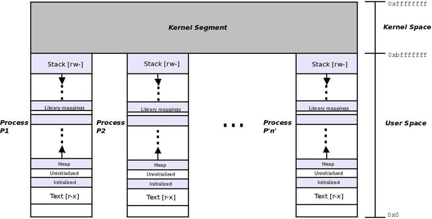

Hình 7.7: Các process có user VAS riêng nhưng chia sẻ kernel VAS (OS 32-bit); IA-32 (hoặc AArch32) với VM split 3:1 (GB)

Trong hình trên, hãy chú ý cách virtual address space phản ánh VM split 3:1 (GB). User VAS trải từ `0` đến `0xbfff ffff` (`0xc000 0000` là mốc 3 GB; đây là giá trị macro `PAGE_OFFSET` được đặt ở đây), còn kernel VAS trải từ `0xc000 0000` (3 GB) đến `0xffff ffff` (4 GB).

Ở phần sau của chương, chúng ta sẽ trình bày cách sử dụng một utility hữu ích tên là `procmap`. Nó sẽ giúp bạn thực sự trực quan hóa chi tiết các VAS, cả kernel lẫn user, tương tự những gì các sơ đồ trước đã thể hiện.

Một vài điều cần lưu ý:

- Với ví dụ trong Hình 7.7, giá trị của kernel macro `PAGE_OFFSET` là `0xc000 0000`.

- Các hình và con số chúng ta trình bày ở đây không phải tuyệt đối và bắt buộc trên mọi architecture; chúng thường rất đặc thù theo architecture, và nhiều hệ thống Linux được vendor tùy biến sâu có thể thay đổi chúng (như Hình 7.6 gợi ý).

- Hình 7.7 mô tả chi tiết VM layout trên Linux OS 32-bit. Trên Linux 64-bit, các khái niệm vẫn giống hệt, chỉ các con số thay đổi (đáng kể). Như đã trình bày tương đối chi tiết trong các phần trước, VM split trên hệ thống Linux x86\_64 (với đánh địa chỉ 48-bit và page 4K) trở thành `User : Kernel :: 128 TB : 128 TB`.

Giờ đã hiểu những kiến thức nền tảng về virtual memory layout của process, bạn sẽ thấy chúng giúp ích rất nhiều trong việc lý giải và xử lý các tình huống khó debug. Như thường lệ, vẫn còn nhiều điều khác; tiếp theo là các phần về virtual memory map của user space và kernel space (kernel VAS), cùng một số nội dung về physical memory map. Tiếp tục nào!

## Xem xét process VAS

Chúng ta đã trình bày layout – các segment hay mapping – cấu thành VAS của mỗi process (xem phần Tìm hiểu các kiến thức cơ bản về process Virtual Address Space (VAS) trong Chương 6, Kernel Internals Essentials – Processes and Threads). Chúng ta đã biết process VAS gồm nhiều mapping hay segment; trong đó có text (code), data segment, library mapping và ít nhất một stack. Ở đây, chúng ta sẽ mở rộng đáng kể phần thảo luận đó.

Khả năng đi sâu vào kernel và xem các runtime value khác nhau là một kỹ năng quan trọng đối với developer như bạn (cũng như app user, QA, sysadmin, những người làm DevOps, v.v.). Linux kernel cung cấp một interface tuyệt vời để thực hiện chính xác điều này – bạn đoán đúng rồi, đó là filesystem `proc` (`procfs`).

Pseudo filesystem này luôn hiện diện trên Linux (ít nhất thì nó nên như vậy) và được mount mặc định dưới `/proc`. Hệ thống `procfs` có hai nhiệm vụ chính:

- Cung cấp một tập file và directory (pseudo hoặc virtual) thống nhất, cho phép bạn xem sâu vào kernel và các chi tiết bên trong phần cứng.

- Cung cấp một tập file thống nhất mà root có thể ghi, cho phép sysad (hoặc root user) sửa các kernel parameter then chốt. Chúng nằm dưới `/proc/sys/` và được gọi là `sysctl` – đó là các núm điều chỉnh của Linux kernel.

Quả thực, việc quen thuộc với filesystem `proc` là bắt buộc. Tôi khuyến khích bạn khám phá nó và cũng đọc man page xuất sắc về `proc(5)` (bằng cách gõ `man 5 proc` trong terminal). Ví dụ, chỉ cần thực hiện `cat` `/proc/PID/status` (trong đó `PID` tất nhiên là process identifier duy nhất của một process hoặc thread cụ thể) sẽ thu được rất nhiều chi tiết hữu ích từ task structure của process hoặc thread!

Filesystem `sysfs`, được mount dưới `/sys` (và bên dưới nó là `debugfs`, thường mount tại `/sys/kernel/debug`), tương tự `procfs` về khái niệm. `sysfs` biểu diễn device and driver model mới của Linux \>= 2.6; nó cung cấp một tree gồm tất cả device (và driver của chúng) trên hệ thống, cùng nhiều núm điều chỉnh kernel. Tất cả đều là pseudo filesystem; nghĩa là chúng được mount trong RAM (và nội dung của chúng vì vậy là volatile).

### Xem xét chi tiết user VAS

Hãy bắt đầu bằng cách xem user VAS của một process bất kỳ. Một map khá chi tiết của user VAS được cung cấp qua `procfs`, cụ thể là qua pseudofile `/proc/PID/maps`. Hãy tìm hiểu cách dùng interface này để xem memory map (virtual) của user space một process. Chúng ta sẽ xem hai cách thực hiện:

- Trực tiếp qua pseudo file `/proc/PID/maps` của interface `procfs`

- Dùng một vài frontend hữu ích (làm output dễ đọc hơn đối với con người)

Hãy bắt đầu với cách thứ nhất.

#### Xem trực tiếp process memory map bằng procfs

Việc tra cứu các chi tiết bên trong của một process tùy ý đòi hỏi root access, trong khi tra cứu chi tiết của process thuộc quyền sở hữu của bạn (kể cả chính caller process) thì không. Vì vậy, làm một ví dụ đơn giản, chúng ta sẽ tra cứu VAS của calling process bằng cách dùng từ khóa `self` thay cho PID. Ảnh chụp màn hình sau cho thấy điều này (trên một guest x86\_64 Ubuntu 22.04 LTS):

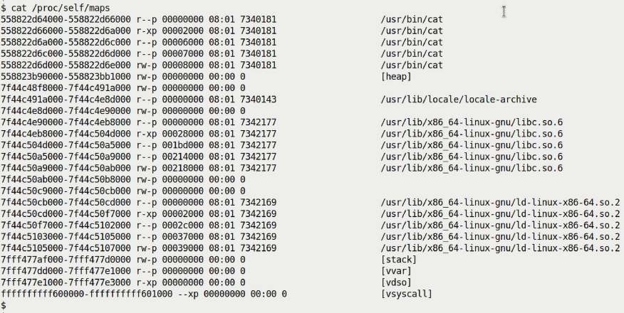

Hình 7.8: Output của lệnh cat /proc/self/maps trên một guest x86\_64

Trong ảnh chụp màn hình trên, bạn thực sự có thể thấy layout user VAS của process `cat` – một memory map đích thực của user VAS của process ấy! Đồng thời, hãy chú ý output `procfs` trên được sắp xếp theo UVA tăng dần.

Việc quen thuộc ở mức cơ bản với cách dùng system call mạnh mẽ `mmap(2)` sẽ giúp rất nhiều cho việc hiểu các thảo luận tiếp theo. Hãy (ít nhất) xem qua man page của nó.

##### Diễn giải output /proc/PID/maps

Để diễn giải output trong Hình 7.8, hãy đọc từng dòng một. Mỗi dòng biểu diễn một segment hay mapping trong user-mode VAS của process đang xét (trong ví dụ trên, đó là process `cat`). Mỗi dòng gồm các field sau; để dễ hơn, tôi sẽ chỉ đưa ra một dòng output mẫu (từ Hình 7.8), với các field mà chúng ta sẽ gắn nhãn, tham chiếu và tìm hiểu trong những ghi chú tiếp theo:

```
start_uva  -  end_uva      mode,mapping  start-off  mj:mn inode#    image-name
558822d66000-558822d6a000  r-xp          00002000   08:01 7340181   /usr/bin/cat
```

Ở đây, toàn bộ dòng biểu diễn một segment, hay chính xác hơn, một mapping trong (user) VAS của process. `uva` là user virtual address. `start_uva` và `end_uva` của mỗi mapping được hiển thị ở hai field (hay cột) đầu tiên và phân cách bằng ký tự gạch nối. Vì thế, dễ dàng tính được độ dài mapping (segment) (`end_uva-start_uva` byte). Như vậy, trong dòng trên, `start_uva is` `0x558822d66000` và `end_uva` là `0x558822d6a000`, và có thể tính được độ dài là 16 KB; nhưng chính xác segment này biểu diễn điều gì trong process? Hãy đọc tiếp...

Field thứ ba, `r-xp`, kết hợp hai thông tin:

- Ba chữ cái đầu biểu diễn mode (permission) của segment (theo ký hiệu `rwx` thông thường).

- Chữ cái tiếp theo cho biết mapping là private (`p`) hay shared (`s`). Bên trong, điều này được thiết lập bởi parameter thứ tư của system call `mmap()`, `flags`; thực sự chính system call `mmap()` chịu trách nhiệm bên trong cho việc tạo mọi segment hay mapping trong process!

- Vì vậy, với segment mẫu trình bày ở trên, field thứ ba có giá trị `r-xp`, giờ chúng ta biết đó là text (code) segment và là private mapping (đúng như mong đợi).

Field thứ tư `start-off` (ở đây có giá trị `0x2000`) là start offset tính từ đầu file có nội dung được map (với kích thước đã thấy, 16 KB) vào process VAS. Hiển nhiên, giá trị này chỉ hợp lệ với file mapping.

Bạn có thể biết segment hiện tại có phải file mapping hay không bằng cách nhìn vào field áp chót (thứ sáu) – file inode number. Với các mapping không được map từ file – gọi là anonymous mapping – nó luôn là `0` (ví dụ là các mapping biểu diễn heap segment hoặc stack segment). Trong dòng ví dụ trên, đây là file mapping (của `/usr/bin/cat`) và offset tính từ đầu file đó là `0x2000` byte (độ dài mapping, như đã tính trong đoạn trước, là 16 KB).

Field thứ năm (`08:01`) có dạng `mj:mn`, trong đó `mj` là major number và `mn` là minor number của (block) device file nơi image nằm. Giống field thứ tư, nó chỉ hợp lệ với file mapping, nếu không chỉ được hiển thị là `00:00`; trong dòng ví dụ trên, vì đây là file mapping, major number và minor number (của block device biểu diễn storage media chứa file) lần lượt là `8` và `1`.

Field thứ sáu (`7340181`) biểu diễn inode number của image file – file có nội dung đang được map vào process VAS. Inode là data structure then chốt của VFS (Virtual File System); nó giữ toàn bộ metadata của file object, mọi thứ ngoại trừ tên của file (nằm trong directory (hay dot) file). Một lần nữa, giá trị này chỉ hợp lệ với file mapping, nếu không chỉ hiển thị là `0`. Thực ra đây là cách nhanh để biết mapping là file-mapped hay anonymous mapping! Trong mapping ví dụ trên, rõ ràng đây là file mapping (của `/usr/bin/cat`), và inode number là `7340181`. Quả thực, chúng ta có thể xác nhận điều này:

```
$ ls -i /usr/bin/cat
7340181 /usr/bin/cat
```

Field thứ bảy và cuối cùng biểu diễn pathname của file có nội dung được map vào user VAS. Ở đây, vì đang xem memory map của process `cat`, pathname (cho các file-mapped segment) là `/usr/bin/cat`. Nếu mapping biểu diễn một file, inode number của file (field thứ sáu) xuất hiện dưới dạng một số dương; nếu không – nghĩa là một pure memory mapping hoặc anonymous mapping không có backing store – inode number xuất hiện là `0` và field cuối sẽ trống. (Tất nhiên, các file khác cũng có thể xuất hiện: file của shared library, shared memory segment, v.v.)

Đến đây điều này hẳn đã rõ, nhưng chúng ta vẫn sẽ chỉ ra vì đây là điểm then chốt: mọi địa chỉ thấy ở trên đều là virtual, không phải physical. Hơn nữa, chúng chỉ thuộc user space, vì vậy được gọi là UVA và luôn được truy cập (và dịch) thông qua paging table metadata riêng của process đó. Ngoài ra, ảnh chụp màn hình trên được lấy trên Linux guest 64-bit (x86\_64). Do đó, ở đây chúng ta thấy virtual address 64-bit.

Cách virtual address được hiển thị ở đây không phải dưới dạng số 64-bit đầy đủ – ví dụ, là 558822d66000 chứ không phải 0000558822d66000. Tôi muốn bạn chú ý điều này vì, do là UVA, 16 bit MSB bằng zero! (Đồng thời, tất nhiên, tất cả các số đều ở hệ hexadecimal.)

Được rồi, dù phần đó đã trình bày cách diễn giải một segment hay mapping cụ thể (và các dòng `[heap]` và `[stack]` đã tự nói lên ý nghĩa), dường như vẫn có vài mapping lạ (hãy nhìn lại Hình 7.8) – các mapping `vvar`, `vdso` và `vsyscall`. Hãy xem chúng có nghĩa gì.

##### vsyscall page

Bạn có nhận thấy điều gì hơi khác thường trong output ở Hình 7.8 không? Dòng cuối cùng ở đó – entry gọi là `vsyscall` – map một kernel page (đến đây, bạn biết cách chúng ta nhận ra: 16 bit MSB của start virtual address và end virtual address đều được đặt). Ở đây, chúng ta chỉ đề cập rằng đây là một tối ưu (cũ) cho việc thực hiện system call. Nó hoạt động bằng cách giảm nhu cầu chuyển sang kernel mode đối với một nhóm nhỏ syscall thực sự không cần việc chuyển đó.

Hiện tại, trên x86, nhóm này gồm các system call `gettimeofday()`, `time()` và `getcpu()`. Quả thực, các mapping `vvar` và `vdso` (còn gọi là Virtual Dynamic Shared Object) phía trên là những biến thể hiện đại hơn (một chút) của cùng ý tưởng. Nếu bạn muốn tìm hiểu thêm, hãy xem phần Đọc thêm của chương này.

Một lưu ý ngắn bên lề: directory có tên `/proc/PID/map_files/` là một góc nhìn khác; nó chỉ hiển thị các file mapping trong một process hoặc thread. Ở đây, mỗi file-backed memory mapping (hay segment) được hiển thị dưới dạng symbolic link đến file tương ứng.

Như vậy, giờ bạn đã học cách xem xét và diễn giải user-space memory map “thô” của một process bất kỳ bằng cách trực tiếp đọc và diễn giải output của (pseudo) file `/proc/PID/maps` cho process có PID được chỉ định. Có những frontend thuận tiện khác để làm việc này; bây giờ chúng ta sẽ xem một vài frontend.

#### Các frontend để xem process memory map

Ngoài định dạng thô hay trực tiếp qua `/proc/PID/maps` (mà chúng ta đã biết cách diễn giải trong phần trước), có một số wrapper utility giúp diễn giải user-mode VAS dễ hơn. Trong đó có pseudo file (thô) bổ sung `/proc/PID/smaps`, các utility `pmap` và `smem`, cùng utility của riêng tôi (được đặt tên là `procmap`).

Kernel cung cấp thông tin chi tiết về từng segment hay mapping qua pseudo file `/proc/PID/smaps` dưới `proc`. Hãy thử chạy lệnh `cat /proc/self/smaps` để tự xem. Bạn sẽ nhận thấy với mỗi segment (mapping), khá nhiều thông tin chi tiết được cung cấp. Man page về `proc(5)` giúp giải thích nhiều field mà bạn thấy.

Với cả hai utility `pmap` và `smem`, tôi đề nghị bạn tham khảo man page của chúng để biết chi tiết. Ví dụ, với `pmap`, man page cho biết các tùy chọn `-X` và `-XX` cung cấp thông tin chi tiết hơn:

```
$ pmap -h
[ … ]
-x, --extended show details
-X    show even more details
      WARNING: format changes according to /proc/PID/smaps
-XX   Show everything the kernel provides
[ … ]
```

Về utility `smem`, thực tế nó không cho bạn thấy process VAS; thay vào đó, nó chủ yếu nhằm trả lời một câu hỏi thường gặp: xác định process nào đang chiếm nhiều physical memory nhất. Nó dùng các metric như Resident Set Size (RSS), Proportional Set Size (PSS) và Unique Set Size (USS) để cung cấp cái nhìn rõ hơn. Tôi sẽ để việc khám phá thêm các utility này làm bài tập dành cho bạn, độc giả thân mến!

Nhân tiện, để bạn biết, chúng ta có trình bày một chút về cách dùng `smem` trong Chương 8, Kernel Memory Allocation for Module Authors – Part 1, tại phần Làm thế nào xem mức sử dụng memory tổng thể trên toàn hệ thống?

Bây giờ, hãy chuyển sang tìm hiểu cách tận dụng một utility hữu ích – `procmap` – để xem khá chi tiết cả kernel memory map lẫn user memory map của một process bất kỳ.

##### Utility trực quan hóa process VAS procmap

Như một project nhỏ phục vụ học tập và giảng dạy (và hữu ích khi debug!), tôi đã viết và lưu trữ trên GitHub một project tên là `procmap`, có tại đây: `https://github.com/kaiwan/procmap` (hãy `git clone` nó!). Một đoạn trích từ file `README.md` của nó giúp giải thích mục đích:

```
procmap is designed to be a console/CLI utility to visualize the complete
memory map of a Linux process, in effect, to visualize the memory mappings of
both the kernel and usermode Virtual Address Space (VAS).
It outputs a simple visualization, in a vertically-tiled format ordered
by descending virtual address (see screenshots below). The script has the
intelligence to show kernel and user space mappings as well as calculate and
show the sparse memory regions that will be present. Also, each segment or
mapping is scaled by relative size (and color-coded for readability). On 64-
bit systems, it also shows the so-called non-canonical sparse region or 'hole'
(typically close to 16,384 PB on the x86_64).
```

Phần Tìm hiểu bên trong – chương trình C Hello, world đã trình bày một chút về những gì thực sự diễn ra khi chương trình C K\&R “Hello, world” nổi tiếng chạy trên Linux. Ở đây, hãy khám phá user VAS của process Hello, world bằng utility `procmap`!

C code “Hello, world” của tôi vẫn như thông thường, ngoại trừ việc sau `printf()`, chúng ta muốn process tiếp tục tồn tại; vì vậy, tôi thêm system call `pause()` (nó giữ caller ở trạng thái blocking (ngủ) cho đến khi nhận được signal):

```
#include <stdio.h>
#include <unistd.h>
int main()
{
    printf("Hello, world\n");
    pause();
}
```

(Tôi cũng build có tối ưu, `-O2`, và strip binary executable.) Để thêm phần thú vị, tôi thực hiện hoạt động này từ một SSH session trên Raspberry Pi 4 (Model B), chạy Raspberry Pi OS tiêu chuẩn (với kernel 5.15.84-v8+) được cấu hình là AArch64. Build nó rồi chạy ở background:

```
$ ./helloworld &
[1] 835
$ Hello, world
```

À, nó hoạt động. Được rồi, khi process vẫn đang tồn tại, hãy bắt tay vào việc và chạy utility procmap. Làm thế nào cài đặt và gọi nó? Đơn giản, xem phần sau (do thiếu chỗ, tôi sẽ không trình bày tất cả thông tin, lưu ý và những nội dung khác ở đây; hãy tự thử):

```
$ git clone https://github.com/kaiwan/procmap
$ cd procmap
$ ./procmap
Usage: procmap [options] --pid=PID-of-process-to-show-memory-map-of
Options:
--only-user     : show ONLY the usermode mappings or segments (not kernel VAS)
--only-kernel   : show ONLY the kernel-space mappings or segments (not user
VAS)
  [default is to show BOTH]
--export-maps=filename
     write all map information gleaned to the file you specify in CSV
--export-kernel=filename
     write kernel information gleaned to the file you specify in CSV
--verbose       : verbose mode (try it! see below for details)
--debug         : run in debug mode
--version|--ver : display version info.
See the config file as well.
[…]
```

Hãy lưu ý utility `procmap` này không phải utility `procmap` do BSD Unix cung cấp. Ngoài ra, để bạn biết, nó yêu cầu cài đặt các utility `bc`, `smem` và `yad` (cùng một số utility khác).

Khi tôi chạy utility `procmap` chỉ với `--pid=<PID>` (parameter bắt buộc duy nhất), nó sẽ hiển thị cả kernel-space VAS lẫn user-space VAS của process được chỉ định. Giờ vì chúng ta chưa trình bày chi tiết về kernel VAS (hay segment), tôi sẽ không đưa output chi tiết của kernel space ở đây; hãy để việc đó cho phần Xem xét kernel VAS sắp tới. Trong phần tiếp theo, bạn sẽ thấy các ảnh chụp một phần chỉ của output user VAS từ utility `procmap`. Output đầy đủ có thể khá dài, tất nhiên tùy vào process đang xét; hãy tự thử.

Như bạn sẽ thấy, `procmap` cố gắng cung cấp cách trực quan hóa cơ bản toàn bộ process memory map – cả kernel-space VAS lẫn user-space VAS theo định dạng xếp dọc (như đã đề cập, ở đây chúng ta chỉ hiển thị ảnh chụp đã cắt bớt):

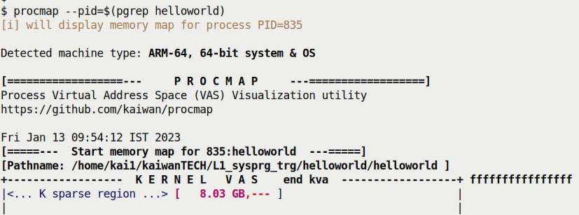

Hình 7.9: Ảnh chụp một phần: dòng đầu tiên của output kernel VAS từ utility procmap (chạy trên AArch64)

Từ ảnh chụp (một phần) trên, hãy chú ý vài điều:

- Script (Bash) `procmap` tự động phát hiện rằng chúng ta đang chạy trên hệ thống ARM-64 (AArch64).

- Dù hiện chưa tập trung vào nó, output kernel VAS xuất hiện trước; điều này tự nhiên vì chúng ta hiển thị output theo virtual address giảm dần (Hình 7.1, Hình 7.5 và Hình 7.7 nhắc lại điều này)

- Bạn có thể thấy dòng đầu tiên (sau header `KERNEL VAS ...`) tương ứng với một KVA ở đỉnh cao nhất của VAS – giá trị `0xffff ffff ffff ffff` (vì chúng ta đang thực thi nó trên Linux 64-bit).

Chuyển sang phần tiếp theo của output `procmap`, hãy xem một góc nhìn đã cắt bớt về đầu trên của user VAS của process `helloworld`:

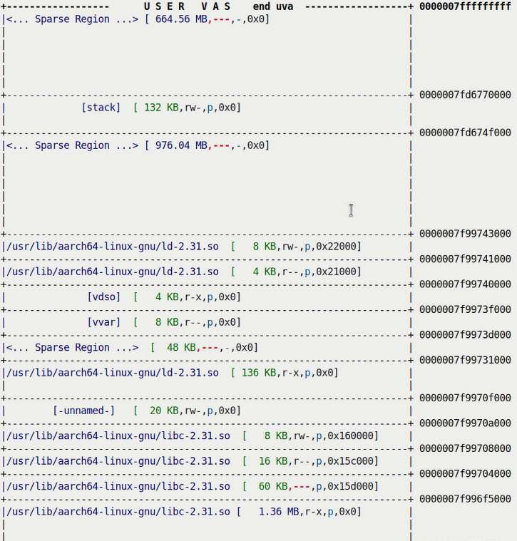

Hình 7.10: Ảnh chụp một phần: vài dòng đầu (đầu cao) của output user VAS của process từ utility procmap (chạy trên AArch64)

Hình 7.10 là ảnh chụp một phần của output `procmap` và cho thấy user-space VAS; ở trên cùng, bạn có thể thấy end UVA (cao).

Trên hệ thống AArch64 của chúng ta (hãy nhớ điều này phụ thuộc architecture), giá trị `end_uva` (cao) là

`0x0000 007f ffff ffff` (đúng như thấy; `start_uva` tất nhiên là `0x0`; xem ảnh chụp tiếp theo). Trong Hình 7.10, hãy chú ý một số mapping thú vị: stack (của `main()`), các sparse region trong VAS (thực chất là các hole, vùng không được phép truy cập và không sử dụng), cùng các mapping cho loader (`ld*.so`) và tất nhiên cho shared library glibc – lý do Hello, world hoạt động!

Làm thế nào `procmap` xác định các giá trị địa chỉ chính xác? À, nó khá tinh vi: với thông tin memory của kernel space, nó dùng một kernel module (một LKM!) để truy vấn kernel và thiết lập một output file tùy theo system architecture; các chi tiết user space tất nhiên đến từ interface pseudo file `procfs` trực tiếp (thô) `/proc/PID/maps`.

Một lưu ý bên lề, thành phần kernel của `procmap`, một kernel module, thiết lập cách giao tiếp với user space – các script `procmap` – bằng cách tạo và thiết lập một pseudo file `debugfs`. Này, nó là open source; cứ `git clone` nó và tìm hiểu cách hoạt động!

Hình sau là ảnh chụp một phần đầu thấp của user-mode VAS cho process “Hello, world” của chúng ta, xuống tận UVA thấp nhất, `0x0`:

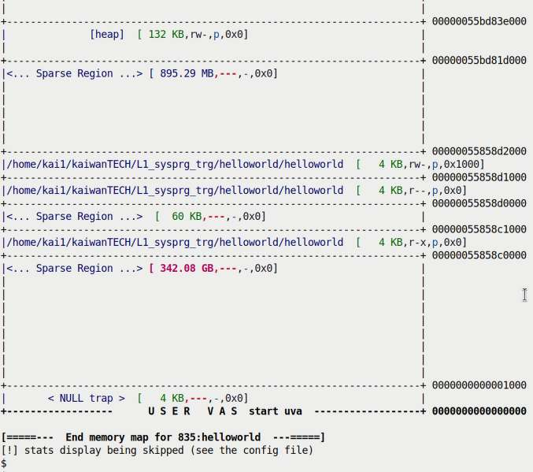

Hình 7.11: Ảnh chụp một phần: vài dòng cuối (đầu thấp) của output user VAS của process từ utility procmap (chạy trên AArch64)

Mapping cuối cùng, một page đơn lẻ, đúng như mong đợi là null trap page (từ UVA `0x1000` đến `0x0`; chúng ta sẽ giải thích mục đích của nó trong phần Null trap page sắp tới). Trong hình này, hãy chú ý các mapping cho heap và code/data của chương trình `helloworld`.

Utility `procmap`, sau khi hiển thị các memory map, nếu được bật trong config file của nó, sẽ tính và hiển thị một vài thống kê: bao gồm kích thước của cả kernel VAS lẫn user-mode VAS, lượng memory mà các sparse region chiếm (trên 64-bit, như ví dụ trên, thường là phần lớn không gian!) dưới dạng số tuyệt đối và phần trăm, lượng physical RAM được báo cáo, và cuối cùng là chi tiết sử dụng memory của process cụ thể này do các utility `ps` và `smem` báo cáo.

Nhìn chung, trên hệ thống 64-bit (xem Hình 7.5), bạn sẽ thấy các vùng memory sparse (trống) của process VAS có thể chiếm gần 100% address space có sẵn! Điều này nghĩa là thông thường hơn hẳn 99% virtual memory space là sparse (trống)! Đó là thực tế của VAS khổng lồ trên hệ thống 64-bit. Chỉ một phần rất nhỏ trong VAS 16 EB đồ sộ của nó thực sự được sử dụng (đúng với cả AArch64 và x86\_64). Tất nhiên, lượng user-mode VAS trống và được sử dụng thực tế phụ thuộc kích thước application process.

Khả năng trực quan hóa rõ ràng process VAS có thể hỗ trợ rất nhiều khi debug hoặc phân tích vấn đề ở mức sâu hơn.

Nếu đang đọc bản in của cuốn sách, hãy nhớ tải bản PDF sơ đồ/hình ảnh đầy đủ màu sắc từ website nhà xuất bản: `https://packt.link/gbp/9781803232225`.

Bạn cũng sẽ thấy các thống kê in ở cuối output (được bật theo mặc định) cho biết số Virtual Memory Area (VMA) được thiết lập cho target process. VMA là gì? Phần sau giải thích ngắn gọn VMA là gì. Hãy bắt đầu!

### Tìm hiểu kiến thức cơ bản về VMA

Trong output của `/proc/PID/maps`, mỗi dòng output được suy ra từ một kernel metadata structure gọi là virtual memory area, hay VMA. Thực ra khá đơn giản: kernel dùng data structure VMA để trừu tượng hóa trong code thứ mà chúng ta vẫn gọi là segment hay mapping. Vì thế, với mỗi mapping trong user VAS, OS duy trì một VMA object. Hãy hiểu rằng chỉ user-space mapping mới được quản lý bởi kernel metadata structure gọi là VMA; bản thân kernel VAS không có VMA.

Vậy một process cụ thể có bao nhiêu VMA? Nó bằng số mapping (segment) trong user VAS của process. Trong lần chạy mẫu process `helloworld` của tôi, nó báo cáo 15 segment hay mapping, nghĩa là có 15 VMA metadata object – biểu diễn 15 user-space segment hay mapping – dành cho process này trong kernel memory.

Xét về mặt lập trình, kernel duy trì một “chuỗi” VMA (về kỹ thuật là data structure red-black tree vì lý do hiệu quả) thông qua task structure, với gốc tại `current->mm->mmap`. Tại sao pointer lại có tên `mmap`? Đây là chủ ý rõ ràng: mỗi khi một system call `mmap()` – nghĩa là một thao tác memory mapping – được thực hiện, kernel tạo ra một mapping (hay “segment”) trong VAS của calling process, và do đó một VMA metadata object biểu diễn nó.

VMA metadata structure giống một chiếc ô bao trùm mapping và chứa mọi thông tin cần thiết để kernel thực hiện các loại memory management khác nhau: xử lý page fault (rất phổ biến), cache nội dung file trong quá trình I/O vào (hoặc ra khỏi) kernel page cache, v.v.

Page fault handling là hoạt động rất quan trọng của OS, với thuật toán sử dụng khá nhiều kernel VMA object; tuy nhiên trong cuốn sách này, chúng ta không đi sâu vào các chi tiết ấy vì chúng phần lớn trong suốt với người viết kernel module/driver.

Chỉ để bạn hình dung, chúng ta sẽ trình bày một vài member của kernel data structure VMA trong đoạn code sau: các comment bên cạnh giúp giải thích mục đích của chúng:

```
// include/linux/mm_types.h
struct vm_area_struct {
 /* The first cache line has the info for VMA tree walking. */
    unsigned long vm_start;  /* Our start address within vm_mm. */
    unsigned long vm_end;    /* The first byte after our end
                                address within vm_mm. */
    struct mm_struct *vm_mm; /* The address space we belong to.*/
    [...]
    pgprot_t vm_page_prot;
    unsigned long vm_flags;     /* Flags, see mm.h. */
    [...]
    /* Function pointers to deal with this struct. */
    const struct vm_operations_struct *vm_ops;

    /* Information about our backing store: */
    unsigned long vm_pgoff; /* Offset (within vm_file) in
      PAGE_SIZE units */
    struct file * vm_file; /* File we map to (can be NULL). */
    […]
} __randomize_layout;
```

Giờ hẳn đã rõ hơn về cách `cat /proc/PID/maps` thực sự hoạt động bên trong: khi user space thực hiện, chẳng hạn, `cat /proc/self/maps`, một system call `read()` (cuối cùng) được process `cat` gọi; điều này khiến nó chuyển sang kernel mode và chạy code của system call `read()` bên trong kernel với kernel privilege. Ở đây, kernel Virtual Filesystem (VFS) switch chuyển quyền điều khiển đến callback handler `procfs` thích hợp (một function được đăng ký trong structure `proc_ops` ở các kernel gần đây, từ 5.6.0 trở đi). Code này duyệt (lặp) qua từng VMA metadata structure (cho process context đang chạy: nói cách khác, cho `current`, tất nhiên là process `cat` của chúng ta), gửi thông tin chi tiết liên quan từ mỗi VMA object trở lại user space. Sau đó, process `cat` trung thành đổ data nhận được qua thao tác read ra `stdout`, và nhờ vậy chúng ta thấy nó: tất cả segment hay mapping của process – thực chất là memory map của user-mode VAS!

Tốt, giờ chúng ta kết thúc phần này; chúng ta đã trình bày chi tiết cách xem xét process user VAS. Kiến thức này không chỉ giúp hiểu layout chính xác của user-mode VAS mà còn giúp debug các vấn đề user space!

Bây giờ, cũng đến lúc rồi, hãy chuyển sang tìm hiểu một khía cạnh quan trọng khác của memory management – layout chi tiết của kernel VAS!

## Xem xét kernel VAS

Như đã nói trong chương trước, và như thấy ở Hình 7.7, điều quan trọng là hiểu rằng mọi process có user VAS riêng nhưng chia sẻ kernel space – thứ chúng ta gọi là kernel segment hay kernel VAS. Hãy bắt đầu phần này bằng cách xem xét một số vùng phổ biến (độc lập với architecture) của kernel VAS.

Memory layout của kernel VAS phụ thuộc rất nhiều vào architecture (CPU). Tuy vậy, mọi architecture đều có một số điểm chung. Sơ đồ cơ bản sau biểu diễn cả user VAS lẫn kernel VAS (theo định dạng xếp ngang), như thấy trên x86\_32 (hoặc IA-32) điển hình với VM split 3:1 (GB):

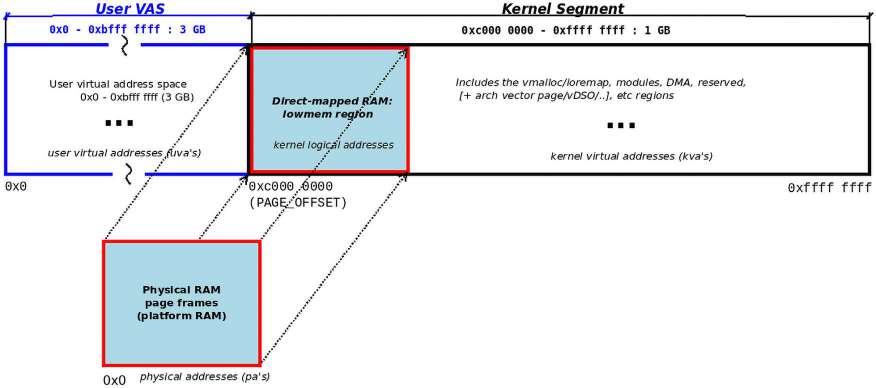

Hình 7.12: User VAS và kernel VAS trên x86\_32 với VM split 3:1 (GB), tập trung vào vùng lowmem; hình này được chủ ý đơn giản hóa

Hãy lần lượt xem từng vùng của process VAS (từ trái sang phải, như trong Hình 7.12):

- User-mode VAS: Đây là user VAS. Chúng ta đã trình bày chi tiết trong chương trước cũng như các phần trước của chương này; trong ví dụ cụ thể này, nó chiếm 3 GB VAS (các UVA trải từ `0x0` đến `0xbfff ffff`).

- Kernel VAS (hay kernel segment): Trong ví dụ cụ thể này, chúng ta có 1 GB kernel VAS (với các KVA trải từ `0xc000 0000` đến `0xffff ffff`); giờ hãy xem xét từng phần của nó.

- Vùng “lowmem”: Đây là vùng mà OS direct-map platform (system) RAM vào kernel VAS. (Hình 7.12 cố gắng truyền tải rõ điều này. Chúng ta sẽ trình bày chủ đề then chốt này chi tiết hơn trong phần Direct-mapped RAM và address translation. Nếu thấy hữu ích, bạn có thể đọc phần đó trước rồi quay lại đây). Tạm đi trước một chút, hãy chỉ hiểu rằng base location trong kernel VAS nơi platform RAM được map được chỉ định bởi kernel macro có tên `PAGE_OFFSET`. Giá trị chính xác của macro này rất phụ thuộc architecture; chúng ta sẽ để phần thảo luận ấy cho phần sau. Trước mắt, hãy tạm tin rằng trên x86\_32 với VM split 3:1 (GB), giá trị `PAGE_OFFSET` là `0xc000 0000`.

Hiển nhiên, kích thước vùng gọi là lowmem của kernel bằng lượng RAM trên hệ thống. (Chính xác hơn, ít nhất là lượng RAM mà kernel nhìn thấy; chẳng hạn bật tính năng kdump khiến OS dành riêng một lượng RAM được chỉ định từ rất sớm.) Các virtual address tạo nên vùng này được gọi là kernel logical address vì chúng có offset cố định so với physical address tương ứng. Core kernel và device driver có thể cấp phát memory (physically contiguous!) từ vùng này qua nhiều API (gồm các page allocator API và slab API phổ biến – `k{m|z}` `alloc()`. Xin kiên nhẫn, chúng ta sẽ trình bày chi tiết chính các API này trong hai chương sau). Các vùng memory kernel static text (code), data và BSS (uninitialized data) cũng nằm trong vùng lowmem này.

Được rồi, sau vùng lowmem vẫn có các vùng khác; dù chưa được thể hiện tường minh trong Hình 7.12 (ở thời điểm này), một vài vùng then chốt là:

- Vùng kernel vmalloc: Đây là một vùng kernel VAS hoàn toàn virtual. Core kernel code và/hoặc device driver code có thể cấp phát virtually contiguous memory từ vùng này bằng API `vmalloc()` (và các API liên quan). Một lần nữa, chúng ta sẽ trình bày chi tiết trong Chương 8, Kernel Memory Allocation for Module Authors – Part 1, và Chương 9, Kernel Memory Allocation for Module Authors – Part 2. Đây cũng là không gian gọi là `ioremap`.

- Kernel modules space: Một vùng kernel VAS được dành riêng cho memory mà static text và data của LKM chiếm. Khi bạn thực hiện `insmod` (hoặc `modprobe`), kernel code bên dưới của system call `[f]init_module()` phát sinh sẽ cấp phát memory từ vùng này (thường qua API `vmalloc()`) và load code cùng data (static) của kernel module vào đó.

Hình trên (Hình 7.12) được chủ ý giữ đơn giản và thậm chí hơi mơ hồ vì kernel virtual memory layout chính xác rất phụ thuộc architecture. Chúng ta sẽ tạm hoãn sự thôi thúc muốn vẽ một sơ đồ chi tiết.

Thay vào đó, để phần thảo luận bớt nặng tính hàn lâm, thực tế và hữu ích hơn, trong một phần sắp tới chúng ta sẽ trình bày một kernel module truy vấn và in thông tin liên quan về kernel VAS layout. Chỉ sau đó, khi đã có các giá trị thực tế của những vùng kernel VAS khác nhau trên một architecture cụ thể, chúng ta mới trình bày sơ đồ chi tiết mô tả điều này.

Xét một cách chặt chẽ (và như có thể thấy trong Hình 7.10), các địa chỉ thuộc vùng kernel lowmem được gọi là kernel logical address (chúng có offset cố định so với physical address tương ứng), trong khi địa chỉ cho phần kernel VAS còn lại được gọi là KVA. Dù có sự phân biệt ở đây, hãy hiểu rằng đối với mọi mục đích thực tế, đây là sự phân biệt khá hàn lâm: chúng ta không thực sự phân biệt hai loại và thường chỉ gọi tất cả địa chỉ trong kernel VAS là KVA.

Tuy nhiên, trước khi viết module truy vấn kernel VAS, còn một số thông tin khác cần trình bày. Hãy bắt đầu với một điểm đặc thù, chủ yếu do giới hạn của architecture 32-bit gây ra: vùng gọi là high memory của kernel VAS trên hệ thống 32-bit.

### High memory trên hệ thống 32-bit

Ghi nhớ vùng kernel lowmem vừa được thảo luận ngắn gọn, chúng ta có một nhận xét thú vị. Trên hệ thống 32-bit, chẳng hạn với VM split 3:1 (GB) (đúng như Hình 7.12 mô tả), một hệ thống có (chẳng hạn) 512 MB RAM sẽ có RAM này được direct-map vào kernel bắt đầu tại `PAGE_OFFSET` (3 GB hay KVA `0xc000 0000`) với độ dài 512 MB. Điều này khá rõ ràng.

Nhưng hãy suy nghĩ: chuyện gì xảy ra nếu hệ thống có nhiều RAM hơn hẳn, chẳng hạn 2 GB? Giờ rõ ràng chúng ta không thể direct-map toàn bộ RAM vào vùng kernel lowmem. Nó đơn giản không thể vừa (vì trong ví dụ này, toàn bộ kernel VAS có sẵn chỉ là một gigabyte còn RAM là 2 GB)! Vì thế, trên Linux OS 32-bit, một lượng memory nhất định (thường là 896 MB trên IA-32) được phép direct-map và do đó nằm trong vùng lowmem. RAM còn lại được map gián tiếp vào một memory “zone” khác gọi là `ZONE_HIGHMEM` (chúng ta xem đây là high-memory region hay zone, đối lập với lowmem; nội dung thêm về memory zone sẽ có trong phần Zone phía sau). Chính xác hơn, vì kernel giờ thấy không thể direct-map toàn bộ physical memory cùng lúc, nó thiết lập một vùng (virtual) nơi có thể tạo và sử dụng các virtual mapping tạm thời của RAM đó (thường qua các lời gọi API `kmap()` và `kunmap()`). Đây là vùng gọi là high-memory.

Đừng nhầm lẫn bởi cụm từ “high memory”. Nó không nhất thiết được đặt ở vị trí “cao” trong kernel VAS, cũng không phải thuật ngữ “high-memory” dùng để mô tả memory phía trên hole tại 640 KB trên PC. Thay vào đó, global variable `high_memory`, chỉ hợp lệ trên 32-bit, biểu diễn giới hạn trên của vùng kernel lowmem. Nội dung thêm về điều này sẽ có trong phần Các macro và variable mô tả kernel VAS layout phía sau.

Tuy nhiên, ngày nay (đặc biệt khi hệ thống 32-bit ngày càng ít được sử dụng), những mối lo này hoàn toàn biến mất trên Linux 64-bit. Hãy suy nghĩ: ví dụ, trên x86\_64 chạy Linux 64-bit, kích thước kernel VAS lên đến 128 TB (tức 131.072 GB!). Theo tôi biết, không hệ thống (hay node) đơn lẻ hiện có nào có lượng RAM gần đến mức này.

Tại thời điểm viết sách, Pleiades Supercomputer của NASA ghi rõ mức RAM tối đa 128 GB cho mỗi node (tham khảo: `https://www.nas.nasa.gov/hecc/resources/pleiades.html`).

Tiếp theo, khi sparse memory model được sử dụng (trường hợp thông thường; phần Giới thiệu physical memory model sắp tới trình bày điều này), số bit tối đa được hỗ trợ trong physical address được cho bởi macro `MAX_PHYSMEM_BITS`. Trên x86\_64, nó thường là giá trị 46, nghĩa là lượng RAM tối đa được hỗ trợ trên máy là 2<sup>46</sup> byte – tức 64 TB. Do đó, toàn bộ platform RAM thực sự có thể (dễ dàng) được direct-map vào kernel VAS 128 TB và nhu cầu về `ZONE_HIGHMEM` (hay các cách khắc phục bất tiện tương tự) đơn giản biến mất. Thực tế, loại bỏ dần vùng high memory này trên hệ thống 32-bit là điều phần lớn những người làm kernel muốn cuối cùng thực hiện, nhưng hiện tại nó vẫn tồn tại rõ ràng, cho phép các hệ thống cũ hơn (thường là ARM-32) có hơn một gigabyte RAM tiếp tục chạy Linux (xem bài viết này để biết thêm: An end to high memory?, LWN, tháng 2 năm 2020: `https://lwn.net/Articles/813201/`).

Một lần nữa, tài liệu kernel chính thức cung cấp chi tiết về vùng “high-memory” khó hiểu này (liên quan đến 32-bit); hãy xem nếu quan tâm: `https://www.kernel.org/doc/Documentation/vm/highmem.txt`.

Được rồi, giờ hãy làm việc mà chúng ta đã nóng lòng muốn thực hiện – viết một kernel module (một LKM) để đi sâu vào một số chi tiết về kernel VAS.

### Viết kernel module để hiển thị thông tin về kernel VAS

Như đã học, kernel VAS gồm nhiều vùng khác nhau. Một số vùng chung cho mọi architecture (độc lập với architecture): gồm vùng lowmem (chứa, trong số những thứ khác, kernel image chưa nén – code và data của nó), rồi đến vùng kernel module, các vùng `vmalloc/ioremap`, v.v.

Vị trí chính xác của các vùng này trong kernel VAS, và thực sự những vùng nào có thể hiện diện, phụ thuộc rất nhiều vào architecture (CPU). Để giúp hiểu và xác định rõ điều đó cho một hệ thống bất kỳ, hãy phát triển một kernel module truy vấn và in – theo cách phụ thuộc architecture khi cần – các chi tiết khác nhau về kernel VAS (thực ra, nếu được yêu cầu, nó cũng in một số chi tiết hữu ích về user-space memory).

Giờ để truy vấn và in thông tin này, trước hết bạn phải làm quen với một số kernel macro và global variable then chốt; hãy thực hiện trong phần tiếp theo.

#### Các macro và variable mô tả kernel VAS layout

Để viết một kernel module hiển thị thông tin kernel VAS liên quan, chúng ta cần biết chính xác cách truy vấn kernel về những chi tiết này.

Trong phần này, chúng ta sẽ mô tả ngắn gọn một vài macro và variable then chốt trong kernel biểu diễn memory của kernel VAS (trên phần lớn architecture, theo KVA giảm dần):

- Vector table là một OS data structure phổ biến – đó là một array các function pointer (còn gọi là switching table hoặc jump table). Nó đặc thù theo architecture: ARM-32 dùng nó để khởi tạo các vector sao cho khi xảy ra processor exception hoặc mode change (như interrupt, syscall, page fault, MMU abort, v.v.), processor biết phải chạy code nào. Macro `VECTORS_BASE` được trình bày trong bảng sau:

| Macro hoặc variable | Diễn giải |
|---|---|
| `VECTORS_BASE` | Thường chỉ dành cho ARM-32; start KVA của kernel vector table trải trên 1 page |

Bảng 7.1: Các macro và variable mô tả kernel VAS layout: vector table (AArch32), tùy chọn

- Vùng fix map là một dải virtual address đặc biệt hoặc dành riêng được xác định ở compile time; chúng được dùng ở boot time để cố định vào kernel VAS các thành phần kernel cần thiết mà phải có memory sẵn cho chúng. Các ví dụ điển hình gồm thiết lập kernel page table ban đầu, các vùng `ioremap` và `vmalloc` sớm, v.v. Một lần nữa, đây là vùng phụ thuộc architecture và do đó được sử dụng khác nhau trên các CPU khác nhau:

| Macro hoặc variable | Diễn giải |
|---|---|
| `FIXADDR_START` | Start KVA của vùng kernel fix map trải trên `FIXADDR_SIZE` byte |

Bảng 7.2: Các macro và variable mô tả kernel VAS layout: vùng fix map

- Kernel module được cấp phát memory ở load time – cho static text và data của chúng – trong một dải cụ thể của kernel VAS. Vị trí chính xác của vùng kernel module thay đổi theo architecture. Thực tế, trên hệ thống AArch32, nó được đặt ngay phía trên user VAS, còn trên hệ thống 64-bit, nó thường nằm cao hơn trong kernel VAS:

| Vùng kernel module (LKM) | Memory được cấp phát từ đây cho static code + data của LKM |
|---|---|
| `MODULES_VADDR` | Start KVA của vùng kernel module |
| `MODULES_END` | End KVA của vùng kernel module; kích thước vùng là `MODULES_END - MODULES_VADDR` |

Bảng 7.3: Các macro và variable mô tả kernel VAS layout: vùng kernel module

- KASAN: Kernel hiện đại (từ 4.0 cho x86\_64, 4.4 cho AArch64 và 5.11 cho AArch32) sử dụng một cơ chế mạnh mẽ để phát hiện và báo cáo memory issue (bug). Nó dựa trên codebase của user-space Address SANitizer (ASAN) và do đó được gọi là Kernel Address SANitizer (KASAN). Sức mạnh của nó nằm ở khả năng, thông qua kỹ thuật gọi là Compile-Time Instrumentation (CTI), phát hiện các memory defect (bug) như truy cập Out Of Bounds (OOB) (gồm buffer overflow/underflow), Use After Free (UAF) và truy cập double-free. Tuy nhiên, cho đến 5.11, nó chỉ hoạt động trên Linux 64-bit và yêu cầu một vùng shadow memory khá lớn (kích thước bằng một phần tám kernel VAS, với các giới hạn mà chúng ta sẽ hiển thị nếu nó được bật; tuy vậy, trong 5.11, Linus Walleij đã giới thiệu một phiên bản KASAN tối ưu cho ARM-32).

- Đây là một tính năng cấu hình kernel (`CONFIG_KASAN`) và thường chỉ được bật cho mục đích debug (săn bug!) (việc giữ nó được bật trong quá trình debug và kiểm thử là rất quan trọng!):

| Vùng KASAN shadow memory | \[Tùy chọn\] (chỉ khi CONFIG\_KASAN được định nghĩa) |
|---|---|
| `KASAN_SHADOW_START` | Start KVA của vùng KASAN |
| `KASAN_SHADOW_END` | End KVA của vùng KASAN; kích thước là `KASAN_SHADOW_END -` `KASAN_SHADOW_START` |

Bảng 7.4: Các macro và variable mô tả kernel VAS layout: vùng KASAN shadow memory, tùy chọn

- Vùng vmemmap là một vùng trong kernel VAS được sử dụng khi, thứ nhất, physical memory model là sparsemem (thường là mặc định trên hệ thống hiện đại), và thứ hai, khi phương thức dùng để map một Page Frame Number (PFN) sang virtual page tương ứng (biểu thị qua `struct page`) là vmemmap:

| Vùng vmemmap | \[Tùy chọn\] (chỉ khi CONFIG\_ SPARSEMEM\_VMEMMAP được định nghĩa) |
|---|---|
| `VMEMMAP_START` | Start KVA của vùng vmemmap |
| `VMEMMAP_SIZE` | Kích thước vùng vmemmap của kernel; tuy nhiên macro này dường như chỉ được định nghĩa cho AArch64... |

Bảng 7.5: Các macro và variable mô tả kernel VAS layout: vùng vmemmap, tùy chọn

Có thể tìm thêm chi tiết trong phần Giới thiệu physical memory model.

- Vùng vmalloc là vùng kernel nơi memory cho các API `vmalloc()` (và các API liên quan) được cấp phát; chúng ta sẽ trình bày chi tiết các memory allocation API trong hai chương tiếp theo:

| Vùng vmalloc | Dành cho memory được cấp phát qua vmalloc() và các API liên quan |
|---|---|
| `VMALLOC_START` | Start KVA của vùng `vmalloc` |
| `VMALLOC_END` | End KVA của vùng `vmalloc`; kích thước là `VMALLOC_END - VMALLOC_START` |

Bảng 7.6: Các macro và variable mô tả kernel VAS layout: vùng vmalloc

- Vùng lowmem – direct-mapped RAM (nghĩa là RAM được map vào kernel VAS theo tỷ lệ `1:1 ::` `physical-page-frame:kernel-logical/virtual-page`). Đây là vùng nơi Linux kernel map và quản lý (thường là) toàn bộ RAM.

- Ngoài ra, nó thường được thiết lập là `ZONE_NORMAL` trong kernel (chúng ta sẽ trình bày zone sau một chút):

| Vùng lowmem | Vùng direct-mapped memory |
|---|---|
| `PAGE_OFFSET` | Start KVA của vùng lowmem; cũng biểu diễn điểm bắt đầu của kernel VAS/segment trên một số architecture và (thường) là giá trị VM split trên 32-bit. |
| `high_memory` | End KVA của vùng lowmem, giới hạn trên của direct-mapped memory. Thực chất, giá trị này trừ `PAGE_OFFSET` là lượng (platform) RAM trên hệ thống (tuy nhiên hãy cẩn thận, điều này không nhất thiết đúng trên mọi architecture); không được nhầm với `ZONE_HIGHMEM`. |

Bảng 7.7: Các macro và variable mô tả kernel VAS layout: vùng lowmem

- Vùng hay zone highmem là vùng tùy chọn. Nó có thể tồn tại trên một số hệ thống 32-bit (thường là nơi lượng RAM hiện có lớn hơn kích thước của chính kernel VAS). Trong trường hợp này, nó thường được thiết lập là `ZONE_HIGHMEM` (chúng ta sẽ trình bày zone sau một chút. Ngoài ra, bạn có thể tham khảo lại nội dung thêm về vùng highmem này trong phần trước có tên High memory trên hệ thống 32-bit):

| Vùng highmem (chỉ có thể có trên 32-bit) | \[Tùy chọn\] HIGHMEM có thể hiện diện trên một số hệ thống 32-bit |
|---|---|
| `PKMAP_BASE` | Start KVA của vùng highmem, trải đến `LAST_PKMAP` page; biểu diễn kernel mapping của các page gọi là high-memory (chỉ có thể có trên 32-bit) |

Bảng 7.8: Các macro và variable mô tả kernel VAS layout: vùng highmem, tùy chọn

- Bản thân kernel image (chưa nén) – các vùng code, init và data của nó – luôn hiện diện nhưng là private symbol, vì vậy kernel module không thể sử dụng. Do đó, chúng ta thậm chí không thử in chúng trong code của kernel module sắp tới:

| Kernel image (static) | Vùng kernel image chưa nén (symbol không được export, vì vậy kernel module không thể sử dụng) |
|---|---|
| `_text, _etext` | Start KVA và end KVA (tương ứng) của vùng kernel text (code) |
| `__init_begin, __init_end` | Start KVA và end KVA (tương ứng) của vùng kernel `init` section |
| `_sdata, _edata` | Start KVA và end KVA (tương ứng) của vùng kernel static data |
| `__bss_start, __bss_stop` | Start KVA và end KVA (tương ứng) của vùng kernel BSS (uninitialized data) |

Bảng 7.9: Các macro và variable mô tả kernel VAS layout: các symbol mô tả kernel image

- User VAS: Mục cuối cùng, tất nhiên, là process user VAS. Nó nằm dưới kernel VAS (khi sắp xếp theo virtual address giảm dần) và có kích thước `TASK_SIZE` byte. Nó đã được thảo luận chi tiết ở phần trước của chương này (trong phần Xem xét process VAS):

| User VAS | User Virtual Address Space (VAS) |
|---|---|
| User-mode VAS có kích thước `TASK_SIZE` byte | (Đã được xem xét chi tiết ở phần trước qua `procfs` và/hoặc script utility `procmap` của chúng ta); kernel macro `TASK_SIZE` biểu diễn kích thước user VAS (tính bằng byte). |

Bảng 7.10: Các macro và variable mô tả kernel VAS layout: user VAS

Vậy là xong phần đó; chúng ta đã thấy nhiều kernel macro và variable mà thực chất mô tả kernel VAS. Chuyển sang code của kernel module, bạn sẽ sớm thấy method `init` của nó gọi hai function (đáng chú ý):

- `show_kernelvas_info()`, in các chi tiết kernel VAS liên quan

- `show_userspace_info()`, in các chi tiết user VAS liên quan (việc thực thi là tùy chọn, được quyết định qua một kernel parameter, và mặc định tắt)

Chúng ta sẽ bắt đầu bằng cách mô tả function kernel VAS và xem output của nó. Ngoài ra, theo cách `Makefile` được thiết lập, nó link với object file của kernel “library” code của chúng ta, `klib.c`, và tạo kernel module object có tên `show_kernel_vas.ko`.

#### Thử nghiệm – xem chi tiết kernel VAS

Để rõ ràng, chúng ta sẽ chỉ trình bày các phần source code liên quan trong phần này. Hãy clone và dùng code đầy đủ từ GitHub repository của sách. Đồng thời, hãy nhớ utility `procmap` được đề cập trước đó; nó có một thành phần kernel, một LKM, thực sự làm công việc tương tự module này – cung cấp thông tin mức kernel cho user space. Vì nó tinh vi hơn một chút, chúng ta sẽ không đi sâu vào code của nó ở đây; xem code của demo kernel module `show_kernel_vas` sau đây là đủ ở thời điểm này:

```
// ch7/show_kernel_vas/kernel_vas.c
[...]
static void show_kernelvas_info(void)
{
    unsigned long ram_size;

#if LINUX_VERSION_CODE >= KERNEL_VERSION(5, 0, 0)
    ram_size = totalram_pages() * PAGE_SIZE;
#else // totalram_pages() undefined on the BeagleBone running an older 4.19
kernel..
    ram_size = totalram_pages * PAGE_SIZE;
#endif
    pr_info("PAGE_SIZE = %lu, total RAM ~= %lu MB (%lu bytes)\n",
        PAGE_SIZE, ram_size/(1024*1024), ram_size);
```

Trước tiên, chúng ta truy vấn lượng physical RAM trên hệ thống; điều này được thực hiện qua inline function `totalram_pages()` trong header `<linux/mm.h>` (từ kernel version 5.0). Biết lượng RAM giúp tính chính xác vùng direct-mapped lowmem của kernel VAS. Chúng ta có kiểm tra hệ thống có phải AArch64 với page size 64K và address space 48-bit cho mỗi VAS hay không (qua macro `VA_BITS`); nếu đúng, chúng ta không xử lý trường hợp này (cũng xem các lưu ý cuối phần này). Tiếp tục với code:

```
    pr_info("Some Kernel Details [by decreasing address; values are
             approximate]\n"
             "+-------------------------------------------------------
             ------+\n");
#if defined(CONFIG_ARM)
  /* On ARM, the definition of VECTORS_BASE turns up only in kernels >= 4.11 */
#if LINUX_VERSION_CODE > KERNEL_VERSION(4, 11, 0)
    pr_info("|vector table: "
     " %px - %px                     | [%5zu KB]\n",
    SHOW_DELTA_K((void *)VECTORS_BASE, (void *
        )(VECTORS_BASE + PAGE_SIZE)));
#endif
#endif
```

Đoạn code trên hiển thị phạm vi ARM (AArch32) vector table. Tất nhiên, nó có điều kiện; output chỉ được xuất trên AArch32 – vì vậy có preprocessor directive `#if defined(CONFIG_ARM)`. Đồng thời, việc dùng printk format specifier `%px, %zu` của chúng ta bảo đảm code có tính portable.

Các macro `SHOW_DELTA_*()` dùng ở đây trong demo kernel module này được định nghĩa trong header `convenient.h` của chúng ta và là các helper giúp dễ dàng hiển thị giá trị thấp và cao được truyền vào, tính delta (hiệu) giữa hai đại lượng được truyền vào, và hiển thị theo cách dễ đọc đối với con người; đây là code liên quan:

```
// convenient.h
[...]
/* SHOW_DELTA_*(low, hi) :
 * Show the low val, high val and the delta (hi-low) in either bytes/KB/MB/GB,
as required.
 * Inspired from raspberry pi kernel src: arch/arm/mm/init.c:MLM()
 */
#define SHOW_DELTA_b(low, hi) (low), (hi), ((hi) - (low))
#define SHOW_DELTA_K(low, hi) (low), (hi), (((hi) - (low)) >> 10)
#define SHOW_DELTA_M(low, hi) (low), (hi), (((hi) - (low)) >> 20)
#define SHOW_DELTA_G(low, hi) (low), (hi), (((hi) - (low)) >> 30)
#define SHOW_DELTA_MG(low, hi) (low), (hi), (((hi) - (low)) >> 20), (((hi) -
(low)) >> 30)
#if (BITS_PER_LONG == 64)
#define SHOW_DELTA_MGT(low, hi) (low), (hi), (((hi) - (low)) >> 20), (((hi) -
(low)) >> 30), (((hi) - (low)) >> 40)
#else // 32-bit
#define SHOW_DELTA_MGT(low, hi) (low), (hi), (((hi) - (low)) >> 20), (((hi) -
(low)) >> 30)
#endif
```

Trong code sau, chúng ta trình bày đoạn code xuất message vào kernel log (qua `printk`) mô tả phạm vi các vùng sau:

- Vùng kernel module

- Vùng KASAN (tùy chọn)

- Vùng vmalloc

- Vùng lowmem và highmem nếu có

Về vùng kernel module, như giải thích trong comment chi tiết ở source sau, chúng ta cố gắng giữ thứ tự KVA giảm dần:

```
// ch7/show_kernel_vas/kernel_vas.c
[...]
/* kernel module region
 * For the modules region, it's high in the kernel segment on typical 64-
 * bit systems, but the other way around on many 32-bit systems
 * (particularly ARM-32); so we rearrange the order in which it's shown
 * depending on the arch, thus trying to maintain a 'by descending address'
ordering. */
#if (BITS_PER_LONG == 64)
    pr_info("|module region: "
        " %px - %px | [%9zu MB]\n",
            SHOW_DELTA_M((void *)MODULES_VADDR, (void *)MODULES_END));
#endif

#ifdef CONFIG_KASAN     /* KASAN region: Kernel Address  SANitizer */
    pr_info("|KASAN shadow: "
#if (BITS_PER_LONG == 64)
        " %px - %px     | [%9zu MB = %6zu GB ~= %3zu TB]\n",
        SHOW_DELTA_MGT((void *)KASAN_SHADOW_START, (void *)KASAN_SHADOW_END)
#else  // 32-bit with KASAN enabled
        " %px - %px                     | [%9zu MB = %6zu GB]\n",
        SHOW_DELTA_MG((void *)KASAN_SHADOW_START, (void *)KASAN_SHADOW_END)
#endif
    );
#endif
    [ ... ]
  /* vmalloc region */
    pr_info("|vmalloc region: "
#if (BITS_PER_LONG == 64)
    " %px - %px     | [%9zu MB = %6zu GB ~= %3zu TB]\n",
    SHOW_DELTA_MGT((void *)VMALLOC_START, (void *)VMALLOC_END)
#else  // 32-bit
    " %px - %px                     | [%5zu MB]\n",
    SHOW_DELTA_M((void *)VMALLOC_START, (void *)VMALLOC_END)
#endif
    );
```

Hãy chú ý code có xu hướng phụ thuộc architecture (CPU) và platform như thế nào. Giờ hãy xem code hiển thị phạm vi vùng kernel lowmem – thực chất là vùng nơi platform RAM được direct-map vào kernel VAS:

```
  /* lowmem region (RAM direct-mapping)  */
    pr_info("|lowmem region: "
#if (BITS_PER_LONG == 32)
    " %px - %px                     | [%5zu MB]\n"
    "|                     ^^^^^^^^                                |\n"
    "|                    PAGE_OFFSET                              |\n",
#else
    " %px - %px     | [%9zu MB]\n"
    "|                     ^^^^^^^^^^^^^^^^                        |\n"
    "|                        PAGE_OFFSET                          |\n",
#endif
SHOW_DELTA_M((void *)PAGE_OFFSET, (void *)(PAGE_OFFSET) + ram_size));
```

Xem cách một vùng highmem có thể có (trên 32-bit) được hiển thị:

```
/* (possible) highmem region; may be present on some 32-bit systems */
#if defined(CONFIG_HIGHMEM) && (BITS_PER_LONG==32)
    pr_info("|HIGHMEM region:     "
        " %px - %px                     | [%5zu MB]\n",
        SHOW_DELTA_M((void *)PKMAP_BASE, (void *)((PKMAP_BASE) +
            (LAST_PKMAP * PAGE_SIZE))));
#endif
```

Cuối cùng, xem nhanh code xác định phạm vi vùng kernel module:

```
[ ... ]
#if (BITS_PER_LONG == 32)    /* modules region: see the comment above reg this
*/
    pr_info("|module region:      "
        " %px - %px                     | [%5zu MB]\n",
        SHOW_DELTA_M((void *)MODULES_VADDR, (void *)MODULES_END));
#endif
    pr_info(ELLPS);
}
```

Được rồi, hãy build và insert LKM trên Raspberry Pi Zero W ARM-32 chạy Raspberry Pi OS nguyên bản (ở đây, tình cờ nó cũng đang chạy một kernel dựa trên 6.1!). Ảnh chụp màn hình sau cho thấy quá trình thiết lập rồi đến kernel log:

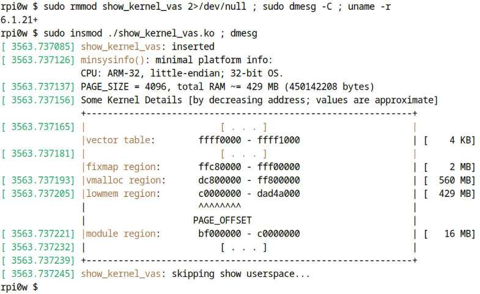

Hình 7.13: Output từ LKM show\_kernel\_vas.ko trên Raspberry Pi Zero W chạy Raspberry Pi OS Linux 32-bit nguyên bản

Như có thể suy ra từ giá trị `PAGE_OFFSET` (KVA `0xc000 0000` trong Hình 7.13), VM split của Raspberry Pi kernel của chúng ta được cấu hình là 3:1 (GB) (vì giá trị hexadecimal `0xc000 0000` là 3 GB trong hệ thập phân). Giá trị VM split này thường là mặc định cho Raspberry Pi OS 32-bit trên các kernel gần đây.

Hãy lưu ý rằng với VM split 3:1 (GB), user space lẽ ra trải từ 0 đến 3 GB và kernel space chiếm phần còn lại. Tuy nhiên, về kỹ thuật, ít nhất trên hệ thống AArch32 (ARM-32), user space nhỏ hơn 2 GB một chút (2 GB – 16 MB = 2.032 MB) vì 16 MB này được dùng làm vùng kernel module (ngay bên dưới `PAGE_OFFSET`); quả thực, có thể thấy chính điều này trong Hình 7.11 (vùng kernel module ở đây trải từ `0xbf00 0000` đến `0xc000 0000`, dài 16 MB). Ngoài ra, như bạn sẽ sớm thấy, giá trị macro `TASK_SIZE` – kích thước user VAS – cũng phản ánh thực tế này.

Chúng ta trình bày phần lớn thông tin này trong sơ đồ chi tiết sau:

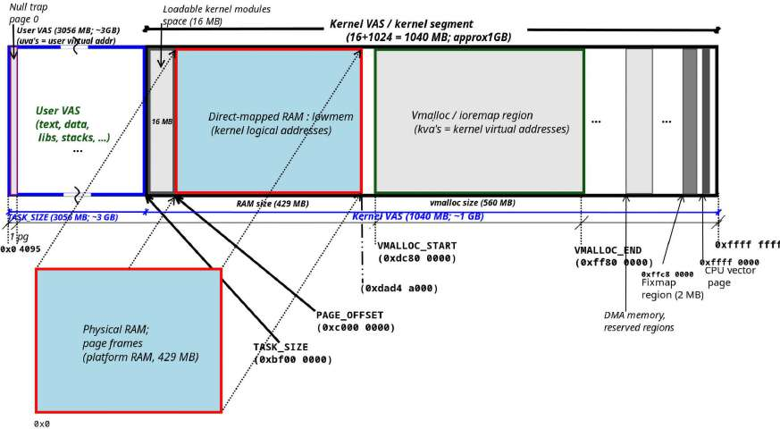

Hình 7.14: VAS đầy đủ của một process trên AArch32 (Raspberry Pi Zero W) với VM split 3:1 GB

Hãy lưu ý rằng do khác biệt giữa các model, lượng RAM sử dụng được, hoặc thậm chí device tree, layout trong Hình 7.12 có thể không khớp chính xác với Raspberry Pi mà bạn có.

Được rồi, giờ bạn đã biết cách truy cập các kernel macro và variable liên quan đến VAS, giúp hiểu kernel VM layout trên bất kỳ hệ thống Linux nào!

Chúng ta cũng sẽ đề cập một vài lưu ý về kernel module khá đơn giản của mình:

- Mô tả kernel macro/constant thường rất phụ thuộc architecture và cũng phụ thuộc kernel config; vì vậy nó chưa đầy đủ ở đây – ví dụ, các tính năng gần đây như Kernel Memory Sanitizer (KMSAN), khi được bật, có thể gây thay đổi memory layout.

- Chúng ta không thử xử lý memory layout trên ARMv8.2 trở lên có bật LPA.

- Các vùng hardware I/O (như PCI I/O, DMA) không được theo dõi hay hiển thị.

- Do không có phép tính floating-point khi chạy ở kernel mode, đôi lúc độ chính xác về kích thước của module giảm khi biểu diễn các giá trị lớn (một ví dụ về lý do tôi đề cập điều này: giá trị 131071.999996185 GB sẽ hiển thị là 127 TB, thay vì 128 TB, mà tất nhiên mới là giá trị thực sự rất gần với nó).

- Tất nhiên kernel có chức năng tương tự những gì module của chúng ta thể hiện – chức năng “dump tables”; có thể cấu hình tính năng qua `CONFIG_PTDUMP_DEBUGFS`.

- Nó vẫn đang được phát triển!

Dù vậy, module của chúng ta là một khởi đầu tốt! Trong phần tiếp theo, chúng ta sẽ thử “nhìn thấy” (trực quan hóa) kernel VAS – lần này qua utility `procmap`.

#### Kernel VAS qua procmap

Được rồi, điều này thật thú vị: góc nhìn memory map layout được trình bày tương đối chi tiết trong Hình 7.14 chính là những gì utility `procmap` nói trên cung cấp; chúng ta đã giới thiệu cách dùng utility này trong phần Utility trực quan hóa process VAS procmap. Như đã hứa ở đó, giờ hãy xem ảnh chụp kernel VAS khi chạy `procmap` (phần trước đã cho thấy ảnh chụp process user VAS).

Để nhất quán với nội dung đang thảo luận, giờ chúng ta sẽ trình bày ảnh chụp `procmap` cung cấp góc nhìn “trực quan” về kernel VAS trên chính hệ thống AArch32 Raspberry Pi Zero W đó (có thể chỉ định switch `--only-kernel` để chỉ hiển thị kernel VAS; tuy nhiên ở đây chúng ta không làm vậy). Vì phải chạy `procmap` trên một process nào đó, chúng ta tùy ý chọn systemd PID `1`; chúng ta cũng dùng option switch `--verbose`. Tuy nhiên, ban đầu nó có thể thất bại, như trong ảnh chụp sau:

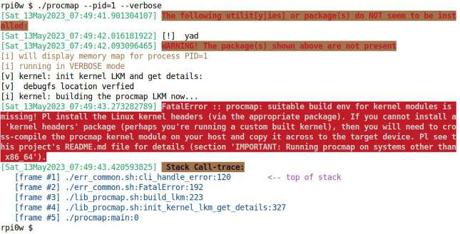

Hình 7.15: Ảnh chụp đã cắt bớt cho thấy việc build procmap kernel module thất bại

Nó thất bại vì build procmap kernel module thất bại; nhưng tại sao? Tôi có đề cập khả năng này trong file `README.md` của project (`https://github.com/kaiwan/procmap/blob/master/README.md#procmap`):

```
[…] to build a kernel module on the target system, you will require it to have
a kernel development environment setup; this boils down to having the compiler,
make and - key here - the 'kernel headers' package installed for the kernel
version it's currently running upon. [...]
```

Ở đây, đó là vì không có kernel headers package cho kernel này, nên module build thất bại (điều này cũng sẽ xảy ra nếu bạn cài custom kernel trên board). Dù về lý thuyết có thể copy toàn bộ Raspberry Pi kernel source tree lên device và thiết lập symbolic link `/lib/module/<kver>/build`, đây không được xem là cách đúng để làm việc đó. Vậy cách đúng là gì? Tất nhiên là cross-compile kernel module `procmap` cho Raspberry Pi từ host của bạn! Chúng ta đã trình bày chi tiết việc cross-compile chính kernel cho Raspberry Pi tại đây: Chương 3, Building the 6.x Linux Kernel from Source – Part 2, trong phần Kernel build cho Raspberry Pi; thảo luận đó cũng áp dụng cho việc cross-compile kernel module.

Tôi muốn nhấn mạnh điểm này: việc build kernel module `procmap` trên Raspberry Pi chỉ thất bại do thiếu kernel headers package do Raspberry Pi cung cấp khi chạy một kernel (custom). Nếu bạn sẵn lòng làm việc với kernel Raspberry Pi OS nguyên bản (mặc định) (trước đây gọi là Raspbian OS), kernel headers package chắc chắn có thể cài được (hoặc đã được cài), và mọi thứ sẽ hoạt động bình thường (package có tên `raspberrypi-kernel-headers`). Tương tự, trên Linux distribution x86\_64 điển hình, kernel module `procmap.ko` được build và insert trơn tru ở runtime. Hãy đọc kỹ file `README.md` của project `procmap`, đặc biệt phần có nhãn IMPORTANT: Running procmap on systems other than x86\_64 để biết chi tiết cách cross-compile kernel module `procmap`.

Sau khi cross-compile thành công kernel module `procmap` trên host system, copy kernel module `procmap.ko` (có thể qua `scp`) sang device và đặt dưới directory `<…>/procmap/procmap_kernel`; giờ bạn đã sẵn sàng!

Đây là một ví dụ về kernel module đã được copy vào (hoặc build) trên Raspberry Pi device:

```
cd <...>/procmap/
$ ls -l procmap_kernel/procmap.ko
-rw-r--r-- 1 pi pi 9100 Jan 22 17:32 procmap_kernel/procmap.ko
```

Bạn cũng có thể chạy utility `modinfo` trên nó để xác minh nó được build cho ARM. Ở đây, tôi chạy Raspberry Pi OS nguyên bản trên board. Khi đã có module, hãy thử lại lần chạy `procmap` để hiển thị chi tiết kernel VAS:

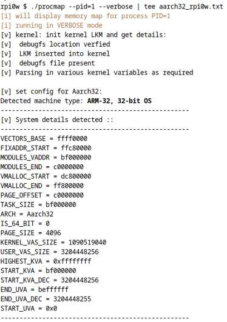

Hình 7.16: Ảnh chụp đã cắt bớt cho thấy procmap kernel module được insert thành công và các chi tiết hệ thống khác nhau

Kernel module procmap quả thực đã được build và hoạt động! Vì chúng ta chỉ định option `--verbose` cho `procmap`, bạn có thể thấy tiến độ chi tiết cũng như – khá hữu ích – các kernel variable/macro/constant đáng chú ý và giá trị hiện tại của chúng.

Được rồi, hãy tiếp tục chụp màn hình và xem phần mà chúng ta thực sự quan tâm – “visual map” của kernel VAS trên Raspberry Pi Zero W, theo KVA giảm dần; ảnh chụp (một phần) sau ghi lại (hầu hết) phần trên của output này từ `procmap`:

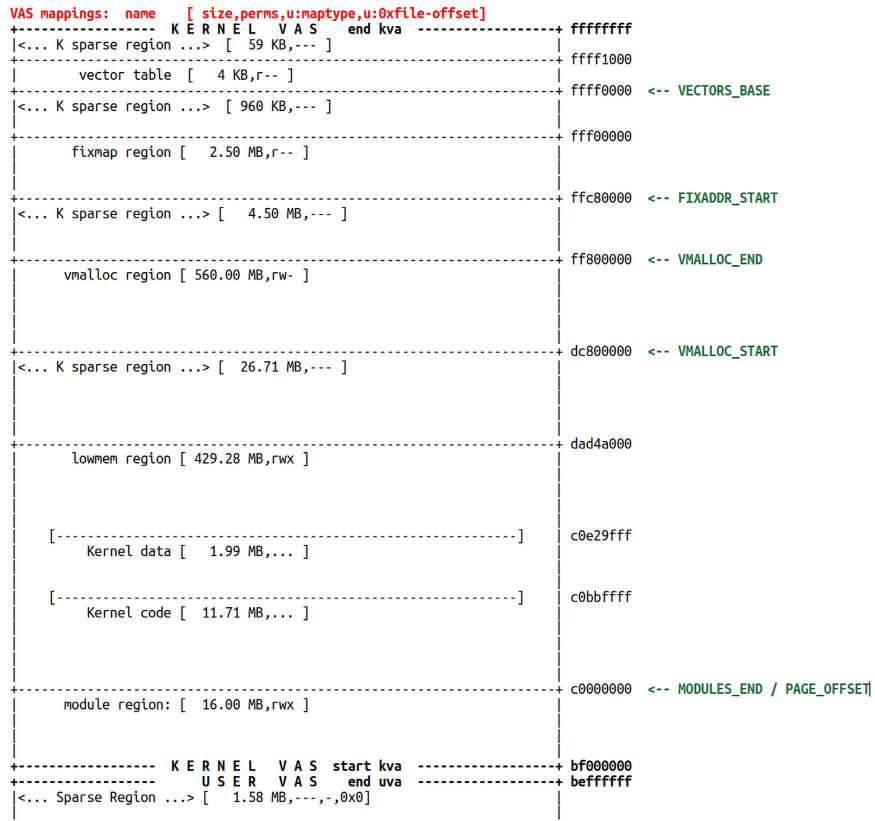

Hình 7.17: Ảnh chụp một phần output phía trên của utility procmap, cho thấy kernel VAS đầy đủ (khi chạy trên Raspberry Pi Zero W với Linux 32-bit)

Toàn bộ kernel VAS – từ `end_kva` (giá trị `0xffff ffff`) đến tận điểm bắt đầu kernel, `start_kva` (`0xbf00 0000`, như bạn thấy là điểm bắt đầu vùng kernel module trên hệ thống này) – được hiển thị.

Hãy chú ý (ở bên phải, màu xanh lá; độc giả đọc bản in vui lòng tham khảo PDF có sơ đồ đầy đủ màu sắc tại đây: `https://packt.link/gbp/9781803232225.pdf`) nhãn bên phải một số địa chỉ then chốt cho biết chúng là gì! Để đầy đủ, chúng ta cũng đưa ranh giới kernel-user vào ảnh chụp trên. Vì output trên lấy từ hệ thống ARM 32-bit, user VAS nằm tiếp ngay sau kernel VAS.

Tuy nhiên, như đã học, trên hệ thống 64-bit có một vùng sparse không sử dụng “non-canonical” (khổng lồ!) – một hole – giữa điểm bắt đầu kernel VAS và đỉnh user VAS. Trên x86\_64, nó chiếm phần lớn tổng VAS: 16.383,75 PB (trong tổng VAS 16.384 PB! Hãy tham khảo lại Hình 7.5 để nhớ lại điều này).

Bài tập

Cài đặt và chạy utility `procmap` trên các hệ thống Linux của bạn và nghiên cứu kỹ output; có thể thực hiện trên x86\_64 (VM hoặc hệ thống native), bất kỳ ARM nào (32-bit và/hoặc 64-bit), hoặc bất kỳ máy hay VM nào bạn có sẵn. Nó cũng hoạt động tốt trên embedded board BeagleBone Black với VM split 3:1, hiển thị các chi tiết như mong đợi.

Để bạn biết, tôi cũng cung cấp lời giải dưới dạng ba ảnh chụp (lớn, ghép lại) output của `procmap` trên hệ thống x86\_64 native, board BeagleBone Black (AArch32) và Raspberry Pi chạy OS 64-bit (AArch64) tại đây: `https://github.com/PacktPublishing/Linux-Kernel-Programming_2E/tree/main/solutions_to_assgn/ch7`.

Nghiên cứu source code của `procmap`, đặc biệt là thành phần kernel module liên quan ở đây, chắc chắn sẽ giúp bạn học thêm. Tôi khuyến khích bạn tìm hiểu sâu và thậm chí đóng góp; dù sao nó cũng là open source!

Hãy kết thúc phần này bằng cách xem qua góc nhìn user segment mà demo kernel module trước đó – `ch7/show_kernel_vas` – cung cấp.

#### Thử nghiệm – user segment

Bây giờ, hãy quay lại chương trình demo LKM `ch7/show_kernel_vas`. Chúng ta đã cung cấp một kernel module parameter tên là `show_uservas` (mặc định có giá trị `0`); khi được đặt thành `1`, một số chi tiết về user space của process context – chính xác hơn, user-mode process context đã chạy các code path của module – cũng được hiển thị. Đây là định nghĩa module parameter:

```
static int show_uservas;
module_param(show_uservas, int, 0660);
MODULE_PARM_DESC(show_uservas,
"Show some user space VAS details; 0 = no (default), 1 = show");
```

Được rồi, một lần nữa trên cùng device (Raspberry Pi Zero W), hãy chạy lại kernel module `show_kernel_vas`, lần này yêu cầu nó cũng hiển thị các chi tiết user space (qua parameter vừa nói).

Ảnh chụp màn hình sau cho thấy output đầy đủ:

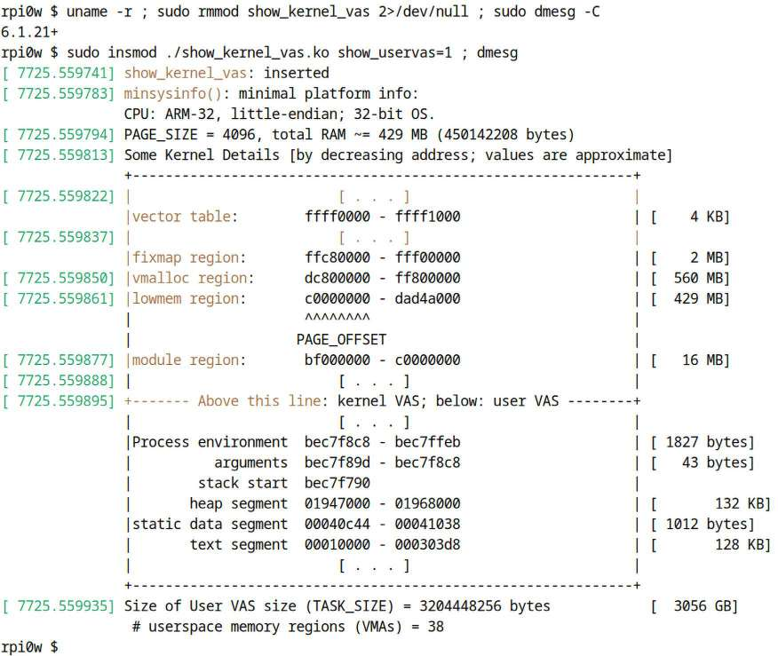

Hình 7.18: Ảnh chụp output của LKM show\_kernel\_vas.ko, cho thấy chi tiết cả kernel VAS lẫn user VAS khi chạy trên Raspberry Pi Zero W với Raspberry Pi Linux OS 32-bit nguyên bản

Điều này hữu ích! Giờ chúng ta thực sự thấy một memory map (ít nhiều) đầy đủ của process – cả kernel space gọi là “upper (canonical) half” lẫn user space gọi là “lower (canonical) half” – trong một lần (đúng vậy, dù project `procmap` thể hiện điều này tốt hơn và chi tiết hơn).

Thêm một thử nghiệm thú vị nữa, hãy dùng module `show_kernel_vas` để xem tổng thể VAS trên board AArch64 Raspberry Pi 4 Model B chạy RPi OS 64-bit nguyên bản.

Ảnh chụp (Hình 7.19) thể hiện tất cả:

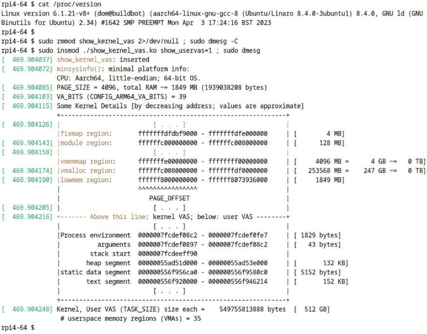

Hình 7.19: Ảnh chụp cho thấy module chạy trên AArch64 Raspberry Pi 4 tiêu chuẩn

Hãy chú ý memory layout cụ thể này gần như khớp với những gì chúng ta trình bày ở hàng 5 của bảng trong Hình 7.6

Tôi sẽ để việc chạy kernel module này và nghiên cứu kỹ output trên x86\_64, hoặc máy hay VM bất kỳ của bạn, làm bài tập. Cũng hãy đọc kỹ code. Chúng ta in các chi tiết user space mà bạn thấy trong ảnh chụp trên, như start address và end address của segment, bằng cách dereference structure `mm_struct` (member task structure có tên `mm`) từ `current`. Hãy nhớ `mm` là abstraction của user mapping của process. Một đoạn code thực hiện việc này như sau:

```
// ch7/show_kernel_vas/kernel_vas.c
[ ... ]
static void show_userspace_info(void)
{
    pr_info("+------- Above this line: kernel VAS; below: user VAS --------+\n"
    ELLPS
    "|Process environment "
#if (BITS_PER_LONG == 64)
    " %px - %px     | [ %4zu bytes]\n"
    "|          arguments "
    " %px - %px     | [ %4zu bytes]\n"
    "|        stack start  %px                        |\n"
[ ... ]
#else // 32-bit
    " %px - %px                     | [ %4zu bytes]\n"
    "|          arguments "
    " %px - %px                     | [ %4zu bytes]\n"
    "|        stack start  %px                                |\n"
[ ... ]\n",
    SHOW_DELTA_b((void *)current->mm->env_start, (void *)current->mm->env_end),
    SHOW_DELTA_b((void *)current->mm->arg_start, (void *)current->mm->arg_end),
    (void *)current->mm->start_stack,
    [ ... ]
```

Bạn còn nhớ null trap page ở ngay đầu user VAS không? (Output của `procmap` – xem Hình 7.11 – cũng cho thấy null trap page). Hãy xem nó dùng để làm gì trong phần tiếp theo.

##### Null trap page

Bạn có chú ý trong các sơ đồ trước (Hình 7.11 và Hình 7.14), ở mép ngoài cùng bên trái (của Hình 7.11, dù rất nhỏ!), một page đơn lẻ ngay đầu user space, có tên null trap page không? Nó là gì? Dễ thôi: virtual page `0` không được cấp bất kỳ permission nào (ở mức hardware MMU/PTE). Vì thế, mọi truy cập vào page này, dù là `r`, `w` hay `x` (read/write/execute), sẽ khiến MMU phát sinh thứ gọi là processor fault hay exception. Điều này khiến processor nhảy đến một OS handler routine (fault handler). Nó chạy, kết thúc process thủ phạm đang cố truy cập một vùng memory không có permission!

Điều này thực sự rất thú vị: OS handler nói trên chạy trong process context, và đoán xem `current` là gì: chính là process (hoặc thread) khởi phát việc tra cứu `NULL` pointer sai này! (Cũng lưu ý không chỉ địa chỉ `NULL` hay 0x0 mới tạo fault này; bất kỳ địa chỉ nào từ 0 đến 4095 cũng vậy.) Trong fault handler code, signal `SIGSEGV` được gửi đến faulting process (`current`), khiến nó kết thúc (qua segfault). Tóm lược, đây là cách OS bắt bug kinh điển do dereference `NULL` pointer.

#### Xem tài liệu kernel về memory layout

Quay lại kernel VAS; hiển nhiên, với VAS 64-bit, kernel VAS lớn hơn rất nhiều so với trên 32-bit. Như đã thấy, nó thường là 128 TB trên x86\_64. Hãy nghiên cứu lại bảng VM split đã trình bày (Hình 7.6 trong phần Các VM split phổ biến); ở đó, cột có nhãn “VM Split ...” tất nhiên là VM split cho các architecture khác nhau. Bạn có thể thấy trên Intel/AMD 64-bit và AArch64 (ARM64), các con số lớn hơn rất nhiều so với các architecture 32-bit tương ứng.

Để biết chi tiết đặc thù architecture, chúng tôi đề nghị bạn tham khảo tài liệu kernel “chính thức” về process virtual memory layout tại đây (các kernel header liên quan cũng rất hữu ích cho mục đích này):

| Architecture | Tài liệu process memory layout (vị trí file trong kernel source tree, liên kết tài liệu và kernel header liên quan) |
|---|---|
| AArch32 (ARM32) | File: `Documentation/arm/memory.txt`. Liên kết: `https://elixir.bootlin.com/linux/v6.1.25/source/Documentation/arm/memory.rst` Header: `arch/arm/include/asm/memory.h`. |
| AArch64 (ARM64) | File: `Documentation/arm64/memory.txt`. Liên kết: `https://elixir.bootlin.com/linux/v6.1.25/source/Documentation/arm64/memory.rst` Header: `arch/arm64/include/asm/memory.h` |
| x86\_64 | File: `Documentation/x86/x86_64/mm.txt` Liên kết: Khả năng đọc hiểu của tài liệu này đã được cải thiện đáng kể khá gần đây; tôi khuyên bạn xem qua file này: `https://elixir.bootlin.com/linux/v6.1.25/source/Documentation/x86/x86_64/mm.rst` Header: `arch/x86/include/asm/pgtable_64_types.h`. Cho x86\_32: `arch/x86/include/asm/page_32_types.h` |

Bảng 7.11: Tài liệu kernel chính thức đặc thù architecture (CPU) cho process memory layout trên Linux

Dù có nguy cơ lặp lại, tôi khuyến khích bạn thử kernel module `ch7/show_kernel_vas` – và tốt hơn nữa, project `procmap` (`https://github.com/kaiwan/procmap`) – trên các hệ thống Linux khác nhau và nghiên cứu output. Sau đó, bạn có thể thực sự thấy “memory map” – process VAS đầy đủ – của một process bất kỳ, bao gồm cả kernel VAS! Hiểu biết này rất quan trọng khi làm việc với và/hoặc debug các vấn đề ở system layer.

Một lần nữa, dù có nguy cơ nhấn mạnh quá mức, hai phần trước – trình bày việc xem xét chi tiết user VAS và kernel VAS – thực sự rất quan trọng. Hãy dành thời gian cần thiết để xem lại chúng và thực hành với sample code cùng các bài tập được đề nghị. Bạn đang tiến triển tốt!

Tiếp tục hành trình qua memory management subsystem của Linux kernel, giờ hãy xem một chủ đề thú vị khác – tính năng \[K\]ASLR bảo vệ bằng cách ngẫu nhiên hóa memory layout. Hãy đọc tiếp!

## Ngẫu nhiên hóa memory layout – KASLR

Trong giới infosec, ai cũng biết rằng với proc filesystem (procfs) và nhiều công cụ “hacking” mạnh mẽ trong tay (bạn đã nghe Kali Linux chưa?), một người dùng ác ý biết trước vị trí chính xác (virtual address) của các function và/hoặc global variable khác nhau trong VAS của process có thể thiết kế một cuộc tấn công để khai thác và cuối cùng xâm phạm một hệ thống cụ thể. (Thậm chí chỉ biết vị trí chính xác của một function hay global variable nổi tiếng trong một kernel cụ thể cũng có thể dẫn đến một attack vector!) Vì vậy, để bảo mật, nhằm khiến attacker gần như không thể (hoặc ít nhất khó) dựa vào virtual address “đã biết”, user space cũng như kernel space hỗ trợ các kỹ thuật Address Space Layout Randomization (ASLR) và Kernel ASLR (KASLR) (thường phát âm là Ass-ler/Kass-ler).

Từ khóa ở đây là randomization: khi được bật, tính năng này thay đổi vị trí các phần của process memory layout (và kernel memory layout) xét theo các con số tuyệt đối, bằng cách dịch các phần memory ra khỏi một base address cho trước một lượng ngẫu nhiên (page-aligned).

Chính xác chúng ta đang nói đến những “phần memory” nào? Đối với user-space mapping (chúng ta sẽ nói về KASLR sau), đó là starting address của shared library (load address của chúng), các allocation dựa trên `mmap()` (bạn sẽ nhận ra mọi function `malloc()` (`/calloc()/realloc()`) cấp phát lượng memory lớn hơn `MMAP_THRESHOLD` (thường là 128 KB) đều trở thành allocation dựa trên `mmap`, thay vì memory từ heap), stack start, heap và vDSO page; tất cả đều có thể được ngẫu nhiên hóa khi process chạy (khởi chạy).

Do đó, attacker không thể dựa vào việc một function `glibc` (như `system()`) được map tại một UVA cố định cụ thể trong một process bất kỳ (như trước đây!); không chỉ vậy, vị trí còn thay đổi mỗi lần process chạy! Trước ASLR, và trên các hệ thống không hỗ trợ ASLR hoặc tắt nó, vị trí symbol có thể được xác định trước cho một architecture và software version cụ thể (procfs cùng các utility như `objdump`, `readelf`, `nm`, v.v. khiến việc này khá dễ dàng).

Điều then chốt cần hiểu là \[K\]ASLR chỉ là một biện pháp bảo vệ mang tính thống kê. Thực tế, thông thường không có nhiều bit dành cho randomization, do đó entropy không thật tốt. Điều này nghĩa là số offset theo page size không quá nhiều, ngay cả trên hệ thống 64-bit, do đó có thể dẫn đến một implementation bị suy yếu (khiến cracker có kinh nghiệm vui mừng).

Giờ hãy xem ngắn gọn thêm một vài chi tiết về cả user-mode ASLR lẫn kernel-mode ASLR (loại sau được gọi là KASLR); các phần tiếp theo lần lượt trình bày những nội dung này.

### Ngẫu nhiên hóa user memory bằng ASLR

User-mode ASLR thường là điều được nói đến khi dùng thuật ngữ ASLR. Việc nó được bật nghĩa là biện pháp bảo vệ này có sẵn trên user-space mapping của mọi process. Thực chất, bật ASLR nghĩa là memory map tuyệt đối của user-mode process thay đổi mỗi lần chạy, và mỗi process instance của cùng chương trình sẽ khác nhau về user-space memory map tuyệt đối.

ASLR đã được hỗ trợ trên Linux từ rất lâu (từ năm 2005 trên 2.6.12). Kernel có một pseudo file có thể điều chỉnh trong procfs để truy vấn và thiết lập (với tư cách root) trạng thái ASLR; đó là: `/proc/sys/kernel/randomize_va_space`.

Nó có thể nhận ba giá trị; ba giá trị và ý nghĩa được trình bày trong bảng sau:

| Giá trị điều chỉnh | Diễn giải giá trị này trong `/proc/sys/kernel/randomize_va_space` |
|---|---|
| `0` | ASLR (user mode) được TẮT, hoặc có thể tắt bằng cách truyền kernel parameter `norandmaps` lúc boot. |
| `1` | ASLR (user mode) được BẬT: allocation dựa trên `mmap()`, stack và vDSO page được ngẫu nhiên hóa. Điều này cũng nghĩa là vị trí load shared library và shared memory segment được ngẫu nhiên hóa. |
| `2` | ASLR (user mode) được BẬT: tất cả nội dung trên (giá trị `1`) cộng vị trí heap được ngẫu nhiên hóa (từ 2.6.25); đây là giá trị mặc định của OS. |

Bảng 7.12: Điều chỉnh ASLR (user mode) của Linux qua proc pseudo file

Như đã lưu ý trong phần trước, Vsyscall page, vDSO page là một tối ưu system call, cho phép một số system call thường được gọi (`gettimeofday()` là ví dụ điển hình) được gọi với overhead thấp hơn. Nếu quan tâm, bạn có thể tra cứu thêm chi tiết trong man page vDSO(7) tại đây: `https://man7.org/linux/man-pages/man7/vdso.7.html`.

Có thể tắt user-mode ASLR lúc boot bằng cách truyền parameter `norandmaps` cho kernel (qua bootloader); tại sao lại làm vậy? Đôi lúc việc này hữu ích khi debug... hãy để nó bật trong production!

### Ngẫu nhiên hóa kernel memory layout bằng KASLR

Tương tự (user) ASLR – và gần đây hơn, từ kernel 3.14 trở đi – ngay cả kernel VAS cũng có thể được ngẫu nhiên hóa (ở một mức độ nhất định) bằng cách bật KASLR. Ở đây, base location của một số kernel section (các vùng lowmem, vmalloc và vmemmap), cùng module code trong kernel VAS sẽ được ngẫu nhiên hóa bằng một random offset page-aligned tính từ base của RAM. Điều này giữ hiệu lực trong session đó – nghĩa là cho đến khi tắt bật nguồn hoặc reboot.

Kernel config cho KASLR có tên `CONFIG_RANDOMIZE_MEMORY`. KASLR dường như được hỗ trợ trên các nền tảng x86\[\_64\] và AArch64, không có trên AArch32.

Có một số kernel configuration variable cho phép platform developer bật hoặc tắt các tùy chọn randomization này. Là một ví dụ đặc thù x86, phần sau được trích trực tiếp từ `Documentation/x86/x86_64/mm.txt` (`https://elixir.bootlin.com/linux/v6.1.25/source/Documentation/x86/x86_64/mm.rst#L148`):

Lưu ý rằng nếu `CONFIG_RANDOMIZE_MEMORY` được bật, direct mapping của toàn bộ physical

memory, vmalloc/ioremap space và virtual memory map đều được ngẫu nhiên hóa. Thứ tự của chúng được giữ nguyên nhưng base sẽ được dịch offset từ sớm ở boot time.

Một khi được cấu hình, KASLR mặc định sẽ tiếp tục bật; có thể kiểm soát trạng thái lúc boot bằng cách truyền một kernel command-line parameter (qua bootloader):

- Tắt tường minh bằng cách truyền parameter `nokaslr`

- Bật tường minh bằng cách truyền parameter `kaslr`

Từ kernel 5.13, có một tính năng bảo mật mới: `CONFIG_RANDOMIZE_KSTACK_OFFSET_DEFAULT`. Bật nó khiến các kernel-mode stack offset được ngẫu nhiên hóa mỗi khi một system call được gọi! (Hãy xem commit #39218ff4c625dbf2 được viết rất tốt tại đây: `https://github.com/torvalds/linux/commit/39218ff4c625dbf2e68224024fe0acaa60bcd51a`).

Mẹo: Bạn có thể tìm một commit number (viết tắt) cụ thể từ ô Search tại `https://github.com/torvalds/linux`.

Vậy thiết lập hiện tại của \[K\]ASLR trên hệ thống Linux của bạn là gì? Và chúng ta có thể thay đổi nó không? Có, tất nhiên (miễn là có root access); phần tiếp theo cho thấy cách làm qua một Bash script.

### Truy vấn/thiết lập trạng thái KASLR bằng script

Chúng tôi cung cấp một Bash script đơn giản tại `<book-source>/ch7/ASLR_check.sh`. Nó kiểm tra sự hiện diện của cả ASLR (user mode) lẫn KASLR, in thông tin trạng thái (có mã màu) của chúng. Nó cũng cho phép bạn thay đổi giá trị ASLR.

Hãy thử chạy nó trên Ubuntu 22.04 guest x86\_64 của chúng ta. Vì script được lập trình để có mã màu, chúng ta trình bày ảnh chụp output ở đây:

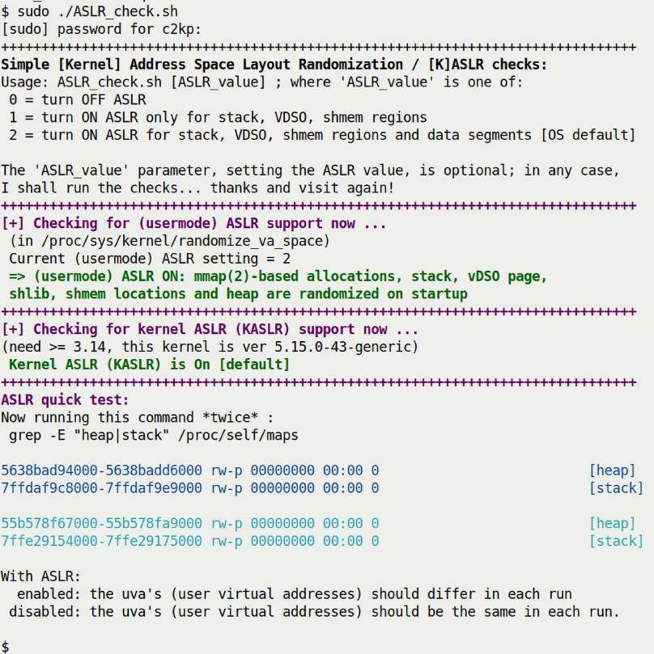

Hình 7.20: Ảnh chụp output khi Bash script ch7/ASLR\_check.sh chạy trên Ubuntu guest x86\_64

Nó chạy, cho thấy rằng (ít nhất trên máy này) cả cấu hình user-mode ASLR lẫn KASLR thực sự đều được bật. Không chỉ vậy, chúng ta viết một routine “kiểm thử” nhỏ để xem ASLR hoạt động. Nó rất đơn giản; nó chạy lệnh sau hai lần:

```
grep -E "heap|stack" /proc/self/maps
```

Từ những gì đã học trong phần Diễn giải output /proc/PID/maps trước đó, giờ bạn có thể thấy trong Hình 7.20 rằng các UVA tương ứng của heap segment và stack segment khác nhau trong mỗi lần chạy, qua đó chứng minh tính năng ASLR thực sự hoạt động! Ví dụ, nhìn vào starting heap UVA: trong lần chạy thứ nhất là `0x5638 bad9 4000`, còn trong lần chạy thứ hai là `0x55b5 78f6 7000` (phần dưới Hình 7.21.

Tiếp theo, hãy truyền parameter `0` cho script, qua đó tắt ASLR; ảnh chụp sau cho thấy output (đúng như mong đợi):

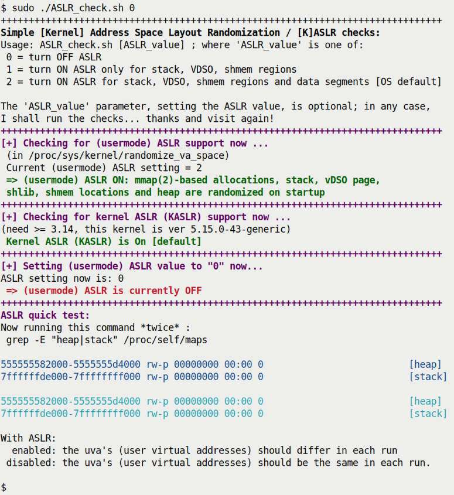

Hình 7.21: Ảnh chụp cho thấy cách tắt ASLR (qua script ch7/ASLR\_check.sh trên Ubuntu guest x86\_64)

Lần này, có thể thấy ASLR được bật theo mặc định, nhưng chúng ta đã tắt nó. Điều này được làm nổi bật rõ ràng bằng chữ đậm (màu đỏ) qua dòng “ =\> (usermode) ASLR is currently OFF” trong ảnh chụp trên. (Hãy nhớ bật nó lại.) Đồng thời, như mong đợi, vì giờ nó đã tắt, các UVA của heap và stack (tương ứng) giữ nguyên trong cả hai lần chạy kiểm thử, điều này không an toàn. Tôi sẽ để bạn tự xem và tìm hiểu source code của script.

Lưu ý: Để tận dụng ASLR, application phải được compile với các GCC flag `-fPIE` và `-pie` (PIE là viết tắt của Position Independent Executable).

Cả ASLR lẫn KASLR đều bảo vệ trước một số loại attack vector, trong đó return-to-libc và Return-Oriented Programming (ROP) là các trường hợp điển hình. Tuy nhiên, đáng tiếc là bảo mật giữa white hat và black hat vốn là trò mèo vờn chuột, việc đánh bại \[K\]ASLR và các phương pháp tương tự là điều các exploit nâng cao thực hiện khá tốt. Ví dụ, utility nổi tiếng `setarch` có option `--addr-no-randomize` để, đoán xem, tắt ASLR. Tham khảo phần Đọc thêm của chương này (dưới tiêu đề Linux kernel security) để biết thêm chi tiết.

Nhân đang nói về bảo mật, như một mẹo bổ sung, có nhiều công cụ hữu ích để kiểm tra lỗ hổng trên hệ thống của bạn. Hãy xem những công cụ sau:

- Script `checksec.sh` (`http://www.trapkit.de/tools/checksec.html`) hiển thị các biện pháp “hardening” khác nhau và trạng thái hiện tại của chúng (cho cả file riêng lẻ lẫn process): RELRO, stack canary, NX-enabled, PIE, RPATH, RUNPATH, sự hiện diện của symbol và compiler fortification.

- Bộ PaX của grsecurity.

- Script `hardening-check` (một lựa chọn thay thế checksec).

- Perl script `kconfig-hardened-check` (`https://github.com/a13xp0p0v/kconfig-hardened-check`) kiểm tra (và đề xuất) các kernel config option phục vụ bảo mật theo một số checklist định sẵn.

- Nhiều công cụ khác: Lynis, `linuxprivchecker.py`, memory, v.v.

Vậy lần tới khi thấy kernel virtual address hoặc user virtual address khác nhau qua nhiều lần chạy hay session, bạn sẽ biết có lẽ đó là do tính năng bảo vệ \[K\]ASLR (tắt \[K\]ASLR để debug khá phổ biến). Bây giờ, hãy hoàn tất chương này bằng cách chuyển sang khám phá cách Linux kernel tổ chức và làm việc với physical memory.

## Tìm hiểu cách tổ chức physical memory

Giờ đã xem xét góc nhìn virtual memory cho cả user VAS lẫn kernel VAS tương đối chi tiết, hãy chuyển sang chủ đề tổ chức physical memory trên Linux OS.

### Tổ chức physical RAM

Lúc boot, Linux kernel tổ chức và phân chia physical RAM thành một hierarchy dạng tree gồm node, zone và page frame (page frame là physical page của RAM) (xem Hình 7.22 và Hình 7.23). Hãy lưu ý việc tổ chức thêm qua physical memory model cũng được thực hiện từ early boot và là một nội dung thảo luận liên quan; chúng ta sẽ làm sáng tỏ phần nào trong phần Giới thiệu physical memory model.

Node được chia thành zone, và zone gồm các page frame. Về cơ bản đây là hierarchy dạng tree, được mô tả đơn giản về mặt khái niệm như hierarchy dạng tree ba cấp như sau:

- Các node ← Cấp 1

  - Các zone ← Cấp 2

  - Các page frame ← Cấp 3

Node là một metadata structure trừu tượng hóa một physical bank RAM; bản thân RAM này gắn với một hoặc nhiều processor core (CPU core). Ở mức phần cứng, các microprocessor kết nối với RAM controller chip; bất kỳ memory controller chip nào, và do đó bất kỳ RAM nào, đều có thể được truy cập từ bất kỳ CPU core nào qua interconnect. Giờ rõ ràng, khả năng truy cập RAM ở gần nhất về mặt vật lý với core mà một thread đang cấp phát hoặc sử dụng memory sẽ cải thiện hiệu năng. Chính ý tưởng này được phần cứng và các OS hỗ trợ model gọi là NUMA tận dụng (ý nghĩa sẽ được giải thích ngay sau đây).

#### Node và NUMA

Về cơ bản, node là data structure dùng để biểu thị và trừu tượng hóa một physical RAM module trên system motherboard cùng controller chipset gắn với nó. Đúng, ở đây chúng ta đang nói đến phần cứng thực tế được trừu tượng hóa qua software metadata. (Lưu ý thuật ngữ “node” được dùng trong ngữ cảnh này có thể không giống khi dùng để chỉ một máy tính phần cứng đơn lẻ trên mạng). Nó luôn gắn với một physical socket (hoặc tập processor core) trên system motherboard. Có hai loại hierarchy:

- Hệ thống Non-Uniform Memory Access (NUMA): CPU core cụ thể nơi yêu cầu kernel allocation xảy ra có ý nghĩa (memory được xử lý không đồng nhất), dẫn đến cải thiện hiệu năng

- Hệ thống Uniform Memory Access (UMA): CPU core cụ thể nơi yêu cầu kernel allocation xảy ra không có ý nghĩa (memory được xử lý đồng nhất)

Hệ thống NUMA thực sự là hệ thống có phần cứng luôn multicore – nghĩa là có hai CPU core trở lên, do đó cũng luôn là Symmetric Multi-Processor (SMP) – và phải có hai physical bank RAM trở lên, mỗi bank gắn với một CPU (hoặc nhiều CPU). Nói cách khác, hệ thống NUMA luôn có hai node trở lên, trong khi hệ thống UMA có đúng một node (để bạn biết, data structure trừu tượng hóa node được gọi là `pg_data_t` và được định nghĩa tại đây: `include/linux/mmzone.h:pg_data_t` dưới dạng typedef structure).

Bạn có thể tự hỏi tại sao lại phức tạp đến vậy? À, còn gì khác nữa – tất cả là vì hiệu năng! Hệ thống NUMA (thường là những máy thuộc lớp server khá đắt tiền và supercomputer) cùng các OS chạy trên đó (thường là Linux/Unix/Windows Server) được thiết kế sao cho khi một process (hoặc thread) trên một CPU core cụ thể muốn thực hiện kernel memory allocation, phần mềm bảo đảm thực hiện với hiệu năng cao bằng cách lấy memory (RAM) cần thiết từ node gần core nhất (vì vậy có tên NUMA!). Hệ thống UMA (embedded system, smartphone, laptop và desktop điển hình của bạn) không nhận được những lợi ích như vậy, và chúng cũng không quan trọng với hệ thống này. Ngày nay, các hệ thống server thuộc lớp enterprise, data center và supercomputer có thể có hàng trăm processor cùng hàng terabyte, thậm chí vài petabyte RAM cho một node, và sẽ có từ 2 node trở lên. Chúng gần như luôn được thiết kế theo architecture NUMA.

Tuy nhiên, với cách Linux được thiết kế – và đây là điểm then chốt – ngay cả hệ thống UMA thông thường cũng được kernel xử lý như hệ thống NUMA (đúng hơn là pseudo-NUMA). Điều này nhằm bằng mọi giá tránh thay đổi codebase, qua đó fork Linux (như bạn biết, chính cùng một Linux kernel codebase được dùng để vận hành mọi loại hệ thống Linux, từ embedded system tí hon đến supercomputer). Chúng – các hệ thống UMA – có đúng một node, vì vậy đó là cách nhanh để kiểm tra hệ thống là NUMA hay UMA: nếu có hai node trở lên và nhiều CPU core, đó là hệ thống NUMA thực sự; chỉ một node và/hoặc chỉ một CPU core, đó là máy “fake NUMA” hay pseudo-NUMA. Làm thế nào kiểm tra số node? Utility `numactl` là một cách (hãy thử `numactl --hardware`). Có các cách kiểm tra khác (qua chính procfs); chờ một chút, chúng ta sẽ đến đó... (Để bạn biết, kiểm tra số CPU core mà OS nhìn thấy rất dễ; có thể dùng `nproc`, `lscpu` và/hoặc `cat /proc/cpuinfo`).

Vậy, một cách đơn giản hơn để hình dung: trên máy NUMA, một hoặc nhiều CPU core gắn với một bank (một hardware module) physical RAM; đây được gọi là node, và hệ thống MUMA luôn có hai node trở lên. Vì vậy, hệ thống NUMA cũng luôn là SMP, nhưng một máy SMP có thể là hệ thống NUMA hoặc UMA.

##### Ví dụ về NUMA server processor

Để phần thảo luận thực tế hơn một chút, hãy hình dung ngắn gọn micro-architecture của một server system thực tế – hệ thống chạy CPU AMD Epyc/Ryzen/Threadripper (và Bulldozer cũ hơn). Nó chứa phần cứng sau (xem Hình 7.22):

- Tổng cộng 32 CPU core (theo góc nhìn OS) trong hai physical socket (P#0 và P#1) trên motherboard. Mỗi socket gồm một package 8x2 CPU core (8x2 vì thực ra có 8 physical core, mỗi core được hyperthread; tất nhiên OS xem mỗi hyperthreaded core là một core sử dụng được, do đó tổng cộng có 16 CPU core mỗi socket).

- Tổng cộng 32 GB RAM chia thành bốn physical bank, mỗi bank 8 GB.

Rõ ràng, ở đây hệ thống này là multicore (SMP) và có hai RAM bank trở lên, do đó đủ điều kiện là hệ thống NUMA thực sự. Vì vậy, Linux memory management code có nhận biết NUMA, khi phát hiện topography này lúc boot, sẽ thiết lập bốn NUMA node để biểu diễn nó. Ở đây chúng ta không đi sâu vào các cache (L1/L2/L3/v.v.) khác nhau của processor; xem khung Mẹo sau sơ đồ dưới đây để biết cách xem tất cả những điều này. Hơn nữa, các hệ thống như thế được gọi là cache-coherent NUMA (ccNUMA), vì chúng duy trì cache coherency với hỗ trợ từ phần cứng; bạn sẽ tìm hiểu thêm về cache và cache coherency trong Chương 13, Kernel Synchronization – Part 2, tại phần Tìm hiểu kiến thức cơ bản về CPU caching, cache effect và false sharing.

Sơ đồ khái niệm sau cho thấy gần đúng bốn hierarchy dạng tree – mỗi hierarchy cho một node – được hình thành trên một số hệ thống AMD server chạy Linux OS. Hình 7.22 thể hiện về mặt khái niệm các node/zone/page frame cho mỗi physical RAM bank trên hệ thống gắn với các CPU core khác nhau:

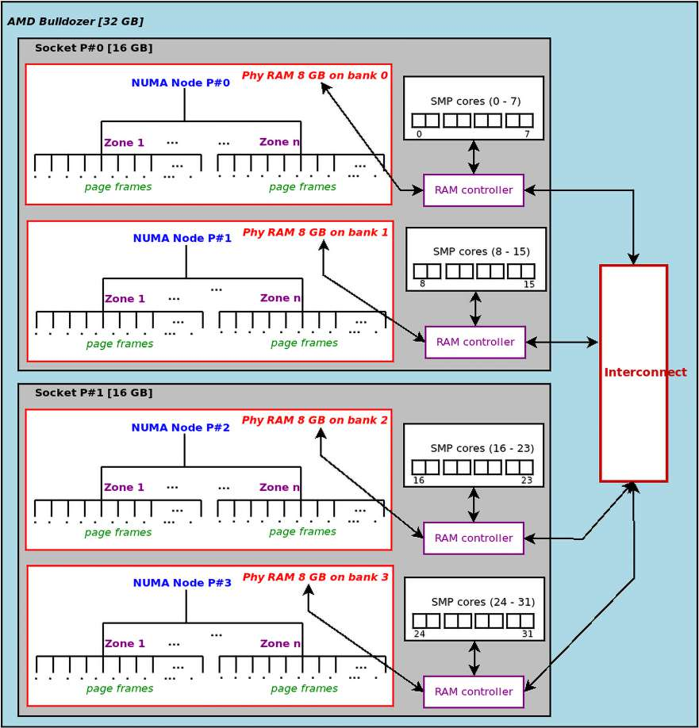

Hình 7.22: Góc nhìn khái niệm gần đúng về một AMD server: physical memory hierarchy trên Linux

MẸO: Dùng utility mạnh mẽ `lstopo` (list topography, cùng các utility `hwloc-*` – hardware locality – liên quan) để xem đồ họa hardware topology (CPU) của hệ thống! Trên Ubuntu, cài bằng `sudo apt install hwloc`. Để bạn biết, hình đồ họa hardware topography của AMD server system vừa nói có thể được tạo bằng `lstopo` và có tại đây: `https://en.wikipedia.org/wiki/CPU_cache#/media/File:Hwloc.png`.

Để khẳng định lại điểm then chốt ở đây: vì hiệu năng (ở đây xét Hình 7.22), một thread chạy kernel code hoặc driver code trong process context, chẳng hạn trên CPU #18, yêu cầu kernel cấp một lượng RAM. Memory management (MM) layer của kernel, do có nhận biết NUMA, sẽ cho xử lý yêu cầu (ưu tiên) từ bất kỳ RAM page frame trống nào trong bất kỳ zone nào trên NUMA node #2 (nghĩa là từ physical RAM bank #2), vì nó “gần nhất” với processor core nơi yêu cầu được đưa ra. Trong trường hợp không có page frame trống trong bất kỳ zone nào thuộc NUMA node #2 (ít khả năng xảy ra), kernel có một fallback system thông minh. Khi đó nó có thể đi qua interconnect và yêu cầu RAM page frame từ node:zone khác (đừng lo, chúng ta sẽ trình bày các khía cạnh này chi tiết hơn trong chương tiếp theo, Chương 8, Kernel Memory Allocation for Module Authors – Part 1, tại phần Tìm hiểu và sử dụng kernel page allocator (hay BSA)).

#### Zone trong node

Có thể xem zone là cách Linux làm phẳng và xử lý các đặc thù phần cứng; những đặc thù này thường xuất hiện nhiều trên x86, nơi Linux “lớn lên”, tất nhiên. Zone cũng xử lý một vài khó khăn về phần mềm (tra cứu `ZONE_HIGHMEM` trên architecture x86 32-bit hiện phần lớn đã là legacy; chúng ta đã thảo luận khái niệm này trong phần trước, High memory trên hệ thống 32-bit).

Zone tạo thành cấp thứ hai của hierarchy; chúng luôn thuộc về một node nhất định (0, 1, 2, …) và gồm các page frame – physical page của RAM. Về kỹ thuật hơn, một dải Page Frame Number (PFN) được phân cho mỗi zone trong một node:

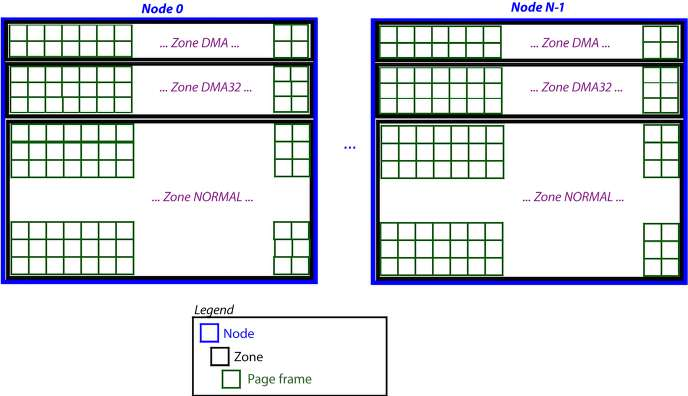

Hình 7.23: Một góc nhìn khác (khái niệm và tổng quát) về physical memory hierarchy trên Linux – node, zone và page frame

(Một lưu ý bên lề: có thể tìm thêm một chút về cách Linux theo dõi PFN trong phần Giới thiệu physical memory model.)

Hình 7.23 mô tả một hệ thống Linux tổng quát về mặt khái niệm với N node (đánh số từ `0` đến `N-1`), mỗi node gồm, ví dụ, ba zone, và mỗi zone tạo thành từ physical page của RAM – page frame. Số lượng (và tên) zone cho mỗi node được kernel xác định động lúc boot. Bạn có thể xem physical memory hierarchy này trên hệ thống Linux bằng cách tìm hiểu dưới procfs. Trong code sau, chúng ta xem một hệ thống Linux x86\_64 native có 16 GB RAM:

```
$ cat /proc/buddyinfo
Node 0, zone  DMA         3      2     4    3    3    1   0   0  1   1   3
Node 0, zone  DMA32   31306  10918  1373  942  505  196  48  16  4   0   0
Node 0, zone  Normal  49135   7455  1917  535  237   89  19   3  0   0   0
$
```

Cột ngoài cùng bên trái cho thấy chúng ta có đúng một node trên toàn hệ thống: `Node 0`. Điều này cho biết thực ra chúng ta đang trên hệ thống UMA, dù tất nhiên Linux OS sẽ xử lý nó như hệ thống NUMA (pseudo/fake). Như có thể thấy, node duy nhất này, `Node` `0,` được chia thành ba zone có nhãn `DMA`, `DMA32` và `Normal`; tất nhiên mỗi zone gồm các page frame. Tạm thời hãy bỏ qua các con số bên phải; chúng ta sẽ tìm hiểu ý nghĩa trong chương tiếp theo.

Một cách khác để nhận ra Linux “giả lập” NUMA node trên hệ thống UMA có thể thấy từ kernel log. Chúng ta chạy lệnh sau trên cùng hệ thống x86\_64 native có 16 GB RAM. Để dễ đọc, tôi thay vài cột đầu hiển thị timestamp và hostname bằng dấu ba chấm:

```
$ journalctl -b -k --no-pager | grep -A7 "NUMA"
 <...>: No NUMA configuration found
 <...>: Faking a node at [mem 0x0000000000000000-0x00000004427fffff]
 <...>: NODE_DATA(0) allocated [mem 0x4427d5000-0x4427fffff]
 <...>: Zone ranges:
   <...>: DMA     [mem 0x0000000000001000-0x0000000000ffffff]
 <...>:   DMA32    [mem 0x0000000001000000-0x00000000ffffffff]
 <...>:   Normal   [mem 0x0000000100000000-0x00000004427fffff]
 <...>:   Device   empty
 $
```

Chúng ta có thể thấy rõ rằng vì hệ thống được phát hiện không phải NUMA (do đó là UMA), kernel giả lập một NUMA node. Phạm vi của node là toàn bộ lượng RAM trên hệ thống (ở đây là `0x0-0x00000004427fffff`, quả thực là 16 GB). Cũng có thể thấy trên hệ thống cụ thể này, kernel khởi tạo ba zone – `DMA`, `DMA32` và `Normal` – để tổ chức các physical page frame RAM có sẵn. Điều này hợp lý và khớp với output `/proc/buddyinfo` đã thấy trước đó. Data structure biểu diễn zone trên Linux được định nghĩa tại đây: `include/linux/mmzone.h:struct zone`. Chúng ta sẽ có dịp xem nó ở phần sau của sách.

Giờ để hiểu rõ hơn cách Linux kernel tổ chức RAM, hãy bắt đầu từ đầu – boot time.

### Direct-mapped RAM và address translation

Lúc boot, Linux kernel “map” toàn bộ system RAM (sử dụng được) (còn gọi là platform RAM) trực tiếp vào kernel VAS (chúng ta đã tìm hiểu điều này trong phần Xem xét kernel VAS; xem lại Hình 7.12 và Hình 7.14 nếu muốn). Vì thế, chúng ta có:

- Physical page frame `0` map đến kernel virtual page `0`.

- Physical page frame `1` map đến kernel virtual page `1`.

- Physical page frame `2` map đến kernel virtual page `2`, v.v.

Vì vậy, chúng ta gọi đây là 1:1 mapping hay direct mapping, identity-mapped RAM, hoặc linear address. Một điểm then chốt là tất cả kernel virtual page này có offset cố định so với physical page tương ứng (và, như đã nói, xét chặt chẽ thì các kernel address này được gọi là kernel logical address). Offset cố định là giá trị `PAGE_OFFSET` (ở đây hãy giả định nó là giá trị `0xc000 0000`).

Vậy hãy suy nghĩ điều này. Trên hệ thống 32-bit với VM split 3:1 (GB), physical address `0x0` tương đương kernel logical address `0xc000 0000` (`PAGE_OFFSET`). Như đã nói, thuật ngữ kernel logical address (mang tính chặt chẽ) được áp dụng cho kernel address có offset cố định so với physical address tương ứng. Vì thế, direct-mapped RAM map đến kernel logical address. Vùng direct-mapped memory này thường được gọi là vùng low-memory (hoặc đơn giản là lowmem) trong kernel VAS.

Chúng ta đã trình bày sơ đồ gần như giống hệt trước đây, Hình 7.12. Trong hình sau, để nhấn mạnh những điểm vừa nêu, sơ đồ được sửa một chút để thực sự cho thấy ba page frame (physical) đầu tiên của RAM map đến ba kernel virtual page đầu tiên như thế nào (trong vùng lowmem của kernel VAS):

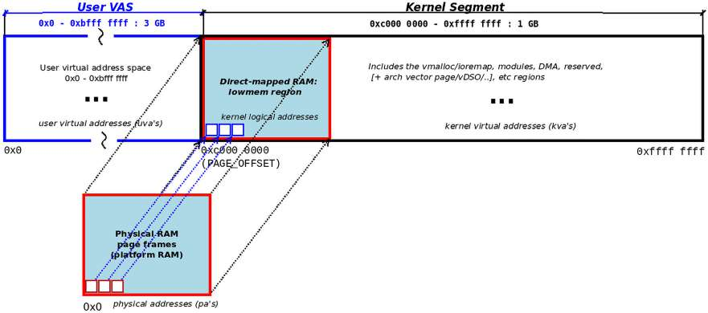

Hình 7.24: Tập trung vào direct-mapped RAM – vùng lowmem – trên Linux 32-bit với VM split 3:1 (GB)

Làm ví dụ, Hình 7.24 cho thấy direct mapping của platform RAM vào kernel VAS trên hệ thống 32-bit với VM split 3:1 (GB). Điểm mà physical RAM address `0x0` map vào kernel là kernel macro `PAGE_OFFSET` (trong hình trên, đó là kernel logical address `0xc000 0000`).

Hãy chú ý Hình 7.24 cũng cho thấy user VAS ở bên trái, trải từ `0x0` đến `PAGE_OFFSET-1` (kích thước `TASK_SIZE` byte). Chúng ta đã trình bày chi tiết phần kernel VAS còn lại trong phần Xem xét kernel VAS trước đó.

Hiểu mapping physical-to-virtual page này rất có thể khiến bạn muốn đi đến những kết luận có vẻ hợp lý sau:

- Với một KVA cho trước, để tính Physical Address (PA) tương ứng – nghĩa là thực hiện phép tính KVA-to-PA – chỉ cần làm như sau:

```
   pa = kva - PAGE_OFFSET
```

- Ngược lại, với một PA cho trước, để tính KVA tương ứng – nghĩa là thực hiện phép tính PA-to-KVA – chỉ cần làm như sau:

```
   kva = pa + PAGE_OFFSET
```

Hãy tham khảo lại Hình 7.24. Direct mapping của RAM vào kernel VAS (bắt đầu tại `PAGE_OFFSET`) chắc chắn là cơ sở cho kết luận này. Vì vậy, nó đúng. Nhưng chờ đã, hãy đặc biệt chú ý ở đây: các phép tính address translation này chỉ hoạt động với direct-mapped address hoặc linear address – nói cách khác, KVA (về kỹ thuật là kernel logical address) – trong vùng lowmem của kernel, ngoài ra không gì khác! Với tất cả UVA, và mọi KVA ngoài vùng lowmem (bao gồm module address, địa chỉ `vmalloc`/ `ioremap` (MMIO), KASAN address, địa chỉ vùng highmem (có thể có), vùng DMA memory, v.v.), nó không hoạt động! Thực tế này còn được củng cố thêm khi nhận ra physical RAM trên hệ thống không phải lúc nào cũng contiguous hay linear; nó có thể có hole! Một lần nữa, chúng ta để thảo luận này cho phần Giới thiệu physical memory model sắp tới.

Như bạn có thể dự đoán, kernel thực sự cung cấp API để thực hiện các chuyển đổi địa chỉ này; tất nhiên implementation của chúng phụ thuộc architecture. Đây là các API:

| Kernel API | Chức năng |
|---|---|
| `phys_addr_t virt_to_phys(volatile void` `*address)` | Chuyển virtual address cho trước thành physical address tương ứng (return value) |
| `void *phys_to_virt(phys_addr_t address)` | Chuyển physical address cho trước thành virtual address (return value) |

Bảng 7.13: Chuyển giữa physical address và kernel virtual address (và ngược lại) trong vùng lowmem

API `virt_to_phys()` cho x86 có một comment phía trên nêu rõ rằng người viết driver không nên dùng API này (và các API cùng loại); để rõ ràng và đầy đủ, chúng ta chép lại comment trong kernel source ở đây (`https://elixir.bootlin.com/linux/v6.1.25/source/arch/x86/include/asm/io.h#L118`):

```
// arch/x86/include/asm/io.h
/**
 *  virt_to_phys    -   map virtual addresses to physical
 *  @address: address to remap
 *
 *  The returned physical address is the physical (CPU) mapping for
 *  the memory address given. It is only valid to use this function on
 *  addresses directly mapped or allocated via kmalloc.
 *
 *  This function does not give bus mappings for DMA transfers. In
 *  almost all conceivable cases a device driver should not be using
 *  this function
 */
static inline phys_addr_t virt_to_phys(volatile void *address)
```

Comment trên đề cập API `kmalloc()` (rất phổ biến). Đừng lo, nó được trình bày chuyên sâu trong hai chương sau. Tất nhiên, API `phys_to_virt()` cũng có một comment tương tự như trên.

Vậy ai sử dụng – một cách hạn chế – các address conversion API này (và những API tương tự)? Tất nhiên là kernel internal MM code! Để demo, chúng ta có dùng chúng ở ít nhất một vài nơi trong sách: trong chương sau, ở một LKM có tên `ch8/lowlevel_mem` (thực ra, việc sử dụng nằm trong một function thuộc “kernel library” code của chúng ta, `klib.c`). Ngoài ra, để bạn biết, utility mạnh mẽ `crash` thực sự có thể dịch một virtual address bất kỳ sang physical address qua lệnh `vtop` (virtual-to-physical) của nó (và ngược lại qua lệnh `ptov`!).

Tiếp tục, một điểm then chốt khác cần lưu ý: khi map toàn bộ physical RAM vào chính nó, đừng hiểu nhầm rằng kernel đang dành riêng RAM cho bản thân. Không phải vậy; nó chỉ map toàn bộ RAM có sẵn, qua đó cho phép cấp phát cho bất kỳ bên nào cần – core kernel code, kernel thread, device driver hay user-space application. Đây là một phần công việc của OS; xét cho cùng, nó là bên quản lý tài nguyên hệ thống.

Tất nhiên, một phần RAM nhất định sẽ bị chiếm (được cấp phát) – bởi static kernel code, data, kernel page table, v.v. – lúc boot, không nghi ngờ gì. Hơn nữa, việc dùng các chức năng kdump và/hoặc Contiguous Memory Allocator (CMA) của kernel có thể đòi hỏi dành riêng lượng RAM lớn hơn được chỉ định cho chúng lúc boot. Tuy nhiên, thông thường, bạn nên hiểu rằng lượng RAM được chính kernel trực tiếp sử dụng khá nhỏ. Ví dụ, trên guest VM có 1 GB RAM của tôi, kernel code, data và BSS thường chiếm tổng cộng khoảng 25 MB RAM. Toàn bộ kernel memory vào khoảng 100 MB, trong khi mức sử dụng user-space memory nằm trong khoảng 550 MB! Gần như luôn là user space chiếm nhiều memory nhất.

MẸO: Hãy thử dùng utility `smem` với các option switch `--system -p` để xem tóm lược mức sử dụng memory theo phần trăm (đồng thời dùng switch `--realmem=` để truyền lượng RAM thực tế trên hệ thống).

Quay lại vấn đề: chúng ta biết kernel page table được thiết lập sớm trong quá trình boot. Vì vậy, đến lúc application khởi động, kernel đã map toàn bộ RAM và cho phép sử dụng, sẵn sàng để cấp phát! Do đó, chúng ta hiểu rằng trong khi kernel direct-map page frame vào VAS của nó, user-mode process không may mắn như vậy – chúng chỉ có thể map gián tiếp page frame thông qua paging table do OS thiết lập (tại thời điểm tạo process – `fork()`) riêng cho từng process. Cũng thú vị khi nhận ra rằng memory mapping qua system call mạnh mẽ `mmap()` có thể tạo ảo giác “direct mapping” file hoặc anonymous page vào user VAS (bên trong, tất cả đều là thao tác page table).

Một vài điểm bổ sung cần lưu ý:

- Vì hiệu năng, kernel memory page đã được cấp phát không bao giờ có thể bị swap, ngay cả khi không được sử dụng.

- Đôi lúc, bạn có thể nghĩ rằng quá hiển nhiên khi user-space memory page map đến page frame (physical) (giả định page đang resident) qua các paging table mà OS thiết lập riêng cho từng process.

Đúng, nhưng kernel memory page thì sao? Hãy thật rõ về điểm này: mọi kernel page cũng map đến page frame qua kernel “master” paging table (có tên `swapper_pg_dir`). Kernel memory cũng được ảo hóa, giống như user-space memory.

Về điều này, dành cho bạn, độc giả quan tâm, hãy xem một Q\&A tôi khởi xướng trên Stack Overflow: How exactly do kernel virtual addresses get translated to physical RAM? tại `http://stackoverflow.com/questions/36639607/how-exactly-do-kernel-virtual-addresses-get-translated-to-physical-ram`.

- Nhiều kỹ thuật tối ưu memory đã được tích hợp vào Linux kernel (đúng hơn, nhiều kỹ thuật là configuration option); trong đó có Transparent Huge Pages (THP) và, rất quan trọng cho cloud/virtualization workload, Kernel Samepage Merging (KSM, còn gọi là memory de-duplication). Tôi đề nghị bạn tham khảo phần Đọc thêm của chương này để biết thêm thông tin.

Giờ đã trình bày hai cấp đầu tiên của physical memory hierarchy (node và zone), hãy đi sâu vào cách tổ chức cấp thứ ba và cuối cùng: page frame!

### Giới thiệu physical memory model

Dù nhìn theo cách nào, physical memory cũng là một tài nguyên quý giá. Thêm vào đó, việc tổ chức memory trên các hệ thống hiện đại có thể là các hierarchy phức tạp, với những hole lớn (hay sparse region) nằm rải rác giữa memory space khá phổ biến (các phần trước đã lướt qua điều này). Không chỉ vậy, mỗi NUMA node trên hệ thống kiểu server cần tập memory management metadata riêng. Phần cứng cũng ngày càng đòi hỏi nhiều hơn – khả năng hot-plug (và tháo) memory bank (và CPU), mong muốn thiết lập page-level mapping trong một số loại persistent storage device, v.v... Do đó, cộng đồng Linux kernel đã nghĩ ra các abstraction để mô phỏng tốt hơn và nhờ đó quản lý physical memory. Các abstraction này có dạng memory model; thực tế, đến nay ba model như vậy đã được đề xuất và triển khai: flatmem, discontigmem và sparsemem. Tuy nhiên, trên thực tế, sparsemem model là model được triển khai rộng rãi, đặc biệt trên hệ thống 64-bit hiện đại có lượng RAM tương đối lớn; discontigmem model đã bị deprecated và flatmem vẫn cố bám trụ (phục vụ hệ thống 32-bit có ít RAM).

Trong tất cả model, một ý niệm cơ bản là khả năng theo dõi từng physical page RAM trên hệ thống. Metadata structure theo dõi điều này là `struct page` (`https://elixir.bootlin.com/linux/v6.1.25/source/include/linux/mm_types.h#L73`); nó thường được gọi là page descriptor. (Theo dõi từng RAM page bằng một page structure? Đúng vậy, và đó là lý do nó được giữ nhỏ, chỉ 64 byte; dù vậy, nó vẫn tiêu tốn memory, đặc biệt khi lượng RAM lớn.) Bên trong nó có metadata về page mà nó theo dõi – page đang được dùng làm gì (hoặc hiện đang trống), và các flag value khác nhau, bao gồm mapping.

Quay lại memory model. Linux yêu cầu mỗi architecture quản lý memory bằng một model – flatmem hoặc sparsemem. Arch-specific code trong early boot thiết lập điều này (ví dụ, `sparse_init()` thiết lập sparsemem model). Sau đây là một vài đặc điểm đúng với mọi memory model:

- Vì physical RAM thường là các page frame liên tiếp, có thể bị ngắt quãng bởi hole, các model thường triển khai một hoặc nhiều array struct page trong các đơn vị; sparsemem gọi một đơn vị là section. Mỗi physical frame RAM được biểu thị bằng một Page Frame Number (PFN), thực chất là index vào array các struct page object. Luôn tồn tại mapping 1:1 giữa một PFN và một struct page.

- Mapping này yêu cầu các helper function để chuyển đổi giữa hai dạng: tối thiểu, các helper `page_to_pfn()` và `pfn_to_page()` sẽ được định nghĩa cho mỗi model.

Hãy đi sâu hơn một chút vào sparsemem memory model.

#### Tìm hiểu ngắn gọn sparsemem\[-vmemmap\] memory model

Sparsemem model thực chất là model linh hoạt, được dùng thường xuyên nhất trong thực tế. Nó có thể trừu tượng hóa và hỗ trợ các tính năng hiện đại cần thiết như hot-plug và tháo memory bank, persistent device memory mapping, deferred init của memory, v.v.

Model này có thể triển khai các helper API bắt buộc (`page_to_pfn()` và `pfn_to_page()`) theo hai cách: qua cách tiếp cận “classic sparse” hoặc “sparse vmemmap”. Khi dùng cách sau (cách tiếp cận phổ biến), một vmemmap pointer trỏ đến base của array các struct page object (chính xác hơn, nó được đặt thành `(struct page *)VMEMMAP_START`. Để có góc nhìn trực quan hơn, tôi đề nghị bạn xem các sơ đồ (và đọc bài viết): Reducing page structures for huge pages, Jon Corbet, LWN, tháng 12 năm 2020 tại `https://lwn.net/Articles/839737/`. Giờ bạn sẽ hiểu rõ hơn vùng vmemmap – metadata được mô tả bắt nguồn từ pointer này – được đề cập trong phần Các macro và variable mô tả kernel VAS layout trước đó.

Vì sparsemem-vmemmap model hiện là lựa chọn được ưu tiên cho Linux 64-bit, bạn thường sẽ thấy các kernel config `CONFIG_SPARSEMEM_VMEMMAP=y` và `CONFIG_SPARSEMEM_VMEMMAP_ENABLE=y` được đặt trên những hệ thống như vậy (x86\_64 hiện đại luôn dùng sparsemem model và các nền tảng AArch64 dường như cũng tuân theo điều này. Để bạn biết, kernel Android Generic Kernel Image (GKI) phổ biến cho AArch64 cũng bật mặc định các config option này, cho thấy nó cũng dùng model này).

Có hai macro bắt buộc phải định nghĩa cho sparsemem model:

- `SECTION_SIZE_BITS`: Số physical address bit để bao phủ lượng memory tối đa trong một section (physically contiguous); kích thước mỗi memory section sẽ bằng 2 lũy thừa số này.

- `MAX_PHYSMEM_BITS`: Số bit tối đa trong physical address; thực chất là lượng RAM tối đa được hỗ trợ. Giá trị này giống kernel configurable `CONFIG_ARM64_PA_BITS` trên AArch64.

Các macro này thường được định nghĩa trong header `arch/<arch>/include/asm/sparsemem.h`. Một module nhỏ cho biết các con số này, đồng thời cung cấp thêm một chút thông tin về sparsemem model, có tại đây: `ch7/sparsemem_show`. Code cốt lõi như sau:

```
// ch7/sparsemem_show/sparsemem_show.c
#include <linux/mmzone.h>
[ ... ]
#ifdef CONFIG_SPARSEMEM_VMEMMAP
    pr_info("VMEMMAP_START = 0x%016lx\n"
    "SECTION_SIZE_BITS = %u, so size of each section=2^%u = %u bytes = %u MB\n"
    "max # of sections=%lu\n"
    "MAX_PHYSMEM_BITS=%u; so max supported physical addr space (RAM): %lu GB =
%lu TB\n",
    VMEMMAP_START,
    SECTION_SIZE_BITS, SECTION_SIZE_BITS, (1 << SECTION_SIZE_BITS),
    (1 << SECTION_SIZE_BITS) >> 20, NR_MEM_SECTIONS, MAX_PHYSMEM_BITS,
    (1UL << MAX_PHYSMEM_BITS) >> 30, (1UL << MAX_PHYSMEM_BITS) >> 40);
#else
    pr_info("SPARSEMEM_VMEMMAP not supported\n");
#endif
```

Sau đây là bảng tóm lược các giá trị thu được cho những macro liên quan sparsemem qua module này trên các nền tảng 64-bit khác nhau:

| Thuộc tính / Nền tảng | AArch64: Raspberry Pi OS nguyên bản | AArch64: custom Yocto build (Poky, 4.0.4), với CONFIG\_ ARM64\_VA\_BITS=52 | x86\_64 VM hoặc Ubuntu 22.04 LTS native |
|---|---|---|---|
| SECTION\_SIZE\_BITS | 27 | 29 | 27 |
| Kích thước mỗi sparsemem section: 2<sup>^</sup> SECTION\_SIZE\_BITS | 128 MB | 512 MB | 128 MB |
| MAX\_PHYSMEM\_BITS | 48 | 52 | 46 |
| Physical address space tối đa (thực chất là RAM tối đa): 2<sup>^</sup> MAX\_PHYSMEM\_BITS | 256 TB | 4,096 TB = 4 PB | 64 TB |

Bảng 7.14: Tóm lược các giá trị thu được liên quan đến một số sparsemem macro trên các architecture (nền tảng) khác nhau chạy Linux 64-bit

Hãy chú ý cột thứ ba ở đây khớp với hàng #7 (hàng AArch64 cuối cùng) trong Hình 7.6 như thế nào. Tôi không đưa entry cho các nền tảng 32-bit vì chúng đơn giản không hỗ trợ sparsemem\[-vmemmap\] model (và thay vào đó sử dụng flatmem model đơn giản hơn nhiều). Để biết thêm chi tiết về các chủ đề này, tham khảo các liên kết trong tài liệu Đọc thêm.

Được rồi, sau khi trình bày một số khía cạnh của physical RAM management, chúng ta hoàn tất chương này. Bạn đang làm tốt; tiến bộ rất tuyệt!

## Tổng kết

Trong chương này, chúng ta đã đi sâu – ở mức khá chi tiết – vào chủ đề lớn kernel memory management với mức độ chi tiết đủ cho một người viết kernel module hoặc device driver như bạn; ngoài ra, vẫn còn nội dung phía trước! Một mảnh ghép then chốt – VM split và cách thực hiện trên các architecture khác nhau chạy Linux OS – đóng vai trò điểm khởi đầu.

Sau đó, chúng ta chuyển sang xem xét sâu cả hai vùng của phần chia này: trước tiên là user space (user-mode process VAS), rồi kernel VAS (hay kernel segment). Ở đây, chúng ta trình bày nhiều chi tiết cùng các tool/utility để xem xét nó (bao gồm utility khá mạnh mẽ `procmap`). Chúng ta build một demo kernel module thực sự có thể tạo ra memory map khá đầy đủ của kernel và calling process. Công nghệ ngẫu nhiên hóa user memory layout và kernel memory layout (\[K\]ASLR) cũng được thảo luận ngắn gọn. Chúng ta kết thúc chương bằng cách xem cách tổ chức physical RAM trong Linux OS, bao gồm các memory model đang dùng (đặc biệt là sparsemem).

Thông tin và khái niệm học được trong chương này rất hữu ích, không chỉ để thiết kế và viết kernel/device driver code tốt hơn, mà còn khi gặp các system-level issue và bug; chúng giúp bạn có khả năng debug các tình huống phức tạp tốt hơn.

Đây là một chương dài và thực sự quan trọng; bạn đã làm tốt khi hoàn thành nó! Tiếp theo, trong hai chương sau, bạn sẽ chuyển sang tìm hiểu các khía cạnh then chốt và thực tế về chính xác cách cấp phát (và tất nhiên giải phóng) kernel memory hiệu quả, cùng các khái niệm quan trọng liên quan đứng sau hoạt động phổ biến này. Tiếp tục nào!

## Câu hỏi

Để kết thúc, đây là danh sách câu hỏi giúp bạn kiểm tra kiến thức về nội dung chương này: `https://github.com/PacktPublishing/Linux-Kernel-Programming_2E/blob/main/questions/ch7_qs_assignments.txt`. Bạn sẽ tìm thấy câu trả lời cho một số câu hỏi trong GitHub repo của sách: `https://github.com/PacktPublishing/Linux-Kernel-Programming_2E/tree/master/solutions_to_assgn`.

## Đọc thêm

Để giúp bạn tìm hiểu sâu hơn về chủ đề với các tài liệu hữu ích, chúng tôi cung cấp một danh sách khá chi tiết các tài liệu tham khảo và liên kết trực tuyến (và đôi lúc cả sách) trong tài liệu Đọc thêm ở GitHub repository của sách. Tài liệu Đọc thêm có tại đây: `https://github.com/PacktPublishing/Linux-Kernel-Programming_2E/blob/master/Further_Reading.md`.

## Tìm hiểu thêm trên Discord

Để tham gia cộng đồng Discord của cuốn sách này – nơi bạn có thể chia sẻ phản hồi, đặt câu hỏi cho tác giả và tìm hiểu các bản phát hành mới – hãy theo QR code bên dưới:

`https://packt.link/SecNet`
