# Chương 8. Kernel Memory Allocation dành cho người viết module – Phần 1

Trong hai chương trước, một chương về các khía cạnh bên trong và architecture của kernel, chương kia về những kiến thức thiết yếu của memory management internals, chúng ta đã trình bày các khía cạnh then chốt nhằm cung cấp kiến thức nền cần thiết cho chương này và chương tiếp theo. Trong chương này và chương sau, chúng ta sẽ đi vào việc thực sự cấp phát và giải phóng kernel memory bằng nhiều cách. Chúng ta sẽ minh họa qua các kernel module mà bạn có thể kiểm thử và điều chỉnh, giải thích kỹ lý do và cách thức cấp phát, đồng thời cung cấp nhiều mẹo real-world để kernel developer hoặc driver developer như bạn đạt hiệu quả tối đa khi làm việc với memory trong kernel module của mình.

Trong chương này, chúng ta sẽ trình bày hai memory allocator chính của kernel – Page Allocator (PA) (còn gọi là Buddy System Allocator (BSA)) và slab allocator. Chúng ta sẽ đi sâu vào các nitty-gritty khi làm việc với API của chúng trong kernel module. Chúng ta sẽ đi xa hơn việc chỉ xem cách dùng API, minh họa rõ vì sao hiệu quả sử dụng memory chưa tối ưu trong nhiều trường hợp và cách khắc phục những tình huống này. Chương 9, Kernel Memory Allocation for Module Authors – Part 2, sẽ tiếp tục nội dung về các kernel memory allocator, đi sâu vào một vài lĩnh vực nâng cao hơn.

Trong chương này, chúng ta sẽ trình bày các chủ đề sau:

- Giới thiệu kernel memory allocator

- Tìm hiểu và sử dụng kernel page allocator (hay BSA)

- Tìm hiểu và sử dụng kernel slab allocator

- Giới hạn kích thước của API kmalloc

- Slab allocator – một vài chi tiết bổ sung

- Những lưu ý khi dùng slab allocator

## Yêu cầu kỹ thuật

Tôi giả định rằng bạn đã đọc chương trực tuyến Kernel Workspace Setup, đã chuẩn bị phù hợp một guest Virtual Machine (VM) chạy Ubuntu 22.04 LTS (hoặc một bản phát hành ổn định mới hơn) và đã cài đặt tất cả package cần thiết. Nếu chưa, tôi đặc biệt khuyên bạn thực hiện việc này trước.

Để tận dụng tối đa cuốn sách, tôi đặc biệt khuyên bạn trước tiên hãy thiết lập môi trường workspace, bao gồm clone GitHub repository của sách (`https://github.com/PacktPublishing/Linux-Kernel-Programming_2E`) để lấy code, rồi hands-on trên đó.

Các chủ đề ở đây giả định bạn ít nhất đã quen ở mức cơ bản với process Virtual Address Space (VAS) và kiến thức nền về virtual memory (gồm các khái niệm physical memory layout như UMA và NUMA); chúng ta đã trình bày các nội dung này trong Chương 6, Kernel Internals Essentials – Processes and Threads, và Chương 7, Memory Management Internals – Essentials. Điều quan trọng là bảo đảm bạn hiểu chúng trước khi đi vào nội dung sau.

## Giới thiệu kernel memory allocator

Cấp phát động rồi sau đó giải phóng kernel memory – cả physical lẫn virtual – là chủ đề then chốt ở đây. Linux kernel, như mọi OS khác, cần một thuật toán và implementation vững chắc để thực hiện nhiệm vụ thực sự then chốt này. Engine (de)allocation chính trong Linux OS so-called PA hay BSA. Bên trong, nó dùng thuật toán gọi là buddy system để tổ chức và phân chia hiệu quả các chunk system RAM trống. Bạn sẽ tìm thấy thêm nội dung về thuật toán trong phần Tìm hiểu và sử dụng kernel page allocator (hay BSA) của chương này.

Trong chương này và xuyên suốt cuốn sách, khi chúng tôi dùng ký hiệu (de)allocate, hãy đọc nó theo cả hai từ: allocate và deallocate.

Tất nhiên, do chưa hoàn hảo, page allocator không phải cách duy nhất hoặc luôn tốt nhất để lấy rồi sau đó trả lại system memory. Trong Linux kernel còn có những công nghệ khác để làm việc này. Đứng cao trong danh sách là slab allocator hay slab cache system của kernel (ở đây chúng ta dùng từ slab làm tên chung cho loại allocator này vì ban đầu nó mang tên đó; tuy nhiên, trong thực tế, implementation bên trong của slab allocator hiện đại được Linux kernel sử dụng gọi là SLUB (unqueued slab allocator); sẽ trình bày thêm sau).

Hãy nghĩ theo cách này: slab allocator giải quyết một số vấn đề và tối ưu hiệu năng khi dùng page allocator. Chính xác là những vấn đề nào? Kiên nhẫn, bạn sẽ sớm thấy... Tuy nhiên, trước mắt điều quan trọng cần hiểu là cách duy nhất để thực sự cấp phát và giải phóng physical memory là qua page allocator. Thực chất, page allocator là “engine” chính cho việc cấp phát và giải phóng memory trên Linux OS!

Để tránh nhầm lẫn và lặp lại, từ giờ chúng ta sẽ gọi engine cấp phát chính này là page allocator. Bạn sẽ hiểu nó cũng được gọi là BSA (bắt nguồn từ tên thuật toán vận hành nó).

Vì vậy, slab allocator được xếp lớp trên (hay phía trên) page allocator. Các core kernel subsystem khác nhau cũng như non-core code trong kernel, chẳng hạn module và device driver, có thể cấp phát (và giải phóng) memory trực tiếp qua page allocator hoặc gián tiếp qua slab allocator. Sơ đồ sau minh họa điều này:

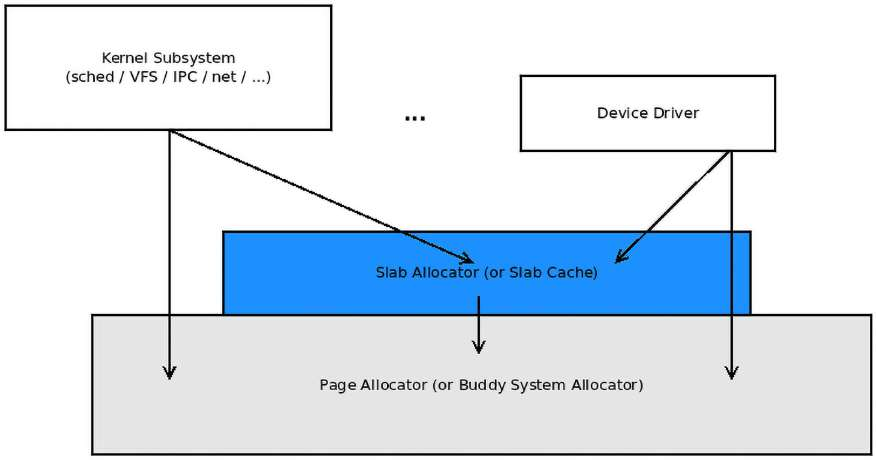

Hình 8.1: Engine page allocator của Linux với slab allocator xếp lớp phía trên

Một vài điều cần làm rõ ngay từ đầu:

- Linux kernel cùng mọi core component và subsystem của nó (trừ chính memory management subsystem và có lẽ một vài bên sử dụng rất arch-specific) cuối cùng đều dùng page allocator (hay BSA) để cấp phát và giải phóng memory. Điều này bao gồm những thành phần non-core như kernel module và device driver.

- Slab allocator và page allocator nằm hoàn toàn trong kernel (virtual) address space và không thể được truy cập trực tiếp từ user space.

- Các page frame (RAM) mà page allocator lấy memory từ đó nằm trong vùng lowmem của kernel, hay vùng direct-mapped RAM của kernel segment (chúng ta đã trình bày chi tiết kernel segment trong chương trước)

- Slab allocator xét cho cùng là bên sử dụng page allocator, vì vậy lấy memory từ chính đó (điều này một lần nữa nghĩa là memory cuối cùng đến từ vùng kernel lowmem)

- Dynamic memory allocation trong user space bằng họ API `malloc` quen thuộc không map trực tiếp với các lớp trên (nghĩa là gọi `malloc()` trong user space không trực tiếp dẫn đến lời gọi page allocator hay slab allocator). Nó thực hiện gián tiếp. Chính xác bằng cách nào? Bạn sẽ học được cách, hãy kiên nhẫn! (Nội dung then chốt này nằm trong hai phần của Chương 9, Kernel Memory Allocation for Module Authors – Part 2, trong những phần liên quan demand paging; hãy chú ý khi đọc chương đó!)

- Ngoài ra, để rõ ràng, Linux kernel memory là non-swappable. Nó không bao giờ có thể bị swap out xuống disk; điều này được quyết định từ những ngày đầu Linux để giữ hiệu năng cao. User-space memory page luôn có thể bị swap theo mặc định, dù system programmer có thể thay đổi điều này qua các system call `mlock()`/`mlockall()`.

Giờ hãy thắt dây an toàn! Với hiểu biết rất cơ bản này, hãy bắt đầu hành trình tìm hiểu (những kiến thức cơ bản về) cách các memory allocator của Linux kernel hoạt động và, quan trọng hơn, cách làm việc tốt với chúng.

## Tìm hiểu và sử dụng kernel page allocator (hay BSA)

Trong phần này, bạn sẽ học hai khía cạnh của engine cấp phát và giải phóng chính của Linux kernel, page allocator (hay BSA):

- Trước tiên, chúng ta trình bày kiến thức nền tảng về thuật toán đứng sau phần mềm này (gọi là “buddy system”).

- Thứ hai, chúng ta trình bày cách dùng thực tế và thực hành các API mà nó cung cấp cho kernel developer hoặc driver developer.

Hiểu kiến thức cơ bản về thuật toán đứng sau page allocator là quan trọng. Khi đó bạn sẽ hiểu ưu và nhược điểm của nó, và do đó biết khi nào dùng API nào trong tình huống nào. Hãy bắt đầu với cơ chế bên trong. Một lần nữa, hãy nhớ phạm vi cuốn sách đối với các chi tiết memory management bên trong là có giới hạn. Chúng ta sẽ trình bày đến mức được xem là đủ cho người viết module/driver điển hình và không sâu hơn.

### Cơ chế hoạt động nền tảng của page allocator

Chúng ta sẽ chia thảo luận này thành một vài phần liên quan. Hãy bắt đầu với cách page allocator của kernel theo dõi các physical page frame trống qua các data structure freelist của nó.

#### Tìm hiểu cách tổ chức page allocator freelist

Chìa khóa của thuật toán page allocator (buddy system) là metadata structure chính bên trong nó. Nó được gọi là buddy system freelist và gồm một array pointer trỏ đến các doubly linked circular list (oh-so-common!). Index của array pointer này được gọi là order của list – đó là số mũ để nâng 2 lên. Độ dài array trải từ `0` đến `MAX_ORDER-1`. Giá trị `MAX_ORDER` arch-dependent; trên nền tảng x86 và ARM, nó là 11, trong khi trên hệ thống large-ish như Itanium, nó là 17. Vì thế, trên x86 và ARM, order (các index) trải từ 2<sup>0</sup> đến 2<sup>10</sup>; nghĩa là từ 1 đến 1.024. Điều đó nghĩa là gì? Hãy đọc tiếp...

Mỗi doubly linked circular list trỏ đến các page frame trống và physically contiguous có kích thước 2<sup>order</sup> page. Vì thế, giả định page size 4 KB, chúng ta có mười một list (0-10) với đặc điểm kích thước sau:

- Order 0: 2<sup>0</sup> = 1 page = các chunk 4 KB

- Order 1: 2<sup>1</sup> = 2 page = các chunk 8 KB

- Order 2: 2<sup>2</sup> = 4 page = các chunk 16 KB

- Order 3: 2<sup>3</sup> = 8 page = các chunk 32 KB

- \[ … và cứ tiếp tục như vậy … \]

- Order 10: 2<sup>10</sup> = 1024 page = 1024\*4 KB = các chunk 4 MB

Một sơ đồ sẽ hữu ích! Sau đây là minh họa khái niệm đơn giản hóa của (một instance) page allocator freelist:

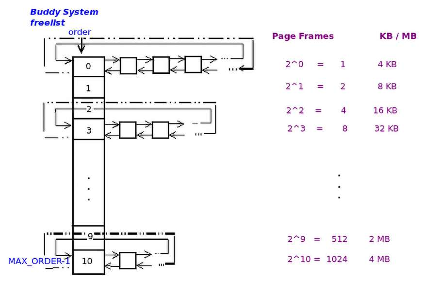

Hình 8.2: Buddy system/page allocator freelist trên hệ thống có page size 4 KB và MAX\_ORDER bằng 11

Trong Hình 8.2, mỗi memory “chunk” được biểu diễn bằng một ô vuông (để đơn giản, chúng ta dùng cùng kích thước cho mọi chunk trong sơ đồ). Tất nhiên, bên trong đây không phải memory page thực tế; thay vào đó, các ô biểu diễn metadata structure (struct page) trỏ đến physical memory frame. (Hãy nhớ chúng ta đã đề cập tầm quan trọng của struct page trong Chương 7, Memory Management Internals – Essentials, tại phần Giới thiệu physical memory model).

Ở bên phải Hình 8.2, chúng ta thể hiện kích thước của từng chunk free memory physically contiguous có thể được enqueue vào list bên trái.

Kernel cung cấp góc nhìn thuận tiện (tóm lược) về trạng thái hiện tại của page allocator qua filesystem `proc` (qua pseudofile `/proc/buddyinfo`); đây là ví dụ từ Ubuntu VM có 1 GB RAM:

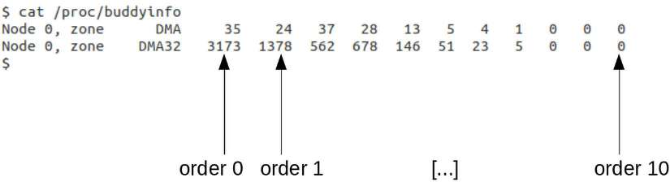

Hình 8.3: Ảnh chụp có chú giải của output /proc/buddyinfo mẫu

Như có thể nhận ra từ Hình 8.3, VM của chúng ta là máy pseudo-NUMA với một node (`Node 0`) và hai zone (`DMA` và `DMA32`). (Chúng ta đã trình bày NUMA là gì và các chủ đề liên quan trong Chương 7, Memory Management Internals – Essentials, dưới phần Tổ chức physical RAM). Các số sau `zone XXX` là số page frame trống (physically contiguous!) trên list order 0, order 1, order 2, …, đến tận order `MAX_ORDER-1` (ở đây, 11 – 1 = 10). Vậy hãy lấy một vài ví dụ từ output trên (Hình 8.3):

- Có 35 chunk RAM trống single-page trong list order `0` của node `0`, zone DMA.

- Trong node `0`, zone DMA32, order `3`, con số hiển thị trong Hình 8.3 là 678; giờ lấy 2<sup>order</sup> = 2<sup>3</sup> = 8 page frame = 32 KB (giả định page size 4 KB); điều này nghĩa là hiện có 678 chunk RAM trống physically contiguous, mỗi chunk 32 KB, trên list đó.

Điều quan trọng cần lưu ý là bản thân mỗi chunk được bảo đảm là physically contiguous RAM. Đồng thời, hãy chú ý kích thước memory chunk ở một order cụ thể luôn gấp đôi order trước (và bằng một nửa order tiếp theo). Tất nhiên đặc tính toán học này luôn đúng vì tất cả đều là lũy thừa của 2.

Lưu ý `MAX_ORDER` có thể (và thực tế có) thay đổi theo architecture. Trên hệ thống x86 và ARM thông thường, nó là `11`, cho kích thước chunk lớn nhất có thể là 4 MB physically contiguous RAM ở order 10 của các freelist (vì order cuối sẽ là 2<sup>10</sup> = 1024 page frame = 1024 \* 4KB = 4096 KB = 4 MB). Một ví dụ khác, trên một số enterprise server high-end chạy processor Itanium (IA-64), `MAX_ORDER` có thể cao đến `17` (nghĩa là kích thước chunk lớn nhất ở order (17-1), do đó là 2<sup>16</sup> = 65.536 page = các chunk physically contiguous RAM 512 MB ở order 16 của freelist, với page size 4 KB). IA-64 MMU hỗ trợ đến tám page size, trải từ chỉ 4 KB đến tận 256 MB. Thêm một ví dụ, với page size 16 MB, list order 16 có thể có các chunk physically contiguous RAM kích thước 65.536 \* 16 MB = 1 TB mỗi chunk!

Một điểm then chốt khác: kernel giữ nhiều PA/BSA freelist – một cho mỗi node:zone hiện diện trên hệ thống! Điều này tạo ra cách tự nhiên để cấp phát memory trên hệ thống NUMA.

Sơ đồ sau cho thấy kernel tạo nhiều freelist như thế nào – một cho mỗi node:zone hiện diện trên hệ thống (nguồn sơ đồ: Professional Linux Kernel Architecture, Mauerer, Wrox Press, tháng 10 năm 2008):

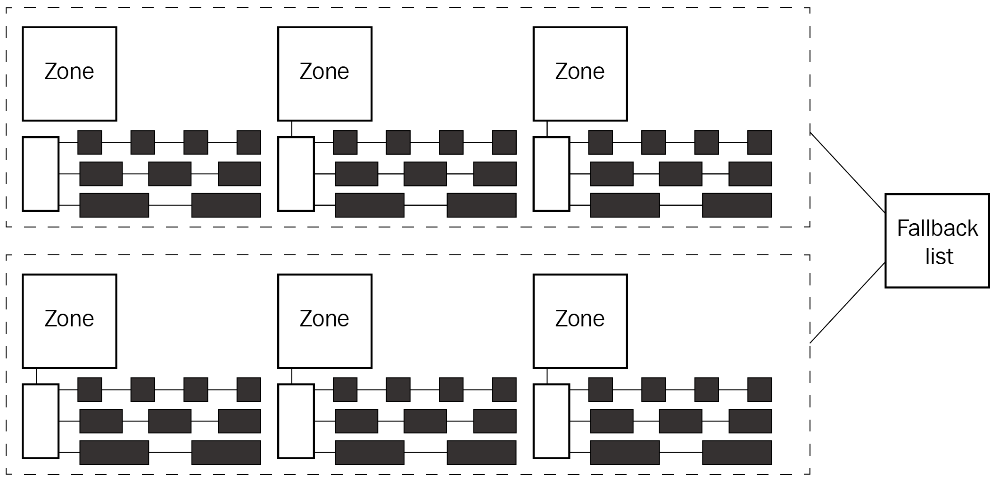

Hình 8.4: Các “freelist” của page allocator (BSA), một cho mỗi node:zone trên hệ thống; nguồn sơ đồ: Professional Linux Kernel Architecture, Mauerer, Wrox Press, tháng 10 năm 2008

Hơn nữa (như thấy trong Hình 8.4), khi kernel được yêu cầu cấp phát RAM qua page allocator, nó chọn freelist tối ưu để cấp phát memory – freelist gắn với node nơi thread đưa ra yêu cầu đang chạy (hãy nhớ NUMA architecture từ chương trước). Nếu các zone trên node này hết memory hoặc không thể cấp phát vì bất kỳ lý do nào, kernel dùng một fallback list để xác định freelist nào sẽ được thử cấp phát memory. (Trong thực tế, bức tranh thật còn phức tạp hơn; chúng ta cung cấp thêm một số chi tiết trong phần Page allocator internals – một vài chi tiết nữa).

Giờ hãy tìm hiểu (về mặt khái niệm) cách tất cả những điều này hoạt động để cấp phát và giải phóng memory page!

#### Cơ chế hoạt động của page allocator

Có thể giải thích chiến lược cấp phát và giải phóng thực tế bằng một ví dụ đơn giản. Giả sử một device driver yêu cầu 128 KB memory. Để đáp ứng yêu cầu, thuật toán page allocator (BSA) sẽ làm như sau (đơn giản hóa và xét về khái niệm):

1\. Thuật toán biểu diễn lượng cần cấp phát (ở đây là 128 KB) theo page. Vì vậy, ở đây (giả định page size 4 KB), nó là 128K/4K = 32 page. 2. Tiếp theo, nó xác định cần nâng 2 lên lũy thừa bao nhiêu để được 32. Đó là log<sub>2</sub>32 (hay ln 2), bằng 5 (vì 2<sup>5</sup> là 32). Vì thế list order 5 sẽ có các chunk free memory với chính xác kích thước cần thiết này. 3. Giờ nó kiểm tra list tại order 5 của page allocator freelist thuộc node:zone thích hợp (gần nhất). Nếu có memory chunk (nó sẽ có kích thước 2<sup>5</sup> page = 128 KB), dequeue chunk khỏi list order 5, cập nhật list và cấp phát cho bên yêu cầu. Xong việc! Trở về caller.

Tại sao chúng ta nói page allocator freelist của node:zone thích hợp (gần nhất)? Có nghĩa là có nhiều hơn một freelist sao? Đúng vậy! Chúng ta nhắc lại: thực tế sẽ có nhiều PA freelist data structure, mỗi cái cho một node:zone trên hệ thống. (Cũng xem thêm chi tiết trong phần Page allocator internals – một vài chi tiết nữa sắp tới.)

4\. Nếu không có lấy một memory chunk trên list order 5 (nghĩa là nếu nó null), hãy kiểm tra list tại order kế tiếp; nghĩa là linked list order 6 (nếu không trống, nó sẽ có các memory chunk 2<sup>6</sup> page = 256 KB được enqueue trên đó, mỗi chunk gấp đôi kích thước chúng ta muốn). 5. Nếu list order 6 non-null, lấy (dequeue) một memory chunk từ đó (kích thước sẽ là 256 KB, gấp đôi cần thiết), rồi thực hiện như sau:

  - Cập nhật list (order 6) để phản ánh rằng một chunk vừa được lấy đi.

  - Cắt đôi chunk, nhờ đó có hai nửa 128 KB hay hai buddy! (Vui lòng xem khung thông tin sau.)

  - Chuyển (enqueue) một nửa (kích thước 128 KB) sang list order 5.

  - Cấp phát nửa còn lại (kích thước 128 KB) cho bên yêu cầu.

  - Xong việc! Trở về caller.

6\. Nếu list order 6 cũng trống, lặp lại quy trình trên với list order 7, v.v. (đệ quy), đến khi thành công. 7. Nếu mọi higher-order list còn lại đều trống (null), nó sẽ làm yêu cầu thất bại (điều này rất ít khả năng xảy ra).

Chúng ta có thể cắt hay chia đôi memory chunk vì mỗi chunk trên list được bảo đảm là physically contiguous memory. Sau khi cắt, có hai nửa; mỗi nửa được gọi là buddy block, vì vậy thuật toán có tên đó. Xét chặt chẽ, nó được gọi là binary buddy system vì chúng ta dùng memory chunk có kích thước là lũy thừa của 2. Chính xác hơn, buddy block được định nghĩa là một block cùng kích thước và nằm liền kề về mặt vật lý với một block khác.

Bạn sẽ hiểu rằng mô tả trên mang tính khái niệm. Code implementation thực tế chắc chắn phức tạp và được tối ưu hơn. Nhân tiện, code – “trái tim” của zoned buddy allocator, đúng như comment của nó nói, nằm ở đây: `mm/page_alloc.c:__alloc_pages()` (để bạn biết, tại đây trên 6.1.25: `https://elixir.bootlin.com/linux/v6.1.25/source/mm/page_alloc.c#L5523`). Vì ngoài phạm vi sách, chúng ta sẽ không cố đi sâu vào chi tiết code-level của allocator.

#### Xem xét một vài tình huống

Giờ đã có kiến thức cơ bản về thuật toán, hãy xét một vài tình huống: trước tiên là trường hợp đơn giản, dễ hiểu, sau đó là một vài trường hợp phức tạp hơn.

##### Trường hợp đơn giản nhất

Giả sử một kernel-space device driver (hoặc một core code nào đó) yêu cầu 128 KB và nhận một memory chunk từ list order 5 của một trong các freelist data structure. Vào một thời điểm sau đó, nó nhất thiết sẽ (nên/phải) giải phóng memory chunk bằng một trong các API giải phóng của page allocator. Giờ thuật toán của allocator-free này tính toán – qua order (và do đó kích thước) của chunk – rằng chunk just-freed thuộc list order 5; vì vậy nó enqueue chunk vào đó. (Bạn sẽ sớm thấy một parameter của cả API alloc lẫn free là order của list.)

##### Trường hợp phức tạp hơn

Giờ giả sử, khác trường hợp đơn giản trước, khi device driver yêu cầu 128 KB, list order 5 là null; vì thế, theo thuật toán page allocator, chúng ta đến list ở order tiếp theo, 6, và kiểm tra nó. Giả sử nó non-null; giờ thuật toán dequeue một chunk order 6 kích thước 256 KB rồi chia (hay cắt) đôi. Vậy giờ có hai nửa nằm liền kề về mặt vật lý và có kích thước bằng nhau – các buddy block. Giờ một buddy block (kích thước 128 KB) được đưa cho bên yêu cầu, còn buddy block kia (cũng kích thước 128 KB) được enqueue vào list order 5.

Đặc tính thực sự thú vị của buddy system là điều xảy ra khi bên yêu cầu (driver), vào một thời điểm sau đó, giải phóng memory chunk. Như mong đợi, thuật toán tính toán (qua order của chunk) rằng chunk just-freed thuộc list order 5. Nhưng trước khi cứ thế enqueue vào đó, nó tìm buddy block của chunk, và trong trường hợp này, nó (có thể) tìm thấy! Giờ nó gộp hai buddy block thành một block lớn hơn (kích thước 256 KB) rồi đặt (enqueue) block đã gộp vào list order 6. Thật tuyệt – nó thậm chí còn giúp defragment memory!

##### Trường hợp bộc lộ nhược điểm

Giờ hãy làm tình huống thú vị hơn bằng cách không dùng kích thước tròn theo lũy thừa của 2 thuận tiện làm yêu cầu cấp phát. Lần này giả sử device driver yêu cầu một memory chunk kích thước 132 KB. Buddy system allocator sẽ làm gì? Vì tất nhiên không thể cấp phát ít memory hơn yêu cầu, nó cấp phát nhiều hơn – bạn đoán đúng rồi (xem Hình 8.2) – memory chunk có sẵn tiếp theo với appropriately-sized (bằng hoặc lớn hơn yêu cầu) nằm ở order 7 của freelist, kích thước 256 KB. Nhưng bên sử dụng (driver) chỉ nhìn thấy và dùng 132 KB đầu của chunk 256 KB được cấp phát. Phần còn lại (124 KB) bị lãng phí (hãy nghĩ xem, gần 50% lãng phí!). Điều này gọi là internal fragmentation (hay lãng phí) và là nhược điểm nghiêm trọng của binary buddy system!

Tuy nhiên, bạn sẽ biết rằng thực sự có cách giảm thiểu điều này: một patch đã được đóng góp để xử lý các tình huống tương tự (qua các API `alloc_pages_exact()` / `free_pages_exact()`). Chúng ta sẽ sớm trình bày các API để sử dụng page allocator.

#### Page allocator internals – một vài chi tiết nữa

Trong cuốn sách này, chúng ta không định đi sâu vào chi tiết mức code của page allocator internals. Dù vậy, vấn đề là thế này: về mặt data structure, structure `zone` chứa một array các structure `free_area`, tức so-called những “freelist” của page allocator. Điều này hợp lý; như đã học, có thể có (và thường có) nhiều page allocator freelist trên hệ thống, một cho mỗi node:zone; hãy xem chúng code-level:

```
// include/linux/mmzone.h
struct zone {
    [ ... ]
    /* free areas of different sizes */
    struct free_area free_area[MAX_ORDER];
    [ ... ]
};
```

Structure `free_area` là implementation của các doubly-linked circular list (chứa free memory page frame trong node:zone đó), cùng số page frame hiện đang trống bên trong nó:

```
struct free_area {
    struct list_head free_list[MIGRATE_TYPES];
    unsigned long nr_free;
};
```

Tại sao structure `free_area` chứa một array linked list thay vì chỉ một list? Không đi sâu vào chi tiết, chúng ta sẽ đề cập rằng kernel layout cho các buddy system freelist phức tạp hơn những gì đã trình bày đến giờ: từ kernel 2.6.24, mỗi freelist đã thấy tiếp tục được chia thành nhiều freelist riêng lẻ (đến 6) để phục vụ các page migration type khác nhau (nói đến việc kernel có thể thực sự migrate hay di chuyển page để giảm tác động của fragmentation hay không. Có năm migration type có thể có (không nhất thiết tất cả đều được bật): unmovable, movable, reclaimable, CMA và isolate). Điều này cần thiết để xử lý các vấn đề phức tạp khi cố giữ memory (RAM) được defragment.

Bên cạnh đó, như đã nói, các freelist này tồn tại cho mỗi node:zone trên hệ thống. Vì vậy, ví dụ, trên một hệ thống NUMA thực sự có 4 node và 3 zone mỗi node, sẽ có 12 (4 x 3) freelist. Không chỉ vậy, giờ chúng ta nhận ra mỗi structure `free_area` thực sự gồm (đến) 6 freelist, một cho mỗi migration type. Vì thế, trên hệ thống như vậy, tổng cộng đến 6 x 12 = 72 freelist data structure sẽ tồn tại system-wide!

Nếu quan tâm, hãy tìm hiểu sâu các chi tiết; output `/proc/buddyinfo` chỉ là một góc nhìn tóm lược thuận tiện về trạng thái buddy system freelist (như Hình 8.3 cho thấy). Để có góc nhìn chi tiết và sát thực hơn (thuộc loại vừa đề cập, hiển thị mọi freelist), hãy xem `/proc/pagetypeinfo` (yêu cầu root access); nó hiển thị mọi freelist (cũng chia theo page migration type). Tuy nhiên, lưu ý không nhất thiết cả sáu migration type đều được định nghĩa trên một hệ thống.

Thiết kế của thuật toán page allocator (buddy system) thuộc lớp best-fit. Nó mang lại lợi ích lớn là giúp defragment physical memory khi hệ thống chạy. Các ưu điểm của thuật toán page allocator (buddy system) như sau:

- Giúp defragment memory (giảm thiểu external fragmentation)

- Bảo đảm cấp phát một physically contiguous memory chunk

- Bảo đảm các memory block được CPU cacheline-aligned

- Nhanh (đúng hơn, đủ nhanh; time complexity của thuật toán là O(log n))

Mặt khác, nhược điểm lớn nhất vượt trội là internal fragmentation hay mức lãng phí có thể quá cao.

Được rồi, tốt! Chúng ta đã trình bày khá nhiều kiến thức nền về cơ chế bên trong của page allocator hay buddy system allocator. Đến lúc thực hành; giờ hãy đi sâu vào tìm hiểu và sử dụng các page allocator API để cấp phát và giải phóng kernel memory.

### Học cách sử dụng các page allocator API

Linux kernel cung cấp (cho core và module) một tập API để cấp phát và giải phóng memory (RAM) qua page allocator. Chúng thường được gọi là low-level (de)allocator routine. Bảng sau tóm lược các page allocation API; bạn sẽ nhận thấy trong mọi API hay macro có hai parameter, parameter đầu được gọi là GFP flag hay bitmask (tên là `gfp_mask`); chúng ta sẽ giải thích chi tiết ngay sau đây, tạm thời hãy bỏ qua nó. Parameter thứ hai là order – order của freelist, nghĩa là lượng memory cần cấp phát là 2<sup>order</sup> page frame.

Trong những thảo luận sau, chúng ta khá thường xuyên dùng thuật ngữ “kernel logical address”. Như đã nói trong Chương 7, Memory Management Internals – Essentials, tại phần Xem xét kernel segment, sự phân biệt giữa “logical” address và “virtual” address khá mang tính hàn lâm. Kernel logical address nhằm chỉ một địa chỉ trong vùng kernel lowmem; mọi kernel address khác được gọi là kernel virtual address (KVA). Đối với mọi mục đích thực tế, bạn có thể xem chúng như nhau.

Có thể tìm thấy mọi API prototype sau trong `include/linux/gfp.h`:

| Tên API hoặc macro | Ghi chú | API signature hoặc macro |
|---|---|---|
| `__get_free_page()` | Cấp phát đúng một page frame. Memory được cấp phát sẽ có nội dung ngẫu nhiên; đây là macro, một wrapper quanh API `__get_free_pages()`. Return value là pointer đến kernel logical address của memory just-allocated. | `#define __get_free_page(gfp_mask) \ __get_free_pages((gfp_mask), 0)` |
| `__get_free_pages()` | Cấp phát 2<sup>order</sup> page frame physically contiguous. Memory được cấp phát sẽ có nội dung ngẫu nhiên; return value là pointer đến kernel logical address của memory just-allocated. | `unsigned long __get_free_pages(gfp_t gfp_mask,` `unsigned int order);` |
| `get_zeroed_page()` | Cấp phát đúng một page frame; nội dung được đặt thành ASCII zero (`NULL`; nghĩa là được zero hóa); return value là pointer đến kernel logical address của memory just-allocated. | `unsigned long get_zeroed_page(gfp_t gfp_mask);` |
| `alloc_page()` | Cấp phát đúng một page frame. Memory được cấp phát sẽ có nội dung ngẫu nhiên; đây là macro (wrapper) trên API `alloc_pages()`; return value là pointer đến metadata structure `page` của memory just-allocated; có thể chuyển nó thành kernel logical address qua function `page_address()`. | `#define alloc_page(gfp_mask) \ alloc_pages(gfp_mask, 0)` |
| `alloc_pages()` | Cấp phát 2<sup>order</sup> page frame physically contiguous. Memory được cấp phát sẽ có nội dung ngẫu nhiên; return value là pointer đến đầu metadata structure `page` của memory just-allocated; có thể chuyển nó thành kernel logical address qua function `page_address()`. | `struct page *` `alloc_pages(gfp_t gfp_mask,` `unsigned int order);` |

Bảng 8.1: Low-level allocator (BSA/page) – các allocation API được export phổ biến

Tất cả API trên đều được export (qua macro `EXPORT_SYMBOL()`), do đó có sẵn cho kernel module developer và device driver developer; đừng lo, bạn sẽ sớm thấy một kernel module minh họa cách dùng chúng.

Như đã đề cập, Linux kernel xem việc duy trì một metadata structure (nhỏ) để theo dõi từng page frame RAM là đáng làm. Nó được gọi là structure `page`. Điểm cần cẩn thận ở đây là: khác với ngữ nghĩa thông thường trả về một pointer (virtual address) đến đầu memory chunk mới cấp phát, hãy chú ý cả API `alloc_page()` lẫn `alloc_pages()` đã nói ở trên (Bảng 8.1) đều trả về pointer đến đầu structure `page` của memory mới cấp phát, không phải chính memory chunk (như các API khác). Bạn phải lấy pointer thực tế đến đầu memory mới cấp phát bằng cách gọi API `page_address()` trên địa chỉ page structure được trả về. Dù sao, example code trong phần Viết kernel module để demo cách dùng các page allocator API của chương này sẽ minh họa cách dùng tất cả API trên.

Tuy nhiên, trước khi có thể dùng các page allocator API được đề cập ở đây, bắt buộc phải hiểu ít nhất kiến thức cơ bản về Get Free Page (GFP) flag, chủ đề của phần tiếp theo.

#### Làm việc với GFP flag

Bạn sẽ nhận thấy parameter đầu của tất cả allocator API (hoặc macro) trước đó là `gfp_t gfp_mask`. Điều này nghĩa là gì? Về cơ bản, đây là các flag GFP - Get Free Page; chúng ảnh hưởng hành vi của kernel khi cấp phát memory; chúng ta sẽ sớm đi vào chi tiết. Đây là những flag (có nhiều flag) được các lớp memory management code bên trong kernel sử dụng. Đối với mọi mục đích thực tế, với kernel module developer (hay device driver developer) điển hình, chỉ hai GFP flag là then chốt (như đã đề cập, phần còn lại dùng nội bộ). Đó là:

- `GFP_KERNEL`

- `GFP_ATOMIC`

Quyết định dùng flag nào khi thực hiện memory allocation qua các page allocator API là quan trọng; một quy tắc then chốt luôn phải nhớ như sau:

Nếu code đang chạy trong process context và được phép sleep an toàn, dùng flag GFP\_KERNEL. Nếu không được phép sleep an toàn (thường khi ở bất kỳ loại atomic context hay interrupt context nào), bạn phải dùng flag GFP\_ATOMIC.

Tuân thủ quy tắc trên là rất quan trọng. Làm sai có thể khiến toàn bộ máy bị treo, kernel crash và/hoặc các sự cố ngẫu nhiên xảy ra. Vậy chính xác các phát biểu được phép/không được phép sleep an toàn thực sự nghĩa là gì? Với nội dung này và hơn nữa, chúng ta để dành cho phần GFP flag – tìm hiểu sâu hơn tiếp theo trong chương này. Tuy nhiên nó quan trọng, nên tôi chắc chắn khuyên bạn đọc.

Project Linux Driver Verification (LDV): trong chương trực tuyến Kernel Workspace Setup, tại phần Project LDV – Linux Driver Verification, chúng ta đã đề cập rằng project này có các “quy tắc” hữu ích liên quan đến những khía cạnh lập trình khác nhau của Linux module (chủ yếu là driver), cũng như core kernel.

Về chủ đề hiện tại, đây là một quy tắc, dưới dạng điều cấm, nghĩa là bạn không được làm như sau: “Dùng blocking memory allocation khi đang giữ spinlock” (`http://linuxtesting.org/ldv/online?action=show_rule&rule_id=0043`). Khi giữ spinlock, bạn không được làm bất kỳ điều gì có thể block; bao gồm kernel-space memory allocation với bất kỳ flag nào ngoài `GFP_ATOMIC`. Vì thế, rất quan trọng, bạn phải dùng flag `GFP_ATOMIC` khi thực hiện memory allocation trong bất kỳ atomic context hay non-blocking context nào, như khi giữ spinlock (bạn sẽ biết điều này không áp dụng cho mutex lock; bạn được phép thực hiện các hoạt động blocking khi giữ mutex). Vi phạm quy tắc này dẫn đến mất ổn định và thậm chí làm xuất hiện khả năng deadlock (ngầm). Trang LDV đề cập một device driver đã vi phạm chính quy tắc này và bản sửa sau đó (`https://git.kernel.org/pub/scm/linux/kernel/git/torvalds/linux.git/commit/?id=5` `b0691508aa99d309101a49b4b084dc16b3d7019`). Hãy xem: patch thể hiện rõ (trong ngữ cảnh API `kzalloc()`, sẽ được trình bày sớm) flag `GFP_KERNEL` được thay bằng flag `GFP_ATOMIC`.

Một GFP flag thường dùng khác là `__GFP_ZERO`. Dùng nó cho kernel biết bạn muốn memory page được zeroed-out. Nó thường được bitwise-ORed với các flag `GFP_KERNEL` hoặc `GFP_ATOMIC` để trả về memory được khởi tạo thành zero (nhìn chung là một thực hành lập trình tốt!).

Các kernel developer đã dành công sức ghi tài liệu chi tiết về GFP flag. Hãy xem `include/linux/gfp_types.h`. Bên trong có một comment dài và chi tiết; tiêu đề là DOC: Useful GFP flag combinations (trên 6.1.25, tại đây: `https://elixir.bootlin.com/linux/v6.1.25/source/include/linux/gfp_types.h#L263`).

Trước mắt, để nhanh chóng bắt đầu, chỉ cần hiểu rằng dùng các memory allocation API của Linux kernel với flag `GFP_KERNEL` thực sự là trường hợp phổ biến cho kernel-internal allocation.

#### Giải phóng page bằng page allocator

Mặt còn lại của cấp phát memory tất nhiên là giải phóng nó. Chúng ta đều hiểu quy tắc cơ bản: giải phóng memory bạn đã cấp phát (động) để ngăn leakage. Memory leak trong kernel chắc chắn không phải điều bạn muốn góp phần tạo ra. Với các page allocator API trong Bảng 8.1, đây là các free API tương ứng:

| Tên API hoặc macro | Ghi chú | API signature hoặc macro |
|---|---|---|
| `free_page()` | Giải phóng page (đơn lẻ) đã được cấp phát qua các API `__get_free_page()`, `get_zeroed_page()` hoặc `alloc_page()`; đây là wrapper đơn giản trên API `free_pages()`. | `#define free_page(addr)` `__free_pages((addr), 0)` |
| `free_pages()` | Giải phóng nhiều page đã được cấp phát qua các API `__get_free_pages()` hoặc `alloc_pages()` (đây là wrapper trên `__free_pages()`). | `void free_pages(unsigned` `long addr, unsigned int` `order)` |
| `__free_pages()` | (Giống hàng trên, ngoài ra) đây là routine bên dưới nơi công việc được thực hiện; đồng thời, lưu ý parameter đầu là pointer đến metadata structure `page`. | `void __free_pages(struct` `page *page, unsigned int` `order)` |

Bảng 8.2: Các API free page phổ biến dùng với page allocator

Bạn có thể thấy API bên dưới thực tế trong các function trên là `free_pages()`, mà bản thân chỉ là wrapper trên code `mm/page_alloc.c:__free_pages()`. Parameter đầu của API `free_pages()` là pointer đến đầu memory chunk đang được giải phóng; tất nhiên đây là return value từ allocation routine. Tuy nhiên, parameter đầu của API bên dưới, `__free_pages()`, là pointer đến page metadata structure của đầu memory chunk đang được giải phóng.

Nói chung, trừ khi thực sự biết mình đang làm gì, bạn được khuyên gọi wrapper routine `foo()` thay vì routine nội bộ `__foo()`. Một lý do đơn giản là tính đúng đắn (có lẽ wrapper dùng một cơ chế synchronization cần thiết – như lock – trước khi gọi routine bên dưới). Một lý do khác là validity checking (giúp code vững chắc và an toàn). Thường thì các routine `__foo()` bỏ qua validity check để ưu tiên tốc độ.

Giờ hãy chuyển sang một số hướng dẫn hữu ích cần tuân theo khi cấp phát hoặc giải phóng memory trong kernel.

#### Một vài hướng dẫn cần tuân thủ khi cấp phát và giải phóng kernel memory

Như mọi C/C++ application developer có kinh nghiệm đều biết, cấp phát rồi sau đó giải phóng memory là nguồn bug dồi dào! Chủ yếu vì C là unmanaged language xét về memory; do đó bạn có thể khá dễ gặp đủ loại memory bug. Bao gồm các bug well-known memory leakage, buffer overflow/underflow cho cả read/write, double-free và Use After Free (UAF).

Đáng tiếc, kernel space cũng không khác; chỉ là hậu quả tệ hơn (rất nhiều)! Hãy đặc biệt cẩn thận! Vui lòng chú ý bảo đảm những điều sau:

- Ưu tiên routine khởi tạo memory just-allocated thành zero.

- Suy xét và dùng GFP flag thích hợp khi thực hiện allocation; sẽ nói thêm trong phần GFP flag – tìm hiểu sâu hơn, nhưng tóm lược hãy lưu ý:

  - Khi ở process context nơi được phép sleep an toàn, dùng `GFP_KERNEL`.

  - Khi ở atomic context, chẳng hạn đang xử lý interrupt (phần cứng) hoặc giữ spinlock, dùng `GFP_ATOMIC`.

- Khi dùng page allocator (như chúng ta đang làm), cố gắng tối đa giữ allocation size là số page tròn theo lũy thừa của 2 (một lần nữa, lý do cùng cách giảm thiểu điều này – khi bạn không cần nhiều memory đến vậy, vốn là trường hợp điển hình – được trình bày chi tiết trong các phần tới của chương).

- Chỉ thử giải phóng memory mà bạn đã cấp phát trước đó; không cần nói cũng biết (nhưng chúng ta vẫn nói!), đừng quên giải phóng nó, đừng dùng sai pointer và đừng double-free nó.

- Đừng thử truy cập memory already-freed (điều này gây bug UAF).

- Giữ pointer gốc của memory chunk an toàn khỏi việc tái sử dụng, thao tác (`ptr ++` hoặc tương tự) và corruption, để bạn có thể giải phóng đúng khi hoàn tất.

- Kiểm tra (và kiểm tra lại!) các parameter truyền cho API. Nó yêu cầu pointer đến block đã cấp phát trước đó, hay pointer đến structure `page` bên dưới của block?

Bạn thấy khó và/hoặc lo về các vấn đề trong production? Đừng quên, bạn có sự trợ giúp từ các công cụ static analysis và dynamic analysis của kernel (cũng như third-party)! Hãy chắc chắn học cách dùng các công cụ static analysis mạnh mẽ trong kernel (Coccinelle, `sparse` và các công cụ khác như `cppcheck` hay `smatch`). Với dynamic analysis, hãy học cách cài đặt và dùng KASAN (Kernel Address Sanitizer). Cuốn Linux Kernel Debugging trình bày điều này và nhiều hơn nữa...

Cũng hãy nhớ Makefile template “tốt hơn” tôi cung cấp trong Chương 5, Writing Your First Kernel Module – Part 2, tại phần Một Makefile template tốt hơn. Nó chứa các target dùng nhiều công cụ trong số này; hãy sử dụng nó!

Được rồi, giờ đã trình bày cả allocation API (phổ biến) lẫn free API của page allocator, đến lúc vận dụng kiến thức. Hãy viết code!

#### Viết kernel module để demo cách dùng các page allocator API

Giờ hãy hands-on với các low-level page allocator API và free API đã học đến đây. Trong phần này, chúng ta sẽ trình bày các đoạn code liên quan (không phải từng dòng), kèm giải thích khi cần, từ demo kernel module (`ch8/lowlevel_mem/lowlevel_mem.c`).

Trong worker routine chính, `bsa_alloc()`, của LKM nhỏ, chúng ta nhấn mạnh một số code comment cho thấy điều đang cố đạt được. Một vài điểm cần lưu ý:

1\. Trước tiên, chúng ta làm một điều rất thú vị: dùng kernel “library” function nhỏ `klib.c:show_phy_pages()` để thực sự cho thấy physical RAM page frame được identity-map đến kernel virtual page trong vùng kernel lowmem như thế nào (Cơ chế hoạt động chính xác của routine `show_phy_pages()` sẽ được thảo luận ngay sau đây):

```
// ch8/lowlevel_mem/lowlevel_mem.c
[...]
static int bsa_alloc(void)
{
    int stat = -ENOMEM;
    u64 numpg2alloc = 0;
    const struct page *pg_ptr1;

    /* 0. Show the identity mapping: physical RAM page frames to kernel
virtual addresses, from PAGE_OFFSET for 5 pages */
pr_info("0. Show identity mapping: RAM page frames : kernel virtual pages
:: 1:1\n" "(PAGE_SIZE = %ld bytes)\n", PAGE_SIZE);
  /* Show the virt, phy addr and PFNs (page frame numbers). ... */
    show_phy_pages((void *)PAGE_OFFSET, 5 * PAGE_SIZE, 1);
```

2\. Thứ hai, chúng ta cấp phát một page memory qua page allocator API bên dưới `__get_free_page()` (đã thấy trong Bảng 8.1):

```
  /* 1. Allocate one page with the __get_free_page() API */
  gptr1 = (void *)__get_free_page(GFP_KERNEL);
  if (!gptr1) {
        pr_warn("__get_free_page() failed!\n");
        /* As per convention, we emit a printk above saying that the
         * allocation failed. In practice it isn't required; the kernel
         * will definitely emit many warning printk's if a memory alloc
         * request ever fails! Thus, we do this only once (here; could
         * also use the WARN_ONCE()); from now on we don't pedantically
         * print any error message on a memory allocation request
         * failing. */
        goto out1;
  }
  pr_info("#.    BSA/PA API     Amt alloc'ed        KVA\n"); // header
  pr_info("1.  __get_free_page()     1 page    %px\n", gptr1);
```

Ở đây chúng ta gọi một vài function `printk`, hiển thị một header line rồi các chi tiết của một allocation cụ thể được thực hiện (KVA tất nhiên là Kernel Virtual Address). Hãy nhớ từ chương trước rằng các KVA thấy ở đây là page allocator memory nằm hoàn toàn trong vùng direct-mapped RAM hay lowmem của kernel segment/VAS.

Giờ vì bảo mật, chúng ta nên nhất quán và chỉ dùng format specifier `%pK` khi in kernel address để giá trị hash, thay vì virtual address thực, xuất hiện trong kernel log. Tuy nhiên, ở đây, để cho bạn thấy KVA thực tế, chúng ta chỉ dùng format specifier `%px` (giống `%pK`, nó cũng portable; vì bảo mật, vui lòng đừng dùng format specifier `%px` trong production!).

Tiếp theo, hãy chú ý comment chi tiết trong error code path của API `__get_free_page()` đầu tiên (trong đoạn code trên). Nó đề cập rằng bạn thực sự không phải in error message hay warning message về out-of-memory. (Tò mò? Để biết tại sao, hãy truy cập `https://lkml.org/lkml/2014/6/10/382`.)

Trong example module này (cũng như nhiều module trước và các module tiếp theo), chúng ta viết các lần dùng printk (hay macro `pr_<foo>()`) sao cho portable bằng cách dùng các printk format specifier thích hợp (như `%zd`, `%zu`, `%pK`, `%px` và `%pa`).

3\. Giờ hãy chuyển sang memory allocation thứ hai dùng page allocator; xem đoạn code sau:

```
/*2. Allocate 2^bsa_alloc_order pages with the __get_free_pages() API */
numpg2alloc = powerof(2, bsa_alloc_order); /* returns 2^bsa_alloc_order
*/
gptr2 = (void *)__get_free_pages(GFP_KERNEL|__GFP_ZERO, bsa_alloc_order);
if (!gptr2) {
      /* no error/warning printk now; see above comment */
      goto out2;
}
pr_info("2. __get_free_pages()  2^%d page(s)  %px\n",
        bsa_alloc_order, gptr2);
```

Trong đoạn code trên, chúng ta cấp phát 2<sup>3</sup> – nghĩa là 8 – page memory qua API `__get_free_pages()` của page allocator (vì giá trị mặc định của module parameter `bsa_alloc_order` là `3`).

Một lưu ý bên lề: hãy chú ý chúng ta dùng các GFP flag `GFP_KERNEL|__GFP_ZERO` để bảo đảm memory được cấp phát được zero hóa, một best practice. Tuy vậy, zero hóa memory chunk lớn có thể làm giảm nhẹ hiệu năng.

Giờ chúng ta tự hỏi: có cách xác minh memory là physically contiguous (như đã hứa) không? Hóa ra có, chúng ta thực sự có thể lấy và in physical address của đầu mỗi page frame được cấp phát, đồng thời lấy cả Page Frame Number (PFN) của nó.

PFN là một khái niệm đơn giản: nó chỉ là index hay page number – ví dụ, PFN của physical address 8192 là 2 (8192/4096). Vì trước đây chúng ta đã trình bày cách (và quan trọng là khi nào có thể) dịch kernel virtual address sang physical address tương ứng (và ngược lại; nội dung này nằm trong Chương 7, Memory Management Internals – Essentials, tại phần Direct-mapped RAM và address translation), chúng ta sẽ không lặp lại ở đây.

Để thực hiện công việc dịch virtual address sang physical address và kiểm tra contiguity này, chúng ta viết một “library” function nhỏ, được giữ trong một C file riêng ở root của GitHub source tree của sách, `klib.c`. Ý định là sửa `Makefile` của kernel module để link cả code của library file này! (Cách thực hiện đúng đã được trình bày trong Chương 5, Writing Your First Kernel Module – Part 2, tại phần Thực hiện library emulation qua nhiều source file.) Đây là lời gọi library routine (đúng như đã làm trong phần đầu function `bsa_alloc()`):

```
show_phy_pages(gptr2, numpg2alloc * PAGE_SIZE, 1);
```

Sau đây là code của library routine (trong source file `<booksrc>/klib.c`; một lần nữa, để rõ ràng, chúng ta không trình bày toàn bộ code ở đây):

```
// klib.c
[...]
int loops = len/PAGE_SIZE, i;
/* show_phy_pages() - show the virtual, physical addresses and PFNs of
the memory range provided on a per-page basis.
 * ! NOTE   NOTE   NOTE !
 * The starting kernel address MUST be a 'linear' address, i.e., an
adrress within the 'lowmem' direct-mapped region of the kernel segment,
else this will NOT work and can possibly crash the system.
 * @kaddr: the starting kernel virtual address
 * @len: length of the memory piece (bytes)
 * @contiguity_check: if True, check for physical contiguity of pages
 * 'Walk' the virtually contiguous 'array' of pages one by one (that is,
page by page), printing the virt and physical address (and PFN- page
frame number). This way, we can see if the memory really is *physically*
contiguous or not.
 */
void show_phy_pages(const void *kaddr, size_t len, bool contiguity_check)
{
    [...]
    if (len % PAGE_SIZE)
        loops++;
    for (i = 0; i < loops; i++) {
        pa = virt_to_phys(vaddr+(i*PAGE_SIZE));
        pfn = PHYS_PFN(pa);

        if (!!contiguity_check) {
        /* what's with the 'if !!(<cond>) ...' ??
         * a 'C' trick: ensures that the if condition always
         * evaluates to a boolean - either 0 or 1. Cool, huh. */
            if (i && pfn != prev_pfn + 1)
             pr_notice(" *** physical NON-contiguity detected ***\n");
        }
        [...]
        pr_info("%05d 0x%px %pa %ld\n", i, vaddr+(i*PAGE_SIZE), &pa,
pfn);
        if (!!contiguity_check)
            prev_pfn = pfn;
    }
}
```

Hãy nghiên cứu function trên. Chúng ta duyệt memory range cho trước, từng page (virtual) một, lấy physical address và PFN rồi xuất chúng qua `printk` (chú ý cách dùng format specifier `%pa` để in physical address một cách portable – tuy nhiên nó yêu cầu truyền địa chỉ bằng reference). Không chỉ vậy, nếu parameter thứ ba của function `klib.c:show_phy_pages()`, `contiguity_check`, là `1`, chúng ta kiểm tra các PFN có chỉ cách nhau một đơn vị hay không, qua đó kiểm tra các page có thực sự physically contiguous hay không. (Nhân tiện, function đơn giản `powerof()` được sử dụng cũng nằm trong library code).

4\. Giờ hãy tiếp tục với kernel module code:

```
/* 3. Allocate and init one page with the get_zeroed_page() API */
gptr3 = (void *)get_zeroed_page(GFP_KERNEL);
if (!gptr3)
       goto out3;
[...]
pr_info("3.  get_zeroed_page()   1 page      %px\n", gptr3);
```

Như thấy trong đoạn trên, chúng ta cấp phát một page memory nhưng bảo đảm nó được zero hóa bằng cách dùng API PA `get_zeroed_page()`. `pr_info()` hiển thị KVA thực tế (dùng format specifier `%px` hay `%pK` cũng giúp in địa chỉ theo cách port-able, bất kể bạn chạy hệ thống 32-bit hay 64-bit).

5\. Tiếp theo, chúng ta cấp phát một page bằng API `alloc_page()`. Hãy cẩn thận ở đây! Nó không trả về pointer đến page được cấp phát, mà là pointer đến metadata structure `page` biểu diễn page đó; đây là function signature: `struct page * alloc_page(gfp_mask)`. Vì thế phải dùng helper `page_address()` để chuyển nó thành kernel logical address (hoặc virtual address):

```
/* 4. Allocate one page with the alloc_page() API. */
pg_ptr1 = alloc_page(GFP_KERNEL);
if (!pg_ptr1)
     goto out4;
gptr4 = page_address(pg_ptr1);
pr_info("4.       alloc_page()   1 page      %px\n"
        " (struct page addr = %px)\n", (void *)gptr4, pg_ptr1);
```

Trong đoạn code trên, chúng ta cấp phát một page memory qua PA API `alloc_page()`. Như đã giải thích, cần chuyển page metadata structure được trả về thành KVA (hay kernel logical address) qua API `page_address()`.

6\. Tiếp theo, cấp phát 2^3 = 8 page bằng API `alloc_pages()`. Cảnh báo giống đoạn code trước cũng áp dụng ở đây:

```
/* 5. Allocate 2^3 = 8 pages with the alloc_pages() API. */
gptr5 = page_address(alloc_pages(GFP_KERNEL, 3));
if (!gptr5)
     goto out5;
pr_info("5.      alloc_pages()  %lld pages     %px\n",
        powerof(2, 5), (void *)gptr5);
```

Trong đoạn code trên, chúng ta kết hợp `alloc_pages()` được bọc trong API `page_address()` để cấp phát 2^3 = 8 page memory!

Điều thú vị là chúng ta dùng nhiều câu lệnh `goto` cục bộ trong code (hãy xem qua code trong repo). Nhìn kỹ, bạn sẽ thấy nó thực sự giữ các error handling code path sạch và hợp lý! Đây quả thực là một phần của Linux kernel coding style guideline.

Cách dùng câu lệnh `goto` (thường gây tranh luận mang tính hàn lâm) trong Linux được ghi tài liệu rõ ràng ngay đây: `https://elixir.bootlin.com/linux/v6.1.25/source/Documentation/process/coding-style.rst#L526`. Tôi khuyến khích bạn xem! Một khi hiểu usage pattern, bạn sẽ thấy nó giúp giảm các cleanup error về memory leakage (và tương tự) vốn all-too-typical!

7\. Cuối cùng, trong cleanup method, trước khi được loại khỏi kernel memory, chúng ta giải phóng mọi memory chunk vừa cấp phát trong cleanup code của kernel module. 8. Để link library code `klib` với kernel module `lowlevel_mem_lkm`, `Makefile` thay đổi để có nội dung sau (hãy nhớ chúng ta đã học cách compile nhiều source file thành một kernel module trong Chương 5, Writing Your First Kernel Module – Part 2, tại phần Thực hiện library emulation qua nhiều source file):

```
FNAME_C := lowlevel_mem
[ ... ]
PWD            := $(shell pwd)
obj-m          += ${FNAME_C}_lkm.o
lowlevel_mem_lkm-objs := ${FNAME_C}.o ../../klib.o
```

Phù! Đó là khá nhiều nội dung. Hãy chắc chắn bạn hiểu code, rồi đọc tiếp để thấy nó hoạt động.

#### Triển khai kernel module lowlevel\_mem\_lkm

Được rồi, đến lúc xem kernel module `ch8/lowlevel_mem` hoạt động! Hãy build và triển khai nó trên cả Raspberry Pi 4 (chạy Raspberry Pi OS mặc định được build cho 32-bit) lẫn một x86\_64 VM (chạy Ubuntu 22.04 LTS).

##### Thử nghiệm trên Raspberry Pi 32-bit

Trên Raspberry Pi 4 Model B (ở đây chạy Raspberry Pi kernel 32-bit nguyên bản version 5.15.76-v7l+), chúng ta build rồi `insmod` kernel module `lowlevel_mem_lkm` (phần này không thấy trong Hình 8.5). Sau đó thực hiện `lsmod`, tiếp theo loại bỏ (unload) nó bằng `rmmod`, rồi hiển thị kernel log qua `dmesg`.

Ảnh chụp màn hình sau cho thấy output:

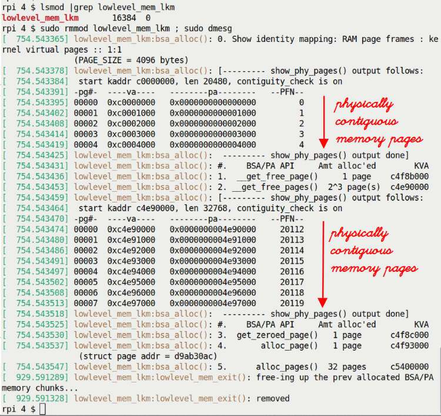

Hình 8.5: Output của kernel module lowlevel\_mem\_lkm trên Raspberry Pi 4 Model B

Hãy xem! Trong bước 0 của output ở Hình 8.5, “library” routine `show_phy_pages()` cho thấy rõ KVA `0xc000 0000` có pa (physical address) `0x0`, KVA `0xc000 1000` có pa `0x1000`, v.v., cho năm page (cùng PFN ở ngoài cùng bên phải); bạn có thể thực sự thấy identity mapping 1:1 của physical RAM page frame đến kernel virtual page (trong vùng lowmem của kernel segment)!

Tiếp theo, sau khi hiển thị header line, memory allocation đầu tiên bằng API `__get_free_page()` diễn ra như mong đợi. Thú vị hơn là trường hợp 2. Ở đây (phần middle-to-lower của Hình 8.5), có thể thấy rõ physical address và PFN của mỗi page được cấp phát (từ 0 đến 7, tổng cộng 8 page, qua API `__get_free_pages()`, điểm #3 trong phần giải thích code) là liên tiếp, cho thấy (một lần nữa) các memory page được cấp phát thực sự physically contiguous!

##### Thử nghiệm trên x86\_64 VM

Chúng ta build và chạy cùng module trên x86\_64 VM chạy Ubuntu 22.04 LTS (với custom kernel 6.1). Ảnh chụp màn hình sau cho thấy output:

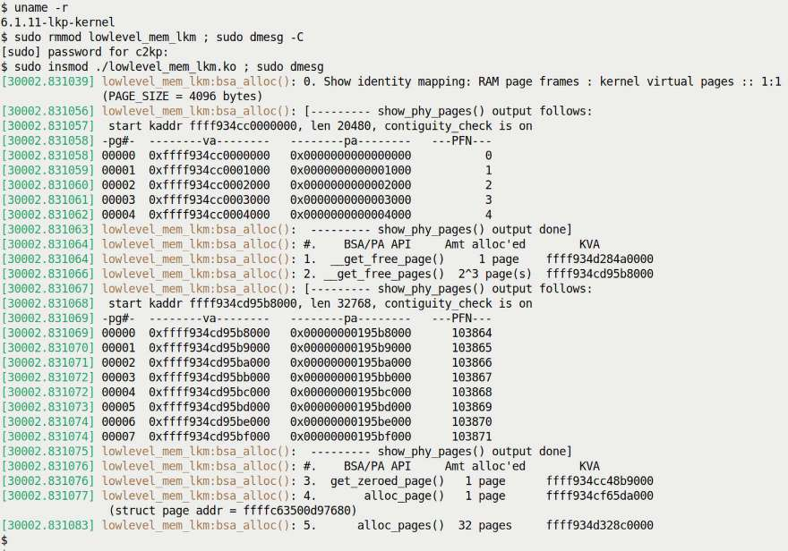

Hình 8.6: Output của kernel module lowlevel\_mem\_lkm trên x86\_64 VM chạy Ubuntu 22.04 LTS

Lần này, với giá trị `PAGE_OFFSET` là một số 64-bit (giá trị ở đây là `0xffff934cc0000000`; hãy hiểu rằng nó chắc chắn có thể thay đổi do KASLR!), bạn lại có thể thấy rõ identity mapping của physical RAM frame đến kernel virtual address (cho 5 page). Hãy dành một chút thời gian nhìn kỹ các kernel logical address được các page allocator API trả về. Trong trường hợp cụ thể này, ở Hình 8.6, bạn có thể thấy tất cả đều thuộc dải `0xffff 934c c000 xxxx`. Tất cả hoàn toàn nằm trong direct-mapped physical memory của kernel (RAM được map ở đây vào kernel segment), còn gọi là vùng lowmem.

Nếu tất cả những điều này có vẻ mới và lạ với bạn, vui lòng tham khảo Chương 7, Memory Management Internals – Essentials, đặc biệt các phần Xem xét kernel segment và Direct-mapped RAM và address translation.

Thực tế là page allocator memory (thực chất các buddy system free list) map trực tiếp physical RAM (trống) trong vùng direct-mapped hay lowmem của kernel VAS. Vì thế, hiển nhiên nó trả về memory từ vùng này. Dải địa chỉ cụ thể được dùng tất nhiên rất đặc thù theo architecture.

Dù rất muốn nói rằng giờ bạn đã xong với page allocator và các API của nó, thực tế điều này (như thường lệ) chưa hẳn đúng. Hãy đọc tiếp để thấy tại sao – hiểu các khía cạnh này thực sự quan trọng.

#### Page allocator và internal fragmentation (lãng phí)

Dù bề ngoài mọi thứ có vẻ tốt đẹp và vô hại, tôi khuyến khích bạn tìm hiểu sâu hơn một chút. Ngay bên dưới bề mặt, một bất ngờ lớn (khó chịu!) có thể đang chờ bạn: kernel/driver developer vẫn vô tư chưa biết. Các API đã trình bày về page allocator (xem Bảng 8.1) có một “đặc điểm nổi bật” không đáng tự hào là có thể gây internal fragmentation – nói đơn giản hơn, lãng phí – những phần kernel memory rất đáng kể!

Để hiểu tại sao, bạn phải hiểu ít nhất kiến thức cơ bản về thuật toán page allocator và các freelist data structure của nó. Phần có tên Cơ chế hoạt động nền tảng của page allocator đã trình bày điều này (nếu chưa đọc, vui lòng đọc).

Trong phần Xem xét một vài tình huống, bạn đã thấy khi đưa ra allocation request với số page thuận tiện, powers-of-two-size (lưu ý, page, không phải byte), mọi thứ diễn ra rất suôn sẻ. Tuy nhiên, khi không như vậy – giả sử driver yêu cầu 132 KB memory – chúng ta gặp vấn đề lớn: internal fragmentation hay mức lãng phí rất cao (như đã thấy, theo mặc định điều này dẫn đến allocation 256 KB, do đó gây lãng phí 256 - 132 = 124 KB). Đây là nhược điểm nghiêm trọng và phải được giải quyết. Chúng ta sẽ thấy cách, thực ra theo hai cách. Hãy đọc tiếp!

##### Cặp page allocator API “exact”

Nhận ra khả năng gây lãng phí memory rất lớn của page allocator (hay BSA) mặc định, một developer từ Freescale Semiconductor (xem khung thông tin) đã đóng góp patch cho kernel page allocator để mở rộng PA API, thêm một vài API mới.

Trong dòng `2.6.27-rc1`, ngày 24 tháng 7 năm 2008, Timur Tabi gửi một patch để giảm thiểu vấn đề lãng phí của page allocator. Đây là commit liên quan: `https://github.com/torvalds/linux/commit/2be0ffe2b29bd31d3debd0877797892ff2d91f4c`.

Dùng các API này dẫn đến allocation hiệu quả hơn cho những memory chunk large-ish (nhiều page), với ít lãng phí hơn hẳn. Cặp API mới (ít nhất thì nó mới vào năm 2008) để cấp phát và giải phóng memory như sau:

```
#include <linux/gfp.h>
void *alloc_pages_exact(size_t size, gfp_t gfp_mask);
void free_pages_exact(void *virt, size_t size);
```

Parameter đầu của API `alloc_pages_exact()`, `size`, tính bằng byte: hiển nhiên đó là số byte cần cấp phát; parameter thứ hai là giá trị GFP flag “thông thường” đã thảo luận (trong phần Làm việc với GFP flag; `GFP_KERNEL` cho các trường hợp process context điển hình might-sleep, và `GFP_ATOMIC` cho các trường hợp interrupt context hoặc atomic context t-sleep).

Lưu ý memory được API này cấp phát vẫn được bảo đảm physically contiguous. Đồng thời, lượng có thể cấp phát một lần (với một function call) bị giới hạn bởi `MAX_ORDER`; thực tế, điều này đúng với mọi regular page allocation API khác đã thấy đến giờ. Chúng ta sẽ thảo luận nhiều hơn về khía cạnh này trong phần Giới hạn kích thước của API kmalloc sắp tới. Ở đó, bạn sẽ nhận ra thảo luận thực ra không chỉ giới hạn ở slab cache mà còn cả page allocator!

API `free_pages_exact()` chỉ được dùng để giải phóng memory do API tương ứng `alloc_pages_exact()` cấp phát. Đồng thời, lưu ý parameter đầu của routine “free” là giá trị được routine `alloc` tương ứng trả về (pointer đến memory chunk được cấp phát).

Implementation của `alloc_pages_exact()` đơn giản và thông minh: trước tiên nó cấp phát toàn bộ memory chunk được yêu cầu “như thường lệ” qua API `__get_free_pages()`. Sau đó, nó lặp qua các page – từ cuối vùng memory được chỉ định để sử dụng (từ page boundary gần nhất) đến lượng memory thực sự đã cấp phát (thường lớn hơn rất nhiều) – và giải phóng những memory page không cần thiết đó! Vì thế, trong ví dụ của chúng ta, nếu cấp phát 132 KB qua API `alloc_pages_exact()`, bên trong nó thực sự sẽ cấp phát trước 256 KB qua `__get_free_pages()` (vì bắt buộc; thuật toán là như vậy), nhưng sau đó giải phóng memory không dùng từ 132 KB đến 256 KB!

Thêm một ví dụ về vẻ đẹp của open source! Demo dùng các API này nằm trong module code tại đây: `ch8/page_exact_loop`; chúng ta sẽ để bạn tự thử.

Trước khi bắt đầu phần này, chúng ta đã đề cập hai cách giải quyết vấn đề lãng phí của page allocator. Một cách là dùng cặp API `alloc_pages_exact()` và `free_pages_exact()` (hiệu quả hơn các PA API khác), như vừa học; cách kia – thực ra là cách tiếp cận phổ biến – là dùng một lớp hoàn toàn khác để cấp phát memory – slab allocator. Chúng ta sẽ sớm trình bày; đến lúc đó, hãy kiên nhẫn. Tiếp theo, hãy trình bày thêm những chi tiết rất cần hiểu về GFP flag (điển hình) và cách bạn, người viết kernel module hoặc driver, được mong đợi sử dụng chúng.

### GFP flag – tìm hiểu sâu hơn

Đối với thảo luận về low-level page allocator API, parameter đầu của mỗi function là so-called GFP mask. Khi thảo luận API và cách dùng, chúng ta đã đề cập một quy tắc then chốt.

Nếu kernel/driver code của bạn đang chạy trong process context và được phép sleep an toàn, dùng flag `GFP_KERNEL`. Nếu hiện không được phép sleep an toàn (thường khi ở bất kỳ atomic context nào, gồm interrupt context, hoặc khi giữ spinlock), bạn phải dùng flag `GFP_ATOMIC`.

Chúng ta sẽ giải thích kỹ điều này trong các phần sau.

#### Không bao giờ sleep trong interrupt context hay atomic context

Cụm từ được phép sleep an toàn thực sự nghĩa là gì? Để trả lời, hãy nghĩ đến blocking call (API): blocking call là lời gọi mà calling process (hoặc thread) được đưa vào sleep state vì nó đang chờ một điều gì đó, một event, xảy ra, và event đang chờ chưa xảy ra. Vì thế nó chờ – nó “sleep”. Khi, vào một thời điểm tương lai, event đang chờ xảy ra hay đến, nó được kernel (hoặc device driver) đánh thức và tiếp tục.

Một ví dụ về user-space blocking API là C library API `sleep()`. Giả sử bạn làm như sau: `sleep(5);`. Ở đây, event được chờ là một khoảng thời gian nhất định trôi qua (parameter của function, tính bằng giây). Vì thế process context đã gọi function này đi vào sleep, và được đánh thức khi event xảy ra – 5 giây đã trôi qua! Một ví dụ khác là system call `read()` cùng các biến thể, trong đó event được chờ (thường) là storage data hay network data trở nên có sẵn. Với system call `wait4()`, event được chờ là một child process kết thúc hoặc dừng/tiếp tục, v.v.

Vì vậy, bất kỳ function nào có thể block đều có thể dành một khoảng thời gian để sleep; lưu ý khi sleep, nó chắc chắn không nằm trên CPU run queue mà ở trong wait queue; thực chất, khi sleep, nó thậm chí không phải ứng viên được schedule! Gọi chức năng có thể blocking này khi ở kernel mode (tất nhiên là mode chúng ta đang ở khi làm việc với kernel module) chỉ được phép khi ở process context và, trong đó, khi được phép sleep an toàn (giữ một số lock như spinlock khiến sleep không an toàn, trong khi giữ mutex lock nghĩa là được phép sleep hoặc block). Gọi bất kỳ blocking call nào trong context không được phép sleep an toàn, như interrupt context hay atomic context, là bug. Hãy xem đây là quy tắc vàng. Vi phạm điều này, nghĩa là sleep trong atomic context, là sai, là bug và không bao giờ được xảy ra.

Bạn có thể tự hỏi làm sao biết trước code đang chạy trong atomic context (hay interrupt context) hoặc process context? Theo một cách, kernel trợ giúp chúng ta: khi cấu hình kernel (hãy nhớ `make menuconfig` từ Chương 2, Building the 6.x Linux Kernel from Source – Part 1), dưới menu Kernel Hacking / Lock Debugging có một Boolean tunable tên `"Sleep inside atomic section checking"`. Hãy bật nó! (Config option có tên `CONFIG_DEBUG_ATOMIC_SLEEP`; bạn luôn có thể grep nó trong kernel config file. Một lần nữa, trong Chương 5, Writing Your First Kernel Module – Part 2, dưới phần Cấu hình kernel “debug”, đây là điều bạn chắc chắn nên bật). Hơn nữa, chúng ta sẽ đến một vài macro (như `in_task()`) cho phép xác định có đang thực thi code trong process context hay không.

Một cách khác để nghĩ về tình huống này là xem xét: chính xác làm thế nào đưa một process hay thread vào sleep? Câu trả lời ngắn là cho nó gọi scheduling code – function `schedule()`. Vì vậy, suy ra từ những gì vừa học (như một hệ quả), `schedule()` chỉ được gọi từ context được phép sleep an toàn; process context thường an toàn, interrupt context thì không bao giờ (nhiều chi tiết về CPU scheduling là nội dung của cả Chương 10 lẫn Chương 11).

Điều này thực sự quan trọng cần ghi nhớ! (Chúng ta đã trình bày ngắn gọn process context và interrupt context là gì trong Chương 4, Writing Your First Kernel Module – Part 1, tại phần Process context và interrupt context. Hơn nữa, như trình bày ở đó, bạn luôn có thể dùng macro `in_task()` để xác định code hiện đang chạy trong process context hay interrupt context). Tương tự, có thể dùng macro `in_atomic()`; nếu code ở atomic context – nơi nó thường phải chạy đến hoàn tất mà không bị gián đoạn – macro trả về `True`; nếu không, `False`. Hãy đặc biệt lưu ý: bạn có thể ở process context nhưng đồng thời là atomic – ví dụ, khi giữ một số loại lock (spinlock; tất nhiên chúng ta sẽ trình bày trong hai chương cuối về synchronization); điều ngược lại không thể xảy ra (nghĩa là trong interrupt context, code luôn atomic).

##### Ghi chú ngắn về các GFP flag khác internal-usage

Ngoài những GFP flag mà chúng ta, với tư cách người viết module/driver, tập trung vào – `GFP_KERNEL` và `GFP_ATOMIC` – kernel có nhiều flag `[__]GFP_*` khá đặc biệt khác được dùng nội bộ; một số có mục đích rõ ràng là reclaim memory. Chúng gồm (nhưng không giới hạn ở) `__GFP_IO`, `__GFP_FS`, `__GFP_DIRECT_RECLAIM`, `__GFP_KSWAPD_RECLAIM`, `__GFP_RECLAIM` và `__GFP_NORETRY`.

Bên trong, kernel dùng các GFP flag này để chỉ định chính xác kiểu hành vi nội bộ mong đợi khi thực hiện memory allocation. Để làm rõ, hãy xét những ví dụ (điển hình) sau.

Nếu thiếu memory, kernel có thể giải phóng một phần memory bằng cách trước tiên ghi nó vào persistent storage (thường vào swap partition hoặc file), đánh dấu vị trí trong swap rồi giải phóng nó. Giờ giả sử một filesystem component yêu cầu memory; vì RAM thiếu, kernel cố giải phóng một phần memory bằng cách yêu cầu ghi ra một số memory page “cũ hơn” (có thể dùng thuật toán Least Frequently Used (LFU)). Nhưng hãy xét: nếu chính các filesystem code path đó tham gia ghi các memory page này và ngay lúc ấy cần memory allocation thì sao? Điều này có thể dẫn đến hành vi đệ quy rối rắm, thậm chí deadlock! Vì thế, khi thực hiện memory allocation trong trường hợp này, kernel không dùng GFP flag có tên `__GFP_IO`, vốn chỉ định có thể bắt đầu physical I/O trong quá trình cấp phát hay không. Tương tự, có flag `__GFP_FS` chỉ định kernel có thể gọi xuống các low-level filesystem code path hay không. Flag `GFP_NOWAIT` chỉ định ngữ nghĩa yêu cầu kernel không chờ direct memory reclamation, không bắt đầu physical I/O và không dùng bất kỳ low-level filesystem callback nào.

Khi kernel ở tình huống code path phải giữ atomic (không thể sleep hay block bằng bất kỳ cách nào) và allocation phải thành công hoặc thất bại ngay lập tức (ưu tiên thành công), flag `GFP_ATOMIC` là lựa chọn. Tất nhiên đây là trường hợp của atomic code path, như bất kỳ interrupt context nào hoặc khi giữ spinlock (tuy nhiên lưu ý ngay cả điều này cũng không được xem là phù hợp để xử lý Non-Maskable Interrupt (NMI)).

Xem các flag được đề cập ở mức code: `include/linux/gfp_types.h`

```
#define GFP_ATOMIC  (__GFP_HIGH|__GFP_ATOMIC|__GFP_KSWAPD_RECLAIM)
#define GFP_KERNEL  (__GFP_RECLAIM | __GFP_IO | __GFP_FS)
```

Vì vậy, với flag `GFP_KERNEL`, giờ có thể thấy alloc API có thể chủ động reclaim memory và bắt đầu physical I/O và/hoặc filesystem I/O, qua đó tăng khả năng lấy được memory yêu cầu.

Như đã nói, header `gfp_types.h` có comment chi tiết về ý nghĩa từng flag; hãy xem.

Một lưu ý ngắn bên lề về project Linux Driver Verification (LDV): trong chương trực tuyến Kernel Workspace Setup, chúng ta đã đề cập project này có các “quy tắc” hữu ích liên quan đến những khía cạnh lập trình khác nhau của Linux module (chủ yếu là driver) cũng như core kernel.

Về chủ đề hiện tại, đây là một quy tắc dưới dạng điều cấm, nghĩa là bạn không được làm điều này: Không vô hiệu hóa IO trong memory allocation khi đang giữ USB device lock (`http://linuxtesting.org/ldv/online?action=show_rule&rule_id=0077`). Một chút kiến thức nền: khi chỉ định flag `GFP_KERNEL`, nó ngầm có nghĩa (trong số những điều khác) rằng kernel có thể bắt đầu một thao tác I/O (input/output; read/write) để reclaim memory. Vấn đề là đôi lúc điều này có thể gây rắc rối và không nên thực hiện; để khắc phục, bạn được mong đợi dùng flag `GFP_NOIO` như một phần GFP bitmask khi cấp phát kernel memory.

Đó chính xác là trường hợp mà “quy tắc” LDV này nói đến: trong tình huống cụ thể gặp phải, giữa các API `usb_lock_device()` và `usb_unlock_device()`, không nên dùng flag `GFP_KERNEL` mà nên dùng flag `GFP_NOIO` thay thế. (Bạn có thể thấy nhiều lần dùng flag này trong code: `drivers/usb/core/message.c`.) Trang LDV đề cập rằng một vài USB-related driver source file đã được sửa để tuân thủ quy tắc này.

#### Page allocator – ưu và nhược điểm

Hãy kết thúc phần về page allocator/BSA bằng cách tóm lược nhanh ưu và nhược điểm.

Page allocator/BSA – ưu điểm:

- Nhanh; dùng identity-mapped RAM của kernel (được lấy và map lúc boot); page nằm trong vùng lowmem nên đã được pre-mapped; không cần thiết lập page table.

- Bảo đảm memory chunk physically contiguous và CPU cacheline-aligned.

- Thực sự giúp defragment RAM bằng cách gộp các “buddy” block (buddy block là block cùng kích thước và physically contiguous).

Page allocator/BSA – nhược điểm:

- Vấn đề chính: internal fragmentation hay mức lãng phí có thể (quá) cao.

- Granularity của allocation request là một page; vì vậy (giả định page 4K), yêu cầu 128 byte sẽ cho bạn 4.096 byte (điều này được giảm thiểu trong nhiều trường hợp bằng cặp API tốt hơn `alloc_pages_exact()`/ `free_pages_exact()` (nhưng không phải trường hợp này!).

- Có giới hạn trên về lượng có thể cấp phát bằng một API call; thực tế, giả định `MAX_ORDER=11` và page size 4K, đó là 4 MB.

Được rồi, giờ đã có khá nhiều chi tiết về page allocator (xét cho cùng, nó là “engine” nội bộ cho cấp phát và giải phóng RAM!), các API và cách dùng, hãy chuyển sang chủ đề rất quan trọng – động cơ đằng sau slab allocator, các API và cách dùng chúng.

## Tìm hiểu và sử dụng kernel slab allocator

Như thấy trong phần đầu chương, Giới thiệu kernel memory allocator, slab allocator hay slab cache được xếp lớp trên page allocator (hay BSA; tham khảo lại Hình 8.1). Slab allocator chứng minh lý do tồn tại qua hai ý tưởng hay mục đích chính:

- Object caching: Ở đây, nó đóng vai trò cache các “object” phổ biến; đó là các data structure thường xuyên được cấp phát trong Linux kernel. Ý tưởng này – tất nhiên sẽ được mở rộng – cho slab cache cấp phát (rồi sau đó giải phóng) các object theo yêu cầu, dẫn đến hiệu năng cao hơn.

- Giảm mức lãng phí cao (internal fragmentation) của page allocator bằng cách cung cấp các cache nhỏ, kích thước thuận tiện, với nhiều kích thước thường là các phần của một page.

Giờ hãy xem xét những ý tưởng này chi tiết hơn.

### Ý tưởng object caching

Được rồi, chúng ta bắt đầu với ý tưởng thiết kế đầu tiên – khái niệm cache các object phổ biến. Từ lâu, một SunOS developer, Jeff Bonwick, nhận thấy một số kernel object – thường là data structure – được cấp phát và giải phóng thường xuyên trong OS. Vì thế ông nghĩ đến việc pre-allocating chúng trong một dạng cache. Điều này phát triển thành thứ chúng ta gọi là slab cache.

Vì vậy, trên Linux OS cũng thế, kernel (như một phần khởi tạo lúc boot) pre-allocates một số lượng khá lớn object vào nhiều slab cache. Lý do: hiệu năng! Khi core kernel code (hoặc device driver) cần memory cho một object trong số này, nó trực tiếp yêu cầu slab allocator. Nếu đã được cache, allocation gần như tức thì (điều ngược lại cũng đúng lúc deallocation). Bạn có thể tự hỏi tất cả có thực sự cần thiết không? Thực sự có!

Một ví dụ tốt về yêu cầu hiệu năng cao nằm trong các critical code path của network subsystem và block I/O subsystem. Chính vì lý do này, nhiều network data structure và block I/O data structure (socket buffer của network stack, `sk_buff`, `biovec` của block layer và tất nhiên các data structure hay object cốt lõi `task_struct`, là một vài ví dụ tốt) được kernel auto-cached (pre-allocated) trong slab cache. Tương tự, filesystem metadata structure (như các structure `inode` và `dentry`, v.v.), memory descriptor (`struct mm_struct`) và nhiều structure khác được pre-allocated trên slab cache. Có thể thấy những cached object này không? Có, chỉ thêm một chút nữa, chúng ta sẽ làm chính điều này (qua `/proc/slabinfo`).

Lý do khác khiến slab allocator (hay giờ chính xác hơn là SLUB allocator) có hiệu năng vượt trội đơn giản là khi traditional heap-based allocator cấp phát và giải phóng memory thường xuyên, cuối cùng chúng tạo “hole” trong memory (fragmentation). Vì slab object được cấp phát một lần (lúc boot) vào cache và được giải phóng về đó (vì thế không thực sự được “giải phóng”), hiệu năng vẫn cao. Tất nhiên, kernel hiện đại đủ thông minh để bắt đầu giải phóng slab cache một cách thích hợp khi memory pressure – nhu cầu về RAM quý giá – lên quá cao.

Một lần nữa, thường có khoảng cách giữa lý thuyết và thực hành; đôi lúc khi RAM xuống rất thấp, kernel phản ứng khá heavy-handed, đưa ra vũ khí hạng nặng – Out-Of-Memory (OOM) killer! (Đừng lo, chúng ta thảo luận chuyên sâu trong Chương 9, Kernel Memory Allocation for Module Authors – Part 2, tại phần Stayin’ alive – OOM killer). Hãy kiên nhẫn và để thảo luận đó đến lúc ấy.

Có thể tra cứu trạng thái hiện tại của slab cache – các object cache, số object trong một cache, số đang dùng, kích thước mỗi object, v.v. – theo nhiều cách: góc nhìn thô qua filesystem `proc` và `sysfs`, hoặc góc nhìn human-readable hơn qua nhiều frontend utility như `smem`, `vmstat`, `slabtop` (cùng eBPF `slabratetop`) và `slabinfo` (app kernel-supplied).

#### Một vài câu hỏi thường gặp về mức sử dụng (slab) memory và câu trả lời

Để giúp hiểu mọi thứ, định dạng FAQ điển hình có thể hữu ích. Trước khi đi vào, một ghi chú ngắn về cách dùng utility mạnh mẽ `slabinfo`: trong kernel source tree, chỉ cần chuyển đến directory `tools/vm` rồi gõ `make`; utility `slabinfo` (cùng các utility khác) sẽ được build. Chạy nó yêu cầu root access. Sau khi build, để thuận tiện, tôi thường tạo soft link đến `slabinfo` trong một directory thuộc PATH mặc định (với lệnh tương tự như sau):

```
sudo ln –s <path/to/>linux-6.1.25/tools/vm/slabinfo /sbin
```

##### Kernel hiện đang dùng những slab cache nào?

Chạy `sudo vmstat –m` sẽ cho thấy tất cả; hãy thử (lưu ý một số cache có thể trống).

Sau đây là một số output ví dụ:

```
$ sudo vmstat -m | grep -C3 task_struct
files_cache                 644    644    704     23
signal_cache               1165   1484   1152     28
sighand_cache               750    825   2112     15
task_struct                2210   2356   6592      4
cred_jar                   4770   6111    192     21
anon_vma_chain           147015 153792     64     64
anon_vma                  98484 101517    104     39
$
```

(Hãy tìm task structure trong output!) Man page của `vmstat` cho biết ý nghĩa chính xác của từng cột (từ trái sang phải):

```
FIELD DESCRIPTION FOR SLAB MODE
       cache: Cache name
       num: Number of currently active objects
       total: Total number of available objects
       size: Size of each object  (bytes)
       pages: Number of pages with at least one active object
```

##### Làm thế nào xem mức sử dụng memory tổng thể system-wide?

Có nhiều cách; một cách là qua utility `smem`:

```
$ smem --kernel /home/c2kp/kernels/linux-6.1.25/vmlinux -wk --realmem=3G
Area                           Used      Cache   Noncache
firmware/hardware             47.6M          0      47.6M
kernel image                  37.4M          0      37.4M
kernel dynamic memory          1.2G       1.1G     156.1M
userspace memory               1.0G     378.6M     649.6M
free memory                  684.3M     684.3M          0
```

Chạy `smem` với `--kernel` (truyền path đến image `vmlinux` chưa nén; đây là lý do dùng x86\_64 VM với custom kernel 6.1 – chúng ta biết file vmlinux ở đâu), `–w` (hiển thị toàn hệ thống), `–k` (hiển thị đơn vị viết gọn) và `--realmem` (chỉ định lượng RAM thực tế trên hệ thống) cho biết điều này.

Ở đây, có thể thấy trong “kernel dynamic memory” (được làm nổi bật), 1,1 GB trong 1,2 GB đang dùng là cached! Để làm gì?

Một bên dùng cache memory lớn (memory này đơn giản là page frame, RAM) là page cache của kernel; về cơ bản đó là RAM mà kernel dùng để cache từng phần filesystem I/O (sẽ nói thêm một chút ngay sau đây). Utility `free` cho thấy mức sử dụng cache xấp xỉ 1,5 GB ở đây (cột tên `buff/cache`); trong đó phần lớn thực sự do kernel page cache chiếm:

```
$ free -h
             total        used        free      shared  buff/cache   available
Mem:         2.9Gi       796Mi       693Mi       7.0Mi       1.5Gi       2.0Gi
Swap:        8.9Gi          0B       8.9Gi
```

Đừng nhầm mức sử dụng page cache của hệ thống với mức sử dụng slab cache... mức sử dụng page cache memory thường cao hơn nhiều, chiếm lượng RAM đáng kể. Vậy lượng memory mà slab cache của kernel chiếm thì sao?

##### Chính xác bao nhiêu RAM bị các slab cache chiếm?

Utility `slabinfo` có thể dễ dàng trả lời câu hỏi thường gặp này; chúng ta chạy nó với option switch `–T` (totals):

```
$ sudo ./slabinfo -T |grep -A3 "^% PartObj"
% PartObj        4%               0%              54%               4%
Memory         1.2M             4.0K            31.0M           144.7M
Used           1.1M             4.0K            30.2M           138.5M
Loss          52.0K                0             1.2M             6.1M
```

Ở đây, slab cache hiện dùng tổng cộng gần 145 MB RAM, trong đó 138,5 MB đang được dùng tích cực (xem hàng có tên `Used`) và 6,1 MB bị “mất”, thực chất là lãng phí (xem hàng có tên `Loss`); sẽ trình bày thêm sau.

Một cách phổ biến khác để tra cứu:

```
$ grep "^Slab" /proc/meminfo
Slab:             148172 kB
```

Một lưu ý bên lề quan trọng: học cách dùng và diễn giải vô số option của `slabinfo` (cũng như các utility `slab[rate]top`) nói chung có thể rất hữu ích khi học và/hoặc debug các vấn đề user memory và kernel memory. Cuốn sách trước của tôi, Linux Kernel Debugging, trình bày các chủ đề này chi tiết hơn. Làm ví dụ, câu hỏi thường gặp tiếp theo lấy từ đó.

##### Trong nhiều slab cache hiện được cấp phát (và chứa một ít data), cache nào chiếm nhiều kernel memory nhất?

Một lần nữa, utility `slabinfo` dễ dàng trả lời: một cách là chạy với switch `-B` để hiển thị không gian chiếm theo byte, cho phép dễ dàng sort theo cột này. Đơn giản hơn nữa, option switch `-S` khiến `slabinfo` sort slab cache theo kích thước (lớn nhất trước), hiển thị các đơn vị kích thước đẹp, human-readable.

Như hy vọng giờ đã rõ, các cache mà kernel duy trì có thể dùng lượng memory (RAM) đáng kể (trong đó có page cache, dcache, icache, slab cache, v.v.)! Thực ra đây là đặc điểm phổ biến trên Linux khiến người mới bối rối: kernel có thể và sẽ dùng RAM để caching, qua đó cải thiện hiệu năng rất nhiều. Tất nhiên nó được thiết kế để thông minh giảm lượng memory dùng cho caching khi memory pressure tăng. Như đã đề cập, một tỷ lệ memory đáng kể có thể được dùng cho caching (đặc biệt page cache; nó dùng để cache nội dung file khi I/O được thực hiện trên file). Điều này ổn miễn là memory pressure thấp.

Xem `/proc/meminfo` để có chi tiết mức sử dụng system memory với fine-granularity; có rất nhiều field được hiển thị. Man page `proc(5)` mô tả chúng dưới phần `/proc/meminfo`.

Giờ đã hiểu động cơ đằng sau slab allocator (vẫn còn nội dung khác về điều này), hãy đi sâu vào học cách dùng các API nó cung cấp cho cả core kernel lẫn người viết module/driver.

### Học cách sử dụng slab allocator API

Bạn có thể nhận thấy đến giờ chúng ta chưa giải thích “ý tưởng thiết kế” thứ hai đằng sau slab allocator (hay slab cache), cụ thể là giảm mức lãng phí cao (internal fragmentation) của page allocator bằng cách cung cấp các cache nhỏ, kích thước thuận tiện, thường là các phần của một page. Chúng ta sẽ sớm thấy chính xác điều này có nghĩa gì theo cách thực hành, cùng các kernel slab allocator API.

#### Cấp phát slab memory

Dù có nhiều API thực hiện cấp phát và giải phóng memory trong slab layer, chỉ một vài API thực sự then chốt, phần còn lại thuộc nhóm function “tiện ích hay helper” (tất nhiên sẽ được đề cập sau). Các slab allocation API then chốt cho người viết kernel module hoặc device driver là `kmalloc()` và `kzalloc()` (ưu tiên API sau, như sẽ giải thích ngay); signature của chúng như sau:

```
#include <linux/slab.h>
void *kmalloc(size_t size, gfp_t flags);
void *kzalloc(size_t size, gfp_t flags);
```

Hãy chắc chắn include header file `<linux/slab.h>` khi dùng bất kỳ slab allocator API nào.

Các routine `kmalloc()` và `kzalloc()` thường là API được dùng nhiều nhất cho memory allocation trong kernel. Kiểm tra nhanh – ở đây không nhằm chính xác tuyệt đối – bằng code browsing utility rất hữu ích `cscope` trên Linux kernel source tree 6.1.25 cho biết tần suất sử dụng (xấp xỉ): `kmalloc()` được gọi gần 4.800 lần và `kzalloc()` được gọi hơn 13.000 lần một chút!

Cả hai function `kmalloc()` và `kzalloc()` đều nhận hai parameter:

- Parameter đầu cần truyền là kích thước memory chunk cần thiết theo byte.

- Parameter thứ hai là loại memory cần cấp phát, chỉ định qua các GFP flag now-familiar. (Chúng ta đã trình bày chủ đề này trong các phần Làm việc với GFP flag và GFP flag – tìm hiểu sâu hơn. Nếu chưa quen, tôi đề nghị bạn đọc những phần đó trước.)

Để giảm nguy cơ bug Integer Overflow (IoF), bạn nên tránh tính động kích thước memory cần cấp phát (parameter đầu của các API này). Tài liệu kernel cảnh báo chính xác về điều này:

`https://www.kernel.org/doc/html/latest/process/deprecated.html#open-coded-arithmetic-in-allocator-arguments`. Nhìn chung, luôn tránh dùng những thứ đã deprecated trong kernel; chúng thậm chí được ghi tài liệu tại đây: Deprecated Interfaces, Language Features, Attributes, and Conventions: `https://www.kernel.org/doc/html/latest/process/deprecated.html#deprecated-interfaces-language-features-attributes-and-conventions`.

Được rồi, quay lại API; khi cấp phát thành công, return value là một pointer, kernel logical address (hãy nhớ, nó vẫn là virtual address, KVA, không phải physical address) của đầu memory chunk (hay slab) vừa cấp phát. Quả thực, bạn sẽ nhận thấy ngoại trừ parameter thứ hai, các API `kmalloc()` và `kzalloc()` rất giống API tương ứng trong user space, các API glibc `malloc()` (và liên quan) all-too-familiar. Tuy nhiên đừng hiểu nhầm: bên trong, chúng hoàn toàn khác. API `malloc()` trả về user-space virtual address (UVA) và, như đã nói, không có tương quan trực tiếp giữa user-mode `malloc()` và các kernel-mode API `kmalloc()`/`kzalloc()` (chúng ta thường viết gọn cặp API then chốt này là `k{m|z}alloc()`). Vì vậy, không, gọi `malloc()` không dẫn đến lời gọi `k{m|z}alloc()` ngay lập tức; sẽ nói thêm sau!

Tiếp theo, điều quan trọng cần hiểu là memory do các slab allocator API này trả về được bảo đảm physically contiguous. Hơn nữa, một lợi ích then chốt khác là return address được bảo đảm nằm trên CPU cacheline boundary; nghĩa là nó được hardware cacheline-aligned. Cả hai điểm đều là lợi ích performance-enhancing quan trọng.

Mọi CPU đọc và ghi data (từ và đến CPU cache \<-\> RAM) theo một atomic unit gọi là CPU cacheline. Kích thước cacheline thay đổi theo CPU. Thường bạn có thể tra cứu bằng utility `getconf` – ví dụ, thử `getconf -a|grep CACHE_LINESIZE` (lưu ý đơn vị là byte, không phải bit). Trên CPU hiện đại, cacheline cho instruction và data thường được tách riêng (bản thân CPU cache cũng vậy). CPU cacheline size điển hình là 64 byte. Chúng ta trình bày (rất nhiều) nội dung khác về chủ đề này trong Chương 13, Kernel Synchronization – Part 2, tại phần Tìm hiểu kiến thức cơ bản về CPU caching, cache effect và false sharing. Bạn cũng có thể tham khảo phần Đọc thêm để biết thêm.

Nội dung memory chunk ngay sau khi `kmalloc()` cấp phát là ngẫu nhiên (một lần nữa, giống `malloc()`). Quả thực, lý do API `kzalloc()` được ưu tiên và khuyên dùng là nó đặt memory được cấp phát thành zero, ngăn nhiều loại bug (như bug Uninitialized Memory Reads (UMR) phổ biến). Một số người có thể lập luận rằng khởi tạo memory slab tốn thời gian, do đó giảm hiệu năng. Phản biện của chúng ta là trừ khi memory allocation code nằm trong code path time-critical (điều mà bạn hoàn toàn có thể lập luận là ngay từ đầu đã không phải thiết kế tốt, nhưng đôi khi không thể tránh), bạn nên khởi tạo memory khi cấp phát như một best practice. Nhờ vậy có thể tránh rất nhiều memory bug và tác dụng phụ về bảo mật.

Nhiều phần Linux kernel core code chắc chắn dùng slab layer cho memory. Trong đó có các time-critical code path – ví dụ tốt nằm trong network subsystem và block I/O subsystem. Để tối đa hiệu năng, slab layer code (thực ra là SLUB) được viết theo hướng lockless (qua một công nghệ lock-free gọi là per-CPU variable). Chúng ta trình bày lock-free kernel synchronization trong Chương 13, Kernel Synchronization – Part 2, tại phần Lock-free programming với per-CPU và RCU. Đồng thời, xem thêm về các thách thức hiệu năng và implementation detail của slab layer trong phần Đọc thêm.

#### Giải phóng slab memory

Tất nhiên, bạn phải giải phóng slab memory đã cấp phát vào một thời điểm sau đó (để không gây memory leak); routine `kfree()` phục vụ mục đích này.

##### Dùng kfree() để giải phóng slab memory

Tương tự API user-space `free()`, `kfree()` nhận một parameter – pointer đến memory chunk cần giải phóng. Nó phải là kernel logical address (hoặc virtual address) hợp lệ (KVA) và phải được khởi tạo bởi, nghĩa là phải là return value của một trong các slab layer API (`k{m|z}alloc()` hoặc một helper của nó). API signature đơn giản:

```
void kfree(const void *);
```

Cũng như `free()`, không có return value. Như đã đề cập, chú ý bảo đảm parameter cho `kfree()` là chính xác giá trị do `k{m|z}alloc()` trả về. Truyền giá trị không đúng dẫn đến memory corruption, cuối cùng khiến hệ thống mất ổn định.

Có một vài điểm bổ sung cần lưu ý. Giả sử chúng ta đã cấp phát một ít slab memory bằng `kzalloc()`:

```
static char *kptr = kzalloc(1024, GFP_KERNEL);
```

Sau đó, khi dùng xong, chúng ta muốn giải phóng nên làm như sau:

```
if (kptr)
    kfree(kptr);
```

Code này – kiểm tra giá trị `kptr` không phải `NULL` trước khi giải phóng – là không cần thiết; chỉ cần thực hiện `kfree(kptr);` là xong.

Một ví dụ khác về code sai (pseudo-code) được trình bày như sau:

```
static char *kptr = NULL;
while (<some-condition-is-true>) {
       if (!kptr)
            kptr = kzalloc(num, GFP_KERNEL);
       [... work on the slab memory ...]
       kfree(kptr);
}
```

Thú vị: ở đây, từ iteration thứ hai của loop trở đi, programmer đã giả định pointer variable `kptr` sẽ được đặt thành `NULL` sau khi được giải phóng! Điều này chắc chắn không đúng (dù có được ngữ nghĩa như vậy thì khá hay; đồng thời, lập luận tương tự cũng áp dụng cho user-space library API “thông thường”). Vì vậy, ở đây chúng ta gặp bug nguy hiểm: tại iteration thứ hai của loop, điều kiện `if` nhiều khả năng là false, do đó bỏ qua allocation. Sau đó gặp `kfree()`, tất nhiên giờ sẽ làm corrupt memory (do double-free bug)!

Chúng tôi cung cấp demo chính trường hợp này trong LKM tại đây: `ch8/slab2_buggy`, và để bạn tự nghiên cứu, thử nghiệm.

##### Dùng kfree\_sensitive() (trước đây là kzfree()) để giải phóng slab memory

Về việc khởi tạo memory buffer sau (hoặc trong) allocation, cũng như đã đề cập đối với allocation, điều tương tự đúng với giải phóng memory. Bạn nên hiểu API `kfree()` chỉ trả slab just-freed về cache tương ứng, giữ nguyên nội dung memory bên trong! Vì vậy, ngay trước khi giải phóng memory chunk, một best practice (hơi chặt chẽ) là xóa sạch (ghi đè) nội dung memory. Điều này đặc biệt đúng vì lý do bảo mật (như trường hợp info-leak, khi attacker ác ý có thể quét freed memory để tìm bí mật). Linux kernel cung cấp API `kfree_sensitive()` cho chính mục đích này (signature giống hệt `kfree()`).

API từng được đặt tên (sai) là `kzfree()` trong các kernel trước; từ 5.9, điều này được sửa, đổi tên thành `kfree_sensitive()`. Lý do được giải thích trong commit tại đây: `https://github.com/torvalds/linux/commit/453431a54934d917153c65211b2dabf45562ca88`.

Cẩn thận! Để ghi đè “bí mật”, một `memset()` đơn giản trên target buffer có thể không có tác dụng. Tại sao? Compiler có thể tối ưu loại bỏ code (vì buffer không còn được dùng). David Wheeler, trong tác phẩm xuất sắc Secure Programming HOWTO (`https://dwheeler.com/secure-programs/`), đề cập chính điều này và cung cấp giải pháp: “Một cách dường như hoạt động trên mọi nền tảng là tự viết implementation của memset với việc ‘volatilization’ nội bộ argument đầu tiên.” (Code này dựa trên một workaround do Michael Howard đề xuất):

```
     void *guaranteed_memset(void *v,int c,size_t n)
      { volatile char *p=v; while (n--) *p++=c; return v; }
```

Sau đó đặt định nghĩa này vào external file để buộc function là external (định nghĩa function trong file `.h` tương ứng và `#include` file ở các caller như thường lệ). Cách tiếp cận này dường như an toàn ở mọi optimization level (ngay cả khi function được inline).

API `kfree_sensitive()` của kernel hẳn sẽ hoạt động tốt. Hãy cẩn thận khi làm việc tương tự trong user space.

#### Data structure – một vài mẹo thiết kế

Việc dùng slab API cho memory allocation trong kernel space rất được khuyến khích. Trước hết, nó bảo đảm memory vừa physically contiguous vừa (hardware) cacheline-aligned. Điều này tốt cho hiệu năng; ngoài ra, hãy xem một vài mẹo ngắn có thể mang lại lợi ích lớn.

CPU caching có thể mang lại cải thiện hiệu năng rất lớn. Vì vậy, đặc biệt với time-critical code, hãy chú ý thiết kế data structure để có hiệu năng tốt nhất:

- Giữ các member quan trọng nhất (được truy cập thường xuyên, “hot”) cùng nhau và ở đầu structure. Để thấy tại sao, hãy tưởng tượng có năm member quan trọng (tổng kích thước, chẳng hạn 56 byte) trong data structure và bạn giữ tất cả cùng nhau, ở đầu structure. Giả sử CPU cacheline size là 64 byte. Giờ khi code truy cập bất kỳ một trong năm member quan trọng này (cho bất kỳ mục đích gì, read hay write), cả năm member đều được fetch vào CPU cache vì thao tác memory read/write của CPU làm việc theo atomic unit có CPU cacheline size; điều này tối ưu hiệu năng (vì làm việc trên silicon cache memory thường nhanh hơn làm việc trên RAM nhiều lần).

- Cố gắng align các structure member sao cho một member đơn lẻ không “rơi ra ngoài cacheline”. Thường compiler trợ giúp về việc này, và bạn thậm chí có thể dùng compiler attribute để chỉ định tường minh.

- Truy cập memory tuần tự mang lại hiệu năng cao nhờ CPU caching hiệu quả. Tuy nhiên, chúng ta không thể nghiêm túc đề xuất biến mọi data structure thành array! Designer và developer có kinh nghiệm biết dùng linked list là cực kỳ phổ biến. Nhưng điều đó không thực sự làm giảm hiệu năng sao? Có, ở một mức độ nào đó. Vì vậy, một đề xuất: khi dùng linked list, giữ “node” của list là một data structure lớn (với các “hot” member cùng nhau ở đầu). Theo cách này, chúng ta cố tối đa lợi ích của cả hai trường hợp vì structure lớn về cơ bản là một array. (Hãy nghĩ xem, list task structure đã thấy trong Chương 6, Kernel Internals Essentials – Processes and Threads, task list là ví dụ real-world hoàn hảo của linked list với data structure lớn làm node).

- Xem thêm các kỹ thuật tận dụng CPU cache trong phần Đọc thêm.

Phần sắp tới xử lý một khía cạnh then chốt: chúng ta tìm hiểu chính xác kernel dùng những slab cache nào khi cấp phát (slab) memory qua các API phổ biến `k{m|z}alloc()`.

#### Các slab cache thực tế được dùng cho kmalloc

Chúng ta sẽ rẽ sang một chút – dù rất quan trọng – trước khi thử kernel module dùng slab API cơ bản. Điều quan trọng là hiểu chính xác memory do các API `k{m|z}alloc()` cấp phát đến từ đâu. Đúng, từ slab cache, nhưng chính xác cache nào? Một lệnh `grep` nhanh trên output `sudo vmstat -m` cho biết điều này (ảnh chụp sau lấy trên Ubuntu 22.04 LTS guest x86\_64 chạy (một trong) các custom kernel 6.1. Đồng thời, ở đây chúng ta chủ ý lọc bỏ các cache `kmalloc-rcl-*`; chúng sẽ được giải thích ngay sau đây):

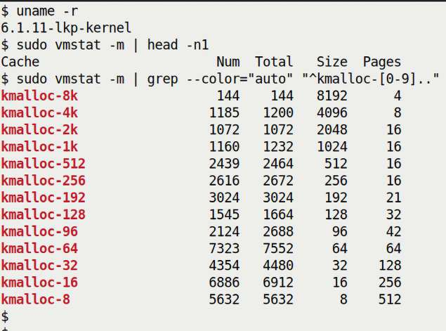

Hình 8.7: Ảnh chụp sudo vmstat -m hiển thị các slab cache kmalloc-n

Điều đó rất thú vị! Kernel có hàng loạt slab cache chuyên dụng cho generic memory `kmalloc` với kích thước khác nhau, trải từ 8.192 byte xuống chỉ 8 byte! Điều này khiến chúng ta nhận ra điều then chốt – với page allocator, nếu yêu cầu chẳng hạn 12 byte memory, cuối cùng nó sẽ cho cả một page (4 KB) – lãng phí quá cao. Ở đây, với slab allocator, allocation request 12 byte cuối cùng thực sự chỉ cấp phát 16 byte (từ cache second-to-last thấy trong Hình 8.7)! Tuyệt vời. Hẳn đã khá rõ tại sao nó hoạt động như vậy: kernel slab allocator dùng cách tiếp cận best-fit. Hơn nữa, nếu yêu cầu một lượng (12 byte) nằm giữa hai slab cache (`kmalloc-8` và `kmalloc-16`), hiển nhiên kernel sẽ chọn cache lớn hơn (vì luôn có thể cấp phát nhiều hơn yêu cầu, không bao giờ ít hơn). Vì vậy, thực tế nó cấp phát một “slab” 16 byte trong khi để chúng ta nghĩ kích thước là 12 byte.

Đồng thời, lưu ý những điều sau:

- Khi gọi `kfree[_sensitive]()`, memory được giải phóng về slab cache thích hợp.

- Kích thước chính xác của các slab cache cho `kmalloc` thay đổi theo architecture. Trên hệ thống Raspberry Pi (CPU ARM, tất nhiên), các cache generic memory `kmalloc-N` trải từ 64 byte đến 8.192 byte.

- Ảnh chụp trên cũng cho một gợi ý. Rất thường xuyên, nhu cầu là những memory fragment small-to-tiny. Ví dụ, trong ảnh chụp trên, cột có nhãn `Num` biểu diễn Số object hiện đang active; số lớn nhất đến từ slab cache `kmalloc` 8 byte và 16 byte (tất nhiên không phải lúc nào cũng như vậy). Mẹo nhanh: dùng utility `slabtop` (cần chạy với tư cách root): các hàng ở phía trên cho thấy những slab cache hiện được dùng thường xuyên.

Tất nhiên Linux tiếp tục phát triển. Từ mainline kernel 5.0, có một loại cache `kmalloc` mới được giới thiệu, gọi là reclaimable cache (định dạng tên là `kmalloc-rcl-N`). Vì thế, thực hiện `grep` như trước trên kernel 5.x trở lên cũng sẽ cho thấy các cache này:

```
$ sudo vmstat -m | grep --color=auto "^kmalloc"
kmalloc-rcl-8k                0      0   8192      4
kmalloc-rcl-4k                0      0   4096      8
kmalloc-rcl-2k                0      0   2048     16
[...]
kmalloc-8k                  144    144   8192      4
kmalloc-4k                 1185   1200   4096      8
kmalloc-2k                 1072   1072   2048     16
[...]
```

Các cache mới `kmalloc-rcl-N` giúp cải thiện hiệu quả bên trong (để reclaim page khi có pressure và làm biện pháp anti-fragmentation). Tuy nhiên, người viết module như bạn không cần bận tâm những chi tiết này. (Có thể xem commit cho công việc này tại đây: `https://github.com/torvalds/linux/commit/1291523f2c1d631fea34102fd241fb54a4e8f7a0`.)

`vmstat -m` về cơ bản là wrapper trên nội dung `/sys/kernel/slab` của kernel (sẽ trình bày thêm sau). Có thể xem chi tiết sâu bên trong slab cache bằng các utility như `slabinfo`, `slabtop`, cũng như utility mạnh mẽ `crash` (trên hệ thống “live”, crash command liên quan là `kmem -s` (hoặc `kmem -S`)).

Được rồi! Đến lúc lại hands-on code để minh họa cách dùng các slab allocator API!

#### Viết kernel module sử dụng slab API cơ bản

Trong đoạn code sau, hãy xem demo kernel module code (tại `ch8/slab1/`). Trong initialization code, chúng ta chỉ thực hiện một vài slab layer allocation (qua các API `kmalloc()` và `kzalloc()`), in một số thông tin và giải phóng buffer trong cleanup code path (tất nhiên có thể truy cập full source code tại GitHub repository của sách). Hãy xem từng bước các phần code liên quan.

Ở đầu code `init` của kernel module này, chúng ta khởi tạo một global pointer (`gkptr`) bằng cách cấp phát 1.024 byte cho nó (C programmer, hãy nhớ: pointer không có memory!) qua slab allocation API `kmalloc()`. Chú ý rằng vì chắc chắn đang chạy trong process context ở đây và do đó “được phép sleep an toàn”, chúng ta dùng flag `GFP_KERNEL` cho parameter thứ hai (nếu muốn tham khảo thêm, phần trước có tên GFP flag – tìm hiểu sâu hơn đã trình bày):

```
// ch8/slab1/slab1.c
#define pr_fmt(fmt) "%s:%s(): " fmt, KBUILD_MODNAME, __func__
[...]
#include <linux/slab.h>
[...]
static char *gkptr;
struct myctx {
    u32 iarr[100];
    u64 uarr[100];
    char uname[128], passwd[16], config[16];
};
static struct myctx *ctx;

static int __init slab1_init(void)
{
    /* 1. Allocate slab memory for 1 KB using the kmalloc() */
    gkptr = kmalloc(1024, GFP_KERNEL);
    if (!gkptr) {
        WARN_ONCE(1, "kmalloc() failed!\n");
        /* As mentioned earlier, there is really no need to print an
         * error msg when a memory alloc fails; the situation "shouldn't"
         * typically occur, and if it does, the kernel will emit a chain
         * of messages in any case. Here, we use the WARN_ONCE()
         * macro pedantically, and as this is a 'learning' program..
         * In practice, simply returning an appropriate -ve errno (-ENOMEM
         * here) is enough. */
        goto out_fail1;
    }
    pr_info("kmalloc() succeeds, (actual KVA) ret value = %px\n", gkptr);

    /* Commit 091cb09 (5.4 kernel) has the print_hex_dump_bytes() perform
     * printing at log level KERN_DEBUG; in effect, it only shows up if
     * -DDEBUG (or you use the dynamic debug facility). So, I've set DEBUG on
in the Makefile */
    print_hex_dump_bytes("gkptr before memset: ", DUMP_PREFIX_OFFSET, gkptr,
32);
    memset(gkptr, 'm', 1024);
    print_hex_dump_bytes(" gkptr after memset: ", DUMP_PREFIX_OFFSET, gkptr,
32);
```

Trong code trên, cũng hãy chú ý chúng ta dùng kernel convenience routine `print_hex_dump_bytes()` làm cách thuận tiện để dump buffer memory theo định dạng human-readable. Signature của nó là:

```
void print_hex_dump_bytes(const char *prefix_str, int prefix_type,
     const void *buf, size_t len);
```

Các parameter như sau: `prefix_str` là string bất kỳ bạn muốn thêm trước mỗi dòng hex dump; `prefix_type` là một trong `DUMP_PREFIX_OFFSET`, `DUMP_PREFIX_ADDRESS` hoặc `DUMP_PREFIX_NONE`; `buf` là source buffer cần hex-dump; và `len` là số byte cần dump. Lưu ý (như trong comment), từ Linux 5.4, nó chỉ xuất `printk` khi symbol `DEBUG` được định nghĩa (hoặc khi dùng tính năng dynamic debug mạnh mẽ của kernel, một chủ đề được trình bày chuyên sâu trong cuốn Linux Kernel Debugging).

Mẹo nhanh: Khi có Git Commit ID (hash) của Linux kernel project (thường là dạng viết tắt, như trong code comment phía trên – 091cb09), bạn có thể dễ dàng tra cứu trên Git-based repo qua lệnh `git blame`. Hoặc, với Linux kernel, bạn có thể đến `https://github.com/torvalds/linux` và tìm trong repo bằng commit ID; nó sẽ cho ra commit tương ứng. (Trong ví dụ này, đây là commit: `https://github.com/torvalds/linux/commit/091cb0994edd20d67521094ac9c6ec9804058d9a`).

Tiếp theo là chiến lược điển hình – một best practice – được nhiều device driver tuân theo: giữ mọi thông tin cần thiết hay “context” trong một data structure duy nhất, thường gọi là driver context structure (hay private structure của driver). Chúng ta mô phỏng bằng cách khai báo một data structure (đơn giản/mẫu) có tên `myctx`, cùng global pointer đến nó tên `ctx` (định nghĩa structure và pointer nằm trong code block trước). Allocation của nó do API `kzalloc()` đáp ứng:

```
   /* 2. Allocate memory for and initialize our 'context' structure */
    ctx = kzalloc(sizeof(struct myctx), GFP_KERNEL);
    if (!ctx)
        goto out_fail2;
    pr_info("context struct alloc'ed and initialized (actual KVA ret = %px)\n",
ctx);
    print_hex_dump_bytes("ctx: ", DUMP_PREFIX_OFFSET, ctx, 32);
    return 0;        /* success */
out_fail2:
    kfree(gkptr);
out_fail1:
    return -ENOMEM;
}
```

Ở đây, chúng ta cấp phát và khởi tạo `ctx` theo kích thước data structure `myctx` qua wrapper API hữu ích `kzalloc()`. Hexdump sau đó sẽ cho thấy (miễn là `DEBUG` được định nghĩa!) nó thực sự được khởi tạo toàn zero (để dễ đọc, chúng ta chỉ “dump” 32 byte đầu).

Hãy chú ý cách xử lý error path bằng `goto`; điều này đã được đề cập vài lần trước trong sách nên chúng ta không lặp lại ở đây. Cuối cùng, trong cleanup code của kernel module, chúng ta gọi `kfree()` cho cả hai buffer, ngăn mọi memory leakage:

```
static void __exit slab1_exit(void)
{
    kfree(ctx);
    kfree(gkptr);
    pr_info("freed slab memory, removed\n");
}
```

Sau đây là ảnh chụp một lần chạy mẫu trên Raspberry Pi 4 của tôi. Tôi dùng convenience script `../../lkm` để build, load module và chạy `dmesg`:

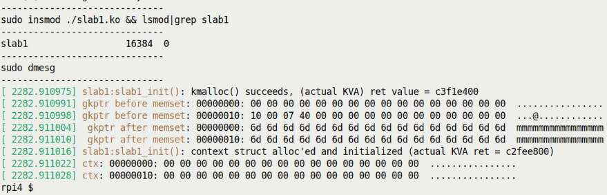

Hình 8.8: Ảnh chụp một phần kernel module slab1.ko đang hoạt động trên Raspberry Pi 4

Được rồi, giờ đã nắm kiến thức cơ bản về cách dùng các slab allocator API phổ biến, `kmalloc()`, `kzalloc()` và `kfree[_sensitive]()`, hãy tiến xa hơn.

Trong phần tiếp theo, chúng ta sẽ đi sâu vào một mối quan tâm thực sự then chốt – thực tế về giới hạn kích thước memory có thể lấy qua slab allocator (và page allocator). Hãy đọc tiếp!

## Giới hạn kích thước của API kmalloc

Một ưu điểm then chốt của cả page allocator lẫn slab allocator là memory chunk được cung cấp khi cấp phát không chỉ virtually contiguous (hiển nhiên) mà còn được bảo đảm physically contiguous. Đây là điều rất đáng kể và chắc chắn hỗ trợ hiệu năng.

Nhưng (lúc nào cũng có chữ nhưng, phải không!), chính vì bảo đảm này, không thể đáp ứng bất kỳ kích thước (memory) lớn nào khi thực hiện allocation. Nói cách khác, phải có giới hạn lượng memory có thể lấy từ slab allocator bằng một lời gọi đến các API `k{m|z}alloc()` thân thuộc. Giới hạn là gì? (Đây thực sự là câu hỏi rất thường gặp).

Trước tiên, bạn nên hiểu về kỹ thuật giới hạn này do hai yếu tố quyết định:

- Một là system page size (do macro `PAGE_SIZE` quyết định).

- Hai là số “order” (do macro `MAX_ORDER` quyết định); nghĩa là số list trong các freelist data structure của page allocator (hay BSA) (xem Hình 8.2).

Với page size tiêu chuẩn 4 KB và giá trị MAX\_ORDER (điển hình) 11, lượng memory tối đa có thể cấp phát bằng một API call `kmalloc()` hoặc `kzalloc()` là 4 MB. Điều này đúng trên cả architecture x86\_64 lẫn ARM (32-bit và 64-bit).

Bạn có thể tự hỏi chính xác giới hạn 4 MB được tính thế nào? Hãy nghĩ xem: một khi slab allocation request vượt kích thước slab cache tối đa kernel cung cấp (thường 8 KB), kernel đơn giản chuyển yêu cầu xuống page allocator. Kích thước tối đa có thể cấp phát của page allocator do `MAX_ORDER` quyết định. Với nó được đặt là `11`, buffer size tối đa có thể cấp phát là 2<sup>(MAX\_ORDER-1)</sup> = 2<sup>10</sup> page = 1024 page = 1024 \* PAGE\_SIZE byte = 1024 \* 4 KB = 4 MB!

### Kiểm thử giới hạn – memory allocation bằng một lời gọi

Một điều then chốt với developer (và mọi người khác cũng vậy) là làm việc dựa trên thực nghiệm! Từ tiếng Anh empirical nghĩa là dựa trên những gì được trải nghiệm hay quan sát, thay vì lý thuyết. Đây là quy tắc quan trọng luôn phải tuân theo – đừng chỉ giả định hoặc tin ngay vào bề ngoài. Hãy tự thử và quan sát.

Hãy làm điều thú vị: viết kernel module cấp phát memory từ các slab cache (generic) (qua API `kmalloc()`). Chúng ta sẽ làm trong một loop, cấp phát – rồi sau đó giải phóng – một lượng (được tính toán) tại mỗi iteration. Điểm then chốt ở đây là tiếp tục tăng lượng cấp phát theo một step size cho trước (thậm chí sẽ biến lượng này thành module parameter).

Loop kết thúc khi `kmalloc()` thất bại; theo cách này, có thể kiểm thử thực sự cấp phát được bao nhiêu memory bằng một lời gọi `kmalloc()` (tất nhiên bạn sẽ nhận ra `kzalloc()`, do là wrapper đơn giản trên `kmalloc()`, gặp chính xác cùng giới hạn).

Trong đoạn code sau, chúng ta trình bày code liên quan. Function `test_maxallocsz()` được gọi từ code `init` của kernel module:

```
// ch8/slab3_maxsize/slab3_maxsize.c
[...]
static int stepsz = 204800;  // 200 Kb
module_param(stepsz, int, 0644);
MODULE_PARM_DESC(stepsz,
"Amount to increase allocation by on each loop iteration (default=200 KB");

static int test_maxallocsz(void)
{
  size_t size2alloc = 0;
  void *p;

  while (1) {
      p = kmalloc(size2alloc, GFP_KERNEL);
      if (!p) {
          pr_alert("kmalloc fail, size2alloc=%zu\n", size2alloc);
   // WARN_ONCE(1, "kmalloc fail, size2alloc=%zu\n", size2alloc);
          return -ENOMEM;
      }
      pr_info("kmalloc(%7zu) = 0x%px\n", size2alloc, p);
      kfree(p);
      size2alloc += stepsz;
  }
  return 0;
}
```

Bạn có chú ý các function `printk` dùng format specifier `%zu` cho variable `size_t` (về cơ bản là unsigned integer) không? `%zu` hỗ trợ portability; nó làm định dạng variable đúng cho cả hệ thống 32-bit lẫn 64-bit!

Hãy chạy kernel module này trên Raspberry Pi 4 device chạy Raspberry Pi OS nguyên bản. Gần như ngay lập tức, khi `insmod`, bạn sẽ thấy error message `Cannot allocate memory` được process `insmod` in ra; ảnh chụp (đã cắt bớt) sau cho thấy điều xảy ra:

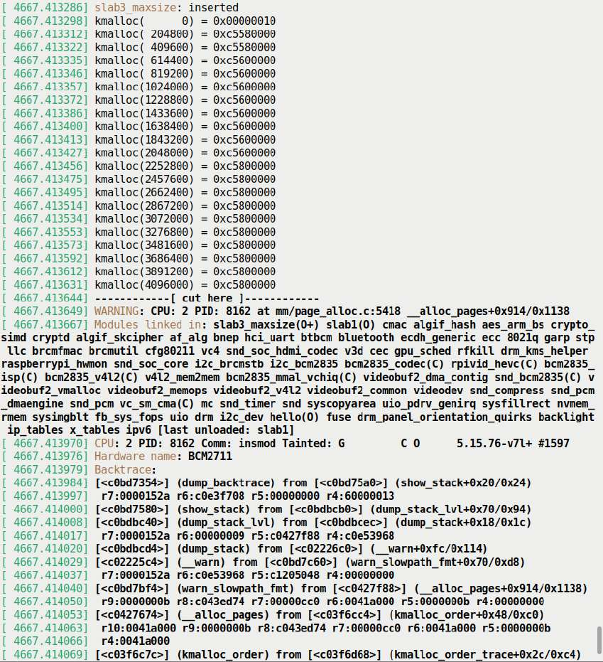

Hình 8.9: Lần insmod đầu tiên của kernel module slab3\_maxsize.ko trên Raspberry Pi 4 chạy kernel nguyên bản

Điều này đúng như mong đợi! Hãy nghĩ xem, xét cho cùng function `init` của kernel module code thực sự đã thất bại (với failure code -`ENOMEM`). Đừng bối rối vì điều này; xem kernel log sẽ thấy những gì đã diễn ra (Hình 8.9).

Thực tế là ở lần chạy kiểm thử đầu tiên của kernel module này, bạn sẽ thấy tại chỗ `kmalloc()` thất bại, kernel dump một số diagnostic information, bao gồm một kernel stack trace khá dài. Điều này do kernel code path gọi macro `WARN()` khi kernel memory allocation thất bại, vì trong trường hợp bình thường điều này đơn giản không nên xảy ra. Nhìn lại phần dưới Hình 8.9; stack trace chứa function `__alloc_pages()`; trong phần Cơ chế hoạt động của page allocator trước đó, chúng ta đã chỉ rõ function này được ghi tài liệu là “trái tim” của zoned buddy allocator! Việc nó xuất hiện ở đây trong stack trace (call trace hay backtrace) cho thấy nó thất bại; do đó thu được kết quả như thấy.

(Có lẽ một điều khiến bạn băn khoăn: tại sao return pointer từ `kmalloc()`, các KVA – như thấy trong Hình 8.8 – thường giống nhau? Dễ thôi: vì chúng ta cấp phát rồi gần như ngay lập tức trả lại (giải phóng) memory chunk, thường khiến nó có sẵn và do đó được tái sử dụng.)

Vậy slab memory allocation hoạt động đến một mức nhất định. Để thấy rõ điểm thất bại, chỉ cần cuộn xuống trong màn hình kernel log (`dmesg`). Ảnh chụp sau cho thấy điều này:

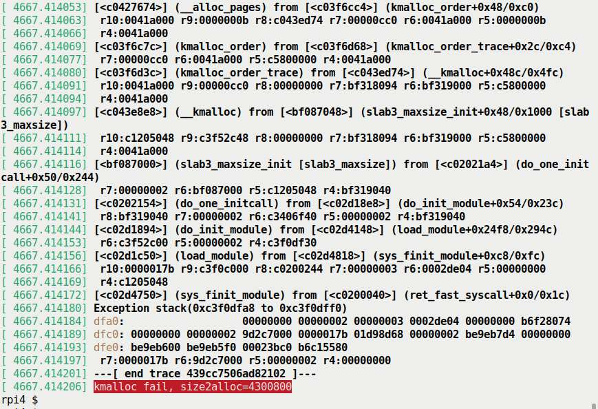

Hình 8.10: Ảnh chụp một phần cho thấy phần dưới output dmesg (của kernel module ch8/slab3\_maxsize. ko) trên Rasperry Pi 4

À, nhìn dòng output cuối (Hình 8.10): `kmalloc()` thất bại khi thử cấp phát trên 4 MB (ở đây tại 4.300.800 byte), chính xác như mong đợi; trước đó đều thành công.

Đồng thời, giờ có thể thấy phần đầu stack backtrace; tất nhiên đọc bottom-up và mọi thứ rất rõ – bạn có thể thực sự thấy `kmalloc()` cuối cùng đi vào `__alloc_pages()`, mà vì thất bại nên dẫn đến diễn biến này.

Một lưu ý thú vị bên lề, chú ý chúng ta đã (rất chủ ý) thực hiện allocation đầu tiên trong loop với size `0`; nó không thất bại (nhưng không có nghĩa bạn sử dụng nó):

`kmalloc(0, GFP_xxx);` trả về zero pointer; trên x86\[\_64\], đó là giá trị `16` hay `0x10` (xem `include/linux/slab.h` để biết chi tiết). Thực chất, đây là virtual address không hợp lệ nằm trong `NULL` pointer trap ở page `0`. Tất nhiên truy cập nó dẫn đến page fault (bắt nguồn từ MMU), một bug.

Tương tự, thử `kfree(NULL);` hoặc `kfree()` trên zero pointer khiến `kfree()` trở thành no-op.

Tuy nhiên chờ đã – có một điểm cực kỳ quan trọng cần lưu ý: trong phần Các slab cache thực tế được dùng cho kmalloc, chúng ta đã thấy slab cache được dùng để cấp phát memory cho caller là các slab cache kmalloc-N, trong đó N trải từ 64 đến 8.192 byte (trên Raspberry Pi, và do đó processor ARM\[64\] trong thảo luận này). Đồng thời, để bạn biết, có thể nhanh chóng thực hiện lệnh sau để xác minh:

```
sudo vmstat -m | grep -v "\-rcl\-" | grep --color=auto "^kmalloc-[0-9]"
```

Nhưng rõ ràng trong kernel module code example trước, chúng ta đã cấp phát lượng memory lớn hơn nhiều qua `kmalloc()` (từ 0 byte qua 8 KB rồi đến tận 4 MB). Bên trong, cách hoạt động thực sự là API `kmalloc()` chỉ dùng các slab cache `kmalloc-N` cho memory allocation nhỏ hơn hoặc bằng 8.192 byte (nếu có sẵn); mọi allocation request cho memory chunk lớn hơn đều được chuyển đến page allocator (hay buddy system allocator) bên dưới (xem Hình 8.1)!

Giờ nhớ lại điều đã học: page allocator dùng các buddy system freelist (cho từng node:zone) và kích thước tối đa của memory chunk được enqueue trên freelist là 2<sup>(MAX\_ORDER-1)</sup> = 2<sup>10</sup> page, với page size 4 KB và `MAX_ORDER` là `11` thì bằng 4 MB. Điều này khớp gọn gàng với các thảo luận lý thuyết.

Vậy là đã rõ: cả lý thuyết lẫn thực hành, giờ bạn có thể thấy (một lần nữa, với page size 4 KB và `MAX_ORDER` là `11`), kích thước memory tối đa có thể cấp phát qua một lời gọi `kmalloc()` hoặc `kzalloc()` là 4 MB.

#### Kiểm tra qua pseudofile /proc/buddyinfo

Điều thực sự quan trọng cần hiểu là dù đã xác định 4 MB RAM là mức tối đa có thể lấy một lần, điều đó chắc chắn không có nghĩa bạn luôn lấy được lượng ấy khi yêu cầu. Không, tất nhiên không; nó hoàn toàn phụ thuộc lượng free memory hiện diện trong freelist cụ thể tại thời điểm yêu cầu memory. Hãy nghĩ xem: nếu bạn chạy trên hệ thống Linux đã hoạt động nhiều ngày (hoặc nhiều tuần) thì sao? Khả năng tìm được free RAM chunk 4 MB physically contiguous khá thấp (một lần nữa, phụ thuộc lượng RAM trên hệ thống và workload).

Theo kinh nghiệm, nếu thí nghiệm trên không cho maximum allocation bằng kích thước tối đa chúng ta xác định (nghĩa là 4 MB), tại sao không thử trên guest system vừa boot? Khi đó khả năng có free RAM chunk 4 MB physically contiguous tốt hơn nhiều.

Bạn chưa chắc về điều này? Hãy lại thực nghiệm và xem nội dung `/proc/buddyinfo` – trên cả hệ thống in-use lẫn vừa boot – để xác định có memory chunk hay không. Trong command-line snippet sau, trên hệ thống Ubuntu x86\_64 native in-use của tôi (đã chạy hơn 7 ngày, có 32 GB RAM), chúng ta tra cứu, tô đậm số lượng free chunk order 10 – nghĩa là các RAM chunk trống 4 MB – trong zone `Normal` (output xuống dòng):

```
$ grep -w "Normal" /proc/buddyinfo
Node 0, zone   Normal  23653   5314   1284    747    233     67     16     17
18      0      0
```

Như đã học trước đây (trong phần Tìm hiểu cách tổ chức page allocator freelist), các số thấy trong code block trên theo thứ tự order `0` đến `MAX_ORDER-1` (thường là 0 đến 11 – 1, tức 0 đến 10), và chúng biểu diễn số nhóm free page frame contiguous gồm 2<sup>order</sup> page frame ở order đó.

Trong output trên, có thể thấy với zone Normal, chúng ta không có free block trên list order `10` (nghĩa là chunk 4 MB; giá trị bằng zero). Trên hệ thống Linux vừa boot, nhiều khả năng sẽ có. Trong output sau, trên cùng hệ thống vừa reboot, chúng ta thấy có 6.571 (!) chunk RAM trống 4 MB physically contiguous có sẵn trong node `0` ở zone Normal:

```
$ grep -w "Normal" /proc/buddyinfo
Node 0, zone   Normal   3859   6778   6131   5025   3810   2274   1130    382
78      9   6571
```

Bạn sẽ nhận ra rằng khi system uptime tăng, khả năng “cắt” các chunk lớn hơn thành phần nhỏ hơn theo nhu cầu cũng tăng... Vì vậy, chúng ta thấy memory có xu hướng chuyển dần từ higher order xuống lower order theo thời gian.

Tất nhiên, còn nhiều điều để khám phá. Trong phần sau, chúng ta trình bày thêm về cách dùng slab allocator – các resource-managed API thay thế, các slab helper API bổ sung có sẵn, và một ghi chú về cgroup cùng memory trong Linux kernel hiện đại.

## Slab allocator – một vài chi tiết bổ sung

Vẫn còn vài điểm then chốt để khám phá. Trước tiên, chúng ta cung cấp một số thông tin về cách dùng các phiên bản resource-managed của memory allocator API trong kernel, tiếp theo là vài slab helper routine bổ sung có sẵn trong kernel, rồi xem ngắn gọn về cgroup và memory. Chúng tôi khuyên bạn cũng đọc những phần này. Hãy đọc tiếp!

### Dùng các resource-managed memory allocation API của kernel

Đặc biệt hữu ích khi làm việc với device driver, kernel cung cấp một vài managed API cho memory allocation. Chúng được gọi chính thức là device resource-managed hay devres API (liên kết tài liệu kernel chính thức về nội dung này là `https://www.kernel.org/doc/html/latest/driver-api/driver-model/devres.html`). Tất cả API này có prefix `devm_`; dù có nhiều API, ở đây chúng ta chỉ tập trung vào một use case phổ biến – dùng các phiên bản resource-managed thay cho memory allocation API thông thường, `k{m|z}alloc()`. Chúng như sau:

```
#include <linux/device.h>
void *devm_kmalloc(struct device *dev, size_t size, gfp_t gfp);
void *devm_kzalloc(struct device *dev, size_t size, gfp_t gfp);
```

Lý do các resource-managed API hữu ích là developer không cần giải phóng tường minh memory do chúng cấp phát. Kernel resource management framework bảo đảm tự động giải phóng memory buffer khi driver detach, hoặc nếu là kernel module, khi module bị loại bỏ (hoặc device detach, tùy điều nào xảy ra trước). Tính năng này lập tức tăng code robustness. Tại sao? Đơn giản, tất cả chúng ta là con người và mắc sai sót. Memory leak (đặc biệt trên error code path) thực sự là bug khá phổ biến!

Một vài điểm liên quan về cách dùng các API này:

- Một điểm then chốt – vui lòng đừng mù quáng thay mọi lần dùng `k{m|z}alloc()` bằng `devm_k{m|z}alloc()` tương ứng! Các resource-managed allocation này được thiết kế để chỉ dùng trong method `init` và/hoặc `probe()` của device driver (mọi driver làm việc với unified device model của kernel thường cung cấp các method `probe()` và `remove()` (hoặc `disconnect()`). Chúng ta sẽ không đi sâu thêm vào những khía cạnh này ở đây).

- `devm_kzalloc()` thường được ưu tiên vì nó cũng khởi tạo buffer. Bên trong (giống `kzalloc()`), nó chỉ là thin wrapper trên API `devm_kmalloc()`.

- Parameter thứ hai và thứ ba là những parameter thông thường như với các API `k{m|z}alloc()` – số byte cần cấp phát và GFP flag cần dùng. Tuy nhiên parameter đầu là pointer đến `struct device`. Khá hiển nhiên, nó biểu diễn device mà driver của bạn đang điều khiển (mọi driver đều có thể truy cập structure này).

- Vì memory do các API này cấp phát được auto-freed (khi driver detach hoặc module bị loại bỏ), bạn không phải làm gì (để giải phóng memory). Tuy nhiên, có thể giải phóng qua API `devm_kfree()`. Dù vậy, việc bạn làm thủ công thường là dấu hiệu cho thấy dùng managed API không phù hợp.

- Licensing: Managed API chỉ được export (và do đó có sẵn) cho module được cấp phép theo GPL.

### Các slab helper API bổ sung

Có nhiều slab allocator helper API, liên quan đến họ API `k{m|z}alloc()`. Bao gồm các API `kcalloc()` và `kmalloc_array()` để cấp phát memory cho array, cũng như `krealloc()`, có hành vi tương tự `realloc()`, user-space API quen thuộc. (Bên trong, `kmalloc_array()` gọi macro `check_mul_overflow()`, thực hiện phép nhân có overflow checking! Hay thật.)

Khi cấp phát memory cho array các phần tử, các kernel helper routine `array_size()` và `struct_size()` có thể rất hữu ích. Đặc biệt, `struct_size()` đã được dùng nhiều để ngăn – và thực sự sửa – nhiều bug integer overflow (IoF và liên quan) khi cấp phát array các structure, một công việc thực sự phổ biến. Là ví dụ nhanh, đây là đoạn code nhỏ từ `net/bluetooth/mgmt.c`:

```
rp = kmalloc(struct_size(rp, addr, i), GFP_KERNEL);
if (!rp) {
     err = -ENOMEM; [...]
```

Để bạn biết, việc xem qua kernel header file `include/linux/overflow.h` rất đáng làm.

(Cũng hãy nhớ API `kfree_sensitive()` đã trình bày.) Các phiên bản resource-managed của những API này cũng có sẵn: `devm_kcalloc()` và `devm_kmalloc_array()`.

### Control group và memory

Linux kernel hỗ trợ một resource management system rất tinh vi tên là cgroup (control group), tóm lược là dùng để tổ chức process theo hierarchy và thực hiện resource management.

Chúng ta sẽ trình bày nhiều hơn về cgroup, với các ví dụ tận dụng cgroups v2 CPU controller, trong Chương 11, The CPU Scheduler – Part 2, tại phần có tên Giới thiệu cgroup. Nếu những đoạn sau ở đây hiện chưa dễ hiểu với bạn, tôi khuyên trước tiên đọc về cgroup (trong chương và phần vừa nói) rồi quay lại đây.

Trong nhiều resource controller thuộc cgroups framework có một controller để kiểm soát memory bandwidth. Bằng cách cấu hình cẩn thận, sysadmin có thể điều tiết hiệu quả việc phân phối memory trên hệ thống. Có thể thực hiện memory protection, cả dạng gọi là hard protection lẫn best-effort protection, qua một số pseudofile `memcg` (memory cgroup) (đặc biệt các file `memory.min` và `memory.low`). Tương tự, trong một cgroup, các pseudofile `memory.high` và `memory.max` là cơ chế chính để kiểm soát mức sử dụng memory của cgroup. Tất nhiên, vì còn nhiều điều hơn những gì đề cập ở đây, tôi đề nghị bạn tham khảo tài liệu kernel về cgroups mới (v2) tại đây: `https://www.kernel.org/doc/html/latest/admin-guide/cgroup-v2.html`.

Được rồi, bây giờ bạn đã học cách sử dụng các slab allocator API tốt hơn, chúng ta hãy tìm hiểu sâu thêm một chút nữa. Thực tế, vẫn còn một vài lưu ý quan trọng về kích thước của các memory chunk được cấp phát bởi slab allocator API. Hãy đọc tiếp để biết những lưu ý đó là gì!

## Những lưu ý khi dùng slab allocator

Chúng ta sẽ chia thảo luận này thành ba phần. Trước tiên re-examine một số kiến thức nền cần thiết (đã trình bày trước), rồi thực sự làm rõ vấn đề đang hướng đến qua hai use case – use case đầu rất đơn giản; use case thứ hai là trường hợp sát real-world hơn của vấn đề đang xét.

### Chi tiết nền tảng và kết luận

Đến đây, bạn đã học vài điểm then chốt:

- Page allocator (hay buddy system allocator) cấp phát page cho caller theo số page là lũy thừa của 2; nói cách khác, granularity của allocation request là một page (thường 4K). Số mũ nâng 2 lên được gọi là order; thường trải từ `0` đến `10` (trên cả x86\[\_64\] lẫn ARM\[\_64\], giả định page size 4K và `MAX_ORDER` bằng 11).

- Điều này ổn, trừ khi không ổn. Khi lượng memory yêu cầu rất nhỏ, hoặc chỉ vượt một ngưỡng nhất định một chút, mức lãng phí (hay internal fragmentation) có thể rất lớn.

- Trong hoạt động day-to-day của OS và các driver, yêu cầu các phần của một page (ít hơn (nhiều) so với 4.096 byte) rất phổ biến. Vì thế, slab allocator được xếp lớp trên page allocator (xem Hình 8.1) được thiết kế với object cache cùng các generic memory cache nhỏ để đáp ứng hiệu quả yêu cầu lượng memory nhỏ.

- Page allocator bảo đảm page physically contiguous và memory hardware cacheline-aligned.

- Slab allocator cũng bảo đảm memory physically contiguous và hardware cacheline-aligned.

Vậy thật tuyệt – điều này dẫn đến kết luận rằng khi lượng memory cần thiết large-ish và là lũy thừa chính xác (hoặc gần) của 2, hãy dùng page allocator. Khi lượng khá nhỏ (ít hơn một page), hãy dùng slab allocator. Quả thực, kernel source code của `kmalloc()` có một comment tóm lược gọn gàng cách nên dùng API `kmalloc()` (được chép lại bằng chữ đậm như sau):

```
// include/linux/slab.h
[...]
 * kmalloc - allocate memory
 * @size: how many bytes of memory are required.
 * @flags: the type of memory to allocate.
 * kmalloc is the normal method of allocating memory
 * for objects smaller than page size in the kernel.
```

Nghe thật tốt, nhưng vẫn còn vấn đề! Để thấy, hãy học cách dùng một slab API hữu ích khác, `ksize()`. Signature của nó như sau:

```
size_t ksize(const void *);
```

Parameter của `ksize()` là pointer đến một slab cache hiện có (phải hợp lệ). Nói cách khác, đó là return address từ một trong các slab allocator API (thường là một trong `[devm_]k{m|z}alloc()`). Return value của `ksize()` là số byte thực sự được cấp phát.

Được rồi, giờ đã biết `ksize()` để làm gì, hãy dùng theo cách thực tế hơn, đầu tiên với use case đơn giản rồi đến use case tốt hơn!

### Kiểm thử slab allocation bằng ksize() – trường hợp 1

Để hiểu điều chúng ta đang hướng đến, hãy xét ví dụ nhỏ. (Để dễ đọc, chúng ta sẽ không trình bày các validity check thiết yếu. Đồng thời, vì đây là code snippet rất nhỏ, chúng tôi không cung cấp nó dưới dạng kernel module trong codebase của sách):

```
struct mysmallctx {
    int tx, rx;
    char passwd[8], config[4];
} *ctx;

pr_info("sizeof struct mysmallctx = %zd bytes\n", sizeof(struct mysmallctx));
ctx = kzalloc(sizeof(struct mysmallctx), GFP_KERNEL);
pr_info("(By now, the context structure is allocated and initialized to
zero)\n"
        "*actual* size allocated = %zu bytes\n", ksize(ctx));
```

Output thu được trên Ubuntu guest system x86\_64 của tôi như sau:

```
$ dmesg
[...]
sizeof struct mysmallctx = 20 bytes
(By now, the context structure is allocated and initialized to zero)
*actual* size allocated = 32 bytes
```

Vậy chúng ta thử cấp phát 20 byte bằng `kzalloc()`, nhưng thực sự nhận 32 byte, gây lãng phí 12 byte, hay 60%! Điều này đúng như mong đợi. Hãy nhớ các slab cache `kmalloc-N` – trên x86, có một cache 16 byte và một cache 32 byte (trong nhiều cache khác). Vì vậy, khi yêu cầu một lượng nằm giữa hai cache, hiển nhiên nhận memory từ cache lớn hơn (các allocator về cơ bản dùng một phiên bản của cách tiếp cận best-fit). (Nhân tiện, để bạn biết, trên hệ thống Raspberry Pi ARM-based, slab cache nhỏ nhất cho `kmalloc` là 64 byte, vì vậy tất nhiên ở đó chúng ta nhận 64 byte khi yêu cầu 20 byte.)

Lưu ý API `ksize()` chỉ hoạt động trên slab memory đã được cấp phát; bạn không thể dùng nó trên return value của bất kỳ page allocator API nào (đã thấy trong phần Học cách sử dụng các page allocator API).

Giờ đến use case thứ hai, thú vị hơn.

### Kiểm thử slab allocation bằng ksize() – trường hợp 2

Được rồi, giờ hãy mở rộng kernel module trước (`ch8/slab3_maxsize`) thành

`ch8/slab4_actualsize`. Ở đây, chúng ta thực hiện cùng loop, cấp phát memory bằng API `kmalloc()` rồi giải phóng như trước, nhưng lần này cũng ghi lại lượng memory thực tế được slab layer cấp cho chúng ta ở mỗi iteration bằng cách gọi API `ksize()`:

```
// ch8/slab4_actualsize/slab4_actualsize.c
static int test_maxallocsz(void)
{
   /* This time, initialize size2alloc to 100, as otherwise we'll get a
     * divide error! */
    size_t size2alloc = 100, actual_alloced;
    void *p;

    pr_info("kmalloc(      n) :  Actual : Wastage : Waste %%\n");
    while (1) {
        p = kmalloc(size2alloc, GFP_KERNEL);
        if (!p) {
          pr_alert("kmalloc fail, size2alloc=%zu\n", size2alloc); // pedantic
          return -ENOMEM;
        }
        actual_alloced = ksize(p);
        /* Print the size2alloc, the amount actually allocated,
         * the delta between the two, and the percentage of waste
         * (integer arithmetic, of course :-)  */
        pr_info("kmalloc(%7zu) : %7zu : %7zu : %3zu%%\n",
            size2alloc, actual_alloced, (actual_alloced - size2alloc),
            (((actual_alloced - size2alloc) * 100) / size2alloc));
        kfree(p);
        size2alloc += stepsz;
    }
    return 0;
}
```

Output của kernel module này thực sự thú vị để xem! Trong hình sau, chúng ta trình bày ảnh chụp một phần output tôi nhận trên Ubuntu 22.04 LTS guest x86\_64 chạy kernel 6.1 custom-built (được load qua convenience script `lkm`):

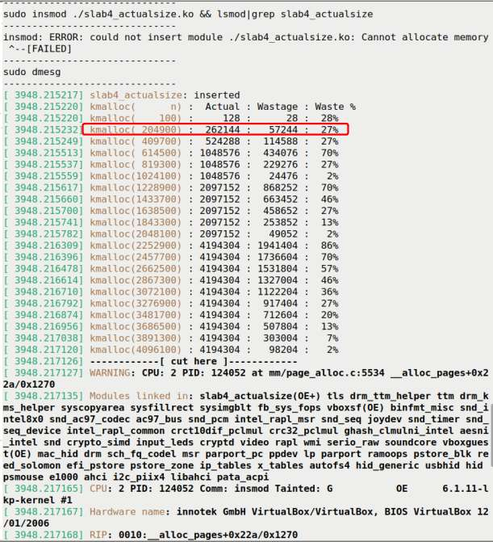

Hình 8.11: Ảnh chụp một phần kernel module ch8/slab4\_actualsize/slab4\_actualsize.ko đang hoạt động

Có thể thấy rõ output `printk` của module ở phần trên và giữa Hình 8.11. Phần còn lại của ảnh chụp là một số diagnostic information từ kernel – được xuất vì kernel-space memory allocation request thất bại. Toàn bộ kernel diagnostic information này là kết quả của lần kernel gọi macro `WARN_ONCE()` đầu tiên, vì page allocator code bên dưới, `mm/page_alloc.c:__alloc_pages()` – vốn được biết là “trái tim” của buddy system allocator – thất bại! Thông thường điều này không bao giờ nên xảy ra, vì vậy có diagnostics (chi tiết kernel diagnostics ngoài phạm vi cuốn sách nên chúng ta để sang một bên. Dù vậy, chúng ta có xem xét kernel stack backtrace ở một mức độ nhất định trong các chương tới. Hơn nữa, những chi tiết như vậy được trình bày chuyên sâu trong cuốn Linux Kernel Debugging).

Nhân tiện, trong module này, chúng ta thậm chí không viết module exit routine (cleanup) vì biết nó sẽ trả về failure ngay trong code path `init`, nên không bao giờ cần `rmmod` nó.

#### Diễn giải output từ trường hợp 2

Nhìn kỹ ảnh chụp trên (Hình 8.11; ở đây chúng ta chỉ bỏ qua kernel diagnostics được macro `WARN_ONCE()` xuất ra, macro được gọi vì kernel-level memory allocation thất bại!). Dù khá self-explanatory, phần then chốt trong output Hình 8.11 có timestamp từ `dmesg` (bỏ qua), tiếp theo là bốn cột như header line cho thấy:

- `kmalloc(n)`: Số byte được `kmalloc()` yêu cầu (trong đó `n` là lượng cần thiết).

- `Actual`: Số byte thực sự được slab allocator cấp phát (cho biết qua `ksize()`).

- `Wastage`: Lượng lãng phí (byte); hiệu giữa số byte thực tế và số byte cần thiết.

- `Waste %`: Lượng lãng phí theo phần trăm.

Ví dụ, trong allocation thứ hai (được đánh dấu bằng hình chữ nhật ở Hình 8.11), chúng ta yêu cầu 204.900 byte nhưng thực sự nhận 262.144 byte (256 KB). Điều này hợp lý vì đây chính xác là kích thước một trong các page allocator list trên buddy system freelist (đó là order 6, vì 2<sup>6</sup> = 64 page = 64 x 4 = 256 KB; xem Hình 8.2). Vì vậy delta, thực ra là lượng lãng phí, bằng 262.144 – 204.900 = 57.244 byte, biểu diễn theo phần trăm là 27%.

Nó hoạt động như sau: kích thước yêu cầu (hay cần thiết) càng gần kích thước có sẵn (hay thực tế) của kernel, lượng lãng phí càng ít; điều ngược lại cũng đúng.

Hãy xem ví dụ khác từ output trên (output đã trích được chép lại dưới đây cho rõ):

```
[ … ]
[ 3948.215700] kmalloc(1638500) : 2097152 :  458652 :  27%
[ 3948.215741] kmalloc(1843300) : 2097152 :  253852 :  13%
[ 3948.215782] kmalloc(2048100) : 2097152 :   49052 :   2%
[ 3948.216309] kmalloc(2252900) : 4194304 : 1941404 :  86%
[ 3948.216396] kmalloc(2457700) : 4194304 : 1736604 :  70%
[ 3948.216478] kmalloc(2662500) : 4194304 : 1531804 :  57%
[ … ]
```

Từ output trên, có thể thấy khi `kmalloc()` yêu cầu 1.638.500 byte (hơn 1,5 MB một chút), nó thực sự nhận 2.097.152 byte (đúng 2 MB), và mức lãng phí là 27%. Sau đó mức lãng phí giảm dần khi tiến gần “ranh giới” hay ngưỡng allocation (kích thước thực tế của slab cache hay page allocator memory chunk của kernel): xuống 13%, rồi chỉ 2%. Nhưng nhìn này: với allocation tiếp theo, khi vượt ngưỡng đó, yêu cầu hơn 2 MB một chút (2.252.900 byte), chúng ta nhận 4 MB, mức lãng phí 86%! Sau đó, mức lãng phí lại giảm khi tiến gần memory size 4 MB...

Điều này quan trọng! Bạn có thể nghĩ mình rất hiệu quả chỉ nhờ dùng slab allocator API, nhưng slab layer gọi page allocator khi lượng memory yêu cầu lớn hơn kích thước tối đa slab layer có thể cung cấp (thường 8 KB, đúng với các thí nghiệm trên). Vì vậy, page allocator, chịu các vấn đề lãng phí thông thường của nó, cuối cùng cấp phát nhiều memory hơn hẳn mức bạn cần, hoặc thực sự sẽ dùng. Thật lãng phí!

Bài học rút ra: kiểm tra và kiểm tra lại code cấp phát memory bằng slab API. Chạy thử nghiệm với `ksize()` để xác định lượng memory thực sự được cấp phát, thay vì lượng bạn nghĩ được cấp phát.

Không có đường tắt. À, có một:

Nếu cần ít hơn một page memory (một use case rất, rất điển hình), chỉ cần dùng slab API.

Nếu cần nhiều hơn 1 page memory, thảo luận trên bắt đầu có ý nghĩa. Một điều nữa: dùng các API `alloc_pages_exact()`/`free_pages_exact()` (đã trình bày trong phần Cặp page allocator API “exact”) cũng sẽ giúp giảm lãng phí (tất nhiên điều này nghĩa là bạn đã quyết định dùng các API đó thay vì slab API; đây không phải trường hợp điển hình).

Tốt hơn nữa, bạn có thể kiểm tra kích thước slab memory được cấp phát thực tế – và chính xác hơn – qua pseudofile `/sys/kernel/slab/<slab-name>/slab_size` (chúng ta sẽ gặp trong chương sau, tại phần Trích xuất thông tin hữu ích về slab cache)

#### Vẽ đồ thị

Một lưu ý thú vị bên lề, chúng ta có thể dùng utility well-known `gnuplot` để vẽ đồ thị từ data thu thập trước đó. Phải sửa kernel module ở mức tối thiểu để chỉ xuất những gì muốn vẽ: lượng memory cần (hay được yêu cầu) cấp phát (trục x) và tỷ lệ phần trăm lãng phí xảy ra ở runtime (trục y). Bạn có thể tìm code của kernel module được sửa nhẹ trong GitHub repository của sách tại đây: `ch8/slab4_actualsz_wstg_plot` (`https://github.com/PacktPublishing/Linux-Kernel-Programming_2E/tree/main/ch8/slab4_actualsz_wstg_plot`).

Chúng ta cũng giảm “step size” xuống 20 KB (từ 200K) để đồ thị chi tiết hơn. Vì vậy, chúng ta build và insert kernel module này, “xử lý” kernel log, lưu data column-wise thích hợp như `gnuplot` yêu cầu (trong file tên `plotdata.txt`). Tin tốt: tất cả việc này, gồm tạo đồ thị (qua `gnuplot`), được tự động hóa bằng helper script `plot_graph.sh`; chỉ cần chạy và xem! (Để hiểu cơ chế hoạt động của utility gnuplot rất hữu ích, tham khảo phần Đọc thêm của chương này.)

Chúng tôi cũng cung cấp một file `Readme` hữu ích trong directory này của GitHub repo để hướng dẫn bạn. Và đây, đồ thị:

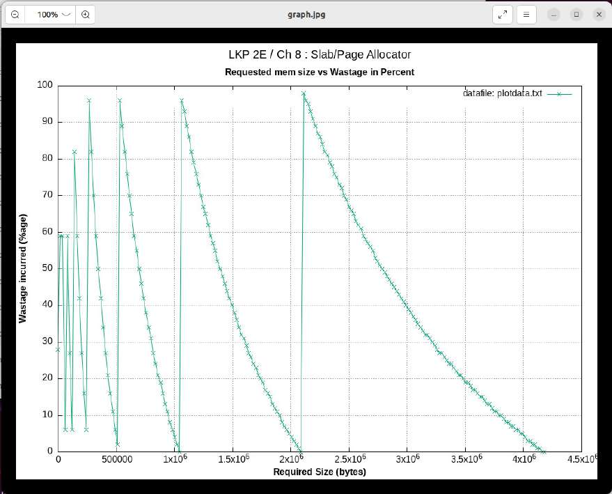

Hình 8.12: Đồ thị được gnuplot tạo cho thấy kích thước kmalloc() yêu cầu (x-axis, byte) so với mức lãng phí phát sinh (y-axis, theo phần trăm)

Đồ thị dạng “saw-tooth” này giúp trực quan hóa điều vừa học. Kích thước allocation request của `kmalloc()` (hoặc `kzalloc()`, hay thực sự bất kỳ page allocator API nào) càng gần một trong các freelist size định sẵn của kernel, lượng lãng phí càng ít. Nhưng ngay khi vượt ngưỡng, mức lãng phí tăng vọt – xuất hiện đỉnh nhọn! – đến gần 100% (như các đường gần như thẳng đứng hoàn hảo trong đồ thị trên cho thấy).

### Tìm internal fragmentation (lãng phí) trong kernel

Phần trước minh họa cách internal fragmentation – lãng phí – có thể xảy ra khi cấp phát memory qua hai slab API giờ đã quen thuộc (cặp `k{m|z}alloc()`). Tuy nhiên, mức lãng phí thấy ở đó tự nhiên có xu hướng lớn hơn khi lượng cần cấp phát vượt xa một page.

Không có nghĩa mức lãng phí không tăng ngay cả với những con số nhỏ hơn – lượng tuyệt đối bị lãng phí ít hơn, dù tỷ lệ phần trăm lãng phí vẫn nhất quán và có thể khá cao khi yêu cầu lượng memory chỉ vượt một “ngưỡng” nhất định một chút (ví dụ điển hình: yêu cầu 63 byte sẽ nhận 64, trong khi yêu cầu 65 byte sẽ nhận 128 (có thể dùng API `ksize()` để xác minh)).

Ở đây, chúng ta quan tâm chính xác bao nhiêu lãng phí phát sinh với memory allocation request kích thước ít hơn một page, những lượng thường được yêu cầu. Chúng ta sẽ cho thấy hai cách định lượng: một cách dễ, cách thứ hai hơi cồng kềnh hơn (được làm dễ hơn bằng custom script) nhưng rất có giá trị. Hãy bắt đầu với cách đầu tiên.

#### Cách dễ với slabinfo

Utility `slabinfo`, đã học cách build trong phần Một vài câu hỏi thường gặp về mức sử dụng (slab) memory và câu trả lời trước đó trong chương, có thể rất hữu ích. Cách dễ để tra cứu wastage hay “loss” là chỉ chạy `slabinfo` (với tư cách root) cùng option switch `–L` (`Sort by loss`; lệnh đầu chỉ dùng để hiển thị help cho option switch `-L`):

```
# sudo slabinfo -h |grep "^-L"
-L|--Loss              Sort by loss
# slabinfo -L | head -n5
Name          Objects  Objsize      Loss Slabs/Part/Cpu  O/S O %Fr %Ef  Flg
dentry          148162     192     14.9M      5297/20/0   28 1   0  65  PaZFU
kmalloc-4k        1153    4096     14.2M       579/4/0     2 3   0  24  PZFU
buffer_head     132952     104     13.4M      6648/4/0    20 0   0  50  PaZFU
lsm_inode_cache 134919      24     13.0M      3988/53/0   34 0   1  19  PZFU
ext4_inode_cache 58224    1184      7.4M       2330/2/0   25 3   0  90  PaZFU
```

Cột then chốt ở đây tất nhiên có nhãn `Loss`; nó chỉ định lượng lãng phí slab cache cụ thể (cột đầu) đã gây ra đến giờ; output cũng được sort theo loss (cao nhất trước). Cột thứ hai và thứ ba lần lượt chỉ định số object trong slab và kích thước mỗi object; do đó tích của chúng là tổng không gian slab cache đó chiếm. Để bạn biết, O/S là viết tắt Objects/Slab, O là order của allocation, hai cột tiếp theo chỉ định lượng free memory và mức sử dụng memory hiệu quả trong cache theo phần trăm, và cột cuối là slab flag (ở đây chúng có giá trị vì tôi truyền lúc boot; khía cạnh này sẽ được trình bày ngay sau đây).

Output `slabinfo –L` có ưu điểm cho thấy loss (lãng phí) do mọi slab cache gây ra (không chỉ các cache `kmalloc-N`), nhưng nhược điểm là chỉ cho thấy tổng lãng phí; hãy đối chiếu với cách tiếp cận sau.

Tốt hơn nữa, bạn có thể kiểm tra kích thước slab memory được cấp phát thực tế – và chính xác hơn – qua pseudofile `/sys/kernel/slab/<slab-name>/slab_size` (chúng ta sẽ gặp trong chương sau, tại phần Trích xuất thông tin hữu ích về slab cache)

#### Thêm chi tiết với alloc\_traces và custom script

Như sẽ được giải thích đầy đủ trong chương sau, kernel đôi lúc có thể rơi vào tình huống khó khăn khi cả primary memory (RAM) lẫn swap đều cạn kiệt; trong hoàn cảnh nghiêm trọng này, kernel không có lựa chọn ngoài gọi OOM killer (đáng sợ?)!

Đây là kernel component thực sự kết thúc thủ phạm chính, process chiếm nhiều memory nhất (nó còn kết thúc cả các descendant! Thật tàn nhẫn...).

Có thể hình dung trên hệ thống memory hạn chế (hãy nghĩ embedded hoặc hệ thống khác), nếu slab cache chịu mức lãng phí (loss) lớn, hoàn toàn có thể OOM killer sẽ được gọi, đôi lúc ngay trong system boot khi kernel đang khởi tạo. Chính tình huống này dẫn đến việc một developer đăng patch (đã được merge gần đây vào kernel 6.1); đây là liên kết commit:

`https://github.com/torvalds/linux/commit/6edf2576a6cc46460c164831517A36064eb8109c`. Patch này thiết lập cách theo dõi toàn bộ wastage của các slab cache `kmalloc-N` (và thông tin khác), và quan trọng là còn cho thấy call stack dẫn đến allocation request! Điều này cho phép thấy chi tiết allocation request, nhờ đó giúp debug các tình huống như vậy...

Điểm cốt lõi liên quan đến thảo luận: một khi bật một số SLUB debug flag, thông tin lãng phí được tích hợp vào một pseudofile mới (tên `alloc_traces`) dưới debugfs tại đây: `/sys/kernel/debug/slab/kmalloc-*`; hãy xem (ở đây giả định `CONFIG_SLUB_DEBUG=y`; thường là vậy):

1\. Reboot máy Linux, và tại bootloader, truyền kernel command-line parameter sau (ngoài những parameter thông thường): `slub_debug=FZPU`.

a. Bạn sẽ tìm thấy danh sách mọi kernel parameter được ghi tài liệu tại đây (rất có giá trị): `https://www.kernel.org/doc/html/latest/admin-guide/kernel-parameters.html`. b. Kernel SLUB layer thường tích hợp đầy đủ công nghệ debug nhưng tắt (disabled) theo mặc định (vì có thể ảnh hưởng hiệu năng). Để bật, có một số SLUB debug flag được cung cấp, truyền qua kernel parameter `slub_debug=<debug-flags>`. Thông tin chi tiết về SLUB debug flag dùng ở đây (`FZPU`) được trình bày trong cuốn Linux Kernel Debugging; chúng ta không lặp lại ở đây. Bạn cũng có thể tra cứu qua tài liệu kernel chính thức: `https://docs.kernel.org/mm/slub.html`.

2\. Khi đã ở root shell, xem các pseudofile theo dõi allocation và free của một slab cache (SLUB) cụ thể; ví dụ hãy xem cho slab cache `kmalloc-64`:

```
# ls /sys/kernel/debug/slab/kmalloc-64/
alloc_traces  free_traces
```

Được rồi, đã thấy, giờ hãy xem nội dung hiện tại của file `alloc_traces`:

```
# cat /sys/kernel/debug/slab/kmalloc-64/alloc_traces
975 populate_error_injection_list+0x8d/0x110 waste=15600/16
age=6363993/6363993/6363994 pid=1 cpus=0
        __kmem_cache_alloc_node+0x279/0x2b0
        kmalloc_trace+0x2a/0xa0
        populate_error_injection_list+0x8d/0x110
        init_error_injection+0x1b/0x75
        do_one_initcall+0x49/0x210
        kernel_init_freeable+0x27b/0x2e8
        kernel_init+0x1b/0x160
        ret_from_fork+0x22/0x30

    403 get_mountpoint+0xab/0x190 waste=9672/24 age=6360787/6361173/6363388
pid=332-1199 cpus=0-1,3-5
        __kmem_cache_alloc_node+0x279/0x2b0
        kmalloc_trace+0x2a/0xa0
        get_mountpoint+0xab/0x190
        lock_mount+0x53/0x100
        path_mount+0x535/0xb80
        __x64_sys_mount+0x10c/0x150
        do_syscall_64+0x5c/0x90
        entry_SYSCALL_64_after_hwframe+0x63/0xcd
[ ... ]
```

Output được sort theo mức lãng phí lớn nhất; hai entry đầu được thấy ở trên. Đây là cách diễn giải (hãy làm với trace đầu tiên):

```
975 populate_error_injection_list+0x8d/0x110 waste=15600/16
age=6363993/6363993/6363994 pid=1 cpus=0
```

Function `populate_error_injection_list()` (tại offset `0x8d` byte vào function, có độ dài `0x110` byte) thực hiện 975 yêu cầu memory, mỗi yêu cầu 64 byte (xét cho cùng đây là cache `kmalloc-64`), lãng phí 16 byte mỗi lần, do đó tổng lãng phí 975 \* 16 = 15.600 byte. Stack trace (đọc bottom-up) cho thấy lịch sử, đường đi đến đây (rất tốt cho debug!).

Hãy tìm hiểu sâu hơn: function nằm ở đây: `lib/error-inject.c:populate_error_injection_list()`; xem code của nó (ver 6.1.25) cho thấy một memory allocation duy nhất qua slab layer tại đây:

```
struct ei_entry *ent;
[…]
ent = kmalloc(sizeof(*ent), GFP_KERNEL);
if (!ent)
           break;
[…]
```

Giờ structure instance đang được cấp phát – `struct ei_entry` – có kích thước 46+2 = 48 byte (trên 64-bit; kiểm tra bằng cách tra cứu, ghi nhớ padding có thể xuất hiện do yêu cầu alignment (ở đây có 2 byte padding)). Vì vậy, mỗi allocation được đáp ứng bởi, đoán xem, slab cache `kmalloc-64` (best-fit), do đó lãng phí đúng 64 - 48 = 16 byte. Điều này có vẻ chấp nhận được, nhưng dường như đã xảy ra (đến giờ) 975 lần, cuối cùng lãng phí 15.600 byte! Ngay cả thế cũng chưa quá tệ nếu memory được giải phóng nhanh; nếu không thì sao? À, khi đó chúng ta gặp vấn đề (bao gồm anh chàng OOM killer trigger-happy) … ít nhất giờ có thể debug hiệu quả!

Bài tập: Diễn giải trace instance thứ hai thấy ở trên.

Hãy đặc biệt lưu ý – wastage tracking chỉ dành cho các slab cache `kmalloc-*` (vì đây là những cache thường được dùng để đáp ứng (slab) memory request).

##### Chạy script để xem SLUB wastage hay loss

Để giảm công sức tra cứu pseudofile `/sys/kernel/debug/slab/kmalloc-*/alloc_traces`, tôi viết nhanh một custom script (`ch8/wastage_kmalloc_slabs.sh`); nó chỉ hiển thị dòng đầu (không phải stack trace) của các allocation instance có lãng phí, sort theo lãng phí cao nhất trước, cho mọi cache `kmalloc-*` (về cơ bản nó lặp qua output của lệnh: `grep -r -H -w waste /sys/kernel/debug/slab/kmalloc-[1-9]*/alloc_traces`). Không chỉ vậy, nó tách slab allocation do các routine kernel (nội bộ) và kernel module thực hiện. Để output human-readable, nó chỉ hiển thị mười bên “lãng phí” hàng đầu; các output “report” chứa đầy đủ chi tiết được chỉ ra. Hãy đọc code và thử.

Lưu ý: Để thử script này, bạn phải chạy kernel 6.1 gần đây (hoặc mới hơn) và boot hệ thống với `slub_debug=FZPU` được truyền trên kernel command line.

Đây là một lần chạy mẫu (để thay đổi, lần này trên hệ thống Fedora 39 x86\_64 native của tôi chạy kernel 6.6 gần đây; tôi đã cắt bớt một phần bên phải để có ảnh chụp dễ đọc):

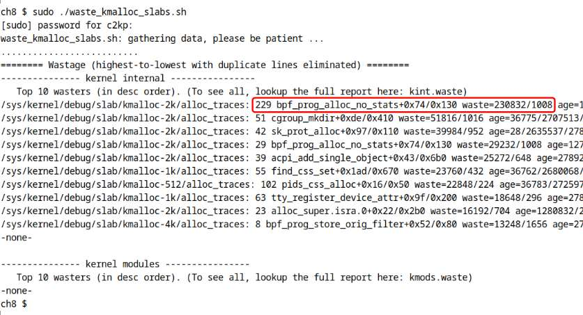

Hình 8.13: Ảnh chụp một phần cho thấy script ch8/wastage\_kmalloc\_slabs.sh đang thực thi; tập trung vào phần waste=total/each của output được làm nổi bật

Script (một wrapper trên pseudofile `alloc_traces` của kernel gần đây) về cơ bản lặp qua mỗi slab `kmalloc-N` và chỉ hiển thị allocation có lượng lãng phí dương (cùng lượng lãng phí chính xác phát sinh); tuy nhiên có thể mất một lúc… Trong lần chạy cụ thể này, không có memory wastage do module.

Cách diễn giải vẫn như cũ; đồng thời module có thể xuất hiện (với tên trong ngoặc vuông). `waste=x/y` là phần quan trọng; `x` là tổng số byte lãng phí, `y` là số byte lãng phí mỗi lần; chúng ta sort output từ `x` cao nhất xuống thấp nhất, nghĩa là tổng số byte lãng phí.

Vì vậy script này cung cấp cách nhanh để phát hiện kernel code hay module code có đang lãng phí kernel memory quý giá hay không!

(Bạn có chú ý các field “`age=…`” không? Chúng ta sẽ trình bày ý nghĩa trong chương sau, vì vậy hãy chú ý).

Vậy, đến đây chúng ta đã trình bày lượng nội dung đáng kể. Phần tiếp theo nêu rất ngắn gọn ưu và nhược điểm của SLUB layer.

### Slab layer - ưu và nhược điểm

Được rồi, giờ hãy tóm lược ưu và nhược điểm của slab allocator (SLUB) trong một bảng:

| Slab allocator: ưu điểm | Slab allocator: nhược điểm |
|---|---|
| Nhanh – dùng identity-mapped RAM của kernel (được lấy và map lúc boot); page nằm trong vùng lowmem nên đã pre-mapped; không cần thiết lập page table (giống page allocator/BSA). | Có giới hạn trên về lượng có thể cấp phát bằng một API call; thực tế, giả định MAX\_ORDER=11 và page size 4K, đó là 4 MB. |
| Bảo đảm memory chunk physically contiguous và CPU cacheline-aligned. | Bảo mật: theo mặc định, freed memory không được xóa, có thể dẫn đến các tình huống info-leakage. Có thể build kernel với `CONFIG_PAGE_POISONING` hoặc dùng `kfree_sensitive()` (có thể ảnh hưởng nhẹ đến hiệu năng). |
| Khả năng cấp phát các phần của một page (thường từ nhỏ đến 8 byte (trên x86) đến 8K). | Phải kiểm tra cẩn thận allocation (bằng `ksize()` hoặc slab tool hay `alloc_traces`) để bảo đảm không có quá nhiều lãng phí. |

Bảng 8.3: Tóm lược ưu và nhược điểm của slab allocator (k{m\|z}alloc() / k\[z\]free())

Chúng ta kết thúc bằng việc đề cập nhanh các internal implementation khác nhau của slab allocator.

### Slab layer – đôi lời về các implementation trong kernel

Chúng ta kết thúc phần này và chương này bằng vài lời ngắn về các slab layer implementation thực tế (đúng, có nhiều implementation) trong kernel. Hãy xem!

Có ít nhất ba kernel-level implementation khác nhau, loại trừ lẫn nhau, của slab allocator; chỉ một implementation có thể được dùng ở runtime. Implementation sẽ dùng ở runtime được chọn vào thời điểm cấu hình kernel (bạn đã học chi tiết quy trình này trong Chương 2, Building the 6.x Linux Kernel from Source – Part 1). Các kernel configuration option liên quan như sau:

- `CONFIG_SLAB`

- `CONFIG_SLUB`

- `CONFIG_SLOB` Implementation đầu (`SLAB`) là phiên bản ban đầu, well-supported nhưng under-optimized. Implementation thứ hai, `SLUB`, còn gọi là Unqueued Allocator, là cải tiến lớn so với implementation đầu về hiệu quả memory, hiệu năng và diagnostics tốt hơn, và được chọn theo mặc định. Allocator `SLOB` (còn gọi là Simple Allocator) là một sự đơn giản hóa mạnh và, theo kernel config help, “không hoạt động hiệu quả trên hệ thống lớn”. Tài liệu kernel chính thức có một trang hữu ích về SLUB tại đây: Short users guide for SLUB (`https://www.kernel.org/doc/html/latest/mm/slub.html`; phần lớn nội dung ở đây liên quan đến diễn giải và phân tích output `slabinfo`, điều tôi trình bày tương đối chi tiết trong cuốn Linux Kernel Debugging).

## Tổng kết

Trong chương này, bạn đã học – ở mức chi tiết khá tốt – cách cả page allocator (hay buddy system allocator) lẫn slab allocator hoạt động. Hãy nhớ “engine” thực sự của việc cấp phát (và giải phóng) RAM trong kernel cuối cùng là page allocator (hay buddy system allocator), với slab allocator được xếp lớp phía trên để cung cấp tối ưu cho các allocation request điển hình có less-than-a-page-in-size, và để cấp phát hiệu quả nhiều kernel data structure (“object”) well-known.

Bạn đã học cách dùng hiệu quả các API do cả page allocator lẫn slab allocator cung cấp, với nhiều demo kernel module hỗ trợ minh họa theo hướng hands-on. Khá nhiều sự tập trung được dành (hoàn toàn đúng đắn) cho vấn đề thực tế khi developer đưa ra (slab) memory request với một số N byte nhất định, nhưng bạn đã học rằng điều này có thể rất sub-optimal, khi kernel thực sự cấp phát nhiều hơn hẳn (mức lãng phí có thể lên rất gần 100%)! Giờ bạn biết cách kiểm tra và giảm thiểu các trường hợp này. Làm tốt lắm!

Chương sau trình bày thêm các allocation strategy tối ưu, cũng như một số chủ đề nâng cao hơn về kernel memory allocation, gồm tạo custom slab cache, dùng các allocation interface `vmalloc` của kernel, tìm hiểu OOM killer và nhiều nội dung khác. Vì vậy, trước hết hãy bảo đảm đã hiểu nội dung chương này và thực hành với kernel module cùng bài tập (như sau). Sau đó, hãy chuyển sang chương tiếp theo!

## Câu hỏi

Để kết thúc, đây là danh sách câu hỏi giúp bạn kiểm tra kiến thức về nội dung chương này: `https://github.com/PacktPublishing/Linux-Kernel-Programming_2E/blob/main/questions/ch8_qs_assignments.txt`. Bạn sẽ tìm thấy câu trả lời cho một số câu hỏi trong GitHub repo của sách: `https://github.com/PacktPublishing/Linux-Kernel-Programming_2E/tree/master/solutions_to_assgn`.

## Đọc thêm

Để giúp bạn tìm hiểu sâu hơn về chủ đề với tài liệu hữu ích, chúng tôi cung cấp danh sách khá chi tiết các tài liệu tham khảo và liên kết trực tuyến (và đôi lúc cả sách) trong tài liệu Đọc thêm ở GitHub repository của sách. Tài liệu Đọc thêm có tại đây: `https://github.com/PacktPublishing/Linux-Kernel-Programming_2E/blob/master/Further_Reading.md`.

## Hãy để lại đánh giá!

Bạn đang thích cuốn sách này? Hãy giúp những độc giả như bạn bằng cách để lại đánh giá trên Amazon. Quét QR code bên dưới để nhận discount code 20%.


\*Ưu đãi có giới hạn
