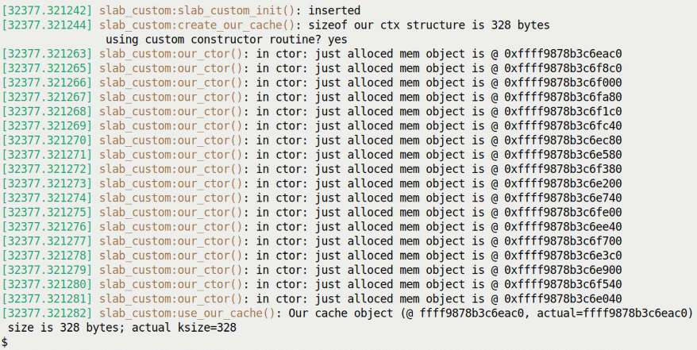
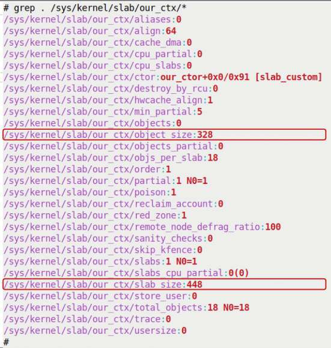
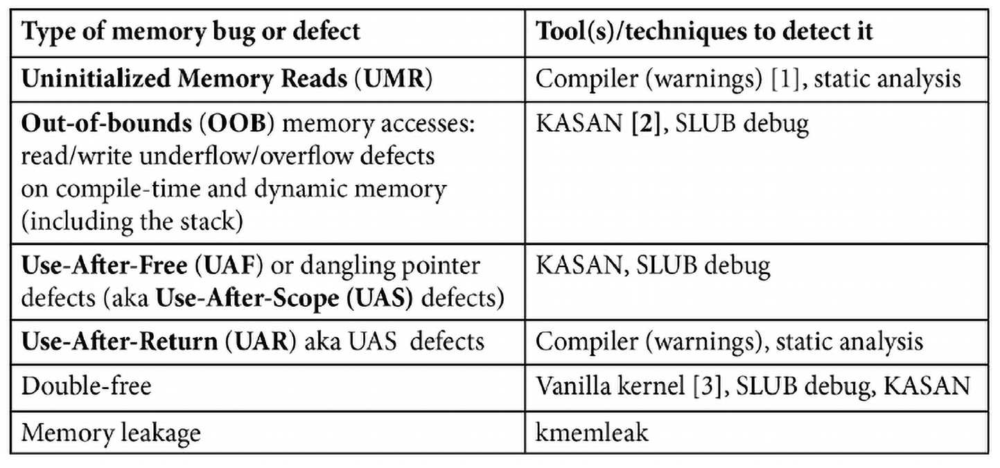
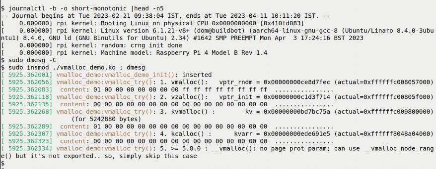
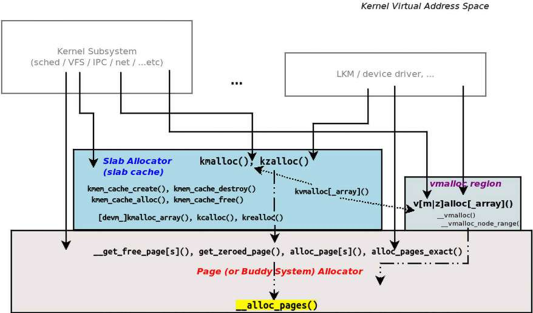
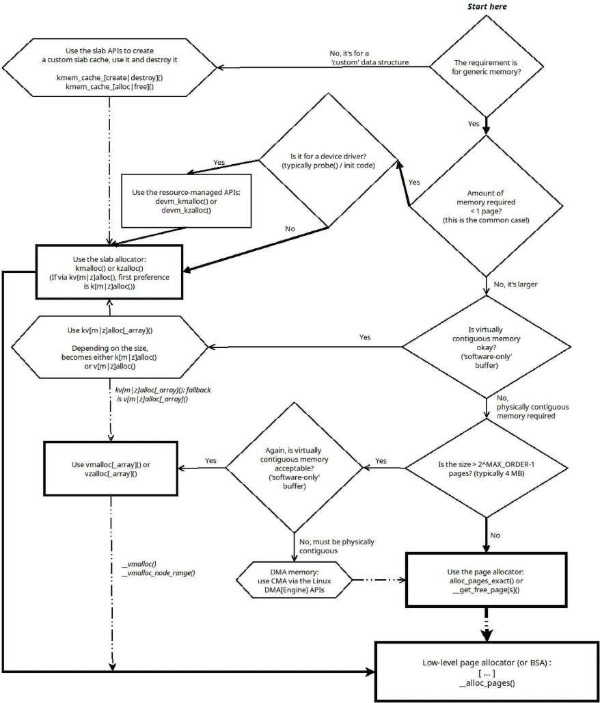
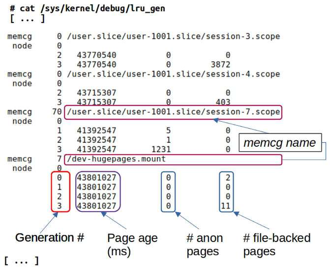
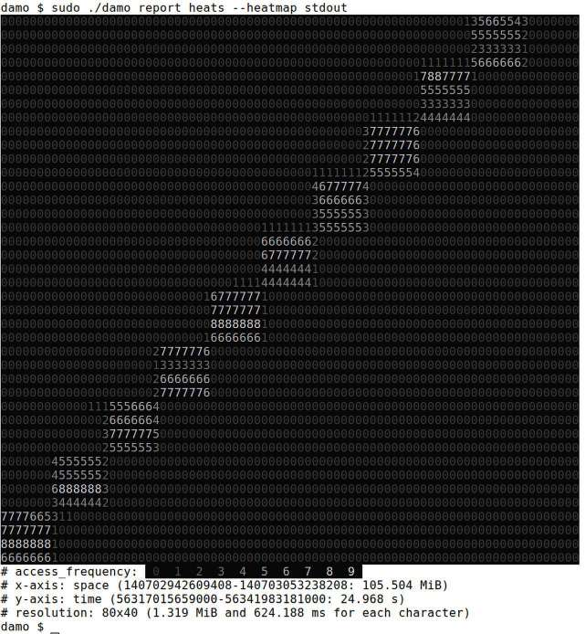
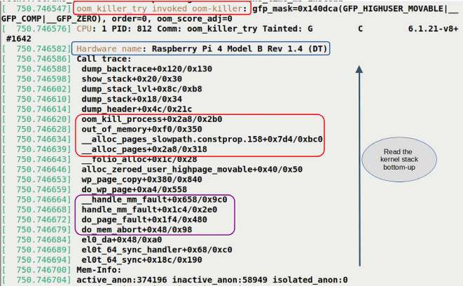
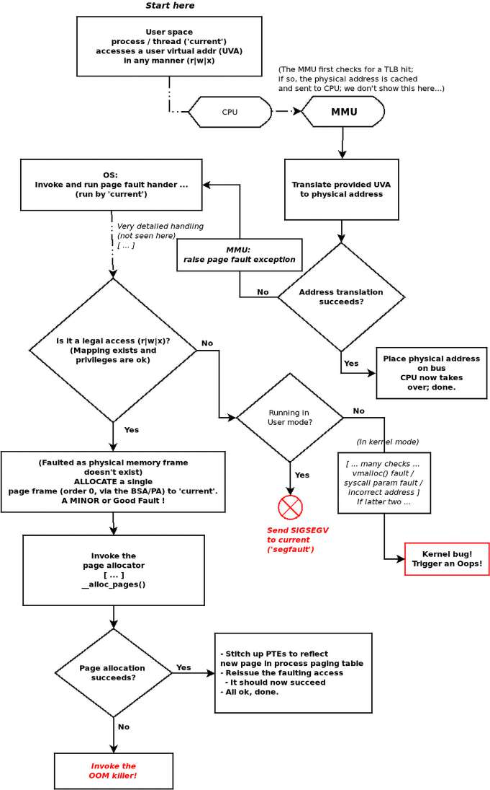

# Chương 9. Kernel Memory Allocation dành cho người viết module – Phần 2

Chương trước đã trình bày kiến thức cơ bản (và nhiều hơn nữa!) về cách dùng các API có sẵn để memory allocation qua cả page allocator (PA) hay Buddy System Allocator (BSA) lẫn slab allocator trong kernel. Trong chương này, chúng ta sẽ tìm hiểu sâu hơn chủ đề rộng lớn và thú vị này. Chúng ta sẽ trình bày việc tạo custom slab cache, các interface `vmalloc` và, rất quan trọng khi có nhiều lựa chọn, dùng API nào trong tình huống nào. Sau đó, chúng ta sẽ đi sâu vào một số chi tiết kernel internals then chốt về memory reclamation, Out of Memory (OOM) killer đáng sợ và demand paging.

Đây thường là những nội dung quan trọng cần hiểu khi làm việc với kernel module, đặc biệt device driver. Một project hệ thống Linux đột ngột crash chỉ với message `Killed` trên console hẳn cần được giải thích, đúng không!? OOM killer có lẽ là anh chàng “dễ mến” đứng sau chuyện này...

Tóm lược, trong chương này, các nội dung chính được trình bày là:

- Tạo custom slab cache

- Debug các vấn đề kernel memory – đề cập nhanh

- Tìm hiểu và sử dụng kernel API vmalloc()

- Memory allocation trong kernel – khi nào dùng API nào

- Memory reclaim – một nhiệm vụ housekeeping then chốt của kernel

- Stayin’ alive – OOM killer

## Yêu cầu kỹ thuật

Tôi giả định bạn đã đọc chương trực tuyến Kernel Workspace Setup, đã chuẩn bị phù hợp một guest VM (hoặc hệ thống native) chạy Ubuntu 22.04 LTS (hoặc bản phát hành ổn định mới hơn) và đã cài đặt mọi package cần thiết. Nếu chưa, tôi đặc biệt khuyên bạn thực hiện việc này trước.

Ngoài ra, phần cuối chương này chủ ý chạy một app memory-intensive, nhiều đến mức kernel sẽ có hành động quyết liệt (kết thúc một số process)! Tôi đặc biệt khuyên bạn thử những việc như vậy trên một hệ thống an toàn, cô lập, ưu tiên Linux test VM (không có data quan trọng).

Để tận dụng tối đa cuốn sách, tôi đặc biệt khuyên bạn trước tiên thiết lập môi trường workspace, bao gồm clone GitHub repository của sách để lấy code, rồi hands-on trên đó. Có thể tìm GitHub repository tại `https://github.com/PacktPublishing/Linux-Kernel-Programming_2E`.

## Tạo custom slab cache

Như đã giải thích chi tiết trong chương trước, một khái niệm thiết kế then chốt đằng sau slab cache là ý tưởng mạnh mẽ về object caching. Bằng cách cache các object dùng thường xuyên – thực ra là data structure – công việc cấp phát/giải phóng memory cho những object đó nhanh hơn nhiều, do đó hiệu năng tổng thể được cải thiện.

Vậy hãy nghĩ xem: nếu đang viết driver và nhận thấy trong đó một data structure (object) nhất định được cấp phát rồi giải phóng rất thường xuyên thì sao? Thông thường, chúng ta dùng `kzalloc()` (hoặc `kmalloc()`) quen thuộc rồi đến API `kfree()` để cấp phát và giải phóng object này. Một tin tốt: Linux kernel cung cấp đủ slab layer API cho chúng ta, người viết module/driver, để tạo custom slab cache. Trong phần này, bạn sẽ học cách tận dụng tính năng mạnh mẽ này.

### Tạo và sử dụng custom slab cache trong kernel module

Trong phần này, chúng ta sẽ tạo, sử dụng rồi hủy một custom slab cache. Ở mức tổng quát, chúng ta thực hiện ba bước sau:

1\. Tạo custom slab cache có kích thước cho trước bằng API `kmem_cache_create()`. Việc này thường là một phần init code path của kernel module (hoặc trong probe method của driver). 2. Sử dụng slab cache. Ở đây chúng ta làm như sau:

  - Gọi API `kmem_cache_alloc()` để cấp phát một instance của custom object trong slab cache của bạn.

  - Sử dụng object.

  - Giải phóng nó về custom cache bằng API `kmem_cache_free()`.

3\. Hủy custom slab cache khi hoàn tất bằng `kmem_cache_destroy()`. Việc này thường là một phần cleanup code path của kernel module (hoặc trong remove/detach/disconnect method của driver).

Hãy khám phá từng API này chi tiết hơn một chút. Chúng ta bắt đầu với việc tạo custom cache (slab).

#### Bước 1 – tạo custom slab cache

Trước tiên, tất nhiên, hãy học cách tạo custom slab cache. Signature của kernel API `kmem_cache_create()` như sau:

```
#include <linux/slab.h>
struct kmem_cache *kmem_cache_create(const char *name,
       unsigned int size, unsigned int align, slab_flags_t flags,
       void (*ctor)(void *));
```

Parameter đầu là tên cache, như sẽ được `proc` hiển thị (và do đó các wrapper utility khác trên `proc`, như `vmstat`, `slabtop`, v.v.). Nó thường trùng tên data structure hay object được cache (nhưng không bắt buộc).

Parameter thứ hai, `size`, là parameter then chốt ở đây – đó là kích thước theo byte của mỗi object trong cache mới. Dựa trên object size này (dùng thuật toán best-fit), slab layer của kernel xây dựng một cache các object. Kích thước thực tế của mỗi object trong cache có thể lớn hơn (một chút) so với yêu cầu vì ba lý do:

- Luôn có thể cung cấp nhiều hơn, nhưng không bao giờ ít hơn, kích thước memory được yêu cầu.

- Cần một ít không gian cho metadata (thông tin housekeeping).

- Kernel có giới hạn trong khả năng cung cấp cache với kích thước chính xác cần thiết. Nó dùng memory có kích thước khớp gần nhất có thể (bằng hoặc lớn hơn) từ các slab cache có sẵn (hãy nhớ điều đã học trong Chương 8, Kernel Memory Allocation for Module Authors – Part 1, tại phần Những lưu ý khi dùng slab allocator, nơi chúng ta thấy rõ có thể dùng nhiều memory hơn (đôi khi rất nhiều!)).

Hãy nhớ từ Chương 8, Kernel Memory Allocation for Module Authors – Part 1, có thể dùng API `ksize()` để truy vấn kích thước thực tế của object được cấp phát. Có một API khác để truy vấn kích thước các object riêng lẻ trong slab cache mới: `unsigned` `int kmem_cache_size(struct kmem_cache *s)`; bạn sẽ sớm thấy cách dùng.

Parameter thứ ba, `align`, là alignment cần thiết cho các object trong cache. Nếu không quan trọng, chỉ cần truyền `0`. Tuy nhiên khá thường xuyên có những yêu cầu alignment rất cụ thể, ví dụ để bảo đảm object được align theo kích thước một word trên máy (32 hoặc 64 bit). Để làm vậy, truyền giá trị `sizeof(long)` (đơn vị của parameter này là byte, không phải bit).

Parameter thứ tư, `flags`, có thể là `0` (nghĩa là không có hành vi đặc biệt) hoặc kết quả bitwise-OR các flag value sau. Để rõ ràng, chúng ta chép lại trực tiếp thông tin về các flag sau từ comment trong source file `mm/slab_common.c`:

```
// mm/slab_common.c
[...]
 * The flags are
 *
 * %SLAB_POISON - Poison the slab with a known test pattern (a5a5a5a5)
 * to catch references to uninitialized memory.
 *
 * %SLAB_RED_ZONE - Insert `Red` zones around the allocated memory to
 * check for buffer overruns.
 *
 * %SLAB_HWCACHE_ALIGN - Align the objects in this cache to a hardware
 * cache line. This can be beneficial if you're counting cycles as
 * closely as davem.
[...]
```

Hãy xem nhanh các flag này:

- Flag đầu tiên, `SLAB_POISON`, cung cấp slab “poisoning”, nghĩa là khởi tạo cache memory thành một giá trị biết trước (`0xa5a5a5a5`). Điều này có thể hữu ích khi debug (khi xem raw memory để biết chuyện gì xảy ra và memory pattern này dễ gây chú ý).

- Flag thứ hai, `SLAB_RED_ZONE`, khá thú vị, chèn red zone (tương tự guard page) quanh buffer được cấp phát. Đây là cách phổ biến để kiểm tra các lỗi OOB (Out Of Bounds) hoặc buffer overflow/underflow vốn đáng tiếc là khá thường gặp. Nó gần như luôn được dùng trong debug context (thường trong quá trình phát triển/kiểm thử).

- Flag thứ ba có thể dùng, `SLAB_HWCACHE_ALIGN`, được dùng phổ biến và khuyên dùng vì hiệu năng. Nó bảo đảm mọi cache object được align theo hardware (CPU) cache line size. Việc dùng flag này chính là lý do memory được cấp phát qua các API phổ biến `k{m|z}` `alloc()` được align theo hardware (CPU) cache line. (Chúng ta trình bày một số chi tiết về các khái niệm CPU caching trong Chương 13, Kernel Synchronization – Part 2.)

Cuối cùng, parameter thứ năm của `kmem_cache_create()` cũng rất thú vị: một function pointer, `void` `(*ctor)(void *);`. Nó được mô hình hóa như constructor function (như trong object orientation và ngôn ngữ OOP). Nó thuận tiện cho phép khởi tạo slab object được cấp phát từ custom slab cache ngay lúc được cấp phát! Một ví dụ về tính năng này hoạt động trong kernel là code của Linux Security Module (LSM) tên `integrity` (tại đây `security/integrity/iint.c:integrity_iintcache_init()`); nó gọi như sau:

```
iint_cache = kmem_cache_create("iint_cache", sizeof(struct integrity_iint_
cache), 0, SLAB_PANIC, init_once);
```

Function `init_once()` – constructor – khởi tạo cached object instance (vừa được cấp phát). Constructor function được gọi bất cứ khi nào cache này cấp phát page mới.

Dù có vẻ counter-intuitive, thực tế Linux kernel hiện đại khá object-oriented xét về thiết kế. Tất nhiên code chủ yếu là C thuần truyền thống, một ngôn ngữ procedural. Tuy vậy, rất nhiều architecture implementation trong kernel (driver model là một ví dụ lớn) khá object-oriented trong thiết kế: method dispatch qua virtual function pointer table, design pattern so-called “strategy”, v.v. Xem bài viết two-part trên LWN mô tả điều này tương đối chi tiết tại đây: Object-oriented design patterns in the kernel, part 1, tháng 6 năm 2011 (`https://lwn.net/Articles/444910/`).

Return value của API `kmem_cache_create()` là pointer đến custom slab cache mới tạo khi thành công, và `NULL` khi thất bại. Pointer này thường được giữ global vì bạn cần truy cập nó để thực sự cấp phát object từ cache (bước tiếp theo).

Điều quan trọng cần hiểu là API `kmem_cache_create()` chỉ có thể được gọi từ process context. Khá nhiều kernel code (gồm nhiều driver) tạo và dùng custom slab cache riêng. Ví dụ trong Linux kernel 6.1 có hơn 430 lần gọi API này.

Được rồi, giờ đã có custom cache (slab), chính xác dùng nó để cấp phát memory object như thế nào? Hãy đọc tiếp; phần sau trình bày chính điều này.

#### Bước 2 – sử dụng memory của custom slab cache

Vậy chúng ta đã tạo custom slab cache; bên trong, kernel sẽ pre-allocated nhiều object thuộc custom structure của bạn trong đó, sẵn sàng để dùng! Để dùng, bạn phải gọi API `kmem_cache_alloc()`. Nhiệm vụ của nó là với pointer đến slab cache cho trước, trả về một instance của object trên slab cache đó (thực ra đây chính là cách các API `k{m|z}alloc()` hoạt động bên trong!). Signature như sau (tất nhiên hãy nhớ luôn include header `<linux/slab.h>` cho mọi slab-based API):

```
void *kmem_cache_alloc(struct kmem_cache *s, gfp_t gfpflags);
```

Hãy xem hai parameter của nó:

- Parameter đầu của `kmem_cache_alloc()` là pointer đến cache (custom) đã tạo ở bước trước (pointer là return value từ API `kmem_cache_create()`).

- Parameter thứ hai là các GFP flag thông thường cần truyền (nhớ quy tắc thiết yếu cho người viết driver/module: dùng `GFP_KERNEL` cho process-context allocation thông thường khi được phép sleep an toàn, nếu không thì dùng `GFP_ATOMIC` khi ở bất kỳ atomic context nào).

Như các API `k{m|z}alloc()` now-familiar, return value là pointer đến memory chunk mới cấp phát – một kernel virtual address.

Hãy dùng memory object mới cấp phát, và khi xong đừng quên giải phóng bằng:

```
void kmem_cache_free(struct kmem_cache *s, void *x);
```

Ở đây, lưu ý những điều sau về API `kmem_cache_free()`:

- Parameter đầu của `kmem_cache_free()` một lần nữa là pointer đến slab cache (custom) đã tạo ở bước trước (return value từ `kmem_cache_create()`).

- Parameter thứ hai là pointer đến memory object muốn giải phóng – object instance vừa được cấp phát/cung cấp qua `kmem_cache_alloc()` – để trả nó về cache được parameter đầu chỉ định!

Tương tự các API `k[z]free()`, không có return value.

#### Bước 3 – hủy custom cache

Khi hoàn toàn xong (thường trong cleanup code path hay exit code path của kernel module, hoặc method `remove` của driver), bạn phải hủy custom slab cache đã tạo trước đó bằng API sau:

```
void kmem_cache_destroy(struct kmem_cache *);
```

Tất nhiên parameter là pointer đến cache (custom) đã tạo ở bước đầu (return value từ API `kmem_cache_create()`).

Giờ đã hiểu quy trình và các API liên quan, hãy hands-on với kernel module tự tạo custom slab cache, sử dụng rồi hủy nó.

### Custom slab – một demo kernel module

Đến lúc thực hành code! Hãy xem minh họa đơn giản dùng các API trên để tạo custom slab cache của riêng mình. Như thường lệ, ở đây chỉ trình bày code snippet liên quan. Tôi khuyến khích bạn clone GitHub repository của sách, đọc full code và tự thử! Có thể tìm code cho file này trong `ch9/slab_custom/slab_custom.c`.

Hãy bắt đầu:

```
// ch9/slab_custom/slab_custom.c
#define OURCACHENAME   "our_ctx"
/* Our 'demo' structure, one that (we imagine) is often allocated and freed;
 * hence, we create a custom slab cache to hold pre-allocated 'instances'
 * of it... Size of one structure instance: 328 bytes.
 */
struct myctx {
    u32 iarr[10];       // 40 bytes; total=40
    u64 uarr[10];       // 80 bytes; total=120
    s8 uname[128], passwd[16], config[64];  // 128+16+64=208 bytes;
                                            // total=328
};
static struct kmem_cache *gctx_cachep;
```

Trong code trên, chúng ta khai báo pointer (global) (`gctx_cachep`) đến custom slab cache to-be-created – sẽ chứa object; cụ thể là data structure giả định often-allocated-and-freed, `myctx`.

Trong phần sau, hãy xem code tạo custom slab cache:

```
static int create_our_cache(void)
{
    int ret = 0;
    void *ctor_fn = NULL;

    if (use_ctor == 1)
        ctor_fn = our_ctor;
    pr_info("sizeof our ctx structure is %zu bytes\n"
            " using custom constructor routine? %s\n",
            sizeof(struct myctx), use_ctor==1?"yes":"no");

  /* Create a new slab cache:
   * kmem_cache_create(const char *name, unsigned int size, unsigned int
      align, slab_flags_t flags, void (*ctor)(void *));
   * When our constructor's enabled (the default), this call will trigger it.
*/
    gctx_cachep = kmem_cache_create(OURCACHENAME, // name of our cache
          sizeof(struct myctx), // (min) size of each object
          sizeof(long),               // alignment
          SLAB_POISON |        /* use slab poison values (explained soon) */
          SLAB_RED_ZONE |   /* good for catching buffer under|over-flow bugs */
          SLAB_HWCACHE_ALIGN, /* good for performance */
          ctor_fn);                      // ctor: here, on by default

  if (!gctx_cachep) {
        [...]
        if (IS_ERR(gctx_cachep))
            ret = PTR_ERR(gctx_cachep);
  }
  return ret;
}
```

Này, thú vị đấy: chú ý API tạo cache của chúng ta cung cấp một constructor function để hỗ trợ khởi tạo object mới cấp phát; đây là function đó:

```
/* The parameter to the constructor is the pointer to the just-allocated memory
* 'object' from our custom slab cache. Here, in our 'constructor' routine,
* we initialize the just-allocated memory object.
*/
static void our_ctor(void *new)
{
    struct myctx *ctx = new;
    struct task_struct *p = current;

    /* TIPS:
     * 1. To see how exactly we got here, insert this call: dump_stack(); (read
its output bottom-up ignoring call frames that begin with '?')
     * 2. Count the number of times the below printk's emitted; its, in effect,
the number of objects cached by the kernel within this slab cache. */
    pr_info("in ctor: just alloced mem object is @ 0x%px\n", ctx);  /* %pK in
production */
    memset(ctx, 0, sizeof(struct myctx));

    /* As a demo, we init the 'config' field of our structure to some
     * (arbitrary) 'accounting' values from our task_struct
     */
    snprintf_lkp(ctx->config, 6 * sizeof(u64) + 5, "%d.%d,%ld.%ld,%ld,%ld",
         p->tgid, p->pid, p->nvcsw, p->nivcsw, p->min_flt, p->maj_flt);
}
```

Các comment trong code trên đã self-explanatory; hãy đọc chúng. Constructor routine, nếu được thiết lập (tùy giá trị module parameter `use_ctor`; mặc định là `1`), sẽ được kernel auto-invoked bất cứ khi nào một memory object mới được cấp phát cho cache của chúng ta. (Đồng thời, vì dùng wrapper an toàn hơn `snprintf_lkp()`, được định nghĩa trong library file `klib.c`, chúng ta cho Makefile link cả file `klib.o`.)

Tiếp theo, trong init code path, chúng ta gọi function `use_our_cache()`. Nó cấp phát một instance của object `myctx` qua API `kmem_cache_alloc()`, và nếu custom constructor routine được bật, routine chạy để khởi tạo object. Sau đó dump memory của object để cho thấy nó thực sự được khởi tạo như code, rồi giải phóng khi xong (cho gọn, chúng ta không trình bày error code path):

```
    obj = kmem_cache_alloc(gctx_cachep, GFP_KERNEL);
    pr_info("Our cache object size is %u bytes; ksize=%lu\n",
            kmem_cache_size(gctx_cachep), ksize(obj));
    print_hex_dump_bytes("obj: ", DUMP_PREFIX_OFFSET, obj, sizeof(struct
myctx));
    kmem_cache_free(gctx_cachep, obj);
```

Cuối cùng, trong exit code path, chúng ta hủy custom slab cache:

```
kmem_cache_destroy(gctx_cachep);
```

Output sau từ một lần chạy mẫu giúp hiểu cách hoạt động. Hình 9.1 là ảnh chụp một phần cho thấy output trên Ubuntu 22.04 LTS guest x86\_64 chạy custom Linux kernel 6.1:



Hình 9.1: Một số output từ kernel module slab\_custom trên x86\_64 VM

Tốt! Tuy nhiên chờ đã, có một vài điểm then chốt cần lưu ý ở đây:

- Vì constructor routine được bật theo mặc định (giá trị module parameter `use_ctor` là `1`), nó chạy bất cứ khi nào kernel slab layer cấp phát object instance mới cho cache mới của chúng ta. Ở đây chỉ thực hiện một `kmem_cache_alloc()`, nhưng constructor routine chạy 18 lần, nghĩa là slab code của kernel (pre)allocate 18 object cho cache brand-new! Tất nhiên con số này có thể thay đổi.

- Như thấy trong ảnh chụp trên, kích thước mỗi object dường như là 328 byte, khớp kích thước structure thực tế (như ba API sau cho biết: `sizeof()`, `kmem_cache_size()` và `ksize()`). Tuy nhiên, một lần nữa, điều này không đúng! Kích thước thực tế của object do kernel cấp phát lớn hơn; có thể thấy qua `vmstat`:

```
$ sudo vmstat -m | head -n1
Cache                       Num  Total  Size  Pages
$ sudo vmstat -m | grep our_ctx
our_ctx                       0     18    448     18
```

Như được làm nổi bật trong output block trên, kích thước thực tế mỗi object được cấp phát không phải 328 byte mà là 448 byte (vì vậy lãng phí 120 byte mỗi object được cấp phát, gần 27%!). Đúng như đã thấy trước, đây là điều quan trọng cần nhận ra, và thực sự kiểm tra.

Để bạn biết, luôn có thể xem man page của `vmstat(8)` để biết ý nghĩa chính xác từng cột.

Được rồi, giờ hãy chuyển sang xem cách trích xuất một số chi tiết bên trong slab cache.

#### Trích xuất thông tin hữu ích về slab cache

Tiếp tục thảo luận từ phần trước, nếu API `ksize()` trả về kích thước object được cấp phát cùng con số (ở đây 328) với operator `sizeof()`, thì chính xác làm sao xác định thực sự có lãng phí? Dùng `vmstat` là một cách dễ, thông qua slab statistics do kernel duy trì.

Trong pseudo filesystem sysfs, tại directory `/sys/kernel/slab`, sẽ có một directory (pseudo) cho mỗi slab cache hiện trên hệ thống! Xem nội dung sẽ cho biết những chi tiết nội bộ hữu ích về cache đang xét (cần root access). Ví dụ, khi kernel module `slab_custom` trước đó đã được insert vào kernel, chạy lệnh này (với tư cách root):

```
# grep . /sys/kernel/slab/our_ctx/*
```

Hãy nhớ chúng ta đặt tên custom slab cache là `our_ctx`.

Mẹo: Với các file (pseudo) có một giá trị duy nhất bên trong (rất phổ biến ở sysfs), để thấy filename kèm nội dung hiện tại, có thể tận dụng kiểu lệnh `grep` này (như ngay bên dưới): `grep . <path/to/files>/*`.

Dùng `grep` theo cách này là cách hiệu quả để nhanh chóng xem giá trị mỗi file (pseudo) trong directory; sau đây là ảnh chụp output tôi nhận khi thực hiện:



Hình 9.2: Ảnh chụp cho thấy cách nhanh chóng trích xuất thông tin hữu ích từ bất kỳ kernel slab cache hiện có nào (các giá trị liên quan được làm nổi bật)

Hãy nghiên cứu Hình 9.2; chúng ta có mọi chi tiết liên quan về slab cache! Để “phóng to” các giá trị cụ thể cần quan tâm, chỉ cần làm như sau:

```
# grep . /sys/kernel/slab/our_ctx/* | grep -E "object_size|slab_size"
/sys/kernel/slab/our_ctx/object_size:328
/sys/kernel/slab/our_ctx/slab_size:448
```

Vậy với tên slab cache cho trước, việc viết script nhỏ để trích xuất (“grok”) các giá trị này rồi tính lượng lãng phí là bài tập tôi dành cho bạn, độc giả thân mến! Chúng ta sẽ hoàn tất thảo luận về tạo và dùng custom slab cache bằng cách tìm hiểu slab shrinker interface.

### Tìm hiểu slab shrinker

Cache tốt cho hiệu năng. Hãy hình dung đọc nội dung file lớn từ disk so với đọc nội dung từ RAM. Không nghi ngờ gì, RAM-based I/O nhanh hơn nhiều! Như có thể hình dung, Linux kernel tận dụng những ý tưởng này và do đó duy trì nhiều cache – page cache, dentry cache, inode cache, slab cache, v.v. Các cache thực sự hỗ trợ hiệu năng rất nhiều, nhưng hãy nghĩ xem; chúng không phải yêu cầu bắt buộc.

Vì vậy, khi memory pressure đạt mức cao (nghĩa là quá nhiều memory đang được dùng và quá ít còn trống), Linux kernel có cơ chế thông minh để giải phóng cache; đây là một phần của memory reclamation – một quá trình diễn ra liên tục. Kernel thread (thường có tên `kswapd*`) reclaim memory như một phần nhiệm vụ housekeeping (nói thêm trong các phần Memory reclaim – một nhiệm vụ housekeeping then chốt của kernel và Stayin’ alive – OOM killer).

Với slab cache, thực tế một số kernel subsystem và driver tạo custom slab cache riêng, như đã trình bày trước trong chương. Để tích hợp tốt và phối hợp với kernel, best practice yêu cầu custom slab cache code đăng ký một shrinker interface. Khi thực hiện điều này, và khi memory pressure đủ cao, kernel hoàn toàn có thể gọi nhiều slab shrinker callback, vốn được mong đợi giảm memory pressure bằng cách giải phóng (thu nhỏ) slab object.

API để đăng ký shrinker function với kernel là `register_shrinker()`; đây là signature:

```
int register_shrinker(struct shrinker *shrinker, const char *fmt, …);
```

Parameter đầu là pointer đến structure `shrinker`. Structure này chứa (cùng các housekeeping member khác) function pointer đến hai callback routine:

- Routine đầu, `count_objects()`, chỉ đếm và trả về số object sẽ được giải phóng (khi thực sự được gọi). Nếu trả về `0`, nghĩa là hiện chưa xác định được số memory object có thể giải phóng, hoặc thậm chí không nên thử giải phóng object nào ngay lúc này. Đồng thời, nó trả về `SHRINK_EMPTY` nếu ngay từ đầu không có object để giải phóng.

- Routine thứ hai, scan\_objects(), chỉ được gọi nếu callback routine đầu trả về giá trị non-zero (ngoài SHRINK\_EMPTY). Đây là routine khi được gọi sẽ thực sự giải phóng, hay thu nhỏ, slab cache đang xét. Nó trả về số object thực sự được giải phóng trong reclaim cycle này, hoặc SHRINK\_STOP nếu reclaim attempt không thể tiến triển (do có thể deadlock).

Để bạn biết, API `register_shrinker()` được cập nhật gần đây trong kernel 6.0 để thêm một string định danh tên theo printf-format-style (commit e33c267: `https://github.com/torvalds/linux/commit/e33c267ab70de4249d22d7eab1cc7d68a889bac2`). Hơn nữa, nếu `CONFIG_SHRINKER_DEBUG` được bật (đặt thành `y`), nội dung `/sys/kernel/debug/shrinker` hiển thị mọi slab shrinker đã đăng ký. Chỉ một vài component trong kernel 6.1 dường như đang dùng shrinker interface; ví dụ, code trong `drivers/md/dm-bufio.c` (một cách thực hiện cached I/O trên device) đăng ký shrinker interface, rồi khi callback `scan_objects` được gọi, nó dùng workqueue function (`drivers/md/dm-bufio.c:shrink_work()`) để thử evict buffer theo yêu cầu.

Giờ chúng ta kết thúc thảo luận về slab layer bằng bản tóm lược nhanh ưu và nhược điểm của việc dùng lớp này cho cấp phát và giải phóng memory. Đây là điều rất quan trọng với bạn, người viết kernel/driver, và cần đặc biệt lưu tâm!

### Tóm lược ưu và nhược điểm của slab allocator

Trong phần này, chúng ta sẽ tóm lược rất ngắn những điều bạn đã học đến giờ. Mục đích là giúp nhanh chóng tra cứu và nhớ lại các điểm then chốt này!

Ưu điểm khi dùng các API slab allocator (hay slab cache) để cấp phát và giải phóng kernel memory như sau:

- (Rất) nhanh (vì dùng các memory object đã pre-cached).

- Bảo đảm cấp phát physically contiguous memory chunk.

- Bảo đảm hardware (CPU) cacheline-aligned memory khi chỉ định flag `SLAB_HWCACHE_ALIGN` lúc tạo cache. Đây là trường hợp với `kmalloc()`, `kzalloc()`, v.v.

- Có thể tạo custom slab cache riêng cho object (được cấp phát/giải phóng thường xuyên).

Nhược điểm khi dùng các API slab allocator (hay slab cache) như sau:

- Chỉ cấp phát được lượng memory giới hạn mỗi lần; thường chỉ 8 KB trực tiếp qua slab interface, hoặc đến 4 MB gián tiếp qua page allocator trên phần lớn nền tảng hiện tại (giới hạn trên chính xác phụ thuộc architecture và system page size; đây là các giá trị cho cả nền tảng x86\[\_64\] lẫn ARM với page size 4.096 byte và giá trị `MAX_ORDER` bằng 11).

- Dùng các API `k{m|z}alloc()` sai: yêu cầu quá nhiều memory, hoặc yêu cầu memory size chỉ vượt một threshold value một chút (đã thảo luận chi tiết trong Chương 8, Kernel Memory Allocation for Module Authors – Part 1, dưới phần Giới hạn kích thước của API kmalloc), chắc chắn có thể dẫn đến internal fragmentation (lãng phí). Thực sự nó được thiết kế để chỉ tối ưu cho các trường hợp phổ biến – allocation kích thước ít hơn một page.

Giờ hãy chuyển sang – chỉ đề cập – một khía cạnh then chốt khác mà kernel/driver developer cần hiểu: debug hiệu quả khi có vấn đề về cấp phát/giải phóng memory, đặc biệt trong slab layer.

## Debug các vấn đề kernel memory – đề cập nhanh

Memory corruption đáng tiếc là root cause rất phổ biến của bug, và khả năng debug chúng là kỹ năng then chốt. Tuy nhiên, đáng tiếc (và xin lỗi), chúng tôi không trình bày kernel memory debugging trong sách này vì hai lý do chính:

1\. Đây không phải sách về kernel debugging. 2. Các chủ đề kernel debugging đã được trình bày chuyên sâu trong cuốn Linux Kernel Debugging (LKD) gần đây của tôi (cập nhật đến kernel 5.10 LTS), bao gồm trọn hai chương rất chi tiết về debug các vấn đề kernel memory.

Dù vậy, trong sách này, tôi xem việc ít nhất đề cập các công cụ và cách tiếp cận thường dùng khi debug kernel memory issue là trách nhiệm của mình. Bạn nên làm quen các dynamic (runtime) analysis framework/tool mạnh mẽ được đề cập ở đây:

- Bộ công cụ Sanitizer:

  - KASAN (Kernel Address Sanitizer): Có sẵn cho x86\_64 và AArch64, từ các kernel 4.x trở đi

  - KMSAN (Kernel Memory Sanitizer): Công cụ tương đương trong kernel của user-space MSAN (Memory Sanitizer), có thể bắt bug UMR (Uninitialized Memory Reads) nguy hiểm (mới gần đây, từ 6.1 trở đi)

  - UBSAN (Undefined Behavior Sanitizer): Bắt nhiều loại UB liên quan arithmetic và memory-related, bao gồm bug UMR (từ 4.5 trở đi)

- Các kỹ thuật SLUB debug:

  - Dựa vào `CONFIG_SLUB_DEBUG=y` và truyền nhiều flag lúc boot cho kernel để bật các loại SLUB memory debug khác nhau (các flag gồm `F:sanity checks``,` `Z:red` `zoning``,` `P:poisoning``,` `U:user tracking`, v.v.… Để bạn biết, chúng ta đã dùng SLUB debugging cùng các flag một chút trong Chương 8, Kernel Memory Allocation for Module Authors – Part 1, tại phần Thêm chi tiết với alloc\_traces và custom script).

  - Học cách dùng utility mạnh mẽ slabinfo.

- kmemleak (để bắt memory leak, dù KASAN có vẻ tốt hơn).

- Có thể dùng eBPF tool `memleak[-bpfcc]` để theo dõi kernel-level allocation chưa được giải phóng. Nó mạnh mẽ – thậm chí cho thấy lượng memory được cấp phát cùng call trace dẫn đến allocation! (Hãy thử: `sudo memleak-bpfcc -s 5`). Tuy vậy, hiện nó chưa hoàn toàn ổn định, thuộc trường hợp Your Mileage May Vary (YMMV)...

- KFENCE: Cách tiếp cận thống kê để bắt memory bug; phải chạy lâu nhưng overhead đủ thấp để thậm chí chạy trong production! (Thực tế, nếu được hỗ trợ trên architecture đang compile cho và SLAB hoặc SLUB được bật, nó thường được bật theo mặc định).

- kmemcheck (tuy nhiên lưu ý kmemcheck đã bị loại bỏ trong Linux 4.15).

Còn nữa (trích nguyên văn từ sách LKD):

Bạn có thể gián tiếp bắt kernel memory bug bằng:

- Static analysis tool: checkpatch.pl, sparse, smatch, Coccinelle, cppcheck, flawfinder và GCC

- Các kỹ thuật tracing

- K\[ret\]probes instrumentation

- Công cụ Post-mortem analysis (log, Oops analysis, kdump/crash và \[K\]GDB)

Được rồi. Tôi sẽ tóm lược thông tin này cùng các chi tiết cụ thể về công cụ có thể dùng trong bảng sau.



Bảng 9.1: Tóm lược các công cụ (và kỹ thuật) có thể dùng để phát hiện kernel memory issue

Sau đây là vài ghi chú tương ứng các số trong ngoặc vuông ở cột thứ hai:

- \[1\]: Compiler GCC/Clang hiện đại chắc chắn xuất warning cho UMR, những compiler gần đây thậm chí auto-initialize được local variable (nếu được cấu hình như vậy).

- \[2\]: KASAN bắt được (gần như!) mọi defect OOB/UAF/UAS/double-free/leakage – tuyệt vời! Cách tiếp cận SLUB debug có thể bắt một vài loại, nhưng không phải tất cả. Vanilla kernel dường như không bắt loại nào.

- \[3\]: Với vanilla kernel, ý tôi là defect này được bắt trên distro kernel thông thường (không đặt config đặc biệt cho memory checking).

(Dù có nguy cơ over-selling, tôi khuyến khích bạn cũng đọc cuốn Linux Kernel Debugging). Được rồi, giờ hãy chuyển sang học một vùng kernel memory quan trọng khác, vùng vmalloc và allocation API `vmalloc()` (cùng các API liên quan).

## Tìm hiểu và sử dụng kernel API vmalloc()

Như đã học trong chương trước, xét cho cùng chỉ có một engine cho memory allocation trong kernel – page allocator (hay buddy system allocator). Xếp lớp phía trên là cơ chế slab allocator (hay slab cache). Ngoài hai lớp này, còn một address space hoàn toàn virtual khác trong virtual address space của kernel, từ đó có thể cấp phát virtual page theo ý muốn – gọi là vùng kernel vmalloc.

Trong kernel segment hay VAS là vmalloc address space, còn gọi là vùng vmalloc, trải từ `VMALLOC_START` đến `VMALLOC_END-1` (địa chỉ chính xác và không gian có sẵn arch-dependant; nhân tiện, chúng ta đã trình bày tất cả điều này tương đối chi tiết trong Chương 7, Memory Management Internals – Essentials, dưới phần Xem xét kernel segment). Ban đầu nó là vùng hoàn toàn virtual, nghĩa là các virtual page ban đầu không map đến bất kỳ physical page frame nào.

Để ôn nhanh, hãy re-examining sơ đồ user segment và kernel segment – thực chất là VAS đầy đủ – bằng cách xem lại, chẳng hạn, Hình 7.12. Bạn sẽ tìm thấy trong Chương 7, Memory Management Internals – Essentials, dưới phần Xem xét kernel VAS.

Trong sách này, mục đích không phải đi sâu vào các chi tiết nội bộ phức tạp về vùng vmalloc của kernel. Thay vào đó, chúng ta trình bày đủ thông tin để bạn, người viết module hoặc driver, dùng vùng này nhằm cấp phát loại memory này ở runtime.

### Học cách sử dụng họ API vmalloc

Bạn có thể cấp phát virtual memory (tất nhiên trong kernel space) từ vùng vmalloc của kernel – có thể xem nó như một “pool” global gồm các virtual memory page có thể cấp phát trong kernel – bằng API `vmalloc()`:

```
#include <linux/vmalloc.h>
void *vmalloc(unsigned long size);
```

Một vài điểm then chốt cần lưu ý về vmalloc:

- API `vmalloc()` cấp phát contiguous virtual memory cho caller. Không có bảo đảm vùng được cấp phát là physically contiguous; có thể có hoặc không (allocation càng lớn, khả năng physically contiguous càng thấp).

- Nội dung các virtual page được cấp phát về lý thuyết là ngẫu nhiên; trong thực tế dường như arch-dependent (ít nhất x86\_64 có vẻ zero hóa vùng memory); tất nhiên (chấp nhận nguy cơ giảm nhẹ hiệu năng), bạn được khuyên bảo đảm zero hóa memory bằng wrapper API `vzalloc()` (signature giống hệt `vmalloc()`).

- API `vmalloc()` (và liên quan) chỉ được gọi từ process context safe-to-sleep (hay non-atomic) (vì có thể khiến caller sleep; do đó gọi trong process context nhưng đang giữ spinlock là vi phạm quy tắc này; đừng làm vậy).

- Return value của `v{m|z}alloc()` là kernel virtual address (KVA) (trong vùng vmalloc của kernel) khi thành công, hoặc `NULL` khi thất bại; dù ít khả năng thất bại, nhiệm vụ của developer tốt là kiểm tra failure case.

- Điểm bắt đầu vùng vmalloc memory vừa cấp phát được bảo đảm nằm trên page boundary (nói cách khác, allocation luôn page-aligned). Điều này cho biết: các API `v{m|z}` `alloc()` được dùng cho memory allocation large-ish, khi chấp nhận được việc vùng cấp phát có thể không physically contiguous.

- Memory thực tế được cấp phát (từ page allocator) hoàn toàn có thể lớn hơn yêu cầu (vì một lần nữa, bên trong nó cấp phát đủ page để bao phủ kích thước yêu cầu).

Bạn sẽ nhận thấy API này có vẻ rất giống user-space `malloc()` quen thuộc. Quả thực thoạt nhìn là vậy, ngoại trừ tất nhiên đây là kernel-space allocation (và một lần nữa, như với họ `kmalloc()`, hãy nhớ không có tương quan trực tiếp giữa user allocation API và kernel allocation API).

Vậy `vmalloc()` hữu ích như thế nào với chúng ta, người viết module hoặc driver? Khi cần một buffer lớn, virtually contiguous với kích thước lớn hơn mức slab API (nghĩa là `k{m|z}alloc()` và liên quan) có thể cung cấp – nhớ thường là 4 MB trong một allocation trên cả ARM lẫn x86\[\_64\] – thì nên dùng `vmalloc()`!

Để bạn biết, kernel dùng `vmalloc()` vì nhiều lý do. Một số như sau:

- Cấp phát không gian cho memory (static) của kernel module khi được load vào kernel (sâu trong `kernel/module/main.c:load_module()`).

- Nếu `CONFIG_VMAP_STACK` được định nghĩa (hiện nay thường là vậy), `vmalloc()` được dùng để cấp phát kernel-mode stack cho mỗi thread khi sinh ra (trong `kernel/fork.c:alloc_thread_stack_node()`).

- Bên trong, khi phục vụ thao tác gọi là `ioremap()` (và liên quan).

- Trong các code path Linux socket filter (bpf), v.v.

Để thuận tiện, kernel cung cấp wrapper API `vzalloc()` (tương tự `kzalloc()`) để cấp phát và zero hóa vùng memory – không nghi ngờ là thực hành viết code tốt, nhưng có thể ảnh hưởng nhẹ các time-critical code path:

```
void *vzalloc(unsigned long size);
```

Khi dùng xong virtual buffer được cấp phát, tất nhiên phải giải phóng:

```
void vfree(const void *addr);
```

Như mong đợi, parameter của `vfree()` là return address từ `v{m|z}alloc()` (hoặc thậm chí API bên dưới `__vmalloc()` mà chúng gọi). Truyền `NULL` cho `vfree()` khiến nó chỉ return vô hại.

### Thử nghiệm vmalloc()

Trong đoạn code sau, chúng ta trình bày sample code từ kernel module `ch9/vmalloc_demo`. Như thường lệ, tôi khuyến khích bạn clone GitHub repository của sách và tự thử (cho gọn, không trình bày toàn bộ source code trong đoạn sau; chỉ trình bày function chính `vmalloc_try()` được module init code gọi):

```
static int vmalloc_try(void)
{
    if (!(vptr_rndm = vmalloc(10000))) {
        pr_warn("vmalloc failed\n");
        goto err_out1;
    }
    pr_info("1. vmalloc(): vptr_rndm = 0x%pK (actual=0x%px)\n",
            vptr_rndm, vptr_rndm);
    print_hex_dump_bytes(" content: ", DUMP_PREFIX_NONE, vptr_rndm, DISP_
BYTES);
```

API `vmalloc()` trong code block trên cấp phát contiguous kernel virtual memory region gồm (ít nhất) 10.000 byte; thực tế memory được cấp phát sẽ page-aligned! Sau đó dùng helper routine `print_hex_dump_bytes()` của kernel để dump 16 byte đầu vùng này.

Tiếp tục, code sau dùng API `vzalloc()` để lại cấp phát một contiguous kernel virtual memory region khác gồm (ít nhất) 10.000 byte (tuy nhiên một lần nữa memory sẽ page-aligned); lần này nội dung memory được đặt thành zero (memory dump qua helper `print_hex_dump_bytes()` sẽ chứng minh):

```
    /* 2. vzalloc(); memory contents are set to zeroes */
    if (!(vptr_init = vzalloc(10000))) {
        pr_warn("%s: vzalloc failed\n", OURMODNAME);
        goto err_out2;
    }
    pr_info("2. vzalloc(): vptr_init = 0x%pK (actual=0x%px)\n",
            vptr_init, (TYPECST)vptr_init);
    print_hex_dump_bytes(" content: ", DUMP_PREFIX_NONE, vptr_init,
                DISP_BYTES);
```

Một vài điểm về code just-seen:

- Thứ nhất, chú ý error handling bằng câu lệnh `goto` (tại các target label của nhiều lần dùng `goto`, nơi chúng ta dùng `vfree()` hoặc API thích hợp để giải phóng các memory buffer đã cấp phát trước theo yêu cầu), điển hình của kernel code.

- Thứ hai, trước mắt hãy bỏ qua các routine liên quan `kvmalloc()`, `kcalloc()` và `__vmalloc()`; chúng ta sẽ trình bày trong phần Các API liên quan đến vmalloc(). Hãy tiếp tục với code:

```
  /* 3. kvmalloc(): allocate 'kvn' bytes with the kvmalloc(); if kvn is
   * large (enough), this will become a vmalloc() under the hood, else
   * it falls back to a kmalloc() */
    if (!(kv = kvmalloc(kvn, GFP_KERNEL))) {
        pr_warn("kvmalloc failed\n");
        goto err_out3;
    }
    [...]

    /* 4. kcalloc(): allocate an array of 1000 64-bit quantities and zero
out the memory */
    if (!(kvarr = kcalloc(1000, sizeof(u64), GFP_KERNEL))) {
        pr_warn("kvmalloc_array failed\n");
        goto err_out4;
    }
    [...]
    /* 5. __vmalloc(): <seen later> */
    [...]
    return 0;
err_out5:
  vfree(kvarr);
err_out4:
    vfree(kv);
err_out3:
    vfree(vptr_init);
err_out2:
    vfree(vptr_rndm);
err_out1:
    return -ENOMEM;
}
```

Thực tế từ kernel 5.8.0 trở đi, API `vmalloc()` là wrapper trên function bên dưới `__vmalloc_node()` (“node” chỉ nghĩa là code NUMA-aware). `__vmalloc()` chỉ nhận hai parameter – kích thước cần cấp phát và GFP flags bitmask.

Tuy nhiên, trên kernel trước 5.8.0, exported wrapper API `__vmalloc()` nhận thêm một parameter, page protection bitmask, qua đó có thể đặt protection cho các page được cấp phát! Có thể tận dụng để, chẳng hạn, cấp phát page read-only (chính là điều làm trong demo). Chúng ta trình bày thêm khía cạnh này trong phần Chỉ định memory protection sắp tới.

Giờ hãy xem code dùng API `__vmalloc()` trên kernel thấp hơn version 5.8.0:

```
[ ... ]
/* 5. __vmalloc(): allocate some 42 pages and set protections to RO */
#undef WR2ROMEM_BUG
    /* #define WR2ROMEM_BUG */
[ ... ]
    /* In 5.8.0, commit 88dca4c 'mm: remove the pgprot argument to __vmalloc'
has removed the pgprot arg from the __vmalloc(). So, only attempt this when
we're on kernels < 5.8.0 */
#if LINUX_VERSION_CODE < KERNEL_VERSION(5, 8, 0)
    vrx = __vmalloc(42 * PAGE_SIZE, GFP_KERNEL, PAGE_KERNEL_RO);
    if (!vrx) {
        pr_warn("__vmalloc failed\n");
        goto err_out5;
    }
    pr_info("5. __vmalloc():       vrx = 0x%pK (actual=0x%px)\n", vrx, vrx);

    /* Try reading the memory, should be fine */
    print_hex_dump_bytes(" content: ", DUMP_PREFIX_NONE, vrx, DISP_BYTES);
[ ... ]
```

Chúng ta cũng có một thí nghiệm nhỏ (dù chỉ bật cho kernel cũ \< 5.8): nếu macro `WR2ROMEM_BUG` được định nghĩa (mặc định không), chúng ta thử ghi vào vùng vmalloc read-only đã cấp phát! Tất nhiên điều này sẽ gây kernel bug, một Oops; đây là code snippet liên quan:

```
 ifdef WR2ROMEM_BUG
    /* Try writing to the RO memory! We should, of course, find that the kernel
crashes (emits an Oops!) */
    pr_info("6. Attempting to now write into a kernel vmalloc-ed region that's
RO!\n");
    *(u64 *) (vrx + 4) = 0xba;
#endif /* WR2ROMEM_BUG */
```

Hãy thử khi chạy trên kernel cũ \< 5.8, và chuẩn bị đón một kernel Oops thú vị!

Cleanup code path của kernel module khá đơn giản; tất nhiên giải phóng mọi vùng memory đã cấp phát trước:

```
static void __exit vmalloc_demo_exit(void)
{
#if LINUX_VERSION_CODE < KERNEL_VERSION(5, 8, 0)
    vfree(vrx);
#endif
    kvfree(kvarr);
    kvfree(kv);
    vfree(vptr_init);
    vfree(vptr_rndm);
    pr_info("removed\n");
}
```

Chúng ta để bạn tự thử và xác minh demo kernel module này.

Giờ hãy tìm hiểu ngắn gọn một khía cạnh then chốt, thực sự thú vị khác – chính xác memory allocation `malloc()` trong user-space trở thành physical memory như thế nào? Hãy đọc tiếp để tìm hiểu!

### Ghi chú ngắn về user-mode memory allocation và demand paging

Không đi sâu vào chi tiết cơ chế bên trong `vmalloc()` hay các user-space API `malloc()`, tuy vậy chúng ta vẫn trình bày một số điểm quan trọng mà kernel/driver developer có năng lực như bạn phải hiểu.

Trong user-space app (trong process hoặc thread), giả sử làm như sau:

```
p = malloc(10000);
```

Giả định thành công. Một hiểu nhầm rất phổ biến là nghĩ rằng giờ có 10.000 byte physical RAM sẵn có từ địa chỉ `p` trở đi. Đoán xem: trên OS hiện đại như Linux, điều này đơn giản không nhất thiết đúng (ít nhất ngay lập tức)! Chúng tôi không trách bạn nghĩ vậy; đó chỉ là cách OS hiện đại hoạt động.

Hiểu rõ memory allocation thực sự hoạt động thế nào với user-space API phổ biến `malloc()` và liên quan rất bổ ích – tất cả thông qua demand paging! Nghĩa là việc các API này return thành công không có ý nghĩa gì về physical memory allocation. Khi user-space `malloc()` trả về thành công, toàn bộ điều thực sự xảy ra đến lúc đó là một virtual memory region được dành trước; chưa có physical memory nào thực sự được cấp phát! Việc cấp phát physical page frame thực tế chỉ xảy ra per-page khi virtual page được truy cập (cho bất kỳ việc gì: đọc, ghi hoặc thực thi).

Nhưng điều này xảy ra bên trong như thế nào? Câu trả lời: nó đơn giản là một phần, một tác dụng phụ, của memory management code thông thường dịch virtual address sang physical address tương ứng (máy còn hoạt động bằng cách nào khác?). Chúng ta đã trình bày ngắn chủ đề này trong Chương 7, Memory Management Internals – Essentials, tại phần Từ virtual address đến physical address.

Vậy tóm lược nhanh: bất cứ khi nào kernel (chạy trong process context hoặc interrupt context), hay user-space process hoặc thread, truy cập virtual address, địa chỉ này được gửi – qua CPU – đến và được diễn giải bởi Memory Management Unit (MMU), một phần silicon trên CPU core. Các tối ưu phần cứng được kiểm tra: code/data đã ở trong cache L1/L2/… nội bộ CPU chưa; nếu có, xử lý trên đó là xong. Nếu không, có Translation Lookaside Buffer (TLB) hit không? Nếu có, memory translation (virtual-to-physical address) đã sẵn có; nếu không (có TLB-miss – tốn kém!), MMU giờ sẽ duyệt các paging table của process (trong kernel memory), thực sự dịch virtual address và nhờ đó lấy physical address. Sau đó cache bản dịch trong TLB, đặt physical address lên address bus, và CPU vui vẻ tiếp tục.

Nhưng hãy nghĩ: nếu MMU không thể dịch virtual address cho trước thành physical address thì sao? Điều này có thể xảy ra vì nhiều lý do; một số như sau:

- Virtual address chưa có mapping đến physical address.

- Virtual address đơn giản là sai (bug).

Trường hợp đầu thực ra là điều sẽ xảy ra ở đây với ví dụ `malloc()` – khi thread “chạm” vào bất kỳ memory nào theo bất kỳ cách nào (read/write/execute) trong virtual page mới cấp phát, virtual address được gửi đến MMU. Giờ hãy nghĩ, MMU không dịch được sang physical address vì đương nhiên chưa có mapping, chưa có physical page frame, chỉ có virtual page. Lúc này, MMU về cơ bản bỏ cuộc vì không xử lý được tình huống (dù sao nó cũng chỉ là silicon, anh chàng tội nghiệp). Thay vào đó, nó chuyển quyền điều khiển cho OS, gọi page fault handler code – một exception handler hay fault handler routine chạy trong context của process hiện tại – nói cách khác, context của `current`. Page fault handler giải quyết tình huống; trong trường hợp `malloc()` của chúng ta, khi xác định đây thực sự là truy cập hợp lệ, nó yêu cầu page allocator (hay BSA) một physical page frame (tại order `0`) và map frame đó đến virtual page (cập nhật paging table của process).

Vì vậy, giờ có thể thấy virtual page chỉ thực sự được cấp phát về mặt physical theo nhu cầu, chỉ khi được truy cập chứ không trước đó. Cách tiếp cận physical memory allocation này gọi là demand paging (hay lazy allocation, và mọi OS hiện đại về cơ bản đều làm tương tự)!

Đồng thời, một hệ quả: nếu user-space process hay thread thực hiện `malloc()` rồi `memset()` vùng memory, các physical frame sẽ được cấp phát ngay khi mỗi virtual page được ghi! Điều này cũng áp dụng cho API như `calloc()`; vì vậy, trong real-time system, chúng ta ưu tiên developer dùng API như vậy để pre-fault các memory frame cần thiết trước khi đi vào time-critical code path.

Điều quan trọng không kém là hiểu kỹ thuật OS demand paging (hay lazy allocation) này không áp dụng cho kernel memory allocation thực hiện qua page allocator (buddy system), slab allocator và cả vùng vmalloc memory.

Vì thế, khi kernel memory được cấp phát qua kernel API, hãy hiểu physical page frame thực tế được cấp phát ngay lập tức. (Trên Linux, tất cả rất nhanh vì, hãy nhớ, khi hệ thống đã hoạt động, các buddy system allocator freelist cho per-node và per-zone đã map toàn bộ system physical RAM vào vùng kernel lowmem nên có thể dùng tùy ý.) `vmalloc()` (và liên quan) cuối cùng cũng dùng page allocator để đáp ứng memory allocation request; chỉ là virtual page đến từ “vùng vmalloc” được chỉ định trong kernel VAS.

Bạn có thể tham khảo ngay Hình 9.9, trình bày khá rõ tất cả điều này; trước mắt bỏ qua phần OOM killer. Tất nhiên chúng ta sẽ trình bày ở phần sau.

Hãy nhớ điều đã làm trong chương trình trước, `ch8/lowlevel_mem`; ở đó dùng library routine `show_phy_pages()` để hiển thị virtual address, physical address và Page Frame Number (PFN) cho memory range cho trước, qua đó xác minh các low-level page allocator routine thực sự cấp phát physically contiguous memory chunk. Giờ bạn có thể nghĩ, tại sao không gọi cùng function này trong kernel module `ch9/vmalloc_demo`? Nếu PFN của các page (virtual) được cấp phát không liên tiếp, chúng ta lại chứng minh nó thực sự chỉ virtually contiguous. Nghe rất muốn thử, nhưng không hoạt động! Tại sao? Đơn giản vì, như đã nói trước (trong Chương 8, Kernel Memory Allocation for Module Authors – Part 1), không nên thử dịch virtual-to-physical với bất kỳ địa chỉ nào ngoài direct-mapped address (identity-mapped/vùng lowmem) – những địa chỉ page allocator hoặc slab allocator cung cấp. Nó đơn giản không hoạt động với địa chỉ trong vùng vmalloc. Tuy nhiên (như đã học), vẫn quan trọng cần hiểu rằng bên trong, dù vmalloc-ed memory không nhất thiết physically contiguous, nó thực sự đã được cấp phát physical ngay lập tức (và không demand-paged như user-space memory allocation).

Sau đây là vài điểm nữa về `vmalloc()` và một số thông tin liên quan; hãy đọc tiếp.

### Các API liên quan đến vmalloc()

Sau đây là một vài API liên quan `vmalloc()`, những “người bạn” của `vmalloc()`, theo kiểu FAQ.

#### Đây có phải vmalloc-ed memory (hay memory vùng module) không?

Để xác định một KVA (kernel virtual address) cho trước có được một API thuộc họ `vmalloc()` cấp phát hay không, có helper function nhanh:

```
mm/vmalloc.c:bool is_vmalloc_addr(const void *x)
```

Tất nhiên parameter là địa chỉ cần kiểm tra; nếu được cấp phát qua `vmalloc()` (hoặc liên quan), trả về `True`, nếu không `False`. Bên trong, nó kiểm tra địa chỉ truyền vào có thuộc vùng vmalloc của kernel hay không. (Routine được merge trong kernel 5.6.)

Liên quan đến điều này, kernel cung cấp helper routine khác:

```
mm/vmalloc.c:int is_vmalloc_or_module_addr(const void *x)
```

Rõ ràng, nó trả về `True` nếu parameter (kernel virtual address) truyền vào thuộc vùng kernel module hoặc vùng kernel vmalloc. Nếu không thuộc cả hai, trả về `False`.

#### Chưa chắc dùng API nào? Thử kvmalloc()

Trong nhiều trường hợp, API chính xác (hay memory layer) dùng để thực hiện memory allocation thực sự không quan trọng với caller. Vì vậy, một usage pattern xuất hiện trong nhiều code path in-kernel (và module) có dạng pseudo-code sau:

```
kptr = kmalloc(n);
if (!kptr) {
    kptr = vmalloc(n);
    if (unlikely(!kptr))
        <... failed, cleanup ...>
}
<ok, continue with kptr>
```

Lựa chọn gọn hơn thay cho kiểu code này là API thú vị `kvmalloc()`. Bên trong, nó thử cấp phát `n` byte memory được yêu cầu như sau:

1\. Trước tiên, thử allocation qua `kmalloc()` hiệu quả hơn. 2. Nếu thành công, tốt, nhanh chóng có physically contiguous memory và xong việc; trở về caller. 3. Nếu không, fallback sang đáp ứng memory request qua API `vmalloc()` chậm hơn nhưng chắc chắn hơn (do đó lấy virtually contiguous memory) rồi trở về caller.

Signature như sau:

```
#include <linux/mm.h>
void *kvmalloc(size_t size, gfp_t flags);
```

(Nhớ include header file `<linux/mm.h>`.) Lưu ý để `vmalloc()` được gọi có thể thực hiện (nếu đến bước đó), chỉ được truyền flag `GFP_KERNEL`. Như thường lệ, return value là pointer (kernel virtual address) đến memory được cấp phát, hoặc `NULL` khi thất bại.

Giải phóng memory nhận được bằng `kvfree`:

```
void kvfree(const void *addr);
```

Ở đây, tất nhiên parameter là return address từ `kvmalloc()`.

Tương tự, và như các API `{k|v}zalloc()`, chúng ta cũng có API `kvzalloc()`, tất nhiên zero hóa nội dung memory. Tôi đề nghị ưu tiên dùng nó hơn API `kvmalloc()` (với lưu ý thường lệ: an toàn hơn nhưng chậm hơn một chút).

Hơn nữa, có thể dùng API `kvmalloc_array()` để cấp phát virtually contiguous memory cho array các item. Nó cấp phát `n` phần tử, mỗi phần tử `size` byte. Implementation được trình bày như sau:

```
// include/linux/slab.h
static inline __alloc_size(1, 2) void *kvmalloc_array(size_t n, size_t
size, gfp_t flags)
{
        size_t bytes;
        if (unlikely(check_mul_overflow(n, size, &bytes)))
                return NULL;
        return kvmalloc(bytes, flags);
}
```

Điểm then chốt ở đây: chú ý validity check cho bug integer overflow (IoF) nguy hiểm được thực hiện (qua routine `check_mul_overflow()`); điều này quan trọng và thú vị. Hãy viết robust code bằng cách thực hiện validity check tương tự trong code khi cần.

Kiểm tra IoF này then chốt; nhưng chính xác tại sao? Hãy nghĩ: khi cấp phát memory cho array các object, chúng ta thường viết code đại loại:

```
ptr = kmalloc(num*sizeof(struct mystruct));
```

Thì sao? Nếu phép nhân gây overflow thì sao? Thực tế thường xảy ra việc, do overflow và data type của size parameter là unsigned, kết quả là số nhỏ hơn dự định; hacker ác ý có thể tận dụng để cố đưa vào attack vector BoF (buffer overflow). Kết quả có thể thảm khốc, một bug security-critical chờ tấn công vào thời điểm bất lợi! (Xem phần Đọc thêm để biết thêm về arithmetic overflow.)

Tiếp theo, API `kvcalloc()` tương đương chức năng với user-space API `calloc()`, và chỉ là wrapper đơn giản trên API `kvmalloc_array()`:

```
void *kvcalloc(size_t n, size_t size, gfp_t flags);
```

Chúng ta cũng đề cập rằng với code cần nhận biết NUMA (đã trình bày NUMA và các chủ đề liên quan trong Chương 7, Memory Management Internals – Essentials, tại phần Tổ chức physical RAM), có các API sau để chỉ định bằng parameter NUMA node cụ thể cần cấp phát memory từ đó (đây là mục đích của hệ thống NUMA; hãy xem khung thông tin ngay sau):

```
void *kvmalloc_node(size_t size, gfp_t flags, int node);
```

Tương tự, cũng có API `kzalloc_node()`, đặt nội dung memory thành zero.

Thực tế, nhìn chung phần lớn kernel-space memory API đã thấy cuối cùng đều quy về API nhận NUMA node làm parameter. Ví dụ, xét call chain của một page allocator API chính, `__get_free_page()`:

```
__get_free_page() -> __get_free_pages() -> alloc_pages()
 ->  mm/page_alloc.c:struct page *__alloc_pages(gfp_t gfp, unsigned int order,
int preferred_nid, nodemask_t *nodemask)
(Its comment says: "This is the 'heart' of the zoned buddy allocator.").
```

Tất nhiên phải giải phóng memory lấy được; với các API `kv*()` phía trên (và API `kcalloc()`), giải phóng memory nhận được bằng `kvfree()`.

Một chi tiết nội bộ khác đáng biết, và một lý do các API `k[v|z]malloc[_array]()` hữu ích: với `kmalloc()` thông thường, kernel sẽ retry vô hạn việc cấp phát memory được yêu cầu nếu lượng đủ nhỏ (con số này hiện được định nghĩa là `CONFIG_PAGE_ALLOC_COSTLY_ORDER`, bằng `3`, nghĩa là 8 page trở xuống); điều này thực sự có thể hại hiệu năng! Với API `kvmalloc()`, không có indefinite retry (hành vi này được chỉ định qua các GFP flag `__GFP_NORETRY|__GFP_NOWARN`), do đó tăng tốc. Bài LWN này đi sâu vào ngữ nghĩa indefinite-retry khá lạ của slab allocator: The “too small to fail” memory-allocation rule, Jon Corbet, tháng 12 năm 2014 (`https://lwn.net/Articles/627419/`).

Về kernel module `vmalloc_demo` đã thấy trước trong phần này, hãy xem nhanh code lần nữa (`ch9/vmalloc_demo/vmalloc_demo.c`). Chúng ta dùng các API `kvmalloc()` cũng như `kcalloc()` (bước 3 và 4 trong comment). Hãy chạy trên hệ thống AArch64 Raspberry Pi 4 (chạy kernel 64-bit 6.1 gần đây) và xem output:



Hình 9.3: Output khi load kernel module vmalloc\_demo.ko

Từ Hình 9.3, có thể thấy đang chạy trên Raspberry Pi 4 với kernel nguyên bản 6.1.21-v8+ gần đây. Hơn nữa, nhìn các return address (kernel virtual) “thực tế” từ API trong output trên – lưu ý tất cả thuộc vùng vmalloc của kernel.

Với memory address (KVA) cho trước, làm sao kiểm tra allocation đến từ vmalloc range của kernel hay không? Có nhiều cách:

- Trực tiếp xem pseudofile `/proc/vmallocinfo`.

- Dùng utility procmap; nó hiển thị mọi kernel region với các giá trị start address và end address (https://github.com/kaiwan/procmap).

- Một cách khác (bằng lập trình) là qua API `is_vmalloc_addr()` already-mentioned.

Chú ý return address của `kvmalloc()` (bước 3 trong Hình 9.3); hãy tìm nó dưới `proc`:

```
$ sudo grep "^0x00000000bd7bc75a" /proc/vmallocinfo
0x00000000bd7bc75a-0x0000000035088340 6295552 0xffffffdf7fdca170 pages=1536
vmalloc vpages
```

Nó đây! Chúng ta có thể thấy rõ việc sử dụng API `kvmalloc()` cho một lượng memory lớn, 5 MB, dẫn đến API `vmalloc()` được gọi bên trong. API `kmalloc()` đã thất bại mà không đưa ra warning hay thử lại. Vì vậy, như bạn có thể thấy, allocation này xuất hiện trong `/proc/vmallocinfo`.

Để diễn giải các field phía trên của `/proc/vmallocinfo`, tham khảo tài liệu kernel tại đây: `https://www.kernel.org/doc/Documentation/filesystems/proc.txt`.

Bài tập: Một điều nhỏ để thử – trong kernel module `ch9/vmalloc_demo`, thay lượng memory sẽ cấp phát qua `kvmalloc()` bằng cách truyền `kvnum=<# bytes` `to alloc>` làm module parameter.

#### Các helper khác – vmalloc\_exec() và vmalloc\_user()

Để bạn biết, đến version 5.8.0, kernel cung cấp internal helper API `vmalloc_exec()` – một lần nữa là wrapper trên API `vmalloc()`, dùng để cấp phát virtually contiguous memory region với execute permission được đặt. Một bên sử dụng thú vị là kernel module allocation code path (`kernel/module.c:module_alloc()`); không gian cho memory (executable section) của kernel module được cấp phát qua routine này. Tuy nhiên routine không được export. Từ 5.8.0 (xem commit 7a0e27b), `vmalloc_exec()` bị loại bỏ (merge vào caller duy nhất, function `module_alloc()`). Giờ nó là wrapper trên cách chỉ định memory protection gần đây, API `__vmalloc_node_range()` (không được export nên module không dùng được). Helper routine khác được đề cập là `vmalloc_user()`; lại là wrapper trên API `__vmalloc_node_range()`, dùng để cấp phát virtually contiguous memory region được zeroed-out, phù hợp để map vào user VAS. Routine này được export; ví dụ được nhiều device driver cũng như perf events ring buffer của kernel sử dụng.

#### Chỉ định memory protection

Như đã thấy trong phần Thử nghiệm vmalloc(), cho đến kernel 5.8.0, có thể dễ dàng tận dụng API `__vmalloc()` để chỉ định protection cụ thể (ví dụ read-only) cho một memory region (vmalloc-ed). Nhưng sau 5.8.0, chỉ kernel routine bên dưới `__vmalloc_node_range()` làm được; vậy vấn đề là gì? Nó không được export (trong khi `__vmalloc()` có). Xét thực tế, điều này nghĩa là chỉ kernel-internal code (và in-tree driver) tận dụng được tính năng như vậy.

Tất nhiên, với đủ công sức, có thể vượt giới hạn có vẻ tồn tại này: thay vì dùng các API `__vmalloc()` hay `__vmalloc_node_range()`, có thể dùng cách thay thế, có lẽ memory-map một ít kernel memory vào user space qua method `mmap()`, rồi dùng system call `mprotect()` từ user-space app để đặt protection thích hợp (hoặc tốt hơn, thậm chí thiết lập protection qua các LSM framework well-known và được kiểm thử như SELinux, AppArmor, Integrity, v.v.).

Trong user-space application, có thể đặt memory protection tương tự cho memory region tùy ý qua system call `mprotect()`; hãy xem man page để biết chi tiết cách dùng (thậm chí còn cung cấp example code! Liên kết: `https://man7.org/linux/man-pages/man2/mprotect.2.html`).

Chờ đã, tại sao làm memory read-only? Chỉ định memory protection lúc allocation thành, chẳng hạn, read-only có vẻ khá vô dụng: khi đó làm sao khởi tạo memory ấy với nội dung có ý nghĩa? Hãy nghĩ xem – guard page là use case hoàn hảo cho tình huống này (như các red zone region SLUB layer giữ khi ở debug mode).

Được rồi, một điều new-ish: từ kernel 5.13, một tính năng hiệu năng về `vmalloc()` được merge, cho phép khả năng dùng huge page khi gọi `vmalloc()` (commit có tiêu đề mm/ vmalloc: hugepage vmalloc mappings, commit # 121e6f3).

Huge page là page kích thước lớn MMU-supported (thường lớn hơn nhiều so với page 4K thông thường mà tất cả đã quen và yêu thích). Ví dụ, x86\_64 dùng huge page kích thước 2 MB cho kernel region khi có thể. Dùng huge page có lợi ích giảm đáng kể TLB pressure (do đó cải thiện TLB hit rate, vì mỗi huge page 2 MB cho mức cải thiện 2 M / 4 K = 512X!).

Vậy có cách xác định một `vmalloc()` đã thực hiện có dùng huge page không? Có: inline function `bool is_vm_area_hugepages(const void *addr)` trả về Boolean. Tuy nhiên nó hoạt động qua `find_vm_area()`, vốn không được export; do đó không dùng được trong out-of-tree module. Đành vậy. Đồng thời, trên hệ thống nhỏ hơn (embedded), dùng huge page có thể gây lãng phí đáng kể (do internal fragmentation); kernel cung cấp parameter có thể truyền lúc boot, `nohugevmalloc`, để tắt tính năng này.

Chúng ta kết thúc phần này bằng so sánh nhanh giữa các kernel memory allocator API điển hình: `kmalloc()` và `vmalloc()`.

### Các API kmalloc() và vmalloc() – so sánh nhanh

So sánh nhanh giữa các API `kmalloc()` (hoặc `kzalloc()`) và `vmalloc()` (hoặc `vzalloc()`) được trình bày trong bảng sau:

| Đặc điểm | Các API kmalloc() / kzalloc() | Các API vmalloc() / vzalloc() |
|---|---|---|
| Memory được cấp phát là | Physically contiguous | Virtually contiguous (không bảo đảm physical contiguity) |
| Memory alignment | Align theo hardware (CPU) cache line | Page-aligned |
| Granularity tối thiểu | Arch-dependent; nhỏ đến 8 byte trên x86\[\_64\] | Một page |
| Hiệu năng | Nhanh hơn (physical RAM được cấp phát) với memory allocation nhỏ (trường hợp điển hình); lý tưởng cho allocation \< 1 page | Chậm hơn nhưng phục vụ được allocation (virtual) lớn (thậm chí trên 4 MB; kích thước phụ thuộc kích thước vùng vmalloc arch-specific) |
| Giới hạn kích thước | Kích thước giới hạn (thường đến 4 MB) | Có thể rất lớn (và arch-dependant; kích thước vùng kernel vmalloc thậm chí có thể nhiều terabyte trên hệ thống 64-bit, dù nhỏ hơn nhiều trên 32-bit) |
| Mức phù hợp | Phù hợp gần như mọi use case cần hiệu năng và lượng memory cần nhỏ, gồm DMA (tuy vậy vẫn dùng DMA API); hoạt động được trong atomic/interrupt context | Phù hợp khi cần software buffer lớn, (virtually) contiguous; chậm hơn, không dùng được trong atomic/interrupt context |
| Debug (qua JTAG) | Dễ và trực tiếp (xét debug memory qua hardware JTAG (hoặc tương tự)) vì memory này direct-mapped | Gián tiếp; JTAG debugger, nếu được hỗ trợ, phải “duyệt” paging table để dịch virtual address sang physical address |

Bảng 9.2: So sánh giữa các họ API kmalloc() và vmalloc()

Điều này không nghĩa một API vượt trội hơn API kia. Cách dùng phụ thuộc tình huống đang xét. Điều này dẫn đến chủ đề tiếp theo – thực sự rất quan trọng: làm sao quyết định khi nào dùng memory allocation API nào? Quyết định đúng then chốt cho hiệu năng và độ ổn định hệ thống tốt nhất có thể – hãy đọc tiếp để biết cách chọn!

## Memory allocation trong kernel – khi nào dùng API nào

Tóm lược thật nhanh những điều đã học đến giờ: engine bên dưới của kernel cho memory allocation (và giải phóng) gọi là page allocator (hay buddy system allocator). Cuối cùng, mọi memory allocation (và giải phóng sau đó) đều đi qua lớp này. Tuy nhiên nó có các vấn đề, lớn nhất là internal fragmentation hay lãng phí (do granularity tối thiểu là một page hoặc nhiều page). Vì thế có slab allocator (hay slab cache) xếp lớp phía trên, cung cấp sức mạnh của object caching và caching các phần của page (giúp giảm vấn đề lãng phí của page allocator). Đồng thời, đừng quên có thể tạo custom slab cache riêng. Hơn nữa, kernel có vùng `vmalloc` và các API để cấp phát những vùng virtual memory lớn từ đó.

Ghi nhớ thông tin này, hãy tiếp tục. Để hiểu khi nào dùng API nào, trước tiên xem tập kernel memory allocation API.

### Trực quan hóa tập kernel memory allocation API

Sơ đồ khái niệm sau cho thấy các memory allocation layer của Linux kernel cũng như các API nổi bật trong đó; lưu ý:

- Ở đây chỉ trình bày các API thường/được dùng nhiều mà kernel cung cấp cho người viết module/driver (ngoại lệ là API cuối cùng thực hiện mọi công việc cấp phát bên trong: `__alloc_pages()` ở ngay dưới cùng! Xem Hình 9.4).

- Cho gọn, không trình bày các memory-freeing API tương ứng.

Sau đây là sơ đồ cho thấy một số kernel memory allocation API (được cung cấp cho người viết module/driver):



Hình 9.4: Sơ đồ khái niệm cho thấy tập memory allocation API của kernel (chủ yếu cho người viết module/driver)

(Hình 9.4 cũng cho thấy bất kỳ bên nào trong kernel space có thể dùng (phần lớn) các API này - core code, mọi subsystem code, device driver, module, v.v.; ngầm hiểu out-of-tree module chỉ dùng được exported routine). Giờ đã thấy nhiều memory allocation API (được cung cấp) có sẵn, các phần tiếp theo đi sâu vào giúp bạn quyết định đúng nên dùng API nào trong hoàn cảnh nào.

### Chọn API phù hợp cho kernel memory allocation

Với nhiều lựa chọn memory allocation API như vậy, làm sao chọn khi nào dùng API nào? Dù đã nói về chính trường hợp này trong chương này và chương trước, chúng ta lại tóm lược vì rất quan trọng. Nói chung có hai góc nhìn – API cần dùng phụ thuộc những điều sau:

- Lượng memory cần thiết

- Loại memory cần thiết

Chúng ta sẽ minh họa cả hai trường hợp trong phần này.

Trước tiên, để quyết định API cần dùng theo loại, lượng và contiguity của memory sẽ cấp phát, hãy xem flowchart sau (bắt đầu ở upper-right từ nhãn Start here):



Hình 9.5: Decision flowchart để chọn kernel memory allocation API cho module/driver

Tất nhiên không đơn giản; không chỉ vậy, tôi cũng muốn nhắc bạn nhớ các thảo luận chi tiết trong chương trước, gồm GFP flag cần dùng (và quy tắc không sleep trong atomic context); thực chất là các điểm then chốt sau:

- Khi ở bất kỳ atomic context (“không thể sleep”) nào, gồm interrupt context, bảo đảm chỉ dùng flag `GFP_ATOMIC`.

- Nếu không, khi ở process context, bạn quyết định dùng flag `GFP_ATOMIC` hay `GFP_KERNEL`; dùng `GFP_KERNEL` khi được phép sleep an toàn.

- Sau đó, như đã trình bày trong Chương 8, Kernel Memory Allocation for Module Authors – Part 1, tại phần Những lưu ý khi dùng slab allocator: khi dùng API `k{m|z}alloc()` và liên quan, hãy chắc chắn kiểm tra memory size thực sự được cấp phát bằng `ksize()`. Tốt hơn nữa, kiểm tra kích thước thực được cấp phát qua pseudofile `/sys/kernel/slab/<slab-name>/slab_size` (như đã học trong phần Trích xuất thông tin hữu ích về slab cache).

Tiếp theo, để quyết định API cần dùng theo loại memory sẽ cấp phát, hãy xem bảng sau:

| Loại memory cần thiết | Phương thức cấp phát | API cần dùng |
|---|---|---|
| Kernel module, trường hợp điển hình: sử dụng thông thường cho lượng nhỏ (ít hơn một page), physically contiguous | Slab allocator | `kmalloc()`, `kzalloc()`, `kcalloc()`, `krealloc()` |
| Device driver: sử dụng thông thường/điển hình cho lượng nhỏ (\< 1 page), physically contiguous; khuyên dùng cho driver trong method `probe()` hoặc init (không cần free tường minh!) | Resource-managed API | `devm_kmalloc()` và `devm_kzalloc()` |
| Physically contiguous, dùng cho general-purpose | Page allocator | `__get_free_page[s]()`, `get_zeroed_page()` và `alloc_page[s][_exact]()` |
| Physically contiguous, cho Direct Memory Access (DMA) | DMA API layer Purpose-built, với CMA (hoặc slab/page allocator) | (không trình bày ở đây: `dma_alloc_coherent()`, `dma_map_[single\|sg]()`, Linux DMA Engine API, v.v.) |
| Virtually contiguous (cho software-only buffer lớn) | Gián tiếp qua page allocator | `vmalloc()` và `vzalloc()` |
| Virtually hoặc physically contiguous, khi chưa chắc runtime size | Slab hoặc vùng vmalloc | `kvmalloc[_array]()` |
| Custom data structure (object) | Tạo và dùng custom slab cache | `kmem_cache_{create\|destroy}` `()` và `kmem_cache_{alloc\|free}()` |

Bảng 9.3: Hướng dẫn quyết định memory allocation API cần dùng tùy tình huống

Tất nhiên có một số nội dung trùng giữa bảng này và flowchart trong Hình 9.5.

Theo quy tắc kinh nghiệm chung, lựa chọn đầu tiên nên là các slab allocator API, nghĩa là qua `[devm_]kzalloc()` hoặc `[devm_]kmalloc()`; chúng hiệu quả nhất cho allocation điển hình, có kích thước ít hơn một page.

Đồng thời, nhớ rằng khi chưa chắc runtime size cần thiết, có thể dùng API `kvmalloc()`. Một lần nữa, nếu kích thước cần thiết đúng là số page tròn hoàn hảo theo lũy thừa của 2 (2<sup>0</sup>, 2<sup>1</sup>, ..., 2<sup>MAX\_ORDER-1</sup> page), dùng low-level page allocator API sẽ tối ưu.

### Đôi lời về DMA và CMA

Về DMA, dù nghiên cứu và sử dụng nằm ngoài phạm vi sách, tôi vẫn muốn đề cập Linux có một tập API purpose-built cho DMA tên là DMA Engine. Người viết driver thực hiện DMA operation được đặc biệt mong đợi dùng các API này, không trực tiếp dùng slab allocator API hay page allocator API (những vấn đề phần cứng tinh vi thực sự xuất hiện nếu làm vậy).

Hơn nữa, vài năm trước, các kỹ sư Samsung đã merge thành công một patch vào mainline kernel tên Contiguous Memory Allocator (CMA). Về cơ bản, nó cho phép cấp phát physically contiguous memory chunk lớn (kích thước vượt giới hạn 4 MB điển hình!). Điều này cần cho DMA trên một số device memory-hungry (muốn stream bộ phim chất lượng ultra-HD trên tablet big-screen hay TV chứ?). Điều hay là CMA code được tích hợp trong suốt vào DMA Engine và DMA API. Vì vậy, như thường lệ, người viết driver thực hiện DMA operation nên cứ dùng Linux DMA Engine layer.

Đồng thời, hãy hiểu thảo luận chủ yếu dành cho người viết kernel module hay device driver điển hình. Trong chính OS, nhu cầu page đơn lẻ thường khá cao (do OS phục vụ demand paging qua page fault handler, để xử lý các fault gọi là minor hay “tốt”). Vì thế, bên trong memory management subsystem thường gọi các API `__get_free_page[s]` `()` khá thường xuyên. Đồng thời, page allocator đóng vai trò quan trọng để phục vụ nhu cầu memory cho page cache (và các cache nội bộ khác).

Được rồi, làm tốt lắm; đến đây bạn đã (gần như!) hoàn tất hai chương trình bày các kernel memory allocation layer và API khác nhau, tập trung cho người viết module/driver! Hãy kết thúc chủ đề lớn này với một vài nội dung quan trọng còn lại – các quy trình memory reclamation của Linux kernel và OOM killer (khá gây tranh luận); hãy đọc tiếp!

## Memory reclaim – một nhiệm vụ housekeeping then chốt của kernel

Như bạn biết, để tối ưu hiệu năng, kernel cố giữ working set của memory page ở vị trí cao nhất có thể trong memory pyramid (hay hierarchy).

so-called Memory pyramid (hay memory hierarchy) trên hệ thống gồm (theo thứ tự, từ kích thước nhỏ nhất nhưng tốc độ nhanh nhất đến kích thước lớn nhất nhưng tốc độ chậm nhất): CPU register, CPU cache (LI, L2, L3, ...), RAM và swap (raw disk/flash/SSD partition). Trong thảo luận sau, bỏ qua CPU register vì kích thước cực nhỏ.

Trong processor hiện đại, khi code thực thi và data được xử lý, processor dùng hardware cache (L1, L2, v.v.) để giữ working set page hiện tại trong multilevel CPU instruction cache và data cache. Nhưng tất nhiên CPU cache memory rất giới hạn nên sẽ sớm cạn, khiến memory tràn sang cấp hierarchy tiếp theo – RAM. Trên hệ thống hiện đại, kể cả nhiều embedded system, có khá nhiều RAM; tuy vậy đôi khi vẫn thiếu. Khi điều này xảy ra (nói đơn giản), OS chuyển những memory page không còn vừa RAM sang raw disk partition – swap. Do đó hệ thống tiếp tục hoạt động tốt, dù chịu chi phí hiệu năng đáng kể khi swap được dùng (thường xuyên) (tất nhiên ở đây nói đến user-space page có thể bị swap; như bạn biết, kernel page đơn giản là non-swappable. Nhưng một lần nữa, thường user space mới là bên ngốn tài nguyên).

### Zone watermark và kswapd

Nhằm bảo đảm luôn có một lượng tối thiểu free memory page nhất định trong RAM, Linux kernel liên tục thực hiện background page reclamation – thực sự có thể xem là housekeeping thường lệ. Ai trong kernel làm công việc này?

(Này, chính xác thuật ngữ “reclaim” memory nghĩa là gì? Giải phóng memory page, thực chất làm page có sẵn cho hệ thống.)

Các kernel thread `kswapd` liên tục giám sát memory usage trên hệ thống và gọi page reclaim mechanism khi nhận thấy memory đang xuống thấp.

Công việc page reclamation được làm riêng cho per-node:zone. Kernel dùng so-called các mức watermark – min, low và high – cho mỗi node:zone để xác định thông minh khi nào reclaim memory page. Luôn có thể xem `/proc/zoneinfo` để biết watermark level hiện tại; lưu ý đơn vị của watermark level là page.

Một ví dụ nhanh (output đã cắt bớt) trên laptop x86\_64 native chạy Ubuntu 22.04 của tôi như sau:

```
$ sudo grep -A2 -E "^Node |min" /proc/zoneinfo
Node 0, zone      DMA
[ ... ]
--
Node 0, zone   Normal
  pages free     75060
        boost    0
        min      16188
        low      23952
        high     31716
[ ... ]
```

Ở đây tình hình khá thoải mái; trong node 0, vùng zone Normal, watermark “high” ở mức 31.716 page, và hiện có 75.060 page trống. Nếu số free page trong zone ở đâu đó giữa watermark low và min, hoặc thấp hơn, chúng ta có vấn đề. Vì vậy ở đây không có vấn đề. Đồng thời, như đã đề cập, cache thường là nạn nhân đầu của page reclamation và được thu nhỏ (thông minh) khi memory pressure tăng.

Vậy nếu memory pressure thực sự tăng thì sao? Thuật toán page reclamation của kernel – so-called PFA hay đơn giản “reclaim” – đại thể (và thường) mã hóa các bước sau:

- Nếu số page low (zone watermark) \< free page \< page high

(Nói cách khác, nếu số free page nằm giữa zone watermark high và low), kernel bắt đầu evict một số cache và thực hiện swapping “nhẹ”; điều này hẳn giải phóng đủ page để số “pages free” vượt “high” và mọi thứ ổn.

- Nếu không hiệu quả và số page min (zone watermark) \< free page \< page low

(Nói cách khác, nếu số free page nằm giữa zone watermark low và min), kernel tiếp tục evict cache (mạnh hơn) và thực hiện swapping quyết liệt; điều này hẳn sẽ giúp...

- Nếu không và số free page tiếp tục giảm, đồng thời số free page \< page min (zone watermark)

(Nói cách khác, nếu số free page xuống dưới zone watermark min), kernel giờ “báo động”; nó tích cực làm việc để reclaim memory page mạnh mẽ bằng cách:

  - Tiếp tục evict (drop) cache quyết liệt.

  - Tiếp tục thực hiện swapping quyết liệt.

  - Từ chối mọi memory request mới trên zone đó.

Khá gần đây, một vài tính năng mới liên quan page reclaim đã được merge; giờ chúng ta giới thiệu ngắn.

### Tính năng multi-generational LRU (MGLRU) list mới

Linux kernel theo truyền thống xác định page cần reclaim (thực chất evict) qua thuật toán Least Recently Used (LRU) điển hình; page không được truy cập gần đây ít khả năng cần trong tương lai gần và ngược lại. Vì vậy, theo truyền thống (nhưng đơn giản hóa), kernel duy trì một cặp LRU list: active LRU list và inactive LRU list. Điều này có vẻ hợp lý, nhưng kinh nghiệm cho thấy không phải lúc nào cũng tốt, và thực tế có thể góp phần làm chậm hệ thống! (Ví dụ, đọc tuần tự file lớn là thao tác phổ biến trong nhiều tình huống, nên page vừa đọc đi vào active list. Nhưng nếu app không cần lại các page đó thì giờ rất sub-optimal). Đồng thời, cách quét anonymous page (page không file-backed) ở runtime bằng reverse-mapping (rmap) approach (xem liên kết này để biết chi tiết: `http://lastweek.io/notes/rmap/`) được xem là tốn kém.

Được merge gần đây trong kernel 6.1, tính năng multi-generational LRU (còn gọi MGLRU) mới về cơ bản có các đặc điểm sau:

- Giờ có cả loạt LRU list giữa active list và inactive list để có granularity nhỏ hơn nhiều khi chọn page để reclaim; mỗi list gọi là generation. Chúng được tổ chức theo page age, từ generation trẻ nhất (generation 0, tất nhiên giữ các page được dùng gần đây nhất, các active page) đến generation già nhất (generation N-1, giữ các LRU page). Tại reclaim time, page older-generation hiển nhiên là ứng viên eviction.

- Số generation N (và do đó số list) được đặt trong kernel code; hệ thống Android-based thường dùng số 4, cloud/enterprise server high-end có thể dùng giá trị cao hơn nhiều. Trong codebase mặc định, có (trong `include/linux/mmzone.h`):

```
 /* MAX_NR_GENS is set to 4 so that the multi-gen LRU can support twice
the
 * number of categories of the active/inactive LRU when keeping track of
 * accesses through page tables. [ … ]
 */
#define MIN_NR_GENS              2U
#define MAX_NR_GENS             4U
```

- Không dùng rmap approach tốn kém để tìm anonymous page; thay vào đó, quét chính các process PTE, tìm recent bit flag được đặt hay xóa (và, như một tối ưu, chỉ xét thread đã chạy từ lần quét cuối). Vì vậy chắc chắn nhanh hơn.

- Dùng ít CPU hơn (“cho thấy mức sử dụng CPU từ kswapd giảm 51%”).

- Dùng nhiều memory hơn một chút (“memory overhead \~500 byte cho per-memcg và per-node, và \~50 byte cho per-process”).

multi-generational LRU là tính năng kernel-configurable (`CONFIG_LRU_GEN`); tại thời điểm viết sách, vẫn được xem là opt-in feature và chưa gắn chặt vào memory management subsystem (code truyền thống dùng cặp active/inactive list vẫn còn, dù không dùng khi MGLRU được kích hoạt). Trên distro kernel Ubuntu 22.04 LTS của tôi, mặc định không được cấu hình. Ngay cả khi có cấu hình, mặc định có thể tắt và có thể bật qua tunable dưới debugfs (`/sys/kernel/debug/lru_gen`). (Gần đây hơn, Fedora 39 chạy distro kernel dựa trên 6.6, và Ubuntu 23.04 chạy kernel dựa trên 6.5, bật MGLRU.) Khi được cấu hình, nhiều sysctl (hay tunable) xuất hiện dưới `/sys/kernel/mm/lru_gen` và một vài trong debugfs.

#### Thử nghiệm – xem histogram data từ MGLRU

MGLRU tạo data qua callback đến các pseudofile: `/sys/kernel/debug/lru_gen` và `/sys/kernel/mm/lru_gen`. Ở đây hãy xem file đầu, trường hợp đơn giản hơn: đọc từ pseudofile `/sys/kernel/debug/lru_gen` cho data, về cơ bản là histogram số page được truy cập tại các thời điểm khác nhau. Điều này được hiển thị cho mỗi memcg (memory control group; để bạn biết, chúng ta trình bày control group trong Chương 11, The CPU Scheduler – Part 2) và mỗi NUMA node.

Định dạng output như sau:

```
memcg  memcg_id  memcg_path
   node  node_id
         min_gen_nr  age_in_ms  nr_anon_pages  nr_file_pages
         …
         max_gen_nr  age_in_ms  nr_anon_pages  nr_file_pages
```

Control group về cơ bản là cách áp dụng resource constraint thanh lịch (resource có thể là bandwidth CPU/memory/IO/network/…) lên một nhóm process, nghĩa là control group (cgroup). Vì vậy, nhóm process – cgroup – có memory bandwidth constraint thuộc “memory cgroup”, hay đơn giản memcg. Một ví dụ, chúng rất hữu ích cho cloud workload, bảo đảm ranh giới mà VM phải tuân thủ về mức sử dụng memory (cũng như CPU và IO)! Bạn cũng sẽ thấy thêm một chút thông tin về cgroup ở phần cuối chương này.

Vậy hãy xem và học cách diễn giải MGLRU data! Một mẫu nhanh data do MGLRU tạo (trên Ubuntu guest x86\_64 của tôi) như sau:



Hình 9.6: Ảnh chụp có chú giải của một phần output MGLRU

Vì ở trên hệ thống pseudo-NUMA, luôn là memcg với node #0… Thú vị hơn là các generation number, ở đây có thể từ 0 đến 3, nghĩa là tổng cộng bốn generation (vì `MAX_NR_GENS` `= 4`), trong đó 0 trẻ nhất và 3 già nhất.

Tiếp theo là “age” của page (theo ms) và số page được truy cập (trong khoảng thời gian đó) ở generation ấy – cho anonymous page trước, rồi file-backed page. Vậy giờ thực sự thấy kernel theo dõi page usage theo một góc độ và do đó quyết định tốt hơn khi page reclamation.

Nội dung sau dùng utility systemd-cgls; nếu chưa rõ, đừng lo – chúng ta trình bày tất cả (systemd slice và scope, v.v.) trong Chương 11, The CPU Scheduler – Part 2, tại phần Systemd và cgroup.

Vậy nhìn Hình 9.6, bạn hoàn toàn có thể tự hỏi: process nào thuộc một memcg có tên cho trước (ví dụ memcg tên `/user.slice/user-1001.slice/session-7.scope`)? Cách nhanh là chạy lệnh `systemd-cgls`; nó hiển thị toàn bộ cgroup hierarchy (tree), từ đó chọn các cgroup liên quan. Mẹo: Truyền option switch `-u <cgroup-name>` có thể giúp thu hẹp; ví dụ trên hệ thống của tôi, tra cứu process thuộc memcg `<...>/session-7.scope` (tình cờ dành cho user có UID 1001) như sau:

```
$ systemd-cgls -u session-7.scope
Unit session-7.scope (/user.slice/user-1001.slice/session-7.scope):
├─2598 sshd: c2kp [priv]
├─2712 sshd: c2kp@pts/4
└─2713 -bash
```

Vậy giờ có thể thấy memcg - memory cgroup - cụ thể này, với các process page được MGLRU theo dõi, có ba process: 2 process sshd và 1 process Bash.

Để tìm hiểu sâu hơn MGLRU, tôi đề nghị tham khảo tài liệu kernel chính thức:

- Multi-Gen LRU: Cung cấp tài liệu quick start, bật/tắt, các tunable có sẵn và ý nghĩa: `https://www.kernel.org/doc/html/v6.1/admin-guide/mm/multigen_lru.html`

- Tài liệu thiết kế MGLRU: `https://www.kernel.org/doc/html/v6.1/mm/multigen_lru.html`

### Giới thiệu nhanh DAMON – tính năng Data Access Monitoring

Mục đích của DAMON – Data Access MONitor – là thu thập và phân tích memory access pattern của user-space process, giúp developer hiểu sâu và do đó có thể tối ưu chúng. Tính năng được merge trong kernel 5.15.

Kernel component của DAMON về cơ bản chia target process thành các vùng bằng kích thước để giám sát data access. Nó thông minh: nếu một vùng có vẻ là hotspot, nó tiếp tục chia nhỏ. Số lần truy cập mỗi vùng được cung cấp dưới dạng histogram. Thực chất có producer-consumer architecture: DAMON kernel component là producer (tạo data access pattern của user-space process cụ thể).

Consumer có thể là user-mode app hoặc chính kernel; bằng cách phân tích data access pattern của workload, chúng thậm chí có thể yêu cầu thay đổi memory region (để tối ưu access!), thực hiện qua lời gọi system call well-known `madvise()`. (Để làm vậy, DAMON thiết lập cách chỉ định “scheme”; có thể tìm chi tiết trong tài liệu kernel chính thức: `https://www.kernel.org/doc/html/v6.1/admin-guide/mm/damon/usage.html#schemes-n`.)

Để xử lý VAS rất lớn trên Linux 64-bit, DAMON bắt đầu bằng việc chỉ giám sát data access vào text segment, heap segment và stack segment (hay mapping).

Giờ để phù hợp dùng trong production (đúng theo ý định), giám sát từng page trong mỗi mapping này sẽ quá tốn kém. Vì vậy (hơi giống KCSAN (Kernel Concurrency SANitizer)), thay vào đó dùng cách tiếp cận sampling-based hay thống kê, chọn một page ngẫu nhiên trong mỗi mapping và ghi lại các access đến nó, hy vọng chúng đại diện cho data access pattern điển hình của vùng. Nó dùng sự thông minh để “zoom” vào hotspot và tiếp tục sub-divide, nhờ đó có sampling tốt hơn.

Để dùng DAMON, có nhiều interface:

- Qua DAMON user-mode tool tên damo (`https://github.com/awslabs/damo`).

- Qua sysfs (dưới `/sys/kernel/mm/damon/admin/`); được ghi tài liệu tại đây: `https://www.kernel.org/doc/html/v6.1/admin-guide/mm/damon/usage.html#sysfs-interface`.

- Qua debugfs interface; tuy nhiên được dùng ban đầu và hiện được xem là deprecated. Thay vào đó dùng các sysfs interface.

- Qua kernel API (cho kernel developer; `https://www.kernel.org/doc/html/v6.1/mm/damon/api.html`).

Thường dễ nhất là dùng frontend damo. Hãy làm vậy!

#### Chạy memory workload và trực quan hóa bằng front-end damo của DAMON

Một lần chạy mẫu bằng front-end damo của DAMON có thể giúp hình dung data access pattern (của process cụ thể) mà nó trích xuất xuất sắc. Chúng ta dùng masim, một “simulator cho intensive memory access”, để có process truy cập memory (chuyên sâu) theo pattern cho trước (qua config file chỉ định cho nó. Thực tế các app `masim` và `damo` được viết bởi chính tác giả chính của DAMON patch, SeongJae Park). Để làm vậy, theo các bước:

1\. Cài `masim` (workload):

```
git clone https://github.com/sjp38/masim
cd masim
make
```

2\. Cài `damo`: `git clone https://github.com/awslabs/damo` (Python script `damo` ở đó) 3. Khởi chạy memory-intensive workload process (`masim`; hoặc có thể khởi chạy workload riêng), rồi (ngay lập tức) bắt đầu ghi memory access (đang được DAMON kernel component thu thập bên trong!) qua `damo`, ghi recording vào file. Được rồi, hãy khởi chạy workload process `masim` (hiện đang trong directory của tool `damo`):

```
$ ../masim/masim ../masim/configs/stairs_30secs.cfg &

# Now, ASAP, let's start the recorder process, damo:
$ sudo ./damo record -o damon.data $(pidof masim)
initial phase:                 102,870 accesses/msec, 5001 msecs run
Press Ctrl+C to stop
phase 0:                 107,374 accesses/msec, 2500 msecs run
phase 1:                 101,921 accesses/msec, 2500 msecs run
phase 2:                 102,666 accesses/msec, 2501 msecs run
[ … ]
phase 9:                 104,962 accesses/msec, 2500 msecs run
[ perf record: Woken up 2 times to write data ]
[ perf record: Captured and wrote 1.198 MB damon.data (2920 samples) ]
[1]+  Done                    ../masim/masim ../masim/configs/
stairs_30secs.cfg
$
```

Ở đây tôi dùng workload tên `stairs_30secs.cfg`; bạn có thể dùng workload khác bất kỳ hoặc workload riêng.

4\. Trực quan hóa data access qua tính năng heatmap của damo:

```
sudo ./damo report heats --heatmap stdout
```



Hình 9.7: Ảnh chụp việc chạy memory workload “stairs” (qua masim) và front-end damo của DAMON hiển thị trực quan memory access pattern (dưới dạng “heatmap”)

Một lưu ý bên lề: `damo` yêu cầu utility `perf` được cài và hoạt động. Giờ `perf` sẽ được cài và sẵn dùng nếu đã theo hướng dẫn cài đặt trong chương trực tuyến Kernel Workspace Setup và đang chạy kernel nguyên bản/distro, không phải custom kernel. Vấn đề là `perf` gắn chặt với kernel chạy bên dưới; do đó nếu chạy custom kernel (như 6.1.25 đã build trong các Chương 3 và 4), cần tự build `perf` từ kernel source tree của nó. Đến lượt `perf` cần Python module tên `setuptools`, vốn lại cần `pip` (đúng, đi xuống địa ngục dependency). Vì vậy, nếu cần trên custom kernel system, có thể làm: `sudo apt install` `python3-pip`.

Sau đó, chuyển đến custom kernel source tree và build perf; ví dụ:

```
      cd ~/kernels/linux-6.1.25/tools/perf ; make
```

(Đừng quên thêm vị trí `perf` vào `PATH`).

Giờ `perf`, và do đó `damo`, hẳn sẽ hoạt động.

DAMON thực sự giúp thế nào? SeongJae Park đã viết nhiều case study thú vị về việc tận dụng DAMON tác động thế nào đến profiling và optimization; tham khảo phần Đọc thêm để có các liên kết về điều này và hơn nữa. Chúng tôi cũng cung cấp nhiều liên kết hữu ích về MGLRU (gồm bài hay từ LWN) và DAMON ở đó.

Vậy kết lại, tất cả công nghệ reclaim này chắc chắn hẳn giúp kernel reclaim đủ memory frame khi cần để một lần nữa thoải mái! Nhưng có phải luôn làm đủ không? Nếu không (gợi ý: đôi lúc đúng là vậy!), thật chẳng mong, OOM killer đáng sợ của kernel có thể ghé thăm!

## Stayin’ alive – OOM killer

Giờ đã trình bày chi tiết nền tảng về kernel memory management, đặc biệt reclaim free memory, bạn có nền tảng tốt để hiểu kernel component Out of Memory (OOM) killer là gì, cách làm việc với nó, thậm chí cách chủ ý gọi và kiểm soát nó ở một mức độ.

Hãy xem lại điểm then chốt, việc memory (RAM và swap) xuống thấp. Hãy thử đặt câu hỏi phản biện: nếu RAM xuống thấp và toàn bộ memory reclamation (vừa trình bày ở phần trước) đơn giản không giúp ích, memory pressure cứ tăng đến khi toàn bộ memory pyramid cạn kiệt, ngay cả kernel allocation vài page cũng thất bại (hoặc retry vô hạn, thẳng thắn là vô ích tương tự, có lẽ tệ hơn) thì sao? Nói cách khác, nếu toàn bộ CPU cache, RAM và swap (gần như hoàn toàn) đầy thì sao!? Phần lớn hệ thống lúc này sẽ chết (thực ra không chết về kỹ thuật; chỉ trở nên chậm đau đớn đến mức con người cảm thấy chúng treo vĩnh viễn).

Hơn nữa, hãy hiểu trên nhiều embedded system không có swap partition (hoặc file), do đó tăng khả năng cạn kiệt memory hoàn toàn!

Tuy nhiên Linux kernel, đúng là Linux, thường mạnh tay trong tình huống này; giờ gọi component có tên rất hợp OOM killer. Nhiệm vụ OOM killer là xác định rồi nhanh chóng kết thúc process memory-hogger và các descendant bằng cách gửi signal chí mạng `SIGKILL`; do đó cuối cùng có thể kết thúc cả loạt process.

Trích trực tiếp từ tài liệu kernel: “OOM killer chọn một task để hy sinh vì sức khỏe tổng thể của hệ thống. Task được chọn bị kết thúc với hy vọng sau khi nó thoát sẽ giải phóng đủ memory để tiếp tục hoạt động bình thường.”

Như có thể hình dung, nó cũng gây không ít tranh luận. Các phiên bản đầu của OOM killer đã bị chỉ trích (hoàn toàn đúng) (đôi lúc kết thúc nhầm đối tượng!).

Technical reviewer rất giỏi của tôi, ChiThanh Hoang, nói về OOM killer như sau: “… nói ‘khá’ gây tranh luận vẫn là nói nhẹ. Phần lớn thời gian mọi người thấy OOM kill nhưng không biết xử lý thế nào, đặc biệt trên embedded system không có swap.”

Tuy nhiên vẫn có hy vọng; các kernel version gần đây dùng heuristic victim-id OOM killer tốt hơn, thực sự hoạt động tốt hơn.

Bạn có thể tìm thêm thông tin về cải tiến OOM killer (chiến lược kick-in và OOM reaper thread) trong bài LWN này (tháng 12 năm 2015): Toward more predictable and reliable out-of-memory handling, Jon Corbet: `https://lwn.net/Articles/668126/`.

### Chủ ý gọi OOM killer

Thay vì mãi bàn lý thuyết và internal implementation, chúng ta muốn trải nghiệm một chút, kiểm thử người bạn OOM killer, kích thích kernel đủ để thả cô ấy ra! Tất nhiên để làm vậy phải tạo memory pressure khổng lồ lên hệ thống. Nếu thành công, kernel sẽ rất vui vẻ tham chiến, tung vũ khí – OOM killer, khi được gọi sẽ xác định và kết thúc một process (hoặc nhiều process).

Rất rõ ràng, tôi đặc biệt khuyên bạn thử những việc như vậy trên hệ thống an toàn, cô lập, ưu tiên test Linux VM (không có data quan trọng).

#### Gọi OOM killer qua Magic SysRq

Kernel cung cấp tính năng thú vị tên Magic SysRq: về cơ bản, một số tổ hợp phím (hay accelerator) dẫn đến callback vào kernel code. Ví dụ (giả định được bật), nhấn tổ hợp `Alt-SysRq-b` trên hệ thống x86\[\_64\] dẫn đến cold reboot! Cẩn thận – đừng cứ gõ tùy ý; hãy đọc tài liệu liên quan tại đây: `https://www.kernel.org/doc/html/latest/admin-guide/sysrq.html`

Hãy thử một vài điều thú vị; để xem trạng thái Magic SysRq, chạy lệnh sau trên Ubuntu 22.04 Linux VM x86\_64:

```
$ cat /proc/sys/kernel/sysrq
176
```

Lệnh cho biết trạng thái hiện tại của Magic SysRq bitmask; do là số dương, nó cho thấy tính năng được bật một phần (tài liệu kernel đề cập đầu phần này cung cấp chi tiết). Để gọi được OOM killer qua SysRq, trước tiên cần bật hoàn toàn. Để làm vậy, chạy lệnh sau:

```
sudo sh -c "echo 1 > /proc/sys/kernel/sysrq"
```

Được rồi, giờ có thể dùng Magic SysRq gọi OOM killer!

Cẩn thận! Gọi OOM killer qua Magic SysRq hay cách khác sẽ khiến một số process – thường là những process nặng – chết vô điều kiện!

Làm thế nào? Với tư cách root, chỉ cần chạy lệnh:

```
# echo f > /proc/sysrq-trigger
```

Xem kernel log để biết có điều thú vị xảy ra không! Cách diễn giải kernel log khi OOM killer ra tay được trình bày chi tiết trong phần Demand paging và OOM sắp tới; trước mắt chỉ đang tìm cách gọi nó.

#### Gọi OOM killer bằng chương trình crazy allocator

Đây là cách hands-on và thú vị hơn để (rất có thể) mời OOM killer vào: hãy viết user-space C program đơn giản hành xử như “crazy allocator”, thực hiện (thường) hàng chục nghìn memory allocation, ghi gì đó vào mỗi page và – tất nhiên! – không bao giờ giải phóng memory page đã cấp phát, qua đó tạo pressure cực lớn lên memory resource.

Dù trình bày code ở đây, chúng ta hoãn chạy nó – và kích hoạt OOM killer – một chút. Vì mọi thứ rõ ràng hơn nhiều khi hiểu các VM overcommit setting của kernel và ý nghĩa của chúng, chủ đề của phần chính tiếp theo. Vì vậy, xin bạn kiên nhẫn...

Như thường lệ, chỉ trình bày những phần source code liên quan nhất trong đoạn sau; vui lòng tham khảo và clone GitHub repo của sách để có full code. Nhớ đây là user-mode app, không phải kernel module:

```
// ch9/oom_killer_try/oom_killer_try.c
#define BLK     (getpagesize()*2)
static int force_page_fault = 0;
int main(int argc, char **argv)
{
    char *p;
    int i = 0, j = 1, stepval = 5000, verbose = 0;
    [...]

    do {
        p = (char *)malloc(BLK);
        if (!p) {
            fprintf(stderr, "%s: loop #%d: malloc failure.\n",
                  argv[0], i);
            break;
        }

        if (force_page_fault) {
           p[2048] &= 0xde; // write something into a byte of the 1st page
           p[6143] |= 0xad; // write something into a byte of the 2nd page
        }
        if (!(i % stepval)) { // every 'stepval' (5000) iterations..
           if (!verbose) {
              if (!(j%5)) printf(". ");
              else printf(".");
              fflush(stdout);
              j++;
             [...]
           }
        i++;
    } while (p && (i < atoi(argv[1])));
```

Tuy nhiên chờ đã; trước khi vui với chương trình này và hiểu đầy đủ điều diễn ra bên trong khi thực thi, cần một số thông tin nền; hãy bắt đầu!

### Tìm hiểu ba policy VM overcommit\_memory

Đây là điểm thú vị: Linux kernel tuân theo VM over-committing policy, chủ ý overcommit memory (đến một mức nhất định). Để hiểu, hãy xem VM overcommit memory setting hiện tại:

```
$ cat /proc/sys/vm/overcommit_memory
0
```

Setting này, 0, là giá trị mặc định. Ba giá trị cho phép (chỉ root đặt được) như sau:

- `0`: Cho phép memory overcommitting bằng heuristic algorithm; đây là mặc định (tương ứng macro `OVERCOMMIT_GUESS`).

- `1`: Luôn overcommit; nói cách khác, không bao giờ từ chối bất kỳ `malloc()` nào; hữu ích cho một số loại scientific app dùng sparse memory (tương ứng macro `OVERCOMMIT_ALWAYS`).

- `2`: Không bao giờ overcommit (tương ứng macro `OVERCOMMIT_NEVER`), còn gọi policy “strict accounting”.

Các ghi chú sau được trích trực tiếp từ tài liệu kernel chính thức về giá trị 2 này, `https://www.kernel.org/doc/html/v6.1/mm/overcommit-accounting.html`:

“Không overcommit. Tổng address space commit cho hệ thống không được phép vượt swap cộng một lượng physical RAM cấu hình được (mặc định 50%). Tùy lượng bạn dùng, trong phần lớn tình huống điều này nghĩa là process không bị kết thúc khi truy cập page mà sẽ nhận error khi memory allocation như thích hợp. Hữu ích cho application muốn bảo đảm memory allocation của mình sẽ có sẵn trong tương lai mà không phải khởi tạo mọi page.”

Giờ mức overcommit do overcommit ratio quyết định:

```
$ cat /proc/sys/vm/overcommit_ratio
50
```

Đừng lo, chúng ta sẽ sớm đến ý nghĩa thực tế chính xác của các overcommit value này. Đồng thời, thường tham chiếu các số này qua biểu thức `vm.overcommit_memory`; nó cùng nghĩa với giá trị sysctl `/proc/sys/vm/overcommit_memory`. Vì utility `sysctl` (và configuration file `/etc/sysctl.conf`) biểu diễn một kernel system tunable – “sysctl” – theo cách này: foo.bar, trong đó “foo” là subsystem dưới `/proc/sys` – một trong fs, kernel, net hoặc vm, và “bar” là tunable đang xét trong subsystem đó. Vì vậy với VM overcommit tunable, hãy xem các giá trị mặc định:

```
$ sudo sysctl -a |grep "vm\.overcommit"
vm.overcommit_kbytes = 0
vm.overcommit_memory = 0
vm.overcommit_ratio = 50
```

Tốt, đúng như mong đợi. Chúng ta sẽ xem chính xác ý nghĩa các VM overcommit value này từ cả góc nhìn code-based lẫn thực nghiệm (chạy thử!).

#### VM overcommit từ góc nhìn code \_\_vm\_enough\_memory()

Phần này hơi rẽ hướng nhưng quan trọng về tổng thể; hãy theo dõi…

Khi process thử cấp phát memory page (virtual), theo mặc định kernel không thực sự can thiệp; nếu process yêu cầu quá nhiều, allocation hoặc thất bại, hoặc trong trường hợp xấu nhất, cơ chế OOM của kernel tiếp quản.

Tuy nhiên, với cơ chế Linux Security Modules (LSM), kernel có cung cấp helper routine để kiểm tra process có thể cấp phát số page đang yêu cầu không, xét đến ba VM overcommit policy (giá trị `vm.overcommit_memory`). Đây là function: `mm/util.c:__vm_enough_memory()`.

Trước tiên, ba VM overcommit policy (lần lượt có giá trị 0, 1 và 2) được định nghĩa bằng macro tại đây:

```
// include/uapi/linux/mman.h
...
#define OVERCOMMIT_GUESS         0         << this is the default >>
#define OVERCOMMIT_ALWAYS       1
#define OVERCOMMIT_NEVER         2
```

Xem nhanh function `__vm_enough_memory()` khá thú vị (chúng tôi thêm chú giải `<< like this >>` để làm rõ):

```
// mm/util.c
int __vm_enough_memory(struct mm_struct *mm, long pages, int cap_sys_admin)
{
[ … ]
    /*
     * Sometimes we want to use more memory than we have
     */
    if (sysctl_overcommit_memory == OVERCOMMIT_ALWAYS)
        return 0;

   << this is the default >>
    if (sysctl_overcommit_memory == OVERCOMMIT_GUESS) {
        if (pages > totalram_pages() + total_swap_pages)
            goto error;
        return 0;
    }
   << thus, this is the OVERCOMMIT_NEVER case >>
   allowed = vm_commit_limit();
    [ … ]
error:
    pr_warn_ratelimited("%s: pid: %d, comm: %s, no enough memory for the
allocation\n", __func__, current->pid, current->comm);
    vm_unacct_memory(pages);
    return -ENOMEM;
}
```

Hãy xem qua code; rõ ràng với các VM overcommit memory value 1 và 2, logic đơn giản:

- `OVERCOMMIT_ALWAYS (1)`: Đơn giản cho process tiếp tục (tự chịu trách nhiệm!)

- `OVERCOMMIT_GUESS (0)`: Mặc định – báo error nếu số page yêu cầu lớn hơn tổng có sẵn trên hệ thống (RAM + swap), nếu không cho phép allocation tiếp tục. Sau đó có thể gây vấn đề, nhưng không sao – cơ chế OOM của kernel xử lý trường hợp xấu nhất nếu đến mức ấy. Hãy nhìn kỹ điều kiện if này (lặp lại cho rõ: if (pages \> totalram\_pages() + total\_swap\_pages)): nếu thử một allocation request đơn lẻ rất lớn (thực chất một spike), code này khiến nó thất bại; tuy nhiên ngay cả khi yêu cầu hàng chục nghìn allocation nhỏ (như thực sự làm trong thí nghiệm trước (ch9/oom\_killer\_try/oom\_killer\_try.c), chỉ yêu cầu 8 KB mỗi lần), lần lượt từng cái, nó vẫn cố cho qua lâu nhất có thể... Thực chất kernel sẽ không làm phiền đến khi một trong các điều kiện xảy ra:

  - Chỉ mode 2 (policy `OVERCOMMIT_NEVER`): vượt giá trị CommitLimit của kernel (xem phần tiếp theo Ghi chú về các giới hạn Commit\* trong proc).

  - Process user virtual address space đầy (khá khả thi với VAS tương đối nhỏ trên 32-bit (2 hoặc 3 GB), ít khả năng trên 64-bit).

  - Toàn bộ memory hierarchy pyramid cạn kiệt (mọi CPU cache + RAM + swap memory); khi đó OOM killer nhảy vào...

Điều quan trọng cần hiểu là function `__vm_enough_memory()` này không được gọi mỗi lần user-mode process thử cấp phát virtual page; chỉ đôi lúc được một số kernel LSM gọi on-demand. Vì vậy ở đây tất cả khá hàn lâm, chỉ giúp có chút hiểu biết về cơ chế bên dưới, vậy thôi.

##### Ghi chú về các giới hạn Commit\* trong proc

Trong nội dung pseudofile `/proc/meminfo`, bạn sẽ thấy so-called các giới hạn VM Commit\*. Đây là trên AArch64 Raspberry Pi 4 của tôi với gần 2 GB RAM, 100 MB swap và chạy kernel nguyên bản 6.1 gần đây:

```
# grep Commit /proc/meminfo
CommitLimit:     1049192 kB
Committed_AS:     203344 kB
```

Diễn giải các giá trị thế nào? `man` page của `proc(5)` cho câu trả lời:

```
  CommitLimit %lu (since Linux 2.6.10)
                     This  is  the  total  amount  of memory currently
available to be allocated on the system, expressed in kilobytes.  This limit is
 adhered to only if strict overcommit  accounting  is  enabled  (mode  2  in /
proc/sys/vm/overcommit_memory). ......
  Committed_AS %lu
                     The  amount of memory presently allocated on the system.
The committed memory is a sum of all of the memory which has been allocated by
processes, even if it has not been "used" by them as  of  yet. A  process which
allocates 1 GB of memory (using malloc(3) or similar), but touches only 300 MB
of that memory will show up as using only 300 MB of memory even if it has the
address space allocated for the entire 1 GB. ...
```

Được rồi, giờ hãy hiểu thực tế bằng cách xem hai trường hợp của VM overcommit memory tunable trong khi chạy code “crazy allocator” ở mỗi trường hợp (trên board Raspberry Pi 64-bit) trong các phần sau.

#### Trường hợp 1: vm.overcommit\_memory == 0 (mặc định, OVERCOMMIT\_ GUESS)

Đây là VM overcommit setting mặc định; do đó:

- `sysctl vm.overcommit_memory` được đặt thành `0` (không phải `2`).

- Với setting này, `vm.overcommit_ratio` và `vm.overcommit_kbytes` không có ý nghĩa.

Từ tài liệu kernel: “Lượng overcommit có thể được đặt qua vm.overcommit\_ratio (phần trăm) hoặc vm.overcommit\_kbytes (giá trị tuyệt đối). Chúng chỉ có tác dụng khi vm.overcommit\_memory được đặt thành 2.”

Với tunable `vm.overcommit_memory` đặt thành `0`, mặc định, không có công thức tính tổng overcommitted memory mà chúng ta được “phép” nuốt trước khi bị kiểm tra. Tên macro nói lên điều đó – `OVERCOMMIT_GUESS`: cách tiếp cận rất heuristic. Thực chất, process ngốn memory được phép tiêu thụ rất, rất nhiều virtual memory page trước khi xảy ra một trong hai điều (lặp lại một chút ở đây):

- Hết Virtual Address Space (VAS); trên hệ thống 32-bit cũ đây là khả năng rõ rệt, ít hơn rất nhiều trên 64-bit (hệ thống thường đang chạy, vì VAS rất rộng ở đó).

- Thực sự cạn toàn bộ memory (trong toàn hierarchy, memory pyramid) – CPU cache, RAM và swap đều dùng hết; dù nỗ lực reclaim memory frame, việc này có thể thất bại trước memory pressure khổng lồ (như thực sự sẽ áp dụng ở đây!). Giờ không còn lựa chọn: kernel gọi OOM killer.

Vậy trên AArch64 Raspberry Pi 4 với `vm.overcommit_memory == 0` và 1.849 MB RAM, không có “huge page hay `total_huge_TLB [1]`” và 100 MB swap, hãy thực nghiệm, chạy chương trình “crazy allocator” và xem điều gì xảy ra!

\[1\] Huge page là kernel feature cho phép kernel dùng memory page larger-sized; thường dùng trên hệ thống mid-to-large, gồm x86\_64 theo mặc định (nhưng không mặc định trên embedded device). Ở đây nó chỉ lượng memory dành riêng cho huge page.

Được rồi, cuối cùng hãy chạy custom app “crazy allocator” (`ch9/oom_killer_try/`; đã thấy trong phần Gọi OOM killer bằng chương trình crazy allocator). Chúng ta chạy với số lần thử two-page allocation khổng lồ – 500.000 – không bao giờ được giải phóng:

```
$ ./oom_killer_try 500000 0
./oom_killer_try: PID 874 (verbose mode: off)
..... ..... ..... ..... ..... ..... ..... ..... ..... ..... ..... ..... .....
..... ..... ..... ..... ..... .... Killed$
```

À, thấy message `Killed` chứ? OOM killer thực sự đã ra tay! (Khi memory pressure rất cao, mức chậm lại trên embedded machine của tôi rất, rất dễ nhận thấy!)

Vậy ở đây:

- Thấy các dấu chấm (`.`) trong output block không? Đó là những `printf()` rất có chủ ý! Ở đây có 18 nhóm 5 dấu chấm cộng thêm 4, tức 18\*5 + 4 = 94 “dấu chấm” trước khi bị kết thúc.

- Mỗi dấu chấm code xuất ra đại diện cho 5.000 memory allocation - `malloc()'s` - , mỗi allocation gồm 2 page (8 KB)); vì vậy tổng đã cấp phát:

94 \* 5000 \* 8192 \~= 3,672 MB \~= 3.5 GB virtual memory!

…rồi (khá hiển nhiên) chạm điều kiện thứ hai vừa đề cập, hoàn toàn cạn mọi memory trên hệ thống, do đó buộc kernel ra tay – OOM killer bước vào và kết thúc chúng ta. Kernel log thực sự cho thấy đúng như vậy!

```
$ dmesg | tail -n1
[ ...] Out of memory: Killed process 874 (oom_killer_try) total-vm:3725008kB,
anon-rss:1779856kB, file-rss:0kB, shmem-rss:0kB, UID:1000 pgtables:7320kB oom_
score_adj:0
```

Chúng ta sẽ diễn giải chi tiết kernel log khi OOM xảy ra kỹ hơn trong phần sắp tới.

##### Chặn trước OOM killer qua systemd-oomd

Đôi khi, tùy cách cấu hình hệ thống, bạn có thể không gặp lời gọi kernel-level OOM killer dù mong đợi! Vì sao? À, thủ phạm quen thuộc – user-space framework `systemd` mạnh mẽ (và can thiệp sâu) lại hoạt động!

Systemd gồm component tên `systemd-oomd`, một user-space daemon process. Nếu được cấu hình như vậy, nhiệm vụ của nó là giám sát process dùng memory quá mức. Nó làm qua kernel infrastructure cgroups (v2) thực sự mạnh mẽ (chúng ta sẽ trình bày tương đối chi tiết trong Chương 11, The CPU Scheduler– Part 2). Đồng thời các cgroup liên quan cần bật memory accounting và kernel phải hỗ trợ tính năng new-ish Pressure Stall Information (PSI). Xem man page `systemd-oomd.service(8)` để biết thêm chi tiết.

Rất ngắn gọn, PSI là kernel feature (4.20 trở lên) cho phép hiểu sâu các tình huống do thiếu hụt resource nghiêm trọng (CPU, memory và I/O). Như tài liệu kernel chính thức về PSI nêu: “Có thước đo chính xác về tổn thất năng suất do thiếu tài nguyên giúp người dùng điều chỉnh workload theo phần cứng – hoặc cung cấp phần cứng theo nhu cầu workload.” Tài liệu kernel về PSI ở đây: `https://docs.kernel.org/accounting/psi.html`.

Có thể xem `systemd-oomd` là dạng “memory monitoring agent” giữa user-space app (process) và Linux kernel (một user-space OOM killer!), nhờ đó có thể kết thúc process vượt memory usage limit. Điều này có thể là lợi thế trong một số tình huống vì tránh đưa kernel vào tình huống có thể OOM kill. Như có thể đoán, cách dùng lại gây tranh luận; Ubuntu 22.04 dường như ship với nó được bật mặc định. Các distro khác (như Arch Linux) tắt mặc định. PSI vào kernel 4.20; thực chất điều này cũng ngụ ý tương tự cho systemd-based OOM killer. (Để biết thêm, xem phần Đọc thêm của chương.)

Ví dụ (thực ra lấy từ Chương 11, The CPU Scheduler – Part 2), bạn có thể thử systemd-based service unit này, chủ ý gây memory stress; thực hiện bằng cách chạy service “lowram” có chủ ý – `ch11/cgroups/cpu_constrain/systemd_svcunit/svc3_primes_lowram.service` – dưới sự quản lý của systemd qua wrapper script `setup_service` (cùng folder). Service unit gọi chương trình well-known `stress-ng` như sau:

```
stress-ng --oomable --pathological --vm 1 --vm-bytes 100% --vm-populate
--malloc-bytes 100G --malloc-touch --malloc 12
```

Điều này – rất có chủ ý – có thể gây hỗn loạn system memory bằng cách tạo stress cực lớn, nhằm thử gọi OOM killer, tất nhiên là mục tiêu đáng ngờ ở đây.

Tuy nhiên, hơi trớ trêu, cần lưu ý: kích hoạt OOM killer không phải lúc nào cũng đơn giản (như app `oom_killer` của chúng ta!); để gọi OOM killer nhanh hơn (đúng điều muốn ở đây), nên:

- Vô hiệu hóa swap trước bằng `sudo swapoff -a` rồi kiểm thử

- Cho hệ thống cấp phát physical memory page bằng cách chạm vào chúng (qua write hoặc execute trên page; đã học trong phần Ghi chú ngắn về user-mode memory allocation và demand paging, và sẽ trình bày thêm trong phần Demand paging và OOM sắp tới). (Một lưu ý bên lề: tại sao chỉ cấp phát physical memory khi page write hoặc execute? Tại sao không cả read? Phần Read được tối ưu (unmapped) sắp tới giải thích; trước mắt có thể bỏ qua.)

Cũng xem liên kết: `https://forum.linuxfoundation.org/discussion/858099/lab-13-1-invoking-the-oom-killer`. Một lần nữa, Chương 11, The CPU Scheduler–Part 2, có thêm chi tiết về cgroup và systemd.

#### Trường hợp 2: vm.overcommit\_memory == 2 (VM overcommit tắt, OVERCOMMIT\_NEVER) và vm.overcommit\_ratio == 50

Trước tiên hãy nhớ đây không phải mặc định.

- `vm.overcommit_memory` giờ đặt thành 2, nghĩa là VM overcommit memory tắt; còn gọi mode “strict accounting” (Đặt rất dễ: `sudo sh -c "echo 2 > /proc/sys/vm/overcommit_memory"`.)

- `vm.overcommit_ratio` là 50, thực chất là giá trị phần trăm (mặc định).

Với tunable `vm.overcommit_memory` đặt thành `2`, có công thức tính tổng memory có sẵn/được phép (có thể overcommitted) như sau:

Tổng memory được phép = (total\_RAM - total\_huge\_TLB) \* (overcommit\_ratio / 100) + total\_swap

Một lần nữa, lưu ý công thức chỉ áp dụng khi `vm.overcommit_memory == 2`.

Vậy trên AArch64 Raspberry Pi 4, với `vm.overcommit_memory == 2`, 1.849 MB RAM, không có huge page, tỷ lệ phần trăm `vm.overcommit_ratio` bằng 50 và 100 MB swap, công thức trên cho kết quả sau (biểu diễn theo đơn vị megabyte, MB):

```
Total allowed memory (MB) = (1849 - 0) * (50/100) + 100 = 924.5 + 100 = 1024.5
MB = 1,049,088 KB ~= 1 GB.
```

Con số cũng khớp gần như hoàn hảo với giá trị commit limit được proc cho biết (xét cho cùng được suy ra qua cùng công thức):

```
$ grep CommitLimit /proc/meminfo
CommitLimit:     1049192 kB
```

Được rồi, hãy chạy app như lần trước (với số lần thử two-page allocation khổng lồ – 500.000 – không bao giờ được giải phóng), xem lần này điều gì xảy ra:

```
# ./oom_killer_try 500000 0
./oom_killer_try: PID 929 (verbose mode: off)
..... ..... ..... ..... ../oom_killer_try: loop #103137: malloc failure.
```

Bạn có nhận thấy không!? Lần này nó không chết do OOM killer. Không, nó thoát do API `malloc()` (ở loop iteration 103.137) thất bại! Strict accounting đang hoạt động!

Lần này tổng cộng chỉ có 21 dấu chấm trong output của process, nghĩa là tổng cộng:

```
21 * 5000 * 8192 = 860,160,000 bytes ~= 820 MB
```

memory được cấp phát trước khi yêu cầu `malloc()` thất bại. Điều này phù hợp, và (phần nào) gần mức tối đa lý thuyết mong đợi 1 GB đã tính và cũng là mức `CommitLimit` được đặt.

Nhưng tại sao ít hơn? Tại sao process bị kết thúc tại 820 MB thay vì 1 GB? À, code thực tế cho phép một chút chênh lệch (dành riêng một ít memory cho root-owned process và giữ một ít memory dự trữ trong mọi trường hợp). Quả thực, lần này kernel log cho thấy message:

```
__vm_enough_memory: pid: 929, comm: oom_killer_try, no enough memory for the
allocation
```

…tất nhiên được xuất từ function `mm/util.c:__vm_enough_memory()` đã thấy trước (trong phần VM overcommit từ góc nhìn code \_\_vm\_enough\_memory()).

Được rồi. Tiếp tục, như đã biết, VM memory overcommit xét cho cùng có thể điều chỉnh (bởi root), gồm khả năng tắt (đặt `vm.overcommit_memory` thành giá trị 2). Thoạt nhìn có thể rất muốn làm vậy, tắt tính năng “memory overcommit” của kernel. Tuy nhiên hãy dừng lại và suy nghĩ kỹ; giữ VM overcommit theo kernel default là tốt nhất cho phần lớn workload.

Ví dụ, đặt giá trị `vm.overcommit_memory` thành 2 trên Ubuntu guest VM x86\_64 của tôi (2 GB RAM) khiến effective available memory đổi thành chỉ 2 GB! Memory usage điển hình, đặc biệt khi chạy GUI, vượt xa mức này, khiến hệ thống thậm chí không đăng nhập được user ở GUI mode!

Đây là điểm quan trọng cần suy ngẫm; các liên kết sau giúp làm sáng tỏ thêm:

- Tài liệu Linux kernel: `https://www.kernel.org/doc/html/v6.1/mm/overcommit-accounting.html`.

- What are the disadvantages of disabling memory overcommit in Linux?: `https://www.quora.com/What-are-the-disadvantages-of-disabling-memory-overcommit-in-Linux`.

- Các bài blog của Chris Siebenmann về Linux memory overcommit (và Linux nói chung) rất hay, đề cập production server real-world: `https://utcc.utoronto.ca/~cks/space/blog/__IndexChron` (tìm overcommit ở đây!).

Đồng thời xem phần Đọc thêm của chương để có nhiều liên kết hữu ích khác.

Kinh nghiệm Real-world cho thấy không có một quy tắc hard-and-fast duy nhất về cách tốt nhất để xác định overcommit mode dùng trong production: hãy dành thời gian chạy test suite dưới tải (memory) lớn và xem điều gì tốt nhất cho project.

Chúng ta chưa xong với OOM killer hay thậm chí chương trình crazy allocator! Phần tiếp theo rất thú vị; hãy chắc chắn nghiên cứu!

### Demand paging và OOM

Hãy nhớ thực tế rất quan trọng đã học trước trong chương, tại phần Ghi chú ngắn về user-mode memory allocation và demand paging: do policy demand paging (hay lazy allocation) mà OS dùng, khi một user-space memory page được `malloc()` (và liên quan) cấp phát, thực tế chỉ khiến virtual memory space được dành trước trong một vùng process user VAS; lúc này không physical memory nào được cấp phát.

Chỉ khi thực hiện hành động trên bất kỳ byte nào của virtual page, “chạm” vào theo bất kỳ cách nào – read, write hoặc execute – MMU mới phát sinh page fault (được tính nội bộ là minor fault hay fault “tốt”), và kết quả là page fault handler của OS chạy. Nếu xác định memory access hợp lệ, nó yêu cầu cơ chế page allocator của kernel cấp phát một physical frame! (Tất nhiên được map đến process).

Trong app đơn giản `oom_killer_try`, chúng ta vận dụng chính ý tưởng này qua parameter thứ ba, `force_page_fault`: khi đặt thành `1`, mô phỏng chính xác tình huống này – ép xảy ra page fault – bằng cách ghi một thứ gì đó, thực sự bất kỳ thứ gì, vào một byte – byte bất kỳ – của mỗi một trong hai page được cấp phát ở mỗi loop iteration (xem lại code nếu cần: `https://github.com/PacktPublishing/Linux-Kernel-Programming_2E/blob/main/ch9/oom_killer_try/oom_killer_try.c`).

Vậy giờ đã biết, hãy re-run app nhút nhát và khiêm tốn của chúng ta (tôi rất muốn chèn biểu tượng mặt cười ở đây!) với parameter thứ ba `force_page_fault` đặt thành `1`, để ép page fault!

Được rồi, trước khi chạy app, hãy kiểm tra trạng thái system memory trên máy AArch64 Raspberry Pi 4 đáng tin cậy:

```
$ free -h
               total        used        free      shared  buff/cache
available
Mem:           1.8Gi        74Mi        27Mi      1.0Mi   1.7Gi          1.7Gi
Swap:           99Mi          0B        99Mi
```

Lưu ý rằng vì hệ thống đã thực hiện nhiều file I/O, tức đọc và ghi file, page cache chiếm một tỷ lệ RAM rất đáng kể: 1.7GB trong tổng số 1.8GB có sẵn! Đây là cột mang nhãn buff/cache; phần lớn data trong cột đó là page cache data.

Đến giờ bạn sẽ hiểu điều này ổn và bình thường; khi memory pressure tăng, cơ chế page reclamation của kernel hoạt động, giải phóng cache theo yêu cầu. Cột cuối, available, gợi đúng thực tế này (cột available đã xuống dòng; giá trị là 1.7Gi, cho thấy phần lớn RAM thực sự có sẵn khi thật sự cần).

Với VM overcommit memory setting theo mặc định (`0; OVERCOMMIT_GUESS`), hãy chạy lại app, lần này đặt parameter `force_page_fault` thành 1 và, như thường lệ, thử cấp phát quá nhiều memory:

```
$ cat /proc/sys/vm/overcommit_memory
0
$ ./oom_killer_try 500000 1
./oom_killer_try: PID 812 (verbose mode: off)
..... ..... ..... ..... ..... ..... ..... ..... ..... Killed
$
```

Như mong đợi, OOM killer được kích hoạt, nhảy vào và kết thúc app. Kernel log cho thấy rõ:

```
$ dmesg |tail -n1
[  750.748864] Out of memory: Killed process 812 (oom_killer_try) total-
vm:1791976kB, anon-rss:1711176kB, file-rss:4kB, shmem-rss:0kB, UID:1000
pgtables:3536kB oom_score_adj:0
$
```

Lần này (cũng vậy), bạn cảm thấy hệ thống vật lộn tranh giành memory. Lần này hết memory sớm hơn nhiều (so với đã thấy trong phần Trường hợp 1 :: vm.overcommit\_memory == 0 (mặc định, OVERCOMMIT\_GUESS)) vì physical memory thực sự được cấp phát.

Từ output trên, trong trường hợp cụ thể này thấy:

- Đúng 9 x 5 = 45 dấu chấm, mỗi dấu đại diện 5.000 malloc(), mỗi allocation 8 KB.

- Vì vậy, lượng physical memory process cấp phát (trước khi bị kết thúc chẳng vẻ vang gì) là 45 \* 5.000 \* 8192 \~= 1.758 MB.

- Chúng ta nói physical memory vì truyền parameter force\_page\_fault bằng 1, khiến – ép – demand paging hoạt động!

Dường như lúc này một trong hai điều xảy ra:

- Hệ thống hoàn toàn cạn memory – CPU cache, RAM và swap – do đó không cấp phát được một page và mời OOM killer vào.

- Vượt giới hạn kernel VM commit (nhân tạo) được tính toán.

Có thể dễ dàng xem kernel VM commit value này (lại trên Raspberry Pi 4 nơi tôi chạy):

```
$ grep CommitLimit /proc/meminfo
CommitLimit:     1049192 kB
```

Tính ra hơn một gigabyte một chút (gần như chính xác) (thấp hơn nhiều so với tính toán 1.758 MB). Vì vậy ở đây rất có thể toàn bộ system memory đã cạn (vì app thân yêu ăn hết!) và trường hợp đầu xảy ra. Đồng thời chú ý trước khi chạy chương trình, lượng memory do các system cache lớn (page cache và buffer cache) dùng là đáng kể (tất nhiên phụ thuộc lượng file IO được thực hiện; hệ thống uptime cao hơn thường dùng tỷ lệ RAM đáng kể cho page cache).

Cột tên `buff/cache` trong output utility `free` cho thấy điều này. Trước khi chạy crazy allocator app, hãy nhớ 1,7 GB trong 1,8 GB RAM có sẵn đang dùng cho page cache. Tuy nhiên khi chương trình crazy allocator chạy, nó tạo memory pressure lớn đến mức cơ chế reclamation của OS hoạt động, nhanh chóng reclaim memory frame từ mọi cache. Không tránh khỏi (vì chúng ta từ chối giải phóng bất kỳ memory nào), OOM killer nhảy vào và kết thúc chúng ta, khiến lượng memory lớn được reclaim (giải phóng). Giờ hãy chạy lại chương trình `free`:

```
$ free -h
               total        used        free      shared   buff/cache
available
Mem:           1.8Gi        93Mi        1.6Gi     0.0Ki    98Mi       1.7Gi
Swap:           99Mi        58Mi        41Mi
$
```

Ồ, nhìn kìa! Free memory và cache usage ngay sau khi OOM killer dọn dẹp lần lượt là 1,6 GB và 98 MB, như mong đợi. Cache usage lúc này rất thấp; sẽ tăng khi hệ thống chạy.)

Tiếp theo, xem kernel log cho thấy OOM killer thực sự đã ghé thăm! Lưu ý ảnh chụp một phần kernel log sau OOM killer chỉ cho thấy kernel-mode stack dump - tất nhiên của process context oom\_killer\_try - trên AArch64 Raspberry Pi 4 chạy kernel nguyên bản 6.1:



Hình 9.8: Kernel log sau OOM killer, cho thấy kernel call stack (của process context oom\_killer\_try)

Xem kỹ kernel-mode stack trong Hình 9.8, đọc bottom-up (bỏ qua frame bắt đầu bằng `?`); rõ ràng trình tự sự kiện hiện ra:

- Xảy ra page fault; có thể thấy call frame: `do_mem_abort()` (trên ARM\[64\], một loại page fault – như trường hợp này – gọi là Data Abort exception, vì vậy function có tên `do_mem_abort()`) `--> do_page_fault() --> handle_mm_fault() --> […]`.

  - Tại sao page fault xảy ra? Đã thảo luận: khi process cấp phát page mới (qua `malloc()`), chỉ virtual page tồn tại; khi truy cập theo bất kỳ cách nào (ở đây ghi vào), virtual address được gửi qua CPU đến MMU để dịch. Khi MMU không dịch được virtual address sang physical address (vì physical page frame chưa tồn tại), nó phát sinh Data Abort exception trên ARM\[64\], một page fault. (Nhân tiện, các call frame `el0_*()` ở dưới chỉ rằng fault được nhận tại Exception Level 0 (EL0) – user mode trên processor AArch64.)

- OS chạy fault-handling code (trong process context của faulting process, nghĩa là process `oom_killer_try`; thực chất `current` chạy fault-handling code (và mọi thứ tiếp sau…)).

- fault-handling code tiếp tục xác định chuyện gì thực sự xảy ra (có luồng xử lý lớn, phức tạp); ở đây xác định có minor fault, một fault tốt. Do đó bắt đầu gọi page allocator code để cấp phát page frame!

- Cuối cùng đi đến code sâu trong page allocator: `__alloc_pages()`! Đúng nghĩa là trái tim của zoned buddy system allocator (hay page allocator) – engine memory allocation trong kernel, như đã thấy (tham khảo lại Hình 9.4). Điều then chốt cần hiểu là mọi bước đến giờ đều là hành vi hoàn toàn bình thường, đúng mong đợi. Xét cho cùng đó là cách physical memory được cấp phát cho user-space task! demand-paging đang hoạt động.

- Nhưng (lúc nào cũng có chữ nhưng, phải không?) giờ vì tình huống memory pressure như nồi áp suất mà chúng ta chủ ý tạo, page allocator của kernel (routine `__alloc_pages()`) đơn giản không tìm được free page frame để cấp phát; nó thất bại. Gì cơ!? Điều này kích hoạt, còn ai nữa, OOM killer! Có thể thấy rõ code flow qua call stack (Hình 9.8): `__alloc_pages() -->` `__alloc_pages_slowpath()`.

  - Điều này – thông thường – luôn thành công! Nhưng ở đây chúng ta đơn giản quá tham...

  - Routine `__alloc_pages_slowpath()` thất bại, gọi OOM killer code: `out_of_memory() --> oom_kill_process()`! Đó là cách chúng ta bị kết thúc.

- Các call frame `dump_stack()` ... là diagnostic routine để hiển thị kernel-mode stack; chính là lý do giờ thấy được...

Để làm rõ hết mức, đây là flow diagram nhấn mạnh cách demand paging – và khả năng gọi OOM killer – hoạt động. Nó được đơn giản hóa; đã bỏ qua nhiều chi tiết.

Dù vậy, nó cho thấy quá trình then chốt này hoạt động thế nào:



Hình 9.9: Góc nhìn (đơn giản hóa) về cách demand paging – và khả năng gọi OOM killer – hoạt động

Vậy là đã rõ. Lúc này có lẽ thú vị nếu nhìn lại Chương 7, MemoryManagement Internals – Essentials, Hình 7.3 và Hình 7.4, để thấy tính liên tục với Hình 9.9 ở đây, hiểu thêm cách address translation hoạt động và có thể – dù hiếm – dẫn đến tình huống OOM killer hay kernel bug (Oops!).

Quay lại kernel log về cuộc tấn công chí mạng của OOM killer; ở phần sau diagnostic dump, kernel cố gắng hết sức biện minh lý do kết thúc các process cụ thể. Nó cho thấy statistics về system memory state, gồm các page allocator freelist cho per-node và per-zone, cùng bảng mọi thread tồn tại lúc OOM kill và memory usage (cùng nhiều statistics khác). Các statistics được hiển thị vì `sysctl /proc/sys/vm/oom_dump_tasks` bật (`1`) theo mặc định. Đây là mẫu (trong output sau đã bỏ cột timestamp ngoài cùng trái của `dmesg` để data dễ đọc hơn):

```
$ sudo dmesg
[ ... ]
Tasks state (memory values in pages):
[  pid  ]  uid tgid total_vm rss pgtables_bytes swapents oom_score_adj name
[    144]  0   144  12280    1   90112          231      -250          systemd-
journal
[    177]  0   177  5414     1   53248          621      -1000         systemd-
udevd
[    299]  103 299  22027    0   69632          194       0            systemd-
timesyn
-- snip --
[    728]  1000 728 2024     1   49152          420       0            bash
[    812]  1000 812 447994 427795 3620864       19725     0            oom_
killer_try
oom-kill:constraint=CONSTRAINT_NONE,nodemask=(null),cpuset=/,mems_
allowed=0,global_oom,task_memcg=/,task=oom_killer_try,pid=812,uid=1000
Out of memory: Killed process 812 (oom_killer_try) total-vm:1791976kB, anon-
rss:1711176kB, file-rss:4kB, shmem-rss:0kB, UID:1000 pgtables:3536kB oom_score_
adj:0
$
```

Trong output block trên, chúng tôi tô đậm cột `rss` (resident set size) (cột thứ năm) vì đây là chỉ báo tốt về physical memory usage của process đang xét (cẩn thận, đơn vị rss là page). Rõ ràng process `oom_killer_try` dùng lượng physical memory khổng lồ (ở đây tình cờ hơn 1.671 MB!). Hơn nữa, điều quan trọng cần chú ý là không chỉ application memory (user-space) đóng vai trò xác định nạn nhân OOM; mọi kiểu memory usage có thể cộng dồn thành mức sử dụng memory tối đa của process ngốn memory. Ở đây với process oom\_killer\_try, chú ý giá trị các cột `pgtables_bytes` (hơn 3 MB) và `swapents` (số swap entry) cũng rất cao! (Nhớ trên x86\_64 với 4-level paging, mỗi mapped page tốn 16 KB paging table metadata! Tất cả cộng dồn.)

Kernel hiện đại (từ 4.6 trở đi) đôi lúc dùng kernel thread chuyên biệt `oom_reaper` để thực hiện công việc reaping (kết thúc; chính là “thần chết”!) victim process (dù không phải trường hợp ở đây; lúc như vậy dòng cuối output trên sẽ cho thấy kernel thread này “reap” victim process). Thú vị là OOM của Linux kernel cũng có thể xem là phòng thủ (cuối cùng) trước fork bomb và các cuộc tấn công (Distributed) Denial of Service ((D)DoS) tương tự.

#### Read được tối ưu (unmapped)

Luôn còn điều khác để hiểu: như thường lệ, thực tế có nhiều sắc thái… Trước đó khi bắt đầu thảo luận demand paging và OOM, chúng ta nói, và tôi trích lại: Chỉ khi thực hiện hành động trên bất kỳ byte nào của virtual page, “chạm” vào theo bất kỳ cách nào – read, write hoặc execute – MMU mới phát sinh page fault (được tính nội bộ là minor fault), và kết quả là page fault handler của OS chạy.

Điều này phần lớn đúng; chỉ là read trên page chưa tồn tại, trên unmapped memory, được xử lý khác. Thế nào? Kernel thông minh: khi một virtual unmapped memory page được đọc – hình dung thay vì ghi memory trong app `oom_killer_try`, chúng ta chỉ đọc – biết rằng page phải được cấp phát vào clean zero-filled physical memory page frame. Tuy nhiên cách này khiến kernel phục vụ mọi page read bằng cách cấp phát page frame phải khởi tạo thành zero; tốn kém! Thay vào đó kernel có cách tiếp cận performance-benefiting vượt trội. Nó chỉ map mọi virtual page mới được đọc lần đầu đến một kernel frame đơn lẻ bên dưới chứa toàn zero! Theo cách này, ngay cả khi thực hiện mười nghìn (hoặc mười triệu) read trên mười nghìn (hoặc mười triệu) virtual page, cuối cùng kernel chỉ physical-map một page frame đến tất cả.

Thực chất kernel không phải phục vụ mọi (minor) page fault trên page mới bằng cách cấp phát frame – không, chỉ những page là mục tiêu write hoặc execute! Có lẽ một chi tiết, nhưng rất thú vị, ngụ ý có thể cấp phát lượng virtual memory khổng lồ nếu data sparse (nghĩa đen là trống); có vài app real-world thực sự làm vậy (webkit, Address Sanitizer và KASAN). (Một lần nữa, offlinemark trình bày rất hay điều này trong bài blog: What they don’t tell you about demand paging in school, tháng 10 năm 2020: `https://offlinemark.com/2020/10/14/demand-paging/`. Hãy chắc chắn xem.)

### Tìm hiểu OOM score

Để tăng tốc tìm process memory-hogging nhất khi khẩn cấp (khi OOM killer được gọi), kernel gán và duy trì OOM score riêng cho per-process (luôn có thể xem giá trị trong pseudofile `/proc/<pid>/oom_score`).

Hơn nữa, OOM score có một khoảng; từ `0` đến `1000`:

- OOM score `0` nghĩa là process không dùng memory nào có sẵn cho nó.

- OOM score `1000` nghĩa là process đang dùng 100 phần trăm memory có sẵn cho nó.

Hiển nhiên process có OOM score cao nhất “thắng”. Phần thưởng – được chọn làm nạn nhân để OOM killer kết thúc (đúng kiểu hài hước khô khan). Nhưng khoan: kernel có heuristic bảo vệ task quan trọng. Heuristic baked-in ngụ ý OOM killer không chọn làm nạn nhân bất kỳ root-owned process, kernel thread hay task nào có hardware device đang mở.

Nếu muốn bảo đảm một process nhất định không bao giờ bị OOM killer kết thúc thì sao? Hoàn toàn có thể, dù cần root access. Kernel cung cấp tunable `/proc/<pid>/oom_score_adj`, một giá trị OOM “adjustment” (mặc định `0`). Net OOM score là tổng giá trị `oom_score` và adjustment value:

```
net_oom_score = oom_score + oom_score_adj
```

Vì vậy, đặt giá trị `oom_score_adj` của process thành `1000` gần như bảo đảm sẽ bị kết thúc, còn đặt thành `-1000` có tác dụng hoàn toàn ngược – không bao giờ được chọn làm nạn nhân.

Cách nhanh để truy vấn (và thậm chí đặt) OOM score của process cũng như OOM adjustment value là qua utility `choom(1)`. Ví dụ, để truy vấn OOM score và OOM adjustment value của process `systemd`, chỉ làm `choom -p 1`. Chúng tôi làm điều hiển nhiên – viết script, wrapper đơn giản trên `choom` – để truy vấn OOM score của mọi process hiện tồn tại trên hệ thống (tại đây: `ch9/query_process_oom.sh`; hãy thử trên máy bạn). Mẹo nhanh: Có thể nhanh chóng thấy (10) process có OOM score cao nhất hệ thống bằng command line này (cột thứ ba là net OOM score):

```
./query_process_oom.sh | sort -k3n | tail
```

### Suy nghĩ cuối về OOM killer và cgroup

Vậy giờ đã trình bày OOM killer, bạn nghĩ sao? Tôi mạo muội cho rằng phản ứng hợp lý là: ngay từ đầu đừng để tình huống kích hoạt OOM killer xảy ra! Có lẽ nói dễ hơn làm, công nhận, nhưng cần cẩn thận; suy nghĩ theo hướng này là quan trọng (đừng vì chuyện nhỏ mà làm mất cả điều lớn, đúng không?).

Như Andries Brouwer nói trong nhận xét tongue-in-cheek (tháng 9 năm 2004: `https://lwn.net/Articles/104185/`), thuật toán OOM killer có lẽ giống ném hành khách khỏi máy bay khi nhiên liệu xuống quá thấp.

Mặt khác, một số production environment khác nhau về thiết lập từng server system; không có quy tắc nào tốt nhất cho tất cả. Trên một số setup, để OOM killer được gọi và kết thúc app hành xử sai thích hợp hơn để các app nhỏ vô tội thất bại vì không lấy được memory. Như thường lệ: không có giải pháp vạn năng. Hãy kiểm thử để tìm cách tốt nhất cho setup cụ thể của bạn.

#### Cgroup và memory bandwidth – ghi chú

Một điều đã đề cập khá thường là control group (cgroup); đừng lo, khá nhiều chi tiết về kernel infrastructure then chốt, mạnh mẽ và ngầm này được trình bày trong Chương 11, The CPU Scheduler – Part 2, tại phần tên Giới thiệu cgroup (nhiều hơn một phần giới thiệu).

Cgroup (hiện ở implementation v2) cho phép áp dụng resource constraint theo yêu cầu, dù resource là CPU, memory (RAM), IO, số PID tối đa (process/thread) được phép, v.v., qua so-called các resource controller. Memory resource controller hiển nhiên dùng để áp constraint lên tổng memory usage của nhóm process trong cgroup. Để hiểu, sử dụng và do đó tận dụng nó, tôi đề nghị làm hai việc:

1\. Đọc nội dung cgroup trong Chương 11, The CPU Scheduler – Part 2, tại phần tên Giới thiệu cgroup. 2. Song song, tham khảo tài liệu kernel chính thức, đặc biệt memory controller; có tại đây: `https://docs.kernel.org/admin-guide/cgroup-v2.html#memory-interface-files`. Bạn sẽ thấy mọi memory controller interface file có thể có và ý nghĩa chính xác. Hơn nữa, phần ngắn tên Usage Guidelines (`https://docs.kernel.org/admin-guide/cgroup-v2.html#usage-guidelines`) rất hữu ích để đọc.

Tiếp theo, vì nội dung cgroups (v2) sau này hơi thiên về chủ đề giới hạn CPU bandwidth, chúng ta đề cập nhanh vài điểm về memory controller ở đây:

- Giới hạn memory usage của process trong cgroup không hoàn toàn giống giới hạn CPU usage. Hãy nghĩ: CPU time thực sự vô hạn theo nghĩa thật của từ đó; memory đơn giản không như vậy. Vì thế có thể đặt nhiều loại giới hạn memory usage (qua các pseudofile `memory.min|low|high|max` của cgroup; tham khảo liên kết tài liệu kernel vừa đề cập để biết chi tiết).

- Kernel 4.19 giới thiệu một implementation nhỏ của cgroup-aware OOM killer component; điều này cho phép – trích lời – “khả năng kết thúc cgroup như một đơn vị duy nhất, nhờ đó bảo đảm tính toàn vẹn của workload”. Interface là pseudofile `memory.oom.group`; khi được đặt và một process trong cgroup kích hoạt OOM killer, nó kết thúc mọi process trong cgroup ấy (hoặc không process nào).

- Internals: Kernel tích hợp slab memory controller (kmemcg), về cơ bản sao chép slab memory internals cho mỗi memory cgroup hiện có (`memcg`). Điều này dẫn đến under-utilization trong các memcg này (vì không chia sẻ slab memory; mỗi cái có slab riêng), rồi dẫn đến vấn đề nghiêm trọng – thực chất lãng phí slab memory đáng kể. Điều này dẫn đến việc tạo slab memory controller mới (bởi Roman Gushchin và những người khác) từ Linux 5.9. Mức tiết kiệm slab memory từ 35% đến 50% (trên cả hệ thống desktop lẫn server-class).

- Một cách có lẽ dễ hơn để kiểm soát cgroups memory bandwidth allocation là qua các interface systemd cung cấp. Tương tự kernel memory cgroup (memcg) interface, nó cung cấp các interface MemoryMin, MemoryLow, MemoryHigh và MemoryMax cho process trong systemd unit cụ thể (tất cả đặt thành một lượng, biểu diễn theo đơn vị byte/KB/MB/GB/TB). Hoặc có thể chỉ định memory theo phần trăm tổng RAM cho chúng. Ngay cả swap memory usage cũng có thể giới hạn qua các interface MemorySwapMax và MemoryZSwapMax.

Interface MemoryHigh thường là interface được khuyên chỉ định; trích tài liệu cách dùng (từ man page tại đây: `https://man7.org/linux/man-pages/man5/systemd.resource-control.5.html` “Chỉ định throttling limit cho memory usage của các process được thực thi trong unit này. Memory usage có thể vượt giới hạn nếu không tránh khỏi, nhưng process sẽ bị làm chậm mạnh và memory bị thu hồi quyết liệt trong những trường hợp ấy. Đây là cơ chế chính để kiểm soát memory usage của unit.” Interface MemoryMax cho phép chỉ định giới hạn trên non-negotiable (hay tuyệt đối) cho memory usage của các process trong unit; nếu memory usage vượt threshold này, OOM killer được gọi.

Có vài lưu ý khi thiết lập systemd-based memcg setting; hãy chắc chắn đọc kỹ tài liệu.

Đến đây chúng ta kết thúc phần này và thực sự cả chương này.

## Tổng kết

Trong chương này, chúng ta tiếp tục từ nơi dừng ở chương trước. Đã trình bày khá chi tiết cách tạo và dùng custom slab cache riêng (hữu ích khi driver hay module rất thường xuyên cấp phát và giải phóng một data structure nhất định). Sau đó cung cấp tổng quan các kernel debug technique có sẵn để debug memory issue. Tiếp theo học và dùng kernel API `vmalloc()` (và liên quan). Với nhiều memory API có sẵn, làm sao chọn API dùng trong tình huống cụ thể? Chúng ta trình bày mối quan tâm quan trọng này bằng decision chart và bảng hữu ích. Sau đó đi sâu tìm hiểu kernel page reclaim procedure; thảo luận gồm zone watermark, các kernel thread kswapd, MG-LRU list mới và công nghệ data access monitoring DAMON.

Sau đó tìm hiểu chính xác component OOM killer đáng sợ của kernel (và daemon `systemd-oomd`) là gì, cùng cách làm việc với nó.

Như đã đề cập, kiến thức đủ sâu về Linux memory management internals và exported API set sẽ giúp ích rất nhiều với bạn, người viết kernel module và/hoặc device driver. Thực tế như đã biết rõ, developer dành lượng thời gian đáng kể cho troubleshooting và debug code; kiến thức và kỹ năng chuyên sâu thu được trong vài chương vừa qua về kernel internals và memory management giúp bạn định hướng tốt hơn trong những mê cung này.

Đến đây hoàn tất nội dung trình bày trực tiếp về Linux kernel memory management trong sách. Dù đã trình bày nhiều lĩnh vực, cũng bỏ qua hoặc chỉ lướt một số. Thực tế Linux memory management là chủ đề khổng lồ, phức tạp, rất đáng hiểu nhằm học tập, viết code hiệu quả hơn và debug tình huống phức tạp. Học cách dùng (cơ bản) utility mạnh mẽ `crash` (dùng để xem sâu trong kernel qua live session hoặc kernel dumpfile), rồi re-looking nội dung chương này và chương trước với kiến thức ấy, thực sự là cách học mạnh mẽ!

Vậy bạn đã làm tốt khi hoàn thành Linux memory management! Hai chương tiếp theo sẽ giúp học một chủ đề core OS khác – cách CPU (task) scheduling được thực hiện trên Linux OS. Hãy nghỉ một chút, làm các bài tập và câu hỏi sau, xem qua tài liệu Đọc thêm thu hút bạn. Rồi với năng lượng mới, cùng tôi bước vào lĩnh vực thú vị tiếp theo!

## Câu hỏi

Để kết thúc, đây là danh sách câu hỏi giúp kiểm tra kiến thức về nội dung chương này: `https://github.com/PacktPublishing/Linux-Kernel-Programming_2E/blob/main/questions/ch9_qs_assignments.txt`. Bạn sẽ tìm thấy câu trả lời cho một số câu hỏi trong GitHub repo của sách: `https://github.com/PacktPublishing/Linux-Kernel-Programming_2E/tree/master/solutions_to_assgn`.

## Đọc thêm

Để giúp tìm hiểu sâu hơn chủ đề với tài liệu hữu ích, chúng tôi cung cấp danh sách khá chi tiết các tài liệu tham khảo và liên kết trực tuyến (và đôi lúc cả sách) trong tài liệu Đọc thêm ở GitHub repository của sách. Tài liệu Đọc thêm có tại đây: `https://github.com/PacktPublishing/Linux-Kernel-Programming/blob/master/Further_Reading.md`.

## Tìm hiểu thêm trên Discord

Để tham gia cộng đồng Discord của sách – nơi có thể chia sẻ phản hồi, đặt câu hỏi cho tác giả và tìm hiểu các bản phát hành mới – hãy theo QR code bên dưới:

`https://packt.link/SecNet`
