# Chương 10. CPU Scheduler – Phần 1

Hai chương trước đã đi khá sâu vào các khía cạnh của Linux memory management, tập trung vào chính xác cách bạn, với tư cách kernel/driver developer, có thể cấp phát động và giải phóng kernel memory hiệu quả (ngoài API, chúng ta đã trình bày những nội dung thú vị như MGLRU, DAMON và OOM killer!).

Trong chương này và chương tiếp theo, bạn sẽ đi sâu vào chi tiết một chủ đề OS then chốt – CPU (hay task) scheduling trên Linux OS. Tôi sẽ cố giữ việc học vừa mang tính khái niệm vừa thực hành, bằng cách đặt (và trả lời) các câu hỏi điển hình và thực hiện những công việc phổ biến liên quan đến scheduling. Hiểu CPU scheduling hoạt động thế nào ở mức OS không chỉ quan trọng từ góc nhìn kernel developer (và driver developer), mà còn tự động giúp bạn trở thành system architect tốt hơn, ngay cả với user-space application.

Chúng ta bắt đầu bằng kiến thức nền thiết yếu; gồm khái niệm Kernel Schedulable Entity (KSE) trên Linux, cũng như các POSIX scheduling policy mà Linux triển khai. Sau đó chuyển sang dùng công cụ – `perf` và các công cụ khác – để trực quan hóa flow of control khi OS chạy task trên CPU và chuyển đổi giữa chúng. Điều này cũng có thể rất hữu ích khi cần profile app!

Sau đó, chúng ta đi sâu hơn vào chính xác cách CPU scheduling hoạt động trên Linux (trong kernel space), trình bày modular scheduling class, gồm Completely Fair Scheduling (CFS), việc chạy core schedule function, “ai” và “khi nào” thực hiện, v.v. Trong quá trình đó, chúng ta cũng trình bày cách truy vấn scheduling policy và priority của thread bất kỳ trên hệ thống bằng lập trình và một cách động.

Một điều cần chỉ ra ngay từ đầu: như bạn biết, CPU trên hệ thống là resource được chia sẻ giữa user, process và thread thực thi trên chúng. CPU scheduler (hay task scheduler) tất nhiên là cách phân xử quyền truy cập resource quý giá này. Tuy vậy, CPU chỉ là một resource; memory, IO device, networking và nhiều thứ khác cũng là shared resource. Linux kernel có một framework nâng cao, ăn sâu bên trong cho tính năng chia sẻ resource trừu tượng hơn và quan trọng trong thực tế: cgroup (control group)! (Thực ra sơ đồ đầu tiên, Hình 10.1, đã gợi đến nó!). Hiểu chi tiết bên trong CPU scheduling cũng phải bao gồm vai trò then chốt mà cgroup có thể đóng góp; đừng lo – chúng ta sẽ trình bày một số chi tiết then chốt về cgroup trong chương sau.

Trong chương này, chúng ta trình bày các nội dung sau:

- Tìm hiểu CPU scheduling internals – phần 1 – kiến thức nền thiết yếu

- Trực quan hóa luồng thực thi

- Tìm hiểu CPU scheduling internals – phần 2

- Truy vấn scheduling policy và priority của thread cho trước

- Tìm hiểu CPU scheduling internals – phần 3

Giờ hãy bắt đầu chủ đề thú vị này!

## Yêu cầu kỹ thuật

Tôi giả định bạn đã đọc chương trực tuyến Kernel Workspace Setup, đã chuẩn bị phù hợp một guest Virtual Machine (VM) chạy Ubuntu 22.04 LTS (hoặc bản phát hành ổn định mới hơn) và đã cài mọi package cần thiết. Nếu chưa, tôi đặc biệt khuyên bạn làm việc này trước.

Để tận dụng tối đa cuốn sách, tôi đặc biệt khuyên bạn trước tiên thiết lập môi trường workspace, bao gồm clone GitHub repository của sách để lấy code rồi thực hành trực tiếp trên đó. Có thể tìm repository tại đây: `https://github.com/PacktPublishing/Linux-Kernel-Programming_2E`.

## Tìm hiểu CPU scheduling internals – phần 1 – kiến thức nền thiết yếu

Hãy xem nhanh kiến thức nền thiết yếu cần có để hiểu CPU scheduling trên Linux.

Lưu ý trong sách này, chúng ta không định trình bày nội dung mà system programmer (user space) có năng lực trên Linux hẳn đã biết rõ; gồm kiến thức cơ bản như process state (hay thread state), thông tin cơ bản về real time là gì, các POSIX scheduling policy, v.v. Nội dung này (và hơn nữa) đã được trình bày tương đối chi tiết trong cuốn sách trước của tôi, Hands-On System Programming with Linux, do Packt xuất bản tháng 10 năm 2018. Tuy vậy, ở đây vẫn đề cập một số kiến thức cơ bản.

### KSE trên Linux là gì?

Như đã học trong Chương 6, Kernel Internals Essentials – Processes and Threads, tại phần Tổ chức process, thread và stack của chúng – user space và kernel space, mỗi thread (user mode) tồn tại trên hệ thống được cấp một task structure (`struct task_struct`) cùng cả user-mode stack lẫn kernel-mode stack. Như đã học, kernel thread có task structure nhưng chỉ có kernel-mode stack.

Tất nhiên mọi OS đều cần task scheduling. OS hiện đại – Linux/Unix/Windows/Mac – có khái niệm process và thread. Giờ câu hỏi then chốt cần đặt là: khi task scheduling được thực hiện, nó tác động lên “object” nào? Nói cách khác, Kernel Schedulable Entity, KSE, là gì? Trên Linux, KSE là thread, không phải process (tất nhiên mỗi process chứa tối thiểu một thread). Vì vậy thread là mức granularity mà scheduling được thực hiện.

Một ví dụ – cùng sơ đồ (Hình 10.1) – sẽ giúp giải thích: nếu có tình huống giả định chỉ một CPU core và ba user-space process tồn tại (P1, P2 và P3), lần lượt gồm một, hai và năm thread, cộng vài kernel thread (chẳng hạn ba), thì tổng cộng có (1+2+5+3), bằng 11 thread.

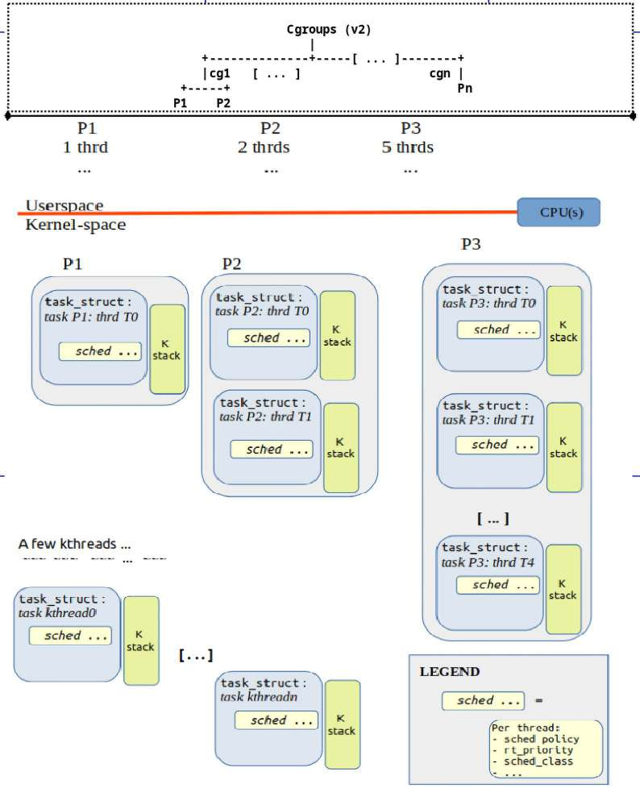

Hình 10.1: Sơ đồ khái niệm cho thấy kernel layout của một vài process và các thread, stack, kthread của chúng trong kernel (trước mắt bỏ qua abstraction “cgroups” ở trên cùng; chúng ta sẽ đến nội dung đó trong chương sau)

Được rồi, tôi đang yêu cầu bạn bỏ qua vấn đề lớn hiển hiện. Phần trên cùng Hình 10.1 cho thấy góc nhìn trừu tượng, rất khái niệm về cgroups kernel framework, một framework hiện ăn sâu vào chính cấu trúc kernel. Ở đây, điều tôi yêu cầu bạn hình dung – không lo gì đến các câu hỏi “tại sao/thế nào/ai/khi nào/…” – là lớp cgroup này, nếu gọi như vậy, gần như luôn hiện diện trong Linux hiện đại, và chắc chắn có thể tác động đến CPU scheduling. Trước mắt chỉ cần biết nó tồn tại; chi tiết – và thử nghiệm! – được trình bày trong chương sau.

Xét Hình 10.1, mỗi thread – trừ kernel thread – có user stack, kernel stack và task structure (kernel thread chỉ có kernel stack và task structure; tất cả đã được giải thích kỹ trong Chương 6, Kernel Internals Essentials – Processes and Threads, tại phần Tổ chức process, thread và stack của chúng – user space và kernel space). Giờ nếu cả 11 thread đều ở runnable state, nghĩa là ready-to-run, thì tất cả cạnh tranh cho một processor core duy nhất. (Dù ít khả năng tất cả runnable đồng thời, hãy cứ xét để thảo luận). Điều then chốt cần hiểu là giờ có 11 thread cạnh tranh CPU resource, không phải ba process và ba kernel thread. Tình huống thực tế hơn là trong 11 thread tồn tại, có lẽ bốn runnable, nghĩa là nằm trong runqueue và muốn chạy, còn bảy thread ở những state khác (sleeping (trong blocking call) hoặc stopped (frozen)); bảy thread này thậm chí không phải ứng viên cho scheduler.

Giờ đã hiểu KSE là thread, chúng ta sẽ (gần như) luôn nói đến thread trong ngữ cảnh scheduling. Hãy chuyển sang Linux process state machine.

### Linux process state machine

Trên Linux OS, mỗi process hay thread đi qua nhiều state xác định, và bằng cách mã hóa chúng, có thể tạo state machine của process (hay thread) trên Linux OS (hãy tham khảo Hình 10.2 khi đọc).

Vì giờ hiểu KSE trên Linux OS là thread chứ không phải process, chúng ta sẽ bỏ qua quy ước dùng từ “process”, thay vào đó dùng từ “thread” khi mô tả thực thể chuyển qua các state khác nhau của state machine. (Nếu thấy thoải mái hơn, bạn luôn có thể tự thay từ “thread” bằng “process” trong nội dung sau.)

Các state mà Linux thread có thể đi qua như sau (utility `ps` mã hóa state bằng các chữ cái ở đây):

- R: Ready-to-run hoặc Running (hay “runnable”)

- Sleeping:

  - S: Interruptible Sleep

  - D: Uninterruptible Sleep

- T: Stopped (hoặc suspended/frozen)

- Z: Zombie (hoặc defunct)

- X: Dead

Khi thread mới được tạo qua các system call `fork()` hoặc c`lone()`, hay API `pthread_create()`, và khi OS xác định thread đã được tạo hoàn chỉnh, nó thông báo cho scheduler biết thread tồn tại bằng cách đặt thread vào runnable state (R). Thread ở state R hoặc thực sự chạy trên CPU core, hoặc ở ready-to-run state. Điều cần hiểu là trong cả hai trường hợp, thread đều được enqueue vào data structure trong OS gọi là runqueue. Linux duy trì một runqueue cho mỗi CPU core trên hệ thống (thực tế còn nhiều sắc thái hơn; sẽ sớm đến). Các thread trong runqueue là ứng viên hợp lệ để chạy trên CPU core cụ thể; không thread nào có thể chạy nếu chưa được enqueue vào một OS runqueue. Linux không phân biệt tường minh ready-to-run state với state thực sự chạy; chỉ đánh dấu thread ở cả hai state là R. Tất nhiên, như đã học trong Chương 6, Kernel Internals Essentials – Processes and Threads, một member trong task structure (`unsigned int __state;`) được đặt thành giá trị thích hợp để đánh dấu thread ở state cụ thể.

Sơ đồ sau biểu diễn Linux state machine cho process hay thread bất kỳ:

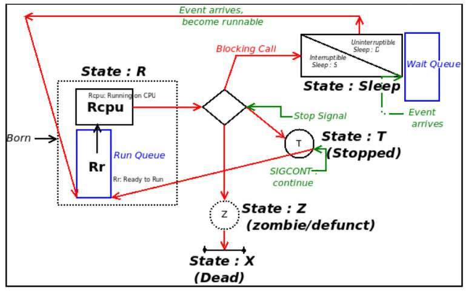

Hình 10.2: Linux process/thread state machine

Sơ đồ trên cho thấy transition giữa các state bằng mũi tên (đỏ). Lưu ý để rõ ràng, một số transition (ví dụ thread có thể bị kết thúc khi sleeping hoặc stopped) không được thể hiện tường minh trong sơ đồ trên. (Để bạn biết, process chết nhưng không được parent chờ sẽ rơi vào state nửa chết nửa sống, gọi là zombie hay defunct process; đây được dự định là state tạm thời. Quy tắc phải theo để ngăn zombie ở lại hệ thống mãi là mỗi `fork()` cần system call `wait*()` tương ứng. (Linux như thường lệ có mẹo hay: kết thúc parent của các zombie khiến zombie cũng được “reap” (chết).)

Chúng ta biết mỗi thread tồn tại (cả user và kernel) có task structure riêng. Vì vậy ở mức code, task structure member tên `__state` (trước đây tên `state`) giữ “state” của task – thread – trong “state machine”. Khi runnable, nó được đặt thành giá trị `TASK_RUNNING` (biểu diễn tổng quát bằng “R”, và bên trong bằng các state `Rr` và `Rcpu` trong Hình 10.2).

Wait queue là data structure nơi task ở sleep state được enqueue – nghĩa là chúng chờ event (thực chất đi đến đây bên trong blocking call). Linux có hai khả năng cho sleeping thread; thread có thể ở:

- Interruptible sleep: `__state = TASK_INTERRUPTIBLE`: nó “sleep”, chờ một event nhất định; tuy nhiên signal bất kỳ được gửi đến process/thread sẽ đánh thức nó và chạy signal handler (biểu diễn bằng chữ “S” trong Hình 10.2)

- Uninterruptible sleep: `__state = TASK_UNINTERRUPTIBLE`: nó “sleep”, chờ một event nhất định; mọi signal gửi đến process/thread đều không tác động đến nó (biểu diễn bằng chữ “D” trong Hình 10.2).

Khi event chờ đợi xuất hiện, OS gửi wakeup call, khiến thread trở lại runnable (dequeue khỏi wait queue và enqueue vào runqueue). Lưu ý thread không chạy tức thì; nó trở thành runnable (`Rr` trong Hình 10.2) và ứng viên cho scheduler; rồi sẽ sớm có cơ hội thực sự chạy trên CPU (`Rcpu`).

Hiểu nhầm phổ biến là nghĩ OS duy trì một run queue và một wait queue. Linux kernel duy trì một run queue cho mỗi CPU. Wait queue thường được device driver (cũng như kernel) tạo và dùng; vì vậy có thể có số lượng bất kỳ.

Đã xong kiến thức cơ bản, hãy tiếp tục!

### Các POSIX scheduling policy

Hãy xem thuật ngữ scheduling policy gần tương đương scheduling algorithm. Điều quan trọng cần hiểu là Linux kernel không chỉ có một policy triển khai CPU scheduling; thực tế POSIX standard chỉ định tối thiểu ba scheduling policy (thực chất thuật toán) mà POSIX-compliant OS phải tuân thủ. Linux làm hơn thế, triển khai ba policy này và nhiều policy khác bằng thiết kế mạnh mẽ gọi là scheduling class (trình bày trong phần Tìm hiểu modular scheduling class phía sau chương).

Trước mắt hãy tóm lược ngắn các POSIX scheduling policy và tác dụng trong bảng sau; nhưng trước đó, điều then chốt cần hiểu là mỗi thread tồn tại (cả user space và kernel space) gắn với đúng một scheduling policy tại thời điểm bất kỳ (có thể đổi ở runtime). Đây là bảng:

| Scheduling policy | Những điểm then chốt | Priority scale |
|---|---|---|
| `SCHED_OTHER` hoặc `SCHED_NORMAL` | Luôn là mặc định; thread có policy này là non-real-time; bên trong được triển khai dưới dạng Completely Fair Scheduling (CFS) class (xem phần Cơ chế hoạt động ngắn gọn của Completely Fair Scheduling (CFS) class sắp tới). Động cơ đằng sau scheduling policy này là tính công bằng (như “công bằng với mọi runnable thread, tránh để bất kỳ thread nào bị thiếu CPU time”) và throughput tổng thể. | Thread có policy này có real-time priority `0`. Non-real-time priority gọi là nice value; trải từ -20 đến +19 (số thấp hơn nghĩa là priority cao hơn), với giá trị cơ sở (ban đầu) 0 |
| `SCHED_RR` | Động cơ đằng sau scheduling policy này là cung cấp một (soft) real-time policy mạnh tay vừa phải. Thread thuộc `sched` class này có timeslice hữu hạn (thường mặc định 100 ms). Thread `SCHED_RR` nhường processor IFF (khi và chỉ khi): • Block trên I/O (đi vào sleep). • Stop hoặc chết. • Real-time thread có priority cao hơn trở thành runnable (sẽ preempt thread này). • Timeslice hết hạn. | (Soft) real-time: 1 đến 99 (số cao hơn nghĩa là priority cao hơn) |
| `SCHED_FIFO` | Động cơ đằng sau scheduling policy này là cung cấp một (soft) real-time policy (so với `SCHED_RR`, rất) mạnh tay. Thread `SCHED_FIFO` nhường processor IFF: • Block trên I/O (đi vào sleep). • Stop hoặc chết. • Real-time thread có priority cao hơn trở thành runnable (sẽ preempt thread này). Thực chất timeslice là vô hạn. | (Giống `SCHED_RR`) |
| `SCHED_BATCH` | Động cơ đằng sau scheduling policy này là phù hợp cho batch job non-interactive, priority thấp, với ít preemption hơn. | Khoảng nice value (-20 đến +19) |
| `SCHED_IDLE` | Trường hợp đặc biệt: thường kernel thread PID `0` (truyền thống gọi là `swapper`; thực tế là per-CPU idle thread) dùng policy này. Nó luôn được bảo đảm là thread priority thấp nhất hệ thống và chỉ chạy khi không thread nào khác muốn CPU. | Priority thấp nhất tất cả (hãy xem thậm chí thấp hơn nice value +19) |

Bảng 10.1 : Các scheduling policy của Linux (POSIX-compliant) và ý nghĩa tóm lược

Điều quan trọng cần lưu ý là khi nói real-time trong bảng trên, ý là soft (hoặc tốt nhất firm) real-time, không phải hard real-time như trong Real-Time Operating System (RTOS). Linux là general-purpose OS (GPOS), không phải RTOS. Dù vậy, bạn có thể chuyển vanilla Linux thành hard real-time RTOS thực sự bằng cách áp external patch series (gọi là RTL, do Linux Foundation hỗ trợ); bạn sẽ học chính xác cách làm trong chương sau, tại phần Chuyển mainline Linux thành RTOS.

Hãy nghiên cứu kỹ bảng; chú ý thread `SCHED_FIFO` thực chất có timeslice vô hạn nên có thể chạy trên CPU core bao lâu tùy muốn; nó bị preempt (đưa khỏi CPU) khi một trong những điều kiện vừa nêu đúng. Đồng thời, các khác biệt then chốt khác giữa `SCHED_FIFO` và `SCHED_RR` gồm:

- Trong khi thread `SCHED_FIFO` thực chất có timeslice vô hạn, thread `SCHED_RR` có timeslice hữu hạn (điều chỉnh qua sysctl `/proc/sys/kernel/sched_rr_timeslice_ms`; mặc định 100 ms)

- Thread `SCHED_RR` cùng priority level được schedule theo round robin (do đó cho phép các thread `SCHED_RR` khác có phần processor). Với thread `SCHED_FIFO` thì không vậy – thread bị preempt sẽ trở lại làm task chạy tiếp theo (do đó không cho các thread cùng priority level khác dùng processor). Vì thế khi dùng `SCHED_FIFO`, nên tránh giữ thread cùng priority level (trình bày thêm trong chương sau, tại phần Đặt policy và priority trong kernel – trên kernel thread).

Lúc này điều quan trọng cần hiểu là trên OS như Linux, thực tế hardware interrupt (và software interrupt) luôn có priority cao hơn và luôn preempt ngay cả thread `SCHED_FIFO` (kernel space hay user space)! (Hãy tham khảo lại Hình 6.1 trong Chương 6, Kernel Internals Essentials – Processes and Threads, để thấy. Nếu muốn tìm hiểu chi tiết hardware interrupt, xem sách Linux Kernel Programming, Part 2 (miễn phí!), Chương 4, Handling Hardware Interrupts). Trong thảo luận ở đây, tạm bỏ qua interrupt. Giờ hãy xem per-thread priority value chi tiết hơn.

#### Thread priority

Priority scale cho thread đơn giản (sau đây từ priority thấp đến cao; tham khảo Hình 10.3):

- Non-real-time thread (`SCHED_OTHER`) có real-time priority `0`; bảo đảm chúng thậm chí không thể cạnh tranh với real-time thread; còn chẳng cùng sân chơi! Vậy phân biệt priority giữa mọi non-real-time thread thế nào?

Dễ thôi – chúng dùng priority value (kiểu UNIX cũ) gọi là nice value, trải từ -20 đến +19, với -20 cao nhất, 0 là cơ sở hay mặc định và +19 thấp nhất. (Có các interface thích hợp trên cả command line lẫn API để truy vấn và đặt; chúng ta sẽ xử lý trong phần Truy vấn scheduling policy và priority của thread cho trước sắp tới cũng như Chương 11, The CPU Scheduler – Part 2.(Một điều cần xét: nhiều distro bật kernel feature tên autogroup (`CONFIG_SCHED_AUTOGROUP`); nó giúp tăng tốc interactive response time cho foreground terminal process và các thread của chúng. Khi bật, khái niệm truyền thống về nice value không thực sự được dùng (bên trong tận dụng cgroup). Xem thêm trong phần Đọc thêm.)

- Real-time thread (có policy `SCHED_FIFO` hay `SCHED_RR`) có real-time priority scale từ 1 đến 99, 1 thấp nhất và 99 cao nhất. Hãy nghĩ theo cách này: trên non-preemptible kernel có một CPU, thread `SCHED_FIFO` priority 99 quay trong infinite loop không thể thoát sẽ thực chất làm treo máy! (Tất nhiên ngay cả nó cũng có thể bị interrupt preempt – cả hard lẫn soft; xem Chương 6, Kernel Internals Essentials – Processes and Threads, Hình 6.1.) Hình 10.2 cho thấy thread priority scale trên Linux:

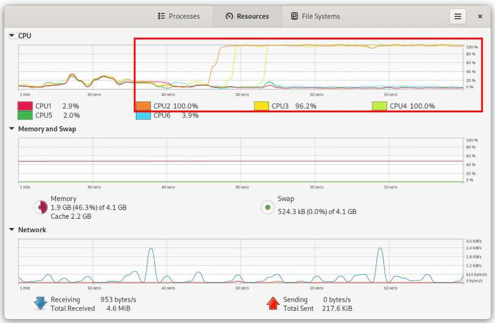

Hình 10.3: Thread priority scale cho các policy SCHED\_OTHER, SCHED\_RR / SCHED\_FIFO

Scheduling policy được chỉ định (đại thể) qua một member trong task structure, scheduling class. Đồng thời thread policy và priority (cả static nice value lẫn real-time priority) là member của task structure (như Hình 10.1 cho thấy rõ). Lưu ý scheduling class mà thread thuộc về là độc quyền; thread chỉ có thể thuộc một scheduling class tại một thời điểm (đừng lo – sẽ trình bày scheduling class tương đối chi tiết sau, trong phần Tìm hiểu CPU scheduling internals – phần 2 sắp tới).

Đồng thời nên hiểu trên Linux kernel hiện đại có các scheduling class khác (stop-sched và deadline) cao hơn (về priority) các class FIFO/RR đã thấy (một lần nữa, sẽ nói thêm sau). Giờ đã biết kiến thức cơ bản, hãy chuyển sang điều thú vị: cách trực quan hóa luồng các thread khi thực thi. Hãy đọc tiếp!

## Trực quan hóa luồng thực thi

Hệ thống multicore dẫn đến process – thực ra là thread (cả user-space lẫn kernel-space) – thực thi concurrently trên processor khác nhau. Điều này hữu ích để tăng throughput và do đó hiệu năng, nhưng cũng gây đau đầu về synchronization khi làm việc với shared writable data (chúng ta sẽ xử lý chuyên sâu chủ đề kernel synchronization thực sự quan trọng trong hai chương cuối).

Vậy ví dụ trên hardware platform có, chẳng hạn, sáu processor core, có thể mong đợi process (thread) thực thi parallel trên chúng; không có gì mới. Tuy nhiên có cách thực sự thấy process hay thread nào đang thực thi trên CPU core nào – nghĩa là cách trực quan hóa processor timeline? Hóa ra thực sự có vài cách. Trong các phần sau, chúng ta xem một vài cách thú vị: bằng GUI program `gnome-system-monitor`, `perf` cũng như các khả năng khác.

### Dùng GUI gnome-system-monitor để trực quan hóa luồng thực thi

GNOME project cung cấp GUI tuyệt vời để xem và giám sát system activity, phù hợp hệ thống laptop, desktop và server-class (thực ra bất kỳ hệ thống nào đủ mạnh để chạy GNOME GUI environment): application `gnome-system-monitor`.

Để nhanh chóng thử dùng nó xem luồng công việc qua vài CPU core, trước tiên chạy một vài process concurrently. Với test case đơn giản ở đây, cần process liên tục thực thi trên CPU – nghĩa là CPU-bound. Ứng viên tốt là utility đơn giản tên `yes`, chỉ liên tục in ký tự `y` ra stdout (hãy thử!). Vậy giả sử chạy nó ba lần, ở background. Để thí nghiệm có ý nghĩa, muốn affine (gắn) mỗi process vào CPU core cụ thể trên hệ thống. Lệnh `nproc` cho biết số core; đánh số bắt đầu từ 0. Trên Fedora 38 VM x86\_64 của tôi:

```
$ nproc
6
```

Được rồi, ở đây có sáu CPU core (đánh số 0–5). Chúng ta tận dụng utility hữu ích `taskset` (thuộc package util-linux, đã chỉ định cài trong Chương 1). Chạy `taskset` với option `-c` cho phép chỉ định CPU core mà command sẽ chạy trên đó; vì vậy nếu làm:

```
taskset -c 2 yes >/dev/null
```

thì `yes` chỉ chạy trên CPU core #2 (redirect stdout sang null device để không phải thấy `y` liên tục)!

Vậy hãy nhanh dựng test case: chạy utility `yes` ba lần (tất nhiên ở background), với mỗi process instance trên một CPU core khác nhau – ví dụ như sau:

```
taskset -c 1 yes >/dev/null &
taskset -c 2 yes >/dev/null &
taskset -c 3 yes >/dev/null &
```

(Tất nhiên phải có hệ thống ít nhất bốn core để các lệnh trên hoạt động (vì đánh số core bắt đầu từ 0).) Khi chúng còn tồn tại và chạy (hết sức), chạy application `gnome-system-monitor` (giả định ở hệ thống đã cài và trong GUI mode). Ảnh chụp cho thấy output điển hình:

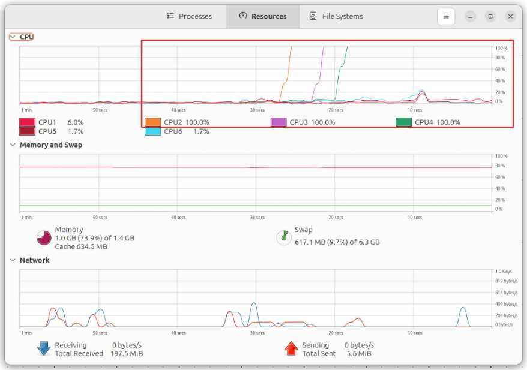

Hình 10.4: Ảnh chụp GUI app gnome-system-monitor; có thể thấy ba process “yes” chạy hết công suất với 100% CPU usage trên ba CPU core được chỉ định (CPU2, CPU3 và CPU4)

Chú ý GUI application `gnome-system-monitor` đánh số CPU core bắt đầu từ 1 (không phải 0). Giờ thực hiện:

```
pkill yes
```

sẽ khiến cả ba process instance `yes` kết thúc. Vì vậy trong Hình 10.4 (ở CPU pane phía trên), thực sự thấy concurrency và parallelism khi chúng thực thi trên CPU core khác nhau. (Đồng thời như thấy, ngoài tab Resources còn có các tab view Processes và File Systems).

Được rồi, giờ hãy chuyển sang dùng utility mạnh mẽ `perf` để xem luồng process/thread trên CPU core!

### Dùng perf để trực quan hóa luồng thực thi

Linux, với kho công cụ developer và Quality Assurance (QA) đồ sộ, có một công cụ thực sự mạnh là `perf`. Tóm lược, bộ công cụ `perf` là một cách thực hiện CPU profiling trên máy Linux. (Ngoài một vài mẹo, sách này không trình bày `perf` chi tiết.)

Tương tự utility lâu đời `top` (và `htop` mới hơn), để có “góc nhìn từ trên cao” về thứ gì đang ngốn CPU (chi tiết hơn `top` rất nhiều), tập utility `perf` rất xuất sắc. Tuy nhiên lưu ý, khá khác thường với app, `perf` gắn chặt với kernel chạy bên dưới. Điều quan trọng là (ít nhất trên Ubuntu), để có `perf`, bạn cài package `linux-tools-$(uname -r)`. Đồng thời các distribution package liên quan `perf` sẽ không có cho custom kernel 6.1 đã build; vì vậy khi dùng `perf`, tôi đề nghị boot guest VM với một kernel tiêu chuẩn (hay distro kernel), cài package `linux-tools-$(uname -r)` rồi thử dùng `perf`. (Tất nhiên luôn có thể tự build `perf` từ kernel source tree, dưới folder `tools/perf/`.)

Với `perf` được cài và hoạt động, bạn có thể thử các command liên quan `perf top` sau (tham khảo man page hoặc tutorial để biết chi tiết):

```
sudo perf top
sudo perf top --sort comm,dso
sudo perf top -r 90 --sort pid,comm,dso,symbol
```

Các biến thể `perf top` nói trên không chỉ giúp có góc nhìn tổng quan thứ gì đang ngốn CPU mà còn thấy code path đang được thực thi, thậm chí cho phép zoom vào từng task để xem thêm chi tiết (điều công cụ truyền thống thường không cho làm). Nhân tiện, `comm` chỉ tên command/process và dso là viết tắt dynamic shared object. `man` page của `perf(1)` cung cấp chi tiết; dùng ký hiệu `man perf-<foo>` – ví dụ `man perf-top` – để có trợ giúp cho `perf top`.

Nhưng quay lại điểm chính: một cách dùng `perf` là có bức tranh rõ chính xác task nào đang chạy trên CPU core nào; thực hiện qua sub-command `sched map` trong `perf`. Tuy nhiên trước tiên phải record event bằng `perf`, có thể làm trên toàn hệ thống hoặc cho process cụ thể. Để record event, chạy command:

```
sudo perf sched record [command]
```

Không có parameter sau từ khóa `record`, nó record event toàn hệ thống; truyền parameter khiến nó chỉ record event cho command process ấy và các descendant. Kết thúc recording session bằng signal SIGINT (^C). Theo mặc định, sẽ tạo binary data file tên `perf.data`; chúng ta sẽ sớm thấy cách diễn giải trực quan.

#### Thử nghiệm – cách tiếp cận command line

Trước tiên tất nhiên chạy process luyện CPU – `yes` – concurrently, mỗi instance affined vào CPU core khác nhau. Để dễ làm, tôi thiết lập một vài wrapper script đơn giản trong folder: `ch10/concurrent_exercise/`. Hãy chạy mẫu và xem, từ bản sao GitHub repo của sách của bạn (có tại `https://github.com/PacktPublishing/Linux-Kernel-Programming_2E`):

```
cd ch10/concurrent_exercise
```

Vì VM đang chạy (Fedora 38 x86\_64) được cấu hình sáu CPU core, chúng ta yêu cầu script spawn sáu process `yes`, mỗi process gắn vào một CPU core:

```
$ ./concurrency 6
concurrency: spawning a 'yes' process on ...
... CPU core #0 now ...
... CPU core #1 now ...
... CPU core #2 now ...
... CPU core #3 now ...
... CPU core #4 now ...
... CPU core #5 now ...
```

Giờ (trong cửa sổ Terminal khác), bắt đầu recording (sampling, CPU profiling) bằng `perf` (lưu ý đang record toàn hệ thống; không sao):

```
sudo perf sched record
```

(Một lưu ý bên lề, xem tab Resources của app `gnome-system-monitor` lúc này khá thú vị, dù có thể làm lệch “benchmark”.)

Tiếp theo, sau khi để process chạy một chút (nửa phút hẳn quá đủ), dừng các concurrent process và yêu cầu `perf` cung cấp map chi tiết CPU usage như thấy trong recording:

```
$ pkill yes
Terminated
Terminated
Terminated
Terminated
Terminated
Terminated
```

Nhấn ^C trong Terminal đang chạy command `perf record` để dừng recording. Sau đó làm như sau để tạo report:

```
$ sudo perf sched map > mymap.txt
```

Xong. Hãy xem kết quả!

Report file, ở đây `mymap.txt`, có định dạng sau (vì các cột không có nhãn tường minh, tôi thêm chú giải ở đầu Hình 10.5):

- Từ trái, mỗi cột biểu diễn một CPU core, bắt đầu từ 0 (vui lòng bỏ qua line number ở ngoài cùng trái).

- Sau các cột CPU core (ở đây có sáu vì có sáu CPU) là cột Timestamp (với system uptime biểu diễn theo định dạng `sec.us`).

- Sau đó là cột Legend. Ở đây mỗi thread thực thi được gán tên hai ký tự; trong lần chạy này, một ví dụ tốt (xem Hình 10.5), `A0` là `kthread` tên `migration/0:18`, `B0` là một trong các thread `yes` (`yes:6428`), `C0` là một `kthread migration/1:23` khác, v.v.

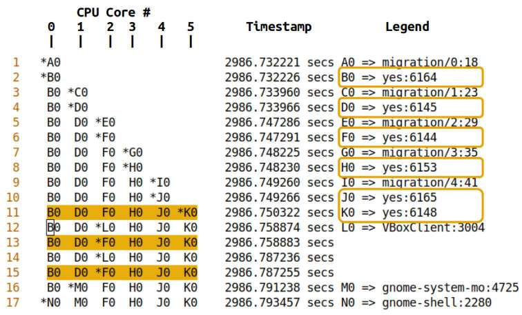

Hình 10.5: Ảnh chụp phần trên map file được thu thập qua perf sched map (có chú giải được thêm ở trên cùng), các process yes được làm nổi bật

Vậy có thể thấy sáu process `yes` (tất nhiên single-threaded) có nhãn B0, D0, F0, H0, J0 và K0. Để dễ hình dung, tôi mở map file trong vim và tìm cách khớp chúng bằng regular expression như sau:

```
/B0..D0..F0..H0..J0..K0
```

Đã hoạt động! Có thể thấy chúng được làm nổi bật ở cả Hình 10.5 và Hình 10.6. Giờ các process `yes` – ở đây B0, D0, F0, H0, J0 và K0 – đều trên một dòng cho biết cả sáu chạy concurrently, parallel, lần lượt trên CPU core 0 đến 5 (như các hàng 11, 13 và 15 trong Hình 10.5 cho thấy rõ)! Hay thật.

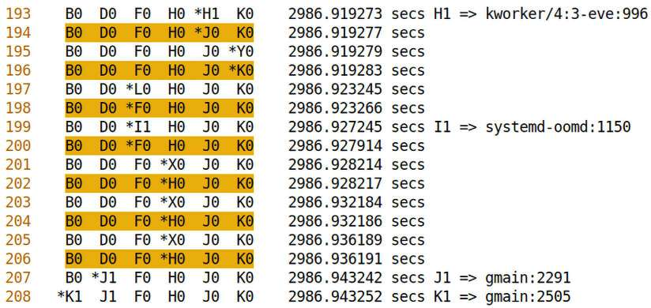

Hình 10.6: Ảnh chụp một phần khác của perf map file, cho thấy sáu process yes chạy concurrently trên sáu CPU core của máy

(Để bạn biết, dấu sao cho biết một thay đổi context, thường là context switch trên core đó, đã xảy ra.) Thật bổ ích khi thấy các thread khác cũng chạy ở những thời điểm khác nhau; hiển nhiên không chỉ các anh chàng yes của chúng ta muốn chạy!

Một lần nữa, không phải làm chính xác như ở đây để kiểm thử; có thể thực thi app bất kỳ đủ CPU-bound (benchmarking program như `stress-ng`, chính kernel build, v.v. là ứng viên tốt), rồi chạy các command `perf` đã trình bày để thu thập và báo cáo chi tiết.

Chúng ta vừa dùng `perf` để có “góc nhìn” dựa trên command line (hay console) về thread thực thi trên CPU core; giờ hãy tận dụng `perf` để hiển thị điều tương tự bằng đồ họa!

#### Thử nghiệm – cách tiếp cận đồ họa

Các bước thực hiện vẫn giống phần trước trừ command cuối (command `sudo perf sched map > mymap.txt`); thay vào đó tạo biểu diễn đồ họa CPU scheduling bằng command `perf` sau:

```
sudo perf timechart -i ./perf.data
```

Command này theo mặc định tạo file Scalable Vector Graphics (SVG) tên `output.svg`! Có thể xem bằng vector drawing utility (như Inkscape hoặc qua command `display` trong ImageMagick), hay đơn giản trong web browser. Nghiên cứu time chart có thể hữu ích; hãy thử. Tuy nhiên lưu ý vector image có thể khá lớn nên mở mất một lúc.

Để bạn biết, có thể cấu hình `perf` hoạt động với non-root access. SVG được tạo bằng cùng file `perf.data` từ lần chạy phần trước, và được xem trong browser:

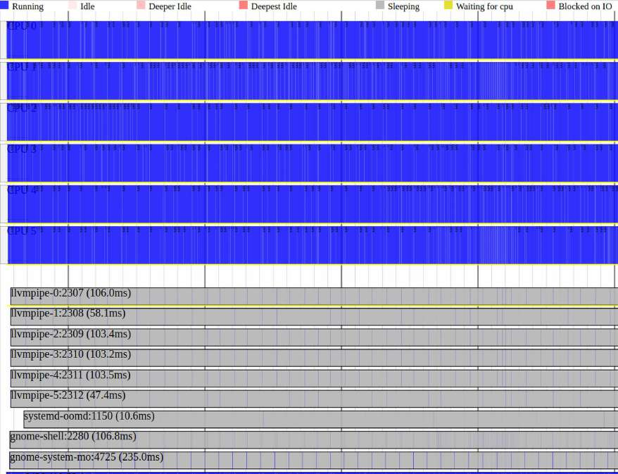

Hình 10.7: Ảnh chụp một phần SVG file do perf tạo bằng data từ lần chạy trước

Có thể zoom vào và ra SVG file này, nghiên cứu scheduling event và CPU event mà `perf` record theo mặc định. Rõ ràng sáu concurrent process `yes` đang làm việc hết sức trên sáu CPU core (màu xanh biểu diễn state Running, như thấy trong legend ở dòng đầu). Các process khác (chủ yếu sleeping) xuất hiện bên dưới.

Hình sau là ảnh chụp một phần khác khi zoom 400% vào vùng trên trái của ảnh trước; một lần nữa khá rõ process `yes` là những process ở trên CPU:

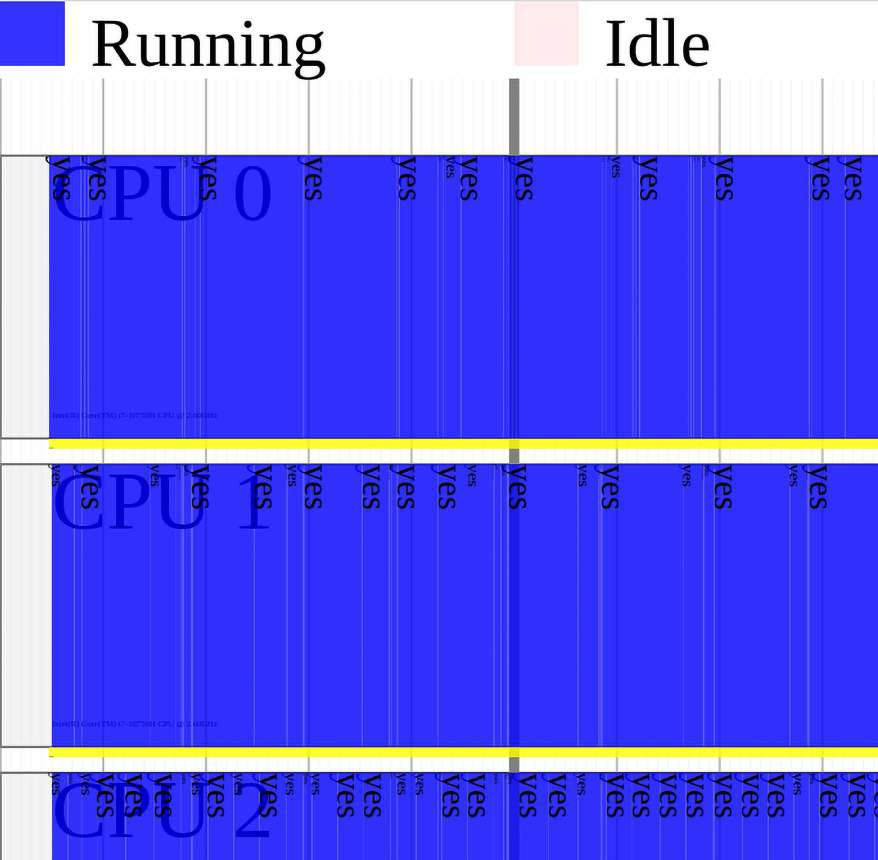

Hình 10.8: Ảnh chụp một phần SVG file của perf timechart khi zoom 400% vào vùng trên trái

Còn gì nữa? Dùng option switch `-I` cho `perf` timechart record, có thể yêu cầu chỉ record disk I/O event (và có vẻ cả network) trên toàn hệ thống. Điều này có thể đặc biệt hữu ích vì bottleneck hiệu năng thực sự thường do I/O activity (không phải CPU). `man` page của `perf-timechart(1)` trình bày thêm các option hữu ích.

Có thể chuyển binary record file `perf.data` của `perf` sang file format phổ biến Common Trace Format (CTF), bằng `perf data convert --all –-to-ctf <dir>`, trong đó argument cuối là directory lưu các CTF file. Vì sao hữu ích? CTF là native data format được GUI visualizer và analyzer tool mạnh như Trace Compass sử dụng. (Tôi thấy cách này hoạt động trên Fedora, trong khi Ubuntu có vẻ có vài vấn đề dai dẳng.)

### Trực quan hóa luồng thực thi bằng các cách khác

Tất nhiên có các cách khác để trực quan hóa thứ gì đang chạy trên mỗi processor. Sau đây là tổng quan nhanh.

Thực tế một số visualization tool này được trình bày chi tiết hơn nhiều trong cuốn Linux Kernel Debugging, Chương 9, Tracing the Kernel Flow. Vì vậy không lặp lại cùng thông tin ở đây nhưng có tổng quan nhanh.

Trước tiên hãy đề cập một vài console-based visualization tool:

- perf-tools: Brendan Gregg có bộ script rất hữu ích thực hiện phần lớn công việc khó khi giám sát production Linux system bằng `perf`; hãy xem tại đây: `https://github.com/brendangregg/perf-tools` (một số distribution cung cấp dưới package tên `perf-tools[-unstable])`.

- Ftrace: kernel tracer system rất mạnh được tích hợp sâu trong Linux kernel (tất nhiên phải được bật; phần lớn distro bật Ftrace theo mặc định):

  - Có thể dùng raw ftrace để trace (gần như) từng function khi thực thi sâu trong kernel; thông tin thu được gồm timestamp, CPU core đang thực thi trên đó, context thực hiện việc thực thi, interrupt state và function name.

  - Frontend cho raw Ftrace là utility xuất sắc trace-cmd; về cơ bản cung cấp thông tin giống raw Ftrace nhưng dễ dùng hơn nhiều. Cũng có thể cấu hình để hiển thị parameter truyền vào kernel function. (Tôi đã build frontend đơn giản cho nó tên trccmd (`https://github.com/kaiwan/trccmd`); hãy thử.)

- Một ít Bash scripting đơn giản có thể cho thấy thứ đang thực thi trên core cho trước (qua wrapper đơn giản trên `ps`). Trong đoạn sau, trình bày sample Bash function; ví dụ function `c0()` sau cho biết thứ hiện thực thi trên CPU core `#0`, còn `c1()` làm tương tự cho core `#1` (điều này ngụ ý đang dùng GNU `ps` thông thường chứ không phải biến thể rút gọn như `busybox ps`):

```
# Show thread(s) running on cpu core 'n' - func c'n'()
function c0()
{
 ps -eLF | awk '{ if($5==0) print $0}'
}
function c1()
{
 ps -eLF | awk '{ if($5==1) print $0}'
}
```

- LTTng: Linux Trace Toolkit – next generation (LTTng) là open-source tracing system mạnh, phổ biến cho Linux kernel cũng như user-space app và library. Phiên bản gốc (LTT) có từ 2005, và LTTng được duy trì tích cực. Nó nổi tiếng nhờ giúp truy tìm vấn đề hiệu năng và debug trên multicore parallel system và real-time system.

Một vài GUI visualization tool ở đây:

- KernelShark: GUI frontend tốt cho data do raw Ftrace và `trace-cmd` tạo. (Với raw Ftrace, trước tiên phải làm `trace-cmd extract` để đưa data vào file format nó nhận biết.)

- TraceCompass: GUI frontend xuất sắc để trực quan hóa trace do LTTng tạo; thực tế làm việc với CTF format phổ biến nên mọi trace theo format này đều có thể import rồi trực quan hóa.

Hãy thử các lựa chọn thay thế này!

Được rồi, giờ đã học cách trực quan hóa luồng process/thread trên CPU core bằng nhiều cách, hãy chuyển trọng tâm trở lại phía kernel internals một lúc.

## Tìm hiểu CPU scheduling internals – phần 2

Phần này đi sâu tương đối chi tiết vào kernel CPU scheduling internals, nhấn mạnh khía cạnh cốt lõi của thiết kế hiện đại, modular scheduling class.

### Tìm hiểu modular scheduling class

Ingo Molnar, một kernel developer then chốt (cùng những người khác), đã thiết kế lại cấu trúc bên trong kernel scheduler, giới thiệu cách tiếp cận mới tên scheduling class (vào tháng 10 năm 2007 với phát hành kernel 2.6.23).

Một ghi chú bên lề, từ `class` trong `scheduler classes` không phải trùng hợp; nhiều Linux kernel feature về bản chất và khá tự nhiên được thiết kế hướng đối tượng. Tất nhiên ngôn ngữ C không cho phép biểu diễn trực tiếp trong code (vì vậy rất nhiều structure có cả data member và function pointer member, mô phỏng class). Tuy vậy, thiết kế rất thường là hướng đối tượng (như sẽ thấy khá rõ với driver model trong sách Linux Kernel Programming – Part 2). Vui lòng xem phần Đọc thêm của chương để có thêm chi tiết khía cạnh này.

Một abstraction layer được đưa vào core scheduling code, function `kernel/sched/core.c:schedule()`. Lớp này trong `schedule()` được gọi chung là scheduling class và có thiết kế modular.

Lưu ý từ modular ở đây ngụ ý có thể thêm hoặc loại scheduler class khỏi in-tree kernel code; không liên quan gì Loadable Kernel Module (LKM) framework.

Ý tưởng cơ bản thế này: Linux kernel (từ 6.1, và thực tế kernel 6.7 mới nhất tại thời điểm viết) chứa năm scheduling class, mỗi class gắn với một priority level. Khi core scheduler code – function `schedule()` (bản thân là thin wrapper trên `__schedule()`) – được gọi, nó lặp qua từng class theo priority order định trước, hỏi mỗi class có thread sẵn sàng chạy không (chính xác bằng cách nào sẽ sớm thấy). Trong năm scheduling class, bảo đảm một class trả lời có và chọn candidate thread để chạy tiếp; ngay khi xảy ra, core scheduling code context-switch sang thread may mắn đó (bỏ qua scheduling class còn lại) và xong việc. Flow diagram sau tóm lược thiết kế này:

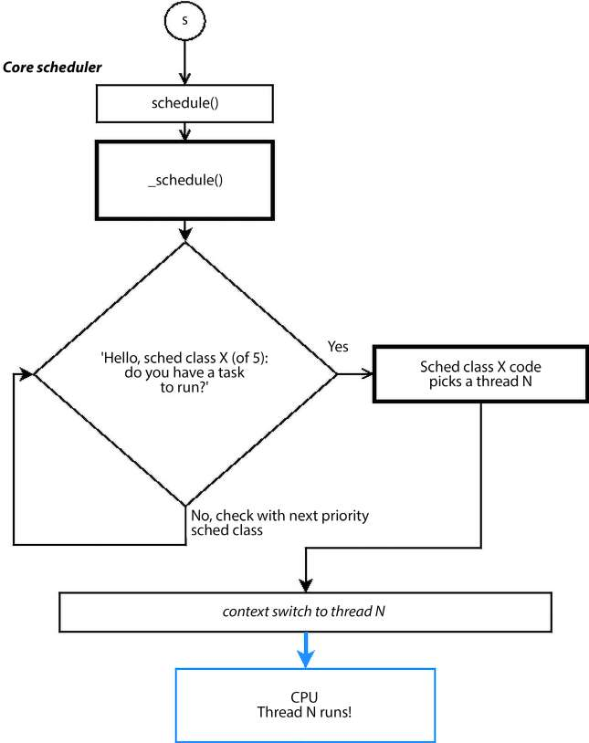

Hình 10.9: Flow diagram của core scheduling code path, cho thấy tổng thể modular scheduler class architecture (đây là sơ đồ then chốt!)

Bạn tinh ý đã phát hiện connector nhãn S ở ngay trên cùng Hình 10.9; có nghĩa gì? Nó ở đó để trả lời câu hỏi then chốt: “Ai gọi và chính xác khi nào core scheduler function schedule() được gọi?” (Trả lời chi tiết trong phần sắp tới, Tìm hiểu CPU scheduling internals – phần 3; cứ yên tâm – sẽ đến!)

Từ Linux kernel 6.1 (và thực tế kernel 6.7 mới nhất tại thời điểm viết), đây là năm scheduler class trong kernel, liệt kê theo priority order với priority cao nhất trước:

| Scheduling policy | Scheduler class | Tên data structure sched\_class | Được định nghĩa trong (qua macro DEFINE\_SCHED\_ CLASS()) |
|---|---|---|---|
| `-` | Stop-task / Stop-sched (`__sched_class_highest`) | `stop_sched_class` | `kernel/sched/stop_task.c` |
| `SCHED_DEADLINE` | (Early) Deadline First | `dl_sched_class` | `kernel/sched/deadline.c` |
| `SCHED_FIFO /` `SCHED_RR` | RT (real-time) | `rt_sched_class` | `kernel/sched/rt.c` |
| `SCHED_OTHER` (hoặc `SCHED_NORMAL`): mặc định | CFS | `fair_sched_class` | `kernel/sched/fair.c` |
| `SCHED_IDLE` | Idle (`__sched_class_lowest`) | `idle_sched_class` | `kernel/sched/idle.c` |

Bảng 10.2: Năm modular scheduling class

Vậy đó là năm modular scheduler class – stop-task, deadline, (soft) real-time (RT), fair (CFS) và idle – theo priority từ cao nhất đến thấp nhất. Các data structure trừu tượng hóa scheduler class này, `struct sched_class`, được nối trên singly linked list mà core scheduling code duyệt qua. (Sẽ đến structure `sched_class` là gì sau; trước mắt bỏ qua.)

Mỗi thread gắn với task structure riêng (`struct task_struct`); trong task structure (như đã thấy Chương 6, có thể xem tại đây: `https://elixir.bootlin.com/linux/v6.1.25/source/include/linux/sched.h#L737`), áp dụng những điều sau:

- Member `struct sched_class *` giữ pointer đến modular scheduling class mà thread thuộc về; là độc quyền – thread chỉ thuộc một scheduling class ở thời điểm bất kỳ (là một class đề cập trong Bảng 10.2, cột ba). Theo mặc định trỏ đến CFS (`fair_sched_class`).

- Member `policy` chỉ định scheduling policy mà thread tuân theo (là một policy đề cập trong Bảng 10.2, cột đầu). Cũng độc quyền – thread chỉ tuân theo một scheduling policy tại thời điểm bất kỳ (tuy nhiên có thể đổi).

- Các thread priority value; các member chứa chúng là `prio`, `static_prio`, `normal_prio` và `rt_priority`.

- Cả scheduling policy lẫn priority đều dynamic, có thể truy vấn và đặt bằng lập trình (hoặc qua utility; sẽ sớm thấy).

Để bạn biết, thread thuộc class `stop-sched` rất ít; vì đây là priority level cực cao. Khi stop-sched thread giành processor, kernel tắt thực thi (cũng như mọi thứ liên quan locking, interrupt và mọi thứ khác) trên tất cả core còn lại của hệ thống. Vì vậy thread class `stop-sched` thực thi - trên core mà mọi interrupt và kernel preemption bị mask - thực sự một mình, hoàn toàn không có khả năng bị preempt. Ai cần mức priority và non-preemptability này? Một ví dụ là Ftrace kernel tracing subsystem; ví dụ khác là live kernel patching. Đồng thời sched class priority kế tiếp – Deadline – dành cho real-time task có deadline gắn kèm phải đáp ứng (theo kiểu RTOS cổ điển). Vì thread `stop-sched` và `deadline` thường hiếm, chúng ta tập trung vào RT và – chủ yếu – fair (CFS) thread; thread “fair class” là những thread thường tồn tại và chạy.

Vậy biết điều này, giờ bạn nhận ra mọi thread tuân theo scheduling policy `SCHED_FIFO` hoặc `SCHED_RR` đều map đến `rt_sched_class` (qua member `sched_class` trong task structure), mọi thread `SCHED_OTHER` (hoặc `SCHED_NORMAL`) map đến `fair_sched_class`, và các CPU idle thread (`swapper/n`, với `n` là CPU number bắt đầu từ `0`) luôn map đến scheduling class `idle_sched_class`.

Khi kernel cần schedule, đây là call sequence thiết yếu:

```
schedule() --> __schedule() --> pick_next_task()
```

Việc duyệt thực tế qua các scheduling class trên xảy ra ở đây; xem code (một phần) của `pick_next_task()` như sau: `https://elixir.bootlin.com/linux/v6.1.25/source/kernel/sched/core.c#L5850`:

```
static inline struct task_struct *
__pick_next_task(struct rq *rq, struct task_struct *prev, struct rq_flags *rf)
{
        const struct sched_class *class;
        struct task_struct *p;

        /*
         * Optimization: [ ... ] */
    [ ... ]
        put_prev_task_balance(rq, prev, rf);
        for_each_class(class) {
                p = class->pick_next_task(rq);
                if (p)
                        return p;
        }
        BUG(); /* The idle class should always have a runnable task. */
}
```

(Thực tế có khá nhiều tối ưu trong task-picking code logic; để rõ ràng, chúng ta bỏ qua và tập trung trường hợp chuẩn.) Macro `for_each_class()` trên thiết lập `for` loop để duyệt mọi scheduling class. Implementation như sau:

kernel/sched/sched.h

```
#define for_class_range(class, _from, _to) \
        for (class = (_from); class < (_to); class++)

#define for_each_class(class) \
        for_class_range(class, __sched_class_highest, __sched_class_lowest)
```

Từ code snippet trên có thể thấy mỗi class, từ `__sched_class_highest` đến `__sched_class_lowest`, được “hỏi” qua “method” `class->pick_next_task()` nên schedule ai tiếp theo (như Hình 10.9 thể hiện về khái niệm). Giờ việc xác định có candidate nào muốn thực thi được giao cho scheduling class code. Thế nào? Thực ra đơn giản; chỉ xem runqueue data structure của nó.

Giờ đây là điểm then chốt: kernel duy trì một runqueue cho mỗi processor core và mỗi scheduling class! Vì vậy, nếu có hệ thống chẳng hạn sáu CPU core, sẽ có 6 core \* 5 sched class = 30 runqueue! (Có ngoại lệ: trên hệ thống Uniprocessor (UP), class `stop-sched` không tồn tại.) Runqueue được triển khai riêng cho mỗi scheduling class; ví dụ đây là runqueue cho CFS: `struct` `cfs_rq` (`https://elixir.bootlin.com/linux/v6.1.25/source/kernel/sched/sched.h#L550`); tương tự với RT class là `struct rt_rq`, v.v. Sơ đồ sau cố gắng trình bày thông tin này:

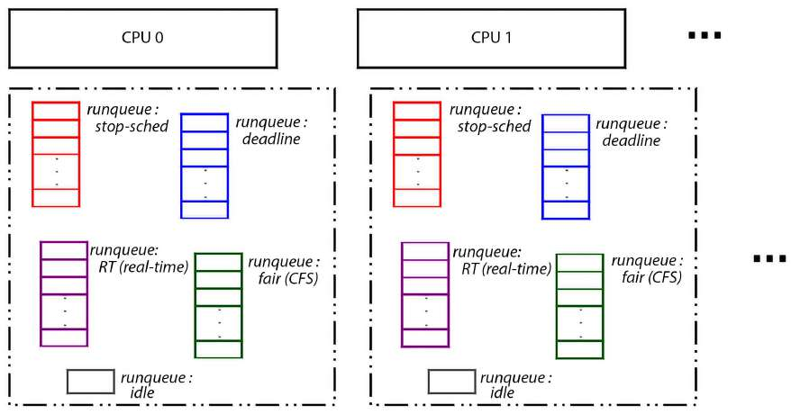

Hình 10.10: Có 1 runqueue cho mỗi CPU core và mỗi scheduling class

Lưu ý trong sơ đồ trên, cách tôi thể hiện runqueue có lẽ khiến chúng giống array. Hoàn toàn không phải ý định; chỉ là sơ đồ khái niệm. Runqueue data structure thực tế được dùng phụ thuộc scheduling class (xét cho cùng class code triển khai runqueue). Có thể là array linked list (như real-time class), tree – thực tế red-black (rb) tree – với fair class, v.v.

#### Ví dụ khái niệm giúp hiểu scheduling class

Để hiểu tốt hơn scheduler class model, chúng ta dựng ví dụ: giả sử trên hệ thống Symmetric Multi Processor (SMP) hay multicore có 100 thread tồn tại (trong cả user space lẫn kernel space). Trong đó một vài thread cạnh tranh CPU; nghĩa là ở ready-to-run state (Rr), ngụ ý runnable nên được enqueue vào runqueue data structure (xem Hình 10.2, state machine). Giả sử runnable thread thuộc các scheduling class như sau:

- Một thread class stop-sched (SS), S1

- Hai thread class Deadline (DL), D1 và D2

- Hai thread class Real Time (RT), RT1 và RT2

- Ba thread class Completely Fair Scheduling (CFS) (hay fair), F1, F2 và F3

- Một thread class idle, I1

Giờ hình dung ban đầu thread F2 ở trên processor core, vui vẻ thực thi code. Lúc nào đó kernel muốn context-switch sang task khác trên CPU ấy. (Điều gì kích hoạt? Sẽ sớm thấy.) Trên scheduling code path, kernel code cuối cùng đi vào kernel routine thuộc core scheduling code `kernel/sched/core.c:void schedule(void)` (một lần nữa, chi tiết mức code ở phía sau). Điều quan trọng cần hiểu trước mắt là routine `pick_next_task()`, được `schedule()` gọi và trở thành `__schedule()`, duyệt linked list các scheduler class, hỏi từng class có candidate chạy không (một lần nữa tham khảo Hình 10.9). Code path (tất nhiên về khái niệm) đại loại như sau:

1\. Core scheduler code (\_\_`schedule()`): “Này SS (stop-sched class), có thread nào muốn chạy không?” 2. SS class code: Duyệt runqueue và thực sự tìm thấy runnable thread (S1); do đó đáp: “Có, thread S1.” 3. Core scheduler code (`__schedule()`): “Tốt; hãy context-switch sang S1.”

Và xong việc (ít nhất cho scheduling round hay epoch này). Nhưng đổi tình huống một chút: nếu không có runnable thread S1 trên SS runqueue của processor ấy (hoặc nó đã sleep, stopped, hay nằm trên runqueue CPU khác) thì sao? SS sẽ nói “không”, và scheduling class quan trọng kế tiếp, Deadline (DL), được hỏi. Nếu có candidate thread tiềm năng muốn chạy (D1 và D2 trong ví dụ), class code chạy thuật toán để xác định D1 hay D2 nên chạy, trả pointer đến task structure của thread đó cho `__schedule()`, và kernel scheduler trung thành context-switch sang nó. Quá trình này tiếp tục với các scheduling class Real-time (RT) và Fair (CFS). (Một hình đáng giá nghìn lời, đúng không? Xem Hình 10.11.)

Rất có thể (trên hệ thống Linux tải vừa phải điển hình) không có candidate thread SS, DL hay RT muốn chạy trên CPU đang xét, và thường có ít nhất một fair (CFS) thread muốn chạy.

Vì vậy cạnh tranh thường là giữa các fair (CFS) runnable thread; thread được fair class implementation (CFS) chọn sẽ là thread được context-switch đến.

Nếu thực sự không thread nào muốn chạy (không thread class SS/DL/RT/CFS nào muốn chạy), ngụ ý hệ thống hiện idle (anh chàng lười biếng). Giờ class `Idle` được hỏi có muốn chạy không; luôn nói có! Hợp lý; xét cho cùng nhiệm vụ CPU idle thread là chạy trên processor khi không ai khác cần/muốn. Vì vậy trong trường hợp đó kernel switch context sang idle thread, thường nhãn `swapper/n`, với `n` là CPU number đang thực thi trên đó (bắt đầu từ `0`; và đúng, tôi biết bạn có lẽ nghĩ: tại sao gọi “swapper”?… chỉ là lịch sử Unix cũ trở lại ám chúng ta – không gì khác).

Đồng thời, lưu ý kernel thread `swapper/n` (CPU idle) không hiện trong danh sách `ps`, dù luôn tồn tại (nhớ code đã minh họa trong Chương 6, Kernel Internals Essentials – Processes and Threads, tại đây: `ch6/foreach/thrd_showall/thrd_showall.c` (`https://github.com/PacktPublishing/Linux-Kernel-Programming_2E/blob/main/ch6/foreach/thrd_showall/thrd_showall.c`) Ở đó đã viết routine `disp_idle_thread()` để hiển thị vài chi tiết CPU idle thread, vì ngay cả loop `do_each_thread() { ... } while_each_thread()` của kernel đã dùng cũng không hiển thị idle thread.

Sơ đồ sau tóm lược gọn cách core scheduling code gọi scheduling class theo priority order, context-switch đến thread “next” được chọn cuối cùng:

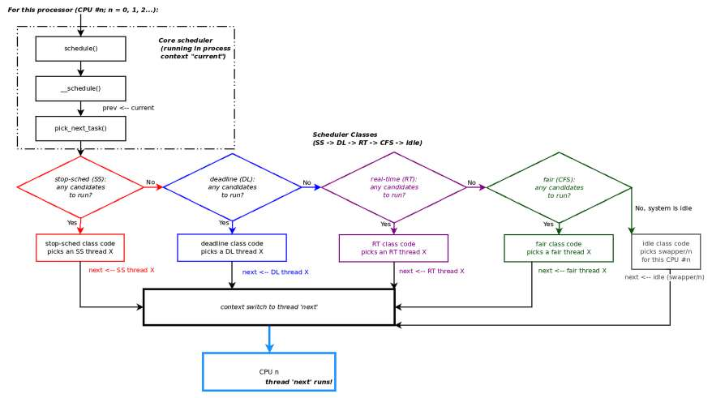

Hình 10.11: Core scheduler code duyệt mỗi scheduling class để chọn task sẽ chạy tiếp

#### Hỏi scheduling class

Chính xác core scheduler code (trong `pick_next_task()`) hỏi scheduling class có thread muốn chạy bằng cách nào? Đã thấy, nhưng tôi cho rằng nên lặp lại code fragment sau cho rõ (chủ yếu được gọi từ `__schedule()` và cả thread migration code path):

kernel/sched/core.c

```
static inline struct task_struct *
__pick_next_task(struct rq *rq, struct task_struct *prev, struct rq_flags *rf)
{
        const struct sched_class *class;
        struct task_struct *p;

        /*
         * Optimization: [ ... ] */
     [ ... ]
        put_prev_task_balance(rq, prev, rf);
        for_each_class(class) {
                p = class->pick_next_task(rq);
                if (p)
                        return p;
        }
    [ … ]
```

Chú ý object orientation đang hoạt động: code `class->pick_next_task(rq)` đối với mọi mục đích thực tế gọi method `pick_next_task()` của scheduling class `class`! Return value một cách thuận tiện và có chủ ý là pointer đến task structure của task được chọn, giờ code có thể context-switch đến đó. Như cũng thấy, `pick_next_task()` trả NULL ngụ ý class hiện tại không có candidate để schedule; vì vậy chuyển sang hỏi class kế tiếp. Loop luôn kết thúc vì nếu không còn gì khác, idle class luôn trả candidate khác null để schedule, idle thread của core đó.

Code và đoạn trên tất nhiên ngụ ý có một structure `class` được điền sẵn cho mỗi scheduling class, hiện thân điều thực sự muốn nói về scheduling class. Quả thực đúng vậy: chứa mọi operation có thể có cùng các hook hữu ích mà bạn có thể cần trong scheduling class. Nó (bất ngờ thay) tên structure `sched_class`:

`https://elixir.bootlin.com/linux/v6.1.25/source/kernel/sched/sched.h#L2147`

```
struct sched_class {
    [ ... ]
        void (*enqueue_task) (struct rq *rq, struct task_struct *p, int flags);
        void (*dequeue_task) (struct rq *rq, struct task_struct *p, int flags);
    [ ... ]
        struct task_struct *(*pick_next_task)(struct rq *rq);
        void (*task_tick)(struct rq *rq, struct task_struct *p, int queued);
        void (*task_fork)(struct task_struct *p);
    [ ... ]
};
```

(Structure này còn nhiều member hơn được trình bày ở đây; hãy xem trong kernel code.) Như giờ hẳn đã rõ, mỗi scheduling class tạo instance của structure này, điền method thích hợp (tất nhiên qua function pointer). Core scheduling code, khi duyệt linked list scheduling class (cũng như ở những nơi khác trong kernel), gọi các method và hook function theo yêu cầu – miễn không phải `NULL` (một lần nữa Hình 10.9 và Hình 10.11 nhắc điều này).

Ví dụ, hãy xét fair scheduling class (CFS) triển khai scheduling class của mình thế nào:

`https://elixir.bootlin.com/linux/v6.1.25/source/kernel/sched/fair.c#L12365`

```
DEFINE_SCHED_CLASS(fair) = {
        .enqueue_task           = enqueue_task_fair,
        .dequeue_task           = dequeue_task_fair,
         [ ... ]
        .pick_next_task         = __pick_next_task_fair,
         [ ... ]
        .task_tick              = task_tick_fair,
        .task_fork              = task_fork_fair,
        .prio_changed           = prio_changed_fair,
        [ ... ]
};
```

(Trước đây structure được định nghĩa trực tiếp; từ 5.11 dùng macro `DEFINE_SCHED_CLASS()` để làm vậy. Để biết tại sao, đọc commit: `https://github.com/torvalds/linux/commit/43c31ac0e665d942` `fcaba83a725a8b1aeeb7adf0`.)

Vậy giờ bạn thấy: code fair sched class dùng để chọn task chạy tiếp (khi core scheduler hỏi) là function `__pick_next_task_fair()` (thin wrapper trên `pick_next_task_fair()`). Để bạn biết, các member `task_tick` và `task_fork` là ví dụ tốt về scheduling class hook; scheduler core gọi các function này lần lượt trên mỗi timer tick (nghĩa là mỗi timer interrupt, xảy ra – ít nhất về lý thuyết – `CONFIG_HZ` lần một giây) và khi thread thuộc scheduling class này fork.

Có lẽ một Linux kernel project chuyên sâu thú vị: tạo scheduling class riêng với các method và hook cụ thể, triển khai các scheduling algorithm nội bộ. Link mọi thành phần theo yêu cầu (vào scheduling classes linked list, chèn tại priority mong muốn, v.v.) và kiểm thử! Giờ sẽ thấy tại sao gọi là modular scheduling class.

Tốt – giờ đã hiểu architecture đằng sau cách modular CPU scheduler hiện đại hoạt động, hãy xem ngắn thuật toán đằng sau CFS, có lẽ scheduling class dùng nhiều nhất trên generic Linux.

#### Cơ chế hoạt động ngắn gọn của Completely Fair Scheduling (CFS) class

Từ version 2.6.23 (năm 2007), CFS là kernel CPU scheduling code trên thực tế cho thread thông thường; phần lớn thread trên Linux thường thuộc policy `SCHED_OTHER` theo mặc định, do CFS vận hành. Động cơ đằng sau thuật toán CFS là cung cấp tính công bằng và throughput tổng thể.

Tóm lược implementation thế này: kernel theo dõi CPU runtime thực tế (với granularity nanosecond) của mỗi runnable CFS thread (`SCHED_OTHER / SCHED_NORMAL`); thread có runtime nhỏ nhất xứng đáng chạy nhất và sẽ được trao processor trong scheduling cycle hay epoch kế tiếp (từ “epoch” chỉ “điểm bắt đầu một giai đoạn trong lịch sử của ai hay thứ gì”). Ngược lại, thread liên tục làm việc trên processor tích lũy lượng runtime lớn nên bị phạt (thực sự khá giống nhân quả)!

Chúng ta chia thảo luận thành hai phần: phần đầu xem ngắn các khái niệm vruntime của CFS và rb-tree runqueue nội bộ, phần thứ hai xem dynamic timeslice của CFS hoạt động thế nào. Tất nhiên bắt đầu phần đầu.

##### Ghi chú về giá trị CFS vruntime và runqueue của nó

Không đi sâu quá nhiều chi tiết CFS implementation internals, nhúng trong task structure có data structure khác, `struct sched_entity`, chứa unsigned 64-bit value tên `vruntime` (hay virtual runtime) (`https://elixir.bootlin.com/linux/v6.1.25/source/include/linux/sched.h#L556`). Ở mức đơn giản, đây là monotonic counter theo dõi lượng thời gian, theo nanosecond, thread đã tích lũy (chạy) trên processor.

Trong thực tế implementation, cần nhiều điều chỉnh, kiểm tra và cân đối ở mức code. Ví dụ kernel thường reset giá trị `vruntime` về `0`, kích hoạt scheduling epoch khác. Đồng thời có nhiều tunable (hay sysctl) dưới `/proc/sys/kernel/sched_*`, giúp tinh chỉnh hành vi CPU scheduler tốt hơn (một số được ghi tài liệu tại đây: `https://www.kernel.org/doc/html/latest/admin-guide/sysctl/kernel.html`).

Cách CFS chọn task chạy tiếp được gói trong function `kernel/sched/fair.c:pick_next_task_fair()`. Về lý thuyết cách CFS hoạt động hết sức đơn giản: enqueue mọi runnable task (cho CPU đó) vào CFS runqueue, là rb-tree (một loại self-balancing binary search tree), sao cho task dành ít thời gian nhất trên processor là leaf node ngoài cùng trái, các (leaf) node tiếp theo bên phải biểu diễn task chạy kế tiếp, rồi task sau nữa.

Thực chất quét tree từ trái sang phải cho timeline thực thi task tương lai. Bảo đảm thế nào? Bằng cách dùng giá trị `vruntime` nói trên làm key để enqueue task vào rb-tree!

Tại sao gọi vruntime chứ không chỉ runtime? Vì giá trị member vruntime không chỉ đơn giản là thời gian thread ở trên processor; có nhiều sắc thái hơn: xét priority của thread – nice value – khi tính con số rất quan trọng này (xét cho cùng “vị trí” thread trong CFS rb-tree run queue dựa vào lượng vruntime). Vì vậy cách làm: nice value càng thấp (priority càng cao), vruntime càng được scale giảm, do đó enqueue xa hơn về trái; nice value càng cao (priority càng thấp), vruntime càng được scale tăng, do đó enqueue xa hơn về phải. (Cách task scheduling này gọi chung là weighted fair queuing scheduler.)

Khi core scheduler cần schedule và hỏi CFS “có thread nào muốn chạy không?”, CFS class code – đã đề cập (function `pick_next_task_fair()`) – chạy và chỉ chọn leaf node ngoài cùng trái trên tree, trả pointer đến task structure pointer nhúng ở đó. Hãy nghĩ – theo định nghĩa đó là task có giá trị `vruntime` thấp nhất, nên thực chất đã chạy ít nhất! (Duyệt tree là thuật toán time complexity O(log n), nhưng do một số tối ưu code và caching thông minh leaf node ngoài cùng trái, implementation thực chất có time complexity O(1) rất mong muốn.) Tất nhiên code thực tế phức tạp hơn nhiều so với trình bày ở đây; cần nhiều kiểm tra và cân đối. Chúng ta không đi sâu mọi chi tiết phức tạp ở đây.

Với ai muốn học thêm CFS, đề nghị tham khảo tài liệu kernel về chủ đề tại `https://www.kernel.org/doc/html/v6.1/scheduler/sched-design-CFS.html`.

Đồng thời kernel chứa nhiều tunable (sysctl) dưới `/proc/sys/kernel/sched_*` có tác động trực tiếp đến scheduling. Có thể tìm ghi chú về chúng và cách dùng tại: Analyzing the impact of sysctl scheduler tunables, IBM LTC: `https://events.static.linuxfound.org/slides/2011/linuxcon/lcna2011_rajan.pdf`, và use case thực tế xuất sắc trong bài tại `https://www.scylladb.com/2016/06/10/read-latency-and-scylla-jmx-process/`.

Hơn nữa, gần đây một số kernel-level scheduling tunable này chuyển sang debugfs tại: `/sys/kernel/debug/sched/*`. Vì vậy tất nhiên cần root access để xem/đổi.

##### Ghi chú về CFS scheduling period và timeslice

Bạn có nhận thấy? Khác OS scheduler truyền thống, với CFS, timeslice là dynamic! Task dùng CPU từng chút (các IO-bound task) tự động tích lũy ít vruntime hơn nên dịch sang trái của CFS rb-tree. Điều ngược lại xảy ra với CPU-bound task; chúng (do vruntime value lớn hơn) dịch sang phải, giảm cơ hội nhanh chóng có CPU.

Trong scheduler context, scheduling period (đôi lúc gọi gây nhầm lẫn là “scheduling latency”) chỉ khoảng thời gian chạy một scheduling cycle (hay epoch) hoàn chỉnh; trong khoảng ấy, OS bảo đảm mỗi thread có cơ hội chạy trên CPU. Vậy bao nhiêu? Giá trị mặc định nằm trong `sysctl /sys/kernel/debug/sched/latency_ns` (với mặc định điển hình 24 ms trên Ubuntu 22.04 và 18 ms trên Fedora 38/39). Hơn nữa ở runtime có thể đổi – bản thân là dynamic (sẽ sớm nói thêm) – và được tính như sau:

```
Scheduling Period length = min_granularity_ns * nr_running ;
```

Ở đây `nr_running` là số task hiện runnable (riêng cho từng runqueue). Các scheduler tunable này trong kernel gần đây nằm trong `debugfs`; hãy tra vài giá trị trên Ubuntu 22.04 LTS x86\_64. (Cú pháp `grep . <files-spec>` dùng ở đây là cách tuyệt vời vừa liệt kê tunable (một dòng) vừa xem giá trị hiện tại! Tất nhiên cú pháp `grep -v` dùng để phủ định một số match.)

```
# grep -E . /sys/kernel/debug/sched/* 2>/dev/null | grep -v -E  "^\/sys\/
kernel\/debug\/sched\/debug\:|features"
/sys/kernel/debug/sched/idle_min_granularity_ns:750000
/sys/kernel/debug/sched/latency_ns:24000000
/sys/kernel/debug/sched/latency_warn_ms:100
/sys/kernel/debug/sched/latency_warn_once:1
/sys/kernel/debug/sched/migration_cost_ns:500000
/sys/kernel/debug/sched/min_granularity_ns:3000000
/sys/kernel/debug/sched/nr_migrate:32
/sys/kernel/debug/sched/preempt:none (voluntary) full
/sys/kernel/debug/sched/tunable_scaling:1
/sys/kernel/debug/sched/verbose:N
/sys/kernel/debug/sched/wakeup_granularity_ns:4000000
```

Command line `grep` trên cũng lọc bỏ tunable tên `debug` và `features`. Được rồi, đây là ý nghĩa vài tunable liên quan:

- `latency_ns`: Giá trị “period” hiện được tính (theo nanosecond (ns)); vì vậy với 24.000.000 ns, scheduling period mặc định ở đây là 24 ms, nghĩa là bảo đảm mỗi thread có cơ hội chạy ít nhất một lần mỗi 24 ms!

- `min_granularity_ns`: “Khoảng cách” tối thiểu cần thiết giữa node trên CFS rb-tree; thực chất là timeslice tối thiểu bảo đảm cho mỗi CFS thread khi chạy (mặc định: 3 ms).

Đây là vài điểm cần lưu ý trước khi tiếp tục:

- Giá trị mặc định có thể và thực sự khác giữa các hệ thống (kernel)! Trên Fedora 38 VM x86\_64 của tôi, period và minimum granularity (minimum timeslice) lần lượt là 18 ms và 2,25 ms. Hãy kiểm tra trên hệ thống bạn.

- Các scheduler tunable trên được tạo trong function `sched_init_debug()` (gọi trong system initialization tại: `https://elixir.bootlin.com/linux/v6.1.25/source/kernel/sched/debug.c#L299`).

Hãy nghĩ – số task hiện runnable (`nr_running`) tác động trực tiếp đến period (và do đó cả timeslice). Vậy với các thực tế:

- Phương trình Độ dài Scheduling Period = min\_granularity\_ns \* nr\_running (như đã thấy)

- `min_granularity_ns` thực chất là giá trị CFS (dynamic) timeslice

- Với giá trị mặc định `min_granularity_ns` 3 ms và period (`latency_ns`) 24 ms (như trên máy Ubuntu 22.04 (và 23.10) của tôi), để thấy hoạt động thế nào, chúng tôi cung cấp cách tính effective timeslice và scheduling period cho tập giá trị mẫu như trong bảng sau.

| Số runnable thread trong CFS runqueue (nr\_running) | Effective timeslice (ms) = Scheduling Latency (ms) / nr\_running. Có nhỏ hơn minimal granularity hay timeslice (min\_granularity\_ns) không? | Scheduling period (epoch duration) = min\_granularity\_ns \* nr\_running (ms) |
|---|---|---|
| 3 | 24/3 = 8 ms // ổn | 3\*3 = 9 ms |
| 6 | 24/6 = 4 ms // ổn | 6\*3 = 18 ms |
| 8 | 24/8 = 3 ms // mức tối thiểu cho phép! (theo `min_granularity_ns`) | 8\*3 = 24 ms |
| 12 | 24/12 = 2 ms /\* nhỏ hơn min\_ granularity\_ns; =\> không thể duy trì! tính lại period \*/ | 12 \*3 = 36 ms |

Bảng 10.3: Effective timeslice của CFS task dựa trên số runnable thread

Effective timeslice được tính và thấy ở cột thứ hai; miễn giá trị nằm trong mức `min_granularity_ns` (3 ms), mọi thứ ổn. Tuy nhiên như thấy, khi số runnable thread đủ lớn, tình huống hiển nhiên không thể duy trì (hàng cuối Bảng 10.3); giờ scheduler thay vì bỏ cuộc sẽ thông minh điều chỉnh scheduling period một cách dynamic, tính lại nó! (Đó là một cách nói; kernel ranh mãnh nói: “Tôi hứa cho bạn cơ hội trên CPU ít nhất một lần mỗi period 24 ms à? Không không, bạn nhầm; ý tôi là mỗi period 36 ms…”.)

Kỹ thuật hơn, kiểm tra thực hiện như sau (pseudo-code):

```
effective_timeslice (ms) = latency_ns (ms) / nr_running
if effective_timeslice < min_granularity_ns
    recalculate the scheduling period
```

Nói cách khác:

```
if nr_running > (latency_ns / min_granularity_ns)
   recalculate the scheduling period
```

(Thuật ngữ có thể gây nhầm; nhớ `latency_ns` là scheduling period.) Xem phần Đọc thêm để biết thêm CFS và các tunable liên quan scheduler này. Giờ hãy chuyển sang chủ đề (ngắn) xem task scheduling statistics do kernel duy trì (nếu được cấu hình).

#### Scheduling statistics

Có thể xem trạng thái scheduling ở cả system granularity và process granularity không? Có, khi được cấu hình (cần `CONFIG_SCHEDSTATS=y`), kernel cung cấp các pseudofile dưới `proc`:

- `/proc/schedstat` : Scheduling statistics toàn hệ thống. Có từ rất lâu; hiển thị per-CPU scheduling statistics (cũng như thông tin domain - CPU / micro-architecture hierarchy - trên SMP). Thông tin gồm số lần scheduler (và function `try_to_wake_up()`) được gọi (trên CPU core đó), tổng tích lũy mọi thời gian task chạy/chờ trên core và số timeslice trên core. Tốt nhất tham khảo tài liệu kernel chính thức: `https://elixir.bootlin.com/linux/v6.1.25/source/Documentation/scheduler/sched-stats.rst`.

- `/proc/PID/schedstat` và `/proc/PID/sched` : Granularity ở mức process/thread:

  - Nội dung `/proc/PID/schedstat` gồm ba số phân cách bằng whitespace, tất cả liên quan thread có process ID PID:

  - Thời gian trên CPU (nanosecond)

  - Thời gian chờ trên runqueue (nanosecond)

  - Số timeslice đã chạy trên CPU này

  - Nội dung `/proc/PID/sched` khá chi tiết; gồm nhiều field của structure `sched_entity` của task (hiển thị dạng `se.foo`; gồm cả task `vruntime` (theo nanosecond) dưới dạng `se.vruntime`!), context-switching statistics, scheduling policy và priority, cũng như vài NUMA statistics.

Mẹo nhanh: Thử cách này để “watch” các field khi thay đổi. Như một thí nghiệm thú vị, chạy `yes` ở background (`yes >/dev/null &`), ghi PID rồi làm:

`watch -d -n1 'cat /proc/<PID_of_yes>/sched'`

Thoát bằng `^C`.

Linux kernel luôn phát triển (đó thực sự là bí quyết!); task (CPU) scheduling cũng không ngoại lệ. Từ kernel 6.6 (tháng 10 năm 2023), scheduler mới thay CFS lâu đời cho fair class; tên EEVDF – Earliest Eligible Virtual Deadline First scheduler (Peter Zijlstra là một developer then chốt). Thú vị là cách tiếp cận tổng thể tương tự CFS – cả hai dùng cách tiếp cận virtual time-based hay weighted fair queuing. EEVDF khắc phục hạn chế CFS và mang lại một số ưu điểm; trong đó đáp ứng yêu cầu latency chặt chẽ của một số thread (cho phép chạy theo đợt ngắn hơn nhưng thường xuyên hơn trên processor, với latency thấp hơn); cũng được xem là implementation gọn gàng hơn (loại bỏ nhiều heuristic mà CFS dựa vào). Vì tập trung kernel 6.1 (S)LTS, ấn bản này không đi sâu hơn; như thường lệ xem phần Đọc thêm để biết thêm EEVDF.

Giờ hãy chuyển sang học cách truy vấn scheduling policy và priority của thread cho trước bất kỳ.

## Truy vấn scheduling policy và priority của thread cho trước

Trong phần này, bạn học cách truy vấn scheduling policy và priority của thread bất kỳ trên hệ thống qua command line. (Nhưng truy vấn và đặt bằng lập trình thì sao? Chúng ta để thảo luận đó cho Chương 11, The CPU Scheduler – Part 2, tại phần Truy vấn và đặt scheduling policy và priority của thread.)

Đã học trên Linux thread là KSE; chính nó được schedule và chạy trên processor. Đồng thời Linux có nhiều lựa chọn scheduling policy (hay thuật toán) để dùng. Cả scheduling policy lẫn priority được gán riêng từng thread, với policy mặc định luôn `SCHED_OTHER` và real-time priority mặc định `0` (nói cách khác là non-real-time thread; xem Bảng 10.1).

Trên hệ thống Linux cho trước, luôn có thể thấy mọi process tồn tại (qua `ps -A` đơn giản), hoặc với GNU `ps`, thậm chí mọi thread tồn tại (một cách là `ps -LA`). Tuy nhiên không cho biết thực tế then chốt: các task chạy theo scheduling policy và priority nào. Truy vấn thế nào?

Hóa ra khá đơn giản: trên shell, utility `chrt` rất phù hợp để truy vấn và đặt scheduling policy và/hoặc priority của process cho trước. Gọi `chrt` với option switch `-p` và cung cấp PID làm parameter khiến nó hiển thị cả scheduling policy lẫn real-time priority của task đang xét; ví dụ truy vấn cho process `init` (hay systemd), PID `1`:

```
$ chrt -p 1
pid 1's current scheduling policy: SCHED_OTHER
pid 1's current scheduling priority: 0
```

Khá rõ: process PID 1 (thường tất nhiên là systemd) có scheduling policy `SCHED_OTHER` (do CFS vận hành) và real-time priority 0 (vì không phải real-time task; xem Hình 10.3 để nhớ priority scale). Như thường lệ `man` page của `chrt(1)` cung cấp mọi option switch và cách dùng; hãy xem qua.

Trong ảnh chụp (một phần) sau, trình bày lần chạy Bash script đơn giản (`ch10/query_task_sched.sh`, về cơ bản wrapper trên `chrt`) lặp qua, truy vấn và hiển thị scheduling policy và priority (cả nice lẫn (soft)real-time) của mọi thread hiện tồn tại (trên Fedora 38 VM x86\_64 của tôi):

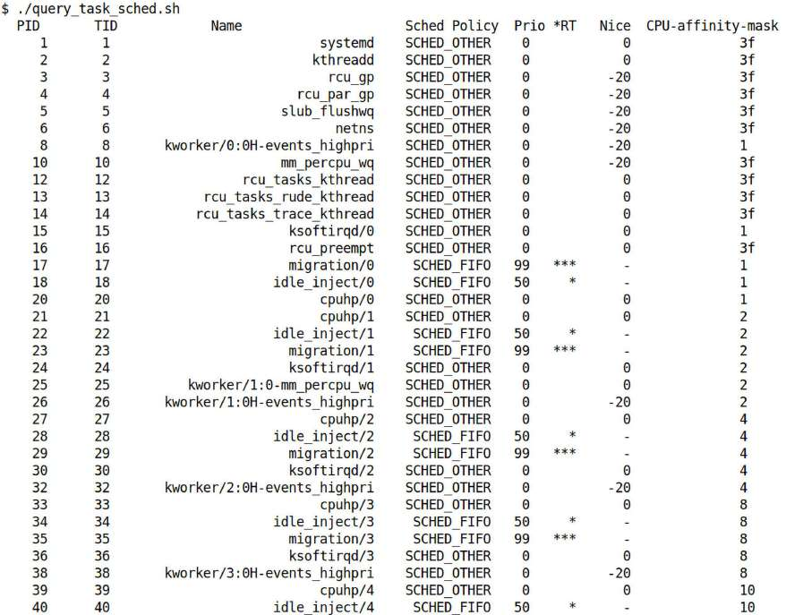

Hình 10.12: Ảnh chụp (một phần) Bash script ch10/query\_task\_sched.sh đang hoạt động

Một vài điều cần chú ý:

- Trong script, bằng GNU `ps`, qua command `ps -LA`, có thể thu thập mọi thread tồn tại trên hệ thống; PID và TID của chúng được hiển thị. Như đã học trong Chương 6, Kernel Internals Essentials – Processes and Threads, PID là tương đương user space của kernel TGID, và TID là tương đương user space của kernel PID. Do đó có thể kết luận:

  - Nếu PID và TID khớp, nó – thread thấy trên hàng ấy (cột ba có tên) – là thread `main()` của process.

  - Nếu PID và TID khớp, PID chỉ xuất hiện một lần, đó là single-threaded process.

  - Nếu PID lặp lại (cột ngoài cùng trái) với TID khác nhau (cột hai), process là multithreaded và các TID là children thread (chính xác hơn worker thread) của process. Script thể hiện bằng cách thụt số TID sang phải một chút (trong ảnh đã cắt bớt Hình 10.12 không thấy vì xảy ra sau).

- Chú ý phần lớn thread trên máy Linux điển hình (desktop, server hay cả embedded) thường non-real-time (thuộc policy `SCHED_OTHER`). Một vài (soft) real-time thread (SCHED\_FIFO/SCHED\_RR) cũng có thể xuất hiện. Thread Deadline (DL) và Stop-Sched (SS) thực sự hiếm (dù tất nhiên những điều như vậy thường đặc thù project).

- Hãy chú ý các quan sát sau về real-time thread xuất hiện trong output trên:

  - Script làm nổi bật mọi real-time thread (thread có Sched Policy, cột bốn, là `SCHED_FIFO` hay `SCHED_RR`) bằng dấu sao trong cột (thứ sáu), nhãn `*RT`.

  - Hơn nữa, mọi soft real-time thread có real-time priority 99 (giá trị tối đa có thể) có ba dấu sao cùng cột này (thường là specialized kernel thread).

- Flag `SCHED_RESET_ON_FORK`, khi Boolean OR với scheduling policy, có tác dụng không cho children (qua `fork()`) kế thừa privileged scheduling policy (biện pháp bảo mật).

- Cột áp chót là “nice” value của thread (nhớ khoảng -20 đến +19, với -20 priority tốt nhất, 19 tệ nhất, mặc định 0). Lưu ý nice value chỉ hợp lệ cho thread có scheduling policy `SCHED_OTHER` (cũng như batch và idle).

- Cột ngoài cùng phải hiển thị CPU affinity mask (hexadecimal), cũng là per-thread attribute! Ngụ ý có thể đặt CPU core mà thread có thể được schedule trên đó (trình bày chi tiết khía cạnh này trong chương sau). Ví dụ mask value 0x3f theo binary là 0011 1111, ngụ ý thread có thể chạy trên bất kỳ core nào được đặt 1, nên ở đây là mọi core (vì tổng cộng sáu core trên hệ thống).

Câu hỏi nhanh: giá trị CPU affinity mask 0x8 nghĩa là gì?

- Có thể đổi scheduling policy và/hoặc priority của thread bằng `chrt`; tuy nhiên nên hiểu đây là thao tác nhạy cảm cần root privilege (hoặc hiện nay cơ chế được ưu tiên là qua capabilities model, với `CAP_SYS_NICE` là capability bit cần thiết).

Chúng ta để bạn tự xem code của script (`ch10/query_task_sched.sh`). Đồng thời lưu ý hiệu năng và shell scripting không thực sự đi cùng nhau (nên đừng mong nhiều về hiệu năng ở đây). Hãy nghĩ – mỗi external command trong shell script (ở đây có nhiều như `awk`, `grep` và `cut`) đều có ngữ nghĩa `fork-exec-wait` và context switching. Đồng thời tất cả thực thi trong loop.

Program `tuna(8)`, công cụ system monitoring, tuning và profile management mạnh dựa trên GUI (hoặc console mode), có thể dùng để truy vấn và đặt nhiều attribute; gồm scheduling policy/priority ở mức process/thread, CPU affinity mask cũng như IRQ affinity. GUI được thiết kế tốt; hãy xem! (Cài tuna: `https://tuna.readthedocs.io/en/stable/installation.html`).

Đồng thời utility `schedtool` khá giống `chrt`, có thể dùng truy vấn và đặt bất kỳ hay mọi task scheduling parameter trên thread cho trước; man page schedtool(8) trình bày cách dùng.

Bạn có thể tự hỏi liệu (vài) thread có policy `SCHED_FIFO` và real-time priority `99` luôn chiếm processor hệ thống? Không hẳn; thực tế các thread này thường sleep phần lớn thời gian. Khi kernel thực sự cần chúng làm việc, nó đánh thức. Giờ chính nhờ real-time policy và priority rất cao, gần như bảo đảm chúng ít nhiều có CPU core ngay lập tức và thực thi bao lâu cần thiết (trở lại sleep khi xong). Điểm then chốt là khi cần processor, sẽ có (hơi giống RTOS nhưng không có bảo đảm chắc chắn, scheduling latency thấp và tính deterministic mà RTOS cung cấp).

Chính xác utility `chrt` truy vấn (và đặt) real-time scheduling policy/priority thế nào? À hẳn rõ: vì chúng ở trong task structure thuộc kernel Virtual Address Space (VAS), process `chrt` phải gọi system call. Có nhiều biến thể system call làm các việc này: `chrt` dùng `sched_getattr()` để truy vấn scheduling policy và priority, và system call `sched_setattr()` để đặt scheduling policy và priority. (Hãy chắc chắn xem `man` page của `sched(7)` để biết chi tiết các system call này và nhiều system call liên quan scheduler khác.) Chạy `strace` nhanh trên `chrt` thực sự xác minh!

```
$ strace chrt -p 1
[ … ]
sched_getattr(1, {size=56, sched_policy=SCHED_OTHER, sched_flags=0, sched_
nice=0, sched_priority=0, sched_runtime=0, sched_deadline=0, sched_period=0,
sched_util_min=0, sched_util_max=0}, 56, 0) = 0
newfstatat(1, "", {st_mode=S_IFCHR|0620, st_rdev=makedev(0x88, 0), ...}, AT_
EMPTY_PATH) = 0
write(1, "pid 1's current scheduling polic"..., 47pid 1's current scheduling
policy: SCHED_OTHER
) = 47
write(1, "pid 1's current scheduling prior"..., 39pid 1's current scheduling
priority: 0
) = 39
[ … ]
```

Giờ đã có kiến thức thực tế để truy vấn scheduling policy/priority và CPU affinity mask của thread, đến lúc đi sâu hơn một chút. Trong phần sau, chúng ta tiếp tục tìm hiểu cơ chế bên trong CPU scheduler của Linux.

Chúng ta sẽ hiểu kiến thức cơ bản về user preemption và kernel preemption, xác định chính xác ai chạy code kernel task scheduler và khi nào chạy. Tò mò chứ? Hy vọng vậy! Hãy đọc tiếp!

## Tìm hiểu CPU scheduling internals – phần 3

Hãy bắt đầu bằng khám phá chủ đề preemption.

### Preemptible kernel

Hãy hình dung tình huống giả định này: đang chạy trên hệ thống chỉ một CPU core. App đồng hồ kim chạy trên GUI cùng C program `a.out`, có một dòng code (ngán thật) `while (1);`. Vậy bạn nghĩ sao: process while 1 ngốn CPU sẽ chiếm CPU vô hạn, khiến GUI clock app ngừng tích tắc (kim giây ngừng hẳn) chứ?

Suy nghĩ (và thử nghiệm) một chút sẽ thấy GUI clock app thực sự tiếp tục tích tắc dù app ngốn CPU nghịch ngợm! Đây thực sự là toàn bộ mục đích OS-level scheduler: có thể và thực sự preempt (đá ra!) user-space process ngốn CPU. (Đã thảo luận ngắn thuật toán CFS; CFS khiến CPU-bound process hung hăng tích lũy giá trị `vruntime` khổng lồ nên dịch xa hơn sang phải trên rb-tree runqueue, do đó tự bị phạt về processor!) Mọi OS hiện đại hỗ trợ kiểu preemption này – gọi là user-mode preemption.

Nhưng giờ xét: nếu viết kernel module thực hiện cùng infinite loop `while(1)` trên single-core system thì sao? Gây vấn đề: giờ hệ thống đơn giản treo. Vì sao? Vì theo mặc định phần lớn OS kernel là non-preemptible; nghĩa là không tự preempt được!

Ngoài ví dụ tầm thường này, chắc chắn có trường hợp thực tế mà khi kernel non-preemptible sẽ tác động xấu đến (real-time) thread scheduling. Hãy nghĩ: nếu high-priority thread nằm trên runqueue (nên runnable) cần chạy khẩn cấp, nhưng kernel mắc trong loop dài ở một section non-preemptible của kernel code (hoặc kernel module/driver code) thì sao? Hoặc hardware interrupt xảy ra nhưng không phục vụ được vì interrupt bị mask trong, một lần nữa, non-preemptible code section chạy lâu… Locking đóng vai trò ở đây (như sẽ học chi tiết hơn nhiều trong hai chương cuối); thực tế nhiều năm kernel có lock rất coarse-grained (và recursive) khét tiếng tên Big Kernel Lock (BKL); khi giữ, nó giữ kernel ở non-preemptible state khá lâu (với interrupt bị mask), gây ảnh hưởng nghiêm trọng hiệu năng và latency response. Nó (cuối cùng!) được loại bỏ hoàn toàn trong kernel 2.6.39.

Vì vậy câu hỏi xuất hiện: khi cần, kernel có thể tự preempt không? Đoán xem: nhiều năm nay Linux đã cung cấp build-time configuration option để làm kernel preemptible; tên `CONFIG_PREEMPT`. (Thực ra chỉ là bước phát triển hướng đến mục tiêu dài hạn cắt latency, cải thiện kernel response và scheduler response. Phần lớn công việc đến từ các nỗ lực trước đó và một số đang tiếp diễn: Low Latency (LowLat) patch, công việc RTLinux (cũ), đặc biệt project RTL (Real-Time Linux) (nơi Linux chạy như RTOS thực sự! Sẽ trình bày một chút thiết lập RTL trong chương sau).)

Một khi kernel config option `CONFIG_PREEMPT` được bật, kernel được build và boot vào, chúng ta chạy trên preemptible kernel – nơi ở phần lớn điểm OS có khả năng tự preempt!

Để xem option, trong UI `make menuconfig`, đến General Setup \| Preemption Model.

Thực ra còn hơn thế; theo mặc định Linux kernel hiện đại có ba kernel config option về kernel preemption:

| Loại preemption | Đặc điểm |
|---|---|
| `CONFIG_PREEMPT_NONE` | Model truyền thống, hướng đến throughput tổng thể cao (dành cho server). Dù đôi khi có thể có delay dài (hơn), đây là option chọn để “tối đa raw processing power của kernel, bất kể scheduling latency”. (Ở đây kernel preemption chỉ giới hạn nơi gọi tường minh `cond_resched()`.) |
| `CONFIG_PREEMPT_VOLUNTARY` | Preemptible kernel (dành desktop/laptop); nhiều preemption opportunity point tường minh hơn trong OS (các điểm gọi `cond_resched()` và `might_sleep()`). Mang lại scheduling latency thấp hơn và app response tốt hơn, đổi lại throughput hơi thấp hơn. Thường mặc định cho distro. |
| `CONFIG_PREEMPT` | Còn gọi LowLat kernel; (gần như) toàn kernel preemptible (dành desktop/laptop/embedded system mạnh). Chọn option này ngụ ý giờ có thể involuntary-preempt ngay cả kernel code path (mọi section kernel code nơi preemption không bị tắt tường minh giờ đều preemptible). Cho scheduling latency còn thấp hơn (trung bình khoảng vài chục đến hơn một trăm microsecond), đổi lại throughput hơi thấp hơn và runtime overhead nhẹ. Chọn nếu build kernel cho desktop hay embedded system có yêu cầu latency ở mức millisecond |

Bảng 10.4: Linux OS kernel preemption – các configuration option có sẵn

Kbuild configuration file `kernel/Kconfig.preempt` chứa menu entry liên quan các preemptible kernel option. (Như sẽ thấy chương sau, khi build Linux làm RTOS, lựa chọn kernel preemption thứ tư tên `CONFIG_PREEMPT_RT` xuất hiện.)

Sẽ hay nếu có thể chọn dynamic hành vi kernel preemption lúc boot phải không? Phần tiếp theo cho biết cách!

#### Tính năng dynamic preemptible kernel

Từ kernel 5.12, tính năng dynamic preemptible kernel mới (`CONFIG_PREEMPT_DYNAMIC`) được giới thiệu. Bật cho phép điều chỉnh hành vi (hay mode) preemption của kernel lúc boot bằng cách truyền kernel parameter (tất nhiên qua bootloader); tên `preempt=`.

Các giá trị có thể đặt như sau (tham khảo Bảng 10.4):

- `preempt=none`: Hành vi kernel preemption giống `CONFIG_PREEMPT_NONE`.

- `preempt=voluntary`: Hành vi kernel preemption gần với `CONFIG_PREEMPT_VOLUNTARY`.

- `preempt=full` \[mặc định\]: Hành vi kernel preemption giống `CONFIG_PREEMPT`.

Use case điển hình được hướng đến là cho distribution ship một kernel binary image – build với `CONFIG_PREEMPT`, tích hợp (gần như) full kernel preemption – nhưng cho end user sửa kernel preemption mode lúc boot, do đó chọn chạy như server-class system điển hình (với `preempt=none`), desktop (`preempt=voluntary`), hoặc bật full preemption. Theo cách này distro (hay sản phẩm) không phải ship và duy trì nhiều kernel image khác nhau để phục vụ use case khác nhau.

Kernel config tên `CONFIG_PREEMPT_DYNAMIC`; đặt thành `y` bật tính năng. (Để làm trong UI `make menuconfig`, đến General Setup \| Preemption behaviour defined on boot. Là Boolean; bật, rebuild, reboot và truyền parameter `preempt=<value>`.)

Để bạn biết, `uname -a` cũng như `/proc/version` sẽ hiển thị tính năng nếu bật (ví dụ tôi bật trên custom kernel 6.1 (trên Fedora VM)):

```
$ uname -a
Linux fedora 6.1.25-onfc38 #4 SMP PREEMPT_DYNAMIC Wed Jul 26 21:49:07 IST 2023
x86_64 GNU/Linux
```

Bài tập đề xuất: Bật `CONFIG_PREEMPT_DYNAMIC` trên custom kernel 6.1 LTS; build rồi boot với các giá trị khác nhau cho kernel parameter `preempt`= (và xác minh đã truyền bằng cách xem `/proc/cmdline`).

Được rồi, xong việc đó, chúng ta trở lại thêm chi tiết các khía cạnh nội bộ. Hãy tóm lược rất ngắn vài điểm then chốt đã học trong các phần trước. Đã học core kernel scheduling code đặt trong function `void schedule(void)`, thin wrapper trên worker function `__schedule()`, và nó duyệt modular scheduler class theo priority order, cuối cùng có thread được chọn (bởi code của một scheduling class bên dưới) để context-switch đến. Tất cả ổn; giờ một vài câu hỏi then chốt: chính xác ai gọi core code path “task scheduling” này và chính xác khi nào chạy? (Đúng điều connector nhãn “S” ở trên cùng Hình 10.9 gợi đến!) Các phần sau cố trả lời; tiếp tục nào!

### Ai chạy scheduler code?

Một hiểu nhầm tinh vi nhưng then chốt về cách scheduling hoạt động đáng tiếc nhiều người có: tưởng tượng tồn tại một dạng kernel thread (hay thực thể tương tự) tên “scheduler”, định kỳ chạy và schedule task. Điều này hoàn toàn sai; trong monolithic OS như Linux, scheduling do chính process context thực hiện, các thread thông thường chạy trên CPU trong kernel mode!

Thực tế scheduling code luôn do process context hiện thực thi kernel code chạy – nói cách khác bởi `current` (đã trình bày chính xác `current` là gì trong Chương 6, Kernel Internals Essentials – Processes and Threads, tại phần Truy cập task structure bằng current).

Đây có lẽ cũng là lúc thích hợp nhắc một quy tắc vàng của Linux kernel: scheduler không bao giờ được chạy trong bất kỳ atomic context nào (gồm interrupt context).

Nói cách khác, code atomic context (nghĩa đen không thể chia) và/hoặc interrupt context phải được bảo đảm non-blocking và atomic – phải chạy đến hoàn tất không gián đoạn. Vì vậy không gọi được `schedule()`, vì không có nghĩa gì. (Code path làm sao atomic khi đưa caller vào sleep? Không thể, nên đừng gọi.) Hoặc ví dụ khác, gọi `kmalloc()` với flag `GFP_KERNEL` trong bất kỳ atomic context là sai – vì flag `GFP_KERNEL` nói có thể block! Nhưng với flag `GFP_ATOMIC` thì ổn, vì chỉ thị kernel memory management code không bao giờ block.

Đồng thời điều quan trọng cần hiểu là trong preemptible kernel, kernel preemption bị vô hiệu hóa khi schedule code path chạy; điều này cũng hợp lý.

Tóm lược nhanh các điểm then chốt học ở đây: core task scheduling code trên Linux – code của `[__]schedule()` và mọi thứ nó gọi – chạy trong process context bởi process (thực ra thread) sắp tự đưa mình khỏi CPU bằng cách cuối cùng context-switch sang thread khác! Và thread đó là gì? Tất nhiên `current`! (Xem lại Hình 10.9 và Hình 10.11; các code path ở đó – trừ ô cuối dưới cùng nơi “next” thread chạy trên core – do `current` chạy). Đồng thời có “quy tắc”: không bao giờ gọi `schedule()` trong bất kỳ atomic context nào (gồm interrupt context).

Nhưng khi nào xảy ra, nói cách khác chính xác khi nào `schedule()` được gọi? Đọc tiếp để biết...

Tôi hiểu nếu bạn thấy các phần sau hơi khó trong lần đọc đầu… không sao. Nếu thích, trước mắt có thể lướt chi tiết (và có lẽ xem phần Các entry point của CPU scheduler – tóm lược để nắm bản tóm lược). Trở lại chi tiết khi sẵn sàng.

### Khi nào schedule() chạy?

Nhiệm vụ OS scheduler là phân xử truy cập processor resource (CPU), chia sẻ giữa các thực thể (thread) cạnh tranh muốn dùng. Nhưng nếu hệ thống bận, nhiều thread liên tục cạnh tranh, giành rồi nhường processor thì sao? Chính xác hơn, điều thực sự hướng đến là: để bảo đảm chia sẻ công bằng CPU resource giữa task, phải bảo đảm người cảnh sát trong bức tranh, chính scheduler, chạy định kỳ trên processor. Nghe hay, nhưng chính xác bảo đảm thế nào?

Đây là cách có vẻ hợp lý: cho OS hook vào interrupt của timer chip lúc boot và, như một phần “housekeeping” trong interrupt handler routine khi timer interrupt xảy ra, gọi scheduler! Giờ (hơi đơn giản hóa), trái với những gì đã học trước, timer interrupt “phát” `CONFIG_HZ` lần một giây.

Vì vậy nếu gọi `schedule()` ở đây, nó có cơ hội chạy `CONFIG_HZ` lần một giây (thường đặt 250 trên Ubuntu x86\_64 và 1.000 trên Fedora x86\_64)! Tuy nhiên chờ đã, đã học quy tắc vàng trong Chương 8, Kernel Memory Allocation for Module Authors – Part 1, tại phần Không bao giờ sleep trong interrupt context hay atomic context: không thể gọi scheduler trong bất kỳ atomic context nào (gồm interrupt context) (như vừa nhắc lại). Vì vậy theo quy tắc này đơn giản không thể gọi scheduler code path trong timer interrupt (làm vậy ngay lập tức gây kernel bug).

Vậy OS làm gì? Sẽ đến, nhưng trước tiên cần trình bày kiến thức cơ bản về structure tên `thread_info`.

#### Hiểu tối thiểu structure thread\_info

Để hiểu rõ các điểm sau, cần biết kiến thức cơ bản về arch-dependent per-thread data structure tên `thread_info`. Structure nhỏ, chứa một vài “hotspot” member then chốt (ban đầu từng nằm trong task structure). Lý do có structure `thread_info` như thường lệ là hiệu năng; xem nội dung `thread_info` nhanh hơn nhiều so với xem nội dung task structure lớn, vì nhỏ hơn nhiều và thường được thiết kế vừa một CPU cacheline. (Ít nhất trên cả x86\_64 và AArch64 đúng vậy: kích thước chỉ 24 byte. Đồng thời structure được tận dụng để tính `current` trên AArch32.)

Structure `thread_info` có lịch sử vị trí đầy màu sắc. Trong Linux ban đầu là thực thể hoàn toàn riêng; từ Linux 2.6, trên nền tảng 32-bit (ít nhất x86-32 và AArch32), nằm trong kernel-mode stack của mỗi thread. Trên Linux version gần đây hơn (từ 4.0 hoặc 4.4) và một số architecture, khi `CONFIG_THREAD_INFO_IN_TASK=y`, trở thành member của chính task structure (chủ yếu do vấn đề bảo mật).

Có thể xem định nghĩa `thread_info` cho x86\[\_64\] tại `https://elixir.bootlin.com/linux/v6.1.25/source/arch/x86/include/asm/thread_info.h#L56` và cho AArch64 tại `https://elixir.bootlin.com/linux/v6.1.25/source/arch/arm64/include/asm/thread_info.h#L24`.

Cho mục đích trước mắt, chỉ một member của `thread_info` có ý nghĩa – bitmask: `unsigned long flags`. Như có thể đoán, là bitmask của nhiều flag value (tất cả kiểu `TIF_<FOO>`, với `TIF` viết tắt “thread\_info flag”). Sẽ thấy mọi flag macro `TIF_*` định nghĩa tại đây trong codebase: `https://elixir.bootlin.com/linux/v6.1.25/source/arch/x86/include/asm/thread_info.h#L76`. Trong nhiều flag tồn tại, flag then chốt trong thảo luận task scheduling là `TIF_NEED_RESCHED`. Như sắp giải thích, nếu được đặt, ngụ ý kernel “cần reschedule sớm nhất có thể”; nếu xóa, không cần reschedule.

Chủ đề khác đôi lúc xuất hiện trong thảo luận này là hardware interrupt và cách xử lý (`hardirqs` và `softirqs`) trên Linux. Một lần nữa, sách Linux Kernel Programming, Part 2 (miễn phí!), Chương 4, Handling Hardware Interrupts, trình bày chuyên sâu; hãy xem nếu cần.

Được rồi, giờ đã hiểu kiến thức cơ bản về structure `thread_info`, hãy trở lại thảo luận! Phần “khi nào” của scheduling code path (`schedule()`) và mọi thứ nó gọi chia thành hai phần: một, khi nào bit `TIF_NEED_RESCHED` được đặt?

Và hai, khi nào bit `TIF_NEED_RESCHED` được kiểm tra? Hãy xem:

- Khi nào bit “need-resched” (`TIF_NEED_RESCHED`) được đặt?

Bit `thread_info.flags:TIF_NEED_RESCHED` (không phải C code; chỉ để thể hiện bit “need resched” về khái niệm), khi được đặt, thực chất giống cờ đỏ báo kernel rằng phải (re)schedule sớm nhất có thể (thực chất `current` phải được preempt ngay!). Có thể đặt flag trong các context:

  - Housekeeping của (Timer) Interrupt: Trên mỗi timer interrupt (về kỹ thuật trong timer `softirq` code path), thực hiện “housekeeping” liên quan scheduler; trong các công việc ở đây, câu hỏi then chốt: `current` có cần bị preempt không? Nếu có, đặt bit `TIF_NEED_RESCHED`. (Cẩn thận: chỉ đặt bit; không gọi `schedule()` ở đây, vì không được phép.)

  - Task awakening: Khi task được đánh thức, được enqueue vào runqueue thích hợp; giờ nếu xác định nó phải preempt `current`, đặt bit `thread_info.flags:TIF_NEED_RESCHED`.

- Khi nào bit “need-resched” (`TIF_NEED_RESCHED`) được kiểm tra?

Scheduling Opportunity – nhận biết Process context: Cho `current` kiểm tra bit `thread_info.flags:TIF_NEED_RESCHED` có được đặt không ở một số process context “opportunity point” được thiết kế tốt; nếu bit đặt, gọi schedule code path; nếu không tiếp tục như thường.

Bạn có nhận thấy? Trong cả trường hợp Housekeeping của (Timer) Interrupt và Task awakening, dù chạy trong interrupt context vẫn không có gì sai. Vì không gọi `schedule()` ngay tại đây; chỉ đặt flag `TIF_NEED_RESCHED` để báo kernel cần reschedule sớm nhất có thể, và reschedule phải xảy ra tại “opportunity point” sẵn có tiếp theo! Chúng ta mở rộng thảo luận trong vài phần sau.

#### Housekeeping của timer interrupt – đặt TIF\_NEED\_RESCHED

Trong timer interrupt (trong code `kernel/sched/core.c:scheduler_tick()`, nơi interrupt bị tắt trên local core), kernel thực hiện meta-work (housekeeping) cần thiết để giữ scheduling trôi chảy; gồm liên tục cập nhật per-CPU runqueue thích hợp, task load balancing, v.v. Lưu ý function `schedule()` thực tế không bao giờ được gọi ở đây. Nhiều nhất là scheduling class hook function (cho process context `current` bị interrupt), `sched_class:task_tick()`, nếu khác null, được gọi (tham khảo Hình 10.13). Ví dụ với thread bất kỳ thuộc fair (CFS) class, cập nhật member `vruntime` (virtual runtime) và thời gian task ở processor (có thiên lệch theo priority) được làm ở đây, trong hook function tên `task_tick_fair()`.

Kỹ thuật hơn, toàn bộ công việc mô tả trong đoạn trước, code `scheduler_tick()`, chạy trong timer interrupt softirq code path, `TIMER_SOFTIRQ`.

Giờ (ngoài housekeeping liên quan sched khác), khi trong timer interrupt (softirq) context này, phải quyết định: `current` có cần bị preempt không? Quyết định then chốt được đưa ra bằng kiểm tra các điều kiện sau và preempt current nếu bất kỳ điều kiện nào đúng:

- `current` đã vượt time quantum chưa? Hơn nữa, đã vượt một ngưỡng đủ lớn so với task lân cận chưa? Đây chính là thứ tunable (hay sysctl) `/sys/kernel/debug/sched/min_granularity_ns` giữ; là effective CFS timeslice. Mặc định khác nhau (3 ms trên Ubuntu 22.04 x86\_64 và 2,25 ms trên Fedora 38/39. Nhắc nhanh, đã trình bày thông tin này, effective CFS timeslice, trong phần Ghi chú về CFS scheduling period và timeslice).

- Task mới sinh và chạy, hoặc vừa được đánh thức (trên CFS runqueue này), có priority cao hơn `current` không?

- CFS rb-tree có task với `vruntime` thấp hơn `current` không (nói cách khác `current` không còn là leaf node ngoài cùng trái trên tree)?

(Nghĩ kỹ, điểm thứ nhất và thứ ba khá giống; nếu time quantum vượt, rất có thể giá trị `vruntime` đã tăng đến mức không còn là leaf node ngoài cùng trái trong runqueue.)

Giả sử kernel code path vừa mô tả quyết định task mới xứng đáng CPU hơn; rồi sao? Có gọi `schedule()`? Không! Như vừa giải thích ở trên, không gọi được `schedule()` trong interrupt context. Kernel giờ chỉ “đánh dấu” thực tế cần reschedule ngay khi khả thi, tại “scheduling opportunity point tiếp theo”, bằng đặt flag “global” – bit `TIF_NEED_RESCHED` trong `thread_info->flags`. (Lý do đặt từ global trong ngoặc kép là thực sự không phải kernel-wide global; chỉ là bit trong bitmask `thread_info->flags` của instance `current`, tên `TIF_NEED_RESCHED`. Vì sao? Truy cập bit theo cách này nhanh hơn qua global!) Hơn nữa cần ghi nhớ nếu task mới sinh hay vừa được đánh thức cần được schedule, được đặt vào runqueue thích hợp và chưa chạy ngay; sẽ chạy trong tương lai gần khi cơ hội scheduling tiếp theo đến.

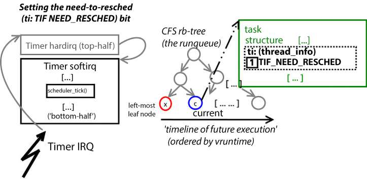

Hình 10.13: Sơ đồ khái niệm cho thấy việc đặt bit thread\_info-\>flags.TIF\_NEED\_RESCHED trong context của timer softirq

Hình 10.13 thể hiện điều này về khái niệm. Khi timer interrupt (hay IRQ) xảy ra, phần handler nhanh và nhỏ gọi là top-half hay hardirq chạy, rất nhanh thực hiện công việc; khi xong kernel gọi timer bottom-half hay softirq handler (phần trái Hình 10.13). Ở đây một phần công việc là timer housekeeping task như đã mô tả. Chúng ta thể hiện CFS rb-tree về khái niệm, với node x là leaf node ngoài cùng trái và c là node biểu diễn `current` (phần giữa Hình 10.13). Vì vậy trong sơ đồ `current` không còn là leaf node ngoài cùng trái (ngụ ý giá trị `vruntime` cao hơn x). Code trong các timer housekeeping code path (liên quan scheduler) phát hiện trường hợp và đặt bit `TIF_NEED_RESCHED` (`ti` viết tắt `thread_info`, trong Linux hiện đại nằm trong task structure như phần phải Hình 10.13 cho thấy).

Nơi khác thực hiện kiểm tra tương tự là khi task được đánh thức. Khi xảy ra, task dequeue khỏi wait queue đang ở và enqueue vào CPU runqueue. Giờ nếu thấy task vừa đánh thức (trên core:runqueue ấy) phải preempt `current` (do priority cao hơn, ít `vruntime` hơn hay gì khác), bit `TIF_NEED_RESCHED` được đặt. (Thảo luận chi tiết hơn trường hợp trong phần Các entry point của CPU scheduler – tóm lược sắp tới.)

Cũng cần nhấn mạnh trong trường hợp điển hình (nhiều khả năng), khi chạy timer softirq code path thường không cần preempt `current`, nên không cần đặt bit `thread_info.flags:TIF_NEED_RESCHED`; nó vẫn clear. Nếu đặt, scheduler activation sớm xảy ra, nhưng chính xác khi nào? Hãy đọc tiếp...

#### Phần process context – kiểm tra TIF\_NEED\_RESCHED

Một mặt của vấn đề, phần timer interrupt (softirq) của scheduling housekeeping vừa mô tả, nơi có thể đặt bit `thread_info:TIF_NEED_RESCHED` để “báo” kernel rằng schedule code nên được gọi sớm nhất có thể, được thực hiện liên tục khi hệ thống chạy.

Mặt còn lại là kiểm tra hay nhận biết bit có được đặt và nếu có thì gọi `schedule()`; phần sau này – gọi `schedule()` – lưu ý kỹ:

- chỉ được thực hiện trong process context, và

- chỉ tại một số “opportunity point” cụ thể rải khắp kernel code path

Sau đây là các opportunity point điển hình nơi kiểm tra `thread_info->flags.TIF_NEED_RESCHED` (thường qua helper `need_resched()`):

- Khi return từ system call code path.

- Khi return từ interrupt code path.

- Nói chung mọi chuyển đổi từ non-preemptible mode sang preemptible mode trong kernel đều là opportunity point (khi `preempt_enable()` được gọi). Điển hình là khi spinlock được unlock.

Vậy hãy nghĩ: mỗi lần thread chạy user space gọi system call, thread ấy được (context-)switch sang kernel mode rồi chạy code trong kernel với kernel privilege (đây là monolithic kernel design). Tất nhiên system call có độ dài hữu hạn; khi xong có return path đã biết sẽ theo để switch lại user mode và tiếp tục thực thi ở đó.

Trên return path này trong kernel, một scheduling opportunity point được đưa vào: kiểm tra bit `TIF_NEED_RESCHED` (trong member `flags` của structure `thread_info`) có đặt không. Nếu có, scheduler được kích hoạt bằng cách cho process context gọi `schedule()`.

Các nơi khác có thể gọi `schedule()` là:

- Mọi lời gọi tường minh (hay ngầm) đến `schedule()` (ví dụ khi có blocking call)

- Mọi lời gọi function `cond_resched*()` có thể dẫn đến `schedule()` được gọi.

Hiển nhiên gọi tường minh hay ngầm `schedule()` khi ở process context sẽ kích hoạt chạy nó. Hơn nữa kernel cung cấp vài “conditional schedule” API (như `cond_resched()`), cho phép chẳng hạn driver kiểm tra: mình có ngốn quá nhiều CPU không? Nếu có thì yield… Chúng dẫn đến `schedule()` được gọi khi cần (thực chất chỉ khi bit `current->ti->flags.TIF_NEED_RESCHED` được đặt).

Về code path return-from-kernel-to-user-mode, đây là luồng kích hoạt scheduling code path:

```
// include/linux/entry-common.h
#define EXIT_TO_USER_MODE_WORK                      \
    (_TIF_SIGPENDING | _TIF_NOTIFY_RESUME | _TIF_UPROBE |       \
     _TIF_NEED_RESCHED | _TIF_PATCH_PENDING | _TIF_NOTIFY_SIGNAL |  \
     ARCH_EXIT_TO_USER_MODE_WORK)
```

Chú ý không chỉ để scheduling mà kernel có thể chuẩn bị switch lại user mode; còn nhiều việc khác phải xử lý (thực chất đây cũng là opportunity point cho các việc khác – như xử lý pending signal, uprobe, kernel live patching và hơn nữa). Nếu bất kỳ bit trên được đặt, macro `EXIT_TO_USER_MODE_WORK` trả về `True`; kernel chuẩn bị exit-to-user-mode rồi gọi `schedule()`; đây là góc nhìn code:

```
kernel/entry/common.c
static void exit_to_user_mode_prepare(struct pt_regs *regs)
{
  …
  ti_work = read_thread_flags();
  if (unlikely(ti_work & EXIT_TO_USER_MODE_WORK))
        ti_work = exit_to_user_mode_loop(regs, ti_work);
[ … ]
static unsigned long exit_to_user_mode_loop(struct pt_regs *regs,
                        unsigned long ti_work)
{
    /*
     * Before returning to user space ensure that all pending work
     * items have been completed.
     */
    while (ti_work & EXIT_TO_USER_MODE_WORK) {
        local_irq_enable_exit_to_user(ti_work);

        if (ti_work & _TIF_NEED_RESCHED)
            schedule();
        [ … ]
        if (ti_work & (_TIF_SIGPENDING | _TIF_NOTIFY_SIGNAL))
            arch_do_signal_or_restart(regs);
        [ … ]
```

Tương tự, điều tương tự có thể xảy ra sau khi xử lý hardware interrupt bất kỳ (và mọi softirq handler liên quan cần chạy). Khi xử lý hardware interrupt bất kỳ, kernel tất nhiên được đặt non-preemptible; nhưng khi xử lý xong, được reset về preemptible. Đây là opportunity point: kernel kiểm tra bit `TIF_NEED_RESCHED`, nếu đặt thì gọi `schedule()`. (Nhân tiện, cùng cơ hội xuất hiện khi spinlock được unlock, vì lúc ấy kernel được đặt preemptible!)

Sơ đồ sau (Hình 10.14) cố thể hiện công việc này về khái niệm khi hoạt động. Phần trên (điểm 1A đến 5A; đọc tuần tự để theo dõi việc xảy ra) cho thấy kiểm tra bit `TIF_NEED_RESCHED` tại code path opportunity point “return from system call”; phần dưới (điểm 1B đến 3B) cho thấy “hardware interrupt (hardirq) return path opportunity point”:

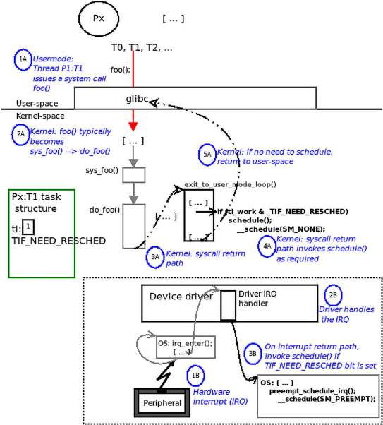

Hình 10.14: Sơ đồ khái niệm cho thấy việc kiểm tra bit TIF\_NEED\_RESCHED trong

#### Các entry point của CPU scheduler – tóm lược

Ở đây tóm lược các thảo luận trước về đặt và nhận biết bit `TIF_NEED_RESCHED`; thực chất trả lời chính xác câu hỏi khi nào đi vào `schedule()`, hay chính xác khi nào scheduling được kích hoạt (xem lại Hình 10.9, Hình 10.13 và Hình 10.14 có thể hữu ích khi đọc); vậy `schedule()` được gọi (hay core scheduler được kích hoạt):

- Khi process/thread thực hiện blocking call tường minh bất kỳ: hợp lý. Blocking API cuối cùng gọi `schedule()` vì caller phải chờ event nào đó (khi event xuất hiện, kernel (hoặc driver đưa nó vào sleep) sẽ đánh thức).

- User-mode preemption từ timer housekeeping: nếu một trong ba điều kiện mô tả trong phần Housekeeping của timer interrupt – đặt TIF\_NEED\_RESCHED đúng; hãy nhắc nhanh (xem Hình 10.13):

- `current` đã vượt time quantum (effective timeslice) đủ lượng (giá trị `min_granularity_ns`) chưa?

- Task mới sinh hay vừa đánh thức có priority cao hơn `current` (task hiện thực thi kernel code path) không?

- CFS rb-tree có task với `vruntime` thấp hơn `current` không (nói cách khác `current` không còn là leaf node ngoài cùng trái trên tree)?

- Timer (softirq) housekeeping: kiểm tra có cần đặt bit `TIF_NEED_RESCHED` không (kiểm tra được thực hiện trong timer softirq context function `scheduler_tick()`; xem Hình 10.13). Lưu ý bit `TIF_NEED_RESCHED` có thể được đặt ở đây nhưng `schedule()` không bao giờ được gọi ở đây.

- Tóm lược mọi “opportunity point”: ở đây kiểm tra bit `TIF_NEED_RESCHED` có đặt không. Sau đây là các “opportunity point” nơi kiểm tra được làm trong process context (xem Hình 10.14):

- Trên system call return path

- Trên interrupt return path

- Các điểm khác kích hoạt scheduling (lặp lại một chút ở đây):

- mọi lời gọi `schedule()`

- mọi lời gọi `cond_resched*()` có thể dẫn đến gọi `schedule()`

- (nói chung mọi chuyển đổi từ non-preemptible mode sang preemptible mode trong kernel).

- Wakeup xảy ra: tình huống này có task được thêm vào runqueue. Task có phải preempt `current` không? Nếu có, đặt `TIF_NEED_RESCHED` và gọi `schedule()` tại opportunity point tiếp theo:

- Trong preemptible kernel: tại bất kỳ kernel preemption point (thực chất bất cứ khi nào `preempt_enable()` được gọi – ví dụ spinlock được unlock):

- trong mọi system call, khi return

- trong mọi hardware interrupt, khi return

- Trong non-preemptible kernel, tại lần tiếp theo:

- return từ system call về user space

  - return từ interrupt về user space

  - mọi lời gọi `cond_resched*()`

  - mọi lời gọi tường minh `schedule()`

Các comment chi tiết ngay trước core kernel scheduling function `kernel/sched/core.c:__schedule()` rất đáng đọc; chỉ định mọi entry point có thể vào kernel CPU scheduler (như vừa học). Với codebase kernel 6.1, có tại đây; hãy xem: `https://elixir.bootlin.com/linux/v6.1.25/source/kernel/sched/core.c#L6396`.

#### Core scheduler code ngắn gọn

Như đã nói, luôn nhớ scheduler code được chạy trong process context bởi process (thực ra thread) sắp tự đưa mình khỏi CPU bằng cách cuối cùng context-switch sang thread khác! Và thread ấy là gì? Tất nhiên `current`!

Function `__schedule()` có (trong số các variable khác) hai local variable, pointer đến `struct` `task_struct` tên `prev` và `next`. Pointer `prev` được đặt thành `rq->curr`, không gì khác ngoài `current`! Pointer `next` sẽ được đặt thành task sắp context-switch đến và chạy tiếp! Vậy bạn thấy, `current` chạy scheduler code, tự gọi mình là previous task, thực hiện công việc chạy pick-next-task cho modular scheduling class đó (thực chất scheduling algorithm), rồi tự đưa khỏi processor bằng context-switch sang `next`! Một lần nữa, đáng xem lại Hình 10.9, hiểu rằng các code path ở đó – trừ ô cuối dưới cùng nơi “next” thread chạy trên core – do không ai khác ngoài `current` chạy!

Sau đây là vài snippet từ core scheduling code (với chú giải `<< like this >>` nhắc lại các điểm đã thảo luận): `https://elixir.bootlin.com/linux/v6.1.25/source/kernel/sched/core.c#L6435`.

```
static void __sched notrace __schedule(unsigned int sched_mode)
{
        struct task_struct *prev, *next;
        unsigned long *switch_count;
        unsigned long prev_state;
        struct rq_flags rf;
        struct rq *rq;
        int cpu;

        cpu = smp_processor_id();
        rq = cpu_rq(cpu);
        prev = rq->curr;         << this is current ! >>
    [ ... ]
        next = pick_next_task(rq, prev, &rf);
            << Here we 'pick' the task to run next in an 'object-
                oriented' manner, as discussed earlier in detail... >>
        clear_tsk_need_resched(prev);
        clear_preempt_need_resched();
    [ ... ]
        if (likely(prev != next)) {   << switching to another thread's likely…
>>
         [ ... ]
            /* Also unlocks the rq: */
             rq = context_switch(rq, prev, next, &rf);
    [ ... ]
}
```

Sau đây là vài lời nhanh về context switch thực tế.

##### Context switch

Để kết thúc chương, hãy xem nhanh context switch (CPU scheduler). Nhiệm vụ context switch (trong context CPU/task scheduler) khá rõ: trước khi đơn giản switch sang next task, OS phải lưu state của previous task, nghĩa là task hiện thực thi (nói cách khác state của `current`). Task structure chứa structure khác nhúng bên trong để lưu/lấy hardware context của thread; đó là member `struct thread_struct thread` (trên x86 luôn là member cuối cùng của task structure).

Trong Linux, inline function `kernel/sched/core.c:context_switch()` làm công việc context switching; đến giờ tất nhiên bạn hiểu code được `current` chạy, được xem là “previous” task. Nó thực hiện switch từ task `prev` (từ `current`) sang task `next`, bên thắng scheduling round hay cuộc chiến preemption này. Context switch về cơ bản thực hiện qua hai giai đoạn rất đặc thù architecture:

- Memory (MM) switch: Switch một arch-specific CPU register để trỏ đến memory descriptor structure (`struct mm_struct`) của `next`. Trên x86\[\_64\], register tên CR3 (Control Register 3); trên ARM (AArch32), tên register TTBR0 (Translation Table Base Register 0). Vì sao? Vì từ `mm_struct`, kernel có thể “thấy” toàn bộ bức tranh memory của process, quan trọng gồm pointer đến base của paging table; đặt pointer đúng do đó khiến MMU tham chiếu paging table của `next` khi address translation lúc `next` thực thi!

- CPU switch thực tế: Switch từ `prev` sang `next` bằng cách lưu stack và CPU register state của `prev`, khôi phục stack và CPU register state của `next` vào processor; làm trong macro `switch_to()`. Điều này khiến `next` tiếp tục xử lý chính xác nơi đã dừng...

Chúng ta không trình bày implementation chi tiết hơn của context switch ở đây; hãy xem phần Đọc thêm để có thêm tài liệu.

Cuối cùng, một điều rất thú vị: kernel cung cấp cách isolate một tập processor cho trước khỏi nhiễu – thực chất khỏi tác động scheduling class và SMP load balancing! Đạt được bằng cách chỉ định kernel parameter `isolcpus=[flag-list,]<cpu-list>`.

`flag-list` mặc định `domain`; khi được chỉ định – và như mặc định – mọi CPU core trong `cpu`-`list` chỉ định được isolate khỏi “các general SMP balancing algorithm và scheduling algorithm”. (Thường hữu ích cho một số loại real-time application.)

Tuy nhiên chờ chút: kernel parameter `isolcpus`= giờ được xem là deprecated; thay vào đó được khuyên tận dụng cpusets cgroups (v2) controller mạnh và linh hoạt hơn. Đừng lo – sẽ trình bày nhiều chi tiết cgroup trong chương tới.

## Tổng kết

Trong chương này, bạn đã học nhiều nội dung và khía cạnh CPU scheduler (hay task scheduler) của Linux kernel linh hoạt. Trước tiên thấy KSE thực tế là thread chứ không phải process. Cũng học rằng trong monolithic OS như Linux không có “scheduler” thread trong kernel: scheduling do process context thread – thread `current` – chạy scheduling code path thực hiện, tự context-switch sang next task khi xong (qua đó tự đưa mình khỏi processor – tất nhiên timer interrupt softirq housekeeping code path cũng đóng vai trò then chốt trong scheduler-related housekeeping!).

Sau đó có hiểu biết về các scheduling policy có sẵn mà OS triển khai. Tiếp theo hiểu để hỗ trợ nhiều CPU theo cách có scalability tuyệt vời, kernel phản ánh mạnh điều này bằng thiết kế dùng một runqueue cho mỗi CPU core, mỗi modular scheduling class (một lần nữa cgroups framework ngụ ý còn nhiều điều hơn, như sẽ học sau). Rồi trình bày cách truy vấn scheduling policy và priority của thread cho trước bất kỳ, cùng các chi tiết sâu hơn về internal implementation CPU scheduler. Chúng ta tập trung cách scheduler hiện đại tận dụng modular scheduling class design, chính xác ai chạy scheduler code thực tế (`current`!) và khi nào, kết thúc bằng ghi chú ngắn về internal code implementation của core scheduling code và context switch.

Chương tiếp theo tiếp tục hành trình rất thú vị, có thêm hiểu biết và chi tiết về cơ chế bên trong kernel-level CPU scheduler. Tôi đề nghị trước tiên nắm chắc đầy đủ nội dung chương này, làm câu hỏi và bài tập đã cho, rồi sang chương tiếp theo. Bạn đang tiến triển tốt! Hãy sớm lên lịch buổi tiếp theo!

## Câu hỏi

Để kết thúc, đây là danh sách câu hỏi giúp kiểm tra kiến thức về nội dung chương này: `https://github.com/PacktPublishing/Linux-Kernel-Programming_2E/blob/main/questions/ch10_qs_assignments.txt`. Bạn sẽ tìm thấy câu trả lời cho một số câu hỏi trong GitHub repo của sách: `https://github.com/PacktPublishing/Linux-Kernel-Programming_2E/tree/main/solutions_to_assgn`.

## Đọc thêm

Để giúp tìm hiểu sâu hơn chủ đề bằng tài liệu hữu ích, chúng tôi cung cấp danh sách khá chi tiết tài liệu tham khảo và liên kết trực tuyến (và đôi lúc cả sách) trong tài liệu Đọc thêm ở GitHub repository của sách, có tại đây: `https://github.com/PacktPublishing/Linux-Kernel-Programming_2E/blob/main/Further_Reading.md`.

## Tìm hiểu thêm trên Discord

Để tham gia cộng đồng Discord của sách – nơi có thể chia sẻ phản hồi, đặt câu hỏi cho tác giả và tìm hiểu các bản phát hành mới – hãy theo QR code bên dưới:

`https://packt.link/SecNet`
