# Chương 11. CPU Scheduler – Phần 2

Trong chương thứ hai về CPU scheduler (hay task scheduler) của Linux kernel này, chúng ta tiếp tục nội dung từ chương trước. Ở chương trước, đã trình bày nhiều nội dung then chốt về cơ chế hoạt động (và trực quan hóa) CPU scheduler trên Linux OS. Gồm chính xác Kernel Schedulable Entity (KSE) trên Linux là gì (chính là thread!), các POSIX scheduling policy Linux triển khai, dùng `perf` (và công cụ khác) để xem thread/scheduler flow, và cách thiết kế scheduler hiện đại dựa trên modular scheduling class. Cũng đã trình bày cách truy vấn scheduling policy và priority của thread bất kỳ (bằng một vài command-line utility), rồi kết thúc bằng tìm hiểu sâu hơn nhiều cơ chế bên trong OS task scheduler.

Với kiến thức nền này, giờ đã sẵn sàng khám phá thêm CPU scheduler trên Linux; trong chương này, chúng ta trình bày:

- Tìm hiểu, truy vấn và đặt CPU affinity mask

- Truy vấn và đặt scheduling policy và priority của thread

- Giới thiệu cgroup

- Chạy Linux như RTOS – giới thiệu

- Các chủ đề khác liên quan scheduling

Chúng tôi mong bạn đã đọc (hoặc có kiến thức tương đương) Chương 10, The CPU Scheduler – Part 1, trước khi học chương này.

## Yêu cầu kỹ thuật

Tôi giả định bạn đã đọc toàn bộ chương Kernel Workspace Setup được đăng trực tuyến, đã chuẩn bị phù hợp một guest Virtual Machine (VM) chạy Ubuntu 22.04 LTS (hoặc bản phát hành ổn định mới hơn, hay Fedora distro gần đây) và cài mọi package cần thiết. Nếu chưa, tôi đặc biệt khuyên làm việc này trước.

Để tận dụng tối đa cuốn sách, tôi đặc biệt khuyên trước tiên thiết lập môi trường workspace, bao gồm clone GitHub repository của sách để lấy code rồi hands-on trên đó. Có thể tìm repository tại đây: `https://github.com/PacktPublishing/Linux-Kernel-Programming_2E`.

## Tìm hiểu, truy vấn và đặt CPU affinity mask

Task structure – data structure gốc cho thread (hay task), chứa vài chục thread attribute – có một vài attribute trực tiếp liên quan scheduling: priority (cả nice value lẫn Real-Time (RT) priority value), scheduling class structure pointer, runqueue mà thread đang ở (nếu có), v.v. (Để bạn biết, đã trình bày chi tiết tổng quát về task structure trong Chương 6, Kernel Internals Essentials – Processes and Threads).

Trong đó có member quan trọng, CPU affinity bitmask (structure member thực tế là `cpumask_t *cpus_ptr`. Để bạn biết, đến kernel 5.3, đó là member tên `cpus_allowed`; được đổi trong commit này: `https://github.com/torvalds/linux/commit/3bd3706251ee8ab67e69d934` `0ac2abdca217e733`). Bit mask này đúng như tên: bit mask các CPU core mà thread (được task structure ấy biểu diễn) được phép chạy trên đó. Trực quan hóa đơn giản sẽ giúp; trên hệ thống 8 CPU core, CPU affinity bitmask điển hình sẽ trông như sau (về khái niệm):

| 7 | 6 | 5 | 4 | 3 | 2 | 1 | 0 | ←CPU core # |
|---|---|---|---|---|---|---|---|---|
| 0 | 0 | 1 | 1 | 1 | 1 | 1 | 1 | ←Affinity bit |

Trong ví dụ trên, mỗi ô biểu diễn một CPU core; hàng trên biểu thị CPU core number, các ô hàng dưới cho giá trị mẫu: ô hàng dưới có thể đặt 0 hoặc 1, biểu diễn thread có được chạy trên CPU core tương ứng không. Vì vậy ở đây CPU bitmask value `0x3f` (đổi binary number 0011 1111 sang hexadecimal) ngụ ý thread này có thể được schedule trên CPU core 0 đến 5 nhưng không bao giờ trên core 6 và 7.

Theo mặc định, mọi CPU affinity mask bit đều được đặt; vì vậy thread mặc định có thể chạy trên core bất kỳ; hợp lý. Ví dụ trên máy có 8 CPU core (theo góc nhìn OS), CPU affinity bitmask mặc định cho mỗi thread tồn tại sẽ là binary `1111 1111` (hexadecimal `0xff`).

Vì member CPU affinity bitmask nằm trong task structure, điều này cho biết CPU affinity bitmask là đại lượng per-thread; cũng hợp lý – xét cho cùng KSE trên Linux là thread. Ở runtime, scheduler quyết định thread thực sự chạy trên core nào. Thực ra nghĩ kỹ, điều này là ngầm định: theo thiết kế mỗi CPU core có runqueue gắn với nó. Mỗi runnable thread sẽ ở một CPU runqueue duy nhất; do đó đủ điều kiện chạy và mặc định chạy trên CPU mà runqueue biểu diễn. Tất nhiên scheduler có load balancer component có thể migrate thread sang CPU core khác (thực ra runqueue) khi cần (kernel thread tên `migration/n` hỗ trợ công việc khi cần, với `n` là core number).

Kernel có cung cấp API cho user space (tất nhiên system call `sched_{s,g}etaffinity(2)` và các wrapper library API `pthread`), cho phép application affine, hay gắn thread (hoặc nhiều thread) với CPU core cụ thể tùy thấy phù hợp (theo cùng logic có thể làm trong kernel cho kernel thread bất kỳ). Ví dụ đặt CPU affinity mask thành binary `1000 0001`, bằng hexadecimal `0x81`, ngụ ý thread chỉ thực thi trên CPU core 7 và 0 (nhớ đếm core bắt đầu từ 0).

Điểm then chốt: dù có thể thao tác CPU affinity mask của thread cho trước, khuyến nghị là tránh làm vậy; kernel scheduler subsystem hiểu CPU topography (hay domain) chi tiết và có thể load-balance hệ thống tốt nhất.

Dù vậy, đặt tường minh CPU affinity mask của thread có thể có lợi vì các lý do:

- Cache invalidation thường xuyên (và do đó cache “bouncing” khó chịu) có thể giảm rất nhiều bằng cách bảo đảm thread luôn chạy trên cùng CPU core. (Chương 13, Kernel Synchronization – Part 2, trình bày CPU caching chi tiết hơn).

- Có thể loại bỏ hiệu quả chi phí thread migration giữa core.

- Để thực hiện CPU reservation – chiến lược dành độc quyền core cho một thread bằng cách bảo đảm mọi thread khác được chỉ định tường minh là không được thực thi trên core ấy.

Hai lý do đầu hữu ích trong vài corner case; lý do thứ ba, CPU reservation, thường là kỹ thuật dùng trong một số time-critical, real-time system nơi chi phí thực hiện là xứng đáng (để bạn biết, trước đây đạt qua kernel parameter `isolcpus=`; hiện được xem deprecated và phải dùng cpusets cgroup controller thay thế).

Giờ đã hiểu lý thuyết, hãy thực sự viết user-space C program để truy vấn và/hoặc đặt CPU affinity mask của thread bất kỳ.

### Truy vấn và đặt CPU affinity mask của thread

Để minh họa, chúng tôi cung cấp user-space C program nhỏ truy vấn và đặt CPU affinity mask của user-space process (thực ra thread). Truy vấn CPU affinity mask qua system call `sched_getaffinity()`, đặt qua system call tương ứng `sched_setaffinity()`:

```
#define _GNU_SOURCE
#include <sched.h>

int sched_getaffinity(pid_t pid, size_t cpusetsize,
                        cpu_set_t *mask);
int sched_setaffinity(pid_t pid, size_t cpusetsize,
                        const cpu_set_t *mask);
```

Data type chuyên biệt tên `cpu_set_t` được dùng biểu diễn CPU affinity bitmask (parameter thứ ba). Nó khá tinh vi: kích thước được cấp phát động theo số CPU core thấy trên hệ thống. CPU mask này (kiểu `cpu_set_t`) trước tiên phải khởi tạo zero; macro `CPU_ZERO()` làm việc này (có nhiều helper macro tương tự; tham khảo man page `CPU_SET(3)`). Parameter thứ hai trong cả hai system call trên là kích thước CPU set (chỉ dùng operator `sizeof` để lấy). Parameter đầu là Process ID (PID) của process hoặc thread muốn truy vấn hay đặt CPU affinity mask.

Để hiểu rõ hơn, xem một lần chạy mẫu code rất bổ ích (trên GitHub tại: `https://github.com/PacktPublishing/Linux-Kernel-Programming_2E/tree/main/ch11/cpu_affinity`). Ở đây chạy trên hệ thống Linux native có 12 CPU core:

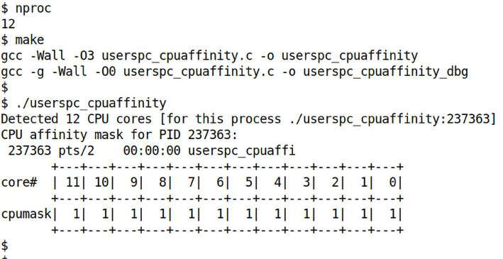

Hình 11.1: Demo user-space app hiển thị CPU affinity mask của calling process

Ở đây chạy app không parameter. Trong mode này, truy vấn CPU affinity mask của chính nó (nghĩa là calling process `userspc_cpuaffinity`). Chúng ta in các bit của bitmask: như thấy rõ trong ảnh trên (Hình 11.1), là binary `1111 1111 1111` (tương đương `0xfff`), ngụ ý theo mặc định process đủ điều kiện chạy trên bất kỳ CPU core nào trong 12 core có sẵn trên hệ thống!

Bên trong app phát hiện số CPU core có sẵn bằng cách chạy utility `nproc` qua library API hữu ích `popen()`. Tuy nhiên lưu ý giá trị `nproc` trả về là số CPU core có sẵn cho calling process; có thể ít hơn số CPU core thực tế (online và offline), dù thường giống nhau. Số available core có thể đổi theo vài cách, cách đúng là qua cgroup resource controller `cpuset` (trình bày thông tin control group (cgroup) sau trong chương).

Querying code như sau (source file là `ch11/cpu_affinity/userspc_cpuaffinity.c`):

```
static int query_cpu_affinity(pid_t pid)
{
    cpu_set_t cpumask;

    CPU_ZERO(&cpumask);
    if (sched_getaffinity(pid, sizeof(cpu_set_t), &cpumask) < 0) {
        perror("sched_getaffinity() failed");
        return -1;
    }
    disp_cpumask(pid, &cpumask, numcores);
    return 0;
}
```

Function `disp_cpumask()` vẽ bitmask (chúng ta để bạn tự xem).

Nếu truyền thêm parameter cho chương trình – PID của process (hay thread) làm parameter đầu, CPU bitmask (hexadecimal) làm parameter thứ hai – chúng ta thử đặt CPU affinity mask của process (hay thread) thành giá trị truyền vào. Tất nhiên đổi CPU affinity bitmask yêu cầu sở hữu process hoặc có root privilege (chính xác hơn có capability `CAP_SYS_NICE`).

Đây là demo nhanh: trong Hình 11.2, `nproc` cho số CPU core (12); sau đó chạy app để truy vấn và đặt CPU affinity mask của shell process (`bash`). Trên laptop 12 core, giả sử affinity mask của `bash` ban đầu là `0xfff` (binary `1111 1111 1111`) như mong đợi; ở đây đổi thành `0xdae` (binary `1101 1010 1110`) rồi truy vấn lại để xác minh:

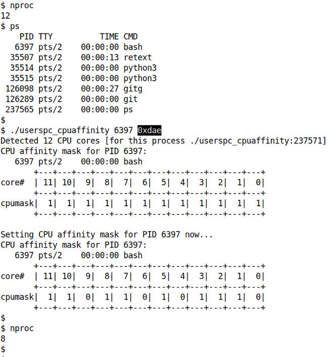

Hình 11.2: Demo app truy vấn rồi đặt CPU affinity mask của bash thành 0xdae

Được rồi, thú vị. Ban đầu app phát hiện đúng số CPU core có sẵn cho nó là 12. Sau đó truy vấn CPU affinity mask (mặc định) của bash process (vì truyền PID làm parameter đầu); hiển thị `0xfff` như mong đợi. Rồi vì cũng truyền parameter thứ hai – bitmask cần đặt (`0xdae`) – app thực hiện, đặt CPU affinity mask của bash thành `0xdae`. Giờ vì terminal window đang dùng chính là bash process ấy, chạy lại `nproc` cho giá trị 8 chứ không phải 12! Thực sự đúng: bash process giờ chỉ có tám CPU core có sẵn. (Vì không khôi phục CPU affinity mask về giá trị ban đầu khi exit.)

Đây là code liên quan đặt CPU affinity mask:

```
// ch11/cpu_affinity/userspc_cpuaffinity.c
static int set_cpu_affinity(pid_t pid, unsigned long bitmask)
{
    cpu_set_t cpumask;
    int i;

    printf("\nSetting CPU affinity mask for PID %d now...\n", pid);
    CPU_ZERO(&cpumask);

    /* Iterate over the given bitmask, setting CPU bits as required */
    for (i=0; i<sizeof(unsigned long)*8; i++) {
        /* printf("bit %d: %d\n", i, (bitmask >> i) & 1); */
        if ((bitmask >> i) & 1)
            CPU_SET(i, &cpumask);
    }

    if (sched_setaffinity(pid, sizeof(cpu_set_t), &cpumask) < 0) {
        perror("sched_setaffinity() failed");
        return -1;
    }
    disp_cpumask(pid, &cpumask, numcores);
    return 0;
}
```

Trong đoạn code trên, có thể thấy trước tiên thiết lập bitmask `cpu_set_t` thích hợp (bằng loop qua từng bit; như bạn biết biểu thức `(bitmask >> i) & 1` kiểm tra bit thứ i<sup>th</sup> có bằng 1), rồi dùng system call `sched_setaffinity()` đặt CPU affinity mask mới cho `pid` cho trước.

Điều quan trọng – và khá đúng – cần lưu ý là dù ai cũng luôn truy vấn được CPU affinity mask của task bất kỳ, không thể đặt trừ khi sở hữu task, có root access hoặc capability `CAP_SYS_NICE`.

#### Dùng taskset để thực hiện CPU affinity

Tương tự cách (trong chương trước) dùng user-space utility program tiện lợi `chrt` để lấy (hay đặt) scheduling policy và/hoặc priority của process (hay thread), có thể dùng user-space utility `taskset` để lấy và/hoặc đặt CPU affinity mask của process (hay thread) cho trước. Sau đây là vài ví dụ nhanh; lưu ý chạy trên Linux VM x86\_64 với 6 CPU core:

Dùng `taskset` truy vấn CPU affinity mask của systemd (PID 1):

```
$ taskset -p 1
pid 1's current affinity mask: 3f
$
```

Hãy nghĩ: 0x3f là binary 0011 1111, biểu diễn (tất cả) 6 CPU core được bật cho process/thread đang xét (ở đây systemd).

Giờ ví dụ chạy compiler dưới sự quản lý của `taskset`, dùng để bảo đảm GCC – và các descendant (assembler process và linker process) – chỉ chạy trên hai CPU core đầu; parameter đầu của `taskset` là CPU affinity bitmask (`03` là binary `0011`):

```
$ taskset 03 gcc userspc_cpuaffinity.c -o userspc_cpuaffinity -Wall -O3
```

Xong. Hãy xem man page `taskset(1)` để có đầy đủ chi tiết cách dùng. (Để bạn biết, như đề cập chương trước, utility `schedtool(8)` cũng dùng được để get/set CPU affinity bitmask của thread/process cho trước.)

#### Đặt CPU affinity mask trên kernel thread

Một ví dụ khá thú vị, nếu muốn minh họa synchronization technique tên per-CPU variable (như thực sự sẽ học và làm trong Chương 13, Kernel Synchronization – Part 2, tại phần Per-CPU – một example kernel module), cần tạo hai kernel thread (kthread) và bảo đảm mỗi thread chạy trên CPU core riêng. Để làm tất nhiên phải đặt tường minh CPU affinity mask của mỗi kernel thread khác nhau, non-overlapping (để đơn giản, đặt affinity mask của kthread đầu thành `0`, mask kthread thứ hai thành `1`, nhằm bảo đảm lần lượt chỉ thực thi trên CPU core `0` và `1`). Nhưng có vấn đề...phần sau giải thích.

##### Hack khả năng truy cập non-exported symbol

Vấn đề là hiện nay đặt CPU affinity trong module đáng tiếc không phải việc gọn gàng – thật lòng khá là hack; chúng ta trình bày ở đây nhưng chắc chắn không khuyên dùng cho production.

Lý do API trong kernel cần để đặt CPU affinity bitmask – `sched_setaffinity()` – có tồn tại nhưng không được export. Như đã học các chương trước về viết module, out-of-tree kernel module (như của chúng ta) chỉ dùng được exported function (và data). Vậy làm gì?

Cách “thông thường” module developer dùng nhiều năm (và thực sự tôi dùng trong ấn bản đầu sách!) là dùng convenience routine `kallsyms_lookup_name()` tra symbol bất kỳ trong kernel và lấy địa chỉ (kernel virtual).

Có địa chỉ này, C programmer có năng lực bất kỳ đều xem nó như function pointer và gọi tùy ý, do đó thực chất vượt hạn chế chỉ exported function được gọi từ out-of-tree module! (Hack hay! Tuy nhiên người làm kernel có kinh nghiệm gần như chắc chắn sẽ ngán ngẩm.)

Đúng, nhưng từ kernel version 5.7, cộng đồng quyết định đến lúc chặn việc lạm dụng (ngớ ngẩn) và chỉ unexport các function `kallsyms_lookup_name()` (và `kallsyms_on_each_symbol()` tương tự)! (Commit ID dạng ngắn `0bd476e6c671`, hãy xem.) Vậy giờ sao? Luôn có thể xem kernel symbol bất kỳ qua pseudofile `/proc/kallsyms` miễn có root access (đó là bảo mật). Hơn nữa với kernel address space layout randomization (KASLR) bật (thường vậy trên kernel hiện đại), giá trị này đổi mỗi lần boot nên không hardcode được (cũng tốt cho bảo mật). Vì thế viết wrapper script nhỏ để làm (tại `ch13/3_lockfree/percpu/run`; đúng, code từ Chương 13, Kernel Synchronization – Part 2), truyền địa chỉ (routine `sched_setaffinity()` tra qua `/proc/kallsyms`) cho module làm parameter (`ch13/3_lockfree/percpu/percpu_var.c`), module xem như function pointer rồi gọi được. Phù!

Đây là signature của function `sched_setaffinity`() :

```
long sched_setaffinity(pid_t pid, const struct cpumask *new_mask);
```

Sau đây là đoạn code ngắn liên quan – nơi dùng function pointer `sched_setaffinity()` được truyền (qua module parameter tên `func_ptr`) để đặt CPU affinity mask theo ý muốn:

```
    // ch13/3_lockfree/percpu/percpu_var.c
    [ … ]
    static unsigned long func_ptr;
    module_param(func_ptr, ulong, 0);
    unsigned long (*schedsa_ptr)(pid_t, const struct cpumask *) = NULL;
    [ … ]
    // set up the function pointer
    schedsa_ptr = (unsigned long (*)(pid_t pid, const struct cpumask *in_mask))
func_ptr;
    [ … ]
          /* pr_info("setting cpu mask to cpu #%u now...\n", cpu); */
    cpumask_clear(&mask);
    cpumask_set_cpu(cpu, &mask); // 1st param is the CPU number, not bitmask
    /* !HACK! sched_setaffinity() is NOT exported, we can't call it
         * sched_setaffinity(0, &mask);  // 0 => on self
     * so we invoke it via it's function pointer
     */
    ret = (*schedsa_ptr)(0, &mask);  // 0 => on self
    [ … ]
```

Dù không theo quy ước và gây tranh luận, nó hoạt động, nhưng vui lòng tránh hack như vậy trong production.

Giờ đã biết get/set CPU affinity mask của (kernel) thread, hãy sang bước hợp lý tiếp theo: cách get/set scheduling policy và priority của thread bằng lập trình! Phần sau đi sâu chi tiết.

## Truy vấn và đặt scheduling policy và priority của thread

Trong Chương 10, The CPU Scheduler – Part 1, tại phần Thread priority, bạn học cách truy vấn scheduling policy và priority của thread bất kỳ qua utility `chrt` (cũng minh họa Bash script đơn giản làm vậy). Ở đó đề cập `chrt` bên trong gọi system call `sched_getattr()` để truy vấn các attribute này.

Rất tương tự, đặt scheduling policy và priority có thể thực hiện bằng utility `chrt` (khiến dễ làm trong script chẳng hạn), hoặc bằng lập trình trong C application (user space) với system call `sched_setattr()`. Ngoài ra kernel cung cấp API khác: `sched_{g,s}etscheduler()` và các wrapper API `pthread` library, `pthread_{g,s}etschedparam()` (vì tất cả là user-space API, chúng ta để bạn đọc man page lấy chi tiết và tự thử).

### Đặt policy và priority trong kernel – trên kernel thread

Như giờ đã biết, kernel chắc chắn không phải process cũng không phải thread. Dù vậy Linux kernel chắc chắn multithreaded-capable và chứa thread, so-called các kernel thread (hay kthread). Như các thread tương ứng user space, kernel thread có thể tạo theo yêu cầu (từ core kernel, device driver hay kernel module; kernel cung cấp API cho mục đích này).

Chúng là schedulable entity (KSE!) và tất nhiên mỗi thread có task structure và kernel-mode stack; vì vậy như thread thông thường, cạnh tranh CPU resource, scheduling policy và priority có thể truy vấn hoặc đặt bằng lập trình theo yêu cầu.

Nếu muốn học thêm và dùng kthread, tôi đề xuất companion guide (e-book miễn phí!) Linux Kernel Programming – Part 2, đặc biệt Chương 5, Working with Kernel Timers, Threads, and Work Queues.

Về kthread, diễn giải các tên (khá lạ) thế nào (ví dụ `'[kworker/u12:2]'`)? Liên kết này cho câu trả lời: `https://unix.stackexchange.com/a/152865`

Vậy vào vấn đề: trong user space, system call hiện đại được ưu tiên để truy vấn và đặt scheduling attribute của thread lần lượt là `sched_getattr()` và `sched_setattr()`. Trước đây là cặp system call `sched_{g|s}et_scheduler()`. Giờ các system call `sched_{g|s}etattr()` nhận pointer đến `struct sched_attr`, chứa mọi chi tiết có thể cần; xem man page (`https://man7.org/linux/man-pages/man2/sched_setattr.2.html`).

Vậy theo cách hiện đại, có thể giả định sẽ dùng kernel implementation của các system call này để thực hiện công việc tương tự trong kernel. Nhưng khoan; cộng đồng kernel xem thiết kế cũ (hơn) – cho user (app) developer và module developer thoải mái gọi API này với policy như `SCHED_FIFO` và dùng bất kỳ priority (real-time) nào họ cho là đúng – về cơ bản có lỗi.

Vì sao? Vì dễ rơi vào tình huống như: hai hay nhiều thread `SCHED_FIFO` cùng priority, và/hoặc dùng priority value “ngẫu nhiên” – không suy xét cẩn thận. Có thể gây hỗn loạn CPU scheduling, do đó resource management. Vì vậy sau đây là những gì đã làm từ kernel 5.9 (cho phép tôi trích trực tiếp commit vì thực sự là cách truyền đạt tốt nhất); đây là phần commit, `https://github.com/torvalds/linux/commit/7318d4cc14c8c8a5dde2b0b72ea50fd2545f0b7a`:

```
…
Therefore it doesn't make sense to expose the priority field; the
kernel is fundamentally incapable of setting a sensible value, it
needs systems knowledge that it doesn't have.

Take away sched_setschedule() / sched_setattr() from modules and
replace them with:

  - sched_set_fifo(p); create a FIFO task (at prio 50)
  - sched_set_fifo_low(p); create a task higher than NORMAL,
        which ends up being a FIFO task at prio 1.
  - sched_set_normal(p, nice); (re)set the task to normal

This stops the proliferation of randomly chosen, and irrelevant, FIFO
priorities that dont't really mean anything anyway.

The system administrator/integrator, whoever has insight into the
actual system design and requirements (userspace) can set-up
appropriate priorities if and when needed. ...
```

À; vậy giờ các bạn viết module thân mến, chúng ta phải dùng các API này – `sched_set_fifo()`, `sched_set_fifo_low()` và `sched_set_normal()` – khi thiết lập task (thread) `(SCHED_)FIFO` trong kernel. Như commit trên đề cập, tin tưởng administrator và/hoặc user-space developer lập trình user app và cấp real-time priority value đúng, có ý nghĩa theo yêu cầu; kernel (hay module) không được coi là biết hay chất vấn các quyết định ấy – chỉ thực thi (một lần nữa, ví dụ design guideline cung cấp mechanism, không phải policy đang hoạt động).

Hai API đầu:

- là wrapper quanh function `sched_setscheduler_nocheck()` trong kernel

- đặt scheduling policy của thread thành `SCHED_FIFO`

- đặt priority (real-time) của thread lần lượt thành `MAX_RT_PRIO/2` (nghĩa là `50`) và `1`

`sched_set_normal()`:

- là wrapper trên `sched_setattr_nocheck()`

- đặt scheduling policy của thread thành `SCHED_NORMAL` (giống `SCHED_OTHER`, nghĩa là non real-time, do Completely Fair Scheduler (CFS) vận hành)

- đặt giá trị `nice` của thread thành parameter thứ hai

Ở đây ký hiệu `*_nocheck()` ngụ ý kernel thậm chí không kiểm tra process context chạy các API này có đủ privilege không; vẫn thực hiện bất kể điều đó. (Xem comment tại: `https://elixir.bootlin.com/linux/v6.1.25/source/kernel/sched/core.c#L7742`.)

Hơn nữa, ba API được export theo GNU Public License (GPL), ngụ ý chỉ module được cấp phép theo GNU GPL dùng được.

#### Ví dụ real-world – threaded interrupt handler

Một ví dụ kernel dùng kernel thread là khi kernel (khá thường xuyên) dùng threaded interrupt (work queue là ví dụ khác). Ở đây kernel phải tạo kernel thread chuyên dụng với (soft) real-time scheduling policy `SCHED_FIFO` và real-time priority value `50` (ở giữa), để xử lý đúng threaded interrupt. Hãy xem code path liên quan, `https://elixir.bootlin.com/linux/v6.1.25/source/kernel/irq/manage.c#L1448`:

```
static int
setup_irq_thread(struct irqaction *new, unsigned int irq, bool secondary)
{
        struct task_struct *t;

        if (!secondary) {
                t = kthread_create(irq_thread, new, "irq/%d-%s", irq,
                                   new->name);
        } else {
                t = kthread_create(irq_thread, new, "irq/%d-s-%s", irq,
                                   new->name);
        }
        [ … ]
```

Macro `kthread_create()` đảm nhiệm tạo kernel thread (kthread). Giờ kernel-only API `irq_thread()` (được gọi qua macro `kthread_create()` như thread function), trong code path của mình, đặt scheduling policy và priority thích hợp, `https://elixir.bootlin.com/linux/v6.1.25/source/kernel/irq/manage.c#L1286`:

```
/* Interrupt handler thread */
static int irq_thread(void *data)
{
        struct callback_head on_exit_work;
        struct irqaction *action = data;
        [ ... ]
        sched_set_fifo(current);
        [ ... ]
```

À! Chú ý lời gọi `sched_set_fifo()`; như đã thấy, thiết lập kthread (calling thread, được `current` tham chiếu) dùng policy `SCHED_FIFO` và priority (real-time) `50`. Xong.

Tò mò vì sao `SCHED_FIFO` và priority `50` cho IRQ (interrupt) thread? Thực ra tại sao phải dùng threaded IRQ handler? (Để bạn biết, hiện chuẩn thông thường là phần lớn driver dùng threaded handler.) Học mọi điều trong cuốn companion Linux Kernel Programming – Part 2 (e-book miễn phí!), Chương 4, Handling Hardware Interrupts.

Được rồi, giờ đã hiểu tương đối rõ CPU scheduling (hay task scheduling) hoạt động ở mức OS thế nào, chúng ta chuyển sang thảo luận khá hấp dẫn khác – cgroup; hãy đọc tiếp!

## Giới thiệu cgroup

Trong quá khứ xa xưa, cộng đồng kernel vật lộn với vấn đề khá khó chịu: dù scheduling algorithm và implementation – O(1) scheduler từ 2.6.0 ban đầu, rồi sau đó một chút (với 2.6.23) là Completely Fair Scheduler (CFS) – hứa hẹn scheduling hoàn toàn công bằng, nó thực sự không “hoàn toàn công bằng” theo bất kỳ nghĩa có ý nghĩa nào của thuật ngữ!

Hãy nghĩ một lúc: giả sử đăng nhập Linux server cùng chín người khác. Với mọi điều kiện khác như nhau, có khả năng processor time được chia (ít nhiều) công bằng giữa cả mười người; tất nhiên hiểu không thực sự là con người chạy trên processor và ăn memory, mà process và thread làm thay họ.

Trước mắt ít nhất cứ giả định được chia (chủ yếu) công bằng. Nhưng nếu bạn, một trong mười user đăng nhập, viết user-space program trong một loop vô tội vạ spawn nhiều thread mới, mỗi thread làm nhiều CPU-intensive work (và có lẽ thêm phần thưởng là cấp phát các vùng memory lớn) ở mỗi loop iteration!? CPU bandwidth allocation (ngay cả qua CFS) không còn công bằng theo nghĩa thực sự; account của bạn thực chất chiếm CPU (và có thể cả system resource khác như memory và I/O)!

Cần giải pháp tổng quát quản lý chính xác, hiệu quả CPU bandwidth (và resource khác), throttling (kiểm tra, không cho phép) tiêu thụ thêm resource khi đạt giới hạn chỉ định. Nhiều patch đề xuất được thảo luận rồi loại bỏ; cuối cùng kỹ sư Google, IBM và nơi khác đáp ứng bằng patch set đưa giải pháp control group (cgroup) modern-day vào Linux kernel (từ version 2.6.24, tháng 10 năm 2007. Ý tưởng và implementation ban đầu do Paul Menage và Rohit Seth ở Google năm 2006.). Tóm lược, cgroup là kernel feature cho system administrator (hoặc ai có root access) thực hiện bandwidth allocation và fine-grained resource management thanh lịch trên các resource hay controller (theo cách gọi của cgroup) trên hệ thống. Lưu ý: dùng cgroup, không chỉ processor (CPU bandwidth) mà cả memory bandwidth và block I/O bandwidth (và hơn nữa) đều có thể phân chia, cấp phát và giám sát cẩn thận theo yêu cầu project hay sản phẩm.

Vậy với ví dụ bắt đầu chủ đề – mười user trên hệ thống Linux – nếu mọi process được đặt trong cùng cgroup ấy và cgroups CPU controller được bật cho nó, khi có CPU contention sẽ thực sự chia CPU công bằng cho mỗi process! Hoặc với tư cách sysad có thể làm phức tạp hơn: chia hệ thống thành nhiều cgroup – một cho chẳng hạn build project (ví dụ Yocto build), một cho web browser, một cho virtual machine, v.v. – rồi fine-tune và cấp resource (CPU, memory và I/O) cho từng cgroup tùy ý! Thực tế gần như mọi distro hiện đại tự động làm vậy nhờ systemd framework mạnh mẽ (sẽ nói thêm sau); embedded Linux cũng thường làm, gồm Android.

Vậy giờ bạn quan tâm rồi! Bật cgroups feature thế nào? Đơn giản – là kernel feature có thể bật (hay tắt) với granularity khá nhỏ theo cách thường: cấu hình kernel. Menu liên quan (qua user interface tiện lợi `make menuconfig`) là General setup \| Control Group support. Hãy thử: `grep` kernel config file để tìm `CGROUP`; rồi nếu cần điều chỉnh kernel config, rebuild, reboot với kernel mới và kiểm thử. (Đã trình bày kernel configuration chi tiết trong Chương 2, Building the 6.x Linux Kernel from Source – Part 1, kernel build và install trong Chương 3, Building the 6.x Linux Kernel from Source – Part 2).

Tin tốt: cgroup được bật mặc định trên mọi hệ thống Linux (đủ mới) chạy systemd init framework. Như vừa nói, có thể truy vấn cgroup controller được bật bằng `grep` kernel config file, sửa config tùy ý; trên hệ thống desktop và server-class thường không cần.

Từ khởi đầu trong 2.6.24, cgroup như mọi kernel feature khác liên tục phát triển. Khá gần đây, đã đến lúc cgroup feature được cải tiến đủ nhiều trở nên không tương thích với bản cũ, dẫn đến thiết kế và phát hành cgroup mới tên cgroups v2 (hay đơn giản cgroups2 – Tejun Heo là maintainer); được công bố production-ready trong dòng kernel 4.5 (bản cũ giờ gọi cgroups v1 hay legacy cgroups implementation). Lưu ý tại thời điểm viết, cả hai có thể và thực sự cùng tồn tại với vài giới hạn; nhiều application và framework vẫn dùng cgroups v1 cũ, chưa migrate v2. Tuy nhiên đang thay đổi; sớm thôi nếu chưa xảy ra, cgroups2 sẽ trở thành lựa chọn trên thực tế, nên hãy lên kế hoạch dùng.

Trong nội dung này, tập trung gần như hoàn toàn dùng bản hiện đại cgroups v2. Tài liệu tốt nhất là kernel chính thức, tại đây (cho kernel 6.1): `https://www.kernel.org/doc/html/v6.1/admin-guide/cgroup-v2.html`. (Để bạn biết, tài liệu cho kernel version mới nhất cũng luôn có tại: `https://docs.kernel.org/admin-guide/cgroup-v2.html`.

Có thể tìm lý do chi tiết dùng cgroups v2 thay cgroups v1 trong tài liệu kernel tại: `https://www.kernel.org/doc/html/latest/admin-guide/cgroup-v2.html#issues-with-v1-and-rationales-for-v2`.

### Cgroup controller

Cgroup controller là kernel component bên dưới chịu trách nhiệm phân phối resource cho trước (như CPU cycle, memory bandwidth và I/O bandwidth, v.v.) trong và xuyên cgroup hierarchy: cgroup và các descendant. Có thể xem như dạng “resource limiter” cho cgroup hierarchy cho trước.

Man page `cgroups(7)` mô tả tương đối chi tiết interface và nhiều (resource) controller có sẵn (hay subsystem như đôi lúc được gọi). Các cgroups v2 controller thường có như sau (Bảng 11.1 cho nội dung cgroups v2; implementation cgroups v1 gốc cho nhiều controller có từ 2.6.24):

| Tên cgroups v2 controller | Kiểm soát (hay giới hạn hay điều tiết) gì khi bật | Từ kernel version |
|---|---|---|
| cpu | CPU bandwidth (cycle) | 4.15 |
| cpuset | CPU affinity và memory-node placement (đặc biệt hữu ích cho hệ thống NUMA lớn) | 5.0 |
| memory | Mức sử dụng memory (RAM) | 4.5 |
| io | Phân phối I/O resource | 4.5 |
| pids | Giới hạn cứng số process trong cgroup | 4.5 |
| devices | Tạo và truy cập device file (chỉ qua cgroup BPF program) | 4.15 |
| rdma | Phân phối và accounting resource remote direct memory access (RDMA) | 4.11 |
| hugetlb | Giới hạn mức sử dụng HugeTLB (huge page) cho mỗi cgroup | 5.6 |
| misc | Nhiều loại; xem `https://www.kernel.org/doc/html/v6.1/admin-guide/cgroup-v2.html#misc` | 5.13 |

Bảng 11.1: Tóm lược cgroups v2 controller có sẵn trên hệ thống Linux hiện đại

Độc giả quan tâm hãy tham khảo tài liệu kernel chính thức nói trên và man page để biết chi tiết; ví dụ PIDS controller rất hữu ích để ngăn fork bomb bằng cách cho phép giới hạn số process có thể fork từ cgroup hay các descendant. (Fork bomb là DoS attack ngớ ngẩn nhưng nguy hiểm, thường gọi system call `fork()` trong infinite loop!)

Tiếp theo, rất quan trọng, kernel cgroup được làm hiển thị (cung cấp) hay giao tiếp với user space thế nào? À theo cách thường trên Linux: control group được cung cấp qua synthetic filesystem hay pseudo filesystem purpose-built! Đó là filesystem `cgroup`, thường mount tại `/sys/fs/cgroup`. Với cgroups v2, filesystem type giờ tên `cgroup2` (chỉ cần mount \| grep cgroup để thấy). Có rất nhiều điều thú vị để khám phá bên trong; đó là những gì làm khi tiến tiếp...

Hãy bắt đầu: làm sao biết controller nào được bật cho hệ thống (thực ra kernel)? Dễ thôi:

```
$ cat /sys/fs/cgroup/cgroup.controllers
cpuset cpu io memory hugetlb pids rdma misc
```

Rõ ràng hiển thị danh sách available controller space-separated (tôi chạy trên Fedora 38 VM x86\_64. Đồng thời lưu ý dùng `/proc/cgroups` để xem controller chỉ tương thích cgroups v1; đừng dựa vào cho cgroups v2.). Controller chính xác thấy ở đây phụ thuộc cách kernel được cấu hình.

Trong cgroups v2, mọi controller được mount trong một hierarchy (hay tree) duy nhất. Khác cgroups v1 nơi nhiều controller có thể mount dưới nhiều hierarchy hay group. Init framework hiện đại systemd là bên dùng cả v1 lẫn v2 cgroup. Thực tế chính `systemd` auto-mounts cgroups v2 filesystem khi startup (tại `/sys/fs/cgroup/`).

### Khám phá cgroups v2 hierarchy

Xem dưới mount point pseudo filesystem cgroup (v2) – mặc định luôn `/sys/fs/cgroup` – có thể khiến ngạc nhiên trước mọi pseudo file (và folder) bên trong (cứ xem Hình 11.3); phần này khám phá nhiều góc thú vị và hữu ích hơn!

Hãy bắt đầu xác nhận cgroups v2 hierarchy được mount ở đâu:

```
$ mount | grep cgroup2
cgroup2 on /sys/fs/cgroup type cgroup2
(rw,nosuid,nodev,noexec,relatime,nsdelegate,memory_recursiveprot)
```

Rõ ràng đúng dự đoán, tại `/sys/fs/cgroup`. (Tò mò về các mount option theo sau trong ngoặc? Được ghi tài liệu tại: `https://www.kernel.org/doc/html/v6.1/admin-guide/cgroup-v2.html#mounting`).

Nếu đang chạy distro cũ (như Ubuntu 18.04 hay tương tự, như ở ấn bản đầu sách), có thể không thấy controller nào trong `cgroup2`. Xảy ra khi cgroup v1 và v2 trộn lẫn. Để chỉ dùng bản sau (như mong đợi ở đây) – và do đó thấy mọi configured controller – trước tiên phải tắt cgroups v1 bằng truyền kernel command-line parameter này lúc boot: `cgroup_no_v1=all` (nhớ có thể thuận tiện xem mọi kernel parameter có sẵn tại `https://www.kernel.org/doc/html/latest/admin-guide/kernel-parameters.html`. Rồi reboot và kiểm tra lại. Với distro mới hơn (như Ubuntu 22.04 hay Fedora 38), không cần làm.

Giờ bắt đầu khám phá!

Trong buổi này, tôi làm trên Fedora 38 VM x86\_64, nơi đã build và boot vào custom kernel 6.1.25. Trước tiên xem tổng thể:

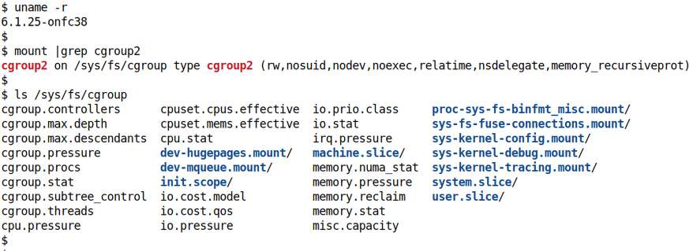

Hình 11.3: Root của cgroups v2 hierarchy

Dưới vị trí root cgroup – `/sys/fs/cgroup` – có thể thấy nhiều file và folder (không cần nói, tất cả là volatile pseudofile object; mount trong RAM qua sysfs). Trước hết:

- Các file “thông thường” thấy – như `cgroup.controllers`, `cpu.pressure`, v.v. – là cgroup2 interface file.

Chúng tiếp tục chia thành core interface và controller interface; mọi file `cgroup.*` là core interface file, `cpu.*` là interface file cho CPU controller, `memory.*` cho memory controller, v.v.

- Các folder thấy biểu diễn – cuối cùng! – control group hay cgroup! Trong số nhiều cgroup thấy, không phải tất cả đều bị constraint. Có thể tự hỏi ai tạo; câu trả lời ngắn (ít nhất với những cái mặc định) là systemd; sẽ nói thêm sớm.

#### Bật hoặc tắt controller

Hãy xem core interface file then chốt, `cgroup.controllers`. Phần trước đề cập ngắn. Nội dung là danh sách controller có sẵn cho cgroup; với root cgroup, là controller mà kernel được cấu hình. Như đã thấy, mặc định distro hiện đại thường là: `cpuset cpu io memory hugetlb pids rdma misc`.

Cẩn thận: controller xuất hiện trong danh sách không nhất thiết nghĩa là được bật trong cgroup hierarchy; thực tế mặc định không controller nào được bật! Bật controller cho biết constraint của nó lên phân phối target resource sẽ có hiệu lực với immediate children. Để bật controller, ghi string +\<controller-name\> vào pseudofile `cgroup.subtree_control` (và ngược lại -\<controller-name\> để tắt). Vì vậy ví dụ để bật CPU controller và I/O controller nhưng tắt memory controller trên cgroup hiện tại (do đó có tác dụng trên descendant, hierarchy bên dưới), làm (với tư cách root):

```
echo "+cpu +io -memory" > cgroup.subtree_control
```

Vậy giờ biết file `cgroup.subtree_control` cho danh sách controller space-separated được bật để kiểm soát resource distribution từ cgroup này đến children.

Tài liệu kernel nêu như sau `https://docs.kernel.org/admin-guide/cgroup-v2.html`:

“Top-down Constraint

Resource được phân phối top-down và cgroup chỉ có thể phân phối tiếp resource nếu parent đã phân phối resource cho nó. Điều này nghĩa là mọi file ‘cgroup.subtree\_control’ non-root chỉ chứa được controller được bật trong file ‘cgroup.subtree\_control’ của parent. Chỉ bật được controller nếu parent đã bật controller ấy, và không thể tắt controller nếu một hoặc nhiều children đang bật.”

Dành một lúc hiểu phát biểu ấy. Sau đây là vài core cgroup interface file hữu ích khác cần biết – chỉ hiện diện trong cgroup folder (hierarchy):

- `cgroup.events`: Read-only; có thể có các giá trị:

  - `populated`: 0 hoặc 1. Nếu 1, cgroup hay descendant chứa live process, nếu không là 0. Vì vậy chỉ khi giá trị `populated` là 1 mới đáng tìm hiểu cgroup! Nếu không là empty hay unpopulated cgroup (script “explorer” cgroups v2 sắp thấy sẽ thể hiện).

  - `frozen`: 0 hoặc 1. Nếu 1, cgroup frozen, nếu không là 0 (freezing cgroup giống đặt mọi process của nó – và mọi descendant cgroup cùng process của chúng! – vào “tủ đông”, ngụ ý ở stopped state đến khi thawed).

Trên hệ thống dùng systemd làm init manager (hiện thường vậy và chúng ta ít nhiều giả định), luôn có cgroup tên `init.scope` (scope? đừng lo, trình bày tất cả). Chỉ gồm init process PID 1 (systemd). Hãy xem file `cgroup.events` của init cgroup:

```
$ cat /sys/fs/cgroup/init.scope/cgroup.events
populated 1
frozen 0
```

Vì populated, có thể tìm hiểu sâu hơn. Tiếp theo, trong cgroup hierarchy cũng có cgroup interface file:

- `cgroup.kill`: Write-only; ghi 1 ở đây khiến cgroup tree và mọi descendant chết – process trong target cgroup tree được gửi signal `SIGKILL`.

Thêm vài cgroup file theo sau trong các phần tới. Một lần nữa đừng lo, mọi core interface được ghi tài liệu tại: `https://www.kernel.org/doc/html/v6.1/admin-guide/cgroup-v2.html#core-interface-files`.

##### Tài liệu kernel về cgroups v2

Đến giờ chỉ trình bày kiến thức rất cơ bản; như bạn hiểu, giải thích cgroup đầy đủ chi tiết đơn giản quá nhiều cho chương và sách này; quan trọng hơn nhiệm vụ sách là giải thích khái niệm và cho ví dụ giúp học. Chỉ lặp chi tiết trong tài liệu kernel hoàn toàn vô nghĩa; với cgroups v2, resource model, interface file (cho core và từng controller), quy tắc làm việc, namespace management, v.v. được trình bày cực kỳ kỹ trong tài liệu kernel chính thức dòng 6.1 cho cgroups2 tại: `https://www.kernel.org/doc/html/v6.1/admin-guide/cgroup-v2.html#control-group-v2`. Và cho kernel version mới nhất tại: `https://docs.kernel.org/admin-guide/cgroup-v2.html#control-group-v2`.

Vì vậy quan trọng là học cách đọc tài liệu kernel hiệu quả (đã nói ngắn trong chương trực tuyến Kernel Workspace Setup, tại phần Tìm và sử dụng tài liệu Linux kernel). Ảnh chụp (hy vọng) giúp nhớ chi tiết thực sự có trong tài liệu kernel, chỉ chờ tham khảo khi cần:

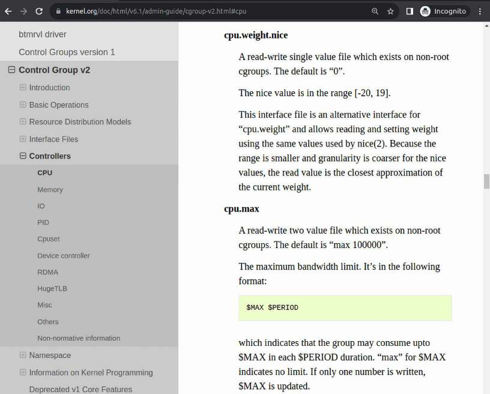

Hình 11.4: Ảnh chụp một phần tài liệu kernel cho Cgroups v2 / Controllers / CPU

Dù có nguy cơ lặp lại, tôi khuyến khích đọc tài liệu liên quan khi làm với cgroups v2.

Hãy tiếp tục nhìn vào bên trong!

#### Các cgroup trong hierarchy

Trở lại cgroup trong root của cgroups tree (hay hierarchy, xem Hình 11.3). Như nói, folder bên trong biểu diễn cgroup. Trước mắt tạm hoãn câu hỏi ai tạo (và thế nào); chỉ cần nói được systemd thiết lập lúc boot.

Bắt đầu với cgroup đơn giản, được folder `init.scope` biểu diễn. Xem bên trong thấy kernel đã pre-populated rất nhiều file (pseudo) và interface; đây là góc nhìn cắt bớt:

```
$ cd /sys/fs/cgroup/
$ ls init.scope/
cgroup.controllers cgroup.threads io.latency    memory.high memory.swap.current
cgroup.events      cgroup.type    io.max        memory.low  memory.swap.events
cgroup.freeze      cpu.idle       io.pressure   memory.max  memory.swap.high
cgroup.kill        cpu.max        io.prio.class memory.min  memory.swap.max
[ … ]
cgroup.subtree_control           io.bfq.weight memory.events.local  memory.stat
pids.peak
$
```

Không phải tất cả đều lạ; vừa nói một vài core interface file then chốt (trong phần trước) – `cgroup.controllers` và `cgroup.subtree_control` – cùng ý nghĩa.

Trước mắt hãy tìm hiểu vài file thú vị hơn ở đây:

```
$ cat init.scope/cgroup.procs
1
```

Ở đây `cgroup.procs` hiển thị danh sách PID của process thuộc cgroup này. Hợp lý – systemd thiết lập cgroup `init.scope` chỉ chứa init process PID 1 – thực ra chính systemd. (Tương tự pseudofile `<cgroup-name>/cgroup.threads` giữ PID mọi thread thuộc cgroup.)

Để migrate process vào cgroup cho trước, ghi PID vào file `cgroup.procs` của target cgroup. Bên ghi cần permission thích hợp; root tất nhiên được, nhưng cả non-root cũng ghi được miễn kiểm tra permission khớp. (Migrate process sang cgroup khác giống thao tác cut-paste; được loại ngầm khỏi source cgroup. Tuy nhiên thay đổi có thể mất một chút thời gian lan truyền.)

Nếu quên interface file biểu diễn gì hay chính xác thao tác thế nào? Đơn giản: xem tài liệu kernel. Entry liên quan tất nhiên tại: `https://www.kernel.org/doc/html/v6.1/admin-guide/cgroup-v2.html#cpu`. (Phần trước nói chính điều này.)

Hãy xem vài interface then chốt về CPU controller trong cgroup `init.scope` (nhớ hiện ở folder `/sys/fs/cgroup`):

```
$ cat init.scope/cpu.max  init.scope/cpu.weight  init.scope/cpu.weight.nice
max 100000
100
0
```

Có thể thấy giá trị (nghĩa là gì? Kiên nhẫn, sắp đến: trình bày trong phần Thử nghiệm – giới hạn CPU resource qua cgroups v2!).

Giờ dùng `cat` cũng ổn, nhưng hãy xem dùng mẹo `grep` nhanh dễ hơn – và đẹp hơn! – thế nào khi nội dung file chỉ một dòng (hoặc gần vậy): `grep . <file-spec>` ; ở đây dùng kỹ thuật này để xem mọi CPU controller interface và giá trị như sau:

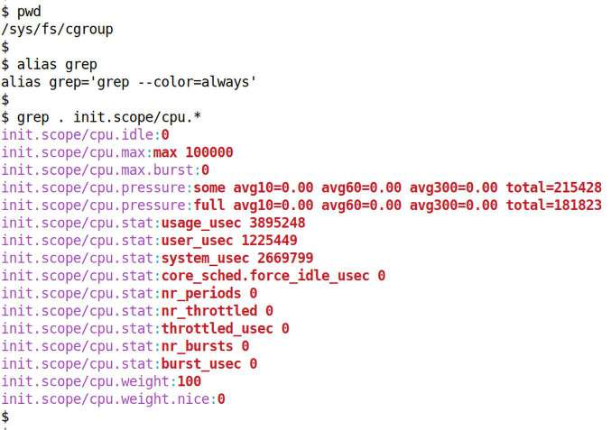

Hình 11.5: Ảnh chụp hiển thị thuận tiện mọi CPU controller interface file và giá trị hiện tại dưới cgroup init.scope

Vậy giờ hy vọng bạn hiểu khả năng thấy rất nhiều interface pseudo file (và file khác), cùng tài liệu kernel sẵn để hiểu chúng, cho phép thực sự bắt đầu hiểu cgroup (thực ra như mọi thứ khác).

Cũng nên hiểu cgroup có thể nested; một cgroup có thể chứa cgroup, bản thân chúng lại chứa cgroup. Để thấy, chỉ cần xem dưới cgroup – folder dưới root – tìm thêm folder.

Lấy cgroup khác (một lần nữa systemd tạo lúc boot) – `system.slice` – rồi xem sub-folders bên dưới, tức các cgroup. Cách nhanh như sau:

```
$ find /sys/fs/cgroup/system.slice/ -maxdepth 1 -type d
/sys/fs/cgroup/system.slice/
/sys/fs/cgroup/system.slice/system-dbus\x2d:1.15\x2dorg.freedesktop.problems.
slice
/sys/fs/cgroup/system.slice/abrt-journal-core.service
/sys/fs/cgroup/system.slice/system-systemd\x2dfsck.slice
/sys/fs/cgroup/system.slice/sysroot.mount
/sys/fs/cgroup/system.slice/low-memory-monitor.service
[ … ]
/sys/fs/cgroup/system.slice/abrt-oops.service
/sys/fs/cgroup/system.slice/var-lib-nfs-rpc_pipefs.mount
$
```

(Dù giữ depth parameter tối đa `1`, command cho thấy 55 cgroup trên máy tôi!) Vậy dưới mỗi cgroup (folder biểu diễn), thấy nội dung tương tự (phản chiếu) – các pseudo file biểu diễn core interface và controller interface – thực chất giới hạn system resource, và có thể thêm cgroup (folder)! Thiết kế có chủ ý mang bản chất recursive.

Tuy nhiên đừng quên: tính năng resource-constraining của cgroup chỉ có tác dụng nếu file `cgroup.subtree_control` bên trong, hoặc trong parent cgroup, bật các controller liên quan!

Vậy giờ bắt đầu bước nhỏ: trên Linux systemd-based (gần như mọi distro hiện đại), dùng utility `systemd-cgls` (`cgls` = cgroup list) để “thấy” cgroup dưới `init.scope`; chạy utility với parameter – cgroup hierarchy muốn xem bên trong – khiến hiển thị chính xác điều đó:

```
$ systemd-cgls /sys/fs/cgroup/init.scope
Directory /sys/fs/cgroup/init.scope:
└─1 /usr/lib/systemd/systemd --switched-root --system –deserialize=32
```

Cho thấy mọi process chạy dưới cgroup cùng command line! Output này trên Fedora 38 VM; trên Ubuntu, output dễ đọc hơn chút:

```
$ systemd-cgls /sys/fs/cgroup/init.scope
Directory /sys/fs/cgroup/init.scope:
└─1 /sbin/init
```

Tốt; giờ xem cgroup `system.slice` (trên Fedora 38):

```
$ systemd-cgls /sys/fs/cgroup/system.slice
Directory /sys/fs/cgroup/system.slice:
├─abrt-journal-core.service
│ └─1386 /usr/bin/abrt-dump-journal-core -D -T -f -e
├─bolt.service
│ └─1425 /usr/libexec/boltd
├─low-memory-monitor.service
│ └─1296 /usr/libexec/low-memory-monitor
├─systemd-udevd.service …
│ └─udev
│   ├─   688 /usr/lib/systemd/systemd-udevd
│   ├─610731 (udev-worker)
│   ├─610732 (udev-worker)
[ … ]
```

Cho thấy nhiều “service” (process – phần lớn khởi đầu dưới sự quản lý systemd) và sub-processes (descendant); hay. Giờ nhìn toàn cảnh, mọi cgroup, bằng chạy utility `systemd-cgls` không parameter, sẽ cho thấy toàn cgroups hierarchy (mặc định dưới `/sys/fs/cgroup`; parameter `--no-pager` chỉ để không “page” output bằng `less`):

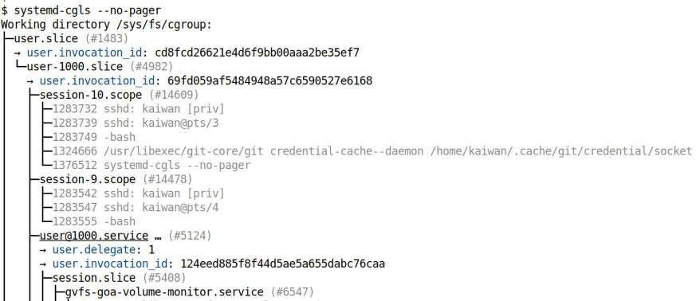

Hình 11.6: Ảnh chụp một phần cgroup hierarchy trên hệ thống

Tất nhiên quá lớn để hiển thị toàn bộ ở đây; hãy thử trên hệ thống bạn và nghiên cứu. (Thực hiện `systemd-cgls -h` cho màn hình help; xem man page để biết chi tiết.)

#### Systemd và cgroup

Quản lý cgroup thủ công có thể là việc khó khăn; systemd init framework mạnh mẽ mà phần lớn workstation distro, enterprise server, data center server và cả embedded Linux chạy mặc định đến trợ giúp. Như đã bắt đầu nhận thấy, một mặt thú vị của systemd là tiếp quản vai trò tạo và quản lý cgroup lúc boot, nhờ đó tự động tận dụng sức mạnh cho lợi ích user và app. (Tất nhiên càng học cách làm, càng có thể điều chỉnh cho hợp project.)

Đồng thời hiểu có nhiều công cụ giúp trực quan hóa cgroup (và slice/scope) được định nghĩa trên hệ thống; gồm `ps`, một số từ chính systemd project – `systemd-cgls`, `systemctl` và `systemd-cgtop`. (Cũng sẽ sớm thấy cgroups visualizer script của riêng chúng ta!)

##### Slice và scope

Như Hình 11.6 cho thấy khá rõ, systemd đủ thông minh auto-construct cgroup, nhóm process hợp logic. Để làm, định nghĩa và dùng các artifact – slice và scope. Slice dùng biểu diễn mọi process thuộc user nhất định, hoặc có thể biểu diễn một “nhóm” application (process) có resource được quản lý qua unit đó. (Trong Hình 11.6, với user account có UID 1000 của tôi, rõ ràng slice tên `user-1000.slice`).

Scope biểu diễn việc tiếp tục chia slice hợp logic (khá tongue-twister, phải không?); ví dụ tốt là mọi process chạy trong terminal window thường được systemd nhóm vào cgroup session-\<number\>.scope (thuật ngữ có prefix “session” vì session biểu diễn process được spawn và quản lý trong Terminal window)! Một lần nữa, trong Hình 11.6 có thể thấy rõ Terminal window, được scope tên `session-9.scope` biểu diễn, được thiết lập qua sshd và có Bash shell `(`với PID 1283555 và teletypewriter (tty) device pts/4), được biểu diễn hay tổ chức như descendant của user slice và bên trong nó là scope kiểu “session”.

Hơn nữa systemd tổ chức hierarchy với scope unit và service unit (boot-time) được gán cho slice thích hợp (bên trong có cgroup riêng). Như nói, mọi user đăng nhập hệ thống cũng được xem là “slice” dưới node tổng quát `user.slice` trong tree, và app chạy tất nhiên xuất hiện dưới cgroup ấy (một lần nữa có thể thực sự thấy user slice của tôi trong Hình 11.6; xuất hiện dạng `user-1000.slice`, và dưới hierarchy này là các “scope” unit). Trích từ tài liệu systemd:

“Tên (slice) gồm chuỗi tên dash-separated, mô tả đường dẫn từ root slice đến slice. Root slice tên `-.slice`. Ví dụ: `foo-bar.slice` là slice nằm trong `foo.slice`, bản thân nằm trong root slice `-.slice`. ...”

(Có thể thấy root slice `-.slice` là slice đầu trong Hình 11.7).

Nếu muốn đổi mặc định, cách systemd thiết lập cgroup thì sao? Nhìn chung có ba cách: đầu tiên sửa thủ công các service unit file; thứ hai dùng sub-command `systemctl set-property` để sửa; thứ ba dùng drop-in file trong systemd directory structure. Ví dụ nhanh:

```
$ cat /usr/lib/systemd/system/user@.service
[ … ]
[Unit]
Description=User Manager for UID %i
Documentation=man:user@.service(5)
After=user-runtime-dir@%i.service dbus.service systemd-oomd.service
Requires=user-runtime-dir@%i.service
IgnoreOnIsolate=yes

[Service]
User=%i
PAMName=systemd-user
Type=notify-reload
ExecStart=/usr/lib/systemd/systemd --user
Slice=user-%i.slice
KillMode=mixed
Delegate=pids memory cpu
TasksMax=infinity
[ … ]
```

Hãy xem phần systemd trong mục Đọc thêm của chương này; có rất nhiều link đến những tài liệu tốt hướng dẫn chi tiết cùng các ví dụ.

##### Trực quan hóa cgroup (và slice, scope) bằng systemctl và systemd- cgtop

Đã thấy cách dùng `systemd-cgls` quét cgroup hierarchy. Cách khác xem (dưới quản lý systemd) là qua app `systemctl` và systemd unit `type`. systemd định nghĩa nhiều unit type: `service`, `mount`, `swap`, `socket`, `target`, `device`, `automount`, `timer`, `path`, `slice` và `scope`. Chỉ hai type cuối liên quan ở đây, nên xem qua command `systemctl`:

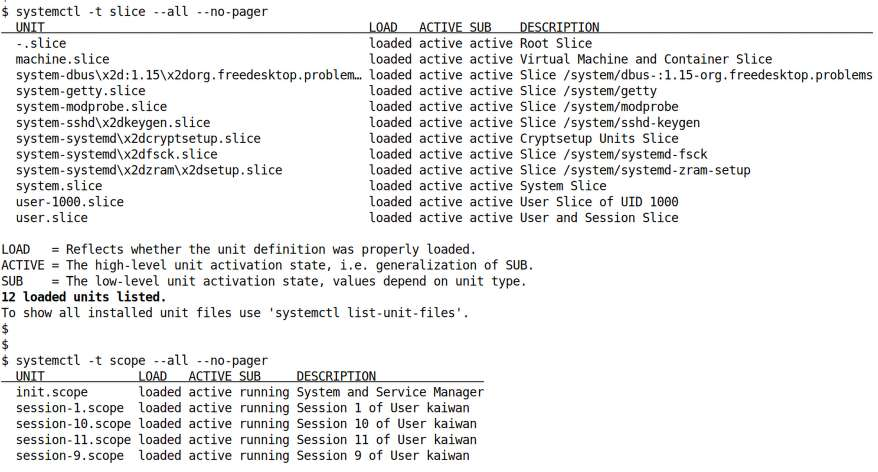

Hình 11.7: Ảnh chụp cho thấy cách xem cgroup hierarchy systemd-generated ở mức slice và scope

Giờ đã nắm cơ bản cgroups2, đây là ảnh chụp một phần man page `cgroups(7)` làm nổi bật thêm vài điểm then chốt; hãy nghiên cứu:

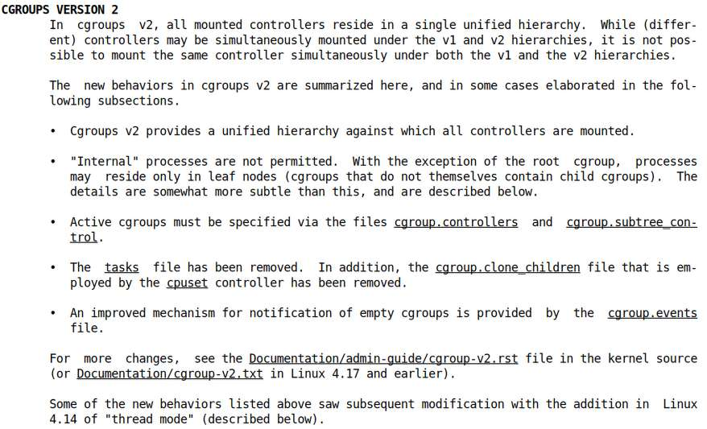

Hình 11.8: Ảnh chụp một phần man page cgroups.7

Có cách thấy process cho trước thuộc cgroup nào, nếu có? Tất nhiên: một cách xem tất cả rồi lọc process quan tâm. Xem process listing qua `ps` kèm cgroup info rất dễ; chỉ thêm option `-o cgroup`; đây là ví dụ (option `f` có lợi cho thấy parent-child relationship):

```
$ ps fw -eo pid,user,cgroup,args
   PID USER     CGROUP                      COMMAND
      2 root     -                                           [kthreadd]
      3 root     -                                            \_ [rcu_gp]
      4 root     -                                            \_ [rcu_par_gp]
      5 root     -                                            \_ [slub_flushwq]
      [ … ]
```

Chú ý kernel thread không thuộc cgroup nào (hợp lý vì là một phần kernel). Đây là thêm output `ps` trên cho thấy vài process được gắn (bởi systemd) vào các cgroup `init.scope` và `system.slice` (tất nhiên cgroup `init.scope` chỉ có một process – chính systemd):

```
1377834 root     -                                       \_ [kworker/1:1-ata_
sff]
         1 root      0::/init.scope                    /usr/lib/systemd/systemd
--switched-root --system [...]
   1096 root     0::/system.slice/systemd-jo /usr/lib/systemd/systemd-journald
   1109 root     0::/system.slice/systemd-ud /usr/lib/systemd/systemd-udevd
   1228 systemd+ 0::/system.slice/systemd-oo /usr/lib/systemd/systemd-oomd
   1229 systemd+ 0::/system.slice/systemd-re /usr/lib/systemd/systemd-resolved
    [ … ]
```

(Tên cgroup thực sự bị cắt ngắn ở đây.) Và đây – thú vị! – chính process `ps` này:

```
[ … ]
      1392 root     0::/system.slice/sshd.servi sshd: /usr/sbin/sshd -D
[listener] 0 of 10-100 startups
1283542 root     0::/user.slice/user-1000.sl  \_ sshd: kaiwan [priv]
1283547 kaiwan   0::/user.slice/user-1000.sl  |   \_ sshd: kaiwan@pts/4
1283555 kaiwan   0::/user.slice/user-1000.sl  |       \_ -bash
1283732 root     0::/user.slice/user-1000.sl  \_ sshd: kaiwan [priv]
1283739 kaiwan   0::/user.slice/user-1000.sl  |   \_ sshd: kaiwan@pts/3
1283749 kaiwan   0::/user.slice/user-1000.sl  |       \_ -bash
1377837 kaiwan   0::/user.slice/user-1000.sl  |           \_ ps fw -eo
pid,user,cgroup,args
[ … ]
```

Chú ý thuộc cgroup `user.slice/user-1000.slice` (đồng thời tôi `ssh` vào Fedora VM; do đó ps process trong hierarchy `sshd … / bash`).

Nhìn lại Hình 11.7 để thấy mọi slice. Một điều cần hỏi: nếu đào sâu chút, thường thấy không process nào dường như thuộc nhiều slice được thấy (như `machine.slice`, `system-dbus…`, `system-getty`, `system-modprobe`, v.v.); vì sao? Đơn giản: các cgroup tồn tại (do systemd tạo lúc boot) nhưng hiện unpopulated – không có process, điều đó ổn.

Vậy khi user spawn process mới (chẳng hạn app), theo mặc định có xuất hiện trong cgroup không? Nếu có, cgroup nào? À, những câu hỏi quan trọng. Câu trả lời đại thể: với systemd quản lý hệ thống (thường vậy), sẽ bảo đảm đặt mỗi process mới vào slice và scope thích hợp, do đó cgroup. Vậy khi tôi chạy chẳng hạn `vim` sửa file, chuyện này xảy ra.

Trước khi chạy `vim`:

```
$ ps fw -eo pid,user,cgroup,args | grep "[v]im"
$
```

Mẹo nhanh: dùng regular expression `"[v]im"` thay `"vim"` rất hữu ích; khiến `grep` tránh hiển thị chính nó trong output!

Sau khi chạy `vim`:

```
$ ps fw -eo pid,user,cgroup,args | grep "[v]im"
1378003 kaiwan   0::/user.slice/user-1000.sl              \_ vim cgroupsv2_
explore
$
```

À! Đúng mong đợi với systemd, process `vim` thân yêu đã trở thành phần user slice của tôi! Do đó được theo dõi, quản lý, và mọi resource allocation constraint áp dụng cho slice `user-1000.slice` (và ancestor) cũng áp dụng cho nó.

Trở lại câu hỏi: nếu máy không chạy systemd? Khi đó không có cgroups management… để bạn tự làm. Có thể thiết lập để process được đặt vào cgroup (có trình bày cơ bản tạo và quản lý cgroup thủ công với CPU controller trong phần Cách thủ công – cgroups v2 CPU controller sắp tới). Hãy biết ngoài ông lớn systemd (xem `systemd-run(1)`), có công cụ hỗ trợ cgroup management; ví dụ tốt là bộ cg\* tool (qua package cgrouptools/libcgroup, cài tool như `cgcreate`, `cgexec` và `cgclassify`).

##### Tìm hiểu nhanh kernel namespace

Rẽ hướng nhanh nhưng hữu ích: thú vị khi nhận ra toàn bộ câu chuyện container – cách mạnh mẽ, industry-standard và được dùng trên thực tế để quản lý application deployment – về cơ bản dựa trên hai công nghệ then chốt trong Linux kernel: cgroup và namespace. Có thể xem container về cơ bản như lightweight VM (ở mức nào đó); phần lớn công nghệ container dùng hiện nay (Docker, LXC, Kubernetes và khác), cốt lõi là kết hợp hai công nghệ baked-in Linux kernel: cgroup và namespace.

Kernel namespace là khái niệm và structure cực kỳ quan trọng cho implementation toàn bộ ý tưởng container (structure trong kernel là `struct nsproxy`). Với namespace, kernel có thể phân chia resource sao cho một tập process trong namespace này thấy những giá trị nhất định, một tập process trong namespace khác thấy các giá trị khác. Vì sao cần? Ví dụ hai container; để isolation sạch, mỗi container phải thấy process PID 1, 2, v.v. Tương tự, mỗi container có lẽ phải có domain name và hostname riêng, tập mount riêng có nội dung duy nhất cho container (`/proc` là một ví dụ), network interface duy nhất cho mỗi container, v.v. Kernel có thể duy trì nhiều namespace; mặc định tất cả optional, nên kernel luôn duy trì khái niệm \<FOO\> global namespace cho mỗi loại (FOO là tên namespace như mount, PID, v.v.):

| Namespace | Cung cấp gì |
|---|---|
| Mount | Mỗi mount namespace có filesystem layout riêng (vì vậy nội dung `/proc` trong mount ns1 khác nội dung trong mount ns2!) |
| PID | Process isolation (vì vậy mỗi namespace có thể có process PID 1 bên trong) |
| Network | Network isolation |
| UTS | Domain name isolation và hostname isolation |
| IPC | Có thể isolate IPC resource (shared memory, message queue và semaphore) |
| User | User ID isolation (cho phép process ở namespace khác nhau có cùng UID/GID) |

Bảng 11.2: Kernel namespace

Liên quan điều này: như có lẽ biết, system call `clone()` dùng bên trong để tạo thread trên Linux (`pthread_create()` gọi nó). Trong nhiều flag – dùng báo kernel cách tạo custom process, nói cách khác thread – có các flag nhãn `CLONE_NEW*` (ví dụ `CLONE_NEWPID`, `CLONE_NEWNS`, `CLONE_NEWNET`, v.v.). Chính chúng khiến kernel tạo process trong namespace mới. Các system call namespace-related khác gồm `setns()`, `unshare()` và `ioctl_ns()`; hãy xem man page để biết thêm.

(Một lần nữa phần Đọc thêm của chương có liên kết về kernel namespace và container tech.) Được rồi, trở lại thảo luận cgroup!

##### Dùng systemd-cgtop

Cách khác vừa trực quan hóa cgroups hierarchy vừa đồng thời quan sát ở runtime cgroup nào – và slice/service trong đó – đang dùng phần lớn resource là qua tool rất hữu ích `systemd-cgtop` (thực chất tương đương utility top lâu đời cho systemd cgroup)!

Theo mặc định, trong output `systemd-cgtop`, cgroup được sắp theo CPU load. Help screen hữu ích:

```
$ systemd-cgtop -h
systemd-cgtop [OPTIONS...] [CGROUP]

Show top control groups by their resource usage.

  -h --help                       Show this help
     --version                    Show package version
  -p --order=path                 Order by path
  -t --order=tasks                Order by number of tasks/processes
  -c --order=cpu                  Order by CPU load (default)
  -m --order=memory               Order by memory load
  -i --order=io                   Order by IO load
  -r --raw                        Provide raw (not human-readable) numbers
     --cpu=percentage             Show CPU usage as percentage (default)
     --cpu=time                   Show CPU usage as time
  -P                              Count userspace processes instead of tasks
(excl. kernel)
  -k                              Count all processes instead of tasks (incl.
kernel)
     --recursive=BOOL       Sum up process count recursively
  -d --delay=DELAY          Delay between updates
  -n --iterations=N         Run for N iterations before exiting
  -1                        Shortcut for --iterations=1
  -b --batch                Run in batch mode, accepting no input
     --depth=DEPTH          Maximum traversal depth (default: 3)
  -M --machine=             Show container

See the systemd-cgtop(1) man page for details.
```

Cũng có thể đổi interactively field sorted-on; man page giải thích:

```
...
(type) p, t, c, m, i
           Sort the control groups by path, number of tasks, CPU load, memory
usage, or I/O load, respectively. This setting may also be controlled using the
--order= command line switch.
…
```

Tôi đề nghị chạy utility trên hệ thống Linux của bạn và thử các option switch.

Tuy nhiên cẩn thận: chỉ chạy utility `systemd-cgtop` chưa đủ; (như đã nói) nếu resource accounting không bật trên cgroup, nó không biết gì về resource usage. Man page `systemd-cgtop` nêu điểm then chốt như sau:

```
... unless "CPUAccounting=1", "MemoryAccounting=1" and "BlockIOAccounting=1"
are enabled for the services in question, no resource accounting will be
available for system services and the data shown by systemd-cgtop will be
incomplete.
```

#### Cgroups v2 explorer script của chúng ta

Với công cụ cgroups visualization hiện có, một vấn đề là không thấy ngay cgroup populated hay empty; hơn nữa ngay cả populated cũng không thấy ngay controller nào bên trong được bật (hay tắt). Biết điều này then chốt để hiểu cgroup tree trên hệ thống. Bash script `cgroupsv2_explore` (`https://github.com/PacktPublishing/Linux-Kernel-Programming_2E/blob/main/ch11/cgroups/cgroupsv2_explore`) cố khắc phục bằng hiển thị các điều sau (và hơn nữa):

- Với starting cgroup truyền làm parameter, duyệt recursively mọi nested cgroup; nếu không chỉ định, bắt đầu ngay root cgroup tree (`/sys/fs/cgroup`) và do đó quét toàn tree.

- Với mỗi cgroup parse, trước tiên kiểm tra: nếu không populated (không live process bên trong), bỏ qua sang cgroup kế tiếp; nếu có, hiển thị một số nội dung như:

- Sub-controllers (thực chất nội dung pseudofile `cgroup.subtree_control` cho cgroup ấy! Tham khảo lại phần ngắn về sub-controller...)

- Cgroup type (domain/domain threaded/threaded/…)

- Frozen state (0/1, không/có)

- Process thuộc cgroup này: mặc định hiển thị số process (trong ngoặc) rồi danh sách PID; nếu truyền option `-p` cho script, hiển thị process bên trong (qua `ps`)

- Thread thuộc cgroup này: mặc định hiển thị số thread (trong ngoặc) rồi danh sách PID; nếu truyền option `-t` cho script, hiển thị thread bên trong (qua `ps`)

- Data liên quan vài controller trong cgroup; hiện tại (vẫn đang phát triển!):

  - CPU

  - Memory Hơn nữa script nhận các option switch:

- `-d`: Kiểm soát độ sâu quét tree

- `-v`: Hiển thị verbose mode

- `-p` / `-t`: Hiển thị process và/hoặc thread thuộc mỗi cgroup (như đã lưu ý)

Help screen của script `cgroupv2_explore` cho biết tất cả trong một lần:

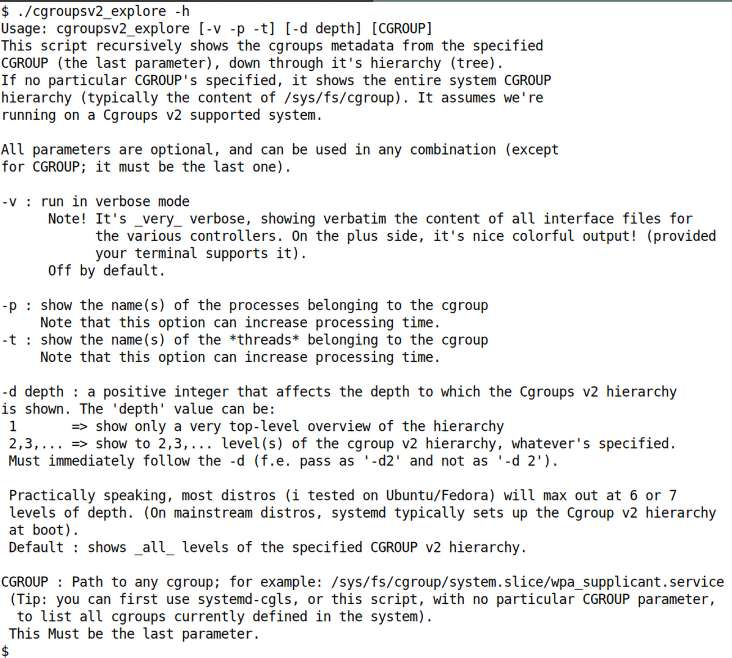

Hình 11.9: Ảnh chụp Bash script cgroupsv2\_explore hiển thị help screen

Được rồi. Chỉ chạy với depth 1 (do đó chỉ báo cáo first-level folder dưới cgroup root) để giảm output (ảnh cắt bớt cho gọn):

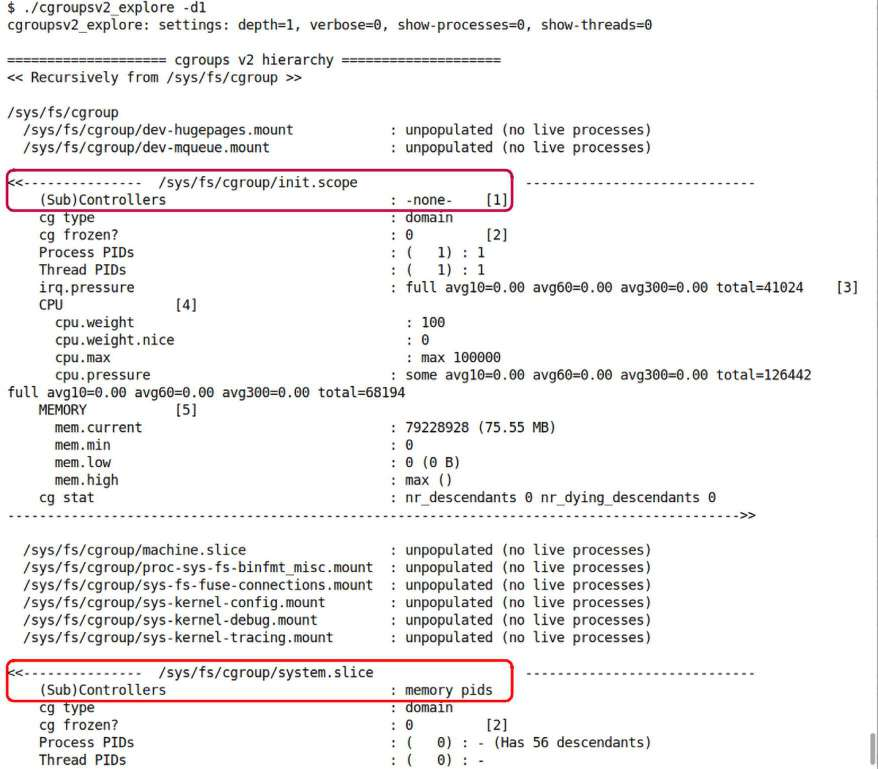

Hình 11.10: Ảnh chụp đã cắt bớt của Bash script cgroupsv2\_explore, cho thấy output khi chạy với depth setting 1

Output format tương ứng điều vừa mô tả. Chú ý ở đây (Hình 11.10) cgroup `/sys/fs/cgroup/init.scope` không có sub-controllers, ngụ ý thực sự không áp resource constraint nào! Nhưng cgroup `/sys/fs/cgroup/system.slice` có sub-controllers `memory` và `pids` bật, nên hệ thống giữ resource ấy trong constraint chỉ định bên trong. Cũng thấy ở đây (Hình 11.10), nhiều cgroup – từ `machine.slice` đến `sys-kernel-tracing.mount` (cùng những cgroup khác) – empty, unpopulated (không có live process bên trong).

Có thể chạy script truyền cgroup cụ thể; sẽ recursively hiển thị metadata của cgroup đó cùng mọi descendant cgroup nếu có. Chúng ta thử tính năng trong phần tiếp khi tạo cgroup riêng! Trước mắt như bài tập, hãy tự thử script trên nhiều cgroup.

### Thử nghiệm – giới hạn CPU resource qua cgroups v2

Vì tập trung CPU (task) scheduling ở đây, giờ dành thời gian xem hai cách chỉ định resource constraint cho CPU usage của các process trong cgroup:

- Cách dễ, tận dụng systemd (với service khởi động lúc boot).

- Cách thủ công, tạo và quản lý cgroup (v2) qua Bash script áp resource constraint lên CPU usage cho demo app.

Giờ bắt đầu cách đầu.

Thảo luận giả định bạn có kiến thức cơ bản về systemd và thiết lập service unit; nếu không, tham khảo tài liệu phần Đọc thêm (có vài systemd resource tại: `https://github.com/PacktPublishing/Linux-Kernel-Programming_2E/blob/main/Further_Reading.md#chapter-4-writing-your-first-kernel-module-lkms-part-1---further-reading`) và làm quen kiến thức cơ bản.

#### Tận dụng systemd để thiết lập CPU resource constraint cho service

Systemd có thể đóng vai abstraction layer trên cgroup, cho sysadmin khá dễ đặt resource constraint lên cgroup. Systemd cho administrator (hay root user) định nghĩa service auto-launches lúc boot, áp cho các process nhiều attribute và/hoặc constraint bạn chỉ định trong service unit file – metadata định nghĩa chạy gì và chính xác chạy thế nào. Systemd service unit file thường tên `<foo>.service` (thường tìm thấy nhiều file system-defined dưới `/etc/systemd/system`). Là plain ASCII text file chia thành vài section: `[Unit]`, `[Service]`, `[Install]`, v.v. (hãy học chi tiết qua tài liệu trong phần Đọc thêm vừa đề cập). Ví dụ pathname đến app (service) sẽ chạy được chỉ định qua directive `ExecStart=` trong section `[Service]`. (Sẽ rất sớm thấy demo vài service unit đơn giản.)

Trong nhiều specifier thuộc section `[Service]`, có thể chỉ định directive `CPUQuota=`; có thể đặt bằng phần trăm processor cycle (CPU time) tối đa cấp cho service! Tương tự `AllowedCPUs=n` đặt số CPU core tối đa service có thể dùng khi thực thi. Tương tự có thể áp constraint về memory, process, I/O và thậm chí network accounting cho service! Để xem chúng và hơn nữa, hãy xem man page `systemd.resource-control(5)`.

Đồng thời nhớ điều đã học về thread scheduling policy và priority (tham khảo Chương 10, The CPU Scheduler – Part 1, tại phần Các POSIX scheduling policy). Với systemd, có thể rất dễ đặt nice value, CPU scheduling policy, priority và CPU affinity mask trên service unit bằng directive thích hợp.

Man page `systemd.exec(5)` (`https://man7.org/linux/man-pages/man5/systemd.exec.5.html`) cho thấy rõ; sau đây là trích đoạn ngắn qua ảnh chụp một phần:

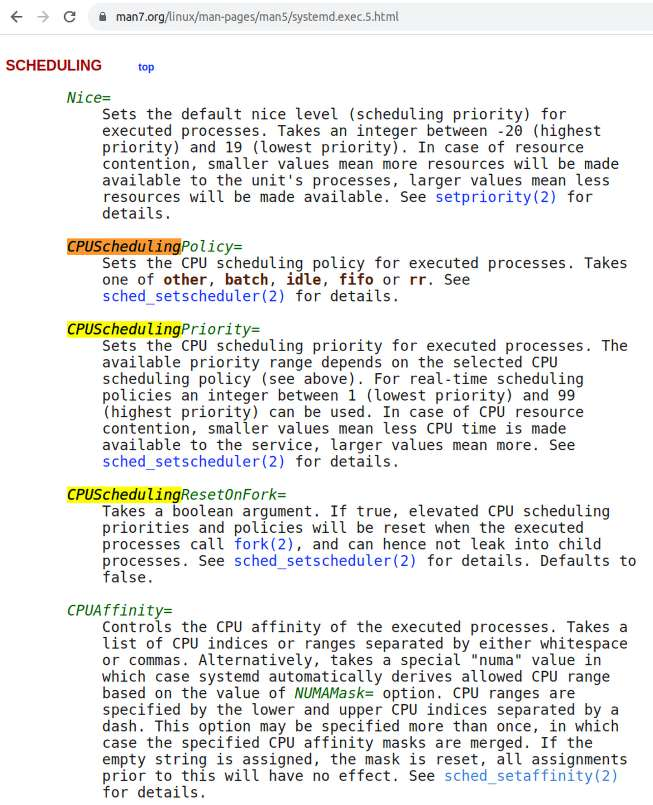

Hình 11.11: Ảnh chụp một phần online man page systemd.exec(5), cho thấy một vài attribute scheduler-related dễ đặt trên systemd service unit

Để demo, chúng tôi viết C program tạo prime number (từ 2 đến mức tối đa chỉ định). Thiết kế nhận hai parameter:

- Số tối đa cần tạo prime đến đó

- Lượng thời gian tối đa có thể dùng (giây; dùng alarm để tự kết thúc khi thời gian này trôi qua)

Ý tưởng: khi chạy không có resource constraint (CPU), sẽ tạo được khá nhiều prime number trong khoảng thời gian được cấp.

Nhưng khi chạy dưới CPU constraint nghiêm ngặt – thiết lập qua systemd dùng kernel technology cgroups v2! – bạn sẽ thấy chỉ tạo được (tương đối) ít prime!

Ở đây không đi sâu nitty-gritty thiết lập systemd service unit (cũng không chương trình prime number generator); hãy đọc liên kết phần Đọc thêm về systemd. Chúng ta để bạn đọc và thử prime number generator code chi tiết; tại `ch11/cgroups/cpu_constrain/primegen/`; đồng thời systemd service unit và một vài supporting script tại `ch11/cgroups/cpu_constrain/systemd_svcunit/` (liên kết: `https://github.com/PacktPublishing/Linux-Kernel-Programming_2E/tree/main/ch11/cgroups/cpu_constrain/systemd_svcunit`).

Setup Bash script – `setup_service` – thiết lập để service được cài và chạy ngay (tất nhiên có thể đặt chạy mỗi lần boot nhưng đây là cách kiểm thử dễ hơn nhiều, và tất nhiên không muốn làm phiền hệ thống bạn bằng chương trình prime number generator vô ích mỗi lần reboot!).

Không dài dòng nữa, đây là service unit để chạy prime number generator program không constraint; thực tế đã tăng lực bằng cách – rất dễ! – đặt CPU scheduling policy thành `SCHED_FIFO`, priority thành giá trị (khá tùy ý) 83 (nhớ khoảng 1 đến 99):

```
$ cd <book_src>/ch11/cgroups/cpu_constrain/systemd_svcunit
$ ls
run_primegen   svc1_primes_normal.service  svc3_primes_lowram.service
setup_service    svc2_primes_lowcpu.service
$ cat svc1_primes_normal.service
# svc1_primes_normal.service
# NORMAL version, no artificial CPU (or other) constraints applied
[Unit]
Description=My test prime numbers generator app to launch at boot (normal
version)
[ … ]
After=mount.target

[Service]
# run_primegen: the script that launches the app.
# Our setup_service script ensures it copies all required files to this
location.
# UPDATE the /path/to/executable if required.
ExecStart=/usr/local/bin/systemd_svcunit_demo/run_primegen

# Optional: Apply 'better' cpu sched settings for this process
CPUSchedulingPolicy=fifo
CPUSchedulingPriority=83
# (Below) So that the child process - primegen - runs with these sched
settings!
# (well it's anyway the default)
CPUSchedulingResetOnFork=false
# Nice value applies for only the default 'other/normal' cpu sched policy
#Nice=-20

[ … ]
# UPDATE to your preference
[Install]
WantedBy=graphical.target
#WantedBy=multi-user.target
$
```

Bash script rất nhỏ `run_primegen` được thực thi, rồi gọi prime number generator program, về cơ bản như sau:

```
/usr/local/bin/systemd_svcunit_demo/primegen 100000 3
```

Vì vậy sẽ cho prime number generator process đơn giản thử tạo prime đến tối đa 100.000 trong tối đa 3 giây.

##### Lần 1.1 – Thực thi prime number generator dưới systemd không resource constraint, policy SCHED\_FIFO và rtprio 83

Được rồi, chỉ để systemd thực thi script. Chạy setup script truyền service unit file làm parameter, khiến systemd thực thi program `run_primegen` (xem source để biết chi tiết; output dưới từ Fedora 38 guest x86\_64 chạy custom kernel 6.1.25):

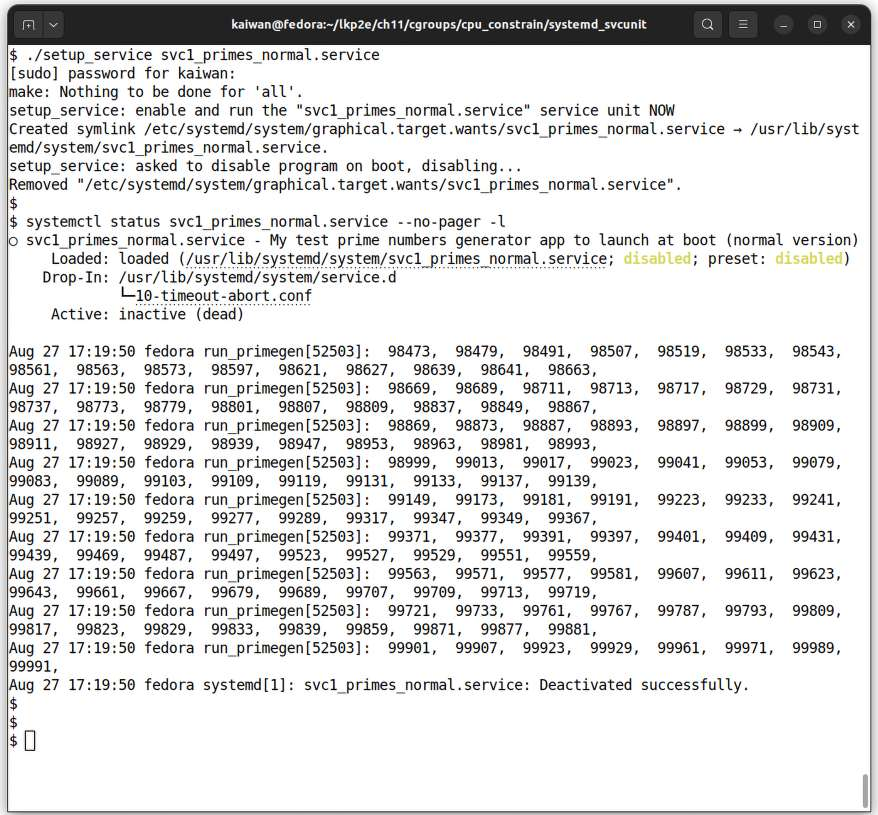

Hình 11.12: Ảnh chụp cho thấy systemd service unit đã thiết lập và thực thi prime number generator program không resource constraint

Tốt! Command `systemctl status <service.unit>` hiển thị status và mọi output đã tạo (Hình 11.12; hữu ích là systemd auto-saves mọi output `stdout`, `stderr` và kernel `printk` vào log).

Trong lần chạy cụ thể, tạo được prime number từ 2 đến 99.991 trong 3 giây có sẵn, không resource constraint (CPU), chạy `SCHED_FIFO` priority cao. (Tất nhiên hiểu số prime tạo được có thể khác khá nhiều tùy hardware system. Mẹo nhanh: để thấy full output, chỉ chạy `journalctl -b`.)

Nhân tiện script chủ ý disable service sau khi chạy một lần; có thể đổi bằng cách đặt variable `KEEP_PROGRAM_ENABLED_ON_BOOT` trong script `setup_service` thành giá trị `1`.

Như Hình 11.12 cho thấy, chạy

```
systemctl status svc1_primes_normal.service --no-pager -l
```

để xem status service.

Hơn nữa, khá thường hữu ích, command `systemctl show <service-unit-name>` hiển thị mọi setting của service unit; hãy làm, `grep` các setting CPU-related:

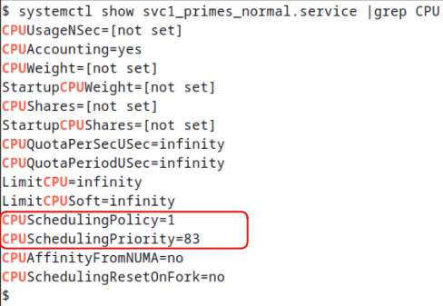

Hình 11.13: Ảnh chụp cho thấy setting CPU-related trong service unit

Chúng tôi làm nổi bật vài CPU setting đã chỉ định tường minh trong service unit file `svc1_primes_normal.service`. Những setting khác tất nhiên đặt mặc định (nhân tiện setting tên `LimitCPU*` để chỉ định resource limit (older-style) cho process trong service unit).

Vậy ghi nhớ lần chạy này – không CPU constraint nào, policy `SCHED_FIFO`, RT priority 83 (và trong khoảng 3 giây) – cho khoảng 99.991 prime trên hệ thống tôi.

##### Lần 1.2 – Thực thi prime number generator dưới systemd với CPU resource constraint, SCHED\_OTHER và rtprio 0

Giờ chạy cùng prime number generation program trên chính hệ thống ấy, nhưng lần này có một số CPU constraint rõ ràng chỉ định qua systemd. Service unit file giờ dùng: `ch11/cgroups/cpu_constrain/systemd_svcunit/svc2_primes_lowcpu.service`. Gần như mọi thứ giống file đầu (vừa thấy phần trước) trừ:

```
#--- Apply CPU constraints ---
CPUQuota=10%
AllowedCPUs=1
```

Cũng bỏ các dòng `CPUSchedulingPolicy=fifo` và `CPUSchedulingPriority=83`, do đó giữ process theo mặc định: scheduling policy `SCHED_OTHER`, real-time priority 0, và tất nhiên đã giới hạn chỉ dùng 10% CPU bandwidth, chỉ 1 core! Hãy chạy rồi kiểm tra status:

```
$ ./setup_service svc2_primes_lowcpu.service
[ … ]
$ systemctl status svc2_primes_lowcpu.service --no-pager -l
○ svc2_primes_lowcpu.service - My test prime numbers generator app to launch at
boot (CPU constrained version)
     Loaded: loaded (/usr/lib/systemd/system/svc2_primes_lowcpu.service;
disabled; preset: disabled)
    Drop-In: /usr/lib/systemd/system/service.d
             └─10-timeout-abort.conf
     Active: inactive (dead)

Aug 27 17:26:27 fedora run_primegen[52673]:  30347,  30367,  30389,  30391,
30403,  30427,  30431,  30449,  30467,  30469,  30491,  30493,  30497,  30509,
30517,  30529,
[ … ]
Aug 27 17:26:28 fedora run_primegen[52673]:  31531,  31541, primegen.c:buzz()
Aug 27 17:26:28 fedora run_primegen[52672]: Terminated
Aug 27 17:26:28 fedora systemd[1]: svc2_primes_lowcpu.service: Deactivated
successfully.
$
```

À! Lần này program – dưới constraint chỉ 10% CPU bandwidth (quota), cho chạy đúng 1 core, `SCHED_OTHER` và rtprio 0 – cho prime chỉ đến số 31.541 trong 3 giây được phép chạy (bên trong), so với hơn hẳn 99 nghìn prime trong trường hợp “normal” đầu, cho thấy trường hợp đầu tạo gần 70% nhiều prime hơn trường hợp hai, chứng minh hiệu quả systemd cgroups control. Vậy là đã rõ.

Để demo cách đặt memory limit trên cgroup, chúng tôi cung cấp sample service unit khác: `svc3_primes_lowram.service`. Bên trong, cgroup memory limit được chỉ định qua systemd setting `MemoryHigh` và `MemoryMax` (hãy xem man page `systemd.resource-control`, cụ thể phần Memory Accounting and Control để biết chi tiết). Service chủ ý cho program stress-ng cấp phát lượng memory khổng lồ, do đó vượt giới hạn chỉ định và khiến Out of Memory (OOM) killer (hay process `systemd-oomd`, nếu cấu hình) kết thúc các cgroup task. (Đã trình bày OOM killer tương đối chi tiết trong Chương 9, Kernel Memory Allocation for Module Authors – Part 2, tại phần Stayin’ alive – OOM killer). Cẩn thận khi chạy; chúng tôi chắc chắn khuyên làm trên test VM.

#### Cách thủ công – cgroups v2 CPU controller

Hãy thử, không, hãy làm điều thú vị (Làm hoặc không làm. Không có thử -Yoda.). Giờ chúng ta tạo thủ công cgroup mới dưới cgroups v2 hierarchy trên hệ thống. Sau đó thiết lập CPU controller cho nó và đặt upper limit user-specified cho lượng CPU bandwidth process trong cgroup thực sự được dùng! Rồi chạy prime number generator program bên trong để thấy bị constraint đã đặt ảnh hưởng thế nào.

Ở đây phác thảo các bước thường làm để thực hiện (mọi bước yêu cầu đang chạy root access):

1\. Bảo đảm kernel hỗ trợ cgroups v2; mong bạn chạy kernel 4.5 trở lên, bật cgroups v2 support.

Làm sao kiểm tra đang chạy cgroups v2?

Đơn giản: chạy `mount | grep cgroup` ; output phải chứa substring `type` `cgroup2`.

2\. Tạo cgroup trong hierarchy (thường trong `/sys/fs/cgroup/`). Thực hiện bằng cách chỉ tạo directory có cgroup name cần thiết dưới cgroup v2 hierarchy; ví dụ tạo sub-group tên `test_group`, làm:

```
mkdir /sys/fs/cgroup/test_group
```

3\. Thêm controller `cpu` cho cgroup mới; thực hiện (với tư cách root):

```
echo "+cpu" > /sys/fs/cgroup/test_group/cgroup.subtree_control
```

Nhớ không có controller thì không resource constraint nào được áp cho cgroup (và descendant; nếu muốn đọc lại phần Bật hoặc tắt controller, đặc biệt đoạn Top-down constraint đã đề cập).

4\. Phần hấp dẫn ở đây: thiết lập CPU bandwidth tối đa cho phép cho process sẽ thuộc cgroup này. Thực hiện bằng ghi hai integer vào file (pseudo) `<cgroups-v2-mount-point>/<our-cgroup>/cpu.max`. Để rõ, giải thích file theo tài liệu kernel (`https://docs.kernel.org/admin-guide/cgroup-v2.html#cpu-interface-files`) được chép lại:

```
cpu.max
A read-write two value file which exists on non-root cgroups. The default
is "max 100000".
The maximum bandwidth limit. It's in the following format:
$MAX $PERIOD
which indicates that the group may consume up to $MAX in each $PERIOD
duration. "max" for $MAX indicates no limit. If only one number is
written, $MAX is updated.
```

Thực chất mọi process trong cgroup cộng lại được phép chạy `$MAX` trong period `$PERIOD` microsecond; ví dụ với `MAX = 300,000` và `PERIOD = 1,000,000`, thực chất cho mọi process trong sub-control group chạy 0,3 giây trong period 1 giây! Nói cách khác 30% CPU bandwidth hay utilization. Như tài liệu kernel nói, mặc định MAX bằng PERIOD nên ngụ ý CPU utilization mặc định 100%.

5\. Chèn một process (hay nhiều) vào cgroup mới; thực hiện bằng ghi PID của chúng vào pseudofile `<cgroups-v2-mount-point>/<our-cgroup>/cgroup.procs`.

Vậy thôi; process dưới cgroup mới giờ thực hiện công việc dưới CPU bandwidth constraint áp đặt (nếu có); khi xong chết như thường... có thể loại bỏ (hay xóa) cgroup bằng `rmdir <cgroups-v2-mount-point>/<our-cgroup>` đơn giản.

Cho thuận tiện, Bash script thực hiện các bước trên tại: `ch11/cgroups/cpu_constrain/cpu_manual/cgv2_cpu_ctrl.sh` (`https://github.com/PacktPublishing/Linux-Kernel-Programming_2E/blob/main/ch11/cgroups/cpu_constrain/cpu_manual/cgv2_cpu_ctrl.sh`. Hãy xem!

Để thú vị, script cho phép truyền CPU bandwidth tối đa cho phép làm parameter – giá trị `$MAX` thảo luận bước 4; thực chất là cách chỉ định CPU bandwidth tối đa cho phép cho mọi process trong cgroup (sẽ sớm thấy). Giờ trong script, sau khi cgroup mới được tạo và thiết lập (với CPU bandwidth tối đa bạn chỉ định), chạy prime number generator program như sau:

```
primegen 1000000 5
```

Mọi thứ tương tự trường hợp trước với systemd, trừ yêu cầu tạo nhiều prime hơn và cho thêm thời gian, 5 giây, để chạy; nhằm cho cơ hội làm việc, vì script sau đó phải truy vấn và ghi PID vào pseudofile `<cgroups-v2-mount-point>/<our-cgroup>/cgroup.procs`.

Một vài lần chạy kiểm thử ở đây giúp hiểu hoạt động:

```
$ sudo ./cgv2_cpu_ctrl.sh
[+] Checking for cgroup v2 kernel support
cgv2_cpu_ctrl.sh: detected cgroup2 fs here: /sys/fs/cgroup

Usage: cgv2_cpu_ctrl.sh max-to-utilize(us) [run-cgroupsv2_explore-script]
max-to-utilize : REQUIRED: This value (microseconds) is the max amount of
  time the processes in the control group we create will be allowed to utilize
the
  CPU; it's relative to the period, which is set to the value 1000000.
  So, f.e., passing the value 300,000 (out of 1,000,000) implies a max CPU
utiltization
  of 0.3 seconds out of 1 second (i.e., 30% utilization).
  The valid range for the $MAX value is [1000-1000000].
run-cgroupsv2_explore-script : OPTIONAL: OFF by default.
  Passing 1 here has the script invoke our cgroupsv2_explore bash script,
passing
  the new cgroup as the one to show details of.
$
```

Bạn được yêu cầu chạy với root và truyền parameter đầu là giá trị `$MAX` (usage screen ở trên giải thích khá rõ, gồm hiển thị khoảng hợp lệ – giá trị microsecond).

Được rồi, ở đây chạy Bash script với parameter `800000`, ngụ ý CPU bandwidth 800.000 trong period 1.000.000; thực chất CPU utilization khá cao, 0,8 giây mỗi 1 giây trên CPU (nghĩa là CPU utilization 80%):

```
$ sudo ./cgv2_cpu_ctrl.sh 800000
[+] Checking for cgroup v2 kernel support
cgv2_cpu_ctrl.sh: detected cgroup2 fs here: /sys/fs/cgroup
[+] Creating a cgroup here: /sys/fs/cgroup/test_group
[+] Adding a 'cpu' controller to it's cgroups v2 subtree_control file

***
Now allowing 800000 out of a period of 1000000 to all processes in this cgroup,
i.e., 80.000% !
***

[+] Launch the prime number generator process now ...
../primegen/primegen 1000000 5 &

  2,  3,      5,      7,     11,     13,     17,     19,     23,     29,
31,     37,     41,     43,     47,     53,
[ … ]
   3071 pts/1    00:00:00 primegen
[+] Insert the 3071 process into our new CPU ctrl cgroup
   227,    229,    233,    239,    241,    251,    257,    263,    269,    271,
277,    281,    283,    293,    307,    311,
cat /sys/fs/cgroup/test_group/cgroup.procs
3071
[ … ] 7541,   7547,   7549,   7559,   7561,

............... sleep for 6 s, allowing the program to execute ................

  7573,   7577,   7583,   7589,   7591,   7603,   7607,   7621,   7639,   7643,
7649,   7669,   7673,   7681,   7687,   7691,
[ … ]

 41143,  41149,  41161,  41177,  41179,  41183,  41189,  41201,  41203,  41213,
41221,  41227,  41231,  41233,  41243,  41257,
primegen.c:buzz()
     [+] Removing our (cpu) cgroup
$
```

Nghiên cứu output script; có thể thấy làm đúng công việc. Sau xác minh cgroup v2 support, tạo cgroup tên `test_group` dưới `/sys/fs/cgroup/`, thêm controller `cpu`. Rồi thiết lập CPU bandwidth tối đa cho phép 800.000 trong period 1.000.000 (CPU utilization tối đa 80%), vì là giá trị đã truyền. Sau đó launch prime number generator app (với parameter thích hợp), và – tất nhiên then chốt – thêm PID vào cgroup. Trong lần kiểm thử này, với 80% CPU bandwidth có sẵn, tình cờ tạo prime đến số 41.257 (trong 5 giây được cấp; tất nhiên số này có thể và rất có khả năng khác trên hệ thống khác). Script sau đó cleanup, xóa cgroup.

Tuy nhiên để thực sự thấy tác động cgroup, hãy chạy lại script (nghiên cứu output sau trong Hình 11.14), nhưng lần này CPU bandwidth tối đa chỉ 1.000 (giá trị `$MAX`) – thực chất CPU utilization tối đa chỉ 0,1%!:

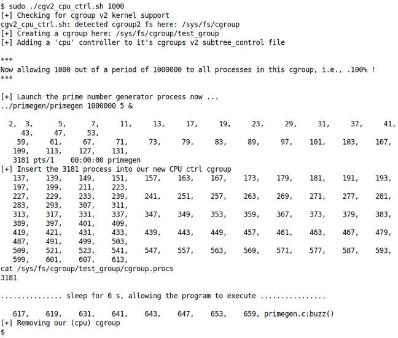

Hình 11.14: Ảnh chụp cho thấy Bash script tạo cgroup, thiết lập chỉ cấp 0,1% CPU bandwidth, rồi thêm và chạy prime number generator program bên trong

Khác biệt lớn! Lần này – với CPU bandwidth allocation ít ỏi 0,1% – prime number generator process tội nghiệp chỉ xuất prime number từ 2 đến 659 (so với đến prime 41.257 với CPU bandwidth 80%). Chứng minh rõ hiệu quả cgroups v2 CPU controller.

Thêm một điều: giờ chạy lại script cùng cách, trừ truyền parameter thứ hai bằng 1; bên trong điều này cho Bash script `cgroupsv2_explore` – với parameter đầu đặt `-p` để hiển thị process bên trong, parameter thứ hai là cgroup mới! – thực thi, do đó cho biết vài chi tiết. Trong ảnh cắt bớt (Hình 11.15), chỉ hiển thị và làm nổi bật output của nó:

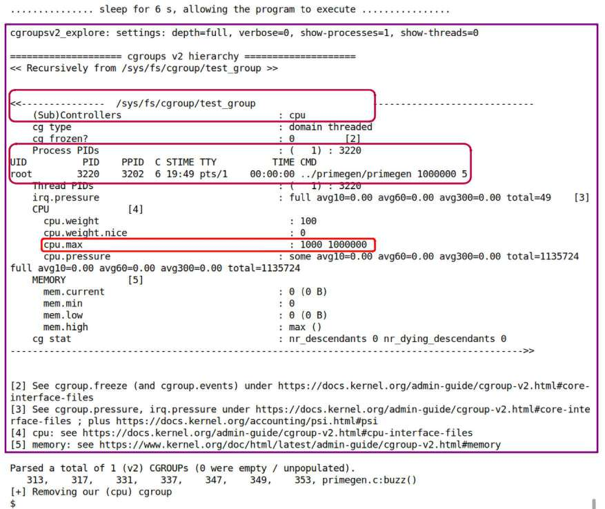

Hình 11.15: Ảnh chụp cắt bớt output script cgv2\_cpu\_ctrl.sh – lần này parameter thứ hai bằng 1, cho phép script cgroupsv2\_explore (trước đó) hiển thị vài chi tiết cgroup mới

Tuyệt; mọi thứ ở đó như mong đợi.

Liên quan điều này, có thể tác động weightage CPU phân phối cho process trong cgroup bằng điều chỉnh pseudofile `cpu.weight`. Nó nhận giá trị mặc định 100 cho mọi task trong cgroup.

Như vậy chỉ có nghĩa tất cả nhận phần CPU resource bằng nhau; giá trị thực sự gán không quan trọng. Chỉ khi thay weight giữa process (task) mới quan trọng.

Điểm then chốt cần hiểu với CPU resource controller (và controller khác nói chung): constraint chỉ định chỉ có ý nghĩa và được áp khi resource đang xét – ở đây CPU core – bão hòa; nếu không process tự do (vui vẻ?) dùng CPU bao nhiêu tùy thích. Hợp lý!

Vậy giờ cuối cùng hy vọng bạn thấy vì sao trong Hình 10.1 của chương trước, ở ngay trên cùng có lớp “Cgroups v2”. Giờ thấy khá rõ cgroup ăn sâu vào chính cấu trúc Linux kernel; vì vậy có thể lập trình để tác động allocation (hay bandwidth/utilization) của nhiều resource, gồm CPU, và nhờ đó hiểu ảnh hưởng CPU scheduling nhiều thế nào.

Bài tập đơn giản: chạy Bash script `ch11/cgroups/cpu_constrain/cpu_manual/cgv2_cpu_ctrl.sh` trên hệ thống bạn, cho cấp các lượng CPU bandwidth utilization khác nhau và bật hiển thị output từ script `cgroupsv2_explore` trước. Nghiên cứu kết quả.

Đến đây hoàn tất nội dung một kernel feature thực sự mạnh và hữu ích: cgroups (v2). Hãy sang phần cuối chương: giới thiệu Real-Time Operating System (RTOS) là gì, và cách có thể chuyển Linux thông thường thành RTOS bằng áp patch thích hợp và cấu hình.

## Chạy Linux như RTOS – giới thiệu

Mainline hay vanilla Linux (kernel tải từ `https://kernel.org`, hay cả Linux Git kernel tree điển hình) chắc chắn không phải RTOS; là General Purpose Operating System (GPOS; như Windows, macOS và Unix). Trong RTOS, nơi đặc tính hard real-time (RT) có tác dụng, phần mềm không chỉ phải có kết quả đúng mà còn có deadline gắn với việc đó; phải bảo đảm đáp ứng deadline mọi lần.

Có thể phân loại OS một cách rất khái quát theo đặc tính RT như sau, xem Hình 11.16: ở đầu bên trái là các OS non-RT, còn ở đầu bên phải là RTOS:

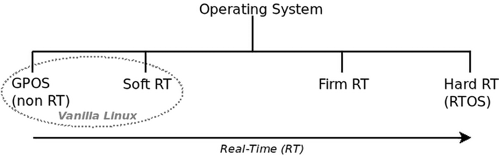

Hình 11.16: Phân loại OS trên RT scale

Mainline hay “vanilla” Linux OS dù không phải RTOS vẫn làm rất tốt performance-wise mà không mấy khó khăn. Dễ đủ điều kiện soft real-time OS: đáp ứng deadline phần lớn thời gian theo “best effort” (đôi lúc nói đạt tiêu chí “five-9s”, vì đáp ứng deadline 99,999% thời gian!). Tuy vậy lĩnh vực hard real-time thực sự (ví dụ nhiều loại military operation, vận tải, robotics, telecom, factory floor automation, stock exchange, medical electronics, v.v.) yêu cầu hard real-time guarantee nên cần RTOS. Vì vậy với các lĩnh vực này plain vanilla Linux, GPOS, đơn giản không đủ.

Điểm then chốt trong context là determinism: một điểm oft-missed về real time là software response time cho event (bên ngoài) không nhất thiết luôn rất nhanh (chẳng hạn đáp trong vài microsecond). Có thể chậm hơn nhiều (khoảng vài chục millisecond); bản thân điều đó không thực sự quan trọng trong RTOS. Điều quan trọng là hệ thống reliable và predictable, làm việc nhất quán giống nhau, luôn bảo đảm đáp ứng deadline; hệ thống như vậy được nói có deterministic response và là đặc tính then chốt real-time system.

Ví dụ thời gian đáp scheduling request phải nhất quán, dự đoán được, không dao động khắp nơi. Sai lệch so với thời gian cần thiết (hay baseline) thường gọi jitter; RTOS cố giữ jitter rất nhỏ, thậm chí không đáng kể. Trong GPOS điều này thường không thể, ngay từ đầu cũng không phải design goal! Vì vậy trong non-RT system như vậy, jitter có thể khác rất nhiều, lúc thấp lúc kế tiếp rất cao.

Tổng thể, khả năng giữ response ổn định, đều, dự đoán được với jitter tối thiểu – ngay cả trước workload pressure cực lớn – gọi determinism và là dấu hiệu đặc trưng RTOS. Để có deterministic response ấy, thuật toán phải được thiết kế tương ứng algorithmic time complexity O(1) (big-Oh 1) nhiều nhất có thể.

Mục tiêu khác của RT system là giảm latency và delay. Thực ra phát biểu chưa hoàn toàn chính xác: mục tiêu là giảm maximum hay worst-case latency trải nghiệm xuống mức chấp nhận; thực tế (trớ trêu) minimum latency và average latency có thể – và thường – tệ hơn non-RT system.

Thomas Gleixner, cùng hỗ trợ cộng đồng, đã làm hướng đến mục tiêu chuyển Linux kernel non-RT thông thường (hay plain vanilla) thành hard RTOS từ rất lâu. Ông và cộng sự thành công từ lâu: từ kernel 2.6.18 (phát hành tháng 9 năm 2006), đã có out-of-tree patch chuyển Linux kernel thành RTOS! Có thể tìm patch cho nhiều kernel version tại: `https://mirrors.edge.kernel.org/pub/linux/kernel/projects/rt/`. Tên project cũ là “preemptible real-time” hay đơn giản `PREEMPT_RT`. Sau đó (từ tháng 10 năm 2015, kernel version 4.1 trở đi), Linux Foundation (LF) tiếp quản project – bước rất tích cực! – đổi tên thành Real-Time Linux (RTL) Collaborative Project (`https://wiki.linuxfoundation.org/realtime/rtl/start`), hay đơn giản RTL (đừng nhầm với co-kernel approach như Xenomai, RTAI hay nỗ lực cũ now-defunct tên RTLinux).

Câu hỏi thường gặp tất nhiên là “Tại sao các patch chuyển Linux thành hard real-time OS không nằm ngay trong mainline?” Hóa ra:

- Phần lớn công việc RTL thực sự đã merge vào mainline kernel; gồm vùng quan trọng như scheduling subsystem, mutex và spinlock, lockdep, threaded interrupt, PI (priority inheritance), tracing, v.v. Thực tế mục tiêu chính đang tiếp diễn của RTL là merge vào mainline; tại thời điểm viết đã (rất) gần!

- Theo truyền thống Linus Torvalds xem Linux, được thiết kế và xây dựng architecture chủ yếu như GPOS, không nên có tính năng can thiệp sâu mà chỉ RTOS thực sự cần; vì vậy dù patch được merge, là quá trình chậm, cân nhắc kỹ.

Chúng tôi đưa nhiều bài viết, tham khảo thú vị về RTL (và hard real-time nói chung) trong phần Đọc thêm của chương; hãy xem.

Điều bạn làm tiếp thực sự thú vị: trình bày ngắn cách patch mainline kernel 6.1 LTS bằng RTL patch (hiện vẫn) out-of-tree, cấu hình, build và boot; do đó cuối cùng chạy RTOS – Real-Time Linux hay RTL! Sẽ làm trên Linux VM x86\_64 (hay hệ thống native).

### Hướng dẫn tham khảo build RTL cho mainline kernel 6.x (trên x86\_64)

Ở đây thay vì trình bày chi tiết cách patch vanilla Linux kernel, cấu hình và build như real-time kernel (RTL), chỉ hướng bạn đến tutorial ngắn trên RTL Wiki site xuất sắc: HOWTO setup Linux with PREEMPT\_RT properly: `https://wiki.linuxfoundation.org/realtime/documentation/howto/applications/preemptrt_setup`.

Thực tế ấn bản đầu sách đã giải thích in-depth patch, cấu hình và build RTL; hãy tham khảo chi tiết đó nếu muốn.

Tutorial ngắn – một phần RTL Wiki site lớn và rất hữu ích – giải thích:

- Tải RTL patch set cho stable kernel cho trước (từ `https://mirrors.edge.kernel.org/pub/linux/kernel/projects/rt/`; tại thời điểm viết tutorial vừa đề cập dùng RTL patch cho kernel 4.4 LTS):

  - Để bạn biết, patch set thường có hai dạng. Đầu là patch file duy nhất tên `patch-<kver>-rt<xy>.tar.xz` (cùng bản gzip và file `sign`); tải và extract dạng này dễ hơn – toàn RTL patch trong một file. Dạng kia là patch series (nhiều patch file) trong file tên `patches-<kver>-rt<xy>.tar.xz`; theo cách này khi extract, RTL patch file ở folder tên `patches/`. Có thể có nhiều patch (phải áp theo thứ tự – xem series file; ví dụ file `patches-6.1.75-rt23.tar.xz` bung thành series 63 patch file).

- Extract các patch rồi patch kernel source tree

- Cấu hình kernel, thiết lập full kernel preemption cho RTL (`CONFIG_PREEMPT_RT=y`); xem mẹo tiếp sau

- Build theo cách thường (dù sao đã trình bày in-depth trong Chương 2, Building the 6.x Linux Kernel from Source – Part 1, và Chương 3, Building the 6.x Linux Kernel from Source – Part 2)

Vài mẹo nhanh về kernel configuration cho RTL: Để cấu hình build Linux như RTL, trong UI `make menuconfig`, đến General Setup \| Preemption Model. Giả định đã tải và áp các RTL patch (out-of-tree), sẽ thấy 4 lựa chọn ở đây (thay 3 thông thường). Lựa chọn thứ tư cần dùng: Fully Preemptible Kernel (Real-Time). Chọn (`CONFIG_PREEMPT_RT=y`). Tuy nhiên có thể chỉ thấy 3 lựa chọn đầu thông thường; vì lựa chọn thứ tư phụ thuộc `CONFIG_EXPERT` bật (`y`):

`Depends on: <choice> && EXPERT [=y] && ARCH_SUPPORTS_RT [=y]`

Vì vậy nếu dù đã áp RTL patch set mà không thấy RTL option thứ tư, trước tiên bật General Setup \| Configure standard kernel features (expert users); RTL choice thứ tư hẳn sẽ hiện và có thể bật.

Đồng thời thú vị khi lưu ý dynamic preemption model bị tắt khi `PREEMPT_RT` (thực chất RTL) bật. Đã trình bày trong chương trước tại phần Tính năng dynamic preemptible kernel.

Tại thời điểm viết, các patch được hỗ trợ cho 6.1 LTS dành cho kernel 6.1.77\[-rt24\], 6.1.75\[-rt23\], 6.1.67\[- rt20\], 6.1.46\[-rt14\] và 6.1.38\[-rt13\] (tại: `https://mirrors.edge.kernel.org/pub/linux/kernel/projects/rt/6.1/`); lúc viết nội dung, tôi chọn bản 6.1.46 (lưu ý các RTL patch cụ thể có sẵn cho base kernel nhất định có thể và thực sự đổi khi mọi thứ phát triển).

Sau build, thực hiện các bước còn lại thường lệ (trên x86\_64: `sudo make modules_install && sudo` `make install`), rồi reboot. Từ bootloader menu, hãy chắc chắn chọn RTL kernel mới thú vị! Khi vào shell, xác minh thực sự real-time kernel. Đây là output tôi nhận:

```
$ uname -a
Linux fedora 6.1.46-rt14-rc1 #1 SMP PREEMPT_RT [ ... ] x86_64 GNU/Linux
```

Thú vị, sự hiện diện file (pseudo) `/sys/kernel/realtime`, cùng giá trị 1, chỉ đây là real-time kernel, RTL:

```
$ cat /sys/kernel/realtime
1
```

Vậy tốt, giờ – như đã hứa – đang chạy Linux trong hiện thân RTL, hard real-time operating system, RTOS!

Hãy lưu ý kỹ: chỉ chạy OS như real-time system còn xa mới đủ khi triển khai real-time project; application cũng cần thiết kế, viết cẩn thận – đặc biệt time-critical region – ghi nhớ real-time guideline. Một lần nữa RTL Wiki site cung cấp nhiều chỉ dẫn cùng chủ đề; hãy chắc chắn xem.

## Các chủ đề khác liên quan scheduling

Chúng ta kết thúc chương bằng đề cập vài chủ đề khác nhưng hữu ích.

### Một vài routine nhỏ (kernel space) nên xem

Đây là vài kernel routine có thể hữu ích (để bạn tự xem chi tiết và sample usage trong kernel):

- `rt_prio()`: Với priority làm parameter, trả Boolean cho biết có phải real-time task không.

- `rt_task()`: Dựa priority value của task, nhận task structure pointer làm parameter, trả Boolean cho biết có phải real-time task không (wrapper trên `rt_prio()`).

- `task_is_realtime()`: Tương tự nhưng dựa scheduling policy của task. Nhận task structure pointer làm parameter, trả Boolean cho biết có phải real-time task không.

Vì các routine trên đều trong một header (`include/linux/sched/rt.h`), chỉ include và trực tiếp dùng trong module.

### ghOSt OS

Ngày nay liên tục xuất hiện các lĩnh vực công nghệ hoàn toàn mới về hardware và software; ví dụ NUMA với chiplet, processor accelerator (GPU, TPU, DPU), AMD CCX, AWS Nitro, v.v. Không chỉ vậy cloud-based workload có nhu cầu đặc biệt; ví dụ một số high-speed networking/telecom project yêu cầu (scheduling) latency microsecond. Những điều này gây áp lực lớn – nếu chưa áp đảo – khả năng OS scheduler hiện có.

Chắc chắn có thể build hay dùng data plane OS, hoặc viết nhiều custom scheduling class để xử lý, nhưng kiểm thử, tinh chỉnh và triển khai ở quy mô lớn (nghĩ datacenter workload) khó làm nhanh, đúng và hiệu quả.

Các tình huống này và tương tự tạo ra một dạng OS abstraction và user-space abstraction về scheduling; Google đề xuất hệ thống tương đối mới tên ghOSt – cung cấp user-space delegation nhanh và linh hoạt cho Linux scheduling – để đáp ứng chính nhu cầu và tình huống như vậy. Hướng đến cả cộng đồng nghiên cứu lẫn datacenter trong production. Gồm cả kernel code và user-space code; ý định kernel code phần lớn giữ ổn định (về cơ bản custom scheduling class). Phần user space là nơi quyết định policy (qua regular process tên agent giao tiếp với ghOSt kernel code); vì vậy có thể và thực sự đổi nhanh, được giữ open source (`https://github.com/google/ghost-userspace`).

Ý tưởng tổng thể dường như là cung cấp “policy cho nhiều scheduling objective, từ latency ở mức µs, đến throughput, đến energy efficiency….” Kernel implementation dùng eBPF hỗ trợ tăng tốc code path. Tại thời điểm viết, dường như đang experimental development phase, không được coi là sản phẩm Google hỗ trợ chính thức. Phần Đọc thêm của chương có thêm về chủ đề.

## Tổng kết

Trong chương thứ hai về CPU (hay task) scheduling trên Linux OS này, bạn học nhiều điều then chốt. Trong đó học cách truy vấn và đặt CPU affinity mask của thread bất kỳ (user hay kernel) bằng lập trình; điều này tự nhiên dẫn đến cách truy vấn và đặt scheduling policy và priority của thread bất kỳ bằng lập trình.

Toàn bộ khái niệm “hoàn toàn công bằng” (qua CFS implementation) được đặt câu hỏi, và làm sáng tỏ (khá nhiều!) giải pháp thanh lịch cgroups (v2), hiện ăn sâu Linux kernel. Đã trình bày cách systemd giúp auto-integrate cgroup vào distro hiện đại, server và cả embedded system, tự động và dynamic tạo, duy trì nhiều cgroup (qua slice artifact và scope artifact). Thậm chí đã học cách tận dụng cgroups v2 CPU controller cấp CPU bandwidth (hay utilization) tùy muốn cho process trong sub-group, cả qua systemd unit file lẫn thủ công.

Sau đó tìm hiểu ngắn RTOS là gì, thấy dù vanilla Linux là GPOS, RTL patch set (out-of-tree) thực sự tồn tại; khi áp rồi cấu hình và build kernel, cho chạy Linux như hard real-time system thực sự, RTOS. (Có lưu ý thiết kế và viết RT app cẩn thận quan trọng không kém cho RT system thực sự.) Kết thúc bằng đề cập nhanh một vài kernel scheduler-related routine và research project ghOSt OS của Google.

Khá nhiều nội dung! Dành thời gian hiểu đúng tài liệu và hands-on. Khi xong, hãy cùng tôi đến khía cạnh thực sự quan trọng; cùng khám phá sự phức tạp của kernel synchronization trong hai chương cuối sách!

## Câu hỏi

Để kết thúc, đây là danh sách câu hỏi giúp kiểm tra kiến thức về nội dung chương: `https://github.com/PacktPublishing/Linux-Kernel-Programming_2E/blob/main/questions/ch11_qs_assignments.txt`. Bạn sẽ tìm thấy câu trả lời cho một số câu hỏi trong GitHub repo của sách: `https://github.com/PacktPublishing/Linux-Kernel-Programming_2E/tree/main/solutions_to_assgn`.

## Đọc thêm

Để giúp tìm hiểu sâu chủ đề bằng tài liệu hữu ích, chúng tôi cung cấp danh sách khá chi tiết các tài liệu tham khảo và liên kết trực tuyến (và đôi lúc cả sách) trong tài liệu Đọc thêm ở GitHub repository của sách. Tài liệu Đọc thêm tại: `https://github.com/PacktPublishing/Linux-Kernel-Programming_2E/blob/main/Further_Reading.md`.

## Hãy để lại đánh giá!

Bạn thích cuốn sách này? Hãy giúp độc giả như bạn bằng cách để lại đánh giá Amazon. Quét QR code bên dưới để nhận discount code 20%.


\*Ưu đãi có giới hạn
