# Chương 12. Kernel Synchronization – Phần 1

Qua chương trước và chương ngay trước đó (lần lượt Chương 11 và 10), bạn đã học khá nhiều về CPU scheduling (hay task scheduling) trên Linux OS. Trong chương này và chương tiếp theo, chúng ta sẽ đi sâu vào chủ đề kernel synchronization – đôi lúc nhất thiết phải phức tạp.

Như developer quen lập trình trong môi trường multithreaded đều biết rõ, cần synchronization bất cứ khi nào hai hay nhiều thread (nói chung code path) có thể làm việc trên shared writable data item. Không có synchronization (hay mutual exclusion) khi truy cập shared data, chúng có thể race; nghĩa là không dự đoán được kết quả. Đây gọi là data race. (Thực tế data race còn xảy ra khi nhiều single-threaded process làm việc trên shared memory object bất kỳ, hoặc khi có khả năng xảy ra interrupt.) Bản thân pure code không bao giờ là vấn đề vì permission là read+execute (`r-x`); đọc và thực thi code đồng thời trên nhiều CPU core không chỉ hoàn toàn ổn, an toàn mà còn được tích cực khuyến khích (vì cho throughput tốt hơn, đó là lý do multithreading là ý tưởng tốt). Tuy nhiên ngay khi làm việc trên shared writable data là lúc cần bắt đầu rất cẩn thận (vì vậy multithreading và concurrency thường là chủ đề phức tạp!).

Thảo luận về concurrency và kiểm soát qua synchronization rất đa dạng, đặc biệt với phần mềm phong phú, phức tạp như Linux kernel (và driver/module liên quan), chính là đối tượng sách này. Vì vậy cho thuận tiện, chia chủ đề lớn thành hai chương, chương này và chương sau.

Trong chương này, chúng ta trình bày các chủ đề:

- Critical section, exclusive execution và atomicity

- Các mối quan tâm concurrency trong Linux kernel

- Mutex hay spinlock? Khi nào dùng loại nào

- Dùng mutex lock

- Dùng spinlock

- Locking và interrupt

- Locking – lỗi thường gặp và hướng dẫn

## Yêu cầu kỹ thuật

Tôi giả định bạn đã đọc chương trực tuyến Kernel Workspace Setup, chuẩn bị phù hợp guest Virtual Machine (VM) chạy Ubuntu 22.04 LTS (hoặc bản phát hành ổn định mới hơn, hay Fedora distro gần đây) và cài mọi package cần thiết. Nếu chưa, tôi đặc biệt khuyên làm trước.

Để tận dụng tối đa sách, tôi đặc biệt khuyên trước tiên thiết lập môi trường workspace, bao gồm clone GitHub repository của sách để lấy code rồi thực hành trực tiếp. Repository tại: `https://github.com/PacktPublishing/Linux-Kernel-Programming_2E`.

Trong chương này và chương sau, đôi lúc tham chiếu ví dụ device driver nhỏ (và đơn giản). Nếu chưa quen khái niệm Linux driver cơ bản, dù không phải điều kiện bắt buộc, tôi xin một lần nữa đề xuất sách Linux Kernel Programming – Part 2 – Char Device Drivers and Kernel Synchronization; điều này được giải thích ngay chương đầu: Chapter 1, Writing a Simple misc Character Device Driver (sách Part 2 thực tế được xem companion volume của sách này; đồng thời e-book tải miễn phí).

Xong việc đó, thắt dây an toàn và bắt đầu chủ đề quan trọng, thú vị này!

## Critical section, exclusive execution và atomicity

Hình dung đang viết software cho multicore system (ngày nay thường làm trên multicore system, ngay cả phần lớn embedded project). Như đề cập phần giới thiệu, chạy nhiều code path parallel không chỉ an toàn mà còn đáng mong muốn (nếu không thì chi tiền làm gì, đúng không?). Mặt khác, các code path concurrent (parallel và đồng thời) trong đó shared writable data (còn gọi shared state) được truy cập theo bất kỳ cách nào là nơi phải bảo đảm tại thời điểm bất kỳ, chỉ một thread làm việc trên data ấy mỗi lần! Đây là điều then chốt. Vì sao? Hãy nghĩ: nếu cho phép nhiều concurrent code path làm việc parallel trên shared writable data, bạn đang tự gây rắc rối: kết quả có thể là data corruption (“data race”). Phần sau, sau khi trình bày vài điểm then chốt, sẽ minh họa rõ khái niệm data race qua vài ví dụ pseudo-code (cũng có thể xem trước Hình 12.6 nếu muốn).

### Critical section là gì?

Các điểm tiếp theo rất quan trọng; hãy đọc kỹ.

Critical section là code path phải thỏa hai điều kiện:

- Điều kiện một: Code path có thể concurrent, nghĩa là tồn tại khả năng chạy parallel.

VÀ

- Điều kiện hai: Làm việc trên (read và/hoặc write) shared writable data (còn gọi shared state).

Vì vậy critical section theo định nghĩa cần được bảo vệ khỏi parallelism.

Nói cách khác critical section là đoạn code phải chạy exclusively, đôi lúc thậm chí atomically.

- Với exclusively, ngụ ý tại thời điểm bất kỳ, đúng một thread chạy code critical section; nghĩa là chạy một mình (serialized, trái với parallelized). Cần như vậy vì an toàn data.

- Từ atomic ngụ ý thứ không thể chia; trong context này nghĩa là khả năng chạy đến hoàn tất không gián đoạn.

Nếu hai hay nhiều thread thực thi code critical section concurrently, đó là bug hay defect; thường gọi race condition hay data race.

Nhận diện và bảo vệ critical section khỏi thực thi đồng thời (khỏi data race) là yêu cầu ngầm của software đúng mà bạn – designer/architect/developer – phải bảo đảm. Học cách bảo vệ critical section (tương đối) dễ; nhận diện đúng mọi critical section là kỹ năng phải thành thạo. Chúng ta sẽ cố hỗ trợ qua các “bài tập” sau.

Bài tập 1. Trong đoạn (pseudo) code user-mode Pthreads sau, có thể giả định function code chạy parallel (bởi nhiều thread), vùng code giữa thời điểm t1 và t2 (thể hiện trong comment) có tạo thành critical section không?

```
void qux(int factor)
{
    int nok;
    [ … ]
    //------------------------ t1
    nok += 10*PI;
    //------------------------ t2
    printf("..."); [ … ]
}
```

Lời giải 1. Được rồi, tôi giúp bài đầu! Tự hỏi chính xác điều gì tạo thành critical section? Khi thỏa hai điều kiện: code path có khả năng thực thi parallel và làm việc trên shared writable data. Vậy code đang xét (dòng giữa t1 và t2) thỏa hai tiền điều kiện không? Có thể chạy parallel (như nói tường minh), nhưng không làm việc trên shared writable data (variable `nok` không shared; là local variable, vì vậy mỗi thread thực thi code path này có bản sao variable trên stack của nó). Vậy câu trả lời rõ ràng không, không phải critical section. Nói cách khác có thể chạy parallel – số instance bất kỳ – không cần bảo vệ tường minh loại nào.

Sang vài bài tập nhỏ nữa.

Bài tập 2 và 3. Trong các đoạn (pseudo) code kernel module sau, có thể giả định

code chạy parallel (bởi nhiều user-mode thread switch vào kernel space đến các

code path này, chạy trong process context), các vùng code giữa thời điểm

trong comment) có tạo thành critical section không?

```
static struct quux_drvctx {
        ...
} *mydrv;

write_quux()      /*  driver
write method   */
{
    [ … ]
    //-------------------- t1
    mydrv->sensor2 = 1;
    mydrv->hw = hw_zoom;
    //-------------------- t2
               [ … ]
}
```

t1 và t2 (thể hiện

```
static int glob;
static __init my_kmod_init(void) /*
init method */
{
        [ … ]
        //-------------------- t1
    glob += 14;
    pr_info(...);
        //-------------------- t2
        [ … ]
}
[ … ]
module_init(my_kmod_init);
module_exit(my_kmod_cleanup);
```

(Có lời giải ở cuối chương trong phần Lời giải; hãy tự giải trước khi kiểm tra.)

Giờ xem lại khái niệm atomicity then chốt: atomic operation là operation không thể chia. Trên processor hiện đại bất kỳ, hai operation thường được xem luôn atomic; nghĩa là chạy đến hoàn tất không gián đoạn:

- Thực thi một machine language instruction đơn lẻ.

- Read hay write vào aligned primitive data type nằm trong processor word size (thường 32 hoặc 64 bit); vì vậy đọc hay ghi integer 32-bit hoặc 64-bit trên hệ thống 64-bit được bảo đảm atomic. Thread đọc variable không bao giờ thấy kết quả lưng chừng, torn hay dirty; hoặc thấy giá trị cũ hoặc mới. Mặt khác processor 32-bit thao tác item 64-bit không bảo đảm atomic, có thể gây torn/dirty read (hay write).

Một lời khuyên: rất đáng cẩn thận ở đây! Đã có chứng minh với compiler hiện đại tối ưu mạnh trên hardware processor hiện đại, ngay cả “chân lý” – load/store (nghĩa read/write) vào aligned primitive data type trong processor word size luôn atomic – có thể không đúng! Compiler giờ có thể dùng load-/store-tearing technique và hơn nữa; đọc thêm trong bài xuất sắc: Who’s afraid of a big bad optimizing compiler? LWN, tháng 7 năm 2019: `https://lwn.net/Articles/793253/` (và thêm trong phần Đọc thêm của chương).

Vậy nếu có vài dòng code làm việc trên shared writable data (global hay static), không thể – khi thiếu synchronization mechanism tường minh – bảo đảm chạy exclusively. Lưu ý đôi lúc cần code critical section chạy atomically cũng như exclusively, nhưng không phải luôn; hãy tìm hiểu sâu hơn.

Khi code critical section chạy trong process context được phép sleep an toàn, có thể blocking (như file operation điển hình trên driver qua user app (open, read, write, ioctl, mmap, v.v.), hay execution path của kernel thread hoặc workqueue), hoàn toàn có thể chấp nhận critical section không thực sự atomic, nhưng cần exclusive. Tuy nhiên khi code chạy trong non-blocking atomic context (như trong hardware interrupt: hardirq, tasklet hay softirq), phải chạy cả atomically lẫn exclusively (trình bày chi tiết hơn trong phần Mutex hay spinlock? Khi nào dùng loại nào).

Ví dụ khái niệm giúp làm rõ. Giả sử ba thread (từ các user-space app) gọi system call `open()` và `read()`, do đó làm việc trên driver của bạn (triển khai như kernel module hay trong kernel) ít nhiều đồng thời trên multicore system. (Nhớ Linux là monolithic kernel; khi process hay thread gọi system call, switch sang kernel mode và chạy kernel/driver code path thích hợp trong process context.)

Không can thiệp, hoàn toàn có thể cuối cùng chạy code critical section parallel, do đó làm việc trên shared writable data parallel (data race!) và rất có thể corrupt data! Trước mắt xem sơ đồ khái niệm để thấy non-exclusive execution trong critical section code path sai thế nào (thậm chí chưa nói atomicity ở đây):

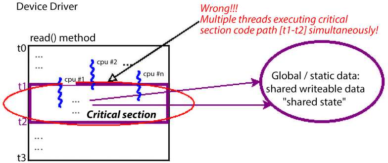

Hình 12.1: Sơ đồ khái niệm cho thấy critical section code path bị vi phạm thế nào khi nhiều hơn một thread chạy bên trong đồng thời, một data race

Như trong sơ đồ trên, trong device driver, ở method chẳng hạn read, bạn cho chạy code làm công việc (đọc data từ hardware). Hãy xem sâu hơn sơ đồ xét data access thực hiện tại các thời điểm khác nhau:

- Từ thời điểm `t0` đến `t1`: Không truy cập data hoặc chỉ truy cập local variable data. Đây là concurrent-safe, không cần bảo vệ, có thể chạy parallel (vì mỗi thread có private stack riêng).

- Từ thời điểm `t1` đến `t2`: Truy cập global/static shared writable data. Không tự động concurrent-safe; là critical section (vì Hình 12.1 cho thấy chắc chắn thỏa hai điều kiện). Vì vậy phải bảo vệ khỏi concurrent access. Phải chạy exclusively (một mình, đúng một thread mỗi lần và serialized), có lẽ cả atomically.

- Từ thời điểm `t2` đến `t3`: Không truy cập data hoặc chỉ truy cập local variable data. Đây là concurrent-safe, không cần bảo vệ, có thể chạy parallel (vì mỗi thread có private stack riêng).

Trong sách này, với nội dung đã trình bày và kiến thức riêng của bạn, giả định giờ đã biết cần synchronize critical section; không thảo luận thêm điểm cụ thể này. Ai muốn học thêm có thể tham khảo sách trước của tôi, Hands-On System Programming with Linux (Packt, tháng 10 năm 2018), trình bày chi tiết (đặc biệt Chương 15, Multithreading with Pthreads Part II – Synchronization).

Vậy biết điều này, giờ có thể phát biểu lại critical section đồng thời đề cập khi nào tình huống xảy ra. Critical section là code phải chạy:

- (Luôn) Exclusively: Một mình (serialized)

- (Khi trong atomic context) Atomically: Không thể chia, đến hoàn tất, không gián đoạn

Trong phần tiếp, xem tình huống kinh điển – tăng một global integer.

### Trường hợp kinh điển – global i ++

Nghĩ ví dụ kinh điển: global integer `i` được increment trong concurrent code path, nơi nhiều thread of execution có thể thực thi đồng thời. Hiểu ngây thơ về computer hardware và software sẽ khiến tin operation này hiển nhiên atomic. Tuy nhiên thực tế hardware và software hiện đại (compiler và OS) tinh vi hơn có thể tưởng tượng rất nhiều, do đó gây đủ loại performance-driven optimization vô hình (với app developer).

Chúng ta không cố đi quá sâu ở đây, nhưng thực tế processor hiện đại cực phức tạp: trong nhiều công nghệ dùng để cải thiện hiệu năng, có superscalar và super-pipelined execution nhằm lần lượt thực thi nhiều independent instruction và nhiều phần của các instruction khác nhau parallel, thực hiện instruction reordering và/hoặc memory reordering tức thời, cache memory trong on-CPU cache hierarchy phức tạp, load/store tearing, v.v.! Sẽ tìm hiểu vài chi tiết trong Chương 13, Kernel Synchronization – Part 2, tại các phần Tìm hiểu kiến thức cơ bản CPU caching, cache effect và false sharing, và Giới thiệu memory barrier. Có nhiều paper (và sách) đáng tìm hiểu về các chủ đề hấp dẫn này trong phần Đọc thêm.

Tất cả khiến tình huống phức tạp hơn vẻ ngoài lúc đầu. Hãy tiếp tục với `i ++` kinh điển trong code path có thể concurrent:

```
static int i = 5;
[ ... ]
foo()
{
    [ ... ]
    i ++;     /* Is this safe? Yes, if this code path is truly exclusive or
atomic...
               * Alternately, if this code path's not exclusive, is the i ++
truly atomic?? */
}
```

Vậy increment này an toàn? Câu trả lời ngắn không, phải bảo vệ. Vì sao? Là critical section – đang truy cập (read/write) shared writable data trong code path có thể concurrent! Câu trả lời dài hơn là thực sự phụ thuộc:

a. Code function foo() có được bảo đảm chạy exclusively không. b. Increment operation ở đây có thật sự atomic (không thể chia) không; nếu có, `i ++` không nguy hiểm khi có parallelism – nếu không, có!

Vậy giả định execution của code path quanh `i ++` là non-exclusive – nghĩa là thread khác thực thi code path `foo()` parallel được – để hoạt động đúng cần operation `i ++` thực sự atomic. Là operation ngôn ngữ bậc cao đơn giản, thoạt nhìn có thể “có vẻ” atomic, nhưng thật vậy không? Làm sao biết có phải không? Hai điều quyết định:

- Instruction Set Architecture (ISA) của processor, quyết định (trong nhiều điều liên quan processor ở mức thấp) machine instruction thực thi ở runtime khi operation này chạy

- Compiler, tất nhiên chuyển high-level language source sang assembly (rồi assembler tạo machine code cuối cùng thực thi trên processor)

Nếu ISA có khả năng dùng một machine instruction đơn lẻ để integer increment, và compiler đủ thông minh, có cơ hội dùng, thì thực sự atomic – an toàn, không cần bảo vệ tường minh, thường locking. Nếu không, không an toàn và cần locking! Vậy trên máy bạn với compiler hiện tại, làm sao biết?

Thử điều này: đưa browser đến website compiler explorer tuyệt vời `https://godbolt.org/`. Chọn C làm programming language rồi ở pane trái khai báo global integer `i`, increment trong function. Compile ở pane phải với compiler và compiler option thích hợp. Sẽ thấy machine code thực tế tạo cho câu lệnh C bậc cao `i ++;`. Nếu thực sự là machine instruction đơn lẻ, sẽ an toàn và atomic; nếu không cần locking. Thường trên CISC-based machine như `x86[_64]`, compiler optimization level 2 trở lên thực sự làm code atomic, nhưng không phải luôn với RISC machine (như ARM-based).

Nhìn chung sẽ thấy không thực sự biết chắc; thực chất không thể tự cho phép giả định – phải mặc định operation `i ++` không an toàn, nghĩa là non-atomic, rồi bảo vệ! Có thể thấy trong ảnh chụp sau:

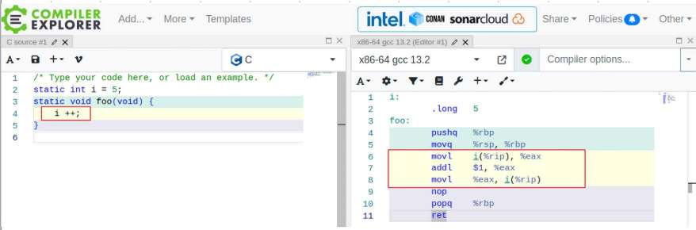

Hình 12.2: Ngay cả với stable gcc version mới nhất nhưng không optimization, x86\_64 gcc tạo nhiều machine instruction cho i ++

Ảnh trên cho thấy rõ: vùng nền sáng/vàng ở pane trái và phải lần lượt là C source cho câu lệnh nổi tiếng `i ++;` và assembly tương ứng compiler tạo (dựa ISA `x86_64` và optimization level của compiler cụ thể). (Để bạn biết, trong Hình 12.2 tôi đổi assembly syntax từ Intel sang AT\&T tổng quát hơn bằng bỏ chọn Intel asm syntax từ bánh răng Setting trong pane phải). Thường không optimization, `i ++` thành ba machine instruction. Chính xác như mong đợi: tương ứng fetch hay load i (memory đến register), increment, rồi store (register về memory)! Giờ (ít nhất trong trường hợp này, không optimization) không atomic; do đó hoàn toàn có thể sau khi một machine instruction thực thi, control unit can thiệp và switch instruction stream đến điểm khác. Thậm chí có thể dẫn đến process hay thread khác được context-switch vào (trừ khi dùng locking quanh nó)!

Tin tốt là chỉ thêm nhanh `-O2` trong cửa sổ Compiler options..., `i ++` thành một machine instruction – thực sự atomic! (Tuy nhiên không phải luôn thể hiện.) Nhưng không dự đoán trước được; ngày nào đó code có thể thực thi trên ARM (RISC) system khá thấp cấp, tăng khả năng cần nhiều machine instruction cho `i ++`. Đến giờ có thể tự hỏi – để sửa, dùng mutex lock (hay cả spinlock) cho `i ++` có vẻ khá không tối ưu; bạn đúng. Sẽ trình bày optimized locking technology riêng cho integer operation trong Chương 13, Kernel Synchronization – Part 2, tại phần Dùng interface atomic\_t và refcount\_t.

Ngôn ngữ hiện đại cung cấp native atomic operator; với C/C++ khá gần đây (từ 2011); ISO C++11 và ISO C11 standard cung cấp atomic variable làm sẵn, tích hợp cho việc này. Tìm Google một chút nhanh chóng thấy. Glibc hiện đại cũng dùng. Ví dụ nếu từng làm signaling trong user space, sẽ biết dùng data type `volatile sig_atomic_t` để an toàn truy cập và/hoặc cập nhật integer atomically trong signal handler. Trong kernel thì sao? Chương sau học giải pháp Linux kernel cho vấn đề then chốt này.

Hãy sớm hiểu: Linux kernel tất nhiên là concurrent environment; nhiều thread of execution chạy parallel trên nhiều CPU core. Không chỉ vậy, ngay trên uni-processor system (UP/single CPU), sự hiện diện hardware interrupt, trap, fault, exception và software signal có thể gây data integrity issue (data race). Không cần nói, bảo vệ khỏi concurrency tại điểm cần trong code path, tại critical section, nói dễ hơn làm; nhận diện và bảo vệ critical section bằng công nghệ như locking – cùng synchronization primitive và công nghệ khác – tuyệt đối thiết yếu, vì vậy là nội dung cốt lõi chương này và chương sau.

### Khái niệm – lock

Cần synchronization vì nếu không can thiệp, thread có thể thực thi concurrently critical section nơi shared writable data (shared state) được xử lý. Để ngăn concurrency trong các critical section này, cần loại bỏ parallelism; cần serialize luồng code trong critical section.

Để buộc code path trở thành serialized, kỹ thuật phổ biến là dùng lock. Về cơ bản lock hoạt động bằng bảo đảm đúng một thread of execution có thể “lấy” hay sở hữu lock tại thời điểm bất kỳ; khi lấy được, chỉ thread này đi tiếp – gọi là “winner”. Các khái niệm sẽ sớm được mở rộng. Vì vậy dùng lock bảo vệ critical section trong code cho điều đang tìm – chạy code critical section exclusively (có lẽ cả atomically; nói thêm sau). Xem sơ đồ này (Hình 12.3):

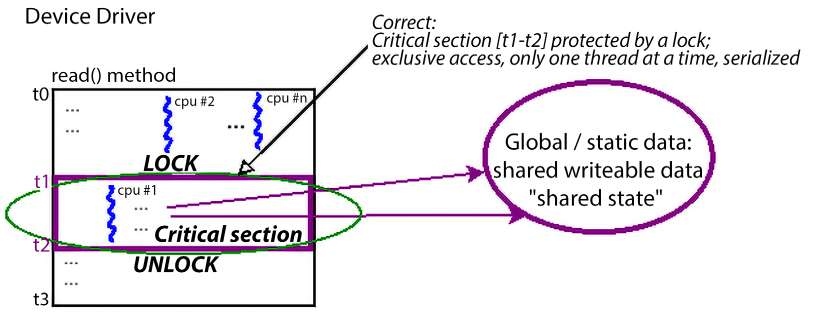

Hình 12.3: Sơ đồ khái niệm cho thấy critical section code path được tuân thủ, có exclusivity bằng dùng lock

Hình 12.3 cho thấy cách sửa tình huống đề cập trước (Hình 12.1): dùng lock bảo vệ critical section! Lock (và unlock) hoạt động thế nào về khái niệm?

Tiền đề cơ bản của lock là bất cứ khi nào contention – nghĩa là nhiều thread cạnh tranh (chẳng hạn `n` thread) thử acquire lock (qua operation khái niệm `LOCK`) – đúng một thread thành công. Thread này xem là “winner”, “owner” của lock. Nó thấy lock API như non-blocking call nên tiếp tục vui vẻ chạy – và exclusively! – khi thực thi code critical section (critical section thực chất là code giữa operation lock và unlock!).

Điều gì xảy ra với `n-1` “loser” thread? Chúng (có lẽ) thấy lock API như blocking call; về mọi tác động thực tế, chờ. Chờ gì? Tất nhiên operation `UNLOCK`, được (phải được) owner của lock (“winner” thread) thực hiện khi xong công việc critical section! Khi unlock, `n-1` thread còn lại cạnh tranh vị trí “winner” kế tiếp; tất nhiên đúng một thread thắng và tiến lên. Trong lúc đó `n-2` loser chờ winner (mới) unlock. Lặp lại đến khi mọi `n` thread (cuối cùng và tuần tự) acquire lock.

Giờ locking tất nhiên hoạt động, nhưng – điều này khá trực giác – tạo overhead (khá cao!) vì loại bỏ parallelism và serialize execution flow! Để hình dung, nghĩ cái phễu, ống hẹp là critical section chỉ vừa một thread mỗi lần. Mọi thread khác tắc lại chờ unlock; locking tạo bottleneck. Hình sau nhằm thể hiện so sánh này:

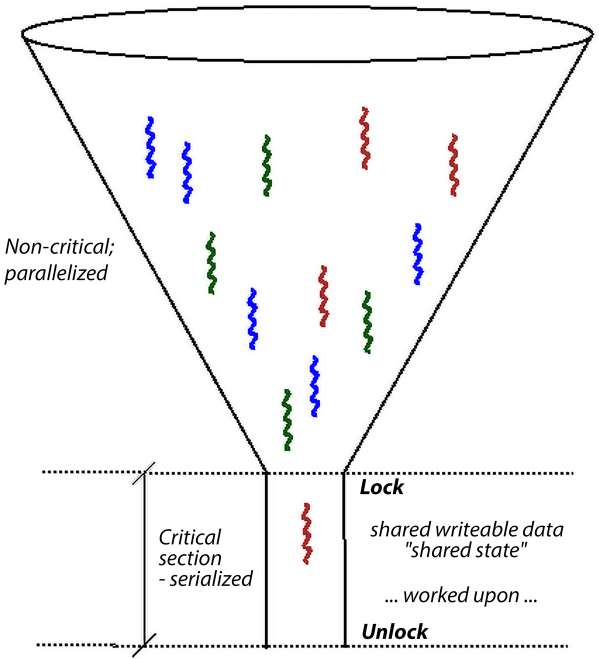

Hình 12.4: Lock tạo bottleneck, tương tự cái phễu vật lý

So sánh vật lý khác thường nhắc cho locking là cao tốc nhiều làn gộp vào một làn rất bận – tắc nghẽn giao thông – có lẽ trạm thu phí thiết kế kém. Một lần nữa parallelism – xe (thread) chạy parallel với xe khác trên làn (CPU) khác – mất đi, cần hành vi serialized; xe buộc xếp hàng nối nhau.

Vì vậy bắt buộc chúng ta, software architect, cố thiết kế sản phẩm/project với locking tối thiểu. Dù loại bỏ hoàn toàn global variable không khả thi thực tế trong phần lớn project, cần tối ưu và giảm thiểu sử dụng. Sẽ trình bày thêm sau, gồm vài lockless programming technique rất thú vị.

Điểm thực sự then chốt khác: programmer mới có thể ngây thơ cho rằng read trên shared writable data object hoàn toàn an toàn nên không cần bảo vệ tường minh; (ngoại trừ aligned primitive data type nằm trong processor bus size) điều này sai. Tình huống có thể dẫn đến dirty hay torn read, nơi data có thể stale và/hoặc không nhất quán được đọc ngay khi writer thread khác đồng thời ghi.

Bài học rõ: cần bảo vệ mọi access, read và write, vào shared writable data trong code path có thể concurrent, thực chất mọi critical section.

Nhân chủ đề atomicity, như vừa học trên microprocessor hiện đại điển hình, thứ duy nhất bảo đảm atomic là machine language instruction đơn lẻ hoặc (như học, có thể) read/write vào aligned primitive data type trong processor bus width. Vậy đánh dấu vài dòng C code thế nào để thực sự atomic? Trong user space thậm chí không thể (có thể đến gần nhưng không bảo đảm atomicity).

Làm sao “đến gần” atomicity trong user-space app? Luôn có thể xây user thread dùng task scheduling policy `SCHED_FIFO` và real-time (RT) priority `99`. Theo cách này khi muốn chạy, gần như không gì ngoài hardware interrupt/exception preempt được. (Audio subsystem implementation cũ dựa nhiều vào ngữ nghĩa này.)

Trong kernel space có thể viết code thực sự atomic. Chính xác thế nào? Câu trả lời ngắn là dùng spinlock! Sẽ sớm học spinlock chi tiết hơn.

#### Critical section – tóm lược các điểm then chốt

Hãy tóm lược vài điểm then chốt về critical section. Thực sự quan trọng đọc kỹ, giữ sẵn, bảo đảm dùng trong thực tế:

- Critical section là code path có thể concurrent, có thể thực thi parallel, và làm việc trên (read và/hoặc write) shared writable data (còn gọi shared state).

- Vì làm trên shared writable data, critical section:

  - Cần bảo vệ khỏi parallelism và concurrency (nghĩa là phải chạy một mình/serialized/theo mutual exclusion).

  - Khi chạy trong atomic non-blocking context (gồm bất kỳ interrupt context), phải bảo đảm chạy atomically: không thể chia, đến hoàn tất, không gián đoạn.

Khi được bảo vệ, có thể an toàn truy cập shared state đến khi “unlock”.

- Phải nhận diện và bảo vệ mọi critical section trong codebase:

  - Nhận diện critical section là then chốt! Review code cẩn thận, bảo đảm không bỏ sót. (Global hay static variable bất kỳ là dấu hiệu cảnh báo điển hình; nhưng không chỉ vậy, mọi shared state – hardware register, mailbox, v.v. – trong code path có thể concurrent đều có thể là critical section.)

  - Có thể bảo vệ qua nhiều công nghệ; kỹ thuật rất phổ biến là locking (sẽ sớm đi chi tiết). Còn atomic operator và lock-free programming technique sẽ xem trong chương sau.

- Lỗi phổ biến là chỉ bảo vệ critical section ghi shared writable data; cũng phải bảo vệ critical section đọc shared writable data. Nếu không có nguy cơ torn hay dirty read! Để làm rõ điểm then chốt, hình dung unsigned 64-bit data item được đọc, ghi trên hệ thống 32-bit; operation khi ấy không thể atomic (cần hai load/store operation mỗi read/write). Vậy nếu khi một thread đọc giá trị data item, thread khác đồng thời ghi!? Writer thread đã lấy dạng “lock” nào đó cho access nhưng vì nghĩ read an toàn, reader thread không lấy lock; do trùng hợp timing không may, có thể cuối cùng thực hiện partial/torn/dirty read. Sẽ học khắc phục bằng nhiều locking technique trong các phần tới và chương sau.

- Lỗi chết người khác là không dùng cùng lock (đúng) để bảo vệ data item cho trước. Ví dụ dùng lock A bảo vệ global data structure X thì luôn phải dùng lock A mỗi lần truy cập; dùng lock B không giúp. Có thể khó hơn vẻ ban đầu, vì project lớn (như Linux kernel) có hàng chục nghìn lock!

- Không bảo vệ critical section dẫn đến data race, tình huống kết quả – giá trị thực tế shared data đang read/write – “racy”, nghĩa là thay đổi tùy runtime circumstance và timing. Là defect, bug (bug mà khi ra “thực địa” cực khó thấy, tái hiện, xác định root cause và sửa. Sẽ trình bày nội dung rất mạnh hỗ trợ trong chương sau tại phần Lock debugging trong kernel; hãy chắc chắn đọc lúc đó!).

- Ngoại lệ: An toàn (ngầm, không cần bảo vệ tường minh) trong các tình huống:

- Khi làm với local variable. Chúng được cấp phát trên private stack của thread (hoặc trong interrupt context trên local IRQ stack), do đó theo định nghĩa an toàn.

- Khi làm trên shared writable data trong code không có khả năng chạy ở context khác; nghĩa là serialized theo bản chất. Trong context của chúng ta, init và cleanup method của kernel module đáp ứng (chạy đúng một lần, serially, chỉ trên `insmod` (hay `modprobe`) và `rmmod`).

- Khi làm trên shared data thực sự constant và read-only (tuy nhiên đừng để keyword `const` của C đánh lừa!).

- Locking vốn phức tạp; phải suy xét, thiết kế, triển khai locking schema cẩn thận và tránh deadlock. Sẽ trình bày chi tiết hơn trong phần Locking – lỗi thường gặp và hướng dẫn.

### Data race – định nghĩa chính thức hơn

Memory (consistency) model cung cấp cách tiếp cận chính thức hơn cho khái niệm memory consistency quan trọng khi có nhiều concurrent load/store operation; nó “mô hình hóa” system memory behavior, dự đoán giá trị có thể thu qua load operation (đọc memory) khi code thực thi trên hệ thống. Linux kernel có model như vậy; tên Linux-Kernel Memory Model (LKMM).

Ở đây không thực sự cần đi sâu chi tiết, nhưng rất thú vị để đọc; hãy xem tài liệu `explanation.txt` trong tài liệu kernel chính thức tại: `https://elixir.bootlin.com/linux/v6.1.25/source/tools/memory-model/Documentation/explanation.txt`.

(Tôi chắc chắn khuyên ít nhất đọc ba phần đầu: INTRODUCTION, BACKGROUND và A SIMPLE EXAMPLE. Khái niệm memory ordering cũng được trình bày trong LKMM.)

LKMM cung cấp hai loại memory access:

- Plain access: Access điển hình đến memory qua câu lệnh C, ví dụ `i ++` hoặc `y = 42 - x;`.

- Marked access: Access “đặc biệt”; thiết kế và triển khai để bảo đảm atomicity ngầm:

- Load (read) qua macro `READ_ONCE()` (ví dụ `READ_ONCE(x);`)

- Store (write) qua macro `WRITE_ONCE()` (ví dụ `WRITE_ONCE(y, 42-x);`)

- (Thực tế không chỉ các macro này bảo đảm atomicity; `atomic_*()`, `refcount_*()`, `smp_load_acquire()` và macro tương tự thuộc lớp marked access.)

Được rồi, giờ đến điểm then chốt: chính xác theo LKMM điều gì tạo thành data race?

Từ cùng tài liệu `explanation.txt`, phần PLAIN ACCESSES AND DATA RACES (tại: `https://elixir.bootlin.com/linux/v6.1.25/source/tools/memory-model/Documentation/explanation.txt#L1977`) đi vào chi tiết. Tốt nhất trích trực tiếp một chút:

```
A "data race" occurs when there are two memory accesses such that:

1.      they access the same location,

2.      at least one of them is a store,

3.      at least one of them is plain,

4.      they occur on different CPUs (or in different threads on the same CPU),
and

5.      they execute concurrently.

In the literature, two accesses are said to "conflict" if they satisfy 1
and 2 above.  We'll go a little farther and say that two accesses are "race
candidates" if they satisfy 1 - 4.  Thus, whether or not two race candidates
actually do race in a given execution depends on
whether they are concurrent. [ … ]
```

Tuyệt vời! Định nghĩa rõ, chính thức qua LKMM về chính xác điều gì tạo data race.

Bạn hẳn nghĩ nên tận dụng kiến thức này viết tool phát hiện data race, đúng không? Chính là điều Kernel Concurrency Sanitizer (KCSAN) làm! (Marco Elver hiện là maintainer KCSAN.) Thực tế sách Linux Kernel Debugging, Chương 8, Lock Debugging, trình bày dùng KCSAN tương đối chi tiết (kèm ví dụ). Tôi chắc chắn khuyên học cách dùng KCSAN.

Marco Elver, trong thuyết trình tại Linux Plumbers Conference tháng 8 năm 2020 tên Data-race detection in the Linux kernel (liên kết: `https://lpc.events/event/7/contributions/647/attachments/549/972/LPC2020-KCSAN.pdf`), giải thích data race theo LKMM bằng slide:

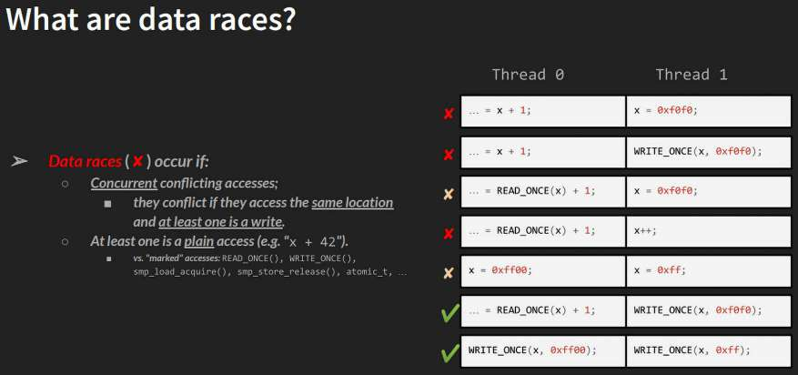

Hình 12.5: Slide “What are data races?”. Nguồn: Marco Elver

Như thấy bên phải Hình 12.5 là ví dụ hai thread chạy concurrently (trên CPU core khác nhau), làm việc cùng memory object (cùng location, shared writable data). Dấu chéo đỏ trái chỉ data race, dấu tích xanh ngụ ý ổn (các trường hợp giữa – hàng 3 và 5 – là “có thể”; chúng race khi diễn giải “nghiêm ngặt”).

Điều này có thể khiến nghĩ: “Sao không luôn dùng marked access để không bao giờ data race?” Vui lòng KHÔNG làm. Marked access được thiết kế cho kernel code dùng nội bộ và/hoặc khi biết có data race tiềm năng nhưng không quá quan tâm (ví dụ điển hình network driver statistics code increment counter không explicit locking primitive; data race ở đây được xem không quá quan trọng). Tuy nhiên điểm then chốt, đặc biệt người viết module/driver, là: dùng marked access thực sự ngăn tool như KCSAN bắt data race. Quan trọng tiếp tục dùng plain C access cho phần lớn trường hợp.

Đồng thời cẩn thận – dù marked access bảo đảm atomic load và store, không bảo đảm memory ordering; phải làm qua memory barrier (chương sau làm sáng tỏ phần nào). Giờ chuyển sang nội dung then chốt khác – nhận diện concurrency và critical section khi làm việc với Linux OS.

## Các mối quan tâm concurrency trong Linux kernel

Nhận diện critical section trong kernel code cực quan trọng; bảo vệ sao nếu còn không thấy? Sau đây vài hướng dẫn giúp bạn, kernel/driver developer mới, nhận ra nơi concurrency concern – do đó critical section – có thể xuất hiện:

- Có hệ thống Symmetric Multi-Processor (SMP) (`CONFIG_SMP=y`)

- Có preemptible kernel (`CONFIG_PREEMPTION=y`)

- Blocking I/O

- Hardware interrupt (trên cả SMP và/hoặc UP system)

Đây là những điểm then chốt cần hiểu, sẽ thảo luận từng điểm trong phần này.

### Multicore SMP system và data race

Điểm đầu khá hiển nhiên; xem pseudo-code trong Hình 12.6:

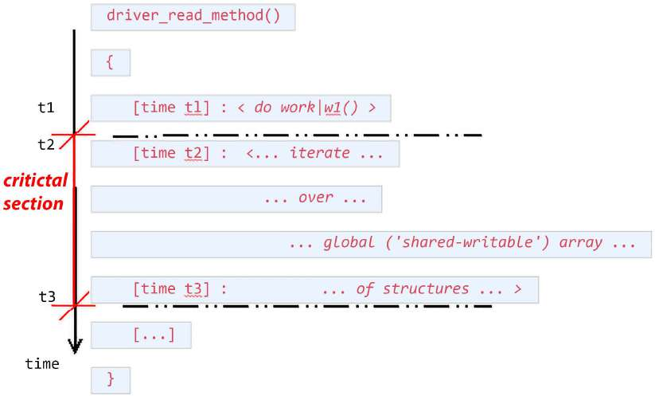

Hình 12.6: Pseudo-code – critical section (từ thời điểm t2 đến t3) trong read method của driver (giả định); có thể có bug vì không locking

Tình huống tương tự Hình 12.1 và Hình 12.3. Như thấy, từ `t2` đến `t3`, function có thể chạy parallel và đang làm trên global shared writable data, do đó là critical section.

Giờ hình dung hệ thống chẳng hạn bốn CPU core (SMP/multicore system); hai user-space process P1 (chạy chẳng hạn CPU 0) và P2 (chạy chẳng hạn CPU 2) có thể concurrently open device file rồi đồng thời gọi system call `read()`. Giờ cả hai process concurrently thực thi “method” read của driver, do đó đồng thời làm trên shared writable data! Như biết code giữa `t2` và `t3` là critical section, và vì vi phạm exclusivity rule cơ bản – chỉ một thread thực thi critical section tại thời điểm bất kỳ – hoàn toàn có thể cuối cùng corrupt data, application hoặc tệ hơn.

Nói cách khác cách này dẫn đến data race; tùy trùng hợp timing tinh vi, có thể gây error (bug) hoặc không. Chính sự không chắc chắn – trùng hợp timing tinh vi – khiến tìm và sửa lỗi như vậy cực khó (có thể thoát nỗ lực kiểm thử).

Câu cách ngôn đáng tiếc quá đúng: Kiểm thử phát hiện sự hiện diện lỗi, không phải sự vắng mặt. Hơn nữa còn tệ hơn nếu kiểm thử không bắt data race (và bug), cho chúng tự do ngoài thực địa.

Có thể lập luận vì sản phẩm là embedded system nhỏ chạy một CPU core (UP), thảo luận kiểm soát concurrency (thường qua locking) không áp dụng. Chúng tôi không đồng ý: gần như mọi sản phẩm hiện đại nếu chưa, sẽ chuyển multicore (có lẽ giai đoạn thế hệ tiếp). Quan trọng hơn ngay cả UP system có concurrency concern, sẽ sớm khám phá.

### Preemptible kernel, blocking I/O và data race

Hình dung chạy kernel module hay driver trên Linux kernel cấu hình preemptible (nghĩa là `CONFIG_PREEMPT` bật; đã trình bày Chương 10, The CPU Scheduler – Part 1). Một lần nữa tham khảo Hình 12.6, xét process P1 đang chạy read method code của driver trong process context, làm trên global array. Giờ khi trong critical section (giữa `t2` và `t3`), nếu kernel preempt process P1, context-switch sang process khác P2 vừa đang chờ thực thi chính code path này? Nguy hiểm; có thể dẫn data race. Hoàn toàn xảy ra ngay trên single CPU (UP) system! (Lưu ý dù dùng “process” ở đây, có thể thay bằng “thread”.)

Tình huống khác khá tương tự (một lần nữa có thể trên single-core (UP) hay multicore system): process P1 chạy trong critical section của driver method (giữa `t2` và `t3;` xem lại Hình 12.6). Lần này nếu bên trong critical section gặp blocking call?

Blocking call là function khiến calling process context được đưa vào sleep, chờ event; khi event xảy ra kernel (hoặc driver bên dưới) “đánh thức” task, tiếp tục thực thi từ nơi dừng.

Còn gọi blocking on I/O và rất phổ biến; nhiều API (gồm nhiều user-space library call, system call, kernel API) có bản chất blocking). Trong trường hợp đó process P1 thực chất context-switch khỏi CPU, đi sleep, nghĩa là code `schedule()` chạy và enqueue nó vào wait queue. Trong lúc chờ trước khi P1 được switch trở lại, nếu process khác P2 được schedule chạy? Nếu process đó cũng chạy code path cụ thể này? Hãy nghĩ – trước tiên P2 giờ làm trên data có lẽ ở in-between state, chưa cập nhật đủ. Hơn nữa khi P1 trở lại, shared data có thể đã đổi “ngay dưới chân”, gây đủ loại lỗi; một lần nữa data race, bug!

### Hardware interrupt và data race

Cuối cùng hình dung: process P1 vô tư chạy read method code của driver; do đó đi vào critical section (giữa `t2` và `t3;` xem lại Hình 12.6). Có tiến triển nhưng rồi tiếc thay hardware interrupt kích hoạt trên cùng CPU core! (Có thể học chi tiết hardware interrupt và xử lý trong companion volume Linux Kernel Programming – Part 2). Trên Linux OS, hardware interrupt có priority cao nhất; mặc định preempt mọi code (kể cả kernel code). Vì vậy process (hay thread) P1 ít nhất tạm gác lại, mất processor, vì interrupt-handling code path chắc chắn preempt và chạy.

Có thể tự hỏi thì sao? Quả thực là chuyện hoàn toàn bình thường! Hardware interrupt xảy ra rất thường trên hệ thống hiện đại, thực chất (và nghĩa đen) ngắt đủ loại task context (chạy nhanh `vmstat 3` trên shell; cột nhãn `in` dưới `system` cho số hardware interrupt đã xảy ra trên hệ thống trong 1 giây qua!).

Ở đây câu hỏi then chốt: interrupt-handling code (hardirq, ISR hay “top half”, hoặc tasklet hay softirq “bottom half”, tùy thứ xảy ra) có chia sẻ và làm trên cùng shared writable data với process context vừa bị ngắt không?

Nếu đúng thì Houston, có vấn đề – data race! Nếu không, code bị ngắt không phải critical section đối với interrupt code path, và ổn. Thực tế phần lớn device driver có handle interrupt; do đó trách nhiệm người viết driver (bạn!) là bảo đảm không global/static data nào – thực chất không critical section – chia sẻ giữa code path process context và interrupt context. Nếu có (đôi lúc thực sự xảy ra), phải bằng cách nào bảo vệ data khỏi data race và corruption tiềm năng (thường bằng spinlock; đừng lo sẽ đến).

Các tình huống có thể khiến cảm thấy bảo vệ khỏi concurrency concern là yêu cầu thực sự khó; chính xác làm sao có data safety khi critical section tồn tại cùng nhiều concurrency concern vừa thảo luận: multicore (hay SMP), kernel preemption, blocking I/O, hardware interrupt? Tin tốt thực sự khá dễ; API (locking) thực tế bảo vệ critical section không khó học. Một lần nữa nhấn mạnh nhận diện – rồi có thể bảo vệ – critical section mới then chốt.

Không dài dòng, giờ bắt đầu tìm hiểu synchronization technology chính để bảo vệ critical section – locking.

### Hướng dẫn locking và deadlock

Locking theo bản chất phức tạp; thường sinh tình huống interlocking phức tạp. Không hiểu đủ dẫn cả đau đầu hiệu năng lẫn bug – deadlock, circular dependency, interrupt-unsafe locking, v.v. Các hướng dẫn locking sau then chốt để bảo đảm code đúng khi dùng locking:

- Locking granularity

  - “Khoảng cách” lock đến unlock – thực chất độ dài critical section – không nên coarse (critical section quá dài); nên “đủ fine”. Các điểm dưới mở rộng.

  - Cần cẩn thận. Khi làm project lớn, giữ quá ít lock là vấn đề, cũng như quá nhiều! Quá ít lock dẫn vấn đề hiệu năng (vì cùng lock dùng lặp lại nên thường highly contended).

  - Nhiều lock thực ra tốt cho hiệu năng nhưng không tốt kiểm soát phức tạp. Cũng dẫn điểm then chốt khác bạn, developer, cần hiểu: nhiều lock trong codebase thì phải rất rõ chính xác lock nào bảo vệ shared data object nào. Hoàn toàn vô nghĩa nếu dùng chẳng hạn `lockA` bảo vệ `mystructX`, nhưng ở code path xa (có lẽ interrupt handler) quên và dùng lock khác `lockB` bảo vệ khi làm trên cùng structure! Giờ có vẻ hiển nhiên, nhưng (developer có kinh nghiệm biết) dưới pressure và độ phức tạp đủ lớn, ngay cả hiển nhiên cũng không luôn vậy!

  - Cố cân bằng. Trong project lớn, thường dùng một lock bảo vệ một global (shared) data structure. Giờ đặt tên lock variable tốt bản thân có thể là vấn đề lớn! Vì vậy thường đặt lock bảo vệ data structure vào bên trong như member.

  - Critical section dài mà atomic gây latency cao và thành bottleneck hiệu năng, đặc biệt trong time-critical real-time system. Có nhiều tool (ở mức ổn định khác nhau) giúp hiểu nơi (và bao lâu) các section xảy ra. Một tool từ bộ eBPF tên criticalstat\[-bpfcc\]. Có thể phát hiện, báo cáo critical section dài (cũng hữu ích hiển thị kernel stack trace cho nguồn gốc), xét khi preemption và/hoặc IRQ bị disable khá lâu.

Man page utility criticalstat tại: `https://manpages.ubuntu.com/manpages/focal/man8/criticalstat-bpfcc.8.html`; đây là trang “examples”: `https://github.com/iovisor/bcc/blob/master/tools/criticalstat_example.txt`. (Ftrace cũng có tracer bắt những đợt preemption/IRQ off dài.)

- Chỉ “owner”, holder hiện tại, của lock được release (unlock); thử release lock không giữ hoặc re-acquire khi đang giữ là bug (có thể né trường hợp sau bằng recursive locking; tuy nhiên xem điểm tiếp).

- Tránh recursive locking tối đa; cộng đồng kernel nói chung không ủng hộ.

- Lock ordering then chốt, giảm deadlock rất nhiều. Phải bảo đảm lock luôn được lấy cùng thứ tự; các “lock-ordering rule” phải ghi tài liệu, mọi developer project tuân thủ (annotate lock cũng hữu ích; thêm về điều này trong phần lockdep chương sau). Lock ordering sai thường dẫn deadlock.

  - Mặt khác thứ tự release lock không quan trọng (tất nhiên lúc nào đó phải release mọi held lock để không gây starvation).

- Chú ý ngăn starvation; xác minh lock khi lấy thực sự được release “đủ nhanh”.

- Đơn giản then chốt: cố tránh phức tạp hay over-design, đặc biệt tình huống phức tạp liên quan lock.

Về locking, xuất hiện vấn đề (nguy hiểm) deadlock. Deadlock là không thể tiến triển; nói cách khác application process/thread và/hoặc kernel component dường như treo vô hạn. Dù không định đi sâu chi tiết phức tạp deadlock ở đây, tôi đề cập nhanh vài loại tình huống deadlock thường gặp hơn:

- Trường hợp đơn giản, một lock, process context:

  - Thử acquire cùng lock hai lần là defect, gây self-deadlock. Hãy nghĩ; khi giữ lock, thử re-acquire. Giờ lock đã locked nên phải chờ đến khi unlocked. Nhưng bạn đang giữ lock và chờ (chỉ bạn unlock được), do đó không unlock được; kết quả (self) deadlock! Recursive locking có thể giải quyết nhưng thường disable, việc dùng không được ủng hộ.

- Trường hợp đơn giản, nhiều lock (hai trở lên), process context – học qua ví dụ:

  - Trên CPU `0`, thread A acquire lock A rồi muốn acquire lock B.

  - Concurrently trên CPU `1`, thread B acquire lock B rồi muốn acquire lock A.

  - Vì vậy mỗi bên chờ bên kia mãi... Kết quả là circular deadlock kinh điển, thường gọi AB-BA deadlock. Minh họa như sau (timeline hướng dọc xuống):

```
CPU 0 : Thread A              CPU 1 : Thread B
...                                 ...
acquire lock A                acquire lock B
...                                 ...
try to acquire lock B         try to acquire lock A
waits for lock B … … ...      waits for lock A … … …
  … forever … … … ...           … forever … … … …
```

  - Có thể mở rộng vô hạn; ví dụ circular dependency AB-BC-CA (lock chain A-B-C) dẫn đến deadlock.

- Trường hợp phức tạp, một lock, process context và interrupt context – lại học qua ví dụ (thực ra trường hợp dành cho spinlock; sớm đến chi tiết):

  - Process P1 chạy chẳng hạn read method của driver (module), acquire lock A trên chẳng hạn CPU core 0.

  - Một millisecond sau hardware interrupt của driver xảy ra trên cùng core, do đó interrupt handler của driver ngay lập tức preempt P1. Giờ nếu interrupt context thử lấy cùng lock A? Vì lock A hiện locked (bởi process context P1), interrupt context buộc chờ unlock; nhưng P1 giữ lock và chờ lấy lại CPU, không xảy ra chừng nào interrupt còn chạy... nên không unlock được và interrupt context cũng chờ mãi… kết quả lại (self) deadlock!

Giải pháp quy định tất nhiên disable (mask) mọi hardware interrupt trên local core khi acquire lock; khi đó process context không thể bị ngắt, chạy critical section đến xong. Nói cách khác giờ thực sự atomic. Khi unlock, operation bật lại mọi interrupt trên local core, mọi thứ ổn! Vì vậy lock được acquire trong interrupt context (hay nói chung atomic context) luôn phải dùng với interrupt disabled. (Làm chính xác thế nào? Bằng spinlock; tất nhiên xem chi tiết hơn khi trình bày spinlock.)

- Trường hợp phức tạp hơn, nhiều lock và process context cùng interrupt context (hardirq và softirq). (Không đi tiếp ở đây; có chi tiết trong phần Locking và interrupt sắp tới.)

Trong trường hợp đơn giản, luôn theo lock-ordering guideline là đủ: luôn lấy lock theo thứ tự ghi tài liệu rõ (sẽ cho ví dụ kernel code trong phần Dùng mutex lock). Tuy nhiên như có lẽ bắt đầu hiểu, mọi thứ có thể rất phức tạp, tình huống deadlock phức tạp có thể làm cả developer kinh nghiệm vấp. May mắn lockdep – runtime lock dependency validator của Linux kernel – bắt được (gần như) mọi deadlock case! (Đừng lo sẽ đến, trình bày lockdep chi tiết chương sau; cứ từng bước). Khi nói spinlock (phần Dùng spinlock), sẽ gặp tình huống process và/hoặc interrupt context như trên; các spinlock API chính xác cần dùng (để tránh deadlock cùng việc khác) được làm rõ ở đó.

Thực tế cả livelock cũng có thể chết người như deadlock! Livelock về cơ bản tương tự deadlock về khái niệm; chỉ là state các task tham gia là running thay vì waiting. Ví dụ interrupt “storm” (hàng trăm thậm chí hàng nghìn hardware interrupt – cùng softirq liên quan – xảy ra thành đợt, cần xử lý rất nhanh, gây stress hệ thống) gây livelock; network driver hiện đại giảm tác động bằng tắt interrupt (khi chịu interrupt load) và chuyển sang polling technique tên New API (NAPI), bật lại interrupt khi thích hợp. (Thực ra phức tạp hơn, nhưng ở đây dừng vậy.)

Với ai không sống tách biệt, sẽ biết Linux kernel có hai loại lock chính: mutex lock và spinlock. Thực ra còn nhiều loại hơn, gồm synchronization technology khác (và “lockless” programming), tất cả trình bày trong chương này và chương sau.

Tài liệu kernel nói đến ba lock category triển khai trong kernel: sleeping, CPU-local và spinning lock. Sleeping lock gồm (RT) mutex, semaphore và biến thể. Spinning lock gồm spinlock, reader-writer spinlock và biến thể. “Local lock” thường dành RT usage, dù non-RT usage gồm dùng cho lock debugging.

Vậy giờ tìm hiểu chính xác mutex lock và spinlock thực sự nghĩa là gì, nên dùng loại nào trong hoàn cảnh nào!

## Mutex hay spinlock? Khi nào dùng loại nào

Ngữ nghĩa chính xác khi học dùng mutex lock và spinlock khá đơn giản (với abstraction thích hợp trong kernel API set còn dễ hơn cho driver developer hay người viết module điển hình). Câu hỏi then chốt là khái niệm: khác biệt thực sự giữa hai lock type là gì? Sát hơn, trong hoàn cảnh nào dùng lock nào? Bạn sẽ học câu trả lời trong phần này.

Lấy pseudo-code read method của driver trước (Hình 12.6) làm ví dụ cơ sở, giả sử ba thread – tA, tB và tC – chạy parallel (trên SMP system) qua code. Chúng ta giải concurrency issue và tránh mọi data race bằng lấy (acquire) lock trước critical section bắt đầu (t2), release lock (unlock) ngay sau critical section code path kết thúc (t3). Hãy xem lại pseudo-code qua sơ đồ (Hình 12.7), lần này có locking bảo đảm đúng:

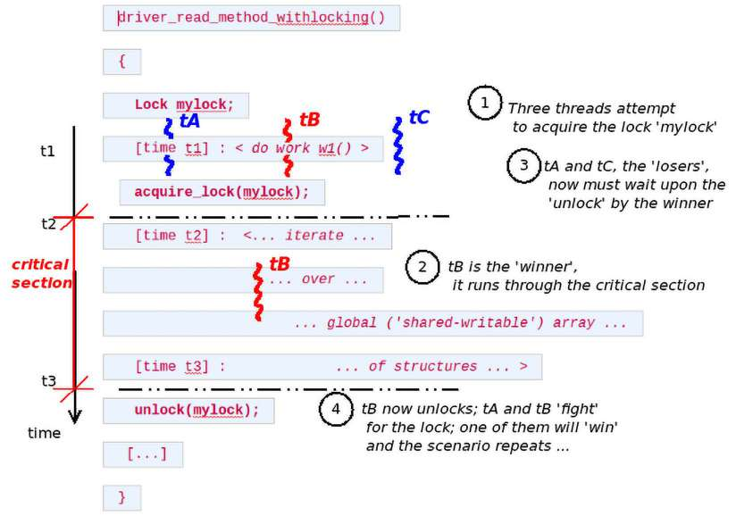

Hình 12.7: Pseudo-code: critical section trong read method của driver (giả định); ở đây làm đúng, có locking

Khi ba thread thử acquire lock đồng thời, ngữ nghĩa lock API bảo đảm đúng một thread có được. Giả sử tB (thread B) lấy lock: giờ là “winner” hay “owner” thread. Nghĩa là tA và tC là “loser”; làm gì? Chờ unlock!

Ngay khi “winner” (tB) hoàn tất critical section và unlock, cuộc chiến tiếp tục giữa các loser trước; một thread là winner kế tiếp và quá trình lặp lại. (Hãy hiểu “API” thể hiện trong Hình 12.7 chỉ pseudo-code, không phải (un)lock API thực tế; trình bày trong hai phần chính sau phần này.)

Khác biệt then chốt giữa hai lock type – mutex và spinlock – dựa trên cách loser chờ unlock event. Với mutex lock, loser thread được đưa sleep; nghĩa là chờ bằng sleep (thực chất khi thử lock mutex đã locked, thấy như blocking call; được schedule hay context-switch khỏi CPU – giờ “sleeping”). Ngay khi winner unlock, kernel đánh thức loser thread (tất cả), chạy và lại tranh lock. (Thực tế mutex và semaphore đôi lúc gọi sleeplock.)

Tuy nhiên spinlock không có chuyện sleep; loser thread chờ bằng “spinning” trên lock đến khi unlocked. Về khái niệm như sau:

```
while (locked) ;
```

Lưu ý chỉ là khái niệm. Nghĩ một lúc – thực ra là polling. Tuy nhiên programmer tốt sẽ hiểu polling thường bị coi ý tưởng xấu. Vì sao spinlock hoạt động vậy? Không phải; chỉ trình bày như vậy vì mục đích khái niệm. Như sớm hiểu, spinlock chỉ thực sự có nghĩa trên multicore (SMP) system. Trên đó khi winner thread đi chạy critical section code, loser chờ bằng spinning trên CPU core khác! Thực tế ở implementation level, code triển khai spinlock hiện đại tối ưu cao (và arch-specific), không chỉ “spinning” đơn giản qua ngữ nghĩa kiểu `while (locked);` (ví dụ nhiều ARM spinlock implementation dùng machine language instruction wait for event (WFE), cho CPU chờ tối ưu ở low-power state. Xem phần Đọc thêm để có nhiều tài liệu về internal implementation mutex và spinlock trong kernel).

### Xác định lock cần dùng – lý thuyết

Cách spinlock triển khai không thực sự là mối quan tâm ở đây; thực tế spinlock overhead thấp hơn mutex lock mới quan tâm. Vì sao? Thực sự đơn giản: để mutex lock hoạt động, loser thread phải sleep (rồi được đánh thức khi unlock). Để làm, bên trong function `schedule()` được gọi, nghĩa là loser thấy mutex lock API như blocking call! Gọi scheduler cuối cùng khiến thread context-switch khỏi CPU. Ngược lại khi owner thread cuối cùng unlock, loser thread phải được đánh thức; lại một thread, “winner” kế tiếp, được context-switch trở lại processor.

Vì vậy “chi phí” tối thiểu của operation mutex lock/unlock là thời gian thực hiện hai context switch trên máy ấy. (Xem Khung thông tin đánh dấu \[1\] phần sau.) Xem lại Hình 12.7, có thể xác định thời gian trong critical section (code path “locked”); nghĩa là `t_locked = t3 - t2`.

Giả sử `t_ctxsw` biểu diễn context switch time. Như học, chi phí tối thiểu operation mutex lock/unlock là hai context switch (đầu để “sleep”, thứ hai khi “đánh thức”): `2 * t_ctxsw`.

Giờ giả sử biểu thức sau đúng:

```
t_locked < 2 * t_ctxsw
```

Nói cách khác nếu thời gian trong critical section ít hơn thời gian hai context switch? Khi ấy dùng mutex lock là sai vì overhead quá nhiều; dành nhiều thời gian metawork hơn công việc thực tế – hiện tượng thrashing. Chính use case – critical section rất ngắn – thường thấy trên OS hiện đại như Linux khiến ưu tiên spinlock hơn mutex. Vì vậy kết lại chọn spinlock khi có critical section ngắn, non-blocking, chọn mutex khi critical section khá dài và (có thể) blocking. Vì sao nhấn “blocking”? Phần sau – nội dung thực tế – làm rõ; đọc tiếp!

### Xác định lock cần dùng – thực tế

Vậy dù hoạt động theo “quy tắc” `t_locked < 2 * t_ctxsw` có thể hay về lý thuyết, nhưng khoan: có thực sự phải đo chính xác context switch time và thời gian trong critical section của từng trường hợp có critical section? Không, tất nhiên không – thiếu thực tế, quá hàn lâm.

Về thực tế nghĩ thế này: mutex lock hoạt động bằng cho loser thread sleep (đến khi unlock); spinlock không vậy (loser “spin”). Nhớ một “quy tắc vàng” Linux kernel: kernel không thể sleep (gọi `schedule()`) trong bất kỳ atomic context. Vì vậy không bao giờ dùng mutex lock trong interrupt context hay bất kỳ context không được sleep an toàn; tuy nhiên dùng spinlock ổn. (Nhớ blocking API đưa calling context sleep bằng gọi `schedule()`.) Tóm lược:

- Critical section chạy trong atomic context (ví dụ interrupt), hay process context không được sleep? Dùng spinlock.

- Critical section chạy trong process context và có thể sleep hay blocking I/O trong critical section? Dùng mutex lock.

Tất nhiên spinlock được xem overhead thấp hơn mutex; vì vậy có thể dùng cả trong process context (như read method driver giả định), miễn critical section không block (sleep).

\[1\] Thời gian context switch khác nhau; phần lớn phụ thuộc hardware và chất lượng OS. Một số đo trước (tháng 9 năm 2018) cho thấy context-switching time khoảng 1,2 đến 1,5 us (microsecond) trên CPU được pin, khoảng 2,2 us khi không pin (`https://eli.thegreenplace.net/2018/measuring-context-switching-and-memory-overheads-for-linux-threads/`).

Cả hardware lẫn Linux OS cải thiện rất nhiều, nhờ đó average context-switching time cũng vậy. Bài Linux Journal cũ (tháng 12 năm 1998) xác định trên x86-class system, average context switch time 19 microsecond (us), worst-case 30 us; giờ các số đã lỗi thời.

Dẫn câu hỏi tiếp: làm sao biết code hiện chạy process context hay interrupt context? Dễ – dùng macro `in_task()` để xác định (như macro `PRINT_CTX()` trong header `convenient.h` làm):

```
if (in_task())
    /* we're in process context (usually safe to sleep / block) */
else
    /* we're in an atomic or interrupt context (cannot sleep / block) */
```

Giờ hiểu khi nào dùng loại nào – mutex hay spinlock – hãy đến usage thực tế. Bắt đầu cách dùng mutex lock!

## Dùng mutex lock

Mutex còn gọi sleepable hay blocking mutual exclusion (mutex) lock. Như học, dùng trong process context nếu critical section có thể sleep (block). Không được dùng trong atomic hay interrupt context bất kỳ (top half, bottom half như tasklet/softirq, v.v.), kernel timer, hoặc process context không cho blocking.

### Khởi tạo mutex lock

Trước sử dụng mọi lock phải khởi tạo state “unlocked”. Mutex lock “object” được biểu diễn trong kernel bằng data structure `struct mutex`. Xét code:

```
#include <linux/mutex.h>
struct mutex mymtx;
```

Để dùng mutex lock phải khởi tạo tường minh unlocked state. Có thể khởi tạo statically (khai báo, khởi tạo object) bằng macro `DEFINE_MUTEX()`, hay dynamically qua function `mutex_init()` (thực ra macro wrapper trên function `__mutex_init()`).

Ví dụ để khai báo và khởi tạo mutex object `mymtx`, dùng `DEFINE_MUTEX(mymtx);`.

Cũng có thể làm dynamically. Tại sao? Thường mutex lock là member của data structure (global) nó bảo vệ.

Giữ lock variable như member của data structure (parent) nó bảo vệ là pattern phổ biến (và thông minh) dùng trong Linux; cách này thêm lợi ích tránh namespace pollution, không mơ hồ mutex nào bảo vệ shared data item nào (vấn đề lớn hơn vẻ ban đầu, đặc biệt project khổng lồ như Linux kernel!).

Ví dụ giả sử có global context data structure sau trong driver code (lưu ý code giả định):

```
struct mydrv_priv {
    <member 1>;
    <member 2>;
    [...]
    struct mutex mymtx; /* protects access to mydrv_priv */
    [...]
} *drvctx;
/*  Then, in your driver module's init method, do the following: */
static int __init init_mydrv(struct mydrv_priv *drvctx)
{
    [...]
    mutex_init(drvctx->mymtx);
    [...]
}
```

### Dùng mutex lock đúng cách

Khá thường thấy comment sâu sắc trong kernel source tree. Đây là comment tuyệt vời tóm lược gọn quy tắc phải theo để dùng mutex lock đúng (`https://elixir.bootlin.com/linux/v6.1.25/source/include/linux/mutex.h#L35`); hãy đọc kỹ:

```
/*
 * Simple, straightforward mutexes with strict semantics:
 *
 * - only one task can hold the mutex at a time
 * - only the owner can unlock the mutex
 * - multiple unlocks are not permitted
 * - recursive locking is not permitted
 * - a mutex object must be initialized via the API
 * - a mutex object must not be initialized via memset or copying
 * - task may not exit with mutex held
 * - memory areas where held locks reside must not be freed
 * - held mutexes must not be reinitialized
 * - mutexes may not be used in hardware or software interrupt
 * contexts such as tasklets and timers
 *
 * These semantics are fully enforced when DEBUG_MUTEXES is
 * enabled. Furthermore, besides enforcing the above rules, the mutex
 * [ ... ]
```

Là kernel (hay driver) developer, phải hiểu (đã trình bày phần lớn các điểm trong Hướng dẫn locking và deadlock):

- Critical section khiến code path serialized, loại parallelism. Do đó bắt buộc giữ critical section ngắn nhất có thể. Hệ quả là lock data, không phải code.

- Thử reacquire mutex lock đã acquire (locked) – thực chất recursive locking – không được hỗ trợ, dẫn self-deadlock.

- Lock ordering: Quy tắc kinh nghiệm rất quan trọng ngăn tình huống deadlock nguy hiểm. Khi có nhiều thread và lock, thứ tự lấy lock phải ghi tài liệu, mọi developer project tuân thủ nghiêm ngặt. Bản thân lock ordering cụ thể không bất di bất dịch, nhưng việc khi đã quyết định phải tuân theo mới vậy. Đọc kernel source tree sẽ gặp nhiều nơi kernel developer bảo đảm điều này và (thường) viết comment để developer khác thấy và theo. Đây là sample comment từ slab allocator code (`mm/slub.c`):

```
/*
* Lock order:
 *   1. slab_mutex (Global Mutex)
 *   2. node->list_lock (Spinlock)
 *   3. kmem_cache->cpu_slab->lock (Local lock)
 *   4. slab_lock(slab) (Only on some arches)
 *   5. object_map_lock (Only for debugging)
...
```

Giờ hiểu mutex hoạt động về khái niệm (và khởi tạo), hãy học dùng phần thực hiện công việc, lock/unlock API thực tế.

### Mutex lock/unlock API và cách dùng

Trong Linux kernel, mutex lock API và unlock API lần lượt:

```
void __sched mutex_lock(struct mutex *lock);
void __sched mutex_unlock(struct mutex *lock);
```

(Bỏ qua `__sched` ở đây; chỉ compiler attribute làm function biến mất khỏi output `WCHAN`, xuất hiện trong procfs và với một số option switch của `ps` (như `-l`).)

Một lần nữa comment trong source code `kernel/locking/mutex.c` rất chi tiết, mô tả rõ; tôi khuyến khích xem file sâu hơn. Chỉ trình bày một phần code, lấy trực tiếp từ Linux kernel source tree 6.1.25, `https://elixir.bootlin.com/linux/v6.1.25/source/kernel/locking/mutex.c#L260`:

```
[ ... ]
/**
 * mutex_lock - acquire the mutex
 * @lock: the mutex to be acquired
 *
 * Lock the mutex exclusively for this task. If the mutex is not
 * available right now, it will sleep until it can get it.
 *
 * The mutex must later on be released by the same task that
 * acquired it. Recursive locking is not allowed. The task
 * may not exit without first unlocking the mutex. Also, kernel
 * memory where the mutex resides must not be freed with
 * the mutex still locked. The mutex must first be initialized
 * (or statically defined) before it can be locked. memset()-ing
 * the mutex to 0 is not allowed.
 *
 * (The CONFIG_DEBUG_MUTEXES .config option turns on debugging
 * checks that will enforce the restrictions and will also do
 * deadlock debugging)
 *
 * This function is similar to (but not equivalent to) down().
 */
void __sched mutex_lock(struct mutex *lock)
{
    might_sleep();

    if (!__mutex_trylock_fast(lock))
        __mutex_lock_slowpath(lock);
}
EXPORT_SYMBOL(mutex_lock);
```

`might_sleep()` là macro có debug property thú vị: sự hiện diện bắt code đáng lẽ thực thi atomic context nhưng không vậy! (Giải thích thêm `might_sleep()` có trong companion volume Linux Kernel Programming – Part 2.)

Vậy nghĩ xem: `might_sleep()`, dòng code đầu trong `mutex_lock()`, đúng nghĩa báo code theo sau “có thể sleep”! Ngụ ý thêm code path này không nên được bất kỳ thứ đang atomic context thực thi vì có thể sleep. Tất nhiên nghĩa chỉ dùng mutex trong process context khi được sleep an toàn!

Nhắc nhanh quan trọng: Linux kernel có thể cấu hình rất nhiều debug option; trong context này config option `CONFIG_DEBUG_MUTEXES=y` giúp bắt bug liên quan mutex tiềm năng, gồm deadlock. Tương tự khi cấu hình qua UI `make menuconfig` thông thường, dưới menu Kernel Hacking có rất nhiều kernel config option liên quan debug; đã thảo luận Chương 5, Writing Your First Kernel Module – Part 2. Có nhiều kernel config rất hữu ích về lock debugging; trình bày chương sau, phần Lock debugging trong kernel.

#### Mutex lock – qua \[un\]interruptible sleep?

Như thường lệ mutex còn nhiều hơn đã thấy. Đã biết Linux process (hay thread) đi qua nhiều state của state machine. Trên Linux, sleeping có hai state riêng – interruptible sleep và uninterruptible sleep. Process (hay thread) trong interruptible sleep nhạy – nghĩa sẽ phản hồi – với user-space signal, còn task trong uninterruptible sleep không nhạy với user signal.

Trong human-interactive application có driver bên dưới, theo quy tắc kinh nghiệm thường nên đưa process vào interruptible sleep (khi block chờ lock), để end user quyết định abort application bằng Ctrl + C (hay cơ chế tương tự liên quan signal).

Có design rule thường theo trên Unix-like system: cung cấp mechanism, không phải policy.

Dù vậy trên non-interactive code path, thường phải chờ lock vô hạn, với ngữ nghĩa signal gửi tới task không nên abort blocking wait (thay vào đó giữ pending). Trên Linux, uninterruptible case hóa ra phổ biến nhất.

Vậy vấn đề: API `mutex_lock()` trong code path “loser” thread luôn đưa loser task vào uninterruptible sleep. Nếu không muốn, dùng API `mutex_lock_interruptible()` đưa (loser) calling task vào interruptible sleep. Có khác biệt cú pháp: API sau trả integer `0` thành công và `-EINTR` (nhớ return convention `0/-E`) khi bị signal ngắt (nhân tiện English error message của `EINTR's` là `Interrupted system call`).

Nhìn chung dùng `mutex_lock()` nhanh hơn `mutex_lock_interruptible();` dùng khi critical section ngắn (do đó gần như bảo đảm lock được giữ ngắn, đặc tính rất mong muốn).

Codebase kernel 6.1.25 lần lượt chứa hơn 22.000 và hơn 800 lần gọi các API `mutex_lock()` và `mutex_lock_interruptible()`; có thể kiểm tra như vậy bằng utility mạnh `cscope` trên kernel source tree.

Về lý thuyết kernel còn cung cấp API `mutex_destroy()`. Ngược `mutex_init();` nhiệm vụ đánh dấu mutex không dùng được. Chỉ gọi khi mutex unlocked state, sau khi gọi không dùng mutex đó được nữa. Hơi lý thuyết vì trên hệ thống thường chỉ rút thành empty function; chỉ kernel bật `CONFIG_DEBUG_MUTEXES` mới thành code (đơn giản) thực tế.

Vì vậy nên dùng pattern khi làm với mutex, như pseudo-code sau:

```
DEFINE_MUTEX(...);        /* init: initialize the mutex object statically */
/* or dynamically, via */
mutex_init();           /* don't use both, use one of them... */
[ ... ]
 /* critical section: perform the (mutex) locking, unlocking */
 mutex_lock[_interruptible]();
 << ... critical section code ... >>
 mutex_unlock();
    [ ... ]
        mutex_destroy();      // cleanup: destroy the mutex object
```

Giờ học dùng mutex lock API, hãy vận dụng. Phần tiếp sẽ phát triển trên driver “misc” đơn giản viết kém – không bảo vệ! – bằng mutex object lock critical section theo yêu cầu.

### Mutex locking – example driver

Chúng tôi tạo simple device driver code example trong companion volume Linux Kernel Programming – Part 2, ở chương đầu Writing a Simple misc Character Device Driver.

Như nói có thể tải miễn phí companion volume Linux Kernel Programming - Part 2. PDF tại: `https://github.com/PacktPublishing/Linux-Kernel-Programming/tree/master/Linux-Kernel-Programming-(Part-2)`. (Cũng tải Kindle edition từ Amazon được.)

Ở đó viết character device driver class `misc` (miscellaneous) đơn giản tên `miscdrv_rdwr` (code trong GitHub repository tại: `https://github.com/PacktPublishing/Linux-Kernel-Programming-Part-2/tree/main/ch1/miscdrv_rdwr`). Cũng viết user-space utility program nhỏ (`https://github.com/PacktPublishing/Linux-Kernel-Programming-Part-2/blob/main/ch1/miscdrv_rdwr/rdwr_test_secret.c`) để read/write “bí mật” (gọi như vậy) từ/vào memory của device driver. Chương đầu sách Linux Kernel Programming – Part 2 cho thấy chi tiết cách viết rồi thử device driver này.

Điều đã bỏ sót rõ ràng (nghiêm trọng mới đúng!) trong project là bảo vệ shared writable data (global) khỏi concurrent invocation! Nói cách khác vô tư bỏ qua critical section. Điều này trả giá đắt trong thực tế. Tôi khuyến khích dành thời gian nghĩ: chẳng phải khả thi hai (hay nhiều) user-mode process open device file driver rồi concurrently gọi nhiều I/O: read, write? Ở đây global shared writable data (trong trường hợp cụ thể hai global integer và member của driver context data structure) dễ corrupt.

Vậy hãy học và sửa sai bằng tạo bản sao driver (giờ gọi `ch12/1_miscdrv_rdwr_mutexlock/1_miscdrv_rdwr_mutexlock.c`), viết lại vài phần.

Điểm then chốt dùng mutex lock bảo vệ mọi critical section. Thay hiển thị toàn code ở đây (tất nhiên trong GitHub repository sách), làm điều thú vị: xem “diff” (khác biệt – delta do `diff` tạo) giữa driver code version cũ không bảo vệ và mới được bảo vệ (output cắt bớt cho dễ đọc):

```
$ cd <lkp2e-book-repo>/ch12/1_miscdrv_rdwr_mutexlock
$ diff -u <lkp-p2...>/ch12/miscdrv_rdwr/miscdrv_rdwr.c \
miscdrv_rdwr_mutexlock.c > miscdrv_rdwr.patch
$ cat miscdrv_rdwr.patch
[ ... ]
+#include <linux/mutex.h> // mutex lock, unlock, etc
 #include "../../convenient.h"
[ ... ]
+DEFINE_MUTEX(lock1);   /* this mutex lock is meant to protect the integers ga
and gb */
[ ... ]
+     struct mutex lock; // this mutex protects this data structure
 };
[ ... ]
```

Trong output `diff`, dòng prefix “+” được thêm vào version mới, còn dòng prefix “-” bị xóa (trong version mới).

Ở đây thấy trong version driver mới an toàn, đã bảo vệ mọi shared writable data (shared state) khỏi concurrent access, chính là mục đích. Để làm, trước tiên khai báo và khởi tạo mutex lock variable tên `lock1`; dùng bảo vệ hai global integer (chỉ minh họa) `ga` và `gb` trong driver. Tiếp theo quan trọng, khai báo mutex lock tên `lock` trong global “driver context” data structure, tức `drv_ctx`. Dùng bảo vệ mọi access đến member data structure. Được khởi tạo trong code path `init` của module:

```
+     mutex_init(&ctx->lock);
+     /* Retrieve the device pointer for this device */
+     ctx->dev = llkd_miscdev.this_device;
+
+     /* Initialize the "secret" value :-) */
-       strlcpy(ctx->oursecret, "initmsg", 8);
-       dev_dbg(ctx->dev, "A sample print via the dev_dbg(): driver
initialized\n");
+       strscpy(ctx->oursecret, "initmsg", 8);
+     /* Why don't we protect the above strscpy() with the mutex lock?
+      * It's working on shared writable data, yes?
+      * Yes, BUT this is the init code; it's guaranteed to run in exactly
+      * one context (typically the insmod(8) process), thus there is
+      * no concurrency possible here. The same goes for the cleanup
+      * code path.
+      */
```

Tiếp theo comment chi tiết giải thích rõ vì sao không cần lock/unlock quanh `strscpy()` trong trường hợp cụ thể (vì là module `init` code chỉ chạy một lần trong một context). Tương tự, hẳn đã rõ, local variable ngầm private cho mỗi process context (vì trong kernel-mode stack của process/thread), nên không cần bảo vệ (mỗi thread/process có variable instance riêng, không ai giẫm chân ai!). Trước khi quên, cleanup code path (gọi qua process context `rmmod(8)`) phải destroy mutex:

```
-static void __exit miscdrv_rdwr_exit(void)
+static void __exit miscdrv_exit_mutexlock(void)
 {
+       mutex_destroy(&lock1);
+       mutex_destroy(&ctx->lock);
        misc_deregister(&llkd_miscdev);
-       pr_info("LLKD misc (rdwr) driver deregistered, bye\n");
+       pr_info("LKP2E misc driver %s deregistered, bye\n", llkd_miscdev.name);
 }
```

Giờ xem phần patch (diff) liên quan driver open method. Ở đây version cũ không an toàn chỉ tùy tiện thao tác global integer `ga` và `gb`, không bảo vệ; giờ làm đúng dưới bảo vệ mutex:

```
+
+     mutex_lock(&lock1);
+     ga++; gb--;
+     mutex_unlock(&lock1);
+
+     dev_info(dev, " filename: \"%s\"\n"
      [ ... ]
```

Nhưng (lúc nào cũng có chữ nhưng, phải không?), chưa ổn hết! Xem function `printk` (qua wrapper `dev_info()`) theo sau dòng code `mutex_unlock()` ở đây:

```
+ dev_info(dev, " filename: \"%s\"\n"
+         " wrt open file: f_flags = 0x%x\n"
+         " ga = %d, gb = %d\n",
+         filp->f_path.dentry->d_iname, filp->f_flags, ga, gb);
```

Bạn thấy ổn không? Không, nhìn kỹ: đang đọc giá trị global integer `ga` và `gb`. Nhớ nền tảng: có concurrency (chắc chắn có khả năng trong open method driver này), ngay cả đọc shared writable data mà không làm access exclusive (thường qua locking) cũng có thể không an toàn. Nếu chưa hiểu hãy nghĩ: nếu một thread đọc integer, thread khác đồng thời cập nhật (ghi), rồi sao? Tình huống có thể gây dirty hay torn read; cuối cùng đọc stale/incorrect/partially correct data cần được bảo vệ.

Thật lòng đây không thực sự là ví dụ dirty read tốt vì trên phần lớn processor hiện đại, read/write single integer item thường atomic operation. Tuy nhiên không được giả định vậy – chỉ phải làm đúng nhiệm vụ bảo vệ shared writable data access – cả read lẫn write – khỏi concurrent access.

Thực tế có bug-in-waiting tương tự khác: trong code snippet vừa thấy, có chú ý đọc data từ open file structure (pointer `filp`) không bảo vệ? (Quả thực open file structure có lock; phải dùng! Sẽ làm sau.)

Ngữ nghĩa chính xác dirty read xảy ra thế nào và khi nào thường rất phụ thuộc architecture (máy); tuy nhiên nhiệm vụ người viết kernel hay driver rõ ràng: bảo đảm bảo vệ mọi critical section. Gồm read trên shared writable data.

Trước mắt chỉ đánh dấu potential defect (bug trong to-do list). Sẽ xử lý trong chương sau tại phần Dùng interface atomic\_t và refcount\_t, theo cách thân thiện hiệu năng hơn.

Tiếp tục, xem patch (diff) read method driver; cho thấy điều thú vị, cách giờ dùng mutex lock của driver context structure bảo vệ critical section xuất hiện trong code path:

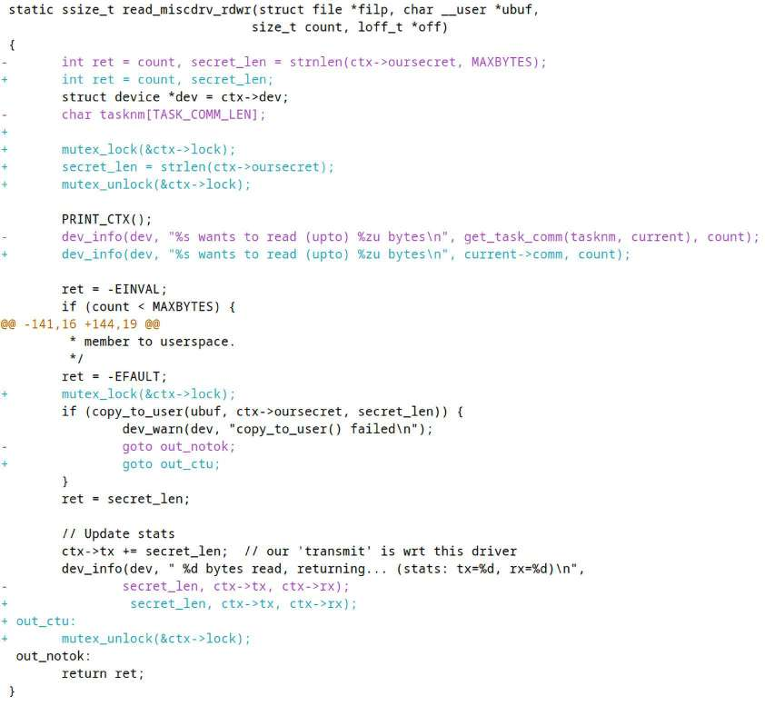

Hình 12.8: Diff của method read() driver; chú ý dùng mutex lock trong version mới (dòng prefix “+” được thêm ở version mới)

Hình 12.8 là ảnh (một phần) diff, tập trung read method driver. Nghiên cứu; sẽ thấy giờ dùng mutex lock bảo vệ mọi access vào shared writable data, nói cách khác mọi critical section. (Một số hơi quá chặt chẽ, không nghi ngờ. Đồng thời sao không dùng helper `get_task_comm()` lấy thread name (như học Chương 6, Kernel Internals Essentials – Processes and Threads)? Sẽ rõ trong chương tới. Xin kiên nhẫn!) Cùng protection-via-mutex áp dụng các method open, write, close (release) của device driver (sao không tự tạo patch và xem?).

Lưu ý user-mode app không đổi, nghĩa để kiểm thử version mới an toàn hơn, tiếp tục dùng app gốc tại `ch12/miscdrv_rdwr/rdwr_drv_secret.c`. (Cho tiện, tôi copy code vào GitHub repo sách tại: `https://github.com/PacktPublishing/Linux-Kernel-Programming_2E/blob/main/ch12/rdwr_test_secret.c`.) Hãy thử cùng misc driver!

Chạy và kiểm thử code như driver code này trên debug kernel có khả năng phát hiện nhiều locking error và deadlock là then chốt (sẽ trở lại khả năng “debug” trong chương sau, phần Lock debugging trong kernel).

Trong code diff trên (Hình 12.8), lấy mutex lock ngay trước routine `copy_to_user()`; helper macro `copy_to_user()` là blocking (có thể sleep!). Ổn; xét cho cùng dùng mutex lock cho critical section có thể blocking là một use case then chốt.

Tuy nhiên chỉ release mutex sau lời gọi `dev_info()`. Sao không trước routine để rút ngắn critical section? Xem kỹ `dev_info()` thấy vì sao nằm trong critical section. Đang in giá trị ba variable: số byte đọc - `secret_len` - và số byte “transmitted”, “received” lần lượt bằng `ctx->tx` và `ctx->rx`. Giờ `secret_len` là local variable không cần bảo vệ, nhưng hai variable kia trong global driver context structure, nên (xét chặt chẽ) thực sự cần bảo vệ ngay cả khi “chỉ đọc”, nhờ đó ngăn dirty/torn read tiềm năng!

### Mutex lock – một vài điểm còn lại

Trong phần này trình bày vài điểm bổ sung về mutex.

#### Các biến thể mutex lock API

Trước tiên xem vài biến thể mutex lock API; ngoài interruptible variant (mô tả phần Mutex lock – qua \[un\]interruptible sleep?), có trylock, killable và io variant.

##### Mutex trylock variant

Nếu muốn triển khai busy-wait semantic; nghĩa là kiểm tra lock (mutex) có sẵn, nếu có (hiện unlocked) acquire rồi tiếp tục critical section code path. Tuy nhiên nếu không sẵn (hiện locked state), không chờ lock; thay vào đó làm việc khác rồi retry.

Thực chất đây là non-blocking mutex lock variant nên gọi trylock; flowchart sau mô tả gần đúng hoạt động:

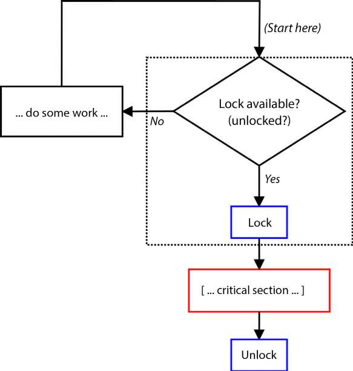

Hình 12.9: Ngữ nghĩa “busy wait”, non-blocking trylock variant của mutex lock

Ô nét chấm trong Hình 12.9 biểu thị internal implementation – kiểm tra lock unlocked rồi lock – atomic. API cho trylock variant của mutex lock như sau:

```
int __sched mutex_trylock(struct mutex *lock);
```

Return value API biểu thị việc đã xảy ra ở runtime:

- Return value `1` chỉ lock đã được acquire thành công.

- Return value `0` chỉ lock hiện contended (locked).

Dù rất muốn, đừng thử dùng API `mutex_trylock()` xác định mutex lock locked hay unlocked; bản chất “racy”. Tiếp theo lưu ý dùng trylock variant trong highly contended lock path hoàn toàn có thể giảm cơ hội acquire lock. Theo truyền thống trylock variant dùng trong deadlock prevention code có thể cần back out khỏi lock order sequence nhất định rồi retry qua sequence (ordering) khác.

Đồng thời với trylock variant, dù tài liệu dùng từ thử và acquire mutex atomically, không hoạt động trong atomic/interrupt context – chỉ trong process context (như mọi mutex lock). Như thường lệ lock phải release bằng owner context gọi `mutex_unlock()`.

Tôi đề nghị giờ thử làm với trylock mutex variant như bài tập. Xem phần Câu hỏi cuối chương để có bài!

##### Các mutex interruptible và killable variant

Như học, API `mutex_lock_interruptible()` dùng khi driver (hay module) sẵn sàng ghi nhận user-space signal bất kỳ ngắt nó (nếu xảy ra trả `-ERESTARTSYS` báo kernel VFS layer xử lý signal; user-space system call thất bại với `errno` đặt `EINTR`). Ví dụ trong module-handling code của kernel, trong system call `delete_module(2)` (do `rmmod` gọi):

```
// kernel/module.c
[ ... ]
SYSCALL_DEFINE2(delete_module, const char __user *, name_user,
        unsigned int, flags)
{
    struct module *mod;
    [ ... ]
    if (!capable(CAP_SYS_MODULE) || modules_disabled)
        return -EPERM;
    [ ... ]
    if (mutex_lock_interruptible(&module_mutex) != 0)
        return -EINTR;
    mod = find_module(name);
    [ ... ]
out:
    mutex_unlock(&module_mutex);
    return ret;
}
```

Chú ý API trả `-EINTR` khi thất bại. (Nhân tiện macro `SYSCALL_DEFINEn()` trở thành system call signature; `n` biểu thị số parameter system call cụ thể nhận. Đồng thời chú ý capability check – trừ khi chạy root hay có capability `CAP_SYS_MODULE` (hoặc module loading disable hoàn toàn), system call chỉ trả failure (`-EPERM`).)

Tuy nhiên nếu driver chỉ chấp nhận bị ngắt bởi fatal signal (signal kết thúc user-space context), dùng API `mutex_lock_killable()` (signature giống interruptible variant).

##### Mutex I/O variant

API `mutex_lock_io()` giống cú pháp API `mutex_lock()`; chỉ khác kernel xem wait time của loser thread như chờ I/O (code comment trong `kernel/locking/mutex.c:mutex_lock_io()` ghi rõ; xem: `https://elixir.bootlin.com/linux/v6.1.25/source/kernel/locking/mutex.c#L1016`). Có thể quan trọng về accounting.

Có thể tìm API khá đặc biệt như `mutex_lock[_interruptible]_nested()` trong kernel, nhấn suffix `nested`. Tuy nhiên lưu ý Linux kernel không muốn developer dùng nested (hay recursive) locking (như đề cập phần Hướng dẫn locking và deadlock, Dùng mutex lock đúng cách). Đồng thời các API chỉ được compile khi có config option `CONFIG_DEBUG_LOCK_ALLOC`; thực chất nested API thêm để hỗ trợ kernel lock validator mechanism. Chỉ nên dùng trong hoàn cảnh đặc biệt (cần nesting level giữa instance cùng lock type).

Phần tiếp trả câu hỏi thường gặp: khác mutex và semaphore object là gì? Chờ đã, Linux có semaphore object chứ? Đọc tiếp!

#### Semaphore và mutex

Linux kernel có cung cấp semaphore object cùng các operation thường làm trên semaphore (binary):

- Acquire semaphore lock qua API `down[_interruptible]()` (và biến thể)

- Unlock semaphore qua API `up()`

Nhìn chung semaphore là implementation cũ hơn nên khuyên dùng mutex lock thay thế.

Tuy nhiên câu hỏi đáng khám phá: khác mutex và semaphore là gì? Có vẻ tương tự về khái niệm nhưng thực sự khá khác; một câu trả lời tóm qua các điểm (tất nhiên chủ yếu xét Linux kernel):

- Semaphore là dạng tổng quát hơn mutex; mutex lock acquire (rồi release/unlock) đúng một lần, còn semaphore acquire (rồi release) nhiều lần được.

- Mutex dùng bảo vệ critical section khỏi truy cập đồng thời, còn semaphore nên dùng như mechanism báo cho task đang chờ khác rằng đã đạt mốc nhất định (thường producer task post signal qua semaphore object mà consumer task đang chờ nhận để tiếp tục công việc).

- Mutex có khái niệm lock ownership, chỉ owner context được unlock; binary semaphore không ownership.

#### Priority inversion và RT-mutex

Một lưu ý khi dùng locking bất kỳ là cần thiết kế, viết code cẩn thận để ngăn tình huống deadlock đáng sợ có thể xảy ra (một lần nữa thêm về bắt vấn đề trong chương sau phần Lock validator lockdep – bắt locking issue sớm).

Ngoài deadlock có tình huống nguy hiểm khác khi dùng mutex: priority inversion (một lần nữa không đi chi tiết trong sách). Chỉ cần nói unbounded priority inversion case có thể chết người; kết quả thread priority cao (nhất) của sản phẩm bị giữ khỏi CPU quá lâu.

Như tôi trình bày tương đối chi tiết trong sách trước Hands-on System Programming with Linux, chính priority inversion này tấn công robot Mars Pathfinder của NASA, ngay trên bề mặt Sao Hỏa, tháng 7 năm 1997! Hardware watchdog khiến hệ thống reboot mỗi khi high-priority thread của project chờ mutex quá lâu, vượt deadline; vấn đề là xảy ra thường! Nhờ debug telemetry bật (tuyệt!), vấn đề được chẩn đoán từ Trái Đất và sửa (bằng mutex attribute priority inheritance (PI) ngăn lower-priority thread giữ mutex bị preempt trước release). Firmware sau đó upload lên robot trên Sao Hỏa (!), mọi thứ hoạt động! Xem phần Đọc thêm để có tài liệu thú vị, điều mọi software developer nên biết!

User-space Pthreads mutex implementation chắc chắn có ngữ nghĩa priority inheritance (PI). Nhưng trong Linux kernel? Ingo Molnar cung cấp PI-futex-based RT-mutex (real-time mutex; thực chất mutex mở rộng có PI. Để biết, API `futex(2)` là system call tinh vi cung cấp fast user-space mutex). Có sẵn khi bật config option `CONFIG_RT_MUTEXES`. Khá giống ngữ nghĩa mutex “thường”, RT-mutex API cung cấp initialize, (un)lock, destroy RT-mutex object. (Code merge vào mainline kernel từ tree `-rt` của Ingo Molnar.) Về usage thực tế, RT-mutex dùng triển khai PI futex nội bộ (có biết trên Linux chính system call `futex(2)` triển khai user-space Pthreads mutex bên trong?). Ngoài ra kernel-locking self-test code và I2C subsystem dùng RT-mutex trực tiếp.

Vì vậy người viết module (hay driver) điển hình không dùng API này thường xuyên. Kernel cung cấp một ít tài liệu internal design RT-mutex tại `https://docs.kernel.org/locking/rt-mutex-design.html` (gồm priority inversion, priority inheritance và hơn nữa).

#### Internal design

Đôi lời về internal implementation thực tế mutex lock sâu trong kernel: Linux cố triển khai fast-path approach bất cứ khi nào có thể.

Fast path là code path hiệu năng cao, tối ưu nhất, thường không lock không blocking. Ý định cho code theo fast path tối đa. Chỉ khi thực sự không thể, kernel fallback sang (có thể) “mid path” rồi “slow path”; vẫn hoạt động nhưng chậm (hơn).

Fast path được lấy khi không contention lock (nghĩa ban đầu lock unlocked state). Vì vậy lock được locked không phiền, gần như ngay. Tuy nhiên mutex đã locked thì kernel thường dùng “mid path” optimistic spinning implementation, khiến giống hybrid lock type (mutex/spinlock) hơn. Nếu cả vậy không thể, theo “slow path” – process context thử lấy lock hoàn toàn có thể vào sleep state. Nếu quan tâm internal implementation mutex, thêm chi tiết trong tài liệu kernel chính thức: `https://docs.kernel.org/locking/mutex-design.html`.

Project LDV (Linux Driver Verification): trong chương trực tuyến Kernel Workspace Setup, phần Project LDV – Linux Driver Verification, đã đề cập project có “quy tắc” hữu ích về nhiều khía cạnh lập trình Linux module (chủ yếu driver) và core kernel.

Về chủ đề hiện tại, đây là một quy tắc: Lock mutex hai lần hay unlock khi chưa lock (`http://linuxtesting.org/ldv/online?action=show_rule&rule_id=0032`). Đề cập những việc không làm được với mutex lock (đã trình bày phần Dùng mutex lock đúng cách). Điều thú vị có thể thấy ví dụ bug thực tế – thử acquire mutex lock hai lần, dẫn (self) deadlock – trong kernel driver (cùng bản sửa sau).

Loại mutex khác chỉ đề cập là w/w – wait/wound (hay đơn giản WW-mutex) – (wound vần với “doomed”). Thuật ngữ từ tài liệu RDBMS, là cách xử lý deadlock (tài liệu còn dùng từ “deadlock-proof”). Với w/w trong Linux kernel, usage chủ yếu graphics subsystem, phần nào DMA. Ở đây task acquire mutex lock nhận reservation hay ticket identifier duy nhất. Giờ “age” task acquire WW-mutex được xét. Khi phát hiện deadlock, task “già nhất” – giữ reservation lâu nhất – được ưu tiên. Thế nào? Bằng cho task “trẻ” back off, yêu cầu (ép) release WW lock đang giữ; do đó task trẻ bị “wounded” (tội nghiệp). Usage WW-mutex trong kernel khá thấp, đặc biệt so mutex thường. Xem Đọc thêm để biết thêm.

Giờ hiểu dùng mutex lock, hãy tiếp xem lock rất phổ biến khác trong kernel – spinlock!

## Dùng spinlock

Trong phần Xác định lock cần dùng – thực tế, đã học về mặt thực tế khi nào dùng spinlock thay mutex và ngược lại. Cho thuận tiện chép lại các phát biểu then chốt đã cung cấp:

- Critical section chạy atomic context (ví dụ interrupt), hay process context không được sleep? Dùng spinlock.

- Critical section chạy process context và có thể sleep hay blocking I/O trong critical section? Dùng mutex lock.

Trong phần này xem như giờ đã quyết định dùng spinlock.

### Spinlock – usage đơn giản

Với mọi spinlock API, phải include header file liên quan, nghĩa là `#include <linux/spinlock.h>`.

Tương tự mutex lock, phải khai báo, khởi tạo spinlock unlocked state trước dùng. Spinlock là “object” khai báo qua `typedef` data type tên `spinlock_t` (bên trong structure định nghĩa ở `include/linux/spinlock_types.h`). Có thể khởi tạo dynamically qua macro `spin_lock_init()`:

```
spinlock_t lock;
spin_lock_init(&lock);
```

Hoặc làm statically (khai báo, khởi tạo) qua macro `DEFINE_SPINLOCK(lock);`.

Như mutex, khai báo spinlock trong data structure (global/static) cần bảo vệ (khỏi concurrent access) thường rất tốt. Như nói, ý tưởng này dùng thường trong Linux kernel; ví dụ data structure biểu diễn open file trong kernel gọi `struct file:`

```
// include/linux/fs.h
struct file {
    [...]
    struct path f_path;
    struct inode *f_inode; /* cached value */
    const struct file_operations *f_op;
    /*
     * Protects f_ep_links, f_flags.
     * Must not be taken from IRQ context.
     */
    spinlock_t f_lock;
    [...]
    struct mutex f_pos_lock;
    loff_t f_pos;
    [...]
```

Xem này: với structure `file`, spinlock variable tên `f_lock` là spinlock bảo vệ (như comment nói) member `f_ep_links` và `f_flags` của data structure `file`; đồng thời có mutex lock bảo vệ member khác, current seek position `f_pos` của file.

Thực sự làm operation lock/unlock với spinlock thế nào? Có khá nhiều API variation kernel cung cấp cho người viết module/driver; dạng spin(un)lock API đơn giản nhất:

```
void spin_lock(spinlock_t *lock);
<< ... critical section ... >>
void spin_unlock(spinlock_t *lock);
```

Lưu ý spinlock không có tương đương API `mutex_destroy()`. Giờ xem spinlock API hoạt động!

### Spinlock – example driver

Tương tự mutex locking sample driver (tham khảo phần Mutex locking – example driver nếu cần), để minh họa usage đơn giản spinlock, sẽ (lại) tạo bản sao character device driver “misc” đơn giản – viết kém, chủ ý không locking – từ companion volume Linux Kernel Programming – Part 2, chương đầu Writing a Simple misc Character Device Driver (`ch1/1_miscdrv_rdwr`), làm template ban đầu rồi đặt vị trí module driver mới cho sách này; tại `ch12/2_miscdrv_rdwr_spinlock` (tất nhiên mong bạn clone GitHub repo sách).

Một lần nữa cho dễ đọc, chỉ hiển thị phần nhỏ liên quan diff (khác biệt, delta do `diff` tạo) giữa chương trình gốc và chương trình này:

```
+#include <linux/spinlock.h>
[ ... ]
-/*
- * The driver 'context' (or private) data structure;
- * all relevant 'state info' regarding the driver is here.
+static int ga, gb = 1;
+DEFINE_SPINLOCK(lock1); /* this spinlock protects the global integers ga and
gb */
+
+/* The driver 'context' data structure;
+ * all relevant 'state info' reg the driver is here.
  */
 struct drv_ctx {
        struct device *dev;
        int tx, rx, err, myword;
        u32 config1, config2;
        u64 config3;
    [ … ]
+#define MAXBYTES    128
        char oursecret[MAXBYTES];
+       struct mutex mutex;  /* this mutex protects these members of this data
+                             * structure: oursecret
+                             * in the (possibly) blocking critical section
+                             */
+       spinlock_t spinlock; /* this spinlock protects these members of this
data
+                             * structure: oursecret, tx, rx
+                             * in the non-blocking / atomic critical sections
+                             */
 };
 static struct drv_ctx *ctx;
```

Lần này để bảo vệ member global data structure `drv_ctx`, có cả mutex lock (từ version trước) và spinlock mới. Khá thường có hơn một lock trong data structure; thường mutex lock bảo vệ member usage trong critical section có thể blocking, spinlock bảo vệ member trong critical section không thể blocking (sleeping) (cũng dùng spinlock bảo vệ data member trong process context được, miễn critical section non-blocking).

Tất nhiên phải bảo đảm khởi tạo mọi lock unlocked state. Làm trong code path `init` driver (tiếp output patch):

```
+       mutex_init(&ctx->mutex);
+       spin_lock_init(&ctx->spinlock);
```

Trong version này, ở method `open` driver, thay mutex lock bằng spinlock bảo vệ increment/decrement global integer; ảnh chụp một phần patch cho thấy với color highlighting:

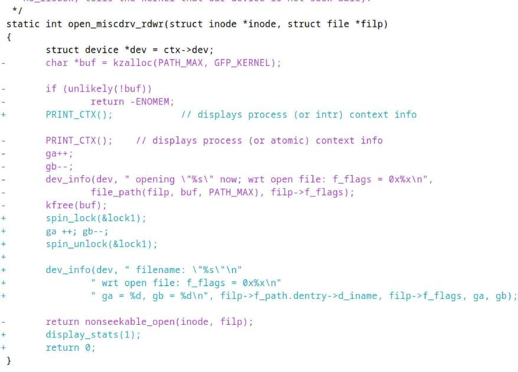

Hình 12.10: Ảnh chụp một phần patch cho thấy code open method driver (và spinlock usage bên trong)

Một lần nữa đáng lặp: bất cứ nơi dùng spinlock, ngụ ý critical section bảo vệ – code path giữa spinlock và unlock – chắc chắn non-blocking code.

Tiếp theo version này trong method `read` driver, dùng spinlock thay mutex bảo vệ vài critical section:

```
static ssize_t read_miscdrv_rdwr(struct file *filp, char __user *ubuf,
-                                size_t count, loff_t *off)
+                               size_t count, loff_t *off)
 {
-       int ret = count, secret_len = strnlen(ctx->oursecret, MAXBYTES);
+       int ret = count, secret_len, err_path = 0;
        struct device *dev = ctx->dev;
-       char tasknm[TASK_COMM_LEN];
+
+       spin_lock(&ctx->spinlock);
+       secret_len = strlen(ctx->oursecret);
+       spin_unlock(&ctx->spinlock);
```

Tuy nhiên chưa hết! Tiếp read method driver, xem kỹ code snippet sau lấy mutex lock và comment theo sau:

```
        ret = -EFAULT;
+       mutex_lock(&ctx->mutex);
+       /* Why don't we just use the spinlock??
+        * Because - VERY IMP! - remember that the spinlock can only be used
when
+        * the critical section will not sleep or block in any manner; here,
+        * the critical section invokes the copy_to_user(); it very much can
+        * cause a 'sleep' (a schedule()) to occur.
+        */
        if (copy_to_user(ubuf, ctx->oursecret, secret_len)) { [ … ]
```

Khi bảo vệ data nơi critical section có API có thể blocking – như `copy_to_user()` – chỉ được dùng mutex lock! (Do giới hạn chỗ, không hiển thị thêm patch; mong bạn đọc spinlock sample driver code và tự thử.)

### Kiểm thử – sleep trong atomic context

Đã học điều không được làm là sleep (block) trong bất kỳ atomic/interrupt context. Hãy kiểm thử. Như luôn, empirical approach – tự kiểm thử thay vì dựa trải nghiệm người khác – là then chốt!

Chính xác kiểm thử thế nào? Dễ: dùng integer module parameter đơn giản `buggy`, khi đặt `1` (mặc định `0`), thực thi code path trong spinlock-protected critical section driver vi phạm quy tắc. Ở đó gọi API `schedule_timeout()`, bên trong gọi `schedule()`; đó là cách đưa process context – current – sleep trong kernel space. (Để biết, dùng API này và hơn nữa được trình bày trong companion volume Linux Kernel Programming – Part 2, Chương 5, Working with Kernel Timers, Threads, and Workqueues.) Đây là code liên quan:

```
// ch12/2_miscdrv_rdwr_spinlock/miscdrv_rdwr_spinlock.c
[ ... ]
static int buggy;
module_param(buggy, int, 0600);
MODULE_PARM_DESC(buggy,
"If 1, cause an error by issuing a blocking call within a spinlock critical
section");
[ ... ]
static ssize_t write_miscdrv_rdwr(struct file *filp, const char __user *ubuf,
                size_t count, loff_t *off)
{
    int ret, err_path = 0;
    [ ... ]
    spin_lock(&ctx->spinlock);
    strscpy(ctx->oursecret, kbuf, (count > MAXBYTES ? MAXBYTES : count));
    [ ... ]
    if (1 == buggy) {
        /* We're still holding the spinlock! */
        set_current_state(TASK_INTERRUPTIBLE);
        schedule_timeout(1*HZ); /* ... and this is a blocking call!
                    * Congratulations! you've just engineered a bug */
    }
    spin_unlock(&ctx->spinlock);
    [ ... ]
}
```

Giờ phần thú vị: kiểm thử code path (buggy) trong custom “debug” kernel 6.1.25 (kernel đã bật nhiều kernel debug configuration option (chủ yếu từ menu Kernel Hacking trong UI `make menuconfig`)).

#### Kiểm thử buggy module trên debug kernel 6.1

Trước tiên bảo đảm đã build custom kernel 6.1 (đang dùng version 6.1.25), bật mọi kernel debug config option cần thiết (tham khảo lại Chương 5, Writing Your First Kernel Module – Part 2, phần Cấu hình kernel “debug” nếu cần). Rồi boot debug kernel (ở đây tên `6.1.25-dbg`). Giờ build misc driver (trong `ch12/2_miscdrv_rdwr_spinlock/`) cho debug kernel (lệnh `make` thường trong directory driver hẳn làm được; có thể thấy trên debug kernel build hơi chậm hơn, binary module lớn hơn):

```
$ lsb_release -a 2>/dev/null | grep "^Description" ; uname -r
Description:    Ubuntu 23.10
6.1.25-dbg

# Before running make, ensure that the Makefile has the variable MYDEBUG set to
# y (I have kept it this way).
$ cd <lkp2e_book_src>/ch12/2_miscdrv_rdwr_spinlock
$ make
--- Building : KDIR=/lib/modules/6.1.25-dbg/build ARCH= CROSS_COMPILE= ccflags-
y="-DDEBUG -g -ggdb -gdwarf-4 -Wall -fno-omit-frame-pointer -fvar-tracking-
assignments -DDYNAMIC_DEBUG_MODULE" MYDEBUG=y DBG_STRIP=n ---
gcc (Ubuntu 13.2.0-4ubuntu3) 13.2.0
[ … ]
$ modinfo ./miscdrv_rdwr_spinlock.ko
filename:       /home/c2kp/lkp2e/ch12/2_miscdrv_rdwr_spinlock/./miscdrv_rdwr_
spinlock.ko
[ … ]
vermagic:       6.1.25-dbg SMP preempt mod_unload modversions
parm:           buggy:If 1, cause an error by issuing a blocking call within a
spinlock critical section (int)
$ sudo virt-what
virtualbox
kvm
$
```

Như thấy đang chạy custom “debug” kernel 6.1.25 trên Ubuntu 23.10 guest VM x86\_64 ở đây.

Làm sao biết đang trên virtual machine (VM) hay “bare metal” (native) system? `virt-what(1)` là script nhỏ hữu ích cho biết (cài trên Ubuntu bằng `sudo apt install virt-what`).

Để chạy test case, insert driver vào kernel, đặt module parameter `buggy` thành `1`. Gọi method `read` driver (qua user-space app, tức `ch12/rdwr_test_secret`) không vấn đề vì buggy code path không ở đó, như thấy:

```
$ sudo dmesg -C
$ sudo insmod ./miscdrv_rdwr_spinlock.ko buggy=1
$ lsmod |grep miscdrv
miscdrv_rdwr_spinlock    20480  0
$ ../rdwr_test_secret
Usage: ../rdwr_test_secret opt=read/write device_file ["secret-msg"]
 opt = 'r' => we shall issue the read(2), retrieving the 'secret' form the
driver
 opt = 'w' => we shall issue the write(2), writing the secret message <secret-
msg>
  (max 128 bytes)
$ ../rdwr_test_secret r /dev/llkd_miscdrv_rdwr_spinlock
Device file /dev/llkd_miscdrv_rdwr_spinlock opened (in read-only mode): fd=3
../rdwr_test_secret: read 7 bytes from /dev/llkd_miscdrv_rdwr_spinlock
The 'secret' is:
 "initmsg"
$
```

Tiếp theo gọi system call `write(2)` đến driver qua user-mode app; lần này write method driver chạy (tất nhiên trong context user-space process `rdwr_test_secret`), do đó buggy code path được thực thi!

Được rồi, chạy user-space app, ghi “bí mật” mới vào device (kích hoạt kernel module bug):

```
$ ../rdwr_test_secret w /dev/llkd_miscdrv_rdwr_spinlock "When you have
exhausted all possibilities, remember this: you haven't"
Device file /dev/llkd_miscdrv_rdwr_spinlock opened (in write-only mode): fd=3
../rdwr_test_secret: wrote 70 bytes to /dev/llkd_miscdrv_rdwr_spinlock
$
```

Như trong code snippet trước ở phần này, gọi `schedule_timeout()` trong spinlock critical section (giữa lock và unlock). Debug kernel phát hiện là bug, tạo debug diagnostics (lớn ấn tượng) trong kernel log (lưu ý bug như vậy hoàn toàn có thể treo hệ thống, nên luôn khuyên kiểm thử trên test VM). Xem qua `sudo dmesg:`

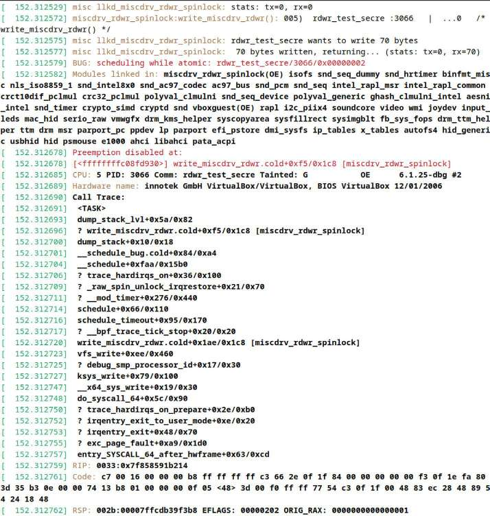

Hình 12.11: Kernel diagnostics bị kích hoạt bởi bug “scheduling while atomic” đã chủ ý gặp ở đây

Ảnh chụp (một phần) trên (Hình 12.11) cho thấy chuyện xảy ra; cùng theo dõi khi xem driver code trong `ch12/2_miscdrv_rdwr_spinlock/miscdrv_rdwr_spinlock.c`:

1\. Trước tiên xem dòng hai, output macro hữu ích `PRINT_CTX()` (chép lại dòng ở đây):

```
miscdrv_rdwr_spinlock:write_miscdrv_rdwr(): 005)  rdwr_test_secre :3066 |
...0   /* write_miscdrv_rdwr() */
```

Rõ ràng write method code driver, `write_miscdrv_rdwr()`, chạy trong context user-space process (`rdwr_test_secre;` chú ý tên cắt còn 16 ký tự đầu, gồm byte `NULL`).

2\. Copy “bí mật” mới từ user-space writer process vào và ghi, 70 byte. 3. Rồi “lấy” spinlock, đi vào critical section, copy data này vào member `oursecret` của driver context structure. 4. Sau đó điều kiện `if (1 == buggy) {` đánh giá true. 5. Vì vậy gọi `schedule_timeout()`, blocking API (bên trong gọi `schedule()`), kích hoạt bug được hữu ích làm nổi bật đỏ:

```
BUG: scheduling while atomic: rdwr_test_secre/3066/0x00000002
```

6\. Kernel giờ dump khá nhiều diagnostic output. Một trong các thứ đầu dump là call stack.

Có thể thấy rõ call trace hay stack backtrace kernel-mode stack của process – ở đây user-space app `rdwr_drv_secret` đang chạy code driver (buggy) trong process context – trong Hình 12.11. Mỗi dòng sau header `Call Trace:` về cơ bản là call frame trên kernel stack.

Vài mẹo:

- Luôn đọc call stack (hay call trace) từ dưới lên (vì vậy thấy đi vào qua system call, khá rõ `write(2)`, thành `ksys_write()`, rồi `vfs_write()`, v.v.).

- Bỏ mọi stack frame bắt đầu ký hiệu `?`; là questionable call frame, rất có thể “tàn dư” lần dùng stack trước ở cùng memory region. Đáng rẽ chút về memory: đây là cách stack allocation thực sự hoạt động; stack memory không được cấp phát, giải phóng theo từng call frame vì vô cùng tốn kém. Chỉ khi stack memory page cạn mới tự fault-in page mới! (Nhớ thảo luận Chương 9, Kernel Memory Allocation for Module Authors – Part 2, phần Ghi chú ngắn về memory allocation và demand paging). Vì vậy thực tế khi code gọi, return function, cùng stack memory page thường được dùng lại.

Không chỉ vậy, vì hiệu năng memory call frame không được xóa mỗi lần, khiến tàn dư frame trước thường xuất hiện. (Có thể thực sự “làm hỏng” bức tranh. Tuy nhiên may mắn stack call frame tracing algorithm hiện đại thường làm rất tốt xác định stack trace đúng.)

`vfs_write()` gọi `__vfs_write()`, cuối cùng gọi write method driver, tức `write_miscdrv_rdwr()`! (Tất nhiên đó là cách character driver framework thiết kế hoạt động. Đồng thời chú ý \[module name\] trong ngoặc vuông bên phải mọi module function call frame – gợi ý hữu ích khác.) Code này như biết gọi buggy code path nơi gọi `schedule_timeout()`, rồi gọi `schedule()` (gọi worker routine thực tế `__schedule()`), khiến toàn kernel bug `BUG: scheduling while atomic` kích hoạt.

Format của code path `scheduling while atomic` lấy từ dòng code sau trong `kernel/sched/core.c:`

```
printk(KERN_ERR "BUG: scheduling while atomic: %s/%d/0x%08x\n", prev->comm,
prev->pid, preempt_count());
```

Thú vị! Ở đây thấy đã in string:

```
BUG: scheduling while atomic: rdwr_test_secre/3066/0x00000002
```

Sau `atomic:`, in process name (có thể cắt), PID rồi gọi inline function `preempt_count()`, in preempt depth; về cơ bản counter increment mỗi lần lấy spinlock, decrement mỗi unlock. Vì vậy nếu dương ngụ ý code ở critical hay atomic section; ở đây giá trị `2`, chứng minh đang atomic non-preemptible code path!

Không diễn giải phần còn lại kernel diagnostics hữu ích ở đây; xem sách Linux Kernel Debugging để đi sâu mọi khía cạnh.

Điểm then chốt lưu ý bug được kernel chỉ rõ trong lần kiểm thử vì debug kernel config option `CONFIG_DEBUG_ATOMIC_SLEEP` bật (bật vì đang custom “debug kernel”!) Chi tiết config option (có thể tìm và đặt interactively trong `make menuconfig`, dưới Kernel Hacking) như sau:

```
// lib/Kconfig.debug
[ ... ]
config DEBUG_ATOMIC_SLEEP
    bool "Sleep inside atomic section checking"
    select PREEMPT_COUNT
    depends on DEBUG_KERNEL
    depends on !ARCH_NO_PREEMPT
    help
      If you say Y here, various routines which may sleep will become very
      noisy if they are called inside atomic sections: when a spinlock is
      held, inside an rcu read side critical section, inside preempt disabled
      sections, inside an interrupt, etc...
```

Nếu thực hiện cùng kiểm thử trên system và kernel “distro” tiêu chuẩn (như Ubuntu 22.04 LTS VM), quan trọng là thường không cấu hình “debug” kernel (nên kernel config option `CONFIG_DEBUG_ATOMIC_SLEEP` chưa đặt)? Có lẽ mong kernel không bắt bug cụ thể; vậy thực nghiệm cho kết quả:

- Trong ấn bản đầu, chạy kiểm thử trên Ubuntu 20.04 VM tiêu chuẩn với distro kernel (5.4) tiêu chuẩn thực sự không bắt bug.

- Tuy nhiên tôi thấy distro gần đây hơn, do đó kernel chạy trên chúng, dù kernel config option `CONFIG_DEBUG_ATOMIC_SLEEP` không đặt tường minh vẫn bắt bug scheduling while atomic! Kernel enhancement qua năm tháng dường như bảo đảm tiến bộ… (Kiểm thử cả Ubuntu 22.04 với kernel 5.19.0-45-generic và Fedora 38 distro với kernel mới hơn 6.5.6-200.fc38.x86\_64.)

Thường hữu ích giữ kernel config option `CONFIG_DEBUG_ATOMIC_SLEEP` bật ngay cả production.

Một lần nữa LDV project có quy tắc: “Không được acquire spin\_lock hai lần. Không được release spin\_lock chưa acquire. Cuối cùng mọi spin\_lock phải release. Không được re-release lock bằng các function spin\_unlock/spin\_unlock\_irqrestore” (`http://linuxtesting.org/ldv/online?action=show_rule&rule_id=0039`). (Tất nhiên đã trình bày trong phần Hướng dẫn locking và deadlock.) Đề cập điểm then chốt dùng spinlock đúng; thú vị ở đây cho bug instance thực tế trong driver nơi thử release spinlock hai lần – vi phạm rõ locking rule, dẫn hệ thống không ổn định.

Tốt, xong spinlock? Không, còn xa! Phần tiếp đi sâu hiểu spinlock và usage trong kernel, module, nơi cũng làm với spinlock trong interrupt context.

## Locking và interrupt

Đến giờ đã học dùng mutex lock, và với spinlock là API cơ bản `spin_[un]lock()`. Có vài API variation khác của spinlock, xem các biến thể phổ biến hơn ở đây.

Phần này nâng cao hơn chút, chắc chắn hữu ích nếu hiểu ít nhất cơ bản viết (char) device driver và hardware interrupt handling trên Linux (thường trong device driver context). Chủ đề trình bày chuyên sâu trong companion volume Linux Kernel Programming - Part 2, Chương 1, Writing a Simple misc Character Device Driver và Chương 4, Handling Hardware Interrupts (e-book LKP-2 tải miễn phí). Đồng thời như hướng dẫn/ôn nhanh, cung cấp subsection tên: Interrupt handling trên Linux - tóm lược điểm then chốt, nằm phía sau phần này. (Nếu chưa quen khái niệm interrupt handling trên Linux, đề nghị trước xem sách LKP - Part 2 và/hoặc phần này rồi tiếp từ đây.)

Để hiểu chính xác vì sao có thể cần API khác cho spinlock, xét tình huống: là người viết driver, thấy device đang làm assert hardware interrupt; do đó viết interrupt handler.

Giờ khi triển khai chẳng hạn method `read` driver, thấy có non-blocking critical section. Dễ xử lý: như học nên dùng spinlock bảo vệ. Tốt! Nhưng nghĩ xem nếu trong critical section method `read`, hardware interrupt device xảy ra? Như biết hardware interrupt preempt mọi thứ; nên control chuyển interrupt handler code, preempt method `read` driver.

Câu hỏi then chốt: có vấn đề? Tùy interrupt handler và method `read` driver làm gì và triển khai thế nào. Hình dung vài tình huống:

- Interrupt handler driver (lý tưởng) chỉ dùng local variable, nên dù method `read` trong critical section cũng không quan trọng; interrupt handling hoàn tất rất nhanh (nói chung thường khoảng 10 đến 100 microsecond), trả control về thứ bị ngắt (một lần nữa còn hơn thế; bottom-half mechanism tồn tại như softirq hay tasklet cũng có thể cần thực thi trước khi trả processor cho method `read`). Vì vậy thực sự không race trong trường hợp này.

- Interrupt handler driver làm trên shared writable data (global) nhưng không trên shared data item method `read` driver dùng. Vì vậy lại không conflict, không race với code method `read`. (Tất nhiên cũng nên hiểu vì interrupt handler làm shared state, có critical section phải bảo vệ (thường spinlock khác).)

- Interrupt handler driver làm trên cùng (hay một phần cùng) shared writable data mà method `read` driver làm. Khi đó thấy chắc chắn có tiềm năng data race, nên cần locking! (Nhớ định nghĩa data race phần Data race – định nghĩa chính thức hơn.)

Tất nhiên tập trung trường hợp ba, có tiềm năng data race. Hiển nhiên phải dùng spinlock bảo vệ critical section trong interrupt-handling code (nhớ không được mutex trong atomic/interrupt context bất kỳ). Đồng thời nếu không dùng chính cùng spinlock trong cả method `read` driver và interrupt handler code path thì thực sự không được bảo vệ gì!

Như thảo luận cho thấy, đặc biệt cẩn thận khi làm với lock; dành thời gian suy nghĩ kỹ thiết kế và code.

Hãy làm thảo luận thực hành hơn chút (pseudo-code): giả sử có shared data structure (global) tên `gctx`; đang thao tác trong cả method `read` lẫn interrupt handler (top half và/hoặc tasklet) của driver. Với method `read`, vì code path chạy concurrently được, chứa shared state, là critical section nên cần bảo vệ. Giờ vì chạy process context, có thể tưởng dùng mutex ở đây ổn.

Không! Nghĩ… để hiệu quả, rõ ràng cần bảo vệ cùng shared state bằng chính cùng lock trong cả method `read` driver và interrupt handler. Giờ critical section interrupt handler cũng cần bảo vệ, và như học thực sự không mấy lựa chọn: phải spinlock. Vì vậy thấy cả method `read` driver và interrupt handler driver phải dùng cùng spinlock! (Ở đây gọi spinlock variable `slock`; đọc “s lock”).

Pseudo-code sau thể hiện vài timestamp (`t1, t2, ...`) cho tình huống; nhưng trước tiên làm sai:

```
/* Driver read method ; WRONG ! */
driver_read(...)                  << time t0 >>
{
    [ ... ]
    spin_lock(&slock);
    <<--- time t1 : start of read method critical section >>
... << critical section: operating on global data object gctx >> ...
    spin_unlock(&slock);
    <<--- time t2 : end of read method critical section >>
    [ ... ]
}                                << time t3 >>
```

(Vì sao đánh dấu method `read` driver “sai”? Sẽ sớm biết!)

Giờ để thảo luận thú vị, xét ba tình huống (từ ít đến phức tạp hơn):

- Tình huống 1 – method `read` driver và interrupt chạy sequentially, lần lượt (nói cách khác serialized, không race)

- Tình huống 2 – (thú vị hơn) chạy interleaved (có tiềm năng data race)

- Tình huống 3 – chạy interleaved, một số interrupt bị mask (một số không; có tiềm năng data race)

Bắt đầu tình huống đầu.

### Tình huống 1 – driver method và hardware interrupt handler chạy serialized, sequentially

Pseudo-code sau cho interrupt handler device driver. Vì “biết” ở đây chạy serialized, sequentially, timeline tiếp từ trước (từ code snippet method `read` driver giả định ngay trước phần này); vì vậy timestamp đầu là t4 theo sau t3 ở cuối method `read`):

```
handle_interrupt(...)           << time t4; hardware interrupt fires! >>
{
    [ ... ]
    spin_lock(&slock);
    <<--- time t5: start of interrupt critical section >>
    ... << critical section: operating on global data object gctx >> ...
    spin_unlock(&slock);
    <<--- time t6 : end of interrupt critical section >>
    [ ... ]
}                               << time t7 >>
```

Có thể tóm bằng sơ đồ sau; nghiên cứu kỹ:

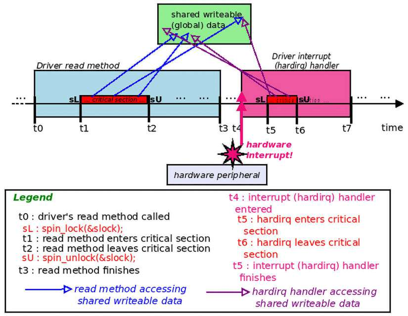

Hình 12.12: Timeline, tình huống 1: read method driver và hardware interrupt handler chạy sequentially khi làm trên global data; không vấn đề ở đây (sơ đồ không theo tỷ lệ)

Trong Hình 12.12, sL và sU chỉ các API `spin_lock()` và `spin_unlock()` được dùng. May mắn mọi thứ tốt – “may mắn” vì ở đây hardware interrupt xảy ra sau (cũng có thể trước) critical section function `read` hoàn tất, không ở giữa (như sẽ xét tình huống sau!). Chắc chắn không thể dựa vào may mắn làm chứng nhận an toàn duy nhất sản phẩm!?

### Tình huống 2 – driver method và hardware interrupt handler chạy interleaved

Code chạy trên UP system (uniprocessor, chỉ một CPU core) hay SMP system (multicore) cũng quan trọng. Trước tiên xét trên UP.

#### Tình huống 2 trên single-core (UP) system

Hardware interrupt tất nhiên asynchronous (đến bất kỳ lúc nào). Nếu interrupt của peripheral chip (driver được viết riêng để điều khiển) xảy ra trên cùng CPU core method `read` đang chạy, tại thời điểm kém thuận tiện (cho ta) – chẳng hạn khi critical section method `read` chạy, nghĩa giữa `t1` và `t2` (xem Hình 12.12)? Chẳng phải spinlock (lấy tại `t1`) chỉ cần làm đúng và bảo vệ data?

Không, nghĩ kỹ: lúc này interrupt handler preempt critical section method `read`, sớm vào critical section của mình; khi làm hiển nhiên thử acquire cùng spinlock (`&slock`). Nhưng khoan – không acquire (lock) được vì hiện locked (bởi process context chạy method `read`)! Vì vậy “spin”, thực chất chờ unlock. Nhưng làm sao bao giờ unlocked? Process context `read` driver phải unlock (vì sở hữu) nhưng không thể do bị hardware interrupt preempt! Vì vậy không unlock được, spinlock phía interrupt “spin” mãi; vậy là (self) deadlock.

Vậy giải pháp? Sẽ đến ngay, đọc tiếp...

#### Tình huống 2 trên multicore (SMP) system

Thú vị là spinlock trực giác hơn, hoàn toàn có nghĩa trên SMP system (hay multicore). Vậy giờ xét tình huống hơi khác trước – chạy multicore. Giả định method `read` chạy CPU core 1; interrupt có thể gửi đến CPU core khác, chẳng hạn core 2. Vì method `read` ở critical section, ngụ ý spinlock locked (tất nhiên); do đó interrupt code path thử acquire cùng spinlock sẽ “spin” trên lock ở CPU core 2. Khi method `read` trên core 1 hoàn tất critical section, unlock spinlock, nhờ đó unblock interrupt handler, giờ có thể “lấy” spinlock và tiến tiếp; tốt!

Nhưng UP thì sao? Hoạt động thế nào? Xét cho cùng không thể chạy logic trong một context (chẳng hạn process) và đồng thời “spinning” trong context khác (chẳng hạn interrupt) trên một CPU core. Và nếu trên multicore (SMP), method `read` driver và hardware interrupt handler tình cờ thực thi cùng core?

Đừng lo thực sự có giải pháp!

#### Giải quyết trên UP và SMP bằng API variant spin\_\[un\]lock\_irq()

À cuối cùng giải pháp câu đố: khi “racing” với interrupt, bất kể uniprocessor hay SMP system, chỉ dùng variant `_irq` của spinlock API:

```
#include <linux/spinlock.h>
void spin_lock_irq(spinlock_t *lock);
```

API `spin_lock_irq()` bên trong mask hardware interrupt (trừ non-maskable như Non Maskable Interrupt (NMI)) trên processor core đang chạy, nghĩa local core.

Vậy dùng API trong method `read` driver sẽ disable interrupt trên local core suốt critical section, khiến mọi “race” tiềm năng qua hardware interrupt không thể. (Nếu interrupt thực sự xảy ra CPU core khác, spinlock technology chỉ hoạt động đúng như quảng bá, đã thảo luận!)

Implementation `spin_lock_irq()` khá nested (như phần lớn spinlock functionality) nhưng nhanh; cuối cùng gọi macro `local_irq_disable()` và `preempt_disable()`, disable cả interrupt và kernel preemption trên local processor core đang chạy. Nói cách khác với spinlock API variant này, disable hardware interrupt có side effect (mong muốn) disable kernel preemption!

API `spin_lock_irq()` đi cặp API `spin_unlock_irq()` tương ứng. Vậy usage spinlock đúng cho tình huống (trái cách ngây thơ trước có thể self-deadlock) như sau:

```
/* Driver read method ; CORRECT ! */
driver_read(...)                  << time t0 >>
{
    [ ... ]
    spin_lock_irq(&slock);        // Note: we're using the _irq version of the
spinlock!
    <<--- time t1 : start of critical section >>
[now all interrupts + kernel preemption on local CPU core are masked
(disabled)]
... << critical section: operating on global data object gctx >> ...
    spin_unlock_irq(&slock);
    <<--- time t2 : end of critical section >>
[now all interrupts + kernel preemption on local CPU core are unmasked
(enabled)]
    [ ... ]
}                                << time t3 >>
```

Giờ hẳn hoạt động vì tất nhiên với variant `_irq` spinlock API, hardware interrupt không thể preempt critical section method `read` driver!

Tuy nhiên vấn đề lén lút vẫn ẩn (đảo mắt); tình huống sau mô tả, cung cấp giải pháp.

### Tình huống 3 – một số interrupt bị mask, driver method và hardware interrupt handler chạy interleaved

Trước khi tự vỗ vai và nghỉ hết ngày, xét thêm tình huống. Trên sản phẩm (hay project) phức tạp hơn, hoàn toàn có thể trong nhiều developer làm codebase, một người chủ ý đặt hardware interrupt (bit)mask thành giá trị nhất định, block một số hardware interrupt, cho phép số khác (API `disable_irq()` / `enable_irq()` cho disable/enable chọn lọc từng IRQ line).

Cho ví dụ giả sử xảy ra trước, lúc `t0`. Giờ như mô tả, developer khác (bạn!) đến, để bảo vệ critical section trong method `read` driver dùng API `spin_lock_irq()` (như vừa học phần Giải quyết trên UP và SMP bằng API variant spin\_\[un\]lock\_irq()). Nghe đúng? Đúng nhưng API có quyền tắt (mask) mọi hardware interrupt (và kernel preemption, tạm bỏ qua) trên local CPU core. Làm bằng thao tác mức thấp các hardware CPU state register (rất arch-specific).

Để bạn biết trên `x86[_64]`, API `spin_lock_irq()` lưu nội dung register EFLAGS (32-bit)/RFLAGS (64-bit) (đúng hơn lưu 16 bit LSB, nội dung gọi “FLAGS”). Trên AArch32 lưu register EFLAGS, trên AArch64 lưu register DAIF (Debug, Asynchronous (serror), Interrupts và FIQ exception). API `spin_unlock_irqrestore()` tất nhiên restore.

Bạn hỏi thì sao? Xét tình huống diễn ra:

- Thời điểm `t0`: Interrupt mask được đặt giá trị chẳng hạn `0x8e (10001110b)`, enable một số, disable một số interrupt (qua chẳng hạn dùng cẩn thận API `disable_irq()`). Setting quan trọng với project (để đơn giản giả định register mask 8-bit):

```
[... time elapses ... ].
```

- Thời điểm `t1`: Ngay trước vào critical section method `read` driver, gọi `spin_lock_irq(&slock);`. Như giờ hiểu, API lưu bên trong một CPU state register, có tác động nội bộ clear mọi bit interrupt mask register thành `0`, thực chất mask mọi interrupt.

- Thời điểm `t2`: Giờ hardware interrupt không xử lý được trên CPU core này, nên tiếp tục hoàn tất critical section. Ổn. Khi xong critical section, gọi `spin_unlock_irq(&slock);`. API có tác động restore một số CPU state register (arch-specific), đồng thời side effect nội bộ đặt mọi bit interrupt mask register thành `1`, enable lại mọi interrupt.

Tuy nhiên interrupt mask register giờ bị “restore” sai về `0xff (11111111b)`, không phải `0x8e` như developer gốc muốn, cần và giả định! Có thể (và có lẽ sẽ) làm hỏng gì đó trong project. Nghe khó.

Giải pháp khá đơn giản: khi lưu CPU state đừng giả định; chỉ lưu và restore CPU state hiện có, do đó interrupt mask state. Theo cách này nếu interrupt mask ban đầu `0x8e (10001110b)`, chính giá trị được lưu rồi restore; hoàn hảo. Save-and-restore-cpu-state này (với spinlock) đạt được qua cặp spinlock API:

```
#include <linux/spinlock.h>
unsigned long spin_lock_irqsave(spinlock_t *lock, unsigned long flags);
void spin_unlock_irqrestore(spinlock_t *lock, unsigned long flags);
```

Parameter đầu cả lock/unlock function là pointer đến spinlock variable cần dùng. Parameter thứ hai `flags` phải là local variable kiểu `unsigned long`. Dùng lưu/restore arch-specific CPU register (do đó cả interrupt mask state). Vậy cuối cùng cho tình huống này, (pseudo)code đúng:

```
spinlock_t slock;
spin_lock_init(&slock);
[ ... ]
driver_read(...)
{
    [ ... ]
    spin_lock_irqsave(&slock, flags);
        <<--- time t1 : start of critical section >>
[now the CPU state is saved; as a side effect, all interrupts + kernel
preemption on the local CPU core are masked (disabled) ]
    << ... critical section ... >>
    spin_unlock_irqrestore(&slock, flags);
<<--- time t2 : end of critical section >>
[now the CPU state is restored; as a side effect, only the previously masked
interrupts + kernel preemption on the local CPU core are unmasked (enabled) ]
    [ ... ]
}
```

Xét chặt chẽ `spin_lock_irqsave()` không API mà macro; thể hiện như API cho dễ đọc. Đồng thời dù return value macro không void, là internal detail (parameter variable `flags` được cập nhật ở đây).

Tốt, giờ hoàn tất thảo luận bằng dùng spinlock liên quan interrupt bottom half.

### Interrupt handling, bottom half và locking

Trước các điểm locking và bottom half, tổng quan nhanh (thực ra tóm lược) vài điểm then chốt interrupt handling trên Linux sẽ giúp.

#### Interrupt handling trên Linux – tóm lược điểm then chốt

Interrupt handler phải non-blocking, hoàn tất nhanh. Nhanh thế nào? Quy tắc kinh nghiệm trong 100 microsecond. Tuy nhiên nếu khá nhiều việc trong handler? Có thể lâu hơn… gây latency. Giải pháp (phần lớn OS hiện đại theo) là “chia” interrupt handling hai nửa – top và bottom. “Top half” handler (hay hardirq) được gọi gần như tức thì khi hardware interrupt xảy ra; bạn – người viết driver – phải làm tối thiểu cần thiết, giữ ngắn nhất có thể. Nếu cần thêm việc, bạn đăng ký (trước đó), gọi “bottom half”, deferred function chạy “sau”.

Thực tế bottom half triển khai như “tasklet”, được xây trên low-level softirq technology của kernel. Tasklet hay softirq chạy gần như ngay sau top half xong.

Nhưng lợi ích “chia” ở đâu? À điểm then chốt với side effect quan trọng về locking: top half (hardirq) luôn chạy với mọi interrupt disabled (masked) trên current CPU và IRQ đang xử lý disabled (masked) trên mọi CPU; bottom-half handler chạy với mọi interrupt enabled.

Quan trọng hiểu ngay cả bottom-half mechanism – softirq/tasklet – chạy interrupt context (không process). Vì vậy như top-half/hardirq handler, không được làm gì có thể block bên trong.

Hardirq handler không bao giờ chạy parallel với chính mình (do đó không reentrant). Tasklet (bên trong xây trên softirq mechanism) cũng không bao giờ chạy parallel với chính mình; property giúp dùng tasklet dễ hơn. Tuy nhiên softirq có thể chạy parallel với chính mình (trên core khác).

Tiếp theo dùng threaded handler cho interrupt processing giờ khá phổ biến với nhiều driver type (đặc biệt device hơi chậm, không đòi hiệu năng cực cao khác nhiều block/network/graphics device, và thực tế là mặc định khi đăng ký interrupt handler). Khi ấy vì interrupt handler entity thực sự chỉ là kernel thread (scheduling policy `SCHED_FIFO`, real-time priority 50), được phép blocking call bên trong. Hơn nữa cũng loại top-bottom half dichotomy.

#### Bottom half và locking

Giờ hiểu những điểm này, sang locking.

Nếu softirq/tasklet driver có critical section “race” với top-half (hardirq) interrupt handler (bằng thực thi trên core khác nơi top half thực thi)? Dễ: dùng spinlock thường trong cả hai bảo vệ critical section.

Tiếp theo nếu softirq/tasklet driver có critical section “race” với process-context code path?

Trong tình huống đó, dùng routine `spin_lock_bh()` trong driver method có lẽ là điều cần vì trước tiên disable bottom half trên local processor rồi lấy spinlock, bảo vệ critical section (tương tự cách `spin_lock_irq[save]()` bảo vệ critical section trong process context bằng disable hardware interrupt trên local core):

```
void spin_lock_bh(spinlock_t *lock);
```

Unlock API tương ứng là `spin_unlock_bh()`.

Tất nhiên overhead quan trọng trong code path rất nhạy hiệu năng (kernel code triển khai network stack là ví dụ tuyệt). Vì vậy dùng dạng spinlock đơn giản nhất giúp hiệu năng hơn variant phức tạp.

Dù vậy chắc chắn có lúc đòi dạng spinlock API mạnh hơn.

Ví dụ với Linux kernel codebase 6.1.25 LTS, đây là số lần dùng xấp xỉ các dạng spinlock API đã thấy:

- `spin_lock()`: Hơn 10.200 lần dùng

- `spin_lock_irq()`: Hơn 3.800 lần dùng

- `spin_lock_irqsave()`: Hơn 15.500 lần dùng

- `spin_lock_bh()`: Hơn 4.400 lần dùng

(Chỉ để đối chiếu, số ở ấn bản đầu với kernel 5.4.0 LTS lần lượt 9.400, hơn 3.600, hơn 15.000, hơn 3.700 lần.) Không rút suy luận lớn nào từ số này và usage các dạng spinlock API; chỉ muốn chỉ ra dùng dạng mạnh hơn khá phổ biến trong Linux kernel.

Cuối cùng ghi chú rất ngắn internal implementation spinlock: về internals bên trong, implementation thường rất arch-specific, hay gồm atomic machine language instruction thực thi rất nhanh trên microprocessor. Ví dụ architecture phổ biến `x86[_64]`, spinlock cuối cùng quy về atomic test-and-set machine instruction trên member spinlock structure (thường triển khai qua machine language instruction `cmpxchg`). Trên nhiều ARM machine, như đề cập trước thường machine instruction `wfe` (Wait For Event cùng SetEvent (SEV)) ở trái tim implementation. (Có tài liệu internal implementation trong Đọc thêm.) Bất kể vậy, người viết kernel hay driver chỉ nên dùng API (và macro) được cung cấp khi dùng spinlock.

### Dùng spinlock – tóm lược nhanh

Tóm lược nhanh spinlock xét API:

- Đơn giản nhất, overhead thấp nhất: Dùng non-irq spinlock primitive `spin_lock()/spin_unlock()` khi bảo vệ critical section process context (hoặc không hardware interrupt cần xử lý, hoặc có nhưng không race chút nào; thực chất dùng khi interrupt không tham gia/không quan trọng).

  - Đồng thời dạng này dùng được khi bảo vệ critical section giữa top-half và bottom-half handler.

- Overhead trung bình: Dùng version irq-disabling (cũng disable kernel preemption), `spin_lock_irq()/spin_unlock_irq()`, khi hardware interrupt tham gia và quan trọng (process/interrupt context có thể “race”; nghĩa chia sẻ global writable data).

  - Đồng thời có thể dùng cặp API `spin_[un]lock_bh()` khi bảo vệ critical section giữa process context và bottom half (bên trong disable/enable bottom half trên local core).

- Dạng mạnh nhất, overhead (tương đối) cao: Cách an toàn nhất dùng spinlock. Làm giống dạng overhead trung bình, trừ thực hiện save-and-restore CPU state qua cặp API `spin_lock_irqsave()/spin_unlock_irqrestore()`, để bảo đảm thực chất interrupt mask setting trước không vô tình bị ghi đè, có thể xảy ra với trường hợp trước.

Như thấy trước, spinlock – nghĩa “spinning” trên processor đang chạy khi chờ lock – không thể trên UP (làm sao spin trên một CPU có sẵn khi thread khác đồng thời chạy cùng CPU?). Quả thực trên UP system, spinlock API thành no-op (trừ khi spinlock debug config bật); tác dụng thực tế duy nhất ở đây là disable (mask) hardware interrupt và kernel preemption trên processor! Tuy nhiên SMP system (multicore) thực sự dùng spinning logic, ngữ nghĩa locking hoạt động như mong đợi.

Chờ đã – chi tiết không nên gây stress cho kernel/driver developer mới; thực ra toàn mục đích là chỉ cần dùng spinlock API như mô tả, không bao giờ phải lo UP so SMP, kernel preemption và gì khác; chi tiết bên trong làm gì hay không đều ẩn bởi implementation.

Tính năng mới thêm vào kernel 5.8 từ project Real-Time Linux (RTL, trước gọi PREEMPT\_RT), đáng đề cập nhanh: “local lock”. Dù use case chính cho (hard) real-time kernel, cũng hỗ trợ non-real-time kernel, chủ yếu lock debugging qua static analysis, cùng runtime debugging qua lockdep (trình bày chương sau). Đây là bài LWN: `https://lwn.net/Articles/828477/`.

Tiếp theo, thread giữ irq-off/preempt-off spinlock theo định nghĩa không bị preempt. Là cái gai với Linux real-time kernel (RTL); rõ ràng cần bảo đảm lower-priority thread bị preempt khi higher-priority real-time thread runnable, bất kể gì. Với spinlock truyền thống thiết kế bị phá; do đó khi RTL bật, spinlock thực sự triển khai lại như “sleeping spinlock”! Đạt bằng thay spinlock bằng lock `rt-mutex`, thực chất làm critical section sleep-able nên preemptable. Chỉ là điều cần biết.

Đến đây xong phần spinlock, lock cực phổ biến và then chốt trong Linux kernel, dùng bởi gần như mọi subsystem gồm driver.

## Locking – lỗi thường gặp và hướng dẫn

Để kết thúc, tham khảo nhanh hay tóm lược nếu muốn, gồm lỗi thường gặp khi locking, và (lặp chút) locking guideline. (Lưu ý một số kỹ thuật ở đây – như lock-free programming – trình bày chương sau).

### Lỗi thường gặp

- Không nhận ra critical section:

  - Increment/decrement “đơn giản” (kiểu `i ++` hay `i --`): Như học phần Trường hợp kinh điển – global i ++, cũng có thể là critical section. Chương sau thể hiện cách tối ưu, atomic làm việc với chúng.

  - “Này tôi chỉ đọc shared data”: Vẫn critical section nếu thỏa hai điều kiện; không bảo vệ gây dirty/torn read, data không nhất quán/corrupt.

  - Deadlock: Tình huống không thể tiến triển; thiết kế locking schema cẩn thận, theo locking rule/guideline đã hiểu rõ dưới để tránh. Về cơ bản quy về điểm then chốt:

  - Ghi tài liệu và luôn theo lock-ordering rule.

  - Không thử re-acquire lock đã giữ.

  - Chỉ release lock hiện giữ.

  - Ngăn starvation.

### Hướng dẫn locking

Sau đây tóm lược tổng thể locking guideline:

- Ngay từ đầu cố hết sức tránh lock:

  - Không chỉ nghĩa “không dùng global”. Thay vào đó phải xác định architecture tổng thể nơi tối đa có thể không writer thread (vào shared writable data) chạy concurrently với read/write access nào khác cùng data.

  - Tiếp theo nếu dùng shared writable data, chẳng hạn trong global structure, cố giữ mọi hay nhiều nhất member (integer) có thể kiểu `refcount_t` hay `atomic_t` (trình bày sau).

  - Xét memory barrier (khi cần).

  - Dùng lock-free technology!

- Nếu phải dùng locking, theo thứ tự:

  - Thử dùng lock-free technology:

  - Per-CPU variable

  - RCU

- Khi không thể, dùng locking thường:

  - Mutex: Trong process context, critical section khá dài và/hoặc blocking I/O (sleeping) cần thiết hay có thể xảy ra trong critical section

  - Spinlock: Khi làm trong atomic context bất kỳ (như interrupt handling), critical section ngắn; phải non-blocking (không cho sleep) trong critical section. Hoặc dùng được ngay process context không blocking trong critical section.

  - Nếu mutex hay spinlock đều được, ưu tiên spinlock (không chỉ thường hiệu năng tốt hơn, còn buộc quy tắc chặt hơn trong critical section phải tuân theo).

  - `refcount_t` cho integer operation (`atomic_t` atomic operator là interface cũ hơn).

  - Dùng RMW bitwise operator của kernel khi thao tác bit (trình bày chương sau).

  - Reader-writer (spin)lock (đang nhường chỗ RCU).

- Luôn nhớ lock ordering: Luôn lấy lock cùng thứ tự; ghi tài liệu và theo nghiêm; giúp ngăn deadlock (thứ tự release lock không thực sự quan trọng).

- Lock data, không phải code:

- Hướng fine(r) granularity locking khi có thể.

- Còn (nhiều) hơn ở điểm này; sâu hơn nghĩa thiết kế locking schema bằng xem kỹ data structure (hay cả member trong đó) đang bảo vệ, chỉ định chính xác bảo vệ khỏi concurrent access thế nào – thực chất dùng data-centric approach thay code-centric, nơi ít nhiều ngẫu nhiên rải mutex/spinlock quanh code đến khi có vẻ “hoạt động”. Các ý tưởng và hơn nữa được tìm hiểu trong bài Daniel Vetter: Locking Engineering Principles, tháng 7 năm 2022: `https://blog.ffwll.ch/2022/07/locking-engineering.html`).

- Hiệu năng bị ảnh hưởng độ dài critical section (code path giữa lock/unlock); giữ ngắn! (Nhớ eBPF utility criticalstat đã đề cập; dùng kiểm tra, báo cáo long atomic critical section khi gặp.)

- Ngăn starvation.

- Ghi nhớ cache effect và memory barrier (false sharing và cache line bouncing; trình bày chương sau).

- Dùng debug kernel chạy mọi test case; về locking, debug kernel phải bật “lockdep”; đồng thời bật locking statistics cũng giúp chỉ ra hotspot (trình bày chương sau).

- Giữ locking schema đơn giản nhất có thể.

Xong.

## Lời giải

Các bài tập nhỏ đề cập trong phần Critical section là gì?

Lời giải Bài tập 2. Một lần nữa tự hỏi chính xác điều gì tạo critical section? Khi code path đang xét vừa có thể thực thi parallel vừa làm trên shared writable data. Vậy code đang xét (dòng giữa `t1` và `t2`) thỏa hai tiền điều kiện? Có thể chạy parallel (nói tường minh), và thực sự làm shared writable data (variable `mydrv` shared vì global variable, do đó mọi thread trong code path này làm trên chính cùng memory item parallel).

Vậy đáp án rõ có, thực sự critical section. Nói cách khác không nên cho chạy không có dạng bảo vệ tường minh.

Lời giải Bài tập 3. Thú vị; điều kiện hai – có làm trên shared writable data? – đúng, nhưng điều kiện một – có thể thực thi parallel? – sai. Vì “method” (function) init và cleanup của kernel module chỉ thực thi đúng một lần (nên không có thêm instance khả dĩ để chạy parallel cùng). Vậy không tạo critical section, không cần bảo vệ đặc biệt.

## Tổng kết

Chúc mừng hoàn thành chương!

Hiểu concurrency và mối quan tâm liên quan tuyệt đối then chốt với software professional bất kỳ. Trong chương học các khái niệm then chốt về critical section, nhu cầu exclusive execution bên trong, atomicity và data race thực sự nghĩa gì. Rồi học vì sao cần quan tâm concurrency khi viết code cho Linux OS. Sau đó tìm hiểu chi tiết hai locking technology rất phổ biến dùng nhiều trong kernel – mutex lock và spinlock. Cũng học quyết định khi nào dùng lock nào. Cuối cùng và lại quan trọng, trình bày cách xử lý concurrency concern khi hardware interrupt (và bottom half có thể có) tham gia.

Nhưng chưa xong kernel concurrency! Còn nhiều khái niệm/công nghệ cần học, chính là điều sẽ làm trong chương tiếp, cũng cuối sách. Tôi đề nghị trước tiên nắm chắc nội dung chương bằng đọc lại cùng tài liệu phần Đọc thêm, làm bài tập cung cấp trước khi đi chương cuối!

## Câu hỏi

Để kết thúc, đây là danh sách câu hỏi giúp kiểm tra kiến thức nội dung chương: `https://github.com/PacktPublishing/Linux-Kernel-Programming_2E/blob/main/questions/ch12_qs_assignments.txt`. Có câu trả lời cho một số câu hỏi trong GitHub repo sách: `https://github.com/PacktPublishing/Linux-Kernel-Programming_2E/tree/main/solutions_to_assgn`.

## Đọc thêm

Để giúp tìm hiểu sâu chủ đề bằng tài liệu hữu ích, chúng tôi cung cấp danh sách khá chi tiết tài liệu tham khảo và liên kết trực tuyến (và đôi lúc cả sách) trong tài liệu Đọc thêm ở GitHub repository sách. Tài liệu Đọc thêm tại: `https://github.com/PacktPublishing/Linux-Kernel-Programming_2E/blob/main/Further_Reading.md`.

## Hãy để lại đánh giá!

Bạn thích cuốn sách? Hãy giúp độc giả như bạn bằng để lại đánh giá Amazon. Quét QR code dưới để nhận discount code 20%.


\*Ưu đãi có giới hạn
