# Chương 13. Kernel Synchronization – Phần 2

Chương này tiếp tục thảo luận từ chương trước về các chủ đề khá phức tạp kernel synchronization và xử lý concurrency trong kernel nói chung. Tôi đề nghị nếu chưa đọc, hãy đọc chương trước rồi tiếp chương này.

Ở đây tiếp tục học chủ đề rộng lớn kernel synchronization và xử lý concurrency khi trong kernel space. Như trước, nội dung hướng đến kernel developer và/hoặc device driver/module developer. Trong chương này trình bày:

- Dùng interface `atomic_t` và `refcount_t`

- Dùng RMW atomic operator

- Dùng reader-writer spinlock

- Tìm hiểu kiến thức cơ bản CPU caching, cache effect và false sharing

- Lock-free programming với per-CPU và RCU

- Lock debugging trong kernel

- Giới thiệu memory barrier

## Yêu cầu kỹ thuật

Yêu cầu kỹ thuật giữ giống chương trước, Chương 12, Kernel Synchronization – Part 1.

## Dùng interface atomic\_t và refcount\_t

Bạn sẽ nhớ trong method `open` (và nơi khác) của chương trình misc character device driver đơn giản ban đầu (có trong companion volume Linux Kernel Programming – Part 2, code tại: `https://github.com/PacktPublishing/Linux-Kernel-Programming-Part-2/blob/main/ch1/miscdrv_rdwr/miscdrv_rdwr.c`), chúng ta định nghĩa và thao tác hai static global integer, `ga` và `gb`:

```
static int ga, gb = 1;
[...]
ga++; gb--;
```

Đến giờ hẳn rõ nơi thao tác các integer này là bug tiềm năng nếu để nguyên: shared writable data (shared state) được truy cập trong code path có thể concurrent, nên là critical section, cần bảo vệ khỏi concurrent access. (Nếu chưa rõ, trước tiên đọc kỹ phần Critical section, exclusive execution và atomicity trong chương trước.)

Trong chương trước, Kernel Synchronization – Part 1, để sửa trong chương trình `ch12/1_miscdrv_rdwr_mutexlock/1_miscdrv_rdwr_mutexlock.c`, trước tiên dùng mutex lock bảo vệ critical section. Sau đó học dùng spinlock bảo vệ non-blocking critical section như vậy tốt hơn (rất nhiều) mutex về hiệu năng; nên ở driver tiếp `ch12/2_miscdrv_rdwr_spinlock/2_miscdrv_rdwr_spinlock.c`, thay bằng spinlock bảo vệ critical section (tại: `https://github.com/PacktPublishing/Linux-Kernel-Programming_2E/blo` `b/05c6b2853ef053ad22621983f17d4f326c4de97f/ch12/2_miscdrv_rdwr_spinlock/miscdrv_rdwr_spinlock.c#L111`):

```
spin_lock(&lock1);
ga++; gb--;
spin_unlock(&lock1);
```

Tốt nhưng vẫn làm tốt hơn nữa! Thao tác global integer hóa ra phổ biến trong kernel đến mức (nghĩ reference/resource counter được increment/decrement, v.v.) kernel cung cấp một lớp operator gọi refcount và atomic integer operator hay interface; thiết kế rất riêng để thao tác chỉ integer atomically – an toàn, không thể chia.

### Interface refcount\_t mới hơn so với atomic\_t cũ hơn

Trước bắt đầu quan trọng đề cập: đến hết version 4.10 đã có tập interface thao tác integer atomically, gọi interface `atomic_t`. Từ kernel 4.11 có tập interface mới, tốt hơn tên API `refcount_t`, thiết kế thao tác reference counter của kernel-space object. Tập mới cải thiện mạnh security posture kernel – qua bảo vệ Integer Overflow (IoF) và Use After Free (UAF) much-improved, cùng memory ordering guarantee mà API `atomic_t` cũ thiếu. Interface `refcount_t`, như nhiều security technology khác trên Linux, bắt nguồn công việc PaX Team – `https://pax.grsecurity.net/` (còn gọi `PAX_REFCOUNT`).

Dù vậy thực tế (tại thời điểm viết) interface `atomic_t` cũ vẫn dùng rất nhiều trong kernel core và driver (đang chuyển đổi chậm, interface `atomic_t` cũ chuyển sang model và API set `refcount_t` mới). Vì vậy chủ đề này trình bày cả hai, chỉ khác biệt và đề cập API `refcount_t` thay API `atomic_t` nào khi áp dụng. Xem interface `refcount_t` như variant của interface `atomic_t` (cũ), chuyên reference counting.

Khác biệt then chốt giữa operator `atomic_t` cũ và `refcount_t` mới là loại đầu làm signed integer, dùng cho mọi kiểu counting, còn loại sau chỉ thiết kế object reference counting, có valid range nghiêm ngặt.

Chi tiết thêm về `refcount_t` mới:

- Chỉ hoạt động trong range chỉ định nghiêm: `1` đến `INT_MAX-1`, nghĩa \[1 .. 2.147.483.646\].

Từ `include/linux/refcount.h`:

```
[ ... ]
 *             INT_MAX      REFCOUNT_SATURATED      UINT_MAX
 *   0       (0x7fff_ffff)    (0xc000_0000)       (0xffff_ffff)
 *   +--------------+----------------+----------------+
 *                  <---------- bad value! ----------->
 *
 * (in a signed view of the world, the "bad value" range corresponds to
 * a negative counter value). [ ... ]
```

- Trích tài liệu kernel chính thức: “Counter saturate tại REFCOUNT\_SATURATED và không đổi khi đến đó. Tránh counter wrap gây bug use-after-free ‘giả’. \[ … \]”

Thử đặt variable `refcount_t` thành `0` hay âm, hoặc `INT_MAX` trở lên là không thể; chính điều cần để ngăn và/hoặc bắt integer underflow/overflow, do đó ngăn bug loại UAF trong nhiều trường hợp! (Vì chỉ được giải phóng object khi reference count về zero; holder cuối giữ reference count 1 và sẽ giải phóng. Nếu reference count vượt valid range, có thể là use-after-free, warning ồn ào vào kernel log báo khả năng này.) Thực ra under/overflow reference counter không phải không thể; chỉ là giờ phát warning (ồn ào) qua `REFCOUNT_WARN()` – chuyển thành macro `WARN_ONCE()` – và developer được mong đợi nhận thấy, sửa (hoặc ít nhất báo) vấn đề. (Tất nhiên tên `WARN_ONCE()` gợi ý: warning cụ thể xuất đúng một lần suốt lifetime hệ thống).

Một lần nữa variable `refcount_t` chỉ dành kernel object reference counting, không gì khác. Vì vậy đúng là hành vi cần; reference counter phải bắt đầu dương (thường `1` khi object vừa tạo instance), increment (hay cộng) mỗi khi code “get” hay lấy reference, decrement (hay trừ) khi code “put” hay bỏ reference trên object đang xét. Cần thao tác reference counter cẩn thận (khớp “get” và “put”), luôn giữ giá trị trong legal range.

Nhưng có lẽ tự hỏi dùng interface đặc biệt thế nào? Các phần sau trình bày chính điều này.

### Các interface atomic\_t và refcount\_t đơn giản hơn

Về interface `atomic_t`, trước tiên hiểu mọi construct `atomic_t` sau chỉ cho integer 32-bit; tất nhiên integer 64-bit giờ phổ biến nên cũng có 64-bit atomic integer operator (trình bày phần 64-bit atomic integer operator sắp tới).

Thường ngữ nghĩa giống bản 32-bit, khác ở tên (`atomic_foo()` thành `atomic64_foo()`). Vì vậy data type chính cho 64-bit atomic integer tên `atomic64_t` (còn gọi `atomic_long_t`). Mặt khác interface `refcount_t` mới phục vụ cả integer 32-bit và 64-bit.

Tiếp theo then chốt hiểu mọi access vào variable `atomic_t` hay `refcount_t` đang xét chỉ được qua accessor “method” hay helper. Ví dụ ngay cả đọc nội dung variable `atomic_t` phải dùng helper method `atomic_read()`, không chỉ đọc theo cách thường. Tương tự đặt atomic integer `v` thành giá trị `i` phải dùng (đại loại) `atomic_set(&v, i);`, không chỉ `v = i` (tương tự mọi operation `refcount_t`).

Toàn tập interface `atomic_t` và `refcount_t` có sẵn trong kernel rất lớn; để đơn giản, rõ trong phần này chỉ liệt kê vài atomic (32-bit) interface và `refcount_t` interface phổ biến hơn trong bảng (lần lượt thao tác variable tổng quát `atomic_t` `v` và `refcount_t v`):

| Operation | Interface atomic\_t 32-bit cũ hơn (kernel \<= 4.10) | Interface refcount\_t mới hơn (\>= 4.11; 32-bit và 64-bit) Range: \[1 .. INT\_MAX-1\] |
|---|---|---|
| Header file cần include | `<linux/atomic.h>` | `<linux/refcount.h>` |
| Khai báo và khởi tạo variable `v` thành `1` | `static atomic_t v =` `ATOMIC_INIT(1);` | `static refcount_t v =` `REFCOUNT_INIT(1);` |
| Đọc giá trị hiện tại `v` atomically | `int atomic_read(atomic_t` `*v)` | `unsigned int refcount_read(const refcount_t` `*v)` |
| Đặt `v` thành giá trị `i` atomically | `void atomic_set(atomic_t` `*v, int i)` | `void refcount_set(refcount_t *v, int` `i)` |
| Increment giá trị `v` thêm `1` atomically | `void atomic_inc(atomic_t` `*v)` | `void refcount_inc(refcount_t *v)` |
| Decrement giá trị `v` đi `1` atomically | `void atomic_dec(atomic_t` `*v)` | `void refcount_dec(refcount_t *v)` |
| Cộng giá trị `i` vào `v` atomically | `void atomic_add(int i,` `atomic_t *v)` | `void refcount_add(int i,` `refcount_t *v)` |
| Trừ giá trị `i` khỏi `v` atomically | `void atomic_sub(int i,` `atomic_t *v)` | `void refcount_sub(int i,` `refcount_t *v)` |
| Cộng giá trị `i` vào `v` atomically, trả kết quả | `int atomic_add_return(int` `i, atomic_t *v)` | `bool refcount_add_not_zero(int i, refcount_t` `*v)` (Không khớp chính xác; cộng `i` vào `v` trừ khi là `0`) |
| Trừ giá trị `i` khỏi `v` atomically, trả kết quả | `int atomic_sub_return(int` `i, atomic_t *v)` | `bool refcount_sub_and_test(int i, refcount_t` `*r)` (Không khớp chính xác; trừ `i` khỏi `v` và test; trả `true` nếu `refcount` kết quả là `0`, nếu không `false`) |

Bảng 13.1: Interface atomic\_t cũ (cột hai) so với refcount\_t mới (cột ba) cho reference counting operation phổ biến

Giờ đã thấy nhiều function `atomic_t` và `refcount_t`; hãy xem nhanh ví dụ usage trong kernel.

#### Ví dụ dùng refcount\_t trong kernel codebase

Một lần nữa trong companion volume Linux Kernel Programming – Part 2, ở demo kernel module về kernel thread (code tại: `https://github.com/PacktPublishing/Linux-Kernel-Programming-Part-2/blob/main/ch5/kthread_simple/kthread_simple.c`), tạo kernel thread rồi dùng inline function `get_task_struct()` đánh dấu task structure kernel thread đang dùng. Như giờ đoán được routine `get_task_struct()` bên trong increment reference counter của task structure – variable `refcount_t` tên `usage` – qua function `refcount_inc()`:

```
// include/linux/sched/task.h
static inline struct task_struct *get_task_struct(struct task_struct *t)
{
    refcount_inc(&t->usage);
    return t;
}
```

Routine ngược `put_task_struct()` thực hiện decrement tiếp theo trên reference counter task structure. Routine thực sự dùng bên trong `refcount_dec_and_test()` kiểm tra giá trị `refcount` mới đã về `0` chưa; nếu có trả `true`, ngụ ý không ai reference task structure. Khi ấy lời gọi `[__]put_task_struct()` giải phóng:

```
static inline void put_task_struct(struct task_struct *t)
{
    if (refcount_dec_and_test(&t->usage))
        __put_task_struct(t);
}
```

Ví dụ refcounting method khác trong kernel là `kernel/user.c` (giúp theo dõi số process, file, v.v. user đã dùng qua per-user structure).

Ảnh sau (Hình 13.1) cho thấy grep source file để tìm dòng chứa string `refcount` (case-insensitive); do đó thấy cách code initialize, increment/decrement và set vài variable `refcount_t`:

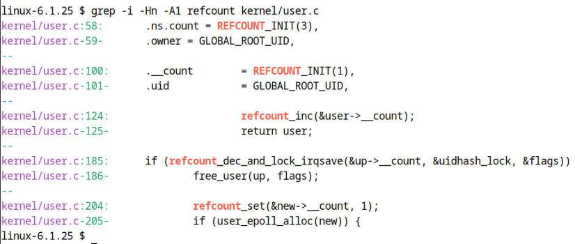

Hình 13.1: Ảnh chụp usage interface refcount\_t trong kernel/user.c

Xem tài liệu kernel chính thức API interface `refcount_t` tại: `https://www.kernel.org/doc/html/latest/driver-api/basics.html#reference-counting`. Để biết, function `refcount_dec_and_lock_irqsave()` thấy (Hình 13.1) nhận spinlock làm parameter thứ hai. Nếu decrement reference counter về 0 được, trả true trong khi giữ spinlock (interrupt disabled), nếu không false.

Bài tập

Sửa driver code trước `ch12/2_miscdrv_rdwr_spinlock/miscdrv_rdwr_spinlock.c`; có integer `ga` và `gb`, được spinlock bảo vệ khi read/write. Giờ biến thành variable `refcount` (khởi tạo giá trị chẳng hạn 42), dùng method `refcount_t` thích hợp khi làm. Gồm test case chủ ý làm vượt valid allowed range `([1..INT_MAX-1])`.

Có reference solution trong GitHub repo tại `solutions_to_assgn/ch13`

Cẩn thận! Đừng để giá trị ra ngoài allowed range (mặc định) `[1..INT_MAX-1]`! Nếu có, nghĩa underflow hay overflow, thường kích hoạt kernel-level warning (qua `REFCOUNT_WARN()`, chuyển thành macro `WARN_ONCE()`).

##### Chủ ý gây underflow hay overflow với refcount variable

Đôi khi hữu ích phản biện; nếu module (hay kernel) thực sự làm variable `refcount_t` vượt range? Như nói khiến kernel tạo one-time warning ồn ào vào kernel log. Nhưng tất nhiên hãy thực nghiệm, thử!

Đây là code snippet (từ lời giải bài tập nói trên):

```
…
static refcount_t ga = REFCOUNT_INIT(42);       /* ga will be init to 42 */
static refcount_t gb = REFCOUNT_INIT(42);       /* gb will be init to 42 */
…
static int open_miscdrv_rdwr(struct inode *inode, struct file *filp)
{
…
        /* Tweaked the code here to _deliberately_ cause overflow/underflow
         * refcount bugs (resp) if the #if 1 is changed to #if 0 */
#if 1
        refcount_inc(&ga);
#else
        //refcount_add((int i, atomic_t *v); // adds i to v
        // Here we deliberately overflow it, leading to a warning (once)!
        pr_debug("*** Bad case! About to overflow refcount var! ***\n");
        refcount_add(INT_MAX, &ga);
#endif
...
```

Nếu đổi `#if 1` thành `#if 0`, bug cố ý xuất hiện; rõ ràng overflow reference counter bằng cộng `INT_MAX` với giá trị đang có! Hình dung làm vậy rồi build (debug mode), load và test module.

Đây là ảnh một phần cho thấy one-time warning mà kernel reference counting code xuất:

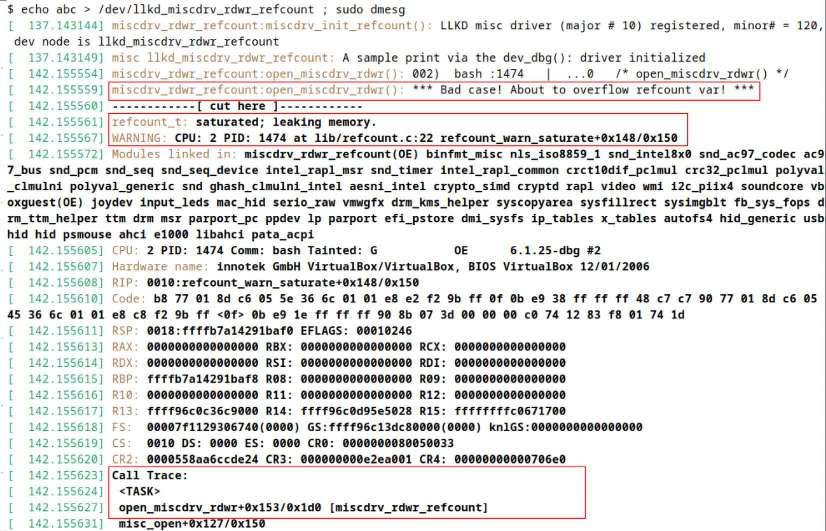

Hình 13.2: Ảnh một phần one-time warning do kernel reference counting code xuất khi overflow counter

Có thể thấy dòng `WARNING: …` làm nổi bật trong Hình 13.2; thấp hơn kernel log thấy tiếp (không trong hình):

```
…
[  142.155685] ---[ end trace 0000000000000000 ]---
[  142.155687] misc llkd_miscdrv_rdwr_refcount:  filename: "llkd_miscdrv_rdwr_
refcount"
                wrt open file: f_flags = 0x8241
                ga = -1073741824(0xc0000000), gb = 41(0x29)
[  142.155690] misc llkd_miscdrv_rdwr_refcount: stats: tx=0, rx=0
```

(Code demo trong Hình 13.2 không bao gồm trong GitHub repository.) Xem giá trị variable `refcount` `ga` giờ; là `0xc0000000`, giá trị `REFCOUNT_SATURATED`, như mong đợi.

Kernel hiện đại có nhiều test infrastructure hữu ích; một là Linux Kernel Dump Test Module (LKDTM); xem `drivers/misc/lkdtm/refcount.c` để học nhiều test case chạy trên interface `refcount`. Để biết, cũng dùng LKDTM qua fault injection framework của kernel để test, đánh giá phản ứng kernel với faulty scenario (xem tài liệu: Provoking crashes with Linux Kernel Dump Test Module (LKDTM) – `https://www.kernel.org/doc/html/latest/fault-injection/provoke-crashes.html#provoking-crashes-with-linux-kernel-dump-test-module-lkdtm`.

Được rồi tiếp. Atomic interface đã đề cập (Bảng 13.1) đều thao tác integer 32-bit; còn 64-bit? Tiếp sau.

### 64-bit atomic integer operator

Như đề cập đầu, tập integer operator `atomic_t` đã thấy đều thao tác integer 32-bit truyền thống (lưu ý không áp dụng interface `refcount_t` mới; chúng thao tác trong suốt cả lượng 32-bit lẫn 64-bit). Hiển nhiên hệ thống 64-bit ngày nay thành thông thường thay ngoại lệ, cộng đồng kernel cung cấp tập atomic integer operator giống hệt cho integer 64-bit. Khác biệt:

- Khai báo 64-bit atomic integer như variable kiểu `atomic64_t` (tức `atomic_long_t`).

- Với mọi operator, thay prefix `atomic_` bằng `atomic64_`.

Vậy xét các ví dụ:

- Thay `ATOMIC_INIT()`, dùng `ATOMIC64_INIT()`.

- Thay `atomic_read()`, dùng `atomic64_read()`.

- Thay `atomic_dec_if_positive()`, dùng `atomic64_dec_if_positive()`.

C và C++ language standard gần đây – C11/C++11 – cung cấp atomic operations library giúp developer triển khai atomicity dễ nhờ hỗ trợ ngôn ngữ ngầm; không đi sâu ở đây. Tham khảo tại (C11 cũng có tương đương gần như vậy): `https://en.cppreference.com/w/c/atomic`.

Lưu ý mọi routine – cả operator `atomic[64]_*` 32-bit và 64-bit – arch-independent. Điểm đáng lặp là mọi operation trên atomic integer phải bằng khai báo variable `atomic[64]_t`, chỉ qua method được cung cấp (gồm initialize và cả read (integer)).

### Ghi chú internal implementation

Về internal implementation, atomic integer operator `foo()` thường là macro thành inline function, rồi gọi arch-specific function `arch_foo()`. (Ví dụ x86 dùng assembly prefix `LOCK` well-known trong internal implementation, còn họ ARM thường dùng cách tổng quát hơn với memory ordering semantic.)

Prefix `LOCK` của x86 không instruction; là prefix cho instruction (ví dụ `lock` `orb %b1,%0`). Bảo đảm core chạy instruction theo sau LOCK sở hữu độc quyền cache line đang thao tác; đồng thời control unit không cho hardware interrupt – vì một machine-level instruction đang thực thi – và có memory ordering guarantee.

Như luôn, xem qua tài liệu kernel chính thức atomic operator luôn tốt (trong kernel source tree tại `Documentation/atomic_t.txt`, hay: `https://www.kernel.org/doc/Documentation/atomic_t.txt`). Phân loại gọn nhiều atomic integer API thành tập riêng. Để biết arch-specific memory ordering issue tác động internal implementation (ghi chú nhanh tiếp sau). Nếu quan tâm, xem trang tài liệu kernel chính thức tại `https://www.kernel.org/doc/html/latest/core-api/refcount-vs-atomic.html#refcount-t-api-compared-to-atomic-t`.

Khá non-intuitively, ít nhất với generic arch-independent refcount implementation, API `refcount_t` bên trong được triển khai trên API set `atomic_t` (cũ). Ví dụ API `refcount_set()` – đặt giá trị variable `refcount` atomically thành parameter truyền – triển khai trong kernel như sau:

```
// include/linux/refcount.h
/**
 * refcount_set - set a refcount's value
 * @r: the refcount
 * @n: value to which the refcount will be set
 */
static inline void refcount_set(refcount_t *r, unsigned int n)
{
    atomic_set(&r->refs, n);
}
```

Thấy chỉ là thin wrapper trên `atomic_set()`. Câu hỏi hiển nhiên: vậy dùng API `refcount` để làm gì? Có vài lý do:

- Khác atomic operator, counter saturate tại giá trị `REFCOUNT_SATURATED` (mặc định `INT_MIN/2`, tức `0xc0000000`), không đổi khi đến đó. Then chốt: tránh counter wrap có thể gây UAF bug kỳ lạ, giả; thậm chí xem là security fix then chốt (`https://kernsec.org/wiki/index.php/Kernel_Protections/refcount_t`).

- Một số API mới hơn có cung cấp các bảo đảm về memory ordering; đặc biệt, các API `refcount_t`, khi so với những API họ hàng `atomic_t` cũ hơn, và các bảo đảm về memory ordering của chúng được mô tả tại `https://www.kernel.org/doc/html/latest/core-api/refcount-vs-atomic.html#refcount-t-api-compared-to-atomic-t`. Hãy xem nếu bạn quan tâm đến các chi tiết low-level.

- Đồng thời hiểu arch-dependent `refcount` implementation (khi tồn tại – ví dụ x86 có, ARM không) có thể khác generic implementation vừa đề cập.

Chính xác memory ordering là gì, ảnh hưởng thế nào? Thực tế chủ đề phức tạp, đáng tiếc chi tiết ngoài phạm vi sách. Đáng biết cơ bản: đề nghị đọc Linux-Kernel Memory Model (LKMM), gồm processor memory ordering và hơn nữa. Tài liệu tốt tại: Explanation of the Linux-Kernel Memory Model (`https://github.com/torvalds/linux/blob/master/tools/memory-model/Documentation/explanation.txt`).

Không cố thể hiện mọi atomic và `refcount` API ở đây (không cần). Sau là tham khảo tài liệu kernel chính thức về `atomic_t` và `refcount_t`; đọc nếu quan tâm:

- Interface `atomic_t`:

  - Semantics and Behavior of Atomic and Bitmask Operations (`https://www.kernel.org/doc/html/v6.1/core-api/local_ops.html`)

  - API ref: Atomics (`https://www.kernel.org/doc/html/latest/driver-api/basics.html#atomics`)

- Interface `refcount_t` (mới hơn, 4.11+) cho kernel object reference counting:

  - So sánh refcount\_t API với atomic\_t (`https://www.kernel.org/doc/html/latest/core-api/refcount-vs-atomic.html#refcount-t-api-compared-to-atomic-t`)

  - API reference: Reference counting (`https://www.kernel.org/doc/html/latest/driver-api/basics.html#reference-counting`)

Sang usage construct điển hình khi làm device driver – Read-Modify-Write (RMW). Đọc tiếp!

## Dùng RMW atomic operator

Cũng có tập atomic operator nâng cao hơn tên RMW API. (Vì sao chính xác tên RMW và hơn nữa giải thích phần sau.) Trong nhiều usage (liệt kê phần tới) là thực hiện atomic RMW bitwise operation (an toàn, không thể chia). Là người viết device driver thao tác device/peripheral register, thực sự rất có thể dùng.

Nội dung giả định ít nhất hiểu cơ bản truy cập peripheral device (chip) memory và register; trình bày chi tiết trong companion volume Linux Kernel Programming – Part 2, Chương 3, Working with Hardware I/O Memory. Khuyên hiểu trước khi tiếp.

Khi làm việc với driver, bạn thường cần thực hiện các bit operation trên register, phổ biến nhất là bitwise `AND &` và bitwise `OR |`. Mục đích là sửa giá trị register bằng cách set hoặc clear một số bit trong nó. Vấn đề là chỉ thực hiện một số thao tác C để query hoặc set device register vẫn chưa đủ. Đúng vậy: đừng quên các vấn đề concurrency! Hãy đọc tiếp để biết đầy đủ câu chuyện.

### RMW atomic operation – thao tác device register

Trước tiên ôn nhanh cơ bản (xin kiềm chế đảo mắt): byte gồm 8 bit, đánh số từ bit `0`, Least Significant Bit (LSB), đến bit `7`, Most Significant Bit (MSB). (Định nghĩa chính thức macro `BITS_PER_BYTE` trong `include/linux/bits.h`, cùng vài định nghĩa thú vị khác.)

Ở đây register chỉ phần memory nhỏ trong peripheral device (hay chip); thường kích thước, register bit width, là 8, 16 hoặc 32 bit. (Ở đây như người viết driver, nói peripheral chip register – không CPU. Tuy nhiên thảo luận áp dụng cả CPU register rộng 64-bit, sẽ chỉ ra.) Device register cung cấp control, status, thông tin khác, thường programmable. Thực tế phần lớn công việc bạn với tư cách người viết driver là lập trình device register thích hợp để device làm gì đó, rồi query.

Để cụ thể, xét device giả định có hai register: status register và control register, mỗi cái rộng 8 bit. (Thực tế mỗi device/chip có (ít nhất nên có) datasheet cung cấp specification chi tiết chip và register-level hardware; thành tài liệu thiết yếu người viết driver.) Người làm hardware thường thiết kế nhiều register gộp sequentially trong phần memory lớn; đôi khi gọi register banking. Có base address register đầu và offset mỗi register tiếp khiến dễ đánh địa chỉ register bất kỳ (không đi chi tiết cách register “map” vào virtual address space trên OS như Linux; là nội dung sách Linux kernel Programming – Part 2). Ví dụ register (hoàn toàn giả định) của device hoàn toàn giả định có thể mô tả trong header file:

```
#define REG_BASE        0x5a00
#define STATUS_REG      (REG_BASE+0x0)
#define CTRL_REG        (REG_BASE+0x1)
```

Giờ giả sử bật tính năng nào trong device giả định, datasheet báo bằng set bit `7` (MSB) control register thành `1`. Như người viết driver nhanh chóng học, có sequence chuẩn để sửa register:

1\. Đọc giá trị register hiện tại vào temporary variable.

2\. Sửa temporary variable thành giá trị mong muốn.

3\. Ghi temporary variable trở lại register.

Thường gọi sequence RMW – Read-Modify-Write. Tốt, viết (pseudo) code như sau:

```
turn_on_feature_x_dev()
{
    u8 tmp;

    tmp = ioread8(CTRL_REG);   /* read: the current register value into tmp */
    tmp |= 0x80;                          /* modify: set bit 7 (MSB) of tmp */
    iowrite8(tmp, CTRL_REG);    /* write: the new tmp value into the register
*/
}
```

(Để biết routine thực tế trên Linux MMIO – memory-mapped I/O – làm I/O là `ioread[8|16|32]()` và `iowrite[8|16|32]().)`

Điểm then chốt: chưa đủ tốt; lý do concurrency và data race! Nghĩ xem register (cả CPU và device) thực tế là global shared writable memory location; nếu code path truy cập chạy concurrently được – thường vậy – tạo critical section phải cẩn thận bảo vệ khỏi concurrent access! Cách làm dễ; chỉ dùng spinlock (ít nhất trước mắt). Sửa pseudo-code trên để chèn API `spin_[un]` `lock()` trong critical section – RMW sequence – rất đơn giản.

Tuy nhiên, có một cách còn tốt hơn để đạt data safety khi làm việc với các đại lượng nhỏ như số nguyên, và chúng ta đã trình bày nó: atomic operator! Nhưng Linux còn đi xa hơn, cung cấp một tập atomic API cho cả hai trường hợp sau:

- Atomic non-RMW operation (đã thấy phần Dùng interface atomic\_t và refcount\_t).

- Atomic RMW operation: Gồm nhiều operator type phân vài lớp riêng: arithmetic, bitwise, swap (exchange), reference counting, miscellaneous và barrier.

Đừng phát minh lại bánh xe; tài liệu kernel (`https://www.kernel.org/doc/html/v6.1/core-api/wrappers/atomic_t.html`) có đủ thông tin. Chỉ thể hiện phần liên quan dưới, trích trực tiếp:

```
[ ... ]
Non-RMW ops:
  atomic_read(), atomic_set()
  atomic_read_acquire(), atomic_set_release()

RMW atomic operations:

Arithmetic:
  atomic_{add,sub,inc,dec}()
  atomic_{add,sub,inc,dec}_return{,_relaxed,_acquire,_release}()
  atomic_fetch_{add,sub,inc,dec}{,_relaxed,_acquire,_release}()
Bitwise:
  atomic_{and,or,xor,andnot}()
  atomic_fetch_{and,or,xor,andnot}{,_relaxed,_acquire,_release}()

Swap:
  atomic_xchg{,_relaxed,_acquire,_release}()
  atomic_cmpxchg{,_relaxed,_acquire,_release}()
  atomic_try_cmpxchg{,_relaxed,_acquire,_release}()

Reference count (but please see refcount_t):
  atomic_add_unless(), atomic_inc_not_zero()
  atomic_sub_and_test(), atomic_dec_and_test()

        Misc:
  atomic_inc_and_test(), atomic_add_negative()
  atomic_dec_unless_positive(), atomic_inc_unless_negative()
[ ... ]
```

Tốt; giờ biết RMW operator (và non-RMW), hãy thực tế xem dùng RMW operator để bit operation an toàn.

#### Dùng RMW bitwise operator

Ở đây tập trung RMW bitwise operator; để bạn khám phá loại khác (tham khảo tài liệu kernel nói trên). Vậy nghĩ lại cách viết pseudo-code example hiệu quả hơn. Có thể set (thành `1`) bit bất kỳ trong register hay memory item bằng API `set_bit()`:

```
void set_bit(unsigned int nr, volatile unsigned long *p);
```

API này atomically, nghĩa an toàn không thể chia, set bit thứ `nr` (nr chỉ viết tắt number) của `p` thành `1`. (Thực tế device register (và có thể device memory) map vào kernel virtual address space nên trông thấy được như RAM location – như địa chỉ `p` ở đây. Gọi MMIO, cách phổ biến người viết driver map và làm device memory. Một lần nữa trình bày (và hơn nữa) trong sách Linux Kernel Programming – Part 2.)

Vì vậy với RMW atomic operator, có thể an toàn, đúng đạt điều thử (sai) trước – bật tính năng device (giả định) – bằng một dòng code:

```
set_bit(7, CTRL_REG);
```

Bảng sau tóm lược RMW bitwise atomic API phổ biến:

| RMW bitwise atomic API | Ghi chú |
|---|---|
| `void set_bit(unsigned int nr,` `volatile unsigned long *p);` | Set (đặt `1`) bit thứ `nr`<sup>th</sup> của `p` atomically |
| `void clear_bit(unsigned int nr,` `volatile unsigned long *p)` | Clear (đặt `0`) bit thứ `nr`<sup>th</sup> của `p` atomically |
| `void change_bit(unsigned int nr,` `volatile unsigned long *p)` | Toggle bit thứ `nr`<sup>th</sup> của `p` atomically |
| Các API sau trả giá trị trước của bit đang thao tác (`nr`) |  |
| `int test_and_set_bit(unsigned int` `nr, volatile unsigned long *p)` | Set bit thứ `nr`<sup>th</sup> của `p` atomically, trả giá trị trước (tài liệu kernel API tại `https://docs.kernel.org/core-api/kernel-api.html?highlight=test_and_set_bit#c.test_and_set_bit`) |
| `int test_and_clear_bit(unsigned int` `nr, volatile unsigned long *p)` | Clear bit thứ `nr`<sup>th</sup> của `p` atomically, trả giá trị trước |
| `int test_and_change_bit(unsigned int` `nr, volatile unsigned long *p)` | Toggle bit thứ `nr`<sup>th</sup> của `p` atomically, trả giá trị trước |

Bảng 13.2: RMW bitwise atomic API phổ biến

Cẩn thận: các atomic API atomic đối với CPU core đang chạy nhưng không với core khác. Thực tế nghĩa nếu thực hiện atomic operation parallel trên nhiều CPU – nghĩa chúng (có thể) race – thì là critical section, phải bảo vệ bằng lock (thường spinlock)!

Thử vài RMW atomic API giúp tự tin dùng; làm trong phần sau.

#### Dùng bitwise atomic operator – ví dụ

Xem nhanh kernel module minh họa usage RMW atomic bit operator của Linux kernel (code `ch13/1_rmw_atomic_bitops`). Nên hiểu operator làm trên mọi memory, cả register (CPU/device) hay RAM. Để đơn giản làm trên loại sau, static global variable đơn giản (tên `mem`) trong example LKM. Rất đơn giản; hãy xem:

```
// ch13/1_rmw_atomic_bitops/rmw_atomic_bitops.c
[ ... ]
#include <linux/spinlock.h>
#include <linux/atomic.h>
#include <linux/bitops.h>
#include "../../convenient.h"
[ ... ]
static unsigned long mem;       // the memory variable we operate upon
static u64 t1, t2;
static int MSB = BITS_PER_BYTE - 1;
DEFINE_SPINLOCK(slock);
```

Include header cần, khai báo và khởi tạo vài global variable (chú ý variable `MSB` dùng macro `BITS_PER_BYTE`). Dùng macro đơn giản `SHOW_MEM()` hiển thị giá trị hiện tại RAM variable đang thao tác `mem`, format qua `printk`. Code path `init` module là nơi làm việc thực tế:

```
[ ... ]
#define SHOW_MEM(index, msg) do { \
    pr_info("%2d:%27s: mem : %3ld = 0x%02lx\n", index, msg, mem, mem); \
} while (0)
[ ... ]
static int __init atomic_rmw_bitops_init(void)
{
        int i = 1, ret;

        pr_info("%s: inserted\n", OURMODNAME);
        SHOW_MEM(i++, "at init");

        setmsb_optimal(i++);
        setmsb_suboptimal(i++);

        clear_bit(MSB, &mem);
        SHOW_MEM(i++, "clear_bit(7,&mem)");

        change_bit(MSB, &mem);
        SHOW_MEM(i++, "change_bit(7,&mem)");

        ret = test_and_set_bit(0, &mem);
        SHOW_MEM(i++, "test_and_set_bit(0,&mem)");
        pr_info("       ret = %d\n", ret);

        ret = test_and_clear_bit(0, &mem);
        SHOW_MEM(i++, "test_and_clear_bit(0,&mem)");
        pr_info("       ret (prev value of bit 0) = %d\n", ret);

        ret = test_and_change_bit(1, &mem);
        SHOW_MEM(i++, "test_and_change_bit(1,&mem)");
        pr_info("       ret (prev value of bit 1) = %d\n", ret);

        pr_info("%2d: test_bit(%d-0,&mem):\n", i, MSB);
        for (i = MSB; i >= 0; i--)
                pr_info("  bit %d (0x%02lx) : %s\n", i, BIT(i), test_bit(i,
&mem)?"set":"cleared");

        return 0;               /* success */
       }
```

Ngoài macro `SHOW_MEM()`, RMW atomic operator dùng ở đây làm nổi bật đậm. Phần then chốt demo là cho thấy dùng RMW bitwise atomic operator không chỉ dễ hơn mà nhanh hơn nhiều cách truyền thống (thủ công RMW operation trong bảo vệ spinlock). Đây là hai function cho cả hai cách:

```
/* Set the MSB: optimally, via the set_bit() RMW atomic API */
static inline void setmsb_optimal(int i)
{
    t1 = ktime_get_real_ns();
    set_bit(MSB, &mem);
    t2 = ktime_get_real_ns();
    SHOW_MEM(i, mem, "optimal: via set_bit(7,&mem)");
    SHOW_DELTA(t2, t1);
}
/* Set the MSB: the traditional way, using a spinlock to protect
 *  the RMW critical section  */
static inline void setmsb_suboptimal(int i)
{
    u8 tmp;

    t1 = ktime_get_real_ns();
    spin_lock(&slock);
    /* critical section begins: RMW : read, modify, write */
    tmp = mem;
    tmp |= 0x80; // 0x80 = 1000 0000 binary
    mem = tmp;
    /* critical section ends */
    spin_unlock(&slock);
    t2 = ktime_get_real_ns();

    SHOW_MEM(i, mem, "set msb suboptimal: 7,&mem");
    SHOW_DELTA(t2, t1);
}
```

Gọi các function sớm trong method `init` module; chú ý lấy timestamp (qua routine `ktime_get_real_ns()`), tính và hiển thị thời gian qua macro `SHOW_DELTA()` (định nghĩa header `convenient.h`; xem: `https://github.com/PacktPublishing/Linux-Kernel-Programming_2E/blob/main/convenient.h`).

Đây output (lần tôi chạy; tất nhiên thời gian có thể khác):

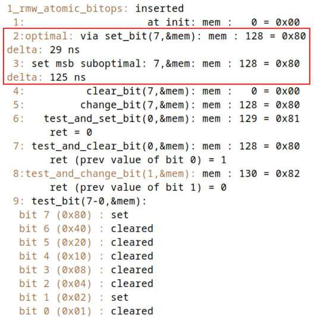

Hình 13.3: Ảnh output LKM ch13/1\_rmw\_atomic\_bitops trên x86\_64 VM, cho thấy vài atomic RMW operator hoạt động (timestamp dmesg được lọc bỏ)

Tôi chạy demo LKM trên:

- Ubuntu 23.04 VM x86\_64 chạy custom kernel 6.1.25; kết quả:

  - Qua API hiện đại `set_bit()`: 29 nanosecond

  - Qua cách truyền thống: 125 ns (chậm hơn hơn 4 lần!)

- Board Raspberry Pi 4 AArch64 chạy custom kernel 6.1.25; kết quả:

  - Qua API hiện đại `set_bit()`: 240 nanosecond

  - Qua cách truyền thống: 908 ns (chậm hơn hơn 3,7 lần!)

Rõ ràng cách hiện đại – qua RMW atomic bitwise API `set_bit()` – so với RMW “thủ công” cũ dùng spinlock bảo vệ, nhanh và dễ hơn nhiều.

Công viết code qua một lời gọi `set_bit()` thay vì lấy spinlock, làm từng bước (RMW sequence), release spinlock cũng đơn giản hơn nhiều. Bước 4 đến 9 (Hình 13.3) cho thấy nhiều bit operation điển hình thực hiện trên memory variable (cùng kết quả), qua RMW bitwise atomic operator mạnh, thực sự easy-to-use.

#### Tìm bitmask hiệu quả

Liên quan phần nào atomic bitwise operator, phần này xem rất ngắn API hiệu quả cao trong kernel để tìm bitmask – hóa ra operation khá phổ biến trong kernel.

Nhiều thuật toán phụ thuộc tìm bitmask thật nhanh; nhiều scheduling algorithm (như `SCHED_FIFO` và `SCHED_RR`, đã học Chương 10, The CPU Scheduler – Part 1, và Chương 11, The CPU Scheduler – Part 2) thường cần bên trong. Triển khai hiệu quả trở nên quan trọng (đặc biệt OS-level code path rất performance-sensitive). Vì vậy như danh sách sau, kernel cung cấp vài API quét bitmask cho trước (prototype trong header `include/linux/find.h`):

- `unsigned long find_first_bit(const unsigned long *addr, unsigned long size)`: Tìm bit set đầu trong memory region, trả bit number của bit set đầu; nếu không (không bit nào set), trả `@size`.

- `unsigned long find_first_zero_bit(const unsigned long *addr, unsigned long size)`: Tìm bit cleared đầu trong memory region, trả bit number của bit cleared đầu; nếu không (không bit nào cleared), trả `@size`.

- Routine khác gồm `find_next_bit()`, `find_next_and_bit()`, `find_last_bit()` và nhiều routine khác. Đồng thời xem header thấy macro khá thú vị khác như `for_each_{clear,set}_bit{_from}()`.

Đến đây xong RMW atomic operator, chuyển synchronization technology thú vị khác (có ưu/nhược): reader-writer spinlock.

## Dùng reader-writer spinlock

Hình dung kernel code (hay driver code) tìm kiếm global data structure lớn – chẳng hạn doubly linked circular list vài nghìn node trở lên. Vì data structure global (shared và writable), truy cập concurrently tạo critical section cần bảo vệ.

Giả định tìm list là non-blocking operation, thường dùng spinlock bảo vệ critical section.

Một cách tiếp cận đơn giản có thể đề xuất không sử dụng lock vì chúng ta chỉ đọc data trong list, không cập nhật nó. Nhưng dĩ nhiên, ngay cả việc đọc shared writable data cũng phải được bảo vệ để tránh một thao tác ghi vô ý diễn ra đồng thời và dẫn đến dirty read hoặc torn read, như bạn đã học; hãy xem lại chương trước nếu cần.

Vậy kết luận cần spinlock; hình dung pseudo-code như:

```
spin_lock(mylist_lock);
for (p = &listhead; (p = next_node(p)) != &listhead; ) {
    << ... search for something ...
         found? break out ... >>
}
spin_unlock(mylist_lock);
```

Vậy vấn đề? Tất nhiên hiệu năng! Hình dung nhiều thread trên multicore system đến code fragment ít nhiều cùng lúc; mỗi thread thử lấy spinlock nhưng chỉ một winner có, duyệt một phần list rồi unlock, cho thread kế tiếp đi. Nói cách khác như mong đợi, execution giờ serialized, rất có thể chậm đi đáng kể. Nhưng có thể nói không tránh được – hay có?

reader-writer spinlock xuất hiện. Với locking construct này, mọi thread read protected data object phải yêu cầu read lock (shared), còn thread cần write access phải yêu cầu exclusive write lock. Read lock được cấp ngay cho thread hỏi miễn không có write lock hiện dùng. Thực chất construct cho mọi reader concurrent access data, nghĩa thực chất không locking thực sự. Ổn miễn chỉ reader. Ngay khi writer thread đến sẽ yêu cầu write lock. Giờ ngữ nghĩa locking thường áp dụng: writer phải chờ mọi reader unlock. Khi đó writer có exclusive write lock, tiếp tục. Giờ reader hay writer nào thử access đều buộc chờ, spin trên unlock của writer.

Vì vậy, trong những tình huống mà kiểu truy cập data có thao tác đọc rất thường xuyên và thao tác ghi hiếm, tức read-mostly, đồng thời non-blocking critical section khá dài, reader-writer spinlock có vẻ là lựa chọn phù hợp. Tuy nhiên, vẫn có một số nhược điểm; chúng cụ thể là gì và lựa chọn thay thế nào sẽ được xem xét trong phần sau.

### Reader-writer spinlock interface

Đã dùng spinlock thì reader-writer variant đơn giản; lock data type trừu tượng bằng structure `rwlock_t` (thay `spinlock_t`), về tên API chỉ thay `spin` bằng `read` hoặc `write`:

```
#include <linux/rwlock.h>
rwlock_t mylist_lock;
```

API cơ bản nhất reader-writer spinlock:

```
void read_lock(rwlock_t *lock);
void write_lock(rwlock_t *lock);
```

Ví dụ layer `tty` của kernel có code xử lý Secure Attention Key (SAK). SAK là security feature, cách ngăn credentials hack Trojan horse-type; hoạt động bằng kết thúc mọi process gắn với TTY device khi user nhấn SAK (`https://www.kernel.org/doc/html/latest/security/sak.html`).

Khi xảy ra (user nhấn SAK, mặc định map qua tính năng so-called magic SysRq của kernel đến tổ hợp `Alt-SysRq-k`), trong code path, SAK code duyệt mọi task, kết thúc toàn session và thread đang mở TTY device. Để làm phải lấy ở read mode reader-writer spinlock dành duyệt task list tên `tasklist_lock`. Code liên quan (cắt bớt) dưới, làm nổi bật `read_[un]lock()` trên `tasklist_lock`:

```
// drivers/tty/tty_io.c
void __do_SAK(struct tty_struct *tty)
{
    [...]
    read_lock(&tasklist_lock);
    /* Kill the entire session */
    do_each_pid_task(session, PIDTYPE_SID, p) {
        tty_notice(tty, "SAK: killed process %d (%s): by session\n", task_pid_
nr(p), p->comm);
        group_send_sig_info(SIGKILL, SEND_SIG_PRIV, p, PIDTYPE_SID);
    } while_each_pid_task(session, PIDTYPE_SID, p);
    [...]
    /* Now kill any processes that happen to have the tty open */
    do_each_thread(g, p) {
        [...]
    } while_each_thread(g, p);
    read_unlock(&tasklist_lock);
```

### Thử reader-writer spinlock

Trong Chương 6, Kernel Internals Essentials – Processes and Threads, phần Duyệt task list kernel, đề cập module đơn giản trong codebase – `ch6/list_demo` – làm vài operation rất đơn giản trên linked list (tận dụng routine header `list.h` kernel). Tuy nhiên demo giữ đơn giản nên không dùng kernel synchronization construct nào. Tất nhiên hoàn toàn sai; chắc chắn cần bảo vệ critical section khỏi concurrent access (ngăn data race)! Vậy giờ có reader-writer spinlock (cơ bản), hãy bảo vệ.

Code tại `ch13/2_list_demo_rdwrlock`. Code-wise ngoài usage reader-writer spinlock thực tế, còn đổi khá đáng kể: dùng code `misc` device driver từ companion volume Linux Kernel Programming – Part 2 làm dạng wrapper trên list demo (ở đây dùng cách build nhiều source file: code `misc` driver trong `ch13/2_list_demo_rdwrlock/miscdrv_wrapper.c`, công việc list thực tế trong `ch13/2_list_demo_rdwrlock/list_demo_rdwrlock.c`).

Có thể hỏi sao gói demo module `rwlock` trong `misc` driver? Khá hữu ích; nhờ vậy làm I/O – read/write – trên device node (do đó list!) bất cứ lúc muốn. Nếu không chỉ thao tác list trong method `init/cleanup` module qua utility `insmod/rmmod` thường. Theo cách này tùy ý read, nơi code duyệt list, và write, chèn vài node cuối list (dùng wrapper Bash script đơn giản tên `run` làm chính điều này).

Code-wise đây phần liên quan list manipulation (`ch13/2_list_demo_rdwrlock/list_demo_rdwrlock.c`):

```
[ … ]
int add2tail(int v1, int v2, s8 achar, rwlock_t *rwlock)
{
    struct node *mynode = NULL;
    u64 t1, t2;

    mynode = kzalloc(sizeof(struct node), GFP_KERNEL);
    if (!mynode)
        return -ENOMEM;
    mynode->ival1 = v1;
    mynode->ival2 = v2;
    mynode->letter = achar;

    INIT_LIST_HEAD(&mynode->list);

    /*--- Update (write) to the data structure in qs; we need to protect
     * against concurrency, so we use the write (spin)lock passed to us
     */
    pr_info("list update: using [reader-]writer spinlock\n");
    t1 = ktime_get_real_ns();
    write_lock(rwlock);
    t2 = ktime_get_real_ns();
    // void list_add_tail(struct list_head *new, struct list_head *head)
    list_add_tail(&mynode->list, &head_node);
    write_unlock(rwlock);
    pr_info("Added a node (with letter '%c') to the list...\n", achar);
[ … ]
```

Rõ ràng thêm node cuối list (qua routine `list_add_tail()`) giờ được bảo vệ khỏi concurrent access bằng write-side routine reader-writer spinlock, qua cặp `write_{un}` `lock()`!

Tạm bỏ qua an toàn các lời gọi `ktime_get_real_ns()`; dùng xác định time delta giữa yêu cầu write lock và thực sự có. Vì sao? Như sớm thấy reader-writer spinlock thường có vấn đề writer starvation khi nhiều reader cứ đến. Ở đây thử đo time lag có thể.

Còn đọc list? Đây code liên quan (`ch13/2_list_demo_rdwrlock/list_demo_rdwrlock.c`):

```
void showlist(rwlock_t *rwlock)
{
    struct node *curr;
    u64 t1, t2;

    if (list_empty(&head_node))
        return;
    [ … ]
    t1 = ktime_get_real_ns();
    read_lock(rwlock);
    list_for_each_entry(curr, &head_node, list) {
        pr_info("%9d %9d   %c\n", curr->ival1, curr->ival2, curr->letter);
    }
#if 1
    mdelay(750); // deliberately make the reads slower to demo write
starvation..
#endif
    read_unlock(rwlock);
    t2 = ktime_get_real_ns();
[ … ]
```

Một lần nữa hẳn rõ: giờ dùng read-side routine của reader-writer spinlock qua cặp `read_{un}lock()`! Tất nhiên hiểu khi không writer sẽ cho mọi reader thread chạy concurrently! (Do đó cũng dùng read spinlock khi search operation.) Hãy build module, thử.

Bên lề, có thể nhớ trong phần Duyệt task list kernel của Chương 6, Kernel Internals Essentials – Processes and Threads, đã làm khá giống: viết kernel module (`ch6/foreach/thrd_show_all`) duyệt mọi thread trong task list, xuất vài chi tiết mỗi thread. Giờ hiểu concurrency, chẳng phải nên lấy `tasklist_lock`, reader-writer spinlock bảo vệ task list khỏi concurrent access? Có thử nhưng không được (`insmod` thất bại với message `thrd_showall: Unknown symbol tasklist_lock ...`). Lý do tất nhiên variable `tasklist_lock` không export, module không dùng được. Vậy chính xác bảo vệ critical section ở đó thế nào?

Trong trường hợp này đáp án “đúng”: dùng Read-Copy-Update (RCU) mechanism “lock-free” rất mạnh, hiệu năng cao! (Trình bày RCU phần tới.)

Ví dụ khác usage reader-writer spinlock trong kernel codebase, filesystem `ext4` dùng khi làm extent status tree. Không đi chi tiết; chỉ đề cập reader-writer spinlock (trong structure `inode`, `inode->i_es_lock`) dùng khá nhiều bảo vệ extent status tree khỏi data race (`fs/ext4/extents_status.c`).

Như spinlock thường có vài variation điển hình reader-writer spinlock API: `{read,write}_lock_irq{save}()` cặp `{read,write}_unlock_irq{restore}` `()`, cùng interface `{read,write}_{un}lock_bh()`; theo ngữ nghĩa tương tự, mong đợi như spinlock routine tương ứng. Lưu ý – như API `spin_lock_irq*()` thường – ngay cả read IRQ lock disable hardware interrupt và kernel preemption trên local core.

### Vấn đề hiệu năng reader-writer spinlock

Thực sự có vấn đề hiệu năng nghiêm trọng với reader-writer spinlock. Một vấn đề điển hình đáng tiếc writer có thể starve khi block chờ nhiều reader. Nghĩ xem: giả định chẳng hạn ba reader thread hiện giữ (đã acquire) reader-writer spinlock. Giờ writer đến muốn lock. Tất nhiên phải chờ cả ba reader unlock. Nhưng nếu trong lúc đó thêm reader đến (hoàn toàn có thể)? Thành thảm họa writer, giờ chờ lâu hơn – thực chất rất dễ starve. (Có thể cần instrument/profile kỹ code path hoặc dùng kernel locking statistics (phần tới) để xác định thực sự đúng vậy không.)

Không chỉ vậy cache effect – còn gọi false sharing hay cache ping-pong – có thể và thực sự xảy ra khá thường khi nhiều reader thread trên CPU core khác đọc cùng shared state parallel (khi giữ reader-writer spinlock); thực tế thảo luận phần Tìm hiểu cơ bản CPU caching, cache effect và false sharing sắp tới). Tài liệu kernel chính thức spinlock (`https://www.kernel.org/doc/Documentation/locking/spinlocks.txt`) nói gần như vậy. Trích trực tiếp: “LƯU Ý! reader-writer lock cần nhiều atomic memory operation hơn spinlock đơn giản. Trừ khi reader critical section dài, tốt hơn chỉ dùng spinlock.” Thực tế cộng đồng kernel đang cố loại reader-writer spinlock tối đa, chuyển lock-free technique tốt hơn (như RCU, advanced lock-free technology). Vì vậy dùng reader-writer spinlock vô cớ không được khuyên.

Tài liệu kernel gọn, súc tích về spinlock usage (do chính Linus Torvalds viết), rất đáng đọc, tại: `https://www.kernel.org/doc/Documentation/locking/spinlocks.txt`.

### reader-writer semaphore

Trước đó, chúng ta đã đề cập đến semaphore object và đối chiếu nó với mutex trong Chương 12, Kernel Synchronization – Part 1, phần Semaphore và mutex. Ở đó, bạn đã hiểu rằng lựa chọn nên ưu tiên đơn giản là sử dụng mutex.

Ở đây chỉ ra trong kernel cũng như reader-writer spinlock có reader-writer semaphore. Use case và ngữ nghĩa giống reader-writer spinlock. Macro/API liên quan (trong `<linux/rwsem.h>`) là `{down,up}_{read,write}_{trylock,killable}()`. Ví dụ phổ biến trong structure `struct mm_struct` (bản thân được trỏ từ task structure), một member là reader-writer semaphore: `struct rw_semaphore mmap_lock` (`https://elixir.bootlin.com/linux/v6.1.25/source/include/linux/mm_types.h#L580`).

Hoàn tất thảo luận, chỉ đề cập vài synchronization mechanism liên quan khác trong kernel. Mechanism dùng nhiều trong user-space application development (đặc biệt nghĩ Pthreads framework Linux user space) là Condition Variable (CV). Tóm lược cho hai hay nhiều thread synchronize với nhau dựa giá trị data item hoặc state cụ thể. Tương đương trong Linux kernel gọi completion mechanism. Chi tiết usage trong tài liệu kernel: `https://www.kernel.org/doc/html/latest/scheduler/completion.html#completions-wait-for-completion-barrier-apis`.

Tiếp theo là sequence lock, được sử dụng trong các tình huống write-mostly, trái với các lock reader-write spinlock/semaphore phù hợp với read-mostly. Đây là những nơi số lần ghi vượt xa số lần đọc trên các biến được bảo vệ. Như bạn có thể hình dung, điều này không quá phổ biến; một ví dụ tốt về sử dụng sequence lock là cập nhật biến global `jiffies_64`.

Giá trị gọi so-called `jiifies` chuyển thành function `get_jiffies_64()`, trên hệ thống 32-bit đọc lượng global data `jiffies_64` 64-bit dưới sequence lock bảo vệ (không dirty read). (Nói hơi đơn giản) global `jiffies_64` được cập nhật – ghi – mỗi timer interrupt. Ai tò mò, update code global `jiffies_64` bắt đầu tại `kernel/time/tick-sched.c:tick_do_update_jiffies64()`. Function xác định có cần update jiffies, nếu có gọi `do_timer(++ticks);` cập nhật thực tế. Suốt đó API `write_seq[un]` `lock(&jiffies_lock);` bảo vệ write-mostly critical section.

Tốt; xong reader-writer spinlock, chuyển chủ đề thú vị khác CPU caching và cache effect có thể ảnh hưởng nghiêm trọng hiệu năng code.

## Tìm hiểu cơ bản CPU caching, cache effect và false sharing

Processor hiện đại trên multicore symmetric multi-processing (SMP) system dùng nhiều mức parallel cache memory bên trong để tăng tốc rất đáng kể khi làm memory (đề cập ngắn Chương 8, Kernel Memory Allocation for Module Authors – Part 1, phần Cấp phát slab memory). Để biết computer architecture kiểu này thường phân loại Multiple Instruction, Single Data (MISD) stream (vì instruction chạy concurrently nhiều core khi làm cùng shared data item).

Đây sơ đồ hoàn toàn khái niệm (Hình 13.4), hai CPU core, mỗi core có hai internal cache (Level 1, Level 2, viết L1/L2), thêm shared/unified L3 cache và main memory (RAM):

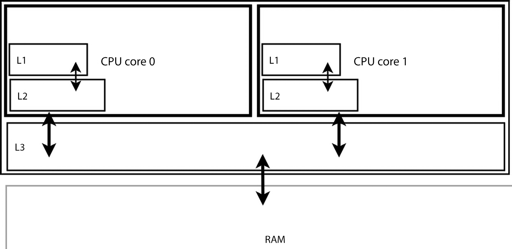

Hình 13.4: Sơ đồ khái niệm – 2 CPU core với internal L1/L2 cache, shared (unified) L3 cache và RAM

Chú ý mỗi CPU core có internal cache riêng. Mở rộng usage trong nội dung tiếp.

### Giới thiệu CPU cache

Phải hiểu CPU hiện đại không read/write (load/store) RAM content trực tiếp; không, khi software chỉ định đọc byte RAM từ địa chỉ nào, CPU atomically một lần đọc nhiều byte – cả cacheline byte từ starting address chỉ định vào mọi CPU cache (chẳng hạn L1, L2, L3). Processor cacheline size điển hình 64 byte (chú ý kỹ byte không bit).

FAQ: Chính xác cacheline size của CPU tôi là bao nhiêu?

Trả lời: Nhiều utility cho thấy; cách đơn giản Linux là `getconf`; thử `getconf -a |grep "CACHE_LINESIZE"` trên hệ thống (và grep `CACHE_SIZE` để thấy CPU cache size theo byte. Lưu ý có thể không hoạt động trên guest system). Cũng nhớ Chương 7, Memory Management Internals – Essentials, đề cập dùng GUI utility lstopo xem CPU và memory topography.

Nghĩ xem: giả sử có code scenario:

```
char myarr[264], x; int i;
[ ... ]
for (i=0; i < 264; i++)
    x = myarr[i];
```

Cách nghĩ ngây thơ là duyệt lần lượt từng byte array; thực tế tinh vi hơn! Ngay lúc thử access byte đầu `myarr[0]`, CPU firmware (thiếu thuật ngữ tốt hơn; có lẽ microcode cũng được) tìm lần lượt CPU cache L1/L2/L3; nếu có, cache hit, giá trị được xử lý.

Giả sử array được process (hay thread) access lần đầu, nên không ở CPU cache nào. Do đó cache miss; processor phát bus transaction: qua bus tới memory controller fetch byte từ RAM. Chờ đã! Processor thực ra đọc (fetch) cả cacheline byte rồi ghi vào mọi CPU cache! Vì vậy giả định CPU cacheline size 64 byte, khi access `myarr[0]` lần đầu, byte 0 đến 63 của `myarr[]` được fetch từ RAM rồi lưu trong (mọi) CPU cache (Hình 13.5).

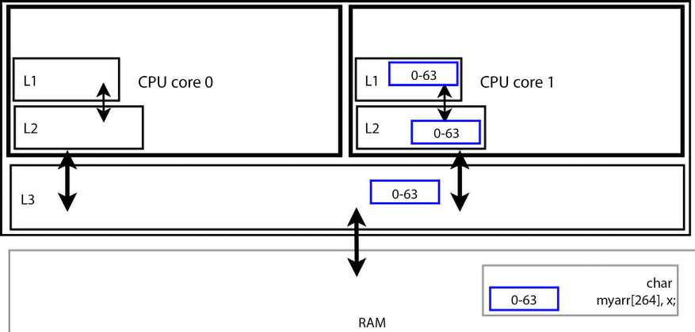

Hình 13.5: Sơ đồ khái niệm – thread trên CPU core 1 đọc myarr\[0\] lần đầu; processor fetch toàn data cacheline bao quanh (thường 64 byte, myarr\[0\] đến myarr\[63\], chỉ thể hiện 0-63) vào shared L3 cache và L2/L1 cache của core 1

Lợi ích là gì? Điều này khá rõ: truy cập những phần tử tiếp theo trong vùng memory liên tục, đến tận byte 63, mang lại mức tăng tốc rất lớn vì trước tiên các cache được kiểm tra, lần lượt L1, L2 rồi L3, nên khả năng cache hit cao hơn.

Lý do nhanh hơn (nhiều) đơn giản: access CPU cache memory thường một đến vài nanosecond (single-digit) (L1 nhanh nhất, nhỏ nhất; Lowest Level Cache (LLC), ở đây L3, chậm nhất và lớn nhất (tương đối)). Access RAM khoảng 50 đến 100 nanosecond (tất nhiên số chính xác phụ thuộc hardware system và số tiền sẵn chi!). Đó tất nhiên toàn mục đích cache: memory gốc được cache chậm hơn cache rất nhiều (nghĩ web browser cache web page).

Hơn nữa caching tận dụng nguyên tắc locality of reference:

- Spatial locality of reference (không gian): Software có thể access memory theo thứ tự (sequentially).

- Temporal locality of reference (thời gian): Software có thể access memory vừa access gần đây.

Thực tế người làm software tận dụng caching (và locality of reference) bằng việc như:

- Giữ member quan trọng data structure cùng nhau (hy vọng trong một cacheline), ở đầu structure

- Padding structure member để không “rơi khỏi” cacheline (một lần nữa các điểm trong Chương 8, Kernel Memory Allocation for Module Authors – Part 1, phần Data structure – vài mẹo thiết kế).

### Rủi ro – cache coherency, vấn đề hiệu năng và false sharing

Tuy nhiên có rủi ro, mọi thứ có thể và thực sự sai. Một liên quan cache coherency, kia thường gọi false sharing; các phần sau đi sâu.

#### Vấn đề cache coherency là gì?

Trước hiểu khái niệm then chốt cache coherency. Multicore SMP system có hai CPU core trở lên, mỗi core có private internal cache (và Translation Lookaside Buffer (TLB)). Cache thường theo policy tối ưu read-ahead, write-behind (với main memory, RAM). Nghĩa data tất nhiên đọc vào CPU cache read-ahead (như vừa học, read/write thực sự theo atomic unit cacheline, không byte đơn. Vì vậy read-ahead tối ưu fetch tiếp có thể xảy ra, tận dụng cả spatial và temporal locality of reference, bản thân chỉ nghĩa “memory vừa xử lý có khả năng xử lý lại tương lai gần”, cả không gian (spatial locality) và thời gian (temporal locality)).

Còn write memory? Do cache writeback policy chi phối. Khi data item (variable trong program) sửa (ghi), xử lý trong internal cache local core, không flush đến (unified cache có thể có và) main memory (RAM) đến lúc sau, lại tối ưu hiệu năng; là so-called write-behind policy hoạt động (trái write-through flush ngay).

Lấy ví dụ đơn giản. Multicore SMP system 2 core (như Hình 13.4 khái niệm). Giả sử global integer N trong RAM giá trị 55. Giờ lúc t0.1 (Bảng 13.3), thread trên core #0 muốn sửa giá trị – chẳng hạn 41; giờ hiểu hoạt động bên trong. Giả định CPU cache như Hình 13.4 (L1, L2, shared L3), giá trị N (55) trước đọc RAM (qua bus) vào L3 cache (t0.2), rồi local internal cache (L1/L2) core 0 (t0.3).

Rồi (t1.1) sửa ở đó – không L3 hay RAM – thành 41.

Nhưng giờ nếu (t2.1) thread trên core 1 cũng muốn làm cùng data (nhớ shared memory system theo SMP và MISD semantic); muốn increment thêm 1 (hiểu critical section. Giả định dùng synchronization primitive để an toàn; không phải nội dung thảo luận ở đây).

Vấn đề giờ rõ: phải đọc giá trị N hiện tại, cộng 1. Nhưng nếu đọc từ RAM (55), stale; giá trị “mới nhất” không 55, là 41 trong internal cache core 0! Vậy thấy có thể data inconsistency khi cùng data item shared giữa các mức system memory hierarchy (ở đây nhiều core, local L1/L2 cache, unified L3 cache, RAM), sửa trong một cache. Là trái tim cache coherency problem. Giữ mọi bản sao data object sync (nhất quán) với main memory là yêu cầu computing đúng; khả năng giữ processor cache và RAM sync gọi cache coherence.

Duy trì CPU cache coherency là một quá trình power-hungry nhất (nghĩa ảnh hưởng đáng kể hệ thống battery-backed và cả hệ thống khác).

Timeline dọc cho thấy data value example variable N lan qua memory hierarchy trong Bảng 13.3:

| State | Thời điểm/ giá trị N trong: | CPU core 0 L1, L2 | CPU core 1 L1, L2 | Unified L3 cache | RAM |
|---|---|---|---|---|---|
| State ban đầu (N); core 0 đọc N (giá trị 55) | t0.1 | \- | \- | \- | 55 |
|  | t0.2 | \- | \- | 55 | 55 |
|  | t0.3 | 55, 55 | \- | 55 | 55 |
| Core 0: đặt N thành 41 | t1.1 | 41, 41 | \- | 55 | 55 |
|  | t1.2 | 41, 41 | \- | 41 | 55 |
|  | t1.3 | 41, 41 | \- | 41 | 41 |
| Core 1: N ++; | t2.1 | 41, 41 | 41, 41 | 41 | 41 |
|  | t2.2 | 41, 41 | 42, 42 | 41 | 41 |
|  | t2.3 | 41, 41 | 42, 42 | 42 | 41 |
|  | t2.4 | 41, 41 | 42, 42 | 42 | 42 |
| Cập nhật L1/L2 core 0 | t3 | 42, 42 | 42, 42 | 42 | 42 |

Bảng 13.3: Timeline dọc cho thấy data value lan qua memory hierarchy ngay cả operation đơn giản do cần cache coherence

Mô tả step-by-step nhiều transaction trong Bảng 13.3 dưới:

1\. Thời điểm t0.1: Sync (N=55):

  - t0.2: Thread core 0 đọc N từ RAM – thiết lập L3 cache entry.

  - t0.3: Thiết lập L1/L2 cache entry (55 giờ trong mọi internal cache core và L3).

2\. Thời điểm t1.1: Thread core 0 sửa N từ 55 thành 41; ban đầu chỉ internal cache core 0 phản ánh thay đổi. 3. Thời điểm t2: Thread core 1 thực hiện N ++ (an toàn). 4. Giờ cần giá trị N cập nhật. 5. Processor (qua hardware cache coherence protocol) phát hiện cache/RAM không sync; để sync làm:

  - t1.2: Invalidate và flush cache core 0 vào L3.

  - t1.3: Invalidate và flush cache core 0 vào RAM (Cache invalidation ngụ ý đánh dấu cache memory/line invalid để read sau từ memory gốc, thứ đang được cache (thường RAM).)

6\. Giờ RAM và cache sync, tiếp công việc core 1; nên công việc và quá trình cache coherency lặp ở đó:

  - t2.1: Đọc N từ RAM vào internal cache core 1.

  - t2.2: Increment N; internal cache core 1 cập nhật 41 thành 42.

  - t2.3: Flush giá trị cập nhật (42) vào shared L3 cache.

  - t2.4: Flush (N=42) vào RAM.

7\. Trên cache core 1, stale value giờ cập nhật (từ giá trị mới cập nhật trong RAM), xử lý rồi flush lại phản ánh thực tế mới. 8. t3: Phát hiện internal cache core 0 không sync, cập nhật. 9. Giờ giá trị mới đặt, mọi CPU cache coherent với nhau và RAM!

Độc giả tinh ý giờ bắt đầu thấy cache coherence handling rất hay nhưng performance-wise (và power-wise) có thể rất tốn! Thực sự thấy ngay cả memory transaction đơn giản (read/write, load/store) trên SMP thường cần nhiều sequence write-invalidate và/hoặc flush chỉ để giữ mọi thứ sync.

Cache behavior này, write từ cache-to-RAM rồi cần cập nhật RAM-to-cache tương ứng trên core khác, thường gọi “cache bouncing” hay cache “ping-pong”! (Hình 13.7 sắp thấy cho biết vấn đề tệ hơn trên multicore SMP system nhiều core.) Thực sự không tốt hiệu năng/điện năng, chính là điểm truyền đạt. (Đừng lo phần false sharing tiếp đi chi tiết hơn.)

Bên lề thú vị, chính xác hệ thống xử lý cache coherence problem thế nào? Cách điển hình dùng hardware-based cache coherence protocol; có nhiều (snooping hay bus-watching protocol tên MESI, MOESI, Illinois, v.v., rồi so-called directory-based protocol). Chỉ cần nói rất arch-dependant, AMD64/x86\_64 hiện đại và phần lớn ARM processor thường dùng hardware protocol MOESI snooping-based. (Chữ viết tắt các cache state cacheline có thể ở, MOESI là Modified Owned Exclusive Shared Invalid. Protocol về cơ bản phát hiện shared copy trên cache khác qua shared internal bus. Để biết ARM Cortex-A9 dùng MESI.) Một số processor dùng software coherence scheme (thường triển khai sâu trong OS) giữ cache coherent (như MIPS); một số kết hợp hardware/software. Không đi sâu hơn; xem liên kết Đọc thêm.

#### Vấn đề false sharing

Cache coherence mechanism có vẻ ít nhất phần nào tốt, giữ memory sync giữa processor core, cache và RAM. Tuy nhiên có thể có trường hợp xấu về hiệu năng/power-wise. Để hiểu vấn đề, xét hai variable khai báo:

```
u16 ax = 1, bx = 2;
```

(trong đó `u16` chỉ unsigned 16-bit integer value).

Vì các biến được khai báo cạnh nhau, rất có thể compiler sẽ đặt chúng trong cùng một CPU cacheline ở runtime. Tổng kích thước của chúng chỉ là 32 bit, hay 4 byte; hãy nhớ rằng kích thước CPU cacheline điển hình là 64 byte.

Vậy thì sao? Để hiểu vấn đề, chúng ta hãy xét một tình huống runtime phổ biến: một lần nữa, xét multicore system có hai CPU core, mỗi core có hai CPU internal cache L1 và L2, cùng một unified L3 cache và RAM, như trong Hình 13.4.

Giờ hình dung core `0` có thread T1 làm variable `ax`, parallel trên core `1` thread T2 khác làm `bx`. Lưu ý kỹ: không data race, vì mỗi thread làm variable khác, memory item khác; nên không critical section, không cần synchronization.

Giờ khi T1 chạy core `0` access (read/load) `ax` từ main memory (RAM), CPU-local cache L1/L2 (và L3) được điền giá trị hiện tại của cả `ax` và `bx`, vì cả hai cùng cacheline!

Tương tự concurrently khi T2 core 1 access (read/load) `bx` từ RAM, CPU-local cache cũng điền giá trị hiện tại cả hai variable. Hình 13.6 thể hiện khái niệm:

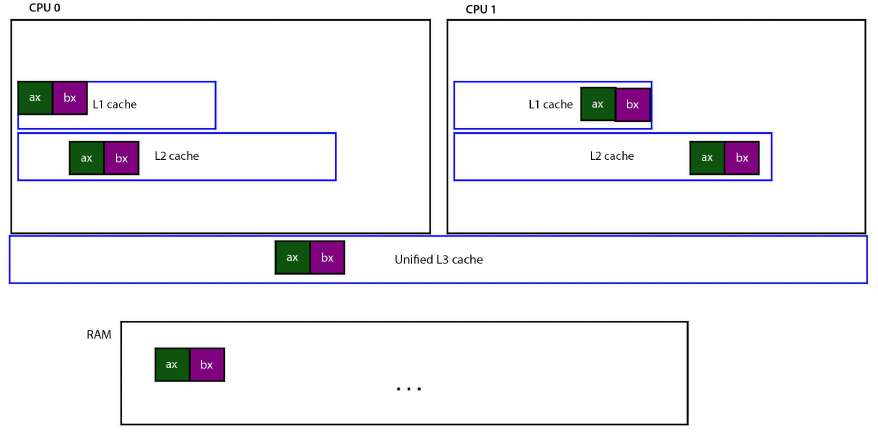

Hình 13.6: Mô tả khái niệm CPU cache memory khi T1/T2 làm parallel trên hai variable liền kề, mỗi thread trên một variable riêng

Đến giờ ổn? Đúng. Nhưng nếu T1 làm operation chẳng hạn `ax ++`, đồng thời T2 làm `bx ++`? Thì sao? (Như nói, thú vị ở đây không cần synchronization (locking), nên không liên quan thảo luận; không data race vì mỗi thread access variable khác. Vấn đề là data item đang xét cùng CPU cacheline.)

Vấn đề nằm ở giữ cache coherent. Processor và/hoặc OS kết hợp processor (tất cả rất arch-dependent) phải giữ cache và RAM synchronized hay coherent với nhau. Vì vậy ngay khi T1 sửa `ax`, cacheline cụ thể CPU 0 phải invalidated, flush CPU cacheline từ cache core 0 đến RAM để cập nhật giá trị mới, rồi ngay lập tức cập nhật từ RAM đến cache core 1 để giữ coherent!

Nghĩ: tình huống “normal” sẽ không invalidate/flush cache ngay update; phá mục đích chính caching (hiệu năng). Tất nhiên chính là mục đích cache write-behind policy điển hình phần lớn processor hiện đại dùng. Nhưng ở đây shared cacheline bị thao tác concurrently, buộc invalidation+-flush gần như tức thì, gây đau đầu hiệu năng.

Tệ hơn: cacheline cũng chứa `bx`, như nói `bx` cũng được T2 sửa trên core `1`. Vì vậy gần cùng lúc CPU `1` cacheline invalidated và flush RAM với giá trị mới `bx`, sau đó cập nhật cache CPU `0` (suốt đó unified L3 cache cũng read/update).

Như hình dung, mọi update variable tạo rất nhiều traffic qua cache/RAM; thực chất “bounce”. Thực tế thường gọi cache ping-pong! Tác động rất hại hiệu năng, chậm processing đáng kể; hơn nữa nhiều cache coherency work tăng điện năng. Hiện tượng (cũng) gọi false sharing (có lẽ oversharing tốt hơn). Không chỉ vậy xảy ra mỗi update variable bất kỳ trong cacheline liên quan, nên có thể cực tốn.

##### Sửa vấn đề

Nhận diện false sharing khó; phải tìm variable cùng shared cacheline được context khác nhau (thread hay khác) cập nhật đồng thời.

Thú vị, implementation trước của data structure then chốt memory management layer `include/linux/mmzone.h:struct zone` từng bị chính false sharing: hai spinlock variable khai báo cạnh nhau nên thường cùng cacheline! Đã sửa từ lâu (đã thảo luận ngắn memory zone trong Chương 7, Memory Management Internals – Essentials, phần Physical memory).

Đo hiệu năng cẩn thận và so sánh với một baseline “bình thường” có thể giúp phát hiện các trường hợp bất thường, đồng thời giúp bạn nhận ra rằng sự chậm lại là do false sharing.

Technical reviewer rất giỏi Chi Thanh Hoang bổ sung dùng processor feature hay bỏ qua nhưng hữu ích – performance measurement counter (PMC) – để fine-tune cache-miss/flush event chắc chắn giúp thu hẹp vấn đề hiệu năng; dùng tool như perf (và eBPF).

Bạn sửa vấn đề false sharing kiểu này như thế nào? Rất đơn giản: chỉ cần bảo đảm các biến nằm đủ xa nhau để chắc chắn chúng không dùng chung cacheline. Các byte padding giả thường được chèn giữa các biến cho mục đích này. Vì vậy, cách làm sau có thể sẽ ổn trên hệ thống có cacheline 64-byte:

```
u16 ax = 1;
char padding[64];
u16 bx = 2;
```

Compiler không hỗ trợ sao? Tùy; một số khuyên pragma directive (GCC gọi compiler attribute, dạng `__attribute__(foo)`), có thể giúp nhưng chưa có đồng thuận vững chắc. Cũng xem tham khảo false sharing trong Đọc thêm.

Tiếp để thấy còn tệ hơn, xét NUMA system lớn (SMP) có nhiều socket và physical CPU core (có thể threaded) (trình bày NUMA Chương 7, Memory Management Internals – Essentials, phần Tổ chức physical RAM; ví dụ Hình 7.22).

Giờ hình dung multithreaded application trên hệ thống; giả sử spawn một thread mỗi CPU core (kỹ thuật khá phổ biến). Ngay mỗi thread chỉ increment global integer atomically trên NUMA system ấy cũng mất hiệu năng rất lớn (lại rất power-hungry). Vì sao? Nghĩ: nếu mọi thread, do đó mọi core, thao tác cùng shared data item, dù access synchronize atomic cẩn thận nên an toàn (có lẽ operator `refcount_t` / `atomic_t`), variable vẫn phải cache trong local cache mỗi core khi làm, tất nhiên phải giữ cache coherence giữa mọi core cùng làm data! Có thể gây traffic khổng lồ hai chiều: cache invalidation/flush đến RAM và update từ RAM đến cache core khác làm data! Thú vị ở đây không phải data safety (mối quan tâm chính lâu nay) mà hiệu năng (điện năng). Trớ trêu càng nhiều socket và core, scale càng kém.

Paul E. McKenney, trong thuyết trình (What is RCU, Prof Paul E. McKenney, 2013; YouTube video (IISc, Bangalore): `https://www.youtube.com/watch?v=obDzjElRj9c&list=PLIlI4QbmdBqH9-L1QOq6O5Yxt-YVjRsFZ`), thể hiện tình huống:


Hình 13.7: Làm shared data trên NUMA system lớn nhiều core, dù bảo đảm data safety, có thể mất hiệu năng lớn (tăng điện năng) do cache coherence/false sharing. Nguồn (c): What is RCU, Prof Paul E. McKenney

Giờ như nói data access có thể atomic nên an toàn, nhưng câu hỏi million-dollar: làm sao thực sự tránh vấn đề hiệu năng (và điện năng)? Lock-free programming technique giúp nhiều, phần tiếp đi chính điều đó.

## Lock-free programming với per-CPU và RCU

Như học khi thao tác shared writable data, critical section phải bảo vệ cách nào đó. Locking có lẽ công nghệ phổ biến nhất. Tuy nhiên không hồng hoàn toàn vì hiệu năng có thể giảm.

Để thấy khá trực giác, xét vài so sánh physical-world về lock:

- Một là phễu, ống phễu – “critical section” – chỉ đủ một thread mỗi lần đi qua, không hơn.

- Khác là trạm thu phí đơn lẻ trên cao tốc rộng bận, hay đèn giao thông ngã tư đông.

So sánh giúp hình dung/hiểu locking gây bottleneck, làm hiệu năng chậm bò trong trường hợp nghiêm trọng. Tệ hơn tác động bất lợi nhân lên trên high-end multicore system (SMP/NUMA) (vài trăm core); thực chất locking scale không tốt. Caching effect – như phần trước cho rõ – thêm rắc rối.

Vấn đề khác lock contention; lock cụ thể acquire thường xuyên thế nào? Tăng số lock trong hệ thống có lợi giảm contention cho lock giữa hai hay nhiều process (thread). Gọi lock proficiency. Tuy nhiên lại không scale đến mức khổng lồ: sau một lúc có hàng nghìn lock (thực tế Linux kernel) không tốt – độ phức tạp vốn có, do đó khả năng deadlock tinh vi tăng đáng kể.

Vậy nhiều thách thức – vấn đề hiệu năng, nguy cơ deadlock/priority inversion, convoying (do lock ordering, fast code path có thể chờ slow path đầu đã lấy lock mà fast path cũng cần), cache effect, v.v. Phát triển kernel scalable mà vẫn hiệu năng buộc dùng lock-free algorithm và implementation trong kernel. Dẫn nhiều kỹ thuật sáng tạo, gồm per-CPU data, lock-free data structure (theo thiết kế), Read-Copy-Update (RCU).

Sách trình bày hai lock-free technology rất then chốt, mạnh và phổ biến: per-CPU data, RCU. Tất nhiên có khác (tham khảo Đọc thêm chương).

### Per-CPU variable

Như tên, per-CPU variable giữ bản sao variable, data item đang xét, một bản mỗi CPU core (live) hệ thống. Nhờ đó thực chất loại khu vực vấn đề concurrency, critical section, bằng tránh shared data giữa thread. Với per-CPU data technique vì mỗi CPU tham chiếu chính bản riêng, thread chạy processor core ấy thao tác không lo race.

(Đại thể tương tự local variable; vì local trên private stack mỗi thread nên không shared giữa thread, không critical section, không cần locking.) Ở đây cũng loại nhu cầu locking – thành lock-free technology!

Hãy nghĩ xem: nếu chạy trên hệ thống có bốn CPU core đang hoạt động, một biến per-CPU về cơ bản là một array gồm bốn phần tử. Phần tử `0` biểu diễn giá trị data trên CPU thứ nhất, phần tử `1` biểu diễn giá trị data trên CPU core thứ hai, v.v.; hãy xem Hình 13.9. Hiểu điều này, bạn sẽ nhận ra các biến per-CPU cũng gần tương tự cách triển khai Thread Local Storage (TLS) của Pthreads trong user-space, nơi mỗi thread khi được tạo tự động nhận một bản sao của tất cả các biến TLS đánh dấu bằng từ khóa `__thread`. Còn nhiều chi tiết hơn; hãy tham khảo Hands-On System Programming with Linux. Trong cả trường hợp đó và trường hợp biến per-CPU ở đây, rõ ràng thường chỉ nên sử dụng các biến per-CPU cho data item nhỏ. Lý do là data item được sao chép thành một instance cho mỗi CPU core; trên hệ thống high-end có vài trăm hoặc thậm chí hàng nghìn core, overhead sẽ tăng. Vì vậy, một lần nữa có trade-off: chúng ta đạt khả năng lock-free với chi phí sử dụng thêm RAM.

Tóm lược, per-CPU variable tốt tăng hiệu năng time-sensitive code path vì:

- Tránh lock tốn kém, performance-busting.

- Access và thao tác per-CPU variable cho trước bảo đảm luôn trên CPU core nhất định; cùng thực tế không bao giờ shared, loại cache effect tốn như cache ping-pong/false sharing (phần Tìm hiểu cơ bản CPU caching, cache effect và false sharing). Cũng giảm điện năng.

Điểm sau đáng được tìm hiểu chi tiết hơn. Như đã thấy trong phần trước, tham khảo Hình 13.7, ngay cả việc tăng một shared integer theo cách atomic bằng nhiều thread trên NUMA system cũng có thể gây tổn thất hiệu năng rất lớn do các hiệu ứng cache.

Như đã nói Paul E. McKenney trong thuyết trình (What is RCU, Prof Paul E. McKenney, 2013; YouTube video (IISc, Bangalore): `https://www.youtube.com/watch?v=obDzjElRj9c&list=P` `LIlI4QbmdBqH9-L1QOq6O5Yxt-YVjRsFZ`), cũng cho thấy per-CPU lock-free programming technique có hiệu năng vượt trội, như sơ đồ:

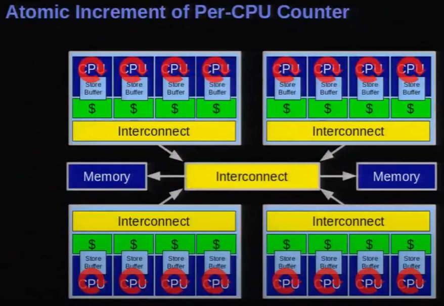

Hình 13.8: Thay bằng per-CPU data trên NUMA system lớn nhiều core bảo đảm cả data safety và hiệu năng tốt vì caching effect không còn mối lo. Nguồn (c): What is RCU, Prof Paul E. McKenney

Sẽ đề cập ví dụ per-CPU usage trong kernel codebase (phần Per-CPU usage trong kernel).

#### Làm với per-CPU variable

Khi làm per-CPU variable phải dùng helper method (macro/API) kernel cung cấp, không thử access trực tiếp (như thấy với `refcount` và atomic operator).

Chúng ta hãy tiếp cận các helper API và macro, tức các method dành cho per-CPU data, bằng cách chia phần thảo luận thành hai phần. Trước tiên, bạn sẽ học cách allocate, initialize rồi free một per-CPU data item. Sau đó, bạn sẽ học cách làm việc với nó, tức đọc và ghi data.

##### Allocate, initialize và free per-CPU variable

Nhìn chung hai loại per-CPU variable: statically và dynamically allocated. Statically allocated per-CPU variable được cấp memory ngay compile time, thường qua macro `DEFINE_PER_CPU()` hay `DECLARE_PER_CPU()`. Dùng loại `DEFINE` cho allocate/initialize một lần. Ví dụ allocate integer đơn lẻ tên `pcpa` như per-CPU variable; auto-initialized 0:

```
#include <linux/percpu.h>
DEFINE_PER_CPU(int, pcpa);      // signature: DEFINE_PER_CPU(type, name)
```

Giờ hệ thống chẳng hạn bốn CPU core, per-CPU variable này về khái niệm như sau sau initialize:


Hình 13.9: Biểu diễn khái niệm per-CPU data item trên hệ thống bốn live CPU

Tất nhiên implementation thực tế phức tạp hơn nhiều; tham khảo Đọc thêm để biết internal implementation.

Dynamically allocate per-CPU data qua wrapper macro `alloc_percpu()` hay `alloc_percpu_gfp()`, chỉ truyền data type object cần allocate per-CPU và với loại sau thêm GFP mask (giờ quen từ dynamic kernel allocation API):

```
alloc_percpu[_gfp](type [,gfp]);
```

Routine bên dưới `__alloc_per_cpu[_gfp]()` (wrapper macro gọi) export qua `EXPORT_SYMBOL_GPL()` (nên chỉ dùng khi module phát hành GPL-compatible license).

Memory cấp qua routine trên sau đó phải free bằng API `void free_percpu(void __percpu *__pdata)`.

Như học resource-managed API variant `devm_*()` cho phép (thường khi viết driver) thuận tiện dùng routine allocate memory; kernel lo free, giúp ngăn leakage. Macro `devm_alloc_percpu(dev,` `type)` cho dùng như resource-managed version của `__alloc_percpu()`.

##### I/O (read/write) trên per-CPU variable

Câu hỏi then chốt tất nhiên chính xác access/load (read) và update/store (write) per-CPU variable thế nào? Kernel cung cấp nhiều helper routine; dùng ví dụ đơn giản hiểu.

Định nghĩa statically một integer per-CPU variable, sau muốn access/in giá trị hiện tại. Nên hiểu vì per-CPU, giá trị lấy auto-calculated dựa (hay index) CPU core code hiện chạy; nói cách khác code sau chạy core `1` thì thực chất fetch `pcpa[1]` (không chính xác vậy; chỉ khái niệm nhưng hiểu ý). Vậy định nghĩa statically integer per-CPU variable tên `pcpa` (auto-initialized 0):

```
DEFINE_PER_CPU(int, pcpa);
int val;
[ ... ]
val = get_cpu_var(pcpa);
pr_info("cpu0: pcpa = %+d\n", val);    // critical section, must be atomic!
put_cpu_var(pcpa);
```

Cặp macro `get_cpu_var()` và `put_cpu_var()` cho an toàn lấy hay sửa per-CPU value của per-CPU variable cho trước (parameter). Quan trọng hiểu code giữa `get_cpu_var()` và `put_cpu_var()` (hay tương đương) thực chất critical section – atomic context – nơi kernel preemption disabled, mọi blocking (sleeping) cấm. Làm gì block (sleep) bất kỳ trong đây là kernel bug. Đồng thời trong per-CPU critical section, khác spinlock IRQ variant (và như mutex), hardware interrupt state (local core) không đổi.

Như học API `vmalloc()` có thể blocking nên sleep (block). Ví dụ xem xảy ra gì nếu thử allocate memory qua `vmalloc()` trong cặp macro `get_cpu_var()`/ `put_cpu_var()`:

```
void *p;
val = get_cpu_var(pcpa);          // disables kernel preemption!
void *vp=vmalloc(1024*1024);      // vmalloc(), vfree() are possibly blocking!
mdelay(1);                        // mdelay(), printk() are non-blocking
vfree(vp);
pr_info("cpu1: pcpa = %+d\n", val);
put_cpu_var(pcpa);                      // enables kernel preemption
[ ... ]

$ sudo insmod <whatever>.ko
$ sudo dmesg
[ ... ]
BUG: sleeping function called from invalid context at include/linux/sched/
mm.h:274
in_atomic(): 1, irqs_disabled(): 0, non_block: 0, pid: 14135, name: thrd_1/1
preempt_count: 1, expected: 0
RCU nest depth: 0, expected: 0
Preemption disabled at:
[<ffffffffc06b64f2>] thrd_work+0xe2/0x310 [percpu_var]
[ ... ]
$
```

À thực sự thấy diagnostic: vì code giữa cặp `get_cpu_var()`/`put_cpu_var()` chạy atomic context, kernel preemption disabled (disable trong expanded code macro `get_cpu_var()`). Rồi thử việc có thể blocking – memory alloc API `vmalloc()` – gây kernel bug (nếu thử call trace cho thấy bug bắt nguồn gọi `vmalloc()`).

Nhân tiện gọi wrapper `printk()` (hay `pr_<foo>()`) (cùng `mdelay()`) như làm trong critical section ở đây ổn vì non-blocking.

Bên trong macro `get_cpu_var()` gọi `preempt_disable()` disable kernel preemption, `put_cpu_var()` hoàn tác bằng `preempt_enable()`. Như trước (chương CPU scheduling), có thể nested, kernel duy trì variable `preempt_count` xác định kernel preemption thực enabled/disabled. (Ở đây thấy `preempt_count` là `1`, nghĩa non-preemptible state, trong khi code path `vmalloc()` mong `0`, preemptible.)

Kết quả tất cả là phải khớp cẩn thận macro `{get,put}_cpu_var()` khi dùng (ví dụ gọi macro `get` hai lần cũng phải `put` tương ứng hai lần).

`get_cpu_var()` là `lvalue` nên thao tác được; ví dụ increment per-CPU variable `pcpa`, chỉ làm:

```
get_cpu_var(pcpa) ++;
put_cpu_var(pcpa);
```

Cũng lấy an toàn current per-CPU value qua macro `per_cpu()`:

```
per_cpu(var, cpu);
```

Vậy lấy variable per-CPU `pcpa` cho mọi CPU core hệ thống, dùng:

```
for_each_online_cpu(i) {
    val = per_cpu(pcpa, i);
    pr_info(" cpu %2d: pcpa = %+d\n", i, val);
}
```

Để biết luôn dùng macro `[raw_]smp_processor_id()` xác định đang CPU core nào; thực tế chính cách macro `convenient.h:PRINT_CTX()` làm. (Raw variant tránh vấn đề ngay khi chạy với kernel preemption tắt, nên thực ra dùng nó.)

Tương tự kernel cung cấp routine làm pointer đến variable cần per-CPU, macro `{get,put}_cpu_ptr()` và `per_cpu_ptr()`. Dùng nhiều khi làm per-CPU data structure (thay integer đơn giản). Thường dùng an toàn lấy pointer structure trên CPU core hiện chạy (như ví dụ sau cũng minh họa).

#### Per-CPU – kernel module ví dụ

Buổi hands-on sample per-CPU demo kernel module chắc chắn giúp học lock-free technology mạnh (code `ch13/3_lockfree/percpu`). Ở đây định nghĩa/dùng hai per-CPU variable:

- per-CPU integer statically allocated/initialized

- per-CPU data structure dynamically allocated

Cách thú vị minh họa per-CPU variable: cho demo kernel module spawn vài kernel thread (kthread). Gọi `thrd_0`, `thrd_1`. Hơn nữa khi tạo xong, dùng CPU affinity mask feature task structure qua API `sched_setaffinity()` để affine kernel thread `thrd_0` trên CPU `0`, `thrd_1` trên CPU `1` (nên chỉ được schedule trên các core này; tất nhiên phải test trên hệ thống (VM/native) ít nhất hai CPU core).

Các code snippet sau minh họa cách chúng ta định nghĩa và sử dụng các biến per-CPU. Chúng tôi bỏ phần code tạo kernel thread và thiết lập CPU affinity mask vì không liên quan đến chương này; tuy nhiên, điều quan trọng là bạn phải đọc toàn bộ code và thử chạy nó!

```
// ch13/3_lockfree/percpu/percpu_var.c
[ ... ]
/*--- The percpu variables, an integer 'pcpa' and a data structure --- */
/* This percpu integer 'pcpa' is statically allocated and initialized to 0;
 * one integer instance will be allocated per CPU core! */
DEFINE_PER_CPU(int, pcpa);

/* This "driver context" per-cpu structure will be dynamically allocated
 * via alloc_percpu() */
static struct drv_ctx {
    int tx, rx; /* here, as a demo, we just use these two members,
                         ignoring the rest */
    [ ... ]
} *pcp_ctx;
[ ... ]

static int __init init_percpu_var(void)
{
    [ ... ]
    /* Dynamically allocate the per-cpu structures; one structure instance
     *  will be allocated per CPU core! (If you want to specify the GFP flags,
then use the alloc_percpu_gfp(type, gfp) macro instead) */
    ret = -ENOMEM;
    pcp_ctx = (struct drv_ctx __percpu *) alloc_percpu(struct drv_ctx);
    if (!pcp_ctx) {
        [ ... ]
}
```

Sao không thay bằng resource-managed `devm_alloc_percpu()`? Đúng nên khi thích hợp; tuy nhiên ở đây không viết driver đúng nghĩa, không có pointer `struct device *dev` sẵn, parameter đầu bắt buộc của `devm_alloc_percpu()`.

Nhân tiện tôi gặp vấn đề khi viết kernel module; để set CPU mask (đổi CPU affinity mỗi kernel thread), kernel API là function `sched_setaffinity()`, đáng tiếc không export, không dùng được. Vì vậy tìm cách chắc chắn là hack: lấy địa chỉ function không hợp tác (`sched_setaffinity()`) qua API `kallsyms_lookup_name()` (hoạt động khi định nghĩa `CONFIG_KALLSYMS`), rồi gọi như function pointer.

Kỹ thuật hoạt động đủ tốt ấn bản đầu dùng kernel 5.4 LTS, nhưng giờ đoán xem? Từ 5.7 kernel developer cũng unexport API `kallsyms_lookup_name()` (commit ID 0bd476e6c671. Lý do: `https://lwn.net/Articles/813350/`)! Dù có còn hay không, giờ đơn giản dùng cách: helper Bash script (tên `run`) grep địa chỉ function `sched_setaffinity()` (từ `/proc/kallsyms`) truyền module như parameter! Ở đây gán vào expected function signature – của `sched_setaffinity()` – dùng. Xét chặt không phải cách đúng nhưng hoạt động. Đừng làm production.

Ý tưởng thiết kế tạo hai kernel thread, mỗi thread thao tác khác nhau, parallel trên per-CPU data variable. Nếu global variable thường, chắc chắn critical section, tất nhiên cần lock; nhưng ở đây chính vì per-CPU và bảo đảm thread chạy core riêng, có thể concurrently update bằng data khác không locking gì! Lock-free như hứa.

Kernel thread worker routine sau; argument là thread number (`0` hay `1`). Theo đó branch và thao tác per-CPU data (trường hợp đơn giản, kernel thread đầu increment per-CPU integer ba lần, thread hai decrement ba lần (macro `THRD0_ITERS`, `THRD1_ITERS` đặt giá trị 3):

```
/* Our kernel thread worker routine [...] */
static int thrd_work(void *arg)
{
    int i, val;
    long thrd = (long)arg;
    struct drv_ctx *ctx;
    [ ... ]

    /* Set CPU affinity mask to 'thrd', which is either 0 or 1 */
    if (set_cpuaffinity(thrd) < 0) {
        [ ... ]
    } [ … ]
    SHOW_CPU_CTX();

    if (thrd == 0) {               /* our kthread #0 runs on CPU 0 */
        for (i=0; i<THRD0_ITERS; i++) {
            /* Operate on our perpcu integer */
            val = ++ get_cpu_var(pcpa);
            pr_info(" thrd_0/cpu0: pcpa = %+d\n", val);
            put_cpu_var(pcpa);

            /* Operate on our perpcu structure */
            ctx = get_cpu_ptr(pcp_ctx);
            ctx->tx += 100;
            pr_info(" thrd_0/cpu0: pcp ctx: tx = %5d, rx = %5d\n",
                ctx->tx, ctx->rx);
            put_cpu_ptr(pcp_ctx);
        }
    } else if (thrd == 1) {        /* our kthread #1 runs on CPU 1 */
        for (i=0; i<THRD1_ITERS; i++) {
            /* Operate on our perpcu integer */
            val = -- get_cpu_var(pcpa);
            pr_info(" thrd_1/cpu1: pcpa = %+d\n", val);
            put_cpu_var(pcpa);

            /* Operate on our perpcu structure */
            ctx = get_cpu_ptr(pcp_ctx);
#if 0
          /* If we try and run a blocking API within the per-CPU
              * 'critical section', we land up with a kernel bug; hence,
              * it's commented out by default. */
            void *vp=vmalloc(1024*1024); // vmalloc(), vfree() are possibly
blocking!
            mdelay(1);                                    // mdelay(), printk()
are non-blocking
            vfree(vp);
#endif
            ctx->rx += 200;
            pr_info(" thrd_1/cpu1: pcp ctx: tx = %5d, rx = %5d\n",
                ctx->tx, ctx->rx);
            put_cpu_ptr(pcp_ctx);
        }
    }
    disp_our_percpu_vars();
    pr_info("Our kernel thread #%ld exiting now...\n", thrd);
    return 0;
}
```

Để chạy, chỉ cần `cd` đến thư mục source của nó rồi gõ `./run`. Hiệu ứng lúc runtime khá thú vị; hãy xem kernel log sau, là output của `sudo dmesg` (trên Ubuntu 23.04 VM chạy kernel 6.1.25 tùy chỉnh của chúng ta):

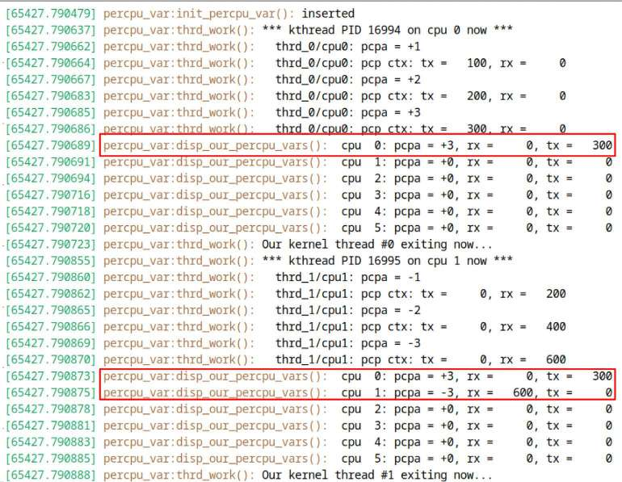

Hình 13.10: Ảnh chụp kernel log khi LKM ch13/3\_lockfree/percpu/percpu\_var chạy trên hệ thống Linux có sáu CPU core

Hãy chú ý module của chúng ta đã hoàn thành công việc như thế nào, ở đây trên hệ thống Linux có sáu CPU core. Bạn có thể thấy rõ các core được gắn nhãn từ `cpu 0` đến `cpu 5` và giá trị của per-CPU data item trên từng core lúc runtime (Hình 13.10)!

Trong vài dòng output cuối ở Hình 13.10, bạn có thể thấy tổng hợp giá trị của các per-CPU data variable trên CPU `0` và CPU `1` (cũng như trên các core còn lại; chúng ta hiển thị chúng qua function `disp_our_percpu_vars()`). Rõ ràng, đối với per-CPU integer `pcpa` (cũng như các member `rx` và `tx` của data structure `pcp_ctx`), các giá trị khác nhau đúng như mong đợi mà không có explicit locking.

Kernel module vừa trình bày sử dụng macro `for_each_online_cpu(i)` để hiển thị giá trị của các per-CPU variable trên từng online CPU. Tuy nhiên, nếu chẳng hạn VM có sáu CPU nhưng bạn chỉ muốn hai CPU “hoạt động” lúc runtime thì sao? Có nhiều cách thực hiện: một cách là truyền parameter `maxcpus=n` cho kernel của hệ thống khi boot; cách khác là thao tác pseudofile `/sys/devices/system/cpu/cpuN/online` (root-writable), trong đó N là số CPU core (giá trị này thường mặc định là 1, nghĩa là core đang online; ghi 0 vào đó với quyền root sẽ đưa core về offline, mặc dù không thể làm vậy với CPU core 0).

#### Sử dụng Per-CPU trong kernel

Per-CPU variable được sử dụng khá nhiều trong Linux kernel; hãy xem hai trường hợp sử dụng khá thú vị.

##### Triển khai macro current trên x86 bằng per-CPU data

Macro `current` trên architecture x86 (hãy nhớ `current` là cách chuẩn để tham chiếu task structure của thread đang thực thi; chúng ta đã trình bày khá chi tiết cách sử dụng nó trong Chương 6, Các kiến thức thiết yếu về kernel internals – Process và thread, ở phần Truy cập task structure bằng current) được tra cứu (và thiết lập) rất thường xuyên; triển khai nó dưới dạng per-CPU data item bảo đảm việc truy cập luôn lock-free và nhờ đó có performance cao! Đây là code triển khai:

```
// arch/x86/include/asm/current.h
[ ... ]
DECLARE_PER_CPU(struct task_struct *, current_task);
static __always_inline struct task_struct *get_current(void)
{
    return this_cpu_read_stable(current_task);
}
#define current get_current()
```

Macro `DECLARE_PER_CPU()` khai báo variable tên `current_task` là per-CPU variable có type `struct task_struct *`. Inline function `get_current()` (là phần triển khai current trên x86) gọi helper `this_cpu_read_stable()` trên per-CPU variable này, qua đó đọc giá trị của `current` trên CPU core mà nó đang chạy (đọc comment tại `https://elixir.bootlin.com/linux/v6.1.25/source/arch/x86/include/asm/percpu.h#L214` để biết chi tiết về routine này).

Nhân tiện, giờ đã hiểu cách lấy (đọc) giá trị (per-CPU) của `current`, một câu hỏi thường gặp xuất hiện: per-CPU variable `current_task` được cập nhật ở đâu? Hãy nghĩ xem: kernel phải thay đổi (cập nhật) `current` mỗi khi context-switches sang task khác. Chính xác là như vậy – nó thực sự được cập nhật trong context-switching code; trên x86, vị trí đó là: `arch/x86/kernel/process_64.c:__switch_to()` `https://elixir.bootlin.com/linux/v6.1.25/source/arch/x86/kernel/process_64.c#L558`:

```
__no_kmsan_checks
__visible __notrace_funcgraph struct task_struct *
__switch_to(struct task_struct *prev_p, struct task_struct *next_p)
{
    [ ... ]
        this_cpu_write(current_task, next_p);
        [ ... ]
}
```

##### Sử dụng per-CPU data trên network receive path

Một trường hợp sử dụng per-CPU data thú vị khác nằm sâu trong kernel network stack. Nói thật đơn giản, khi nhận được network packet qua hardware interrupt, packet thường được DMA vào memory của kernel (tức network device driver). Cơ chế so-called bottom-half, network receive `softirq`, sau đó tiếp quản việc xử lý, đẩy packet lên protocol stack (đến các layer cao hơn). Rất lâu trước đây (tức hàng thập kỷ), nó enqueue các packet trên receive path vào một global data structure. Tất nhiên điều này tạo ra performance bottleneck rất lớn; phải bảo vệ truy cập structure này bằng lock (spinlock); contention có thể tăng cao và performance liên tục giảm (đặc biệt trên hệ thống higher-end có nhiều core và network adapter đồng thời xử lý network packet).

Nhận ra điều này, các networking developer chuyển sang sử dụng per-CPU data cho data structure của global receive queue (tên là `softnet_data`). Vì vậy giờ nó có dạng sau:

```
// net/core/dev.c
[ … ]
/*
 *  Device drivers call our routines to queue packets here. We empty the
 *  queue in the local softnet handler.
 */
DEFINE_PER_CPU_ALIGNED(struct softnet_data, softnet_data);
EXPORT_PER_CPU_SYMBOL(softnet_data);
[ … ]
```

Có thể xem function của network receive softirq, `NET_RX_SOFTIRQ`, tại đây:

```
// net/core/dev.c
[ … ]
static __latent_entropy void net_rx_action(struct softirq_action *h)
{
    struct softnet_data *sd = this_cpu_ptr(&softnet_data);
    [ … ]
```

##### Bài tập

Tìm thêm ví dụ sử dụng per-CPU trong kernel codebase qua macro `__alloc_percpu()` (cũng như những macro khác bạn đã học) bằng cách chạy `cscope -d` tại root của kernel source tree 6.1 (giả định bạn đã build index `cscope` tại đó bằng `make cscope`).

Tốt lắm! Bây giờ hãy chuyển sang tìm hiểu một công nghệ lock-free quan trọng: RCU!

### Tìm hiểu và sử dụng công nghệ lock-free RCU (Read-Copy-Update) – nhập môn

RCU là công nghệ synchronization lock-free cho phép reader chạy đồng thời với writer. Nó được merge vào Linux kernel từ tháng 10 năm 2002.

Theo cách truyền thống, hay trước khi có RCU, khi làm việc với chẳng hạn một global linked list hoặc tree data structure lớn (rất thường gặp trong kernel), kernel developer (và/hoặc driver developer) sử dụng spinlock hoặc reader-writer (spin)lock để xử lý vấn đề concurrency. Tuy nhiên, như đã học, những lock này có thể nhanh chóng trở nên rất tốn kém, gây performance bottleneck lớn cũng như tiêu thụ nhiều điện năng, đặc biệt trên hệ thống (NUMA) high-end (thực sự có hàng nghìn core!). Vì vậy, dù vẫn hoạt động, performance ngày càng tệ; nói cách khác, nó không scalable (RCU đã trở thành giải pháp thay thế lý tưởng cho reader-writer lock).

Với RCU, các reader có thể chạy song song với nhau cùng với writer (hoặc updater). Reader thread không cần lock. Đúng vậy, không có thao tác acquire/release lock, không có atomic instruction, không cập nhật shared memory và không có memory barrier (ngoại trừ processor DEC Alpha cần memory barrier). Vì chính những thao tác này thường làm giảm performance, loại bỏ nhu cầu sử dụng chúng khiến RCU rất nhanh và có giá trị.

Tuy nhiên, hãy chờ một chút – cách tiếp cận “không có lock” này không áp dụng được cho writer (updater); chúng vẫn cần được bảo vệ khỏi nhau (thường bằng spinlock). Nhưng việc reader không bao giờ cần locking đơn giản hóa đáng kể thiết kế và nhờ đó có thể giảm mạnh khả năng deadlock. Giờ chúng ta nhận ra RCU rất xuất sắc và được thiết kế để cung cấp synchronization trong các tình huống read-mostly, vốn rất nhiều trong kernel! (Theo thumb-rule, hãy dùng RCU khi read chiếm từ 90% workload trở lên so với write).

Ngoài ra, xét kỹ thuật hơn, RCU hoạt động tốt nhất trong tình huống read-mostly và khi việc đọc data không nhất quán (hoặc stale) không quá quan trọng với reader. Data càng cần “nhất quán”, và càng dành nhiều thời gian cập nhật, RCU càng ít hữu ích. (Nếu muốn hình dung trực quan, bạn có thể xem trước Hình 13.19).

#### RCU hoạt động như thế nào?

Đặc biệt với người mới tìm hiểu, RCU đặt ra câu hỏi: làm thế nào reader và writer có thể chạy đồng thời, an toàn khi làm việc trên shared data, trong khi reader hoàn toàn không có locking? Ngay sau đây chúng ta sẽ cố gắng thỏa mãn mong muốn hiểu điều này của bạn!

Paul E. McKenney là một trong những người chủ chốt được ghi nhận đã triển khai công nghệ synchronization RCU trong Linux kernel và là một trong những maintainer của RCU trong Linux kernel; ông cũng là lead maintainer của Linux kernel memory model. (Vì vậy, sẽ hợp lý khi trình bày phần giải thích bằng những thuật ngữ và cách diễn đạt mà ông cũng như cộng đồng rộng hơn sử dụng.)

Chúng ta tiếp cận chủ đề ở ba “cấp độ”, từ giải thích khái niệm đơn giản (Cấp độ 1), đến giải thích ở Cấp độ 2 (là Cấp độ 1 cộng thêm nội dung), sâu và chi tiết hơn một chút, rồi đến Cấp độ 3, truyền tải chi tiết của Cấp độ 2 cùng một số RCU code primitive. Vậy thưa quý vị, hãy thắt dây an toàn và bắt đầu!

##### Giải thích RCU Cấp độ 1 (không có code, chỉ có khái niệm và rất đơn giản)

Sau đây là giải thích RCU Cấp độ 1 step-by-step; lúc này đừng lo về chi tiết – phần tiếp theo sẽ có các sơ đồ minh họa những khái niệm này:

1\. Các RCU reader (hay subscriber) thread có thể đọc shared writable data object song song mà không bị áp đặt locking; điều này khiến RCU rất nhẹ và rất nhanh (và phù hợp với tình huống read-mostly)! 2. Khi một writer (hay publisher hoặc updater) thread xuất hiện, nó không phải thực hiện RCU locking. Việc nó phải làm là tạo bản sao của data object – object dùng chung đang được thao tác đồng thời – và làm việc trên bản sao đó. Tuy nhiên, lưu ý writer phải tự bảo vệ khỏi concurrent access, tránh giẫm chân nhau (thường dùng spinlock để serialize chúng). 3. Các reader pre-existing – chạy trước khi writer xuất hiện – tiếp tục đọc data object “cũ”; đó là góc nhìn thực tế của chúng và điều đó hoàn toàn ổn. Writer và mọi reader “mới” sau đó (chạy sau khi writer xuất hiện) chỉ làm việc trên data object “mới”, góc nhìn thực tế của chúng! (Vậy ai có góc nhìn thực tế “đúng”? Cả hai. Khá giống vật lý lượng tử pha metaverse, phải không?) 4. Writer giờ cập nhật (ghi vào và do đó sửa đổi) data object mới được sao chép đang xét, thay đổi nó. Các reader pre-existing tiếp tục làm việc song song trên object cũ. 5. Writer hoàn thành công việc và cập nhật data object pointer (cũ) một cách atomic để trỏ đến object mới, bảo đảm nó và mọi reader sau đó sẽ thấy phiên bản mới đã cập nhật. Lưu ý các reader pre-existing vẫn tiếp tục làm việc (đọc) từ data object cũ song song. 6. Khi tất cả RCU reader pre-existing hoàn tất việc đọc, writer hủy (free) data object cũ.

Và công việc đã xong, (phần lớn) lock-free. Phần duy nhất không lock-free là khi có nhiều writer; chúng phải serialize với nhau bằng spinlock. Nhưng hãy nghĩ xem – theo định nghĩa, chúng ta dùng RCU trong tình huống mostly-read; vì thế writer chiếm tỷ lệ rất nhỏ trong tổng thời gian, khiến phần lớn hoạt động là lock-free.

##### Giải thích RCU Cấp độ 2 (không có code, chỉ có khái niệm và nhiều chi tiết hơn)

Sau đây là giải thích RCU Cấp độ 2 step-by-step:

1\. Các RCU reader (hay subscriber) tiếp tục không bị cản trở, song song với nhau; không có locking dưới bất kỳ dạng nào, không có atomic operation, thậm chí không có memory barrier (có một ngoại lệ: processor DEC Alpha cần memory barrier). Đây chính là mục đích của RCU: sử dụng trong tình huống chủ yếu là read, giữ cho read song song và nhanh. Hãy xét data structure mẫu `struct X`, với pointer trỏ đến nó (`ptr_x`); Hình 13.11 cho thấy nó được nhiều RCU reader chạy trên các core khác nhau truy cập đồng thời để đọc:

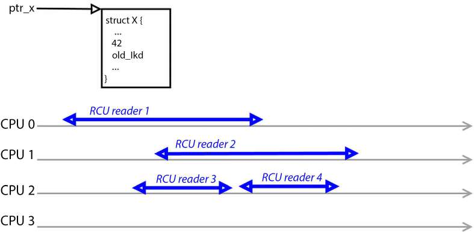

Hình 13.11: Một vài RCU reader chạy read-side critical section song song; không cần locking! Code trong read-side critical section (các đường double-arrow) cần non-blocking

Tuy nhiên, hãy lưu ý: mặc định các RCU read-side critical section này cần atomic và non-blocking; chúng chạy với kernel preemption bị disable (giống như per-CPU critical section). Ngoài ra, như sơ đồ cho thấy, nhiều RCU reader có thể chạy tuần tự trên cùng một core (trường hợp reader 3 và 4 ở đây trên core 2).

Bạn đọc Hard-copy có thể tìm thấy tất cả sơ đồ màu của sách tại đây: `https://packt.link/gbp/9781803232225`.

2\. Một writer (hay publisher hoặc updater) thread xuất hiện. Nó cũng tiếp tục, nhưng việc đầu tiên nó làm là tạo bản sao của data object đang xét! (Bạn có thể xem trước Hình 13.14, tại vòng tròn (đỏ) có số `1` bên trong.)

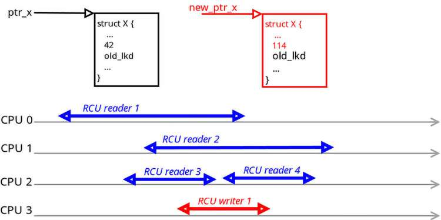

Hình 13.12: Một writer thread xuất hiện và tạo bản sao của data object (chú ý nó đã bắt đầu sửa đổi nội dung); đường thẳng đứng – khi writer đi vào – phân tách RCU reader cũ (1, 2 và 3) với reader mới (4)

Tuy nhiên, lưu ý rằng nhiều writer đồng thời phải tự bảo vệ khỏi concurrent access, tránh giẫm chân nhau (thường dùng spinlock để serialize chúng).

3\. Các RCU reader pre-existing (hay “cũ”) tiếp tục làm việc trên data object cũ (RCU reader 1, 2 và 3); writer và mọi reader “mới” sau đó (RCU reader 4) chỉ làm việc trên data object “mới”. Nhờ vậy chúng không xung đột, không có data race và mỗi bên thấy phiên bản thực tế của mình! 4. Writer giờ cập nhật (ghi vào và do đó sửa đổi) data object đang xét, thay đổi nó. Các reader pre-existing tiếp tục làm việc song song trên object cũ. (Xem Hình 13.14 và vòng tròn (đỏ) có số 2 bên trong.) 5. Writer hoàn thành công việc và cập nhật pointer một cách atomic để trỏ đến object mới, bảo đảm nó và mọi reader sau đó (như RCU reader 4 và 5 trong Hình 13.13) sẽ thấy phiên bản mới đã cập nhật. Lưu ý các reader pre-existing tiếp tục làm việc (đọc) từ data object cũ song song. (Xem Hình 13.14 và vòng tròn (đỏ) có số 3 bên trong.)

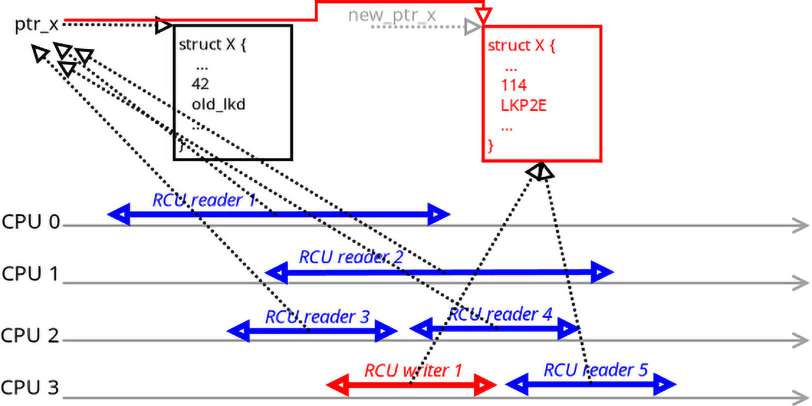

Hình 13.13: Các RCU reader pre-existing (1 đến 3) tham chiếu thực tế cũ; writer và reader mới (4 và 5) thấy thực tế mới. Ai đúng? Cả hai đều đúng (có cảm giác “lượng tử”, phải không?)

Trước khi tiếp tục, có một vài quy tắc quan trọng cần tuân thủ và một định nghĩa cần nêu:

- Quy tắc 1: Trong RCU read-side critical section, bạn không được block, chuyển sang user mode hoặc đi vào idle state. (Giống trường hợp critical section của spinlock hoặc per-CPU variable.)

- Quy tắc 2: Cũng như mọi synchronization hoặc locking primitive khác, chỉ được truy cập data object được lock bảo vệ khi đang giữ lock. Vì vậy, với RCU read, bạn chỉ được đọc data object khi ở trong RCU read-side critical section và cập nhật (ghi) chúng khi ở trong RCU write-side critical section. Ngay khi reader rời read-side critical section (đừng lo, chúng ta sẽ đến cách định nghĩa chính xác nó), nó được xem là đã đi vào quiescent state. Mọi read thực hiện bên ngoài RCU read-side critical section, nói cách khác khi ở quiescent state, đều không được phép và bị xem là không hợp lệ.

- RCU Grace Period (GP): Khoảng thời gian mà mọi reader thread đều đã đi qua ít nhất một quiescent state. Thực chất, đây là khoảng thời gian mà sau đó bảo đảm không còn reader pre-existing nào (vì khi ở quiescent state, theo định nghĩa chúng ở ngoài read-side critical section). Writer cần biết điều này (chúng ta sẽ thấy ngay lý do).

6\. Tất nhiên writer phải free object cũ (thực chất hủy nó và ngăn memory leak), nhưng không được làm vậy cho đến khi bảo đảm mọi reader pre-existing đã hoàn thành RCU read-side critical section. Làm vậy sẽ gây bug UAF (Use After Free) sau đó! Thực tế, với RCU, giờ nó được đặt tên là bug UAFBR (UAF by RCU); các bug như vậy có thể dẫn đến lỗ hổng có thể khai thác, nên hãy cẩn thận! (Nhân tiện, một vấn đề bảo mật gần đây tên StackRot (tháng 6 năm 2023) dựa trên chính lỗ hổng này: `https://github.com/lrh2000/StackRot#stackrot-cve-2023-3269-linux-kernel-privilege-escalation-vulnerability.)`

Trở lại vấn đề: writer chờ một RCU grace period (hay GP) rồi free object cũ! (Xem Hình 13.14, với các vòng tròn (đỏ) có số 4 và 5 tương ứng. Bạn có thể tự hỏi chính xác writer biết một GP đã trôi qua bằng cách nào. Phần tiếp theo sẽ trình bày; lúc này cứ tin như vậy.)

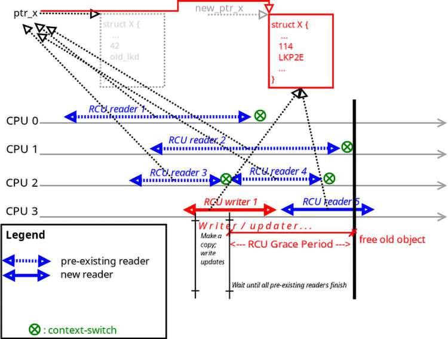

Hình 13.14: Sau khi cập nhật data object, writer chờ một RCU GP (đến đường thẳng đứng đậm), rồi free object cũ; các reader sau đó làm việc trên data object mới. Các vòng tròn (đỏ) có số bên trong thể hiện các bước của writer

Giờ từ những gì đã học về CPU scheduling, bạn sẽ nhận ra mọi thread cuối cùng đều context-switch khỏi processor vì một lý do nào đó. Ở đây, các RCU reader thread pre-existing thực hiện read theo cách non-blocking và tất nhiên đến một lúc nào đó sẽ đọc xong. Tại thời điểm này, vì đã xong, hoặc có thể muộn hơn một chút, chúng thực hiện context switch. Trong Hình 13.14, vòng tròn (xanh lá) có dấu chéo (chữ X bên trong) biểu thị context switch mà mọi RCU reader pre-existing (và có thể cả reader mới) cuối cùng đều thực hiện.

Thời điểm tất cả RCU reader cũ (pre-existing) (ở đây là 1 đến 3) hoàn tất và context-switch khỏi core được thể hiện bằng đường thẳng đứng đậm. (Trong ví dụ cụ thể này, ngay cả RCU reader mới 4 cũng đã hoàn tất và context-switched; điều này có thể xảy ra. Tuy nhiên, lưu ý nó đang đọc object mới.) Tại thời điểm này, khi một RCU GP đã trôi qua – thời điểm RCU reader pre-existing cuối cùng context-switches khỏi core – writer free data object cũ. Từ giờ, mọi RCU reader và writer sau đó sẽ làm việc trên data object “mới” (rồi sẽ sớm trở thành object “cũ” khi toàn bộ quá trình lặp lại). Công việc đã xong!

Vậy giờ có thể thấy: reader (R) chạy thực sự song song, hoàn toàn không bị can thiệp, kể cả từ writer (khiến RCU cực kỳ nhẹ và nhanh). Writer có thể – song song với reader – sửa đổi data bằng cách tạo bản sao (C) của data object, cập nhật (U) bản sao, rồi (khi an toàn) free object gốc và thay thế bằng bản sao. Vì thế có thuật ngữ RCU.

##### Giải thích RCU Cấp độ 3 (Cấp độ 2 + nhiều chi tiết hơn)

Khi đọc phần này, bạn thực sự nên xem (các phần liên quan của) RCU code trong kernel; điều tôi thực sự muốn nói là các comment trong codebase! Chúng rất hay, thường đủ để mô tả các đặc điểm nổi bật (để hỗ trợ các core API cơ bản của RCU và cách sử dụng, tôi đã xây dựng hai bảng làm tài liệu tra cứu nhanh cho một vài core RCU API, trong phần Tóm tắt nhanh các core API của RCU sắp tới; bạn có thể tham khảo chúng khi đọc phần này):

1\. Các RCU reader (hay subscriber) tiếp tục không bị cản trở, song song với nhau; không có locking dưới bất kỳ dạng nào, không có atomic operation, thậm chí không có memory barrier (có một ngoại lệ: processor DEC Alpha cần memory barrier). Đây chính là mục đích của RCU: dùng trong tình huống chủ yếu là read, giữ cho read song song và nhanh:

```
rcu_read_lock();
< The RCU read-side critical section; non-blocking, non-preemptible
Rule: don't block in any manner
Read the data object(s)
>
rcu_read_unlock();
```

Tất nhiên, code giữa `rcu_read_lock()` và `rcu_read_unlock()` là RCU read-side critical section. Giờ điều quan trọng cần hiểu là ngoài những thứ phục vụ kernel debugging (như annotation `lockdep`, v.v.), code của `rcu_read_{un}lock()` thực sự chẳng có gì! (Trong trường hợp đơn giản nhất, nó là một newline; tuy nhiên, như đã nói, do cần tính năng debug nên có thể có một ít code, nhưng nó sẽ được đánh giá thành không có gì (null) trong môi trường production thông thường.)

Điều này đặt ra câu hỏi: làm sao có thể synchronize mà hoàn toàn không thay đổi machine state theo bất kỳ cách nào? Điều đó gần như phải là bất khả thi. Paul E. McKenney trả lời xuất sắc câu hỏi này (`https://youtu.be/obDzjElRj9c?list=PLIlI4QbmdBqH9-L1QOq6O5Yxt-YVjRsFZ&t=3401`). Diễn giải câu trả lời của ông: các RCU API này không cần thay đổi machine state; thay vào đó, chúng được thiết kế để tác động đến developer. Developer phải hiểu đây là critical section, do đó không được blocking (và vì thế không được context-switching). Nếu tuân thủ quy tắc này, nó đơn giản là hoạt động (như đã giải thích). Thực chất, “RCU là synchronization bằng social engineering.” (Ha! Tuyệt thật!)

Nghĩ kỹ thì phần lớn (nếu không phải tất cả) công nghệ locking/synchronization đều dựa vào việc developer tuân thủ quy tắc. Chỉ lấy lock không ngăn được thread khác làm việc trên data object đang xét; nó luôn có thể làm vậy. Tuy nhiên, quy tắc là chỉ được làm việc trên data object khi giữ lock. Phá vỡ quy tắc là phá vỡ cam kết chung, do đó phá vỡ chương trình. (Như Paul E. McKenney nói, công nghệ locking thông thường được triển khai qua cả machine state lẫn thành phần social engineering; RCU đặc biệt ở chỗ read-side critical section chỉ được bảo vệ bằng social engineering.)

Dù có nguy cơ lặp lại, hãy lưu ý kỹ: các RCU read-side critical section này cần atomic và non-blocking; chúng chạy với kernel preemption bị disable (giống spinlock và per-CPU). Ngoài ra, như Hình 13.14 cho thấy, nhiều RCU reader có thể chạy tuần tự trên cùng một core (trường hợp reader 3 và 4 ở đây trên core #2).

Có cách thực hiện blocking operation trong RCU read-side critical section: sử dụng triển khai Sleeping RCU (SRCU). (Ngày nay tính năng này luôn được tích hợp vào kernel, nhưng tất nhiên nó không phải triển khai RCU mặc định được sử dụng.) Xem phần Đọc thêm để biết chi tiết.

Tiếp theo, reader (hay subscriber) phải dereference (data) pointer qua routine `rcu_dereference(p)`. (Bên trong, giả sử `CONFIG_PROVE_RCU=y`, nó xác minh bạn thực sự đọc từ trong RCU read-side critical section.)

Tiếp tục với toàn bộ semantics “không có locking” mà RCU mang lại, hãy xem comment này trong kernel source (phiên bản 6.1.25):

```
// include/linux/rcupdate.h
[ … ]
 /* So where is rcu_write_lock()?  It does not exist, as there is no
  * way for writers to lock out RCU readers.  This is a feature, not
  * a bug -- this property is what provides RCU's performance benefits.
  * Of course, writers must coordinate with each other.  The normal
  * spinlock primitives work well for this, but any other technique may
be
  * used as well.  RCU does not care how the writers keep out of each
  * others' way, as long as they do so.
  */
```

2\. Một writer (hay publisher hoặc updater) xuất hiện. Nó cũng tiếp tục, nhưng việc đầu tiên là tạo bản sao của global data object đang xét (xem Hình 13.14 và vòng tròn (đỏ) có số 1 bên trong)!

Nếu có khả năng nhiều writer xuất hiện (hoàn toàn có thể xảy ra), hãy bảo vệ chúng khỏi giẫm chân nhau bằng cách (thường là) lấy spinlock để bảo vệ write-side critical section.

Hơn nữa, khi RCU phát triển, kernel cung cấp các API chuyên biệt để làm việc với list, array, queue, tree và một số data structure khác thường sử dụng RCU (chủ yếu, và gần như luôn luôn, là read). Bên trong, các API chuyên biệt này tạo bản sao của data object khi cần (thường allocate kernel memory qua các slab API “thông thường” như `kmalloc()`). Ví dụ, với (linked) list, đây là một vài RCU-list API thường dùng (nằm trong `include/linux/rculist.h`. Ở đây không hiển thị prototype đầy đủ; mục đích thiên về hiểu khái niệm những gì có sẵn):

- `list_add_rcu(new, head)`: Thêm entry mới vào RCU-protected list sau head (phù hợp cho stack)

- `list_add_tail_rcu(new, head)`: Thêm entry mới vào RCU-protected list trước head (phù hợp cho queue)

- `list_del_rcu(element)`: Xóa entry khỏi list mà không re-init

- `list_replace_rcu(old, new)`: Thay entry cũ bằng entry mới

Tương tự, kernel cung cấp nhiều helper cho RCU-protected queue và tree. (Hãy nhớ lời đề nghị đọc các comment code-level; chúng rất hay.)

Vì bước 3 và 4 giống hệt những gì đã trình bày ở phần trước (Giải thích RCU Cấp độ 2 (không có code, chỉ có khái niệm và nhiều chi tiết hơn)), chúng ta không lặp lại không cần thiết ở đây mà chuyển thẳng đến bước 5 và 6 còn lại.

5\. Writer hoàn tất các cập nhật (xem Hình 13.14 và vòng tròn (đỏ) có số 2 bên trong); sau đó cập nhật data object pointer một cách atomic thành địa chỉ data object mới (xem Hình 13.14 và vòng tròn (đỏ) có số 3 bên trong), bảo đảm nó và mọi reader sau đó (như RCU reader 4 và 5 trong Hình 13.14) sẽ thấy phiên bản mới đã cập nhật. Lưu ý mọi reader pre-existing vẫn tiếp tục đọc song song từ data object cũ.

Để cập nhật data object pointer một cách atomic thành giá trị mới, writer thường dùng routine `rcu_assign_pointer(p, v)`. Bên trong, nó bảo đảm pointer được cập nhật chính xác. Bạn có thể thắc mắc, tại sao phức tạp như vậy? Tại sao không đơn giản gán giá trị mới cho pointer variable (`(p) = (v)`)? Đừng quên, sự phức tạp của cả hardware lẫn compiler (cộng thêm vấn đề memory-ordering arch-specific cho vui) có thể gây đủ loại rắc rối; vì vậy routine này chèn write memory barrier khi cần rồi thực hiện phép gán (cuối chương có trình bày một phần về memory barrier).

Ở đầu ý này, chúng ta nói: “Lưu ý mọi reader pre-existing vẫn tiếp tục đọc song song từ data object cũ.” Điều đó khiến bạn tự hỏi làm thế nào định nghĩa chính xác RCU reader pre-existing hay “cũ” so với reader “mới”? Điều này quan trọng vì reader pre-existing tiếp tục làm việc trên object cũ còn reader mới trên bản sao mới. Đây là câu trả lời: thời điểm quyết định là khi writer hoàn tất thực thi routine `rcu_assign_pointer(p,` `v)`. Mọi reader chạy trước thời điểm đó thấy pointer cũ, và mọi reader bắt đầu sau thời điểm đó thấy pointer mới, do đó thấy object mới.

6\. Tất nhiên writer phải free object cũ (thực chất hủy nó và ngăn memory leak), nhưng không được làm vậy cho đến khi bảo đảm mọi reader pre-existing đã hoàn thành RCU read-side critical section. Vì thế, writer chờ một RCU GP rồi free object cũ (xem Hình 13.14 và các vòng tròn (đỏ) có số 4 và 5 tương ứng)!

Làm sao biết một RCU GP – thực chất là mọi RCU reader (cũ) đã đọc xong – đã trôi qua? À, triển khai sử dụng một thủ thuật hay mà chúng ta đã gợi ý: vì biết mọi RCU read-side critical section được bảo đảm non-preemptible, ngay khi reader thread context-switches khỏi CPU core, chuyển sang user-land hoặc đi vào idle state, nó chắc chắn đã hoàn thành RCU read. Vì vậy kernel theo dõi chính điều này, và khi mọi RCU reader đã context-switched (ít nhất một lần), kernel biết chúng đã xong. Điều này được triển khai trong code qua API `synchronize_rcu()`. Do đó writer phải gọi routine này, và vì nó synchronous, ngay khi nó return, writer có thể tự tin free data object!

Hình 13.15 cố gắng tổng hợp tất cả (à, phần lớn) nội dung thảo luận cùng các core RCU API được sử dụng (tuy nhiên, để đỡ rối, tôi hiển thị tên API viết tắt (phần Chú giải có tên đầy đủ); thêm nữa, API `rcu_dereference()` chỉ xuất hiện một lần trong RCU reader 1 làm ví dụ. Bạn nên hình dung mọi RCU reader gọi nó ngay sau `rcu_read_lock()`. Ngoài ra, các API `spin_{un}lock()` mà writer có thể dùng hoàn toàn không được thể hiện ở đây):

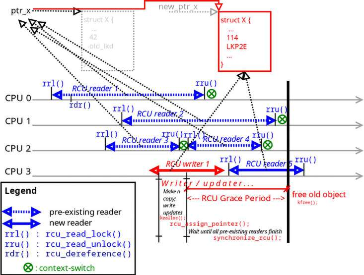

Hình 13.15: Giống Hình 13.14; bổ sung các core RCU API. Sau khi cập nhật data object, writer chờ một RCU GP (đến đường thẳng đứng đậm), rồi free object cũ; các reader sau đó làm việc trên data object mới

Một triển khai “đồ chơi” (pseudocode) của function `synchronize_rcu()` (do Paul E. McKenney trình bày) có thể đơn giản như sau:

```
    for_each_online_cpu(cpu)
        run_on(cpu);
```

Chỉ cần chạy trên từng CPU core đã bảo đảm một RCU GP system-wide đã trôi qua và không còn RCU reader pre-existing nào (như đường thẳng đứng đậm trong Hình 13.15). Cách này hoạt động vì để context hiện tại chạy trên một core, mọi thread trước đó trên core ấy (hiển nhiên) phải context-switch khỏi nó; vì thế nếu chạy trên mọi online core, theo định nghĩa điều đó có nghĩa một RCU GP system-wide thực sự đã trôi qua!

Được rồi, thử phản biện: nếu một trong các RCU reader mất nhiều thời gian hơn (so với Hình 13.15) thì sao? Nó có thất bại không? Không, RCU được triển khai đúng sẽ kéo dài RCU grace period để đáp ứng read dài đó! Điều này có nghĩa:

- Writer có thể cần chờ lâu hơn trước khi free data object cũ.

- Quan trọng hơn, reader có thể tiếp tục chạy (trong thời gian dài), do đó ngầm kéo dài GP; cách này hoạt động miễn là mọi reader được bảo đảm hoàn tất trong thời gian hữu hạn.

Điều này đặt ra câu hỏi: reader có thể kéo dài GP bao lâu? Không thể quá lâu, phải không? Đúng vậy… kernel phát cảnh báo khi xảy ra RCU CPU stall, khi nó giữ writer chờ một khoảng thời gian được xem là dài (hơi giống kernel warning do soft lockup hoặc hard lockup, mặc dù RCU cho phép khoảng thời gian thực sự dài). Dài ở đây là bao lâu? Kernel config `RCU_CPU_STALL_TIMEOUT` (định nghĩa tại đây: `https://elixir.bootlin.com/linux/v6.1.25/source/kernel/rcu/Kconfig.debug#L85`) quy định “RCU CPU stall timeout tính bằng giây”; khoảng giá trị là từ 3 đến 300 giây, mặc định 21 giây. (Về việc kéo dài hay gom GP thành batch, có so-called “lazy RCU” thường dẫn đến một số trade-offs; McKenney giải thích điều này tại đây: `https://youtu.be/obDzjElRj9c?list=PLIlI4QbmdBqH9-L1QOq6O5Yxt-YVjRsFZ&t=3722`). Tài liệu kernel chính thức ở đây: Sử dụng CPU Stall Detector của RCU: `https://www.kernel.org/doc/html/v6.1/RCU/stallwarn.html#using-rcu-s-cpu-stall-detector`.

Để bạn biết, có thể xem ví dụ về “splat” do một (hoặc nhiều) RCU CPU stall gây ra trong sách Linux Kernel Debugging của tôi: Chương 10, Kernel Panic, Lockup và Hang, ở phần RCU và RCU CPU stall.

Vậy là xong. Hiển nhiên RCU còn nhiều điều hơn những gì được giải thích ở đây; đây là kiến thức cơ bản, giúp bạn hình dung cách RCU hoạt động về khái niệm (và phần nào code-wise), đúng với mục đích đặt ra.

#### Thử nghiệm RCU

Như đã học, critical section cần được bảo vệ; sử dụng lock là cách phổ biến nhưng tốn kém. Vì vậy hãy học những điều cơ bản nhất về sử dụng synchronization RCU trong kernel trên thực tế. Để làm vậy, chúng ta lấy ví dụ rất đơn giản trong đó reader và writer chạy đồng thời, làm việc trên một shared global data structure (hay shared state). Chúng ta xây dựng ba tình huống khi làm việc với nó và trình bày những cách khác nhau để bảo vệ (hoặc không bảo vệ!) nó, cuối cùng bằng RCU (code có trong thư mục: `<book_src>/ch13/rdwr_concurrent/`). Sau đó phần Tóm tắt nhanh các core API của RCU tổng hợp năm core RCU API.

Sau khi hoàn tất, chúng ta trình bày thêm hai ví dụ code sử dụng RCU: một là module thao tác list đã xây dựng, trước đó được bảo vệ bằng reader-writer spinlock; giờ bảo vệ bằng RCU. Với ví dụ còn lại, chúng ta chỉ cung cấp link và để bạn tự nghiên cứu, thử nghiệm.

##### Ví dụ đơn giản – reader và writer đồng thời – và cách bảo vệ chúng

Đây là global data structure mẫu, shared state mà chúng ta sẽ làm việc:

```
static struct global_data {
        int gps_lock;
        long lat, longit, alt;
        int issue_in_l6;
} *gdata;
```

Hãy bắt đầu!

##### Trường hợp 1: Critical section không có locking, do đó không được bảo vệ

Làm việc như vậy, không có locking khi ở trong critical section, tất nhiên hoàn toàn sai. Tuy nhiên, nó vẫn hữu ích cho quá trình xây dựng hiểu biết.

Vì vậy, làm ví dụ rất đơn giản, hãy xem các code snippet sau. Chúng ta không hiển thị toàn bộ code, chỉ những phần liên quan nhất của function `reader` và `writer`, có thể chạy đồng thời và làm việc trên shared state (do đó khiến chúng trở thành critical section; một lần nữa, đừng quên kiến thức cơ bản! Chúng ta đã trình bày ở Chương 12, Kernel Synchronization – Phần 1, trong phần Critical section là gì?; hãy đọc lại nếu còn bất kỳ điều gì chưa rõ).

Chúng ta cũng cung cấp code đầy đủ cho tình huống ví dụ này tại đây: `ch13/rdwr_concurrent/1_demo_rdwr_nolocks`. Hãy bảo đảm bạn đọc và chạy demo module.

Reader

```
static int reader(struct global_
data *gd)
{
    long x, y, z;
    int stat = gd->issue_in_l6;

    if (gd->gps_lock) {
        x = gd->lat;
        y = gd->longit;
        z = gd->alt;
    }
    return stat;
}
```

Writer

```
static void writer(struct global_
data *gd)
{
    long x = 129780, y = 775952,
z = 920;

    gd->lat = x;
    gd->longit = y;
    gd->alt = z;
    gd->issue_in_l6 = 1;
}
```

Rõ ràng, vì structure là global (shared state), writable và được truy cập đồng thời, việc truy cập nó có nghĩa là một critical section, do đó cần được bảo vệ. Ở đây chúng ta chưa cung cấp bất kỳ bảo vệ nào; vì vậy hoàn toàn sai.

Giả sử thêm rằng read xảy ra thường xuyên hơn write (rất nhiều) (dù không phải vậy thì tất nhiên vẫn cần locking). Hãy nhớ những gì đã học; có nhiều công nghệ locking có thể dùng để bảo vệ các read/write critical section này. Ở đây, vì read thường xuyên hơn write, một cách bảo vệ là dùng reader-writer spinlock.

##### Trường hợp 2: Critical section được bảo vệ bằng reader-writer (spin)lock

Vậy hãy dùng reader-writer spinlock well-known để bảo vệ (không hiển thị toàn bộ code, chỉ các phần chính; code đầy đủ tại đây: `ch13/rdwr_concurrent/2_demo_rdwr_rwlock`).

Reader

```
static int reader(struct global_
data *gd) {
    long x, y, z;
    int stat;

    read_lock(&gd->rwlock);
    stat = gd->issue_in_l6;
    if (gd->gps_lock) {
        x = gd->lat;
        y = gd->longit;
        z = gd->alt;
    }
    read_unlock(&gd->rwlock);
    return stat;
}
```

Writer

```
static void writer_work(struct
global_data *gd) {
    long x = 129780, y = 775952,
z = 920;

    write_lock(&gd->rwlock);
    gd->lat = x;
    gd->longit = y;
    gd->alt = z;
    gd->issue_in_l6 = 1;
    write_unlock(&gd->rwlock);
}
```

Bảng 13.5: Trường hợp 2 được cố ý làm sub-optimal: reader/writer code được bảo vệ bằng reader-writer spinlock

(Chúng ta đã thêm một member vào global data structure – `rwlock_t` `rwlock`; reader-writer spinlock.) Nó hoạt động; tuy nhiên, một lần nữa, như đã học, reader-writer (spin)lock gặp một số vấn đề, đặc biệt là writer starvation và tác động bất lợi đến cache do giữ shared state song song trên các core khác nhau. Vì thế cộng đồng kernel đang tích cực chuyển từ reader-writer spinlock sang… đoán xem? Tất nhiên là RCU (vì trường hợp sử dụng tương tự nhau; cả hai đều dùng trong tình huống chủ yếu là read)!

##### Trường hợp 3: Critical section được bảo vệ bằng synchronization RCU

Được rồi, cuối cùng hãy làm đúng, bảo vệ các critical section trong những code snippet này bằng RCU!

Code có thể trông như sau (chúng ta chú thích bằng các số đánh dấu để giúp liên hệ góc nhìn code-level với các bảng tra cứu core RCU API – Bảng 13.6 và Bảng 13.7 – trình bày sau phần này. Hãy cẩn thận – các số trong Hình 13.16 không biểu thị thứ tự thực thi các code path). Được rồi, hãy xem code (liên quan) (như thường lệ, code đầy đủ tại đây: `ch13/rdwr_concurrent/3_demo_rdwr_rcu`):

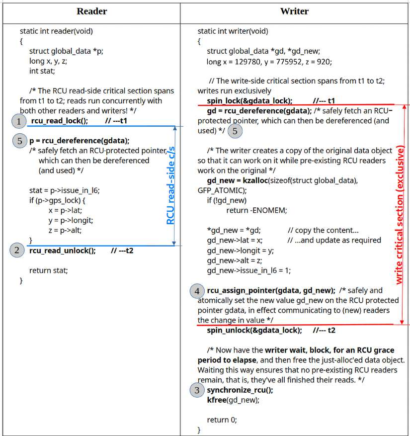

Hình 13.16: Ví dụ có chú thích code-level về sử dụng các core RCU API (các số chú thích tham chiếu số thứ tự core RCU API ở phần tiếp theo; chúng \_không\_ phải thứ tự chạy)

Lần này, vì RCU hoàn toàn không bảo vệ writer, chúng ta dùng spinlock đơn giản để writer chạy theo cách exclusive (serialized) (ngăn chúng giẫm chân nhau):

```
static spinlock_t gdata_lock; /* spinlock to protect writers.
    * Why not keep it inside the structure?
    * It's a bit subtle: we need the spinlock during the write critical
section;
    * however, it's in here that we create a copy of the data object and
    * modify/update it.
    * If the copy includes the spinlock (which it will) it won't work, as
    * we then violate the contract, using different locks...
    * Trying this, in fact, creates an interesting bug!
    * ...
    * pvqspinlock: lock 0xffff9e... has corrupted value 0x0!
    * ...
    * (The pvqspinlock is a paravirt one (as I ran it on a guest)).
    */
/* There is no 'read' RCU lock object; readers are meant to run
 * concurrently with each other *and* with writers. It's a 'socially
 * engineered' contract with the developer(s), is all it is!
 */
```

Hãy đọc thật kỹ các comment ở trên! Chúng rất bổ ích... Chạy demo này qua script `run` rồi nghiên cứu output.

Phần tiếp theo tổng hợp năm core RCU API.

##### Tóm tắt nhanh các core API của RCU

Trong phần này, chúng ta trình bày hai bảng tóm tắt nhanh các core RCU API, chủ yếu từ tài liệu kernel chính thức tại đây: `https://elixir.bootlin.com/linux/v6.1.25/source/Documentation/RCU/whatisRCU.rst#L137`.

Chỉ có năm core RCU API (và 18 API khác, được trình bày sau trong tài liệu); như chính tài liệu kernel nói, hãy đọc cả source comment.

Bảng tóm tắt nhanh đầu tiên nêu tên core RCU API, prototype và giải thích rất ngắn gọn mục đích; bảng thứ hai nêu tên core API và cung cấp link đến tài liệu kernel chính thức cùng các comment hữu ích về API đó trong kernel source tree.

Đây là bảng tóm tắt nhanh đầu tiên về năm core RCU API với function prototype và giải thích rất ngắn:

| STT | RCU core API | Prototype và mục đích |
|---|---|---|
| 1 | `rcu_read_lock()` | `void rcu_read_lock(void);` Reader: Đánh dấu bắt đầu RCU read-side critical section. |
| 2 | `rcu_read_unlock()` | `void rcu_read_unlock(void);` Reader: Đánh dấu kết thúc RCU read-side critical section. |
| 3 | `synchronize_rcu()` `call_rcu()` | `void synchronize_rcu(void);` Writer/updater gọi API này để bắt đầu GP. GP là khoảng thời gian mà sau đó bảo đảm mọi RCU read-side critical section pre-existing bắt đầu trước khi gọi API này đều đã hoàn tất. Lời gọi này block writer cho đến khi điều đó xảy ra; sau đó writer có thể free data object cũ. `void call_rcu(struct rcu_head *head, rcu_callback_t func);` `call_rcu()` tương tự `synchronize_rcu()` về chức năng nhưng thực chất là phiên bản async (callback function được gọi asynchronously khi mọi reader hoàn tất); phù hợp khi không được phép block (ví dụ trong interrupt context hoặc code path có preempt/IRQ bị disable) hoặc khi write performance rất quan trọng. (Tuy nhiên trong trường hợp thông thường, nên ưu tiên API trước vì performance tổng thể của hệ thống.) |
| 4 | `rcu_assign_pointer()` | `rcu_assign_pointer(p, v);` Writer: Dùng macro này để thiết lập giá trị mới `v` trên RCU-protected pointer `p` một cách an toàn và atomic, thực chất thông báo thay đổi giá trị cho reader (thực chất là cách an toàn để thực hiện `(p) = (v)`, có tính đến các đặc thù memory-ordering của CPU/compiler). |
| 5 | `rcu_dereference()` | `typeof(p) rcu_dereference(p);` Reader: Lấy RCU-protected pointer một cách an toàn để sau đó dereference (và sử dụng). Hãy cẩn thận – chỉ được sử dụng bên trong RCU read-side critical section bao quanh nó. Đây là cách dùng điển hình: `p = rcu_dereference(foo); x = p->whatever;` Hãy xem cả tài liệu kernel chi tiết (được trình bày trong bảng tiếp theo; API thường được triển khai dưới dạng macro). |

Bảng 13.6: Tóm tắt nhanh các core RCU API: tên và giải thích rất ngắn gọn

Đây là bảng tóm tắt nhanh thứ hai về năm core RCU API, với link đến tài liệu kernel chính thức và kernel source comment (các link ứng với kernel phiên bản 6.1.25):

| STT | RCU core API | Tài liệu kernel | Comment hữu ích trong kernel source |
|---|---|---|---|
| 1 | `rcu_read_lock()` | `https://elixir.bootlin.com/linux/v6.1.25/source/Documentation/RCU/whatisRCU.rst#L156` | `https://elixir.bootlin.com/linux/v6.1.25/source/include/linux/rcupdate.h#L696` |
| 2 | `rcu_read_unlock()` | `https://elixir.bootlin.com/linux/v6.1.25/source/Documentation/RCU/whatisRCU.rst#L170` | `https://elixir.bootlin.com/linux/v6.1.25/source/include/linux/rcupdate.h#L762` |
| 3 | `synchronize_rcu()` `call_rcu()` | `https://elixir.bootlin.com/linux/v6.1.25/source/Documentation/RCU/whatisRCU.rst#L178` \<như trên\> | `https://elixir.bootlin.com/linux/v6.1.25/source/kernel/rcu/tree.c#L3461` `https://elixir.bootlin.com/linux/v6.1.25/source/kernel/rcu/tree.c#L2733` |
| 4 | `rcu_assign_pointer()` | `https://elixir.bootlin.com/linux/v6.1.25/source/Documentation/RCU/whatisRCU.rst#L231` | `https://elixir.bootlin.com/linux/v6.1.25/source/include/linux/rcupdate.h#L461` |
| 5 | `rcu_dereference()` | `https://elixir.bootlin.com/linux/v6.1.25/source/Documentation/RCU/whatisRCU.rst#L251` | `https://elixir.bootlin.com/linux/v6.1.25/source/include/linux/rcupdate.h#L650` |

Bảng 13.7: Tóm tắt nhanh các core RCU API: tên và link đến tài liệu kernel chính thức cùng kernel source comment

Lưu ý nhanh: đôi khi bạn sẽ gặp các “phiên bản” hoặc triển khai nội bộ khác nhau của RCU API trong kernel – thường là classic RCU, tree RCU, tiny RCU, real-time RCU và Sleepable RCU (SRCU). Trong thực tế, phiên bản hiện đại thường được sử dụng là triển khai hierarchical hay “tree RCU”, có scalability được cải thiện rất nhiều (cho phép RCU hoạt động tốt ngay trên hệ thống có hàng nghìn core). Bài viết LWN này của (còn ai khác nữa) Paul E. McKenney giải thích rất hay: Hierarchical RCU, Paul E. McKenney, tháng 11 năm 2008: `https://lwn.net/Articles/305782/`.

##### Thử nghiệm RCU: demo module RCU list đơn giản

Một lần nữa, như đã đề cập trước đây ở Chương 6, Các kiến thức thiết yếu về kernel internals – Process và thread, trong phần Duyệt các task list của kernel, chúng ta trình bày module đơn giản – `ch6/list_demo` – để thực hiện các thao tác đơn giản trên linked list (sử dụng các routine trong header list.h của kernel). Khi đó chúng ta hoàn toàn không dùng bất kỳ kernel synchronization construct nào, tất nhiên là sai; chắc chắn cần bảo vệ critical section khỏi concurrent access (để ngăn data race)! Vì thế, trong phần Thử nghiệm reader-writer spinlock của chương này, chúng ta viết lại module đó và dùng reader-writer spinlock để bảo vệ critical section (code tại đây: `ch13/2_list_demo_rdwrlock/`).

Sau khi hiểu nhược điểm của reader-writer lock và việc nó đang được tích cực thay thế bằng RCU, giờ (cuối cùng!) chúng ta refactor cả code trước đó sử dụng reader-writer spinlock để thay bằng synchronization lock-free RCU; code tại đây: `ch13/3_lockfree/list_demo_rcu`. Sau đây là cái nhìn ngắn gọn về một vài phần code liên quan:

```
// ch13/3_lockfree/list_demo_rcu/list_demo_rcu.c
[ … ]
int add2tail(u64 v1, u64 v2, s8 achar, spinlock_t *lock)
{
    struct node *mynode = NULL;
    [ … ]
    mynode = kzalloc(sizeof(struct node), GFP_ATOMIC);
    [ … ]
    INIT_LIST_HEAD(&mynode->list);

    /*--- Update (write) to the data structure in qs; we need to protect
     * against concurrency, we employ a spinlock
     */
    pr_info("list update: using spinlock\n");
    spin_lock(lock);
    // void list_add_tail(struct list_head *new, struct list_head *head)
    list_add_tail_rcu(&mynode->list, &head_node);
    spin_unlock(lock);
    pr_info("Added a node (with letter '%c') to the list...\n", achar);
[ … ]
```

Đầu tiên, chú ý write-side critical section được bảo vệ bằng spinlock thông thường thay vì RCU (chúng ta đã nói về điều này; RCU không có cách bảo vệ các writer đồng thời, chúng phải tự bảo đảm có sự bảo vệ). Tiếp theo, chúng ta dùng phiên bản RCU-safe của `list_add_tail()`, tên `list_add_tail_rcu()`, để nối node vào tail của list. Comment của nó cũng rất bổ ích:

```
// include/linux/rculist.h
[ … ]
 * The caller must take whatever precautions are necessary
 * (such as holding appropriate locks) to avoid racing
 * with another list-mutation primitive, such as list_add_tail_rcu()
 * or list_del_rcu(), running on this same list.
 * However, it is perfectly legal to run concurrently with
 * the _rcu list-traversal primitives, such as
* list_for_each_entry_rcu().
[ … ]
```

Đó là lý do chúng ta dùng spinlock.

Giờ hãy xem các RCU read-side critical section trong module code:

```
[ … ]
void showlist(void)
{
    struct node *curr;

    if (list_empty(&head_node))
        return;
    pr_info("          val1     |      val2    | letter\n");

    /* list_for_each_entry_rcu() is simpler than list_for_each_rcu();
         * it internally invokes __container_of() to get the ptr to curr
struct.
         * Also, this is the RCU-safe ver: from it's comments:
         * '... This list-traversal primitive may safely run concurrently with
         * the _rcu list-mutation primitives such as list_add_rcu()
         * as long as the traversal is guarded by rcu_read_lock(). ...'
         */
        rcu_read_lock();
        list_for_each_entry_rcu(curr, &head_node, list) {
                pr_info("%16llu %16llu      %c\n", curr->ival1, curr->ival2,
curr->letter);
        }
        rcu_read_unlock();
}
[ … ]
```

Aha, đây rồi: read-side critical section được “bảo vệ” bằng RCU. Như đã học, thực sự không có locking; các reader thread chạy đồng thời, song song, ngay cả khi có writer tham gia.

Hãy thử! Sau khi build và insert vào kernel memory, bạn có thể dùng Bash wrapper script `run` trong cùng thư mục để kiểm tra I/O – read/write trên list.

Chúng ta cho script ghi vào device node, từ đó write method của driver gọi routine `list_demo_rcu.c:add2tail()`, ghi (ngoài một số integer) các ký tự `R`, `C` và `U` vào list.

```
$ cd <book_src>/ch13/3_lockfree/list_demo_rcu
$ make
[ … ]
```

Để demo thú vị hơn một chút, tôi chạy script ba lần: `./run ; ./run; ./run` . Đây là một phần ảnh chụp kernel log sau khi thực hiện:

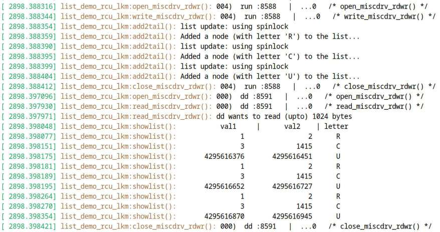

Hình 13.17: Ảnh chụp kernel log sau khi thực hiện I/O trên RCU-protected list ba lần (có thể thấy mỗi ký tự R, C và U đều được ghi vào list ba lần!)

Remove module khiến “exit” function gọi function của chúng ta:

```
freelist(&writelock);
```

…function này xóa và free từng node trong list một cách an toàn như sau:

```
void freelist(spinlock_t *lock)
{
        struct node *curr;
        if (list_empty(&head_node))
                return;

        pr_info("freeing list items...\n");

    // Wait for any pre-existing RCU readers to cycle off the CPU(s)...
        synchronize_rcu();

        // ... and now delete and free up the list nodes
        spin_lock(lock);
        list_for_each_entry_rcu(curr, &head_node, list) {
                list_del_rcu(&curr->list);
                kfree(curr);
        }
        spin_unlock(lock);
}
```

Đây là output của command `sudo rmmod list_demo_rcu_lkm`:

```
[ … ]
[ 2902.546835] list_demo_rcu_lkm:freelist(): freeing list items...
[ 2902.574092] list_demo_rcu_lkm:list_demo_rcu_exit(): LKP misc driver lkp_
miscdrv_list_rcu deregistered, bye
```

##### Bài tập

Tạo bản sao code của module `ch13/3_lockfree/list_demo_rcu/list_demo_rcu.c`. Refactor để cho phép truyền module parameter `buggy`; khi được truyền và đặt thành `1`, hãy cho module thực hiện blocking call trong RCU read-side critical section. Xem điều gì xảy ra; nghiên cứu kernel log.

##### Thêm ví dụ sử dụng RCU

Một ví dụ khác, tốt hơn, về sử dụng RCU primitive cơ bản sẽ sớm được trình bày trong phần Sửa lỗi – lần 2: dùng RCU sắp tới. Ở đó chúng ta giải quyết vấn đề concurrency khi duyệt mọi thread trong kernel task list, sử dụng RCU cho lock-free synchronization. Hãy nhớ xem code và thử nghiệm!

Một ví dụ còn tốt hơn về sử dụng RCU primitive cho module list-based tại đây: `https://github.com/jinb-park/rcu_example/tree/master`. Hãy xem thử.

Phần tiếp theo cho biết nơi bạn có thể truy cập (rất nhiều) tài liệu RCU bổ sung và qua đó tìm hiểu cách sử dụng RCU in-kernel.

#### RCU: tài liệu chi tiết

Tất nhiên, có thể tìm hiểu sâu hơn rất nhiều về RCU cùng triển khai và sử dụng nó in-kernel qua tài liệu kernel chính thức:

- Tài liệu “root” (file `index.rst`) cho tài liệu RCU trên kernel series 6.1 ở đây: Các khái niệm RCU: `https://elixir.bootlin.com/linux/v6.1.25/source/Documentation/RCU/index.rst`. Trong đó, bạn sẽ thấy danh sách có thư mục Design chứa một số tài liệu, cộng thêm nhiều tài liệu RCU khác (ở format `.rst` thông thường). Để hình dung nó trông thế nào, xem ảnh chụp sau:

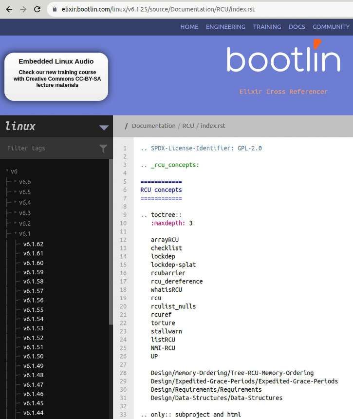

Hình 13.18: Ảnh chụp “root” (index doc) của tài liệu kernel chính thức (v6.1) về RCU

- Bắt đầu bằng tài liệu kinh điển RCU là gì? – “Read, Copy, Update” là ý tưởng tuyệt vời (đây là bộ six-article viết LWN well-known về RCU): `https://elixir.bootlin.com/linux/v6.1.25/source/Documentation/RCU/whatisRCU.rst` (mục được gắn nhãn whatisRCU trong Hình 13.18).

- Tiếp theo, để tìm hiểu sâu hơn các construct trong thiết kế RCU, xem Thiết kế (RCU): `https://elixir.bootlin.com/linux/v6.1.25/source/Documentation/RCU/Design`; trong đó phần Requirements đặc biệt hữu ích (ít nhất lúc đầu): Tham quan các requirement của RCU, Paul E. McKenney, IBM, 2015: `https://elixir.bootlin.com/linux/v6.1.25/source/Documentation/RCU/Design/Requirements/Requirements.rst`.

- Đây là chi tiết về sử dụng RCU (các API chuyên biệt), tập trung vào từng data structure:

  - Sử dụng RCU để bảo vệ Read-Mostly linked list: `https://elixir.bootlin.com/linux/v6.1.25/source/Documentation/RCU/listRCU.rst`. Ở đây bạn sẽ tìm thấy các ví dụ stepby-step rất hay về chính xác cách tận dụng RCU trong kernel (xếp các trường hợp “phù hợp nhất” trước). Thực tế, ví dụ đầu tiên – duyệt process list – chính là điều đã học trong Chương 6, Các kiến thức thiết yếu về kernel internals – Process và thread, ở phần Duyệt các task list của kernel. Một trong các module chúng ta viết để demo – `ch6/prcs_showall/prcs_showall.c` – thực sự dùng primitive `rcu_read_{un}` `lock()` khi duyệt list, đúng như tài liệu ở đây trình bày.

Cách tiếp cận tương tự, sử dụng RCU để giải quyết vấn đề concurrency khi duyệt mọi thread trong kernel task list, là nội dung phần Sửa lỗi – lần 2: dùng RCU sắp tới.

  - Tất nhiên còn (rất nhiều!) điều khác; RCU API được maintain thường xuyên và phát triển theo thời gian (một loạt cập nhật lớn vào năm 2010, một vào năm 2014 và gần đây nhất vào năm 2019). Đây là bản tổng hợp table-based các RCU List API (trong tài liệu rộng hơn Các bảng RCU API, phiên bản 2019), Paul E. McKenney, Jake Edge: `https://lwn.net/Articles/777165/#RCU%20List%20APIs`.

  - Sử dụng RCU để bảo vệ Read-Mostly array: `https://elixir.bootlin.com/linux/v6.1.25/source/Documentation/RCU/arrayRCU.rst`.

  - Tham quan các data structure của TREE\_RCU \[LWN.net\]: `https://elixir.bootlin.com/linux/v6.1.25/source/Documentation/RCU/Design/Data-Structures/Data-Structures.rst`.

- Phần Đọc thêm của chương có những tài liệu này và nhiều nội dung RCU hơn nữa để bạn xem và nghiền ngẫm lúc rảnh! (`https://github.com/PacktPublishing/Linux-Kernel-Programming_2E/blob/main/Further_Reading.md#chapter-13-kernel-synchronization-part-2---further-reading`).

Với tất cả tài liệu này trong tay (một số khá nâng cao), nhiều người sẽ tự hỏi bắt đầu từ đâu, đúng không? Có câu trả lời dễ dàng – bạn đã bắt đầu rất tốt rồi, với cuốn sách này!

Được rồi, ngoài chuyện đó, khi đã hiểu các khái niệm RCU cơ bản (hy vọng vài phần trước đã giúp bạn đạt điều đó), tìm hiểu các core RCU API (hay primitive) là ý tưởng tuyệt vời, và đây là nơi cần đến: `https://elixir.bootlin.com/linux/v6.1.25/source/Documentation/RCU/whatisRCU.rst#L137` (một lần nữa, có thể xem tóm tắt nhanh ở Bảng 13.6). Sau đây là vài lời về các kernel debug option RCU-related.

##### Vài lời về debug việc sử dụng RCU

Có hỗ trợ cho tình huống cần debug việc sử dụng RCU trong kernel (hoặc module). Để xem các menu item liên quan ở bước kernel configuration, thực hiện `make menuconfig` như thường lệ, đến sub-menu Kernel hacking \> RCU Debugging và xem các RCU debug config option ở đó. Kconfig file liên quan là `kernel/rcu/Kconfig.debug` (duyệt file giúp xem ngay mọi option cùng phần trợ giúp tương ứng! Link ở đây: `https://elixir.bootlin.com/linux/v6.1.25/source/kernel/rcu/Kconfig.debug`). Enable chúng trong kernel debug/development rất hữu ích và giúp phát hiện bug RCU-related.

Ngoài ra, đặt `CONFIG_RCU_EXPERT=y` sẽ enable thêm RCU debug option (như `CONFIG_PROVE_RCU_LIST`). Có thể tìm nó trong sub-menu General setup \> RCU Subsystem.

#### Sử dụng RCU trong kernel

Cuối cùng, việc sử dụng RCU trong Linux kernel tiến triển ra sao? Câu trả lời ngắn gọn, xét mọi khía cạnh, là tốt. Paul E. McKenney cung cấp trang Sử dụng RCU trong Linux (`http://www2.rdrop.com/~paulmck/RCU/linuxusage.html`); hãy xem các biểu đồ ở đó.

Để bạn hình dung, đây là bảng nhỏ chỉ có vài entry mẫu (không ngại lấy từ số liệu thống kê công phu của Paul tại đây: `http://www2.rdrop.com/~paulmck/RCU/linuxusage/rculocktab.html`:

| Ngày | \# lần gọi RCU | \# lần gọi lock (thông thường) |
|---|---|---|
| 31-Oct-2002 | 5 | 28,248 |
| 29-Nov-2006 | 1,147 | 53,463 |
| 08-Dec-2014 | 10,040 | 122,705 |
| 24-Dec-2018 | 15,167 | 143,428 |
| 30-Oct-2023 | 20,355 | 165,860 |
| 08-Jan-2024 | 20,761 | 165,602 |

Bảng 13.8: Sử dụng RCU so với locking API thông thường trong Linux kernel – một vài entry mẫu

Thú vị và khá đúng đắn là các locking primitive thông thường (spinlock, mutex và semaphore, với các biến thể exclusive, reader-writer và rt-mutex) được dùng nhiều hơn hẳn. Điều đó hợp lý: RCU là synchronization primitive chuyên biệt, cần dùng trong những điều kiện phù hợp.

Vậy “những điều kiện phù hợp” để dùng RCU là gì? Dù đã đề cập, rõ ràng nó được dành cho tình huống read-mostly, khi ít cập nhật (write) và reader làm việc với data hơi stale hoặc không nhất quán vẫn ổn.

Vì vậy, đây là tóm tắt nhanh những tình huống tốt nhất và not-so-good để sử dụng hoặc không sử dụng RCU; một lần nữa, cách tốt nhất là thể hiện bằng slide “Phạm vi áp dụng RCU” của Paul tại đây: `https://youtu.be/obDzjElRj9c?list=PLIlI4QbmdBqH9-L1QOq6O5Yxt-YVjRsFZ&t=4036`:

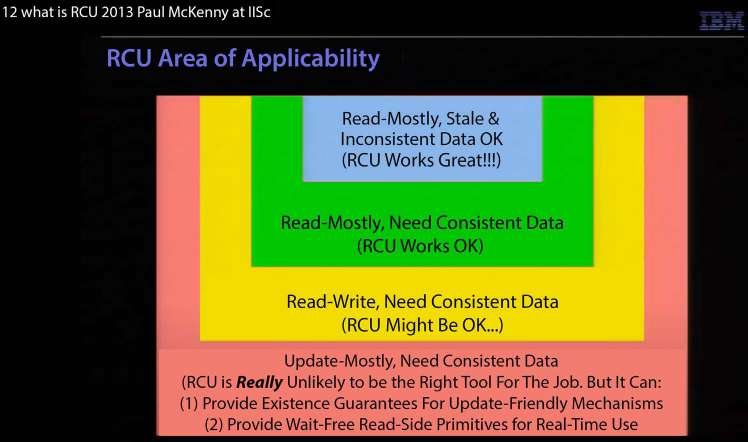

Hình 13.19: Ảnh chụp bài thuyết trình của Paul E. McKenney, thể hiện phạm vi áp dụng RCU. Nguồn: Paul E. McKenney

Cũng như mọi thứ, điều quan trọng là dùng RCU ở nơi phù hợp. (Có câu nói đại ý Nếu búa là công cụ duy nhất bạn biết dùng, mọi thứ đều trông như cái đinh; vì vậy hãy học sử dụng mọi công cụ!)

Thông tin thêm: Real-Time (RT) và kỹ thuật lock-free

RT thường xung đột với lock-free programming; tại sao? Phần lớn kỹ thuật lock-free liên quan đến non-preemptible code path trong kernel space. Đây chính là điều chúng ta muốn tránh tối đa trong môi trường real-time! Lý do là non-preemptible code path có thể làm tăng mạnh (scheduling) latency của real-time thread (thực chất khiến nó không được dùng CPU, có lẽ đúng lúc cần nhất!). Với RCU, như đã biết, read-side critical section phải non-preemptible; điều này rõ ràng xung đột với RT. Vì vậy, đối với RTL (Real-Time Linux) kernel, tính năng tên RCU priority boosting được áp dụng mặc định. Bài viết LWN Priority-Boosting RCU Read-Side Critical Sections, Paul E. McKenney, tháng 2 năm 2007 (`https://lwn.net/Articles/220677/`) trình bày chi tiết chuyên sâu. (Ngoài ra, enable `CONFIG_PREEMPTION` xử lý việc sử dụng RCU trong real-time Linux. Thêm nữa, các option như General setup/RCU Subsystem/Offload RCU callback processing from boot-selected CPUs (CONFIG\_RCU\_NOCB\_CPU=y) cũng có thể hữu ích trong tình huống RT.)

Đến đây, khi đã (gần như) hoàn tất thảo luận chi tiết về kỹ thuật và API kernel synchronization, hãy chuyển sang lĩnh vực quan trọng khác: công cụ và mẹo khi debug vấn đề locking trong kernel code!

## Lock debugging trong kernel

Như đã học, thiết kế và triển khai locking cùng synchronization có thể trở nên phức tạp, do đó làm tăng khả năng có bug ẩn náu. Kernel có nhiều phương tiện hỗ trợ debug các tình huống khó khăn về vấn đề locking ở kernel-level, trong đó deadlock là vấn đề chính.

Nếu chưa đọc, hãy bảo đảm trước tiên bạn đã đọc kiến thức cơ bản về synchronization, locking và hướng dẫn về deadlock ở chương trước (Chương 12, Kernel Synchronization – Phần 1, đặc biệt các phần Critical section, exclusive execution và atomicity và Các vấn đề concurrency trong Linux kernel).

Với mọi tình huống debug, có những thời điểm khác nhau diễn ra debugging, do đó có lẽ những công cụ và kỹ thuật khác nhau có thể/nên được sử dụng. Nói rất khái quát, bug có thể được phát hiện, và do đó debug, tại một vài thời điểm khác nhau (thực chất trong Software Development Life Cycle (SDLC)):

- Trong khi phát triển

- Sau khi phát triển nhưng trước release (testing, Quality Assurance (QA), v.v.)

- Sau release nội bộ

- Sau release, ngoài thực tế

Một lời răn well-known và tiếc là đúng: bug được phát hiện càng “xa” giai đoạn phát triển thì sửa càng tốn kém! Vì thế bạn thực sự nên cố tìm và sửa chúng sớm nhất có thể!

Vì sách tập trung hoàn toàn vào kernel development, ở đây chúng ta tập trung vào một vài công cụ và kỹ thuật để debug vấn đề locking trong giai đoạn phát triển (kernel/module).

Quan trọng: Chúng tôi kỳ vọng đến lúc này bạn đang chạy debug kernel, tức kernel được cố ý configure cho mục đích development/debug. Performance sẽ giảm, nhưng không sao – giờ chúng ta đang đi săn bug! Việc configure debug kernel điển hình đã được trình bày trong Chương 5, Viết kernel module đầu tiên – Phần 2, ở phần Configure “debug” kernel. Chi tiết configure debug kernel cho lock debugging thực chất được trình bày ngay tiếp theo.

### Configure debug kernel cho lock debugging

Do tính liên quan và tầm quan trọng với lock debugging, chúng ta sẽ xem nhanh một vài điểm chính trong tài liệu Linux Kernel patch submission checklist (`https://www.kernel.org/doc/html/v6.1/process/submit-checklist.html`) liên quan nhất đến thảo luận ở đây về enable debug kernel (đặc biệt cho lock debugging):

```
[ … ]
12. Has been tested with CONFIG_PREEMPT, CONFIG_DEBUG_PREEMPT, CONFIG_DEBUG_
SLAB, CONFIG_DEBUG_PAGEALLOC, CONFIG_DEBUG_MUTEXES, CONFIG_DEBUG_SPINLOCK,
CONFIG_DEBUG_ATOMIC_SLEEP, CONFIG_PROVE_RCU and CONFIG_DEBUG_OBJECTS_RCU_HEAD
all simultaneously enabled.
13. Has been build- and runtime tested with and without CONFIG_SMP and CONFIG_
PREEMPT.
14. All codepaths have been exercised with all lockdep features enabled.
[ ... ]
```

Tôi không thể không nhắc đến dynamic memory error detector rất mạnh tên Kernel Address SANitizer (KASAN). Nói ngắn gọn, nó sử dụng compile-time instrumentation-based dynamic analysis để phát hiện các bug memory-related phổ biến (hoạt động với cả GCC và Clang). ASan (Address Sanitizer), do kỹ sư Google đóng góp, được dùng để theo dõi và phát hiện vấn đề memory trong user-space app (được trình bày khá chi tiết và so sánh với Valgrind trong sách Hands-On System Programming for Linux). Phiên bản tương ứng trong kernel, KASAN, có từ kernel 4.0 cho x86\_64 và từ Linux 4.4 cho AArch64 (ARM64).

Trong kernel 5.8, một công cụ thực sự hữu ích khác, KCSAN – Kernel Concurrency Sanitizer – được đưa vào mainline. Đây là data race detector cho Linux kernel hoạt động qua compile-time instrumentation. Sách Linux Kernel Debugging trình bày cách sử dụng nó. Bạn cũng có thể tìm chi tiết trong các bài viết LWN: Tìm race condition bằng KCSAN, LWN, tháng 10 năm 2019 (`https://lwn.net/Articles/802128/`) và Concurrency bug nên sợ data-race detector đáng gờm (phần 1), LWN, tháng 4 năm 2020 (`https://lwn.net/Articles/816850/`).

Tuy nhiên, lưu ý KASAN xung đột với KCSAN; do đó phải sử dụng riêng từng công cụ. Có thể tìm hướng dẫn chi tiết và ví dụ enable, sử dụng chúng trong sách Linux Kernel Debugging. Tôi rất khuyến khích bạn tận dụng chúng trong debug kernel.

Ngoài ra, để bạn biết, có nhiều công cụ phát hiện locking bug và deadlock trong user-space app. Trong số đó có `helgrind` well-known (thuộc bộ Valgrind), TSan (Thread Sanitizer), cung cấp compile-time instrumentation để kiểm tra data race trong multithreaded application, và chính lockdep; lockdep cũng có thể hoạt động trong user space (dưới dạng library)! Hơn nữa, framework \[e\]BPF hiện đại cung cấp frontend `deadlock-bpfcc(8)`. Nó được thiết kế chuyên biệt để tìm deadlock tiềm ẩn (lock order inversion) trong một process (hoặc thread) đang chạy.

Như đã thấy ở Chương 2, Build Linux kernel 6.x từ source – Phần 1, chúng ta có thể configure Linux kernel đúng theo yêu cầu. Ở đây (trong root của kernel source tree 6.1.25), chúng ta thực hiện `make menuconfig` và (theo lời khuyên trong kernel patch submission checklist) đến menu Kernel hacking \> Lock Debugging `(`spinlocks, mutexes, etc...`)` (xem ảnh chụp ở Hình 13.20, chụp trên guest VM x86\_64 Ubuntu 23.04 LTS):

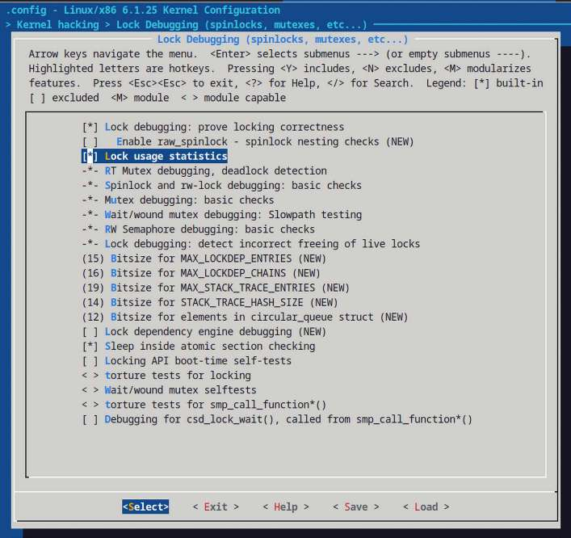

Hình 13.20: Ảnh chụp (đã cắt bớt) menu ‘Kernel hacking \> Lock Debugging (spinlocks, mutexes, etc...) với các mục cần thiết được enable cho debug kernel

Hình 13.20 là ảnh chụp (đã cắt bớt) menu `< Kernel hacking > Lock Debugging (spinlocks,` `mutexes, etc...)` với các mục cần thiết được enable cho debug kernel.

Thay vì phải tương tác qua từng menu item và chọn nút `<Help>` để xem nội dung, cách đơn giản hơn nhiều để có cùng thông tin trợ giúp là nhìn vào file `Kconfig*` liên quan (mô tả menu). Ở đây là `lib/Kconfig.debug`, vì tất cả (à, phần lớn) menu debug-related nằm ở đó. Trong trường hợp cụ thể này, tìm chuỗi menu `Lock Debugging (spinlocks, mutexes, etc...)`, nơi bắt đầu phần `Lock` `Debugging` (xem bảng sau). (Để bạn biết, link là `https://elixir.bootlin.com/linux/v6.1.25/source/lib/Kconfig.debug#L1229.)`

Bảng sau tổng hợp cách từng kernel lock debugging configuration option hỗ trợ debugging (không hiển thị tất cả và với một số option, chúng ta trích trực tiếp file `lib/Kconfig.debug`. Ngoài ra, hai mục cuối liên quan RCU debugging – định nghĩa trong `kernel/rcu/Kconfig.debug` – và thường yêu cầu `PROVE_RCU=y`, còn một số option cần `RCU_EXPERT=y`):

| Tiêu đề menu lock debugging | Chức năng |
|---|---|
| Lock debugging: chứng minh locking correctness (`CONFIG_PROVE_LOCKING`), còn gọi là lockdep! | Đây là kernel option `lockdep` – bật để luôn có “chứng minh liên tục về lock correctness”. Mọi khả năng deadlock locking-related đều được báo cáo ngay trước khi thực sự xảy ra; rất hữu ích! (Sẽ được giải thích chi tiết hơn ngay sau đây). |
| Thống kê sử dụng lock (`CONFIG_LOCK_STAT`) | Theo dõi các lock contention point (được giải thích chi tiết hơn sau). |
| RT mutex debugging, phát hiện deadlock (`CONFIG_DEBUG_RT_MUTEXES`) | “Cho phép tự động phát hiện và báo cáo vi phạm rt mutex semantics cùng deadlock (lockup) liên quan rt mutex.” |
| Spinlock và `rw-lock` debugging: kiểm tra cơ bản (`CONFIG_DEBUG_SPINLOCK`) | Bật option này (cùng `CONFIG_SMP`) giúp phát hiện thiếu spinlock initialization và các lỗi spinlock phổ biến khác (đồng thời bật cả non-maskable interrupts (NMI) watchdog cũng hữu ích). |
| Mutex debugging: kiểm tra cơ bản (`CONFIG_DEBUG_MUTEXES`) | “Tính năng này cho phép phát hiện và báo cáo vi phạm mutex semantics.” |
| RW semaphore debugging: kiểm tra cơ bản (`CONFIG_DEBUG_RWSEMS`) | Cho phép phát hiện và báo cáo lock và unlock RW semaphore không khớp. |
| Lock debugging: phát hiện free live lock sai cách (`CONFIG_DEBUG_LOCK_ALLOC`) | “Tính năng này kiểm tra xem có held lock nào (spinlock, rwlock, mutex hoặc rwsem) bị kernel free sai qua bất kỳ memory-freeing routine nào (`kfree()`, `kmem_cache_free()`, `free_pages()`, `vfree()`, v.v.), có live lock nào bị reinitialize sai qua `spin_lock_init()/mutex_init()`/v.v., hoặc có lock nào vẫn được giữ trong lúc task exit hay không.” |
| Kiểm tra sleep trong atomic section (`CONFIG_DEBUG_ATOMIC_SLEEP`) | “Nếu chọn `Y` ở đây, các routine có thể sleep sẽ phát rất nhiều cảnh báo nếu được gọi trong atomic section: khi đang giữ spinlock, trong `rcu` read side critical section, trong section có preempt bị disable, trong interrupt, v.v...” |
| Torture test cho locking (`CONFIG_LOCK_TORTURE_TEST`) | “Option này cung cấp kernel module chạy torture test trên kernel locking primitive. Nếu muốn, kernel module có thể được build sau trên kernel đang chạy cần kiểm tra.” (Có thể build inline bằng ‘`Y`' hoặc bên ngoài dưới dạng module bằng ‘`M`').” |
| Kernel hacking \| RCU Debugging RCU list `lockdep` debugging (`CONFIG_PROVE_RCU_LIST`) | “Enable RCU lockdep checking cho việc sử dụng list. Mặc định tắt vì vẫn còn một số nơi dùng list RCU cần được chuyển đổi để truyền lockdep expression. Để tránh false-positive splat, chúng ta giữ mặc định disable, nhưng khi tất cả nơi dùng đã được chuyển đổi, có thể bỏ config option này.” |
| Debug RCU callback object (`CONFIG_DEBUG_OBJECTS_RCU_HEAD`) | “Enable để bật debugging RCU list head (sử dụng call\_ rcu()).” |

Bảng 13.9: Các kernel debug configuration option điển hình cho kernel lock (và RCU) cùng ý nghĩa

Hai entry cuối trong bảng RCU-related debug config; chúng ta đã trình bày ngắn gọn việc thiết lập debug option liên quan RCU ở phần Vài lời về debug việc sử dụng RCU.

Như đã đề xuất, bật tất cả hoặc phần lớn lock debug option này trong debug kernel dùng khi phát triển và testing là ý tưởng tuyệt vời.

Chúng ta cung cấp helper script nhỏ (`ch13/4_lockdep/debugk_locking_configs_check`), hiển thị trạng thái một vài kernel config (chủ yếu) liên quan locking. Configure debug kernel rồi chạy nó để xác minh config.

Tất nhiên, như dự kiến, enable kernel debug config có thể làm execution chậm đáng kể (và dùng nhiều memory hơn); cũng như trong cuộc sống, đây là trade-off bạn phải quyết định: đổi tốc độ lấy khả năng phát hiện vấn đề locking phổ biến, lỗi và cả khả năng deadlock. Bạn nên rất sẵn lòng chấp nhận trade-off này, đặc biệt khi phát triển (hoặc refactor) và testing code.

### Lock validator lockdep – phát hiện vấn đề locking sớm

Linux kernel có tính năng vô cùng hữu ích đang chờ kernel developer tận dụng: runtime locking correctness validator hay locking dependency validator – gọi ngắn gọn là lockdep. Ý tưởng cơ bản như sau: runtime `lockdep` tham gia bất cứ khi nào có hoạt động locking trong kernel – lấy hoặc release bất kỳ kernel-level lock nào, hoặc bất kỳ locking sequence nào liên quan nhiều lock.

Hoạt động này được theo dõi hoặc lập bản đồ liên tục (xem vài đoạn bên dưới để biết tác động đến performance và cách giảm nhẹ). Bằng cách áp dụng các quy tắc locking đúng đắn well-known, `lockdep` đưa ra kết luận về tính đúng đắn của những gì đã thực hiện (hãy nhớ chúng ta đã học khái niệm self-deadlock và circular deadlock ở Chương 12, Kernel Synchronization – Phần 1, trong phần Hướng dẫn locking và deadlock).

Điểm hay là `lockdep` đạt được chứng minh toán học 100% (hay closure) rằng lock sequence có đúng hay không. Sau đây là trích dẫn trực tiếp từ tài liệu kernel về chủ đề này, `https://www.kernel.org/doc/html/v6.1/locking/lockdep-design.html#proof-of-100-correctness`:

Validator đạt được ‘closure’ toán học hoàn hảo (chứng minh locking correctness) theo nghĩa: với mọi single-task locking sequence đơn giản, độc lập đã xảy ra ít nhất một lần trong vòng đời kernel, validator chứng minh với độ chắc chắn 100% rằng không có sự kết hợp hay cách bố trí thời gian nào của các locking sequence này có thể gây ra bất kỳ loại deadlock liên quan lock nào.

Lưu ý có tuyên bố “áp dụng các điều kiện” tại đây: `https://www.kernel.org/doc/html/v6.1/locking/lockdep-design.html#id2`. Không có gì hoàn hảo 100 phần trăm trong mọi tình huống, lockdep cũng vậy; hãy xem cả phần Lưu ý về lockdep – các vấn đề đã biết.

Hơn nữa, `lockdep` cảnh báo (qua macro `WARN*()`) về mọi vi phạm thuộc các loại locking bug sau: tình huống deadlock/lock inversion, circular lock dependency và hard IRQ/soft IRQ safe/unsafe locking bug. Thông tin này rất quý; validate code bằng `lockdep` có thể tiết kiệm hàng trăm giờ làm việc bị lãng phí bằng cách phát hiện vấn đề locking sớm.

Chúng ta sẽ thường gặp thuật ngữ lock sequence hoặc lock chain; nó nghĩa là gì? Giả sử trên một code path, lock A được lấy, sau đó lock B được lấy – đây là lock sequence hay lock chain. Để bạn biết, `lockdep` theo dõi mọi lock cùng lock chain của chúng (có thể xem qua `/proc/lockdep_chains`).

Vài lời về giảm tác động đến performance: bạn có thể hình dung với thực sự hàng nghìn lock instance tồn tại, validate từng lock sequence sẽ chậm đến vô lý (đúng vậy, thực tế nó có algorithmic time complexity bậc `O(N^2)`!). Điều đó không thể hoạt động; thay vào đó, `lockdep` chỉ xác minh mỗi tình huống locking (lock sequence) một lần, ngay lần xuất hiện đầu tiên. (Nó biết điều này bằng cách duy trì 64-bit hash cho mỗi lock chain gặp phải.)

Có những cách tiếp cận user-space sơ khai để phát hiện tình huống có thể deadlock: một cách rất sơ khai – và chắc chắn không bảo đảm – để thử phát hiện deadlock tiềm ẩn là từ user space chỉ dùng GNU `ps(1)`; chạy `ps -LA -o state,pid,cmd | grep` `"^D"` in ra mọi thread ở state `D` – uninterruptible sleep (`TASK_UNINTERRUPTIBLE`). Điều này có thể – nhưng chưa chắc – do deadlock; nếu kéo dài lâu, khả năng là vấn đề deadlock cao hơn. Hãy thử! Tất nhiên `lockdep` là giải pháp vượt trội hơn nhiều. (Lưu ý cách này chỉ hoạt động với GNU `ps`, không phải các bản nhẹ như `busybox ps`.)

Các user-space tool hữu ích khác là `strace(1)` và `ltrace(1)` – lần lượt cung cấp trace chi tiết của mọi system call và library call do process (hoặc thread) thực hiện; bạn có thể bắt được process/thread bị treo và thấy nó mắc kẹt ở đâu (dùng `strace` `-p <PID>` có thể đặc biệt hữu ích với process bị treo).

Điểm khác cần hiểu rõ là: `lockdep` sẽ cảnh báo về locking sai (về mặt toán học) ngay cả khi thực tế không có deadlock lúc runtime! `lockdep` cung cấp bằng chứng rằng thực sự có vấn đề có thể gây bug (deadlock, unsafe locking, v.v.) vào một thời điểm tương lai nếu không sửa chữa. Nó thường hoàn toàn đúng; hãy nghiêm túc xem xét và sửa vấn đề. (Tuy vậy, thông thường không có gì trong thế giới software đúng 100% mọi lúc: nếu bug xuất hiện trong chính code `lockdep` thì sao? Thậm chí còn có config option `CONFIG_DEBUG_LOCKDEP`. Điều cốt yếu là chúng ta, những developer con người, phải cẩn thận đánh giá tình huống, kiểm tra false positive.)

Tiếp theo, `lockdep` làm việc trên lock class; đây đơn giản là lock “logic” thay vì các instance “vật lý” của lock đó. Ví dụ, open file data structure của kernel, `struct file`, có hai lock – mutex và spinlock – và mỗi lock được `lockdep` xem là một lock class. Ngay cả khi vài nghìn instance `struct file` tồn tại trong memory lúc runtime, `lockdep` chỉ theo dõi dưới dạng class. Để biết thêm về thiết kế nội bộ của `lockdep`, hãy xem tài liệu kernel chính thức tại đây: Runtime locking correctness validator (`https://www.kernel.org/doc/html/v6.1/locking/lockdep-design.html#runtime-locking-correctness-validator`).

### Phát hiện deadlock bug bằng lockdep – một vài ví dụ

Ở đây chúng ta giả định đến lúc này bạn đã build và đang chạy debug kernel có enable `lockdep` (như mô tả chi tiết trong phần Configure debug kernel cho lock debugging). Trên VM chạy ‘debug’ kernel của tôi, hãy xác minh tối thiểu rằng `lockdep` thực sự được enable:

```
$ uname -r
6.1.25-lock-dbg
$ grep PROVE_LOCKING /boot/config-6.1.25-lock-dbg
CONFIG_PROVE_LOCKING=y
```

Được rồi, tốt! Giờ hãy hands-on với một số deadlock, xem `lockdep` giúp phát hiện chúng như thế nào. Đọc tiếp nhé!

#### Ví dụ 1 – phát hiện self deadlock bug bằng lockdep

Làm ví dụ đầu tiên, hãy quay lại một kernel module từ Chương 6, Các kiến thức thiết yếu về kernel internals – Process và thread, trong phần Duyệt các task list của kernel, như chi tiết ở đây: `ch6/foreach/thrd_showall/thrd_showall.c`. Trong code này, chúng ta lặp qua kernel task list, qua từng thread còn tồn tại, in một số chi tiết từ task structure của nó. Liên quan đến việc đó, đây là một cách lấy tên thread (hãy nhớ nó là member của task structure tên `comm`):

```
// ch6/foreach/thrd_showall/thrd_showall.c
static int showthrds(void)
{
    struct task_struct *g = NULL, *t = NULL; /* 'g' : process ptr; 't': thread
ptr */
    [ ... ]
    do_each_thread(g, t) { /* 'g' : process ptr; 't': thread ptr */
        get_task_struct(t);     /* take a reference to the task struct */
        task_lock(t);
        [ ... ]
        if (!g->mm) {    // kernel thread
            snprintf(tmp, TMPMAX-1, " [%16s]", t->comm);
        } else {
            snprintf(tmp, TMPMAX-1, " %16s ", t->comm);
        }
        [ ... ]
```

Từ kernel 6.6 (rất mới tại thời điểm viết), các macro kiểu `do_each_thread()`/`while_each_thread()` đã được bỏ để thay bằng macro `for_each_process_thread()` đơn giản và dễ đọc hơn. Dù code có tính đến điều này, để giữ đơn giản, chúng ta không hiển thị trong code snippet trên.

Nếu task là kernel thread, chúng ta đặt tên trong dấu ngoặc vuông. Giờ dù lấy tên thread theo cách này vẫn hoạt động, thay vì tra cứu trực tiếp bằng `t->comm` (như ở đây), có cách tốt hơn: kernel cung cấp helper routine `{get,set}_task_comm()` để lấy và đặt tên task. (Hãy nhớ đã trình bày nội dung tương tự trong Chương 6, Các kiến thức thiết yếu về kernel internals – Process và thread, ở phần Các kernel helper method Built-in và tối ưu hóa.)

Vậy giờ hãy làm theo cách đó! Chúng ta viết lại module (thành `ch13/4_lockdep/buggy_thrdshow_eg/thrd_showall_buggy.c`) để dùng helper macro `get_task_comm(buf, tsk)`; parameter đầu là buffer pointer để đặt tên thread vào (kỳ vọng bạn đã allocate memory cho nó), parameter thứ hai là pointer đến task structure của thread mà bạn đang truy vấn tên (xem code snippet sau):

```
// ch13/4_lockdep/buggy_thrdshow_eg/thrd_showall_buggy.c
[ … ]
static int showthrds_buggy(void)
{
    struct task_struct *g, *t;               /* 'g' : process ptr; 't': thread
ptr */
     char buf[BUFMAX], tmp[TMPMAX], tasknm[TASK_COMM_LEN];
     [ ... ]
#if LINUX_VERSION_CODE < KERNEL_VERSION(6, 6, 0)
    do_each_thread(g, t) {     /* 'g' : process ptr; 't': thread ptr */
#else
    for_each_process_thread(g, t) {   /* 'g' : process ptr; 't': thread ptr */
#endif
        get_task_struct(t);     /* take a reference to the task struct */
            task_lock(t);
            [ ... ]
            get_task_comm(tasknm, t);
            if (!g->mm)     // kernel thread
                    snprintf_lkp(tmp, sizeof(tasknm)+3, " [%16s]", tasknm);
            else
                    snprintf_lkp(tmp, sizeof(tasknm)+3, " %16s ", tasknm);
            [ ... ]
```

Tuy nhiên, khi compile và insert vào kernel trên hệ thống thử nghiệm (may thay là VM), nó có thể hoạt động kỳ lạ, hoặc thậm chí treo hẳn! (Khi thực hiện trên x86\_64 Ubuntu VM, tôi lấy được kernel log bằng cách chạy `sudo journalctl -k -f` trong terminal window khác.)

Nếu hệ thống cứ treo ngay khi insert LKM này thì sao? Đó là chút trải nghiệm về độ khó của kernel debugging! Một việc có thể thử (đã có tác dụng với tôi khi thử chính ví dụ này trên x86\_64 Fedora 29 VM) là reboot VM bị treo rồi tra kernel log bằng utility `journalctl(1)` mạnh mẽ của systemd với command `journalctl` `--since="1 hour ago"`; giờ bạn sẽ thấy được các `printks` từ `lockdep`. Một lần nữa, tiếc là không bảo đảm phần kernel log quan trọng được lưu xuống disk (khi treo) để `journalctl` có thể lấy lại. Đó là lý do sử dụng tính năng `kdump` của kernel – rồi thực hiện postmortem analysis trên kernel dump image file bằng `crash(8)` – có thể cứu nguy (xem tài liệu về sử dụng `kdump` và crash trong phần Đọc thêm của chương).

Nhìn qua kernel log, mọi chuyện trở nên rõ ràng: `lockdep` đã bắt được vấn đề (self) deadlock! Chúng ta hiển thị các phần output liên quan trong ảnh chụp (đã loại bỏ cột timestamp):

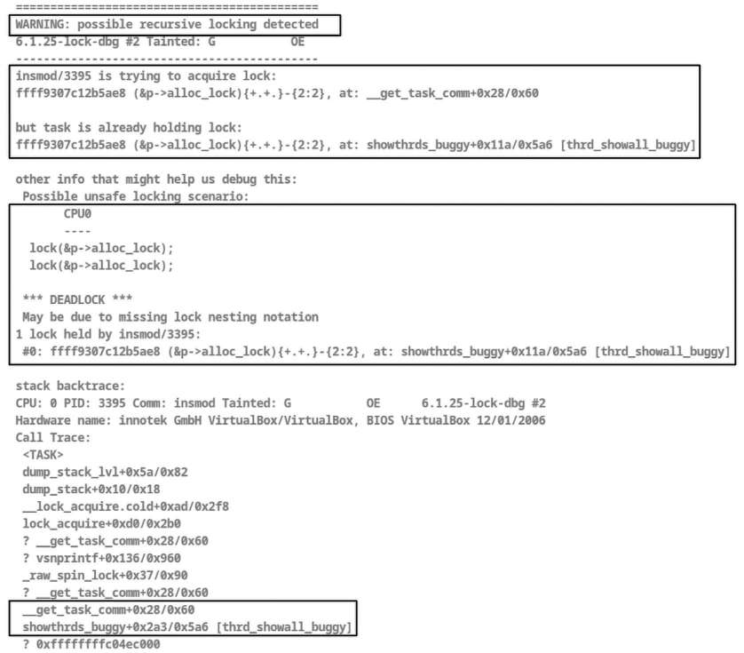

Hình 13.21: Ảnh chụp (một phần) kernel log sau khi load module có bug; lockdep bắt được self deadlock!

Khá rõ ràng… hơn nữa, stack backtrace, kernel stack của `insmod` (vì nó là process context), xuất hiện, xác nhận chính module của chúng ta gọi `get_task_comm()` (trở thành `__get_task_comm()`) dẫn đến bug (phần dưới Hình 13.21).

Mặc dù theo sau còn rất nhiều chi tiết (trong trường hợp này là register value, thậm chí soft lockup được watchdog phát hiện, RCU CPU stall, v.v.), những gì trong hình trước đủ để suy ra điều đã xảy ra. Rõ ràng, `lockdep` cho biết `insmod/3395 is trying to acquire lock:`, theo sau bởi `but` `task is already holding lock:`. Tiếp theo (xem kỹ Hình 13.21), lock mà `insmod` giữ là `(p->alloc_lock)` (lúc này bỏ qua các ký hiệu `lockdep` theo sau; chúng ta sẽ sớm giải thích) và routine thực sự cố acquire nó (hiển thị sau `at:`) là `__get_task_comm+0x28/0x60`.

Vậy có vẻ việc gọi `get_task_comm()` đã gây toàn bộ vấn đề; giờ chúng ta có tiến triển rồi! Đúng vậy, hãy tìm hiểu chính xác điều gì xảy ra khi gọi `get_task_comm()`; chúng ta thấy nó là macro (định nghĩa trong include/linux/sched.h), wrapper bao quanh worker routine thực tế `__get_task_comm()`. Code của nó như sau:

```
// fs/exec.c
char *__get_task_comm(char *buf, size_t buf_size, struct task_struct *tsk)
{
        task_lock(tsk);
        /* Always NUL terminated and zero-padded */
        strscpy_pad(buf, tsk->comm, buf_size);
        task_unlock(tsk);
        return buf;
}
EXPORT_SYMBOL_GPL(__get_task_comm);
```

À, đây là vấn đề, nguyên nhân gốc của bug: function `__get_task_comm()` lập tức gọi API `task_lock()`, thực chất cố reacquire chính lock mà chúng ta đang giữ, gây (self) deadlock!

Hãy nhớ một trong các “quy tắc” đã trình bày ở chương trước: “đừng cố re-acquire lock đang giữ.”

Chúng ta acquire nó ở đâu? Hãy nhớ một trong những dòng code đầu tiên của kernel module (có bug) sau khi vào loop là nơi gọi `task_lock(t)`; rồi chỉ vài dòng code sau gọi `get_task_comm()`, bên trong cố reacquire chính lock đó: kết quả là self deadlock:

```
do_each_thread(g, t) {   /* 'g' : process ptr; 't': thread ptr */
    get_task_struct(t);     /* take a reference to the task struct */
    task_lock(t);
    [ ... ]
    get_task_comm(tasknm, t);
    [ … ]
```

Hơn nữa, dễ dàng tìm lock cụ thể nào bị double-acquired; tra code của routine `task_lock()`:

```
// include/linux/sched/task.h */
static inline void task_lock(struct task_struct *p)
{
    spin_lock(&p->alloc_lock);
}
```

Vậy giờ tất cả hoàn toàn hợp lý; đó là spinlock trong task structure tên `alloc_lock`, đúng như `lockdep` thông báo (xem Hình 13.21).

Nhưng báo cáo của `lockdep` có nhiều ký hiệu khó hiểu. Xét các dòng sau:

```
insmod/3395 is trying to acquire lock:
ffff9307c12b5ae8 (&p->alloc_lock){+.+.}-{2:2}, at: __get_task_comm+0x28/0x60

but task is already holding lock:
ffff9307c12b5ae8 (&p->alloc_lock){+.+.}-{2:2}, at: showthrds_buggy+0x11a/0x5a6
[thrd_showall_buggy]
```

Được rồi, hãy phân tích từng phần:

- Số ở cột ngoài cùng bên trái của dòng thứ hai trong output block trước (`0xffff9307c12b5ae8`) là lightweight hash value 64-bit mà lockdep dùng để nhận diện lock sequence cụ thể này. Chú ý nó giống hệt hash ở dòng tiếp theo, nên biết rằng chính cùng lock đó đang được thao tác!

- Rõ ràng lock tên `alloc_lock`, và đã có hai lần cố lấy nó liên tiếp (nguyên nhân gốc của bug): một lần do module code gọi `task_lock()`, và một lần (nữa) do gọi `get_task_comm()`, wrapper của routine `__get_task_comm()`. Thực tế, tên module xuất hiện trong dấu ngoặc vuông, `[thrd_showall_buggy].`

- Tiếp theo, `{+.+.}` là ký hiệu lockdep mô tả state khi acquire lock này (ví dụ `+` nghĩa là lock được acquire khi IRQ (interrupt) được enable, `.` nghĩa là lock được acquire khi IRQ bị disable và không ở IRQ context, v.v.). Chúng được giải thích trong tài liệu kernel (`https://www.kernel.org/doc/Documentation/locking/lockdep-design.txt`); chúng ta dừng ở đó.

Steve Rostedt đã trình bày chi tiết cách diễn giải output `lockdep` tại Linux Plumber Conference (từ năm 2011); các slide liên quan rất bổ ích, khám phá cả tình huống deadlock đơn giản lẫn phức tạp và cách `lockdep` phát hiện chúng:

Lockdep: Cách đọc output khó hiểu của nó (`https://blog.linuxplumbersconf.org/2011/ocw/sessions/153`).

##### Sửa lỗi

Giờ đã hiểu vấn đề ở đây, làm thế nào sửa nó? Hãy xem hai cách thực hiện.

##### Sửa lỗi – lần 1: refactor code

Nhìn báo cáo của `lockdep` (Hình 13.21) và diễn giải, việc này khá đơn giản (đây là một cách sửa; chúng ta sẽ sớm thảo luận cách khác): vì API `task_lock(t)` trong module code acquire task structure spinlock tên `alloc_lock` ở đầu loop `do-while`, hãy bảo đảm trước khi gọi routine `get_task_comm()` – giờ đã biết bên trong cố acquire (rồi release) chính lock đó – bạn unlock trước, rồi thực hiện `get_task_comm()`, sau đó lock lại.

Ảnh chụp sau (Hình 13.22) cho thấy khác biệt code-level (qua utility `diff(1)`) giữa phiên bản cũ có bug (`ch13/4_lockdep/buggy_thrdshow_eg/thrd_showall_buggy.c`) và phiên bản code mới đã sửa (`ch13/4_lockdep/fixed_thrdshow_eg/thrd_showall_fixed.c`):

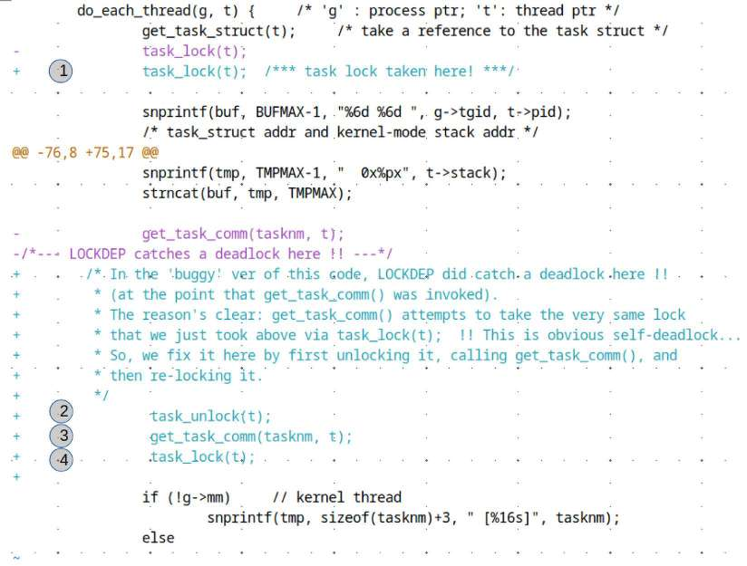

Hình 13.22: Ảnh chụp (một phần) thể hiện khác biệt chính giữa phiên bản có bug và đã sửa của demo thrdshow LKM

(Hãy bỏ qua số dòng diff-generated; chúng có thể khác nhau.) Bốn vòng tròn đánh số trong Hình 13.22 giải thích cách sửa:

1\. `task_lock(t)` acquire task lock (như đã biết là spinlock `alloc_lock` trong task structure). 2. Hiểu rằng `get_task_comm()` cũng cố acquire chính lock đó (qua việc gọi `task_lock()`), trước tiên chúng ta unlock bằng `task_unlock().` 3. Gọi `get_task_comm()` an toàn; bên trong nó gọi `task_lock()`, acquire spinlock `alloc_lock`, rồi release (qua `task_unlock()`). 4. Giờ gọi `task_lock()` để acquire lại spinlock cần thiết.

Tuyệt! Giờ có vẻ hoạt động. Tuy nhiên, đây không phải giải pháp tốt; lý do như sau:

- Thứ nhất, giữa `task_unlock()` và `task_lock()` – bước 2 và 4 trong Hình 13.22 – chúng ta đã đưa vào khả năng xảy ra race!

- Tiếp theo, các routine `task_{un}lock()` sử dụng (spin)lock chỉ có hiệu lực với một số task structure member (không bảo vệ tất cả).

Vì vậy giải pháp tốt hơn là hoàn toàn tránh dùng các routine `task_{un}lock()` mà vẫn cung cấp sự bảo vệ.

Một cách thực hiện, đặc biệt vì code này chắc chắn thuộc loại read-mostly, là dùng reader-writer spinlock `tasklist_lock` (reader-writer spinlock dành cho task list). Cách tiếp cận này hoạt động, nhưng như đã học, reader-writer lock cũng có thể gặp vấn đề performance (khá lớn). Ngoài ra, nó không được export nên kernel module của chúng ta không dùng được.

##### Sửa lỗi – lần 2: dùng RCU

Một lần nữa, vì loại code này – duyệt từng task structure theo cách read-only – rõ ràng là ứng viên chủ yếu read, hãy (bạn đoán đúng rồi!) dùng lock-free synchronization RCU của kernel! Thật vậy, RCU là giải pháp tốt nhất, được tối ưu hóa cao ở đây.

Vì vậy chúng ta refactor code của module để dùng RCU read-side critical section; đây là phiên bản mới tốt hơn: `ch13/3_lockfree/thrdshowall_rcu/`. Hơn nữa, vì ở đây không bao giờ sửa nội dung task structure nào – nói cách khác không có in-place update (write) – chúng ta còn loại bỏ nhu cầu write protection bằng spinlock.

Vậy code trong phiên bản RCU trông thế nào? Vì phần lớn giống nhau, thay vì hiển thị toàn bộ code, chúng ta chỉ hiển thị khác biệt giữa phiên bản iterate-over-task-struct dùng routine `task_{un}lock()` (“bản sửa” trước đó, được giải thích ở phần trước) và phiên bản mới cải tiến RCU-based:

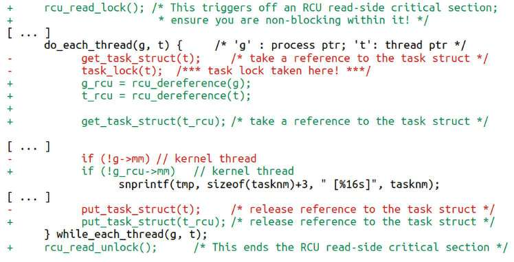

Hình 13.23: Ảnh chụp (một phần) thể hiện trong patch các khác biệt chính giữa phiên bản đã sửa ban đầu dùng task\_{un}lock() và phiên bản “tốt hơn” dùng RCU của các demo LKM

GitHub repo của sách cũng có patch (`https://github.com/PacktPublishing/Linux-Kernel-Programming_2E/blob/main/ch13/3_lockfree/thrdshowall_rcu/using_rcu.patch`; hãy bỏ qua số dòng diff-generated; chúng có thể khác nhau).

Nghiên cứu code (và patch); chú ý vì giờ RCU-based, chúng ta dùng routine `rcu_dereference`() để “lấy RCU-protected pointer một cách an toàn, sau đó có thể dereference (và sử dụng)” (đúng như đã học trong Giải thích RCU Cấp độ 3 (Cấp độ 2 + nhiều chi tiết hơn).

Được rồi, giờ hãy chuyển sang một ví dụ nữa tận dụng sức mạnh của lockdep: phát hiện AB-BA (circular) deadlock!

#### Ví dụ 2 – phát hiện AB-BA deadlock bằng lockdep

Làm ví dụ nữa, hãy xem kernel module (demo) cố ý tạo circular dependency, cuối cùng dẫn đến deadlock (chúng ta đã giải thích chính xác circular deadlock / AB-BA deadlock là gì ở Chương 12, Kernel Synchronization – Phần 1, trong phần Hướng dẫn locking và deadlock.) Code tại đây: `ch13/4_lockdep/deadlock_eg_AB-BA`. Module này dựa trên demo code của percpu module trước đó (`ch13/3_lockfree/percpu/`). Như bạn nhớ từ kernel module đó, chúng ta tạo hai kernel thread (kthread) và bảo đảm (bằng function pointer `sched_setaffinity()` được hack) mỗi kernel thread chạy trên CPU core riêng (kernel thread đầu trên CPU core `0`, thread thứ hai trên core `1`).

Bằng cách này, chúng ta có concurrency. Giờ cả hai thread làm việc với hai spinlock, `lockA` và `lockB`. Điều rất quan trọng là nhớ các khái niệm về self-deadlock và circular deadlock đã học ở Chương 12, Kernel Synchronization – Phần 1, trong phần Hướng dẫn locking và deadlock: lock ordering cực kỳ quan trọng.

Vì vậy ở đây, hiểu rằng đang chạy trong process context (kthread) với từ hai lock trở lên, chúng ta ghi lại và (phải) tuân thủ lock ordering rule – chẳng hạn lấy lockA trước, rồi lockB. Lock order cụ thể không quan trọng (nếu muốn có thể đổi thành lấy lockB trước, rồi lockA); điều quan trọng là luôn tuân thủ.

Tốt! Vậy một cách không nên làm là như sau (timeline đi thẳng xuống):

```
kthread 0 on CPU #0                            kthread 1 on CPU #1
 Take lockA                                     Take lockB
 <perform work>                                <perform work>
 (Try and) take lockA                            (Try and) take lockB
 < ... spins forever :                           < ... spins forever :
DEADLOCK ... >
 DEADLOCK ... >
```

Làm vậy tất nhiên gây AB-BA deadlock kinh điển! Vì module (thực tế là kernel thread (kthread) 1) bỏ qua lock ordering rule (điều chúng ta sẽ làm trong demo module sắp tới khi module parameter `lock_ooo` đặt thành `1; ooo = out-of-order`), nó deadlock.

Đây là một phần code liên quan (một lần nữa không hiển thị toàn bộ chương trình vì chắc chắn kỳ vọng bạn clone GitHub repository của sách, đọc code cẩn thận và tự thử nghiệm):

```
// ch13/4_lockdep/deadlock_eg_AB-BA/deadlock_eg_AB-BA.c
[ ... ]
/* Our kernel thread worker routine */
static int thrd_work(void *arg)
{
    [ ... ]
   if (thrd == 0) {                       /* our kthread #0 runs on CPU 0 */
        pr_info(" Thread #%ld: locking: we do:"
            " lockA --> lockB\n", thrd);
        for (i = 0; i < THRD0_ITERS; i ++) {
                /* In this thread, perform the locking per the lock ordering
'rule';
                  * first take lockA, then lockB */
                pr_info(" iteration #%d on cpu #%ld\n", i, thrd);
                spin_lock(&lockA);
                DELAY_LOOP('A', 3);
                spin_lock(&lockB);
                DELAY_LOOP('B', 2);
                spin_unlock(&lockB);
                spin_unlock(&lockA);
        }
```

Kernel thread `0` thực hiện đúng, tuân thủ lock ordering rule (acquire spinlock `lockA` trước rồi spinlock `lockB`). Giờ code liên quan kernel thread `1` (tiếp nối code trước) như sau:

```
   [ ... ]
 } else if (thrd == 1) {            /* our kthread #1 runs on CPU 1 */
 for (i = 0; i < THRD1_ITERS; i ++) {
    /* In this thread, if the parameter lock_ooo is 1, *violate* the
    * lock ordering 'rule'; first (attempt to) take lockB, then lockA */
    pr_info(" iteration #%d on cpu #%ld\n", i, thrd);
    if (lock_ooo == 1) {        // violate the rule, naughty boy!
            pr_info(" Thread #%ld: locking: we do: lockB --> lockA\n",thrd);
            spin_lock(&lockB);
                    DELAY_LOOP('B', 2);
                    spin_lock(&lockA);
                    DELAY_LOOP('A', 3);
                    spin_unlock(&lockA);
                    spin_unlock(&lockB);
            } else if (lock_ooo == 0) { // follow the rule, good boy!
                    pr_info(" Thread #%ld: locking: we do: lockA --> lockB\
n",thrd);
                    spin_lock(&lockA);
                    DELAY_LOOP('B', 2);
                    spin_lock(&lockB);
                    DELAY_LOOP('A', 3);
                    spin_unlock(&lockB);
                    spin_unlock(&lockA);
            }
    [ ... ]
```

Được rồi, hãy thử.

##### Runtime – trường hợp tốt, không deadlock

Build và chạy qua Bash script wrapper `run` (script nhận một parameter; nếu truyền `1`, nó đặt module parameter `lock_ooo` thành 1 lúc `insmod`!), trước tiên với kernel module parameter `lock_ooo` đặt thành `0` (mặc định).

Chúng ta thấy khi tuân thủ lock ordering rule, mọi thứ đều ổn; lockdep không phát hiện vấn đề:

```
$ ./run
Usage: run 0|1
 0 : run normally, take locks in the right (documented) order
 1 : run abnormally, take locks in the WRONG order, causing an AB-BA deadlock
$ ./run 0
[30125.466260] deadlock_eg_AB_BA: inserted (param: lock_ooo=0)
[30125.466593] thrd_work():167: *** thread PID 17048 on cpu 0 now ***
[30125.466622]  Thread #0: locking: we do: lockA --> lockB
[30125.466652]  iteration #0 on cpu #0
[30125.466841] thrd_work():167: *** thread PID 17049 on cpu 1 now ***
[30125.466874]  iteration #0 on cpu #1
[30125.466878]  Thread #1: locking: we do: lockA --> lockB
[30125.466950] BBAAA
[30125.467137] deadlock_eg_AB_BA: Our kernel thread #1 exiting now...
[30125.467138] AAABB
[30125.467287] deadlock_eg_AB_BA: Our kernel thread #0 exiting now…
$
```

##### Runtime – trường hợp có bug, circular deadlock

Giờ chúng ta (reboot và) chạy với kernel module parameter `lock_ooo` đặt thành `1`; như dự kiến, hệ thống lock up! (À, có thể treo hoặc không.) Chúng ta đã không tuân thủ lock ordering rule và phải trả giá bằng deadlock! Lần này, tôi nhận được báo cáo lockdep sau trong kernel log (tra bằng `sudo dmesg` như thường lệ trên x86\_64 VM):

```
[ … ]
[  134.153810] deadlock_eg_AB_BA: inserted (param: lock_ooo=1)
[  134.154110] thrd_work():167: *** thread PID 3578 on cpu 0 now ***
[  134.154181] thrd_work():167: *** thread PID 3579 on cpu 1 now ***
[  134.154321]  iteration #0 on cpu #1
[  134.154365]  Thread #1: locking: we do: lockB --> lockA
[  134.154503] BBAAA
[  134.154671] deadlock_eg_AB_BA: Our kernel thread #1 exiting now...
[  134.164618]  Thread #0: locking: we do: lockA --> lockB
[  134.164624]  iteration #0 on cpu #0
[  134.164631] AAA
[ … ]
```

À, bạn thấy chưa? Thread 1 (trên core 1) lấy lock sai thứ tự! Đáng trách thật… hãy xem lời phàn nàn của `lockdep` trong ảnh chụp (Hình 13.24):

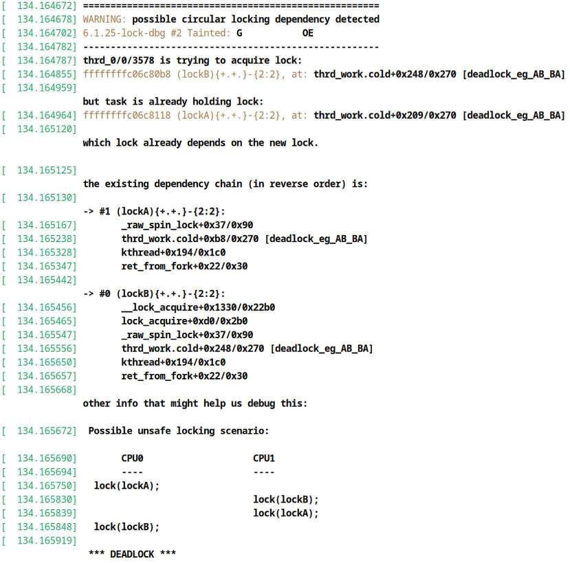

Hình 13.24: Ảnh chụp (một phần) kernel log; lockdep phát hiện và báo cáo AB-BA circular deadlock do demo module gây ra

Compiler attribute .cold

Nhân tiện, tại sao một số function có hậu tố `.cold` (như function `thrd_work` ở đây)? Câu trả lời ngắn là đây là compiler attribute chỉ định function ít có khả năng được thực thi. Các function so-called cold này thường được đặt trong linker section riêng để cải thiện code locality của các non-cold section required-to-be-fast! Tất cả nhằm tối ưu hóa. (Lưu ý trong một số trường hợp, phiên bản function bình thường có thể co-exist với phiên bản cold.)

Báo cáo `lockdep` khá tuyệt vời. Phần đầu cho biết đã phát hiện “possible circular locking dependency…”. Sau đó nó cho thấy điều thực sự xảy ra lúc runtime: ở đây thread 0 (hiển thị là `thrd_0/0/3578`, tên (`thrd_0/0`), theo sau bởi dấu gạch chéo và PID) cố acquire lock (hash value 64-bit `ffffffffc06c80b8`; thậm chí hiển thị symbolic name `lockB`!) từ module, “`but task is already holding lock:`". Tiếp theo nó cho biết lock được giữ trong cùng function (`thrd_work`) của cùng module (`[deadlock_eg_AB_BA]`), chỉ rõ tình huống (circular/AB-BA) deadlock. Rồi hiển thị (kernel) call stack dẫn đến đây (với call stack chi tiết hơn theo ngay sau, không thấy trong Hình 13.24), tất nhiên làm rõ hoàn toàn code path nào gây deadlock.

Vì là debug kernel, kernel symbol chắc chắn có sẵn; ngoài ra, ngay cả frame pointer config cũng có khả năng được enable. Chúng giúp có call stack chính xác, chi tiết, tất nhiên khiến debugging dễ hơn. Vậy trong production thì sao? Dù kernel symbol có thể được enable, frame pointer có thể không; điều đó cùng nhiều phức tạp khác khiến khó hơn… nhưng đừng nản, vì có rất nhiều kỹ thuật và công cụ kernel debug hữu ích (hãy xem sách Linux Kernel Debugging). Một lần nữa, ở đây là tình huống debug và kỳ vọng sử dụng debug kernel với nhiều config bug-catching được enable.

Sau đó (từ dòng `other info that might help us debug this:`), báo cáo tiếp tục chỉ ra nguyên nhân gốc tổng quát của deadlock bằng tình huống điển hình (thực sự là timeline diagram nhỏ!). Xem các dòng sau đó về phía dưới Hình 13.24; chúng cho thấy kiểu sự việc thực sự xảy ra lúc runtime – locking sequence có thể out-of-order (ooo). Chú ý cách lockdep báo cáo tình huống tổng quát ở đây; phần trên cho biết điều thực sự xảy ra lúc runtime. Ở đây rõ ràng chính xác là như vậy: kthread (#0) trên CPU core 0 lấy `lockA`; song song, đồng thời, kthread khác (#1) trên core 1 lấy `lockB` trước – bug! Sau đó kthread1 cố lấy `lockA`, trong khi song song kthread0 cố lấy `lockB`, và chúng ta có AB-BA circular deadlock đáng yêu.

Nhân tiện, điều này rất có thể dẫn đến soft lockup bug mà kernel watchdog phát hiện.

Ngoài ra, hãy nhớ `lockdep` chỉ báo cáo một lần – lần đầu – khi một lock rule trên bất kỳ kernel lock nào bị vi phạm.

### Ghi chú ngắn về lockdep – annotation và các vấn đề

Hãy kết thúc nội dung này bằng vài điểm nữa về infrastructure `lockdep` mạnh mẽ.

#### Lưu ý về lockdep annotation

Trong user space, có lẽ bạn quen với macro `assert()` rất hữu ích. Ở đó bạn assert Boolean expression, một điều kiện (ví dụ `assert(x == 5);`). Nếu assertion đúng lúc runtime, không có gì xảy ra và execution tiếp tục; khi assertion sai, process bị abort và `printf()` ồn ào ra `stderr` chỉ ra assertion nào thất bại và ở đâu. Điều này cho phép developer kiểm tra runtime condition mà họ kỳ vọng. Vì vậy assertion có thể rất có giá trị – giúp phát hiện bug! Thực chất macro `assert()` giúp xác minh những giả định (thường sai) của chúng ta!

Kernel không có macro `assert()`; tại sao? Nếu nó kích hoạt, chúng ta có sẵn lòng abort chính kernel không? Thú vị là đó gần như chính xác những gì macro `BUG[_ON]` `()` làm – nhiều macro cuối cùng phát `printk` ồn ào rồi gọi `panic()`. Đừng dùng `BUG*()` trừ khi không còn cách khác. (Ngoài ra, một số driver định nghĩa phiên bản assert macro riêng, chỉ in message vào kernel log để cảnh báo developer.) Có lẽ thứ gần tương đương `assert()` nhất trong kernel là macro `WARN*()`; cũng đừng dùng chúng tùy tiện.

Tương tự `assert()`, `lockdep` cho phép kernel developer assert rằng lock được giữ tại một thời điểm cụ thể qua macro `lockdep_assert_held()`. Đây được gọi là lockdep annotation. Định nghĩa macro được hiển thị ở đây:

```
// include/linux/lockdep.h
#define lockdep_assert(cond)            \
        do { WARN_ON(debug_locks && !(cond)); } while (0)
[ … ]
#define lockdep_assert_held(l)          \
        lockdep_assert(lockdep_is_held(l) != LOCK_STATE_NOT_HELD)
```

Assertion thất bại dẫn đến warning (qua `WARN_ON()`). Điều này rất có giá trị vì có nghĩa lock `l` đáng ra đang được giữ nhưng thực tế lại không. Ngoài ra, chú ý các assertion này chỉ tham gia khi lock debugging được enable (tất nhiên đây là mặc định khi enable lock debugging trong kernel; nó chỉ bị tắt khi xảy ra lỗi trong `lockdep` hoặc kernel locking infrastructure khác). Thực tế kernel codebase sử dụng `lockdep` annotation khắp nơi, cả trong core lẫn driver code. (Thử dùng `cscope` tìm các lần gọi macro này. Ngoài ra có một vài biến thể của `lockdep` assertion dạng `lockdep_assert_[not]_held*()` và các macro ít dùng `lockdep_*pin_lock()`.)

Vậy bằng `lockdep` annotation, chúng ta có thể annotate code, kiểm tra một lock có đang được giữ hay không. Nhưng RCU read-side lock thì sao? Có cách kiểm tra thực chất đang ở trong RCU read-side critical section không? Có: API `rcu_read_lock_held()` (và các API liên quan) phục vụ chính mục đích này. Tài liệu kernel chính thức làm rõ khía cạnh đó tại đây: RCU và lockdep checking: `https://docs.kernel.org/RCU/lockdep.html#rcu-and-lockdep-checking`. Ngoài ra, hãy đọc comment chi tiết đi cùng code tại đây: `https://elixir.bootlin.com/linux/v6.1.25/source/kernel/rcu/update.c#L285`.

#### Lưu ý về lockdep – các vấn đề đã biết

Một vài vấn đề đã biết có thể xuất hiện khi làm việc với `lockdep`:

- Load và unload module lặp lại có thể làm vượt giới hạn lock class nội bộ của `lockdep` (lý do, như tài liệu kernel giải thích, là load kernel module `x.ko` tạo tập lock class mới cho mọi lock của nó, trong khi unload `x.ko` không loại bỏ chúng; thực tế nó được tái sử dụng). Vì vậy đừng load/unload module lặp lại; nếu không có thể phải reset hệ thống.

- Đặc biệt khi data structure có số lượng lock khổng lồ (chẳng hạn array lớn gồm nhiều structure, mỗi structure có thể có vài lock), không initialize đúng từng lock có thể dẫn đến lock-class overflow của `lockdep`.

- Lockdep hoạt động nhờ developer cẩn thận xây dựng lock(dep) annotation để cho lockdep biết các “quy tắc”; khi phát hiện không tuân thủ, nó tạo warning (còn gọi là lockdep “splat”). Vấn đề là cách tiếp cận này có thể và đôi khi thực sự khiến lockdep tạo false positive (dù vậy, tạo false positive vẫn tốt hơn không tạo gì rồi hệ thống thực sự deadlock; lúc đó đã quá muộn). Những vấn đề này được thảo luận trong bài của David Airlie Lockdep False Positives, một vài câu chuyện về chúng (`https://blog.ffwll.ch/2020/08/lockdep-false-positives.html`). Bài viết nói về nguyên nhân false positive (giả định các locking rule không đổi theo thời gian và mọi lock cho cùng object tuân thủ quy tắc chung) và cách xử lý (về cơ bản quy về câu trích dẫn “đừng sửa false positive của lockdep, hãy sửa locking của bạn.” Hay thật).

- Integer `debug_locks` được đặt thành `0` bất cứ khi nào lock debugging bị disable (ngay cả trên debug kernel); điều này có thể khiến xuất hiện message: `*WARNING* lock debugging disabled!!` `- possibly due to a lockdep warning`. Điều này thậm chí có thể xảy ra do `lockdep` phát warning trước đó. Reboot hệ thống rồi thử lại.

### Thống kê kernel lock

Lock có thể bị contended, tức context muốn acquire lock nhưng lock đã được lấy, vì vậy phải chờ unlock. Contention nặng có thể tạo performance bottleneck nghiêm trọng; kernel cung cấp thống kê (kernel) lock chi tiết nhằm dễ dàng xác định lock có contention cao. Điều này hữu ích khi thực hiện performance analysis.

Enable lock statistics bằng cách bật kernel configuration option `CONFIG_LOCK_STAT` (thực chất là menu item được highlight trong Hình 13.20). Nếu không chọn – trường hợp điển hình trên hầu hết distribution kernel – pseudofile `/proc/lock_stat` thậm chí không tồn tại.

Lock stats code tận dụng việc `lockdep` chèn hook vào locking code path (các hook `__contended`, `__acquired` và `__released`) để thu thập thống kê tại những điểm quan trọng này. Tài liệu kernel được viết rõ ràng về lock statistics (`https://www.kernel.org/doc/html/latest/locking/lockstat.html#lock-statistics`) truyền tải thông tin này (và nhiều hơn nữa) bằng state diagram.

#### Xem và diễn giải thống kê kernel lock

Pseudofile `/proc/sys/kernel/lock_stat` (permission 0644) là control interface cho thống kê (kernel) locking (`sysctl` knob); Bảng 13.10 cho biết cách sử dụng. Vì mode của `/proc/lock_stat` là 0600, ngay cả đọc lock statistics hiện tại cũng cần root access; tất nhiên giả định `CONFIG_LOCK_STAT=y`:

| Thực hiện việc gì? | Command cần chạy (với quyền root) |
|---|---|
| Xóa lock stats | `echo 0 > /proc/lock_stat` |
| Enable thu thập lock stats | `echo 1 > /proc/sys/kernel/lock_stat` |
| Disable thu thập lock stats | `echo 0 > /proc/sys/kernel/lock_stat` |
| Xem (đọc) lock stats hiện tại | `cat /proc/lock_stat` |

Bảng 13.10: Command để xem kernel lock stats (với điều kiện CONFIG\_LOCK\_STAT=y)

Tiếp theo, đây là demo đơn giản để xem một số kernel locking statistics: chúng ta viết Bash script đơn giản `ch13/4_lockdep/lock_stats_demo.sh`; sau đây là snippet cho thấy cách bọc các lock stats command trong những function nhỏ (tất nhiên có kiểm tra tính hợp lệ, bảo đảm `CONFIG_LOCK_STAT=y` và script chạy với quyền root):

```
clear_lock_stats() {
  echo 0 > /proc/lock_stat
}
enable_lock_stats() {
  echo 1 > /proc/sys/kernel/lock_stat
}
disable_lock_stats() {
  echo 0 > /proc/sys/kernel/lock_stat
}
view_lock_stats() {
  cat /proc/lock_stat
}
```

Script trước tiên disable locking statistics rồi chạy test case. Test case là gì? Chúng ta chọn chạy module `deadlock_eg_AB-BA` ở phần trước (code trong book codebase tại đây: `ch13/4_lockdep/deadlock_eg_AB-BA/`) nhưng theo cách bình thường – không gây circular deadlock. Với test case này, chúng ta biết hai kernel thread sẽ chạy đồng thời và cả hai đều cố lấy spinlock tên `lockA` trước, rồi spinlock tên `lockB`, điều này ổn (xem lại code nếu muốn). Vì vậy sẽ có contention trên spinlock và kernel lock statistics, khi được enable, sẽ ghi nhận. (Ở đây không trình bày chi tiết script thực hiện `insmod` module này.) Ngay trước khi insert module, script xóa và enable lock stats; khi xong, disable lock stats và ghi chúng ra file (`lockstats.txt`).

Giả sử đã chạy script `lock_stats_demo.sh`; giờ hãy diễn giải phần liên quan trong lock statistics thu được (lưu trong file `lockstats.txt`; để lọc output không cần thiết, chúng ta grep các dòng chứa tên lock `lockA` và `lockB`, giữ một dòng context).

Dù vậy, output thu được rất dài theo chiều ngang và do đó xuống dòng; đây là cùng output đó, color-coded để dễ diễn giải các cột hơn (gợi ý: `con` viết tắt của contended):

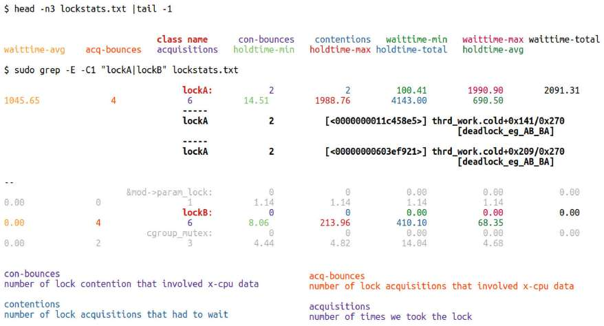

Hình 13.25: Ảnh chụp một phần có chú thích: kernel lock statistics chỉ của các spinlock lockA và lockB trong demo module “deadlock” (lưu ý dòng dài bị xuống dòng)

Tài liệu kernel (tại đây: `https://docs.kernel.org/locking/lockstat.html#usage`) giải thích chi tiết cách diễn giải output. Hãy tham khảo để xem ý nghĩa từng cột.

Đây là một vài gợi ý diễn giải output:

- Phần lớn cột lock stats chỉ áp dụng cho các hàng có dấu hai chấm `:`' theo sau tên lock. Các hàng không có dấu hai chấm sau tên lock thường biểu thị lock contention point.

- Thời gian hiển thị theo microsecond. Cột đầu `class name` là lock class; tên (symbolic) của lock xuất hiện ở đây.

- `contentions`: Số lần lock contention phải chờ.

- `con-bounces`: Số lần lock contention liên quan x-CPU data; ở đây `con` viết tắt của contention; `x` nghĩa là “cross” (tức cross-cpu data; cách hoạt động tương tự với field `acquisitions` và `acq-bounces`). Thực chất đây là overhead! Số lần lock acquisition thực tế có thể ít hơn.

- Lock contention point là các dòng xuất hiện giữa hai đường phân cách ngắn (-----); nội dung dòng không khớp các column header. Format là tên lock, con-bounces (nghĩa là số lần lock contention liên quan x-cpu data) và call site (hiển thị dưới dạng `<IP> func+x/y [module_name]`, trong đó x là offset bắt đầu và y là độ dài function). Hình 13.25 giúp diễn giải dễ hơn; bạn thấy rõ các contention point (cũng được highlight bằng chữ đậm) ở đó.

- Tiếp theo là các wait time (`waittime*`, field 4 đến 7) của lock.

- Field `acquisitions` (#9) là tổng số lần lock được acquire (lấy); giá trị dương.

- Bốn field cuối, 10 đến 13, là thống kê lock hold time tích lũy (`holdtime-{min|max|total|avg}`).

Có thể tra các lock có contention cao nhất trên hệ thống qua `sudo grep ":" /proc/lock_stat | head`. Tất nhiên cần hiểu data này tính từ thời điểm locking statistics được reset (xóa) gần nhất.

Lưu ý lock statistics có thể bị disable do lock debugging bị disable; ví dụ bạn có thể gặp:

```
$ sudo cat /proc/lock_stat
lock_stat version 0.4
*WARNING* lock debugging disabled!! - possibly due to a lockdep warning
```

Warning này có thể yêu cầu bạn reboot hệ thống.

Được rồi, bạn gần đến đích! Hãy kết thúc chương bằng phần trình bày ngắn về memory barrier.

## Giới thiệu memory barrier

Cuối cùng, hãy đề cập vấn đề khác – memory barrier. Nó nghĩa là gì? Đôi khi flow của chương trình trở nên khó biết đối với lập trình viên vì microprocessor, memory controller và compiler có thể reorder memory read và write. Trong phần lớn trường hợp, các “thủ thuật” này vô hại và thường tối ưu performance. Nhưng có trường hợp không được reorder (memory I/O) instruction sequence như vậy; phải tôn trọng memory load và store sequence ban đầu theo programmer-intended. Những trường hợp nào? Thường là:

- Khi làm việc qua hardware boundary, chẳng hạn giữa các CPU core riêng lẻ trên multicore system

- Khi thực hiện atomic operation

- Khi truy cập peripheral device (như thực hiện I/O từ CPU đến peripheral device hoặc ngược lại, thường qua Direct Memory Access (DMA))

- Khi làm việc với hardware interrupt Memory barrier (thường được triển khai dưới dạng machine-level instruction nhúng trong macro `*mb*()`) là phương tiện ngăn reordering như vậy; đó là cách buộc cả CPU/memory controller lẫn compiler sắp xếp instruction/data theo sequence mong muốn.

Có thể đặt memory barrier vào code path bằng các macro sau: bạn phải include header `<asm/barrier.h>`:

- `rmb()`: Chèn read (hay load) memory barrier vào instruction stream.

- `wmb()`: Chèn write (hay store) memory barrier vào instruction stream.

- `mb()`: General memory barrier – đây là trích dẫn trực tiếp từ tài liệu kernel về memory barrier (`https://docs.kernel.org/core-api/wrappers/memory-barriers.html`), “General memory barrier bảo đảm mọi LOAD và STORE operation được chỉ định trước barrier sẽ có vẻ xảy ra trước mọi LOAD và STORE operation được chỉ định sau barrier, xét từ các thành phần khác của hệ thống.”

Đó là điểm chính: memory barrier bảo đảm cho đến khi instruction hoặc data access trước đó thực thi thì instruction hoặc data access sau đó chưa thực thi, nhờ vậy duy trì ordering. Trong một số trường hợp (khá hiếm), nhiều khả năng là DMA, driver author sử dụng memory barrier. Khi dùng DMA, cần đọc tài liệu kernel (`https://www.kernel.org/doc/Documentation/DMA-API-HOWTO.txt`). Tài liệu nói rõ nơi phải dùng memory barrier và nguy cơ khi không dùng; xem ví dụ tiếp theo để biết thêm.

Vì đặt memory barrier đúng vào code path thường khá khó hiểu với nhiều người, chúng tôi khuyến khích bạn tham khảo technical reference manual liên quan của processor hoặc peripheral mà bạn đang viết driver để biết thêm chi tiết. Ví dụ trên Raspberry Pi, system on-a chip (SoC) điển hình là Broadcom BCM2835 series; tham khảo peripherals manual – BCM2835 ARM Peripherals manual (`https://www.raspberrypi.org/app/uploads/2012/02/BCM2835-ARM-Peripherals.pdf`), cụ thể phần 1.3, Các lưu ý khi truy cập peripheral để có memory ordering đúng – giúp xác định khi nào nên và không nên dùng memory barrier.

### Ví dụ sử dụng memory barrier trong device driver

Làm ví dụ, xét network driver Realtek 8139 “fast Ethernet”. Để transmit network packet qua DMA, trước tiên driver phải thiết lập DMA (transmit) descriptor object. Với hardware cụ thể này (NIC chip), DMA descriptor object được định nghĩa như sau `https://elixir.bootlin.com/linux/v6.1.25/source/drivers/net/ethernet/realtek/8139cp.c#L296`:

```
// drivers/net/ethernet/realtek/8139cp.c
struct cp_desc {
    __le32 opts1;
    __le32 opts2;
    __le64 addr;
};
```

Như bạn thấy, DMA descriptor object, được đặt tên `struct cp_desc`, có ba member. Mỗi member phải được initialize trước khi thực hiện DMA transfer. Giờ để bảo đảm DMA controller diễn giải descriptor đúng, điều cực kỳ quan trọng là các write vào DMA descriptor được thấy theo đúng thứ tự driver author dự định. Để bảo đảm điều này, memory barrier được sử dụng. Thực tế tài liệu kernel liên quan – Hướng dẫn Dynamic DMA mapping (`https://docs.kernel.org/core-api/dma-api-howto.html`) – yêu cầu bảo đảm đúng như vậy. Vì thế, chẳng hạn khi thiết lập DMA descriptor, bạn phải viết code như sau để có behavior đúng trên mọi platform:

```
desc->word0 = address;
wmb();
desc->word1 = DESC_VALID;
```

(Tôi đã highlight write memory barrier instruction, `wmb`(), bằng chữ đậm.) Vì vậy ở đây write memory barrier `wmb()` bảo đảm store vào `desc->word0` xảy ra trước store vào `desc->word1`, duy trì thứ tự bắt buộc trong source.

Do đó hãy xem cách Realtek 8139 driver code thiết lập DMA transmit descriptor trong thực tế, như sau bắt đầu tại `https://elixir.bootlin.com/linux/v6.1.25/source/drivers/net/ethernet/realtek/8139cp.c#L731`:

```
// drivers/net/ethernet/realtek/8139cp.c
[ ... ]
static netdev_tx_t cp_start_xmit([...])
{
    [ ... ]
    len = skb->len;
    mapping = dma_map_single(&cp->pdev->dev, skb->data, len, PCI_DMA_TODEVICE);
    [ ... ]
    struct cp_desc *txd;
    [ ... ]
    txd->opts2 = opts2;
    txd->addr = cpu_to_le64(mapping);
    wmb();
    opts1 |= eor | len | FirstFrag | LastFrag;
    txd->opts1 = cpu_to_le32(opts1);
    wmb();
    [...]
```

Driver, tuân theo datasheet của chip, yêu cầu các word `txd->opts2` và `txd->addr` được store vào memory trước, sau đó mới store word `txd->opts1`. Vì thứ tự thực hiện các write này quan trọng, driver sử dụng write memory barrier `wmb()`.

Ngoài ra, như đã học (ở phần Tìm hiểu và sử dụng công nghệ lock-free RCU (Read-Copy-Update) – nhập môn), RCU chắc chắn sử dụng memory barrier phù hợp để enforce memory ordering (thực tế, đối với RCU read-side critical section được bảo vệ qua cặp `rcu_read_{un}lock()`, barrier chỉ thực sự được dùng khi processor là DEC Alpha; nếu không, “locking” được đánh giá thành không có gì lúc runtime (trừ khi lock debugging được enable)).

Để biết thêm chi tiết memory barrier, hãy tham khảo tài liệu kernel chính thức; tài liệu có phần chi tiết mang tên CẦN MEMORY BARRIER Ở ĐÂU? (link: `https://elixir.bootlin.com/linux/v6.1.25/source/Documentation/memory-barriers.txt#L2340`). Bốn trường hợp cần memory barrier được đề cập ở đầu phần này đều được trình bày chuyên sâu tại đó.

Tin tốt là trong phần lớn trường hợp, miễn sử dụng đúng các method phù hợp (locking/lock-free API, cam kết chung cần tuân thủ, v.v.) để bảo vệ critical section, toàn bộ công việc memory barrier được xử lý bên dưới. Với driver author, thường chỉ khi thực hiện thao tác như thiết lập DMA descriptor hoặc bắt đầu và kết thúc giao tiếp CPU-to-peripheral (và ngược lại) mới có thể cần explicit memory barrier.

### Lưu ý về marked access

Sử dụng macro `READ_ONCE()` và `WRITE_ONCE()` – so-called marked access (khác với plain access thông thường của ngôn ngữ C) – trên từng variable bảo đảm tuyệt đối compiler và CPU sẽ làm đúng ý bạn. Nó ngăn compiler optimization và sử dụng memory barrier khi cần, bảo đảm cache coherency khi nhiều thread trên các core khác nhau truy cập đồng thời variable đang xét.

Driver/module author hãy lưu ý! Điều quan trọng là đừng quá lạm dụng macro `READ_ONCE()` và `WRITE_ONCE()`. Driver author thông thường không được khuyến nghị dùng chúng để “sửa” data race.

Nhưng tại sao không? Tiền đề là read và write trên shared writable variable không được race với nhau. Giờ nếu đánh dấu mọi (hoặc gần như mọi) shared variable memory access bằng macro `READ_ONCE()` hoặc `WRITE_ONCE()`, thực chất sẽ ngăn công cụ như KCSAN phát hiện các race có bug mà chúng có thể gặp! Vì vậy điều quan trọng là không bảo vệ chúng qua các macro này và read/write mà chúng thực hiện phải ở dạng ngôn ngữ C thông thường. Thay vào đó, chúng tôi kỳ vọng memory access được bảo vệ đúng ngay từ thiết kế và triển khai code-level (có lẽ bằng mutex, spinlock hoặc primitive `atomic_t`/`refcount_t`, kỹ thuật lock-free như RCU hoặc per-CPU variable, v.v.). Hơn nữa, KCSAN báo cáo data race thường là dấu hiệu báo trước, gợi ý rằng có logic bug (nghiêm trọng) trong code. Chỉ đơn giản tắt nó bằng macro `READ_ONCE()` hoặc `WRITE_ONCE()` sẽ là việc rất có hại cho mọi người.

Một điều cuối – câu hỏi thường gặp (đáng tiếc): sử dụng keyword `volatile` của ngôn ngữ C có khiến vấn đề concurrency biến mất một cách kỳ diệu không? Tất nhiên không. Keyword `volatile` chỉ yêu cầu compiler disable các optimization phổ biến quanh variable đó (những thứ bên ngoài code path này cũng có thể sửa variable được đánh dấu `volatile`), chỉ vậy thôi. Điều này thường cần thiết và hữu ích khi làm việc với Memory Mapped I/O (MMIO) trong driver. Về memory barrier, thú vị là compiler không reorder read hoặc write trên variable được đánh dấu `volatile` so với các volatile variable khác. Tuy nhiên, atomicity là construct riêng, không được bảo đảm bằng keyword `volatile`.

## Tổng kết

Chà, bạn biết không!? Chúc mừng, bạn đã làm được! Bạn đã hoàn thành cuốn sách này!

Trong chương này, chúng ta tiếp nối chương trước trong hành trình tìm hiểu thêm về kernel synchronization. Ở đây bạn học cách thực hiện locking hiệu quả và an toàn hơn trên integer qua cả interface `atomic_t` và interface mới hơn `refcount_t`. Trong đó, bạn học cách sử dụng RMW sequence điển hình một cách atomic và an toàn trong công việc thường gặp của driver author – cập nhật device register. Sau đó chúng ta trình bày reader-writer spinlock, thú vị và hữu ích về khái niệm dù có nhiều điều cần lưu ý. Tiếp theo bạn thấy dễ vô tình tạo vấn đề performance bất lợi do caching side effect không may như thế nào, bao gồm xem xét vấn đề false sharing và cách tránh.

Tiếp đó, một lợi ích lớn cho performance – các algorithm và kỹ thuật programming lock-free – được trình bày khá chi tiết, tập trung vào hiểu và học cách sử dụng per-CPU variable cùng công nghệ kernel synchronization RCU mạnh mẽ trong Linux kernel. Điều quan trọng là học cách dùng chúng cẩn thận (đặc biệt dạng nâng cao hơn như RCU). Cuối cùng, bạn học cách debug các vấn đề locking phổ biến bằng kernel lock debugging construct, thông qua configure, build và làm việc trên debug kernel (điều này rất quan trọng trong development, refactoring và test). Đặc biệt, lockdep là cách rất mạnh để phát hiện vấn đề locking, bao gồm cả deadlock chết người. Chúng ta kết thúc bằng vài lời về memory barrier là gì và thường được dùng ở đâu.

Hành trình dài làm việc trong Linux kernel (và các lĩnh vực liên quan như device driver) của bạn giờ đã thực sự bắt đầu. Tuy nhiên, hãy hiểu rằng nếu không hands-on thường xuyên và thực sự làm việc với những nội dung này, thành quả sẽ nhanh chóng phai nhạt... Tôi khuyến khích bạn tiếp tục cập nhật kiến thức về những chủ đề này và hơn nữa. Khi kiến thức và kinh nghiệm tăng lên, đóng góp cho Linux kernel, hoặc bất kỳ open source project nào, là việc làm cao đẹp mà bạn rất nên thực hiện.

## Câu hỏi

Khi kết thúc, link sau cung cấp danh sách câu hỏi để kiểm tra kiến thức về nội dung chương: `https://github.com/PacktPublishing/Linux-Kernel-Programming_2E/blob/main/questions/ch13_qs_assignments.txt`. Bạn sẽ tìm thấy lời giải cho một số câu hỏi trong GitHub repo của sách: `https://github.com/PacktPublishing/Linux-Kernel-Programming_2E/tree/main/solutions_to_assgn`.

## Đọc thêm

Để giúp bạn tìm hiểu sâu hơn chủ đề bằng tài liệu hữu ích, chúng tôi cung cấp danh sách khá chi tiết các tài liệu tham khảo và link online (đôi khi cả sách) trong tài liệu Đọc thêm ở GitHub repository của sách. Tài liệu Đọc thêm có tại đây: `https://github.com/PacktPublishing/Linux-Kernel-Programming_2E/blob/main/Further_Reading.md`.

## Hãy để lại đánh giá!

Bạn thích cuốn sách này? Hãy giúp những bạn đọc như bạn bằng cách để lại đánh giá trên Amazon. Quét QR code bên dưới để nhận mã giảm giá 20%.


\*Ưu đãi có giới hạn `packt.com`

Đăng ký thư viện số online để truy cập đầy đủ hơn 7.000 sách và video, cùng các công cụ hàng đầu trong ngành giúp lập kế hoạch phát triển bản thân và thăng tiến sự nghiệp. Để biết thêm thông tin, hãy truy cập website của chúng tôi.

## Tại sao nên đăng ký?

- Dành ít thời gian học hơn và nhiều thời gian coding hơn với eBook và video thực hành từ hơn 4.000 chuyên gia trong ngành

- Cải thiện việc học với Skill Plans được xây dựng riêng cho bạn

- Nhận eBook hoặc video miễn phí mỗi tháng

- Có thể tìm kiếm toàn bộ để dễ truy cập thông tin quan trọng

- Sao chép và dán, in và đánh dấu nội dung

Tại `www.packt.com`, bạn còn có thể đọc tuyển tập bài viết kỹ thuật miễn phí, đăng ký nhiều newsletter miễn phí và nhận giảm giá, ưu đãi độc quyền cho sách và eBook của Packt.
