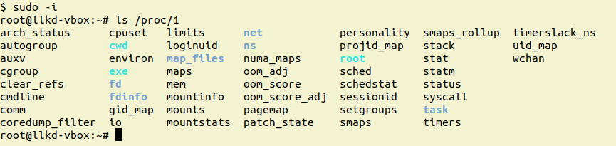
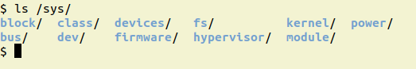
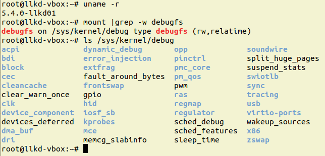
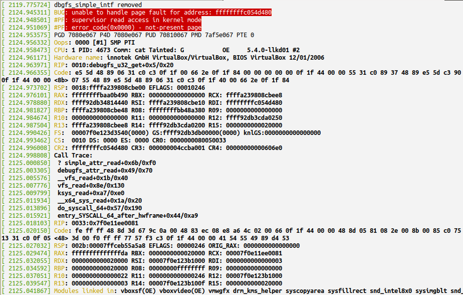
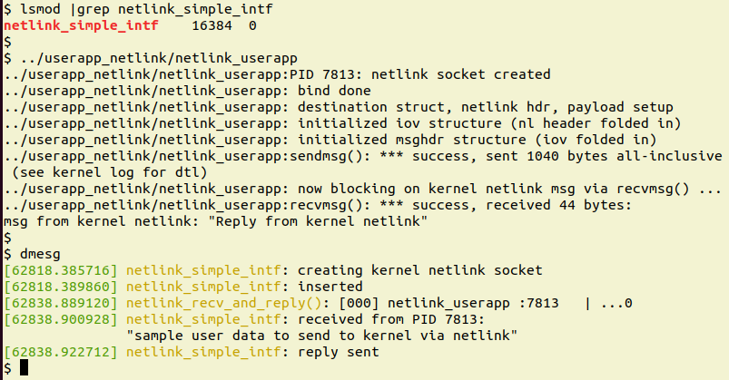

# Chương 2. Các phương thức giao tiếp User-Kernel

Hãy xét tình huống này: bạn đã phát triển thành công một device driver, chẳng hạn cho một pressure sensor device (có thể bằng cách dùng các I2C API của kernel để lấy áp suất từ chip qua I2C protocol). Như vậy, bạn có giá trị áp suất hiện tại trong một variable bên trong driver, điều này tất nhiên có nghĩa nó nằm trong kernel memory space. Vấn đề đặt ra là chính xác làm thế nào để một user space application lấy giá trị này? Như đã học trong chương trước, bạn luôn có thể đưa một method `.read` vào fops structure của driver. Khi user space app thực hiện system call `read(2)`, quyền điều khiển sẽ được chuyển (qua virtual file system (VFS)) đến read method của driver. Tại đó, bạn thực hiện `copy_to_user()` (hoặc tương đương), kết quả là user mode app nhận được giá trị. Tuy nhiên, vẫn có những cách khác, đôi khi tốt hơn, để thực hiện việc này.

Trong chương này, bạn sẽ hiểu các communication interface hoặc phương thức hiện có – làm phương tiện giao tiếp hoặc kết nối giữa user address space và kernel address space. Đây là khía cạnh quan trọng khi viết driver code, vì thiếu kiến thức này, làm sao bạn thực hiện được một việc then chốt – truyền thông tin hiệu quả giữa một kernel-space component (thường là device driver, nhưng thực ra có thể là bất cứ thứ gì) và một user space process hoặc thread? Không chỉ vậy, một số kỹ thuật chúng ta sẽ học cũng thường được sử dụng cho mục đích debugging (và/hoặc diagnostics). Trong chương này, chúng ta trình bày một số kỹ thuật giao tiếp giữa kernel (virtual) address space và user (virtual) address space: giao tiếp qua proc filesystem truyền thống, procfs, cách tốt hơn dành cho driver qua sys filesystem, sysfs, qua debug filesystem, debugfs, qua netlink socket và qua system call `ioctl(2)`. Các chủ đề sau sẽ được trình bày trong chương này:

- Các cách tiếp cận để giao tiếp/kết nối một kernel driver với user space C app

- Kết nối qua proc filesystem (procfs)

- Kết nối qua sys filesystem (sysfs)

- Kết nối qua debug filesystem (debugfs)

- Kết nối qua netlink socket

- Kết nối qua ioctl system call

- So sánh các phương thức kết nối – một bảng

Hãy bắt đầu!

## Yêu cầu kỹ thuật

Tôi giả định bạn đã đọc Lời nói đầu, cụ thể là mục Khai thác tối đa cuốn sách này, đã chuẩn bị phù hợp một guest virtual machine (VM) chạy Ubuntu 18.04 LTS (hoặc một stable release mới hơn) và cài đặt tất cả package cần thiết. Nếu chưa, tôi khuyên bạn thực hiện việc này trước.

Để khai thác tối đa cuốn sách này, tôi rất khuyến khích bạn trước tiên thiết lập workspace environment, bao gồm clone GitHub repository của sách (`https://github.com/PacktPublishing/Linux-Kernel-Programming-Part-2`) để lấy code liên quan, và làm việc với nó theo cách thực hành trực tiếp.

## Các cách tiếp cận để giao tiếp/kết nối một kernel driver với user space C app

Như đã đề cập trong phần giới thiệu, trong chương này, chúng ta muốn học cách truyền thông tin hiệu quả giữa một kernel-space component (thường là device driver, nhưng thực ra có thể là bất cứ thứ gì) và một user space process hoặc thread. Để bắt đầu, hãy đơn giản liệt kê các kỹ thuật mà người viết kernel hoặc driver có thể dùng để giao tiếp hoặc kết nối với một user space C application. Thành phần user space có thể là C app, shell script (cả hai đều thường được minh họa trong sách này), hoặc thậm chí các app khác như C++/Java app, Python/Perl script, v.v. Như đã thấy trong sách đồng hành Linux Kernel Programming, Chương 4, Viết Kernel Module đầu tiên – LKMs Phần 1, ở mục con Library và System Call API, interface thiết yếu giữa user space application và kernel, bao gồm các device driver, là các system call API. Trong chương trước, bạn đã học kiến thức cơ bản về viết character device driver cho Linux. Trong đó, bạn cũng đã học cách truyền dữ liệu giữa user address space và kernel address space bằng cách cho một user mode application mở device file và thực hiện các system call `read(2)` và `write(2)`. Điều này khiến VFS gọi read/write method của driver và driver thực hiện truyền dữ liệu qua các API `copy_{from|to}_user()`. Vì vậy, câu hỏi ở đây là: nếu đã trình bày điều đó, chúng ta còn gì khác để học về vấn đề này?

Ồ, khá nhiều! Thực tế có một số kỹ thuật khác để kết nối giữa user mode app và kernel. Tất nhiên, tất cả đều phụ thuộc rất nhiều vào system call; xét cho cùng, không có cách nào khác (đồng bộ, bằng chương trình) để đi vào kernel từ user space! Tuy nhiên, các kỹ thuật này khác nhau. Mục tiêu của chương là trình bày các communication interface hiện có, bởi tất nhiên, tùy dự án, một cách có thể phù hợp hơn các cách khác. Hãy xem các kỹ thuật sẽ được dùng trong chương này để kết nối giữa user address space và kernel address space:

- Qua procfs interface truyền thống

- Qua sysfs

- Qua debugfs

- Qua netlink socket

- Qua system call `ioctl(2)`

Trong suốt chương này, chúng ta thảo luận chi tiết các kỹ thuật kết nối bằng cách cung cấp ví dụ driver code. Ngoài ra, chúng ta cũng tìm hiểu ngắn gọn mức độ phù hợp của chúng cho debugging. Vì vậy, hãy bắt đầu bằng procfs interface.

## Kết nối qua proc filesystem (procfs)

Trong mục này, chúng ta trình bày proc filesystem là gì và cách dùng nó làm interface giữa user address space và kernel address space. Proc filesystem là một interface mạnh mẽ và dễ lập trình, thường dùng để báo cáo trạng thái và debugging các hệ thống kernel cốt lõi.

Lưu ý rằng từ Linux phiên bản 2.6 trở đi và khi đóng góp upstream, người viết driver không được dùng interface này (nó chỉ dành riêng cho việc sử dụng bên trong kernel). Tuy nhiên, để đầy đủ, chúng ta vẫn trình bày ở đây.

### Tìm hiểu proc filesystem

Linux có một virtual filesystem tên proc; mount point mặc định là `/proc`. Điều đầu tiên cần hiểu về proc filesystem là nội dung của nó không nằm trên non-volatile disk. Nội dung nằm trong RAM, do đó là volatile. Các file và directory bạn thấy dưới `/proc` là pseudo file được kernel code dành cho proc thiết lập; kernel gợi ý điều này bằng cách (gần như) luôn hiển thị kích thước file bằng zero:

```
$ mount | grep -w proc
proc on /proc type proc (rw,nosuid,nodev,noexec,relatime)
$ ls -l /proc/
total 0
dr-xr-xr-x  8 root  root          0 Jan 27 11:13 1/
dr-xr-xr-x  8 root  root          0 Jan 29 08:22 10/
dr-xr-xr-x  8 root  root          0 Jan 29 08:22 11/
dr-xr-xr-x  8 root  root          0 Jan 29 08:22 11550/
[...]
-r--r--r--  1 root  root          0 Jan 29 08:22 consoles
-r--r--r--  1 root  root          0 Jan 29 08:19 cpuinfo
-r--r--r--  1 root  root          0 Jan 29 08:22 crypto
-r--r--r--  1 root  root          0 Jan 29 08:20 devices
-r--r--r--  1 root  root          0 Jan 29 08:22 diskstats
[...]
-r--r--r--  1 root  root          0 Jan 29 08:22 vmstat
-r--r--r--  1 root  root          0 Jan 29 08:22 zoneinfo
$
```

Hãy tóm tắt một vài điểm quan trọng về proc filesystem mạnh mẽ của Linux.

Các object dưới `/proc` (file, directory, soft link, v.v.) đều là pseudo object; chúng nằm trong RAM!

#### Các directory dưới /proc

Các directory dưới `/proc` có tên là giá trị integer biểu diễn các process hiện còn tồn tại trên hệ thống. Tên directory là PID của process (về mặt kỹ thuật, đó là TGID của process. Chúng ta đã trình bày TGID/PID trong sách đồng hành Linux Kernel Programming ở Chương 6, Kiến thức thiết yếu về Kernel và Memory Management Internals). Folder này – `/proc/PID/` – chứa thông tin về process đó. Vì vậy, chẳng hạn với process init hoặc systemd (luôn có PID `1`), bạn có thể xem thông tin chi tiết về process này (các attribute, open file, memory layout, process con, v.v.) dưới folder `/proc/1/`.

Ví dụ, ở đây chúng ta lấy một root shell và thực hiện `ls /proc/1`:



Hình 2.1 – Ảnh chụp màn hình thực hiện ls /proc/1 trên một guest system x86\_64

Bạn có thể tìm thông tin chi tiết đầy đủ về các pseudo file và folder dưới `/proc/<PID>/...` trên man page của `proc(5)` (bằng cách thực hiện `man 5 proc`); hãy thử và tham khảo!

Lưu ý rằng nội dung chính xác dưới `/proc` thay đổi theo cả kernel version và kiến trúc (CPU); x86\_64 thường có nội dung phong phú nhất.

#### Mục đích của proc filesystem

Proc filesystem có hai mục đích:

- Thứ nhất, đây là interface đơn giản để developer, system administrator và thực ra là bất kỳ ai nhìn sâu vào bên trong kernel nhằm thu thập thông tin về nội bộ các process, kernel và cả hardware. Sử dụng interface này chỉ đòi hỏi bạn biết những shell command cơ bản như `cd`, `cat`, `echo`, `ls`, v.v.

- Thứ hai, với tư cách root user và đôi khi là owner, bạn có thể ghi vào một số pseudo file dưới `/proc/sys`, qua đó điều chỉnh các kernel parameter. Tính năng này được gọi là sysctl. Ví dụ, bạn có thể điều chỉnh các IPv4 networking parameter trong `/proc/sys/net/ipv4/`. Tất cả đều được ghi tài liệu tại đây: `https://www.kernel.org/doc/Documentation/networking/ip-sysctl.txt`.

Thay đổi giá trị của một proc-based tunable rất dễ; ví dụ, hãy thay đổi số thread tối đa được phép tại bất kỳ thời điểm nào trên máy. Chạy các command sau với quyền root:

```
# cat /proc/sys/kernel/threads-max
15741
# echo 10000 > /proc/sys/kernel/threads-max
# cat /proc/sys/kernel/threads-max
10000
#
```

Như vậy là xong. Tuy nhiên, cần hiểu rõ rằng thao tác trên là volatile – thay đổi chỉ áp dụng cho session này; power cycle hoặc reboot tất nhiên sẽ khiến nó trở lại giá trị mặc định. Vậy làm thế nào để thay đổi trở thành vĩnh viễn? Câu trả lời ngắn gọn: dùng utility `sysctl(8)`; tham khảo man page của nó để biết thêm chi tiết.

Bạn đã sẵn sàng viết code kết nối qua procfs chưa? Đừng vội – mục tiếp theo giải thích tại sao đây có thể không phải ý tưởng hay.

#### procfs không dành cho người viết driver

Mặc dù có thể dùng proc filesystem để kết nối với một user mode app, có một điểm quan trọng cần lưu ý! Bạn phải hiểu procfs, giống nhiều cơ chế tương tự trong kernel, là một Application Binary Interface (ABI). Cộng đồng kernel không hứa hẹn nó sẽ ổn định và giữ nguyên như hiện nay, cũng giống các kernel API và internal data structure. Thực tế, từ kernel 2.6, những người phát triển kernel đã nói rất rõ – người viết device driver (và tương tự) không được dùng procfs cho mục đích hoặc interface riêng, dù debug hay mục đích khác. Trước đây, với Linux 2.6, việc dùng proc cho các mục đích nói trên khá phổ biến (theo cộng đồng kernel là bị lạm dụng, vì proc chỉ dành cho việc sử dụng bên trong kernel!).

Vậy nếu procfs bị coi là ngoài phạm vi sử dụng, hoặc deprecated, đối với người viết driver, ta dùng cơ chế nào để giao tiếp với user space process? Người viết driver cần dùng sysfs để export interface của mình. Thực ra không chỉ có sysfs; bạn có nhiều lựa chọn như sysfs, debugfs, netlink socket và ioctl system call. Chúng ta sẽ trình bày chi tiết chúng ở phần sau của chương này. Tuy nhiên, hãy chờ một chút; thực tế, “quy tắc” không dùng procfs đối với người viết driver là quy tắc dành cho cộng đồng. Nghĩa là nếu bạn định đưa driver hoặc kernel module của mình upstream vào mainline kernel, qua đó đóng góp code theo GPLv2 license, tất cả quy tắc cộng đồng chắc chắn áp dụng. Nếu không, quyền quyết định thực sự thuộc về bạn. Tất nhiên, tuân theo hướng dẫn và quy tắc của cộng đồng kernel chỉ có thể là điều tốt; chúng tôi chắc chắn khuyên bạn làm vậy. Về việc không khuyến khích các thành phần ngoài core như driver sử dụng proc, đáng tiếc là không có kernel documentation gần đây cho proc API/ABI.

Trên kernel 5.4.0, có khoảng hơn 70 nơi gọi kernel API `proc_create()`, trong đó một số là driver (thường cũ hơn) và filesystem.

Dù vậy (bạn đã được cảnh báo!), hãy học cách cho user space process tương tác với kernel code qua procfs.

### Dùng procfs để kết nối với user space

Là developer của kernel module hoặc device driver, thực ra chúng ta có thể tạo các entry riêng dưới `/proc`, dùng nó làm interface đơn giản với user space. Làm thế nào? Kernel cung cấp các API tạo directory và file dưới procfs. Chúng ta sẽ học cách dùng chúng trong mục này.

#### Các procfs API cơ bản

Ở đây, chúng tôi không định đi sâu vào mọi chi tiết phức tạp của tập procfs API; thay vào đó, chỉ trình bày đủ để bạn hiểu và sử dụng chúng. Để tìm hiểu sâu hơn, hãy tham khảo nguồn thông tin tối cao: kernel code base. Các routine được trình bày ở đây đã được export, do đó người viết driver như bạn có thể sử dụng. Ngoài ra, như đã nói trước đó, mọi procfs file object thực ra là pseudo object, theo nghĩa chúng chỉ tồn tại trong RAM.

Ở đây, chúng tôi giả định bạn hiểu cách thiết kế và triển khai một LKM đơn giản; bạn sẽ tìm thấy thêm chi tiết trong sách đồng hành Linux Kernel Programming, ở chương bốn và năm.

Hãy bắt đầu tìm hiểu một vài procfs API đơn giản cho phép thực hiện một số task chính – lần lượt tạo directory dưới proc filesystem, tạo (pseudo) file tại đó và xóa chúng. Với tất cả task này, hãy bảo đảm include header file liên quan; tức là `#include <linux/proc_fs.h>`:

1\. Tạo một directory tên `name` dưới `/proc`:

```
struct proc_dir_entry *proc_mkdir(const char *name,
                         struct proc_dir_entry *parent);
```

Tham số đầu là tên directory, còn tham số thứ hai là pointer đến parent directory để tạo nó bên dưới. Truyền `NULL` tại đây sẽ tạo directory dưới root; tức dưới `/proc`. Hãy lưu return value, vì thường bạn sẽ dùng nó làm tham số trong các API tiếp theo.

Routine `proc_mkdir_data()` còn cho phép truyền kèm một data item (một `void *`); lưu ý nó được export qua `EXPORT_SYMBOL_GPL`.

2\. Tạo một procfs (pseudo) file có tên `/proc/parent/name`:

```
struct proc_dir_entry *proc_create(const char *name, umode_t mode,
                         struct proc_dir_entry *parent,
                         const struct file_operations *proc_fops);
```

Tham số chủ chốt ở đây là `struct file_operations`, đã được giới thiệu trong chương trước. Bạn cần điền vào đó các “method” sẽ được triển khai (chi tiết ở phần sau). Hãy nghĩ xem: đây thực sự là cơ chế mạnh mẽ; dùng structure `fops`, bạn có thể thiết lập các “callback” function trong driver (hoặc kernel module) mà proc filesystem layer của kernel sẽ tuân theo: khi user space process đọc proc file của bạn, nó (VFS) sẽ gọi method `.read` hoặc callback function của driver. Nếu user space app ghi, nó sẽ gọi callback `.write` của driver!

3\. Xóa một procfs entry:

```
void remove_proc_entry(const char *name, struct proc_dir_entry
*parent)
```

API này xóa entry `/proc/name` được chỉ định và giải phóng nó (nếu không đang được sử dụng); tương tự (và thường tiện hơn nhiều), dùng API `remove_proc_subtree()` để xóa toàn bộ sub-tree trong `/proc` (thường khi cleanup hoặc xảy ra lỗi).

Giờ đã biết kiến thức cơ bản, cách tiếp cận thực nghiệm đòi hỏi chúng ta đưa các API này vào thực hành! Để làm vậy, hãy xác định directory/file cần tạo dưới `/proc`.

#### Bốn procfs file chúng ta sẽ tạo

Để minh họa rõ cách dùng procfs làm công nghệ kết nối, chúng ta sẽ cho kernel module tạo một directory dưới `/proc`. Trong directory đó, nó tạo bốn procfs (pseudo) file. Lưu ý mặc định mọi procfs file đều có attribute owner:group là root:root. Bây giờ, tạo directory tên `/proc/proc_simple_intf` và tạo bốn (pseudo) file bên dưới. Tên và attribute của bốn procfs (pseudo) file dưới directory `/proc/proc_simple_intf` được trình bày trong bảng sau:

| Tên procfs 'file' | R: hành động của read callback, được gọi qua user space read | W: hành động của write callback, được gọi qua user space write | Permission của procfs 'file' |
|---|---|---|---|
| `llkdproc_dbg_level` | Lấy (về user space) giá trị hiện tại của global variable; tức `debug_level` | Cập nhật global variable `debug_level` bằng giá trị do user space ghi | `0644` |
| `llkdproc_show_pgoff` | Lấy (về user space) giá trị `PAGE_OFFSET` của kernel | – không có write callback – | `0444` |
| `llkdproc_show_drvctx` | Lấy (về user space) các giá trị hiện tại trong “context” structure của driver; tức `drv_ctx` | – không có write callback – | `0440` |
| `llkdproc_config1` (cũng được xem là `dbg_level`) | Lấy (về user space) giá trị hiện tại của context variable; tức `drvctx->config1` | Cập nhật driver context member `drvctx->config1` bằng giá trị do user space ghi | `0644` |

Chúng ta sẽ sớm xem các API và code thực tế để tạo directory `proc_simple_intf` dưới `/proc` và bốn file đã đề cập bên dưới nó. (Do giới hạn dung lượng, chúng tôi không trình bày toàn bộ code; chỉ code liên quan đến get-and-set “debug level”; điều này không thành vấn đề vì phần code còn lại rất giống về khái niệm).

#### Thử điều khiển debug\_level động qua procfs

Trước tiên, hãy xem data structure “driver context” mà chúng ta sẽ dùng xuyên suốt chương này (thực ra, lần đầu chúng ta dùng nó là trong chương trước):

```
// ch2/procfs_simple_intf/procfs_simple_intf.c
[ ... ]
/* Borrowed from ch1; the 'driver context' data structure;
 * all relevant 'state info' reg the driver and (fictional) 'device'
 * is maintained here.
 */
struct drv_ctx {
    int tx, rx, err, myword, power;
    u32 config1; /* treated as equivalent to 'debug level' of our driver */
    u32 config2;
    u64 config3;
#define MAXBYTES   128
    char oursecret[MAXBYTES];
};
static struct drv_ctx *gdrvctx;
static int debug_level;    /* 'off' (0) by default ... */
```

Ở đây, ta cũng thấy có một global integer tên `debug_level`; nó cung cấp khả năng điều khiển động mức chi tiết debug của “project”. Debug level được gán khoảng `[0-2]`, trong đó:

- `0` nghĩa là không có debug message (mặc định).

- `1` là mức chi tiết debug trung bình.

- `2` nghĩa là mức chi tiết debug cao.

Điểm hay của toàn bộ cơ chế – và thực sự là mục đích ở đây – là chúng ta có thể truy vấn và đặt variable `debug_level` này từ user space qua một procfs interface do mình tạo! Điều này cho phép end user (vì lý do bảo mật, cần root access) thay đổi debug level động tại runtime (một tính năng khá phổ biến trong nhiều sản phẩm).

Trước khi đi sâu vào chi tiết ở mức code, hãy thử để biết điều gì sẽ xảy ra:

1\. Ở đây, dùng convenience wrapper script `lkm`, chúng ta phải build và `insmod(8)` kernel module (`ch2/proc_simple_intf` trong source tree của sách này):

```
$ cd <booksrc>/ch2/proc_simple_intf
$ ../../lkm procfs_simple_intf          <-- builds the kernel
module
Version info:
[...]
[24826.234323] procfs_simple_intf:procfs_simple_intf_init():321:
proc dir (/proc/procfs_simple_intf) created
[24826.240592] procfs_simple_intf:procfs_simple_intf_init():333:
proc file 1 (/proc/procfs_simple_intf/llkdproc_debug_level) created
[24826.245072] procfs_simple_intf:procfs_simple_intf_init():348:
proc file 2 (/proc/procfs_simple_intf/llkdproc_show_pgoff) created
[24826.248628] procfs_simple_intf:alloc_init_drvctx():218:
allocated and init the driver context structure
[24826.251784] procfs_simple_intf:procfs_simple_intf_init():368:
proc file 3 (/proc/procfs_simple_intf/llkdproc_show_drvctx) created
[24826.255145] procfs_simple_intf:procfs_simple_intf_init():378:
proc file 4 (/proc/procfs_simple_intf/llkdproc_config1) created
[24826.259203] procfs_simple_intf initialized
$
```

Ở đây, chúng ta build và chèn kernel module; `dmesg(1)` hiển thị các kernel printk cho biết một trong những procfs file đã tạo là file liên quan đến dynamic debug facility (được in đậm ở đây; vì đây là pseudo file, kích thước file sẽ hiển thị là `0` byte).

2\. Bây giờ, hãy kiểm tra bằng cách truy vấn giá trị hiện tại của `debug_level`:

```
$ cat /proc/procfs_simple_intf/llkdproc_debug_level
debug_level:0
$
```

3\. Tốt, nó bằng zero – giá trị mặc định – đúng như mong đợi. Bây giờ, hãy đổi debug level thành `2`:

```
$ sudo sh -c "echo 2 >
/proc/procfs_simple_intf/llkdproc_debug_level"
$ cat /proc/procfs_simple_intf/llkdproc_debug_level
debug_level:2
$
```

Lưu ý chúng ta phải thực hiện `echo` với quyền root. Như thấy, debug level thực sự đã đổi (thành giá trị `2`)! Việc cố đặt giá trị ngoài khoảng cũng được phát hiện (và giá trị variable `debug_level` được reset về giá trị hợp lệ gần nhất), như minh họa ở đây:

```
$ sudo sh -c "echo 5 >
/proc/procfs_simple_intf/llkdproc_debug_level"
sh: echo: I/O error
$ dmesg
[...]
[ 6756.415727] procfs_simple_intf: trying to set invalid value for
debug_level [allowed range: 0-2]; resetting to previous (2)
```

Đúng vậy; nó hoạt động như mong đợi. Tuy nhiên, câu hỏi là tất cả điều này hoạt động thế nào ở mức code? Hãy đọc tiếp để tìm hiểu!

#### Điều khiển debug\_level động qua procfs

Hãy trả lời câu hỏi trên – thực hiện thế nào trong code? Thực ra khá đơn giản:

1\. Đầu tiên, trong `init` code của kernel module, chúng ta phải tạo procfs directory, đặt tên theo tên kernel module:

```
static struct proc_dir_entry *gprocdir;
[...]
gprocdir = proc_mkdir(OURMODNAME, NULL);
```

2\. Cũng trong `init` code của kernel module, chúng ta phải tạo file `procfs` điều khiển “debug level” của project:

```
// ch2/procfs_simple_intf/procfs_simple_intf.c
[...]
#define PROC_FILE1           "llkdproc_debug_level"
#define PROC_FILE1_PERMS     0644
[...]
static int __init procfs_simple_intf_init(void)
{
    int stat = 0;
    [...]
    /* 1. Create the PROC_FILE1 proc entry under the parent dir
OURMODNAME;
     * this will serve as the 'dynamically view/modify debug_level'
     * (pseudo) file */
    if (!proc_create(PROC_FILE1, PROC_FILE1_PERMS, gprocdir,
                     &fops_rdwr_dbg_level)) {
    [...]
    pr_debug("proc file 1 (/proc/%s/%s) created\n", OURMODNAME,
PROC_FILE1);
    [...]
```

Ở đây, chúng ta dùng API `proc_create()` để tạo procfs file và “liên kết” nó với structure `file_operations` được cung cấp.

3\. Fops structure (về mặt kỹ thuật là `struct file_operations`) là data structure then chốt ở đây. Như đã học trong `Chapter 1`, Viết một misc Character Device Driver đơn giản, đây là nơi gán chức năng cho các file operation khác nhau trên device hoặc, như trường hợp này, procfs file. Đây là code khởi tạo fops:

```
static const struct file_operations fops_rdwr_dbg_level = {
    .owner = THIS_MODULE,
    .open = myproc_open_dbg_level,
    .read = seq_read,
    .write = myproc_write_debug_level,
    .llseek = seq_lseek,
    .release = single_release,
};
```

4\. Method `open` của fops trỏ đến một function chúng ta phải định nghĩa:

```
static int myproc_open_dbg_level(struct inode *inode, struct file
*file)
{
    return single_open(file, proc_show_debug_level, NULL);
}
```

Dùng API `single_open()` của kernel, chúng ta đăng ký rằng bất cứ khi nào file này được đọc – cuối cùng được thực hiện qua system call `read(2)` từ user space – proc filesystem sẽ “gọi lại” routine `proc_show_debug_level()` của chúng ta (tham số thứ hai của `single_open()`).

Chúng ta không bàn về triển khai bên trong của API `single_open()` ở đây; nếu tò mò, bạn luôn có thể tra cứu tại đây: `fs/seq_file.c:single_open()`.

Vậy, tóm lại, để đăng ký một “read” method với procfs, chúng ta làm như sau:

- Khởi tạo pointer `fops.open` trỏ đến một function `foo()`.

- Trong function `foo()`, gọi `single_open()`, cung cấp read callback function làm tham số thứ hai.

Có một chút lịch sử ở đây; không đi quá sâu, chỉ cần nói cách hoạt động cũ của procfs có vấn đề. Đặc biệt, bạn không thể truyền hơn một page dữ liệu (bằng read hoặc write) mà không tự lặp qua nội dung. Chức năng sequence iterator được giới thiệu từ 2.6.12 đã khắc phục các vấn đề này. Ngày nay, dùng `single_open()` và những function cùng loại (các built-in kernel function `seq_read`, `seq_lseek` và `seq_release`) là cách đơn giản hơn và đúng để dùng procfs.

5\. Vậy khi user space ghi (qua system call `write(2)`) vào một proc file thì sao? Đơn giản: trong code trên, bạn có thể thấy chúng ta đăng ký method `fops_rdwr_dbg_level.write` là function `myproc_write_debug_level()`, có nghĩa function này sẽ được callback bất cứ khi nào (pseudo) file này được ghi (được giải thích ở Bước 6, sau read callback).

Code của read callback function đã đăng ký qua `single_open` như sau:

```
/* Our proc file 1: displays the current value of debug_level */
static int proc_show_debug_level(struct seq_file *seq, void *v)
{
    if (mutex_lock_interruptible(&mtx))
        return -ERESTARTSYS;
    seq_printf(seq, "debug_level:%d\n", debug_level);
    mutex_unlock(&mtx);
    return 0;
}
```

Về khái niệm, `seq_printf()` giống API `sprintf()` quen thuộc. Nó in chính xác – vào object `seq_file` – dữ liệu được cung cấp. Khi nói “in” ở đây, ý thực sự là nó chuyển data buffer đến user space process hoặc thread đã thực hiện read system call đưa chúng ta đến đây, thực chất truyền dữ liệu về user space.

À đúng rồi, các API `mutex_{un}lock*()` là gì? Chúng phục vụ một việc then chốt – locking. Chúng ta sẽ thảo luận chi tiết về locking trong `Chapter 6`, Kernel Synchronization – Phần 1, và `Chapter 7`, Kernel Synchronization – Phần 2; hiện tại, chỉ cần hiểu chúng là các synchronization primitive cần thiết.

6\. Callback function `write` mà chúng ta đã đăng ký qua `fops_rdwr_dbg_level.write` như sau:

```
#define DEBUG_LEVEL_MIN     0
#define DEBUG_LEVEL_MAX     2
[...]
/* proc file 1 : modify the driver's debug_level global variable as
per what user space writes */
static ssize_t myproc_write_debug_level(struct file *filp,
                const char __user *ubuf, size_t count, loff_t *off)
{
   char buf[12];
   int ret = count, prev_dbglevel;
   [...]
   prev_dbglevel = debug_level;
   // < ... validity checks (not shown here) ... >
   /* Get the user mode buffer content into the kernel (into 'buf')
*/
   if (copy_from_user(buf, ubuf, count)) {
        ret = -EFAULT;
        goto out;
   }
   [...]
   ret = kstrtoint(buf, 0, &debug_level); /* update it! */
   if (ret)
        goto out;
  if (debug_level < DEBUG_LEVEL_MIN || debug_level >
DEBUG_LEVEL_MAX) {
            [...]
            debug_level = prev_dbglevel;
            ret = -EFAULT; goto out;
   }
   /* just for fun, let's say that our drv ctx 'config1'
      represents the debug level */
   gdrvctx->config1 = debug_level;
   ret = count;
out:
   mutex_unlock(&mtx);
   return ret;
}
```

Trong triển khai write method (hãy chú ý cấu trúc của nó giống write method của character device driver thế nào), chúng ta thực hiện một số validity check rồi copy vào dữ liệu user space process đã ghi cho chúng ta (nhớ cách dùng command `echo` để ghi vào procfs file) qua function `copy_from_user()` thông thường. Sau đó, dùng built-in API `kstrtoint()` của kernel (có nhiều API tương tự) để chuyển string buffer thành integer, lưu kết quả vào global variable; tức `debug_level`! Một lần nữa, chúng ta validate nó, và nếu mọi thứ ổn, còn đặt (chỉ làm ví dụ) member `config1` của driver context bằng cùng giá trị rồi trả về thông báo thành công.

7\. Phần code còn lại của kernel module rất tương tự – chúng ta thiết lập chức năng cho ba procfs file còn lại. Tôi để bạn tự duyệt code chi tiết và thử nghiệm.

8\. Thêm một demo nhanh: hãy đặt `debug_level` thành `1` rồi dump driver context structure (qua procfs file thứ ba đã tạo):

```
$ cat /proc/procfs_simple_intf/llkdproc_debug_level
debug_level:0
$ sudo sh -c "echo 1 >
/proc/procfs_simple_intf/llkdproc_debug_level"
```

9\. Được rồi, variable `debug_level` hiện có giá trị `1`; giờ hãy dump driver context structure:

```
$ cat /proc/procfs_simple_intf/llkdproc_show_drvctx
cat: /proc/procfs_simple_intf/llkdproc_show_drvctx: Permission
denied
$ sudo cat /proc/procfs_simple_intf/llkdproc_show_drvctx
prodname:procfs_simple_intf
tx:0,rx:0,err:0,myword:0,power:1
config1:0x1,config2:0x48524a5f,config3:0x424c0a52
oursecret:AhA xxx
$
```

Chúng ta cần root access để thực hiện. Sau đó, có thể thấy rõ mọi member của data structure `drv_ctx`. Không chỉ vậy, chúng ta đã xác minh member `config1`, được in đậm, hiện có giá trị `1`, phản ánh “debug level” đúng thiết kế.

Cũng hãy chú ý output được cố ý tạo về user space theo định dạng rất dễ parse, gần giống JSON. Tất nhiên, như một bài tập nhỏ, bạn có thể bố trí để làm chính xác điều đó!

Rất nhiều sản phẩm Internet of Things (IoT) gần đây dùng RESTful API để giao tiếp; định dạng được parse thường là JSON. Hình thành thói quen thiết kế và triển khai giao tiếp kernel-to-user (và ngược lại) theo định dạng dễ parse (như JSON) chỉ có ích.

Như vậy, bạn đã học chính xác cách tạo procfs directory, một file bên trong và quan trọng nhất, cách tạo và dùng các read/write callback function để khi user mode process đọc hoặc ghi proc file, bạn có thể phản hồi phù hợp từ sâu trong kernel. Như đã nói, do giới hạn dung lượng, chúng tôi không mô tả code điều khiển ba procfs file còn lại đã tạo và dùng. Về khái niệm, nó rất giống nội dung vừa trình bày. Chúng tôi mong bạn đọc qua và thử!

### Một vài procfs API khác

Hãy kết thúc mục này bằng một vài procfs API linh tinh còn lại. Bạn có thể tạo symbolic link hoặc soft link trong `/proc` bằng function `proc_symlink()`.

Tiếp theo, API `proc_create_single_data()` có thể rất hữu ích; nó được dùng như một “lối tắt” khi chỉ cần gắn một “read” method vào procfs file:

```
struct proc_dir_entry *proc_create_single_data(const char *name, umode_t
mode, struct
        proc_dir_entry *parent, int (*show)(struct seq_file *, void *),
void *data);
```

Dùng API này loại bỏ nhu cầu có một fops data structure riêng. Chúng ta có thể dùng function này để tạo và làm việc với procfs file thứ hai – file `llkdproc_show_pgoff`:

```
... proc_create_single_data(PROC_FILE2, PROC_FILE2_PERMS, gprocdir,
proc_show_pgoff, 0) ...
```

Khi được đọc từ user space, các code path của VFS và proc layer của kernel sẽ gọi method đã đăng ký – function `proc_show_pgoff()` của module – trong đó chúng ta chỉ cần gọi `seq_printf()` để gửi giá trị `PAGE_OFFSET` về user space:

```
seq_printf(seq, "%s:PAGE_OFFSET:0x%px\n", OURMODNAME, PAGE_OFFSET);
```

Ngoài ra, lưu ý những điều sau về API `proc_create_single_data`:

- Bạn có thể dùng tham số thứ năm của `proc_create_single_data()` để truyền bất kỳ data item nào cho read callback (được lấy ở đó dưới dạng một member của `seq_file` tên `private`, rất giống cách dùng `filp->private_data` trong chương trước).

- Một số driver thường cũ hơn trong kernel mainline thực sự dùng function này để tạo procfs interface. Trong đó có RTC driver (thiết lập entry tại `/proc/driver/rtc`). SCSI driver `megaraid` (`drivers/scsi/megaraid`) dùng routine này không dưới 10 lần để thiết lập proc interface (khi một config option được bật; mặc định nó được bật).

Hãy cẩn thận! Tôi thấy trên hệ thống Ubuntu 18.04 LTS chạy distro kernel (mặc định), API này – `proc_create_single_data()` – thậm chí không tồn tại, nên build thất bại. Trên kernel “vanilla” 5.4 LTS tùy chỉnh, nó hoạt động tốt. Ngoài ra, có một số tài liệu về procfs API đã dùng ở đây, dù chúng thường dành cho internal usage chứ không phải module: `https://www.kernel.org/doc/html/latest/filesystems/api-summary.html#the-proc-filesystem`.

Vậy, như đã nói, với procfs API thì kết quả có thể khác nhau – Your Mileage May Vary (YMMV)! Hãy kiểm tra code cẩn thận trước release. Có lẽ tốt nhất là tuân theo hướng dẫn cộng đồng kernel và đơn giản nói Không với procfs như kỹ thuật kết nối driver. Đừng lo – chúng ta sẽ xem các cách tốt hơn trong chương này!

Đến đây đã hoàn tất phần dùng procfs làm communication interface hữu ích. Bây giờ, hãy học cách dùng một interface phù hợp hơn cho driver – sysfs interface.

## Kết nối qua sys filesystem (sysfs)

Một tính năng quan trọng của Linux kernel release 2.6 là sự xuất hiện của modern device model. Về cơ bản, một chuỗi data structure phân cấp phức tạp dạng tree mô hình hóa tất cả device có trên hệ thống. Thực ra, nó còn vượt xa điều đó; sysfs tree bao quát các mục sau (cùng những thứ khác):

- Mọi bus có trên hệ thống (cũng có thể là virtual bus hoặc pseudo bus)

- Mọi device có trên mỗi bus

- Mọi device driver được bind với một device trên bus

Vì vậy, không chỉ peripheral device mà cả các system bus bên dưới, các device trên mỗi bus và device driver được bind hoặc sẽ bind với device đều được tạo tại runtime và được device model duy trì. Hoạt động bên trong của model này vô hình với bạn, một người viết driver thông thường; bạn thực sự không cần lo về nó. Khi boot hệ thống và mỗi khi một device mới xuất hiện, driver core (một phần cơ chế built-in của kernel) tạo các virtual file cần thiết dưới sysfs tree. (Ngược lại, khi device bị tháo hoặc tách ra, entry của nó biến mất khỏi tree.)

Tuy nhiên, hãy nhớ từ mục Kết nối với proc filesystem rằng dùng procfs cho mục đích kết nối device driver không thực sự đúng, ít nhất với code muốn chuyển upstream. Vậy cách đúng là gì? À, tạo sysfs (pseudo) file được xem là “cách đúng” để device driver kết nối với user space.

Giờ chúng ta đã thấy! sysfs là virtual filesystem thường được mount tại directory `/sys`. Thực chất, rất giống procfs, sysfs là tree thông tin (về device và những thứ khác) do kernel export về user space. Bạn có thể xem sysfs có những góc nhìn khác nhau vào modern device model. Qua sysfs, bạn có thể xem hệ thống theo nhiều cách hoặc qua các “góc nhìn”; chẳng hạn qua các bus mà nó hỗ trợ (bus view – PCI, USB, platform, I2C, SPI và nhiều loại khác), qua các “class” device (class view), qua chính các device, qua block device viewport, v.v. Ảnh chụp màn hình sau hiển thị nội dung `/sys` trên Ubuntu 18.04 LTS VM của tôi minh họa điều này:



Hình 2.2 – Ảnh chụp màn hình nội dung sysfs (/sys) trên Ubuntu VM x86\_64

Như thấy, với sysfs còn có nhiều góc nhìn khác để quan sát hệ thống. Tất nhiên, trong mục này, chúng ta muốn hiểu cách kết nối một device driver với user space qua sysfs, cách viết code tạo các (pseudo) file của driver dưới sysfs và cách đăng ký read/write callback từ chúng. Hãy bắt đầu bằng các sysfs API cơ bản.

### Tạo sysfs (pseudo) file trong code

Một cách tạo pseudo file (hoặc virtual file) dưới sysfs là qua API `device_create_file()`. Signature như sau:

```
drivers/base/core.c:int device_create_file(struct device *dev,
                         const struct device_attribute *attr);
```

Hãy xét hai tham số lần lượt; đầu tiên là pointer đến `struct device`. Tham số thứ hai là pointer đến một device attribute structure; chúng ta sẽ giải thích và làm việc với nó sau (trong mục Thiết lập device attribute và tạo sysfs file). Hiện tại, hãy chỉ tập trung vào tham số đầu – device structure. Điều này khá trực quan – device được biểu diễn bằng một metadata structure tên `device` (nó là một phần của driver core; bạn có thể tra định nghĩa đầy đủ trong header `include/linux/device.h`).

Lưu ý rằng khi bạn viết (hoặc làm việc với) một device driver “thật”, rất có thể một generic device structure đã tồn tại hoặc sẽ xuất hiện. Điều này thường xảy ra khi đăng ký device; một device structure bên dưới thường được cung cấp dưới dạng member của một specialized structure cho device đó. Ví dụ, mọi structure như `platform_device`, `pci_device`, `net_device`, `usb_device`, `i2c_client`, `serial_port`, v.v. đều có một member `struct device` nhúng bên trong. Vì vậy, bạn có thể dùng device structure pointer này làm tham số cho API nhằm tạo file dưới sysfs. Hãy yên tâm, bạn sẽ sớm thấy điều này trong code! Vậy hãy bắt đầu bằng cách lấy một device structure thông qua tạo một “platform device” đơn giản. Bạn sẽ học cách thực hiện trong mục tiếp theo!

### Tạo một platform device đơn giản

Rõ ràng, để tạo một (pseudo) file dưới sysfs, bằng cách nào đó chúng ta cần một pointer đến `struct device` làm tham số đầu cho `device_create_file()`. Tuy nhiên, với sysfs driver demo ở đây và lúc này, chúng ta không có device thật nào, do đó cũng không có `struct device` để làm việc!

Vậy chẳng phải có thể tạo một artificial device hoặc pseudo device rồi dùng nó sao? Có, nhưng làm thế nào và quan trọng hơn, chính xác tại sao phải làm vậy? Điều thiết yếu cần hiểu là Linux Device Model (LDM) hiện đại được xây dựng trên ba thành phần chính: phải có một bus bên dưới để các device nằm trên đó, và device được “bind” với và được điều khiển bởi device driver. (Chúng ta đã đề cập điều này trong `Chapter 1`, Viết một misc Character Device Driver đơn giản, ở mục Ghi chú nhanh về Linux Device Model). Tất cả phải được đăng ký với driver core. Đừng lo về bus và bus driver điều khiển chúng; chúng sẽ được đăng ký và xử lý nội bộ bởi driver core subsystem của kernel. Tuy nhiên, khi không có device thật, chúng ta phải tạo một pseudo device để làm việc với model. Một lần nữa, có nhiều cách làm, nhưng chúng ta sẽ tạo một platform device. Device này sẽ “nằm” trên một pseudo bus (nghĩa là chỉ tồn tại trong software) gọi là platform bus.

#### Platform device

Một ghi chú nhanh nhưng quan trọng: platform device thường dùng để biểu diễn nhiều loại device trên một System on Chip (SoC) trong embedded board. SoC thường là chip rất tinh vi tích hợp các thành phần vào silicon của nó. Ngoài processing unit (CPU/GPU), nó cũng có thể chứa một số peripheral, gồm Ethernet MAC, USB, multimedia, serial UART, clock, I2C, SPI, flash chip controller, v.v. Một lý do cần enumerate các thành phần này thành platform device là không có physical bus trong SoC; vì vậy platform bus được dùng.

Theo truyền thống, code dùng để instantiate các SoC platform device này được giữ trong một “board” file (hoặc nhiều file) trong kernel source (`arch/<arch>/...`). Do trở nên quá tải, nó đã được chuyển ra ngoài pure kernel source sang một định dạng mô tả hardware hữu ích gọi là Device Tree (trong các Device Tree Source (DTS) file mà bản thân vẫn nằm trong kernel source tree).

Trên Ubuntu 18.04 LTS guest VM, hãy xem các platform device dưới sysfs:

```
$ ls /sys/devices/platform/
alarmtimer  'Fixed MDIO bus.0'   intel_pmc_core.0   platform-framebuffer.0
reg-dummy
serial8250 eisa.0  i8042  pcspkr power rtc_cmos uevent
$
```

Website Bootlin (trước đây là Free Electrons) cung cấp tài liệu xuất sắc về embedded Linux, driver, v.v. Link này trên site dẫn đến tài liệu rất tốt về LDM: `https://bootlin.com/pub/conferences/2019/elce/opdenacker-kernel-programming-device-model/`.

Trở lại driver: chúng ta tạo sự tồn tại cho platform device (nhân tạo) bằng cách đăng ký nó với platform bus driver (đã tồn tại) qua API `platform_device_register_simple()`. Ngay khi làm vậy, driver core sẽ tạo các sysfs directory cần thiết và một vài sysfs entry (hoặc file) khuôn mẫu. Ở đây, trong init code của sysfs driver demo, chúng ta thiết lập một platform device (đơn giản nhất có thể) bằng cách đăng ký với driver core:

```
// ch2/sysfs_simple_intf/sysfs_simple_intf.c
include <linux/platform_device.h>
static struct platform_device *sysfs_demo_platdev;
[...]
#define PLAT_NAME    "llkd_sysfs_simple_intf_device"
sysfs_demo_platdev =
     platform_device_register_simple(PLAT_NAME, -1, NULL, 0);
[...]
```

API `platform_device_register_simple()` trả về pointer đến `struct` `platform_device`. Một member của structure này là `struct device dev`. Giờ ta đã có thứ cần tìm: một device structure. Cũng cần lưu ý khi registration API này chạy, hiệu ứng thể hiện trong sysfs. Bạn có thể dễ dàng thấy platform device mới cùng một vài sysfs object khuôn mẫu được driver core tạo ở đây (hiển thị cho ta qua sysfs); hãy build và insmod kernel module để quan sát:

```
$ cd <...>/ch2/sysfs_simple_intf
$ make && sudo insmod ./sysfs_simple_intf.ko
[...]
$ ls -l /sys/devices/platform/llkd_sysfs_simple_intf_device/
total 0
-rw-r--r-- 1 root root 4.0K Feb 15 20:22 driver_override
-rw-r--r-- 1 root root 4.0K Feb 15 20:22 llkdsysfs_debug_level
-r--r--r-- 1 root root 4.0K Feb 15 20:22 llkdsysfs_pgoff
-r--r--r-- 1 root root 4.0K Feb 15 20:22 llkdsysfs_pressure
-r--r--r-- 1 root root 4.0K Feb 15 20:22 modalias
drwxr-xr-x 2 root root 0 Feb 15 20:22 power/
lrwxrwxrwx 1 root root 0 Feb 15 20:22 subsystem -> ../../../bus/platform/
-rw-r--r-- 1 root root 4.0K Feb 15 20:21 uevent
$
```

Chúng ta có thể tạo `struct device` theo nhiều cách; cách tổng quát là thiết lập và thực hiện API `device_create()`. Một cách khác để tạo sysfs file, đồng thời bỏ qua nhu cầu có device structure, là tạo một “object” và gọi API `sysfs_create_file()`. (Link đến tutorial dùng cả hai cách này nằm trong mục Đọc thêm). Ở đây, chúng ta ưu tiên “platform device” vì nó gần với cách viết một (platform) driver hơn. Còn một cách hợp lệ khác. Như đã thấy trong `Chapter 1`, Viết một misc Character Device Driver đơn giản, chúng ta build một character driver đơn giản tuân theo framework `misc` của kernel. Ở đó, chúng ta instantiate một `struct miscdevice`; sau khi đăng ký (qua API `misc_register()`), structure này chứa một member tên `struct device` `*this_device;`, nhờ đó có thể dùng nó làm device pointer hợp lệ! Vì vậy, có thể đơn giản mở rộng device driver `misc` trước đó và dùng ở đây. Tuy nhiên, để học một chút về platform driver, chúng ta chọn cách đó. (Chúng tôi để bạn thực hành mở rộng device driver `misc` trước đó để dùng sysfs API và tạo/dùng sysfs file).

Trở lại driver, so với init code, trong cleanup code, chúng ta phải hủy đăng ký platform device:

```
platform_device_unregister(sysfs_demo_platdev);
```

Giờ hãy kết hợp tất cả kiến thức này và xem code thực sự tạo sysfs file cùng read/write callback function!

### Kết hợp tất cả – thiết lập device attribute và tạo sysfs file

Như đã nói đầu mục này, API `device_create_file()` là API sẽ dùng để tạo sysfs file:

```
int device_create_file(struct device *dev, const struct device_attribute
*attr);
```

Trong mục trước, bạn đã học cách lấy device structure (tham số đầu cho API). Giờ hãy xác định cách khởi tạo và dùng tham số thứ hai; tức structure `device_attribute`. Bản thân structure được định nghĩa như sau:

```
// include/linux/device.h
struct device_attribute {
    struct attribute attr;
    ssize_t (*show)(struct device *dev, struct device_attribute *attr,
                    char *buf);
    ssize_t (*store)(struct device *dev, struct device_attribute *attr,
                     const char *buf, size_t count);
};
```

Member đầu, `attr`, về cơ bản gồm tên sysfs file và mode (permission bitmask). Hai member còn lại là function pointer (“virtual function”, tương tự trong file operations hoặc fops structure):

- `show`: Biểu diễn read callback function

- `store`: Biểu diễn write callback function

Việc của chúng ta là khởi tạo structure `device_attribute` này, qua đó thiết lập sysfs file. Dù luôn có thể khởi tạo thủ công, có cách dễ hơn: kernel cung cấp (nhiều) macro để khởi tạo `struct device_attribute`; trong đó có macro `DEVICE_ATTR()`:

```
// include/linux/device.h
define DEVICE_ATTR(_name, _mode, _show, _store) \
   struct device_attribute dev_attr_##_name = __ATTR(_name, _mode, _show,
_store)
```

Lưu ý “stringification” được `dev_attr_##_name` thực hiện, bảo đảm tên structure được thêm hậu tố là tên truyền làm tham số đầu cho `DEVICE_ATTR`. Hơn nữa, macro thực sự làm việc, tên `__ATTR()`, thực sự instantiate một structure `device_attribute` trong code tại preprocessing time, với tên structure trở thành `dev_attr_<name>` (qua stringification):

```
// include/linux/sysfs.h
#define __ATTR(_name, _mode, _show, _store) { \
    .attr = {.name = __stringify(_name), \
    .mode = VERIFY_OCTAL_PERMISSIONS(_mode) }, \
    .show = _show, \
    .store = _store, \
}
```

Ngoài ra, kernel định nghĩa các wrapper macro đơn giản bổ sung trên các macro này để chỉ định mode (permission cho sysfs file), làm công việc của người viết driver còn dễ hơn. Trong đó có `DEVICE_ATTR_RW(_name)`, `DEVICE_ATTR_RO(_name)` và `DEVICE_ATTR_WO(_name)`:

```
#define DEVICE_ATTR_RW(_name) \
     struct device_attribute dev_attr_##_name = __ATTR_RW(_name)
#define __ATTR_RW(_name) __ATTR(_name, 0644, _name##_show, _name##_store)
```

Với code này, chúng ta có thể tạo sysfs file read-write (RW), read-only (RO) hoặc write-only (WO). Giờ ta muốn thiết lập một sysfs file có thể đọc và ghi. Bên trong, đây là “hook” hoặc callback để truy vấn hoặc đặt global variable `debug_level`, giống hệt sample kernel module về procfs trước đó! Giờ đã có đủ kiến thức nền, hãy đi vào code!

#### Code triển khai sysfs file và callback của nó

Hãy xem các phần code liên quan của sysfs interfacing driver đơn giản và thử từng bước:

1\. Thiết lập device attribute structure (qua macro `DEVICE_ATTR_RW`; xem mục trước để biết thêm) và tạo sysfs (pseudo) file đầu tiên:

```
// ch2/sysfs_simple_intf/sysfs_simple_intf.c

#define SYSFS_FILE1 llkdsysfs_debug_level
// [... <we show the actual read/write callback functions just a
bit further down> ...]
static DEVICE_ATTR_RW(SYSFS_FILE1);

int __init sysfs_simple_intf_init(void)
{
 [...]
/* << 0. The platform device is created via the
platform_device_register_simple() API; code already shown above ...
>> */

 // 1. Create our first sysfile file : llkdsysfs_debug_level
 /* The device_create_file() API creates a sysfs attribute file for
  * given device (1st parameter); the second parameter is the
pointer
  * to it's struct device_attribute structure dev_attr_<name> which
was
  * instantiated by our DEV_ATTR{_RW|RO} macros above ... */
  stat = device_create_file(&sysfs_demo_platdev->dev,
&dev_attr_SYSFS_FILE1);
[...]
```

Từ định nghĩa các macro được trình bày ở đây, có thể suy ra `static` `DEVICE_ATTR_RW(SYSFS_FILE1);` instantiate một structure `device_attribute` đã khởi tạo với tên `llkdsysfs_debug_level` (vì đó là giá trị macro `SYSFS_FILE1`) và mode `0644`; tên read callback sẽ là `llkdsysfs_debug_level_show()` và tên write callback sẽ là `llkdsysfs_debug_level_store()`!

2\. Đây là code liên quan cho read/write callback (một lần nữa, không trình bày toàn bộ code ở đây). Đầu tiên, hãy xem read callback:

```
/* debug_level: sysfs entry point for the 'show' (read) callback */
static ssize_t llkdsysfs_debug_level_show(struct device *dev,
                                          struct device_attribute
*attr,
                                          char *buf)
{
        int n;
        if (mutex_lock_interruptible(&mtx))
                return -ERESTARTSYS;
        pr_debug("In the 'show' method: name: %s,
debug_level=%d\n",
                 dev->kobj.name, debug_level);
        n = snprintf(buf, 25, "%d\n", debug_level);
        mutex_unlock(&mtx);
        return n;
}
```

Điều này hoạt động thế nào? Khi đọc sysfs file, callback function trên được gọi. Bên trong nó, chỉ cần ghi vào buffer pointer do user cung cấp, `buf` (tham số thứ ba; chúng ta dùng kernel API `snprintf()` để làm vậy), sẽ truyền giá trị được cung cấp (ở đây là `debug_level`) về user space!

3\. Hãy build và `insmod(8)` kernel module (để tiện, dùng wrapper script `lkm`):

```
$ ../../lkm sysfs_simple_intf          // <-- build and insmod it
[...]
[83907.192247] sysfs_simple_intf:sysfs_simple_intf_init():237:
sysfs file [1]
(/sys/devices/platform/llkd_sysfs_simple_intf_device/llkdsysfs_debu
g_level) created
[83907.197279] sysfs_simple_intf:sysfs_simple_intf_init():250:
sysfs file [2]
(/sys/devices/platform/llkd_sysfs_simple_intf_device/llkdsysfs_pgof
f) created
[83907.201959] sysfs_simple_intf:sysfs_simple_intf_init():264:
sysfs file [3]
(/sys/devices/platform/llkd_sysfs_simple_intf_device/llkdsysfs_pres
sure) created
[83907.205888] sysfs_simple_intf initialized
$
```

4\. Giờ hãy liệt kê và đọc sysfs file liên quan đến debug-level:

```
$ ls -l
/sys/devices/platform/llkd_sysfs_simple_intf_device/llkdsysfs_debug
_level
-rw-r--r-- 1 root root 4096 Feb   4 17:41
/sys/devices/platform/llkd_sysfs_simple_intf_device/llkdsysfs_debug
_level
$ cat
/sys/devices/platform/llkd_sysfs_simple_intf_device/llkdsysfs_debug
_level
0
```

Điều này phản ánh debug-level hiện bằng `0`.

5\. Giờ hãy xem code của write callback cho sysfs file debug-level:

```
#define DEBUG_LEVEL_MIN 0
#define DEBUG_LEVEL_MAX 2

static ssize_t llkdsysfs_debug_level_store(struct device *dev,
                                           struct device_attribute
*attr,
                                           const char *buf, size_t
count)
{
        int ret = (int)count, prev_dbglevel;
        if (mutex_lock_interruptible(&mtx))
                return -ERESTARTSYS;

        prev_dbglevel = debug_level;
        pr_debug("In the 'store' method:\ncount=%zu, buf=0x%px
count=%zu\n"
        "Buffer contents: \"%.*s\"\n", count, buf, count,
(int)count, buf);
        if (count == 0 || count > 12) {
                ret = -EINVAL;
                goto out;
        }

        ret = kstrtoint(buf, 0, &debug_level); /* update it! */
        // < ... validity checks ... >
        ret = count;
 out:
        mutex_unlock(&mtx);
        return ret;
}
```

Một lần nữa, rõ ràng kernel API `kstrtoint()` được dùng để chuyển string `buf` từ user space thành integer value, rồi chúng ta validate nó. Ngoài ra, tham số thứ ba của `kstrtoint` là integer cần ghi vào, qua đó cập nhật nó!

6\. Giờ hãy thử cập nhật giá trị `debug_level` từ sysfs file của nó:

```
$ sudo sh -c "echo 2 >
/sys/devices/platform/llkd_sysfs_simple_intf_device/llkdsysfs_debug
_level"
$ cat
/sys/devices/platform/llkd_sysfs_simple_intf_device/llkdsysfs_debug
_level
2
$
```

Thế đấy – nó hoạt động!

7\. Giống khi kết nối qua procfs, chúng tôi cung cấp thêm code trong ví dụ sysfs. Ở đây, có thêm một sysfs interface (read-only) để hiển thị giá trị `PAGE_OFFSET`, cộng một interface mới. Hãy tưởng tượng nhiệm vụ của driver là lấy một giá trị “áp suất” (có thể qua một pressure sensor chip dùng I2C). Giả sử đã thực hiện và lưu giá trị áp suất này trong một integer global variable tên `gpressure`. Để “hiển thị” cho user space giá trị áp suất hiện tại, chúng ta phải dùng sysfs file. Đây là nó:

Bên trong, phục vụ demo này, chúng ta tùy ý đặt global variable `gpressure` thành giá trị `25`.

```
$ cat
/sys/devices/platform/llkd_sysfs_simple_intf_device/llkdsysfs_press
ure
25$
```

Hãy nhìn kỹ output; tại sao prompt xuất hiện ngay sau `25`? Vì ta chỉ in nguyên giá trị – không newline, không gì khác; đó là điều được mong đợi. Code hiển thị giá trị “áp suất” quả thực đơn giản:

```
/* show 'pressure' value: sysfs entry point for the 'show' (read) callback
*/
static ssize_t llkdsysfs_pressure_show(struct device *dev,
                       struct device_attribute *attr, char *buf)
{
        int n;
        if (mutex_lock_interruptible(&mtx))
                return -ERESTARTSYS;
        pr_debug("In the 'show' method: pressure=%u\n", gpressure);
        n = snprintf(buf, 25, "%u", gpressure);
        mutex_unlock(&mtx);
        return n;
}
/* The DEVICE_ATTR{_RW|RO|WO}() macro instantiates a struct
device_attribute dev_attr_<name> here...   */
static DEVICE_ATTR_RO(llkdsysfs_pressure);
```

Như vậy, bạn đã học cách kết nối với user space qua sysfs! Như thường lệ, tôi khuyến khích bạn thực sự viết code và tự thử các kỹ năng này; hãy xem mục Câu hỏi ở cuối chương và tự làm các bài tập (liên quan). Giờ hãy tiếp tục với sysfs, tìm hiểu một quy tắc quan trọng về ABI của nó.

### Quy tắc “mỗi sysfs file một giá trị”

Đến đây, bạn đã hiểu cách tạo và dùng sysfs cho mục đích kết nối user space với kernel, nhưng còn một điểm chính chúng ta đã bỏ qua. Có một “quy tắc” về dùng sysfs file, quy định chỉ được đọc hoặc ghi đúng một giá trị! Hãy xem đây là quy tắc mỗi file một giá trị.

Vậy, như ví dụ dùng giá trị “áp suất”, chúng ta chỉ trả về giá trị áp suất hiện tại, không gì hơn. Vì thế, khác các công nghệ kết nối khác, sysfs không phù hợp lắm với trường hợp muốn trả về các gói thông tin dài tùy ý (chẳng hạn nội dung driver context structure) cho user space; nói cách khác, nó không phù hợp mục đích “debugging” thuần túy.

Các tài liệu kernel và “quy tắc” dùng sysfs nằm tại đây: `https://www.kernel.org/doc/html/latest/admin-guide/sysfs-rules.html#rules-on-how-to-access-information-in-sysfs`. Ngoài ra, tài liệu sysfs API có tại đây: `https://www.kernel.org/doc/html/latest/filesystems/api-summary.html#the-filesystem-for-exporting-kernel-objects`.

Kernel thường cung cấp nhiều cách tạo sysfs object; ví dụ, với API `sysfs_create_files()`, bạn có thể tạo nhiều sysfs file cùng lúc: `int __must_check` `sysfs_create_files(struct kobject *kobj, const struct` `attribute * const *attr);`. Ở đây, bạn cần cung cấp pointer đến `kobject` và pointer đến danh sách attribute structure.

Đến đây kết thúc thảo luận về sysfs như công nghệ kết nối; tóm lại, sysfs thực sự được xem là cách đúng để người viết driver hiển thị và/hoặc đặt một giá trị driver cụ thể đến và từ user space. Do quy ước “mỗi sysfs file một giá trị”, sysfs thực sự không lý tưởng cho việc cung cấp debugging information. Điều này dẫn chúng ta đến chủ đề tiếp theo – debugfs!

## Kết nối qua debug filesystem (debugfs)

Hãy tưởng tượng một lúc về thế khó mà bạn, một driver developer trên Linux, gặp phải: bạn muốn triển khai một cách dễ mà thanh nhã để cung cấp debug “hook” từ driver đến user space. Ví dụ, user chỉ cần thực hiện `cat(1)` trên một (pseudo) file là “debug callback” function của driver được gọi. Sau đó nó dump một số thông tin trạng thái (có thể một “driver context” structure) về user mode process, và process sẽ dump đầy đủ ra stdout.

Được thôi, không vấn đề: thời trước release 2.6, chúng ta có thể (như đã học trong mục Kết nối qua proc filesystem (procfs)) thoải mái dùng procfs layer để kết nối driver với user space. Sau đó, từ Linux 2.6 trở đi, cộng đồng kernel bác bỏ cách này. Chúng ta được yêu cầu ngừng hoàn toàn dùng procfs và thay bằng sysfs layer để kết nối driver với user space. Tuy nhiên, như thấy trong mục Kết nối qua sys filesystem (sysfs), nó có quy tắc nghiêm ngặt mỗi file một giá trị. Điều này thực sự rất tốt để báo cáo hoặc gửi các giá trị đơn lẻ từ và đến driver (thường là environment sensor value và tương tự), nhưng nhanh chóng loại bỏ mọi debug interface với user space trừ loại đơn giản nhất. Ta có thể dùng ioctl (như sẽ thấy) để thiết lập debug interface nhưng làm vậy khó hơn khá nhiều.

Vậy có thể làm gì? May mắn là có một giải pháp thanh nhã từ khoảng Linux 2.6.12 trở đi tên debugfs. “Debug filesystem” rất dễ dùng và khẳng định khá rõ người viết driver (thực ra bất kỳ ai) có thể dùng nó cho bất cứ mục đích nào! Không có quy tắc mỗi file một giá trị – hãy quên nó đi, không có quy tắc nào.

Tất nhiên, giống các cách dựa trên filesystem đã xử lý – procfs, sysfs và giờ debugfs – cộng đồng kernel khẳng định rõ mọi interface này là ABI, và do đó tính ổn định cùng tuổi thọ của chúng không được bảo đảm. Dù đó là lập trường chính thức, thực tế các interface này đã trở thành chuẩn trên thực tế; một ngày đẹp trời loại bỏ chúng mà không báo trước sẽ chẳng có ích cho ai. Ảnh chụp màn hình sau trình bày nội dung debugfs trên guest x86-64 Ubuntu 18.04.3 LTS (chạy kernel “tùy chỉnh” 5.4.0 đã build trong sách đồng hành Linux Kernel Programming, Chương 3, Build Linux kernel 5.0 từ Source, Phần 2!):



Hình 2.3 – Ảnh chụp màn hình nội dung debugfs filesystem trên Linux VM x86\_64

Giống procfs và sysfs, do debugfs là kernel feature (xét cho cùng là virtual filesystem!), nội dung chính xác phụ thuộc nhiều vào kernel version và CPU architecture. Như đã nói, nhìn ảnh chụp này hẳn đã rõ có rất nhiều “người dùng” debugfs trong thực tế.

### Kiểm tra debugfs có hiện diện hay không

Đầu tiên, để dùng debugfs interface mạnh mẽ, phải bật nó trong kernel config. Kconfig macro liên quan là `CONFIG_DEBUG_FS`. Hãy kiểm tra nó có được bật trên custom kernel 5.4 không:

Ở đây, giả định bạn đã đặt các option `CONFIG_IKCONFIG` và `CONFIG_IKCONFIG_PROC` thành `y`, cho phép dùng pseudo file `/proc/config.gz` để truy cập configuration của kernel hiện tại.

```
$ zcat /proc/config.gz | grep -w CONFIG_DEBUG_FS
CONFIG_DEBUG_FS=y
```

Quả thực có; nó thường được bật mặc định trong distribution. Tiếp theo, mount point mặc định của debugfs là `/sys/kernel/debug`. Vì vậy, có thể thấy bên trong nó phụ thuộc sysfs kernel feature hiện diện và được mount, điều mặc định đã có. Hãy kiểm tra debugfs được mount ở đâu trên Ubuntu 18.04 x86\_64 VM:

```
$ mount | grep -w debugfs
debugfs on /sys/kernel/debug type debugfs (rw,relatime)
```

Nó khả dụng và được mount ở vị trí mong đợi; tức `/sys/kernel/debug`.

Tất nhiên, best practice luôn là không giả định đây mãi là vị trí nó được mount; trong script hoặc user mode C program, hãy chịu khó kiểm tra và xác minh. Thực ra, cho phép tôi nói lại: luôn nên không giả định bất cứ điều gì; giả định là nguồn bug rất tốt.

Nhân tiện, một tính năng thú vị của Linux là filesystem có thể được mount ở nhiều vị trí khác nhau, thậm chí đồng thời nhiều nơi; ngoài ra, có người thích tạo symbolic link `/debug` trỏ đến `/sys/kernel/debug`; thực sự tùy bạn.

Như thường lệ, mục tiêu là tạo các (pseudo) file dưới debugfs, rồi đăng ký và dùng read/write callback của chúng để kết nối driver với user space. Để làm vậy, cần hiểu cách dùng cơ bản của debugfs API. Chúng tôi sẽ chỉ tài liệu trong mục tiếp theo.

### Tra cứu tài liệu debugfs API

Kernel cung cấp tài liệu ngắn gọn và xuất sắc về debugfs API (nhờ Jonathan Corbet, LWN) tại đây: `https://www.kernel.org/doc/Documentation/filesystems/debugfs.txt` (tất nhiên bạn cũng có thể tra trực tiếp trong kernel codebase).

Tôi khuyến khích bạn tham khảo tài liệu này để học debugfs API, vì nó dễ đọc và hiểu; cách này tránh lặp lại không cần thiết cùng thông tin ở đây. Ngoài tài liệu trên, hệ thống kernel documentation hiện đại (dựa trên “Sphinx”) cũng cung cấp các trang debugfs API khá chi tiết: `https://www.kernel.org/doc/html/latest/filesystems/api-summary.html?highlight=debugfs#the-debugfs-filesystem`.

Lưu ý mọi debugfs API được export dạng GPL-only cho kernel module (do đó đòi hỏi module được release theo license “GPL” (có thể dual license, nhưng một license phải là “GPL”)).

### Một ví dụ kết nối bằng debugfs

Debugfs được cố ý thiết kế theo tư duy “không có quy tắc cụ thể”, khiến nó là interface lý tưởng cho mục đích debug. Tại sao? Nó cho phép tạo byte stream tùy ý và gửi về user space, kể cả binary “blob” qua API `debugfs_create_blob()`.

Các kernel module ví dụ trước với procfs và sysfs tạo và dùng ba đến bốn (pseudo) file. Với demo nhanh bằng debugfs, chúng ta chỉ dùng hai “file”:

- `llkd_dbgfs_show_drvctx`: Như chắc bạn đã đoán, khi được đọc, nó khiến nội dung hiện tại của data structure “driver context” (giờ đã quen thuộc) được dump ra console; chúng ta bảo đảm mode của pseudo file là read-only (bởi root).

- `llkd_dbgfs_debug_level`: Mode của file này sẽ là read-write (chỉ bởi root); khi đọc, nó hiển thị giá trị hiện tại của `debug_level`; khi một integer được ghi vào, chúng ta cập nhật giá trị `debug_level` trong kernel module bằng giá trị truyền vào.

Ở đây, trong init code của kernel module, trước tiên chúng ta tạo directory dưới `debugfs`:

```
// ch2/debugfs_simple_intf/debugfs_simple_intf.c

static struct dentry *gparent;
[...]
static int debugfs_simple_intf_init(void)
{
    int stat = 0;
    struct dentry *file1, *file2;
    [...]
    gparent = debugfs_create_dir(OURMODNAME, NULL);
```

Giờ đã có điểm bắt đầu – một directory – hãy tiếp tục tạo các debugfs (pseudo) file bên dưới.

#### Tạo và dùng debugfs file đầu tiên

Để dễ đọc và tiết kiệm dung lượng, chúng tôi không trình bày các đoạn error handling code ở đây.

Giống ví dụ procfs, chúng ta phải cấp phát và khởi tạo một instance của data structure “driver context” (không trình bày code ở đây vì lặp lại, hãy tham khảo GitHub source).

Sau đó, qua generic API `debugfs_create_file()`, phải tạo một file `debugfs`, gắn nó với structure `file_operations`. Thực chất, điều này chỉ đăng ký một read callback:

```
static const struct file_operations dbgfs_drvctx_fops = {
    .read = dbgfs_show_drvctx,
};
[...]
// < ... init function ... >
   /* Generic debugfs file + passing a pointer to a data structure as a
    * demo.. the 4th param is a generic void * ptr; it's contents will be
    * stored into the i_private field of the file's inode.
    */
#define DBGFS_FILE1 "llkd_dbgfs_show_drvctx"
    file1 = debugfs_create_file(DBGFS_FILE1, 0440, gparent,
                (void *)gdrvctx, &dbgfs_drvctx_fops);
    [...]
```

Từ Linux 5.8 trở đi (nhớ chúng ta đang làm với kernel 5.4 LTS), return value của một số debugfs creation API đã bị loại bỏ (chúng trả về `void`); patch của Greg Kroah-Hartman đề cập việc này được thực hiện vì không ai dùng chúng. Điều này rất điển hình với Linux – tính năng không cần thiết bị loại bỏ, và kernel tiếp tục tiến hóa...

Rõ ràng, “read” callback là function `dbgfs_show_drvctx()`. Xin nhắc lại, function này được debugfs layer tự động gọi mỗi khi file `debugfs` (`llkd_dbgfs_show_drvctx`) được đọc; đây là code của debugfs read callback function:

```
static ssize_t dbgfs_show_drvctx(struct file *filp, char __user * ubuf,
                                 size_t count, loff_t * fpos)
{
    struct drv_ctx *data = (struct drv_ctx *)filp->f_inode->i_private;
                       // retrieve the "data" from the inode
#define MAXUPASS 256   // careful- the kernel stack is small!
    char locbuf[MAXUPASS];

    if (mutex_lock_interruptible(&mtx))
        return -ERESTARTSYS;

   /* As an experiment, we set our 'config3' member of the drv ctx stucture
    * to the current 'jiffies' value (# of timer interrupts since boot);
    * so, every time we 'cat' this file, the 'config3' value should change!
    */
   data->config3 = jiffies;
   snprintf(locbuf, MAXUPASS - 1,
            "prodname:%s\n"
            "tx:%d,rx:%d,err:%d,myword:%d,power:%d\n"
            "config1:0x%x,config2:0x%x,config3:0x%llx (%llu)\n"
            "oursecret:%s\n",
            OURMODNAME,
            data->tx, data->rx, data->err, data->myword, data->power,
            data->config1, data->config2, data->config3, data->config3,
            data->oursecret);

    mutex_unlock(&mtx);
    return simple_read_from_buffer(ubuf, MAXUPASS, fpos, locbuf,
                                   strlen(locbuf));
}
```

Lưu ý cách chúng ta lấy “data” pointer (driver context structure) bằng cách dereference inode member của debugfs file, tên `i_private`.

Như đã đề cập trong `Chapter 1`, Viết một misc Character Device Driver đơn giản, dùng pointer `data` để dereference driver context structure từ inode của file là một trong những kỹ thuật tương tự phổ biến mà người viết driver dùng để tránh global. Ở đây, `gdrvctx` là global nên điều đó không còn quan trọng; chúng ta chỉ dùng nó để minh họa trường hợp sử dụng điển hình.

Dùng API `snprintf()`, ta có thể điền local buffer bằng nội dung hiện tại của “context” structure của driver, rồi qua API `simple_read_from_buffer()`, chuyển nó lên user space app đã thực hiện read, thường khiến nội dung hiển thị trên Terminal/console window. API `simple_read_from_buffer()` này là wrapper của `copy_to_user()`.

Hãy thử:

```
$ ../../lkm debugfs_simple_intf
[...]
[200221.725752] dbgfs_simple_intf: allocated and init the driver context
structure
[200221.728158] dbgfs_simple_intf: debugfs file 1
<debugfs_mountpt>/dbgfs_simple_intf/llkd_dbgfs_show_drvctx created
[200221.732167] dbgfs_simple_intf: debugfs file 2
<debugfs_mountpt>/dbgfs_simple_intf/llkd_dbgfs_debug_level created
[200221.735723] dbgfs_simple_intf initialized
```

Như thấy, hai debugfs file được tạo đúng mong đợi; hãy xác minh (cẩn thận ở đây; chỉ root mới có thể xem bên trong debugfs):

```
$ ls -l /sys/kernel/debug/dbgfs_simple_intf
ls: cannot access '/sys/kernel/debug/dbgfs_simple_intf': Permission denied
$ sudo ls -l /sys/kernel/debug/dbgfs_simple_intf
total 0
-rw-r--r-- 1 root root 0 Feb  7 15:58 llkd_dbgfs_debug_level
-r--r----- 1 root root 0 Feb  7 15:58 llkd_dbgfs_show_drvctx
$
```

Các pseudo file đã được tạo và có permission đúng. Giờ hãy đọc (với tư cách root user) từ file `llkd_dbgfs_show_drvctx`:

```
$ sudo cat /sys/kernel/debug/dbgfs_simple_intf/llkd_dbgfs_show_drvctx
prodname:dbgfs_simple_intf
tx:0,rx:0,err:0,myword:0,power:1
config1:0x0,config2:0x48524a5f,config3:0x102fbcbc2 (4345023426)
oursecret:AhA yyy
$
```

Nó hoạt động; thực hiện read lại vài giây sau. Chú ý giá trị `config3` đã thay đổi. Tại sao? Nhớ ta đặt nó thành giá trị `jiffies` – số timer “tick”/interrupt – đã xảy ra kể từ system boot:

```
$ sudo cat /sys/kernel/debug/dbgfs_simple_intf/llkd_dbgfs_show_drvctx |
grep config3
config1:0x0,config2:0x48524a5f,config3:0x102fbe828 (4345030696)
$
```

Sau khi tạo và dùng debugfs file đầu tiên, hãy tìm hiểu debugfs file thứ hai.

#### Tạo và dùng debugfs file thứ hai

Hãy chuyển sang debugfs file thứ hai. Chúng ta sẽ tạo nó bằng một shortcut helper debugfs API thú vị tên `debugfs_create_u32()`. API này tự động thiết lập internal callback, cho phép đọc/ghi unsigned 32-bit global variable được chỉ định trong driver. Ưu điểm chính của “helper” routine này là không cần cung cấp rõ ràng structure `file_operations`, thậm chí không cần callback routine nào. Debugfs layer “hiểu” và thiết lập bên trong để đọc hoặc ghi numeric (global) variable luôn hoạt động! Hãy xem code sau trong init codepath, tạo và thiết lập debugfs file thứ hai:

```
static int debug_level;    /* 'off' (0) by default ... */
[...]
 /* 3. Create the debugfs file for the debug_level global; we use the
    * helper routine to make it simple! There is a downside: we have no
    * chance to perform a validity check on the value being written.. */
#define DBGFS_FILE2     "llkd_dbgfs_debug_level"
   file2 = debugfs_create_u32(DBGFS_FILE2, 0644, gparent, &debug_level);
   [...]
   pr_debug("%s: debugfs file 2 <debugfs_mountpt>/%s/%s created\n",
             OURMODNAME, OURMODNAME, DBGFS_FILE2);
```

Đơn giản vậy thôi! Giờ đọc file sẽ lấy giá trị hiện tại của `debug_level`; ghi vào sẽ đặt nó thành giá trị được ghi. Hãy thực hiện:

```
$ sudo cat /sys/kernel/debug/dbgfs_simple_intf/llkd_dbgfs_debug_level
0
$ sudo sh -c "echo 5 >
/sys/kernel/debug/dbgfs_simple_intf/llkd_dbgfs_debug_level"
$ sudo cat /sys/kernel/debug/dbgfs_simple_intf/llkd_dbgfs_debug_level
5
$
```

Nó hoạt động, nhưng cách “lối tắt” có nhược điểm: vì mọi thứ được thực hiện bên trong, ta không có cách validate giá trị được ghi. Vì vậy, ở đây ta ghi giá trị `5` vào `debug_level`; nó hoạt động nhưng là giá trị không hợp lệ (ít nhất giả sử là vậy)! Vậy sửa thế nào? Đơn giản: đừng dùng helper method này; thay vào đó, dùng cách “thông thường” qua generic API `debugfs_create_file()` (như đã làm cho debugfs file đầu tiên). Ưu điểm là vì thiết lập callback routine rõ ràng cho read/write bằng cách chỉ định trong fops structure, ta kiểm soát được giá trị được ghi (tôi để bạn tự làm như bài tập). Giống cuộc sống, đây là đánh đổi; được cái này, mất cái kia.

### Các helper debugfs API để làm việc với numeric global

Bạn vừa học cách dùng helper API `debugfs_create_u32()` để thiết lập debugfs file đọc/ghi unsigned 32-bit integer global. Thực tế debugfs layer cung cấp một loạt “helper” API tương tự để ngầm đọc/ghi các numeric (integer) global variable trong module. Sau đây là các helper routine tạo debugfs entry có thể đọc/ghi unsigned integer global với các bit size khác nhau (8, 16, 32 và 64 bit). Tham số cuối là tham số chủ chốt – địa chỉ global integer trong kernel/module:

```
// include/linux/debugfs.h
struct dentry *debugfs_create_u8(const char *name, umode_t mode,
                 struct dentry *parent, u8 *value);
struct dentry *debugfs_create_u16(const char *name, umode_t mode,
                 struct dentry *parent, u16 *value);
struct dentry *debugfs_create_u32(const char *name, umode_t mode,
                 struct dentry *parent, u32 *value);
struct dentry *debugfs_create_u64(const char *name, umode_t mode,
                 struct dentry *parent, u64 *value);
```

Các API trên hoạt động với hệ decimal; để dễ dùng hệ hexadecimal, có các helper sau:

```
struct dentry *debugfs_create_x8(const char *name, umode_t mode,
                 struct dentry *parent, u8 *value);
struct dentry *debugfs_create_x16(const char *name, umode_t mode,
                 struct dentry *parent, u16 *value);
struct dentry *debugfs_create_x32(const char *name, umode_t mode,
                 struct dentry *parent, u32 *value);
struct dentry *debugfs_create_x64(const char *name, umode_t mode,
                 struct dentry *parent, u64 *value);
```

Một ghi chú thêm, kernel cũng cung cấp helper API cho trường hợp kích thước chính xác của variable thay đổi; do đó dùng helper `debugfs_create_size_t()` sẽ tạo debugfs file phù hợp với variable có kích thước `size_t`.

Với driver chỉ cần xem numeric global hoặc cập nhật nó mà không lo giá trị không hợp lệ, các debugfs helper API rất hữu ích và thực sự được nhiều driver trong mainline kernel dùng phổ biến (chúng ta sẽ sớm xem ví dụ trong MMC driver). Để tránh vấn đề “validity check”, thường có thể bố trí user space application (hoặc script) kiểm tra tính hợp lệ; thực tế đây thường là “cách đúng”.

Mô hình UNIX có câu: cung cấp mechanism, không phải policy.

Khi làm việc với global thuộc boolean type, debugfs cung cấp helper API sau:

```
struct dentry *debugfs_create_bool(const char *name, umode_t mode,
                  struct dentry *parent, bool *value);
```

Đọc “file” sẽ chỉ trả về `Y` hoặc `N` (kèm newline); rõ ràng, `Y` nếu giá trị hiện tại của tham số thứ tư `value` khác zero, ngược lại là `N`. Khi ghi, có thể ghi `Y`, `N`, `1` hoặc `0`; các giá trị khác không được chấp nhận.

Hãy nghĩ xem: bạn có thể điều khiển “robot” device qua robot device driver bằng cách ghi `1` vào boolean variable tên chẳng hạn `power` để bật nó và dùng `0` để tắt! Khả năng là vô tận.

Kernel documentation về debugfs cung cấp thêm một vài API khác; tôi để bạn tự xem. Giờ đã trình bày cách tạo và dùng các debugfs pseudo file demo, hãy học cách xóa chúng.

#### Xóa các debugfs pseudo file

Khi module bị remove (chẳng hạn qua `rmmod(8)`), phải xóa các debugfs file. Cách cũ là qua API `debugfs_remove()`, mỗi debugfs file phải được xóa riêng bằng API này (ít nhất cũng khá khổ sở). Cách hiện đại khiến việc này rất đơn giản:

```
void debugfs_remove_recursive(struct dentry *dentry);
```

Truyền pointer đến “parent” directory tổng thể (directory đã tạo đầu tiên), và toàn bộ nhánh được xóa đệ quy; hoàn hảo.

Không xóa debugfs file lúc này, để chúng trên filesystem trong trạng thái orphaned, là tự chuốc rắc rối! Hãy nghĩ: điều gì xảy ra khi ai đó (cố) đọc hoặc ghi một file trong số đó sau này? Một kernel bug hoặc Oops, chính là vậy.

##### Quan sát một kernel bug – Oops!

Hãy làm nó xảy ra – một kernel bug! Thú vị đúng không!?

Được rồi, để tạo kernel bug, phải bảo đảm khi remove (unload) kernel module, API cleanup (xóa) tất cả debugfs file, `debugfs_remove_recursive()`, không được gọi. Vì vậy, sau mỗi lần module bị remove, debugfs directory và file có vẻ vẫn hiện diện! Tuy nhiên, nếu thử thao tác – read/write – trên bất kỳ file nào, chúng ở trạng thái orphaned và do đó, khi cố dereference metadata, các internal debugfs code path thực hiện invalid memory reference, dẫn đến bug (ở mức kernel).

Trong kernel space, bug quả thực rất nghiêm trọng; về lý thuyết, nó không bao giờ được xảy ra! Điều này được gọi là Oops; trong quá trình xử lý, một internal kernel function được gọi, dump thông tin diagnostic hữu ích qua `printk` vào in-memory kernel log buffer cũng như console device (trên production system, nó cũng có thể được chuyển nơi khác để lấy và điều tra sau; ví dụ qua cơ chế kdump của kernel).

Hãy đưa vào một module parameter điều khiển liệu chúng ta có (hoàn toàn cố ý) gây Oops hay không:

```
// ch2/debugfs_simple_intf/debugfs_simple_intf.c
[...]
/* Module parameters */
static int cause_an_oops;
module_param(cause_an_oops, int, 0644);
MODULE_PARM_DESC(cause_an_oops,
"Setting this to 1 can cause a kernel bug, an Oops; if 1, we do NOT perform
required cleanup! so, after removal, any op on the debugfs files will cause
an Oops! (default is 0, no bug)");
```

Trong cleanup code path của driver, kiểm tra variable `cause_an_oops` có khác zero không và cố ý không xóa (đệ quy) các debugfs file, qua đó tạo điều kiện cho bug:

```
static void debugfs_simple_intf_cleanup(void)
{
        kfree(gdrvctx);
        if (!cause_an_oops)
                debugfs_remove_recursive(gparent);
        pr_info("%s removed\n", OURMODNAME);
}
```

Khi dùng `insmod(8)` “bình thường”, module parameter đáng sợ `cause_an_oops` mặc định bằng `0`, bảo đảm mọi thứ hoạt động tốt. Nhưng hãy mạo hiểm! Chúng ta build kernel module và khi chèn, phải truyền parameter với giá trị `1` (chú ý ở đây chạy với quyền root trên guest system x86\_64 Ubuntu 18.04 LTS dùng custom kernel `5.4.0-llkd01`):

```
# id
uid=0(root) gid=0(root) groups=0(root)
# insmod ./debugfs_simple_intf.ko cause_an_oops=1
# cat /sys/kernel/debug/dbgfs_simple_intf/llkd_dbgfs_debug_level
0
# dmesg
[ 2061.048140] dbgfs_simple_intf: allocated and init the driver context
structure
[ 2061.050690] dbgfs_simple_intf: debugfs file 1
<debugfs_mountpt>/dbgfs_simple_intf/llkd_dbgfs_show_drvctx created
[ 2061.053638] dbgfs_simple_intf: debugfs file 2
<debugfs_mountpt>/dbgfs_simple_intf/llkd_dbgfs_debug_level created
[ 2061.057089] dbgfs_simple_intf initialized (fyi, our 'cause an Oops'
setting is currently On)
#
```

Giờ hãy remove kernel module – bên trong, code cleanup (xóa đệ quy) debugfs file sẽ chưa chạy. Ở đây, ta thực sự kích hoạt kernel bug, Oops, bằng cách cố đọc một debugfs file:

```
# rmmod debugfs_simple_intf
# cat /sys/kernel/debug/dbgfs_simple_intf/llkd_dbgfs_debug_level
Killed
```

Thông báo `Killed` trên console thật đáng ngại! Đây là dấu hiệu có điều gì đó sai (nghiêm trọng). Xem kernel log xác nhận quả thực có Oops! Ảnh chụp màn hình (được cắt một phần) sau cho thấy điều này:



Hình 2.4 – Một phần ảnh chụp kernel Oops, bug ở mức kernel

Vì cung cấp chi tiết kernel debugging nằm ngoài phạm vi sách, chúng ta không đi sâu ở đây. Tuy nhiên, hiểu một chút khá trực quan. Nhìn kỹ ảnh trên: trong statement `BUG:`, bạn có thể thấy kernel virtual address (kva) mà việc tra cứu gây bug, gọi là Oops (chúng ta đã trình bày kva space trong sách đồng hành Linux Kernel Programming – Chương 7, Kiến thức thiết yếu về Memory Management Internals; đây thực sự là thông tin then chốt cho người viết driver):

```
CPU: 1 PID: 4673 Comm: cat Tainted: G OE 5.4.0-llkd01 #2
```

Nó cho thấy CPU (`1`) mà process context (`cat`) đang chạy, các tainted flag và kernel version. Một phần output thật sự quan trọng như sau:

```
RIP: 0010:debugfs_u32_get+0x5/0x20
```

Nó cho biết CPU instruction pointer (register tên RIP trên x86\_64) nằm trong function `debugfs_u32_get()` tại offset `0x5` byte từ đầu machine code của function (hơn nữa, kernel xác định độ dài function là `0x20` byte)!

Kết hợp thông tin này với các tool mạnh như `objdump(1)` và `addr2line(1)` có thể giúp chỉ ra chính xác vị trí bug trong code!

Các CPU register được dump; tốt hơn nữa, call trace hoặc call stack – nội dung kernel mode stack của process context (hãy tham khảo Linux Kernel Programming, Chương 6, Kiến thức thiết yếu về Kernel Internals, Process và Thread, để biết chi tiết kernel stack) – cho thấy code dẫn đến điểm này; tức crash (đọc stack trace từ dưới lên). Một mẹo nhanh khác: nếu kernel function trong output call trace có ký hiệu `?` phía trước, chỉ cần bỏ qua (có thể đó là một “dấu vết” cũ còn sót).

Thực tế, kernel bug trên production system phải khiến toàn bộ hệ thống panic (halt). Trên non-production system (như hệ thống đang chạy), kernel panic có thể xảy ra hoặc không; ở đây không xảy ra. Tuy nhiên, kernel bug phải được xử lý với mức độ nghiêm trọng cao nhất, thực sự là vấn đề ngăn cản công việc và phải sửa. Procfs file `/proc/sys/kernel/panic_on_oops` được đa số distro đặt thành `0`, nhưng trên production system thường được đặt thành `1`.

Bài học ở đây rõ ràng: debugfs không thực hiện auto cleanup; chúng ta phải làm. Được rồi, hãy kết thúc thảo luận debugfs bằng cách tra một số cách dùng thực tế trong kernel.

### Debugfs – những nơi sử dụng thực tế

Như đã nói, có nhiều nơi dùng debugfs API trong “thực tế”; có thể tìm một số không? Đây là một cách: chỉ cần tìm trong directory `drivers/` của kernel source tree các file tên `*debugfs*.c`; bạn có thể ngạc nhiên (tôi tìm được 114 file như vậy trong kernel tree 5.4.0!). Hãy xem vài file:

```
$ cd <kernel-source-tree> ; find drivers/ -iname "*debugfs*.c"
drivers/block/drbd/drbd_debugfs.c
drivers/mmc/core/debugfs.c
drivers/platform/x86/intel_telemetry_debugfs.c
[...]
drivers/infiniband/hw/qib/qib_debugfs.c
drivers/infiniband/hw/hfi1/debugfs.c
[...]
drivers/media/usb/uvc/uvc_debugfs.c
drivers/acpi/debugfs.c
drivers/net/wireless/mediatek/mt76/debugfs.c
[...]
drivers/net/wireless/intel/iwlwifi/mvm/debugfs-vif.c
drivers/net/wimax/i2400m/debugfs.c
drivers/net/ethernet/broadcom/bnxt/bnxt_debugfs.c
drivers/net/ethernet/marvell/mvpp2/mvpp2_debugfs.c
drivers/net/ethernet/mellanox/mlx5/core/debugfs.c
[...]
drivers/misc/genwqe/card_debugfs.c
drivers/misc/mei/debugfs.c
drivers/misc/cxl/debugfs.c
[...]
drivers/usb/mtu3/mtu3_debugfs.c
drivers/sh/intc/virq-debugfs.c
drivers/soundwire/debugfs.c
[...]
drivers/crypto/ccree/cc_debugfs.c
```

Hãy xem (một số) chúng; code export debugfs interface. Việc này không phải lúc nào cũng chỉ cho debug; nhiều debugfs file dành cho production usage thực tế! Ví dụ, MMC driver có dòng code sau dùng debugfs “helper” API để lấy một x32 global:

```
drivers/mmc/core/debugfs.c:mmc_add_card_debugfs():
debugfs_create_x32("state", S_IRUSR, root, &card->state);
```

Nó tạo debugfs file tên `state`, khi được đọc sẽ hiển thị “state” của card.

Được rồi, đến đây hoàn tất cách kết nối với user space qua debugfs framework mạnh mẽ. Debugfs driver demo đã tạo một debugfs directory và hai debugfs pseudo file bên trong; sau đó bạn học cách thiết lập và dùng cả read/write callback handler cho chúng. Các “shortcut” API (như `debugfs_create_u32()` và tương tự) cũng mạnh mẽ. Không chỉ vậy, ta còn tạo được kernel bug – Oops! Giờ hãy học cách giao tiếp qua một socket đặc biệt, gọi là netlink socket.

## Kết nối qua netlink socket

Ở đây, bạn sẽ học kết nối kernel space với user space bằng network abstraction quen thuộc và thực sự phổ biến – socket! Programmer quen network application programming rất tin tưởng các ưu điểm của nó.

Quen network programming bằng C/C++ với socket API sẽ có ích ở đây. Hãy xem mục Đọc thêm để tìm một vài tutorial tốt về chủ đề.

### Ưu điểm khi dùng socket

Trong số nhiều ưu điểm, công nghệ socket cung cấp các ưu điểm sau (so với những user mode IPC mechanism điển hình khác như pipe, SysV IPC/POSIX IPC mechanism (message queue, shared memory, semaphore, v.v.)):

- Truyền dữ liệu hai chiều đồng thời (full duplex).

- Lossless trên internet, ít nhất với một số transport layer protocol như TCP, và tất nhiên trên localhost, như trường hợp ở đây.

- Truyền dữ liệu tốc độ cao, đặc biệt trên localhost!

- Flow control semantics luôn có hiệu lực.

- Asynchronous communication; message có thể được queue, nên sender không phải chờ receiver.

- Đặc biệt với chủ đề của chúng ta, trong các communication path user\<-\>kernel khác (như procfs, sysfs, debugfs và ioctl), user space app phải khởi đầu việc truyền đến kernel space; với netlink socket, kernel có thể khởi đầu truyền.

- Ngoài ra, với tất cả cơ chế đã xem (procfs, sysfs và debugfs), các interface file nằm rải rác khắp filesystem có thể gây kernel namespace pollution; với netlink socket (và tiện thể là ioctl), không xảy ra điều đó vì không có file.

Các ưu điểm này có thể hữu ích tùy loại sản phẩm bạn đang làm. Giờ hãy hiểu netlink socket là gì.

### Tìm hiểu netlink socket là gì

Vậy netlink socket là gì? Nói đơn giản – netlink socket là socket family “đặc biệt” chỉ tồn tại trên Linux OS từ phiên bản 2.2. Dùng nó, bạn có thể thiết lập Inter-Process Communication (IPC) giữa một user mode process (hoặc thread) và một thành phần trong kernel; trong trường hợp này là kernel module, thường là driver.

Nó tương tự UNIX domain datagram socket ở nhiều mặt; chỉ dành cho giao tiếp trên localhost, không giữa các hệ thống. Trong khi UNIX domain socket dùng pathname làm namespace (một “socket” file đặc biệt), netlink socket dùng PID. Nói thật chính xác, đây là port ID chứ không phải process ID, dù thực tế process ID rất thường được dùng làm namespace. Modern kernel core (ngoài driver) dùng netlink socket trong nhiều trường hợp – ví dụ, các networking utility iproute2 dùng nó để cấu hình wireless driver. Một ví dụ thú vị khác, tính năng udev dùng netlink socket để giao tiếp giữa kernel udev implementation và user space daemon process (udevd hoặc systemd-udevd, cho những việc như device discovery, device node provisioning, v.v.).

Ở đây, chúng ta thiết kế và triển khai một demo messaging user\<-\>kernel đơn giản bằng netlink socket. Để làm vậy, phải viết (ít nhất) hai chương trình – một user space application thực hiện socket-based system call, và một cho kernel-space component (ở đây là kernel module). Chúng ta cho user space process gửi một “message” đến kernel module; kernel module cần nhận và in nó (vào kernel log buffer). Sau đó kernel module trả lời user space process, vốn đang blocking chờ chính sự kiện này.

Vậy không chần chừ nữa, hãy bắt đầu viết code với netlink socket; chúng ta bắt đầu từ user space application. Hãy đọc tiếp!

### Viết user space netlink socket application

Làm theo các bước để chạy user space application:

1\. Điều đầu tiên phải làm là lấy một socket. Theo truyền thống, socket được định nghĩa là endpoint giao tiếp; vì vậy một cặp socket tạo thành connection. Chúng ta dùng system call `socket(2)` để thực hiện. Signature là `int socket(int domain, int type, int protocol);`. Không đi quá chi tiết, đây là việc cần làm:

- Chỉ định `domain` thuộc family đặc biệt `PF_NETLINK`, qua đó yêu cầu netlink socket.

- Đặt `type` thành `SOCK_RAW` để dùng raw socket (thực chất bỏ qua transport layer).

- `protocol` là protocol cần dùng. Vì dùng raw socket, protocol sẽ do chúng ta hoặc kernel triển khai; để kernel netlink code làm là cách đúng. Ở đây dùng một protocol number chưa được sử dụng; tức `31`.

2\. Bước tiếp theo là bind socket qua semantics của system call `bind(2)` thông thường. Đầu tiên phải khởi tạo một netlink source structure `socketaddr` cho mục đích này (trong đó chỉ định family là netlink và giá trị PID là PID của calling process (chỉ cho unicast)). Code sau dành cho hai bước đầu đã đề cập (để rõ ràng, không hiển thị error checking code ở đây):

```
// ch2/netlink_simple_intf/userapp_netlink/netlink_userapp.c
#define NETLINK_MY_UNIT_PROTO        31
    // kernel netlink protocol # (registered by our kernel module)
#define NLSPACE 1024

[...]
 /* 1. Get ourselves an endpoint - a netlink socket! */
sd = socket(PF_NETLINK, SOCK_RAW, NETLINK_MY_UNIT_PROTO);
printf("%s:PID %d: netlink socket created\n", argv[0], getpid());

/* 2. Setup the netlink source addr structure and bind it */
memset(&src_nl, 0, sizeof(src_nl));
src_nl.nl_family = AF_NETLINK;
/* Note carefully: nl_pid is NOT necessarily the PID of the sender
process; it's actually 'port id' and can be any unique number */
src_nl.nl_pid = getpid();
src_nl.nl_groups = 0x0; // no multicast
bind(sd, (struct sockaddr *)&src_nl, sizeof(src_nl))
```

3\. Tiếp theo, phải khởi tạo một netlink “destination address” structure. Ở đây đặt PID member thành `0`, giá trị đặc biệt chỉ destination là kernel:

```
/* 3. Setup the netlink destination addr structure */
memset(&dest_nl, 0, sizeof(dest_nl));
dest_nl.nl_family = AF_NETLINK;
dest_nl.nl_groups = 0x0; // no multicast
dest_nl.nl_pid = 0;      // destined for the kernel
```

4\. Tiếp theo, phải cấp phát và khởi tạo một netlink “header” data structure. Trong những thông tin khác, nó chỉ định source PID và quan trọng là data “payload” sẽ chuyển đến kernel component. Ở đây dùng helper macro như `NLMSG_DATA()` để chỉ định đúng vị trí dữ liệu trong netlink header structure:

```
/* 4. Allocate and setup the netlink header (including the payload)
*/
nlhdr = (struct nlmsghdr *)malloc(NLMSG_SPACE(NLSPACE));
memset(nlhdr, 0, NLMSG_SPACE(NLSPACE));
nlhdr->nlmsg_len = NLMSG_SPACE(NLSPACE);
nlhdr->nlmsg_pid = getpid();
/* Setup the payload to transmit */
strncpy(NLMSG_DATA(nlhdr), thedata, strlen(thedata)+1);
```

5\. Tiếp theo, phải khởi tạo structure `iovec` để tham chiếu netlink header, và khởi tạo data structure `msghdr` trỏ đến destination address và `iovec`:

```
/* 5. Setup the iovec and ... */
memset(&iov, 0, sizeof(struct iovec));
iov.iov_base = (void *)nlhdr;
iov.iov_len = nlhdr->nlmsg_len;
[...]
/* ... now setup the message header structure */
memset(&msg, 0, sizeof(struct msghdr));
msg.msg_name = (void *)&dest_nl;   // dest addr
msg.msg_namelen = sizeof(dest_nl); // size of dest addr
msg.msg_iov = &iov;
msg.msg_iovlen = 1; // # elements in msg_iov
```

6\. Cuối cùng, message được gửi (truyền) qua system call `sendmsg(2)` (nhận socket descriptor và structure `msghdr` trên làm tham số):

```
/* 6. Actually (finally!) send the message via sendmsg(2) */
nsent = sendmsg(sd, &msg, 0);
```

7\. Kernel component – kernel module sẽ thảo luận ngay sau – giờ cần nhận message qua netlink socket và hiển thị nội dung; chúng ta bố trí để nó lịch sự trả lời. Để lấy reply, user space app giờ phải thực hiện blocking read trên socket:

```
/* 7. Block on incoming msg from the kernel-space netlink component
*/
printf("%s: now blocking on kernel netlink msg via recvmsg()
...\n", argv[0]);
nrecv = recvmsg(sd, &msg, 0);
```

Chúng ta phải dùng system call `recvmsg(2)` để làm vậy. Khi được unblock, nó cho biết message đã nhận.

Tại sao data structure cần nhiều abstraction và wrapping thế? Đó là cách mọi thứ thường tiến hóa – structure `msghdr` được tạo để API `sendmsg(2)` dùng ít tham số hơn. Nhưng nghĩa là tham số phải đi đâu đó; chúng nằm sâu bên trong `msghdr`, trỏ đến destination address và `iovec`, mà member `base` trỏ đến netlink header structure chứa payload! Phù.

Như một thử nghiệm, nếu build và chạy user mode netlink application sớm – khi chưa có kernel-side code – thì sao? Tất nhiên sẽ thất bại... Nhưng chính xác thế nào? Hãy dùng cách thực nghiệm. Thử qua utility đáng kính `strace(1)`, có thể thấy system call `socket(2)` trả về thất bại, nguyên nhân là `Protocol not` `supported`:

```
$ strace -e trace=network ./netlink_userapp
socket(AF_NETLINK, SOCK_RAW, 0x1f /* NETLINK_??? */) = -1 EPROTONOSUPPORT
(Protocol not supported)
netlink_u: netlink socket creation failed: Protocol not supported
+++ exited with 1 +++
$
```

Điều này đúng; chưa có `protocol # 31` (`31` = `0x1f`, protocol number đang dùng) trong kernel! Chúng ta chưa làm điều đó. Vậy đó là phía user space. Giờ hãy hoàn tất mảnh ghép để nó thực sự hoạt động! Ta sẽ xem cách viết kernel component (module/driver).

### Viết kernel-space netlink socket code dưới dạng kernel module

Kernel cung cấp infrastructure nền cho netlink, gồm API và data structure; tất cả thành phần cần thiết được export nên bạn có thể dùng với tư cách người viết module. Chúng ta dùng một số chúng; các bước lập trình kernel netlink component – kernel module – được phác thảo ở đây:

1\. Giống user space app, việc đầu tiên là lấy một netlink socket. Kernel API là `netlink_kernel_create()`, signature như sau:

```
struct sock * netlink_kernel_create(struct net *, int , struct
netlink_kernel_cfg *);
```

Tham số đầu là generic network structure; ta truyền structure `init_net` hiện có và hợp lệ của kernel. Tham số thứ hai là protocol number (unit) cần dùng; chỉ định cùng số (`31`) như user space app. Tham số thứ ba là pointer đến netlink configuration structure (tùy chọn); ở đây chỉ đặt input member thành một function của chúng ta, đặt phần còn lại thành null. Function này được callback khi user space process (hoặc thread) cung cấp input (tức truyền gì đó) đến kernel netlink component. Vì vậy, trong routine `init` của kernel module có:

```
//
ch2/netlink_simple_intf/kernelspace_netlink/netlink_simple_intf.c
#define OURMODNAME               "netlink_simple_intf"
#define NETLINK_MY_UNIT_PROTO    31
    // kernel netlink protocol # that we're registering
static struct sock *nlsock;
[...]
static struct netlink_kernel_cfg nl_kernel_cfg = {
    .input = netlink_recv_and_reply,
};
[...]
nlsock = netlink_kernel_create(&init_net, NETLINK_MY_UNIT_PROTO,
            &nl_kernel_cfg);
```

2\. Như đã nói, khi user space process (hoặc thread) cung cấp input (tức truyền gì đó) đến kernel (netlink) module hoặc driver, callback function được gọi. Điều quan trọng cần hiểu là nó chạy trong process context, không phải interrupt context nào; chúng ta dùng macro `convenient.h:PRINT_CTX()` để xác minh (sẽ trình bày trong `Chapter` `4`, Xử lý Hardware Interrupt, ở mục Hiểu đầy đủ context). Ở đây, chỉ hiển thị message nhận được rồi trả lời bằng cách gửi sample message cho user space peer process. Data payload truyền từ user space peer process có thể lấy từ socket buffer structure được truyền cho callback function làm tham số, từ netlink header structure bên trong. Bạn có thể thấy cách lấy dữ liệu và sender PID tại đây:

```
static void netlink_recv_and_reply(struct sk_buff *skb)
{
    struct nlmsghdr *nlh;
    struct sk_buff *skb_tx;
    char *reply = "Reply from kernel netlink";
    int pid, msgsz, stat;

    /* Find that this code runs in process context, the process
     * (or thread) being the one that issued the sendmsg(2) */
    PRINT_CTX();

    nlh = (struct nlmsghdr *)skb->data;
    pid = nlh->nlmsg_pid; /*pid of sending process */
    pr_info("%s: received from PID %d:\n"
        "\"%s\"\n", OURMODNAME, pid, (char *)NLMSG_DATA(nlh));
```

Socket buffer data structure – `struct sk_buff` – được xem là data structure then chốt trong network protocol stack của Linux kernel. Nó giữ mọi metadata về network packet, gồm các dynamic pointer đến packet. Nó phải được cấp phát và giải phóng nhanh (đặc biệt khi network code chạy trong interrupt context); điều này thực sự khả thi vì nó nằm trên slab (SLUB) cache của kernel (xem chi tiết kernel slab allocator trong sách đồng hành Linux Kernel Programming, Chương 7, Memory Management Internals - Kiến thức thiết yếu, Chương 8, Kernel Memory Allocation cho người viết Module – Phần 1, và Chương 9, Kernel Memory Allocation cho người viết Module – Phần 2).

Giờ cần hiểu ta có thể lấy payload từ network packet bằng cách trước hết dereference member `data` của socket buffer structure (`skb`) được truyền cho callback routine! Tiếp theo, member `data` này thực ra là pointer đến netlink message header structure do user space peer thiết lập. Sau đó dereference nó để lấy payload thực sự.

3\. Giờ ta muốn “trả lời” user space peer process; việc này gồm một vài hành động. Đầu tiên, phải cấp phát một netlink message mới bằng API `nlmsg_new()`, thực chất là thin wrapper của `alloc_skb()`, thêm netlink message vào socket buffer vừa cấp phát qua API `nlmsg_put()`, rồi copy dữ liệu (payload) vào netlink header bằng macro phù hợp (`nlmsg_data()`):

```
    //--- Let's be polite and reply
    msgsz = strlen(reply);
    skb_tx = nlmsg_new(msgsz, 0);
    [...]
    // Setup the payload
    nlh = nlmsg_put(skb_tx, 0, 0, NLMSG_DONE, msgsz, 0);
    NETLINK_CB(skb_tx).dst_group = 0; /* unicast only (cb is the
        * skb's control buffer), dest group 0 => unicast */
    strncpy(nlmsg_data(nlh), reply, msgsz);
```

4\. Gửi reply đến user space peer process qua API `nlmsg_unicast()` (thậm chí có thể multicasting netlink message):

```
    // Send it
    stat = nlmsg_unicast(nlsock, skb_tx, pid);
```

5\. Chỉ còn cleanup (được gọi khi kernel module bị remove); API `netlink_kernel_release()` thực chất ngược với `netlink_kernel_create()` vì nó cleanup netlink socket, tắt socket:

```
static void __exit netlink_simple_intf_exit(void)
{
    netlink_kernel_release(nlsock);
    pr_info("%s: removed\n", OURMODNAME);
}
```

Giờ đã viết cả user space app và kernel module để kết nối qua netlink socket, hãy thực sự thử!

### Thử project kết nối netlink

Đã đến lúc xác minh mọi thứ hoạt động như mô tả. Hãy bắt đầu:

1\. Đầu tiên, build và chèn kernel module vào kernel memory:

Convenience script `lkm` giúp làm việc này nhanh chóng; session này thực hiện trên guest VM x86\_64 quen thuộc chạy Ubuntu 18.04 LTS và custom Linux kernel 5.4.0.

```
$ cd <booksrc>/ch2/netlink_simple_intf/kernelspace_netlink
$ ../../../lkm netlink_simple_intf
Version info:
Distro:     Ubuntu 18.04.4 LTS
Kernel: 5.4.0-llkd01
[...]
make || exit 1
[...] Building for: KREL=5.4.0-llkd01 ARCH=x86 CROSS_COMPILE=
EXTRA_CFLAGS= -DDEBUG
  CC [M]
/home/llkd/booksrc/ch13/netlink_simple_intf/kernelspace_netlink/net
link_simple_intf.o
[...]
sudo insmod ./netlink_simple_intf.ko && lsmod|grep
netlink_simple_intf
------------------------------
netlink_simple_intf    16384  0
[...]
[58155.082713] netlink_simple_intf: creating kernel netlink socket
[58155.084445] netlink_simple_intf: inserted
$
```

2\. Như vậy đã load và sẵn sàng. Tiếp theo, build và thử user space application:

```
$ cd ../userapp_netlink/
$ make netlink_userapp
[...]
```

Kết quả là output sau:



Hình 2.5 – Ảnh chụp màn hình giao tiếp user\<-\>kernel qua sample netlink socket code

Nó hoạt động; kernel netlink module nhận và hiển thị message được user space process (`PID 7813`) gửi đến. Sau đó kernel module trả lời user space peer bằng message riêng; user space peer nhận và hiển thị message đó thành công (qua `printf()`). Hãy tự thử. Khi xong, đừng quên remove kernel module bằng `sudo rmmod netlink_simple_intf`.

Một ghi chú: có connector driver trong kernel. Mục đích là làm phát triển giao tiếp dựa trên netlink dễ hơn, giúp cả kernel developer và user space developer thiết lập và dùng netlink-based communication interface đơn giản hơn. Chúng ta không đi sâu ở đây; hãy tham khảo tài liệu trong kernel (`https://elixir.bootlin.com/linux/v5.4/source/Documentation/driver-api/connector.rst`). Một số sample code cũng được cung cấp trong kernel source tree (tại `samples/connector`).

Như vậy, bạn đã học cách kết nối user mode app với kernel component qua cơ chế netlink socket mạnh mẽ. Như đã nói, nó có một số use case thực tế trong kernel tree. Giờ hãy tiếp tục thêm một phương thức kết nối user-kernel nữa, qua system call phổ biến `ioctl(2)`.

## Kết nối qua ioctl system call

ioctl là system call; tại sao có tên lạ ioctl? Đó là viết tắt của input-output control. Trong khi read/write system call (cùng các call khác) dùng để truyền dữ liệu từ và đến device (hoặc file; nhớ mô hình UNIX nếu không phải process thì là file!), ioctl system call dùng để gửi command đến device (qua driver). Ví dụ, thay đổi terminal characteristic của console device, ghi một track xuống disk khi format, gửi control command đến stepper motor, điều khiển camera hoặc audio device, v.v. đều là các trường hợp gửi command đến device.

Hãy xét ví dụ giả tưởng. Chúng ta có device và đang phát triển (character) device driver cho nó. Device có các register, những phần hardware memory nhỏ – thường 8, 16 hoặc 32 bit trên device – một số là control register. Bằng cách thực hiện I/O (read/write) thích hợp trên chúng, ta điều khiển device (đó thực sự là mục đích, đúng không; chi tiết thực sự về làm việc với hardware memory gồm device register sẽ được trình bày trong chương tiếp theo). Vậy bạn, người viết driver, giao tiếp hoặc kết nối thế nào với user space program muốn thực hiện các control operation trên device? Ta thường thiết kế user space C (hoặc C++) program mở device bằng `open(2)` trên device file, rồi thực hiện read/write system call.

Nhưng như vừa nói, các system call API `read(2)` và `write(2)` phù hợp khi truyền dữ liệu, còn ở đây ta muốn thực hiện control operation. Vì vậy, cần một system call khác... Vậy có cần tạo và viết code một (hoặc nhiều) system call mới? Không, đơn giản hơn nhiều: ta multiplex qua ioctl system call, dùng nó để thực hiện bất kỳ control operation cần thiết trên device! Bằng cách nào? Hãy nhớ data structure `file_operations` (fops) hết sức quan trọng từ chương trước; giờ ta khởi tạo một member khác, `.ioctl`, trỏ đến ioctl method function, cho phép device driver hook vào system call này:

```
static struct file_operations ioct_intf_fops = {
    .llseek = no_llseek,
    .ioctl = ioct_intf_ioctl,
    [...]
};
```

Thực tế, phải xác định nên dùng member `ioctl` hay `unlocked_ioctl` của structure `file_operations`, tùy module chạy trên Linux kernel phiên bản 2.6.36 trở lên hay không; chi tiết ở phần sau.

Thực tế, thêm system call mới vào kernel không phải việc nên làm tùy tiện! Các nhà phát triển kernel không sẵn lòng thêm syscall tùy ý – xét cho cùng đây là interface nhạy cảm về bảo mật. Chi tiết được ghi ở đây: `https://www.kernel.org/doc/html/latest/kernel-hacking/hacking.html#ioctls-not-writing-a-new-system-call`.

Phần sau trình bày thêm về dùng ioctl để kết nối.

### Dùng ioctl trong user space và kernel space

Signature của system call `ioctl(2)` như sau:

```
#include <sys/ioctl.h>
int ioctl(int fd, unsigned long request, ...);
```

Parameter list là varargs – variable arguments. Thực tế và thông thường, ta truyền hai hoặc ba tham số:

- Tham số đầu rõ ràng – file descriptor của device file (trong trường hợp này) đã mở.

- Tham số thứ hai, tên `request`, là phần thú vị: đó là command truyền đến driver. Thực tế, nó là một encoding, đóng gói ioctl magic number: một number và một type (read/write).

- Tham số thứ ba (tùy chọn), thường tên `arg`, cũng là đại lượng `unsigned long`; dùng nó để truyền dữ liệu theo cách thông thường cho driver bên dưới hoặc, thường là trả dữ liệu về user space bằng cách truyền (virtual) address của nó và để kernel ghi vào, theo kiểu parameter value-result hoặc in-out của C.

Dùng ioctl đúng không đơn giản như nhiều API khác. Hãy nghĩ một lúc: dễ có tình huống nhiều user space app đang thực hiện system call `ioctl(2)` (với nhiều command) đến device driver bên dưới. Một vấn đề xuất hiện: VFS layer của kernel sẽ hướng ioctl request đến đúng driver thế nào? ioctl thường thực hiện trên char device file có (major, minor) number duy nhất; vậy làm sao driver khác nhận ioctl command của bạn (trừ khi bạn cố ý, có thể với ác ý, thiết lập device file theo cách đó)? Tuy nhiên, có một protocol để dùng ioctl an toàn và đúng; mỗi application và driver định nghĩa magic number được encode vào tất cả ioctl request. Đầu tiên, driver xác minh mỗi ioctl request nhận được chứa magic number của mình; chỉ khi đó mới xử lý; nếu không đơn giản bỏ đi. Điều này tất nhiên dẫn đến nhu cầu có ABI – phải cấp magic number duy nhất (có thể là một khoảng) cho mỗi driver “đã đăng ký”. Vì tạo thành ABI, kernel document sẽ giống nhau; có thể tìm chi tiết ai dùng magic number (hoặc code) nào ở đây: `https://www.kernel.org/doc/Documentation/ioctl/ioctl-number.txt`.

Tiếp theo, ioctl request đến driver bên dưới về cơ bản có thể là một trong bốn loại: command để “write” vào device, command để “read” từ (hoặc query) device, command thực hiện cả read/write transfer, hoặc không loại nào. Thông tin này (một lần nữa) được encode vào request bằng cách định nghĩa các bit để truyền ý nghĩa: để làm dễ hơn, có bốn helper macro cho phép xây dựng ioctl command:

- `_IO(type,nr)`: Encode một ioctl command không có argument

- `_IOR(type,nr,datatype)`: Encode một ioctl command để đọc dữ liệu từ kernel/driver

- `_IOW(type,nr,datatype)`: Encode một ioctl command để ghi dữ liệu đến kernel/driver

- `_IOWR(type,nr,datatype)`: Encode một ioctl command cho read/write transfer

Các macro này được định nghĩa trong user space header `<sys/ioctl.h>` và trong kernel tại `include/uapi/asm-generic/ioctl.h`. Best practice điển hình (và khá hiển nhiên) là tạo common header file định nghĩa ioctl command cho app/driver và include file đó trong cả user mode app lẫn device driver.

Ở đây, để minh họa, ta thiết kế và triển khai một user space app cùng kernel space device driver điều khiển device giả tưởng giao tiếp qua system call `ioctl(2)`. Vì vậy, phải định nghĩa một số command gửi qua ioctl interface. Ta làm trong common header file như sau:

```
// ch2/ioctl_intf/ioctl_llkd.h

/* The 'magic' number for our driver; see Documentation/ioctl/ioctl-
number.rst
 * Of course, we don't know for _sure_ if the magic # we choose here this
 * will remain free; it really doesn't matter, this is just for demo
purposes;
 * don't try and upstream this without further investigation :-)
 */
#define IOCTL_LLKD_MAGIC        0xA8
#define IOCTL_LLKD_MAXIOCTL        3
/* our dummy ioctl (IOC) RESET command */
#define IOCTL_LLKD_IOCRESET     _IO(IOCTL_LLKD_MAGIC, 0)
/* our dummy ioctl (IOC) Query POWER command */
#define IOCTL_LLKD_IOCQPOWER    _IOR(IOCTL_LLKD_MAGIC, 1, int)
/* our dummy ioctl (IOC) Set POWER command */
#define IOCTL_LLKD_IOCSPOWER    _IOW(IOCTL_LLKD_MAGIC, 2, int)
```

Phải cố làm tên dùng trong macro có ý nghĩa. Ba command (in đậm) đều có prefix `IOCTL_LLKD_`, cho biết tất cả là ioctl command cho project giả tưởng `LLKD`; tiếp theo có suffix `IOC{Q|S}`, với `IOC` nghĩa là ioctl command, `Q` nghĩa query operation và `S` nghĩa set operation.

Giờ hãy học cách thiết lập ở mức code từ cả user space lẫn kernel space (driver).

#### User space – dùng ioctl system call

User space signature của system call `ioctl(2)` như sau:

```
#include <sys/ioctl.h>
int ioctl(int fd, unsigned long request, ...);
```

Ở đây, có thể thấy nó nhận variable argument list; các argument cho ioctl như sau:

- Tham số đầu: File descriptor của file hoặc device (như trường hợp này) để thực hiện ioctl operation (lấy `fd` bằng cách open device file).

- Tham số thứ hai: Request hoặc command được gửi đến device driver bên dưới (hoặc filesystem hay bất cứ thứ gì `fd` biểu diễn).

- Tham số thứ ba (hoặc nhiều hơn) tùy chọn: Thường tham số thứ ba là integer (hoặc pointer đến integer hay data structure); dùng cách này để truyền thông tin bổ sung cho driver khi gửi command kiểu set, hoặc lấy thông tin từ driver qua mô hình pass-by-reference của C đã quen thuộc, trong đó truyền pointer và để driver “poke” nó, thực chất xem parameter như return value.

Thực tế, ioctl thường được dùng như generic system call. Việc dùng ioctl để thực hiện command operation trên cả hardware và software phổ biến đến đáng kinh ngạc! Hãy tham khảo kernel documentation (`Documentation/ioctl/<...>`) để xem nhiều ví dụ thực tế. Chẳng hạn, tìm chi tiết ai dùng magic number (hoặc code) nào trong ioctl ở đây: `https://www.kernel.org/doc/Documentation/ioctl/ioctl-number.txt`. (Tương tự, man page `ioctl_list(2)` cho biết danh sách đầy đủ ioctl call trong x86 kernel; dù các documentation file này có vẻ khá cũ. Tài liệu hiện có vẻ nằm ở đây: `https://github.com/torvalds/linux/tree/master/Documentation/userspace-api/ioctl`.)

Hãy xem vài đoạn user space C application, đặc biệt phần thực hiện system call `ioctl(2)` (để ngắn và dễ đọc, đã bỏ error checking code; code đầy đủ có trong GitHub repository của sách):

```
// ch2/ioctl_intf/user space_ioctl/ioctl_llkd_userspace.c
#include "../ioctl_llkd.h"
[...]
ioctl(fd, IOCTL_LLKD_IOCRESET, 0);   // 1. reset the device
ioctl(fd, IOCTL_LLKD_IOCQPOWER, &power); // 2. query the 'power status'

// 3. Toggle it's power status
if (0 == power) {
        printf("%s: Device OFF, powering it On now ...\n", argv[0]);
        if (ioctl(fd, IOCTL_LLKD_IOCSPOWER, 1) == -1) { [...]
        printf("%s: power is ON now.\n", argv[0]);
    } else if (1 == power) {
        printf("%s: Device ON, powering it OFF in 3s ...\n", argv[0]);
        sleep(3); /* yes, careful here of sleep & signals! */
        if (ioctl(fd, IOCTL_LLKD_IOCSPOWER, 0) == -1) { [...]
        printf("%s: power OFF ok, exiting..\n", argv[0]);
    }
[...]
```

Driver xử lý các ioctl do user space gửi thế nào? Hãy tìm hiểu.

#### Kernel space – dùng ioctl system call

Trong mục trước, đã thấy kernel driver phải khởi tạo structure `file_operations` để bao gồm method `ioctl`. Tuy nhiên còn nữa: Linux kernel liên tục tiến hóa; ở các kernel version đầu, developer dùng một lock có granularity rất thô, dù hoạt động nhưng làm giảm hiệu năng nghiêm trọng (sẽ thảo luận locking chi tiết trong `Chapter 6`, Kernel Synchronization - Phần 1, và `Chapter 7`, Kernel Synchronization - Phần 2). Tệ đến mức nó được đặt biệt danh Big Kernel Lock (BKL)! Tin tốt là đến kernel release 2.6.36, developer đã loại bỏ lock tai tiếng này. Tuy vậy, có một số tác dụng phụ: một là số parameter gửi đến ioctl method trong kernel và do đó trong data structure `file_operations` thay đổi từ bốn thành ba với method mới – đặt tên `unlocked_ioctl`. Vì vậy, với driver demo, ta khởi tạo ioctl method như sau khi khởi tạo structure `file_operations` của driver:

```
// ch2/ioctl_intf/kerneldrv_ioctl/ioctl_llkd_kdrv.c
#include "../ioctl_llkd.h"
#include <linux/version.h>
[...]
static struct file_operations ioctl_intf_fops = {
    .llseek = no_llseek,
#if LINUX_VERSION_CODE >= KERNEL_VERSION(2, 6, 36)
    .unlocked_ioctl = ioctl_intf_ioctl, // use the 'unlocked' version
#else
    .ioctl = ioctl_intf_ioctl, // 'old' way
#endif
};
```

Rõ ràng, vì được định nghĩa trong fops driver, ioctl được xem là private driver interface (`driver-private`). Ngoài ra, cùng thực tế về phiên bản “unlocked” mới cũng phải được xét trong function definition của driver code; driver làm như sau:

```
#if LINUX_VERSION_CODE >= KERNEL_VERSION(2, 6, 36)
static long ioctl_intf_ioctl(struct file *filp, unsigned int cmd, unsigned
long arg)
#else
static int ioctl_intf_ioctl(struct inode *ino, struct file *filp, unsigned
int cmd, unsigned long arg)
#endif
{
[...]
```

Code then chốt là ioctl method của driver. Hãy nghĩ: sau basic validity check, tất cả việc driver thực sự làm là switch-case trên mọi ioctl command hợp lệ có thể do user space app gửi. Hãy xem code sau (để dễ đọc, bỏ macro directive `#if LINUX_VERSION_CODE >= ...` và chỉ hiển thị modern ioctl function signature cùng một số validity check; có thể xem code đầy đủ trong GitHub repository của sách):

```
static long ioctl_intf_ioctl(struct file *filp, unsigned int cmd, unsigned
long arg)
{
    int retval = 0;
    pr_debug("In ioctl method, cmd=%d\n", _IOC_NR(cmd));

    /* Verify stuff: is the ioctl's for us? etc.. */
    [...]

    switch (cmd) {
    case IOCTL_LLKD_IOCRESET:
        pr_debug("In ioctl cmd option: IOCTL_LLKD_IOCRESET\n");
        /* ... Insert the code here to write to a control register to reset
           the device ... */
        break;
    case IOCTL_LLKD_IOCQPOWER:  /* Get: arg is pointer to result */
        pr_debug("In ioctl cmd option: IOCTL_LLKD_IOCQPOWER\n"
            "arg=0x%x (drv) power=%d\n", (unsigned int)arg, power);
        if (!capable(CAP_SYS_ADMIN))
            return -EPERM;
        /* ... Insert the code here to read a status register to query the
         * power state of the device ... * here, imagine we've done that
         * and placed it into a variable 'power'
         */
        retval = __put_user(power, (int __user *)arg);
        break;
    case IOCTL_LLKD_IOCSPOWER:  /* Set: arg is the value to set */
        if (!capable(CAP_SYS_ADMIN))
            return -EPERM;
        power = arg;
        /* ... Insert the code here to write a control register to set the
         * power state of the device ... */
        pr_debug("In ioctl cmd option: IOCTL_LLKD_IOCSPOWER\n"
            "power=%d now.\n", power);
        break;
    default:
        return -ENOTTY;
    }
[...]
```

Macro `_IOC_NR` được dùng để trích command number từ parameter `cmd`. Ở đây, có thể thấy driver “phản ứng” với ba trường hợp hợp lệ của `ioctl` được gửi qua user space process:

- Khi nhận command `IOCTL_LLKD_IOCRESET`, thực hiện device reset.

- Khi nhận command `IOCTL_LLKD_IOCQPOWER`, query (`Q` cho query) và trả về power status hiện tại (bằng cách poke giá trị vào tham số thứ ba, `arg`, dùng cách lập trình value-result của C).

- Khi nhận command `IOCTL_LLKD_IOCSPOWER`, set (`S` cho set) power status (thành giá trị truyền trong tham số thứ ba, `arg`).

Tất nhiên, vì làm với device hoàn toàn giả tưởng, driver không thực sự thao tác register (hay hardware khác). Driver này chỉ là template bạn có thể dùng.

Nếu hacker cố gửi command driver không biết trong một vụ hack (khá vụng về) thì sao? Các validity check ban đầu sẽ phát hiện; ngay cả nếu không, ta sẽ gặp case `default` trong ioctl method, khiến driver trả `-ENOTTY` về user space. Qua glibc “glue” code, điều này đặt giá trị `errno` của user space process (hoặc thread) thành `ENOTTY`, thông báo ioctl method không thể được phục vụ. User space API `perror(3)` hiển thị error message `Inappropriate ioctl for device`. Thực tế, chính xác điều này xảy ra nếu driver không có ioctl method (tức member ioctl trong structure `file_operations` được đặt thành `NULL`) và user space app gửi method `ioctl` đến nó.

Tôi để bạn tự thử ví dụ project user space/driver này; để tiện, sau khi driver được load (qua insmod), có thể dùng convenience script `ch2/userspace_ioctl/cr8devnode.sh` để tạo device file. Khi đã thiết lập, chạy user space app; bạn sẽ thấy chạy liên tiếp khiến “power state” của device giả tưởng được bật/tắt lặp lại.

### ioctl làm debug interface

Như đã nói đầu chương, dùng ioctl interface cho debug thì sao? Có thể dùng cho mục đích này. Bạn luôn có thể chèn “debug” command vào switch-case block; nó có thể cung cấp thông tin hữu ích cho user space application về driver status, giá trị các variable chính (cả health monitoring), v.v. Không chỉ vậy, nếu không được ghi tài liệu rõ cho end user hoặc customer, các command chính xác dùng qua ioctl interface không được biết; do đó bạn cần ghi tài liệu interface đủ chi tiết để nhóm khác hoặc customer sử dụng tốt. Điều này dẫn đến một điểm thú vị: bạn có thể cố ý không ghi tài liệu cho một ioctl command; giờ nó là “hidden” command mà chẳng hạn field engineer có thể dùng để kiểm tra device. (Tôi để bạn làm như bài tập.)

Kernel documentation về ioctl có file: `https://www.kernel.org/doc/Documentation/ioctl/botching-up-ioctls.txt`. Dù thiên về developer kernel graphics stack, nó mô tả lỗi thiết kế điển hình, trade-off, v.v.

Tuyệt – bạn gần xong rồi! Bạn đã học cách kết nối kernel module hoặc driver với user mode process hoặc thread (trong user space application) qua nhiều công nghệ. Ta bắt đầu procfs, rồi chuyển sang sysfs và debugfs. Netlink socket và ioctl system call hoàn tất việc tìm hiểu các phương thức kết nối này.

Nhưng với nhiều lựa chọn như vậy, thực sự nên dùng cách nào trong project? Mục tiếp theo giúp quyết định bằng cách so sánh nhanh các phương thức kết nối.

## So sánh các phương thức kết nối – một bảng

Trong mục này, chúng tôi tạo bảng so sánh nhanh các phương thức kết nối user-kernel đã mô tả trong chương, dựa trên một vài parameter:

| Parameter /Phương thức kết nối | procfs | sysfs | debugfs | netlink socket | ioctl |
|---|---|---|---|---|---|
| Độ dễ phát triển | Dễ học và dùng. | (Tương đối) dễ học và dùng. | (Rất) dễ học và dùng. | Khó hơn; phải viết user space C + driver code + hiểu socket API. | Trung bình/khó hơn; phải viết user space C + driver code. |
| Phù hợp cho mục đích nào | Chỉ core kernel (một số driver cũ có thể vẫn dùng); driver tốt nhất nên tránh. | Kết nối device driver. | Kết nối driver (và thành phần khác) cho production và debug. | Nhiều kiểu kết nối: nơi dùng gồm device driver, core networking code, udev system, v.v. | Chủ yếu kết nối device driver (gồm nhiều loại). |
| Khả năng nhìn thấy interface | Mọi người thấy được; dùng permission để kiểm soát truy cập. | Mọi người thấy được; dùng permission để kiểm soát truy cập. | Mọi người thấy được; dùng permission để kiểm soát truy cập. | Ẩn khỏi filesystem; không gây kernel namespace pollution. | Ẩn khỏi filesystem; không gây kernel namespace pollution. |
| Upstream kernel ABI cho người viết driver/module\* | Dùng trong driver là deprecated đối với mainline. | “Cách đúng”; cách chính thức được chấp nhận để kết nối driver với user space. | Được hỗ trợ tốt và được driver cùng sản phẩm khác dùng nhiều trong mainline. | Được hỗ trợ tốt (từ 2.2). | Được hỗ trợ tốt. |
| Hữu ích cho debugging (driver) | Có (dù không được phép trong mainline). | Không/không lý tưởng. | Có, rất hữu ích! Thiết kế “không quy tắc”. | Không/không lý tưởng. | Có; (thậm chí) qua hidden command. |

\* Như đã nói, cộng đồng kernel ghi tài liệu rằng procfs, sysfs và debugfs đều là ABI; tính ổn định và tuổi thọ không được bảo đảm. Dù đó là lập trường chính thức của cộng đồng, thực tế nhiều interface dùng các filesystem này đã trở thành interface thực tế được sản phẩm ngoài đời sử dụng. Tuy vậy, ta nên tuân theo “quy tắc” và hướng dẫn cộng đồng kernel về việc dùng chúng.

## Tổng kết

Trong chương này, chúng ta trình bày một khía cạnh quan trọng với người viết device driver – chính xác cách kết nối giữa user space và kernel (driver) space. Ta lần lượt đi qua nhiều phương thức; bắt đầu cách cũ hơn, kết nối qua proc filesystem lâu đời (rồi nói tại sao nó không phải phương thức ưu tiên cho người viết driver). Sau đó chuyển sang kết nối qua sysfs mới hơn dựa trên 2.6. Đây là interface ưu tiên cho user space, ít nhất với device driver. Tuy vậy sysfs có hạn chế (nhớ quy tắc mỗi sysfs file một giá trị). Do đó, dùng kỹ thuật kết nối debugfs hoàn toàn tự do định dạng khiến viết debug interface (và interface khác) thực sự đơn giản và mạnh mẽ. Netlink socket là công nghệ kết nối mạnh mẽ, được network subsystem, udev và vài driver dùng; tuy nhiên đòi hỏi kiến thức về socket programming và kernel socket buffer. Để thực hiện generic command operation trên device driver, ioctl system call là một multiplexer tuyệt vời và thường được người viết device driver (cùng các thành phần khác) dùng để kết nối user space.

Với kiến thức này, giờ bạn có thể tích hợp thực tế driver-level code với user space application (hoặc script); thường user mode graphical user interface (GUI) muốn hiển thị một số giá trị nhận từ kernel hoặc device driver. Giờ bạn biết cách truyền các giá trị này từ kernel space device driver!

Trong chương tiếp theo, bạn sẽ học một task điển hình người viết driver phải làm: làm việc với hardware chip memory! Hãy bảo đảm hiểu rõ nội dung chương này, làm các bài tập, xem tài nguyên Đọc thêm, rồi chuyển sang chương tiếp theo. Hẹn gặp bạn ở đó!

## Câu hỏi

1\. `sysfs_on_misc`: Bài tập sysfs #1: Mở rộng một device driver `misc` đã viết trong `Chapter 1`, Viết một misc Character Device Driver đơn giản; thiết lập hai sysfs file cùng read/write callback; kiểm tra từ user space.

2\. `sysfs_addrxlate`: Bài tập sysfs #2 (nâng cao hơn một chút): Address translation: Vận dụng kiến thức từ chương này và từ sách Linux Kernel Programming, Chương 7, Memory Management Internals - Kiến thức thiết yếu, mục Direct-mapped RAM và address translation, viết một platform driver đơn giản cung cấp hai sysfs interface file tên `addrxlate_kva2pa` và `addrxlate_pa2kva`. Ghi kva vào sysfs file `addrxlate_kva2pa` cần khiến driver đọc và dịch kva thành physical address (pa) tương ứng; sau đó đọc cùng file cần hiển thị pa. Làm tương tự với sysfs file `addrxlate_pa2kva`.

3\. `dbgfs_disp_pgoff`: Bài tập debugfs #1: Viết kernel module thiết lập một debugfs file ở đây: `<debugfs_mount_point>/dbgfs_disp_pgoff`. Khi đọc, nó cần hiển thị (về user space) giá trị hiện tại của kernel macro `PAGE_OFFSET`.

4\. `dbgfs_showall_threads`: Bài tập debugfs #2: Viết kernel module thiết lập debugfs file ở đây: `<debugfs_mount_point>/dbgfs_showall_threads/dbgfs_showall_` `threads`. Khi đọc, nó cần hiển thị một số attribute của mọi thread còn tồn tại. (Tương tự code từ sách Linux Kernel Programming ở đây: `https://github.com/PacktPublishing/Linux-Kernel-Programming/tree/master/ch6/foreach/thrd_showall`. Lưu ý các thread chỉ được hiển thị lúc insmod; với debugfs file, bạn có thể hiển thị thông tin mọi thread bất cứ lúc nào)! Output đề xuất là CSV format: `TGID,PID,current,stack-start,name,#threads`. Field `[name]` trong ngoặc vuông =\> kernel thread; field `#threads` chỉ nên hiển thị positive integer; không có output tại đây nghĩa là single-threaded process; ví dụ: `130,130,0xffff9f8b3cd38000,0xffffc13280420000,[watchdog` `d]`)

5\. Bài tập ioctl #1: Dùng code `ch2/ioctl_intf/` được cung cấp làm template, viết user space C application và kernel space (char) device driver triển khai method `ioctl`. Thêm ioctl command tên `IOCTL_LLKD_IOCQPGOFF` để trả giá trị `PAGE_OFFSET` (trong kernel) về user space.

6\. `ioctl_undoc`: Bài tập ioctl #2: Dùng code `ch2/ioctl_intf/` được cung cấp làm template, viết user space C application và kernel space (char) device driver triển khai method `ioctl`. Thêm driver context data structure (đã dùng trong nhiều ví dụ), rồi cấp phát và khởi tạo. Giờ ngoài ba ioctl command trước đã dùng, thiết lập command thứ tư không ghi tài liệu (có thể gọi `IOCTL_LLKD_IOCQDRVSTAT`). Khi được user space truy vấn qua `ioctl(2)`, nó phải trả nội dung driver context data structure về user space; user space C app phải in nội dung hiện tại của mọi member trong structure đó.

Bạn sẽ tìm thấy câu trả lời cho một số câu hỏi trong GitHub repo của sách: `https://github.com/PacktPublishing/Linux-Kernel-Programming-Part-2/tree/main/solutions_to_assgn`.

## Đọc thêm

Bạn có thể tham khảo các link sau để biết thêm về chủ đề trong chương. Thông tin thêm về dùng I2C protocol rất phổ biến trong Linux device driver có ở đây:

- Một bài viết về kiến thức cơ bản I2C protocol: Cách dùng I2C trong STM32F103C8T6? Hướng dẫn STM32 I2C, tháng 3 năm 2020: `https://www.electronicshub.org/how-to-use-i2c-in-stm32f103c8t6/`

- Kernel documentation: Triển khai I2C device driver: `https://www.kernel.org/doc/html/latest/i2c/writing-clients.html`
